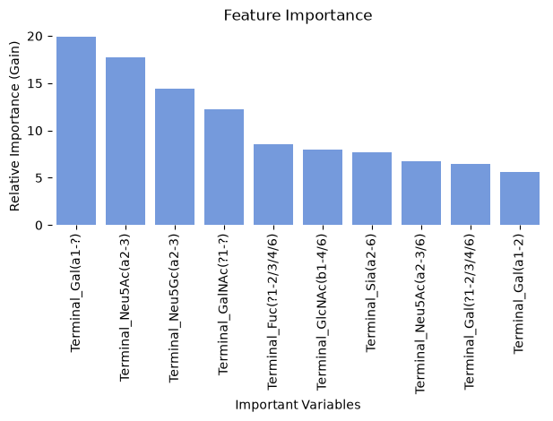

# ml

`ml` contains the code base to process glycan for machine learning, construct state-of-the-art machine learning models, train them, and analyze trained models + glycan representations. It currently contains the following modules:

- `model_training` contains functions for training machine learning models
- `models` describes some examples for machine learning architectures applicable to glycans
- `processing` contains helper functions to prepare glycan data for model training
- `inference` can be used to analyze trained models, make predictions, or obtain glycan representations
- `train_test_split` contains various data split functions to get appropriate training and test sets

## model_training

> contains functions for training machine learning models

------------------------------------------------------------------------

### EarlyStopping

``` python
def EarlyStopping(
    patience:int=7, # epochs to wait after last improvement
    verbose:bool=False, # whether to print messages
)->None:
```

*Early stops the training if validation loss doesn’t improve after a given patience*

------------------------------------------------------------------------

### train_model

``` python
def train_model(
    model:torch.nn.modules.module.Module, # graph neural network for analyzing glycans
    dataloaders:dict[str, torch.utils.data.dataloader.DataLoader], # dict with 'train' and 'val' loaders
    criterion:torch.nn.modules.module.Module, # PyTorch loss function
    optimizer:torch.optim.optimizer.Optimizer, # PyTorch optimizer, e.g., from training_setup; SAM gets its two-step update
    scheduler:torch.optim.lr_scheduler.LRScheduler, # PyTorch learning rate decay
    num_epochs:int=25, # number of epochs for training
    patience:int=50, # epochs without improvement until early stop
    mode:str='classification', # 'classification', 'multilabel', or 'regression'; training_setup's 'multiclass' and 'binary' set mode2 themselves
    mode2:str='multi', # 'multi' or 'binary' classification
    return_metrics:bool=False, # whether to return metrics
)->torch.nn.modules.module.Module | tuple[torch.nn.modules.module.Module, dict[str, dict[str, list[float]]]]:
```

*trains a deep learning model on predicting glycan properties*

------------------------------------------------------------------------

### training_setup

``` python
def training_setup(
    model:torch.nn.modules.module.Module, # graph neural network for analyzing glycans
    lr:float, # learning rate
    lr_patience:int=4, # epochs before reducing learning rate
    factor:float=0.2, # factor to multiply lr on reduction
    weight_decay:float=0.0001, # regularization parameter
    mode:str='multiclass', # type of prediction task
    num_classes:int=2, # number of classes for classification
    gsam_alpha:float=0.0, # if >0, uses GSAM instead of SAM optimizer
    warmup_epochs:int=5, # if >0, uses a learning rate warm-up schedule for training stability
)->tuple[torch.optim.optimizer.Optimizer, torch.optim.lr_scheduler._LRScheduler, torch.nn.modules.module.Module]:
```

*prepares optimizer, learning rate scheduler, and loss criterion for model training*

------------------------------------------------------------------------

### train_ml_model

``` python
def train_ml_model(
    X_train:pandas.DataFrame | list, # training data/glycans
    X_test:pandas.DataFrame | list, # test data/glycans
    y_train:list, # training labels
    y_test:list, # test labels
    mode:str='classification', # 'classification' or 'regression'
    feature_calc:bool=False, # calculate motifs from glycans
    return_features:bool=False, # return calculated features
    feature_set:list[str]=['known', 'exhaustive'], # feature set for annotations
    additional_features_train:pandas.DataFrame | None=None, # additional training features
    additional_features_test:pandas.DataFrame | None=None, # additional test features
)->xgboost.sklearn.XGBModel | tuple[xgboost.sklearn.XGBModel, pandas.DataFrame, pandas.DataFrame]:
```

*wrapper function to train standard machine learning models on glycans*

``` python
human = [1 if k == 'Homo_sapiens' else 0 for k in df_species[df_species.Order=='Primates'].Species.values.tolist()]
X_train, X_test, y_train, y_test = general_split(df_species[df_species.Order=='Primates'].glycan.values.tolist(), human)
model_ft, _, X_test = train_ml_model(X_train, X_test, y_train, y_test, feature_calc = True, feature_set = ['terminal'],
                         return_features = True)
```

    Calculating Glycan Features...

    Training model...

    Evaluating model...
    Accuracy of trained model on separate validation set: 0.8604852686308492

------------------------------------------------------------------------

### analyze_ml_model

``` python
def analyze_ml_model(
    model:xgboost.sklearn.XGBModel, # trained ML model from train_ml_model
)->None:
```

*plots relevant features for model prediction*

``` python
analyze_ml_model(model_ft)
```



------------------------------------------------------------------------

### get_mismatch

``` python
def get_mismatch(
    model:xgboost.sklearn.XGBModel, # trained ML model from train_ml_model
    X_test:pandas.DataFrame, # motif dataframe for validation
    y_test:list, # test labels
    n:int=10, # number of returned misclassifications
)->list[tuple[typing.Any, float]]: # misclassifications and predicted probabilities
```

*analyzes misclassifications of trained machine learning model*

``` python
get_mismatch(model_ft, X_test, y_test)
```

    [('Gal(b1-4)GlcNAc(b1-3)Gal(b1-4)Glc-ol', 0.7145445942878723),
     ('Gal(b1-4)GlcNAc(b1-2)Man(a1-6)[GlcNAc(b1-2)Man(a1-3)]Man(b1-4)GlcNAc(b1-4)[Fuc(a1-6)]GlcNAc',
      0.7493613362312317),
     ('GlcNAc(b1-2)Man(a1-3)[GlcNAc(b1-2)Man(a1-6)]Man(b1-4)GlcNAc(b1-4)[Fuc(a1-6)]GlcNAc',
      0.31766071915626526),
     ('Gal(b1-3)[Fuc(a1-4)]GlcNAc(b1-3)Gal(b1-4)Glc-ol', 0.8473755717277527),
     ('Neu5Ac(a2-3)Gal(b1-3/4)GlcNAc(b1-2)Man(a1-3)[Man(a1-3)[Man(a1-6)]Man(a1-6)]Man(b1-4)GlcNAc(b1-4)[Fuc(a1-6)]GlcNAc',
      0.8396848440170288),
     ('Gal(b1-3)[Neu5Ac(a2-6)]GlcNAc(b1-3)Gal(b1-4)Glc-ol', 0.7336083650588989),
     ('Fuc(a1-3/4)[Gal(b1-3/4)]GlcNAc(b1-2)[Fuc(a1-3/4)[Gal(b1-3/4)]GlcNAc(b1-4)]Man(a1-3)[Fuc(a1-3/4)[Gal(b1-3/4)]GlcNAc(b1-2)[Fuc(a1-3/4)[Gal(b1-3/4)]GlcNAc(b1-6)]Man(a1-6)]Man(b1-4)GlcNAc(b1-4)[Fuc(a1-6)]GlcNAc',
      0.6133107542991638),
     ('Gal(b1-3/4)GlcNAc(b1-2/4)[GlcNAc(b1-2/4)]Man(a1-3)[Man(a1-3)[Man(a1-6)]Man(a1-6)]Man(b1-4)GlcNAc(b1-4)[Fuc(a1-6)]GlcNAc',
      0.6319893598556519),
     ('Gal(b1-4)Glc-ol', 0.7145445942878723),
     ('Gal(b1-4)GlcNAc(b1-2)Man(a1-3)[Man(a1-3)[Man(a1-6)]Man(a1-6)]Man(b1-4)GlcNAc(b1-4)GlcNAc',
      0.76183021068573)]

## models

> describes some examples for machine learning architectures applicable to glycans. The main portal is prep_models which allows users to setup (trained) models by their string names

------------------------------------------------------------------------

### SweetNet

``` python
def SweetNet(
    lib_size:int, # number of unique tokens for graph nodes
    num_classes:int=1, # number of output classes (>1 for multilabel)
    hidden_dim:int=128, # dimension of hidden layers
)->None:
```

*Base class for all neural network modules.*

Your models should also subclass this class.

Modules can also contain other Modules, allowing them to be nested in a tree structure. You can assign the submodules as regular attributes::

    import torch.nn as nn
    import torch.nn.functional as F


    class Model(nn.Module):
        def __init__(self) -> None:
            super().__init__()
            self.conv1 = nn.Conv2d(1, 20, 5)
            self.conv2 = nn.Conv2d(20, 20, 5)

        def forward(self, x):
            x = F.relu(self.conv1(x))
            return F.relu(self.conv2(x))

Submodules assigned in this way will be registered, and will also have their parameters converted when you call :meth:`to`, etc.

.. note:: As per the example above, an `__init__()` call to the parent class must be made before assignment on the child.

:ivar training: Boolean represents whether this module is in training or evaluation mode. :vartype training: bool

------------------------------------------------------------------------

### LectinOracle

``` python
def LectinOracle(
    input_size_glyco:int, # number of unique tokens for graph nodes
    hidden_size:int=128, # layer size for graph convolutions
    num_classes:int=1, # number of output classes (>1 for multilabel)
    data_min:float=-11.355, # minimum observed value in training data
    data_max:float=23.892, # maximum observed value in training data
    input_size_prot:int=960, # dimensionality of protein representations
)->None:
```

*Base class for all neural network modules.*

Your models should also subclass this class.

Modules can also contain other Modules, allowing them to be nested in a tree structure. You can assign the submodules as regular attributes::

    import torch.nn as nn
    import torch.nn.functional as F


    class Model(nn.Module):
        def __init__(self) -> None:
            super().__init__()
            self.conv1 = nn.Conv2d(1, 20, 5)
            self.conv2 = nn.Conv2d(20, 20, 5)

        def forward(self, x):
            x = F.relu(self.conv1(x))
            return F.relu(self.conv2(x))

Submodules assigned in this way will be registered, and will also have their parameters converted when you call :meth:`to`, etc.

.. note:: As per the example above, an `__init__()` call to the parent class must be made before assignment on the child.

:ivar training: Boolean represents whether this module is in training or evaluation mode. :vartype training: bool

------------------------------------------------------------------------

### LectinOracle_flex

``` python
def LectinOracle_flex(
    input_size_glyco:int, # number of unique tokens for graph nodes
    hidden_size:int=128, # layer size for graph convolutions
    num_classes:int=1, # number of output classes (>1 for multilabel)
    data_min:float=-11.355, # minimum observed value in training data
    data_max:float=23.892, # maximum observed value in training data
    input_size_prot:int=1000, # maximum protein sequence length for padding/cutting
)->None:
```

*Base class for all neural network modules.*

Your models should also subclass this class.

Modules can also contain other Modules, allowing them to be nested in a tree structure. You can assign the submodules as regular attributes::

    import torch.nn as nn
    import torch.nn.functional as F


    class Model(nn.Module):
        def __init__(self) -> None:
            super().__init__()
            self.conv1 = nn.Conv2d(1, 20, 5)
            self.conv2 = nn.Conv2d(20, 20, 5)

        def forward(self, x):
            x = F.relu(self.conv1(x))
            return F.relu(self.conv2(x))

Submodules assigned in this way will be registered, and will also have their parameters converted when you call :meth:`to`, etc.

.. note:: As per the example above, an `__init__()` call to the parent class must be made before assignment on the child.

:ivar training: Boolean represents whether this module is in training or evaluation mode. :vartype training: bool

------------------------------------------------------------------------

### NSequonPred

``` python
def NSequonPred()->None:
```

*Base class for all neural network modules.*

Your models should also subclass this class.

Modules can also contain other Modules, allowing them to be nested in a tree structure. You can assign the submodules as regular attributes::

    import torch.nn as nn
    import torch.nn.functional as F


    class Model(nn.Module):
        def __init__(self) -> None:
            super().__init__()
            self.conv1 = nn.Conv2d(1, 20, 5)
            self.conv2 = nn.Conv2d(20, 20, 5)

        def forward(self, x):
            x = F.relu(self.conv1(x))
            return F.relu(self.conv2(x))

Submodules assigned in this way will be registered, and will also have their parameters converted when you call :meth:`to`, etc.

.. note:: As per the example above, an `__init__()` call to the parent class must be made before assignment on the child.

:ivar training: Boolean represents whether this module is in training or evaluation mode. :vartype training: bool

------------------------------------------------------------------------

### init_weights

``` python
def init_weights(
    model:torch.nn.modules.module.Module, # neural network for analyzing glycans
    mode:str='sparse', # initialization algorithm: 'sparse', 'kaiming', 'xavier'
    sparsity:float=0.1, # proportion of sparsity after initialization
)->None:
```

*initializes linear layers of PyTorch model with a weight initialization*

------------------------------------------------------------------------

### prep_model

``` python
def prep_model(
    model_type:Literal['SweetNet', 'GIFFLAR', 'LectinOracle', 'LectinOracle_flex', 'NSequonPred'], # type of model to create
    num_classes:int, # number of unique classes for classification
    libr:dict[str, int] | None=None, # dictionary of form glycoletter:index
    trained:bool=False, # whether to use pretrained model
    hidden_dim:int=128, # hidden dimension for the model (SweetNet only)
)->torch.nn.modules.module.Module: # initialized PyTorch model
```

*wrapper to instantiate model, initialize it, and put it on the GPU*

## processing

> contains helper functions to prepare glycan data for model training

------------------------------------------------------------------------

### dataset_to_graphs

``` python
def dataset_to_graphs(
    glycan_list:list[str], # list of IUPAC-condensed glycan sequences
    labels:list[float | int], # list of labels
    libr:dict[str, int] | None=None, # dictionary of glycoletter:index
    label_type:torch.dtype=torch.int64, # tensor type for label
)->list[torch.utils.data.dataset.Dataset]: # list of node/edge/label data tuples
```

*wrapper function to convert a whole list of glycans into a graph dataset*

``` python
dataset_to_graphs(["Neu5Ac(a2-3)Gal(b1-4)Glc",
                  "Fuc(a1-2)Gal(b1-3)GalNAc"], [1, 0])
```

    [Data(edge_index=[2, 4], labels=[5], string_labels=[5], num_nodes=5, y=1),
     Data(edge_index=[2, 4], labels=[5], string_labels=[5], num_nodes=5, y=0)]

------------------------------------------------------------------------

### dataset_to_dataloader

``` python
def dataset_to_dataloader(
    glycan_list:list[str], # list of IUPAC-condensed glycans
    labels:list[float | int], # list of labels
    libr:dict[str, int] | None=None, # dictionary of glycoletter:index
    batch_size:int=32, # samples per batch
    shuffle:bool=True, # shuffle samples in dataloader
    drop_last:bool=False, # drop last batch
    extra_feature:list[float] | None=None, # additional input features
    label_type:torch.dtype=torch.int64, # tensor type for label
    augment_prob:float=0.0, # probability of data augmentation
    generalization_prob:float=0.2, # probability of wildcarding
    hetero:bool=False
)->torch.utils.data.dataloader.DataLoader: # dataloader for training
```

*wrapper function to convert glycans and labels to a torch_geometric DataLoader*

``` python
next(iter(dataset_to_dataloader(["Neu5Ac(a2-3)Gal(b1-4)Glc",
                                 "Fuc(a1-2)Gal(b1-3)GalNAc"], [1, 0])))
```

    DataBatch(edge_index=[2, 8], labels=[10], string_labels=[2], num_nodes=10, y=[2], batch=[10], ptr=[3])

------------------------------------------------------------------------

### split_data_to_train

``` python
def split_data_to_train(
    glycan_list_train:list[str], # training glycans
    glycan_list_val:list[str], # validation glycans
    labels_train:list[float | int], # training labels
    labels_val:list[float | int], # validation labels
    libr:dict[str, int] | None=None, # dictionary of glycoletter:index
    batch_size:int=32, # samples per batch
    drop_last:bool=False, # drop last batch
    extra_feature_train:list[float] | None=None, # additional training features
    extra_feature_val:list[float] | None=None, # additional validation features
    label_type:torch.dtype=torch.int64, # tensor type for label
    augment_prob:float=0.0, # probability of data augmentation
    generalization_prob:float=0.2, # probability of wildcarding
    hetero:bool=False
)->dict[str, torch.utils.data.dataloader.DataLoader]: # dictionary of train/val dataloaders
```

*wrapper function to convert split training/test data into dictionary of dataloaders*

``` python
split_data_to_train(["Neu5Ac(a2-3)Gal(b1-4)Glc", "Fuc(a1-2)Gal(b1-3)GalNAc"],
                    ["Neu5Ac(a2-6)Gal(b1-4)Glc", "Fuc(a1-2)Gal(a1-3)GalNAc"],
                    [1, 0], [0,1])
```

    {'train': <torch_geometric.loader.dataloader.DataLoader>,
     'val': <torch_geometric.loader.dataloader.DataLoader>}

## inference

\>can be used to analyze trained models, make predictions, or obtain glycan representations

------------------------------------------------------------------------

### glycans_to_emb

``` python
def glycans_to_emb(
    glycans:str | list[str], # glycan(s) in IUPAC-condensed
    model:torch.nn.modules.module.Module, # trained graph neural network for analyzing glycans
    libr:dict[str, int] | None=None, # dictionary of form glycoletter:index
    batch_size:int=32, # batch size used during training
    rep:bool=True, # True returns representations, False returns predicted labels
    class_list:list[str] | None=None, # list of unique classes to map predictions; a model with a single output is a binary classifier, read as class_list[1] for logits >= 0
    multilabel:bool=False, # whether to output predictions for a multilabel-task
)->pandas.DataFrame | list[str]: # dataframe of representations or list of predictions
```

*Returns a dataframe of learned representations for a list of glycans*

------------------------------------------------------------------------

### get_lectin_preds

``` python
def get_lectin_preds(
    prot:str, # protein amino acid sequence
    glycans:str | list[str], # glycan(s) in IUPAC-condensed
    model:torch.nn.modules.module.Module, # trained LectinOracle-type model
    prot_dic:dict[str, list[float]] | None=None, # dict of protein sequence:ESMC representation
    background_correction:bool=False, # whether to correct predictions for background
    correction_df:pandas.DataFrame | None=None, # background prediction for glycans
    batch_size:int=128, # batch size used during training
    libr:dict[str, int] | None=None, # dict of glycoletter:index
    sort:bool=True, # whether to sort prediction results descendingly
    flex:bool=False, # LectinOracle (False) or LectinOracle_flex (True)
)->pandas.DataFrame: # glycan sequences and predicted binding
```

*Wrapper that uses LectinOracle-type model for predicting binding of protein to glycans*

------------------------------------------------------------------------

### get_Nsequon_preds

``` python
def get_Nsequon_preds(
    prots:str | list[str], # 20 AA + N + 20 AA sequence(s); replace missing with 'z'
    model:torch.nn.modules.module.Module, # trained NSequonPred-type model
    prot_dic:dict[str, list[float]], # dict of protein sequence:ESM1b representation
)->pandas.DataFrame: # protein sequences and predicted likelihood
```

*Predicts whether an N-sequon will be glycosylated*

------------------------------------------------------------------------

### get_esmc_representations

``` python
def get_esmc_representations(
    prots:str | list[str], # protein sequence(s) to convert
    model:torch.nn.modules.module.Module, # trained ESMC model
)->dict[str, list[float]]: # dict of protein sequence:ESMC-300M representation
```

*Retrieves ESMC-300M representations of protein for using them as input for LectinOracle*

In order to run `get_esmc_representations`, you first have to run this snippet:

    !pip install esm
    from esm.models.esmc import ESMC
    model = ESMC.from_pretrained("esmc_300m")

## train_test_split

> contains various data split functions to get appropriate training and test sets

------------------------------------------------------------------------

### hierarchy_filter

``` python
def hierarchy_filter(
    df_in:pandas.DataFrame, # dataframe of glycan sequences and taxonomic labels
    rank:str='Domain', # taxonomic rank to filter
    min_seq:int=5, # minimum glycans per class
    wildcard_seed:bool=False, # seed wildcard glycoletters
    wildcard_list:list[str] | None=None, # glycoletters for wildcard
    wildcard_name:str | None=None, # wildcard name in IUPAC
    r:float=0.1, # replacement rate
    col:str='glycan', # column name for glycans
)->tuple[list[str], list[str], list[int], list[int], list[int], list[str], dict[str, int]]: # train/val splits and mappings
```

*stratified data split in train/test at the taxonomic level, removing duplicate glycans and infrequent classes*

``` python
train_x, val_x, train_y, val_y, id_val, class_list, class_converter = hierarchy_filter(df_species,
                                                                                       rank = 'Kingdom')
print(train_x[:10])
```

    ['Glc(b1-3)Glc(b1-3)[Man(b1-3)Man(b1-6)]Glc(b1-3)Glc(b1-3)[Man(b1-3)Man(b1-6)]Glc(b1-3)Glc(b1-3)Glc', 'Gal(b1-3)[Neu5Ac(a2-6)]GlcNAc(b1-4)[Gal(b1-4)GlcNAc(b1-2)]Man(a1-3)[Gal(b1-4)GlcNAc(b1-2)Man(a1-6)]Man(b1-4)GlcNAc(b1-4)GlcNAc', '[Rha(a1-3)]Man(a1-3)Man(a1-3)GlcNAc(b1-4)Man', 'Fuc(a1-3)[HexNAc(b1-4)]Gal(b1-4)GlcNAc(b1-2)Man(a1-3)[Neu5Ac(a2-3/6)Gal(b1-4)GlcNAc(b1-2)[Neu5Ac(a2-3)[GalNAc(b1-4)]Gal(b1-4)GlcNAc(b1-6)]Man(a1-6)]Man(b1-4)GlcNAc(b1-4)[Fuc(a1-6)]GlcNAc', 'Pen(?1-?)Hex(?1-?)Pen(?1-?)Pen', 'Neu5Ac(a2-3)Gal(b1-4)GlcNAc(b1-2)[Neu5Ac(a2-3)Gal(b1-4)GlcNAc(b1-6)]Man(a1-3)[Neu5Ac(a2-3)Gal(b1-4)GlcNAc(b1-2)Man(a1-6)]Man(b1-4)GlcNAc(b1-4)[Fuc(a1-6)]GlcNAc', 'Xyl(b1-4)[Gal(a1-2)][D-Rha(a1-3)]Fuc(a1-3)[Xyl(b1-4)]Glc', 'GlcN6Me(b1-4)GlcNAc(b1-4)GlcNAc(b1-4)GlcNAc', 'GalNAcOS(b1-4)GlcNAc(b1-2)Man(a1-3)[GalNAc(b1-4)GlcNAc(b1-2)Man(a1-6)][GlcNAc(b1-4)]Man(b1-4)GlcNAc(b1-4)[Fuc(a1-6)]GlcNAc', 'Fuc(a1-2)[GalNAc(a1-3)]Gal']

------------------------------------------------------------------------

### general_split

``` python
def general_split(
    glycans:list[str], # list of IUPAC-condensed glycans
    labels:list[float | int | str], # list of prediction labels
    test_size:float=0.2, # size of test set
)->tuple[list[str], list[str], list[float | int | str], list[float | int | str]]: # train/test splits
```

*splits glycans and labels into train / test sets*

``` python
train_x, val_x, train_y, val_y = general_split(df_species.glycan.values.tolist(),
                                              df_species.Species.values.tolist())
print(train_x[:10])
```

    ['Neu5Ac(a2-3/6)Gal(b1-4)[Fuc(a1-3)]GlcNAc(b1-2)Man(a1-3/6)[Fuc(a1-3)[Gal(b1-4)]GlcNAc(b1-2)Man(a1-3/6)]Man(b1-4)GlcNAc(b1-4)[Fuc(a1-6)]GlcNAc', '[Man(a1-2)Man(a1-2)Man(a1-6)Man(a1-3)Man(a1-2)Man(a1-2)]Man(a1-6)Man(a1-6)[Man(a1-3)Man(a1-2)Man(a1-2)]Man(a1-3)[Man(a1-3)Man(a1-2)Man(a1-6)[Man(a1-3)]Man(a1-6)]Man(b1-4)GlcNAc(b1-4)GlcNAc', 'Gal(a1-3)Gal(b1-4)GlcNAc(b1-2)[Gal(a1-3)Gal(b1-4)GlcNAc(b1-4/6)]Man(a1-3/6)[Gal(a1-3)Gal(b1-4)GlcNAc(b1-2)Man(a1-3/6)]Man(b1-4)GlcNAc(b1-4)GlcNAc', 'Qui3NSerAc(b1-3)Ribf(b1-4)Gal(b1-3)GlcNAc(a1-4)Qui3NSerAc', 'Gal(a1-4)Neu5Ac(a2-6)Gal', 'GlcA(?1-?)GalNAc(b1-4)GlcNAc(b1-2)Man(a1-3)[Fuc(a1-3)GalNAc(b1-4)GlcNAc(b1-2)Man(a1-6)]Man(b1-4)GlcNAc(b1-4)[Fuc(a1-6)]GlcNAc', 'LDManHep(a1-7)LDManHepOP(a1-3)[DDManHepOP(a1-2)DDManHep(a1-4)]LDManHep(a1-5)Kdo', 'Neu5Gc(a2-3)Gal(b1-4)GlcNAc(b1-2)Man(a1-3)[GlcNAc(b1-2)Man(a1-6)]Man(b1-4)GlcNAc(b1-4)GlcNAc', 'Gal(b1-3/4)GlcNAc(b1-2)[GlcNAc(b1-4)]Man(a1-3)[GlcNAc(b1-2)Man(a1-6)]Man(b1-4)GlcNAc(b1-4)GlcNAc', 'Fuc(a1-2)Gal(b1-4)GlcNAc(b1-6)[Fuc(a1-2)Gal(b1-4)]Gal(b1-4)Glc-ol']

------------------------------------------------------------------------

### prepare_multilabel

``` python
def prepare_multilabel(
    df:pandas.DataFrame, # dataframe with one glycan-association per row
    rank:str='Species', # label column to use
    glycan_col:str='glycan', # column with glycan sequences
)->tuple[list[str], list[list[float]]]: # unique glycans and their label vectors
```

*converts a one row per glycan-species/tissue/disease association file to a format of one glycan - all associations*

``` python
glycans, labels = prepare_multilabel(df_species[df_species.Order == 'Carnivora'])
print(glycans[50])
print(labels[50])
```

    Gal(b1-4)GlcNAc(b1-2)Man(a1-3)[Gal(b1-4)GlcNAc(b1-2)Man(a1-6)]Man(b1-4)GlcNAc(b1-4)[Fuc(a1-6)]GlcNAc
    [0.0, 0.0, 0.0, 1.0, 1.0, 0.0, 0.0, 0.0, 0.0, 0.0, 0.0, 1.0, 0.0, 0.0, 0.0, 0.0, 0.0, 0.0, 0.0, 1.0, 1.0, 0.0, 0.0, 0.0, 0.0, 0.0, 0.0, 0.0, 0.0, 0.0, 0.0, 0.0, 0.0, 0.0, 0.0, 0.0]
