# motif

`motif` contains many functions to process glycans in various ways and use this processing to analyze glycans via curated motifs, graph features, and sequence features. It contains the following modules:

- `draw` contains the GlycoDraw function to draw glycans in SNFG style
- `analysis` contains functions for downstream analyses of important glycan motifs etc.
- `annotate` contains functions to extract curated motifs, graph features, and sequence features from glycan sequences
- `graph` is used to convert glycan sequences to graphs and contains helper functions to search for motifs / check whether two sequences describe the same sequence, etc.
- `processing` contains functions to process IUPAC-condensed glycan sequences, as well as conversion functions to convert other nomenclatures into IUPAC-condensed.
- `query` is used to interact with the databases contained in glycowork, delivering insights for sequences of interest
- `smiles` is used to convert glycan sequences (e.g., IUPAC-condensed) into SMILES strings for chemistry-related tasks
- `regex` contains functionality for performing powerful regular expression-like searches on glycans; `get_match`, `get_match_batch`, `motif_to_regex`, and `explain_match` are the user-facing functions.
- `tokenization` has helper functions to map *m/z*–\>composition, composition–\>structure, structure–\>motif, and more

## draw

> drawing glycans in SNFG style

------------------------------------------------------------------------

### GlycoDraw

``` python
def GlycoDraw(
    glycan:str | list[str] | dict[str, int], # IUPAC-condensed glycan sequence or composition (e.g., H5N4F1A2, Hex5HexNAc4Fuc1Neu5Ac2, {'Hex': 5}); a list is drawn as a grid
    vertical:bool=False, # Draw vertically
    compact:bool=False, # Use compact style
    show_linkage:bool=True, # Show linkage labels
    dim:float=50, # Base dimension for scaling
    highlight_motif:str | None=None, # Motif to highlight
    highlight_termini_list:list=[], # Terminal positions (from 'terminal', 'internal', and 'flexible')
    highlight_linkages:list[int] | None=None, # Which linkages to highlight in a different color; indices, starting from 0, in glycan
    reverse_highlight:bool=False, # Whether to highlight everything EXCEPT highlight_motif
    repeat:bool | int | str | None=None, # Repeat unit specification (True: n units, int: # of units, str: range of units)
    repeat_range:list[int] | None=None, # Repeat unit range
    draw_method:str | None=None, # Drawing method: None, 'chem2d', 'chem3d'
    filepath:str | pathlib.Path | None=None, # Output file path
    suppress:bool=False, # Suppress display
    per_residue:list=[], # Per-residue intensity values (order should be the same as the monosaccharides in glycan string)
    pdb_file:str | pathlib.Path | None=None, # only used when draw_method='chem3d'; already existing glycan structure
    alt_text:str | None=None, # Custom ALT text for accessibility
    libr:dict | None=None, # Can be modified for drawing too exotic monosaccharides
    reducing_end_label:str | None=None, # Label to be drawn connected to the reducing end
    restrict_vocab:bool=False, # Whether only tokens present in libr can be drawn
    shadow:bool=False, # Draw a soft drop shadow under the monosaccharide symbols
    sticker:bool=False, # Cut the whole structure out as a die-cut sticker: flat border hugging the outline, with a drop shadow
    highlight_residues:list[int] | None=None, # Residues to highlight (indices, starting from 0, of the monosaccharides in glycan, as per_residue); the others, and linkages not between two highlighted residues or in highlight_linkages, are faded as outside highlight_motif
)->Any: # Drawing object
```

*Renders glycan structure using SNFG symbols or chemical structure representation*

``` python
GlycoDraw("Neu5Ac(a2-3)Gal(b1-4)[Fuc(a1-3)]GlcNAc(b1-2)Man(a1-3)[Neu5Gc(a2-6)Gal(b1-4)GlcNAc(b1-2)Man(a1-6)][GlcNAc(b1-4)]Man(b1-4)GlcNAc(b1-4)[Fuc(a1-6)]GlcNAc",
         highlight_motif = "GlcNAc(b1-?)Man")
```

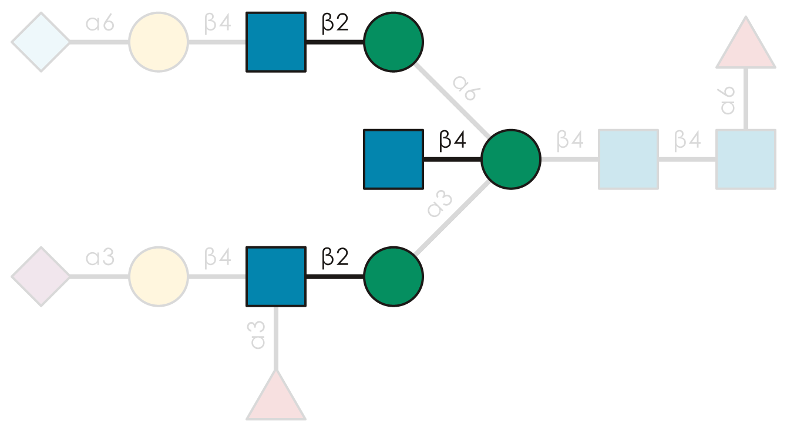

------------------------------------------------------------------------

### annotate_figure

``` python
def annotate_figure(
    svg_input:str, # Input SVG file path
    scale_range:tuple[int, int]=(25, 80), # Min/max glycan dimensions
    compact:bool=False, # Use compact style
    glycan_size:str='medium', # Glycan size preset ('small', 'medium', 'large')
    filepath:str | pathlib.Path='', # Output file path
    scale_by_DE_res:pandas.DataFrame | None=None, # Differential expression results (motif_analysis.get_differential_expression)
    x_thresh:float=1, # X metric threshold
    y_thresh:float=0.05, # P-value threshold
    x_metric:str='Log2FC', # X axis metric ('Log2FC', 'Effect size')
)->str | None: # Modified SVG code
```

*Replaces text labels with glycan drawings in SVG figure*

------------------------------------------------------------------------

### plot_glycans_excel

``` python
def plot_glycans_excel(
    df:pandas.DataFrame | pandas.Series | list[str] | str | pathlib.Path, # DataFrame or filepath with glycans, or the glycans themselves
    folder_filepath:str | pathlib.Path, # Output folder path
    glycan_col_num:int | str=0, # Glycan column index, or its name
    scaling_factor:float=0.2, # Image scaling
    compact:bool=False, # Use compact style
    **kwargs
)->None: # Passed on to GlycoDraw for every glycan, e.g., vertical, show_linkage, highlight_motif
```

*Creates Excel file with SNFG glycan images in a new column*

------------------------------------------------------------------------

### plot_glycans_grid

``` python
def plot_glycans_grid(
    glycans:str | list[str], # Glycans to draw (IUPAC-condensed, compositions, motif names)
    ncols:int=4, # Glycans per row
    labels:list[str] | None=None, # Caption under each glycan, such as a name, ID, or fold change
    filepath:str | pathlib.Path | None=None, # Output file path (.svg, .pdf, or .png)
    suppress:bool=False, # Suppress display
    **kwargs
)->Any: # Drawing object
```

*Draws several glycans at one shared scale into a single captioned figure, row by row, for side-by-side comparison*

``` python
plot_glycans_grid(['Gal(b1-4)GlcNAc', 'Fuc(a1-2)Gal(b1-4)GlcNAc', 'Neu5Ac(a2-6)Gal(b1-4)GlcNAc', 'H5N4F1A2'], labels = ['LacNAc', 'H type 2', 'a2-6 sialyl LacNAc', 'composition'], ncols = 2)
```

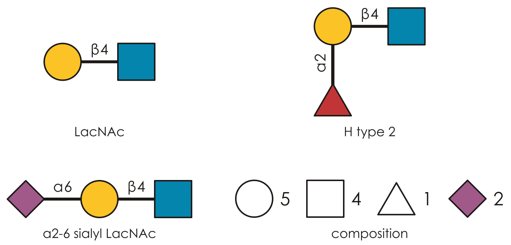

## analysis

> downstream analyses of important glycan motifs

------------------------------------------------------------------------

### get_pvals_motifs

``` python
def get_pvals_motifs(
    df:pandas.DataFrame | str | pathlib.Path, # Input dataframe, filepath (.csv/.xlsx), or shipped dataset name
    label_col_name:str='target', # Column name for labels
    zscores:bool=True, # Whether data are z-scores
    thresh:float=1.645, # Threshold to separate positive/negative
    sorting:bool=True, # Sort p-value dataframe
    feature_set:str | list[str]=['exhaustive'], # Feature sets to use; exhaustive, known, terminal1, terminal2, terminal3, chemical, graph, custom, size_branch
    multiple_samples:bool=False, # Multiple samples with glycan columns
    motifs:pandas.DataFrame | None=None, # Modified motif_list
    custom_motifs:str | list[str]=[], # Custom motifs if using 'custom' feature set
    grouped_BH:bool=True, # Two-stage adaptive Benjamini-Hochberg within DAG-grouped motif families
    moderate_variance:bool=True, # Empirical-Bayes variance moderation, with the containment DAG as the prior neighborhood
    top_explained:int | None=5, # How many child motifs to name in 'Explained by'; None names all of them
)->glycowork.glycan_data.loader.GlycoDataFrame: # DataFrame with p-values, FDR-corrected p-values, significance, Cohen's d effect sizes, and equivalence p-values for glycan motifs
```

*Identifies significantly enriched glycan motifs using a moderated t-test with DAG-grouped FDR correction and Cohen’s d effect size calculation, comparing samples above/below threshold*

``` python
glycans = ['Man(a1-3)[Man(a1-6)][Xyl(b1-2)]Man(b1-4)GlcNAc(b1-4)[Fuc(a1-3)]GlcNAc',
           'Man(a1-2)Man(a1-2)Man(a1-3)[Man(a1-3)Man(a1-6)]Man(b1-4)GlcNAc(b1-4)GlcNAc',
           'GalNAc(a1-4)GlcNAcA(a1-4)[GlcN(b1-7)]Kdo(a2-5)[Kdo(a2-4)]Kdo(a2-6)GlcOPN(b1-6)GlcOPN',
          'Man(a1-2)Man(a1-3)[Man(a1-6)]Man(b1-4)GlcNAc(b1-4)GlcNAc',
           'Glc(b1-3)Glc(b1-3)Glc']
label = [3.234, 2.423, 0.733, 3.102, 0.108]
test_df = pd.DataFrame({'glycan':glycans, 'binding':label})

print("Glyco-Motif enrichment p-value test")
out = get_pvals_motifs(test_df, 'binding').iloc[:10,:]
```

    Glyco-Motif enrichment p-value test
    Chosen grouping: by_motif_family

|   | motif | pval | corr_pval | significant | effect_size | equivalence_pval | Explained by | Redistribution p-val | Residual p-val | Residual effect size |
|----|----|----|----|----|----|----|----|----|----|----|
| 3 | GlcNAc | 0.000685 | 0.001657 | True | 8.217313 | 1.000000 | Fuc(a1-3)GlcNAc (-7.51), GlcNAc(b1-4)GlcNAc (-0.00) | nan | 1.000000 | 0.000000 |
| 8 | GlcNAc(b1-4)GlcNAc | 0.001104 | 0.001657 | True | 8.217313 | 1.000000 |  | nan | nan | nan |
| 6 | Man | 0.002273 | 0.009093 | True | 6.172967 | 1.000000 | Man(a1-2/3/6)Man (-2.14) | nan | 1.000000 | 0.000000 |
| 11 | Man(a1-3)Man | 0.012950 | 0.017266 | True | 4.701182 | 1.000000 |  | nan | nan | nan |
| 10 | Man(a1-2/3/6)Man | 0.007816 | 0.015632 | True | 4.032437 | 1.000000 | Man(a1-2)Man (-2.71), Man(a1-3)Man (+0.67) | nan | 1.000000 | 0.000000 |
| 9 | Man(a1-2)Man | 0.225862 | 0.225862 | True | 1.321958 | 0.846667 |  | nan | nan | nan |
| 5 | Kdo | 0.218480 | 0.385142 | False | -1.224745 | 0.846667 |  | nan | nan | nan |
| 4 | GlcOPN | 0.256761 | 0.385142 | False | -1.224745 | 0.846667 |  | nan | nan | nan |
| 1 | GalNAc(a1-4)GlcNAcA | 0.399098 | 0.399098 | False | -1.224745 | 0.846667 |  | nan | nan | nan |
| 2 | Glc | 0.227811 | 0.274784 | False | -1.224745 | 0.846667 | Glc(b1-3)Glc (+0.00) | nan | 1.000000 | 0.000000 |

------------------------------------------------------------------------

### get_representative_substructures

``` python
def get_representative_substructures(
    enrichment_df:pandas.DataFrame, # Output from get_pvals_motifs
)->list[str]: # Up to 10 minimal glycans containing enriched motifs
```

*Constructs minimal glycan structures that represent significantly enriched motifs by optimizing for motif content while minimizing structure size using subgraph isomorphism*

------------------------------------------------------------------------

### get_heatmap

``` python
def get_heatmap(
    df:pandas.DataFrame | str | pathlib.Path, # Input dataframe or filepath (.csv/.xlsx)
    motifs:bool=False, # Analyze motifs instead of sequences
    feature_set:str | list[str]=['known'], # Feature sets to use; exhaustive, known, terminal1, terminal2, terminal3, chemical, graph, custom, size_branch
    transform:str='', # Transform data before plotting
    datatype:str='response', # Data type: 'response' for quantitative values or 'presence' for presence/absence
    rarity_filter:float=0.05, # Min proportion for non-zero values
    filepath:str | pathlib.Path='', # Path to save plot
    index_col:str='glycan', # Column to use as index
    custom_motifs:str | list[str]=[], # Custom motifs if using 'custom' feature set
    return_plot:bool=False, # Return plot object
    show_all:bool=False, # Show all tick labels
    title:str | None=None, # Plot title; None for none, as before
    dist_func:Union[str, Callable, NoneType]=None, # scipy.spatial.distance metric name or callable on two vectors to cluster rows and columns with; None keeps seaborn's default euclidean
    **kwargs:Any
)->tuple[typing.Any, list[str], pandas.DataFrame] | None: # None or (plot object, column names, transformed dataframe) if return_plot=True
```

*Creates hierarchically clustered heatmap visualization of glycan/motif abundances*

``` python
glycans = ['Man(a1-3)[Man(a1-6)][Xyl(b1-2)]Man(b1-4)GlcNAc(b1-4)[Fuc(a1-3)]GlcNAc',
           'Man(a1-2)Man(a1-2)Man(a1-3)[Man(a1-3)Man(a1-6)]Man(b1-4)GlcNAc(b1-4)GlcNAc',
           'GalNAc(a1-4)GlcNAcA(a1-4)[GlcN(b1-7)]Kdo(a2-5)[Kdo(a2-4)]Kdo(a2-6)GlcN4P(b1-6)GlcN4P',
           'Man(a1-2)Man(a1-3)[Man(a1-6)]Man(b1-4)GlcNAc(b1-4)GlcNAc',
           'Glc(b1-3)Glc(b1-3)Glc']
label = [3.234, 2.423, 0.733, 3.102, 0.108]
label2 = [0.134, 0.345, 1.15, 0.233, 2.981]
label3 = [0.334, 0.245, 1.55, 0.133, 2.581]
test_df = pd.DataFrame([label, label2, label3], columns = glycans)

get_heatmap(test_df, motifs = True, feature_set = ['known', 'exhaustive'])
```

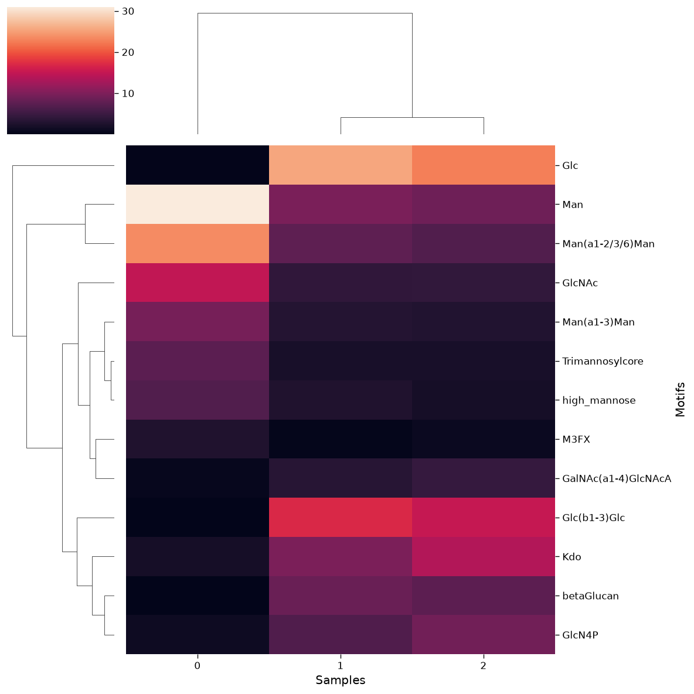

------------------------------------------------------------------------

### plot_embeddings

``` python
def plot_embeddings(
    glycans:list[str], # List of IUPAC-condensed glycan sequences
    emb:dict[str, numpy.ndarray] | pandas.DataFrame | None=None, # Glycan embeddings dict/DataFrame; defaults to SweetNet embeddings
    label_list:list[typing.Any] | None=None, # Labels for coloring points
    shape_feature:str | None=None, # Monosaccharide/bond for point shapes
    filepath:str | pathlib.Path='', # Path to save plot
    alpha:float=0.8, # Point transparency
    palette:str='colorblind', # Color palette for groups
    title:str | None=None, # Plot title; None for none, as before
    **kwargs:Any
)->None: # Keyword args passed to seaborn scatterplot
```

*Visualizes learned glycan embeddings using t-SNE dimensionality reduction with optional group coloring*

``` python
df_fabales = df_species[df_species.Order == 'Fabales'].reset_index(drop = True)
plot_embeddings(df_fabales.glycan.values.tolist(), label_list = df_fabales.Family.values.tolist())
```

    Download completed.

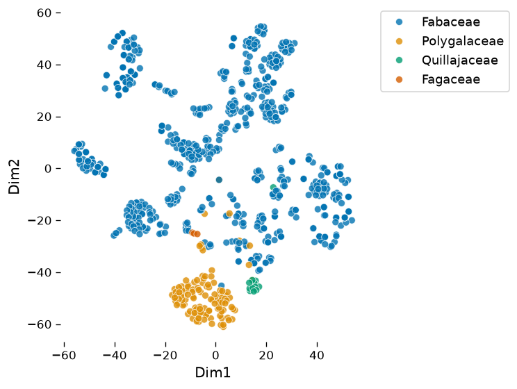

------------------------------------------------------------------------

### characterize_monosaccharide

``` python
def characterize_monosaccharide(
    sugar:str, # Monosaccharide or linkage to analyze
    df:pandas.DataFrame | None=None, # DataFrame with glycan column 'glycan'; defaults to df_species
    mode:str='sugar', # Analysis mode: 'sugar', 'bond', 'sugarbond'
    rank:str | None=None, # Column name for group filtering
    focus:str | None=None, # Row value for group filtering
    modifications:bool=False, # Consider modified monosaccharides
    filepath:str | pathlib.Path='', # Path to save plot
    thresh:int=10, # Minimum count threshold for inclusion
    title:str | None=None, # Plot title; None keeps the default, '' removes it
)->None:
```

*Analyzes connectivity and modification patterns of specified monosaccharides/linkages in glycan sequences*

``` python
characterize_monosaccharide('Rha', rank = 'Kingdom', focus = 'Fungi', modifications = True)
```

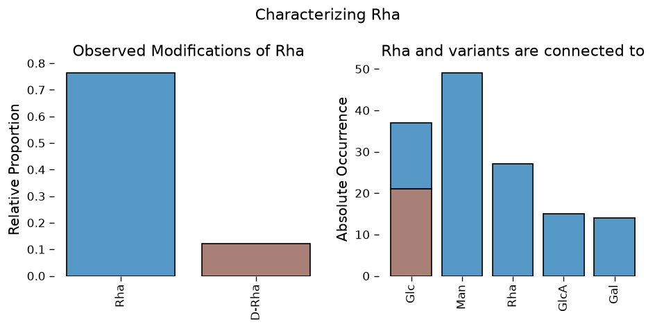

------------------------------------------------------------------------

### get_differential_expression

``` python
def get_differential_expression(
    df:pandas.DataFrame | str | pathlib.Path, # DataFrame with glycans in rows (col 1) and abundance values in subsequent columns
    group1:list[str | int] | None=None, # Column indices/names for first group; default: from the frame's contrasts
    group2:list[str | int] | None=None, # Column indices/names for second group; default: from the frame's contrasts
    motifs:bool=False, # Analyze motifs instead of sequences; per glycosite (protein_site_motif) for glycoproteomics data
    feature_set:str | list[str]=['exhaustive', 'known'], # Feature sets to use; exhaustive, known, terminal1, terminal2, terminal3, chemical, graph, custom, size_branch
    paired:bool | None=None, # Whether samples are paired; default: from the frame
    impute:bool=True, # Replace zeros with impute_biosynthetic predictions
    sets:bool=False, # Identify clusters of correlated glycans
    set_thresh:float=0.9, # Correlation threshold for clusters
    effect_size_variance:bool=False, # Calculate effect size variance
    min_samples:float=0.1, # Min fraction (0-1) of non-zero samples required
    grouped_BH:bool | None=None, # Use two-stage adaptive Benjamini-Hochberg; None infers True for motifs (DAG-grouped families) and False for sequences
    custom_motifs:str | list[str]=[], # Custom motifs if using 'custom' feature set
    transform:str | None=None, # Transformation type: "CLR" or "ALR"; None auto-decides
    gamma:float=0.1, # Uncertainty parameter for CLR transform
    custom_scale:float | dict=0, # Ratio of total signal in group2/group1 for an informed scale model (or group_idx: mean(group)/min(mean(groups)) signal dict for multivariate)
    moderate_variance:bool=True, # Empirical-Bayes variance moderation, with the containment DAG as the prior neighborhood
    glycoproteomics:bool | None=None, # Whether data is from glycoproteomics (rows protein_site_glycan); default: whenever every row label is protein_site_glycan
    level:str='peptide', # Analysis level for glycoproteomics
    monte_carlo:bool=False, # Use Monte Carlo for technical variation
    random_state:int | numpy.random._generator.Generator | None=None, # optional random state for reproducibility
    top_explained:int | None=5, # How many child motifs to name in 'Explained by'; None names all of them
)->glycowork.glycan_data.loader.GlycoDataFrame: # DataFrame with log2FC, p-values, FDR-corrected p-values, and Cohen's d/Mahalanobis distance effect sizes
```

*Performs differential expression analysis using Welch’s t-test (or Hotelling’s T2 for sets) with multiple testing correction on glycomics abundance data*

``` python
test_df = glycomics_data_loader.human_skin_O_PMC5871710_BCC
print(test_df.groups.mapping, test_df.paired)  # group assignments and pairing come with the dataset
res = get_differential_expression(test_df, motifs = True)
res
```

    {'healthy': ['control_1', 'control_2', 'control_3', 'control_4', 'control_5', 'control_6', 'control_7', 'control_8', 'control_9', 'control_10', 'control_11', 'control_12', 'control_13', 'control_14', 'control_15', 'control_16', 'control_17', 'control_18', 'control_19', 'control_20'], 'cancer': ['tumor_1', 'tumor_2', 'tumor_3', 'tumor_4', 'tumor_5', 'tumor_6', 'tumor_7', 'tumor_8', 'tumor_9', 'tumor_10', 'tumor_11', 'tumor_12', 'tumor_13', 'tumor_14', 'tumor_15', 'tumor_16', 'tumor_17', 'tumor_18', 'tumor_19', 'tumor_20']} True
    Chosen grouping: by_motif_family

|  | Glycan | Mean abundance | Log2FC | p-val | corr p-val | significant | corr Levene p-val | Effect size | Equivalence p-val | Explained by | Redistribution p-val | Residual p-val | Residual effect size |
|----|----|----|----|----|----|----|----|----|----|----|----|----|----|
| 12 | Neu5Ac(a2-3)Gal | 12.345115 | 0.313599 | 0.000015 | 0.000073 | True | 0.846171 | 1.286347 | 1.000000 | Disialyl_T_antigen (-0.36) | 0.005505 | 0.000193 | 1.168046 |
| 7 | Gal3/6S(b1-3)GalNAc | 0.159900 | -0.838774 | 0.000696 | 0.004176 | True | 0.846171 | -0.847840 | 1.000000 |  | NaN | NaN | NaN |
| 0 | H_antigen_type2 | 0.247156 | -0.654481 | 0.001817 | 0.006209 | True | 0.996125 | -0.788570 | 1.000000 |  | NaN | NaN | NaN |
| 1 | Internal_LacNAc_type2 | 2.328696 | 0.491517 | 0.003104 | 0.006209 | True | 0.608968 | 0.731626 | 1.000000 | H_antigen_type2 (-1.15) | 0.000306 | 0.000971 | 0.871276 |
| 9 | GlcNAc6S(b1-6)GalNAc | 1.046247 | 0.884675 | 0.004181 | 0.010466 | True | 0.996125 | 0.684443 | 1.000000 |  | NaN | NaN | NaN |
| 4 | Oglycan_core1 | 7.956860 | 0.234965 | 0.005233 | 0.010466 | True | 0.996125 | 0.692574 | 1.000000 | Disialyl_T_antigen (-0.28) | 0.002596 | 0.000238 | 1.077778 |
| 6 | Gal | 18.541780 | 0.184057 | 0.009787 | 0.013049 | True | 0.996125 | 0.661140 | 1.000000 | Terminal_LacNAc_type2 (-0.60), Internal_LacNAc... | 0.002265 | 1.000000 | 0.000000 |
| 2 | Terminal_LacNAc_type2 | 2.440640 | -0.413622 | 0.014311 | 0.014311 | True | 0.608968 | -0.577125 | 1.000000 |  | NaN | NaN | NaN |
| 10 | Neu5Ac | 16.553504 | 0.195722 | 0.009963 | 0.021766 | True | 0.996125 | 0.666531 | 1.000000 | Neu5Ac(a2-8)Neu5Ac (-0.82), Neu5Ac(a2-6)GalNAc... | 0.005061 | 1.000000 | 0.000000 |
| 14 | Neu5Ac(a2-8)Neu5Ac | 0.038663 | -0.621757 | 0.013059 | 0.021766 | True | 0.608968 | -0.582300 | 1.000000 |  | NaN | NaN | NaN |
| 8 | GalNAc | 12.886096 | 0.121066 | 0.030163 | 0.045244 | True | 0.996125 | 0.645643 | 1.000000 | Gal3/6S(b1-3)GalNAc (-0.96), GlcNAc6S(b1-6)Gal... | 0.003977 | 1.000000 | 0.000000 |
| 11 | Gal(b1-3)GalNAc | 12.726196 | 0.099145 | 0.071818 | 0.086182 | True | 0.842190 | 0.437094 | 0.831783 | Oglycan_core1 (+0.14), Oglycan_core2 (-0.07) | 0.271310 | 1.000000 | 0.000000 |
| 13 | Neu5Ac(a2-6)GalNAc | 4.169726 | -0.061919 | 0.493222 | 0.616527 | False | 0.996125 | -0.152631 | 0.450845 | Disialyl_T_antigen (+0.02) | 0.000587 | 0.000845 | -0.913043 |
| 3 | Disialyl_T_antigen | 3.790085 | -0.043993 | 0.654437 | 0.654437 | False | 0.996125 | -0.099488 | 0.450845 |  | NaN | NaN | NaN |
| 5 | Oglycan_core2 | 4.769337 | 0.025826 | 0.811772 | 0.811772 | False | 0.996125 | 0.052366 | 0.450845 |  | NaN | NaN | NaN |

------------------------------------------------------------------------

### get_volcano

``` python
def get_volcano(
    df_res:pandas.DataFrame | str | pathlib.Path, # DataFrame from get_differential_expression with columns [Glycan, Log2FC, p-val, corr p-val]
    y_thresh:float | None=None, # Corrected p threshold for labeling; default: alpha stamped by the analysis function, else 0.05
    x_thresh:float=0, # Absolute x metric threshold for labeling
    n:int | None=None, # Sample size for Bayesian-Adaptive Alpha
    label_changed:bool=True, # Add text labels to significant points
    x_metric:str='Log2FC', # x-axis metric: 'Log2FC' or 'Effect size'; glycosite-level results (glycoproteomics) have no Log2FC and use Effect size
    annotate_volcano:bool=True, # Annotate dots with SNFG images
    filepath:str | pathlib.Path='', # Path to save plot
    title:str | None=None, # Plot title; default: the dataset name the analysis stamped on df_res, '' for none
    **kwargs:Any
)->None: # Displays volcano plot, or returns it as a Jupyter-renderable SVG when annotate_volcano
```

*Creates volcano plot showing -log10(FDR-corrected p-values) vs Log2FC or effect size*

``` python
get_volcano(res)
```

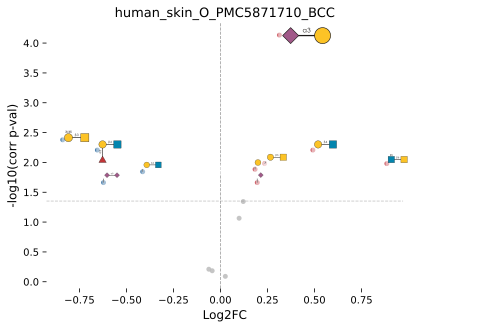

------------------------------------------------------------------------

### get_coverage

``` python
def get_coverage(
    df:pandas.DataFrame | str | pathlib.Path, # DataFrame with glycans in rows (col 1), abundances in columns
    filepath:str='', # Path to save plot
    title:str | None=None, # Plot title; None for none, as before
)->None:
```

*Visualizes glycan detection frequency across samples with intensity-based ordering*

``` python
test_df = test_df.astype({c: float for c in test_df.columns[1:]})
get_coverage(test_df)
```

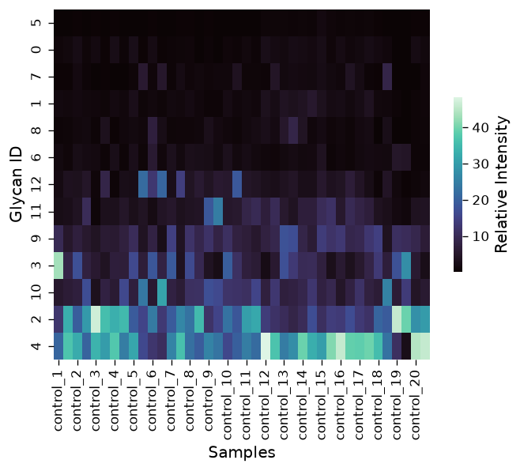

------------------------------------------------------------------------

### get_pca

``` python
def get_pca(
    df:pandas.DataFrame | str | pathlib.Path, # DataFrame with glycans in rows (col 1), abundances in columns
    groups:list[int] | pandas.DataFrame | None=None, # Group labels (e.g., [1,1,1,2,2,2,3,3,3]) or metadata DataFrame with 'id' column
    motifs:bool=False, # Analyze motifs instead of sequences
    feature_set:str | list[str]=['known', 'exhaustive'], # Feature sets to use; exhaustive, known, terminal1, terminal2, terminal3, chemical, graph, custom, size_branch
    pc_x:int=1, # Principal component for x-axis
    pc_y:int=2, # Principal component for y-axis
    color:str | None=None, # Column in metadata for color grouping; recommended to be categorical
    shape:str | None=None, # Column in metadata for shape grouping; recommended to be categorical
    size:str | None=None, # Column in metadata for point size control; recommended to be scalar
    filepath:str | pathlib.Path='', # Path to save plot
    custom_motifs:str | list[str]=[], # Custom motifs if using 'custom' feature set
    transform:str | None=None, # Transformation type: "CLR" or "ALR"
    rarity_filter:float=0.05, # Min proportion for non-zero values
    eigenvalues:bool=False, # Plot the explained variance as a separate subplot
    title:str | None=None, # Plot title; None for none, as before
)->None:
```

*Performs PCA on glycan/motif abundance data with group-based visualization*

``` python
get_pca(test_df, motifs = True, groups = [1,2,1,2,1,2,1,2,1,2,1,2,1,2,1,2,1,2,1,2,1,2,1,2,1,2,1,2,1,2,1,2,1,2,1,2,1,2,1,2])
```

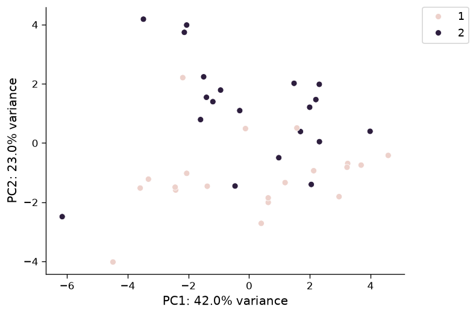

------------------------------------------------------------------------

### get_pcoa

``` python
def get_pcoa(
    df:pandas.DataFrame | str | pathlib.Path, # Abundance dataframe or filepath (glycans as rows, samples as columns) or a square distance matrix, e.g., from get_distance_matrix or get_biodiversity
    groups:list[str | int] | None=None, # Group label per sample for coloring and PERMANOVA; default: from the frame's contrasts
    dist_func:Union[str, Callable[[list, list], float]]='euclidean', # scipy.spatial.distance metric name or callable on two lists; euclidean on CLR data is the Aitchison distance
    motifs:bool=False, # Analyze motifs instead of sequences
    feature_set:str | list[str]=['known', 'exhaustive'], # Feature sets to use; exhaustive, known, terminal1, terminal2, terminal3, chemical, graph, custom, size_branch
    custom_motifs:str | list[str]=[], # Custom motifs if using 'custom' feature set
    transform:str='CLR', # Transform data before computing distances: 'CLR', 'ALR', or '' for none
    pco_x:int=1, # Principal coordinate for x-axis
    pco_y:int=2, # Principal coordinate for y-axis
    permutations:int=999, # Number of permutations for PERMANOVA
    random_state:int | numpy.random._generator.Generator | None=None, # optional random state for reproducibility
    filepath:str | pathlib.Path='', # Path to save plot
    title:str | None=None, # Plot title; None for none
)->pandas.DataFrame: # Sample coordinates on all principal coordinates, explained variance and PERMANOVA in .attrs
```

*Performs principal coordinate analysis (PCoA) on any sample distance matrix with group-based visualization and PERMANOVA*

------------------------------------------------------------------------

### get_pval_distribution

``` python
def get_pval_distribution(
    df_res:pandas.DataFrame | str | pathlib.Path, # Output DataFrame from get_differential_expression
    filepath:str | pathlib.Path='', # Path to save plot
    title:str | None=None, # Plot title; None for none, as before
)->None:
```

*Creates histogram of p-values from differential expression analysis*

``` python
get_pval_distribution(res)
```

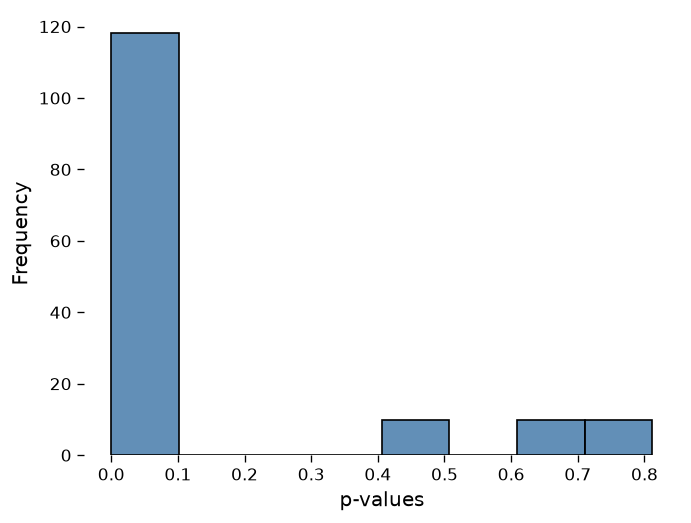

------------------------------------------------------------------------

### get_ma

``` python
def get_ma(
    df_res:pandas.DataFrame | str | pathlib.Path, # Output DataFrame from get_differential_expression; glycosite-level results are plotted per glycoform
    log2fc_thresh:int=1, # Log2FC threshold for highlighting
    sig_thresh:float | None=None, # Significance threshold for highlighting; defaults to the sample-size-adjusted alpha stored on the results
    filepath:str | pathlib.Path='', # Path to save plot
    title:str | None=None, # Plot title; default: the dataset name the analysis stamped on df_res, '' for none
)->None:
```

*Generates MA plot (mean abundance vs log2 fold change) from differential expression results*

``` python
get_ma(res)
```

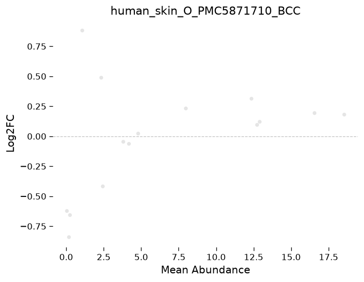

------------------------------------------------------------------------

### get_glycanova

``` python
def get_glycanova(
    df:pandas.DataFrame | str | pathlib.Path, # DataFrame with glycans in rows (col 1) and abundance values in columns
    groups:list[typing.Any] | None=None, # Group labels for samples (e.g., [1,1,1,2,2,2,3,3,3]); inferred from a GlycoDataFrame's contrasts if omitted
    impute:bool=True, # Replace zeros with impute_biosynthetic predictions
    motifs:bool=False, # Analyze motifs instead of sequences; per glycosite (protein_site_motif) for glycoproteomics data
    feature_set:str | list[str]=['exhaustive', 'known'], # Feature sets to use; exhaustive, known, terminal1, terminal2, terminal3, chemical, graph, custom, size_branch
    min_samples:float=0.1, # Min fraction (0-1) of non-zero samples required
    posthoc:bool=True, # Perform Tukey's HSD test post-hoc
    grouped_BH:bool | None=None, # Use two-stage adaptive Benjamini-Hochberg; None infers True for motifs (DAG-grouped families) and False for sequences
    custom_motifs:str | list[str]=[], # Custom motifs if using 'custom' feature set
    transform:str | None=None, # Transformation type: "CLR" or "ALR"; None auto-decides
    gamma:float=0.1, # Uncertainty parameter for CLR transform
    custom_scale:float | dict=0, # Ratio of total signal in group2/group1 for an informed scale model (or group_idx: mean(group)/min(mean(groups)) signal dict for multivariate)
    moderate_variance:bool=True, # Empirical-Bayes variance moderation, with the containment DAG as the prior neighborhood
    glycoproteomics:bool | None=None, # Whether rows are glycoforms from glycoproteomics instead of glycans; default: whenever every row label is protein_site_glycan
    random_state:int | numpy.random._generator.Generator | None=None, # optional random state for reproducibility
    top_explained:int | None=5, # How many child motifs to name in 'Explained by'; None names all of them
)->tuple[glycowork.glycan_data.loader.GlycoDataFrame, dict[str, pandas.DataFrame]]: # (ANOVA results with F-stats and omega-squared effect sizes, post-hoc results)
```

*Performs one-way ANOVA with omega-squared effect size calculation and optional Tukey’s HSD post-hoc testing on glycomics data across multiple groups*

``` python
test_df2 = glycomics_data_loader.HIV_gagtransfection_O_PMID35112714

anv, ph = get_glycanova(test_df2, motifs = False)
anv
```

|  | Glycan | F statistic | p-val | corr p-val | significant | Effect size |
|----|----|----|----|----|----|----|
| 1 | Gal(b1-4)GlcNAc(b1-6)\[Gal(b1-3)\]GalNAc | 3.789915 | 0.042303 | 0.311002 | False | 0.221331 |
| 3 | Neu5Ac(a2-3)Gal(b1-3)\[Gal(b1-4)GlcNAc(b1-6)\]Ga... | 3.111038 | 0.069111 | 0.311002 | False | 0.231571 |
| 0 | Gal(b1-3)\[Neu5Ac(a2-6)\]GalNAc | 1.749110 | 0.202223 | 0.348838 | False | 0.073247 |
| 2 | Neu5Ac(a2-3)Gal(b1-3)GalNAc | 1.583464 | 0.232558 | 0.348838 | False | 0.201921 |
| 4 | Neu5Ac(a2-3)Gal(b1-3)\[Neu5Ac(a2-6)\]GalNAc | 1.992994 | 0.165249 | 0.348838 | False | 0.198865 |
| 5 | Neu5Ac(a2-3)Gal(b1-4)GlcNAc(b1-3/6)\[GlcNAc(b1-... | 2.111745 | 0.150018 | 0.348838 | False | 0.096276 |
| 6 | Neu5Ac(a2-3)Gal(b1-4)GlcNAc(b1-6)\[Gal(b1-3)\]Ga... | 0.598796 | 0.560056 | 0.605809 | False | -0.077190 |
| 7 | Neu5Ac(a2-3)Gal(b1-4)GlcNAc(b1-6)\[Neu5Ac(a2-3)... | 0.515408 | 0.605809 | 0.605809 | False | -0.056393 |
| 8 | Neu5Ac(a2-3)Gal(b1-4)GlcNAc6S(b1-6)\[Neu5Ac(a2-... | 0.731458 | 0.494973 | 0.605809 | False | -0.009179 |

------------------------------------------------------------------------

### get_meta_analysis

``` python
def get_meta_analysis(
    effect_sizes:numpy.ndarray | list[float], # List of Cohen's d/other effect sizes
    variances:numpy.ndarray | list[float], # Associated variance estimates
    model:str='fixed', # 'fixed' or 'random' effects model
    filepath:str='', # Path to save Forest plot
    study_names:list[str]=[], # Names corresponding to each effect size
    full_output:bool=False, # Return heterogeneity statistics (tau2, Q, I2) and leave-one-out pooling instead of just (effect, p-value)
    title:str | None=None, # Forest plot title; None for none, as before
)->tuple[float, float] | dict: # (combined effect size, two-tailed p-value), or the full result dict when full_output=True
```

*Performs fixed/random effects meta-analysis using DerSimonian-Laird method for between-study variance estimation, with optional Forest plot visualization*

``` python
get_meta_analysis([-8.759, -6.363, -5.199, -3.952],
                 [7.061, 4.041, 2.919, 1.968])
```

    (-5.326913553837341, 3.0050764424211887e-09)

------------------------------------------------------------------------

### get_time_series

``` python
def get_time_series(
    df:pandas.DataFrame | str | pathlib.Path, # DataFrame with sample IDs as 'sampleID_timepoint_replicate' in col 1 (e.g., T1_h5_r1)
    impute:bool=True, # Replace zeros with impute_biosynthetic predictions
    motifs:bool=False, # Analyze motifs instead of sequences
    feature_set:str | list[str]=['known', 'exhaustive'], # Feature sets to use; exhaustive, known, terminal1, terminal2, terminal3, chemical, graph, custom, size_branch
    degree:int=1, # Polynomial degree for regression
    min_samples:float=0.1, # Min fraction (0-1) of non-zero samples required
    grouped_BH:bool | None=None, # Family-grouped two-stage Benjamini-Hochberg via the motif DAG; None infers True for motifs and False for sequences
    custom_motifs:str | list[str]=[], # Custom motifs if using 'custom' feature set
    transform:str | None=None, # Transformation type: "CLR" or "ALR"; None auto-decides
    gamma:float=0.1, # Uncertainty parameter for CLR transform
    custom_scale:float | dict=0, # Ratio of total signal in group2/group1 for an informed scale model (or group_idx: mean(group)/min(mean(groups)) signal dict for multivariate)
    glycoproteomics:bool | None=None, # Whether rows are glycoforms, ordered by composition containment instead of substructure containment; default: whenever every row label is protein_site_glycan
    random_state:int | numpy.random._generator.Generator | None=None, # optional random state for reproducibility
)->glycowork.glycan_data.loader.GlycoDataFrame: # DataFrame with regression coefficients and FDR-corrected p-values
```

*Analyzes time series glycomics data using polynomial regression*

``` python
t_dic = {}
t_dic["ID"] = ["D1_h5_r1", "D1_h5_r2", "D1_h5_r3", "D1_h10_r1", "D1_h10_r2", "D1_h10_r3", "D1_h15_r1", "D1_h15_r2", "D1_h15_r3"]
t_dic["Neu5Ac(a2-3)Gal(b1-4)GlcNAc(b1-6)[Gal(b1-3)]GalNAc"] = [0.33, 0.31, 0.35, 1.51, 1.57, 1.66, 2.11, 2.04, 2.09]
t_dic["Fuc(a1-2)Gal(b1-3)GalNAc"] = [0.78, 1.01, 0.98, 0.88, 1.11, 0.72, 1.22, 1.00, 0.54]
t_dic["Neu5Ac(a2-6)GalNAc"] = [0.11, 0.09, 0.14, 0.02, 0.07, 0.10, 0.11, 0.09, 0.08]
get_time_series(pd.DataFrame(t_dic).set_index("ID").T)
```

|  | Glycan | Change | p-val | corr p-val | significant |
|----|----|----|----|----|----|
| 1 | Neu5Ac(a2-3)Gal(b1-4)GlcNAc(b1-6)\[Gal(b1-3)\]Ga... | 0.168078 | 0.001757 | 0.005272 | True |
| 0 | Fuc(a1-2)Gal(b1-3)GalNAc | -0.082124 | 0.012562 | 0.012562 | True |
| 2 | Neu5Ac(a2-6)GalNAc | -0.095766 | 0.009956 | 0.012562 | True |

------------------------------------------------------------------------

### get_jtk

``` python
def get_jtk(
    df_in:pandas.DataFrame | str | pathlib.Path, # DataFrame with glycans in rows (first column), then groups arranged by ascending timepoints
    timepoints:int, # Number of timepoints (each must have same number of replicates)
    interval:int, # Time units between experimental timepoints
    periods:int | list[int]=[12, 24], # Cycle length(s) to test, in the time units of interval (e.g., hours)
    motifs:bool=False, # Analyze motifs instead of sequences
    feature_set:str | list[str]=['known', 'exhaustive', 'terminal'], # Feature sets to use; exhaustive, known, terminal1, terminal2, terminal3, chemical, graph, custom, size_branch
    custom_motifs:str | list[str]=[], # Custom motifs if using 'custom' feature set
    transform:str | None=None, # Transformation type: "CLR" or "ALR"; None auto-decides
    gamma:float=0.1, # Uncertainty parameter for CLR transform
    correction_method:str='two-stage', # Multiple testing correction method
    grouped_BH:bool | None=None, # Family-grouped two-stage Benjamini-Hochberg via the motif DAG; None infers True for motifs and False for sequences
    glycoproteomics:bool | None=None, # Whether rows are glycoforms, ordered by composition containment instead of substructure containment; default: whenever every row label is protein_site_glycan
    random_state:int | numpy.random._generator.Generator | None=None, # optional random state for reproducibility
)->glycowork.glycan_data.loader.GlycoDataFrame: # DataFrame with JTK results: adjusted p-values, period length, lag phase, amplitude
```

*Identifies rhythmically expressed glycans using Jonckheere-Terpstra-Kendall algorithm for time series analysis*

``` python
t_dic = {}
t_dic["Neu5Ac(a2-3)Gal(b1-3)GalNAc"] = [0.433138901, 0.149729209, 0.358018822, 0.537641256, 1.526963756, 1.349986672, 0.75156406, 0.736710183]
t_dic["Gal(b1-3)GalNAc"] = [0.919762334, 0.760237184, 0.725566662, 0.459945797, 0.523801515, 0.695106926, 0.627632047, 1.183511209]
t_dic["Gal(b1-3)[Neu5Ac(a2-6)]GalNAc"] = [0.533138901, 0.119729209, 0.458018822, 0.637641256, 1.726963756, 1.249986672, 0.55156406, 0.436710183]
t_dic["Fuc(a1-2)Gal(b1-3)GalNAc"] = [3.862169504, 5.455032837, 3.858163289, 5.614650335, 3.124254095, 4.189550337, 4.641831312, 4.19538484]
tps = 8  # number of timepoints in experiment
periods = [8]  # potential cycles to test
interval = 3  # units of time between experimental timepoints
t_df = pd.DataFrame(t_dic).T
t_df.columns = ["T3", "T6", "T9", "T12", "T15", "T18", "T21", "T24"]
get_jtk(t_df.reset_index(), tps, interval, periods = periods)
```

|  | Molecule_Name | Adjusted_P_value | Period_Length | Lag_Phase | Amplitude | significant |
|----|----|----|----|----|----|----|
| 0 | Neu5Ac(a2-3)Gal(b1-3)GalNAc | 0.710523 | 8 | 7.0 | 0.142857 | False |
| 1 | Gal(b1-3)GalNAc | 0.710523 | 8 | 6.0 | 0.285714 | False |
| 2 | Gal(b1-3)\[Neu5Ac(a2-6)\]GalNAc | 0.710523 | 8 | 1.0 | 0.142857 | False |
| 3 | Fuc(a1-2)Gal(b1-3)GalNAc | 0.710523 | 8 | 3.0 | 0.285714 | False |

``` python
get_jtk(t_df.reset_index(), tps, interval, periods = periods, motifs = True, feature_set = ['terminal'])
```

    Chosen grouping: by_motif_family

|  | Molecule_Name | Adjusted_P_value | Period_Length | Lag_Phase | Amplitude | significant |
|----|----|----|----|----|----|----|
| 0 | Terminal_Fuc(a1-2) | 0.173546 | 8 | 3.0 | 0.500000 | False |
| 1 | Terminal_Gal(b1-3) | 0.173546 | 8 | 7.0 | 0.428571 | False |
| 2 | Terminal_Neu5Ac(a2-3) | 0.536187 | 8 | 5.0 | 0.214286 | False |
| 3 | Terminal_Neu5Ac(a2-3/6) | 0.536187 | 8 | 5.0 | 0.285714 | False |
| 4 | Terminal_Neu5Ac(a2-6) | 0.536187 | 8 | 1.0 | 0.357143 | False |

------------------------------------------------------------------------

### get_cosinor

``` python
def get_cosinor(
    df_in:pandas.DataFrame | str | pathlib.Path, # DataFrame with glycans in rows (first column) and samples in the other columns
    timepoints:int | list[float] | numpy.ndarray, # Number of timepoints, for columns arranged by ascending time with equal replicates (as in get_jtk), or the time of each sample column (any spacing or replication)
    interval:float=1, # Time units between timepoints (only used if timepoints is a number)
    periods:float | list[float]=[24], # Candidate period(s) in time units; each feature gets its best-fitting one, with the p-value Bonferroni-corrected for the number of candidates
    motifs:bool=False, # Analyze motifs instead of sequences
    feature_set:str | list[str]=['known', 'exhaustive', 'terminal'], # Feature sets to use; exhaustive, known, terminal1, terminal2, terminal3, chemical, graph, custom, size_branch
    custom_motifs:str | list[str]=[], # Custom motifs if using 'custom' feature set
    transform:str | None=None, # Transformation type: "CLR" or "ALR"; None auto-decides
    gamma:float=0.1, # Uncertainty parameter for CLR transform
    correction_method:str='two-stage', # Multiple testing correction method
    grouped_BH:bool | None=None, # Family-grouped two-stage Benjamini-Hochberg via the motif DAG; None infers True for motifs and False for sequences
    glycoproteomics:bool | None=None, # Whether rows are glycoforms, ordered by composition containment instead of substructure containment; default: whenever every row label is protein_site_glycan
    random_state:int | numpy.random._generator.Generator | None=None, # optional random state for reproducibility
)->glycowork.glycan_data.loader.GlycoDataFrame: # DataFrame with cosinor results: best period, mesor, amplitude, acrophase (peak time, on the time axis of timepoints), R2, raw and adjusted p-values
```

*Identifies rhythmically expressed glycans or motifs with single-harmonic cosinor regression, reporting amplitude and acrophase (peak time) next to an F-test against no rhythm; unlike get_jtk, timepoints may be unevenly spaced or unevenly replicated*

``` python
get_cosinor(t_df.reset_index(), tps, interval, periods = [12, 24])
```

|  | Molecule_Name | P_value | Period_Length | Mesor | Amplitude | Acrophase | R2 | Adjusted_P_value | significant |
|----|----|----|----|----|----|----|----|----|----|
| 0 | Neu5Ac(a2-3)Gal(b1-3)GalNAc | 0.005179 | 24 | -0.750058 | 0.636106 | 14.912602 | 0.907681 | 0.010358 | True |
| 1 | Gal(b1-3)GalNAc | 0.010804 | 24 | -0.612597 | 0.644458 | 0.958050 | 0.876116 | 0.010804 | True |
| 2 | Gal(b1-3)\[Neu5Ac(a2-6)\]GalNAc | 0.069740 | 24 | -0.805610 | 0.527460 | 12.003714 | 0.738795 | 0.069740 | True |
| 3 | Fuc(a1-2)Gal(b1-3)GalNAc | 0.318671 | 24 | 2.072303 | 0.388154 | 1.998049 | 0.520349 | 0.318671 | False |

------------------------------------------------------------------------

### get_biodiversity

``` python
def get_biodiversity(
    df:pandas.DataFrame | str | pathlib.Path, # DataFrame with glycans in rows (col 1), abundances in columns
    group1:list[str | int] | None=None, # First group column indices or group labels; default: from the frame's contrasts
    group2:list[str | int] | None=None, # Second group indices or additional group labels; default: from the frame's contrasts
    metrics:list[str]=['alpha', 'beta'], # Diversity metrics to calculate
    motifs:bool=False, # Analyze motifs instead of sequences
    feature_set:str | list[str]=['exhaustive', 'known'], # Feature sets to use; exhaustive, known, terminal1, terminal2, terminal3, chemical, graph, custom, size_branch
    custom_motifs:str | list[str]=[], # Custom motifs if using 'custom' feature set
    paired:bool | None=None, # Whether samples are paired; default: from the frame
    permutations:int=999, # Number of permutations for ANOSIM/PERMANOVA
    transform:str | None=None, # Transformation type: "CLR" or "ALR"
    dist_func:Union[str, Callable, NoneType]=None, # scipy.spatial.distance metric name or callable for beta diversity; default: braycurtis if transform = "Nothing", else euclidean (Aitchison distance on log-ratios)
    gamma:float=0.1, # Uncertainty parameter for CLR transform
    custom_scale:float | dict=0, # Ratio of total signal in group2/group1 for an informed scale model (or group_idx: mean(group)/min(mean(groups)) signal dict for multivariate)
    random_state:int | numpy.random._generator.Generator | None=None, # optional random state for reproducibility
    circadian:bool=False, # test whether diversity changes rhythmically over time via JTK
    timepoints:int | None=None, # number of timepoints, columns ordered by ascending timepoint (required if circadian)
    interval:int=1, # time units between timepoints (only relevant if circadian)
    periods:int | list[int]=[12, 24], # cycle length(s) to test (only relevant if circadian)
    glycoproteomics:bool | None=None, # Whether rows are glycoforms (protein_site_glycan): alpha diversity becomes each glycosite's microheterogeneity (rows protein_site_metric) and beta diversity the Aitchison distance over glycosites; default: whenever every row label is protein_site_glycan
)->tuple: # First DataFrame with diversity indices and test statistics, second with beta-diversity distance matrix
```

*Calculates alpha (Shannon/Simpson) and beta (ANOSIM/PERMANOVA) diversity measures from glycomics data, or per-glycosite microheterogeneity from glycoproteomics data*

``` python
res = get_biodiversity(test_df, motifs = True)
res
```

    (                       Metric  Group1 mean  Group2 mean     p-val  \
     0           simpson_diversity     0.876756     0.874348  0.000443   
     1           shannon_diversity     2.244523     2.225758  0.001255   
     2     Beta diversity (ANOSIM)          NaN          NaN  0.002000   
     3  Beta diversity (PERMANOVA)          NaN          NaN  0.002000   
     4            species_richness    15.000000    15.000000  1.000000   
     
        Effect size  corr p-val  significant  
     0    -0.948203    0.000443         True  
     1    -0.846077    0.001255         True  
     2     0.188566    0.002000         True  
     3     5.583354    0.002000         True  
     4     0.000000    1.000000        False  ,
                 control_1  control_2  control_3  control_4  control_5  control_6  \
     control_1    0.000000   2.468605   3.219773   3.547879   1.683100   3.475447   
     control_2    2.468605   0.000000   2.297694   2.679064   2.384198   2.844599   
     control_3    3.219773   2.297694   0.000000   1.322106   3.144578   4.631515   
     control_4    3.547879   2.679064   1.322106   0.000000   3.487061   4.948857   
     control_5    1.683100   2.384198   3.144578   3.487061   0.000000   3.180142   
     control_6    3.475447   2.844599   4.631515   4.948857   3.180142   0.000000   
     control_7    1.705143   2.441621   3.493949   3.690858   2.772165   3.266817   
     control_8    1.988837   1.877254   3.276978   3.497749   2.487358   2.458114   
     control_9    2.910796   2.807673   3.864873   4.336024   3.615115   3.444445   
     control_10   1.950670   2.641473   4.123190   4.470577   2.336412   2.047429   
     control_11   2.126936   1.983422   2.917195   3.538471   2.232348   2.648045   
     control_12   3.890187   2.235635   2.502925   3.435423   3.788631   4.262512   
     control_13   3.262471   1.947637   3.633341   4.139216   3.772189   3.181875   
     control_14   3.204359   1.411597   2.634386   3.347329   3.349799   3.493967   
     control_15   3.469505   1.462537   3.287079   3.460895   3.470620   2.860301   
     control_16   3.134200   1.686293   2.090097   2.971119   3.254491   4.000192   
     control_17   2.940751   1.649726   2.610784   3.345235   3.201940   3.509533   
     control_18   2.715693   2.738157   1.968326   1.598788   3.212088   5.065846   
     control_19   3.911231   5.550462   5.826237   5.787237   4.783100   5.446369   
     control_20   3.582369   3.552533   2.318463   2.968550   3.928537   5.779615   
     tumor_1      2.288187   2.491535   2.427182   3.491011   2.324187   3.931309   
     tumor_2      2.491034   3.566609   4.186507   4.740574   2.689456   3.588158   
     tumor_3      3.838434   4.443823   4.796325   5.851548   4.357685   4.660899   
     tumor_4      2.892877   4.526809   4.582073   5.296299   3.482623   5.023658   
     tumor_5      4.379914   4.904538   5.884048   6.692547   4.903481   4.287772   
     tumor_6      4.546253   5.346522   6.407226   7.084310   4.991457   4.204977   
     tumor_7      3.912857   3.276828   3.804088   4.855699   3.854233   3.697074   
     tumor_8      3.285207   3.995706   4.839851   5.410133   4.110546   3.791720   
     tumor_9      4.169500   4.544534   5.086052   5.739536   5.054963   4.893838   
     tumor_10     3.344534   3.692349   4.949658   5.702753   3.761015   2.898755   
     tumor_11     3.020348   4.115141   4.495357   5.155513   3.211059   4.023108   
     tumor_12     3.744053   2.348433   3.020770   3.821250   3.996783   4.084373   
     tumor_13     2.705654   1.134934   3.095735   3.658740   2.715985   2.524830   
     tumor_14     2.641863   1.225830   2.200278   2.775819   2.841152   3.523533   
     tumor_15     3.960528   3.186287   3.286791   4.202841   4.580778   5.060585   
     tumor_16     4.113015   3.096309   3.603232   4.593119   4.490088   4.432897   
     tumor_17     2.907768   1.297669   2.070248   2.650838   3.106771   3.856230   
     tumor_18     2.938670   2.967581   3.988129   4.690057   2.940891   3.068111   
     tumor_19     4.395063   6.188330   6.388777   6.233811   5.277394   6.220262   
     tumor_20     3.724356   3.180760   2.196601   3.356134   4.002378   5.287895   
     
                 control_7  control_8  control_9  control_10  ...  tumor_11  \
     control_1    1.705143   1.988837   2.910796    1.950670  ...  3.020348   
     control_2    2.441621   1.877254   2.807673    2.641473  ...  4.115141   
     control_3    3.493949   3.276978   3.864873    4.123190  ...  4.495357   
     control_4    3.690858   3.497749   4.336024    4.470577  ...  5.155513   
     control_5    2.772165   2.487358   3.615115    2.336412  ...  3.211059   
     control_6    3.266817   2.458114   3.444445    2.047429  ...  4.023108   
     control_7    0.000000   1.201477   1.948433    1.758108  ...  3.405495   
     control_8    1.201477   0.000000   1.760593    1.366530  ...  3.217559   
     control_9    1.948433   1.760593   0.000000    2.272090  ...  2.993728   
     control_10   1.758108   1.366530   2.272090    0.000000  ...  2.688525   
     control_11   2.048773   1.443322   1.767267    1.677971  ...  2.281849   
     control_12   4.077566   3.598668   3.623234    4.208491  ...  4.621330   
     control_13   2.924184   2.591659   2.846241    3.119307  ...  4.721637   
     control_14   3.121872   2.648195   2.831547    3.352762  ...  4.398215   
     control_15   3.066343   2.304979   2.871188    3.130537  ...  4.738938   
     control_16   3.363026   3.078532   3.430205    3.742200  ...  4.556415   
     control_17   2.865466   2.408771   2.301380    3.043546  ...  3.735184   
     control_18   3.119995   3.285354   4.114189    4.130747  ...  4.935647   
     control_19   3.402467   4.034578   4.411020    3.879292  ...  4.231050   
     control_20   4.384365   4.421777   4.835912    4.986077  ...  5.012777   
     tumor_1      3.088164   2.958317   3.303680    3.103777  ...  2.989727   
     tumor_2      2.886284   2.642746   2.619393    2.121498  ...  0.850462   
     tumor_3      4.119708   4.104650   3.544329    3.776558  ...  2.707058   
     tumor_4      3.680360   3.854386   3.714950    3.427984  ...  1.770596   
     tumor_5      4.272613   4.046936   3.199465    3.451164  ...  2.659752   
     tumor_6      4.423976   4.213954   3.607641    3.377535  ...  2.632130   
     tumor_7      3.856605   3.465342   3.035033    3.515631  ...  3.168408   
     tumor_8      2.380499   2.663546   1.935332    2.468447  ...  2.724558   
     tumor_9      3.385319   3.572012   2.078336    3.675380  ...  3.171551   
     tumor_10     3.207591   2.889885   2.536034    2.272368  ...  2.505579   
     tumor_11     3.405495   3.217559   2.993728    2.688525  ...  0.000000   
     tumor_12     3.767588   3.261217   3.055137    3.879619  ...  4.379136   
     tumor_13     2.738463   2.122849   2.803993    2.548079  ...  4.101109   
     tumor_14     2.598313   2.097768   2.364797    2.950728  ...  3.808831   
     tumor_15     3.934628   3.824875   3.281342    4.426797  ...  4.567879   
     tumor_16     4.092128   3.724746   3.219082    4.149805  ...  4.318607   
     tumor_17     2.955076   2.593234   3.021394    3.437302  ...  4.472500   
     tumor_18     3.135558   2.523906   2.241670    2.250767  ...  1.951492   
     tumor_19     4.080270   4.697457   5.039276    4.539426  ...  4.678628   
     tumor_20     4.132016   4.027648   3.950113    4.613526  ...  4.351279   
     
                 tumor_12  tumor_13  tumor_14  tumor_15  tumor_16  tumor_17  \
     control_1   3.744053  2.705654  2.641863  3.960528  4.113015  2.907768   
     control_2   2.348433  1.134934  1.225830  3.186287  3.096309  1.297669   
     control_3   3.020770  3.095735  2.200278  3.286791  3.603232  2.070248   
     control_4   3.821250  3.658740  2.775819  4.202841  4.593119  2.650838   
     control_5   3.996783  2.715985  2.841152  4.580778  4.490088  3.106771   
     control_6   4.084373  2.524830  3.523533  5.060585  4.432897  3.856230   
     control_7   3.767588  2.738463  2.598313  3.934628  4.092128  2.955076   
     control_8   3.261217  2.122849  2.097768  3.824875  3.724746  2.593234   
     control_9   3.055137  2.803993  2.364797  3.281342  3.219082  3.021394   
     control_10  3.879619  2.548079  2.950728  4.426797  4.149805  3.437302   
     control_11  2.778048  2.123021  1.861858  3.332524  3.067669  2.508273   
     control_12  1.203142  2.195039  1.751476  1.988133  1.777293  1.630189   
     control_13  1.996080  1.343739  2.001572  2.643974  2.466764  1.896976   
     control_14  1.185084  1.199938  1.102742  2.099911  1.929396  0.967147   
     control_15  2.345477  1.527028  1.745469  3.469990  3.215957  1.915264   
     control_16  1.637987  1.727284  1.494080  2.062082  2.152106  0.978943   
     control_17  1.135477  1.559092  0.860537  1.912926  1.780359  1.247750   
     control_18  3.818196  3.532707  2.715008  3.907790  4.509003  2.519622   
     control_19  6.805516  5.945286  5.676018  6.763438  6.955198  6.117307   
     control_20  3.389918  3.867231  3.142313  3.079027  3.701748  2.784954   
     tumor_1     2.816145  2.557554  2.348743  2.912569  2.874042  2.480550   
     tumor_2     4.019861  3.566406  3.295896  4.326440  4.118325  3.963429   
     tumor_3     3.838788  4.034084  4.036864  3.520094  3.152610  4.415768   
     tumor_4     4.610573  4.489025  4.101568  4.376777  4.434165  4.571735   
     tumor_5     4.356852  4.370615  4.490635  4.432914  3.875373  5.072272   
     tumor_6     5.233723  4.887966  5.100473  5.426741  4.882806  5.739144   
     tumor_7     2.914164  3.014374  3.072493  3.222631  2.532553  3.465164   
     tumor_8     4.434114  3.908547  3.844830  4.375099  4.234550  4.395062   
     tumor_9     4.212275  4.469594  3.995506  3.892852  3.877787  4.597440   
     tumor_10    3.683185  3.120813  3.583792  4.029954  3.422198  4.099940   
     tumor_11    4.379136  4.101109  3.808831  4.567879  4.318607  4.472500   
     tumor_12    0.000000  2.047845  1.573929  1.486088  1.187239  1.651741   
     tumor_13    2.047845  0.000000  1.565690  2.983117  2.623838  1.573725   
     tumor_14    1.573929  1.565690  0.000000  2.293256  2.375453  0.925990   
     tumor_15    1.486088  2.983117  2.293256  0.000000  1.205507  2.257323   
     tumor_16    1.187239  2.623838  2.375453  1.205507  0.000000  2.459471   
     tumor_17    1.651741  1.573725  0.925990  2.257323  2.459471  0.000000   
     tumor_18    2.917487  2.704761  2.570243  3.540438  3.050259  3.275947   
     tumor_19    7.376543  6.607802  6.213383  7.300621  7.581433  6.668810   
     tumor_20    2.339844  3.342930  2.519523  1.852860  2.337824  2.390821   
     
                 tumor_18  tumor_19  tumor_20  
     control_1   2.938670  4.395063  3.724356  
     control_2   2.967581  6.188330  3.180760  
     control_3   3.988129  6.388777  2.196601  
     control_4   4.690057  6.233811  3.356134  
     control_5   2.940891  5.277394  4.002378  
     control_6   3.068111  6.220262  5.287895  
     control_7   3.135558  4.080270  4.132016  
     control_8   2.523906  4.697457  4.027648  
     control_9   2.241670  5.039276  3.950113  
     control_10  2.250767  4.539426  4.613526  
     control_11  1.494133  5.163824  3.312187  
     control_12  3.322332  7.692524  2.010076  
     control_13  3.321105  6.858445  3.569878  
     control_14  2.972485  7.008998  2.609105  
     control_15  3.244148  6.827899  4.004887  
     control_16  3.453214  7.081476  1.956607  
     control_17  2.342762  6.526540  2.466054  
     control_18  4.577234  5.604184  3.267136  
     control_19  5.286767  1.240709  6.581604  
     control_20  4.650972  6.962530  1.896271  
     tumor_1     2.678595  6.013224  2.053539  
     tumor_2     1.574194  4.531684  4.207256  
     tumor_3     2.890704  6.358839  3.609429  
     tumor_4     2.938220  4.706202  4.011672  
     tumor_5     2.494305  6.177002  5.085724  
     tumor_6     2.961191  5.714909  5.926882  
     tumor_7     2.447520  6.923979  3.227349  
     tumor_8     2.999749  4.377423  4.774996  
     tumor_9     3.236675  5.257604  4.588223  
     tumor_10    1.958069  5.821096  4.533396  
     tumor_11    1.951492  4.678628  4.351279  
     tumor_12    2.917487  7.376543  2.339844  
     tumor_13    2.704761  6.607802  3.342930  
     tumor_14    2.570243  6.213383  2.519523  
     tumor_15    3.540438  7.300621  1.852860  
     tumor_16    3.050259  7.581433  2.337824  
     tumor_17    3.275947  6.668810  2.390821  
     tumor_18    0.000000  5.799777  3.789222  
     tumor_19    5.799777  0.000000  7.117017  
     tumor_20    3.789222  7.117017  0.000000  
     
     [40 rows x 40 columns])

------------------------------------------------------------------------

### get_SparCC

``` python
def get_SparCC(
    df1:pandas.DataFrame | str | pathlib.Path, # First DataFrame with glycans in rows (col 1) and abundances in columns
    df2:pandas.DataFrame | str | pathlib.Path, # Second DataFrame with same format as df1
    motifs:bool=False, # Analyze motifs instead of sequences
    feature_set:str | list[str]=['known', 'exhaustive'], # Feature sets to use; exhaustive, known, terminal1, terminal2, terminal3, chemical, graph, custom, size_branch
    custom_motifs:str | list[str]=[], # Custom motifs if using 'custom' feature set
    transform:str | None=None, # Transformation type: "CLR" or "ALR"
    gamma:float=0.1, # Uncertainty parameter for CLR transform
    partial_correlations:bool=False, # Use regularized partial correlations
    random_state:int | numpy.random._generator.Generator | None=None, # optional random state for reproducibility
)->tuple[pandas.DataFrame, pandas.DataFrame]: # (Spearman correlation matrix, FDR-corrected p-value matrix)
```

*Calculates SparCC (Sparse Correlations for Compositional Data) between two matching datasets (e.g., glycomics)*

``` python
df1 = glycomics_data_loader.time_series_N_PMID32149347
df2 = glycomics_data_loader.time_series_O_PMID32149347
df1 = pd.merge(df1, df2[['ID']], on = 'ID', how = 'inner')
df2 = pd.merge(df2, df1[['ID']], on = 'ID', how = 'inner')
df1 = df1.set_index(df1.columns.tolist()[0]).T.reset_index()
df2 = df2.set_index(df2.columns.tolist()[0]).T.reset_index()

corr, pval = get_SparCC(df1, df2, motifs = True, transform = "CLR")
import seaborn as sns
sns.clustermap(corr)
```

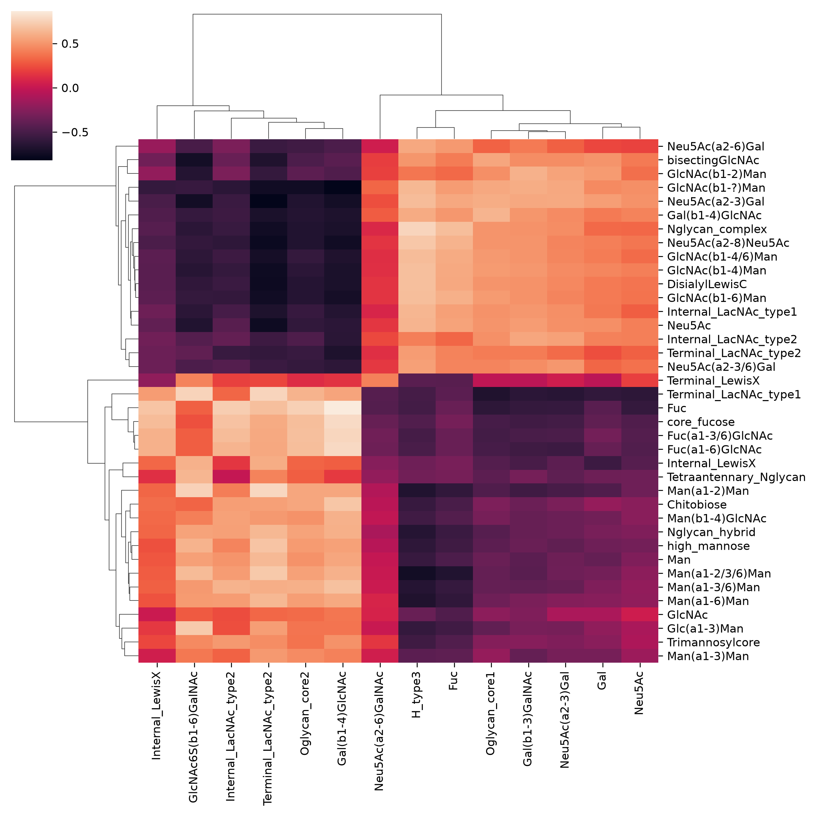

------------------------------------------------------------------------

### get_roc

``` python
def get_roc(
    df:pandas.DataFrame | str | pathlib.Path, # DataFrame with glycans in rows (col 1), abundances in columns
    group1:list[str | int] | None=None, # First group indices/names; default: from the frame's contrasts
    group2:list[str | int] | None=None, # Second group indices/names; default: from the frame's contrasts
    motifs:bool=False, # Analyze motifs instead of sequences
    feature_set:str | list[str]=['known', 'exhaustive'], # Feature sets to use; exhaustive, known, terminal1, terminal2, terminal3, chemical, graph, custom, size_branch
    paired:bool | None=None, # Whether samples are paired; default: from the frame
    impute:bool=True, # Replace zeros with impute_biosynthetic predictions
    min_samples:float=0.1, # Min fraction (0-1) of non-zero samples required
    custom_motifs:str | list[str]=[], # Custom motifs if using 'custom' feature set
    transform:str | None=None, # Transformation type: "CLR" or "ALR"
    gamma:float=0.1, # Uncertainty parameter for CLR transform
    custom_scale:float | dict=0, # Ratio of total signal in group2/group1 for an informed scale model (or group_idx: mean(group)/min(mean(groups)) signal dict for multivariate)
    filepath:str | pathlib.Path='', # Path to save ROC plot
    multi_score:bool=False, # Find best multi-glycan score
    random_state:int | numpy.random._generator.Generator | None=None, # optional random state for reproducibility
    title:str | None=None, # Plot title; None keeps the default, '' removes it
)->list[tuple[str, float]] | dict[typing.Any, tuple[str, float]] | tuple['LogisticRegression', float, list[str]]: # (feature, ROC AUC) pairs sorted by AUC; with more than two groups, class: (best feature, AUC); with multi_score, (model, ROC AUC, selected features)
```

*Calculates ROC curves and AUC scores for glycans/motifs or multi-glycan classifiers*

``` python
get_roc(test_df, motifs = True)
```

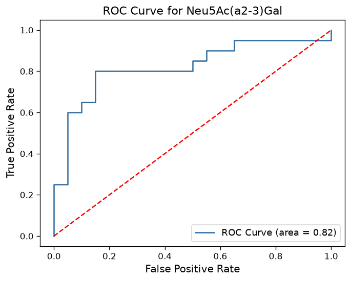

    [('Neu5Ac(a2-3)Gal', 0.82),
     ('Neu5Ac', 0.7675000000000001),
     ('Gal(b1-3)GalNAc', 0.7525),
     ('GlcNAc6S(b1-6)GalNAc', 0.7225),
     ('Internal_LacNAc_type2', 0.6975),
     ('Gal', 0.6699999999999999),
     ('Oglycan_core1', 0.655),
     ('GalNAc', 0.6075),
     ('Oglycan_core2', 0.54),
     ('Neu5Ac(a2-6)GalNAc', 0.485),
     ('Disialyl_T_antigen', 0.48),
     ('Neu5Ac(a2-8)Neu5Ac', 0.375),
     ('Terminal_LacNAc_type2', 0.29),
     ('H_antigen_type2', 0.275),
     ('Gal3/6S(b1-3)GalNAc', 0.2225)]

------------------------------------------------------------------------

### get_distance_matrix

``` python
def get_distance_matrix(
    df:pandas.DataFrame | str | pathlib.Path, # Input dataframe or filepath (.csv/.tsv/.xlsx), glycans as rows and samples as columns
    dist_func:Union[str, Callable[[list, list], float]]='euclidean', # scipy.spatial.distance metric name or callable on two lists; euclidean on CLR data is the Aitchison distance
    compare:str='samples', # What to compare pairwise: 'samples' or 'features' (glycans/motifs)
    motifs:bool=False, # Analyze motifs instead of sequences
    feature_set:str | list[str]=['known'], # Feature sets to use; exhaustive, known, terminal1, terminal2, terminal3, chemical, graph, custom, size_branch
    custom_motifs:str | list[str]=[], # Custom motifs if using 'custom' feature set
    transform:str | None='CLR', # Transform data before comparing: 'CLR', 'ALR', or None
    index_col:str='glycan', # Column to use as index
)->pandas.DataFrame: # Square distance matrix, e.g., for dendrogram_from_distance
```

*Calculates pairwise distances between samples or glycans/motifs from an abundance dataframe, with optional motif quantification and compositional transformation*

------------------------------------------------------------------------

### get_lectin_array

``` python
def get_lectin_array(
    df:pandas.DataFrame | str | pathlib.Path, # DataFrame with samples as rows and lectins as columns, first column containing sample IDs
    group1:list[str | int] | None=None, # First group sample names or row indices (0-based, or 1-based when no index is 0), or one group label per sample if group2 is omitted; inferred from a GlycoDataFrame's contrasts if omitted
    group2:list[str | int] | None=None, # Second group sample names or row indices; inferred from a GlycoDataFrame's contrasts if omitted
    paired:bool | None=None, # Whether samples are paired; inferred from a GlycoDataFrame if omitted
    transform:str='', # Optional log2 transformation
)->pandas.DataFrame: # DataFrame with altered glycan motifs, supporting lectins, and effect sizes
```

*Analyzes lectin microarray data by mapping lectin binding patterns to glycan motifs, calculating Cohen’s d effect sizes between groups and clustering results by significance*

``` python
lectin_df = lectin_array_data_loader.A549_influenza_PMID33046650
get_lectin_array(lectin_df, [5,6,7], [8,9,10])
```

    Lectin "Ab-LeB-1" is not found in our annotated lectin library and is excluded from analysis.
    Lectin "APA" is not found in our annotated lectin library and is excluded from analysis.
    Lectin "APP" is not found in our annotated lectin library and is excluded from analysis.
    Lectin "Blood Group B [CLCP-19B]" is not found in our annotated lectin library and is excluded from analysis.
    Lectin "Blood Group H2" is not found in our annotated lectin library and is excluded from analysis.
    Lectin "CA19-9 [121SLE]" is not found in our annotated lectin library and is excluded from analysis.
    Lectin "CCA" is not found in our annotated lectin library and is excluded from analysis.
    Lectin "CD15 [ICRF29-2]" is not found in our annotated lectin library and is excluded from analysis.
    Lectin "CD15 [MY-1]" is not found in our annotated lectin library and is excluded from analysis.
    Lectin "CD15 [SP-159]" is not found in our annotated lectin library and is excluded from analysis.
    Lectin "Forssman" is not found in our annotated lectin library and is excluded from analysis.
    Lectin "IAA" is not found in our annotated lectin library and is excluded from analysis.
    Lectin "IRA" is not found in our annotated lectin library and is excluded from analysis.
    Lectin "Le X [P12]" is not found in our annotated lectin library and is excluded from analysis.
    Lectin "Lewis A [7LE]" is not found in our annotated lectin library and is excluded from analysis.
    Lectin "Lewis B [218]" is not found in our annotated lectin library and is excluded from analysis.
    Lectin "Lewis Y [F3]" is not found in our annotated lectin library and is excluded from analysis.
    Lectin "LFA" is not found in our annotated lectin library and is excluded from analysis.
    Lectin "LPA" is not found in our annotated lectin library and is excluded from analysis.
    Lectin "MNA-M " is not found in our annotated lectin library and is excluded from analysis.
    Lectin "MUC5Ac Ab" is not found in our annotated lectin library and is excluded from analysis.
    Lectin "PMA" is not found in our annotated lectin library and is excluded from analysis.
    Lectin "PTA_1" is not found in our annotated lectin library and is excluded from analysis.
    Lectin "PTA_2" is not found in our annotated lectin library and is excluded from analysis.
    Lectin "SNA-S" is not found in our annotated lectin library and is excluded from analysis.
    Lectin "SNA-V" is not found in our annotated lectin library and is excluded from analysis.
    Lectin "VFA" is not found in our annotated lectin library and is excluded from analysis.

|  | motif | named_motifs | lectin(s) | change | score | significance |
|----|----|----|----|----|----|----|
| 38 | Neu5Ac(a2-6)Gal(b1-4)GlcNAc | \[Internal_LacNAc_type2\] | PSL, SNA, TJA-I, WGA_1, WGA_2 | down | 11.34 | highly significant |
| 39 | Neu5Ac(a2-6)Gal(b1-3)GlcNAc | \[Internal_LacNAc_type1\] | PSL, SNA, TJA-I, WGA_1, WGA_2 | down | 11.34 | highly significant |
| 7 | Man(a1-2) | \[\] | ASA, Con A, CVN, HHL, SVN_1, GRFT, SVN_2, SNA-... | up | 4.83 | moderately significant |
| 14 | Gal(b1-4)GlcNAc(b1-2)Man(a1-3)\[Gal(b1-4)GlcNAc... | \[Chitobiose, Trimannosylcore, Terminal_LacNAc\_... | CA, CAA, DSA_1, DSA_2, DSA_3, AMA, BDA, BPA, C... | up | 3.51 | moderately significant |
| 4 | Gal(b1-3)GalNAc | \[Oglycan_core1\] | ACA, AIA, MPA, PNA_1, PNA_2, BDA, BPA | up | 3.48 | moderately significant |
| 43 | Neu5Ac(a2-6)GalNAc(b1-4)GlcNAc | \[Internal_LacdiNAc_type2\] | SNA, WGA_1, WGA_2 | down | 2.99 | moderately significant |
| 10 | Gal(b1-4)GlcNAc(b1-2)Man(a1-3)\[GlcNAc(b1-4)\]\[G... | \[Chitobiose, Trimannosylcore, Terminal_LacNAc\_... | Blackbean, Calsepa, PHA-E_1, PHA-E_2, AMA, BDA... | up | 2.66 | moderately significant |
| 47 | GlcNAc(b1-2)Man(a1-3)\[GlcNAc(b1-2)Man(a1-6)\]Ma... | \[Chitobiose, Trimannosylcore, core_fucose, Ngl... | TL, AAL, AMA, AOL, Con A, GNA, GNL, HHL, LcH, ... | up | 2.36 | moderately significant |
| 18 | Man(a1-6) | \[\] | Con A, GNA, GNL, HHL, NPA, SNA-II, UDA | up | 2.30 | moderately significant |
| 17 | Man(a1-3) | \[\] | Con A, GNA, GNL, HHL, NPA, SNA-II, UDA | up | 2.30 | moderately significant |
| 22 | Gal(b1-4)GlcNAc(b1-2)\[Gal(b1-4)GlcNAc(b1-4)\]Ma... | \[Chitobiose, Trimannosylcore, Terminal_LacNAc\_... | DSA_1, DSA_2, DSA_3, AMA, BDA, Blackbean, BPA,... | up | 2.05 | moderately significant |
| 3 | Fuc(a1-6) | \[\] | AAL, AOL, LcH, PSA | up | 1.70 | moderately significant |
| 6 | Man(a1-3)\[Man(a1-6)\]Man(b1-4)GlcNAc(b1-4)GlcNAc | \[Chitobiose, Trimannosylcore\] | AMA, Con A, GNA, GNL, HHL, NPA, SNA-II, UDA | up | 1.58 | moderately significant |
| 11 | GlcNAc(b1-2)Man(a1-3)\[GlcNAc(b1-2)\[GlcNAc(b1-6... | \[Chitobiose, Trimannosylcore, Nglycan_complex\] | Blackbean, PHA-L, AMA, Con A, GNA, GNL, HHL, N... | up | 1.45 | low significance |
| 42 | GlcNAc(b1-2)\[GlcNAc(b1-6)\]Man(a1-6)\[GlcNAc(b1-... | \[Chitobiose, Trimannosylcore, bisectingGlcNAc,... | RPA, AMA, Blackbean, Con A, GNA, GNL, HHL, NPA... | up | 1.40 | low significance |
| 41 | GlcNAc(b1-2)\[GlcNAc(b1-4)\]Man(a1-3)\[GlcNAc(b1-... | \[Chitobiose, Trimannosylcore, bisectingGlcNAc,... | RPA, AMA, Con A, GNA, GNL, HHL, NPA, SNA-II, U... | up | 1.36 | low significance |
| 15 | Gal(b1-3)GalNAc(b1-4)\[Neu5Ac(a2-3)\]Gal(b1-4)Gl... | \[Internal_LacNAc_type2\] | Cholera Toxin, ACA, AIA, BDA, BPA, MPA, MAA_1,... | up | 1.26 | low significance |
| 23 | Gal(b1-4)GlcNAc | \[Terminal_LacNAc_type2\] | ECA, RCA120, Ricin B Chain, SJA, BDA, BPA | up | 1.05 | low significance |
| 5 | GlcNAc(b1-3)GalNAc | \[Oglycan_core3\] | AIA, UEA-II, WGA_1, WGA_2 | up | 0.86 | low significance |
| 27 | Gal(a1-4) | \[\] | GS-I_1, GS-I_2, GS-I_3, GS-I_4, MNA-G, PA-IL | up | 0.83 | low significance |
| 26 | Gal(a1-3) | \[\] | GS-I_1, GS-I_2, GS-I_3, GS-I_4, MNA-G, PA-IL | up | 0.83 | low significance |
| 30 | Gal(b1-4)GlcNAc(b1-3) | \[Terminal_LacNAc_type2\] | LEA_1, LEA_2, STA, BDA, BPA, ECA, RCA120, Rici... | up | 0.55 | low significance |
| 25 | Gal(a1-3)Gal | \[\] | EEA, EEL, MOA, GS-I_1, GS-I_2, GS-I_3, GS-I_4,... | up | 0.51 | low significance |
| 37 | Gal(a1-3)GalNAc | \[\] | MOA, GS-I_1, GS-I_2, GS-I_3, GS-I_4, MNA-G, PA-IL | up | 0.46 | low significance |
| 40 | Fuc(a1-2)Gal(b1-4)GlcNAc | \[H_antigen_type2, Internal_LacNAc_type2\] | PTL-II, TJA-II, UEA-I, UEA-II, AAA, AAL, AOL | down | 0.41 | low significance |
| 20 | GalNAc(a1-4) | \[\] | GHA, HAA, HPA, CSA, GS-I_1, GS-I_2, GS-I_3, GS... | up | 0.39 | low significance |
| 19 | GalNAc(a1-3) | \[\] | GHA, HAA, HPA, CSA, GS-I_1, GS-I_2, GS-I_3, GS... | up | 0.39 | low significance |
| 21 | GalNAc(a1-3)GalNAc(b1-3) | \[\] | DBA, SBA, GHA, HAA, HPA, CSA, GS-I_1, GS-I_2, ... | up | 0.21 | low significance |
| 46 | Fuc(a1-2)Gal(b1-3)GalNAc | \[H_type3, Oglycan_core1\] | TJA-II, AAA, AAL, AOL | up | 0.21 | low significance |
| 24 | GalNAc(b1-4)GlcNAc | \[Terminal_LacdiNAc_type2\] | ECA, STA, CSA, SBA, VVA_1, VVA_2, WFA, BPA, WG... | up | 0.20 | low significance |
| 16 | Fuc(a1-2)Gal(b1-3)GalNAc(b1-4)\[Neu5Ac(a2-3)\]Ga... | \[Internal_LacNAc_type2, H_type3\] | Cholera Toxin, AAA, AAL, AOL, TJA-II, MAA_1, M... | up | 0.18 | low significance |
| 34 | Neu5Ac(a2-3)Gal(b1-3)GalNAc | \[Oglycan_core1\] | MAL-II, WGA_1, WGA_2 | down | 0.16 | low significance |
| 13 | GalNAc(b1-4) | \[\] | CSA, SBA, VVA_1, VVA_2, WFA, BPA, WGA_1, WGA_2 | up | 0.13 | low significance |
| 12 | GalNAc(b1-3) | \[\] | CSA, SBA, VVA_1, VVA_2, WFA, BPA, WGA_1, WGA_2 | up | 0.13 | low significance |
| 32 | Gal3S(b1-4)GlcNAc | \[\] | MAA_1, MAA_2, MAL-I, MAL-II | down | 0.12 | low significance |
| 28 | GlcNAc(a1-3) | \[\] | HAA, HPA, WGA_1, WGA_2 | up | 0.12 | low significance |
| 29 | GlcNAc(a1-4) | \[\] | HAA, HPA, WGA_1, WGA_2 | up | 0.12 | low significance |
| 0 | Fuc(a1-2) | \[\] | AAA, AAL, AOL | up | 0.09 | low significance |
| 36 | Gal3S(b1-4) | \[\] | MAL-II | down | 0.08 | low significance |
| 35 | Gal3S(b1-3) | \[\] | MAL-II | down | 0.08 | low significance |
| 44 | Fuc(a1-2)Gal(b1-4)GalNAc(b1-3) | \[\] | SNA-II, AAA, AAL, AOL, UEA-II | up | 0.08 | low significance |
| 9 | Gal(b1-4) | \[\] | BDA, BPA | up | 0.05 | low significance |
| 8 | Gal(b1-3) | \[\] | BDA, BPA | up | 0.05 | low significance |
| 49 | Fuc(a1-2)Gal(b1-4)GalNAc | \[\] | UEA-II, AAA, AAL, AOL | up | 0.05 | low significance |
| 33 | Neu5Ac(a2-3)Gal(b1-4)GlcNAc | \[Internal_LacNAc_type2\] | MAA_1, MAA_2, MAL-I, WGA_1, WGA_2 | down | 0.04 | low significance |
| 2 | Fuc(a1-4) | \[\] | AAL, AOL | down | 0.03 | low significance |
| 1 | Fuc(a1-3) | \[\] | AAL, AOL, Lotus | down | 0.03 | low significance |
| 31 | GlcNAc(b1-4)GlcNAc(b1-4) | \[Chitobiose\] | LEA_1, LEA_2, WGA_1, WGA_2 | down | 0.01 | low significance |
| 50 | GlcNAc(b1-3) | \[\] | WGA_1, WGA_2 | down | 0.01 | low significance |
| 51 | GlcNAc(b1-4) | \[\] | WGA_1, WGA_2 | down | 0.01 | low significance |
| 45 | GlcNAc(b1-4)GlcNAc(b1-4)GlcNAc(b1-4) | \[Chitobiose\] | STA, LEA_1, LEA_2, WGA_1, WGA_2 | down | 0.00 | low significance |
| 48 | GlcNAc(b1-3)Gal | \[\] | UEA-II, WGA_1, WGA_2 | up | 0.00 | low significance |
| 52 | Neu5Ac(a2-3) | \[\] | WGA_1, WGA_2 | down | 0.00 | low significance |
| 53 | Neu5Ac(a2-6) | \[\] | WGA_1, WGA_2 | down | 0.00 | low significance |
| 54 | Neu5Ac(a2-8) | \[\] | WGA_1, WGA_2 | down | 0.00 | low significance |

------------------------------------------------------------------------

### get_glycoshift_per_site

``` python
def get_glycoshift_per_site(
    df:pandas.DataFrame | str | pathlib.Path, # DataFrame with rows formatted as 'protein_site_composition' in col 1, abundances in remaining cols
    group1:list[str | int] | None=None, # First group indices/names or group labels for multi-group; default: from the frame's contrasts
    group2:list[str | int] | None=None, # Second group indices/names; default: from the frame's contrasts
    paired:bool | None=None, # Whether samples are paired; default: from the frame
    impute:bool=True, # Replace zeros with impute_biosynthetic predictions
    min_samples:float=0.2, # Min fraction (0-1) of non-zero samples required
    gamma:float=0.1, # Uncertainty parameter for CLR transform
    custom_scale:float | dict=0, # Ratio of total signal in group2/group1 for an informed scale model (or group_idx: mean(group)/min(mean(groups)) signal dict for multivariate)
    random_state:int | numpy.random._generator.Generator | None=None, # optional random state for reproducibility
    glycan_class:str | None=None, # Glycan class of the glycoforms ('N', 'O', ...); N-glycan type features (complex, high_Man, hybrid, core/antennary fucose, bisecting) only enter the model for 'N'; default: the dataset's glycan_class metadata, else 'N'
)->pandas.DataFrame: # DataFrame with GLM coefficients and FDR-corrected p-values
```

*Analyzes site-specific glycosylation changes in glycoproteomics data using generalized linear models (GLM) with compositional data normalization*

``` python
df_milk = glycoproteomics_data_loader.human_milk_N_PMID34087070

get_glycoshift_per_site(df_milk, ['Colostrum1', 'Colostrum2', 'Colostrum3'], ['Mature1', 'Mature2', 'Mature3'])
```

|  | Condition_coefficient | Condition_corr_pval | Condition_significant | Hex_Condition_coefficient | Hex_Condition_corr_pval | Hex_Condition_significant | HexNAc_Condition_coefficient | HexNAc_Condition_corr_pval | HexNAc_Condition_significant | Neu5Ac_Condition_coefficient | ... | complex_Condition_significant | dHex_Condition_coefficient | dHex_Condition_corr_pval | dHex_Condition_significant | high_Man_Condition_coefficient | high_Man_Condition_corr_pval | high_Man_Condition_significant | hybrid_Condition_coefficient | hybrid_Condition_corr_pval | hybrid_Condition_significant |
|----|----|----|----|----|----|----|----|----|----|----|----|----|----|----|----|----|----|----|----|----|----|
| P10909_374 | 11.003143 | 2.205473e-24 | True | -21.866421 | 4.932419e-25 | True | 5.571504 | 4.209452e-23 | True | -1.469129 | ... | True | 34.478558 | 9.634171e-26 | True | 0.000000 | 1.000000e+00 | False | 0.000000 | 1.000000e+00 | False |
| P01011_106 | 37.301835 | 4.544324e-22 | True | 8.597721 | 3.240239e-23 | True | -28.704113 | 5.098921e-21 | True | 9.757607 | ... | True | -35.895702 | 5.235743e-23 | True | 0.000000 | 1.000000e+00 | False | 0.000000 | 1.000000e+00 | False |
| P07602_215 | 11.872231 | 9.508737e-21 | True | -33.685935 | 4.506236e-20 | True | 29.210907 | 7.798520e-20 | True | 5.466445 | ... | True | 11.872231 | 1.118675e-20 | True | 9.139009 | 8.846142e-20 | True | 0.000000 | 1.000000e+00 | False |
| P24821_327 | 1.372925 | 8.307229e-17 | True | 6.864626 | 7.818568e-17 | True | 5.491701 | 7.818568e-17 | True | -40.233617 | ... | True | 1.372925 | 7.818568e-17 | True | 0.000000 | 1.000000e+00 | False | 0.000000 | 1.000000e+00 | False |
| P06858_70 | -0.138017 | 8.952165e-14 | True | -0.690084 | 8.425567e-14 | True | -0.552067 | 6.018262e-14 | True | -13.395384 | ... | True | 12.981334 | 1.321738e-17 | True | 0.000000 | 1.000000e+00 | False | 0.000000 | 1.000000e+00 | False |
| P01871_46 | 2.183549 | 8.173888e-13 | True | 1.241158 | 9.026027e-07 | True | -3.494675 | 1.207887e-15 | True | 14.412420 | ... | True | 2.183549 | 6.410892e-13 | True | 0.000000 | 1.000000e+00 | False | 0.000000 | 1.000000e+00 | False |
| P10909_103 | -0.722082 | 1.740507e-12 | True | -3.610409 | 1.638125e-12 | True | -2.888327 | 1.433359e-12 | True | 21.209039 | ... | True | -0.722082 | 1.433359e-12 | True | 0.000000 | 1.000000e+00 | False | 0.000000 | 1.000000e+00 | False |
| P01833_186 | 1.306143 | 3.930302e-11 | True | -5.392580 | 2.564386e-11 | True | 5.224572 | 3.288096e-11 | True | -1.459286 | ... | True | 4.071572 | 1.892816e-14 | True | 0.000000 | 1.000000e+00 | False | 0.000000 | 1.000000e+00 | False |
| P02765_156 | -0.511649 | 2.353016e-10 | True | 2.937741 | 1.881030e-10 | True | -2.046595 | 1.993143e-10 | True | -6.519282 | ... | True | 5.495985 | 1.534251e-10 | True | 0.000000 | 1.000000e+00 | False | 0.000000 | 1.000000e+00 | False |
| P47710_69 | 0.289541 | 1.089307e-09 | True | -1.503953 | 2.744323e-09 | True | 1.158164 | 9.320270e-10 | True | 0.929697 | ... | True | 3.241199 | 1.264030e-09 | True | 0.000000 | 1.000000e+00 | False | 0.000000 | 1.000000e+00 | False |
| P25311_109 | -0.372386 | 1.277871e-09 | True | -1.861931 | 1.322973e-09 | True | -1.489545 | 1.102477e-09 | True | 0.043921 | ... | True | 9.492600 | 8.580032e-14 | True | 0.000000 | 1.000000e+00 | False | 0.000000 | 1.000000e+00 | False |
| P0C0L5_226 | -28.680566 | 2.277092e-09 | True | 18.111339 | 2.315163e-09 | True | -57.361132 | 1.978288e-09 | True | 0.000000 | ... | False | 0.000000 | 1.000000e+00 | False | -28.680566 | 9.644155e-09 | True | 0.000000 | 1.000000e+00 | False |
| P10909_291 | 0.125205 | 5.623001e-09 | True | 0.626024 | 5.292236e-09 | True | -0.990710 | 2.731725e-09 | True | 0.125205 | ... | True | 0.000000 | 1.000000e+00 | False | 0.000000 | 1.000000e+00 | False | 1.491529 | 6.027501e-08 | True |
| P08571_151 | -27.886409 | 5.623001e-09 | True | 18.001733 | 4.425171e-09 | True | -21.978514 | 1.399867e-08 | True | 14.700316 | ... | True | 0.000000 | 1.000000e+00 | False | -42.316188 | 5.548065e-09 | True | -5.475819 | 3.473702e-01 | False |
| P01591_71 | 42.724023 | 7.122701e-08 | True | -5.194748 | 2.724638e-02 | True | -8.671393 | 9.720115e-04 | True | -8.798990 | ... | True | -3.118598 | 3.356059e-01 | False | 0.000000 | 1.000000e+00 | False | 18.376130 | 4.723805e-04 | True |
| Q08380_551 | -1.912574 | 9.352811e-08 | True | -6.200274 | 1.649353e-13 | True | 8.783184 | 6.018262e-14 | True | 6.304166 | ... | True | 0.000000 | 1.000000e+00 | False | -8.216740 | 2.065116e-12 | True | 0.000000 | 1.000000e+00 | False |
| P0DOX2_246 | -13.445023 | 1.950178e-04 | True | 0.651510 | 3.291974e-01 | False | 5.811469 | 1.482340e-04 | True | -5.075537 | ... | True | -18.650503 | 5.289632e-04 | True | 0.797895 | 8.727273e-01 | False | -1.294999 | 9.454545e-01 | False |
| P01024_85 | -10.979048 | 1.656752e-03 | True | 9.408833 | 1.477550e-03 | True | -21.958095 | 1.403366e-03 | True | 0.000000 | ... | False | 0.000000 | 1.000000e+00 | False | -10.979048 | 7.016832e-03 | True | 0.000000 | 1.000000e+00 | False |
| P19652_56 | -0.001621 | 4.035872e-03 | True | -0.008103 | 3.608545e-03 | True | -0.006483 | 3.436709e-03 | True | -0.003241 | ... | True | 0.000000 | 1.000000e+00 | False | 0.000000 | 1.000000e+00 | False | 0.000000 | 1.000000e+00 | False |
| P02788_156 | -13.375488 | 5.019683e-03 | True | 4.504494 | 2.955551e-02 | True | -2.204410 | 3.308678e-01 | False | 1.768800 | ... | True | 6.453011 | 1.821802e-03 | True | 0.000000 | 1.000000e+00 | False | 0.000000 | 1.000000e+00 | False |
| P24821_1018 | 1.404241 | 3.220482e-02 | True | -1.118785 | 2.917707e-02 | True | 2.808482 | 2.893267e-02 | True | 0.000000 | ... | False | 0.000000 | 1.000000e+00 | False | 1.404241 | 1.193473e-01 | False | 0.000000 | 1.000000e+00 | False |
| P0DOX2_207 | -12.811609 | 5.479322e-02 | True | -3.186345 | 8.345975e-02 | False | 7.898115 | 5.826111e-05 | True | 7.413943 | ... | True | -0.176823 | 9.526511e-01 | False | 0.000000 | 1.000000e+00 | False | 0.000000 | 1.000000e+00 | False |
| P07602_101 | 0.000944 | 8.213297e-02 | False | 0.004718 | 7.408072e-02 | True | 0.003774 | 7.408072e-02 | True | 0.000944 | ... | False | 0.000944 | 1.307307e-01 | False | 0.000000 | 1.000000e+00 | False | 0.000000 | 1.000000e+00 | False |
| P01833_135 | -0.001365 | 9.783597e-02 | False | -0.006825 | 8.499776e-02 | False | -0.005460 | 8.499776e-02 | False | -0.002730 | ... | False | -0.001365 | 1.521829e-01 | False | 0.000000 | 1.000000e+00 | False | 0.000000 | 1.000000e+00 | False |
| P02788_497 | 1.412371 | 1.557445e-01 | False | -3.966515 | 1.763508e-01 | False | 5.649484 | 1.357251e-01 | False | -7.775096 | ... | False | 3.402115 | 5.637362e-01 | False | 0.000000 | 1.000000e+00 | False | 0.000000 | 1.000000e+00 | False |
| Q6WN34_114 | -0.000546 | 1.566794e-01 | False | -0.002732 | 1.369299e-01 | False | -0.002185 | 1.369299e-01 | False | -0.000546 | ... | False | -0.000546 | 2.396272e-01 | False | 0.000000 | 1.000000e+00 | False | 0.000000 | 1.000000e+00 | False |
| P01877_327 | 10.413107 | 1.772138e-01 | False | -3.797678 | 4.334942e-04 | True | 2.782034 | 5.193531e-01 | False | -5.635758 | ... | False | 0.000000 | 1.000000e+00 | False | 16.048865 | 1.200267e-04 | True | 1.190658 | 9.454545e-01 | False |
| P00709_90 | -0.549612 | 2.178057e-01 | False | -1.014216 | 4.777876e-01 | False | -2.198447 | 1.979249e-01 | False | 0.698590 | ... | False | 19.818654 | 1.366540e-16 | True | 0.000000 | 1.000000e+00 | False | 0.000000 | 1.000000e+00 | False |
| P01833_469 | -9.830877 | 2.211357e-01 | False | 10.360782 | 5.060322e-05 | True | -12.661842 | 7.102502e-06 | True | -2.014921 | ... | True | 0.601039 | 7.272727e-01 | False | 0.000000 | 1.000000e+00 | False | -20.706156 | 4.723805e-04 | True |
| Q08380_125 | -0.002017 | 2.211357e-01 | False | -0.010087 | 2.081277e-01 | False | -0.008070 | 2.049123e-01 | False | -0.002017 | ... | False | -0.002017 | 3.547631e-01 | False | 0.000000 | 1.000000e+00 | False | 0.000000 | 1.000000e+00 | False |
| Q13410_55 | -8.767867 | 2.467762e-01 | False | -1.400615 | 4.245568e-01 | False | 7.367252 | 2.049123e-01 | False | -9.804702 | ... | False | 10.138048 | 1.304585e-02 | True | 0.000000 | 1.000000e+00 | False | 0.000000 | 1.000000e+00 | False |
| P01033_101 | -0.000955 | 2.560696e-01 | False | -0.004774 | 2.507795e-01 | False | -0.003819 | 2.507795e-01 | False | -0.000955 | ... | False | -0.000955 | 4.267827e-01 | False | 0.000000 | 1.000000e+00 | False | 0.000000 | 1.000000e+00 | False |
| P10909_86 | 0.002258 | 2.560696e-01 | False | 0.011290 | 2.560696e-01 | False | 0.009032 | 2.560696e-01 | False | 0.002258 | ... | False | 0.002258 | 4.267827e-01 | False | 0.000000 | 1.000000e+00 | False | 0.000000 | 1.000000e+00 | False |
| P01876_340 | 7.582295 | 2.560696e-01 | False | -1.422441 | 2.312212e-01 | False | -0.094454 | 9.663220e-01 | False | 2.691064 | ... | False | -5.268188 | 1.307307e-01 | False | 0.661014 | 8.727273e-01 | False | 7.182366 | 3.473702e-01 | False |
| P0C0L5_1391 | -0.002707 | 2.704897e-01 | False | -0.013534 | 2.704897e-01 | False | -0.010828 | 2.704897e-01 | False | -0.002707 | ... | False | -0.002707 | 4.327835e-01 | False | 0.000000 | 1.000000e+00 | False | 0.000000 | 1.000000e+00 | False |
| Q9NZJ4_3757 | 0.001253 | 2.962280e-01 | False | 0.007517 | 2.962280e-01 | False | 0.005012 | 2.962280e-01 | False | 0.001253 | ... | False | 0.000000 | 1.000000e+00 | False | 0.000000 | 1.000000e+00 | False | 0.000000 | 1.000000e+00 | False |
| O60225_152 | 0.000330 | 3.273787e-01 | False | 0.002969 | 3.273787e-01 | False | 0.000660 | 3.273787e-01 | False | 0.000000 | ... | False | 0.000000 | 1.000000e+00 | False | 0.000330 | 8.727273e-01 | False | 0.000000 | 1.000000e+00 | False |
| P24821_1119 | -0.001260 | 4.282784e-01 | False | -0.006302 | 4.282784e-01 | False | -0.005042 | 4.282784e-01 | False | -0.001260 | ... | False | -0.001260 | 6.344866e-01 | False | 0.000000 | 1.000000e+00 | False | 0.000000 | 1.000000e+00 | False |
| P01833_421 | -5.302533 | 4.721212e-01 | False | -5.091342 | 1.312784e-01 | False | 9.695514 | 4.516998e-02 | True | -0.536194 | ... | False | -0.170286 | 9.522628e-01 | False | 0.000000 | 1.000000e+00 | False | 0.000000 | 1.000000e+00 | False |
| P02788_534 | -0.000608 | 4.872411e-01 | False | -0.003041 | 4.872411e-01 | False | -0.002433 | 4.872411e-01 | False | -0.000608 | ... | False | -0.000608 | 6.620121e-01 | False | 0.000000 | 1.000000e+00 | False | 0.000000 | 1.000000e+00 | False |
| P25311_112 | 0.001661 | 4.965091e-01 | False | 0.008304 | 4.965091e-01 | False | 0.006643 | 4.965091e-01 | False | 0.001661 | ... | False | 0.001661 | 6.620121e-01 | False | 0.000000 | 1.000000e+00 | False | 0.000000 | 1.000000e+00 | False |
| P00734_143 | -0.000248 | 5.072288e-01 | False | -0.001242 | 5.072288e-01 | False | -0.000994 | 5.072288e-01 | False | -0.000497 | ... | False | 0.000000 | 1.000000e+00 | False | 0.000000 | 1.000000e+00 | False | 0.000000 | 1.000000e+00 | False |
| P01833_499 | -6.190913 | 5.200281e-01 | False | 7.179902 | 3.608545e-03 | True | -9.919761 | 7.915336e-02 | False | -8.425150 | ... | False | 2.179052 | 6.620121e-01 | False | -16.857299 | 2.315925e-02 | True | -3.635730 | 9.454545e-01 | False |
| P07602_332 | 0.000929 | 5.419882e-01 | False | 0.001857 | 5.419882e-01 | False | 0.001857 | 5.419882e-01 | False | 0.000000 | ... | False | 0.000000 | 1.000000e+00 | False | 0.000929 | 8.727273e-01 | False | 0.000000 | 1.000000e+00 | False |
| Q6ZMW3_1352 | -0.000986 | 5.560690e-01 | False | -0.002959 | 5.560690e-01 | False | -0.004931 | 5.560690e-01 | False | 0.000000 | ... | False | -0.000986 | 7.175083e-01 | False | 0.000000 | 1.000000e+00 | False | 0.000000 | 1.000000e+00 | False |
| P02790_453 | -0.001216 | 5.800360e-01 | False | -0.006081 | 5.800360e-01 | False | -0.004865 | 5.800360e-01 | False | -0.002432 | ... | False | 0.000000 | 1.000000e+00 | False | 0.000000 | 1.000000e+00 | False | 0.000000 | 1.000000e+00 | False |
| P02749_253 | 0.000824 | 6.283032e-01 | False | 0.004118 | 6.283032e-01 | False | 0.003295 | 6.283032e-01 | False | 0.001647 | ... | False | 0.000000 | 1.000000e+00 | False | 0.000000 | 1.000000e+00 | False | 0.000000 | 1.000000e+00 | False |
| Q08431_238 | -0.053430 | 7.776351e-01 | False | 0.070673 | 6.905309e-01 | False | -0.135220 | 6.801319e-01 | False | -0.028359 | ... | False | 0.000000 | 1.000000e+00 | False | -0.025071 | 9.231754e-01 | False | -0.028359 | 9.454545e-01 | False |
| P00738_241 | 0.000473 | 7.923659e-01 | False | 0.002363 | 7.923659e-01 | False | 0.001891 | 7.923659e-01 | False | 0.000945 | ... | False | 0.000000 | 1.000000e+00 | False | 0.000000 | 1.000000e+00 | False | 0.000000 | 1.000000e+00 | False |
| P02788_521 | 0.000183 | 8.036502e-01 | False | 0.000913 | 8.036502e-01 | False | 0.000730 | 8.036502e-01 | False | 0.000365 | ... | False | 0.000000 | 1.000000e+00 | False | 0.000000 | 1.000000e+00 | False | 0.000000 | 1.000000e+00 | False |
| P07602_426 | -0.000476 | 8.227525e-01 | False | -0.002379 | 8.227525e-01 | False | -0.000952 | 8.227525e-01 | False | 0.000000 | ... | False | 0.000000 | 1.000000e+00 | False | -0.000476 | 8.727273e-01 | False | 0.000000 | 1.000000e+00 | False |
| P00739_126 | -0.000261 | 8.298991e-01 | False | -0.001307 | 8.298991e-01 | False | -0.001045 | 8.298991e-01 | False | -0.000261 | ... | False | -0.000261 | 8.298991e-01 | False | 0.000000 | 1.000000e+00 | False | 0.000000 | 1.000000e+00 | False |
| P18505_376 | 0.000512 | 8.520762e-01 | False | 0.002558 | 8.520762e-01 | False | 0.002046 | 8.520762e-01 | False | 0.001023 | ... | False | 0.001535 | 8.520762e-01 | False | 0.000000 | 1.000000e+00 | False | 0.000000 | 1.000000e+00 | False |
| Q08380_69 | -0.000080 | 9.493157e-01 | False | -0.000482 | 9.493157e-01 | False | -0.000321 | 9.493157e-01 | False | -0.000080 | ... | False | -0.000080 | 9.493157e-01 | False | 0.000000 | 1.000000e+00 | False | 0.000000 | 1.000000e+00 | False |
| P0DOX2_320 | 0.518476 | 9.517452e-01 | False | 1.187979 | 5.781108e-01 | False | -0.767261 | 8.047623e-01 | False | -15.669119 | ... | False | 6.908342 | 1.521829e-01 | False | 0.000000 | 1.000000e+00 | False | 0.000000 | 1.000000e+00 | False |

55 rows × 27 columns

``` python
#glycoproteomics data are recognized by their protein_site_glycan row labels: glycoforms are compared within their glycosite, motifs are quantified per glycosite, and diversity becomes per-site microheterogeneity
print(get_differential_expression(df_milk, motifs = True).head())
get_biodiversity(df_milk, metrics = ['alpha'])[0].head()
```

    Chosen grouping: by_motif_family
         Glycosite    corr p-val  significant  Effect size
    0    P00709_90  1.363759e-25         True    -2.172303
    14  P0DOX2_246  1.457395e-25         True     0.263281
    11  P07602_215  1.762216e-24         True    -0.347576
    8   P01877_327  3.570178e-11         True   -25.357349
    15  P0DOX2_320  9.034243e-08         True     1.131434

|  | Metric | Group1 mean | Group2 mean | p-val | Effect size | corr p-val | significant |
|----|----|----|----|----|----|----|----|
| 0 | Q08431_238_shannon_diversity | 0.686377 | 1.073391 | 0.000537 | 17.610020 | 0.031154 | True |
| 1 | Q08431_238_simpson_diversity | 0.493256 | 0.649394 | 0.001246 | 10.110418 | 0.036123 | True |
| 2 | P00709_90_species_richness | 1.000000 | 4.666667 | 0.008163 | 7.778175 | 0.157826 | False |
| 3 | Q13410_55_species_richness | 2.000000 | 4.666667 | 0.024817 | 3.265986 | 0.271425 | False |
| 4 | P0DOX2_207_simpson_diversity | 0.725047 | 0.616102 | 0.030898 | -2.685218 | 0.271425 | False |

## annotate

> extract curated motifs, graph features, and sequence features from glycan sequences

------------------------------------------------------------------------

### annotate_glycan

``` python
def annotate_glycan(
    glycan:str | networkx.classes.digraph.DiGraph, # IUPAC-condensed glycan sequence or NetworkX graph
    motifs:pandas.DataFrame | str | list[str] | None=None, # Motif dataframe (motif_name + motif columns), or motif sequence(s); defaults to motif_list
    termini_list:list=[], # Monosaccharide positions: 'terminal', 'internal', or 'flexible'
    gmotifs:list[networkx.classes.digraph.DiGraph] | None=None, # Precalculated motif graphs for speed
    condense:bool=False, # Remove columns with only zeros
)->pandas.DataFrame: # DataFrame with motif counts for the glycan
```

*Counts occurrences of known motifs in a glycan structure using subgraph isomorphism*

``` python
annotate_glycan("Neu5Ac(a2-3)Gal(b1-4)[Fuc(a1-3)]GlcNAc(b1-2)Man(a1-3)[Gal(b1-4)GlcNAc(b1-2)Man(a1-6)]Man(b1-4)GlcNAc(b1-4)[Fuc(a1-6)]GlcNAc")
```

| motif_name | Terminal_LewisX | Internal_LewisX | LewisY | SialylLewisX | SulfoSialylLewisX | Terminal_LewisA | Internal_LewisA | LewisB | SialylLewisA | SulfoLewisA | ... | Mucin_elongated_core2 | Fucoidan | Alginate | FG | XX | Difucosylated_core | GalFuc_core | DisialylLewisC | RM2 | DisialylLewisA |
|----|----|----|----|----|----|----|----|----|----|----|----|----|----|----|----|----|----|----|----|----|----|
| Neu5Ac(a2-3)Gal(b1-4)\[Fuc(a1-3)\]GlcNAc(b1-2)Man(a1-3)\[Gal(b1-4)GlcNAc(b1-2)Man(a1-6)\]Man(b1-4)GlcNAc(b1-4)\[Fuc(a1-6)\]GlcNAc | 0 | 1 | 0 | 1 | 0 | 0 | 0 | 0 | 0 | 0 | ... | 0 | 0 | 0 | 0 | 0 | 0 | 0 | 0 | 0 | 0 |

1 rows × 164 columns

------------------------------------------------------------------------

### annotate_dataset

``` python
def annotate_dataset(
    glycans:str | list[str], # Glycan(s) in IUPAC-condensed nomenclature
    motifs:pandas.DataFrame | None=None, # Motif dataframe (name + sequence); defaults to motif_list
    feature_set:str | list[str]=['known'], # Feature types to analyze: known, graph, exhaustive, terminal(1-3), custom, chemical, size_branch
    termini_list:list=[], # Monosaccharide positions: 'terminal', 'internal', or 'flexible'
    condense:bool=False, # Remove columns with only zeros
    custom_motifs:str | list[str]=[], # Custom motifs (sequences, r-prefixed glyco-regexes, or motif_list names) when using 'custom' feature set; columns keep these labels
)->pandas.DataFrame: # DataFrame mapping glycans to motif counts and other features
```

*Comprehensive glycan annotation combining multiple feature types: structural motifs, graph properties, terminal sequences*

``` python
glycans = ['Man(a1-3)[Man(a1-6)][Xyl(b1-2)]Man(b1-4)GlcNAc(b1-4)[Fuc(a1-3)]GlcNAc',
           'Man(a1-2)Man(a1-2)Man(a1-3)[Man(a1-3)Man(a1-6)]Man(b1-4)GlcNAc(b1-4)GlcNAc',
           'GalNAc(a1-4)GlcNAcA(a1-4)[GlcN(b1-7)]Kdo(a2-5)[Kdo(a2-4)]Kdo(a2-6)GlcN4P(b1-6)GlcN4P']
print("Annotate Test")
out = annotate_dataset(glycans)
```

    Annotate Test

| motif_name | Terminal_LewisX | Internal_LewisX | LewisY | SialylLewisX | SulfoSialylLewisX | Terminal_LewisA | Internal_LewisA | LewisB | SialylLewisA | SulfoLewisA | H_antigen_type2 | H_antigen_type1 | H_antigen_type3 | A_antigen | A_antigen_type1 | A_antigen_type2 | A_antigen_type3 | B_antigen | B_antigen_type1 | B_antigen_type2 | ExtB | Galili_antigen | GloboH | Gb5 | Gb4 | Gb3 | 3SGb3 | 8DSGb3 | 3SGb4 | 8DSGb4 | 6DSGb4 | 3SGb5 | 8DSGb5 | 6DSGb5 | 6DSGb5_2 | 6SGb3 | 8DSGb3_2 | 6SGb4 | 8DSGb4_2 | 6SGb5 | 8DSGb5_2 | 66DSGb5 | Forssman_antigen | iGb3 | I_antigen | i_antigen | PI_antigen | Chitobiose | Trimannosylcore | Internal_LacNAc_type1 | Terminal_LacNAc_type1 | Internal_LacNAc_type2 | Terminal_LacNAc_type2 | Internal_LacdiNAc_type1 | Terminal_LacdiNAc_type1 | Internal_LacdiNAc_type2 | Terminal_LacdiNAc_type2 | bisectingGlcNAc | VIM | PolyLacNAc | Ganglio_Series | Lacto_Series(LewisC) | NeoLacto_Series | betaGlucan | KeratanSulfate | Hyaluronan | Mollu_series | Arthro_series | Cellulose_like | Chondroitin_4S | GPI_anchor | Isoglobo_series | LewisD | Globo_series | Sda | SDA | Muco_series | Heparin | Peptidoglycan | Dermatansulfate | CAD | Lactosylceramide | Lactotriaosylceramide | LexLex | GM3 | H_type3 | GM2 | GM1 | cisGM1 | VIM2 | GD3 | GD1a | GD2 | GD1b | SDLex | Fuc_LN3 | GT1b | GD1 | GD1a_2 | LcGg4 | GT3 | Disialyl_T_antigen | GT1a | GT2 | GT1c | 2Fuc_GM1 | GQ1c | O_linked_mannose | GT1aa | GQ1b | HNK1 | GQ1ba | O_mannose_Lex | 2Fuc_GD1b | Sialopentaosylceramide | Sulfogangliotetraosylceramide | B-GM1 | GQ1aa | bisSulfo-Lewis x | para-Forssman | core_fucose | core_fucose(a1-3) | GP1c | B-GD1b | GP1ca | Isoglobotetraosylceramide | polySia | high_mannose | Gala_series | LPS_core | Nglycan_complex | Oglycan_core1 | Oglycan_core2 | Oglycan_core3 | Oglycan_core4 | Oglycan_core5 | Oglycan_core6 | Oglycan_core7 | Xylogalacturonan | Sialosylparagloboside | LDNF | OFuc | Arabinogalactan_type2 | EGF_repeat | Nglycan_hybrid | Arabinan | Xyloglucan | Acharan_Sulfate | M3FX | M3X | 1-6betaGalactan | Arabinogalactan_type1 | Galactomannan | Tetraantennary_Nglycan | Mucin_elongated_core2 | Fucoidan | Alginate | FG | XX | Difucosylated_core | GalFuc_core | DisialylLewisC | RM2 | DisialylLewisA |
|----|----|----|----|----|----|----|----|----|----|----|----|----|----|----|----|----|----|----|----|----|----|----|----|----|----|----|----|----|----|----|----|----|----|----|----|----|----|----|----|----|----|----|----|----|----|----|----|----|----|----|----|----|----|----|----|----|----|----|----|----|----|----|----|----|----|----|----|----|----|----|----|----|----|----|----|----|----|----|----|----|----|----|----|----|----|----|----|----|----|----|----|----|----|----|----|----|----|----|----|----|----|----|----|----|----|----|----|----|----|----|----|----|----|----|----|----|----|----|----|----|----|----|----|----|----|----|----|----|----|----|----|----|----|----|----|----|----|----|----|----|----|----|----|----|----|----|----|----|----|----|----|----|----|----|----|----|----|----|----|----|----|----|----|----|
| Man(a1-3)\[Man(a1-6)\]\[Xyl(b1-2)\]Man(b1-4)GlcNAc(b1-4)\[Fuc(a1-3)\]GlcNAc | 0 | 0 | 0 | 0 | 0 | 0 | 0 | 0 | 0 | 0 | 0 | 0 | 0 | 0 | 0 | 0 | 0 | 0 | 0 | 0 | 0 | 0 | 0 | 0 | 0 | 0 | 0 | 0 | 0 | 0 | 0 | 0 | 0 | 0 | 0 | 0 | 0 | 0 | 0 | 0 | 0 | 0 | 0 | 0 | 0 | 0 | 0 | 1 | 1 | 0 | 0 | 0 | 0 | 0 | 0 | 0 | 0 | 0 | 0 | 0 | 0 | 0 | 0 | 0 | 0 | 0 | 0 | 0 | 0 | 0 | 0 | 0 | 0 | 0 | 0 | 0 | 0 | 0 | 0 | 0 | 0 | 0 | 0 | 0 | 0 | 0 | 0 | 0 | 0 | 0 | 0 | 0 | 0 | 0 | 0 | 0 | 0 | 0 | 0 | 0 | 0 | 0 | 0 | 0 | 0 | 0 | 0 | 0 | 0 | 0 | 0 | 0 | 0 | 0 | 0 | 0 | 0 | 0 | 0 | 0 | 0 | 1 | 0 | 0 | 0 | 0 | 0 | 0 | 0 | 0 | 0 | 0 | 0 | 0 | 0 | 0 | 0 | 0 | 0 | 0 | 0 | 0 | 0 | 0 | 0 | 0 | 0 | 0 | 1 | 0 | 0 | 0 | 0 | 0 | 0 | 0 | 0 | 0 | 0 | 0 | 0 | 0 | 0 | 0 |
| Man(a1-2)Man(a1-2)Man(a1-3)\[Man(a1-3)Man(a1-6)\]Man(b1-4)GlcNAc(b1-4)GlcNAc | 0 | 0 | 0 | 0 | 0 | 0 | 0 | 0 | 0 | 0 | 0 | 0 | 0 | 0 | 0 | 0 | 0 | 0 | 0 | 0 | 0 | 0 | 0 | 0 | 0 | 0 | 0 | 0 | 0 | 0 | 0 | 0 | 0 | 0 | 0 | 0 | 0 | 0 | 0 | 0 | 0 | 0 | 0 | 0 | 0 | 0 | 0 | 1 | 1 | 0 | 0 | 0 | 0 | 0 | 0 | 0 | 0 | 0 | 0 | 0 | 0 | 0 | 0 | 0 | 0 | 0 | 0 | 0 | 0 | 0 | 0 | 0 | 0 | 0 | 0 | 0 | 0 | 0 | 0 | 0 | 0 | 0 | 0 | 0 | 0 | 0 | 0 | 0 | 0 | 0 | 0 | 0 | 0 | 0 | 0 | 0 | 0 | 0 | 0 | 0 | 0 | 0 | 0 | 0 | 0 | 0 | 0 | 0 | 0 | 0 | 0 | 0 | 0 | 0 | 0 | 0 | 0 | 0 | 0 | 0 | 0 | 0 | 0 | 0 | 0 | 0 | 0 | 2 | 0 | 0 | 0 | 0 | 0 | 0 | 0 | 0 | 0 | 0 | 0 | 0 | 0 | 0 | 0 | 0 | 0 | 0 | 0 | 0 | 0 | 0 | 0 | 0 | 0 | 0 | 0 | 0 | 0 | 0 | 0 | 0 | 0 | 0 | 0 | 0 |
| GalNAc(a1-4)GlcNAcA(a1-4)\[GlcN(b1-7)\]Kdo(a2-5)\[Kdo(a2-4)\]Kdo(a2-6)GlcN4P(b1-6)GlcN4P | 0 | 0 | 0 | 0 | 0 | 0 | 0 | 0 | 0 | 0 | 0 | 0 | 0 | 0 | 0 | 0 | 0 | 0 | 0 | 0 | 0 | 0 | 0 | 0 | 0 | 0 | 0 | 0 | 0 | 0 | 0 | 0 | 0 | 0 | 0 | 0 | 0 | 0 | 0 | 0 | 0 | 0 | 0 | 0 | 0 | 0 | 0 | 0 | 0 | 0 | 0 | 0 | 0 | 0 | 0 | 0 | 0 | 0 | 0 | 0 | 0 | 0 | 0 | 0 | 0 | 0 | 0 | 0 | 0 | 0 | 0 | 0 | 0 | 0 | 0 | 0 | 0 | 0 | 0 | 0 | 0 | 0 | 0 | 0 | 0 | 0 | 0 | 0 | 0 | 0 | 0 | 0 | 0 | 0 | 0 | 0 | 0 | 0 | 0 | 0 | 0 | 0 | 0 | 0 | 0 | 0 | 0 | 0 | 0 | 0 | 0 | 0 | 0 | 0 | 0 | 0 | 0 | 0 | 0 | 0 | 0 | 0 | 0 | 0 | 0 | 0 | 0 | 0 | 0 | 0 | 0 | 0 | 0 | 0 | 0 | 0 | 0 | 0 | 0 | 0 | 0 | 0 | 0 | 0 | 0 | 0 | 0 | 0 | 0 | 0 | 0 | 0 | 0 | 0 | 0 | 0 | 0 | 0 | 0 | 0 | 0 | 0 | 0 | 0 |

------------------------------------------------------------------------

### quantify_motifs

``` python
def quantify_motifs(
    df:pandas.DataFrame | str | pathlib.Path, # DataFrame, filepath, or shipped dataset name, with samples as columns, abundances as values
    glycans:list[str] | None=None, # List of IUPAC-condensed glycan sequences or compositions, or glycoproteomics glycoforms as protein_site_glycan; auto-detected from the first column, or the index, if None
    feature_set:str | list[str]=['known', 'exhaustive'], # Feature types to analyze: known, graph, exhaustive, terminal(1-3), custom, chemical, size_branch
    custom_motifs:str | list[str]=[], # Custom motifs (sequences, r-prefixed glyco-regexes, or motif_list names) when using 'custom' feature set
    remove_redundant:bool=True, # Remove redundant motifs via deduplicate_motifs
)->pandas.DataFrame: # DataFrame with motif abundances (motifs as rows, samples as columns); for glycoforms, one row per glycosite and motif as protein_site_motif
```

*Extracts and quantifies motif abundances from glycan abundance data by weighting motif occurrences; glycoproteomics glycoforms are quantified per glycosite*

``` python
quantify_motifs(test_df.iloc[:, 1:], test_df.iloc[:, 0].values.tolist(), ['known', 'exhaustive'])
```

|  | control_1 | tumor_1 | control_2 | tumor_2 | control_3 | tumor_3 | control_4 | tumor_4 | control_5 | tumor_5 | ... | control_16 | tumor_16 | control_17 | tumor_17 | control_18 | tumor_18 | control_19 | tumor_19 | control_20 | tumor_20 |
|----|----|----|----|----|----|----|----|----|----|----|----|----|----|----|----|----|----|----|----|----|----|
| H_antigen_type2 | 1.347737 | 0.892651 | 2.468405 | 1.810795 | 1.589162 | 0.449339 | 2.640132 | 0.572828 | 2.763890 | 0.737076 | ... | 1.070249 | 0.647786 | 1.440912 | 1.810304 | 1.722289 | 1.475260 | 4.847788 | 4.552496 | 0.480035 | 0.494123 |
| Internal_LacNAc_type2 | 8.845085 | 10.063160 | 13.435501 | 28.834006 | 5.585973 | 11.359659 | 11.672584 | 21.193308 | 12.734919 | 28.597709 | ... | 10.883437 | 17.991155 | 21.166792 | 16.161351 | 11.909325 | 29.924308 | 12.820872 | 19.107379 | 8.802443 | 10.268911 |
| Terminal_LacNAc_type2 | 52.982192 | 13.183951 | 24.413523 | 12.870782 | 9.555884 | 9.822266 | 12.628910 | 13.916662 | 26.569737 | 10.733867 | ... | 18.779972 | 12.157928 | 14.828507 | 20.879287 | 27.689619 | 10.734756 | 28.328965 | 37.870847 | 14.835019 | 8.910804 |
| Disialyl_T_antigen | 20.803836 | 36.895471 | 32.803297 | 20.401157 | 33.971366 | 30.150599 | 37.703636 | 24.728411 | 31.798990 | 15.989214 | ... | 46.337629 | 39.476930 | 39.087708 | 40.348217 | 35.791797 | 22.968160 | 11.026029 | 2.613718 | 44.676379 | 46.125360 |
| Oglycan_core1 | 37.329013 | 75.567842 | 59.998893 | 57.608119 | 83.293693 | 78.436161 | 73.308916 | 64.356888 | 58.197862 | 60.329536 | ... | 68.269613 | 68.762287 | 62.541874 | 60.699726 | 58.713271 | 58.203265 | 58.826129 | 42.904325 | 74.390026 | 79.515568 |
| Oglycan_core2 | 61.827277 | 23.247111 | 37.849024 | 41.704788 | 15.141858 | 21.181925 | 24.301494 | 35.109970 | 39.304656 | 39.331576 | ... | 29.663409 | 30.149083 | 35.995300 | 37.040638 | 39.598944 | 40.659064 | 41.149838 | 56.978227 | 23.637462 | 19.179715 |
| Gal | 163.691481 | 126.500106 | 141.895063 | 147.702533 | 115.056369 | 132.721945 | 122.804259 | 138.398297 | 141.412183 | 167.203077 | ... | 133.838024 | 140.218313 | 142.530133 | 139.697255 | 138.848449 | 154.791018 | 142.588964 | 157.426027 | 122.916027 | 120.555251 |
| Gal3/6S(b1-3)GalNAc | 0.843710 | 1.185047 | 2.152084 | 0.687093 | 1.564450 | 0.381914 | 2.389590 | 0.533142 | 2.497482 | 0.338889 | ... | 2.066978 | 1.088630 | 1.462826 | 2.259636 | 1.687785 | 1.137672 | 0.024033 | 0.117449 | 1.972512 | 1.304717 |
| GalNAc | 100.000000 | 100.000000 | 100.000000 | 100.000000 | 100.000000 | 100.000000 | 100.000000 | 100.000000 | 100.000000 | 100.000000 | ... | 100.000000 | 100.000000 | 100.000000 | 100.000000 | 100.000000 | 100.000000 | 100.000000 | 100.000000 | 100.000000 | 100.000000 |
| GlcNAc6S(b1-6)GalNAc | 2.707913 | 4.438043 | 6.198123 | 6.684838 | 1.478960 | 11.921934 | 0.892356 | 3.821469 | 4.605009 | 28.210391 | ... | 6.241593 | 11.157860 | 7.997660 | 4.916252 | 0.937290 | 15.269626 | 1.463159 | 0.565249 | 1.251077 | 2.680253 |
| Neu5Ac | 80.494155 | 134.094482 | 120.708503 | 125.892731 | 128.626161 | 137.543517 | 132.135127 | 124.740497 | 118.279272 | 134.227059 | ... | 149.089683 | 152.360772 | 145.124475 | 140.251427 | 125.331418 | 121.962226 | 91.599064 | 72.000898 | 142.956534 | 148.579697 |
| Gal(b1-3)GalNAc | 99.156290 | 98.814953 | 97.847916 | 99.312907 | 98.435550 | 99.618086 | 97.610410 | 99.466858 | 97.502518 | 99.661111 | ... | 97.933022 | 98.911370 | 98.537174 | 97.740364 | 98.312215 | 98.862328 | 99.975967 | 99.882551 | 98.027488 | 98.695283 |
| Neu5Ac(a2-3)Gal | 57.345927 | 94.670033 | 83.675402 | 103.574200 | 91.775344 | 106.231617 | 90.136699 | 98.461821 | 81.110136 | 117.087919 | ... | 97.928245 | 109.749014 | 101.760261 | 93.222423 | 86.403840 | 96.715461 | 80.029183 | 69.040921 | 95.565848 | 99.973512 |
| Neu5Ac(a2-6)GalNAc | 23.063482 | 39.304399 | 36.644881 | 22.263129 | 36.571122 | 31.229766 | 41.628644 | 26.256121 | 37.088978 | 17.054227 | ... | 50.675599 | 41.982557 | 42.829042 | 46.391984 | 38.682564 | 25.118814 | 11.540028 | 2.937334 | 47.171520 | 48.274238 |
| Neu5Ac(a2-8)Neu5Ac | 0.084745 | 0.120050 | 0.388219 | 0.055402 | 0.279696 | 0.082135 | 0.369784 | 0.022555 | 0.080158 | 0.084913 | ... | 0.485839 | 0.629202 | 0.535171 | 0.637019 | 0.245015 | 0.127952 | 0.029853 | 0.022643 | 0.219166 | 0.331947 |

15 rows × 40 columns

------------------------------------------------------------------------

### get_motif_dag

``` python
def get_motif_dag(
    motifs:list[str], # Motif labels as produced by annotate_dataset/quantify_motifs, optionally per glycosite as protein_site_motif
    abundances:pandas.DataFrame | None=None, # Motifs x samples abundances, used as an exact prefilter for containment (not needed for per-glycosite motifs)
)->networkx.classes.digraph.DiGraph: # Transitively reduced containment DAG; edge parent -> child means parent is a substructure of child
```

*Builds the containment DAG of a motif set, in which a parent motif is a substructure of each of its children; per-glycosite motifs are only ordered within their glycosite*

------------------------------------------------------------------------

### get_composition_dag

``` python
def get_composition_dag(
    compositions:list[str], # Composition or IUPAC-condensed labels, optionally prefixed as protein_site_composition
    abundances:pandas.DataFrame | None=None, # Glycoforms x samples abundances, used as an exact prefilter for containment
)->networkx.classes.digraph.DiGraph: # Transitively reduced containment DAG; edge parent -> child means parent is contained in child
```

*Builds the containment DAG of a glycoform set, ordering parts by substructure containment where sequences are given and by component-wise composition dominance otherwise*

------------------------------------------------------------------------

### get_k_saccharides

``` python
def get_k_saccharides(
    glycans:str | list[str] | set[str], # Glycan(s) in IUPAC-condensed nomenclature
    size:int=2, # Number of monosaccharides per fragment
    up_to:bool=False, # Include fragments up to size k (adds monosaccharides)
    just_motifs:bool=False, # Return nested list of motifs instead of count DataFrame
    terminal:bool=False, # Only count terminal fragments
)->pandas.DataFrame | list[list[str]]: # DataFrame of k-saccharide counts or list of motifs per glycan
```

*Extracts k-saccharide fragments from glycan sequences with options for different fragment sizes and positions*

``` python
glycans = ['Man(a1-3)[Man(a1-6)][Xyl(b1-2)]Man(b1-4)GlcNAc(b1-4)[Fuc(a1-3)]GlcNAc',
           'Man(a1-2)Man(a1-2)Man(a1-3)[Man(a1-3)Man(a1-6)]Man(b1-4)GlcNAc(b1-4)GlcNAc',
           'GalNAc(a1-4)GlcNAcA(a1-4)[GlcN(b1-7)]Kdo(a2-5)[Kdo(a2-4)]Kdo(a2-6)GlcN4P(b1-6)GlcN4P']
out = get_k_saccharides(glycans, size = 3)
```

|   | Fuc(a1-3)\[GlcNAc(b1-4)\]GlcNAc | GalNAc(a1-4)GlcNAcA(a1-4)Kdo | GlcN(b1-7)Kdo(a2-5)Kdo | GlcNAcA(a1-4)Kdo(a2-5)Kdo | GlcNAcA(a1-4)\[GlcN(b1-7)\]Kdo | Kdo(a2-4)Kdo(a2-6)GlcN4P | Kdo(a2-4)\[Kdo(a2-5)\]Kdo | Kdo(a2-4/5)Kdo(a2-6)GlcN4P | Kdo(a2-5)Kdo(a2-6)GlcN4P | Kdo(a2-6)GlcN4P(b1-6)GlcN4P | Man(a1-2)Man(a1-2)Man | Man(a1-2)Man(a1-3)Man | Man(a1-2/3)Man(a1-2/3/6)Man | Man(a1-3)Man(a1-6)Man | Man(a1-3)Man(b1-4)GlcNAc | Man(a1-3)\[Man(a1-6)\]Man | Man(a1-3/6)Man(b1-4)GlcNAc | Man(a1-6)Man(b1-4)GlcNAc | Man(b1-4)GlcNAc(b1-4)GlcNAc | Xyl(b1-2)Man(b1-4)GlcNAc | Xyl(b1-2)\[Man(a1-3)\]Man | Xyl(b1-2)\[Man(a1-3/6)\]Man | Xyl(b1-2)\[Man(a1-6)\]Man |
|----|----|----|----|----|----|----|----|----|----|----|----|----|----|----|----|----|----|----|----|----|----|----|----|
| 0 | 1 | 0 | 0 | 0 | 0 | 0 | 0 | 0 | 0 | 0 | 0 | 0 | 0 | 0 | 1 | 1 | 2 | 1 | 1 | 1 | 1 | 2 | 1 |
| 1 | 0 | 0 | 0 | 0 | 0 | 0 | 0 | 0 | 0 | 0 | 1 | 1 | 3 | 1 | 1 | 1 | 2 | 1 | 1 | 0 | 0 | 0 | 0 |
| 2 | 0 | 1 | 1 | 1 | 1 | 1 | 1 | 2 | 1 | 1 | 0 | 0 | 0 | 0 | 0 | 0 | 0 | 0 | 0 | 0 | 0 | 0 | 0 |

------------------------------------------------------------------------

### get_terminal_structures

``` python
def get_terminal_structures(
    glycan:str | networkx.classes.digraph.DiGraph, # IUPAC-condensed glycan sequence or NetworkX graph
    size:int=1, # Number of monosaccharides in terminal fragment (1 or higher)
)->list[str]: # List of terminal structures with linkages
```

*Identifies terminal monosaccharide sequences from non-reducing ends of glycan structure*

``` python
get_terminal_structures("Neu5Ac(a2-3)Gal(b1-4)GlcNAc(b1-2)Man(a1-3)[Neu5Ac(a2-6)Gal(b1-4)GlcNAc(b1-2)Man(a1-6)]Man(b1-4)GlcNAc(b1-4)GlcNAc")
```

    ['Neu5Ac(a2-3)', 'Neu5Ac(a2-6)']

------------------------------------------------------------------------

### get_molecular_properties

``` python
def get_molecular_properties(
    glycan_list:str | list[str], # Glycan(s) in IUPAC-condensed nomenclature
    verbose:bool=False, # Print SMILES not found on PubChem
    placeholder:bool=False, # Return dummy values instead of dropping failed requests
    pubchem:bool=False, # Additionally fetch xlogp and complexity, the only two descriptors that cannot be computed from the structure
)->pandas.DataFrame: # DataFrame with molecular parameters
```

*Computes molecular properties of glycans from their own SMILES, optionally enriched with the two empirical descriptors only PubChem has*

``` python
out = get_molecular_properties(["Neu5Ac(a2-3)Gal(b1-4)GlcNAc(b1-2)Man(a1-3)[Neu5Ac(a2-6)Gal(b1-4)GlcNAc(b1-2)Man(a1-6)]Man(b1-4)GlcNAc(b1-4)GlcNAc"])
```

|   | molecular_formula | molecular_weight | exact_mass | monoisotopic_mass | tpsa | h_bond_donor_count | h_bond_acceptor_count | rotatable_bond_count | charge | heavy_atom_count | ring_count | covalent_unit_count | isotope_atom_count | defined_atom_stereo_count |
|----|----|----|----|----|----|----|----|----|----|----|----|----|----|----|
| Neu5Ac(a2-3)Gal(b1-4)GlcNAc(b1-2)Man(a1-3)\[Neu5Ac(a2-6)Gal(b1-4)GlcNAc(b1-2)Man(a1-6)\]Man(b1-4)GlcNAc(b1-4)GlcNAc | C84H138N6O62 | 2223.997520 | 2222.783024 | 2222.783024 | 1070.160000 | 39 | 62 | 43 | 0 | 152 | 11 | 1 | 0 | 56 |

------------------------------------------------------------------------

### get_glycan_similarity

``` python
def get_glycan_similarity(
    glycan1:str | networkx.classes.digraph.DiGraph, # IUPAC-condensed glycan sequence or NetworkX graph
    glycan2:str | networkx.classes.digraph.DiGraph, # IUPAC-condensed glycan sequence or NetworkX graph
    motifs:pandas.DataFrame | None=None, # Motif dataframe (name + sequence); defaults to motif_list
    feature_set:str | list[str]=['known', 'exhaustive', 'terminal'], # Feature types to analyze: known, graph, exhaustive, terminal(1-3), custom, chemical, size_branch
)->float: # Cosine similarity between glycan1 and glycan2
```

*Calculates cosine similarity between two glycans based on their motif count fingerprints*

``` python
get_glycan_similarity("Neu5Ac(a2-3)Gal(b1-3)[Neu5Ac(a2-6)]GalNAc", "Neu5Ac(a2-3)Gal(b1-4)[Neu5Ac(a2-6)]GlcNAc")
```

    np.float64(0.7276068751089989)

## graph

> convert glycan sequences to graphs and contains helper functions to search for motifs / check whether two sequences describe the same sequence, etc.

------------------------------------------------------------------------

### glycan_to_nxGraph

``` python
def glycan_to_nxGraph(
    glycan:str, # Glycan in IUPAC-condensed format
    libr:glycowork.glycan_data.loader.HashableDict[str, int] | None=None, # Dictionary of form glycoletter:index
    termini:str='ignore', # How to encode terminal/internal position; options: ignore, calc, provided
    termini_list:tuple[str] | None=None, # List of positions from terminal/internal/flexible
)->networkx.classes.digraph.DiGraph: # NetworkX graph object of glycan; cached and shared between calls, so copy it before modifying (a changed label would change every later result for that glycan)
```

*Wrapper for converting glycans into networkx graphs; also works with floating substituents*

``` python
print('Glycan to networkx Graph (only edges printed)')
print(glycan_to_nxGraph('Man(a1-3)[Man(a1-6)]Man(b1-4)GlcNAc(b1-4)[Fuc(a1-6)]GlcNAc').edges())
```

    Glycan to networkx Graph (only edges printed)
    [(1, 0), (3, 2), (4, 1), (4, 3), (5, 4), (6, 5), (7, 6), (9, 8), (10, 7), (10, 9)]

------------------------------------------------------------------------

### graph_to_string

``` python
def graph_to_string(
    graph:networkx.classes.digraph.DiGraph, # Glycan graph (assumes root node is the one with the highest index)
    canonicalize:bool=True, # Whether to output canonicalized IUPAC-condensed
    order_by:str='length', # canonicalize by 'length' or 'linkage'
)->str: # IUPAC-condensed glycan string
```

*Convert glycan graph back to IUPAC-condensed format, handling disconnected components*

``` python
graph_to_string(glycan_to_nxGraph('Man(a1-3)[Man(a1-6)]Man(b1-4)GlcNAc(b1-4)[Fuc(a1-6)]GlcNAc'))
```

    'Man(a1-3)[Man(a1-6)]Man(b1-4)GlcNAc(b1-4)[Fuc(a1-6)]GlcNAc'

------------------------------------------------------------------------

### compare_glycans

``` python
def compare_glycans(
    glycan_a:str | networkx.classes.digraph.DiGraph, # First glycan to compare
    glycan_b:str | networkx.classes.digraph.DiGraph, # Second glycan to compare
    return_matches:bool=False, # Whether to return node mapping between glycans
    subsumes:bool=False, # Whether to instead check that glycan_a covers every structure glycan_b can be, i.e., glycan_b is glycan_a or a more specific version of it (Gal(b1-4)GlcNAc for Gal(b1-3/4)GlcNAc, but not vice versa)
)->bool: # True if glycans are same (or glycan_a subsumes glycan_b), False if not
```

*Check whether two glycans are identical, or whether glycan_a subsumes glycan_b*

``` python
print("Graph Isomorphism Test")
print(compare_glycans('Man(a1-3)[Man(a1-6)]Man(b1-4)GlcNAc(b1-4)[Fuc(a1-6)]GlcNAc',
                      'Man(a1-6)[Man(a1-3)]Man(b1-4)GlcNAc(b1-4)[Fuc(a1-6)]GlcNAc'))
```

    Graph Isomorphism Test
    True

------------------------------------------------------------------------

### subgraph_isomorphism

``` python
def subgraph_isomorphism(
    glycan:str | networkx.classes.digraph.DiGraph, # Glycan sequence or graph
    motif:str | networkx.classes.digraph.DiGraph, # Glycan motif sequence or graph
    termini_list:str | list=[], # Monosaccharide position(s) from terminal/internal/flexible
    count:bool=False, # Whether to return count instead of presence/absence
    return_matches:bool=False, # Whether to return matched subgraphs as node lists
)->bool | int | tuple[int, list[list[int]]]: # Boolean presence, count, or (count, matches)
```

*Check if motif exists as subgraph in glycan*

``` python
print("Subgraph Isomorphism Test")
print(subgraph_isomorphism('Man(a1-3)[Man(a1-6)]Man(b1-4)GlcNAc(b1-4)[Fuc(a1-6)]GlcNAc',
                           'Fuc(a1-6)GlcNAc'))
```

    Subgraph Isomorphism Test
    True

------------------------------------------------------------------------

### generate_graph_features

``` python
def generate_graph_features(
    glycan:str | networkx.classes.digraph.DiGraph, # Glycan sequence or network graph
    glycan_graph:bool=True, # True if input is glycan, False if network
    label:str='network', # Label for output dataframe if glycan_graph=False
)->pandas.DataFrame: # Dataframe of graph features
```

*Compute graph features of glycan or network*

``` python
generate_graph_features("Man(a1-3)[Man(a1-6)]Man(b1-4)GlcNAc(b1-4)[Fuc(a1-6)]GlcNAc")
```

|  | diameter | branching | nbrLeaves | avgDeg | varDeg | maxDeg | nbrDeg4 | max_deg_leaves | mean_deg_leaves | deg_assort | ... | flow_edgeMax | flow_edgeMin | flow_edgeAvg | flow_edgeVar | secorderMax | secorderMin | secorderAvg | secorderVar | egap | entropyStation |
|----|----|----|----|----|----|----|----|----|----|----|----|----|----|----|----|----|----|----|----|----|----|
| Man(a1-3)\[Man(a1-6)\]Man(b1-4)GlcNAc(b1-4)\[Fuc(a1-6)\]GlcNAc | 8 | 1 | 3 | 1.818182 | 0.330579 | 3.0 | 0 | 1.0 | 0.272727 | -1.850372e-15 | ... | 0.333333 | 0.111111 | 0.217778 | 0.007289 | 45.607017 | 20.736441 | 31.679285 | 62.422895 | 0.037907 | -2.376732 |

1 rows × 49 columns

------------------------------------------------------------------------

### largest_subgraph

``` python
def largest_subgraph(
    glycan_a:str | networkx.classes.digraph.DiGraph, # First glycan
    glycan_b:str | networkx.classes.digraph.DiGraph, # Second glycan
)->str: # Largest common subgraph in IUPAC format
```

*Find the largest connected structure two glycans share, with wildcards and PTMs matching as in compare_glycans*

``` python
glycan1 = 'Neu5Ac(a2-3)Gal(b1-4)GlcNAc(b1-2)Man(a1-3)[Man(a1-6)]Man(b1-4)GlcNAc(b1-4)[Fuc(a1-6)]GlcNAc'
glycan2 = 'Man(a1-3)[Man(a1-6)]Man(a1-6)[Man(a1-3)]Man(b1-4)GlcNAc(b1-4)[Fuc(a1-6)]GlcNAc'
largest_subgraph(glycan1, glycan2)
```

    'Man(a1-3)[Man(a1-6)]Man(b1-4)GlcNAc(b1-4)[Fuc(a1-6)]GlcNAc'

------------------------------------------------------------------------

### ensure_graph

``` python
def ensure_graph(
    glycan:str | networkx.classes.digraph.DiGraph, # Glycan in IUPAC-condensed format or as networkx graph
    **kwargs
)->networkx.classes.digraph.DiGraph: # NetworkX graph object of glycan; for a string, the cached graph glycan_to_nxGraph returns
```

*Ensures function compatibility with string glycans and graph glycans*

``` python
ensure_graph("Man(a1-3)[Man(a1-6)]Man(b1-4)GlcNAc(b1-4)[Fuc(a1-6)]GlcNAc")
```

    <networkx.classes.digraph.DiGraph>

------------------------------------------------------------------------

### get_possible_topologies

``` python
def get_possible_topologies(
    glycan:str | networkx.classes.digraph.DiGraph, # Glycan with floating substituent
    exhaustive:bool=False, # Whether to allow additions at internal positions
    allowed_disaccharides:set[str] | None=None, # Permitted disaccharides when creating possible glycans
    modification_map:dict[str, set[str]]={'6S': {'GlcNAc', 'Gal'}, '3S': {'Gal'}, '4S': {'GalNAc'}, 'OS': {'GlcNAc', 'GalNAc', 'Gal'}}, # Maps modifications to valid attachments
    return_graphs:bool=False, # Whether to return glycan graphs (otherwise return converted strings)
)->list[str | networkx.classes.digraph.DiGraph]: # List of possible topology strings or graphs
```

*Create possible glycan graphs given a floating substituent*

------------------------------------------------------------------------

### possible_topology_check

``` python
def possible_topology_check(
    glycan:str | networkx.classes.digraph.DiGraph, # Glycan with floating substituent
    glycans:list[str | networkx.classes.digraph.DiGraph], # List of glycans to check against
    exhaustive:bool=False, # Whether to allow additions at internal positions
    **kwargs
)->list[str | networkx.classes.digraph.DiGraph]: # List of matching glycans
```

*Check whether glycan with floating substituent could match glycans from a list*

``` python
possible_topology_check("{Neu5Ac(a2-3)}Gal(b1-4)GlcNAc(b1-6)[Gal(b1-3)]GalNAc",
                       ["Fuc(a1-2)Gal(b1-3)GalNAc", "Neu5Ac(a2-3)Gal(b1-3)[Gal(b1-4)GlcNAc(b1-6)]GalNAc",
                       "Neu5Ac(a2-6)Gal(b1-3)[Gal(b1-4)GlcNAc(b1-6)]GalNAc"])
```

    ['Neu5Ac(a2-3)Gal(b1-3)[Gal(b1-4)GlcNAc(b1-6)]GalNAc']

------------------------------------------------------------------------

### deduplicate_glycans

``` python
def deduplicate_glycans(
    glycans:list[str] | set[str], # List/set of glycans to deduplicate
)->list[str]: # Deduplicated list of glycans
```

*Remove duplicate glycans from a list/set, even if they have different strings*

``` python
deduplicate_glycans(["Fuc(a1-2)Gal(b1-3)GalNAc", "Neu5Ac(a2-3)Gal(b1-4)GlcNAc(b1-6)[Neu5Ac(a2-3)Gal(b1-3)]GalNAc",
                     "Neu5Ac(a2-3)Gal(b1-3)[Neu5Ac(a2-3)Gal(b1-4)GlcNAc(b1-6)]GalNAc", "Neu5Ac(a2-6)Gal(b1-3)[Gal(b1-4)GlcNAc(b1-6)]GalNAc"])
```

    ['Fuc(a1-2)Gal(b1-3)GalNAc',
     'Neu5Ac(a2-3)Gal(b1-4)GlcNAc(b1-6)[Neu5Ac(a2-3)Gal(b1-3)]GalNAc',
     'Neu5Ac(a2-6)Gal(b1-3)[Gal(b1-4)GlcNAc(b1-6)]GalNAc']

## processing

> process IUPAC-condensed glycan sequences into glycoletters etc.

------------------------------------------------------------------------

### min_process_glycans

``` python
def min_process_glycans(
    glycan_list:str | list[str], # Glycan(s) in IUPAC-condensed format
)->list[list[str]]: # List of glycoletter lists
```

*Convert list of glycans into a nested lists of glycoletters*

``` python
min_process_glycans(['Man(a1-3)[Man(a1-6)]Man(b1-4)GlcNAc(b1-4)GlcNAc',
                     'Man(a1-2)Man(a1-3)[Man(a1-6)]Man(b1-4)GlcNAc(b1-4)GlcNAc'])
```

    [['Man', 'a1-3', 'Man', 'a1-6', 'Man', 'b1-4', 'GlcNAc', 'b1-4', 'GlcNAc'],
     ['Man',
      'a1-2',
      'Man',
      'a1-3',
      'Man',
      'a1-6',
      'Man',
      'b1-4',
      'GlcNAc',
      'b1-4',
      'GlcNAc']]

------------------------------------------------------------------------

### get_lib

``` python
def get_lib(
    glycan_list:str | list[str], # Glycan(s) in IUPAC-condensed nomenclature
)->dict[str, int]: # Dictionary of glycoletter:index mappings
```

*Returns dictionary mapping glycoletters to indices*

``` python
get_lib(['Man(a1-3)[Man(a1-6)]Man(b1-4)GlcNAc(b1-4)GlcNAc',
                     'Man(a1-2)Man(a1-3)[Man(a1-6)]Man(b1-4)GlcNAc(b1-4)GlcNAc'])
```

    {'GlcNAc': 0, 'Man': 1, 'a1-2': 2, 'a1-3': 3, 'a1-6': 4, 'b1-4': 5}

------------------------------------------------------------------------

### expand_lib

``` python
def expand_lib(
    libr_in:dict[str, int], # Existing dictionary of glycoletter:index
    glycan_list:str | list[str], # Glycan(s) in IUPAC-condensed nomenclature
)->dict[str, int]: # Updated dictionary with new glycoletters
```

*Updates libr with newly introduced glycoletters*

``` python
lib1 = get_lib(['Man(a1-3)[Man(a1-6)]Man(b1-4)GlcNAc(b1-4)GlcNAc',
                     'Man(a1-2)Man(a1-3)[Man(a1-6)]Man(b1-4)GlcNAc(b1-4)GlcNAc'])
lib2 = expand_lib(lib1, ['Man(a1-3)[Man(a1-6)]Man(b1-4)GlcNAc(b1-4)[Fuc(a1-6)]GlcNAc'])
lib2
```

    {'GlcNAc': 0, 'Man': 1, 'a1-2': 2, 'a1-3': 3, 'a1-6': 4, 'b1-4': 5, 'Fuc': 6}

------------------------------------------------------------------------

### presence_to_matrix

``` python
def presence_to_matrix(
    df:pandas.DataFrame, # DataFrame with glycan occurrence
    glycan_col_name:str='glycan', # Column name for glycans
    label_col_name:str='Species', # Column name for labels
)->pandas.DataFrame: # Matrix with labels as rows and glycan occurrences as columns
```

*Converts a dataframe with glycan occurrence to absence/presence matrix*

``` python
out = presence_to_matrix(df_species[df_species.Order == 'Fabales'].reset_index(drop = True),
                         label_col_name = 'Family')
```

| glycan | Apif(a1-2)Xyl(b1-2)\[Glc6Ac(b1-4)\]Glc | Ara(a1-2)Ara(a1-6)GlcNAc | Ara(a1-2)Glc(b1-2)Ara | Ara(a1-2)GlcA | Ara(a1-2)\[Glc(b1-6)\]Glc | Ara(a1-3)Gal(b1-6)Gal | Ara(a1-6)Glc | Araf(a1-3)Araf(a1-5)\[Araf(a1-6)Gal(b1-6)Glc(b1-6)Man(a1-3)\]Araf(a1-5)Araf(a1-3)Araf(a1-3)Araf | Araf(a1-3)Gal(b1-6)Gal | D-Apif(b1-2)Glc | D-Apif(b1-2)GlcA | D-Apif(b1-3)Xyl(b1-2)\[Glc6Ac(b1-4)\]Glc | D-Apif(b1-3)Xyl(b1-4)Rha(a1-2)Ara | D-Apif(b1-3)Xyl(b1-4)Rha(a1-2)D-Fuc | D-Apif(b1-3)Xyl(b1-4)\[Glc(b1-3)\]Rha(a1-2)D-Fuc | D-Apif(b1-3)\[Gal(b1-4)Xyl(b1-4)\]Rha(a1-2)D-Fuc | D-Apif(b1-3)\[Gal(b1-4)Xyl(b1-4)\]Rha(a1-2)\[Rha(a1-3)\]D-Fuc | D-Apif(b1-3)\[Gal(b1-4)Xyl(b1-4)\]Rha(a1-3)D-Fuc | D-Apif(b1-6)Glc | D-ApifOMe(b1-3)XylOMe(b1-4)RhaOMe(a1-2)D-FucOMe | D-ApifOMe(b1-3)XylOMe(b1-4)\[GlcOMe(b1-3)\]RhaOMe(a1-2)D-FucOMe | Fruf(a2-1)\[Glc(b1-2)\]\[Glc(b1-3)Glc4Ac6Ac(b1-3)\]Glc | Fruf(a2-1)\[Glc(b1-2)\]\[Glc(b1-3)Glc4Ac6Ac(b1-3)\]Glc6Ac | Fruf(a2-1)\[Glc(b1-2)\]\[Glc(b1-3)Glc6Ac(b1-3)\]Glc | Fruf(a2-1)\[Glc(b1-2)\]\[Glc(b1-3)Glc6Ac(b1-3)\]Glc6Ac | Fruf(b2-1)Glc3Ac6Ac | Fruf(b2-1)Glc4Ac6Ac | Fruf(b2-1)Glc6Ac | Fruf(b2-1)\[Glc(b1-2)\]Glc | Fruf(b2-1)\[Glc(b1-2)\]\[Glc(b1-3)Glc(b1-3)\]Glc | Fruf(b2-1)\[Glc(b1-2)\]\[Glc(b1-3)\]Glc6Ac | Fruf(b2-1)\[Glc(b1-2)\]\[Glc(b1-4)Glc(b1-3)\]Glc | Fruf(b2-1)\[Glc(b1-2)\]\[Glc(b1-4)Glc(b1-3)\]Glc6Ac | Fruf(b2-1)\[Glc(b1-2)\]\[Glc(b1-4)Glc6Ac(b1-3)\]Glc | Fruf(b2-1)\[Glc(b1-2)\]\[Glc(b1-4)Glc6Ac(b1-3)\]Glc6Ac | Fruf(b2-1)\[Glc(b1-2)\]\[Glc6Ac(b1-3)\]Glc | Fruf(b2-1)\[Glc(b1-2)\]\[Glc6Ac(b1-3)\]Glc6Ac | Fruf(b2-1)\[Glc(b1-4)Glc6Ac(b1-3)\]Glc6Ac | Fruf(b2-1)\[Glc3Ac(b1-2)\]Glc | Fruf(b2-1)\[Glc6Ac(b1-2)\]Glc | Fruf1Ac(b2-1)Glc2Ac4Ac6Ac | Fuc(a1-2)Gal(b1-2)Xyl(a1-6)Glc | Fuc(a1-2)Gal(b1-2)Xyl(a1-6)Glc(b1-4)Glc | Fuc(a1-2)Gal(b1-2)Xyl(a1-6)\[Glc(b1-4)\[Xyl(a1-6)\]Glc(b1-4)\]Glc(b1-4)Glc | Fuc(a1-2)Gal(b1-2)Xyl(a1-6)\[Glc(b1-4)\]Glc(b1-4)Glc | Fuc(a1-2)Gal(b1-4)Xyl | Fuc(a1-3)\[Gal(b1-4)\]GlcNAc(b1-2)Man(a1-6)\[GlcNAc(b1-2)Man(a1-3)\]\[Xyl(b1-2)\]Man(b1-4)GlcNAc(b1-4)GlcNAc | Fuc(a1-4)GlcNAc(b1-2)Man(a1-3)\[Gal(b1-3)\[Fuc(a1-4)\]GlcNAc(b1-2)Man(a1-6)\]\[Xyl(b1-2)\]Man(b1-4)GlcNAc(b1-4)\[Fuc(a1-3)\]GlcNAc | Fuc(a1-6)GlcNAc(b1-2)\[Man(a1-6)\]Man(a1-6)\[Xyl(b1-2)\]\[Man(a1-3)\]Man(b1-4)GlcNAc(b1-4)\[Fuc(a1-3)\]GlcNAc | Gal(?1-?)Gal(b1-4)\[Fuc(a1-3)\]GlcNAc(b1-2)Man(a1-3)\[Man(a1-2)Man(a1-6)\]\[Xyl(b1-2)\]Man(b1-4)GlcNAc(b1-4)\[Fuc(a1-3)\]GlcNAc | Gal(?1-?)\[Gal(?1-?)\]GlcNAc(?1-?)\[Fuc(a1-3)\]GlcNAc(b1-2)Man(a1-3)\[Gal(?1-?)Man(a1-3)Man(a1-6)\]\[Xyl(b1-2)\]Man(b1-4)GlcNAc(b1-4)\[Fuc(a1-3)\]GlcNAc | Gal(a1-4)Gal | Gal(a1-6)Gal | Gal(a1-6)Gal(a1-6)Gal | Gal(a1-6)Gal(a1-6)Gal(a1-6)Gal(a1-6)Glc(a1-2)Fru | Gal(a1-6)Gal(a1-6)Gal(a1-6)Gal(a1-6)Glc(a1-2)Fruf | Gal(a1-6)Gal(a1-6)Gal(a1-6)Gal(a1-6)\[Fruf(b2-1)\]Glc | Gal(a1-6)Gal(a1-6)Gal(a1-6)Glc | Gal(a1-6)Gal(a1-6)Gal(a1-6)Glc(a1-2)Fru | Gal(a1-6)Gal(a1-6)Gal(a1-6)Glc(a1-2)Fruf | Gal(a1-6)Gal(a1-6)Glc | Gal(a1-6)Gal(a1-6)Glc(a1-2)Fru | Gal(a1-6)Gal(a1-6)Glc(a1-2)Fruf | Gal(a1-6)Glc(a1-2)Fru | Gal(a1-6)Glc(a1-2)Fruf | Gal(a1-6)Man | Gal(a1-6)Man(b1-4)Man | Gal(a1-6)Man(b1-4)Man(b1-4)Man(b1-4)Man | Gal(a1-6)Man(b1-4)Man(b1-4)Man(b1-4)\[Gal(a1-6)\]Man(b1-4)Man(b1-4)Man(b1-4)\[Gal(a1-6)\]Man | Gal(a1-6)Man(b1-4)Man(b1-4)\[Gal(a1-6)\]Man | Gal(a1-6)Man(b1-4)\[Gal(a1-6)\]Man | Gal(b1-2)Glc | Gal(b1-2)GlcA | Gal(b1-2)GlcA6Me | Gal(b1-2)Xyl(a1-6)Glc(b1-4)\[Fuc(a1-2)Gal(b1-2)Xyl(a1-6)\]Glc(b1-4)Glc | Gal(b1-2)Xyl(a1-6)\[Glc(b1-4)\]Glc(b1-4)\[Fuc(a1-2)Gal(b1-2)Xyl(a1-6)\]Glc(b1-4)Glc | Gal(b1-2)Xyl(a1-6)\[Glc(b1-4)\]Glc(b1-4)\[Xyl(a1-6)\]Glc(b1-4)Glc | Gal(b1-2)\[Xyl(b1-3)\]GlcA | Gal(b1-3)GlcNAc(b1-2)Man(a1-3)\[Gal(b1-3)GlcNAc(b1-2)Man(a1-6)\]\[Xyl(b1-2)\]Man(b1-4)GlcNAc(b1-4)\[Fuc(a1-3)\]GlcNAc | Gal(b1-3)GlcNAc(b1-2)Man(a1-3)\[Gal(b1-3)\[Fuc(a1-4)\]GlcNAc(b1-2)Man(a1-6)\]\[Xyl(b1-2)\]Man(b1-4)GlcNAc(b1-4)\[Fuc(a1-3)\]GlcNAc | Gal(b1-3)GlcNAc(b1-2)Man(a1-3)\[GlcNAc(b1-2)Man(a1-6)\]\[Xyl(b1-2)\]Man(b1-4)GlcNAc(b1-4)\[Fuc(a1-3)\]GlcNAc | Gal(b1-3)GlcNAc(b1-2)Man(a1-3)\[Xyl(b1-2)\]\[Man(a1-6)\]Man(b1-4)GlcNAc(b1-4)\[Fuc(a1-3)\]GlcNAc | Gal(b1-3)GlcNAc(b1-2)Man(a1-6)\[GlcNAc(b1-2)Man(a1-3)\]\[Xyl(b1-2)\]Man(b1-4)GlcNAc(b1-4)\[Fuc(a1-3)\]GlcNAc | Gal(b1-3)GlcNAc(b1-2)Man(a1-6)\[Xyl(b1-2)\]\[Man(a1-3)\]Man(b1-4)GlcNAc(b1-4)\[Fuc(a1-3)\]GlcNAc | Gal(b1-3)GlcNAc(b1-4)Man(a1-3)\[Gal(b1-3)GlcNAc(b1-4)Man(a1-6)\]\[Xyl(b1-2)\]Man(b1-4)GlcNAc(b1-4)\[Fuc(a1-3)\]GlcNAc | Gal(b1-3)GlcNAc(b1-4)Man(a1-3)\[GlcNAc(b1-4)Man(a1-6)\]\[Xyl(b1-2)\]Man(b1-4)GlcNAc(b1-4)\[Fuc(a1-3)\]GlcNAc | Gal(b1-3)GlcNAc(b1-4)Man(a1-3)\[Xyl(b1-2)\]\[Man(a1-6)\]Man(b1-4)GlcNAc(b1-4)\[Fuc(a1-3)\]GlcNAc | Gal(b1-3)GlcNAc(b1-4)Man(a1-6)\[GlcNAc(b1-4)Man(a1-3)\]\[Xyl(b1-2)\]Man(b1-4)GlcNAc(b1-4)\[Fuc(a1-3)\]GlcNAc | Gal(b1-3)GlcNAc(b1-4)Man(a1-6)\[Xyl(b1-2)\]\[Man(a1-3)\]Man(b1-4)GlcNAc(b1-4)\[Fuc(a1-3)\]GlcNAc | Gal(b1-3)\[Fuc(a1-4)\]GlcNAc(b1-2)Man(a1-3)\[Gal(b1-3)\[Fuc(a1-4)\]GlcNAc(b1-2)Man(a1-6)\]\[Xyl(b1-2)\]Man(b1-4)GlcNAc(b1-4)\[Fuc(a1-3)\]GlcNAc | Gal(b1-3)\[Fuc(a1-4)\]GlcNAc(b1-2)Man(a1-3)\[GlcNAc(b1-2)Man(a1-6)\]\[Xyl(b1-2)\]Man(b1-4)GlcNAc(b1-4)\[Fuc(a1-3)\]GlcNAc | Gal(b1-3)\[Fuc(a1-4)\]GlcNAc(b1-2)Man(a1-3)\[Xyl(b1-2)\]\[Man(a1-6)\]Man(b1-4)GlcNAc(b1-4)\[Fuc(a1-3)\]GlcNAc | Gal(b1-3)\[Fuc(a1-4)\]GlcNAc(b1-2)Man(a1-3/6)\[Gal(b1-3)GlcNAc(b1-2)Man(a1-3/6)\]\[Xyl(b1-2)\]Man(b1-4)GlcNAc(b1-4)\[Fuc(a1-3)\]GlcNAc | Gal(b1-3)\[Fuc(a1-4)\]GlcNAc(b1-2)Man(a1-3/6)\[GlcNAc(b1-2)Man(a1-3/6)\]\[Xyl(b1-2)\]Man(b1-4)GlcNAc(b1-4)\[Fuc(a1-3)\]GlcNAc | Gal(b1-3)\[Fuc(a1-4)\]GlcNAc(b1-2)Man(a1-3/6)\[Xyl(b1-2)\]\[Man(a1-3/6)\]Man(b1-4)GlcNAc(b1-4)\[Fuc(a1-3)\]GlcNAc | Gal(b1-3)\[Fuc(a1-4)\]GlcNAc(b1-2)Man(a1-6)\[GlcNAc(b1-2)Man(a1-3)\]\[Xyl(b1-2)\]Man(b1-4)GlcNAc(b1-4)\[Fuc(a1-3)\]GlcNAc | Gal(b1-3)\[Fuc(a1-4)\]GlcNAc(b1-2)Man(a1-6)\[Xyl(b1-2)\]\[Man(a1-3)\]Man(b1-4)GlcNAc(b1-4)\[Fuc(a1-3)\]GlcNAc | Gal(b1-3)\[Fuc(a1-4)\]GlcNAc(b1-2)\[Man(a1-6)\]Man(a1-6)\[Xyl(b1-2)\]\[Man(a1-3)\]Man(b1-4)GlcNAc(b1-4)\[Fuc(a1-3)\]GlcNAc | Gal(b1-3)\[Fuc(a1-6)\]GlcNAc(b1-2)\[Man(a1-6)\]Man(a1-6)\[Xyl(b1-2)\]\[Man(a1-3)\]Man(b1-4)GlcNAc(b1-4)\[Fuc(a1-3)\]GlcNAc | Gal(b1-4)Gal(b1-4)Man | Gal(b1-4)Gal(b1-4)ManOMe | Gal(b1-4)GlcA | Gal(b1-4)GlcNAc(b1-2)Man(a1-3)\[Gal(b1-4)GlcNAc(b1-2)Man(a1-6)\]Man(b1-4)GlcNAc(b1-4)\[Fuc(a1-6)\]GlcNAc | Gal(b1-4)GlcNAc(b1-2)\[Gal(b1-4)GlcNAc(b1-4)\]Man(a1-3)\[Gal(b1-4)GlcNAc(b1-2)\[Gal(b1-4)GlcNAc(b1-6)\]Man(a1-6)\]Man(b1-4)GlcNAc(b1-4)GlcNAc | Gal(b1-4)Man(b1-4)Man | Gal(b1-4)Man(b1-4)Man(b1-4)Gal | Gal(b1-4)Xyl(b1-4)Rha(a1-2)D-Fuc | Gal(b1-4)Xyl(b1-4)Rha(a1-2)D-Fuc1CoumOMe | Gal(b1-4)Xyl(b1-4)Rha(a1-2)D-Fuc1FerOMe | Gal(b1-4)Xyl(b1-4)Rha(a1-2)Fuc | Gal(b1-4)Xyl(b1-4)Rha(a1-2)Fuc4Ac | Gal(b1-4)Xyl(b1-4)Rha(a1-2)\[Rha(a1-3)\]D-Fuc | Gal(b1-4)Xyl(b1-4)Rha(a1-2)\[Rha(a1-3)\]D-Fuc1CoumOMe | Gal(b1-4)Xyl(b1-4)Rha(a1-2)\[Rha(a1-3)\]D-FucOMeOSin | Gal(b1-4)Xyl(b1-4)Rha(a1-2)\[Rha(a1-3)\]Fuc | Gal(b1-4)Xyl(b1-4)\[D-Apif(b1-3)\]Rha(a1-2)D-Fuc | Gal(b1-4)Xyl(b1-4)\[D-Apif(b1-3)\]Rha(a1-2)D-Fuc1CoumOMe | Gal(b1-4)Xyl(b1-4)\[D-Apif(b1-3)\]Rha(a1-2)\[Rha(a1-3)\]D-Fuc | Gal(b1-4)Xyl(b1-4)\[D-Apif(b1-3)\]Rha(a1-2)\[Rha(a1-3)\]D-Fuc1CoumOMe | GalA(a1-2)\[Araf(a1-5)Araf(a1-4)\]Rha(b1-4)GalA | GalA(a1-4)GalA(a1-4)GalA | GalA(a1-4)GalA(a1-4)GalA(a1-4)GalA(a1-2)Rha(a1-4)GalA(a1-2)Rha(a1-4)GalA(a1-2)GalA | GalA(a1-4)GalA(a1-4)GalA(a1-4)GalA(a1-4)GalA(a1-4)GalA(a1-4)GalA(a1-4)GalA(a1-4)GalA(a1-4)GalA(a1-4)GalA(a1-4)GalA | GalOMe(b1-2)\[XylOMe(b1-3)\]GlcAOMe | GalOMe(b1-4)XylOMe(b1-4)RhaOMe(a1-2)D-FucOMe | GalOMe(b1-4)XylOMe(b1-4)RhaOMe(a1-2)\[RhaOMe(a1-3)\]D-FucOMe | GalOMe(b1-4)XylOMe(b1-4)\[D-ApifOMe(b1-3)\]RhaOMe(a1-2)\[RhaOMe(a1-3)\]D-FucOMe | Galf(b1-2)\[Galf(b1-4)\]Man | Glc(a1-2)Fru | Glc(a1-2)Glc(a1-3)Glc(a1-3)Man(a1-2)Man(a1-2)Man(a1-3)\[Man(a1-2)Man(a1-3)Man(a1-6)\]Man(b1-4)GlcNAc(b1-4)GlcNAc | Glc(a1-2)Glc(a1-3)Glc(a1-3)Man(a1-2)Man(a1-2)Man(a1-3)\[Man(a1-3)Man(a1-6)\]Man(b1-4)GlcNAc(b1-4)GlcNAc | Glc(a1-2)Glc(a1-3)Glc(a1-3)Man(a1-2)Man(a1-2)Man(a1-3)\[Man(a1-6)\]Man(b1-4)GlcNAc(b1-4)GlcNAc | Glc(a1-2)Glc(a1-3)Glc(a1-3)Man(a1-2)Man(a1-2)Man(a1-3)\[Man(a1-6)\]Man(b1-4)GlcNAc(b1-4)GlcNAcN | Glc(a1-2)Rha(a1-6)Glc | Glc(a1-3)Man(a1-2)Man(a1-2)Man(a1-3)\[Man(a1-2)Man(a1-3)Man(a1-6)\]Man(b1-4)GlcNAc(b1-4)GlcNAc | Glc(a1-3)Man(a1-2)Man(a1-2)Man(a1-3)\[Man(a1-2)Man(a1-3)\[Man(a1-2)Man(a1-6)\]Man(a1-6)\]Man(b1-4)GlcNAc(b1-4)GlcNAc | Glc(a1-3)Man(a1-2)Man(a1-2)Man(a1-3)\[Man(a1-2)Man(a1-3)\[Man(a1-6)\]Man(a1-6)\]Man(b1-4)GlcNAc(b1-4)GlcNAc | Glc(a1-4)Glc(a1-2)Rha(a1-6)Glc | Glc(a1-4)Glc(a1-4)Glc(a1-6)Glc | Glc(a1-4)Glc(a1-4)GlcA | Glc(a1-4)GlcA(b1-2)GlcA | Glc(b1-2)Ara | Glc(b1-2)Ara(a1-2)GlcA | Glc(b1-2)Gal(b1-2)Gal(b1-2)GlcA | Glc(b1-2)Gal(b1-2)GlcA | Glc(b1-2)Gal(b1-2)GlcA(b1-3)\[Glc(b1-3)\]Ara | Glc(b1-2)Glc | Glc(b1-2)Glc(a1-2)Fru | Glc(b1-2)Glc(a1-2)FrufOBzOCin | Glc(b1-2)Glc(b1-2)Glc | Glc(b1-2)GlcA | Glc(b1-2)Xyl | Glc(b1-2)\[Ara(a1-3)\]GlcA6Me | Glc(b1-2)\[Ara(a1-3)\]GlcAOMe | Glc(b1-2)\[Ara(a1-6)\]Glc | Glc(b1-2)\[Glc(b1-3)\]Glc(a1-2)Fruf | Glc(b1-2)\[Glc(b1-3)\]Glc1Fer6Ac(a1-2)Fruf1FerOBz | Glc(b1-2)\[Glc(b1-3)\]Glc6Ac(a1-2)Fru | Glc(b1-2)\[Glc6Ac(b1-3)\]Glc(a1-2)Fru | Glc(b1-2)\[Glc6Ac(b1-3)\]Glc1Fer(a1-2)Fruf1FerOBz | Glc(b1-2)\[Glc6Ac(b1-3)\]Glc6Ac(a1-2)Fru | Glc(b1-2)\[Rha(a1-3)\]GlcA | Glc(b1-2)\[Xyl(b1-2)Ara(a1-6)\]Glc | Glc(b1-2)\[Xyl(b1-2)D-Fuc(b1-6)\]Glc | Glc(b1-3)Ara | Glc(b1-3)Glc | Glc(b1-3)Glc(b1-3)\[Glc(b1-2)\]Glc(a1-2)Fru | Glc(b1-3)Glc(b1-3)\[Glc(b1-2)\]Glc(a1-2)Fruf | Glc(b1-3)Glc6Ac(b1-3)\[Glc(b1-2)\]Glc(a1-2)Fru | Glc(b1-3)Glc6Ac(b1-3)\[Glc(b1-2)\]Glc(a1-2)Fruf | Glc(b1-3)Glc6Ac(b1-3)\[Glc(b1-2)\]Glc1Coum6Ac(a1-2)Fruf1CoumOBz | Glc(b1-3)Glc6Ac(b1-3)\[Glc(b1-2)\]Glc1Fer(a1-2)Fruf1CoumOBz | Glc(b1-3)Glc6Ac(b1-3)\[Glc(b1-2)\]Glc1Fer(a1-2)Fruf1FerOBz | Glc(b1-3)Glc6Ac(b1-3)\[Glc(b1-2)\]Glc1Fer6Ac(a1-2)Fruf1CoumOBz | Glc(b1-3)Glc6Ac(b1-3)\[Glc(b1-2)\]Glc1Fer6Ac(a1-2)Fruf1FerOBz | Glc(b1-3)Glc6Ac(b1-3)\[Glc(b1-2)\]Glc6Ac(a1-2)Fru | Glc(b1-3)Glc6Ac(b1-3)\[Glc(b1-2)\]\[Rha(a1-4)\]Glc1Coum6Ac(a1-2)Fruf1CoumOBz | Glc(b1-3)Glc6Ac(b1-3)\[Glc(b1-2)\]\[Rha(a1-4)\]Glc1Fer6Ac(a1-2)Fruf1CoumOBz | Glc(b1-3)Rha1Fer(a1-4)Fruf(b2-1)GlcOBz | Glc(b1-3)\[Araf(a1-4)\]Rha(a1-2)Glc | Glc(b1-3)\[Xyl(b1-4)\]Rha(a1-2)D-FucOMe | Glc(b1-4)Glc(b1-3)\[Glc(b1-2)\]Glc(a1-2)Fru | Glc(b1-4)Glc(b1-3)\[Glc(b1-2)\]Glc(a1-2)Fruf | Glc(b1-4)Glc(b1-3)\[Glc(b1-2)\]Glc1Coum6Ac(a1-2)Fruf1FerOBz | Glc(b1-4)Glc(b1-3)\[Glc(b1-2)\]Glc1Fer(a1-2)Fruf1FerOBz | Glc(b1-4)Glc(b1-3)\[Glc(b1-2)\]Glc1Fer6Ac(a1-2)Fruf1CoumOBz | Glc(b1-4)Glc(b1-3)\[Glc(b1-2)\]Glc1Fer6Ac(a1-2)Fruf1FerOBz | Glc(b1-4)Glc(b1-3)\[Glc(b1-2)\]Glc6Ac(a1-2)Fru | Glc(b1-4)Glc(b1-4)Glc | Glc(b1-4)Glc(b1-4)Glc(b1-4)Man | Glc(b1-4)Glc6Ac(b1-3)Glc1Fer6Ac(a1-2)Fruf1FerOBz | Glc(b1-4)Glc6Ac(b1-3)Glc6Ac(a1-2)Fru | Glc(b1-4)Glc6Ac(b1-3)\[Glc(b1-2)\]Glc(a1-2)Fru | Glc(b1-4)Glc6Ac(b1-3)\[Glc(b1-2)\]Glc1Coum6Ac(a1-2)Fruf1FerOBz | Glc(b1-4)Glc6Ac(b1-3)\[Glc(b1-2)\]Glc1Fer(a1-2)Fruf1FerOBz | Glc(b1-4)Glc6Ac(b1-3)\[Glc(b1-2)\]Glc1Fer6Ac(a1-2)Fruf1CoumOBz | Glc(b1-4)Glc6Ac(b1-3)\[Glc(b1-2)\]Glc1Fer6Ac(a1-2)Fruf1FerOBz | Glc(b1-4)Glc6Ac(b1-3)\[Glc(b1-2)\]Glc6Ac(a1-2)Fru | Glc(b1-4)Man(b1-4)Glc | Glc(b1-4)Rha | Glc(b1-4)Rha1Fer(a1-4)Fruf(b2-1)GlcOBz | Glc(b1-4)\[Xyl(a1-6)\]Glc(b1-4)\[Gal(b1-2)Xyl(a1-6)\]Glc(b1-4)Glc | Glc(b1-4)\[Xyl(a1-6)\]Glc(b1-4)\[Xyl(a1-6)\]Glc(b1-4)Glc | Glc(b1-6)Glc(b1-3)Glc | Glc(b1-6)GlcNAc | Glc1Cer | Glc2Ac(b1-4)\[D-Apif(b1-3)Xyl(b1-2)\]Glc | Glc2Ac3Ac4Ac6Ac(b1-3)Ara | Glc3Ac(b1-2)Glc(a1-2)Fru | Glc6Ac(a1-2)Fru | Glc6Ac(b1-2)Glc(a1-2)Fru | Glc6Ac(b1-2)Glc(a1-2)FrufOBzOCin | Glc6Ac(b1-3)Ara | Glc6Ac(b1-3)Glc6Ac(b1-3)\[Glc6Ac(b1-2)\]Glc1Fer6Ac(a1-2)Fruf1CoumOAcOBz | Glc6Ac(b1-3)Glc6Ac(b1-3)\[Glc6Ac(b1-2)\]\[RhaOAc(a1-4)\]Glc1Fer6Ac(a1-2)Fruf1CoumOAcOBz | Glc6Ac(b1-3)\[Glc(b1-2)\]Glc1Coum(a1-2)Fruf1CoumOBz | Glc6Ac(b1-3)\[Glc(b1-2)\]Glc1Fer(a1-2)Fruf1CoumOBz | Glc6Ac(b1-3)\[Glc(b1-2)\]Glc1Fer(a1-2)Fruf1FerOBz | Glc6Ac(b1-3)\[Glc(b1-2)\]Glc1Fer6Ac(a1-2)Fruf1FerOBz | GlcA(b1-2)Glc | GlcA(b1-2)GlcA | GlcA(b1-2)GlcA(b1-2)Rha | GlcA4Me(a1-2)\[Xyl(b1-4)Xyl(b1-4)Xyl(b1-4)Xyl(b1-4)\]Xyl | GlcA4Me(a1-2)\[Xyl(b1-4)Xyl(b1-4)Xyl(b1-4)\]Xyl | GlcA4Me(a1-2)\[Xyl(b1-4)\]Xyl | GlcNAc(b1-2)Man(a1-3)\[Gal(b1-3)GlcNAc(b1-2)Man(a1-6)\]\[Xyl(b1-2)\]Man(b1-4)GlcNAc(b1-4)\[Fuc(a1-3)\]GlcNAc | GlcNAc(b1-2)Man(a1-3)\[GlcNAc(b1-2)Man(a1-6)\]Man(b1-4)GlcNAc(b1-4)\[Fuc(a1-3)\]GlcNAc | GlcNAc(b1-2)Man(a1-3)\[GlcNAc(b1-2)Man(a1-6)\]\[Xyl(b1-2)\]Man(b1-4)GlcNAc(b1-4)GlcNAc | GlcNAc(b1-2)Man(a1-3)\[GlcNAc(b1-2)Man(a1-6)\]\[Xyl(b1-2)\]Man(b1-4)GlcNAc(b1-4)\[Fuc(a1-3)\]GlcNAc | GlcNAc(b1-2)Man(a1-3)\[GlcNAc(b1-2)Man(a1-6)\]\[Xyl(b1-2)\]Man(b1-4)GlcNAc(b1-4)\[Gal(a1-3)\]GlcNAc | GlcNAc(b1-2)Man(a1-3)\[Man(a1-3)\[Man(a1-6)\]Man(a1-6)\]\[Xyl(b1-2)\]Man(b1-4)GlcNAc(b1-4)GlcNAc | GlcNAc(b1-2)Man(a1-3)\[Man(a1-3)\[Man(a1-6)\]Man(a1-6)\]\[Xyl(b1-2)\]Man(b1-4)GlcNAc(b1-4)\[Fuc(a1-3)\]GlcNAc | GlcNAc(b1-2)Man(a1-3)\[Xyl(b1-2)\]\[Man(a1-6)\]Man(b1-4)GlcNAc(b1-4)GlcNAc | GlcNAc(b1-2)Man(a1-3)\[Xyl(b1-2)\]\[Man(a1-6)\]Man(b1-4)GlcNAc(b1-4)\[Fuc(a1-3)\]GlcNAc | GlcNAc(b1-2)Man(a1-3/6)\[Xyl(b1-2)\]\[Man(a1-3/6)\]Man(b1-4)GlcNAc(b1-4)GlcNAc | GlcNAc(b1-2)Man(a1-3/6)\[Xyl(b1-2)\]\[Man(a1-3/6)\]Man(b1-4)GlcNAc(b1-4)\[Fuc(a1-3)\]GlcNAc | GlcNAc(b1-2)Man(a1-6)\[Man(a1-3)\]Man(b1-4)GlcNAc(b1-4)GlcNAc | GlcNAc(b1-2)Man(a1-6)\[Man(a1-3)\]Man(b1-4)GlcNAc(b1-4)\[Fuc(a1-3)\]GlcNAc | GlcNAc(b1-2)Man(a1-6)\[Xyl(b1-2)\]\[Man(a1-3)\]Man(b1-4)GlcNAc(b1-4)GlcNAc | GlcNAc(b1-2)Man(a1-6)\[Xyl(b1-2)\]\[Man(a1-3)\]Man(b1-4)GlcNAc(b1-4)\[Fuc(a1-3)\]GlcNAc | GlcNAc(b1-4)Man(a1-3)\[GlcNAc(b1-4)Man(a1-6)\]\[Xyl(b1-2)\]Man(b1-4)GlcNAc(b1-4)\[Fuc(a1-3)\]GlcNAc | GlcNAc(b1-4)Man(a1-3)\[Xyl(b1-2)\]\[Man(a1-6)\]Man(b1-4)GlcNAc(b1-4)GlcNAc | GlcNAc(b1-4)Man(a1-3)\[Xyl(b1-2)\]\[Man(a1-6)\]Man(b1-4)GlcNAc(b1-4)\[Fuc(a1-3)\]GlcNAc | GlcNAc(b1-4)Man(a1-6)\[Xyl(b1-2)\]\[Man(a1-3)\]Man(b1-4)GlcNAc(b1-4)GlcNAc | GlcNAc(b1-4)Man(a1-6)\[Xyl(b1-2)\]\[Man(a1-3)\]Man(b1-4)GlcNAc(b1-4)\[Fuc(a1-3)\]GlcNAc | GlcOMe(b1-3)\[XylOMe(b1-4)\]RhaOMe(a1-2)D-FucOMe | Glcf(b1-2)Xyl(b1-4)Rha(b1-4)\[Xyl(b1-3)\]Xyl | Hexf(?1-?)Xyl(b1-4)Rha(b1-4)\[Xyl(a1-3)\]Xyl | L-Lyx(a1-2)Ara(a1-2)GlcA | Lyx(a1-2)Ara(a1-2)GlcA | Man(a1-2)Man(a1-2)Man(a1-2)Man(a1-2)Man(a1-2)Man(a1-3)\[Man(a1-2)Man(a1-2)Man(a1-6)\]Man(b1-4)GlcNAc(b1-4)GlcNAc | Man(a1-2)Man(a1-2)Man(a1-2)Man(a1-2)Man(a1-2)Man(a1-3)\[Man(a1-2)Man(a1-2)Man(a1-6)\]Man(b1-4)GlcNAc(b1-4)GlcNAcN | Man(a1-2)Man(a1-2)Man(a1-2)Man(a1-2)Man(a1-2)Man(a1-3)\[Man(a1-2)Man(a1-6)\]Man(b1-4)GlcNAc(b1-4)GlcNAc | Man(a1-2)Man(a1-2)Man(a1-2)Man(a1-2)Man(a1-3)\[Man(a1-2)Man(a1-2)Man(a1-6)\]Man(b1-4)GlcNAc(b1-4)GlcNAc | Man(a1-2)Man(a1-2)Man(a1-3)\[Man(a1-2)Man(a1-2)Man(a1-6)\]Man(b1-4)GlcNAc(b1-4)GlcNAc | Man(a1-2)Man(a1-2)Man(a1-3)\[Man(a1-2)Man(a1-3)\[Man(a1-2)Man(a1-6)\]Man(a1-6)\]Man(b1-4)GlcNAc | Man(a1-2)Man(a1-2)Man(a1-3)\[Man(a1-2)Man(a1-3)\[Man(a1-2)Man(a1-6)\]Man(a1-6)\]Man(b1-4)GlcNAc(b1-4)GlcNAc | Man(a1-2)Man(a1-2)Man(a1-3)\[Man(a1-2)Man(a1-3)\[Man(a1-6)\]Man(a1-6)\]Man(b1-4)GlcNAc(b1-4)GlcNAc | Man(a1-2)Man(a1-2)Man(a1-3)\[Man(a1-2)Man(a1-6)\[Man(a1-3)\]Man(a1-6)\]Man(b1-4)GlcNAc(b1-4)GlcNAc | Man(a1-2)Man(a1-2)Man(a1-3)\[Man(a1-3)\[Man(a1-6)\]Man(a1-6)\]Man(b1-4)GlcNAc | Man(a1-2)Man(a1-2)Man(a1-3)\[Man(a1-3)\[Man(a1-6)\]Man(a1-6)\]Man(b1-4)GlcNAc(b1-4)GlcNAc | Man(a1-2)Man(a1-2)Man(a1-3)\[Man(a1-3)\[Man(a1-6)\]Man(a1-6)\]Man(b1-4)GlcNAc(b1-4)GlcNAcN | Man(a1-2)Man(a1-2)Man(a1-3)\[Man(a1-6)\]Man(b1-4)GlcNAc(b1-4)GlcNAc | Man(a1-2)Man(a1-2)Man(a1-6)\[Man(a1-2)Man(a1-3)\]Man(a1-3)\[Man(a1-2)Man(a1-6)\]Man(b1-4)GlcNAc(b1-4)GlcNAc | Man(a1-2)Man(a1-2)\[Man(a1-6)\]Man(a1-3)\[Man(a1-2)Man(a1-6)\[Man(a1-3)\]Man(a1-6)\]Man(b1-4)GlcNAc | Man(a1-2)Man(a1-3)Man(b1-4)GlcNAc(b1-4)GlcNAc | Man(a1-2)Man(a1-3)\[Man(a1-2)Man(a1-2)Man(a1-6)\]Man(a1-3)\[Man(a1-2)Man(a1-2)Man(a1-6)\]Man(b1-4)GlcNAc(b1-4)GlcNAc | Man(a1-2)Man(a1-3)\[Man(a1-2)Man(a1-6)\]Man(a1-3)\[Man(a1-2)Man(a1-2)Man(a1-6)\]Man(b1-4)GlcNAc(b1-4)GlcNAc | Man(a1-2)Man(a1-3)\[Man(a1-2)Man(a1-6)\]Man(a1-6)\[Man(a1-2)Man(a1-3)\]Man(b1-4)GlcNAc(b1-4)GlcNAc | Man(a1-2)Man(a1-3)\[Man(a1-3)\[Man(a1-6)\]Man(a1-6)\]Man(b1-4)GlcNAc | Man(a1-2)Man(a1-3)\[Man(a1-3)\[Man(a1-6)\]Man(a1-6)\]Man(b1-4)GlcNAc(b1-4)GlcNAc | Man(a1-2)Man(a1-3)\[Man(a1-6)\]Man(a1-6)\[Man(a1-2)Man(a1-2)Man(a1-3)\]Man(b1-4)GlcNAc(b1-4)GlcNAcN | Man(a1-2)Man(a1-3)\[Man(a1-6)\]Man(a1-6)\[Man(a1-2)Man(a1-3)\]Man(b1-4)GlcNAc(b1-4)GlcNAc | Man(a1-2)Man(a1-3)\[Man(a1-6)\]Man(a1-6)\[Man(a1-2)Man(a1-3)\]Man(b1-4)GlcNAc(b1-4)GlcNAcN | Man(a1-2)Man(a1-6)\[Man(a1-2)Man(a1-3)\]Man(a1-6)\[Man(a1-2)Man(a1-2)Man(a1-3)\]Man(b1-4)GlcNAc(b1-4)GlcNAcN | Man(a1-2)Man(a1-6)\[Man(a1-3)\]Man(a1-3)\[Man(a1-2)Man(a1-6)\[Man(a1-3)\]Man(a1-6)\]\[Xyl(b1-2)\]Man(b1-4)GlcNAc(b1-4)\[Fuc(a1-3)\]GlcNAcN | Man(a1-2)Man(a1-6)\[Man(a1-3)\]Man(a1-6)\[Man(a1-2)Man(a1-3)\]Man(b1-4)GlcNAc(b1-4)GlcNAc | Man(a1-2)Man(a1-6)\[Man(a1-3)\]Man(a1-6)\[Man(a1-3)\]Man(b1-4)GlcNAc(b1-4)GlcNAc | Man(a1-2)\[Man(a1-3)\]Man(a1-6)\[Xyl(b1-2)\]\[Man(a1-3)\]Man(b1-4)GlcNAc(b1-4)\[Fuc(a1-3)\]GlcNAc | Man(a1-3)Man(a1-6)\[Man(a1-3)\]Man(b1-4)GlcNAc(b1-4)GlcNAc | Man(a1-3)Man(a1-6)\[Xyl(b1-2)\]\[Man(a1-3)\]Man(a1-6)Man(b1-4)GlcNAc(b1-4)GlcNAc | Man(a1-3)Man(a1-6)\[Xyl(b1-2)\]\[Man(a1-3)\]Man(b1-4)GlcNAc(b1-4)GlcNAc | Man(a1-3)Man(b1-4)GlcNAc(b1-4)GlcNAc | Man(a1-3)Man(b1-4)GlcNAc(b1-4)\[Fuc(a1-3)\]GlcNAc | Man(a1-3)\[Man(a1-2)Man(a1-6)\]Man(a1-3)\[Man(a1-3)\[Man(a1-2)Man(a1-6)\]Man(a1-6)\]\[Xyl(b1-2)\]Man(b1-4)GlcNAc(b1-4)\[Fuc(a1-3)\]GlcNAc | Man(a1-3)\[Man(a1-2)Man(a1-6)\]Man(a1-6)\[Man(a1-2)Man(a1-2)Man(a1-3)\]Man(b1-4)GlcNAc(b1-4)GlcNAcN | Man(a1-3)\[Man(a1-6)\]Man(a1-6)\[Man(a1-3)\]Man(b1-4)GlcNAc | Man(a1-3)\[Man(a1-6)\]Man(a1-6)\[Man(a1-3)\]Man(b1-4)GlcNAc(b1-4)GlcNAc | Man(a1-3)\[Man(a1-6)\]Man(a1-6)\[Xyl(b1-2)\]\[Man(a1-3)\]Man(b1-4)GlcNAc(b1-4)\[Fuc(a1-3)\]GlcNAc | Man(a1-3)\[Man(a1-6)\]Man(b1-4)GlcNAc(b1-4)GlcNAc | Man(a1-3)\[Man(a1-6)\]Man(b1-4)GlcNAc(b1-4)\[Fuc(a1-3)\]GlcNAc | Man(a1-3)\[Man(a1-6)\]\[Xylf(a1-2)\]Man(b1-4)GlcNAc(b1-4)\[Fuc(a1-3)\]GlcNAc | Man(a1-3)\[Xyl(b1-2)\]\[Man(a1-6)\]Man(b1-4)GlcNAc(b1-4)GlcNAc-ol | Man(a1-3)\[Xyl(b1-2)\]\[Man(a1-6)\]Man(b1-4)GlcNAc(b1-4)GlcNAcN | Man(a1-3)\[Xyl(b1-2)\]\[Man(a1-6)\]Man(b1-4)GlcNAc(b1-4)\[Fuc(a1-3)\]Hex | Man(a1-3)\[Xylf(b1-2)\]\[Man(a1-6)\]Man(b1-4)GlcNAc(b1-4)\[Fuc(a1-3)\]GlcNAc | Man(a1-3/6)Man(a1-6)\[Man(a1-3)\]Man(b1-4)GlcNAc | Man(a1-3/6)Man(a1-6)\[Man(a1-3)\]Man(b1-4)GlcNAc(b1-4)GlcNAc | Man(a1-3/6)Man(a1-6)\[Xyl(b1-2)\]\[Man(a1-3)\]Man(b1-4)GlcNAc(b1-4)GlcNAc | Man(a1-3/6)Man(b1-4)GlcNAc(b1-4)\[Fuc(a1-3)\]GlcNAc | Man(b1-2)Man | Man(b1-4)Gal(b1-4)Gal(b1-4)Man | Man(b1-4)Gal(b1-4)Gal(b1-4)ManOMe | Man(b1-4)Man | Man(b1-4)Man(b1-4)Man | Man(b1-4)Man(b1-4)Man(b1-4)Man | Man(b1-4)Man(b1-4)Man(b1-4)Man(b1-4)Man | Man(b1-4)Man(b1-4)Man(b1-4)\[Gal(a1-6)\]Man | Man(b1-4)Man(b1-4)\[Gal(a1-6)\]Man | Man(b1-4)Man(b1-4)\[Gal(a1-6)\]Man(b1-4)\[Gal(a1-6)\]Man(b1-4)Man(b1-4)Man(b1-4)Man | Man(b1-4)Man(b1-4)\[Gal(a1-6)\]Man(b1-4)\[Gal(a1-6)\]Man(b1-4)Man(b1-4)Man(b1-4)\[Man(b1-6)\]Man(b1-4)\[Man(b1-6)\]Man(b1-4)Man(b1-4)Man(b1-4)\[Gal(a1-6)\]Man(b1-4)\[Gal(a1-3)Gal(a1-3)Gal(a1-6)\]Man(b1-4)Man(b1-4)Man(b1-4)\[Man(b1-6)\]Man(b1-4)\[Man(b1-6)\]Man(b1-4)Man(b1-4)Man(b1-4)\[Man(b1-6)\]Man(b1-4)\[Man(b1-6)\]Man(b1-4)Man(b1-4)Man | Man(b1-4)\[Gal(a1-6)\]Man | Man(b1-4)\[Gal(a1-6)\]Man(b1-4)Man | Man(b1-4)\[Gal(a1-6)\]Man(b1-4)Man(b1-4)Man | Man(b1-4)\[Gal(a1-6)\]Man(b1-4)\[Gal(a1-6)\]Man | Man(b1-4)\[Gal(a1-6)\]Man(b1-4)\[Gal(a1-6)\]Man(b1-4)\[Gal(a1-6)\]Man(b1-4)Man | Man(b1-4)\[Gal(a1-6)\]Man(b1-4)\[Gal(a1-6)\]Man(b1-4)\[Gal(a1-6)\]Man(b1-4)\[Gal(a1-6)\]Man | Man(b1-6)Glc | Neu5Ac(a2-6)Gal(b1-4)GlcNAc(b1-2)Man(a1-3)\[Neu5Ac(a2-6)Gal(b1-4)GlcNAc(b1-2)Man(a1-6)\]Man(b1-4)GlcNAc(b1-4)\[Fuc(a1-6)\]GlcNAc | Neu5Ac(a2-6)Gal(b1-4)GlcNAc(b1-2)\[Neu5Ac(a2-3)Gal(b1-4)GlcNAc(b1-4)\]Man(a1-3)\[Neu5Ac(a2-6)Gal(b1-4)GlcNAc(b1-2)Man(a1-6)\]Man(b1-4)GlcNAc(b1-4)GlcNAc | Rha(a1-2)Ara | Rha(a1-2)Ara(a1-2)GlcA | Rha(a1-2)Ara(a1-2)GlcA6Me | Rha(a1-2)Ara(a1-2)GlcAOMe | Rha(a1-2)D-Ara(b1-2)GlcA | Rha(a1-2)Gal(b1-2)Glc | Rha(a1-2)Gal(b1-2)GlcA | Rha(a1-2)Gal(b1-2)GlcA6Me | Rha(a1-2)Gal(b1-2)GlcAOMe | Rha(a1-2)Glc | Rha(a1-2)Glc(b1-2)Glc | Rha(a1-2)Glc(b1-2)GlcA | Rha(a1-2)Glc(b1-2)GlcA6Me | Rha(a1-2)Glc(b1-2)GlcAOMe | Rha(a1-2)Glc(b1-6)Glc | Rha(a1-2)GlcA(b1-2)GlcA | Rha(a1-2)GlcAOMe(b1-2)GlcAOMe | Rha(a1-2)Rha(a1-2)Gal(b1-4)\[Glc(b1-2)\]GlcA | Rha(a1-2)Xyl | Rha(a1-2)Xyl(b1-2)Glc | Rha(a1-2)Xyl(b1-2)GlcA | Rha(a1-2)Xyl(b1-2)GlcA6Me | Rha(a1-2)Xyl(b1-2)GlcAOMe | Rha(a1-2)Xyl3Ac | Rha(a1-2)Xyl4Ac | Rha(a1-2)\[Glc(b1-3)\]Glc | Rha(a1-2)\[Glc(b1-6)\]Gal(b1-2)GlcA6Me | Rha(a1-2)\[Rha(a1-4)\]Glc | Rha(a1-2)\[Rha(a1-6)\]Gal | Rha(a1-2)\[Rha(a1-6)\]Glc | Rha(a1-2)\[Xyl(b1-4)\]Glc | Rha(a1-2)\[Xyl(b1-4)\]Glc(b1-6)Glc | Rha(a1-3)GlcA | Rha(a1-3)\[Rha(a1-4)\]Gal | Rha(a1-4)Gal(b1-2)GlcA | Rha(a1-4)Gal(b1-2)GlcAOMe | Rha(a1-4)Gal(b1-2)GlcOMe | Rha(a1-4)Gal(b1-4)Gal(b1-4)GalGro | Rha(a1-4)Xyl(b1-2)Glc | Rha(a1-4)Xyl(b1-2)GlcA | Rha(a1-4)Xyl(b1-2)GlcAOMe | Rha(a1-6)Glc | Rha(a1-6)\[Xyl(b1-3)Xyl(b1-2)\]Glc(b1-2)Glc | Rha(b1-2)Glc(b1-2)GlcA | Rha1Fer(a1-4)Fruf(b2-1)GlcOBz | RhaOMe(a1-2)\[RhaOMe(a1-6)\]GlcOMe-ol | RhaOMe(a1-6)GlcOMe(b1-2)GlcOMe-ol | Xyl(a1-2)\[Man(a1-3)\]\[Man(a1-6)\]Man(b1-4)GlcNAc(b1-4)\[Fuc(a1-3)\]GlcNAc | Xyl(a1-3)Fuc(a1-4)Rha | Xyl(a1-6)Glc(b1-4)Glc | Xyl(a1-6)Glc(b1-4)Glc-ol | Xyl(a1-6)Glc(b1-4)\[Fuc(a1-2)Gal(b1-2)Xyl(a1-6)\]Glc(b1-4)Glc | Xyl(a1-6)Glc(b1-4)\[Gal(b1-2)Xyl(a1-6)\]Glc(b1-4)Glc | Xyl(a1-6)Glc(b1-4)\[Gal(b1-2)Xyl(a1-6)\]Glc(b1-4)Glc-ol | Xyl(a1-6)Glc(b1-4)\[Gal(b1-2)Xyl(a1-6)\]Glc(b1-4)\[Fuc(a1-2)Gal(b1-2)Xyl(a1-6)\]Glc(b1-4)Glc | Xyl(a1-6)Glc(b1-4)\[Gal(b1-2)Xyl(a1-6)\]Glc(b1-4)\[Gal(b1-2)Xyl(a1-6)\]Glc(b1-4)Glc | Xyl(a1-6)Glc(b1-4)\[Gal(b1-2)Xyl(a1-6)\]Glc(b1-4)\[Gal(b1-2)Xyl(a1-6)\]Glc(b1-4)Glc(b1-4)\[Xyl(a1-6)\]Glc(b1-4)\[Gal(b1-2)Xyl(a1-6)\]Glc(b1-4)\[Gal(b1-2)Xyl(a1-6)\]Glc(b1-4)Glc | Xyl(a1-6)Glc(b1-4)\[Gal(b1-2)Xyl(a1-6)\]Glc(b1-4)\[Gal(b1-2)Xyl(a1-6)\]Glc(b1-4)Glc(b1-4)\[Xyl(a1-6)\]Glc(b1-4)\[Xyl(a1-6)\]Glc(b1-4)\[Gal(b1-2)Xyl(a1-6)\]Glc(b1-4)Glc | Xyl(a1-6)Glc(b1-4)\[Gal(b1-2)Xyl(a1-6)\]Glc(b1-4)\[Gal(b1-2)Xyl(a1-6)\]Glc(b1-4)Glc(b1-4)\[Xyl(a1-6)\]Glc(b1-4)\[Xyl(a1-6)\]Glc(b1-4)\[Xyl(a1-6)\]Glc(b1-4)Glc | Xyl(a1-6)Glc(b1-4)\[Gal(b1-2)Xyl(a1-6)\]Glc(b1-4)\[Gal(b1-2)Xyl(a1-6)\]Glc(b1-4)Glc-ol | Xyl(a1-6)Glc(b1-4)\[Gal(b1-2)Xyl(a1-6)\]Glc(b1-4)\[Xyl(a1-6)\]Glc(b1-4)Glc | Xyl(a1-6)Glc(b1-4)\[Gal(b1-2)Xyl(a1-6)\]Glc(b1-4)\[Xyl(a1-6)\]Glc(b1-4)Glc(b1-4)\[Xyl(a1-6)\]Glc(b1-4)\[Xyl(a1-6)\]Glc(b1-4)\[Xyl(a1-6)\]Glc(b1-4)Glc | Xyl(a1-6)Glc(b1-4)\[Gal(b1-2)Xyl(a1-6)\]Glc(b1-4)\[Xyl(a1-6)\]Glc(b1-4)Glc-ol | Xyl(a1-6)Glc(b1-4)\[Xyl(a1-6)\]Glc(b1-4)Glc(b1-4)Glc | Xyl(a1-6)Glc(b1-4)\[Xyl(a1-6)\]Glc(b1-4)Glc-ol | Xyl(a1-6)Glc(b1-4)\[Xyl(a1-6)\]Glc(b1-4)\[Fuc(a1-2)Gal(b1-2)Xyl(a1-6)\]Glc(b1-4)Glc | Xyl(a1-6)Glc(b1-4)\[Xyl(a1-6)\]Glc(b1-4)\[Gal(b1-2)Xyl(a1-6)\]Glc(b1-4)Glc | Xyl(a1-6)Glc(b1-4)\[Xyl(a1-6)\]Glc(b1-4)\[Gal(b1-2)Xyl(a1-6)\]Glc(b1-4)Glc(b1-4)\[Xyl(a1-6)\]Glc(b1-4)\[Gal(b1-2)Xyl(a1-6)\]Glc(b1-4)\[Gal(b1-2)Xyl(a1-6)\]Glc(b1-4)Glc | Xyl(a1-6)Glc(b1-4)\[Xyl(a1-6)\]Glc(b1-4)\[Gal(b1-2)Xyl(a1-6)\]Glc(b1-4)Glc(b1-4)\[Xyl(a1-6)\]Glc(b1-4)\[Gal(b1-2)Xyl(a1-6)\]Glc(b1-4)\[Xyl(a1-6)\]Glc(b1-4)Glc | Xyl(a1-6)Glc(b1-4)\[Xyl(a1-6)\]Glc(b1-4)\[Gal(b1-2)Xyl(a1-6)\]Glc(b1-4)Glc(b1-4)\[Xyl(a1-6)\]Glc(b1-4)\[Xyl(a1-6)\]Glc(b1-4)\[Gal(b1-2)Xyl(a1-6)\]Glc(b1-4)Glc | Xyl(a1-6)Glc(b1-4)\[Xyl(a1-6)\]Glc(b1-4)\[Gal(b1-2)Xyl(a1-6)\]Glc(b1-4)Glc-ol | Xyl(a1-6)Glc(b1-4)\[Xyl(a1-6)\]Glc(b1-4)\[Xyl(a1-6)\]Glc(b1-4)Glc | Xyl(a1-6)Glc(b1-4)\[Xyl(a1-6)\]Glc(b1-4)\[Xyl(a1-6)\]Glc(b1-4)Glc(b1-4)\[Xyl(a1-6)\]Glc(b1-4)\[Gal(b1-2)Xyl(a1-6)\]Glc(b1-4)\[Gal(b1-2)Xyl(a1-6)\]Glc(b1-4)Glc | Xyl(a1-6)Glc(b1-4)\[Xyl(a1-6)\]Glc(b1-4)\[Xyl(a1-6)\]Glc(b1-4)Glc(b1-4)\[Xyl(a1-6)\]Glc(b1-4)\[Gal(b1-2)Xyl(a1-6)\]Glc(b1-4)\[Xyl(a1-6)\]Glc(b1-4)Glc | Xyl(a1-6)Glc(b1-4)\[Xyl(a1-6)\]Glc(b1-4)\[Xyl(a1-6)\]Glc(b1-4)Glc(b1-4)\[Xyl(a1-6)\]Glc(b1-4)\[Xyl(a1-6)\]Glc(b1-4)\[Gal(b1-2)Xyl(a1-6)\]Glc(b1-4)Glc | Xyl(a1-6)Glc(b1-4)\[Xyl(a1-6)\]Glc(b1-4)\[Xyl(a1-6)\]Glc(b1-4)Glc(b1-4)\[Xyl(a1-6)\]Glc(b1-4)\[Xyl(a1-6)\]Glc(b1-4)\[Xyl(a1-6)\]Glc(b1-4)Glc | Xyl(a1-6)Glc(b1-4)\[Xyl(a1-6)\]Glc(b1-4)\[Xyl(a1-6)\]Glc(b1-4)Glc-ol | Xyl(b1-2)Ara(a1-6)Glc | Xyl(b1-2)Ara(a1-6)GlcNAc | Xyl(b1-2)Ara(a1-6)\[Glc(b1-2)\]Glc | Xyl(b1-2)Ara(a1-6)\[Glc(b1-4)\]GlcNAc | Xyl(b1-2)D-Fuc(b1-6)Glc | Xyl(b1-2)D-Fuc(b1-6)GlcNAc | Xyl(b1-2)D-Fuc(b1-6)\[Glc(b1-2)\]Glc | Xyl(b1-2)Fuc(a1-6)Glc | Xyl(b1-2)Fuc(a1-6)GlcNAc | Xyl(b1-2)Fuc(b1-6)Glc | Xyl(b1-2)Fuc(b1-6)GlcNAc | Xyl(b1-2)Fuc(b1-6)\[Glc(b1-2)\]Glc | Xyl(b1-2)Gal(b1-2)GlcA6Me | Xyl(b1-2)Man(b1-4)GlcNAc(b1-4)\[Fuc(a1-3)\]GlcNAc | Xyl(b1-2)Rha(a1-2)Ara | Xyl(b1-2)Xyl(b1-3)\[Rha(b1-2)Rha(b1-4)\]Xyl | Xyl(b1-2)\[Glc(b1-3)\]Ara | Xyl(b1-2)\[Glc2Ac(b1-4)\]Glc | Xyl(b1-2)\[Man(a1-3)\]\[Man(a1-6)\]Man(a1-3)Man(b1-4)GlcNAc(b1-4)GlcNAc | Xyl(b1-2)\[Man(a1-3)\]\[Man(a1-6)\]Man(a1-3)Man(b1-4)GlcNAc(b1-4)\[Fuc(a1-3)\]GlcNAc | Xyl(b1-2)\[Man(a1-3)\]\[Man(a1-6)\]Man(a1-6)Man(b1-4)GlcNAc(b1-4)\[Fuc(a1-3)\]GlcNAc | Xyl(b1-2)\[Man(a1-3)\]\[Man(a1-6)\]Man(b1-4)GlcNAc | Xyl(b1-2)\[Man(a1-3)\]\[Man(a1-6)\]Man(b1-4)GlcNAc(b1-4)GlcNAc | Xyl(b1-2)\[Man(a1-3)\]\[Man(a1-6)\]Man(b1-4)GlcNAc(b1-4)\[Fuc(a1-3)\]GlcNAc | Xyl(b1-2)\[Man(a1-3)\]\[Man(a1-6)\]Man(b1-4)GlcNAc(b1-4)\[Fuc(a1-3)\]GlcNAc-ol | Xyl(b1-2)\[Man(a1-3)\]\[Man(a1-6)\]Man(b1-4)GlcNAc(b1-4)\[Fuc(a1-6)\]GlcNAc | Xyl(b1-2)\[Man(a1-3)\]\[Man(a1-6)\]Man(b1-4)ManNAc | Xyl(b1-2)\[Man(a1-6)\]Man(a1-3)Man(b1-4)GlcNAc(b1-4)\[Fuc(a1-3)\]GlcNAc | Xyl(b1-2)\[Man(a1-6)\]Man(b1-4)GlcNAc(b1-4)GlcNAc | Xyl(b1-2)\[Man(a1-6)\]Man(b1-4)GlcNAc(b1-4)\[Fuc(a1-3)\]GlcNAc | Xyl(b1-2)\[Rha(a1-3)\]GlcA | Xyl(b1-3)Ara | Xyl(b1-3)Xyl(b1-2)\[Rha(a1-6)\]Glc(b1-2)Glc | Xyl(b1-3)Xyl(b1-4)Rha(a1-2)\[Rha(a1-6)\]Glc | Xyl(b1-3)Xyl(b1-4)Rha(a1-2)\[Rha(a1-6)\]Glc(b1-2)Glc | Xyl(b1-4)Rha(a1-2)Ara | Xyl(b1-4)Rha(a1-2)D-Fuc | Xyl(b1-4)Rha(a1-2)D-FucOMe | Xyl(b1-4)Rha(a1-2)Fuc | Xyl(b1-4)Rha(a1-2)Fuc3Ac | Xyl(b1-4)Rha(a1-2)Fuc4Ac | Xyl(b1-4)Rha(a1-2)Glc | Xyl(b1-4)Rha(a1-2)\[Rha(a1-3)\]Fuc4Ac | Xyl(b1-4)Rha(a1-2)\[Rha(a1-6)\]Glc | Xyl(b1-4)Xyl(b1-4)Xyl(b1-4)Xyl3Ac(b1-4)Xyl(b1-4)Xyl(b1-4)\[GlcA(a1-2)\]Xyl(b1-4)Xyl | Xyl(b1-4)Xyl(b1-4)Xyl(b1-4)Xyl3Ac(b1-4)Xyl(b1-4)Xyl(b1-4)\[GlcA(a1-2)\]Xyl3Ac(b1-4)Xyl | Xyl(b1-4)Xyl(b1-4)Xyl(b1-4)Xyl3Ac(b1-4)Xyl(b1-4)Xyl(b1-4)\[GlcA4Me(a1-2)\]Xyl(b1-4)Xyl | Xyl(b1-4)Xyl(b1-4)Xyl(b1-4)Xyl3Ac(b1-4)Xyl(b1-4)Xyl(b1-4)\[GlcA4Me(a1-2)\]Xyl3Ac(b1-4)Xyl | Xyl(b1-4)Xyl(b1-4)\[GlcA(a1-2)\]Xyl(b1-4)Xyl(b1-4)Xyl(b1-4)Xyl(b1-4)Xyl | Xyl(b1-4)\[GlcAOMe(a1-2)\]Xyl(b1-4)Xyl(b1-4)Xyl(b1-4)Xyl | Xyl2Ac3Ac4Ac(b1-3)Ara | Xyl4Ac(b1-3)Ara | XylOMe(b1-2)\[RhaOMe(a1-6)\]GlcOMe(b1-2)GlcOMe-ol | XylOMe(b1-3)XylOMe(b1-2)\[RhaOMe(a1-6)\]GlcOMe(b1-2)GlcOMe-ol | XylOMe(b1-4)RhaOMe(a1-2)D-FucOMe | XylOMe(b1-4)RhaOMe(a1-2)\[RhaOMe(a1-6)\]GlcOMe | XylOMe(b1-4)RhaOMe(a1-2)\[RhaOMe(a1-6)\]GlcOMe-ol | Xylf(b1-2)Xyl(b1-3)\[Rha(b1-2)Rha(b1-4)\]Xyl | \[Araf(a1-3)Gal(b1-3)Gal(b1-6)\]Gal(b1-3)Gal | \[Araf(a1-3)Gal(b1-6)\]Gal(b1-3)Gal | \[Gal(a1-4)Gal(a1-6)\]Man(b1-4)\[Gal(a1-6)\]Man(b1-4)\[Man(b1-4)Man(b1-4)Man(b1-4)Gal(a1-6)\]Man(b1-2)\[Gal(a1-6)\]Man(b1-2)\[Gal(a1-4)Gal(a1-6)\]Man(b1-4)Man | \[Gal(a1-6)\]Man(b1-4)Man | \[Gal(a1-6)\]Man(b1-4)Man(b1-4)Man | \[Gal(a1-6)\]Man(b1-4)Man(b1-4)Man(b1-4)Man(b1-4)Man | \[Gal(a1-6)\]Man(b1-4)\[Gal(a1-6)\]Man(b1-4)Man(b1-4)Man | \[Gal(a1-6)\]Man(b1-4)\[Gal(a1-6)\]Man(b1-4)\[Gal(a1-6)\]Man(b1-4)Man | \[Gal(b1-2)Xyl(a1-6)\]Glc(b1-4)\[Xyl(a1-6)\]Glc(b1-4)Glc(b1-4)Glc | \[Gal(b1-3)Gal(b1-6)\[Araf(a1-3)\]Gal(b1-6)\]Gal(b1-3)Gal | \[Gal(b1-3)Gal(b1-6)\]Gal(b1-3)Gal | \[Gal(b1-6)Gal(b1-6)Gal(b1-6)\]Gal(b1-3)Gal | \[Gal(b1-6)Gal(b1-6)\]Gal(b1-3)Gal | \[Gal(b1-6)\]Gal(b1-3)Gal(b1-3)Gal(b1-3)Gal(b1-3)Gal(b1-3)Gal(b1-3)Gal | \[Xyl(a1-6)\]Glc(b1-4)\[Gal(b1-2)Xyl(a1-6)\]Glc(b1-4)\[Gal(b1-2)Xyl(a1-6)\]Glc(b1-4)Glc(b1-4)\[Araf(a1-2)Xyl(a1-6)\]Glc(b1-4)\[Gal(b1-2)Xyl(a1-6)\]Glc(b1-4)\[Gal(b1-2)Xyl(a1-6)\]Glc(b1-4)Glc(b1-4)Glc | \[Xyl(a1-6)\]Glc(b1-4)\[Gal(b1-2)Xyl(a1-6)\]Glc(b1-4)\[Gal(b1-2)Xyl(a1-6)\]Glc(b1-4)Glc(b1-4)\[Araf(a1-2)Xyl(a1-6)\]Glc(b1-4)\[Gal(b1-2)Xyl(a1-6)\]Glc(b1-4)\[Xyl(a1-6)\]Glc(b1-4)Glc(b1-4)Glc | \[Xyl(a1-6)\]Glc(b1-4)\[Gal(b1-2)Xyl(a1-6)\]Glc(b1-4)\[Gal(b1-2)Xyl(a1-6)\]Glc(b1-4)Glc(b1-4)\[Araf(a1-2)Xyl(a1-6)\]Glc(b1-4)\[Xyl(a1-6)\]Glc(b1-4)\[Gal(b1-2)Xyl(a1-6)\]Glc(b1-4)Glc(b1-4)Glc | \[Xyl(a1-6)\]Glc(b1-4)\[Gal(b1-2)Xyl(a1-6)\]Glc(b1-4)\[Gal(b1-2)Xyl(a1-6)\]Glc(b1-4)Glc(b1-4)\[Araf(a1-2)Xyl(a1-6)\]Glc(b1-4)\[Xyl(a1-6)\]Glc(b1-4)\[Xyl(a1-6)\]Glc(b1-4)Glc(b1-4)Glc | \[Xyl(a1-6)\]Glc(b1-4)\[Gal(b1-2)Xyl(a1-6)\]Glc(b1-4)\[Gal(b1-2)Xyl(a1-6)\]Glc(b1-4)Glc(b1-4)\[Gal(b1-5)Araf(a1-5)Araf(a1-6)\]Glc(b1-4)\[Gal(b1-2)Xyl(a1-6)\]Glc(b1-4)Glc(b1-4)Glc | \[Xyl(a1-6)\]Glc(b1-4)\[Gal(b1-2)Xyl(a1-6)\]Glc(b1-4)\[Gal(b1-2)Xyl(a1-6)\]Glc(b1-4)Glc(b1-4)\[Xyl(a1-6)\]Glc(b1-4)\[Xyl(a1-6)\]Glc(b1-4)\[Xyl(a1-6)\]Glc(b1-4)Glc(b1-4)\[Xyl(a1-6)\]Glc(b1-4)\[Gal(b1-2)Xyl(a1-6)\]Glc(b1-4)\[Xyl(a1-6)\]Glc(b1-4)Glc(b1-4)\[Xyl(a1-6)\]Glc(b1-4)\[Xyl(a1-6)\]Glc(b1-4)\[Xyl(a1-6)\]Glc(b1-4)Glc(b1-4)\[Xyl(a1-6)\]Glc(b1-4)\[Xyl(a1-6)\]Glc(b1-4)\[Gal(b1-2)Xyl(a1-6)\]Glc(b1-4)Glc(b1-4)Glc | \[Xyl(a1-6)\]Glc(b1-4)\[Gal(b1-2)Xyl(a1-6)\]Glc(b1-4)\[Xyl(a1-6)\]Glc(b1-4)Glc(b1-4)\[Gal(b1-5)Araf(a1-5)Araf(a1-6)\]Glc(b1-4)\[Gal(b1-2)Xyl(a1-6)\]Glc(b1-4)Glc(b1-4)Glc | \[Xyl(a1-6)\]Glc(b1-4)\[Gal(b1-2)Xyl(a1-6)\]Glc(b1-4)\[Xyl(a1-6)\]Glc(b1-4)Glc(b1-4)\[Gal(b1-5)Araf(a1-6)\]Glc(b1-4)\[Xyl(a1-6)\]Glc(b1-4)\[Xyl(a1-6)\]Glc(b1-4)Glc(b1-4)Glc | \[Xyl(a1-6)\]Glc(b1-4)\[Xyl(a1-6)\]Glc(b1-4)\[Fuc(a1-2)Gal(b1-2)Xyl(a1-6)\]Glc(b1-4)Glc(b1-4)\[Xyl(a1-6)\]Glc(b1-4)\[Xyl(a1-6)\]Glc(b1-4)\[Xyl(a1-6)\]Glc(b1-4)Glc(b1-4)Glc | \[Xyl(a1-6)\]Glc(b1-4)\[Xyl(a1-6)\]Glc(b1-4)\[Gal(b1-2)Xyl(a1-6)\]Glc(b1-4)Glc(b1-4)\[Gal(b1-5)Araf(a1-5)Araf(a1-6)\]Glc(b1-4)\[Gal(b1-2)Xyl(a1-6)\]Glc(b1-4)Glc(b1-4)Glc | \[Xyl(a1-6)\]Glc(b1-4)\[Xyl(a1-6)\]Glc(b1-4)\[Gal(b1-2)Xyl(a1-6)\]Glc(b1-4)Glc(b1-4)\[Gal(b1-5)Araf(a1-6)\]Glc(b1-4)\[Xyl(a1-6)\]Glc(b1-4)\[Xyl(a1-6)\]Glc(b1-4)Glc(b1-4)Glc | \[Xyl(a1-6)\]Glc(b1-4)\[Xyl(a1-6)\]Glc(b1-4)\[Xyl(a1-6)\]Glc(b1-4)Glc(b1-4)\[Gal(b1-5)Araf(a1-5)Araf(a1-6)\]Glc(b1-4)\[Gal(b1-2)Xyl(a1-6)\]Glc(b1-4)Glc(b1-4)Glc | \[Xyl(a1-6)\]Glc(b1-4)\[Xyl(a1-6)\]Glc(b1-4)\[Xyl(a1-6)\]Glc(b1-4)Glc(b1-4)\[Gal(b1-5)Araf(a1-6)\]Glc(b1-4)\[Gal(b1-2)Xyl(a1-6)\]Glc(b1-4)\[Xyl(a1-6)\]Glc(b1-4)Glc(b1-4)Glc | \[Xyl(a1-6)\]Glc(b1-4)\[Xyl(a1-6)\]Glc(b1-4)\[Xyl(a1-6)\]Glc(b1-4)Glc(b1-4)\[Gal(b1-5)Araf(a1-6)\]Glc(b1-4)\[Xyl(a1-6)\]Glc(b1-4)\[Gal(b1-2)Xyl(a1-6)\]Glc(b1-4)Glc(b1-4)Glc | \[Xyl(a1-6)\]Glc(b1-4)\[Xyl(a1-6)\]Glc(b1-4)\[Xyl(a1-6)\]Glc(b1-4)Glc(b1-4)\[Gal(b1-5)Araf(a1-6)\]Glc(b1-4)\[Xyl(a1-6)\]Glc(b1-4)\[Xyl(a1-6)\]Glc(b1-4)Glc(b1-4)Glc |
|----|----|----|----|----|----|----|----|----|----|----|----|----|----|----|----|----|----|----|----|----|----|----|----|----|----|----|----|----|----|----|----|----|----|----|----|----|----|----|----|----|----|----|----|----|----|----|----|----|----|----|----|----|----|----|----|----|----|----|----|----|----|----|----|----|----|----|----|----|----|----|----|----|----|----|----|----|----|----|----|----|----|----|----|----|----|----|----|----|----|----|----|----|----|----|----|----|----|----|----|----|----|----|----|----|----|----|----|----|----|----|----|----|----|----|----|----|----|----|----|----|----|----|----|----|----|----|----|----|----|----|----|----|----|----|----|----|----|----|----|----|----|----|----|----|----|----|----|----|----|----|----|----|----|----|----|----|----|----|----|----|----|----|----|----|----|----|----|----|----|----|----|----|----|----|----|----|----|----|----|----|----|----|----|----|----|----|----|----|----|----|----|----|----|----|----|----|----|----|----|----|----|----|----|----|----|----|----|----|----|----|----|----|----|----|----|----|----|----|----|----|----|----|----|----|----|----|----|----|----|----|----|----|----|----|----|----|----|----|----|----|----|----|----|----|----|----|----|----|----|----|----|----|----|----|----|----|----|----|----|----|----|----|----|----|----|----|----|----|----|----|----|----|----|----|----|----|----|----|----|----|----|----|----|----|----|----|----|----|----|----|----|----|----|----|----|----|----|----|----|----|----|----|----|----|----|----|----|----|----|----|----|----|----|----|----|----|----|----|----|----|----|----|----|----|----|----|----|----|----|----|----|----|----|----|----|----|----|----|----|----|----|----|----|----|----|----|----|----|----|----|----|----|----|----|----|----|----|----|----|----|----|----|----|----|----|----|----|----|----|----|----|----|----|----|----|----|----|----|----|----|----|----|----|----|----|----|----|----|----|----|----|----|----|----|----|----|----|----|----|----|----|----|----|----|----|----|----|----|----|----|----|----|----|----|----|----|----|----|----|----|----|----|----|----|----|----|----|----|----|----|----|----|----|----|----|----|----|----|----|----|----|----|----|----|----|----|----|----|----|----|----|----|----|----|----|----|----|----|----|----|----|----|----|----|----|----|----|----|----|----|----|----|----|----|----|----|----|----|----|----|----|----|----|----|
| Family |   |   |   |   |   |   |   |   |   |   |   |   |   |   |   |   |   |   |   |   |   |   |   |   |   |   |   |   |   |   |   |   |   |   |   |   |   |   |   |   |   |   |   |   |   |   |   |   |   |   |   |   |   |   |   |   |   |   |   |   |   |   |   |   |   |   |   |   |   |   |   |   |   |   |   |   |   |   |   |   |   |   |   |   |   |   |   |   |   |   |   |   |   |   |   |   |   |   |   |   |   |   |   |   |   |   |   |   |   |   |   |   |   |   |   |   |   |   |   |   |   |   |   |   |   |   |   |   |   |   |   |   |   |   |   |   |   |   |   |   |   |   |   |   |   |   |   |   |   |   |   |   |   |   |   |   |   |   |   |   |   |   |   |   |   |   |   |   |   |   |   |   |   |   |   |   |   |   |   |   |   |   |   |   |   |   |   |   |   |   |   |   |   |   |   |   |   |   |   |   |   |   |   |   |   |   |   |   |   |   |   |   |   |   |   |   |   |   |   |   |   |   |   |   |   |   |   |   |   |   |   |   |   |   |   |   |   |   |   |   |   |   |   |   |   |   |   |   |   |   |   |   |   |   |   |   |   |   |   |   |   |   |   |   |   |   |   |   |   |   |   |   |   |   |   |   |   |   |   |   |   |   |   |   |   |   |   |   |   |   |   |   |   |   |   |   |   |   |   |   |   |   |   |   |   |   |   |   |   |   |   |   |   |   |   |   |   |   |   |   |   |   |   |   |   |   |   |   |   |   |   |   |   |   |   |   |   |   |   |   |   |   |   |   |   |   |   |   |   |   |   |   |   |   |   |   |   |   |   |   |   |   |   |   |   |   |   |   |   |   |   |   |   |   |   |   |   |   |   |   |   |   |   |   |   |   |   |   |   |   |   |   |   |   |   |   |   |   |   |   |   |   |   |   |   |   |   |   |   |   |   |   |   |   |   |   |   |   |   |   |   |   |   |   |   |   |   |   |   |   |   |   |   |   |   |   |   |   |   |   |   |   |   |   |   |   |   |   |   |   |   |   |   |   |   |   |   |   |   |   |   |   |   |   |   |   |   |   |   |   |   |   |   |   |   |   |   |   |   |   |   |   |   |   |
| Fabaceae | 1 | 4 | 1 | 3 | 1 | 1 | 1 | 0 | 1 | 3 | 1 | 1 | 1 | 0 | 0 | 0 | 0 | 0 | 1 | 0 | 0 | 0 | 0 | 0 | 0 | 0 | 0 | 0 | 0 | 0 | 0 | 0 | 0 | 0 | 0 | 0 | 0 | 0 | 0 | 0 | 0 | 1 | 2 | 1 | 1 | 1 | 1 | 2 | 1 | 1 | 1 | 1 | 4 | 2 | 1 | 1 | 2 | 2 | 7 | 7 | 4 | 4 | 4 | 4 | 4 | 2 | 8 | 4 | 2 | 5 | 4 | 2 | 2 | 1 | 1 | 1 | 1 | 0 | 1 | 1 | 3 | 1 | 1 | 2 | 1 | 1 | 1 | 1 | 2 | 5 | 1 | 1 | 2 | 2 | 1 | 1 | 1 | 1 | 2 | 1 | 1 | 1 | 1 | 1 | 3 | 2 | 0 | 0 | 0 | 0 | 0 | 0 | 0 | 0 | 0 | 0 | 0 | 0 | 0 | 1 | 1 | 1 | 1 | 0 | 0 | 0 | 0 | 1 | 0 | 1 | 1 | 1 | 1 | 1 | 1 | 3 | 1 | 1 | 1 | 1 | 1 | 2 | 2 | 1 | 3 | 1 | 5 | 0 | 0 | 1 | 3 | 1 | 1 | 1 | 2 | 0 | 0 | 0 | 0 | 0 | 0 | 2 | 1 | 1 | 4 | 1 | 0 | 0 | 0 | 0 | 0 | 0 | 0 | 0 | 0 | 0 | 0 | 0 | 0 | 2 | 0 | 0 | 0 | 0 | 0 | 0 | 0 | 0 | 1 | 1 | 0 | 0 | 0 | 0 | 0 | 0 | 0 | 0 | 1 | 2 | 0 | 1 | 1 | 1 | 1 | 5 | 1 | 1 | 0 | 0 | 0 | 0 | 1 | 0 | 0 | 0 | 0 | 0 | 0 | 1 | 3 | 2 | 0 | 0 | 0 | 1 | 1 | 4 | 6 | 1 | 1 | 1 | 1 | 3 | 4 | 2 | 1 | 1 | 1 | 4 | 1 | 1 | 1 | 1 | 1 | 0 | 0 | 0 | 1 | 1 | 1 | 1 | 1 | 1 | 1 | 1 | 7 | 2 | 5 | 1 | 2 | 1 | 1 | 1 | 1 | 1 | 1 | 1 | 2 | 1 | 5 | 1 | 1 | 1 | 1 | 1 | 3 | 1 | 1 | 1 | 1 | 4 | 1 | 1 | 1 | 1 | 1 | 5 | 1 | 11 | 2 | 1 | 1 | 1 | 1 | 1 | 1 | 1 | 1 | 1 | 2 | 1 | 1 | 1 | 4 | 6 | 4 | 4 | 4 | 1 | 1 | 5 | 4 | 1 | 4 | 1 | 1 | 0 | 1 | 1 | 1 | 7 | 1 | 1 | 2 | 3 | 23 | 6 | 7 | 0 | 1 | 9 | 3 | 4 | 1 | 3 | 1 | 1 | 1 | 1 | 3 | 3 | 2 | 1 | 1 | 1 | 1 | 1 | 0 | 2 | 1 | 1 | 1 | 1 | 1 | 1 | 1 | 1 | 1 | 1 | 1 | 0 | 1 | 2 | 0 | 1 | 1 | 1 | 1 | 2 | 1 | 1 | 2 | 1 | 2 | 2 | 1 | 1 | 1 | 1 | 2 | 1 | 1 | 1 | 1 | 1 | 2 | 1 | 1 | 1 | 1 | 2 | 1 | 1 | 1 | 1 | 1 | 7 | 1 | 1 | 1 | 2 | 3 | 1 | 1 | 1 | 1 | 1 | 1 | 1 | 1 | 1 | 0 | 1 | 1 | 1 | 1 | 1 | 3 | 16 | 18 | 2 | 1 | 2 | 1 | 9 | 13 | 2 | 1 | 1 | 3 | 2 | 1 | 0 | 0 | 0 | 0 | 0 | 0 | 0 | 2 | 1 | 1 | 1 | 1 | 1 | 1 | 1 | 1 | 1 | 1 | 0 | 1 | 1 | 0 | 1 | 1 | 1 | 4 | 1 | 2 | 1 | 1 | 1 | 1 | 1 | 1 | 1 | 1 | 1 | 1 | 1 | 1 | 1 | 1 | 1 | 1 | 1 | 1 | 1 | 1 | 1 | 1 | 1 |
| Fagaceae | 0 | 0 | 0 | 0 | 0 | 0 | 0 | 0 | 0 | 0 | 0 | 0 | 0 | 0 | 0 | 0 | 0 | 0 | 0 | 0 | 0 | 0 | 0 | 0 | 0 | 0 | 0 | 0 | 0 | 0 | 0 | 0 | 0 | 0 | 0 | 0 | 0 | 0 | 0 | 0 | 0 | 0 | 0 | 0 | 0 | 0 | 0 | 0 | 0 | 0 | 0 | 0 | 0 | 0 | 0 | 0 | 0 | 0 | 0 | 0 | 0 | 0 | 0 | 0 | 0 | 0 | 0 | 0 | 0 | 0 | 0 | 0 | 0 | 0 | 0 | 0 | 0 | 0 | 0 | 0 | 0 | 0 | 0 | 0 | 0 | 0 | 0 | 0 | 0 | 0 | 0 | 0 | 0 | 0 | 0 | 0 | 0 | 0 | 0 | 0 | 0 | 0 | 0 | 0 | 0 | 0 | 0 | 0 | 0 | 0 | 0 | 0 | 0 | 0 | 0 | 0 | 0 | 0 | 0 | 0 | 0 | 0 | 0 | 0 | 0 | 0 | 0 | 0 | 0 | 0 | 0 | 0 | 0 | 0 | 0 | 0 | 0 | 0 | 0 | 0 | 0 | 0 | 0 | 0 | 0 | 0 | 0 | 0 | 0 | 0 | 0 | 0 | 0 | 0 | 0 | 0 | 0 | 0 | 0 | 0 | 0 | 0 | 0 | 0 | 0 | 0 | 0 | 0 | 0 | 0 | 0 | 0 | 0 | 0 | 0 | 0 | 0 | 0 | 0 | 0 | 0 | 0 | 0 | 0 | 0 | 0 | 0 | 0 | 0 | 0 | 0 | 0 | 0 | 0 | 0 | 0 | 0 | 0 | 0 | 0 | 0 | 0 | 0 | 0 | 0 | 0 | 0 | 0 | 0 | 0 | 0 | 0 | 0 | 0 | 0 | 0 | 0 | 0 | 0 | 0 | 0 | 0 | 1 | 1 | 1 | 0 | 0 | 0 | 0 | 0 | 0 | 0 | 0 | 0 | 0 | 0 | 0 | 0 | 0 | 0 | 0 | 0 | 0 | 0 | 0 | 0 | 0 | 0 | 0 | 0 | 0 | 0 | 0 | 0 | 0 | 0 | 0 | 0 | 0 | 0 | 0 | 0 | 0 | 0 | 0 | 0 | 0 | 0 | 0 | 0 | 0 | 0 | 0 | 0 | 0 | 0 | 0 | 0 | 0 | 0 | 0 | 0 | 0 | 0 | 0 | 0 | 0 | 0 | 0 | 0 | 0 | 0 | 0 | 0 | 0 | 0 | 0 | 0 | 0 | 0 | 0 | 0 | 0 | 0 | 0 | 0 | 0 | 0 | 0 | 0 | 0 | 0 | 0 | 0 | 0 | 0 | 0 | 0 | 0 | 0 | 0 | 0 | 0 | 0 | 0 | 0 | 0 | 0 | 0 | 0 | 0 | 0 | 0 | 0 | 0 | 0 | 0 | 0 | 0 | 0 | 0 | 0 | 0 | 0 | 0 | 0 | 0 | 0 | 0 | 0 | 0 | 0 | 0 | 0 | 0 | 0 | 0 | 0 | 0 | 0 | 0 | 0 | 0 | 0 | 0 | 0 | 0 | 0 | 0 | 0 | 0 | 0 | 0 | 0 | 0 | 0 | 0 | 0 | 0 | 0 | 0 | 0 | 0 | 0 | 0 | 0 | 0 | 0 | 0 | 0 | 0 | 0 | 0 | 0 | 0 | 0 | 0 | 0 | 0 | 0 | 0 | 0 | 0 | 0 | 0 | 0 | 0 | 0 | 0 | 0 | 0 | 0 | 0 | 0 | 0 | 0 | 0 | 0 | 0 | 0 | 0 | 0 | 0 | 0 | 0 | 0 | 0 | 0 | 0 | 0 | 0 | 0 | 0 | 0 | 0 | 0 | 0 | 0 | 0 | 0 | 0 | 0 | 0 | 0 | 0 | 0 | 0 | 0 | 0 | 0 | 0 | 0 | 0 | 0 | 0 | 0 | 0 | 0 | 0 | 0 | 0 | 0 | 0 | 0 | 0 | 0 | 0 | 0 | 0 | 0 | 0 | 0 | 0 | 0 | 0 | 0 | 0 | 0 | 0 | 0 | 0 | 0 | 0 | 0 |
| Polygalaceae | 0 | 0 | 0 | 0 | 0 | 0 | 0 | 1 | 0 | 0 | 0 | 0 | 0 | 0 | 0 | 1 | 1 | 1 | 0 | 0 | 0 | 1 | 1 | 1 | 1 | 1 | 1 | 1 | 1 | 1 | 1 | 1 | 1 | 1 | 1 | 1 | 1 | 1 | 1 | 1 | 1 | 0 | 0 | 0 | 0 | 0 | 0 | 0 | 0 | 0 | 0 | 0 | 0 | 0 | 0 | 0 | 0 | 0 | 0 | 0 | 0 | 0 | 0 | 0 | 0 | 0 | 0 | 0 | 0 | 0 | 0 | 0 | 0 | 0 | 0 | 0 | 0 | 0 | 0 | 0 | 0 | 0 | 0 | 0 | 0 | 0 | 0 | 0 | 0 | 0 | 0 | 0 | 0 | 0 | 0 | 0 | 0 | 0 | 0 | 0 | 0 | 0 | 0 | 0 | 0 | 0 | 2 | 1 | 1 | 2 | 1 | 2 | 2 | 1 | 2 | 1 | 1 | 1 | 2 | 0 | 0 | 0 | 0 | 0 | 1 | 1 | 1 | 0 | 1 | 0 | 0 | 0 | 0 | 0 | 0 | 0 | 0 | 0 | 0 | 0 | 0 | 0 | 0 | 0 | 0 | 0 | 0 | 1 | 1 | 0 | 0 | 0 | 0 | 0 | 0 | 1 | 1 | 1 | 1 | 1 | 1 | 0 | 0 | 0 | 0 | 0 | 1 | 1 | 1 | 1 | 1 | 2 | 2 | 1 | 1 | 1 | 1 | 1 | 1 | 0 | 0 | 1 | 1 | 1 | 1 | 1 | 1 | 1 | 0 | 0 | 1 | 1 | 1 | 1 | 1 | 1 | 1 | 1 | 0 | 0 | 1 | 0 | 0 | 0 | 0 | 1 | 0 | 0 | 1 | 1 | 1 | 1 | 0 | 1 | 1 | 1 | 1 | 1 | 1 | 0 | 0 | 0 | 0 | 0 | 0 | 0 | 0 | 0 | 0 | 0 | 0 | 0 | 0 | 0 | 0 | 0 | 0 | 0 | 0 | 0 | 0 | 0 | 0 | 0 | 0 | 0 | 1 | 1 | 0 | 0 | 0 | 0 | 0 | 0 | 0 | 0 | 0 | 0 | 0 | 0 | 0 | 0 | 0 | 0 | 0 | 0 | 0 | 0 | 0 | 0 | 0 | 0 | 0 | 0 | 0 | 0 | 0 | 0 | 0 | 0 | 0 | 0 | 0 | 0 | 0 | 0 | 0 | 0 | 0 | 0 | 0 | 0 | 0 | 0 | 0 | 0 | 0 | 0 | 0 | 0 | 0 | 0 | 0 | 0 | 0 | 0 | 0 | 0 | 0 | 0 | 0 | 0 | 0 | 0 | 0 | 0 | 0 | 1 | 0 | 0 | 0 | 0 | 0 | 0 | 0 | 0 | 0 | 0 | 0 | 1 | 0 | 0 | 0 | 0 | 0 | 0 | 0 | 0 | 0 | 0 | 0 | 0 | 0 | 0 | 0 | 0 | 0 | 0 | 1 | 0 | 0 | 0 | 0 | 0 | 0 | 0 | 0 | 0 | 0 | 0 | 0 | 1 | 0 | 0 | 1 | 0 | 0 | 0 | 0 | 0 | 0 | 0 | 0 | 0 | 0 | 0 | 0 | 0 | 0 | 0 | 0 | 0 | 0 | 0 | 0 | 0 | 0 | 0 | 0 | 0 | 0 | 0 | 0 | 0 | 0 | 0 | 0 | 0 | 0 | 0 | 0 | 0 | 0 | 0 | 0 | 0 | 0 | 0 | 0 | 0 | 0 | 0 | 1 | 0 | 0 | 0 | 0 | 0 | 0 | 0 | 0 | 0 | 0 | 0 | 0 | 0 | 0 | 0 | 0 | 0 | 0 | 0 | 0 | 1 | 0 | 0 | 1 | 1 | 1 | 1 | 0 | 0 | 0 | 0 | 0 | 0 | 0 | 0 | 0 | 0 | 0 | 0 | 0 | 0 | 1 | 0 | 0 | 0 | 0 | 0 | 0 | 0 | 0 | 0 | 0 | 0 | 0 | 0 | 0 | 0 | 0 | 0 | 0 | 0 | 0 | 0 | 0 | 0 | 0 | 0 | 0 | 0 | 0 | 0 |
| Quillajaceae | 0 | 0 | 0 | 0 | 0 | 0 | 0 | 0 | 0 | 0 | 0 | 0 | 0 | 1 | 1 | 0 | 0 | 0 | 0 | 1 | 1 | 0 | 0 | 0 | 0 | 0 | 0 | 0 | 0 | 0 | 0 | 0 | 0 | 0 | 0 | 0 | 0 | 0 | 0 | 0 | 0 | 0 | 0 | 0 | 0 | 0 | 0 | 0 | 0 | 0 | 0 | 0 | 0 | 0 | 0 | 0 | 0 | 0 | 0 | 0 | 0 | 0 | 0 | 0 | 0 | 0 | 0 | 0 | 0 | 0 | 0 | 0 | 0 | 0 | 0 | 0 | 0 | 1 | 0 | 0 | 0 | 0 | 0 | 0 | 0 | 0 | 0 | 0 | 0 | 0 | 0 | 0 | 0 | 0 | 0 | 0 | 0 | 0 | 0 | 0 | 0 | 0 | 0 | 0 | 0 | 0 | 0 | 0 | 0 | 0 | 0 | 0 | 0 | 0 | 0 | 0 | 0 | 0 | 0 | 0 | 0 | 0 | 0 | 1 | 0 | 0 | 0 | 0 | 0 | 0 | 0 | 0 | 0 | 0 | 0 | 0 | 0 | 0 | 0 | 0 | 0 | 0 | 0 | 0 | 0 | 0 | 0 | 0 | 0 | 0 | 0 | 0 | 0 | 0 | 0 | 0 | 0 | 0 | 0 | 0 | 0 | 0 | 0 | 0 | 0 | 0 | 0 | 0 | 0 | 0 | 0 | 0 | 0 | 0 | 0 | 0 | 0 | 0 | 0 | 0 | 1 | 0 | 0 | 0 | 0 | 0 | 0 | 0 | 0 | 0 | 0 | 0 | 0 | 0 | 0 | 0 | 0 | 0 | 0 | 0 | 0 | 0 | 0 | 0 | 0 | 0 | 0 | 0 | 0 | 0 | 0 | 0 | 0 | 0 | 0 | 0 | 0 | 0 | 0 | 0 | 0 | 0 | 0 | 0 | 0 | 0 | 0 | 0 | 0 | 0 | 0 | 0 | 0 | 0 | 0 | 0 | 0 | 0 | 0 | 0 | 0 | 0 | 0 | 0 | 0 | 1 | 0 | 0 | 0 | 0 | 0 | 0 | 0 | 0 | 0 | 0 | 0 | 0 | 0 | 0 | 0 | 0 | 0 | 0 | 0 | 0 | 0 | 0 | 0 | 0 | 0 | 0 | 0 | 0 | 0 | 0 | 0 | 0 | 0 | 0 | 0 | 0 | 0 | 0 | 0 | 0 | 0 | 0 | 0 | 0 | 0 | 0 | 0 | 0 | 0 | 0 | 0 | 0 | 0 | 0 | 0 | 0 | 0 | 0 | 0 | 0 | 0 | 0 | 0 | 0 | 0 | 0 | 0 | 0 | 0 | 0 | 0 | 0 | 0 | 0 | 0 | 0 | 0 | 0 | 0 | 0 | 0 | 0 | 0 | 0 | 0 | 0 | 0 | 0 | 0 | 0 | 0 | 0 | 0 | 0 | 0 | 0 | 0 | 0 | 0 | 0 | 0 | 0 | 0 | 0 | 0 | 0 | 0 | 0 | 0 | 0 | 0 | 0 | 0 | 0 | 0 | 0 | 0 | 0 | 0 | 0 | 0 | 0 | 0 | 0 | 0 | 0 | 0 | 0 | 0 | 0 | 0 | 0 | 0 | 0 | 0 | 0 | 0 | 0 | 0 | 0 | 0 | 0 | 0 | 0 | 0 | 0 | 0 | 0 | 0 | 0 | 0 | 0 | 0 | 0 | 0 | 0 | 0 | 0 | 0 | 0 | 0 | 0 | 0 | 0 | 0 | 0 | 0 | 0 | 0 | 0 | 0 | 0 | 0 | 0 | 0 | 0 | 0 | 0 | 0 | 0 | 0 | 0 | 0 | 0 | 0 | 0 | 0 | 1 | 1 | 1 | 0 | 0 | 0 | 0 | 0 | 0 | 0 | 0 | 0 | 0 | 0 | 0 | 0 | 0 | 0 | 1 | 0 | 0 | 0 | 0 | 0 | 0 | 0 | 0 | 0 | 0 | 0 | 0 | 0 | 0 | 0 | 0 | 0 | 0 | 0 | 0 | 0 | 0 | 0 | 0 | 0 | 0 | 0 | 0 | 0 | 0 | 0 | 0 |

------------------------------------------------------------------------

### enforce_class

``` python
def enforce_class(
    glycan:str, # Glycan in IUPAC-condensed nomenclature
    glycan_class:str, # Glycan class (O, N, free, or lipid)
    conf:float | None=None, # Prediction confidence to override class
    extra_thresh:float=0.3, # Threshold to override class
)->bool: # True if glycan is in glycan class
```

*Determines whether glycan belongs to a specified class*

``` python
enforce_class("Man(a1-3)[Man(a1-6)]Man(b1-4)GlcNAc(b1-4)[Fuc(a1-6)]GlcNAc", "O")
```

    False

------------------------------------------------------------------------

### IUPAC_to_SMILES

``` python
def IUPAC_to_SMILES(
    glycan_list:str | list[str], # List of IUPAC-condensed glycans or single glycan
)->list[str]: # List of corresponding SMILES strings; empty for anything without a defined structure
```

*Convert list of IUPAC-condensed glycans to isomeric SMILES*

``` python
IUPAC_to_SMILES(['Neu5Ac(a2-3)Gal(b1-4)Glc'])
```

    ['OC1O[C@H](CO)[C@@H](O[C@@H]2O[C@H](CO)[C@H](O)[C@H](O[C@]3(C(=O)O)C[C@H](O)[C@@H](NC(C)=O)[C@H]([C@H](O)[C@H](O)CO)O3)[C@H]2O)[C@H](O)[C@H]1O']

------------------------------------------------------------------------

### canonicalize_composition

``` python
def canonicalize_composition(
    comp:str | dict[str, int], # Composition in Hex5HexNAc4Fuc1Neu5Ac2 or H5N4F1A2 format, or as a dict (e.g., {'Hex': 5})
    as_string:bool=False, # Whether to return canonical shorthand string (e.g., "H5N4F1A2") instead of dictionary
    strict:bool=False, # Whether to raise a ValueError for any residue that is no glycowork composition component with a mass (e.g., a peptide modification like 'Oxidation', or 'Galb' from a sequence); without it, an IUPAC-condensed sequence is read as its composition
    string_format:str='shorthand', # String written with as_string: 'shorthand' (H5N4F1A2), 'byonic' (HexNAc(4)Hex(5)Fuc(1)NeuAc(2), the glycan database format of Byonic and MSFragger-Glyco), or 'glycresoft' ({Fuc:1; Hex:5; HexNAc:4; Neu5Ac:2})
)->dict[str, int] | str: # Dictionary of monosaccharide:count, or canonical string if as_string
```

*Converts composition from any common format to standardized dictionary or canonical shorthand string*

``` python
print(canonicalize_composition("HexNAc2Hex1Fuc3Neu5Ac1"))
print(canonicalize_composition("N2H1F3A1"))
print(canonicalize_composition("HexNAc(4)Hex(5)Fuc(1)NeuAc(2) % 2350.8303", as_string = True))  # Byonic/MSFragger-Glyco
print(canonicalize_composition({'Hex': 5, 'HexNAc': 4}, as_string = True))
print(canonicalize_composition("H5N4F1A2", as_string = True, string_format = "byonic"))  # written back for a Byonic/MSFragger-Glyco glycan database
```

    {'HexNAc': 2, 'Hex': 1, 'dHex': 3, 'Neu5Ac': 1}
    {'HexNAc': 2, 'Hex': 1, 'dHex': 3, 'Neu5Ac': 1}
    H5N4F1A2
    H5N4
    HexNAc(4)Hex(5)Fuc(1)NeuAc(2)

------------------------------------------------------------------------

### canonicalize_iupac

``` python
def canonicalize_iupac(
    glycan:str | int | list[str] | pandas.Series, # Glycan sequence in any supported format, or a list, tuple, array, Series, or Index of them
)->str | list[str] | pandas.Series: # Standardized IUPAC-condensed format; a list for a list/tuple/array, a Series/Index with the same index for a Series/Index
```

*Convert glycan(s) from IUPAC-extended, LinearCode, GlycoCT, WURCS, Oxford, GLYCAM, GlycoWorkBench, pGlyco, StrucGP, CSDB-linear, KCF, SMILES, LINUCS, GlyConnect IDs, and GlyTouCanIDs to standardized IUPAC-condensed format*

``` python
print(canonicalize_iupac("NeuAc?1-36SGalb1-4GlcNACb1-6(Fuc?1-2Galb1-4GlcNacb1-3Galb1-3)GalNAc-sp3"))
print(canonicalize_iupac("WURCS=2.0/5,11,10/[a2122h-1b_1-5_2*NCC/3=O][a1122h-1b_1-5][a1122h-1a_1-5][a2112h-1b_1-5][a1221m-1a_1-5]/1-1-2-3-1-4-3-1-4-5-5/a4-b1_a6-k1_b4-c1_c3-d1_c6-g1_d2-e1_e4-f1_g2-h1_h4-i1_i2-j1"))
print(canonicalize_iupac("Ma3(Ma6)Mb4GNb4GN;N"))
print(canonicalize_iupac("α-D-Manp-(1→3)[α-D-Manp-(1→6)]-β-D-Manp-(1→4)-β-D-GlcpNAc-(1→4)-β-D-GlcpNAc-(1→"))
print(canonicalize_iupac("""RES
1b:b-dgal-HEX-1:5
2s:n-acetyl
3b:b-dgal-HEX-1:5
4b:b-dglc-HEX-1:5
5b:b-dgal-HEX-1:5
6b:a-dglc-HEX-1:5
7b:b-dgal-HEX-1:5
8b:a-lgal-HEX-1:5|6:d
9b:a-dgal-HEX-1:5
10s:n-acetyl
11s:n-acetyl
12b:b-dglc-HEX-1:5
13b:b-dgal-HEX-1:5
14b:a-lgal-HEX-1:5|6:d
15b:a-lgal-HEX-1:5|6:d
16s:n-acetyl
17s:n-acetyl
18b:b-dgal-HEX-1:5
LIN
1:1d(2+1)2n
2:1o(3+1)3d
3:3o(3+1)4d
4:4o(-1+1)5d
5:5o(-1+1)6d
6:6o(-1+1)7d
7:7o(2+1)8d
8:7o(3+1)9d
9:9d(2+1)10n
10:6d(2+1)11n
11:5o(-1+1)12d
12:12o(-1+1)13d
13:13o(2+1)14d
14:12o(-1+1)15d
15:12d(2+1)16n
16:4d(2+1)17n
17:1o(6+1)18d
"""))
print(canonicalize_iupac("[][b-D-GlcpNAc]{[(4+1)][b-D-GlcpNAc]{[(4+1)][b-D-Manp]{[(3+1)][a-D-Manp]{}[(6+1)][a-D-Manp]{}}}}"))  # LINUCS
print(canonicalize_iupac("A2B2C1D1E2F1fedD1E2edcbB5ba"))  # StrucGP structure code
```

    Fuc(a1-2)Gal(b1-4)GlcNAc(b1-3)Gal(b1-3)[Neu5Ac(a2-3)Gal6S(b1-4)GlcNAc(b1-6)]GalNAc
    Fuc(a1-2)Gal(b1-4)GlcNAc(b1-2)Man(a1-6)[Gal(b1-4)GlcNAc(b1-2)Man(a1-3)]Man(b1-4)GlcNAc(b1-4)[Fuc(a1-6)]GlcNAc
    Man(a1-3)[Man(a1-6)]Man(b1-4)GlcNAc(b1-4)GlcNAc
    Man(a1-3)[Man(a1-6)]Man(b1-4)GlcNAc(b1-4)GlcNAc
    Fuc(a1-2)[GalNAc(a1-3)]Gal(b1-?)GlcNAc(a1-?)[Fuc(a1-2)Gal(b1-?)[Fuc(a1-?)]GlcNAc(b1-?)]Gal(b1-?)GlcNAc(b1-3)Gal(b1-3)[Gal(b1-6)]GalNAc
    Man(a1-3)[Man(a1-6)]Man(b1-4)GlcNAc(b1-4)GlcNAc
    Gal(b1-3/4)GlcNAc(b1-2)Man(a1-3)[GlcNAc(b1-2)Man(a1-6)]Man(b1-4)GlcNAc(b1-4)[Fuc(a1-6)]GlcNAc

------------------------------------------------------------------------

### glycan_to_iupac_extended

``` python
def glycan_to_iupac_extended(
    glycan:str, # Glycan in IUPAC-condensed format
)->str: # Glycan in IUPAC-extended format as GlyTouCan writes it, e.g., β-D-Galp-(1→4)-?-D-GlcpNAc-(1→
```

*Convert glycan from IUPAC-condensed to IUPAC-extended format, which states anomer, absolute configuration, and ring size of every monosaccharide*

``` python
glycan_to_iupac_extended("Neu5Ac(a2-3)Gal(b1-4)[Fuc(a1-3)]GlcNAc")
```

    'α-D-Neup5Ac-(2→3)-β-D-Galp-(1→4)-[α-L-Fucp-(1→3)]-?-D-GlcpNAc-(1→'

------------------------------------------------------------------------

### glycan_to_glycoct

``` python
def glycan_to_glycoct(
    glycan:str, # Glycan in IUPAC-condensed format
)->str: # Glycan in GlycoCT condensed format
```

*Convert glycan from IUPAC-condensed to GlycoCT condensed format, e.g., for GlycoWorkbench, glypy, or GlyTouCan registration*

``` python
print(glycan_to_glycoct("Neu5Ac(a2-3)Gal(b1-4)[Fuc(a1-3)]GlcNAc"))
```

    RES
    1b:x-dglc-HEX-1:5
    2s:n-acetyl
    3b:b-dgal-HEX-1:5
    4b:a-dgro-dgal-NON-2:6|1:a|2:keto|3:d
    5s:n-acetyl
    6b:a-lgal-HEX-1:5|6:d
    LIN
    1:1d(2+1)2n
    2:1o(4+1)3d
    3:3o(3+2)4d
    4:4d(5+1)5n
    5:1o(3+1)6d

------------------------------------------------------------------------

### glycan_to_oxford

``` python
def glycan_to_oxford(
    glycan:str, # N-glycan in IUPAC-condensed format
)->str: # N-glycan in Oxford nomenclature, e.g., FA2G2S(6)2
```

*Convert N-glycan from IUPAC-condensed to Oxford nomenclature (core fucose, antennae, bisecting GlcNAc, galactoses, sialic acids), which keeps the residue counts but not every linkage or arm*

``` python
glycan_to_oxford("Neu5Ac(a2-6)Gal(b1-4)GlcNAc(b1-2)Man(a1-3)[Gal(b1-4)GlcNAc(b1-2)Man(a1-6)]Man(b1-4)GlcNAc(b1-4)[Fuc(a1-6)]GlcNAc")
```

    'FA2G2S(6)1'

------------------------------------------------------------------------

### glycan_to_glycam

``` python
def glycan_to_glycam(
    glycan:str, # Glycan in IUPAC-condensed format, with every linkage defined
    reducing_anomer:str='b', # Anomer of the reducing-end residue ('a' or 'b'), which IUPAC-condensed leaves open but GLYCAM needs to build a structure; e.g., 'a' for mucin-type O-glycans
)->str: # Glycan in GLYCAM condensed nomenclature, e.g., DGalpb1-4DGlcpNAcb1-OH
```

*Convert glycan from IUPAC-condensed to GLYCAM condensed nomenclature, e.g., as input for the GLYCAM-Web carbohydrate builder*

``` python
glycan_to_glycam("Neu5Ac(a2-3)Gal(b1-3)GalNAc", reducing_anomer = "a")  # mucin-type O-glycans start with an alpha-linked GalNAc
```

    'DNeup5Aca2-3DGalpb1-3DGalpNAca1-OH'

------------------------------------------------------------------------

### get_possible_linkages

``` python
def get_possible_linkages(
    wildcard:str, # Pattern to match, ? can be wildcard
    linkage_list:list[str]={'a2-11', 'b1-2', 'b2-7', '?1-6', '1-6', 'a1-11', 'b1-1', 'b1-4', '?1-?', '?2-3', 'a1-7', 'a1-8', 'a2-9', 'a1-3', 'b2-5', 'b1-6', 'a2-?', 'a2-2', '1-4', 'a1-9', 'a2-7', 'a1-4', 'a1-5', '?1-2', 'a2-1', 'a1-2', 'a1-?', 'a2-8', 'b1-3', 'a2-4', 'b1-?', 'b2-8', '?1-3', '?2-?', 'b1-9', 'a2-6', 'b2-6', 'b1-7', 'b2-1', 'a1-1', 'a1-6', 'b2-3', '?1-4', 'a2-5', 'b1-8', '?2-8', 'b2-2', 'a2-3', 'b2-4', 'b1-5', '?2-6'}, # List of linkages to search
)->frozenset[str]: # Matching linkages
```

*Retrieves all linkages that match a given wildcard pattern*

``` python
get_possible_linkages("a1-?")
```

    frozenset({'a1-1',
               'a1-2',
               'a1-3',
               'a1-4',
               'a1-5',
               'a1-6',
               'a1-7',
               'a1-8',
               'a1-9',
               'a1-?'})

------------------------------------------------------------------------

### get_possible_monosaccharides

``` python
def get_possible_monosaccharides(
    wildcard:str, # Monosaccharide type; options: Hex, HexNAc, dHex, Sia, HexA, Pen, HexOS, HexNAcOS
)->frozenset[str]: # Matching monosaccharides
```

*Retrieves all matching common monosaccharides of a type*

``` python
get_possible_monosaccharides("HexNAc")
```

    frozenset({'GalNAc', 'GlcNAc', 'HexNAc', 'ManNAc'})

------------------------------------------------------------------------

### equal_repeats

``` python
def equal_repeats(
    r1:str, # First glycan sequence
    r2:str, # Second glycan sequence
)->bool: # True if repeats are shifted versions
```

*Check whether two repeat units could stem from the same repeating structure*

``` python
equal_repeats("Fuc2S3S(a1-3)Fuc2S(a1-4)Fuc2S3S", "Fuc2S(a1-4)Fuc2S3S(a1-3)Fuc2S")
```

    True

------------------------------------------------------------------------

### get_class

``` python
def get_class(
    glycan:str, # Glycan in IUPAC-condensed nomenclature
)->str: # Glycan class (repeat, O, N, free, lipid, lipid/free, or empty)
```

*Determines glycan class*

``` python
get_class("Gal(b1-4)GlcNAc(b1-2)Man(a1-3)[Gal(b1-4)GlcNAc(b1-2)Man(a1-6)]Man(b1-4)GlcNAc(b1-4)[Fuc(a1-6)]GlcNAc")
```

    'N'

## query

> for interacting with the databases contained in glycowork, delivering insights for sequences of interest

------------------------------------------------------------------------

### get_insight

``` python
def get_insight(
    glycan:str, # Glycan in any format canonicalize_iupac reads (IUPAC-condensed/extended, WURCS, GlyTouCan ID, ...)
    motifs:pandas.DataFrame | None=None, # DataFrame of glycan motifs; default:motif_list
)->None: # Prints glycan meta-information
```

*Print meta-information about a glycan*

``` python
print("Test get_insight with 'Man(a1-3)[Man(a1-6)]Man(b1-4)GlcNAc(b1-4)[Fuc(a1-6)]GlcNAc'")
get_insight('Man(a1-3)[Man(a1-6)]Man(b1-4)GlcNAc(b1-4)[Fuc(a1-6)]GlcNAc')
```

    Test get_insight with 'Man(a1-3)[Man(a1-6)]Man(b1-4)GlcNAc(b1-4)[Fuc(a1-6)]GlcNAc'
    Let's get rolling! Give us a few moments to crunch some numbers.

    This glycan occurs in the following species: ['Acanthocheilonema_viteae', 'Adeno-associated_dependoparvovirusA', 'Aedes_aegypti', 'Angiostrongylus_cantonensis', 'Anopheles_gambiae', 'Antheraea_pernyi', 'Apis_mellifera', 'Ascaris_suum', 'Autographa_californica_nucleopolyhedrovirus', 'AvianInfluenzaA_Virus', 'Bombus_ignitus', 'Bombyx_mori', 'Bos_taurus', 'Brugia_malayi', 'Caenorhabditis_elegans', 'Cardicola_forsteri', 'Cooperia_onchophora', 'Cornu_aspersum', 'Crassostrea_gigas', 'Crassostrea_virginica', 'Cricetulus_griseus', 'Danio_rerio', 'Dictyocaulus_viviparus', 'Dirofilaria_immitis', 'Drosophila_melanogaster', 'Fasciola_hepatica', 'Gallus_gallus', 'Glossina_morsitans', 'Haemonchus_contortus', 'Haliotis_tuberculata', 'Heligmosomoides_polygyrus', 'Helix_lucorum', 'Homo_sapiens', 'HumanImmunoDeficiency_Virus', 'Hylesia_metabus', 'Hypsibius_exemplaris', 'Lutzomyia_longipalpis', 'Lymantria_dispar', 'Macaca_mulatta', 'Mamestra_brassicae', 'Megathura_crenulata', 'Mus_musculus', 'Nilaparvata_lugens', 'Oesophagostomum_dentatum', 'Onchocerca_volvulus', 'Onchocerca_volvulus', 'Ophiactis_savignyi', 'Opisthorchis_viverrini', 'Ostrea_edulis', 'Ovis_aries', 'Pan_troglodytes', 'Pristionchus_pacificus', 'Ramazzottius_varieornatus', 'Rattus_norvegicus', 'Schistosoma_mansoni', 'SemlikiForest_Virus', 'Spodoptera_frugiperda', 'Sus_scrofa', 'Tick_borne_encephalitis_virus', 'Tribolium_castaneum', 'Trichinella_spiralis', 'Trichoplusia_ni', 'Trichuris_suis', 'Tropidolaemus_subannulatus', 'Volvarina_rubella', 'undetermined', 'unidentified_influenza_virus']

    Puh, that's quite a lot! Here are the phyla of those species: ['Arthropoda', 'Artverviricota', 'Chordata', 'Cossaviricota', 'Echinodermata', 'Kitrinoviricota', 'Mollusca', 'Negarnaviricota', 'Nematoda', 'Platyhelminthes', 'Tardigrada', 'Virus']

    This glycan contains the following motifs: ['Chitobiose', 'Trimannosylcore', 'core_fucose']

    This is the GlyTouCan ID for this glycan: G63041RA

    This glycan has been reported to be expressed in: ['2A3_cell_line', 'A549_cell_line', 'AML_193_cell_line', 'C10_cell_line', 'CHOK1_cell_line', 'CHOS_cell_line', 'COLO_205_cell_line', 'COLO_320_cell_line', 'CRL_1620_cell_line', 'Caco_2_cell_line', 'Cal-27_cell_line', 'Cervicovaginal_Secretion', 'Co_115_cell_line', 'EOL_1_cell_line', 'FaDu_cell_line', 'HCT_15_cell_line', 'HCT_8_cell_line', 'HEK293_cell_line', 'HEL92_1_7_cell_line', 'HEL_cell_line', 'HL_60_cell_line', 'HT_29_cell_line', 'KG_1_cell_line', 'KG_1a_cell_line', 'KM12_cell_line', 'Kasumi_1_cell_line', 'LS174T_cell_line', 'LS180_cell_line', 'LS411N_cell_line', 'LoVo_cell_line', 'MDA_MB_231BR_cell_line', 'ME_1_cell_line', 'ML_1_cell_line', 'MOLM_13_cell_line', 'MOLM_14_cell_line', 'MV4_11_cell_line', 'M_07e_cell_line', 'NB_4_cell_line', 'NS0_cell_line', 'OCI_AML2_cell_line', 'OCI_AML3_cell_line', 'PLB_985_cell_line', 'RKO_cell_line', 'SCC-9_cell_line', 'SCC_25_cell_line', 'SW1116_cell_line', 'SW1398_cell_line', 'SW1463_cell_line', 'SW480_cell_line', 'SW48_cell_line', 'SW620_cell_line', 'SW948_cell_line', 'T84_cell_line', 'TF_1_cell_line', 'THP_1_cell_line', 'U_937_cell_line', 'VU-147T_cell_line', 'WiDr_cell_line', 'alveolus_of_lung', 'brain', 'brain', 'cerebellar_cortex', 'cerebellar_cortex', 'cerebellar_cortex', 'cerebellar_cortex', 'cerebellum', 'colon', 'cortex', 'digestive_tract', 'digestive_tract', 'forebrain', 'gills', 'gills', 'heart', 'heart', 'heart', 'hindbrain', 'hippocampal_formation', 'hippocampus', 'hippocampus', 'hippocampus', 'hippocampus', 'iPS1A_cell_line', 'iPS2A_cell_line', 'kidney', 'liver', 'liver', 'liver', 'lung', 'mantle', 'mantle', 'metastatic_pancreatic_ductal_adenocarcinoma', 'milk', 'mucus', 'muscle_of_leg', 'nerve_ending', 'ovary', 'pancreas', 'placenta', 'prefrontal_cortex', 'prefrontal_cortex', 'prefrontal_cortex', 'prefrontal_cortex', 'primary_pancreatic_ductal_adenocarcinoma', 'prostate_gland', 'seminal_fluid', 'striatum', 'striatum', 'striatum', 'striatum', 'testicle', 'testis', 'trachea', 'urine', 'urothelium']

    This glycan has been reported to be dysregulated in (disease, direction, sample): [('REM_sleep_behavior_disorder', 'down', 'serum'), ('benign_breast_tumor_tissues_vs_para_carcinoma_tissues', 'up', 'breast'), ('cystic_fibrosis', 'up', 'sputum'), ('female_breast_cancer', 'up', 'breast'), ('female_breast_cancer', 'up', 'cell_line'), ('prostate_cancer', 'up', 'prostate_cancer_biopsy'), ('thyroid_gland_papillary_carcinoma', 'up', 'serum'), ('urinary_bladder_cancer', 'down', 'urine')]

    That's all we can do for you at this point!

------------------------------------------------------------------------

### glytoucan_to_glycan

``` python
def glytoucan_to_glycan(
    ids:str | list[str], # GlyTouCan ID(s) or glycan(s)
    revert:bool=False, # Whether to map glycans to IDs; default:False
    verbose:bool=True, # Whether to print missing entries; default:True
)->str | list[str]: # Glycan(s) or ID(s), a single string for a single string input
```

*Convert between GlyTouCan IDs and IUPAC-condensed glycans*

``` python
glytoucan_to_glycan(['G63041RA'])
```

    ['Man(a1-3)[Man(a1-6)]Man(b1-4)GlcNAc(b1-4)[Fuc(a1-6)]GlcNAc']

## smiles

> convert glycan sequences into isomeric SMILES and back, without needing a cheminformatics toolkit

------------------------------------------------------------------------

### glycan_to_smiles

``` python
def glycan_to_smiles(
    glycan:str | networkx.classes.digraph.DiGraph, # Glycan in IUPAC-condensed format or as a networkx graph
    mapping:bool=False, # Also return, for every atom of the SMILES, the graph node it came from
    strict:bool=False, # Raise on an unknown linkage or modification position instead of taking the lowest free one
)->str | tuple: # Isomeric SMILES, or (SMILES, atom-to-node tuple) when mapping
```

*Convert a glycan in IUPAC-condensed format into an isomeric SMILES string*

``` python
glycan_to_smiles("Neu5Ac9Ac(a2-3)Gal6S(b1-3)[Neu5Gc(a2-6)]GalNAc")
```

    'OC1O[C@H](CO[C@]2(C(=O)O)C[C@H](O)[C@@H](NC(=O)CO)[C@H]([C@H](O)[C@H](O)CO)O2)[C@H](O)[C@H](O[C@@H]2O[C@H](COS(=O)(=O)O)[C@H](O)[C@H](O[C@]3(C(=O)O)C[C@H](O)[C@@H](NC(C)=O)[C@H]([C@H](O)[C@H](O)COC(C)=O)O3)[C@H]2O)[C@H]1NC(C)=O'

------------------------------------------------------------------------

### smiles_to_iupac

``` python
def smiles_to_iupac(
    smiles:str, # SMILES string of a glycan
    strict:bool=False, # Raise on a substituent that cannot be named instead of dropping it
)->str: # Glycan in IUPAC-condensed format
```

*Read a glycan’s SMILES back into IUPAC-condensed format, the inverse of glycan_to_smiles*

``` python
smiles_to_iupac('OC1O[C@H](CO[C@]2(C(=O)O)C[C@H](O)[C@@H](NC(=O)CO)[C@H]([C@H](O)[C@H](O)CO)O2)[C@H](O)[C@H](O[C@@H]2O[C@H](COS(=O)(=O)O)[C@H](O)[C@H](O[C@]3(C(=O)O)C[C@H](O)[C@@H](NC(C)=O)[C@H]([C@H](O)[C@H](O)COC(C)=O)O3)[C@H]2O)[C@H]1NC(C)=O')
```

    'Neu5Ac9Ac(a2-3)Gal6S(b1-3)[Neu5Gc(a2-6)]GalNAc'

------------------------------------------------------------------------

### parse_smiles

``` python
def parse_smiles(
    smiles:str, # SMILES string
)->tuple: # Atoms as (element, charge, chirality), bonds as (first, second, order), rings as tuples of bond indices, and each atom's neighbors in the order the string writes them
```

*Read a SMILES into atoms, bonds, rings, and written neighbor order, which is what the chirality tags refer to*

------------------------------------------------------------------------

### glycan_to_molecule

``` python
def glycan_to_molecule(
    glycan:str | networkx.classes.digraph.DiGraph, # Glycan in IUPAC-condensed format or as a networkx graph
    strict:bool=False, # Raise on an unknown linkage or modification position instead of taking the lowest free one
)->glycowork.motif.smiles.Molecule: # Atoms, bonds, rings, and the graph node every atom and bond came from
```

*Build a glycan’s molecular graph without a cheminformatics toolkit, keeping every atom’s monosaccharide of origin*

## regex

> for performing regular expression-like searches in glycans, very powerful to find complicated motifs

------------------------------------------------------------------------

### get_match

``` python
def get_match(
    pattern:str | list[str], # Expression or pre-compiled pattern; e.g., "Hex-HexNAc-([Hex|Fuc]){1,2}-HexNAc"
    glycan:str | networkx.classes.digraph.DiGraph, # Glycan string or graph
    return_matches:bool=True, # Whether to return matches vs boolean
)->bool | list[str]: # Match results
```

*Find matches for glyco-regular expression in glycan*

### Glyco-regular expressions

A glyco-regular expression is read from the **non-reducing end towards the reducing end**, with `-` between residues meaning “any linkage”. `get_match` returns the matching substructures as IUPAC-condensed strings (`return_matches = False` gives a boolean), `get_match_batch` runs one pattern over many glycans, and `motif_to_regex` turns an existing motif into a pattern to start from.

**Residues**

| syntax | meaning |
|----|----|
| `Gal`, `GlcNAc`, … | that exact monosaccharide |
| `Hex`, `HexNAc`, `dHex`, `Sia`, `HexA`, `Pen`, `HexOS`, `HexNAcOS` | wildcard classes |
| `.` or `Monosaccharide` | any monosaccharide |
| `[Gal\|Man\|Fuc]` | one of these |
| `[^Gal]` or `!Gal` | any monosaccharide that is not Gal |

**Linkages**

| syntax      | meaning                                                |
|-------------|--------------------------------------------------------|
| `-`         | any linkage                                            |
| `Mana6`     | `Man(a1-6)`                                            |
| `Galb3/4`   | `Gal(b1-3/4)`                                          |
| `.b3`       | any monosaccharide, `b1-3`-linked                      |
| `Kdo(a2-4)` | write it out in full when the anomeric carbon is not 1 |

**Quantifiers** (append `?` for the lazy form, which takes the fewest occurrences)

| syntax | meaning |
|----|----|
| `{2}` / `{1,2}` / `{1,}` / `{,1}` | exactly / between / at least / at most |
| `*` / `+` / `?` | zero or more / one or more / zero or one |

**Branches, positions, context**

| syntax | meaning |
|----|----|
| `([Fuca3]){1}` | a branch hanging off the same residue as the preceding chunk; several can follow each other, and a branch may hold a chain such as `([Siaa3-Galb3]){1}` |
| `([!GlcNAcb6]){1}` | asserts that no such branch is present |
| `^` / `$` / `%` | non-reducing terminus / reducing end / internal (has a child and is not the root) |
| `(?<=Xyl-)` / `(?<!Xyl-)` | must / must not be preceded (leafward), not part of the match |
| `(?=-HexNAc)` / `(?!-HexNAc)` | must / must not be followed (rootward), not part of the match |

**What comes back**: only maximal matches, one per starting residue, ordered by length and then by position. A match contained in another is not reported separately.

``` python
N = "Neu5Ac(a2-3)Gal(b1-4)GlcNAc(b1-2)Man(a1-3)[Gal(b1-4)[Fuc(a1-3)]GlcNAc(b1-2)Man(a1-6)]Man(b1-4)GlcNAc(b1-4)[Fuc(a1-6)]GlcNAc"
O = "Neu5Ac(a2-3)Gal(b1-3)[GlcNAc(b1-6)]GalNAc"
print(get_match("Hex-HexNAc", N))                    # ['Gal(b1-4)GlcNAc', 'Gal(b1-4)GlcNAc', 'Man(b1-4)GlcNAc']
print(get_match("Galb3/4-GlcNAc", N))                # linkage shorthand, 3 or 4
print(get_match("[Gal|Man]-HexNAc", N))              # alternatives
print(get_match("^Hex-HexNAc", N))                   # only the uncapped antenna
print(get_match(".-HexNAc$", N))                     # anchored at the reducing end
print(get_match("Hex%", O))                          # internal hexoses only
print(get_match("[Hex-HexNAc]{2,}", "Gal(b1-4)GlcNAc(b1-3)Gal(b1-4)GlcNAc(b1-3)Gal(b1-4)GlcNAc"))  # poly-LacNAc, whole run
print(get_match("Galb4-([Fuca3]){1}-GlcNAc", N))     # Lewis X via a branch group
print(get_match("Fuc-([^Gal])+-GlcNAc", "Fuc(a1-3)[GlcNAc(b1-4)]GlcNAc"))                          # negated branch
print(get_match("Galb3-([!GlcNAcb6]){1}-GalNAc", O), get_match("Galb3-([!GlcNAcb6]){1}-GalNAc", "Gal(b1-3)GalNAc"))  # core 1 but not core 2
print(get_match("(?<!Neu5Ac-)Galb4-GlcNAc", N))      # LacNAc that is not sialylated
print(motif_to_regex("Gal(b1-4)[Fuc(a1-3)]GlcNAc"))  # 'Fuca3-([Galb4]){1}-GlcNAc'
print(get_match_batch("Galb4-([Fuca3]){1}-GlcNAc", [N, O], return_matches = False))                # [True, False]
explain_match("Hex-HexNAc-([dHex]){1}-Hex", N)       # what each chunk compiled to, and where it occurs
```

    ['Gal(b1-4)GlcNAc', 'Gal(b1-4)GlcNAc', 'Man(b1-4)GlcNAc']
    ['Gal(b1-4)GlcNAc', 'Gal(b1-4)GlcNAc']
    ['Gal(b1-4)GlcNAc', 'Gal(b1-4)GlcNAc', 'Man(b1-4)GlcNAc']
    ['Gal(b1-4)GlcNAc']
    ['GlcNAc(b1-4)GlcNAc', 'Fuc(a1-6)GlcNAc']
    ['Gal']
    ['Gal(b1-4)GlcNAc(b1-3)Gal(b1-4)GlcNAc(b1-3)Gal(b1-4)GlcNAc']
    ['Fuc(a1-3)[Gal(b1-4)]GlcNAc']
    ['Fuc(a1-3)[GlcNAc(b1-4)]GlcNAc']
    [] ['Gal(b1-3)GalNAc']
    ['Gal(b1-4)GlcNAc']
    Fuca3-([Galb4]){1}-GlcNAc
    [True, False]

|  | chunk | matches | occurrences | branch | position | lookaround | hits_in_glycan |
|----|----|----|----|----|----|----|----|
| 0 | Hex-HexNAc | Hex(?1-?)HexNAc | 1-1 | False |  |  | 3 |
| 1 | (\[dHex\]){1} | dHex | 1-1 | True |  |  | 2 |
| 2 | Hex | Hex | 1-1 | False |  |  | 5 |

For interested users, we here compile a selection of regular expression patterns that we find useful in our own work:

- Lewis or sialyl-Lewis structures:\
  pattern = r”\[Sia\]{,1}-\[Gal\|GalOS\]{1}-(\[Fuc\]){1}-\[GlcNAc\|GlcNAc6S\]{1}”
- Blood groups:\
  pattern = r”Fuc-(\[Gal\|GalNAc\])?-Gal-GlcNAc”
- a1-6 branch in N-glycans:\
  pattern = r”\[Sia\]{,1}-\[Hex\|HexNAc\]{,1}-(\[dHex\]){,1}-\[Man\|GlcNAc\]{1}-(\[.-.\|.\]){,1}-Mana6(?=-Manb4-GlcNAc)”
- b1-6 branch in O-glycans (from core 2/4/6):\
  pattern = r”\[Sia\|dHex\]{,1}-\[Hex\|HexNAc\]{,1}-(\[dHex\]){,1}-.b6(?=-GalNAc)”
- b1-3 branch in O-glycans (from core 1/2):\
  pattern = r”\[Sia\]{,1}-\[.\]{,1}-(\[dHex\]){,1}-.b3(?=-GalNAc)”

------------------------------------------------------------------------

### get_match_batch

``` python
def get_match_batch(
    pattern:str | list[str], # Expression or pre-compiled pattern; e.g., "Hex-HexNAc-([Hex|Fuc]){1,2}-HexNAc"
    glycan_list:str | networkx.classes.digraph.DiGraph | list[str | networkx.classes.digraph.DiGraph], # Glycan(s) as strings or graphs
    return_matches:bool=True, # Whether to return matches vs boolean
)->list[bool] | list[list[str]]: # Match results for each glycan
```

*Find glyco-regular expression matches in list of glycans*

------------------------------------------------------------------------

### explain_match

``` python
def explain_match(
    pattern:str, # Glyco-regular expression, e.g., "Hex-HexNAc-([Hex|Fuc]){1,2}-HexNAc"
    glycan:str | networkx.classes.digraph.DiGraph, # Glycan string or graph
)->pandas.DataFrame: # One row per pattern chunk, with what it compiled to and how often it occurs
```

*Show what each chunk of a glyco-regular expression means and where it does or does not occur in a glycan*

------------------------------------------------------------------------

### motif_to_regex

``` python
def motif_to_regex(
    motif:str, # Glycan in IUPAC-condensed
)->str: # Regular expression
```

*Convert glycan motif to regular expression pattern*

``` python
motif_to_regex("Fuc(a1-3)[Gal(b1-4)]GlcNAc(b1-?)")
```

    'Fuca3-([Galb4]){1}-GlcNAcb?'

## tokenization

> helper functions to map m/z–\>composition, composition–\>structure, structure–\>motif, and more

------------------------------------------------------------------------

### string_to_labels

``` python
def string_to_labels(
    character_string:str, # String to tokenize
    libr:dict[str, int] | None=None, # Dictionary mapping characters to indices
)->list[int]: # List of character indices
```

*Tokenize word by indexing characters in library*

``` python
string_to_labels(['Man','a1-3','Man','a1-6','Man'])
```

    [None, None, None, None, None]

------------------------------------------------------------------------

### pad_sequence

``` python
def pad_sequence(
    seq:list[int], # Sequence to pad
    max_length:int, # Target length
    pad_label:int | None=None, # Padding token value
    libr:dict[str, int] | None=None, # Character library
)->list[int]: # Padded sequence
```

*Pad sequences to same length using padding token*

``` python
pad_sequence(string_to_labels(['Man','a1-3','Man','a1-6','Man']), 7)
```

    [None, None, None, None, None, 25, 25]

------------------------------------------------------------------------

### stemify_glycan

``` python
def stemify_glycan(
    glycan:str, # Glycan in IUPAC-condensed format
    stem_lib:dict[str, str] | None=None, # Modified to core monosaccharide mapping; default:created from lib
    libr:dict[str, int] | None=None, # Glycoletter to index mapping
)->str: # Stemmed glycan string
```

*Remove modifications from all monosaccharides in glycan*

``` python
stemify_glycan("Neu5Ac9Ac(a2-3)Gal6S(b1-3)[Neu5Ac(a2-6)]GalNAc")
```

    'Neu5Ac(a2-3)Gal(b1-3)[Neu5Ac(a2-6)]GalNAc'

------------------------------------------------------------------------

### stemify_dataset

``` python
def stemify_dataset(
    df:pandas.DataFrame, # DataFrame with glycan column
    stem_lib:dict[str, str] | None=None, # Modified to core monosaccharide mapping; default:created from lib
    libr:dict[str, int] | None=None, # Glycoletter to index mapping
    glycan_col_name:str='glycan', # Column name for glycans
    rarity_filter:int=1, # Modified monosaccharides occurring more often than this keep their modification
)->pandas.DataFrame: # DataFrame with stemified glycans
```

*Remove monosaccharide modifications from all glycans in dataset*

------------------------------------------------------------------------

### mask_rare_glycoletters

``` python
def mask_rare_glycoletters(
    glycans:list[str], # List of IUPAC-condensed glycans
    thresh_monosaccharides:int | None=None, # Threshold for rare monosaccharides (default: 0.001*len(glycans))
    thresh_linkages:int | None=None, # Threshold for rare linkages (default: 0.03*len(glycans))
)->list[str]: # List of glycans with masked rare elements
```

*Mask rare monosaccharides and linkages in glycans*

------------------------------------------------------------------------

### mz_to_composition

``` python
def mz_to_composition(
    mz_value:float, # m/z value from mass spec
    max_charge:int=-2, # Signed charge ceiling: sign sets ion mode (negative/positive), magnitude the highest charge state z considered
    mass_value:str='monoisotopic', # Mass type: monoisotopic/average
    modification:str | None=None, # Reducing end modification: reduced/2AA/2AB/procainamide
    sample_prep:str='underivatized', # Sample preparation method: underivatized/permethylated/peracetylated
    mass_tolerance:float=0.5, # Mass tolerance for matching
    tolerance_unit:str='Da', # Unit of mass_tolerance: "Da" (absolute) or "ppm"
    kingdom:str='Animalia', # Taxonomic kingdom filter for choosing a subset of glycans to consider
    glycan_class:str='all', # Glycan class: N/O/lipid/free/all
    df_use:pandas.DataFrame | None=None, # Custom glycan database
    filter_out:str | set[str] | None=None, # Monosaccharide(s) to ignore during composition finding
    deprioritized:str | set[str] | None={'PCho', 'HexA', 'Me'}, # Monosaccharide(s) to use only as fallback if no other composition matches
    extras:str | list[str]=[], # Additional operation(s): 'adduct' also considers the adduct_ions
    adduct:str | None=None, # Chemical formula of a neutral adduct added to every candidate's mass, e.g., "C2H4O2"
    adduct_ions:str | list[str] | None=None, # Adduct ion(s) considered with extras = ['adduct'], as named in mz_to_composition.csv (e.g., 'Na+', 'K+', 'NH4+', 'Acetate', 'Formate'); default: Acetate (negative) or Na+ (positive)
    mass_tag:float | None=None, # Mass in Da a reducing-end label adds to the free glycan, i.e., the label minus O (e.g., 121.0528 for 2AA, 120.0687 for 2AB, 219.1735 for procainamide), added to every candidate's neutral mass
    sialic_derivatization:str | tuple[str, str] | None=None, # Linkage-specific sialic acid derivatization ('EE', 'EEA', 'ME', 'DMA', 'SALSA', or a pair of SIALIC_PRODUCTS for a2-6 and a2-3/8/9 sialic acids); compositions then come with linkage-resolved sialic acids (Neu5Ac_a2-6, Neu5Ac_a2-3)
    return_all:bool=False, # Whether to return every composition and ion within mass_tolerance, as GlycoMod lists them, instead of the first hit
)->list[dict[str, int]] | pandas.DataFrame: # List of matching compositions; with return_all a DataFrame of every match (composition, ion, theoretical mz, error_ppm) in Occam order, deprioritized ones last
```

*Map m/z value to matching monosaccharide composition*

``` python
mz_to_composition(665.4, glycan_class='O', filter_out={'Kdn', 'P', 'HexA', 'Pen', 'HexN', 'Me', 'PCho', 'PEtN'},
                    modification = "reduced")
```

    [{'Hex': 2, 'HexNAc': 2, 'Neu5Ac': 2}]

------------------------------------------------------------------------

### match_composition_relaxed

``` python
def match_composition_relaxed(
    composition:dict[str, int] | str, # Composition as a dict (e.g., {"dHex": 1, "Hex": 1, "HexNAc": 1}) or in any format canonicalize_composition reads (e.g., "H1N1F1")
    glycan_class:str='N', # Glycan class: N/O/lipid/free/all
    kingdom:str='Animalia', # Taxonomic kingdom filter for choosing a subset of glycans to consider
    df_use:pandas.DataFrame | None=None, # Custom glycan database
)->list[str]: # List of matching glycans
```

*Map coarse-grained composition to matching glycans*

``` python
match_composition_relaxed({"Hex":3, "HexNAc":2, "dHex":1}, glycan_class = 'O')
```

    ['Fuc(a1-2)[Gal(a1-3)]Gal(b1-4)GlcNAc(b1-6)[Gal(b1-3)]GalNAc',
     'Fuc(a1-2)[Gal(a1-3)]Gal(b1-3)[Gal(b1-4)GlcNAc(b1-6)]GalNAc',
     'Gal(b1-4)Gal(b1-4)[Fuc(a1-3)]GlcNAc(b1-6)[Gal(b1-3)]GalNAc',
     'Gal(?1-3/4)Gal(b1-3/4)[Fuc(a1-3/4)]GlcNAc(b1-6)[Gal(b1-3)]GalNAc',
     'Gal(b1-4)Gal(b1-4)[Fuc(a1-3)]GlcNAc(b1-3)Gal(b1-3)GalNAc',
     'Fuc(a1-2)Gal(b1-3/4)GlcNAc(b1-3)Gal(b1-3)[Gal(b1-6)]GalNAc',
     'Fuc(a1-2)Gal(b1-4)GlcNAc(b1-6)[Gal(?1-?)Gal(b1-3)]GalNAc',
     'Fuc(a1-2)[Gal(a1-3)]Gal(b1-3)GlcNAc(b1-3)Gal(b1-3)GalNAc',
     'Fuc(a1-2)[Gal(a1-3)]Gal(b1-4)GlcNAc(?1-3/4)Gal(b1-3)GalNAc',
     'Fuc(a1-3)[Gal(b1-4)]GlcNAc(b1-3)Gal(b1-4)GlcNAc(b1-3)Gal',
     'Gal(?1-?)Gal(b1-4)GlcNAc(b1-6)[Fuc(a1-2)Gal(b1-3)]GalNAc',
     'Fuc(a1-2)Gal(b1-4)GlcNAc(b1-6)[Gal(a1-3)Gal(b1-3)]GalNAc',
     'Gal(a1-3)Gal(b1-4)GlcNAc(b1-6)[Fuc(a1-2)Gal(b1-3)]GalNAc',
     'Fuc(a1-2)Gal(b1-3)Gal(b1-3)GlcNAc(b1-6)[Gal(b1-3)]GalNAc',
     'Fuc(a1-2)Gal(b1-3)Gal(b1-3)[Gal(b1-4)GlcNAc(b1-6)]GalNAc',
     'Gal(b1-4)Gal(b1-3)[Fuc(a1-3)[Gal(b1-4)]GlcNAc(b1-6)]GalNAc',
     'Fuc(a1-2)Gal(?1-?)Gal(b1-3/4)GlcNAc(b1-6)[Gal(b1-3)]GalNAc',
     'Gal(a1-3)GalNAc(a1-3)[Fuc(a1-2)]Gal(b1-3)Gal(b1-3)GalNAc',
     'Man(a1-6)Glc(a1-4)GlcNAc(b1-4)[Fuc(a1-2)]Gal(b1-3)GalNAc',
     'Man(a1-6)Glc(b1-4)GlcNAc(b1-4)[Fuc(a1-2)]Gal(b1-3)GalNAc',
     'Fuc(a1-2)Gal(b1-3)GlcNAc(b1-3)Gal(b1-4)GlcNAc(b1-?)Man',
     'Gal(b1-2)Gal(a1-3)[Fuc(a1-2)]Gal(b1-3)[GlcNAc(b1-6)]GalNAc',
     'Fuc(a1-2)Gal(a1-3)Gal(a1-4)Gal(b1-3)[GlcNAc(b1-6)]GalNAc',
     'Gal(b1-4)[Fuc(a1-3)]GlcNAc(b1-6)[Gal(b1-3)]Gal(b1-3)GalNAc',
     'Fuc(a1-3)[Gal(b1-4)]GlcNAc(b1-?)Gal(b1-6)[Gal(b1-3)]GalNAc']

------------------------------------------------------------------------

### condense_composition_matching

``` python
def condense_composition_matching(
    matched_composition:list[str], # List of matching glycans
)->list[str]: # Minimal list of representative glycans
```

*Find minimum set of glycans characterizing matched composition*

``` python
match_comp = match_composition_relaxed({'Hex':1, 'HexNAc':1, 'Neu5Ac':1}, glycan_class = 'O')
print(match_comp)
condense_composition_matching(match_comp)
```

    ['Neu5Ac(a2-3)Gal(b1-3)GalNAc', 'Gal(b1-3)[Neu5Ac(a2-6)]GalNAc', '{Neu5Ac(a2-3/6)}Gal(b1-3)GalNAc', 'Neu5Ac(a2-3)[GalNAc(b1-4)]Gal', 'Gal(a1-3)[Neu5Ac(a2-6)]GalNAc', 'Neu5Ac(a2-3/6)Gal(b1-3)GalNAc', 'Neu5Ac(a2-6)Gal(b1-3)GalNAc', 'Gal(?1-3)[Neu5Ac(a2-6)]GalNAc', 'Neu5Ac(a2-3/6)Gal(?1-3)GalNAc', 'Neu5Ac(a2-?)Hex(?1-?)GalNAc', 'Neu5Ac(a2-3)Gal(?1-?)GalNAc', 'Neu5Ac(a2-3/6)GalNAc(a1-6)Gal', 'Neu5Ac(a2-6)Gal(a1-3)GalNAc', 'Gal(b1-4)[Neu5Ac(a2-6)]GalNAc', 'Neu5Ac(a2-3)GalNAc(b1-3)Gal']

    ['Neu5Ac(a2-3)Gal(b1-3)GalNAc',
     'Gal(b1-3)[Neu5Ac(a2-6)]GalNAc',
     '{Neu5Ac(a2-3/6)}Gal(b1-3)GalNAc',
     'Neu5Ac(a2-3)[GalNAc(b1-4)]Gal',
     'Gal(a1-3)[Neu5Ac(a2-6)]GalNAc',
     'Neu5Ac(a2-6)Gal(b1-3)GalNAc',
     'Neu5Ac(a2-3/6)GalNAc(a1-6)Gal',
     'Neu5Ac(a2-6)Gal(a1-3)GalNAc',
     'Gal(b1-4)[Neu5Ac(a2-6)]GalNAc',
     'Neu5Ac(a2-3)GalNAc(b1-3)Gal']

------------------------------------------------------------------------

### mz_to_structures

``` python
def mz_to_structures(
    mz_list:float | list[float], # Precursor mass(es)
    glycan_class:str, # Glycan class: N/O/lipid/free/all
    kingdom:str='Animalia', # Taxonomic kingdom filter for choosing a subset of glycans to consider
    abundances:pandas.DataFrame | None=None, # Sample abundances matrix
    max_charge:int=-2, # Signed charge ceiling: sign sets ion mode (negative/positive), magnitude the highest charge state z considered
    mass_value:str='monoisotopic', # Mass type: monoisotopic/average
    sample_prep:str='underivatized', # Sample prep: underivatized/permethylated/peracetylated
    mass_tolerance:float=0.5, # Mass tolerance for matching
    tolerance_unit:str='Da', # Unit of mass_tolerance: "Da" (absolute) or "ppm"
    modification:str | None=None, # Reducing end modification: reduced/2AA/2AB/procainamide
    df_use:pandas.DataFrame | None=None, # Custom glycan database
    filter_out:str | set[str] | None=None, # Monosaccharide(s) to ignore
    deprioritized:str | set[str] | None={'PCho', 'HexA', 'Me'}, # Monosaccharide(s) to use only as fallback if no other composition matches
    verbose:bool=False, # Whether to print non-matching compositions
    mass_tag:float | None=None, # Mass in Da a reducing-end label adds to the free glycan, i.e., the label minus O (e.g., 121.0528 for 2AA), added to every candidate's neutral mass
    sialic_derivatization:str | tuple[str, str] | None=None, # Linkage-specific sialic acid derivatization ('EE', 'EEA', 'ME', 'DMA', 'SALSA', or a pair of SIALIC_PRODUCTS); the mass then gives each sialic acid's linkage, and only structures with these linkages are returned, unknown ones filled in where the mass decides them
)->pandas.DataFrame | list: # DataFrame of structures x intensities or empty list
```

*Map precursor masses to structures, supporting accompanying relative intensities*

``` python
mz_to_structures([674.29], glycan_class = 'O')
```

|     | glycan                                | abundance |
|-----|---------------------------------------|-----------|
| 0   | Fuc(a1-2)Gal(b1-4)\[Fuc(a1-3)\]GlcNAc | 0         |

------------------------------------------------------------------------

### compositions_to_structures

``` python
def compositions_to_structures(
    composition_list:str | dict[str, int] | list[str | dict[str, int]], # Composition(s) like {'Hex': 1, 'HexNAc': 1} or 'H1N1'
    glycan_class:str='N', # Glycan class: N/O/lipid/free/all
    kingdom:str='Animalia', # Taxonomic kingdom filter for choosing a subset of glycans to consider
    abundances:pandas.DataFrame | None=None, # Sample abundances matrix
    df_use:pandas.DataFrame | None=None, # Custom glycan database
    verbose:bool=False, # Whether to print non-matching compositions
)->pandas.DataFrame: # DataFrame of structures x intensities
```

*Map compositions to structures, supporting accompanying relative intensities*

``` python
compositions_to_structures([{'Neu5Ac': 2, 'Hex': 1, 'HexNAc': 1}], glycan_class = 'O')
```

|     | glycan                                      | abundance |
|-----|---------------------------------------------|-----------|
| 0   | Neu5Ac(a2-3)Gal(b1-3)\[Neu5Ac(a2-6)\]GalNAc | 0         |
| 1   | Neu5Ac(a2-8)Neu5Ac(a2-6)\[Gal(b1-3)\]GalNAc | 0         |
| 2   | Neu5Ac(a2-3)\[Neu5Ac(a2-6)\]Gal(b1-3)GalNAc | 0         |
| 3   | Neu5Ac(a2-3)Gal(b1-4)\[Neu5Ac(a2-6)\]GalNAc | 0         |

``` python
compositions_to_structures(["H1N1A2"], glycan_class = 'O')
```

|     | glycan                                      | abundance |
|-----|---------------------------------------------|-----------|
| 0   | Neu5Ac(a2-3)Gal(b1-3)\[Neu5Ac(a2-6)\]GalNAc | 0         |
| 1   | Neu5Ac(a2-8)Neu5Ac(a2-6)\[Gal(b1-3)\]GalNAc | 0         |
| 2   | Neu5Ac(a2-3)\[Neu5Ac(a2-6)\]Gal(b1-3)GalNAc | 0         |
| 3   | Neu5Ac(a2-3)Gal(b1-4)\[Neu5Ac(a2-6)\]GalNAc | 0         |

------------------------------------------------------------------------

### structure_to_basic

``` python
def structure_to_basic(
    glycan:str, # Glycan in IUPAC-condensed format
)->str: # Base topology string
```

*Convert glycan structure to base topology*

``` python
structure_to_basic("Neu5Ac(a2-3)Gal6S(b1-3)[Neu5Ac(a2-6)]GalNAc")
```

    'Neu5Ac(?1-?)HexOS(?1-?)[Neu5Ac(?1-?)]HexNAc'

------------------------------------------------------------------------

### glycan_to_composition

``` python
def glycan_to_composition(
    glycan:str, # Glycan in IUPAC-condensed format
    stem_libr:dict[str, str] | None=None, # Modified to core monosaccharide mapping; default: created from lib
    sialic_linkage:bool=False, # Whether to count Neu5Ac, Neu5Gc, and Kdn by linkage, as a linkage-specific derivatization tells them apart: a2-6 (Neu5Ac_a2-6) or lactone-forming a2-3/8/9 (Neu5Ac_a2-3); one of unknown linkage (a2-3/6) stays Neu5Ac
)->dict[str, int]: # Dictionary of monosaccharide counts; empty if a residue or substituent has no composition key
```

*Map glycan to its composition*

``` python
glycan_to_composition("Neu5Ac(a2-3)Gal6S(b1-3)[Neu5Ac(a2-6)]GalNAc")
```

    {'Hex': 1, 'HexNAc': 1, 'Neu5Ac': 2, 'S': 1}

------------------------------------------------------------------------

### glycan_to_mass

``` python
def glycan_to_mass(
    glycan:str | dict[str, int], # Glycan in IUPAC-condensed format, or a composition (dict, or a string canonicalize_composition reads, such as "H5N4F1")
    mass_value:str='monoisotopic', # Mass type: monoisotopic/average
    sample_prep:str='underivatized', # Sample prep: underivatized/permethylated/peracetylated
    stem_libr:dict[str, str] | None=None, # Modified to core monosaccharide mapping
    adduct:str | float | None=None, # Chemical formula of adduct (e.g., "C2H4O2") OR its exact mass in Da
    modification:str | None=None, # Reducing end modification: reduced/2AA/2AB/procainamide; a glycan ending in an alditol (-ol) is reduced already
    peptide:str | None=None, # Peptide carrying the glycan, in one-letter code with optional signed mass or formula deltas after a residue (e.g., 'EEQYNSTYR', 'NC[+C2H3NO]SK'), to get the glycopeptide mass
    sialic_derivatization:str | tuple[str, str] | None=None, # Linkage-specific sialic acid derivatization of an underivatized sample ('EE', 'EEA', 'ME', 'DMA', 'SALSA', or a pair of SIALIC_PRODUCTS for a2-6 and a2-3/8/9 sialic acids); each sialic acid then needs a known linkage class, a2-3/6 or a2-? raises
)->float: # Theoretical mass
```

*Calculate theoretical mass from glycan or composition, optionally as a glycopeptide*

``` python
glycan_to_mass("Neu5Ac(a2-3)Gal6S(b1-3)[Neu5Ac(a2-6)]GalNAc")
```

    1045.290418

------------------------------------------------------------------------

### composition_to_mass

``` python
def composition_to_mass(
    dict_comp_in:dict[str, int] | str, # Composition dictionary of monosaccharide:count, or a string in any format canonicalize_composition reads (e.g., "H5N4F1")
    mass_value:str='monoisotopic', # Mass type: monoisotopic/average
    sample_prep:str='underivatized', # Sample prep: underivatized/permethylated/peracetylated
    adduct:str | float | None=None, # Chemical formula of adduct (e.g., "C2H4O2") OR its exact mass in Da
    modification:str | None=None, # Reducing end modification: reduced/2AA/2AB/procainamide
    peptide:str | None=None, # Peptide carrying the glycan(s), in one-letter code with optional signed mass or formula deltas after a residue (e.g., 'EEQYNSTYR', 'NC[+C2H3NO]SK' for carbamidomethylation, 'M[+15.9949]NGTK'), to get the glycopeptide mass; several glycans on one peptide are passed as their total composition
    sialic_derivatization:str | tuple[str, str] | None=None, # Linkage-specific sialic acid derivatization of an underivatized sample, a key of SIALIC_DERIVATIZATIONS ('EE', 'EEA', 'ME', 'DMA', 'SALSA') or a pair of SIALIC_PRODUCTS (a2-6, a2-3/8/9); every sialic acid then needs its linkage ('H5N4E1L1', {'Neu5Ac_a2-6': 1, 'Neu5Ac_a2-3': 1}), and uronic acids take the a2-6 product; peptide carboxyls are left to peptide's deltas
)->float: # Theoretical mass
```

*Calculate theoretical mass from composition, optionally as a glycopeptide*

``` python
print(composition_to_mass({'Neu5Ac': 2, 'Hex': 1, 'HexNAc': 1, 'S': 1}))
print(composition_to_mass('H5N4F1', peptide = 'EEQYNSTYR'))  # glycopeptide mass (IgG1 Fc glycopeptide with G2F)
```

    1045.290418
    2957.144267

------------------------------------------------------------------------

### calculate_adduct_mass

``` python
def calculate_adduct_mass(
    formula:str, # Chemical formula of adduct (e.g., "C2H4O2", "-H2O", "+Na")
    mass_value:str='monoisotopic', # Mass type: monoisotopic/average
    enforce_sign:bool=False, # If True, returns 0 for unsigned formulas
)->float: # Formula mass
```

*Calculate mass of adduct from chemical formula, including signed formulas*

``` python
calculate_adduct_mass("C2H4O2")
```

    60.02113

------------------------------------------------------------------------

### get_formula

``` python
def get_formula(
    glycan:str | dict[str, int], # Glycan in any nomenclature canonicalize_iupac reads, composition (dict, or a string canonicalize_composition reads, e.g., "H5N4F1"), or elemental formula (e.g., 'C62H104N4O46')
    sample_prep:str='underivatized', # Sample prep: underivatized/permethylated/peracetylated
    stem_libr:dict[str, str] | None=None, # Modified to core monosaccharide mapping
    adduct:str | None=None, # Chemical formula of a neutral adduct (e.g., "C2H4O2"); a signed formula ("-H2O") removes atoms
    modification:str | None=None, # Reducing end modification: reduced/2AA/2AB/procainamide; a glycan ending in an alditol (-ol) is reduced already
    peptide:str | None=None, # Peptide carrying the glycan(s), in one-letter code with optional signed formula deltas after a residue (e.g., 'EEQYNSTYR', 'NC[+C2H3NO]SK'); several glycans on one peptide are passed as their total composition
    sialic_derivatization:str | tuple[str, str] | None=None, # Linkage-specific sialic acid derivatization of an underivatized sample ('EE', 'EEA', 'ME', 'DMA', 'SALSA', or a pair of SIALIC_PRODUCTS for a2-6 and a2-3/8/9 sialic acids); every sialic acid then needs its linkage ('H5N4E1L1', 'Neu5Ac(a2-6)...')
)->str: # Elemental formula in Hill order (C, H, then alphabetical), e.g., 'C62H104N4O46' for H5N4
```

*Elemental formula of a glycan, composition, or formula: the molecule glycan_to_mass weighs*

``` python
print(get_formula("Neu5Ac(a2-3)Gal(b1-3)GalNAc"))
print(get_formula("H1N1A1"))
```

    C25H42N2O19
    C25H42N2O19

------------------------------------------------------------------------

### get_unique_topologies

``` python
def get_unique_topologies(
    composition:dict[str, int] | str, # Composition dictionary of monosaccharide:count, or a string in any format canonicalize_composition reads (e.g., "H5N4F1")
    glycan_type:str, # Glycan class: N/O/lipid/free/repeat
    df_use:pandas.DataFrame | None=None, # Custom glycan database to use for mapping
    universal_replacers:dict[str, str] | None=None, # Base-to-specific monosaccharide mapping
    taxonomy_rank:str='Kingdom', # Taxonomic rank for filtering
    taxonomy_value:str='Animalia', # Value at taxonomy rank
)->list[str]: # List of unique base topologies
```

*Get all observed unique base topologies for composition*

``` python
get_unique_topologies({'HexNAc':2, 'Hex':1}, 'O', universal_replacers = {'dHex':'Fuc'})
```

    ['Hex(?1-?)[HexNAc(?1-?)]HexNAc',
     'Hex(?1-?)HexNAc(?1-?)HexNAc',
     'HexNAc(?1-?)Hex(?1-?)HexNAc',
     'HexNAc(?1-?)[HexNAc(?1-?)]Hex',
     'HexNAc(?1-?)HexNAc(?1-?)Hex']

------------------------------------------------------------------------

### get_random_glycan

``` python
def get_random_glycan(
    n:int=1, # How many random glycans to sample
    glycan_class:str='all', # Glycan class: N/O/lipid/free/repeat/all
    kingdom:str='Animalia', # Taxonomic kingdom filter for choosing a subset of glycans to consider
)->str | list[str]: # Returns a random glycan or list of glycans if n > 1
```

*Sample random glycans from the SugarBase database*

``` python
get_random_glycan()
```

    'GlcA(b1-4)GalNAc(b1-4)GlcNAc(b1-4)GlcNAc(b1-2)Man(a1-6)[Fuc(a1-3)[GalNAc(b1-4)]GlcNAcOPCho(b1-2)Man(a1-3)]Man(b1-4)GlcNAc(b1-4)[Fuc(a1-6)]GlcNAc'
