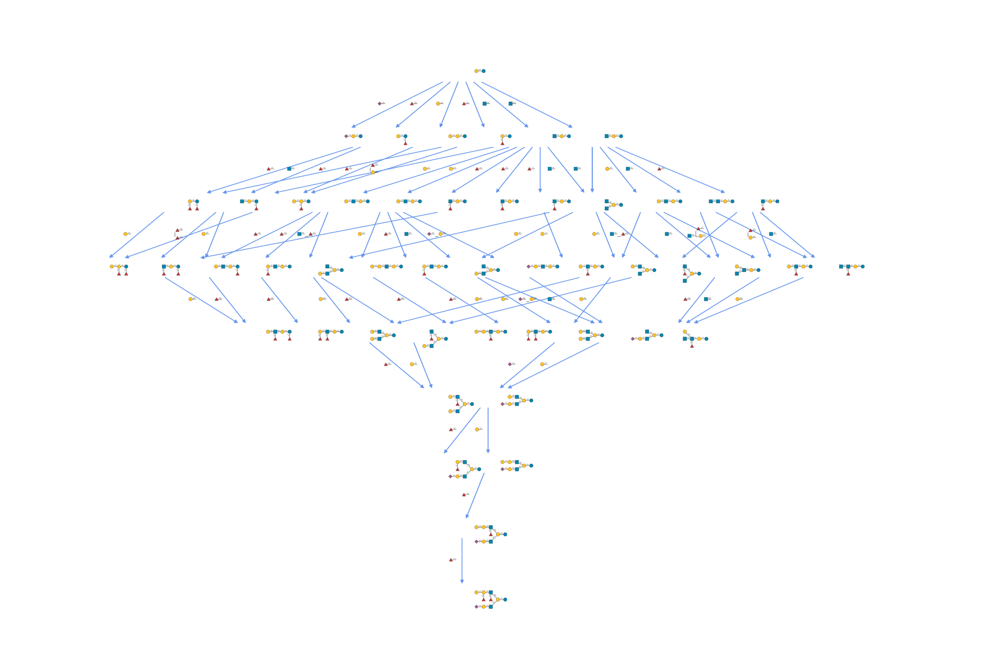

# network

`network` contains functions to arrange and analyze glycans in the context of networks. In such a network, each node represents a glycan and edges represent, for instance, their connection via a biosynthetic step. It should be noted, since `glycowork` treats glycans as molecular graphs, that these networks represent hierarchical graphs, with the network being one graph and each node within the network also a graph. `network` contains the following modules:

- `biosynthesis` contains functions to construct and analyze biosynthetic glycan networks
- `evolution` contains functions to compare (taxonomic) groups as to their glycan repertoires

## biosynthesis

> constructing and analyzing biosynthetic glycan networks

------------------------------------------------------------------------

### construct_network

``` python
def construct_network(
    glycans:str | list[str] | pandas.DataFrame, # Glycan(s), or an abundance frame (glycans as first column or index, samples as columns)
    allowed_ptms:str | frozenset[str]=frozenset({'9Ac', '6S', '6P', '3S', '1P', 'OP', 'OAc', '4Ac', '3P', 'OS'}), # Allowed PTM(s)
    edge_type:str='monolink', # Edge label type: monolink/monosaccharide/enzyme
    permitted_roots:str | frozenset[str] | None=None, # Allowed root node(s)
    abundances:list[float]=[], # Glycan abundances in the same order as glycans; default:empty
    constraints:bool | list[dict] | pandas.DataFrame=True, # Apply established biochemical constraints on reaction order; False to disable, or pass custom rules
)->networkx.classes.digraph.DiGraph: # Biosynthetic network
```

*Construct glycan biosynthetic network*

``` python
glycans = ["Gal(b1-4)Glc-ol", "GlcNAc(b1-3)Gal(b1-4)Glc-ol",
           "GlcNAc6S(b1-3)Gal(b1-4)Glc-ol",
           "Gal(b1-4)GlcNAc(b1-3)Gal(b1-4)Glc-ol", "Fuc(a1-2)Gal(b1-4)Glc-ol",
          "Neu5Ac(a2-3)Gal(b1-4)GlcNAc(b1-3)[Gal(b1-3)GlcNAc(b1-6)]Gal(b1-4)Glc-ol"]
network = construct_network(glycans)
network.nodes()
```

    NodeView(('Neu5Ac(a2-3)Gal(b1-4)GlcNAc(b1-3)[Gal(b1-3)GlcNAc(b1-6)]Gal(b1-4)Glc-ol', 'Gal(b1-4)GlcNAc(b1-3)Gal(b1-4)Glc-ol', 'GlcNAc6S(b1-3)Gal(b1-4)Glc-ol', 'GlcNAc(b1-3)Gal(b1-4)Glc-ol', 'Fuc(a1-2)Gal(b1-4)Glc-ol', 'Gal(b1-4)Glc-ol', 'Gal(b1-4)GlcNAc(b1-3)[Gal(b1-3)GlcNAc(b1-6)]Gal(b1-4)Glc-ol', 'Neu5Ac(a2-3)Gal(b1-4)GlcNAc(b1-3)[GlcNAc(b1-6)]Gal(b1-4)Glc-ol', 'Gal(b1-4)GlcNAc(b1-3)[GlcNAc(b1-6)]Gal(b1-4)Glc-ol', 'Neu5Ac(a2-3)Gal(b1-4)GlcNAc(b1-3)Gal(b1-4)Glc-ol', 'GlcNAc(b1-3)[GlcNAc(b1-6)]Gal(b1-4)Glc-ol', 'GlcNAc(b1-6)Gal(b1-4)Glc-ol', 'Gal(b1-3)GlcNAc(b1-6)[GlcNAc(b1-3)]Gal(b1-4)Glc-ol', 'Gal(b1-3)GlcNAc(b1-6)Gal(b1-4)Glc-ol'))

------------------------------------------------------------------------

### plot_network

``` python
def plot_network(
    network:networkx.classes.digraph.DiGraph, # Biosynthetic network
    plot_format:str='hierarchical', # Layout type: hierarchical/pydot2/kamada_kawai/spring
    edge_label_draw:bool=True, # Whether to draw edge labels
    lfc_dict:dict[str, float] | None=None, # Enzyme:log2FC mapping for edge width
    draw_glycans:bool=True, # Replace node labels with SNFG drawings, in a static figure
    filepath:str | pathlib.Path='', # Path to save the static figure (.svg/.pdf/.png) instead of showing the interactive plot
    compact:bool=False, # Use compact SNFG style
    glycan_size:str='small', # Glycan size preset ('small', 'medium', 'large')
    title:str | None=None, # Plot title; None for none, as before
)->None: # Jupyter-renderable plot (interactive HTML, or SVG with draw_glycans); outside Jupyter it opens in the browser
```

*Visualize biosynthetic network*

``` python
plot_network(network)
```


Hover for details

------------------------------------------------------------------------

### infer_network

``` python
def infer_network(
    network:networkx.classes.digraph.DiGraph, # Network to infer
    network_species:str, # Source species
    species_list:str | list[str], # Species to compare against
    network_dic:dict[str, networkx.classes.digraph.DiGraph], # Species:network mapping
)->networkx.classes.graph.Graph: # Network with inferred nodes
```

*Replace virtual nodes observed in other species*

------------------------------------------------------------------------

### retrieve_inferred_nodes

``` python
def retrieve_inferred_nodes(
    network:networkx.classes.digraph.DiGraph, # Network with inferred nodes
    species:str | None=None, # Source species if multiple
)->list[str] | dict[str, list[str]]: # Inferred nodes list or dict
```

*Get inferred virtual nodes from network*

------------------------------------------------------------------------

### update_network

``` python
def update_network(
    network_in:networkx.classes.digraph.DiGraph, # Input network
    edge_list:list[tuple[str, str]], # List of edges to add
    edge_labels:list[str] | None=None, # Labels for new edges
    node_labels:dict[str, int] | None=None, # Node virtual status (0: observed, 1: virtual)
)->networkx.classes.digraph.DiGraph: # Updated network
```

*Update network with new edges and labels*

------------------------------------------------------------------------

### trace_diamonds

``` python
def trace_diamonds(
    network:networkx.classes.digraph.DiGraph, # Biosynthetic network
    species_list:str | list[str], # Species to compare against
    network_dic:dict[str, networkx.classes.digraph.DiGraph], # Species:network mapping
    threshold:float=0.0, # Cutoff threshold
    nb_intermediates:int=2, # Number of intermediate nodes; has to be a multiple of 2
    mode:str='presence', # Analysis mode: presence/abundance
)->pandas.DataFrame: # Path analysis results, with proportion (0-1) of how often glycan has been experimentally observed in this path (or average abundance)
```

*Analyze diamond motif (A-\>B,A-\>C,B-\>D,C-\>D) path preferences using evolutionary data*

------------------------------------------------------------------------

### evoprune_network

``` python
def evoprune_network(
    network:networkx.classes.digraph.DiGraph, # Biosynthetic network
    network_dic:dict[str, networkx.classes.digraph.DiGraph] | None=None, # Species:network mapping
    species_list:str | list[str] | None=None, # Species to compare against
    node_attr:str='abundance', # Node attribute to use for pruning
    threshold:float=0.01, # Cutoff threshold
    nb_intermediates:int=2, # Number of intermediate nodes; has to be a multiple of 2
    mode:str='presence', # Analysis mode: presence/abundance
)->networkx.classes.digraph.DiGraph: # Evolutionarily pruned network (with virtual node probability as a new node attribute)
```

*Prune network using evolutionary path preferences*

``` python
plot_network(evoprune_network(network))
```


Hover for details

------------------------------------------------------------------------

### highlight_network

``` python
def highlight_network(
    network:networkx.classes.digraph.DiGraph, # Biosynthetic network
    highlight:str, # What to highlight: motif/species/abundance/conservation
    motif:str | None=None, # Motif to highlight; highlight=motif
    abundance_df:pandas.DataFrame | None=None, # Glycan abundance data; highlight=abundance
    glycan_col:str='glycan', # Glycan column name; highlight=abundance
    intensity_col:str='rel_intensity', # Intensity column name; highlight=abundance
    conservation_df:pandas.DataFrame | None=None, # Species-glycan data; highlight=conservation
    network_dic:dict[str, networkx.classes.digraph.DiGraph] | None=None, # Species:network mapping; highlight=conservation/species
    species:str | None=None, # Species to highlight; highlight=species
)->networkx.classes.digraph.DiGraph: # Network with highlight attributes ('origin' (motif/species) or 'abundance' (abundance/conservation) node attribute)
```

*Add visual highlighting to network nodes, to be used in plot_network*

------------------------------------------------------------------------

### export_network

``` python
def export_network(
    network:networkx.classes.digraph.DiGraph, # Biosynthetic network
    filepath:str, # Output path prefix, will be appended by file description and type
    other_node_attributes:str | list[str] | None=None, # Additional attribute(s) for extraction
)->None: # Saves network files (edge list/labels + node IDs and labels)
```

*Export network to Cytoscape/Gephi compatible files*

------------------------------------------------------------------------

### network_alignment

``` python
def network_alignment(
    network_a:networkx.classes.digraph.DiGraph, # First network
    network_b:networkx.classes.digraph.DiGraph, # Second network
)->networkx.classes.digraph.DiGraph: # Combined network
```

*Combine two networks into one with color coding (brown: shared, blue: only in a, orange: only in b)*

``` python
from glycowork.network.biosynthesis import net_dic
blackbear_network, brownbear_network = net_dic['Ursus_americanus'], net_dic['Ursus_arctos']
plot_network(network_alignment(blackbear_network, brownbear_network))
```



------------------------------------------------------------------------

### get_maximum_flow

``` python
def get_maximum_flow(
    network:networkx.classes.digraph.DiGraph, # Biosynthetic network
    source:str | None=None, # Source node; default: inferred from the network's glycan class
    sinks:str | list[str] | None=None, # Target node(s); default:all terminal nodes
)->dict[str, dict[str, float | dict[str, dict[str, float]]]]: # Flow results; sink: {maximum flow value, flow path dictionary}
```

*Estimate maximum flow and flow paths between source and sinks*

------------------------------------------------------------------------

### get_max_flow_path

``` python
def get_max_flow_path(
    network:networkx.classes.digraph.DiGraph, # Biosynthetic network
    flow_dict:dict[str, dict[str, float]], # Flow dictionary as returned by get_maximum_flow
    sink:str, # Target node
    source:str | None=None, # Source node; default: inferred from the network's glycan class
)->list[tuple[str, str]]: # Path edge list
```

*Get path giving maximum flow value*

------------------------------------------------------------------------

### get_reaction_flow

``` python
def get_reaction_flow(
    network:networkx.classes.digraph.DiGraph, # Biosynthetic network
    res:dict[str, dict[str, float]], # Flow results as returned by get_maximum_flow
    aggregate:str | None=None, # Aggregation: sum/mean/None
)->dict[str, list[float]] | dict[str, float]: # Reaction flows (reaction: flow)
```

*Get aggregated flows by reaction type*

------------------------------------------------------------------------

### get_differential_biosynthesis

``` python
def get_differential_biosynthesis(
    df:pandas.DataFrame | str | pathlib.Path, # Glycan abundance data (first column: glycan sequences), filepath, or shipped dataset name
    group1:list[str | int] | None=None, # First group column indices/names (or time points in longitudinal analysis); default: from the frame's contrasts
    group2:list[str | int] | None=None, # Second group column indices/names (or time points in longitudinal analysis)
    analysis:str='reaction', # Type: reaction/flow/branchpoint/steps (each motif's yield from its tightest containing motif)
    paired:bool | None=None, # Whether samples are paired; default: from the frame
    longitudinal:bool=False, # Whether to do perform longitudinal analysis
    id_column:str='ID', # Sample ID column for longitudinal analysis in the ID-style of participant_time_replicate
    edge_type:str='monolink', # Reaction resolution: monolink/monosaccharide/enzyme
    virtual_damping:float=0.5, # Per-hop abundance decay for undetected intermediates
    covariates:pandas.DataFrame | pandas.Series | dict | None=None, # per-sample nuisance variables indexed by sample name (e.g., secretor status, sex, age, batch); unpaired two-group comparisons only, each feature fit as group plus covariates
)->pandas.DataFrame: # Differential analysis results (differential flow features and statistics OR reaction changes over time
```

*Compare biosynthetic patterns between conditions/timepoints: reaction fluxes, flow to sinks, branch-point splits, or biosynthetic step yields (each motif as the log2 ratio to its tightest containing motif, i.e., how much of the available substrate a step converts)*

``` python
get_differential_biosynthesis(human_skin_O_PMC5871710_BCC)
```

|  | Mean abundance | Log2FC | p-val | corr p-val | significant | Effect size |
|----|----|----|----|----|----|----|
| Glycan |  |  |  |  |  |  |
| 6S | 6.469102 | -0.217169 | 0.008288 | 0.066306 | False | -0.656210 |
| Gal(b1-3) | 16.184028 | -0.024972 | 0.027900 | 0.111598 | False | -0.530830 |
| Gal(b1-3/4) | 8.104100 | -0.020220 | 0.041774 | 0.057342 | False | -0.486949 |
| Neu5Ac(a2-3/6/8) | 17.292563 | 0.023388 | 0.057342 | 0.057342 | False | 0.451413 |
| Neu5Ac(a2-8) | 9.690753 | 0.079607 | 0.131031 | 0.262061 | False | 0.352338 |
| Neu5Ac(a2-3) | 9.690753 | 0.079607 | 0.131031 | 0.262061 | False | 0.352338 |
| Neu5Ac(a2-6) | 32.496182 | -0.013038 | 0.253169 | 0.321284 | False | -0.263222 |
| Gal(b1-4) | 0.024173 | 0.330508 | 0.321173 | 0.321284 | False | 0.227562 |
| GlcNAc(b1-6) | 0.024173 | 0.330508 | 0.321284 | 0.321284 | False | 0.227508 |
| Fuc(a1-2) | 0.024173 | 0.330508 | 0.321284 | 0.321284 | False | 0.227508 |

------------------------------------------------------------------------

### get_biosynthetic_coherence

``` python
def get_biosynthetic_coherence(
    df:pandas.DataFrame | str | pathlib.Path, # Glycan abundances (glycans as index or first column, samples as columns), or a filepath or shipped dataset name as read_abundances takes it
    group1:list[str] | None=None, # First group column names; default: from the frame's contrasts
    group2:list[str] | None=None, # Second group column names; default: from the frame's contrasts
    network:networkx.classes.digraph.DiGraph | None=None, # Pre-built network; built from df if not provided
    paired:bool | None=None, # Whether samples are paired; default: from the frame
    n_permutations:int=20000, # Label permutations for the exact shared-model null; 0 to skip
    random_state:int=42, # Seed for permutation reproducibility
)->tuple[pandas.DataFrame, pandas.DataFrame]: # (Group-level results under both models, per-glycan coherence and its group difference)
```

*Quantify how strongly each condition’s glycome follows its own biosynthetic network, and which glycans decouple from it*

------------------------------------------------------------------------

### extend_network

``` python
def extend_network(
    network:networkx.classes.digraph.DiGraph, # Biosynthetic network
    steps:int=1, # Number of extension steps; default:1 (becomes max_steps when auto_steps is True)
    to_extend:str | dict[str, int] | list[str]='all', # Nodes to extend (all, specific leaf node, target composition)
    strict_context:bool=False, # Whether to use network only to derive allowed reaction products; default:False
    auto_steps:bool=False, # Infer minimum steps to reach target composition; converts steps into max_steps when to_extend is a composition
    prioritize:bool=False, # Rank candidates by the maximum flow reaching them; only informative if the input network carries 'abundance' node attributes
    source:str='leaves', # Nodes to grow from: leaves (metabolic endpoints) or observed (every measured structure)
)->tuple[networkx.classes.digraph.DiGraph, set[str] | dict[str, float]]: # (Extended network, New glycans; a candidate:flow mapping sorted by descending flow when prioritize=True), optionally minimum number of steps from auto_steps
```

*Extend biosynthetic network physiologically*

``` python
new_network, new_glycans = extend_network(network, strict_context = True)
len(new_glycans)
```

    20

## evolution

> investigating evolutionary relationships of glycans

------------------------------------------------------------------------

### distance_from_embeddings

``` python
def distance_from_embeddings(
    df:pandas.DataFrame, # DataFrame with glycans (rows) and taxonomic info (columns)
    embeddings:pandas.DataFrame, # DataFrame with glycans (rows, indexed like df) and embeddings (columns); the 0..n-1 rows of glycans_to_emb(df.glycan) pair up with df by position
    cut_off:int=10, # Minimum glycans per rank to be included; default:10
    rank:str='Species', # Taxonomic rank for grouping; default:Species
    averaging:str='median', # How to average embeddings: median/mean
)->pandas.DataFrame: # Rank x rank distance matrix
```

*Calculate cosine distance matrix from learned embeddings*

------------------------------------------------------------------------

### distance_from_metric

``` python
def distance_from_metric(
    df:pandas.DataFrame, # DataFrame with glycans (rows) and taxonomic info (columns)
    networks:list[networkx.classes.graph.Graph] | dict[str, networkx.classes.graph.Graph], # Networks, ideally as {rank value: network} so they cannot be mispaired
    metric:str='Jaccard', # Distance metric to use
    cut_off:int=10, # Minimum glycans per rank to be included; default:10
    rank:str='Species', # Taxonomic rank for grouping; default:Species
)->pandas.DataFrame: # Rank x rank distance matrix
```

*Calculate distance matrix between networks using provided metric*

------------------------------------------------------------------------

### dendrogram_from_distance

``` python
def dendrogram_from_distance(
    dm:pandas.DataFrame, # Rank x rank distance matrix (e.g., from distance_from_embeddings)
    ylabel:str='Mammalia', # Y-axis label
    filepath:str | pathlib.Path='', # Path to save plot including filename
)->None: # Displays or saves dendrogram plot
```

*Plot dendrogram from distance matrix*

------------------------------------------------------------------------

### check_conservation

``` python
def check_conservation(
    glycan:str, # Glycan or motif in IUPAC-condensed format
    df:pandas.DataFrame, # DataFrame with glycans (rows) and taxonomic levels (columns)
    network_dic:dict[str, networkx.classes.graph.Graph] | None=None, # Species:biosynthetic network mapping
    rank:str='Order', # Taxonomic level to assess
    threshold:int=5, # Minimum glycans per species to be included
    motif:bool=False, # Whether glycan is a motif vs sequence
)->dict[str, float]: # Taxonomic group-to-conservation mapping
```

*Estimate evolutionary conservation of glycans via biosynthetic networks*

------------------------------------------------------------------------

### get_communities

``` python
def get_communities(
    network_list:list[networkx.classes.graph.Graph], # List of undirected biosynthetic networks
    label_list:list[str] | None=None, # Labels for community names, running_number + _ + label_list[k]  for network_list[k]; default:range(len(graph_list))
    random_state:int=42, # Random seed for reproducible community detection
)->dict[str, list[str]]: # Community-to-glycan list mapping
```

*Find communities for each graph in list of graphs*
