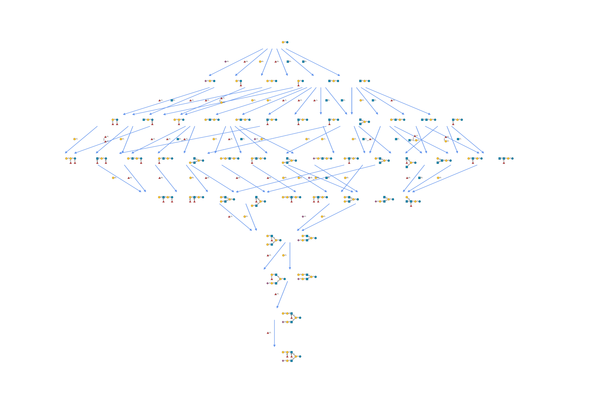

# network

`network` contains functions to arrange and analyze glycans in the context of networks. In such a network, each node represents a glycan and edges represent, for instance, their connection via a biosynthetic step. It should be noted, since `glycowork` treats glycans as molecular graphs, that these networks represent hierarchical graphs, with the network being one graph and each node within the network also a graph. `network` contains the following modules:

- `biosynthesis` contains functions to construct and analyze biosynthetic glycan networks
- `evolution` contains functions to compare (taxonomic) groups as to their glycan repertoires

## biosynthesis

> constructing and analyzing biosynthetic glycan networks

------------------------------------------------------------------------

### construct_network

``` python
def construct_network(
    glycans:str | list[str] | pandas.DataFrame, # Glycan(s), or an abundance frame (glycans as first column or index, samples as columns)
    allowed_ptms:str | frozenset[str]=frozenset({'4Ac', '6S', '3S', 'OP', '9Ac', 'OS', '6P', '1P', 'OAc', '3P'}), # Allowed PTM(s)
    edge_type:str='monolink', # Edge label type: monolink/monosaccharide/enzyme
    permitted_roots:str | frozenset[str] | None=None, # Allowed root node(s)
    abundances:list[float]=[], # Glycan abundances in the same order as glycans; default:empty
    constraints:bool | list[dict] | pandas.DataFrame=True, # Apply established biochemical constraints on reaction order; False to disable, or pass custom rules
)->networkx.classes.digraph.DiGraph: # Biosynthetic network
```

*Construct glycan biosynthetic network*

``` python
glycans = ["Gal(b1-4)Glc-ol", "GlcNAc(b1-3)Gal(b1-4)Glc-ol",
           "GlcNAc6S(b1-3)Gal(b1-4)Glc-ol",
           "Gal(b1-4)GlcNAc(b1-3)Gal(b1-4)Glc-ol", "Fuc(a1-2)Gal(b1-4)Glc-ol",
          "Neu5Ac(a2-3)Gal(b1-4)GlcNAc(b1-3)[Gal(b1-3)GlcNAc(b1-6)]Gal(b1-4)Glc-ol"]
network = construct_network(glycans)
network.nodes()
```

    NodeView(('Neu5Ac(a2-3)Gal(b1-4)GlcNAc(b1-3)[Gal(b1-3)GlcNAc(b1-6)]Gal(b1-4)Glc-ol', 'Gal(b1-4)GlcNAc(b1-3)Gal(b1-4)Glc-ol', 'GlcNAc6S(b1-3)Gal(b1-4)Glc-ol', 'GlcNAc(b1-3)Gal(b1-4)Glc-ol', 'Fuc(a1-2)Gal(b1-4)Glc-ol', 'Gal(b1-4)Glc-ol', 'Gal(b1-4)GlcNAc(b1-3)[Gal(b1-3)GlcNAc(b1-6)]Gal(b1-4)Glc-ol', 'Neu5Ac(a2-3)Gal(b1-4)GlcNAc(b1-3)[GlcNAc(b1-6)]Gal(b1-4)Glc-ol', 'Gal(b1-4)GlcNAc(b1-3)[GlcNAc(b1-6)]Gal(b1-4)Glc-ol', 'Neu5Ac(a2-3)Gal(b1-4)GlcNAc(b1-3)Gal(b1-4)Glc-ol', 'GlcNAc(b1-3)[GlcNAc(b1-6)]Gal(b1-4)Glc-ol', 'GlcNAc(b1-6)Gal(b1-4)Glc-ol', 'Gal(b1-3)GlcNAc(b1-6)[GlcNAc(b1-3)]Gal(b1-4)Glc-ol', 'Gal(b1-3)GlcNAc(b1-6)Gal(b1-4)Glc-ol'))

------------------------------------------------------------------------

### plot_network

``` python
def plot_network(
    network:networkx.classes.digraph.DiGraph, # Biosynthetic network
    plot_format:str='hierarchical', # Layout type: hierarchical/pydot2/kamada_kawai/spring
    edge_label_draw:bool=True, # Whether to draw edge labels
    lfc_dict:dict[str, float] | None=None, # Enzyme:log2FC mapping for edge width
    draw_glycans:bool=True, # Replace node labels with SNFG drawings, in a static figure
    filepath:str | pathlib.Path='', # Path to save the static figure (.svg/.pdf/.png) instead of showing the interactive plot
    compact:bool=False, # Use compact SNFG style
    glycan_size:str='small', # Glycan size preset ('small', 'medium', 'large')
    title:str | None=None, # Plot title; None for none, as before
)->None: # Jupyter-renderable plot (interactive HTML, or SVG with draw_glycans); outside Jupyter it opens in the browser
```

*Visualize biosynthetic network*

``` python
plot_network(network)
```

![]() ![](data:image/svg+xml;base64,PHN2ZyB4bWxucz0iaHR0cDovL3d3dy53My5vcmcvMjAwMC9zdmciIHdpZHRoPSIzNzAiIGhlaWdodD0iNzEiIHZpZXdib3g9IjAgMCAzNzAgNzEiPgo8ZyB0cmFuc2Zvcm09Im1hdHJpeCgxIDAgMCAtMSAwIDcxKSI+CjxwYXRoIGQ9Ik0gLTEwMCAwIEwgMCAwIEwgLTEwMCAwIFoiIHRyYW5zZm9ybT0ibWF0cml4KDEgMCAwIC0xIDMzNSAzNSkiIGZpbGw9Im5vbmUiIHN0cm9rZT0iIzFDMTkxNyIgc3Ryb2tlLXdpZHRoPSI0IiBzdHJva2UtbGluZWNhcD0icm91bmQiIHN0cm9rZS1saW5lam9pbj0icm91bmQiIC8+CjxwYXRoIGQ9Ik0gLTIwMCAwIEwgLTEwMCAwIEwgLTIwMCAwIFoiIHRyYW5zZm9ybT0ibWF0cml4KDEgMCAwIC0xIDMzNSAzNSkiIGZpbGw9Im5vbmUiIHN0cm9rZT0iIzFDMTkxNyIgc3Ryb2tlLXdpZHRoPSI0IiBzdHJva2UtbGluZWNhcD0icm91bmQiIHN0cm9rZS1saW5lam9pbj0icm91bmQiIC8+CjxwYXRoIGQ9Ik0gLTMwMCAwIEwgLTIwMCAwIEwgLTMwMCAwIFoiIHRyYW5zZm9ybT0ibWF0cml4KDEgMCAwIC0xIDMzNSAzNSkiIGZpbGw9Im5vbmUiIHN0cm9rZT0iIzFDMTkxNyIgc3Ryb2tlLXdpZHRoPSI0IiBzdHJva2UtbGluZWNhcD0icm91bmQiIHN0cm9rZS1saW5lam9pbj0icm91bmQiIC8+CjxwYXRoIGQ9Ik0gLTI1IDAgQyAtMjUgMTMuODA3MSAtMTMuODA3MSAyNSAwIDI1IEMgMTMuODA3MSAyNSAyNSAxMy44MDcxIDI1IDAgQyAyNSAtMTMuODA3MSAxMy44MDcxIC0yNSAwIC0yNSBDIC0xMy44MDcxIC0yNSAtMjUgLTEzLjgwNzEgLTI1IDAgWiIgdHJhbnNmb3JtPSJtYXRyaXgoMSAwIDAgLTEgMzM1IDM1KSIgZmlsbD0iIzAzODVBRSIgc3Ryb2tlPSIjMUMxOTE3IiBzdHJva2Utd2lkdGg9IjIiIC8+CjxwYXRoIGQ9Ik0gLTEyNSAwIEMgLTEyNSAxMy44MDcxIC0xMTMuODA3MSAyNSAtMTAwIDI1IEMgLTg2LjE5MjkgMjUgLTc1IDEzLjgwNzEgLTc1IDAgQyAtNzUgLTEzLjgwNzEgLTg2LjE5MjkgLTI1IC0xMDAgLTI1IEMgLTExMy44MDcxIC0yNSAtMTI1IC0xMy44MDcxIC0xMjUgMCBaIiB0cmFuc2Zvcm09Im1hdHJpeCgxIDAgMCAtMSAzMzUgMzUpIiBmaWxsPSIjRkNDMzI2IiBzdHJva2U9IiMxQzE5MTciIHN0cm9rZS13aWR0aD0iMiIgLz4KPHBhdGggZD0iTSAtMzI1IDAgQyAtMzI1IDEzLjgwNzEgLTMxMy44MDcxIDI1IC0zMDAgMjUgQyAtMjg2LjE5MjkgMjUgLTI3NSAxMy44MDcxIC0yNzUgMCBDIC0yNzUgLTEzLjgwNzEgLTI4Ni4xOTI5IC0yNSAtMzAwIC0yNSBDIC0zMTMuODA3MSAtMjUgLTMyNSAtMTMuODA3MSAtMzI1IDAgWiIgdHJhbnNmb3JtPSJtYXRyaXgoMSAwIDAgLTEgMzM1IDM1KSIgZmlsbD0iI0ZDQzMyNiIgc3Ryb2tlPSIjMUMxOTE3IiBzdHJva2Utd2lkdGg9IjIiIC8+CjxwYXRoIGQ9Ik0gLTIyNSAtMjUgTCAtMTc1IC0yNSBMIC0xNzUgMjUgTCAtMjI1IDI1IFoiIHRyYW5zZm9ybT0ibWF0cml4KDEgMCAwIC0xIDMzNSAzNSkiIGZpbGw9IiMwMzg1QUUiIHN0cm9rZT0iIzFDMTkxNyIgc3Ryb2tlLXdpZHRoPSIyIiBzdHJva2UtbGluZWpvaW49InJvdW5kIiAvPgo8cGF0aCBkPSJNIDIuOTAwNCAxLjYwMTYgTCAyLjkwMDQgLTMuODg2NyBMIDEuNTIzNCAtMy44ODY3IEwgMS41MjM0IDEwLjgxMDUgUSAxLjUyMzQgMTMuMDU2NiAyLjY4NTUgMTQuMDI4MyBRIDMuODQ3NyAxNSA1LjQyOTcgMTUgUSA3LjA1MDggMTUgOC4wMDI5IDE0LjEzNTcgUSA4Ljk1NTEgMTMuMjcxNSA4Ljk1NTEgMTEuODI2MiBRIDguOTU1MSA5LjU3MDMgNi44MTY0IDguNzg5MSBRIDguNjkxNCA4LjYwMzUgOS44MDQ3IDcuNDUxMiBRIDEwLjkxOCA2LjI5ODggMTAuOTE4IDQuNTExNyBRIDEwLjkxOCAyLjQ3MDcgOS41NjA1IDEuMDk4NiBRIDguMjAzMSAtMC4yNzM0IDYuMjAxMiAtMC4yNzM0IFEgNC4xMTEzIC0wLjI3MzQgMi45MDA0IDEuNjAxNiBaIE0gNC4yNDggNy44NjEzIEwgNC4yNDggOS4wMDM5IFEgNy41NTg2IDkuMDkxOCA3LjU1ODYgMTEuNjg5NSBRIDcuNTU4NiAxMi41ODc5IDcuMDA2OCAxMy4xNDk0IFEgNi40NTUxIDEzLjcxMDkgNS41MzcxIDEzLjcxMDkgUSA0LjI1NzggMTMuNzEwOSAzLjU3OTEgMTMuMDA3OCBRIDIuOTAwNCAxMi4zMDQ3IDIuOTAwNCAxMC40ODgzIEwgMi45MTAyIDQuNTAyIFEgMi45MTAyIDIuOTE5OSAzLjg2NzIgMS45NzI3IFEgNC44MjQyIDEuMDI1NCA2LjE4MTYgMS4wMjU0IFEgNy41OTc3IDEuMDI1NCA4LjU1OTYgMi4wMDY4IFEgOS41MjE1IDIuOTg4MyA5LjUyMTUgNC40MjM4IFEgOS41MjE1IDUuODM5OCA4LjU0OTggNi44NTA2IFEgNy41NzgxIDcuODYxMyA0LjkzMTYgNy44NjEzIEwgNC4yNDggNy44NjEzIFogTSAyMS40Mzk1IDE0LjcyNjYgTCAyMS43MzI0IDE0LjcyNjYgTCAyMS43MzI0IDQuNzE2OCBMIDIzLjQ3MDcgNC43MTY4IEwgMjMuNDcwNyAzLjMzOTggTCAyMS43MzI0IDMuMzM5OCBMIDIxLjczMjQgMCBMIDIwLjI5NjkgMCBMIDIwLjI5NjkgMy4zMzk4IEwgMTMuNDMxNiAzLjMzOTggTCAyMS40Mzk1IDE0LjcyNjYgWiBNIDIwLjI5NjkgNC43MTY4IEwgMjAuMjk2OSAxMC43MDMxIEwgMTYuMDY4NCA0LjcxNjggTCAyMC4yOTY5IDQuNzE2OCBaIiB0cmFuc2Zvcm09Im1hdHJpeCgxIDAgMCAxIDI3Mi45OTYxIDQ1KSIgZmlsbD0iIzFDMTkxNyIgLz4KPHBhdGggZD0iTSAyLjkwMDQgMS42MDE2IEwgMi45MDA0IC0zLjg4NjcgTCAxLjUyMzQgLTMuODg2NyBMIDEuNTIzNCAxMC44MTA1IFEgMS41MjM0IDEzLjA1NjYgMi42ODU1IDE0LjAyODMgUSAzLjg0NzcgMTUgNS40Mjk3IDE1IFEgNy4wNTA4IDE1IDguMDAyOSAxNC4xMzU3IFEgOC45NTUxIDEzLjI3MTUgOC45NTUxIDExLjgyNjIgUSA4Ljk1NTEgOS41NzAzIDYuODE2NCA4Ljc4OTEgUSA4LjY5MTQgOC42MDM1IDkuODA0NyA3LjQ1MTIgUSAxMC45MTggNi4yOTg4IDEwLjkxOCA0LjUxMTcgUSAxMC45MTggMi40NzA3IDkuNTYwNSAxLjA5ODYgUSA4LjIwMzEgLTAuMjczNCA2LjIwMTIgLTAuMjczNCBRIDQuMTExMyAtMC4yNzM0IDIuOTAwNCAxLjYwMTYgWiBNIDQuMjQ4IDcuODYxMyBMIDQuMjQ4IDkuMDAzOSBRIDcuNTU4NiA5LjA5MTggNy41NTg2IDExLjY4OTUgUSA3LjU1ODYgMTIuNTg3OSA3LjAwNjggMTMuMTQ5NCBRIDYuNDU1MSAxMy43MTA5IDUuNTM3MSAxMy43MTA5IFEgNC4yNTc4IDEzLjcxMDkgMy41NzkxIDEzLjAwNzggUSAyLjkwMDQgMTIuMzA0NyAyLjkwMDQgMTAuNDg4MyBMIDIuOTEwMiA0LjUwMiBRIDIuOTEwMiAyLjkxOTkgMy44NjcyIDEuOTcyNyBRIDQuODI0MiAxLjAyNTQgNi4xODE2IDEuMDI1NCBRIDcuNTk3NyAxLjAyNTQgOC41NTk2IDIuMDA2OCBRIDkuNTIxNSAyLjk4ODMgOS41MjE1IDQuNDIzOCBRIDkuNTIxNSA1LjgzOTggOC41NDk4IDYuODUwNiBRIDcuNTc4MSA3Ljg2MTMgNC45MzE2IDcuODYxMyBMIDQuMjQ4IDcuODYxMyBaIE0gMTUuNTcwMyAxMS4wMzUyIEwgMTQuMTA1NSAxMS4wMzUyIFEgMTQuNTA1OSAxMi44MTI1IDE1LjYzODcgMTMuNzY5NSBRIDE2Ljc3MTUgMTQuNzI2NiAxOC4zMTQ1IDE0LjcyNjYgUSAxOS40Mzc1IDE0LjcyNjYgMjAuNDA5MiAxNC4yMTM5IFEgMjEuMzgwOSAxMy43MDEyIDIxLjkxMzEgMTIuODMyIFEgMjIuNDQ1MyAxMS45NjI5IDIyLjQ0NTMgMTEuMDE1NiBRIDIyLjQ0NTMgOS4xNjAyIDIwLjU5OTYgOC4wNzYyIFEgMjEuNjM0OCA3LjY1NjIgMjIuMjk4OCA2Ljg0NTcgUSAyMy4yMzYzIDUuNzAzMSAyMy4yMzYzIDQuMjg3MSBRIDIzLjIzNjMgMy4wNjY0IDIyLjU5MTggMS45NTggUSAyMS45NDczIDAuODQ5NiAyMC44MzQgMC4yNDQxIFEgMTkuNzIwNyAtMC4zNjEzIDE4LjM0MzggLTAuMzYxMyBRIDE2LjQ4ODMgLTAuMzYxMyAxNS4yNDggMC43MDggUSAxNC4wMDc4IDEuNzc3MyAxMy42MjcgMy44NDc3IEwgMTUuMDMzMiAzLjg0NzcgUSAxNS40MDQzIDIuNDUxMiAxNi4wOTc3IDEuODI2MiBRIDE2Ljk4NjMgMS4wMzUyIDE4LjM2MzMgMS4wMzUyIFEgMTkuOTI1OCAxLjAzNTIgMjAuODczIDEuOTcyNyBRIDIxLjgyMDMgMi45MTAyIDIxLjgyMDMgNC4xNjk5IFEgMjEuODIwMyA1LjAwOTggMjEuMzQ2NyA1Ljc0MjIgUSAyMC44NzMgNi40NzQ2IDIwLjA3NzEgNi44NDU3IFEgMTkuMjgxMiA3LjIxNjggMTcuNjExMyA3LjMwNDcgTCAxNy42MTEzIDguNjIzIFEgMTguNTk3NyA4LjYyMyAxOS40MDgyIDguOTY5NyBRIDIwLjIxODggOS4zMTY0IDIwLjU4NSA5Ljg1MzUgUSAyMC45NTEyIDEwLjM5MDYgMjAuOTUxMiAxMS4wMjU0IFEgMjAuOTUxMiAxMS45NjI5IDIwLjIwNDEgMTIuNjQ2NSBRIDE5LjQ1NyAxMy4zMzAxIDE4LjMxNDUgMTMuMzMwMSBRIDE3LjM4NjcgMTMuMzMwMSAxNi43MTI5IDEyLjgwNzYgUSAxNi4wMzkxIDEyLjI4NTIgMTUuNTcwMyAxMS4wMzUyIFoiIHRyYW5zZm9ybT0ibWF0cml4KDEgMCAwIDEgMTcyLjk5NjEgNDUpIiBmaWxsPSIjMUMxOTE3IiAvPgo8cGF0aCBkPSJNIDIuOTAwNCAxLjYwMTYgTCAyLjkwMDQgLTMuODg2NyBMIDEuNTIzNCAtMy44ODY3IEwgMS41MjM0IDEwLjgxMDUgUSAxLjUyMzQgMTMuMDU2NiAyLjY4NTUgMTQuMDI4MyBRIDMuODQ3NyAxNSA1LjQyOTcgMTUgUSA3LjA1MDggMTUgOC4wMDI5IDE0LjEzNTcgUSA4Ljk1NTEgMTMuMjcxNSA4Ljk1NTEgMTEuODI2MiBRIDguOTU1MSA5LjU3MDMgNi44MTY0IDguNzg5MSBRIDguNjkxNCA4LjYwMzUgOS44MDQ3IDcuNDUxMiBRIDEwLjkxOCA2LjI5ODggMTAuOTE4IDQuNTExNyBRIDEwLjkxOCAyLjQ3MDcgOS41NjA1IDEuMDk4NiBRIDguMjAzMSAtMC4yNzM0IDYuMjAxMiAtMC4yNzM0IFEgNC4xMTEzIC0wLjI3MzQgMi45MDA0IDEuNjAxNiBaIE0gNC4yNDggNy44NjEzIEwgNC4yNDggOS4wMDM5IFEgNy41NTg2IDkuMDkxOCA3LjU1ODYgMTEuNjg5NSBRIDcuNTU4NiAxMi41ODc5IDcuMDA2OCAxMy4xNDk0IFEgNi40NTUxIDEzLjcxMDkgNS41MzcxIDEzLjcxMDkgUSA0LjI1NzggMTMuNzEwOSAzLjU3OTEgMTMuMDA3OCBRIDIuOTAwNCAxMi4zMDQ3IDIuOTAwNCAxMC40ODgzIEwgMi45MTAyIDQuNTAyIFEgMi45MTAyIDIuOTE5OSAzLjg2NzIgMS45NzI3IFEgNC44MjQyIDEuMDI1NCA2LjE4MTYgMS4wMjU0IFEgNy41OTc3IDEuMDI1NCA4LjU1OTYgMi4wMDY4IFEgOS41MjE1IDIuOTg4MyA5LjUyMTUgNC40MjM4IFEgOS41MjE1IDUuODM5OCA4LjU0OTggNi44NTA2IFEgNy41NzgxIDcuODYxMyA0LjkzMTYgNy44NjEzIEwgNC4yNDggNy44NjEzIFogTSAyMS40Mzk1IDE0LjcyNjYgTCAyMS43MzI0IDE0LjcyNjYgTCAyMS43MzI0IDQuNzE2OCBMIDIzLjQ3MDcgNC43MTY4IEwgMjMuNDcwNyAzLjMzOTggTCAyMS43MzI0IDMuMzM5OCBMIDIxLjczMjQgMCBMIDIwLjI5NjkgMCBMIDIwLjI5NjkgMy4zMzk4IEwgMTMuNDMxNiAzLjMzOTggTCAyMS40Mzk1IDE0LjcyNjYgWiBNIDIwLjI5NjkgNC43MTY4IEwgMjAuMjk2OSAxMC43MDMxIEwgMTYuMDY4NCA0LjcxNjggTCAyMC4yOTY5IDQuNzE2OCBaIiB0cmFuc2Zvcm09Im1hdHJpeCgxIDAgMCAxIDcyLjk5NjEgNDUpIiBmaWxsPSIjMUMxOTE3IiAvPgo8L2c+Cjwvc3ZnPg==) ![](data:image/svg+xml;base64,PHN2ZyB4bWxucz0iaHR0cDovL3d3dy53My5vcmcvMjAwMC9zdmciIHdpZHRoPSIyNzAiIGhlaWdodD0iODkuMTI1IiB2aWV3Ym94PSIwIDAgMjcwIDg5LjEyNSI+CjxnIHRyYW5zZm9ybT0ibWF0cml4KDEgMCAwIC0xIDAgODkuMTI1KSI+CjxwYXRoIGQ9Ik0gLTEwMCAwIEwgMCAwIEwgLTEwMCAwIFoiIHRyYW5zZm9ybT0ibWF0cml4KDEgMCAwIC0xIDIzNSAzNSkiIGZpbGw9Im5vbmUiIHN0cm9rZT0iIzFDMTkxNyIgc3Ryb2tlLXdpZHRoPSI0IiBzdHJva2UtbGluZWNhcD0icm91bmQiIHN0cm9rZS1saW5lam9pbj0icm91bmQiIC8+CjxwYXRoIGQ9Ik0gLTIwMCAwIEwgLTEwMCAwIEwgLTIwMCAwIFoiIHRyYW5zZm9ybT0ibWF0cml4KDEgMCAwIC0xIDIzNSAzNSkiIGZpbGw9Im5vbmUiIHN0cm9rZT0iIzFDMTkxNyIgc3Ryb2tlLXdpZHRoPSI0IiBzdHJva2UtbGluZWNhcD0icm91bmQiIHN0cm9rZS1saW5lam9pbj0icm91bmQiIC8+CjxwYXRoIGQ9Ik0gLTI1IDAgQyAtMjUgMTMuODA3MSAtMTMuODA3MSAyNSAwIDI1IEMgMTMuODA3MSAyNSAyNSAxMy44MDcxIDI1IDAgQyAyNSAtMTMuODA3MSAxMy44MDcxIC0yNSAwIC0yNSBDIC0xMy44MDcxIC0yNSAtMjUgLTEzLjgwNzEgLTI1IDAgWiIgdHJhbnNmb3JtPSJtYXRyaXgoMSAwIDAgLTEgMjM1IDM1KSIgZmlsbD0iIzAzODVBRSIgc3Ryb2tlPSIjMUMxOTE3IiBzdHJva2Utd2lkdGg9IjIiIC8+CjxwYXRoIGQ9Ik0gLTEyNSAwIEMgLTEyNSAxMy44MDcxIC0xMTMuODA3MSAyNSAtMTAwIDI1IEMgLTg2LjE5MjkgMjUgLTc1IDEzLjgwNzEgLTc1IDAgQyAtNzUgLTEzLjgwNzEgLTg2LjE5MjkgLTI1IC0xMDAgLTI1IEMgLTExMy44MDcxIC0yNSAtMTI1IC0xMy44MDcxIC0xMjUgMCBaIiB0cmFuc2Zvcm09Im1hdHJpeCgxIDAgMCAtMSAyMzUgMzUpIiBmaWxsPSIjRkNDMzI2IiBzdHJva2U9IiMxQzE5MTciIHN0cm9rZS13aWR0aD0iMiIgLz4KPHBhdGggZD0iTSAtMjI1IC0yNSBMIC0xNzUgLTI1IEwgLTE3NSAyNSBMIC0yMjUgMjUgWiIgdHJhbnNmb3JtPSJtYXRyaXgoMSAwIDAgLTEgMjM1IDM1KSIgZmlsbD0iIzAzODVBRSIgc3Ryb2tlPSIjMUMxOTE3IiBzdHJva2Utd2lkdGg9IjIiIHN0cm9rZS1saW5lam9pbj0icm91bmQiIC8+CjxwYXRoIGQ9Ik0gMi45MDA0IDEuNjAxNiBMIDIuOTAwNCAtMy44ODY3IEwgMS41MjM0IC0zLjg4NjcgTCAxLjUyMzQgMTAuODEwNSBRIDEuNTIzNCAxMy4wNTY2IDIuNjg1NSAxNC4wMjgzIFEgMy44NDc3IDE1IDUuNDI5NyAxNSBRIDcuMDUwOCAxNSA4LjAwMjkgMTQuMTM1NyBRIDguOTU1MSAxMy4yNzE1IDguOTU1MSAxMS44MjYyIFEgOC45NTUxIDkuNTcwMyA2LjgxNjQgOC43ODkxIFEgOC42OTE0IDguNjAzNSA5LjgwNDcgNy40NTEyIFEgMTAuOTE4IDYuMjk4OCAxMC45MTggNC41MTE3IFEgMTAuOTE4IDIuNDcwNyA5LjU2MDUgMS4wOTg2IFEgOC4yMDMxIC0wLjI3MzQgNi4yMDEyIC0wLjI3MzQgUSA0LjExMTMgLTAuMjczNCAyLjkwMDQgMS42MDE2IFogTSA0LjI0OCA3Ljg2MTMgTCA0LjI0OCA5LjAwMzkgUSA3LjU1ODYgOS4wOTE4IDcuNTU4NiAxMS42ODk1IFEgNy41NTg2IDEyLjU4NzkgNy4wMDY4IDEzLjE0OTQgUSA2LjQ1NTEgMTMuNzEwOSA1LjUzNzEgMTMuNzEwOSBRIDQuMjU3OCAxMy43MTA5IDMuNTc5MSAxMy4wMDc4IFEgMi45MDA0IDEyLjMwNDcgMi45MDA0IDEwLjQ4ODMgTCAyLjkxMDIgNC41MDIgUSAyLjkxMDIgMi45MTk5IDMuODY3MiAxLjk3MjcgUSA0LjgyNDIgMS4wMjU0IDYuMTgxNiAxLjAyNTQgUSA3LjU5NzcgMS4wMjU0IDguNTU5NiAyLjAwNjggUSA5LjUyMTUgMi45ODgzIDkuNTIxNSA0LjQyMzggUSA5LjUyMTUgNS44Mzk4IDguNTQ5OCA2Ljg1MDYgUSA3LjU3ODEgNy44NjEzIDQuOTMxNiA3Ljg2MTMgTCA0LjI0OCA3Ljg2MTMgWiBNIDIxLjQzOTUgMTQuNzI2NiBMIDIxLjczMjQgMTQuNzI2NiBMIDIxLjczMjQgNC43MTY4IEwgMjMuNDcwNyA0LjcxNjggTCAyMy40NzA3IDMuMzM5OCBMIDIxLjczMjQgMy4zMzk4IEwgMjEuNzMyNCAwIEwgMjAuMjk2OSAwIEwgMjAuMjk2OSAzLjMzOTggTCAxMy40MzE2IDMuMzM5OCBMIDIxLjQzOTUgMTQuNzI2NiBaIE0gMjAuMjk2OSA0LjcxNjggTCAyMC4yOTY5IDEwLjcwMzEgTCAxNi4wNjg0IDQuNzE2OCBMIDIwLjI5NjkgNC43MTY4IFoiIHRyYW5zZm9ybT0ibWF0cml4KDEgMCAwIDEgMTcyLjk5NjEgNDUpIiBmaWxsPSIjMUMxOTE3IiAvPgo8cGF0aCBkPSJNIDIuOTAwNCAxLjYwMTYgTCAyLjkwMDQgLTMuODg2NyBMIDEuNTIzNCAtMy44ODY3IEwgMS41MjM0IDEwLjgxMDUgUSAxLjUyMzQgMTMuMDU2NiAyLjY4NTUgMTQuMDI4MyBRIDMuODQ3NyAxNSA1LjQyOTcgMTUgUSA3LjA1MDggMTUgOC4wMDI5IDE0LjEzNTcgUSA4Ljk1NTEgMTMuMjcxNSA4Ljk1NTEgMTEuODI2MiBRIDguOTU1MSA5LjU3MDMgNi44MTY0IDguNzg5MSBRIDguNjkxNCA4LjYwMzUgOS44MDQ3IDcuNDUxMiBRIDEwLjkxOCA2LjI5ODggMTAuOTE4IDQuNTExNyBRIDEwLjkxOCAyLjQ3MDcgOS41NjA1IDEuMDk4NiBRIDguMjAzMSAtMC4yNzM0IDYuMjAxMiAtMC4yNzM0IFEgNC4xMTEzIC0wLjI3MzQgMi45MDA0IDEuNjAxNiBaIE0gNC4yNDggNy44NjEzIEwgNC4yNDggOS4wMDM5IFEgNy41NTg2IDkuMDkxOCA3LjU1ODYgMTEuNjg5NSBRIDcuNTU4NiAxMi41ODc5IDcuMDA2OCAxMy4xNDk0IFEgNi40NTUxIDEzLjcxMDkgNS41MzcxIDEzLjcxMDkgUSA0LjI1NzggMTMuNzEwOSAzLjU3OTEgMTMuMDA3OCBRIDIuOTAwNCAxMi4zMDQ3IDIuOTAwNCAxMC40ODgzIEwgMi45MTAyIDQuNTAyIFEgMi45MTAyIDIuOTE5OSAzLjg2NzIgMS45NzI3IFEgNC44MjQyIDEuMDI1NCA2LjE4MTYgMS4wMjU0IFEgNy41OTc3IDEuMDI1NCA4LjU1OTYgMi4wMDY4IFEgOS41MjE1IDIuOTg4MyA5LjUyMTUgNC40MjM4IFEgOS41MjE1IDUuODM5OCA4LjU0OTggNi44NTA2IFEgNy41NzgxIDcuODYxMyA0LjkzMTYgNy44NjEzIEwgNC4yNDggNy44NjEzIFogTSAxNS41NzAzIDExLjAzNTIgTCAxNC4xMDU1IDExLjAzNTIgUSAxNC41MDU5IDEyLjgxMjUgMTUuNjM4NyAxMy43Njk1IFEgMTYuNzcxNSAxNC43MjY2IDE4LjMxNDUgMTQuNzI2NiBRIDE5LjQzNzUgMTQuNzI2NiAyMC40MDkyIDE0LjIxMzkgUSAyMS4zODA5IDEzLjcwMTIgMjEuOTEzMSAxMi44MzIgUSAyMi40NDUzIDExLjk2MjkgMjIuNDQ1MyAxMS4wMTU2IFEgMjIuNDQ1MyA5LjE2MDIgMjAuNTk5NiA4LjA3NjIgUSAyMS42MzQ4IDcuNjU2MiAyMi4yOTg4IDYuODQ1NyBRIDIzLjIzNjMgNS43MDMxIDIzLjIzNjMgNC4yODcxIFEgMjMuMjM2MyAzLjA2NjQgMjIuNTkxOCAxLjk1OCBRIDIxLjk0NzMgMC44NDk2IDIwLjgzNCAwLjI0NDEgUSAxOS43MjA3IC0wLjM2MTMgMTguMzQzOCAtMC4zNjEzIFEgMTYuNDg4MyAtMC4zNjEzIDE1LjI0OCAwLjcwOCBRIDE0LjAwNzggMS43NzczIDEzLjYyNyAzLjg0NzcgTCAxNS4wMzMyIDMuODQ3NyBRIDE1LjQwNDMgMi40NTEyIDE2LjA5NzcgMS44MjYyIFEgMTYuOTg2MyAxLjAzNTIgMTguMzYzMyAxLjAzNTIgUSAxOS45MjU4IDEuMDM1MiAyMC44NzMgMS45NzI3IFEgMjEuODIwMyAyLjkxMDIgMjEuODIwMyA0LjE2OTkgUSAyMS44MjAzIDUuMDA5OCAyMS4zNDY3IDUuNzQyMiBRIDIwLjg3MyA2LjQ3NDYgMjAuMDc3MSA2Ljg0NTcgUSAxOS4yODEyIDcuMjE2OCAxNy42MTEzIDcuMzA0NyBMIDE3LjYxMTMgOC42MjMgUSAxOC41OTc3IDguNjIzIDE5LjQwODIgOC45Njk3IFEgMjAuMjE4OCA5LjMxNjQgMjAuNTg1IDkuODUzNSBRIDIwLjk1MTIgMTAuMzkwNiAyMC45NTEyIDExLjAyNTQgUSAyMC45NTEyIDExLjk2MjkgMjAuMjA0MSAxMi42NDY1IFEgMTkuNDU3IDEzLjMzMDEgMTguMzE0NSAxMy4zMzAxIFEgMTcuMzg2NyAxMy4zMzAxIDE2LjcxMjkgMTIuODA3NiBRIDE2LjAzOTEgMTIuMjg1MiAxNS41NzAzIDExLjAzNTIgWiIgdHJhbnNmb3JtPSJtYXRyaXgoMSAwIDAgMSA3Mi45OTYxIDQ1KSIgZmlsbD0iIzFDMTkxNyIgLz4KPHBhdGggZD0iTSA1LjA3NTcgMTIuODg1NyBMIDcuMTA5NCAxMS44Njg5IEwgNC45MTMzIDcuNTk2NCBRIDYuNTExMiA3LjU5NjQgNy42MzA2IDYuNDUxNCBRIDguNzUgNS4zMDY0IDguNzUgMy42MDYgUSA4Ljc1IDEuOTY1MyA3LjYwMDcgMC44MjQ2IFEgNi40NTE0IC0wLjMxNjIgNC44Mjc5IC0wLjMxNjIgUSAzLjEyNzQgLTAuMzE2MiAxLjk5NTIgMC44NjczIFEgMC44NjMgMi4wNTA4IDAuODYzIDMuNTgwMyBRIDAuODYzIDQuMTYxNCAxLjAzODIgNC43NTEgUSAxLjIxMzQgNS4zNDA2IDEuODQ1NyA2LjU2MjUgTCA1LjA3NTcgMTIuODg1NyBaIE0gNC43NzY2IDUuMzMyIFEgNC4xMTAxIDUuMzMyIDMuNjU3MiA0Ljg0OTIgUSAzLjIwNDMgNC4zNjY1IDMuMjA0MyAzLjY0MDEgUSAzLjIwNDMgMi45MTM4IDMuNjc4NiAyLjQxODIgUSA0LjE1MjggMS45MjI2IDQuNzg1MiAxLjkyMjYgUSA1LjQ1MTcgMS45MjI2IDUuOTMwMiAyLjQwOTcgUSA2LjQwODcgMi44OTY3IDYuNDA4NyAzLjY0MDEgUSA2LjQwODcgNC4zNjY1IDUuOTQzIDQuODQ5MiBRIDUuNDc3MyA1LjMzMiA0Ljc3NjYgNS4zMzIgWiBNIDE4LjY5OTcgMTAuODYwNiBMIDE2LjkzMDkgOS4yOTY5IFEgMTUuOTk5NSAxMC41OTU3IDE1LjAzMzkgMTAuNTk1NyBRIDE0LjU2NCAxMC41OTU3IDE0LjI2NDkgMTAuMzQzNiBRIDEzLjk2NTggMTAuMDkxNiAxMy45NjU4IDkuNzc1NCBRIDEzLjk2NTggOS40NTkyIDE0LjE3OTQgOS4xNzcyIFEgMTQuNDcgOC44MDEzIDE1LjkzMTIgNy41NjIzIFEgMTcuMjk4MyA2LjQxNzIgMTcuNTg4OSA2LjExODIgUSAxOC4zMTUyIDUuMzgzMyAxOC42MTg1IDQuNzEyNSBRIDE4LjkyMTkgNC4wNDE3IDE4LjkyMTkgMy4yNDcxIFEgMTguOTIxOSAxLjcwMDQgMTcuODUzOCAwLjY5MjEgUSAxNi43ODU2IC0wLjMxNjIgMTUuMDY4MSAtMC4zMTYyIFEgMTMuNzI2NiAtMC4zMTYyIDEyLjczMTEgMC4zNDE4IFEgMTEuNzM1NiAwLjk5OTggMTEuMDI2NCAyLjQwOTcgTCAxMy4wMzQ0IDMuNjIzIFEgMTMuOTQwMiAxLjk1NjggMTUuMTE5NCAxLjk1NjggUSAxNS43MzQ2IDEuOTU2OCAxNi4xNTMzIDIuMzE1NyBRIDE2LjU3MiAyLjY3NDYgMTYuNTcyIDMuMTQ0NSBRIDE2LjU3MiAzLjU3MTggMTYuMjU1OSAzLjk5OSBRIDE1LjkzOTcgNC40MjYzIDE0Ljg2MyA1LjMwNjQgUSAxMi44MTIzIDYuOTgxMiAxMi4yMTQxIDcuODkxMiBRIDExLjYxNiA4LjgwMTMgMTEuNjE2IDkuNzA3IFEgMTEuNjE2IDExLjAxNDQgMTIuNjExNSAxMS45NTAxIFEgMTMuNjA2OSAxMi44ODU3IDE1LjA2ODEgMTIuODg1NyBRIDE2LjAwODEgMTIuODg1NyAxNi44NTgzIDEyLjQ1IFEgMTcuNzA4NSAxMi4wMTQyIDE4LjY5OTcgMTAuODYwNiBaIiB0cmFuc2Zvcm09Im1hdHJpeCgxIDAgMCAxIDI1LjExMTggNjUuMTI1KSIgZmlsbD0iIzFDMTkxNyIgLz4KPC9nPgo8L3N2Zz4=) ![](data:image/svg+xml;base64,PHN2ZyB4bWxucz0iaHR0cDovL3d3dy53My5vcmcvMjAwMC9zdmciIHdpZHRoPSIyNzAiIGhlaWdodD0iNzEiIHZpZXdib3g9IjAgMCAyNzAgNzEiPgo8ZyB0cmFuc2Zvcm09Im1hdHJpeCgxIDAgMCAtMSAwIDcxKSI+CjxwYXRoIGQ9Ik0gLTEwMCAwIEwgMCAwIEwgLTEwMCAwIFoiIHRyYW5zZm9ybT0ibWF0cml4KDEgMCAwIC0xIDIzNSAzNSkiIGZpbGw9Im5vbmUiIHN0cm9rZT0iIzFDMTkxNyIgc3Ryb2tlLXdpZHRoPSI0IiBzdHJva2UtbGluZWNhcD0icm91bmQiIHN0cm9rZS1saW5lam9pbj0icm91bmQiIC8+CjxwYXRoIGQ9Ik0gLTIwMCAwIEwgLTEwMCAwIEwgLTIwMCAwIFoiIHRyYW5zZm9ybT0ibWF0cml4KDEgMCAwIC0xIDIzNSAzNSkiIGZpbGw9Im5vbmUiIHN0cm9rZT0iIzFDMTkxNyIgc3Ryb2tlLXdpZHRoPSI0IiBzdHJva2UtbGluZWNhcD0icm91bmQiIHN0cm9rZS1saW5lam9pbj0icm91bmQiIC8+CjxwYXRoIGQ9Ik0gLTI1IDAgQyAtMjUgMTMuODA3MSAtMTMuODA3MSAyNSAwIDI1IEMgMTMuODA3MSAyNSAyNSAxMy44MDcxIDI1IDAgQyAyNSAtMTMuODA3MSAxMy44MDcxIC0yNSAwIC0yNSBDIC0xMy44MDcxIC0yNSAtMjUgLTEzLjgwNzEgLTI1IDAgWiIgdHJhbnNmb3JtPSJtYXRyaXgoMSAwIDAgLTEgMjM1IDM1KSIgZmlsbD0iIzAzODVBRSIgc3Ryb2tlPSIjMUMxOTE3IiBzdHJva2Utd2lkdGg9IjIiIC8+CjxwYXRoIGQ9Ik0gLTEyNSAwIEMgLTEyNSAxMy44MDcxIC0xMTMuODA3MSAyNSAtMTAwIDI1IEMgLTg2LjE5MjkgMjUgLTc1IDEzLjgwNzEgLTc1IDAgQyAtNzUgLTEzLjgwNzEgLTg2LjE5MjkgLTI1IC0xMDAgLTI1IEMgLTExMy44MDcxIC0yNSAtMTI1IC0xMy44MDcxIC0xMjUgMCBaIiB0cmFuc2Zvcm09Im1hdHJpeCgxIDAgMCAtMSAyMzUgMzUpIiBmaWxsPSIjRkNDMzI2IiBzdHJva2U9IiMxQzE5MTciIHN0cm9rZS13aWR0aD0iMiIgLz4KPHBhdGggZD0iTSAtMjI1IC0yNSBMIC0xNzUgLTI1IEwgLTE3NSAyNSBMIC0yMjUgMjUgWiIgdHJhbnNmb3JtPSJtYXRyaXgoMSAwIDAgLTEgMjM1IDM1KSIgZmlsbD0iIzAzODVBRSIgc3Ryb2tlPSIjMUMxOTE3IiBzdHJva2Utd2lkdGg9IjIiIHN0cm9rZS1saW5lam9pbj0icm91bmQiIC8+CjxwYXRoIGQ9Ik0gMi45MDA0IDEuNjAxNiBMIDIuOTAwNCAtMy44ODY3IEwgMS41MjM0IC0zLjg4NjcgTCAxLjUyMzQgMTAuODEwNSBRIDEuNTIzNCAxMy4wNTY2IDIuNjg1NSAxNC4wMjgzIFEgMy44NDc3IDE1IDUuNDI5NyAxNSBRIDcuMDUwOCAxNSA4LjAwMjkgMTQuMTM1NyBRIDguOTU1MSAxMy4yNzE1IDguOTU1MSAxMS44MjYyIFEgOC45NTUxIDkuNTcwMyA2LjgxNjQgOC43ODkxIFEgOC42OTE0IDguNjAzNSA5LjgwNDcgNy40NTEyIFEgMTAuOTE4IDYuMjk4OCAxMC45MTggNC41MTE3IFEgMTAuOTE4IDIuNDcwNyA5LjU2MDUgMS4wOTg2IFEgOC4yMDMxIC0wLjI3MzQgNi4yMDEyIC0wLjI3MzQgUSA0LjExMTMgLTAuMjczNCAyLjkwMDQgMS42MDE2IFogTSA0LjI0OCA3Ljg2MTMgTCA0LjI0OCA5LjAwMzkgUSA3LjU1ODYgOS4wOTE4IDcuNTU4NiAxMS42ODk1IFEgNy41NTg2IDEyLjU4NzkgNy4wMDY4IDEzLjE0OTQgUSA2LjQ1NTEgMTMuNzEwOSA1LjUzNzEgMTMuNzEwOSBRIDQuMjU3OCAxMy43MTA5IDMuNTc5MSAxMy4wMDc4IFEgMi45MDA0IDEyLjMwNDcgMi45MDA0IDEwLjQ4ODMgTCAyLjkxMDIgNC41MDIgUSAyLjkxMDIgMi45MTk5IDMuODY3MiAxLjk3MjcgUSA0LjgyNDIgMS4wMjU0IDYuMTgxNiAxLjAyNTQgUSA3LjU5NzcgMS4wMjU0IDguNTU5NiAyLjAwNjggUSA5LjUyMTUgMi45ODgzIDkuNTIxNSA0LjQyMzggUSA5LjUyMTUgNS44Mzk4IDguNTQ5OCA2Ljg1MDYgUSA3LjU3ODEgNy44NjEzIDQuOTMxNiA3Ljg2MTMgTCA0LjI0OCA3Ljg2MTMgWiBNIDIxLjQzOTUgMTQuNzI2NiBMIDIxLjczMjQgMTQuNzI2NiBMIDIxLjczMjQgNC43MTY4IEwgMjMuNDcwNyA0LjcxNjggTCAyMy40NzA3IDMuMzM5OCBMIDIxLjczMjQgMy4zMzk4IEwgMjEuNzMyNCAwIEwgMjAuMjk2OSAwIEwgMjAuMjk2OSAzLjMzOTggTCAxMy40MzE2IDMuMzM5OCBMIDIxLjQzOTUgMTQuNzI2NiBaIE0gMjAuMjk2OSA0LjcxNjggTCAyMC4yOTY5IDEwLjcwMzEgTCAxNi4wNjg0IDQuNzE2OCBMIDIwLjI5NjkgNC43MTY4IFoiIHRyYW5zZm9ybT0ibWF0cml4KDEgMCAwIDEgMTcyLjk5NjEgNDUpIiBmaWxsPSIjMUMxOTE3IiAvPgo8cGF0aCBkPSJNIDIuOTAwNCAxLjYwMTYgTCAyLjkwMDQgLTMuODg2NyBMIDEuNTIzNCAtMy44ODY3IEwgMS41MjM0IDEwLjgxMDUgUSAxLjUyMzQgMTMuMDU2NiAyLjY4NTUgMTQuMDI4MyBRIDMuODQ3NyAxNSA1LjQyOTcgMTUgUSA3LjA1MDggMTUgOC4wMDI5IDE0LjEzNTcgUSA4Ljk1NTEgMTMuMjcxNSA4Ljk1NTEgMTEuODI2MiBRIDguOTU1MSA5LjU3MDMgNi44MTY0IDguNzg5MSBRIDguNjkxNCA4LjYwMzUgOS44MDQ3IDcuNDUxMiBRIDEwLjkxOCA2LjI5ODggMTAuOTE4IDQuNTExNyBRIDEwLjkxOCAyLjQ3MDcgOS41NjA1IDEuMDk4NiBRIDguMjAzMSAtMC4yNzM0IDYuMjAxMiAtMC4yNzM0IFEgNC4xMTEzIC0wLjI3MzQgMi45MDA0IDEuNjAxNiBaIE0gNC4yNDggNy44NjEzIEwgNC4yNDggOS4wMDM5IFEgNy41NTg2IDkuMDkxOCA3LjU1ODYgMTEuNjg5NSBRIDcuNTU4NiAxMi41ODc5IDcuMDA2OCAxMy4xNDk0IFEgNi40NTUxIDEzLjcxMDkgNS41MzcxIDEzLjcxMDkgUSA0LjI1NzggMTMuNzEwOSAzLjU3OTEgMTMuMDA3OCBRIDIuOTAwNCAxMi4zMDQ3IDIuOTAwNCAxMC40ODgzIEwgMi45MTAyIDQuNTAyIFEgMi45MTAyIDIuOTE5OSAzLjg2NzIgMS45NzI3IFEgNC44MjQyIDEuMDI1NCA2LjE4MTYgMS4wMjU0IFEgNy41OTc3IDEuMDI1NCA4LjU1OTYgMi4wMDY4IFEgOS41MjE1IDIuOTg4MyA5LjUyMTUgNC40MjM4IFEgOS41MjE1IDUuODM5OCA4LjU0OTggNi44NTA2IFEgNy41NzgxIDcuODYxMyA0LjkzMTYgNy44NjEzIEwgNC4yNDggNy44NjEzIFogTSAxNS41NzAzIDExLjAzNTIgTCAxNC4xMDU1IDExLjAzNTIgUSAxNC41MDU5IDEyLjgxMjUgMTUuNjM4NyAxMy43Njk1IFEgMTYuNzcxNSAxNC43MjY2IDE4LjMxNDUgMTQuNzI2NiBRIDE5LjQzNzUgMTQuNzI2NiAyMC40MDkyIDE0LjIxMzkgUSAyMS4zODA5IDEzLjcwMTIgMjEuOTEzMSAxMi44MzIgUSAyMi40NDUzIDExLjk2MjkgMjIuNDQ1MyAxMS4wMTU2IFEgMjIuNDQ1MyA5LjE2MDIgMjAuNTk5NiA4LjA3NjIgUSAyMS42MzQ4IDcuNjU2MiAyMi4yOTg4IDYuODQ1NyBRIDIzLjIzNjMgNS43MDMxIDIzLjIzNjMgNC4yODcxIFEgMjMuMjM2MyAzLjA2NjQgMjIuNTkxOCAxLjk1OCBRIDIxLjk0NzMgMC44NDk2IDIwLjgzNCAwLjI0NDEgUSAxOS43MjA3IC0wLjM2MTMgMTguMzQzOCAtMC4zNjEzIFEgMTYuNDg4MyAtMC4zNjEzIDE1LjI0OCAwLjcwOCBRIDE0LjAwNzggMS43NzczIDEzLjYyNyAzLjg0NzcgTCAxNS4wMzMyIDMuODQ3NyBRIDE1LjQwNDMgMi40NTEyIDE2LjA5NzcgMS44MjYyIFEgMTYuOTg2MyAxLjAzNTIgMTguMzYzMyAxLjAzNTIgUSAxOS45MjU4IDEuMDM1MiAyMC44NzMgMS45NzI3IFEgMjEuODIwMyAyLjkxMDIgMjEuODIwMyA0LjE2OTkgUSAyMS44MjAzIDUuMDA5OCAyMS4zNDY3IDUuNzQyMiBRIDIwLjg3MyA2LjQ3NDYgMjAuMDc3MSA2Ljg0NTcgUSAxOS4yODEyIDcuMjE2OCAxNy42MTEzIDcuMzA0NyBMIDE3LjYxMTMgOC42MjMgUSAxOC41OTc3IDguNjIzIDE5LjQwODIgOC45Njk3IFEgMjAuMjE4OCA5LjMxNjQgMjAuNTg1IDkuODUzNSBRIDIwLjk1MTIgMTAuMzkwNiAyMC45NTEyIDExLjAyNTQgUSAyMC45NTEyIDExLjk2MjkgMjAuMjA0MSAxMi42NDY1IFEgMTkuNDU3IDEzLjMzMDEgMTguMzE0NSAxMy4zMzAxIFEgMTcuMzg2NyAxMy4zMzAxIDE2LjcxMjkgMTIuODA3NiBRIDE2LjAzOTEgMTIuMjg1MiAxNS41NzAzIDExLjAzNTIgWiIgdHJhbnNmb3JtPSJtYXRyaXgoMSAwIDAgMSA3Mi45OTYxIDQ1KSIgZmlsbD0iIzFDMTkxNyIgLz4KPC9nPgo8L3N2Zz4=) ![](data:image/svg+xml;base64,PHN2ZyB4bWxucz0iaHR0cDovL3d3dy53My5vcmcvMjAwMC9zdmciIHdpZHRoPSIxNzAiIGhlaWdodD0iMTY3LjY1MDYiIHZpZXdib3g9IjAgMCAxNzAgMTY3LjY1MDYiPgo8ZyB0cmFuc2Zvcm09Im1hdHJpeCgxIDAgMCAtMSAwIDE2Ny42NTA2KSI+CjxwYXRoIGQ9Ik0gLTEwMCAwIEwgMCAwIEwgLTEwMCAwIFoiIHRyYW5zZm9ybT0ibWF0cml4KDEgMCAwIC0xIDEzNSAxMzEuNjUwNikiIGZpbGw9Im5vbmUiIHN0cm9rZT0iIzFDMTkxNyIgc3Ryb2tlLXdpZHRoPSI0IiBzdHJva2UtbGluZWNhcD0icm91bmQiIHN0cm9rZS1saW5lam9pbj0icm91bmQiIC8+CjxwYXRoIGQ9Ik0gLTEwMCAxMDAgTCAtMTAwIDAgTCAtMTAwIDEwMCBaIiB0cmFuc2Zvcm09Im1hdHJpeCgxIDAgMCAtMSAxMzUgMTMxLjY1MDYpIiBmaWxsPSJub25lIiBzdHJva2U9IiMxQzE5MTciIHN0cm9rZS13aWR0aD0iNCIgLz4KPHBhdGggZD0iTSAtMjUgMCBDIC0yNSAxMy44MDcxIC0xMy44MDcxIDI1IDAgMjUgQyAxMy44MDcxIDI1IDI1IDEzLjgwNzEgMjUgMCBDIDI1IC0xMy44MDcxIDEzLjgwNzEgLTI1IDAgLTI1IEMgLTEzLjgwNzEgLTI1IC0yNSAtMTMuODA3MSAtMjUgMCBaIiB0cmFuc2Zvcm09Im1hdHJpeCgxIDAgMCAtMSAxMzUgMTMxLjY1MDYpIiBmaWxsPSIjMDM4NUFFIiBzdHJva2U9IiMxQzE5MTciIHN0cm9rZS13aWR0aD0iMiIgLz4KPHBhdGggZD0iTSAtMTI1IDAgQyAtMTI1IDEzLjgwNzEgLTExMy44MDcxIDI1IC0xMDAgMjUgQyAtODYuMTkyOSAyNSAtNzUgMTMuODA3MSAtNzUgMCBDIC03NSAtMTMuODA3MSAtODYuMTkyOSAtMjUgLTEwMCAtMjUgQyAtMTEzLjgwNzEgLTI1IC0xMjUgLTEzLjgwNzEgLTEyNSAwIFoiIHRyYW5zZm9ybT0ibWF0cml4KDEgMCAwIC0xIDEzNSAxMzEuNjUwNikiIGZpbGw9IiNGQ0MzMjYiIHN0cm9rZT0iIzFDMTkxNyIgc3Ryb2tlLXdpZHRoPSIyIiAvPgo8cGF0aCBkPSJNIC0xMjUgMTIxLjY1MDYgTCAtMTAwIDc4LjM0OTQgTCAtNzUgMTIxLjY1MDYgTCAtMTI1IDEyMS42NTA2IFoiIHRyYW5zZm9ybT0ibWF0cml4KDEgMCAwIC0xIDEzNSAxMzEuNjUwNikiIGZpbGw9IiNDMjM1MzciIHN0cm9rZT0iIzFDMTkxNyIgc3Ryb2tlLXdpZHRoPSIyIiBzdHJva2UtbGluZWpvaW49InJvdW5kIiAvPgo8cGF0aCBkPSJNIDIuOTAwNCAxLjYwMTYgTCAyLjkwMDQgLTMuODg2NyBMIDEuNTIzNCAtMy44ODY3IEwgMS41MjM0IDEwLjgxMDUgUSAxLjUyMzQgMTMuMDU2NiAyLjY4NTUgMTQuMDI4MyBRIDMuODQ3NyAxNSA1LjQyOTcgMTUgUSA3LjA1MDggMTUgOC4wMDI5IDE0LjEzNTcgUSA4Ljk1NTEgMTMuMjcxNSA4Ljk1NTEgMTEuODI2MiBRIDguOTU1MSA5LjU3MDMgNi44MTY0IDguNzg5MSBRIDguNjkxNCA4LjYwMzUgOS44MDQ3IDcuNDUxMiBRIDEwLjkxOCA2LjI5ODggMTAuOTE4IDQuNTExNyBRIDEwLjkxOCAyLjQ3MDcgOS41NjA1IDEuMDk4NiBRIDguMjAzMSAtMC4yNzM0IDYuMjAxMiAtMC4yNzM0IFEgNC4xMTEzIC0wLjI3MzQgMi45MDA0IDEuNjAxNiBaIE0gNC4yNDggNy44NjEzIEwgNC4yNDggOS4wMDM5IFEgNy41NTg2IDkuMDkxOCA3LjU1ODYgMTEuNjg5NSBRIDcuNTU4NiAxMi41ODc5IDcuMDA2OCAxMy4xNDk0IFEgNi40NTUxIDEzLjcxMDkgNS41MzcxIDEzLjcxMDkgUSA0LjI1NzggMTMuNzEwOSAzLjU3OTEgMTMuMDA3OCBRIDIuOTAwNCAxMi4zMDQ3IDIuOTAwNCAxMC40ODgzIEwgMi45MTAyIDQuNTAyIFEgMi45MTAyIDIuOTE5OSAzLjg2NzIgMS45NzI3IFEgNC44MjQyIDEuMDI1NCA2LjE4MTYgMS4wMjU0IFEgNy41OTc3IDEuMDI1NCA4LjU1OTYgMi4wMDY4IFEgOS41MjE1IDIuOTg4MyA5LjUyMTUgNC40MjM4IFEgOS41MjE1IDUuODM5OCA4LjU0OTggNi44NTA2IFEgNy41NzgxIDcuODYxMyA0LjkzMTYgNy44NjEzIEwgNC4yNDggNy44NjEzIFogTSAyMS40Mzk1IDE0LjcyNjYgTCAyMS43MzI0IDE0LjcyNjYgTCAyMS43MzI0IDQuNzE2OCBMIDIzLjQ3MDcgNC43MTY4IEwgMjMuNDcwNyAzLjMzOTggTCAyMS43MzI0IDMuMzM5OCBMIDIxLjczMjQgMCBMIDIwLjI5NjkgMCBMIDIwLjI5NjkgMy4zMzk4IEwgMTMuNDMxNiAzLjMzOTggTCAyMS40Mzk1IDE0LjcyNjYgWiBNIDIwLjI5NjkgNC43MTY4IEwgMjAuMjk2OSAxMC43MDMxIEwgMTYuMDY4NCA0LjcxNjggTCAyMC4yOTY5IDQuNzE2OCBaIiB0cmFuc2Zvcm09Im1hdHJpeCgxIDAgMCAxIDcyLjk5NjEgMTQxLjY1MDYpIiBmaWxsPSIjMUMxOTE3IiAvPgo8cGF0aCBkPSJNIDEyLjEwOTQgMTAuNjI1IEwgMTIuMTA5NCAwIEwgMTAuNzYxNyAwIEwgMTAuNzYxNyAxLjgyNjIgUSA5LjkwMjMgMC43ODEyIDguODMzIDAuMjUzOSBRIDcuNzYzNyAtMC4yNzM0IDYuNDk0MSAtMC4yNzM0IFEgNC4yMzgzIC0wLjI3MzQgMi42NDE2IDEuMzYyMyBRIDEuMDQ0OSAyLjk5OCAxLjA0NDkgNS4zNDE4IFEgMS4wNDQ5IDcuNjM2NyAyLjY1NjIgOS4yNjc2IFEgNC4yNjc2IDEwLjg5ODQgNi41MzMyIDEwLjg5ODQgUSA3Ljg0MTggMTAuODk4NCA4LjkwMTQgMTAuMzQxOCBRIDkuOTYwOSA5Ljc4NTIgMTAuNzYxNyA4LjY3MTkgTCAxMC43NjE3IDEwLjYyNSBMIDEyLjEwOTQgMTAuNjI1IFogTSA2LjY0MDYgOS41ODAxIFEgNS40OTggOS41ODAxIDQuNTMxMiA5LjAxODYgUSAzLjU2NDUgOC40NTcgMi45OTMyIDcuNDQxNCBRIDIuNDIxOSA2LjQyNTggMi40MjE5IDUuMjkzIFEgMi40MjE5IDQuMTY5OSAyLjk5OCAzLjE0NDUgUSAzLjU3NDIgMi4xMTkxIDQuNTQ1OSAxLjU0NzkgUSA1LjUxNzYgMC45NzY2IDYuNjMwOSAwLjk3NjYgUSA3Ljc1MzkgMC45NzY2IDguNzU5OCAxLjU0MyBRIDkuNzY1NiAyLjEwOTQgMTAuMzA3NiAzLjA3NjIgUSAxMC44NDk2IDQuMDQzIDEwLjg0OTYgNS4yNTM5IFEgMTAuODQ5NiA3LjA5OTYgOS42MzM4IDguMzM5OCBRIDguNDE4IDkuNTgwMSA2LjY0MDYgOS41ODAxIFogTSAxNi45NzY2IDkuODYzMyBMIDE1LjU5OTYgOS44NjMzIFEgMTUuNjU4MiAxMS45OTIyIDE3LjAyMDUgMTMuMzU5NCBRIDE4LjM4MjggMTQuNzI2NiAyMC4zODQ4IDE0LjcyNjYgUSAyMi4zNjcyIDE0LjcyNjYgMjMuNTkyOCAxMy40NDczIFEgMjQuODE4NCAxMi4xNjggMjQuODE4NCAxMC40Mjk3IFEgMjQuODE4NCA5LjIwOSAyNC4yMzI0IDguMTM5NiBRIDIzLjY0NjUgNy4wNzAzIDIxLjk1NyA1LjI0NDEgTCAxOC4zODI4IDEuMzg2NyBMIDI1LjAxMzcgMS4zODY3IEwgMjUuMDEzNyAwIEwgMTUuMjU3OCAwIEwgMjAuNzQ2MSA1LjkyNzcgUSAyMi40MTYgNy43MTQ4IDIyLjkxODkgOC41NzkxIFEgMjMuNDIxOSA5LjQ0MzQgMjMuNDIxOSAxMC40MDA0IFEgMjMuNDIxOSAxMS42MTEzIDIyLjUxODYgMTIuNDg1NCBRIDIxLjYxNTIgMTMuMzU5NCAyMC4zMDY2IDEzLjM1OTQgUSAxOC45Mjk3IDEzLjM1OTQgMTguMDE2NiAxMi40NDE0IFEgMTcuMTAzNSAxMS41MjM0IDE2Ljk3NjYgOS44NjMzIFoiIHRyYW5zZm9ybT0ibWF0cml4KDAgMSAtMSAwIDI1IDY4Ljc3NzYpIiBmaWxsPSIjMUMxOTE3IiAvPgo8L2c+Cjwvc3ZnPg==) ![](data:image/svg+xml;base64,PHN2ZyB4bWxucz0iaHR0cDovL3d3dy53My5vcmcvMjAwMC9zdmciIHdpZHRoPSIxNzAiIGhlaWdodD0iNzEiIHZpZXdib3g9IjAgMCAxNzAgNzEiPgo8ZyB0cmFuc2Zvcm09Im1hdHJpeCgxIDAgMCAtMSAwIDcxKSI+CjxwYXRoIGQ9Ik0gLTEwMCAwIEwgMCAwIEwgLTEwMCAwIFoiIHRyYW5zZm9ybT0ibWF0cml4KDEgMCAwIC0xIDEzNSAzNSkiIGZpbGw9Im5vbmUiIHN0cm9rZT0iIzFDMTkxNyIgc3Ryb2tlLXdpZHRoPSI0IiBzdHJva2UtbGluZWNhcD0icm91bmQiIHN0cm9rZS1saW5lam9pbj0icm91bmQiIC8+CjxwYXRoIGQ9Ik0gLTI1IDAgQyAtMjUgMTMuODA3MSAtMTMuODA3MSAyNSAwIDI1IEMgMTMuODA3MSAyNSAyNSAxMy44MDcxIDI1IDAgQyAyNSAtMTMuODA3MSAxMy44MDcxIC0yNSAwIC0yNSBDIC0xMy44MDcxIC0yNSAtMjUgLTEzLjgwNzEgLTI1IDAgWiIgdHJhbnNmb3JtPSJtYXRyaXgoMSAwIDAgLTEgMTM1IDM1KSIgZmlsbD0iIzAzODVBRSIgc3Ryb2tlPSIjMUMxOTE3IiBzdHJva2Utd2lkdGg9IjIiIC8+CjxwYXRoIGQ9Ik0gLTEyNSAwIEMgLTEyNSAxMy44MDcxIC0xMTMuODA3MSAyNSAtMTAwIDI1IEMgLTg2LjE5MjkgMjUgLTc1IDEzLjgwNzEgLTc1IDAgQyAtNzUgLTEzLjgwNzEgLTg2LjE5MjkgLTI1IC0xMDAgLTI1IEMgLTExMy44MDcxIC0yNSAtMTI1IC0xMy44MDcxIC0xMjUgMCBaIiB0cmFuc2Zvcm09Im1hdHJpeCgxIDAgMCAtMSAxMzUgMzUpIiBmaWxsPSIjRkNDMzI2IiBzdHJva2U9IiMxQzE5MTciIHN0cm9rZS13aWR0aD0iMiIgLz4KPHBhdGggZD0iTSAyLjkwMDQgMS42MDE2IEwgMi45MDA0IC0zLjg4NjcgTCAxLjUyMzQgLTMuODg2NyBMIDEuNTIzNCAxMC44MTA1IFEgMS41MjM0IDEzLjA1NjYgMi42ODU1IDE0LjAyODMgUSAzLjg0NzcgMTUgNS40Mjk3IDE1IFEgNy4wNTA4IDE1IDguMDAyOSAxNC4xMzU3IFEgOC45NTUxIDEzLjI3MTUgOC45NTUxIDExLjgyNjIgUSA4Ljk1NTEgOS41NzAzIDYuODE2NCA4Ljc4OTEgUSA4LjY5MTQgOC42MDM1IDkuODA0NyA3LjQ1MTIgUSAxMC45MTggNi4yOTg4IDEwLjkxOCA0LjUxMTcgUSAxMC45MTggMi40NzA3IDkuNTYwNSAxLjA5ODYgUSA4LjIwMzEgLTAuMjczNCA2LjIwMTIgLTAuMjczNCBRIDQuMTExMyAtMC4yNzM0IDIuOTAwNCAxLjYwMTYgWiBNIDQuMjQ4IDcuODYxMyBMIDQuMjQ4IDkuMDAzOSBRIDcuNTU4NiA5LjA5MTggNy41NTg2IDExLjY4OTUgUSA3LjU1ODYgMTIuNTg3OSA3LjAwNjggMTMuMTQ5NCBRIDYuNDU1MSAxMy43MTA5IDUuNTM3MSAxMy43MTA5IFEgNC4yNTc4IDEzLjcxMDkgMy41NzkxIDEzLjAwNzggUSAyLjkwMDQgMTIuMzA0NyAyLjkwMDQgMTAuNDg4MyBMIDIuOTEwMiA0LjUwMiBRIDIuOTEwMiAyLjkxOTkgMy44NjcyIDEuOTcyNyBRIDQuODI0MiAxLjAyNTQgNi4xODE2IDEuMDI1NCBRIDcuNTk3NyAxLjAyNTQgOC41NTk2IDIuMDA2OCBRIDkuNTIxNSAyLjk4ODMgOS41MjE1IDQuNDIzOCBRIDkuNTIxNSA1LjgzOTggOC41NDk4IDYuODUwNiBRIDcuNTc4MSA3Ljg2MTMgNC45MzE2IDcuODYxMyBMIDQuMjQ4IDcuODYxMyBaIE0gMjEuNDM5NSAxNC43MjY2IEwgMjEuNzMyNCAxNC43MjY2IEwgMjEuNzMyNCA0LjcxNjggTCAyMy40NzA3IDQuNzE2OCBMIDIzLjQ3MDcgMy4zMzk4IEwgMjEuNzMyNCAzLjMzOTggTCAyMS43MzI0IDAgTCAyMC4yOTY5IDAgTCAyMC4yOTY5IDMuMzM5OCBMIDEzLjQzMTYgMy4zMzk4IEwgMjEuNDM5NSAxNC43MjY2IFogTSAyMC4yOTY5IDQuNzE2OCBMIDIwLjI5NjkgMTAuNzAzMSBMIDE2LjA2ODQgNC43MTY4IEwgMjAuMjk2OSA0LjcxNjggWiIgdHJhbnNmb3JtPSJtYXRyaXgoMSAwIDAgMSA3Mi45OTYxIDQ1KSIgZmlsbD0iIzFDMTkxNyIgLz4KPC9nPgo8L3N2Zz4=) ![](data:image/svg+xml;base64,PHN2ZyB4bWxucz0iaHR0cDovL3d3dy53My5vcmcvMjAwMC9zdmciIHdpZHRoPSIzNzAiIGhlaWdodD0iMTcxIiB2aWV3Ym94PSIwIDAgMzcwIDE3MSI+CjxnIHRyYW5zZm9ybT0ibWF0cml4KDEgMCAwIC0xIDAgMTcxKSI+CjxwYXRoIGQ9Ik0gLTEwMCAwIEwgMCAwIEwgLTEwMCAwIFoiIHRyYW5zZm9ybT0ibWF0cml4KDEgMCAwIC0xIDMzNSA4NSkiIGZpbGw9Im5vbmUiIHN0cm9rZT0iIzFDMTkxNyIgc3Ryb2tlLXdpZHRoPSI0IiBzdHJva2UtbGluZWNhcD0icm91bmQiIHN0cm9rZS1saW5lam9pbj0icm91bmQiIC8+CjxwYXRoIGQ9Ik0gLTIwMCA1MCBMIC0xMDAgMCBMIC0yMDAgNTAgWiIgdHJhbnNmb3JtPSJtYXRyaXgoMSAwIDAgLTEgMzM1IDg1KSIgZmlsbD0ibm9uZSIgc3Ryb2tlPSIjMUMxOTE3IiBzdHJva2Utd2lkdGg9IjQiIHN0cm9rZS1saW5lY2FwPSJyb3VuZCIgc3Ryb2tlLWxpbmVqb2luPSJyb3VuZCIgLz4KPHBhdGggZD0iTSAtMzAwIDUwIEwgLTIwMCA1MCBMIC0zMDAgNTAgWiIgdHJhbnNmb3JtPSJtYXRyaXgoMSAwIDAgLTEgMzM1IDg1KSIgZmlsbD0ibm9uZSIgc3Ryb2tlPSIjMUMxOTE3IiBzdHJva2Utd2lkdGg9IjQiIHN0cm9rZS1saW5lY2FwPSJyb3VuZCIgc3Ryb2tlLWxpbmVqb2luPSJyb3VuZCIgLz4KPHBhdGggZD0iTSAtMzAwIC01MCBMIC0yMDAgLTUwIEwgLTMwMCAtNTAgWiIgdHJhbnNmb3JtPSJtYXRyaXgoMSAwIDAgLTEgMzM1IDg1KSIgZmlsbD0ibm9uZSIgc3Ryb2tlPSIjMUMxOTE3IiBzdHJva2Utd2lkdGg9IjQiIHN0cm9rZS1saW5lY2FwPSJyb3VuZCIgc3Ryb2tlLWxpbmVqb2luPSJyb3VuZCIgLz4KPHBhdGggZD0iTSAtMjAwIC01MCBMIC0xMDAgMCBMIC0yMDAgLTUwIFoiIHRyYW5zZm9ybT0ibWF0cml4KDEgMCAwIC0xIDMzNSA4NSkiIGZpbGw9Im5vbmUiIHN0cm9rZT0iIzFDMTkxNyIgc3Ryb2tlLXdpZHRoPSI0IiBzdHJva2UtbGluZWNhcD0icm91bmQiIHN0cm9rZS1saW5lam9pbj0icm91bmQiIC8+CjxwYXRoIGQ9Ik0gLTI1IDAgQyAtMjUgMTMuODA3MSAtMTMuODA3MSAyNSAwIDI1IEMgMTMuODA3MSAyNSAyNSAxMy44MDcxIDI1IDAgQyAyNSAtMTMuODA3MSAxMy44MDcxIC0yNSAwIC0yNSBDIC0xMy44MDcxIC0yNSAtMjUgLTEzLjgwNzEgLTI1IDAgWiIgdHJhbnNmb3JtPSJtYXRyaXgoMSAwIDAgLTEgMzM1IDg1KSIgZmlsbD0iIzAzODVBRSIgc3Ryb2tlPSIjMUMxOTE3IiBzdHJva2Utd2lkdGg9IjIiIC8+CjxwYXRoIGQ9Ik0gLTEyNSAwIEMgLTEyNSAxMy44MDcxIC0xMTMuODA3MSAyNSAtMTAwIDI1IEMgLTg2LjE5MjkgMjUgLTc1IDEzLjgwNzEgLTc1IDAgQyAtNzUgLTEzLjgwNzEgLTg2LjE5MjkgLTI1IC0xMDAgLTI1IEMgLTExMy44MDcxIC0yNSAtMTI1IC0xMy44MDcxIC0xMjUgMCBaIiB0cmFuc2Zvcm09Im1hdHJpeCgxIDAgMCAtMSAzMzUgODUpIiBmaWxsPSIjRkNDMzI2IiBzdHJva2U9IiMxQzE5MTciIHN0cm9rZS13aWR0aD0iMiIgLz4KPHBhdGggZD0iTSAtMzI1IDUwIEMgLTMyNSA2My44MDcxIC0zMTMuODA3MSA3NSAtMzAwIDc1IEMgLTI4Ni4xOTI5IDc1IC0yNzUgNjMuODA3MSAtMjc1IDUwIEMgLTI3NSAzNi4xOTI5IC0yODYuMTkyOSAyNSAtMzAwIDI1IEMgLTMxMy44MDcxIDI1IC0zMjUgMzYuMTkyOSAtMzI1IDUwIFoiIHRyYW5zZm9ybT0ibWF0cml4KDEgMCAwIC0xIDMzNSA4NSkiIGZpbGw9IiNGQ0MzMjYiIHN0cm9rZT0iIzFDMTkxNyIgc3Ryb2tlLXdpZHRoPSIyIiAvPgo8cGF0aCBkPSJNIC0zMjUgLTUwIEMgLTMyNSAtMzYuMTkyOSAtMzEzLjgwNzEgLTI1IC0zMDAgLTI1IEMgLTI4Ni4xOTI5IC0yNSAtMjc1IC0zNi4xOTI5IC0yNzUgLTUwIEMgLTI3NSAtNjMuODA3MSAtMjg2LjE5MjkgLTc1IC0zMDAgLTc1IEMgLTMxMy44MDcxIC03NSAtMzI1IC02My44MDcxIC0zMjUgLTUwIFoiIHRyYW5zZm9ybT0ibWF0cml4KDEgMCAwIC0xIDMzNSA4NSkiIGZpbGw9IiNGQ0MzMjYiIHN0cm9rZT0iIzFDMTkxNyIgc3Ryb2tlLXdpZHRoPSIyIiAvPgo8cGF0aCBkPSJNIC0yMjUgMjUgTCAtMTc1IDI1IEwgLTE3NSA3NSBMIC0yMjUgNzUgWiIgdHJhbnNmb3JtPSJtYXRyaXgoMSAwIDAgLTEgMzM1IDg1KSIgZmlsbD0iIzAzODVBRSIgc3Ryb2tlPSIjMUMxOTE3IiBzdHJva2Utd2lkdGg9IjIiIHN0cm9rZS1saW5lam9pbj0icm91bmQiIC8+CjxwYXRoIGQ9Ik0gLTIyNSAtNzUgTCAtMTc1IC03NSBMIC0xNzUgLTI1IEwgLTIyNSAtMjUgWiIgdHJhbnNmb3JtPSJtYXRyaXgoMSAwIDAgLTEgMzM1IDg1KSIgZmlsbD0iIzAzODVBRSIgc3Ryb2tlPSIjMUMxOTE3IiBzdHJva2Utd2lkdGg9IjIiIHN0cm9rZS1saW5lam9pbj0icm91bmQiIC8+CjxwYXRoIGQ9Ik0gMi45MDA0IDEuNjAxNiBMIDIuOTAwNCAtMy44ODY3IEwgMS41MjM0IC0zLjg4NjcgTCAxLjUyMzQgMTAuODEwNSBRIDEuNTIzNCAxMy4wNTY2IDIuNjg1NSAxNC4wMjgzIFEgMy44NDc3IDE1IDUuNDI5NyAxNSBRIDcuMDUwOCAxNSA4LjAwMjkgMTQuMTM1NyBRIDguOTU1MSAxMy4yNzE1IDguOTU1MSAxMS44MjYyIFEgOC45NTUxIDkuNTcwMyA2LjgxNjQgOC43ODkxIFEgOC42OTE0IDguNjAzNSA5LjgwNDcgNy40NTEyIFEgMTAuOTE4IDYuMjk4OCAxMC45MTggNC41MTE3IFEgMTAuOTE4IDIuNDcwNyA5LjU2MDUgMS4wOTg2IFEgOC4yMDMxIC0wLjI3MzQgNi4yMDEyIC0wLjI3MzQgUSA0LjExMTMgLTAuMjczNCAyLjkwMDQgMS42MDE2IFogTSA0LjI0OCA3Ljg2MTMgTCA0LjI0OCA5LjAwMzkgUSA3LjU1ODYgOS4wOTE4IDcuNTU4NiAxMS42ODk1IFEgNy41NTg2IDEyLjU4NzkgNy4wMDY4IDEzLjE0OTQgUSA2LjQ1NTEgMTMuNzEwOSA1LjUzNzEgMTMuNzEwOSBRIDQuMjU3OCAxMy43MTA5IDMuNTc5MSAxMy4wMDc4IFEgMi45MDA0IDEyLjMwNDcgMi45MDA0IDEwLjQ4ODMgTCAyLjkxMDIgNC41MDIgUSAyLjkxMDIgMi45MTk5IDMuODY3MiAxLjk3MjcgUSA0LjgyNDIgMS4wMjU0IDYuMTgxNiAxLjAyNTQgUSA3LjU5NzcgMS4wMjU0IDguNTU5NiAyLjAwNjggUSA5LjUyMTUgMi45ODgzIDkuNTIxNSA0LjQyMzggUSA5LjUyMTUgNS44Mzk4IDguNTQ5OCA2Ljg1MDYgUSA3LjU3ODEgNy44NjEzIDQuOTMxNiA3Ljg2MTMgTCA0LjI0OCA3Ljg2MTMgWiBNIDIxLjQzOTUgMTQuNzI2NiBMIDIxLjczMjQgMTQuNzI2NiBMIDIxLjczMjQgNC43MTY4IEwgMjMuNDcwNyA0LjcxNjggTCAyMy40NzA3IDMuMzM5OCBMIDIxLjczMjQgMy4zMzk4IEwgMjEuNzMyNCAwIEwgMjAuMjk2OSAwIEwgMjAuMjk2OSAzLjMzOTggTCAxMy40MzE2IDMuMzM5OCBMIDIxLjQzOTUgMTQuNzI2NiBaIE0gMjAuMjk2OSA0LjcxNjggTCAyMC4yOTY5IDEwLjcwMzEgTCAxNi4wNjg0IDQuNzE2OCBMIDIwLjI5NjkgNC43MTY4IFoiIHRyYW5zZm9ybT0ibWF0cml4KDEgMCAwIDEgMjcyLjk5NjEgOTUpIiBmaWxsPSIjMUMxOTE3IiAvPgo8cGF0aCBkPSJNIDIuOTAwNCAxLjYwMTYgTCAyLjkwMDQgLTMuODg2NyBMIDEuNTIzNCAtMy44ODY3IEwgMS41MjM0IDEwLjgxMDUgUSAxLjUyMzQgMTMuMDU2NiAyLjY4NTUgMTQuMDI4MyBRIDMuODQ3NyAxNSA1LjQyOTcgMTUgUSA3LjA1MDggMTUgOC4wMDI5IDE0LjEzNTcgUSA4Ljk1NTEgMTMuMjcxNSA4Ljk1NTEgMTEuODI2MiBRIDguOTU1MSA5LjU3MDMgNi44MTY0IDguNzg5MSBRIDguNjkxNCA4LjYwMzUgOS44MDQ3IDcuNDUxMiBRIDEwLjkxOCA2LjI5ODggMTAuOTE4IDQuNTExNyBRIDEwLjkxOCAyLjQ3MDcgOS41NjA1IDEuMDk4NiBRIDguMjAzMSAtMC4yNzM0IDYuMjAxMiAtMC4yNzM0IFEgNC4xMTEzIC0wLjI3MzQgMi45MDA0IDEuNjAxNiBaIE0gNC4yNDggNy44NjEzIEwgNC4yNDggOS4wMDM5IFEgNy41NTg2IDkuMDkxOCA3LjU1ODYgMTEuNjg5NSBRIDcuNTU4NiAxMi41ODc5IDcuMDA2OCAxMy4xNDk0IFEgNi40NTUxIDEzLjcxMDkgNS41MzcxIDEzLjcxMDkgUSA0LjI1NzggMTMuNzEwOSAzLjU3OTEgMTMuMDA3OCBRIDIuOTAwNCAxMi4zMDQ3IDIuOTAwNCAxMC40ODgzIEwgMi45MTAyIDQuNTAyIFEgMi45MTAyIDIuOTE5OSAzLjg2NzIgMS45NzI3IFEgNC44MjQyIDEuMDI1NCA2LjE4MTYgMS4wMjU0IFEgNy41OTc3IDEuMDI1NCA4LjU1OTYgMi4wMDY4IFEgOS41MjE1IDIuOTg4MyA5LjUyMTUgNC40MjM4IFEgOS41MjE1IDUuODM5OCA4LjU0OTggNi44NTA2IFEgNy41NzgxIDcuODYxMyA0LjkzMTYgNy44NjEzIEwgNC4yNDggNy44NjEzIFogTSAxNS41NzAzIDExLjAzNTIgTCAxNC4xMDU1IDExLjAzNTIgUSAxNC41MDU5IDEyLjgxMjUgMTUuNjM4NyAxMy43Njk1IFEgMTYuNzcxNSAxNC43MjY2IDE4LjMxNDUgMTQuNzI2NiBRIDE5LjQzNzUgMTQuNzI2NiAyMC40MDkyIDE0LjIxMzkgUSAyMS4zODA5IDEzLjcwMTIgMjEuOTEzMSAxMi44MzIgUSAyMi40NDUzIDExLjk2MjkgMjIuNDQ1MyAxMS4wMTU2IFEgMjIuNDQ1MyA5LjE2MDIgMjAuNTk5NiA4LjA3NjIgUSAyMS42MzQ4IDcuNjU2MiAyMi4yOTg4IDYuODQ1NyBRIDIzLjIzNjMgNS43MDMxIDIzLjIzNjMgNC4yODcxIFEgMjMuMjM2MyAzLjA2NjQgMjIuNTkxOCAxLjk1OCBRIDIxLjk0NzMgMC44NDk2IDIwLjgzNCAwLjI0NDEgUSAxOS43MjA3IC0wLjM2MTMgMTguMzQzOCAtMC4zNjEzIFEgMTYuNDg4MyAtMC4zNjEzIDE1LjI0OCAwLjcwOCBRIDE0LjAwNzggMS43NzczIDEzLjYyNyAzLjg0NzcgTCAxNS4wMzMyIDMuODQ3NyBRIDE1LjQwNDMgMi40NTEyIDE2LjA5NzcgMS44MjYyIFEgMTYuOTg2MyAxLjAzNTIgMTguMzYzMyAxLjAzNTIgUSAxOS45MjU4IDEuMDM1MiAyMC44NzMgMS45NzI3IFEgMjEuODIwMyAyLjkxMDIgMjEuODIwMyA0LjE2OTkgUSAyMS44MjAzIDUuMDA5OCAyMS4zNDY3IDUuNzQyMiBRIDIwLjg3MyA2LjQ3NDYgMjAuMDc3MSA2Ljg0NTcgUSAxOS4yODEyIDcuMjE2OCAxNy42MTEzIDcuMzA0NyBMIDE3LjYxMTMgOC42MjMgUSAxOC41OTc3IDguNjIzIDE5LjQwODIgOC45Njk3IFEgMjAuMjE4OCA5LjMxNjQgMjAuNTg1IDkuODUzNSBRIDIwLjk1MTIgMTAuMzkwNiAyMC45NTEyIDExLjAyNTQgUSAyMC45NTEyIDExLjk2MjkgMjAuMjA0MSAxMi42NDY1IFEgMTkuNDU3IDEzLjMzMDEgMTguMzE0NSAxMy4zMzAxIFEgMTcuMzg2NyAxMy4zMzAxIDE2LjcxMjkgMTIuODA3NiBRIDE2LjAzOTEgMTIuMjg1MiAxNS41NzAzIDExLjAzNTIgWiIgdHJhbnNmb3JtPSJtYXRyaXgoMC44OTQ0IDAuNDQ3MiAtMC40NDcyIDAuODk0NCAxNjkuNzkxMiA2My41NzYpIiBmaWxsPSIjMUMxOTE3IiAvPgo8cGF0aCBkPSJNIDIuOTAwNCAxLjYwMTYgTCAyLjkwMDQgLTMuODg2NyBMIDEuNTIzNCAtMy44ODY3IEwgMS41MjM0IDEwLjgxMDUgUSAxLjUyMzQgMTMuMDU2NiAyLjY4NTUgMTQuMDI4MyBRIDMuODQ3NyAxNSA1LjQyOTcgMTUgUSA3LjA1MDggMTUgOC4wMDI5IDE0LjEzNTcgUSA4Ljk1NTEgMTMuMjcxNSA4Ljk1NTEgMTEuODI2MiBRIDguOTU1MSA5LjU3MDMgNi44MTY0IDguNzg5MSBRIDguNjkxNCA4LjYwMzUgOS44MDQ3IDcuNDUxMiBRIDEwLjkxOCA2LjI5ODggMTAuOTE4IDQuNTExNyBRIDEwLjkxOCAyLjQ3MDcgOS41NjA1IDEuMDk4NiBRIDguMjAzMSAtMC4yNzM0IDYuMjAxMiAtMC4yNzM0IFEgNC4xMTEzIC0wLjI3MzQgMi45MDA0IDEuNjAxNiBaIE0gNC4yNDggNy44NjEzIEwgNC4yNDggOS4wMDM5IFEgNy41NTg2IDkuMDkxOCA3LjU1ODYgMTEuNjg5NSBRIDcuNTU4NiAxMi41ODc5IDcuMDA2OCAxMy4xNDk0IFEgNi40NTUxIDEzLjcxMDkgNS41MzcxIDEzLjcxMDkgUSA0LjI1NzggMTMuNzEwOSAzLjU3OTEgMTMuMDA3OCBRIDIuOTAwNCAxMi4zMDQ3IDIuOTAwNCAxMC40ODgzIEwgMi45MTAyIDQuNTAyIFEgMi45MTAyIDIuOTE5OSAzLjg2NzIgMS45NzI3IFEgNC44MjQyIDEuMDI1NCA2LjE4MTYgMS4wMjU0IFEgNy41OTc3IDEuMDI1NCA4LjU1OTYgMi4wMDY4IFEgOS41MjE1IDIuOTg4MyA5LjUyMTUgNC40MjM4IFEgOS41MjE1IDUuODM5OCA4LjU0OTggNi44NTA2IFEgNy41NzgxIDcuODYxMyA0LjkzMTYgNy44NjEzIEwgNC4yNDggNy44NjEzIFogTSAyMS40Mzk1IDE0LjcyNjYgTCAyMS43MzI0IDE0LjcyNjYgTCAyMS43MzI0IDQuNzE2OCBMIDIzLjQ3MDcgNC43MTY4IEwgMjMuNDcwNyAzLjMzOTggTCAyMS43MzI0IDMuMzM5OCBMIDIxLjczMjQgMCBMIDIwLjI5NjkgMCBMIDIwLjI5NjkgMy4zMzk4IEwgMTMuNDMxNiAzLjMzOTggTCAyMS40Mzk1IDE0LjcyNjYgWiBNIDIwLjI5NjkgNC43MTY4IEwgMjAuMjk2OSAxMC43MDMxIEwgMTYuMDY4NCA0LjcxNjggTCAyMC4yOTY5IDQuNzE2OCBaIiB0cmFuc2Zvcm09Im1hdHJpeCgxIDAgMCAxIDcyLjk5NjEgNDUpIiBmaWxsPSIjMUMxOTE3IiAvPgo8cGF0aCBkPSJNIDIuOTAwNCAxLjYwMTYgTCAyLjkwMDQgLTMuODg2NyBMIDEuNTIzNCAtMy44ODY3IEwgMS41MjM0IDEwLjgxMDUgUSAxLjUyMzQgMTMuMDU2NiAyLjY4NTUgMTQuMDI4MyBRIDMuODQ3NyAxNSA1LjQyOTcgMTUgUSA3LjA1MDggMTUgOC4wMDI5IDE0LjEzNTcgUSA4Ljk1NTEgMTMuMjcxNSA4Ljk1NTEgMTEuODI2MiBRIDguOTU1MSA5LjU3MDMgNi44MTY0IDguNzg5MSBRIDguNjkxNCA4LjYwMzUgOS44MDQ3IDcuNDUxMiBRIDEwLjkxOCA2LjI5ODggMTAuOTE4IDQuNTExNyBRIDEwLjkxOCAyLjQ3MDcgOS41NjA1IDEuMDk4NiBRIDguMjAzMSAtMC4yNzM0IDYuMjAxMiAtMC4yNzM0IFEgNC4xMTEzIC0wLjI3MzQgMi45MDA0IDEuNjAxNiBaIE0gNC4yNDggNy44NjEzIEwgNC4yNDggOS4wMDM5IFEgNy41NTg2IDkuMDkxOCA3LjU1ODYgMTEuNjg5NSBRIDcuNTU4NiAxMi41ODc5IDcuMDA2OCAxMy4xNDk0IFEgNi40NTUxIDEzLjcxMDkgNS41MzcxIDEzLjcxMDkgUSA0LjI1NzggMTMuNzEwOSAzLjU3OTEgMTMuMDA3OCBRIDIuOTAwNCAxMi4zMDQ3IDIuOTAwNCAxMC40ODgzIEwgMi45MTAyIDQuNTAyIFEgMi45MTAyIDIuOTE5OSAzLjg2NzIgMS45NzI3IFEgNC44MjQyIDEuMDI1NCA2LjE4MTYgMS4wMjU0IFEgNy41OTc3IDEuMDI1NCA4LjU1OTYgMi4wMDY4IFEgOS41MjE1IDIuOTg4MyA5LjUyMTUgNC40MjM4IFEgOS41MjE1IDUuODM5OCA4LjU0OTggNi44NTA2IFEgNy41NzgxIDcuODYxMyA0LjkzMTYgNy44NjEzIEwgNC4yNDggNy44NjEzIFogTSAxNS41NzAzIDExLjAzNTIgTCAxNC4xMDU1IDExLjAzNTIgUSAxNC41MDU5IDEyLjgxMjUgMTUuNjM4NyAxMy43Njk1IFEgMTYuNzcxNSAxNC43MjY2IDE4LjMxNDUgMTQuNzI2NiBRIDE5LjQzNzUgMTQuNzI2NiAyMC40MDkyIDE0LjIxMzkgUSAyMS4zODA5IDEzLjcwMTIgMjEuOTEzMSAxMi44MzIgUSAyMi40NDUzIDExLjk2MjkgMjIuNDQ1MyAxMS4wMTU2IFEgMjIuNDQ1MyA5LjE2MDIgMjAuNTk5NiA4LjA3NjIgUSAyMS42MzQ4IDcuNjU2MiAyMi4yOTg4IDYuODQ1NyBRIDIzLjIzNjMgNS43MDMxIDIzLjIzNjMgNC4yODcxIFEgMjMuMjM2MyAzLjA2NjQgMjIuNTkxOCAxLjk1OCBRIDIxLjk0NzMgMC44NDk2IDIwLjgzNCAwLjI0NDEgUSAxOS43MjA3IC0wLjM2MTMgMTguMzQzOCAtMC4zNjEzIFEgMTYuNDg4MyAtMC4zNjEzIDE1LjI0OCAwLjcwOCBRIDE0LjAwNzggMS43NzczIDEzLjYyNyAzLjg0NzcgTCAxNS4wMzMyIDMuODQ3NyBRIDE1LjQwNDMgMi40NTEyIDE2LjA5NzcgMS44MjYyIFEgMTYuOTg2MyAxLjAzNTIgMTguMzYzMyAxLjAzNTIgUSAxOS45MjU4IDEuMDM1MiAyMC44NzMgMS45NzI3IFEgMjEuODIwMyAyLjkxMDIgMjEuODIwMyA0LjE2OTkgUSAyMS44MjAzIDUuMDA5OCAyMS4zNDY3IDUuNzQyMiBRIDIwLjg3MyA2LjQ3NDYgMjAuMDc3MSA2Ljg0NTcgUSAxOS4yODEyIDcuMjE2OCAxNy42MTEzIDcuMzA0NyBMIDE3LjYxMTMgOC42MjMgUSAxOC41OTc3IDguNjIzIDE5LjQwODIgOC45Njk3IFEgMjAuMjE4OCA5LjMxNjQgMjAuNTg1IDkuODUzNSBRIDIwLjk1MTIgMTAuMzkwNiAyMC45NTEyIDExLjAyNTQgUSAyMC45NTEyIDExLjk2MjkgMjAuMjA0MSAxMi42NDY1IFEgMTkuNDU3IDEzLjMzMDEgMTguMzE0NSAxMy4zMzAxIFEgMTcuMzg2NyAxMy4zMzAxIDE2LjcxMjkgMTIuODA3NiBRIDE2LjAzOTEgMTIuMjg1MiAxNS41NzAzIDExLjAzNTIgWiIgdHJhbnNmb3JtPSJtYXRyaXgoMSAwIDAgMSA3Mi45OTYxIDE0NSkiIGZpbGw9IiMxQzE5MTciIC8+CjxwYXRoIGQ9Ik0gMi45MDA0IDEuNjAxNiBMIDIuOTAwNCAtMy44ODY3IEwgMS41MjM0IC0zLjg4NjcgTCAxLjUyMzQgMTAuODEwNSBRIDEuNTIzNCAxMy4wNTY2IDIuNjg1NSAxNC4wMjgzIFEgMy44NDc3IDE1IDUuNDI5NyAxNSBRIDcuMDUwOCAxNSA4LjAwMjkgMTQuMTM1NyBRIDguOTU1MSAxMy4yNzE1IDguOTU1MSAxMS44MjYyIFEgOC45NTUxIDkuNTcwMyA2LjgxNjQgOC43ODkxIFEgOC42OTE0IDguNjAzNSA5LjgwNDcgNy40NTEyIFEgMTAuOTE4IDYuMjk4OCAxMC45MTggNC41MTE3IFEgMTAuOTE4IDIuNDcwNyA5LjU2MDUgMS4wOTg2IFEgOC4yMDMxIC0wLjI3MzQgNi4yMDEyIC0wLjI3MzQgUSA0LjExMTMgLTAuMjczNCAyLjkwMDQgMS42MDE2IFogTSA0LjI0OCA3Ljg2MTMgTCA0LjI0OCA5LjAwMzkgUSA3LjU1ODYgOS4wOTE4IDcuNTU4NiAxMS42ODk1IFEgNy41NTg2IDEyLjU4NzkgNy4wMDY4IDEzLjE0OTQgUSA2LjQ1NTEgMTMuNzEwOSA1LjUzNzEgMTMuNzEwOSBRIDQuMjU3OCAxMy43MTA5IDMuNTc5MSAxMy4wMDc4IFEgMi45MDA0IDEyLjMwNDcgMi45MDA0IDEwLjQ4ODMgTCAyLjkxMDIgNC41MDIgUSAyLjkxMDIgMi45MTk5IDMuODY3MiAxLjk3MjcgUSA0LjgyNDIgMS4wMjU0IDYuMTgxNiAxLjAyNTQgUSA3LjU5NzcgMS4wMjU0IDguNTU5NiAyLjAwNjggUSA5LjUyMTUgMi45ODgzIDkuNTIxNSA0LjQyMzggUSA5LjUyMTUgNS44Mzk4IDguNTQ5OCA2Ljg1MDYgUSA3LjU3ODEgNy44NjEzIDQuOTMxNiA3Ljg2MTMgTCA0LjI0OCA3Ljg2MTMgWiBNIDIwLjI1NzggMTQuNzI2NiBMIDIxLjQzOTUgMTMuOTU1MSBMIDE3LjU2MjUgOC4wNzYyIFEgMTguMzQzOCA4LjMzOTggMTkuMDI3MyA4LjMzOTggUSAyMC43MzYzIDguMzM5OCAyMS45Mjc3IDcuMTA0NSBRIDIzLjExOTEgNS44NjkxIDIzLjExOTEgNC4wNjI1IFEgMjMuMTE5MSAyLjgyMjMgMjIuNTQzIDEuODIxMyBRIDIxLjk2NjggMC44MjAzIDIwLjkwNzIgMC4yMjk1IFEgMTkuODQ3NyAtMC4zNjEzIDE4LjYyNyAtMC4zNjEzIFEgMTcuNDQ1MyAtMC4zNjEzIDE2LjQzNDYgMC4yMSBRIDE1LjQyMzggMC43ODEyIDE0Ljg0NzcgMS44MTY0IFEgMTQuMjcxNSAyLjg1MTYgMTQuMjcxNSA0LjAzMzIgUSAxNC4yNzE1IDQuOTEyMSAxNC42Mjc5IDUuODgzOCBRIDE0Ljk4NDQgNi44NTU1IDE1LjkwMjMgOC4yMjI3IEwgMjAuMjU3OCAxNC43MjY2IFogTSAxOC42ODU1IDcuMDgwMSBRIDE3LjQzNTUgNy4wODAxIDE2LjU1MTggNi4xOTYzIFEgMTUuNjY4IDUuMzEyNSAxNS42NjggNC4wNTI3IFEgMTUuNjY4IDIuODAyNyAxNi41NTE4IDEuOTE4OSBRIDE3LjQzNTUgMS4wMzUyIDE4LjY4NTUgMS4wMzUyIFEgMTkuOTM1NSAxLjAzNTIgMjAuODE5MyAxLjkxODkgUSAyMS43MDMxIDIuODAyNyAyMS43MDMxIDQuMDUyNyBRIDIxLjcwMzEgNS4zMTI1IDIwLjgxOTMgNi4xOTYzIFEgMTkuOTM1NSA3LjA4MDEgMTguNjg1NSA3LjA4MDEgWiIgdHJhbnNmb3JtPSJtYXRyaXgoMC44OTQ0IC0wLjQ0NzIgMC40NDcyIDAuODk0NCAxNzguNzM1NSAxMjQuMzEyNikiIGZpbGw9IiMxQzE5MTciIC8+CjwvZz4KPC9zdmc+) ![](data:image/svg+xml;base64,PHN2ZyB4bWxucz0iaHR0cDovL3d3dy53My5vcmcvMjAwMC9zdmciIHdpZHRoPSI0NzAiIGhlaWdodD0iMTcwIiB2aWV3Ym94PSIwIDAgNDcwIDE3MCI+CjxnIHRyYW5zZm9ybT0ibWF0cml4KDEgMCAwIC0xIDAgMTcwKSI+CjxwYXRoIGQ9Ik0gLTEwMCAwIEwgMCAwIEwgLTEwMCAwIFoiIHRyYW5zZm9ybT0ibWF0cml4KDEgMCAwIC0xIDQzNSA4NSkiIGZpbGw9Im5vbmUiIHN0cm9rZT0iIzFDMTkxNyIgc3Ryb2tlLXdpZHRoPSI0IiBzdHJva2UtbGluZWNhcD0icm91bmQiIHN0cm9rZS1saW5lam9pbj0icm91bmQiIC8+CjxwYXRoIGQ9Ik0gLTIwMCA1MCBMIC0xMDAgMCBMIC0yMDAgNTAgWiIgdHJhbnNmb3JtPSJtYXRyaXgoMSAwIDAgLTEgNDM1IDg1KSIgZmlsbD0ibm9uZSIgc3Ryb2tlPSIjMUMxOTE3IiBzdHJva2Utd2lkdGg9IjQiIHN0cm9rZS1saW5lY2FwPSJyb3VuZCIgc3Ryb2tlLWxpbmVqb2luPSJyb3VuZCIgLz4KPHBhdGggZD0iTSAtMzAwIDUwIEwgLTIwMCA1MCBMIC0zMDAgNTAgWiIgdHJhbnNmb3JtPSJtYXRyaXgoMSAwIDAgLTEgNDM1IDg1KSIgZmlsbD0ibm9uZSIgc3Ryb2tlPSIjMUMxOTE3IiBzdHJva2Utd2lkdGg9IjQiIHN0cm9rZS1saW5lY2FwPSJyb3VuZCIgc3Ryb2tlLWxpbmVqb2luPSJyb3VuZCIgLz4KPHBhdGggZD0iTSAtNDAwIDUwIEwgLTMwMCA1MCBMIC00MDAgNTAgWiIgdHJhbnNmb3JtPSJtYXRyaXgoMSAwIDAgLTEgNDM1IDg1KSIgZmlsbD0ibm9uZSIgc3Ryb2tlPSIjMUMxOTE3IiBzdHJva2Utd2lkdGg9IjQiIHN0cm9rZS1saW5lY2FwPSJyb3VuZCIgc3Ryb2tlLWxpbmVqb2luPSJyb3VuZCIgLz4KPHBhdGggZD0iTSAtMjAwIC01MCBMIC0xMDAgMCBMIC0yMDAgLTUwIFoiIHRyYW5zZm9ybT0ibWF0cml4KDEgMCAwIC0xIDQzNSA4NSkiIGZpbGw9Im5vbmUiIHN0cm9rZT0iIzFDMTkxNyIgc3Ryb2tlLXdpZHRoPSI0IiBzdHJva2UtbGluZWNhcD0icm91bmQiIHN0cm9rZS1saW5lam9pbj0icm91bmQiIC8+CjxwYXRoIGQ9Ik0gLTI1IDAgQyAtMjUgMTMuODA3MSAtMTMuODA3MSAyNSAwIDI1IEMgMTMuODA3MSAyNSAyNSAxMy44MDcxIDI1IDAgQyAyNSAtMTMuODA3MSAxMy44MDcxIC0yNSAwIC0yNSBDIC0xMy44MDcxIC0yNSAtMjUgLTEzLjgwNzEgLTI1IDAgWiIgdHJhbnNmb3JtPSJtYXRyaXgoMSAwIDAgLTEgNDM1IDg1KSIgZmlsbD0iIzAzODVBRSIgc3Ryb2tlPSIjMUMxOTE3IiBzdHJva2Utd2lkdGg9IjIiIC8+CjxwYXRoIGQ9Ik0gLTEyNSAwIEMgLTEyNSAxMy44MDcxIC0xMTMuODA3MSAyNSAtMTAwIDI1IEMgLTg2LjE5MjkgMjUgLTc1IDEzLjgwNzEgLTc1IDAgQyAtNzUgLTEzLjgwNzEgLTg2LjE5MjkgLTI1IC0xMDAgLTI1IEMgLTExMy44MDcxIC0yNSAtMTI1IC0xMy44MDcxIC0xMjUgMCBaIiB0cmFuc2Zvcm09Im1hdHJpeCgxIDAgMCAtMSA0MzUgODUpIiBmaWxsPSIjRkNDMzI2IiBzdHJva2U9IiMxQzE5MTciIHN0cm9rZS13aWR0aD0iMiIgLz4KPHBhdGggZD0iTSAtMzI1IDUwIEMgLTMyNSA2My44MDcxIC0zMTMuODA3MSA3NSAtMzAwIDc1IEMgLTI4Ni4xOTI5IDc1IC0yNzUgNjMuODA3MSAtMjc1IDUwIEMgLTI3NSAzNi4xOTI5IC0yODYuMTkyOSAyNSAtMzAwIDI1IEMgLTMxMy44MDcxIDI1IC0zMjUgMzYuMTkyOSAtMzI1IDUwIFoiIHRyYW5zZm9ybT0ibWF0cml4KDEgMCAwIC0xIDQzNSA4NSkiIGZpbGw9IiNGQ0MzMjYiIHN0cm9rZT0iIzFDMTkxNyIgc3Ryb2tlLXdpZHRoPSIyIiAvPgo8cGF0aCBkPSJNIC0yMjUgMjUgTCAtMTc1IDI1IEwgLTE3NSA3NSBMIC0yMjUgNzUgWiIgdHJhbnNmb3JtPSJtYXRyaXgoMSAwIDAgLTEgNDM1IDg1KSIgZmlsbD0iIzAzODVBRSIgc3Ryb2tlPSIjMUMxOTE3IiBzdHJva2Utd2lkdGg9IjIiIHN0cm9rZS1saW5lam9pbj0icm91bmQiIC8+CjxwYXRoIGQ9Ik0gLTIyNSAtNzUgTCAtMTc1IC03NSBMIC0xNzUgLTI1IEwgLTIyNSAtMjUgWiIgdHJhbnNmb3JtPSJtYXRyaXgoMSAwIDAgLTEgNDM1IDg1KSIgZmlsbD0iIzAzODVBRSIgc3Ryb2tlPSIjMUMxOTE3IiBzdHJva2Utd2lkdGg9IjIiIHN0cm9rZS1saW5lam9pbj0icm91bmQiIC8+CjxwYXRoIGQ9Ik0gLTQwMCA3NSBMIC0zNzUgNTAgTCAtNDAwIDI1IEwgLTQyNSA1MCBaIiB0cmFuc2Zvcm09Im1hdHJpeCgxIDAgMCAtMSA0MzUgODUpIiBmaWxsPSIjQTE1OTg5IiBzdHJva2U9IiMxQzE5MTciIHN0cm9rZS13aWR0aD0iMiIgc3Ryb2tlLWxpbmVqb2luPSJyb3VuZCIgLz4KPHBhdGggZD0iTSAyLjkwMDQgMS42MDE2IEwgMi45MDA0IC0zLjg4NjcgTCAxLjUyMzQgLTMuODg2NyBMIDEuNTIzNCAxMC44MTA1IFEgMS41MjM0IDEzLjA1NjYgMi42ODU1IDE0LjAyODMgUSAzLjg0NzcgMTUgNS40Mjk3IDE1IFEgNy4wNTA4IDE1IDguMDAyOSAxNC4xMzU3IFEgOC45NTUxIDEzLjI3MTUgOC45NTUxIDExLjgyNjIgUSA4Ljk1NTEgOS41NzAzIDYuODE2NCA4Ljc4OTEgUSA4LjY5MTQgOC42MDM1IDkuODA0NyA3LjQ1MTIgUSAxMC45MTggNi4yOTg4IDEwLjkxOCA0LjUxMTcgUSAxMC45MTggMi40NzA3IDkuNTYwNSAxLjA5ODYgUSA4LjIwMzEgLTAuMjczNCA2LjIwMTIgLTAuMjczNCBRIDQuMTExMyAtMC4yNzM0IDIuOTAwNCAxLjYwMTYgWiBNIDQuMjQ4IDcuODYxMyBMIDQuMjQ4IDkuMDAzOSBRIDcuNTU4NiA5LjA5MTggNy41NTg2IDExLjY4OTUgUSA3LjU1ODYgMTIuNTg3OSA3LjAwNjggMTMuMTQ5NCBRIDYuNDU1MSAxMy43MTA5IDUuNTM3MSAxMy43MTA5IFEgNC4yNTc4IDEzLjcxMDkgMy41NzkxIDEzLjAwNzggUSAyLjkwMDQgMTIuMzA0NyAyLjkwMDQgMTAuNDg4MyBMIDIuOTEwMiA0LjUwMiBRIDIuOTEwMiAyLjkxOTkgMy44NjcyIDEuOTcyNyBRIDQuODI0MiAxLjAyNTQgNi4xODE2IDEuMDI1NCBRIDcuNTk3NyAxLjAyNTQgOC41NTk2IDIuMDA2OCBRIDkuNTIxNSAyLjk4ODMgOS41MjE1IDQuNDIzOCBRIDkuNTIxNSA1LjgzOTggOC41NDk4IDYuODUwNiBRIDcuNTc4MSA3Ljg2MTMgNC45MzE2IDcuODYxMyBMIDQuMjQ4IDcuODYxMyBaIE0gMjEuNDM5NSAxNC43MjY2IEwgMjEuNzMyNCAxNC43MjY2IEwgMjEuNzMyNCA0LjcxNjggTCAyMy40NzA3IDQuNzE2OCBMIDIzLjQ3MDcgMy4zMzk4IEwgMjEuNzMyNCAzLjMzOTggTCAyMS43MzI0IDAgTCAyMC4yOTY5IDAgTCAyMC4yOTY5IDMuMzM5OCBMIDEzLjQzMTYgMy4zMzk4IEwgMjEuNDM5NSAxNC43MjY2IFogTSAyMC4yOTY5IDQuNzE2OCBMIDIwLjI5NjkgMTAuNzAzMSBMIDE2LjA2ODQgNC43MTY4IEwgMjAuMjk2OSA0LjcxNjggWiIgdHJhbnNmb3JtPSJtYXRyaXgoMSAwIDAgMSAzNzIuOTk2MSA5NSkiIGZpbGw9IiMxQzE5MTciIC8+CjxwYXRoIGQ9Ik0gMi45MDA0IDEuNjAxNiBMIDIuOTAwNCAtMy44ODY3IEwgMS41MjM0IC0zLjg4NjcgTCAxLjUyMzQgMTAuODEwNSBRIDEuNTIzNCAxMy4wNTY2IDIuNjg1NSAxNC4wMjgzIFEgMy44NDc3IDE1IDUuNDI5NyAxNSBRIDcuMDUwOCAxNSA4LjAwMjkgMTQuMTM1NyBRIDguOTU1MSAxMy4yNzE1IDguOTU1MSAxMS44MjYyIFEgOC45NTUxIDkuNTcwMyA2LjgxNjQgOC43ODkxIFEgOC42OTE0IDguNjAzNSA5LjgwNDcgNy40NTEyIFEgMTAuOTE4IDYuMjk4OCAxMC45MTggNC41MTE3IFEgMTAuOTE4IDIuNDcwNyA5LjU2MDUgMS4wOTg2IFEgOC4yMDMxIC0wLjI3MzQgNi4yMDEyIC0wLjI3MzQgUSA0LjExMTMgLTAuMjczNCAyLjkwMDQgMS42MDE2IFogTSA0LjI0OCA3Ljg2MTMgTCA0LjI0OCA5LjAwMzkgUSA3LjU1ODYgOS4wOTE4IDcuNTU4NiAxMS42ODk1IFEgNy41NTg2IDEyLjU4NzkgNy4wMDY4IDEzLjE0OTQgUSA2LjQ1NTEgMTMuNzEwOSA1LjUzNzEgMTMuNzEwOSBRIDQuMjU3OCAxMy43MTA5IDMuNTc5MSAxMy4wMDc4IFEgMi45MDA0IDEyLjMwNDcgMi45MDA0IDEwLjQ4ODMgTCAyLjkxMDIgNC41MDIgUSAyLjkxMDIgMi45MTk5IDMuODY3MiAxLjk3MjcgUSA0LjgyNDIgMS4wMjU0IDYuMTgxNiAxLjAyNTQgUSA3LjU5NzcgMS4wMjU0IDguNTU5NiAyLjAwNjggUSA5LjUyMTUgMi45ODgzIDkuNTIxNSA0LjQyMzggUSA5LjUyMTUgNS44Mzk4IDguNTQ5OCA2Ljg1MDYgUSA3LjU3ODEgNy44NjEzIDQuOTMxNiA3Ljg2MTMgTCA0LjI0OCA3Ljg2MTMgWiBNIDE1LjU3MDMgMTEuMDM1MiBMIDE0LjEwNTUgMTEuMDM1MiBRIDE0LjUwNTkgMTIuODEyNSAxNS42Mzg3IDEzLjc2OTUgUSAxNi43NzE1IDE0LjcyNjYgMTguMzE0NSAxNC43MjY2IFEgMTkuNDM3NSAxNC43MjY2IDIwLjQwOTIgMTQuMjEzOSBRIDIxLjM4MDkgMTMuNzAxMiAyMS45MTMxIDEyLjgzMiBRIDIyLjQ0NTMgMTEuOTYyOSAyMi40NDUzIDExLjAxNTYgUSAyMi40NDUzIDkuMTYwMiAyMC41OTk2IDguMDc2MiBRIDIxLjYzNDggNy42NTYyIDIyLjI5ODggNi44NDU3IFEgMjMuMjM2MyA1LjcwMzEgMjMuMjM2MyA0LjI4NzEgUSAyMy4yMzYzIDMuMDY2NCAyMi41OTE4IDEuOTU4IFEgMjEuOTQ3MyAwLjg0OTYgMjAuODM0IDAuMjQ0MSBRIDE5LjcyMDcgLTAuMzYxMyAxOC4zNDM4IC0wLjM2MTMgUSAxNi40ODgzIC0wLjM2MTMgMTUuMjQ4IDAuNzA4IFEgMTQuMDA3OCAxLjc3NzMgMTMuNjI3IDMuODQ3NyBMIDE1LjAzMzIgMy44NDc3IFEgMTUuNDA0MyAyLjQ1MTIgMTYuMDk3NyAxLjgyNjIgUSAxNi45ODYzIDEuMDM1MiAxOC4zNjMzIDEuMDM1MiBRIDE5LjkyNTggMS4wMzUyIDIwLjg3MyAxLjk3MjcgUSAyMS44MjAzIDIuOTEwMiAyMS44MjAzIDQuMTY5OSBRIDIxLjgyMDMgNS4wMDk4IDIxLjM0NjcgNS43NDIyIFEgMjAuODczIDYuNDc0NiAyMC4wNzcxIDYuODQ1NyBRIDE5LjI4MTIgNy4yMTY4IDE3LjYxMTMgNy4zMDQ3IEwgMTcuNjExMyA4LjYyMyBRIDE4LjU5NzcgOC42MjMgMTkuNDA4MiA4Ljk2OTcgUSAyMC4yMTg4IDkuMzE2NCAyMC41ODUgOS44NTM1IFEgMjAuOTUxMiAxMC4zOTA2IDIwLjk1MTIgMTEuMDI1NCBRIDIwLjk1MTIgMTEuOTYyOSAyMC4yMDQxIDEyLjY0NjUgUSAxOS40NTcgMTMuMzMwMSAxOC4zMTQ1IDEzLjMzMDEgUSAxNy4zODY3IDEzLjMzMDEgMTYuNzEyOSAxMi44MDc2IFEgMTYuMDM5MSAxMi4yODUyIDE1LjU3MDMgMTEuMDM1MiBaIiB0cmFuc2Zvcm09Im1hdHJpeCgwLjg5NDQgMC40NDcyIC0wLjQ0NzIgMC44OTQ0IDI2OS43OTEyIDYzLjU3NikiIGZpbGw9IiMxQzE5MTciIC8+CjxwYXRoIGQ9Ik0gMi45MDA0IDEuNjAxNiBMIDIuOTAwNCAtMy44ODY3IEwgMS41MjM0IC0zLjg4NjcgTCAxLjUyMzQgMTAuODEwNSBRIDEuNTIzNCAxMy4wNTY2IDIuNjg1NSAxNC4wMjgzIFEgMy44NDc3IDE1IDUuNDI5NyAxNSBRIDcuMDUwOCAxNSA4LjAwMjkgMTQuMTM1NyBRIDguOTU1MSAxMy4yNzE1IDguOTU1MSAxMS44MjYyIFEgOC45NTUxIDkuNTcwMyA2LjgxNjQgOC43ODkxIFEgOC42OTE0IDguNjAzNSA5LjgwNDcgNy40NTEyIFEgMTAuOTE4IDYuMjk4OCAxMC45MTggNC41MTE3IFEgMTAuOTE4IDIuNDcwNyA5LjU2MDUgMS4wOTg2IFEgOC4yMDMxIC0wLjI3MzQgNi4yMDEyIC0wLjI3MzQgUSA0LjExMTMgLTAuMjczNCAyLjkwMDQgMS42MDE2IFogTSA0LjI0OCA3Ljg2MTMgTCA0LjI0OCA5LjAwMzkgUSA3LjU1ODYgOS4wOTE4IDcuNTU4NiAxMS42ODk1IFEgNy41NTg2IDEyLjU4NzkgNy4wMDY4IDEzLjE0OTQgUSA2LjQ1NTEgMTMuNzEwOSA1LjUzNzEgMTMuNzEwOSBRIDQuMjU3OCAxMy43MTA5IDMuNTc5MSAxMy4wMDc4IFEgMi45MDA0IDEyLjMwNDcgMi45MDA0IDEwLjQ4ODMgTCAyLjkxMDIgNC41MDIgUSAyLjkxMDIgMi45MTk5IDMuODY3MiAxLjk3MjcgUSA0LjgyNDIgMS4wMjU0IDYuMTgxNiAxLjAyNTQgUSA3LjU5NzcgMS4wMjU0IDguNTU5NiAyLjAwNjggUSA5LjUyMTUgMi45ODgzIDkuNTIxNSA0LjQyMzggUSA5LjUyMTUgNS44Mzk4IDguNTQ5OCA2Ljg1MDYgUSA3LjU3ODEgNy44NjEzIDQuOTMxNiA3Ljg2MTMgTCA0LjI0OCA3Ljg2MTMgWiBNIDIxLjQzOTUgMTQuNzI2NiBMIDIxLjczMjQgMTQuNzI2NiBMIDIxLjczMjQgNC43MTY4IEwgMjMuNDcwNyA0LjcxNjggTCAyMy40NzA3IDMuMzM5OCBMIDIxLjczMjQgMy4zMzk4IEwgMjEuNzMyNCAwIEwgMjAuMjk2OSAwIEwgMjAuMjk2OSAzLjMzOTggTCAxMy40MzE2IDMuMzM5OCBMIDIxLjQzOTUgMTQuNzI2NiBaIE0gMjAuMjk2OSA0LjcxNjggTCAyMC4yOTY5IDEwLjcwMzEgTCAxNi4wNjg0IDQuNzE2OCBMIDIwLjI5NjkgNC43MTY4IFoiIHRyYW5zZm9ybT0ibWF0cml4KDEgMCAwIDEgMTcyLjk5NjEgNDUpIiBmaWxsPSIjMUMxOTE3IiAvPgo8cGF0aCBkPSJNIDEyLjEwOTQgMTAuNjI1IEwgMTIuMTA5NCAwIEwgMTAuNzYxNyAwIEwgMTAuNzYxNyAxLjgyNjIgUSA5LjkwMjMgMC43ODEyIDguODMzIDAuMjUzOSBRIDcuNzYzNyAtMC4yNzM0IDYuNDk0MSAtMC4yNzM0IFEgNC4yMzgzIC0wLjI3MzQgMi42NDE2IDEuMzYyMyBRIDEuMDQ0OSAyLjk5OCAxLjA0NDkgNS4zNDE4IFEgMS4wNDQ5IDcuNjM2NyAyLjY1NjIgOS4yNjc2IFEgNC4yNjc2IDEwLjg5ODQgNi41MzMyIDEwLjg5ODQgUSA3Ljg0MTggMTAuODk4NCA4LjkwMTQgMTAuMzQxOCBRIDkuOTYwOSA5Ljc4NTIgMTAuNzYxNyA4LjY3MTkgTCAxMC43NjE3IDEwLjYyNSBMIDEyLjEwOTQgMTAuNjI1IFogTSA2LjY0MDYgOS41ODAxIFEgNS40OTggOS41ODAxIDQuNTMxMiA5LjAxODYgUSAzLjU2NDUgOC40NTcgMi45OTMyIDcuNDQxNCBRIDIuNDIxOSA2LjQyNTggMi40MjE5IDUuMjkzIFEgMi40MjE5IDQuMTY5OSAyLjk5OCAzLjE0NDUgUSAzLjU3NDIgMi4xMTkxIDQuNTQ1OSAxLjU0NzkgUSA1LjUxNzYgMC45NzY2IDYuNjMwOSAwLjk3NjYgUSA3Ljc1MzkgMC45NzY2IDguNzU5OCAxLjU0MyBRIDkuNzY1NiAyLjEwOTQgMTAuMzA3NiAzLjA3NjIgUSAxMC44NDk2IDQuMDQzIDEwLjg0OTYgNS4yNTM5IFEgMTAuODQ5NiA3LjA5OTYgOS42MzM4IDguMzM5OCBRIDguNDE4IDkuNTgwMSA2LjY0MDYgOS41ODAxIFogTSAxNy4zMDg2IDExLjAzNTIgTCAxNS44NDM4IDExLjAzNTIgUSAxNi4yNDQxIDEyLjgxMjUgMTcuMzc3IDEzLjc2OTUgUSAxOC41MDk4IDE0LjcyNjYgMjAuMDUyNyAxNC43MjY2IFEgMjEuMTc1OCAxNC43MjY2IDIyLjE0NzUgMTQuMjEzOSBRIDIzLjExOTEgMTMuNzAxMiAyMy42NTE0IDEyLjgzMiBRIDI0LjE4MzYgMTEuOTYyOSAyNC4xODM2IDExLjAxNTYgUSAyNC4xODM2IDkuMTYwMiAyMi4zMzc5IDguMDc2MiBRIDIzLjM3MyA3LjY1NjIgMjQuMDM3MSA2Ljg0NTcgUSAyNC45NzQ2IDUuNzAzMSAyNC45NzQ2IDQuMjg3MSBRIDI0Ljk3NDYgMy4wNjY0IDI0LjMzMDEgMS45NTggUSAyMy42ODU1IDAuODQ5NiAyMi41NzIzIDAuMjQ0MSBRIDIxLjQ1OSAtMC4zNjEzIDIwLjA4MiAtMC4zNjEzIFEgMTguMjI2NiAtMC4zNjEzIDE2Ljk4NjMgMC43MDggUSAxNS43NDYxIDEuNzc3MyAxNS4zNjUyIDMuODQ3NyBMIDE2Ljc3MTUgMy44NDc3IFEgMTcuMTQyNiAyLjQ1MTIgMTcuODM1OSAxLjgyNjIgUSAxOC43MjQ2IDEuMDM1MiAyMC4xMDE2IDEuMDM1MiBRIDIxLjY2NDEgMS4wMzUyIDIyLjYxMTMgMS45NzI3IFEgMjMuNTU4NiAyLjkxMDIgMjMuNTU4NiA0LjE2OTkgUSAyMy41NTg2IDUuMDA5OCAyMy4wODUgNS43NDIyIFEgMjIuNjExMyA2LjQ3NDYgMjEuODE1NCA2Ljg0NTcgUSAyMS4wMTk1IDcuMjE2OCAxOS4zNDk2IDcuMzA0NyBMIDE5LjM0OTYgOC42MjMgUSAyMC4zMzU5IDguNjIzIDIxLjE0NjUgOC45Njk3IFEgMjEuOTU3IDkuMzE2NCAyMi4zMjMyIDkuODUzNSBRIDIyLjY4OTUgMTAuMzkwNiAyMi42ODk1IDExLjAyNTQgUSAyMi42ODk1IDExLjk2MjkgMjEuOTQyNCAxMi42NDY1IFEgMjEuMTk1MyAxMy4zMzAxIDIwLjA1MjcgMTMuMzMwMSBRIDE5LjEyNSAxMy4zMzAxIDE4LjQ1MTIgMTIuODA3NiBRIDE3Ljc3NzMgMTIuMjg1MiAxNy4zMDg2IDExLjAzNTIgWiIgdHJhbnNmb3JtPSJtYXRyaXgoMSAwIDAgMSA3Mi4xMjcgNDUpIiBmaWxsPSIjMUMxOTE3IiAvPgo8cGF0aCBkPSJNIDIuOTAwNCAxLjYwMTYgTCAyLjkwMDQgLTMuODg2NyBMIDEuNTIzNCAtMy44ODY3IEwgMS41MjM0IDEwLjgxMDUgUSAxLjUyMzQgMTMuMDU2NiAyLjY4NTUgMTQuMDI4MyBRIDMuODQ3NyAxNSA1LjQyOTcgMTUgUSA3LjA1MDggMTUgOC4wMDI5IDE0LjEzNTcgUSA4Ljk1NTEgMTMuMjcxNSA4Ljk1NTEgMTEuODI2MiBRIDguOTU1MSA5LjU3MDMgNi44MTY0IDguNzg5MSBRIDguNjkxNCA4LjYwMzUgOS44MDQ3IDcuNDUxMiBRIDEwLjkxOCA2LjI5ODggMTAuOTE4IDQuNTExNyBRIDEwLjkxOCAyLjQ3MDcgOS41NjA1IDEuMDk4NiBRIDguMjAzMSAtMC4yNzM0IDYuMjAxMiAtMC4yNzM0IFEgNC4xMTEzIC0wLjI3MzQgMi45MDA0IDEuNjAxNiBaIE0gNC4yNDggNy44NjEzIEwgNC4yNDggOS4wMDM5IFEgNy41NTg2IDkuMDkxOCA3LjU1ODYgMTEuNjg5NSBRIDcuNTU4NiAxMi41ODc5IDcuMDA2OCAxMy4xNDk0IFEgNi40NTUxIDEzLjcxMDkgNS41MzcxIDEzLjcxMDkgUSA0LjI1NzggMTMuNzEwOSAzLjU3OTEgMTMuMDA3OCBRIDIuOTAwNCAxMi4zMDQ3IDIuOTAwNCAxMC40ODgzIEwgMi45MTAyIDQuNTAyIFEgMi45MTAyIDIuOTE5OSAzLjg2NzIgMS45NzI3IFEgNC44MjQyIDEuMDI1NCA2LjE4MTYgMS4wMjU0IFEgNy41OTc3IDEuMDI1NCA4LjU1OTYgMi4wMDY4IFEgOS41MjE1IDIuOTg4MyA5LjUyMTUgNC40MjM4IFEgOS41MjE1IDUuODM5OCA4LjU0OTggNi44NTA2IFEgNy41NzgxIDcuODYxMyA0LjkzMTYgNy44NjEzIEwgNC4yNDggNy44NjEzIFogTSAyMC4yNTc4IDE0LjcyNjYgTCAyMS40Mzk1IDEzLjk1NTEgTCAxNy41NjI1IDguMDc2MiBRIDE4LjM0MzggOC4zMzk4IDE5LjAyNzMgOC4zMzk4IFEgMjAuNzM2MyA4LjMzOTggMjEuOTI3NyA3LjEwNDUgUSAyMy4xMTkxIDUuODY5MSAyMy4xMTkxIDQuMDYyNSBRIDIzLjExOTEgMi44MjIzIDIyLjU0MyAxLjgyMTMgUSAyMS45NjY4IDAuODIwMyAyMC45MDcyIDAuMjI5NSBRIDE5Ljg0NzcgLTAuMzYxMyAxOC42MjcgLTAuMzYxMyBRIDE3LjQ0NTMgLTAuMzYxMyAxNi40MzQ2IDAuMjEgUSAxNS40MjM4IDAuNzgxMiAxNC44NDc3IDEuODE2NCBRIDE0LjI3MTUgMi44NTE2IDE0LjI3MTUgNC4wMzMyIFEgMTQuMjcxNSA0LjkxMjEgMTQuNjI3OSA1Ljg4MzggUSAxNC45ODQ0IDYuODU1NSAxNS45MDIzIDguMjIyNyBMIDIwLjI1NzggMTQuNzI2NiBaIE0gMTguNjg1NSA3LjA4MDEgUSAxNy40MzU1IDcuMDgwMSAxNi41NTE4IDYuMTk2MyBRIDE1LjY2OCA1LjMxMjUgMTUuNjY4IDQuMDUyNyBRIDE1LjY2OCAyLjgwMjcgMTYuNTUxOCAxLjkxODkgUSAxNy40MzU1IDEuMDM1MiAxOC42ODU1IDEuMDM1MiBRIDE5LjkzNTUgMS4wMzUyIDIwLjgxOTMgMS45MTg5IFEgMjEuNzAzMSAyLjgwMjcgMjEuNzAzMSA0LjA1MjcgUSAyMS43MDMxIDUuMzEyNSAyMC44MTkzIDYuMTk2MyBRIDE5LjkzNTUgNy4wODAxIDE4LjY4NTUgNy4wODAxIFoiIHRyYW5zZm9ybT0ibWF0cml4KDAuODk0NCAtMC40NDcyIDAuNDQ3MiAwLjg5NDQgMjc4LjczNTUgMTI0LjMxMjYpIiBmaWxsPSIjMUMxOTE3IiAvPgo8L2c+Cjwvc3ZnPg==) ![](data:image/svg+xml;base64,PHN2ZyB4bWxucz0iaHR0cDovL3d3dy53My5vcmcvMjAwMC9zdmciIHdpZHRoPSIzNzAiIGhlaWdodD0iMTcwIiB2aWV3Ym94PSIwIDAgMzcwIDE3MCI+CjxnIHRyYW5zZm9ybT0ibWF0cml4KDEgMCAwIC0xIDAgMTcwKSI+CjxwYXRoIGQ9Ik0gLTEwMCAwIEwgMCAwIEwgLTEwMCAwIFoiIHRyYW5zZm9ybT0ibWF0cml4KDEgMCAwIC0xIDMzNSA4NSkiIGZpbGw9Im5vbmUiIHN0cm9rZT0iIzFDMTkxNyIgc3Ryb2tlLXdpZHRoPSI0IiBzdHJva2UtbGluZWNhcD0icm91bmQiIHN0cm9rZS1saW5lam9pbj0icm91bmQiIC8+CjxwYXRoIGQ9Ik0gLTIwMCA1MCBMIC0xMDAgMCBMIC0yMDAgNTAgWiIgdHJhbnNmb3JtPSJtYXRyaXgoMSAwIDAgLTEgMzM1IDg1KSIgZmlsbD0ibm9uZSIgc3Ryb2tlPSIjMUMxOTE3IiBzdHJva2Utd2lkdGg9IjQiIHN0cm9rZS1saW5lY2FwPSJyb3VuZCIgc3Ryb2tlLWxpbmVqb2luPSJyb3VuZCIgLz4KPHBhdGggZD0iTSAtMzAwIDUwIEwgLTIwMCA1MCBMIC0zMDAgNTAgWiIgdHJhbnNmb3JtPSJtYXRyaXgoMSAwIDAgLTEgMzM1IDg1KSIgZmlsbD0ibm9uZSIgc3Ryb2tlPSIjMUMxOTE3IiBzdHJva2Utd2lkdGg9IjQiIHN0cm9rZS1saW5lY2FwPSJyb3VuZCIgc3Ryb2tlLWxpbmVqb2luPSJyb3VuZCIgLz4KPHBhdGggZD0iTSAtMjAwIC01MCBMIC0xMDAgMCBMIC0yMDAgLTUwIFoiIHRyYW5zZm9ybT0ibWF0cml4KDEgMCAwIC0xIDMzNSA4NSkiIGZpbGw9Im5vbmUiIHN0cm9rZT0iIzFDMTkxNyIgc3Ryb2tlLXdpZHRoPSI0IiBzdHJva2UtbGluZWNhcD0icm91bmQiIHN0cm9rZS1saW5lam9pbj0icm91bmQiIC8+CjxwYXRoIGQ9Ik0gLTI1IDAgQyAtMjUgMTMuODA3MSAtMTMuODA3MSAyNSAwIDI1IEMgMTMuODA3MSAyNSAyNSAxMy44MDcxIDI1IDAgQyAyNSAtMTMuODA3MSAxMy44MDcxIC0yNSAwIC0yNSBDIC0xMy44MDcxIC0yNSAtMjUgLTEzLjgwNzEgLTI1IDAgWiIgdHJhbnNmb3JtPSJtYXRyaXgoMSAwIDAgLTEgMzM1IDg1KSIgZmlsbD0iIzAzODVBRSIgc3Ryb2tlPSIjMUMxOTE3IiBzdHJva2Utd2lkdGg9IjIiIC8+CjxwYXRoIGQ9Ik0gLTEyNSAwIEMgLTEyNSAxMy44MDcxIC0xMTMuODA3MSAyNSAtMTAwIDI1IEMgLTg2LjE5MjkgMjUgLTc1IDEzLjgwNzEgLTc1IDAgQyAtNzUgLTEzLjgwNzEgLTg2LjE5MjkgLTI1IC0xMDAgLTI1IEMgLTExMy44MDcxIC0yNSAtMTI1IC0xMy44MDcxIC0xMjUgMCBaIiB0cmFuc2Zvcm09Im1hdHJpeCgxIDAgMCAtMSAzMzUgODUpIiBmaWxsPSIjRkNDMzI2IiBzdHJva2U9IiMxQzE5MTciIHN0cm9rZS13aWR0aD0iMiIgLz4KPHBhdGggZD0iTSAtMzI1IDUwIEMgLTMyNSA2My44MDcxIC0zMTMuODA3MSA3NSAtMzAwIDc1IEMgLTI4Ni4xOTI5IDc1IC0yNzUgNjMuODA3MSAtMjc1IDUwIEMgLTI3NSAzNi4xOTI5IC0yODYuMTkyOSAyNSAtMzAwIDI1IEMgLTMxMy44MDcxIDI1IC0zMjUgMzYuMTkyOSAtMzI1IDUwIFoiIHRyYW5zZm9ybT0ibWF0cml4KDEgMCAwIC0xIDMzNSA4NSkiIGZpbGw9IiNGQ0MzMjYiIHN0cm9rZT0iIzFDMTkxNyIgc3Ryb2tlLXdpZHRoPSIyIiAvPgo8cGF0aCBkPSJNIC0yMjUgMjUgTCAtMTc1IDI1IEwgLTE3NSA3NSBMIC0yMjUgNzUgWiIgdHJhbnNmb3JtPSJtYXRyaXgoMSAwIDAgLTEgMzM1IDg1KSIgZmlsbD0iIzAzODVBRSIgc3Ryb2tlPSIjMUMxOTE3IiBzdHJva2Utd2lkdGg9IjIiIHN0cm9rZS1saW5lam9pbj0icm91bmQiIC8+CjxwYXRoIGQ9Ik0gLTIyNSAtNzUgTCAtMTc1IC03NSBMIC0xNzUgLTI1IEwgLTIyNSAtMjUgWiIgdHJhbnNmb3JtPSJtYXRyaXgoMSAwIDAgLTEgMzM1IDg1KSIgZmlsbD0iIzAzODVBRSIgc3Ryb2tlPSIjMUMxOTE3IiBzdHJva2Utd2lkdGg9IjIiIHN0cm9rZS1saW5lam9pbj0icm91bmQiIC8+CjxwYXRoIGQ9Ik0gMi45MDA0IDEuNjAxNiBMIDIuOTAwNCAtMy44ODY3IEwgMS41MjM0IC0zLjg4NjcgTCAxLjUyMzQgMTAuODEwNSBRIDEuNTIzNCAxMy4wNTY2IDIuNjg1NSAxNC4wMjgzIFEgMy44NDc3IDE1IDUuNDI5NyAxNSBRIDcuMDUwOCAxNSA4LjAwMjkgMTQuMTM1NyBRIDguOTU1MSAxMy4yNzE1IDguOTU1MSAxMS44MjYyIFEgOC45NTUxIDkuNTcwMyA2LjgxNjQgOC43ODkxIFEgOC42OTE0IDguNjAzNSA5LjgwNDcgNy40NTEyIFEgMTAuOTE4IDYuMjk4OCAxMC45MTggNC41MTE3IFEgMTAuOTE4IDIuNDcwNyA5LjU2MDUgMS4wOTg2IFEgOC4yMDMxIC0wLjI3MzQgNi4yMDEyIC0wLjI3MzQgUSA0LjExMTMgLTAuMjczNCAyLjkwMDQgMS42MDE2IFogTSA0LjI0OCA3Ljg2MTMgTCA0LjI0OCA5LjAwMzkgUSA3LjU1ODYgOS4wOTE4IDcuNTU4NiAxMS42ODk1IFEgNy41NTg2IDEyLjU4NzkgNy4wMDY4IDEzLjE0OTQgUSA2LjQ1NTEgMTMuNzEwOSA1LjUzNzEgMTMuNzEwOSBRIDQuMjU3OCAxMy43MTA5IDMuNTc5MSAxMy4wMDc4IFEgMi45MDA0IDEyLjMwNDcgMi45MDA0IDEwLjQ4ODMgTCAyLjkxMDIgNC41MDIgUSAyLjkxMDIgMi45MTk5IDMuODY3MiAxLjk3MjcgUSA0LjgyNDIgMS4wMjU0IDYuMTgxNiAxLjAyNTQgUSA3LjU5NzcgMS4wMjU0IDguNTU5NiAyLjAwNjggUSA5LjUyMTUgMi45ODgzIDkuNTIxNSA0LjQyMzggUSA5LjUyMTUgNS44Mzk4IDguNTQ5OCA2Ljg1MDYgUSA3LjU3ODEgNy44NjEzIDQuOTMxNiA3Ljg2MTMgTCA0LjI0OCA3Ljg2MTMgWiBNIDIxLjQzOTUgMTQuNzI2NiBMIDIxLjczMjQgMTQuNzI2NiBMIDIxLjczMjQgNC43MTY4IEwgMjMuNDcwNyA0LjcxNjggTCAyMy40NzA3IDMuMzM5OCBMIDIxLjczMjQgMy4zMzk4IEwgMjEuNzMyNCAwIEwgMjAuMjk2OSAwIEwgMjAuMjk2OSAzLjMzOTggTCAxMy40MzE2IDMuMzM5OCBMIDIxLjQzOTUgMTQuNzI2NiBaIE0gMjAuMjk2OSA0LjcxNjggTCAyMC4yOTY5IDEwLjcwMzEgTCAxNi4wNjg0IDQuNzE2OCBMIDIwLjI5NjkgNC43MTY4IFoiIHRyYW5zZm9ybT0ibWF0cml4KDEgMCAwIDEgMjcyLjk5NjEgOTUpIiBmaWxsPSIjMUMxOTE3IiAvPgo8cGF0aCBkPSJNIDIuOTAwNCAxLjYwMTYgTCAyLjkwMDQgLTMuODg2NyBMIDEuNTIzNCAtMy44ODY3IEwgMS41MjM0IDEwLjgxMDUgUSAxLjUyMzQgMTMuMDU2NiAyLjY4NTUgMTQuMDI4MyBRIDMuODQ3NyAxNSA1LjQyOTcgMTUgUSA3LjA1MDggMTUgOC4wMDI5IDE0LjEzNTcgUSA4Ljk1NTEgMTMuMjcxNSA4Ljk1NTEgMTEuODI2MiBRIDguOTU1MSA5LjU3MDMgNi44MTY0IDguNzg5MSBRIDguNjkxNCA4LjYwMzUgOS44MDQ3IDcuNDUxMiBRIDEwLjkxOCA2LjI5ODggMTAuOTE4IDQuNTExNyBRIDEwLjkxOCAyLjQ3MDcgOS41NjA1IDEuMDk4NiBRIDguMjAzMSAtMC4yNzM0IDYuMjAxMiAtMC4yNzM0IFEgNC4xMTEzIC0wLjI3MzQgMi45MDA0IDEuNjAxNiBaIE0gNC4yNDggNy44NjEzIEwgNC4yNDggOS4wMDM5IFEgNy41NTg2IDkuMDkxOCA3LjU1ODYgMTEuNjg5NSBRIDcuNTU4NiAxMi41ODc5IDcuMDA2OCAxMy4xNDk0IFEgNi40NTUxIDEzLjcxMDkgNS41MzcxIDEzLjcxMDkgUSA0LjI1NzggMTMuNzEwOSAzLjU3OTEgMTMuMDA3OCBRIDIuOTAwNCAxMi4zMDQ3IDIuOTAwNCAxMC40ODgzIEwgMi45MTAyIDQuNTAyIFEgMi45MTAyIDIuOTE5OSAzLjg2NzIgMS45NzI3IFEgNC44MjQyIDEuMDI1NCA2LjE4MTYgMS4wMjU0IFEgNy41OTc3IDEuMDI1NCA4LjU1OTYgMi4wMDY4IFEgOS41MjE1IDIuOTg4MyA5LjUyMTUgNC40MjM4IFEgOS41MjE1IDUuODM5OCA4LjU0OTggNi44NTA2IFEgNy41NzgxIDcuODYxMyA0LjkzMTYgNy44NjEzIEwgNC4yNDggNy44NjEzIFogTSAxNS41NzAzIDExLjAzNTIgTCAxNC4xMDU1IDExLjAzNTIgUSAxNC41MDU5IDEyLjgxMjUgMTUuNjM4NyAxMy43Njk1IFEgMTYuNzcxNSAxNC43MjY2IDE4LjMxNDUgMTQuNzI2NiBRIDE5LjQzNzUgMTQuNzI2NiAyMC40MDkyIDE0LjIxMzkgUSAyMS4zODA5IDEzLjcwMTIgMjEuOTEzMSAxMi44MzIgUSAyMi40NDUzIDExLjk2MjkgMjIuNDQ1MyAxMS4wMTU2IFEgMjIuNDQ1MyA5LjE2MDIgMjAuNTk5NiA4LjA3NjIgUSAyMS42MzQ4IDcuNjU2MiAyMi4yOTg4IDYuODQ1NyBRIDIzLjIzNjMgNS43MDMxIDIzLjIzNjMgNC4yODcxIFEgMjMuMjM2MyAzLjA2NjQgMjIuNTkxOCAxLjk1OCBRIDIxLjk0NzMgMC44NDk2IDIwLjgzNCAwLjI0NDEgUSAxOS43MjA3IC0wLjM2MTMgMTguMzQzOCAtMC4zNjEzIFEgMTYuNDg4MyAtMC4zNjEzIDE1LjI0OCAwLjcwOCBRIDE0LjAwNzggMS43NzczIDEzLjYyNyAzLjg0NzcgTCAxNS4wMzMyIDMuODQ3NyBRIDE1LjQwNDMgMi40NTEyIDE2LjA5NzcgMS44MjYyIFEgMTYuOTg2MyAxLjAzNTIgMTguMzYzMyAxLjAzNTIgUSAxOS45MjU4IDEuMDM1MiAyMC44NzMgMS45NzI3IFEgMjEuODIwMyAyLjkxMDIgMjEuODIwMyA0LjE2OTkgUSAyMS44MjAzIDUuMDA5OCAyMS4zNDY3IDUuNzQyMiBRIDIwLjg3MyA2LjQ3NDYgMjAuMDc3MSA2Ljg0NTcgUSAxOS4yODEyIDcuMjE2OCAxNy42MTEzIDcuMzA0NyBMIDE3LjYxMTMgOC42MjMgUSAxOC41OTc3IDguNjIzIDE5LjQwODIgOC45Njk3IFEgMjAuMjE4OCA5LjMxNjQgMjAuNTg1IDkuODUzNSBRIDIwLjk1MTIgMTAuMzkwNiAyMC45NTEyIDExLjAyNTQgUSAyMC45NTEyIDExLjk2MjkgMjAuMjA0MSAxMi42NDY1IFEgMTkuNDU3IDEzLjMzMDEgMTguMzE0NSAxMy4zMzAxIFEgMTcuMzg2NyAxMy4zMzAxIDE2LjcxMjkgMTIuODA3NiBRIDE2LjAzOTEgMTIuMjg1MiAxNS41NzAzIDExLjAzNTIgWiIgdHJhbnNmb3JtPSJtYXRyaXgoMC44OTQ0IDAuNDQ3MiAtMC40NDcyIDAuODk0NCAxNjkuNzkxMiA2My41NzYpIiBmaWxsPSIjMUMxOTE3IiAvPgo8cGF0aCBkPSJNIDIuOTAwNCAxLjYwMTYgTCAyLjkwMDQgLTMuODg2NyBMIDEuNTIzNCAtMy44ODY3IEwgMS41MjM0IDEwLjgxMDUgUSAxLjUyMzQgMTMuMDU2NiAyLjY4NTUgMTQuMDI4MyBRIDMuODQ3NyAxNSA1LjQyOTcgMTUgUSA3LjA1MDggMTUgOC4wMDI5IDE0LjEzNTcgUSA4Ljk1NTEgMTMuMjcxNSA4Ljk1NTEgMTEuODI2MiBRIDguOTU1MSA5LjU3MDMgNi44MTY0IDguNzg5MSBRIDguNjkxNCA4LjYwMzUgOS44MDQ3IDcuNDUxMiBRIDEwLjkxOCA2LjI5ODggMTAuOTE4IDQuNTExNyBRIDEwLjkxOCAyLjQ3MDcgOS41NjA1IDEuMDk4NiBRIDguMjAzMSAtMC4yNzM0IDYuMjAxMiAtMC4yNzM0IFEgNC4xMTEzIC0wLjI3MzQgMi45MDA0IDEuNjAxNiBaIE0gNC4yNDggNy44NjEzIEwgNC4yNDggOS4wMDM5IFEgNy41NTg2IDkuMDkxOCA3LjU1ODYgMTEuNjg5NSBRIDcuNTU4NiAxMi41ODc5IDcuMDA2OCAxMy4xNDk0IFEgNi40NTUxIDEzLjcxMDkgNS41MzcxIDEzLjcxMDkgUSA0LjI1NzggMTMuNzEwOSAzLjU3OTEgMTMuMDA3OCBRIDIuOTAwNCAxMi4zMDQ3IDIuOTAwNCAxMC40ODgzIEwgMi45MTAyIDQuNTAyIFEgMi45MTAyIDIuOTE5OSAzLjg2NzIgMS45NzI3IFEgNC44MjQyIDEuMDI1NCA2LjE4MTYgMS4wMjU0IFEgNy41OTc3IDEuMDI1NCA4LjU1OTYgMi4wMDY4IFEgOS41MjE1IDIuOTg4MyA5LjUyMTUgNC40MjM4IFEgOS41MjE1IDUuODM5OCA4LjU0OTggNi44NTA2IFEgNy41NzgxIDcuODYxMyA0LjkzMTYgNy44NjEzIEwgNC4yNDggNy44NjEzIFogTSAyMS40Mzk1IDE0LjcyNjYgTCAyMS43MzI0IDE0LjcyNjYgTCAyMS43MzI0IDQuNzE2OCBMIDIzLjQ3MDcgNC43MTY4IEwgMjMuNDcwNyAzLjMzOTggTCAyMS43MzI0IDMuMzM5OCBMIDIxLjczMjQgMCBMIDIwLjI5NjkgMCBMIDIwLjI5NjkgMy4zMzk4IEwgMTMuNDMxNiAzLjMzOTggTCAyMS40Mzk1IDE0LjcyNjYgWiBNIDIwLjI5NjkgNC43MTY4IEwgMjAuMjk2OSAxMC43MDMxIEwgMTYuMDY4NCA0LjcxNjggTCAyMC4yOTY5IDQuNzE2OCBaIiB0cmFuc2Zvcm09Im1hdHJpeCgxIDAgMCAxIDcyLjk5NjEgNDUpIiBmaWxsPSIjMUMxOTE3IiAvPgo8cGF0aCBkPSJNIDIuOTAwNCAxLjYwMTYgTCAyLjkwMDQgLTMuODg2NyBMIDEuNTIzNCAtMy44ODY3IEwgMS41MjM0IDEwLjgxMDUgUSAxLjUyMzQgMTMuMDU2NiAyLjY4NTUgMTQuMDI4MyBRIDMuODQ3NyAxNSA1LjQyOTcgMTUgUSA3LjA1MDggMTUgOC4wMDI5IDE0LjEzNTcgUSA4Ljk1NTEgMTMuMjcxNSA4Ljk1NTEgMTEuODI2MiBRIDguOTU1MSA5LjU3MDMgNi44MTY0IDguNzg5MSBRIDguNjkxNCA4LjYwMzUgOS44MDQ3IDcuNDUxMiBRIDEwLjkxOCA2LjI5ODggMTAuOTE4IDQuNTExNyBRIDEwLjkxOCAyLjQ3MDcgOS41NjA1IDEuMDk4NiBRIDguMjAzMSAtMC4yNzM0IDYuMjAxMiAtMC4yNzM0IFEgNC4xMTEzIC0wLjI3MzQgMi45MDA0IDEuNjAxNiBaIE0gNC4yNDggNy44NjEzIEwgNC4yNDggOS4wMDM5IFEgNy41NTg2IDkuMDkxOCA3LjU1ODYgMTEuNjg5NSBRIDcuNTU4NiAxMi41ODc5IDcuMDA2OCAxMy4xNDk0IFEgNi40NTUxIDEzLjcxMDkgNS41MzcxIDEzLjcxMDkgUSA0LjI1NzggMTMuNzEwOSAzLjU3OTEgMTMuMDA3OCBRIDIuOTAwNCAxMi4zMDQ3IDIuOTAwNCAxMC40ODgzIEwgMi45MTAyIDQuNTAyIFEgMi45MTAyIDIuOTE5OSAzLjg2NzIgMS45NzI3IFEgNC44MjQyIDEuMDI1NCA2LjE4MTYgMS4wMjU0IFEgNy41OTc3IDEuMDI1NCA4LjU1OTYgMi4wMDY4IFEgOS41MjE1IDIuOTg4MyA5LjUyMTUgNC40MjM4IFEgOS41MjE1IDUuODM5OCA4LjU0OTggNi44NTA2IFEgNy41NzgxIDcuODYxMyA0LjkzMTYgNy44NjEzIEwgNC4yNDggNy44NjEzIFogTSAyMC4yNTc4IDE0LjcyNjYgTCAyMS40Mzk1IDEzLjk1NTEgTCAxNy41NjI1IDguMDc2MiBRIDE4LjM0MzggOC4zMzk4IDE5LjAyNzMgOC4zMzk4IFEgMjAuNzM2MyA4LjMzOTggMjEuOTI3NyA3LjEwNDUgUSAyMy4xMTkxIDUuODY5MSAyMy4xMTkxIDQuMDYyNSBRIDIzLjExOTEgMi44MjIzIDIyLjU0MyAxLjgyMTMgUSAyMS45NjY4IDAuODIwMyAyMC45MDcyIDAuMjI5NSBRIDE5Ljg0NzcgLTAuMzYxMyAxOC42MjcgLTAuMzYxMyBRIDE3LjQ0NTMgLTAuMzYxMyAxNi40MzQ2IDAuMjEgUSAxNS40MjM4IDAuNzgxMiAxNC44NDc3IDEuODE2NCBRIDE0LjI3MTUgMi44NTE2IDE0LjI3MTUgNC4wMzMyIFEgMTQuMjcxNSA0LjkxMjEgMTQuNjI3OSA1Ljg4MzggUSAxNC45ODQ0IDYuODU1NSAxNS45MDIzIDguMjIyNyBMIDIwLjI1NzggMTQuNzI2NiBaIE0gMTguNjg1NSA3LjA4MDEgUSAxNy40MzU1IDcuMDgwMSAxNi41NTE4IDYuMTk2MyBRIDE1LjY2OCA1LjMxMjUgMTUuNjY4IDQuMDUyNyBRIDE1LjY2OCAyLjgwMjcgMTYuNTUxOCAxLjkxODkgUSAxNy40MzU1IDEuMDM1MiAxOC42ODU1IDEuMDM1MiBRIDE5LjkzNTUgMS4wMzUyIDIwLjgxOTMgMS45MTg5IFEgMjEuNzAzMSAyLjgwMjcgMjEuNzAzMSA0LjA1MjcgUSAyMS43MDMxIDUuMzEyNSAyMC44MTkzIDYuMTk2MyBRIDE5LjkzNTUgNy4wODAxIDE4LjY4NTUgNy4wODAxIFoiIHRyYW5zZm9ybT0ibWF0cml4KDAuODk0NCAtMC40NDcyIDAuNDQ3MiAwLjg5NDQgMTc4LjczNTUgMTI0LjMxMjYpIiBmaWxsPSIjMUMxOTE3IiAvPgo8L2c+Cjwvc3ZnPg==) ![](data:image/svg+xml;base64,PHN2ZyB4bWxucz0iaHR0cDovL3d3dy53My5vcmcvMjAwMC9zdmciIHdpZHRoPSI0NzAiIGhlaWdodD0iNzEiIHZpZXdib3g9IjAgMCA0NzAgNzEiPgo8ZyB0cmFuc2Zvcm09Im1hdHJpeCgxIDAgMCAtMSAwIDcxKSI+CjxwYXRoIGQ9Ik0gLTEwMCAwIEwgMCAwIEwgLTEwMCAwIFoiIHRyYW5zZm9ybT0ibWF0cml4KDEgMCAwIC0xIDQzNSAzNSkiIGZpbGw9Im5vbmUiIHN0cm9rZT0iIzFDMTkxNyIgc3Ryb2tlLXdpZHRoPSI0IiBzdHJva2UtbGluZWNhcD0icm91bmQiIHN0cm9rZS1saW5lam9pbj0icm91bmQiIC8+CjxwYXRoIGQ9Ik0gLTIwMCAwIEwgLTEwMCAwIEwgLTIwMCAwIFoiIHRyYW5zZm9ybT0ibWF0cml4KDEgMCAwIC0xIDQzNSAzNSkiIGZpbGw9Im5vbmUiIHN0cm9rZT0iIzFDMTkxNyIgc3Ryb2tlLXdpZHRoPSI0IiBzdHJva2UtbGluZWNhcD0icm91bmQiIHN0cm9rZS1saW5lam9pbj0icm91bmQiIC8+CjxwYXRoIGQ9Ik0gLTMwMCAwIEwgLTIwMCAwIEwgLTMwMCAwIFoiIHRyYW5zZm9ybT0ibWF0cml4KDEgMCAwIC0xIDQzNSAzNSkiIGZpbGw9Im5vbmUiIHN0cm9rZT0iIzFDMTkxNyIgc3Ryb2tlLXdpZHRoPSI0IiBzdHJva2UtbGluZWNhcD0icm91bmQiIHN0cm9rZS1saW5lam9pbj0icm91bmQiIC8+CjxwYXRoIGQ9Ik0gLTQwMCAwIEwgLTMwMCAwIEwgLTQwMCAwIFoiIHRyYW5zZm9ybT0ibWF0cml4KDEgMCAwIC0xIDQzNSAzNSkiIGZpbGw9Im5vbmUiIHN0cm9rZT0iIzFDMTkxNyIgc3Ryb2tlLXdpZHRoPSI0IiBzdHJva2UtbGluZWNhcD0icm91bmQiIHN0cm9rZS1saW5lam9pbj0icm91bmQiIC8+CjxwYXRoIGQ9Ik0gLTI1IDAgQyAtMjUgMTMuODA3MSAtMTMuODA3MSAyNSAwIDI1IEMgMTMuODA3MSAyNSAyNSAxMy44MDcxIDI1IDAgQyAyNSAtMTMuODA3MSAxMy44MDcxIC0yNSAwIC0yNSBDIC0xMy44MDcxIC0yNSAtMjUgLTEzLjgwNzEgLTI1IDAgWiIgdHJhbnNmb3JtPSJtYXRyaXgoMSAwIDAgLTEgNDM1IDM1KSIgZmlsbD0iIzAzODVBRSIgc3Ryb2tlPSIjMUMxOTE3IiBzdHJva2Utd2lkdGg9IjIiIC8+CjxwYXRoIGQ9Ik0gLTEyNSAwIEMgLTEyNSAxMy44MDcxIC0xMTMuODA3MSAyNSAtMTAwIDI1IEMgLTg2LjE5MjkgMjUgLTc1IDEzLjgwNzEgLTc1IDAgQyAtNzUgLTEzLjgwNzEgLTg2LjE5MjkgLTI1IC0xMDAgLTI1IEMgLTExMy44MDcxIC0yNSAtMTI1IC0xMy44MDcxIC0xMjUgMCBaIiB0cmFuc2Zvcm09Im1hdHJpeCgxIDAgMCAtMSA0MzUgMzUpIiBmaWxsPSIjRkNDMzI2IiBzdHJva2U9IiMxQzE5MTciIHN0cm9rZS13aWR0aD0iMiIgLz4KPHBhdGggZD0iTSAtMzI1IDAgQyAtMzI1IDEzLjgwNzEgLTMxMy44MDcxIDI1IC0zMDAgMjUgQyAtMjg2LjE5MjkgMjUgLTI3NSAxMy44MDcxIC0yNzUgMCBDIC0yNzUgLTEzLjgwNzEgLTI4Ni4xOTI5IC0yNSAtMzAwIC0yNSBDIC0zMTMuODA3MSAtMjUgLTMyNSAtMTMuODA3MSAtMzI1IDAgWiIgdHJhbnNmb3JtPSJtYXRyaXgoMSAwIDAgLTEgNDM1IDM1KSIgZmlsbD0iI0ZDQzMyNiIgc3Ryb2tlPSIjMUMxOTE3IiBzdHJva2Utd2lkdGg9IjIiIC8+CjxwYXRoIGQ9Ik0gLTIyNSAtMjUgTCAtMTc1IC0yNSBMIC0xNzUgMjUgTCAtMjI1IDI1IFoiIHRyYW5zZm9ybT0ibWF0cml4KDEgMCAwIC0xIDQzNSAzNSkiIGZpbGw9IiMwMzg1QUUiIHN0cm9rZT0iIzFDMTkxNyIgc3Ryb2tlLXdpZHRoPSIyIiBzdHJva2UtbGluZWpvaW49InJvdW5kIiAvPgo8cGF0aCBkPSJNIC00MDAgMjUgTCAtMzc1IDAgTCAtNDAwIC0yNSBMIC00MjUgMCBaIiB0cmFuc2Zvcm09Im1hdHJpeCgxIDAgMCAtMSA0MzUgMzUpIiBmaWxsPSIjQTE1OTg5IiBzdHJva2U9IiMxQzE5MTciIHN0cm9rZS13aWR0aD0iMiIgc3Ryb2tlLWxpbmVqb2luPSJyb3VuZCIgLz4KPHBhdGggZD0iTSAyLjkwMDQgMS42MDE2IEwgMi45MDA0IC0zLjg4NjcgTCAxLjUyMzQgLTMuODg2NyBMIDEuNTIzNCAxMC44MTA1IFEgMS41MjM0IDEzLjA1NjYgMi42ODU1IDE0LjAyODMgUSAzLjg0NzcgMTUgNS40Mjk3IDE1IFEgNy4wNTA4IDE1IDguMDAyOSAxNC4xMzU3IFEgOC45NTUxIDEzLjI3MTUgOC45NTUxIDExLjgyNjIgUSA4Ljk1NTEgOS41NzAzIDYuODE2NCA4Ljc4OTEgUSA4LjY5MTQgOC42MDM1IDkuODA0NyA3LjQ1MTIgUSAxMC45MTggNi4yOTg4IDEwLjkxOCA0LjUxMTcgUSAxMC45MTggMi40NzA3IDkuNTYwNSAxLjA5ODYgUSA4LjIwMzEgLTAuMjczNCA2LjIwMTIgLTAuMjczNCBRIDQuMTExMyAtMC4yNzM0IDIuOTAwNCAxLjYwMTYgWiBNIDQuMjQ4IDcuODYxMyBMIDQuMjQ4IDkuMDAzOSBRIDcuNTU4NiA5LjA5MTggNy41NTg2IDExLjY4OTUgUSA3LjU1ODYgMTIuNTg3OSA3LjAwNjggMTMuMTQ5NCBRIDYuNDU1MSAxMy43MTA5IDUuNTM3MSAxMy43MTA5IFEgNC4yNTc4IDEzLjcxMDkgMy41NzkxIDEzLjAwNzggUSAyLjkwMDQgMTIuMzA0NyAyLjkwMDQgMTAuNDg4MyBMIDIuOTEwMiA0LjUwMiBRIDIuOTEwMiAyLjkxOTkgMy44NjcyIDEuOTcyNyBRIDQuODI0MiAxLjAyNTQgNi4xODE2IDEuMDI1NCBRIDcuNTk3NyAxLjAyNTQgOC41NTk2IDIuMDA2OCBRIDkuNTIxNSAyLjk4ODMgOS41MjE1IDQuNDIzOCBRIDkuNTIxNSA1LjgzOTggOC41NDk4IDYuODUwNiBRIDcuNTc4MSA3Ljg2MTMgNC45MzE2IDcuODYxMyBMIDQuMjQ4IDcuODYxMyBaIE0gMjEuNDM5NSAxNC43MjY2IEwgMjEuNzMyNCAxNC43MjY2IEwgMjEuNzMyNCA0LjcxNjggTCAyMy40NzA3IDQuNzE2OCBMIDIzLjQ3MDcgMy4zMzk4IEwgMjEuNzMyNCAzLjMzOTggTCAyMS43MzI0IDAgTCAyMC4yOTY5IDAgTCAyMC4yOTY5IDMuMzM5OCBMIDEzLjQzMTYgMy4zMzk4IEwgMjEuNDM5NSAxNC43MjY2IFogTSAyMC4yOTY5IDQuNzE2OCBMIDIwLjI5NjkgMTAuNzAzMSBMIDE2LjA2ODQgNC43MTY4IEwgMjAuMjk2OSA0LjcxNjggWiIgdHJhbnNmb3JtPSJtYXRyaXgoMSAwIDAgMSAzNzIuOTk2MSA0NSkiIGZpbGw9IiMxQzE5MTciIC8+CjxwYXRoIGQ9Ik0gMi45MDA0IDEuNjAxNiBMIDIuOTAwNCAtMy44ODY3IEwgMS41MjM0IC0zLjg4NjcgTCAxLjUyMzQgMTAuODEwNSBRIDEuNTIzNCAxMy4wNTY2IDIuNjg1NSAxNC4wMjgzIFEgMy44NDc3IDE1IDUuNDI5NyAxNSBRIDcuMDUwOCAxNSA4LjAwMjkgMTQuMTM1NyBRIDguOTU1MSAxMy4yNzE1IDguOTU1MSAxMS44MjYyIFEgOC45NTUxIDkuNTcwMyA2LjgxNjQgOC43ODkxIFEgOC42OTE0IDguNjAzNSA5LjgwNDcgNy40NTEyIFEgMTAuOTE4IDYuMjk4OCAxMC45MTggNC41MTE3IFEgMTAuOTE4IDIuNDcwNyA5LjU2MDUgMS4wOTg2IFEgOC4yMDMxIC0wLjI3MzQgNi4yMDEyIC0wLjI3MzQgUSA0LjExMTMgLTAuMjczNCAyLjkwMDQgMS42MDE2IFogTSA0LjI0OCA3Ljg2MTMgTCA0LjI0OCA5LjAwMzkgUSA3LjU1ODYgOS4wOTE4IDcuNTU4NiAxMS42ODk1IFEgNy41NTg2IDEyLjU4NzkgNy4wMDY4IDEzLjE0OTQgUSA2LjQ1NTEgMTMuNzEwOSA1LjUzNzEgMTMuNzEwOSBRIDQuMjU3OCAxMy43MTA5IDMuNTc5MSAxMy4wMDc4IFEgMi45MDA0IDEyLjMwNDcgMi45MDA0IDEwLjQ4ODMgTCAyLjkxMDIgNC41MDIgUSAyLjkxMDIgMi45MTk5IDMuODY3MiAxLjk3MjcgUSA0LjgyNDIgMS4wMjU0IDYuMTgxNiAxLjAyNTQgUSA3LjU5NzcgMS4wMjU0IDguNTU5NiAyLjAwNjggUSA5LjUyMTUgMi45ODgzIDkuNTIxNSA0LjQyMzggUSA5LjUyMTUgNS44Mzk4IDguNTQ5OCA2Ljg1MDYgUSA3LjU3ODEgNy44NjEzIDQuOTMxNiA3Ljg2MTMgTCA0LjI0OCA3Ljg2MTMgWiBNIDE1LjU3MDMgMTEuMDM1MiBMIDE0LjEwNTUgMTEuMDM1MiBRIDE0LjUwNTkgMTIuODEyNSAxNS42Mzg3IDEzLjc2OTUgUSAxNi43NzE1IDE0LjcyNjYgMTguMzE0NSAxNC43MjY2IFEgMTkuNDM3NSAxNC43MjY2IDIwLjQwOTIgMTQuMjEzOSBRIDIxLjM4MDkgMTMuNzAxMiAyMS45MTMxIDEyLjgzMiBRIDIyLjQ0NTMgMTEuOTYyOSAyMi40NDUzIDExLjAxNTYgUSAyMi40NDUzIDkuMTYwMiAyMC41OTk2IDguMDc2MiBRIDIxLjYzNDggNy42NTYyIDIyLjI5ODggNi44NDU3IFEgMjMuMjM2MyA1LjcwMzEgMjMuMjM2MyA0LjI4NzEgUSAyMy4yMzYzIDMuMDY2NCAyMi41OTE4IDEuOTU4IFEgMjEuOTQ3MyAwLjg0OTYgMjAuODM0IDAuMjQ0MSBRIDE5LjcyMDcgLTAuMzYxMyAxOC4zNDM4IC0wLjM2MTMgUSAxNi40ODgzIC0wLjM2MTMgMTUuMjQ4IDAuNzA4IFEgMTQuMDA3OCAxLjc3NzMgMTMuNjI3IDMuODQ3NyBMIDE1LjAzMzIgMy44NDc3IFEgMTUuNDA0MyAyLjQ1MTIgMTYuMDk3NyAxLjgyNjIgUSAxNi45ODYzIDEuMDM1MiAxOC4zNjMzIDEuMDM1MiBRIDE5LjkyNTggMS4wMzUyIDIwLjg3MyAxLjk3MjcgUSAyMS44MjAzIDIuOTEwMiAyMS44MjAzIDQuMTY5OSBRIDIxLjgyMDMgNS4wMDk4IDIxLjM0NjcgNS43NDIyIFEgMjAuODczIDYuNDc0NiAyMC4wNzcxIDYuODQ1NyBRIDE5LjI4MTIgNy4yMTY4IDE3LjYxMTMgNy4zMDQ3IEwgMTcuNjExMyA4LjYyMyBRIDE4LjU5NzcgOC42MjMgMTkuNDA4MiA4Ljk2OTcgUSAyMC4yMTg4IDkuMzE2NCAyMC41ODUgOS44NTM1IFEgMjAuOTUxMiAxMC4zOTA2IDIwLjk1MTIgMTEuMDI1NCBRIDIwLjk1MTIgMTEuOTYyOSAyMC4yMDQxIDEyLjY0NjUgUSAxOS40NTcgMTMuMzMwMSAxOC4zMTQ1IDEzLjMzMDEgUSAxNy4zODY3IDEzLjMzMDEgMTYuNzEyOSAxMi44MDc2IFEgMTYuMDM5MSAxMi4yODUyIDE1LjU3MDMgMTEuMDM1MiBaIiB0cmFuc2Zvcm09Im1hdHJpeCgxIDAgMCAxIDI3Mi45OTYxIDQ1KSIgZmlsbD0iIzFDMTkxNyIgLz4KPHBhdGggZD0iTSAyLjkwMDQgMS42MDE2IEwgMi45MDA0IC0zLjg4NjcgTCAxLjUyMzQgLTMuODg2NyBMIDEuNTIzNCAxMC44MTA1IFEgMS41MjM0IDEzLjA1NjYgMi42ODU1IDE0LjAyODMgUSAzLjg0NzcgMTUgNS40Mjk3IDE1IFEgNy4wNTA4IDE1IDguMDAyOSAxNC4xMzU3IFEgOC45NTUxIDEzLjI3MTUgOC45NTUxIDExLjgyNjIgUSA4Ljk1NTEgOS41NzAzIDYuODE2NCA4Ljc4OTEgUSA4LjY5MTQgOC42MDM1IDkuODA0NyA3LjQ1MTIgUSAxMC45MTggNi4yOTg4IDEwLjkxOCA0LjUxMTcgUSAxMC45MTggMi40NzA3IDkuNTYwNSAxLjA5ODYgUSA4LjIwMzEgLTAuMjczNCA2LjIwMTIgLTAuMjczNCBRIDQuMTExMyAtMC4yNzM0IDIuOTAwNCAxLjYwMTYgWiBNIDQuMjQ4IDcuODYxMyBMIDQuMjQ4IDkuMDAzOSBRIDcuNTU4NiA5LjA5MTggNy41NTg2IDExLjY4OTUgUSA3LjU1ODYgMTIuNTg3OSA3LjAwNjggMTMuMTQ5NCBRIDYuNDU1MSAxMy43MTA5IDUuNTM3MSAxMy43MTA5IFEgNC4yNTc4IDEzLjcxMDkgMy41NzkxIDEzLjAwNzggUSAyLjkwMDQgMTIuMzA0NyAyLjkwMDQgMTAuNDg4MyBMIDIuOTEwMiA0LjUwMiBRIDIuOTEwMiAyLjkxOTkgMy44NjcyIDEuOTcyNyBRIDQuODI0MiAxLjAyNTQgNi4xODE2IDEuMDI1NCBRIDcuNTk3NyAxLjAyNTQgOC41NTk2IDIuMDA2OCBRIDkuNTIxNSAyLjk4ODMgOS41MjE1IDQuNDIzOCBRIDkuNTIxNSA1LjgzOTggOC41NDk4IDYuODUwNiBRIDcuNTc4MSA3Ljg2MTMgNC45MzE2IDcuODYxMyBMIDQuMjQ4IDcuODYxMyBaIE0gMjEuNDM5NSAxNC43MjY2IEwgMjEuNzMyNCAxNC43MjY2IEwgMjEuNzMyNCA0LjcxNjggTCAyMy40NzA3IDQuNzE2OCBMIDIzLjQ3MDcgMy4zMzk4IEwgMjEuNzMyNCAzLjMzOTggTCAyMS43MzI0IDAgTCAyMC4yOTY5IDAgTCAyMC4yOTY5IDMuMzM5OCBMIDEzLjQzMTYgMy4zMzk4IEwgMjEuNDM5NSAxNC43MjY2IFogTSAyMC4yOTY5IDQuNzE2OCBMIDIwLjI5NjkgMTAuNzAzMSBMIDE2LjA2ODQgNC43MTY4IEwgMjAuMjk2OSA0LjcxNjggWiIgdHJhbnNmb3JtPSJtYXRyaXgoMSAwIDAgMSAxNzIuOTk2MSA0NSkiIGZpbGw9IiMxQzE5MTciIC8+CjxwYXRoIGQ9Ik0gMTIuMTA5NCAxMC42MjUgTCAxMi4xMDk0IDAgTCAxMC43NjE3IDAgTCAxMC43NjE3IDEuODI2MiBRIDkuOTAyMyAwLjc4MTIgOC44MzMgMC4yNTM5IFEgNy43NjM3IC0wLjI3MzQgNi40OTQxIC0wLjI3MzQgUSA0LjIzODMgLTAuMjczNCAyLjY0MTYgMS4zNjIzIFEgMS4wNDQ5IDIuOTk4IDEuMDQ0OSA1LjM0MTggUSAxLjA0NDkgNy42MzY3IDIuNjU2MiA5LjI2NzYgUSA0LjI2NzYgMTAuODk4NCA2LjUzMzIgMTAuODk4NCBRIDcuODQxOCAxMC44OTg0IDguOTAxNCAxMC4zNDE4IFEgOS45NjA5IDkuNzg1MiAxMC43NjE3IDguNjcxOSBMIDEwLjc2MTcgMTAuNjI1IEwgMTIuMTA5NCAxMC42MjUgWiBNIDYuNjQwNiA5LjU4MDEgUSA1LjQ5OCA5LjU4MDEgNC41MzEyIDkuMDE4NiBRIDMuNTY0NSA4LjQ1NyAyLjk5MzIgNy40NDE0IFEgMi40MjE5IDYuNDI1OCAyLjQyMTkgNS4yOTMgUSAyLjQyMTkgNC4xNjk5IDIuOTk4IDMuMTQ0NSBRIDMuNTc0MiAyLjExOTEgNC41NDU5IDEuNTQ3OSBRIDUuNTE3NiAwLjk3NjYgNi42MzA5IDAuOTc2NiBRIDcuNzUzOSAwLjk3NjYgOC43NTk4IDEuNTQzIFEgOS43NjU2IDIuMTA5NCAxMC4zMDc2IDMuMDc2MiBRIDEwLjg0OTYgNC4wNDMgMTAuODQ5NiA1LjI1MzkgUSAxMC44NDk2IDcuMDk5NiA5LjYzMzggOC4zMzk4IFEgOC40MTggOS41ODAxIDYuNjQwNiA5LjU4MDEgWiBNIDE3LjMwODYgMTEuMDM1MiBMIDE1Ljg0MzggMTEuMDM1MiBRIDE2LjI0NDEgMTIuODEyNSAxNy4zNzcgMTMuNzY5NSBRIDE4LjUwOTggMTQuNzI2NiAyMC4wNTI3IDE0LjcyNjYgUSAyMS4xNzU4IDE0LjcyNjYgMjIuMTQ3NSAxNC4yMTM5IFEgMjMuMTE5MSAxMy43MDEyIDIzLjY1MTQgMTIuODMyIFEgMjQuMTgzNiAxMS45NjI5IDI0LjE4MzYgMTEuMDE1NiBRIDI0LjE4MzYgOS4xNjAyIDIyLjMzNzkgOC4wNzYyIFEgMjMuMzczIDcuNjU2MiAyNC4wMzcxIDYuODQ1NyBRIDI0Ljk3NDYgNS43MDMxIDI0Ljk3NDYgNC4yODcxIFEgMjQuOTc0NiAzLjA2NjQgMjQuMzMwMSAxLjk1OCBRIDIzLjY4NTUgMC44NDk2IDIyLjU3MjMgMC4yNDQxIFEgMjEuNDU5IC0wLjM2MTMgMjAuMDgyIC0wLjM2MTMgUSAxOC4yMjY2IC0wLjM2MTMgMTYuOTg2MyAwLjcwOCBRIDE1Ljc0NjEgMS43NzczIDE1LjM2NTIgMy44NDc3IEwgMTYuNzcxNSAzLjg0NzcgUSAxNy4xNDI2IDIuNDUxMiAxNy44MzU5IDEuODI2MiBRIDE4LjcyNDYgMS4wMzUyIDIwLjEwMTYgMS4wMzUyIFEgMjEuNjY0MSAxLjAzNTIgMjIuNjExMyAxLjk3MjcgUSAyMy41NTg2IDIuOTEwMiAyMy41NTg2IDQuMTY5OSBRIDIzLjU1ODYgNS4wMDk4IDIzLjA4NSA1Ljc0MjIgUSAyMi42MTEzIDYuNDc0NiAyMS44MTU0IDYuODQ1NyBRIDIxLjAxOTUgNy4yMTY4IDE5LjM0OTYgNy4zMDQ3IEwgMTkuMzQ5NiA4LjYyMyBRIDIwLjMzNTkgOC42MjMgMjEuMTQ2NSA4Ljk2OTcgUSAyMS45NTcgOS4zMTY0IDIyLjMyMzIgOS44NTM1IFEgMjIuNjg5NSAxMC4zOTA2IDIyLjY4OTUgMTEuMDI1NCBRIDIyLjY4OTUgMTEuOTYyOSAyMS45NDI0IDEyLjY0NjUgUSAyMS4xOTUzIDEzLjMzMDEgMjAuMDUyNyAxMy4zMzAxIFEgMTkuMTI1IDEzLjMzMDEgMTguNDUxMiAxMi44MDc2IFEgMTcuNzc3MyAxMi4yODUyIDE3LjMwODYgMTEuMDM1MiBaIiB0cmFuc2Zvcm09Im1hdHJpeCgxIDAgMCAxIDcyLjEyNyA0NSkiIGZpbGw9IiMxQzE5MTciIC8+CjwvZz4KPC9zdmc+) ![](data:image/svg+xml;base64,PHN2ZyB4bWxucz0iaHR0cDovL3d3dy53My5vcmcvMjAwMC9zdmciIHdpZHRoPSIyNzAiIGhlaWdodD0iMTcwIiB2aWV3Ym94PSIwIDAgMjcwIDE3MCI+CjxnIHRyYW5zZm9ybT0ibWF0cml4KDEgMCAwIC0xIDAgMTcwKSI+CjxwYXRoIGQ9Ik0gLTEwMCAwIEwgMCAwIEwgLTEwMCAwIFoiIHRyYW5zZm9ybT0ibWF0cml4KDEgMCAwIC0xIDIzNSA4NSkiIGZpbGw9Im5vbmUiIHN0cm9rZT0iIzFDMTkxNyIgc3Ryb2tlLXdpZHRoPSI0IiBzdHJva2UtbGluZWNhcD0icm91bmQiIHN0cm9rZS1saW5lam9pbj0icm91bmQiIC8+CjxwYXRoIGQ9Ik0gLTIwMCA1MCBMIC0xMDAgMCBMIC0yMDAgNTAgWiIgdHJhbnNmb3JtPSJtYXRyaXgoMSAwIDAgLTEgMjM1IDg1KSIgZmlsbD0ibm9uZSIgc3Ryb2tlPSIjMUMxOTE3IiBzdHJva2Utd2lkdGg9IjQiIHN0cm9rZS1saW5lY2FwPSJyb3VuZCIgc3Ryb2tlLWxpbmVqb2luPSJyb3VuZCIgLz4KPHBhdGggZD0iTSAtMjAwIC01MCBMIC0xMDAgMCBMIC0yMDAgLTUwIFoiIHRyYW5zZm9ybT0ibWF0cml4KDEgMCAwIC0xIDIzNSA4NSkiIGZpbGw9Im5vbmUiIHN0cm9rZT0iIzFDMTkxNyIgc3Ryb2tlLXdpZHRoPSI0IiBzdHJva2UtbGluZWNhcD0icm91bmQiIHN0cm9rZS1saW5lam9pbj0icm91bmQiIC8+CjxwYXRoIGQ9Ik0gLTI1IDAgQyAtMjUgMTMuODA3MSAtMTMuODA3MSAyNSAwIDI1IEMgMTMuODA3MSAyNSAyNSAxMy44MDcxIDI1IDAgQyAyNSAtMTMuODA3MSAxMy44MDcxIC0yNSAwIC0yNSBDIC0xMy44MDcxIC0yNSAtMjUgLTEzLjgwNzEgLTI1IDAgWiIgdHJhbnNmb3JtPSJtYXRyaXgoMSAwIDAgLTEgMjM1IDg1KSIgZmlsbD0iIzAzODVBRSIgc3Ryb2tlPSIjMUMxOTE3IiBzdHJva2Utd2lkdGg9IjIiIC8+CjxwYXRoIGQ9Ik0gLTEyNSAwIEMgLTEyNSAxMy44MDcxIC0xMTMuODA3MSAyNSAtMTAwIDI1IEMgLTg2LjE5MjkgMjUgLTc1IDEzLjgwNzEgLTc1IDAgQyAtNzUgLTEzLjgwNzEgLTg2LjE5MjkgLTI1IC0xMDAgLTI1IEMgLTExMy44MDcxIC0yNSAtMTI1IC0xMy44MDcxIC0xMjUgMCBaIiB0cmFuc2Zvcm09Im1hdHJpeCgxIDAgMCAtMSAyMzUgODUpIiBmaWxsPSIjRkNDMzI2IiBzdHJva2U9IiMxQzE5MTciIHN0cm9rZS13aWR0aD0iMiIgLz4KPHBhdGggZD0iTSAtMjI1IDI1IEwgLTE3NSAyNSBMIC0xNzUgNzUgTCAtMjI1IDc1IFoiIHRyYW5zZm9ybT0ibWF0cml4KDEgMCAwIC0xIDIzNSA4NSkiIGZpbGw9IiMwMzg1QUUiIHN0cm9rZT0iIzFDMTkxNyIgc3Ryb2tlLXdpZHRoPSIyIiBzdHJva2UtbGluZWpvaW49InJvdW5kIiAvPgo8cGF0aCBkPSJNIC0yMjUgLTc1IEwgLTE3NSAtNzUgTCAtMTc1IC0yNSBMIC0yMjUgLTI1IFoiIHRyYW5zZm9ybT0ibWF0cml4KDEgMCAwIC0xIDIzNSA4NSkiIGZpbGw9IiMwMzg1QUUiIHN0cm9rZT0iIzFDMTkxNyIgc3Ryb2tlLXdpZHRoPSIyIiBzdHJva2UtbGluZWpvaW49InJvdW5kIiAvPgo8cGF0aCBkPSJNIDIuOTAwNCAxLjYwMTYgTCAyLjkwMDQgLTMuODg2NyBMIDEuNTIzNCAtMy44ODY3IEwgMS41MjM0IDEwLjgxMDUgUSAxLjUyMzQgMTMuMDU2NiAyLjY4NTUgMTQuMDI4MyBRIDMuODQ3NyAxNSA1LjQyOTcgMTUgUSA3LjA1MDggMTUgOC4wMDI5IDE0LjEzNTcgUSA4Ljk1NTEgMTMuMjcxNSA4Ljk1NTEgMTEuODI2MiBRIDguOTU1MSA5LjU3MDMgNi44MTY0IDguNzg5MSBRIDguNjkxNCA4LjYwMzUgOS44MDQ3IDcuNDUxMiBRIDEwLjkxOCA2LjI5ODggMTAuOTE4IDQuNTExNyBRIDEwLjkxOCAyLjQ3MDcgOS41NjA1IDEuMDk4NiBRIDguMjAzMSAtMC4yNzM0IDYuMjAxMiAtMC4yNzM0IFEgNC4xMTEzIC0wLjI3MzQgMi45MDA0IDEuNjAxNiBaIE0gNC4yNDggNy44NjEzIEwgNC4yNDggOS4wMDM5IFEgNy41NTg2IDkuMDkxOCA3LjU1ODYgMTEuNjg5NSBRIDcuNTU4NiAxMi41ODc5IDcuMDA2OCAxMy4xNDk0IFEgNi40NTUxIDEzLjcxMDkgNS41MzcxIDEzLjcxMDkgUSA0LjI1NzggMTMuNzEwOSAzLjU3OTEgMTMuMDA3OCBRIDIuOTAwNCAxMi4zMDQ3IDIuOTAwNCAxMC40ODgzIEwgMi45MTAyIDQuNTAyIFEgMi45MTAyIDIuOTE5OSAzLjg2NzIgMS45NzI3IFEgNC44MjQyIDEuMDI1NCA2LjE4MTYgMS4wMjU0IFEgNy41OTc3IDEuMDI1NCA4LjU1OTYgMi4wMDY4IFEgOS41MjE1IDIuOTg4MyA5LjUyMTUgNC40MjM4IFEgOS41MjE1IDUuODM5OCA4LjU0OTggNi44NTA2IFEgNy41NzgxIDcuODYxMyA0LjkzMTYgNy44NjEzIEwgNC4yNDggNy44NjEzIFogTSAyMS40Mzk1IDE0LjcyNjYgTCAyMS43MzI0IDE0LjcyNjYgTCAyMS43MzI0IDQuNzE2OCBMIDIzLjQ3MDcgNC43MTY4IEwgMjMuNDcwNyAzLjMzOTggTCAyMS43MzI0IDMuMzM5OCBMIDIxLjczMjQgMCBMIDIwLjI5NjkgMCBMIDIwLjI5NjkgMy4zMzk4IEwgMTMuNDMxNiAzLjMzOTggTCAyMS40Mzk1IDE0LjcyNjYgWiBNIDIwLjI5NjkgNC43MTY4IEwgMjAuMjk2OSAxMC43MDMxIEwgMTYuMDY4NCA0LjcxNjggTCAyMC4yOTY5IDQuNzE2OCBaIiB0cmFuc2Zvcm09Im1hdHJpeCgxIDAgMCAxIDE3Mi45OTYxIDk1KSIgZmlsbD0iIzFDMTkxNyIgLz4KPHBhdGggZD0iTSAyLjkwMDQgMS42MDE2IEwgMi45MDA0IC0zLjg4NjcgTCAxLjUyMzQgLTMuODg2NyBMIDEuNTIzNCAxMC44MTA1IFEgMS41MjM0IDEzLjA1NjYgMi42ODU1IDE0LjAyODMgUSAzLjg0NzcgMTUgNS40Mjk3IDE1IFEgNy4wNTA4IDE1IDguMDAyOSAxNC4xMzU3IFEgOC45NTUxIDEzLjI3MTUgOC45NTUxIDExLjgyNjIgUSA4Ljk1NTEgOS41NzAzIDYuODE2NCA4Ljc4OTEgUSA4LjY5MTQgOC42MDM1IDkuODA0NyA3LjQ1MTIgUSAxMC45MTggNi4yOTg4IDEwLjkxOCA0LjUxMTcgUSAxMC45MTggMi40NzA3IDkuNTYwNSAxLjA5ODYgUSA4LjIwMzEgLTAuMjczNCA2LjIwMTIgLTAuMjczNCBRIDQuMTExMyAtMC4yNzM0IDIuOTAwNCAxLjYwMTYgWiBNIDQuMjQ4IDcuODYxMyBMIDQuMjQ4IDkuMDAzOSBRIDcuNTU4NiA5LjA5MTggNy41NTg2IDExLjY4OTUgUSA3LjU1ODYgMTIuNTg3OSA3LjAwNjggMTMuMTQ5NCBRIDYuNDU1MSAxMy43MTA5IDUuNTM3MSAxMy43MTA5IFEgNC4yNTc4IDEzLjcxMDkgMy41NzkxIDEzLjAwNzggUSAyLjkwMDQgMTIuMzA0NyAyLjkwMDQgMTAuNDg4MyBMIDIuOTEwMiA0LjUwMiBRIDIuOTEwMiAyLjkxOTkgMy44NjcyIDEuOTcyNyBRIDQuODI0MiAxLjAyNTQgNi4xODE2IDEuMDI1NCBRIDcuNTk3NyAxLjAyNTQgOC41NTk2IDIuMDA2OCBRIDkuNTIxNSAyLjk4ODMgOS41MjE1IDQuNDIzOCBRIDkuNTIxNSA1LjgzOTggOC41NDk4IDYuODUwNiBRIDcuNTc4MSA3Ljg2MTMgNC45MzE2IDcuODYxMyBMIDQuMjQ4IDcuODYxMyBaIE0gMTUuNTcwMyAxMS4wMzUyIEwgMTQuMTA1NSAxMS4wMzUyIFEgMTQuNTA1OSAxMi44MTI1IDE1LjYzODcgMTMuNzY5NSBRIDE2Ljc3MTUgMTQuNzI2NiAxOC4zMTQ1IDE0LjcyNjYgUSAxOS40Mzc1IDE0LjcyNjYgMjAuNDA5MiAxNC4yMTM5IFEgMjEuMzgwOSAxMy43MDEyIDIxLjkxMzEgMTIuODMyIFEgMjIuNDQ1MyAxMS45NjI5IDIyLjQ0NTMgMTEuMDE1NiBRIDIyLjQ0NTMgOS4xNjAyIDIwLjU5OTYgOC4wNzYyIFEgMjEuNjM0OCA3LjY1NjIgMjIuMjk4OCA2Ljg0NTcgUSAyMy4yMzYzIDUuNzAzMSAyMy4yMzYzIDQuMjg3MSBRIDIzLjIzNjMgMy4wNjY0IDIyLjU5MTggMS45NTggUSAyMS45NDczIDAuODQ5NiAyMC44MzQgMC4yNDQxIFEgMTkuNzIwNyAtMC4zNjEzIDE4LjM0MzggLTAuMzYxMyBRIDE2LjQ4ODMgLTAuMzYxMyAxNS4yNDggMC43MDggUSAxNC4wMDc4IDEuNzc3MyAxMy42MjcgMy44NDc3IEwgMTUuMDMzMiAzLjg0NzcgUSAxNS40MDQzIDIuNDUxMiAxNi4wOTc3IDEuODI2MiBRIDE2Ljk4NjMgMS4wMzUyIDE4LjM2MzMgMS4wMzUyIFEgMTkuOTI1OCAxLjAzNTIgMjAuODczIDEuOTcyNyBRIDIxLjgyMDMgMi45MTAyIDIxLjgyMDMgNC4xNjk5IFEgMjEuODIwMyA1LjAwOTggMjEuMzQ2NyA1Ljc0MjIgUSAyMC44NzMgNi40NzQ2IDIwLjA3NzEgNi44NDU3IFEgMTkuMjgxMiA3LjIxNjggMTcuNjExMyA3LjMwNDcgTCAxNy42MTEzIDguNjIzIFEgMTguNTk3NyA4LjYyMyAxOS40MDgyIDguOTY5NyBRIDIwLjIxODggOS4zMTY0IDIwLjU4NSA5Ljg1MzUgUSAyMC45NTEyIDEwLjM5MDYgMjAuOTUxMiAxMS4wMjU0IFEgMjAuOTUxMiAxMS45NjI5IDIwLjIwNDEgMTIuNjQ2NSBRIDE5LjQ1NyAxMy4zMzAxIDE4LjMxNDUgMTMuMzMwMSBRIDE3LjM4NjcgMTMuMzMwMSAxNi43MTI5IDEyLjgwNzYgUSAxNi4wMzkxIDEyLjI4NTIgMTUuNTcwMyAxMS4wMzUyIFoiIHRyYW5zZm9ybT0ibWF0cml4KDAuODk0NCAwLjQ0NzIgLTAuNDQ3MiAwLjg5NDQgNjkuNzkxMiA2My41NzYpIiBmaWxsPSIjMUMxOTE3IiAvPgo8cGF0aCBkPSJNIDIuOTAwNCAxLjYwMTYgTCAyLjkwMDQgLTMuODg2NyBMIDEuNTIzNCAtMy44ODY3IEwgMS41MjM0IDEwLjgxMDUgUSAxLjUyMzQgMTMuMDU2NiAyLjY4NTUgMTQuMDI4MyBRIDMuODQ3NyAxNSA1LjQyOTcgMTUgUSA3LjA1MDggMTUgOC4wMDI5IDE0LjEzNTcgUSA4Ljk1NTEgMTMuMjcxNSA4Ljk1NTEgMTEuODI2MiBRIDguOTU1MSA5LjU3MDMgNi44MTY0IDguNzg5MSBRIDguNjkxNCA4LjYwMzUgOS44MDQ3IDcuNDUxMiBRIDEwLjkxOCA2LjI5ODggMTAuOTE4IDQuNTExNyBRIDEwLjkxOCAyLjQ3MDcgOS41NjA1IDEuMDk4NiBRIDguMjAzMSAtMC4yNzM0IDYuMjAxMiAtMC4yNzM0IFEgNC4xMTEzIC0wLjI3MzQgMi45MDA0IDEuNjAxNiBaIE0gNC4yNDggNy44NjEzIEwgNC4yNDggOS4wMDM5IFEgNy41NTg2IDkuMDkxOCA3LjU1ODYgMTEuNjg5NSBRIDcuNTU4NiAxMi41ODc5IDcuMDA2OCAxMy4xNDk0IFEgNi40NTUxIDEzLjcxMDkgNS41MzcxIDEzLjcxMDkgUSA0LjI1NzggMTMuNzEwOSAzLjU3OTEgMTMuMDA3OCBRIDIuOTAwNCAxMi4zMDQ3IDIuOTAwNCAxMC40ODgzIEwgMi45MTAyIDQuNTAyIFEgMi45MTAyIDIuOTE5OSAzLjg2NzIgMS45NzI3IFEgNC44MjQyIDEuMDI1NCA2LjE4MTYgMS4wMjU0IFEgNy41OTc3IDEuMDI1NCA4LjU1OTYgMi4wMDY4IFEgOS41MjE1IDIuOTg4MyA5LjUyMTUgNC40MjM4IFEgOS41MjE1IDUuODM5OCA4LjU0OTggNi44NTA2IFEgNy41NzgxIDcuODYxMyA0LjkzMTYgNy44NjEzIEwgNC4yNDggNy44NjEzIFogTSAyMC4yNTc4IDE0LjcyNjYgTCAyMS40Mzk1IDEzLjk1NTEgTCAxNy41NjI1IDguMDc2MiBRIDE4LjM0MzggOC4zMzk4IDE5LjAyNzMgOC4zMzk4IFEgMjAuNzM2MyA4LjMzOTggMjEuOTI3NyA3LjEwNDUgUSAyMy4xMTkxIDUuODY5MSAyMy4xMTkxIDQuMDYyNSBRIDIzLjExOTEgMi44MjIzIDIyLjU0MyAxLjgyMTMgUSAyMS45NjY4IDAuODIwMyAyMC45MDcyIDAuMjI5NSBRIDE5Ljg0NzcgLTAuMzYxMyAxOC42MjcgLTAuMzYxMyBRIDE3LjQ0NTMgLTAuMzYxMyAxNi40MzQ2IDAuMjEgUSAxNS40MjM4IDAuNzgxMiAxNC44NDc3IDEuODE2NCBRIDE0LjI3MTUgMi44NTE2IDE0LjI3MTUgNC4wMzMyIFEgMTQuMjcxNSA0LjkxMjEgMTQuNjI3OSA1Ljg4MzggUSAxNC45ODQ0IDYuODU1NSAxNS45MDIzIDguMjIyNyBMIDIwLjI1NzggMTQuNzI2NiBaIE0gMTguNjg1NSA3LjA4MDEgUSAxNy40MzU1IDcuMDgwMSAxNi41NTE4IDYuMTk2MyBRIDE1LjY2OCA1LjMxMjUgMTUuNjY4IDQuMDUyNyBRIDE1LjY2OCAyLjgwMjcgMTYuNTUxOCAxLjkxODkgUSAxNy40MzU1IDEuMDM1MiAxOC42ODU1IDEuMDM1MiBRIDE5LjkzNTUgMS4wMzUyIDIwLjgxOTMgMS45MTg5IFEgMjEuNzAzMSAyLjgwMjcgMjEuNzAzMSA0LjA1MjcgUSAyMS43MDMxIDUuMzEyNSAyMC44MTkzIDYuMTk2MyBRIDE5LjkzNTUgNy4wODAxIDE4LjY4NTUgNy4wODAxIFoiIHRyYW5zZm9ybT0ibWF0cml4KDAuODk0NCAtMC40NDcyIDAuNDQ3MiAwLjg5NDQgNzguNzM1NSAxMjQuMzEyNikiIGZpbGw9IiMxQzE5MTciIC8+CjwvZz4KPC9zdmc+) ![](data:image/svg+xml;base64,PHN2ZyB4bWxucz0iaHR0cDovL3d3dy53My5vcmcvMjAwMC9zdmciIHdpZHRoPSIyNzAiIGhlaWdodD0iNzEiIHZpZXdib3g9IjAgMCAyNzAgNzEiPgo8ZyB0cmFuc2Zvcm09Im1hdHJpeCgxIDAgMCAtMSAwIDcxKSI+CjxwYXRoIGQ9Ik0gLTEwMCAwIEwgMCAwIEwgLTEwMCAwIFoiIHRyYW5zZm9ybT0ibWF0cml4KDEgMCAwIC0xIDIzNSAzNSkiIGZpbGw9Im5vbmUiIHN0cm9rZT0iIzFDMTkxNyIgc3Ryb2tlLXdpZHRoPSI0IiBzdHJva2UtbGluZWNhcD0icm91bmQiIHN0cm9rZS1saW5lam9pbj0icm91bmQiIC8+CjxwYXRoIGQ9Ik0gLTIwMCAwIEwgLTEwMCAwIEwgLTIwMCAwIFoiIHRyYW5zZm9ybT0ibWF0cml4KDEgMCAwIC0xIDIzNSAzNSkiIGZpbGw9Im5vbmUiIHN0cm9rZT0iIzFDMTkxNyIgc3Ryb2tlLXdpZHRoPSI0IiBzdHJva2UtbGluZWNhcD0icm91bmQiIHN0cm9rZS1saW5lam9pbj0icm91bmQiIC8+CjxwYXRoIGQ9Ik0gLTI1IDAgQyAtMjUgMTMuODA3MSAtMTMuODA3MSAyNSAwIDI1IEMgMTMuODA3MSAyNSAyNSAxMy44MDcxIDI1IDAgQyAyNSAtMTMuODA3MSAxMy44MDcxIC0yNSAwIC0yNSBDIC0xMy44MDcxIC0yNSAtMjUgLTEzLjgwNzEgLTI1IDAgWiIgdHJhbnNmb3JtPSJtYXRyaXgoMSAwIDAgLTEgMjM1IDM1KSIgZmlsbD0iIzAzODVBRSIgc3Ryb2tlPSIjMUMxOTE3IiBzdHJva2Utd2lkdGg9IjIiIC8+CjxwYXRoIGQ9Ik0gLTEyNSAwIEMgLTEyNSAxMy44MDcxIC0xMTMuODA3MSAyNSAtMTAwIDI1IEMgLTg2LjE5MjkgMjUgLTc1IDEzLjgwNzEgLTc1IDAgQyAtNzUgLTEzLjgwNzEgLTg2LjE5MjkgLTI1IC0xMDAgLTI1IEMgLTExMy44MDcxIC0yNSAtMTI1IC0xMy44MDcxIC0xMjUgMCBaIiB0cmFuc2Zvcm09Im1hdHJpeCgxIDAgMCAtMSAyMzUgMzUpIiBmaWxsPSIjRkNDMzI2IiBzdHJva2U9IiMxQzE5MTciIHN0cm9rZS13aWR0aD0iMiIgLz4KPHBhdGggZD0iTSAtMjI1IC0yNSBMIC0xNzUgLTI1IEwgLTE3NSAyNSBMIC0yMjUgMjUgWiIgdHJhbnNmb3JtPSJtYXRyaXgoMSAwIDAgLTEgMjM1IDM1KSIgZmlsbD0iIzAzODVBRSIgc3Ryb2tlPSIjMUMxOTE3IiBzdHJva2Utd2lkdGg9IjIiIHN0cm9rZS1saW5lam9pbj0icm91bmQiIC8+CjxwYXRoIGQ9Ik0gMi45MDA0IDEuNjAxNiBMIDIuOTAwNCAtMy44ODY3IEwgMS41MjM0IC0zLjg4NjcgTCAxLjUyMzQgMTAuODEwNSBRIDEuNTIzNCAxMy4wNTY2IDIuNjg1NSAxNC4wMjgzIFEgMy44NDc3IDE1IDUuNDI5NyAxNSBRIDcuMDUwOCAxNSA4LjAwMjkgMTQuMTM1NyBRIDguOTU1MSAxMy4yNzE1IDguOTU1MSAxMS44MjYyIFEgOC45NTUxIDkuNTcwMyA2LjgxNjQgOC43ODkxIFEgOC42OTE0IDguNjAzNSA5LjgwNDcgNy40NTEyIFEgMTAuOTE4IDYuMjk4OCAxMC45MTggNC41MTE3IFEgMTAuOTE4IDIuNDcwNyA5LjU2MDUgMS4wOTg2IFEgOC4yMDMxIC0wLjI3MzQgNi4yMDEyIC0wLjI3MzQgUSA0LjExMTMgLTAuMjczNCAyLjkwMDQgMS42MDE2IFogTSA0LjI0OCA3Ljg2MTMgTCA0LjI0OCA5LjAwMzkgUSA3LjU1ODYgOS4wOTE4IDcuNTU4NiAxMS42ODk1IFEgNy41NTg2IDEyLjU4NzkgNy4wMDY4IDEzLjE0OTQgUSA2LjQ1NTEgMTMuNzEwOSA1LjUzNzEgMTMuNzEwOSBRIDQuMjU3OCAxMy43MTA5IDMuNTc5MSAxMy4wMDc4IFEgMi45MDA0IDEyLjMwNDcgMi45MDA0IDEwLjQ4ODMgTCAyLjkxMDIgNC41MDIgUSAyLjkxMDIgMi45MTk5IDMuODY3MiAxLjk3MjcgUSA0LjgyNDIgMS4wMjU0IDYuMTgxNiAxLjAyNTQgUSA3LjU5NzcgMS4wMjU0IDguNTU5NiAyLjAwNjggUSA5LjUyMTUgMi45ODgzIDkuNTIxNSA0LjQyMzggUSA5LjUyMTUgNS44Mzk4IDguNTQ5OCA2Ljg1MDYgUSA3LjU3ODEgNy44NjEzIDQuOTMxNiA3Ljg2MTMgTCA0LjI0OCA3Ljg2MTMgWiBNIDIxLjQzOTUgMTQuNzI2NiBMIDIxLjczMjQgMTQuNzI2NiBMIDIxLjczMjQgNC43MTY4IEwgMjMuNDcwNyA0LjcxNjggTCAyMy40NzA3IDMuMzM5OCBMIDIxLjczMjQgMy4zMzk4IEwgMjEuNzMyNCAwIEwgMjAuMjk2OSAwIEwgMjAuMjk2OSAzLjMzOTggTCAxMy40MzE2IDMuMzM5OCBMIDIxLjQzOTUgMTQuNzI2NiBaIE0gMjAuMjk2OSA0LjcxNjggTCAyMC4yOTY5IDEwLjcwMzEgTCAxNi4wNjg0IDQuNzE2OCBMIDIwLjI5NjkgNC43MTY4IFoiIHRyYW5zZm9ybT0ibWF0cml4KDEgMCAwIDEgMTcyLjk5NjEgNDUpIiBmaWxsPSIjMUMxOTE3IiAvPgo8cGF0aCBkPSJNIDIuOTAwNCAxLjYwMTYgTCAyLjkwMDQgLTMuODg2NyBMIDEuNTIzNCAtMy44ODY3IEwgMS41MjM0IDEwLjgxMDUgUSAxLjUyMzQgMTMuMDU2NiAyLjY4NTUgMTQuMDI4MyBRIDMuODQ3NyAxNSA1LjQyOTcgMTUgUSA3LjA1MDggMTUgOC4wMDI5IDE0LjEzNTcgUSA4Ljk1NTEgMTMuMjcxNSA4Ljk1NTEgMTEuODI2MiBRIDguOTU1MSA5LjU3MDMgNi44MTY0IDguNzg5MSBRIDguNjkxNCA4LjYwMzUgOS44MDQ3IDcuNDUxMiBRIDEwLjkxOCA2LjI5ODggMTAuOTE4IDQuNTExNyBRIDEwLjkxOCAyLjQ3MDcgOS41NjA1IDEuMDk4NiBRIDguMjAzMSAtMC4yNzM0IDYuMjAxMiAtMC4yNzM0IFEgNC4xMTEzIC0wLjI3MzQgMi45MDA0IDEuNjAxNiBaIE0gNC4yNDggNy44NjEzIEwgNC4yNDggOS4wMDM5IFEgNy41NTg2IDkuMDkxOCA3LjU1ODYgMTEuNjg5NSBRIDcuNTU4NiAxMi41ODc5IDcuMDA2OCAxMy4xNDk0IFEgNi40NTUxIDEzLjcxMDkgNS41MzcxIDEzLjcxMDkgUSA0LjI1NzggMTMuNzEwOSAzLjU3OTEgMTMuMDA3OCBRIDIuOTAwNCAxMi4zMDQ3IDIuOTAwNCAxMC40ODgzIEwgMi45MTAyIDQuNTAyIFEgMi45MTAyIDIuOTE5OSAzLjg2NzIgMS45NzI3IFEgNC44MjQyIDEuMDI1NCA2LjE4MTYgMS4wMjU0IFEgNy41OTc3IDEuMDI1NCA4LjU1OTYgMi4wMDY4IFEgOS41MjE1IDIuOTg4MyA5LjUyMTUgNC40MjM4IFEgOS41MjE1IDUuODM5OCA4LjU0OTggNi44NTA2IFEgNy41NzgxIDcuODYxMyA0LjkzMTYgNy44NjEzIEwgNC4yNDggNy44NjEzIFogTSAyMC4yNTc4IDE0LjcyNjYgTCAyMS40Mzk1IDEzLjk1NTEgTCAxNy41NjI1IDguMDc2MiBRIDE4LjM0MzggOC4zMzk4IDE5LjAyNzMgOC4zMzk4IFEgMjAuNzM2MyA4LjMzOTggMjEuOTI3NyA3LjEwNDUgUSAyMy4xMTkxIDUuODY5MSAyMy4xMTkxIDQuMDYyNSBRIDIzLjExOTEgMi44MjIzIDIyLjU0MyAxLjgyMTMgUSAyMS45NjY4IDAuODIwMyAyMC45MDcyIDAuMjI5NSBRIDE5Ljg0NzcgLTAuMzYxMyAxOC42MjcgLTAuMzYxMyBRIDE3LjQ0NTMgLTAuMzYxMyAxNi40MzQ2IDAuMjEgUSAxNS40MjM4IDAuNzgxMiAxNC44NDc3IDEuODE2NCBRIDE0LjI3MTUgMi44NTE2IDE0LjI3MTUgNC4wMzMyIFEgMTQuMjcxNSA0LjkxMjEgMTQuNjI3OSA1Ljg4MzggUSAxNC45ODQ0IDYuODU1NSAxNS45MDIzIDguMjIyNyBMIDIwLjI1NzggMTQuNzI2NiBaIE0gMTguNjg1NSA3LjA4MDEgUSAxNy40MzU1IDcuMDgwMSAxNi41NTE4IDYuMTk2MyBRIDE1LjY2OCA1LjMxMjUgMTUuNjY4IDQuMDUyNyBRIDE1LjY2OCAyLjgwMjcgMTYuNTUxOCAxLjkxODkgUSAxNy40MzU1IDEuMDM1MiAxOC42ODU1IDEuMDM1MiBRIDE5LjkzNTUgMS4wMzUyIDIwLjgxOTMgMS45MTg5IFEgMjEuNzAzMSAyLjgwMjcgMjEuNzAzMSA0LjA1MjcgUSAyMS43MDMxIDUuMzEyNSAyMC44MTkzIDYuMTk2MyBRIDE5LjkzNTUgNy4wODAxIDE4LjY4NTUgNy4wODAxIFoiIHRyYW5zZm9ybT0ibWF0cml4KDEgMCAwIDEgNzIuOTk2MSA0NSkiIGZpbGw9IiMxQzE5MTciIC8+CjwvZz4KPC9zdmc+) ![](data:image/svg+xml;base64,PHN2ZyB4bWxucz0iaHR0cDovL3d3dy53My5vcmcvMjAwMC9zdmciIHdpZHRoPSIzNzAiIGhlaWdodD0iMTcxIiB2aWV3Ym94PSIwIDAgMzcwIDE3MSI+CjxnIHRyYW5zZm9ybT0ibWF0cml4KDEgMCAwIC0xIDAgMTcxKSI+CjxwYXRoIGQ9Ik0gLTEwMCAwIEwgMCAwIEwgLTEwMCAwIFoiIHRyYW5zZm9ybT0ibWF0cml4KDEgMCAwIC0xIDMzNSA4NSkiIGZpbGw9Im5vbmUiIHN0cm9rZT0iIzFDMTkxNyIgc3Ryb2tlLXdpZHRoPSI0IiBzdHJva2UtbGluZWNhcD0icm91bmQiIHN0cm9rZS1saW5lam9pbj0icm91bmQiIC8+CjxwYXRoIGQ9Ik0gLTIwMCA1MCBMIC0xMDAgMCBMIC0yMDAgNTAgWiIgdHJhbnNmb3JtPSJtYXRyaXgoMSAwIDAgLTEgMzM1IDg1KSIgZmlsbD0ibm9uZSIgc3Ryb2tlPSIjMUMxOTE3IiBzdHJva2Utd2lkdGg9IjQiIHN0cm9rZS1saW5lY2FwPSJyb3VuZCIgc3Ryb2tlLWxpbmVqb2luPSJyb3VuZCIgLz4KPHBhdGggZD0iTSAtMzAwIC01MCBMIC0yMDAgLTUwIEwgLTMwMCAtNTAgWiIgdHJhbnNmb3JtPSJtYXRyaXgoMSAwIDAgLTEgMzM1IDg1KSIgZmlsbD0ibm9uZSIgc3Ryb2tlPSIjMUMxOTE3IiBzdHJva2Utd2lkdGg9IjQiIHN0cm9rZS1saW5lY2FwPSJyb3VuZCIgc3Ryb2tlLWxpbmVqb2luPSJyb3VuZCIgLz4KPHBhdGggZD0iTSAtMjAwIC01MCBMIC0xMDAgMCBMIC0yMDAgLTUwIFoiIHRyYW5zZm9ybT0ibWF0cml4KDEgMCAwIC0xIDMzNSA4NSkiIGZpbGw9Im5vbmUiIHN0cm9rZT0iIzFDMTkxNyIgc3Ryb2tlLXdpZHRoPSI0IiBzdHJva2UtbGluZWNhcD0icm91bmQiIHN0cm9rZS1saW5lam9pbj0icm91bmQiIC8+CjxwYXRoIGQ9Ik0gLTI1IDAgQyAtMjUgMTMuODA3MSAtMTMuODA3MSAyNSAwIDI1IEMgMTMuODA3MSAyNSAyNSAxMy44MDcxIDI1IDAgQyAyNSAtMTMuODA3MSAxMy44MDcxIC0yNSAwIC0yNSBDIC0xMy44MDcxIC0yNSAtMjUgLTEzLjgwNzEgLTI1IDAgWiIgdHJhbnNmb3JtPSJtYXRyaXgoMSAwIDAgLTEgMzM1IDg1KSIgZmlsbD0iIzAzODVBRSIgc3Ryb2tlPSIjMUMxOTE3IiBzdHJva2Utd2lkdGg9IjIiIC8+CjxwYXRoIGQ9Ik0gLTEyNSAwIEMgLTEyNSAxMy44MDcxIC0xMTMuODA3MSAyNSAtMTAwIDI1IEMgLTg2LjE5MjkgMjUgLTc1IDEzLjgwNzEgLTc1IDAgQyAtNzUgLTEzLjgwNzEgLTg2LjE5MjkgLTI1IC0xMDAgLTI1IEMgLTExMy44MDcxIC0yNSAtMTI1IC0xMy44MDcxIC0xMjUgMCBaIiB0cmFuc2Zvcm09Im1hdHJpeCgxIDAgMCAtMSAzMzUgODUpIiBmaWxsPSIjRkNDMzI2IiBzdHJva2U9IiMxQzE5MTciIHN0cm9rZS13aWR0aD0iMiIgLz4KPHBhdGggZD0iTSAtMzI1IC01MCBDIC0zMjUgLTM2LjE5MjkgLTMxMy44MDcxIC0yNSAtMzAwIC0yNSBDIC0yODYuMTkyOSAtMjUgLTI3NSAtMzYuMTkyOSAtMjc1IC01MCBDIC0yNzUgLTYzLjgwNzEgLTI4Ni4xOTI5IC03NSAtMzAwIC03NSBDIC0zMTMuODA3MSAtNzUgLTMyNSAtNjMuODA3MSAtMzI1IC01MCBaIiB0cmFuc2Zvcm09Im1hdHJpeCgxIDAgMCAtMSAzMzUgODUpIiBmaWxsPSIjRkNDMzI2IiBzdHJva2U9IiMxQzE5MTciIHN0cm9rZS13aWR0aD0iMiIgLz4KPHBhdGggZD0iTSAtMjI1IDI1IEwgLTE3NSAyNSBMIC0xNzUgNzUgTCAtMjI1IDc1IFoiIHRyYW5zZm9ybT0ibWF0cml4KDEgMCAwIC0xIDMzNSA4NSkiIGZpbGw9IiMwMzg1QUUiIHN0cm9rZT0iIzFDMTkxNyIgc3Ryb2tlLXdpZHRoPSIyIiBzdHJva2UtbGluZWpvaW49InJvdW5kIiAvPgo8cGF0aCBkPSJNIC0yMjUgLTc1IEwgLTE3NSAtNzUgTCAtMTc1IC0yNSBMIC0yMjUgLTI1IFoiIHRyYW5zZm9ybT0ibWF0cml4KDEgMCAwIC0xIDMzNSA4NSkiIGZpbGw9IiMwMzg1QUUiIHN0cm9rZT0iIzFDMTkxNyIgc3Ryb2tlLXdpZHRoPSIyIiBzdHJva2UtbGluZWpvaW49InJvdW5kIiAvPgo8cGF0aCBkPSJNIDIuOTAwNCAxLjYwMTYgTCAyLjkwMDQgLTMuODg2NyBMIDEuNTIzNCAtMy44ODY3IEwgMS41MjM0IDEwLjgxMDUgUSAxLjUyMzQgMTMuMDU2NiAyLjY4NTUgMTQuMDI4MyBRIDMuODQ3NyAxNSA1LjQyOTcgMTUgUSA3LjA1MDggMTUgOC4wMDI5IDE0LjEzNTcgUSA4Ljk1NTEgMTMuMjcxNSA4Ljk1NTEgMTEuODI2MiBRIDguOTU1MSA5LjU3MDMgNi44MTY0IDguNzg5MSBRIDguNjkxNCA4LjYwMzUgOS44MDQ3IDcuNDUxMiBRIDEwLjkxOCA2LjI5ODggMTAuOTE4IDQuNTExNyBRIDEwLjkxOCAyLjQ3MDcgOS41NjA1IDEuMDk4NiBRIDguMjAzMSAtMC4yNzM0IDYuMjAxMiAtMC4yNzM0IFEgNC4xMTEzIC0wLjI3MzQgMi45MDA0IDEuNjAxNiBaIE0gNC4yNDggNy44NjEzIEwgNC4yNDggOS4wMDM5IFEgNy41NTg2IDkuMDkxOCA3LjU1ODYgMTEuNjg5NSBRIDcuNTU4NiAxMi41ODc5IDcuMDA2OCAxMy4xNDk0IFEgNi40NTUxIDEzLjcxMDkgNS41MzcxIDEzLjcxMDkgUSA0LjI1NzggMTMuNzEwOSAzLjU3OTEgMTMuMDA3OCBRIDIuOTAwNCAxMi4zMDQ3IDIuOTAwNCAxMC40ODgzIEwgMi45MTAyIDQuNTAyIFEgMi45MTAyIDIuOTE5OSAzLjg2NzIgMS45NzI3IFEgNC44MjQyIDEuMDI1NCA2LjE4MTYgMS4wMjU0IFEgNy41OTc3IDEuMDI1NCA4LjU1OTYgMi4wMDY4IFEgOS41MjE1IDIuOTg4MyA5LjUyMTUgNC40MjM4IFEgOS41MjE1IDUuODM5OCA4LjU0OTggNi44NTA2IFEgNy41NzgxIDcuODYxMyA0LjkzMTYgNy44NjEzIEwgNC4yNDggNy44NjEzIFogTSAyMS40Mzk1IDE0LjcyNjYgTCAyMS43MzI0IDE0LjcyNjYgTCAyMS43MzI0IDQuNzE2OCBMIDIzLjQ3MDcgNC43MTY4IEwgMjMuNDcwNyAzLjMzOTggTCAyMS43MzI0IDMuMzM5OCBMIDIxLjczMjQgMCBMIDIwLjI5NjkgMCBMIDIwLjI5NjkgMy4zMzk4IEwgMTMuNDMxNiAzLjMzOTggTCAyMS40Mzk1IDE0LjcyNjYgWiBNIDIwLjI5NjkgNC43MTY4IEwgMjAuMjk2OSAxMC43MDMxIEwgMTYuMDY4NCA0LjcxNjggTCAyMC4yOTY5IDQuNzE2OCBaIiB0cmFuc2Zvcm09Im1hdHJpeCgxIDAgMCAxIDI3Mi45OTYxIDk1KSIgZmlsbD0iIzFDMTkxNyIgLz4KPHBhdGggZD0iTSAyLjkwMDQgMS42MDE2IEwgMi45MDA0IC0zLjg4NjcgTCAxLjUyMzQgLTMuODg2NyBMIDEuNTIzNCAxMC44MTA1IFEgMS41MjM0IDEzLjA1NjYgMi42ODU1IDE0LjAyODMgUSAzLjg0NzcgMTUgNS40Mjk3IDE1IFEgNy4wNTA4IDE1IDguMDAyOSAxNC4xMzU3IFEgOC45NTUxIDEzLjI3MTUgOC45NTUxIDExLjgyNjIgUSA4Ljk1NTEgOS41NzAzIDYuODE2NCA4Ljc4OTEgUSA4LjY5MTQgOC42MDM1IDkuODA0NyA3LjQ1MTIgUSAxMC45MTggNi4yOTg4IDEwLjkxOCA0LjUxMTcgUSAxMC45MTggMi40NzA3IDkuNTYwNSAxLjA5ODYgUSA4LjIwMzEgLTAuMjczNCA2LjIwMTIgLTAuMjczNCBRIDQuMTExMyAtMC4yNzM0IDIuOTAwNCAxLjYwMTYgWiBNIDQuMjQ4IDcuODYxMyBMIDQuMjQ4IDkuMDAzOSBRIDcuNTU4NiA5LjA5MTggNy41NTg2IDExLjY4OTUgUSA3LjU1ODYgMTIuNTg3OSA3LjAwNjggMTMuMTQ5NCBRIDYuNDU1MSAxMy43MTA5IDUuNTM3MSAxMy43MTA5IFEgNC4yNTc4IDEzLjcxMDkgMy41NzkxIDEzLjAwNzggUSAyLjkwMDQgMTIuMzA0NyAyLjkwMDQgMTAuNDg4MyBMIDIuOTEwMiA0LjUwMiBRIDIuOTEwMiAyLjkxOTkgMy44NjcyIDEuOTcyNyBRIDQuODI0MiAxLjAyNTQgNi4xODE2IDEuMDI1NCBRIDcuNTk3NyAxLjAyNTQgOC41NTk2IDIuMDA2OCBRIDkuNTIxNSAyLjk4ODMgOS41MjE1IDQuNDIzOCBRIDkuNTIxNSA1LjgzOTggOC41NDk4IDYuODUwNiBRIDcuNTc4MSA3Ljg2MTMgNC45MzE2IDcuODYxMyBMIDQuMjQ4IDcuODYxMyBaIE0gMTUuNTcwMyAxMS4wMzUyIEwgMTQuMTA1NSAxMS4wMzUyIFEgMTQuNTA1OSAxMi44MTI1IDE1LjYzODcgMTMuNzY5NSBRIDE2Ljc3MTUgMTQuNzI2NiAxOC4zMTQ1IDE0LjcyNjYgUSAxOS40Mzc1IDE0LjcyNjYgMjAuNDA5MiAxNC4yMTM5IFEgMjEuMzgwOSAxMy43MDEyIDIxLjkxMzEgMTIuODMyIFEgMjIuNDQ1MyAxMS45NjI5IDIyLjQ0NTMgMTEuMDE1NiBRIDIyLjQ0NTMgOS4xNjAyIDIwLjU5OTYgOC4wNzYyIFEgMjEuNjM0OCA3LjY1NjIgMjIuMjk4OCA2Ljg0NTcgUSAyMy4yMzYzIDUuNzAzMSAyMy4yMzYzIDQuMjg3MSBRIDIzLjIzNjMgMy4wNjY0IDIyLjU5MTggMS45NTggUSAyMS45NDczIDAuODQ5NiAyMC44MzQgMC4yNDQxIFEgMTkuNzIwNyAtMC4zNjEzIDE4LjM0MzggLTAuMzYxMyBRIDE2LjQ4ODMgLTAuMzYxMyAxNS4yNDggMC43MDggUSAxNC4wMDc4IDEuNzc3MyAxMy42MjcgMy44NDc3IEwgMTUuMDMzMiAzLjg0NzcgUSAxNS40MDQzIDIuNDUxMiAxNi4wOTc3IDEuODI2MiBRIDE2Ljk4NjMgMS4wMzUyIDE4LjM2MzMgMS4wMzUyIFEgMTkuOTI1OCAxLjAzNTIgMjAuODczIDEuOTcyNyBRIDIxLjgyMDMgMi45MTAyIDIxLjgyMDMgNC4xNjk5IFEgMjEuODIwMyA1LjAwOTggMjEuMzQ2NyA1Ljc0MjIgUSAyMC44NzMgNi40NzQ2IDIwLjA3NzEgNi44NDU3IFEgMTkuMjgxMiA3LjIxNjggMTcuNjExMyA3LjMwNDcgTCAxNy42MTEzIDguNjIzIFEgMTguNTk3NyA4LjYyMyAxOS40MDgyIDguOTY5NyBRIDIwLjIxODggOS4zMTY0IDIwLjU4NSA5Ljg1MzUgUSAyMC45NTEyIDEwLjM5MDYgMjAuOTUxMiAxMS4wMjU0IFEgMjAuOTUxMiAxMS45NjI5IDIwLjIwNDEgMTIuNjQ2NSBRIDE5LjQ1NyAxMy4zMzAxIDE4LjMxNDUgMTMuMzMwMSBRIDE3LjM4NjcgMTMuMzMwMSAxNi43MTI5IDEyLjgwNzYgUSAxNi4wMzkxIDEyLjI4NTIgMTUuNTcwMyAxMS4wMzUyIFoiIHRyYW5zZm9ybT0ibWF0cml4KDAuODk0NCAwLjQ0NzIgLTAuNDQ3MiAwLjg5NDQgMTY5Ljc5MTIgNjMuNTc2KSIgZmlsbD0iIzFDMTkxNyIgLz4KPHBhdGggZD0iTSAyLjkwMDQgMS42MDE2IEwgMi45MDA0IC0zLjg4NjcgTCAxLjUyMzQgLTMuODg2NyBMIDEuNTIzNCAxMC44MTA1IFEgMS41MjM0IDEzLjA1NjYgMi42ODU1IDE0LjAyODMgUSAzLjg0NzcgMTUgNS40Mjk3IDE1IFEgNy4wNTA4IDE1IDguMDAyOSAxNC4xMzU3IFEgOC45NTUxIDEzLjI3MTUgOC45NTUxIDExLjgyNjIgUSA4Ljk1NTEgOS41NzAzIDYuODE2NCA4Ljc4OTEgUSA4LjY5MTQgOC42MDM1IDkuODA0NyA3LjQ1MTIgUSAxMC45MTggNi4yOTg4IDEwLjkxOCA0LjUxMTcgUSAxMC45MTggMi40NzA3IDkuNTYwNSAxLjA5ODYgUSA4LjIwMzEgLTAuMjczNCA2LjIwMTIgLTAuMjczNCBRIDQuMTExMyAtMC4yNzM0IDIuOTAwNCAxLjYwMTYgWiBNIDQuMjQ4IDcuODYxMyBMIDQuMjQ4IDkuMDAzOSBRIDcuNTU4NiA5LjA5MTggNy41NTg2IDExLjY4OTUgUSA3LjU1ODYgMTIuNTg3OSA3LjAwNjggMTMuMTQ5NCBRIDYuNDU1MSAxMy43MTA5IDUuNTM3MSAxMy43MTA5IFEgNC4yNTc4IDEzLjcxMDkgMy41NzkxIDEzLjAwNzggUSAyLjkwMDQgMTIuMzA0NyAyLjkwMDQgMTAuNDg4MyBMIDIuOTEwMiA0LjUwMiBRIDIuOTEwMiAyLjkxOTkgMy44NjcyIDEuOTcyNyBRIDQuODI0MiAxLjAyNTQgNi4xODE2IDEuMDI1NCBRIDcuNTk3NyAxLjAyNTQgOC41NTk2IDIuMDA2OCBRIDkuNTIxNSAyLjk4ODMgOS41MjE1IDQuNDIzOCBRIDkuNTIxNSA1LjgzOTggOC41NDk4IDYuODUwNiBRIDcuNTc4MSA3Ljg2MTMgNC45MzE2IDcuODYxMyBMIDQuMjQ4IDcuODYxMyBaIE0gMTUuNTcwMyAxMS4wMzUyIEwgMTQuMTA1NSAxMS4wMzUyIFEgMTQuNTA1OSAxMi44MTI1IDE1LjYzODcgMTMuNzY5NSBRIDE2Ljc3MTUgMTQuNzI2NiAxOC4zMTQ1IDE0LjcyNjYgUSAxOS40Mzc1IDE0LjcyNjYgMjAuNDA5MiAxNC4yMTM5IFEgMjEuMzgwOSAxMy43MDEyIDIxLjkxMzEgMTIuODMyIFEgMjIuNDQ1MyAxMS45NjI5IDIyLjQ0NTMgMTEuMDE1NiBRIDIyLjQ0NTMgOS4xNjAyIDIwLjU5OTYgOC4wNzYyIFEgMjEuNjM0OCA3LjY1NjIgMjIuMjk4OCA2Ljg0NTcgUSAyMy4yMzYzIDUuNzAzMSAyMy4yMzYzIDQuMjg3MSBRIDIzLjIzNjMgMy4wNjY0IDIyLjU5MTggMS45NTggUSAyMS45NDczIDAuODQ5NiAyMC44MzQgMC4yNDQxIFEgMTkuNzIwNyAtMC4zNjEzIDE4LjM0MzggLTAuMzYxMyBRIDE2LjQ4ODMgLTAuMzYxMyAxNS4yNDggMC43MDggUSAxNC4wMDc4IDEuNzc3MyAxMy42MjcgMy44NDc3IEwgMTUuMDMzMiAzLjg0NzcgUSAxNS40MDQzIDIuNDUxMiAxNi4wOTc3IDEuODI2MiBRIDE2Ljk4NjMgMS4wMzUyIDE4LjM2MzMgMS4wMzUyIFEgMTkuOTI1OCAxLjAzNTIgMjAuODczIDEuOTcyNyBRIDIxLjgyMDMgMi45MTAyIDIxLjgyMDMgNC4xNjk5IFEgMjEuODIwMyA1LjAwOTggMjEuMzQ2NyA1Ljc0MjIgUSAyMC44NzMgNi40NzQ2IDIwLjA3NzEgNi44NDU3IFEgMTkuMjgxMiA3LjIxNjggMTcuNjExMyA3LjMwNDcgTCAxNy42MTEzIDguNjIzIFEgMTguNTk3NyA4LjYyMyAxOS40MDgyIDguOTY5NyBRIDIwLjIxODggOS4zMTY0IDIwLjU4NSA5Ljg1MzUgUSAyMC45NTEyIDEwLjM5MDYgMjAuOTUxMiAxMS4wMjU0IFEgMjAuOTUxMiAxMS45NjI5IDIwLjIwNDEgMTIuNjQ2NSBRIDE5LjQ1NyAxMy4zMzAxIDE4LjMxNDUgMTMuMzMwMSBRIDE3LjM4NjcgMTMuMzMwMSAxNi43MTI5IDEyLjgwNzYgUSAxNi4wMzkxIDEyLjI4NTIgMTUuNTcwMyAxMS4wMzUyIFoiIHRyYW5zZm9ybT0ibWF0cml4KDEgMCAwIDEgNzIuOTk2MSAxNDUpIiBmaWxsPSIjMUMxOTE3IiAvPgo8cGF0aCBkPSJNIDIuOTAwNCAxLjYwMTYgTCAyLjkwMDQgLTMuODg2NyBMIDEuNTIzNCAtMy44ODY3IEwgMS41MjM0IDEwLjgxMDUgUSAxLjUyMzQgMTMuMDU2NiAyLjY4NTUgMTQuMDI4MyBRIDMuODQ3NyAxNSA1LjQyOTcgMTUgUSA3LjA1MDggMTUgOC4wMDI5IDE0LjEzNTcgUSA4Ljk1NTEgMTMuMjcxNSA4Ljk1NTEgMTEuODI2MiBRIDguOTU1MSA5LjU3MDMgNi44MTY0IDguNzg5MSBRIDguNjkxNCA4LjYwMzUgOS44MDQ3IDcuNDUxMiBRIDEwLjkxOCA2LjI5ODggMTAuOTE4IDQuNTExNyBRIDEwLjkxOCAyLjQ3MDcgOS41NjA1IDEuMDk4NiBRIDguMjAzMSAtMC4yNzM0IDYuMjAxMiAtMC4yNzM0IFEgNC4xMTEzIC0wLjI3MzQgMi45MDA0IDEuNjAxNiBaIE0gNC4yNDggNy44NjEzIEwgNC4yNDggOS4wMDM5IFEgNy41NTg2IDkuMDkxOCA3LjU1ODYgMTEuNjg5NSBRIDcuNTU4NiAxMi41ODc5IDcuMDA2OCAxMy4xNDk0IFEgNi40NTUxIDEzLjcxMDkgNS41MzcxIDEzLjcxMDkgUSA0LjI1NzggMTMuNzEwOSAzLjU3OTEgMTMuMDA3OCBRIDIuOTAwNCAxMi4zMDQ3IDIuOTAwNCAxMC40ODgzIEwgMi45MTAyIDQuNTAyIFEgMi45MTAyIDIuOTE5OSAzLjg2NzIgMS45NzI3IFEgNC44MjQyIDEuMDI1NCA2LjE4MTYgMS4wMjU0IFEgNy41OTc3IDEuMDI1NCA4LjU1OTYgMi4wMDY4IFEgOS41MjE1IDIuOTg4MyA5LjUyMTUgNC40MjM4IFEgOS41MjE1IDUuODM5OCA4LjU0OTggNi44NTA2IFEgNy41NzgxIDcuODYxMyA0LjkzMTYgNy44NjEzIEwgNC4yNDggNy44NjEzIFogTSAyMC4yNTc4IDE0LjcyNjYgTCAyMS40Mzk1IDEzLjk1NTEgTCAxNy41NjI1IDguMDc2MiBRIDE4LjM0MzggOC4zMzk4IDE5LjAyNzMgOC4zMzk4IFEgMjAuNzM2MyA4LjMzOTggMjEuOTI3NyA3LjEwNDUgUSAyMy4xMTkxIDUuODY5MSAyMy4xMTkxIDQuMDYyNSBRIDIzLjExOTEgMi44MjIzIDIyLjU0MyAxLjgyMTMgUSAyMS45NjY4IDAuODIwMyAyMC45MDcyIDAuMjI5NSBRIDE5Ljg0NzcgLTAuMzYxMyAxOC42MjcgLTAuMzYxMyBRIDE3LjQ0NTMgLTAuMzYxMyAxNi40MzQ2IDAuMjEgUSAxNS40MjM4IDAuNzgxMiAxNC44NDc3IDEuODE2NCBRIDE0LjI3MTUgMi44NTE2IDE0LjI3MTUgNC4wMzMyIFEgMTQuMjcxNSA0LjkxMjEgMTQuNjI3OSA1Ljg4MzggUSAxNC45ODQ0IDYuODU1NSAxNS45MDIzIDguMjIyNyBMIDIwLjI1NzggMTQuNzI2NiBaIE0gMTguNjg1NSA3LjA4MDEgUSAxNy40MzU1IDcuMDgwMSAxNi41NTE4IDYuMTk2MyBRIDE1LjY2OCA1LjMxMjUgMTUuNjY4IDQuMDUyNyBRIDE1LjY2OCAyLjgwMjcgMTYuNTUxOCAxLjkxODkgUSAxNy40MzU1IDEuMDM1MiAxOC42ODU1IDEuMDM1MiBRIDE5LjkzNTUgMS4wMzUyIDIwLjgxOTMgMS45MTg5IFEgMjEuNzAzMSAyLjgwMjcgMjEuNzAzMSA0LjA1MjcgUSAyMS43MDMxIDUuMzEyNSAyMC44MTkzIDYuMTk2MyBRIDE5LjkzNTUgNy4wODAxIDE4LjY4NTUgNy4wODAxIFoiIHRyYW5zZm9ybT0ibWF0cml4KDAuODk0NCAtMC40NDcyIDAuNDQ3MiAwLjg5NDQgMTc4LjczNTUgMTI0LjMxMjYpIiBmaWxsPSIjMUMxOTE3IiAvPgo8L2c+Cjwvc3ZnPg==) ![](data:image/svg+xml;base64,PHN2ZyB4bWxucz0iaHR0cDovL3d3dy53My5vcmcvMjAwMC9zdmciIHdpZHRoPSIzNzAiIGhlaWdodD0iNzEiIHZpZXdib3g9IjAgMCAzNzAgNzEiPgo8ZyB0cmFuc2Zvcm09Im1hdHJpeCgxIDAgMCAtMSAwIDcxKSI+CjxwYXRoIGQ9Ik0gLTEwMCAwIEwgMCAwIEwgLTEwMCAwIFoiIHRyYW5zZm9ybT0ibWF0cml4KDEgMCAwIC0xIDMzNSAzNSkiIGZpbGw9Im5vbmUiIHN0cm9rZT0iIzFDMTkxNyIgc3Ryb2tlLXdpZHRoPSI0IiBzdHJva2UtbGluZWNhcD0icm91bmQiIHN0cm9rZS1saW5lam9pbj0icm91bmQiIC8+CjxwYXRoIGQ9Ik0gLTIwMCAwIEwgLTEwMCAwIEwgLTIwMCAwIFoiIHRyYW5zZm9ybT0ibWF0cml4KDEgMCAwIC0xIDMzNSAzNSkiIGZpbGw9Im5vbmUiIHN0cm9rZT0iIzFDMTkxNyIgc3Ryb2tlLXdpZHRoPSI0IiBzdHJva2UtbGluZWNhcD0icm91bmQiIHN0cm9rZS1saW5lam9pbj0icm91bmQiIC8+CjxwYXRoIGQ9Ik0gLTMwMCAwIEwgLTIwMCAwIEwgLTMwMCAwIFoiIHRyYW5zZm9ybT0ibWF0cml4KDEgMCAwIC0xIDMzNSAzNSkiIGZpbGw9Im5vbmUiIHN0cm9rZT0iIzFDMTkxNyIgc3Ryb2tlLXdpZHRoPSI0IiBzdHJva2UtbGluZWNhcD0icm91bmQiIHN0cm9rZS1saW5lam9pbj0icm91bmQiIC8+CjxwYXRoIGQ9Ik0gLTI1IDAgQyAtMjUgMTMuODA3MSAtMTMuODA3MSAyNSAwIDI1IEMgMTMuODA3MSAyNSAyNSAxMy44MDcxIDI1IDAgQyAyNSAtMTMuODA3MSAxMy44MDcxIC0yNSAwIC0yNSBDIC0xMy44MDcxIC0yNSAtMjUgLTEzLjgwNzEgLTI1IDAgWiIgdHJhbnNmb3JtPSJtYXRyaXgoMSAwIDAgLTEgMzM1IDM1KSIgZmlsbD0iIzAzODVBRSIgc3Ryb2tlPSIjMUMxOTE3IiBzdHJva2Utd2lkdGg9IjIiIC8+CjxwYXRoIGQ9Ik0gLTEyNSAwIEMgLTEyNSAxMy44MDcxIC0xMTMuODA3MSAyNSAtMTAwIDI1IEMgLTg2LjE5MjkgMjUgLTc1IDEzLjgwNzEgLTc1IDAgQyAtNzUgLTEzLjgwNzEgLTg2LjE5MjkgLTI1IC0xMDAgLTI1IEMgLTExMy44MDcxIC0yNSAtMTI1IC0xMy44MDcxIC0xMjUgMCBaIiB0cmFuc2Zvcm09Im1hdHJpeCgxIDAgMCAtMSAzMzUgMzUpIiBmaWxsPSIjRkNDMzI2IiBzdHJva2U9IiMxQzE5MTciIHN0cm9rZS13aWR0aD0iMiIgLz4KPHBhdGggZD0iTSAtMzI1IDAgQyAtMzI1IDEzLjgwNzEgLTMxMy44MDcxIDI1IC0zMDAgMjUgQyAtMjg2LjE5MjkgMjUgLTI3NSAxMy44MDcxIC0yNzUgMCBDIC0yNzUgLTEzLjgwNzEgLTI4Ni4xOTI5IC0yNSAtMzAwIC0yNSBDIC0zMTMuODA3MSAtMjUgLTMyNSAtMTMuODA3MSAtMzI1IDAgWiIgdHJhbnNmb3JtPSJtYXRyaXgoMSAwIDAgLTEgMzM1IDM1KSIgZmlsbD0iI0ZDQzMyNiIgc3Ryb2tlPSIjMUMxOTE3IiBzdHJva2Utd2lkdGg9IjIiIC8+CjxwYXRoIGQ9Ik0gLTIyNSAtMjUgTCAtMTc1IC0yNSBMIC0xNzUgMjUgTCAtMjI1IDI1IFoiIHRyYW5zZm9ybT0ibWF0cml4KDEgMCAwIC0xIDMzNSAzNSkiIGZpbGw9IiMwMzg1QUUiIHN0cm9rZT0iIzFDMTkxNyIgc3Ryb2tlLXdpZHRoPSIyIiBzdHJva2UtbGluZWpvaW49InJvdW5kIiAvPgo8cGF0aCBkPSJNIDIuOTAwNCAxLjYwMTYgTCAyLjkwMDQgLTMuODg2NyBMIDEuNTIzNCAtMy44ODY3IEwgMS41MjM0IDEwLjgxMDUgUSAxLjUyMzQgMTMuMDU2NiAyLjY4NTUgMTQuMDI4MyBRIDMuODQ3NyAxNSA1LjQyOTcgMTUgUSA3LjA1MDggMTUgOC4wMDI5IDE0LjEzNTcgUSA4Ljk1NTEgMTMuMjcxNSA4Ljk1NTEgMTEuODI2MiBRIDguOTU1MSA5LjU3MDMgNi44MTY0IDguNzg5MSBRIDguNjkxNCA4LjYwMzUgOS44MDQ3IDcuNDUxMiBRIDEwLjkxOCA2LjI5ODggMTAuOTE4IDQuNTExNyBRIDEwLjkxOCAyLjQ3MDcgOS41NjA1IDEuMDk4NiBRIDguMjAzMSAtMC4yNzM0IDYuMjAxMiAtMC4yNzM0IFEgNC4xMTEzIC0wLjI3MzQgMi45MDA0IDEuNjAxNiBaIE0gNC4yNDggNy44NjEzIEwgNC4yNDggOS4wMDM5IFEgNy41NTg2IDkuMDkxOCA3LjU1ODYgMTEuNjg5NSBRIDcuNTU4NiAxMi41ODc5IDcuMDA2OCAxMy4xNDk0IFEgNi40NTUxIDEzLjcxMDkgNS41MzcxIDEzLjcxMDkgUSA0LjI1NzggMTMuNzEwOSAzLjU3OTEgMTMuMDA3OCBRIDIuOTAwNCAxMi4zMDQ3IDIuOTAwNCAxMC40ODgzIEwgMi45MTAyIDQuNTAyIFEgMi45MTAyIDIuOTE5OSAzLjg2NzIgMS45NzI3IFEgNC44MjQyIDEuMDI1NCA2LjE4MTYgMS4wMjU0IFEgNy41OTc3IDEuMDI1NCA4LjU1OTYgMi4wMDY4IFEgOS41MjE1IDIuOTg4MyA5LjUyMTUgNC40MjM4IFEgOS41MjE1IDUuODM5OCA4LjU0OTggNi44NTA2IFEgNy41NzgxIDcuODYxMyA0LjkzMTYgNy44NjEzIEwgNC4yNDggNy44NjEzIFogTSAyMS40Mzk1IDE0LjcyNjYgTCAyMS43MzI0IDE0LjcyNjYgTCAyMS43MzI0IDQuNzE2OCBMIDIzLjQ3MDcgNC43MTY4IEwgMjMuNDcwNyAzLjMzOTggTCAyMS43MzI0IDMuMzM5OCBMIDIxLjczMjQgMCBMIDIwLjI5NjkgMCBMIDIwLjI5NjkgMy4zMzk4IEwgMTMuNDMxNiAzLjMzOTggTCAyMS40Mzk1IDE0LjcyNjYgWiBNIDIwLjI5NjkgNC43MTY4IEwgMjAuMjk2OSAxMC43MDMxIEwgMTYuMDY4NCA0LjcxNjggTCAyMC4yOTY5IDQuNzE2OCBaIiB0cmFuc2Zvcm09Im1hdHJpeCgxIDAgMCAxIDI3Mi45OTYxIDQ1KSIgZmlsbD0iIzFDMTkxNyIgLz4KPHBhdGggZD0iTSAyLjkwMDQgMS42MDE2IEwgMi45MDA0IC0zLjg4NjcgTCAxLjUyMzQgLTMuODg2NyBMIDEuNTIzNCAxMC44MTA1IFEgMS41MjM0IDEzLjA1NjYgMi42ODU1IDE0LjAyODMgUSAzLjg0NzcgMTUgNS40Mjk3IDE1IFEgNy4wNTA4IDE1IDguMDAyOSAxNC4xMzU3IFEgOC45NTUxIDEzLjI3MTUgOC45NTUxIDExLjgyNjIgUSA4Ljk1NTEgOS41NzAzIDYuODE2NCA4Ljc4OTEgUSA4LjY5MTQgOC42MDM1IDkuODA0NyA3LjQ1MTIgUSAxMC45MTggNi4yOTg4IDEwLjkxOCA0LjUxMTcgUSAxMC45MTggMi40NzA3IDkuNTYwNSAxLjA5ODYgUSA4LjIwMzEgLTAuMjczNCA2LjIwMTIgLTAuMjczNCBRIDQuMTExMyAtMC4yNzM0IDIuOTAwNCAxLjYwMTYgWiBNIDQuMjQ4IDcuODYxMyBMIDQuMjQ4IDkuMDAzOSBRIDcuNTU4NiA5LjA5MTggNy41NTg2IDExLjY4OTUgUSA3LjU1ODYgMTIuNTg3OSA3LjAwNjggMTMuMTQ5NCBRIDYuNDU1MSAxMy43MTA5IDUuNTM3MSAxMy43MTA5IFEgNC4yNTc4IDEzLjcxMDkgMy41NzkxIDEzLjAwNzggUSAyLjkwMDQgMTIuMzA0NyAyLjkwMDQgMTAuNDg4MyBMIDIuOTEwMiA0LjUwMiBRIDIuOTEwMiAyLjkxOTkgMy44NjcyIDEuOTcyNyBRIDQuODI0MiAxLjAyNTQgNi4xODE2IDEuMDI1NCBRIDcuNTk3NyAxLjAyNTQgOC41NTk2IDIuMDA2OCBRIDkuNTIxNSAyLjk4ODMgOS41MjE1IDQuNDIzOCBRIDkuNTIxNSA1LjgzOTggOC41NDk4IDYuODUwNiBRIDcuNTc4MSA3Ljg2MTMgNC45MzE2IDcuODYxMyBMIDQuMjQ4IDcuODYxMyBaIE0gMjAuMjU3OCAxNC43MjY2IEwgMjEuNDM5NSAxMy45NTUxIEwgMTcuNTYyNSA4LjA3NjIgUSAxOC4zNDM4IDguMzM5OCAxOS4wMjczIDguMzM5OCBRIDIwLjczNjMgOC4zMzk4IDIxLjkyNzcgNy4xMDQ1IFEgMjMuMTE5MSA1Ljg2OTEgMjMuMTE5MSA0LjA2MjUgUSAyMy4xMTkxIDIuODIyMyAyMi41NDMgMS44MjEzIFEgMjEuOTY2OCAwLjgyMDMgMjAuOTA3MiAwLjIyOTUgUSAxOS44NDc3IC0wLjM2MTMgMTguNjI3IC0wLjM2MTMgUSAxNy40NDUzIC0wLjM2MTMgMTYuNDM0NiAwLjIxIFEgMTUuNDIzOCAwLjc4MTIgMTQuODQ3NyAxLjgxNjQgUSAxNC4yNzE1IDIuODUxNiAxNC4yNzE1IDQuMDMzMiBRIDE0LjI3MTUgNC45MTIxIDE0LjYyNzkgNS44ODM4IFEgMTQuOTg0NCA2Ljg1NTUgMTUuOTAyMyA4LjIyMjcgTCAyMC4yNTc4IDE0LjcyNjYgWiBNIDE4LjY4NTUgNy4wODAxIFEgMTcuNDM1NSA3LjA4MDEgMTYuNTUxOCA2LjE5NjMgUSAxNS42NjggNS4zMTI1IDE1LjY2OCA0LjA1MjcgUSAxNS42NjggMi44MDI3IDE2LjU1MTggMS45MTg5IFEgMTcuNDM1NSAxLjAzNTIgMTguNjg1NSAxLjAzNTIgUSAxOS45MzU1IDEuMDM1MiAyMC44MTkzIDEuOTE4OSBRIDIxLjcwMzEgMi44MDI3IDIxLjcwMzEgNC4wNTI3IFEgMjEuNzAzMSA1LjMxMjUgMjAuODE5MyA2LjE5NjMgUSAxOS45MzU1IDcuMDgwMSAxOC42ODU1IDcuMDgwMSBaIiB0cmFuc2Zvcm09Im1hdHJpeCgxIDAgMCAxIDE3Mi45OTYxIDQ1KSIgZmlsbD0iIzFDMTkxNyIgLz4KPHBhdGggZD0iTSAyLjkwMDQgMS42MDE2IEwgMi45MDA0IC0zLjg4NjcgTCAxLjUyMzQgLTMuODg2NyBMIDEuNTIzNCAxMC44MTA1IFEgMS41MjM0IDEzLjA1NjYgMi42ODU1IDE0LjAyODMgUSAzLjg0NzcgMTUgNS40Mjk3IDE1IFEgNy4wNTA4IDE1IDguMDAyOSAxNC4xMzU3IFEgOC45NTUxIDEzLjI3MTUgOC45NTUxIDExLjgyNjIgUSA4Ljk1NTEgOS41NzAzIDYuODE2NCA4Ljc4OTEgUSA4LjY5MTQgOC42MDM1IDkuODA0NyA3LjQ1MTIgUSAxMC45MTggNi4yOTg4IDEwLjkxOCA0LjUxMTcgUSAxMC45MTggMi40NzA3IDkuNTYwNSAxLjA5ODYgUSA4LjIwMzEgLTAuMjczNCA2LjIwMTIgLTAuMjczNCBRIDQuMTExMyAtMC4yNzM0IDIuOTAwNCAxLjYwMTYgWiBNIDQuMjQ4IDcuODYxMyBMIDQuMjQ4IDkuMDAzOSBRIDcuNTU4NiA5LjA5MTggNy41NTg2IDExLjY4OTUgUSA3LjU1ODYgMTIuNTg3OSA3LjAwNjggMTMuMTQ5NCBRIDYuNDU1MSAxMy43MTA5IDUuNTM3MSAxMy43MTA5IFEgNC4yNTc4IDEzLjcxMDkgMy41NzkxIDEzLjAwNzggUSAyLjkwMDQgMTIuMzA0NyAyLjkwMDQgMTAuNDg4MyBMIDIuOTEwMiA0LjUwMiBRIDIuOTEwMiAyLjkxOTkgMy44NjcyIDEuOTcyNyBRIDQuODI0MiAxLjAyNTQgNi4xODE2IDEuMDI1NCBRIDcuNTk3NyAxLjAyNTQgOC41NTk2IDIuMDA2OCBRIDkuNTIxNSAyLjk4ODMgOS41MjE1IDQuNDIzOCBRIDkuNTIxNSA1LjgzOTggOC41NDk4IDYuODUwNiBRIDcuNTc4MSA3Ljg2MTMgNC45MzE2IDcuODYxMyBMIDQuMjQ4IDcuODYxMyBaIE0gMTUuNTcwMyAxMS4wMzUyIEwgMTQuMTA1NSAxMS4wMzUyIFEgMTQuNTA1OSAxMi44MTI1IDE1LjYzODcgMTMuNzY5NSBRIDE2Ljc3MTUgMTQuNzI2NiAxOC4zMTQ1IDE0LjcyNjYgUSAxOS40Mzc1IDE0LjcyNjYgMjAuNDA5MiAxNC4yMTM5IFEgMjEuMzgwOSAxMy43MDEyIDIxLjkxMzEgMTIuODMyIFEgMjIuNDQ1MyAxMS45NjI5IDIyLjQ0NTMgMTEuMDE1NiBRIDIyLjQ0NTMgOS4xNjAyIDIwLjU5OTYgOC4wNzYyIFEgMjEuNjM0OCA3LjY1NjIgMjIuMjk4OCA2Ljg0NTcgUSAyMy4yMzYzIDUuNzAzMSAyMy4yMzYzIDQuMjg3MSBRIDIzLjIzNjMgMy4wNjY0IDIyLjU5MTggMS45NTggUSAyMS45NDczIDAuODQ5NiAyMC44MzQgMC4yNDQxIFEgMTkuNzIwNyAtMC4zNjEzIDE4LjM0MzggLTAuMzYxMyBRIDE2LjQ4ODMgLTAuMzYxMyAxNS4yNDggMC43MDggUSAxNC4wMDc4IDEuNzc3MyAxMy42MjcgMy44NDc3IEwgMTUuMDMzMiAzLjg0NzcgUSAxNS40MDQzIDIuNDUxMiAxNi4wOTc3IDEuODI2MiBRIDE2Ljk4NjMgMS4wMzUyIDE4LjM2MzMgMS4wMzUyIFEgMTkuOTI1OCAxLjAzNTIgMjAuODczIDEuOTcyNyBRIDIxLjgyMDMgMi45MTAyIDIxLjgyMDMgNC4xNjk5IFEgMjEuODIwMyA1LjAwOTggMjEuMzQ2NyA1Ljc0MjIgUSAyMC44NzMgNi40NzQ2IDIwLjA3NzEgNi44NDU3IFEgMTkuMjgxMiA3LjIxNjggMTcuNjExMyA3LjMwNDcgTCAxNy42MTEzIDguNjIzIFEgMTguNTk3NyA4LjYyMyAxOS40MDgyIDguOTY5NyBRIDIwLjIxODggOS4zMTY0IDIwLjU4NSA5Ljg1MzUgUSAyMC45NTEyIDEwLjM5MDYgMjAuOTUxMiAxMS4wMjU0IFEgMjAuOTUxMiAxMS45NjI5IDIwLjIwNDEgMTIuNjQ2NSBRIDE5LjQ1NyAxMy4zMzAxIDE4LjMxNDUgMTMuMzMwMSBRIDE3LjM4NjcgMTMuMzMwMSAxNi43MTI5IDEyLjgwNzYgUSAxNi4wMzkxIDEyLjI4NTIgMTUuNTcwMyAxMS4wMzUyIFoiIHRyYW5zZm9ybT0ibWF0cml4KDEgMCAwIDEgNzIuOTk2MSA0NSkiIGZpbGw9IiMxQzE5MTciIC8+CjwvZz4KPC9zdmc+) ![](data:image/svg+xml;base64,PHN2ZyB4bWxucz0iaHR0cDovL3d3dy53My5vcmcvMjAwMC9zdmciIHdpZHRoPSIxMjAiIGhlaWdodD0iNzEiIHZpZXdib3g9IjAgMCAxMjAgNzEiPgo8ZyB0cmFuc2Zvcm09Im1hdHJpeCgxIDAgMCAtMSAwIDcxKSI+CjxwYXRoIGQ9Ik0gLTEwMCAwIEwgLTI1IDAgTCAtMTAwIDAgWiIgdHJhbnNmb3JtPSJtYXRyaXgoMSAwIDAgLTEgMTM1IDM1KSIgZmlsbD0ibm9uZSIgc3Ryb2tlPSIjMUMxOTE3IiBzdHJva2Utd2lkdGg9IjQiIHN0cm9rZS1saW5lY2FwPSJyb3VuZCIgc3Ryb2tlLWxpbmVqb2luPSJyb3VuZCIgLz4KPHBhdGggZD0iTSAtMTAwIDI1IEwgLTc1IDAgTCAtMTAwIC0yNSBMIC0xMjUgMCBaIiB0cmFuc2Zvcm09Im1hdHJpeCgxIDAgMCAtMSAxMzUgMzUpIiBmaWxsPSIjQTE1OTg5IiBzdHJva2U9IiMxQzE5MTciIHN0cm9rZS13aWR0aD0iMiIgc3Ryb2tlLWxpbmVqb2luPSJyb3VuZCIgLz4KPHBhdGggZD0iTSAxMi4xMDk0IDEwLjYyNSBMIDEyLjEwOTQgMCBMIDEwLjc2MTcgMCBMIDEwLjc2MTcgMS44MjYyIFEgOS45MDIzIDAuNzgxMiA4LjgzMyAwLjI1MzkgUSA3Ljc2MzcgLTAuMjczNCA2LjQ5NDEgLTAuMjczNCBRIDQuMjM4MyAtMC4yNzM0IDIuNjQxNiAxLjM2MjMgUSAxLjA0NDkgMi45OTggMS4wNDQ5IDUuMzQxOCBRIDEuMDQ0OSA3LjYzNjcgMi42NTYyIDkuMjY3NiBRIDQuMjY3NiAxMC44OTg0IDYuNTMzMiAxMC44OTg0IFEgNy44NDE4IDEwLjg5ODQgOC45MDE0IDEwLjM0MTggUSA5Ljk2MDkgOS43ODUyIDEwLjc2MTcgOC42NzE5IEwgMTAuNzYxNyAxMC42MjUgTCAxMi4xMDk0IDEwLjYyNSBaIE0gNi42NDA2IDkuNTgwMSBRIDUuNDk4IDkuNTgwMSA0LjUzMTIgOS4wMTg2IFEgMy41NjQ1IDguNDU3IDIuOTkzMiA3LjQ0MTQgUSAyLjQyMTkgNi40MjU4IDIuNDIxOSA1LjI5MyBRIDIuNDIxOSA0LjE2OTkgMi45OTggMy4xNDQ1IFEgMy41NzQyIDIuMTE5MSA0LjU0NTkgMS41NDc5IFEgNS41MTc2IDAuOTc2NiA2LjYzMDkgMC45NzY2IFEgNy43NTM5IDAuOTc2NiA4Ljc1OTggMS41NDMgUSA5Ljc2NTYgMi4xMDk0IDEwLjMwNzYgMy4wNzYyIFEgMTAuODQ5NiA0LjA0MyAxMC44NDk2IDUuMjUzOSBRIDEwLjg0OTYgNy4wOTk2IDkuNjMzOCA4LjMzOTggUSA4LjQxOCA5LjU4MDEgNi42NDA2IDkuNTgwMSBaIE0gMTcuMzA4NiAxMS4wMzUyIEwgMTUuODQzOCAxMS4wMzUyIFEgMTYuMjQ0MSAxMi44MTI1IDE3LjM3NyAxMy43Njk1IFEgMTguNTA5OCAxNC43MjY2IDIwLjA1MjcgMTQuNzI2NiBRIDIxLjE3NTggMTQuNzI2NiAyMi4xNDc1IDE0LjIxMzkgUSAyMy4xMTkxIDEzLjcwMTIgMjMuNjUxNCAxMi44MzIgUSAyNC4xODM2IDExLjk2MjkgMjQuMTgzNiAxMS4wMTU2IFEgMjQuMTgzNiA5LjE2MDIgMjIuMzM3OSA4LjA3NjIgUSAyMy4zNzMgNy42NTYyIDI0LjAzNzEgNi44NDU3IFEgMjQuOTc0NiA1LjcwMzEgMjQuOTc0NiA0LjI4NzEgUSAyNC45NzQ2IDMuMDY2NCAyNC4zMzAxIDEuOTU4IFEgMjMuNjg1NSAwLjg0OTYgMjIuNTcyMyAwLjI0NDEgUSAyMS40NTkgLTAuMzYxMyAyMC4wODIgLTAuMzYxMyBRIDE4LjIyNjYgLTAuMzYxMyAxNi45ODYzIDAuNzA4IFEgMTUuNzQ2MSAxLjc3NzMgMTUuMzY1MiAzLjg0NzcgTCAxNi43NzE1IDMuODQ3NyBRIDE3LjE0MjYgMi40NTEyIDE3LjgzNTkgMS44MjYyIFEgMTguNzI0NiAxLjAzNTIgMjAuMTAxNiAxLjAzNTIgUSAyMS42NjQxIDEuMDM1MiAyMi42MTEzIDEuOTcyNyBRIDIzLjU1ODYgMi45MTAyIDIzLjU1ODYgNC4xNjk5IFEgMjMuNTU4NiA1LjAwOTggMjMuMDg1IDUuNzQyMiBRIDIyLjYxMTMgNi40NzQ2IDIxLjgxNTQgNi44NDU3IFEgMjEuMDE5NSA3LjIxNjggMTkuMzQ5NiA3LjMwNDcgTCAxOS4zNDk2IDguNjIzIFEgMjAuMzM1OSA4LjYyMyAyMS4xNDY1IDguOTY5NyBRIDIxLjk1NyA5LjMxNjQgMjIuMzIzMiA5Ljg1MzUgUSAyMi42ODk1IDEwLjM5MDYgMjIuNjg5NSAxMS4wMjU0IFEgMjIuNjg5NSAxMS45NjI5IDIxLjk0MjQgMTIuNjQ2NSBRIDIxLjE5NTMgMTMuMzMwMSAyMC4wNTI3IDEzLjMzMDEgUSAxOS4xMjUgMTMuMzMwMSAxOC40NTEyIDEyLjgwNzYgUSAxNy43NzczIDEyLjI4NTIgMTcuMzA4NiAxMS4wMzUyIFoiIHRyYW5zZm9ybT0ibWF0cml4KDEgMCAwIDEgNzIuMTI3IDQ1KSIgZmlsbD0iIzFDMTkxNyIgLz4KPC9nPgo8L3N2Zz4=) ![](data:image/svg+xml;base64,PHN2ZyB4bWxucz0iaHR0cDovL3d3dy53My5vcmcvMjAwMC9zdmciIHdpZHRoPSIxMjAiIGhlaWdodD0iNzEiIHZpZXdib3g9IjAgMCAxMjAgNzEiPgo8ZyB0cmFuc2Zvcm09Im1hdHJpeCgxIDAgMCAtMSAwIDcxKSI+CjxwYXRoIGQ9Ik0gLTEwMCAwIEwgLTI1IDAgTCAtMTAwIDAgWiIgdHJhbnNmb3JtPSJtYXRyaXgoMSAwIDAgLTEgMTM1IDM1KSIgZmlsbD0ibm9uZSIgc3Ryb2tlPSIjMUMxOTE3IiBzdHJva2Utd2lkdGg9IjQiIHN0cm9rZS1saW5lY2FwPSJyb3VuZCIgc3Ryb2tlLWxpbmVqb2luPSJyb3VuZCIgLz4KPHBhdGggZD0iTSAtMTI1IC0yNSBMIC03NSAtMjUgTCAtNzUgMjUgTCAtMTI1IDI1IFoiIHRyYW5zZm9ybT0ibWF0cml4KDEgMCAwIC0xIDEzNSAzNSkiIGZpbGw9IiMwMzg1QUUiIHN0cm9rZT0iIzFDMTkxNyIgc3Ryb2tlLXdpZHRoPSIyIiBzdHJva2UtbGluZWpvaW49InJvdW5kIiAvPgo8cGF0aCBkPSJNIDIuOTAwNCAxLjYwMTYgTCAyLjkwMDQgLTMuODg2NyBMIDEuNTIzNCAtMy44ODY3IEwgMS41MjM0IDEwLjgxMDUgUSAxLjUyMzQgMTMuMDU2NiAyLjY4NTUgMTQuMDI4MyBRIDMuODQ3NyAxNSA1LjQyOTcgMTUgUSA3LjA1MDggMTUgOC4wMDI5IDE0LjEzNTcgUSA4Ljk1NTEgMTMuMjcxNSA4Ljk1NTEgMTEuODI2MiBRIDguOTU1MSA5LjU3MDMgNi44MTY0IDguNzg5MSBRIDguNjkxNCA4LjYwMzUgOS44MDQ3IDcuNDUxMiBRIDEwLjkxOCA2LjI5ODggMTAuOTE4IDQuNTExNyBRIDEwLjkxOCAyLjQ3MDcgOS41NjA1IDEuMDk4NiBRIDguMjAzMSAtMC4yNzM0IDYuMjAxMiAtMC4yNzM0IFEgNC4xMTEzIC0wLjI3MzQgMi45MDA0IDEuNjAxNiBaIE0gNC4yNDggNy44NjEzIEwgNC4yNDggOS4wMDM5IFEgNy41NTg2IDkuMDkxOCA3LjU1ODYgMTEuNjg5NSBRIDcuNTU4NiAxMi41ODc5IDcuMDA2OCAxMy4xNDk0IFEgNi40NTUxIDEzLjcxMDkgNS41MzcxIDEzLjcxMDkgUSA0LjI1NzggMTMuNzEwOSAzLjU3OTEgMTMuMDA3OCBRIDIuOTAwNCAxMi4zMDQ3IDIuOTAwNCAxMC40ODgzIEwgMi45MTAyIDQuNTAyIFEgMi45MTAyIDIuOTE5OSAzLjg2NzIgMS45NzI3IFEgNC44MjQyIDEuMDI1NCA2LjE4MTYgMS4wMjU0IFEgNy41OTc3IDEuMDI1NCA4LjU1OTYgMi4wMDY4IFEgOS41MjE1IDIuOTg4MyA5LjUyMTUgNC40MjM4IFEgOS41MjE1IDUuODM5OCA4LjU0OTggNi44NTA2IFEgNy41NzgxIDcuODYxMyA0LjkzMTYgNy44NjEzIEwgNC4yNDggNy44NjEzIFogTSAyMC4yNTc4IDE0LjcyNjYgTCAyMS40Mzk1IDEzLjk1NTEgTCAxNy41NjI1IDguMDc2MiBRIDE4LjM0MzggOC4zMzk4IDE5LjAyNzMgOC4zMzk4IFEgMjAuNzM2MyA4LjMzOTggMjEuOTI3NyA3LjEwNDUgUSAyMy4xMTkxIDUuODY5MSAyMy4xMTkxIDQuMDYyNSBRIDIzLjExOTEgMi44MjIzIDIyLjU0MyAxLjgyMTMgUSAyMS45NjY4IDAuODIwMyAyMC45MDcyIDAuMjI5NSBRIDE5Ljg0NzcgLTAuMzYxMyAxOC42MjcgLTAuMzYxMyBRIDE3LjQ0NTMgLTAuMzYxMyAxNi40MzQ2IDAuMjEgUSAxNS40MjM4IDAuNzgxMiAxNC44NDc3IDEuODE2NCBRIDE0LjI3MTUgMi44NTE2IDE0LjI3MTUgNC4wMzMyIFEgMTQuMjcxNSA0LjkxMjEgMTQuNjI3OSA1Ljg4MzggUSAxNC45ODQ0IDYuODU1NSAxNS45MDIzIDguMjIyNyBMIDIwLjI1NzggMTQuNzI2NiBaIE0gMTguNjg1NSA3LjA4MDEgUSAxNy40MzU1IDcuMDgwMSAxNi41NTE4IDYuMTk2MyBRIDE1LjY2OCA1LjMxMjUgMTUuNjY4IDQuMDUyNyBRIDE1LjY2OCAyLjgwMjcgMTYuNTUxOCAxLjkxODkgUSAxNy40MzU1IDEuMDM1MiAxOC42ODU1IDEuMDM1MiBRIDE5LjkzNTUgMS4wMzUyIDIwLjgxOTMgMS45MTg5IFEgMjEuNzAzMSAyLjgwMjcgMjEuNzAzMSA0LjA1MjcgUSAyMS43MDMxIDUuMzEyNSAyMC44MTkzIDYuMTk2MyBRIDE5LjkzNTUgNy4wODAxIDE4LjY4NTUgNy4wODAxIFoiIHRyYW5zZm9ybT0ibWF0cml4KDEgMCAwIDEgNzIuOTk2MSA0NSkiIGZpbGw9IiMxQzE5MTciIC8+CjwvZz4KPC9zdmc+) ![](data:image/svg+xml;base64,PHN2ZyB4bWxucz0iaHR0cDovL3d3dy53My5vcmcvMjAwMC9zdmciIHdpZHRoPSIxMjAiIGhlaWdodD0iNzEiIHZpZXdib3g9IjAgMCAxMjAgNzEiPgo8ZyB0cmFuc2Zvcm09Im1hdHJpeCgxIDAgMCAtMSAwIDcxKSI+CjxwYXRoIGQ9Ik0gLTEwMCAwIEwgLTI1IDAgTCAtMTAwIDAgWiIgdHJhbnNmb3JtPSJtYXRyaXgoMSAwIDAgLTEgMTM1IDM1KSIgZmlsbD0ibm9uZSIgc3Ryb2tlPSIjMUMxOTE3IiBzdHJva2Utd2lkdGg9IjQiIHN0cm9rZS1saW5lY2FwPSJyb3VuZCIgc3Ryb2tlLWxpbmVqb2luPSJyb3VuZCIgLz4KPHBhdGggZD0iTSAtMTI1IDAgQyAtMTI1IDEzLjgwNzEgLTExMy44MDcxIDI1IC0xMDAgMjUgQyAtODYuMTkyOSAyNSAtNzUgMTMuODA3MSAtNzUgMCBDIC03NSAtMTMuODA3MSAtODYuMTkyOSAtMjUgLTEwMCAtMjUgQyAtMTEzLjgwNzEgLTI1IC0xMjUgLTEzLjgwNzEgLTEyNSAwIFoiIHRyYW5zZm9ybT0ibWF0cml4KDEgMCAwIC0xIDEzNSAzNSkiIGZpbGw9IiNGQ0MzMjYiIHN0cm9rZT0iIzFDMTkxNyIgc3Ryb2tlLXdpZHRoPSIyIiAvPgo8cGF0aCBkPSJNIDIuOTAwNCAxLjYwMTYgTCAyLjkwMDQgLTMuODg2NyBMIDEuNTIzNCAtMy44ODY3IEwgMS41MjM0IDEwLjgxMDUgUSAxLjUyMzQgMTMuMDU2NiAyLjY4NTUgMTQuMDI4MyBRIDMuODQ3NyAxNSA1LjQyOTcgMTUgUSA3LjA1MDggMTUgOC4wMDI5IDE0LjEzNTcgUSA4Ljk1NTEgMTMuMjcxNSA4Ljk1NTEgMTEuODI2MiBRIDguOTU1MSA5LjU3MDMgNi44MTY0IDguNzg5MSBRIDguNjkxNCA4LjYwMzUgOS44MDQ3IDcuNDUxMiBRIDEwLjkxOCA2LjI5ODggMTAuOTE4IDQuNTExNyBRIDEwLjkxOCAyLjQ3MDcgOS41NjA1IDEuMDk4NiBRIDguMjAzMSAtMC4yNzM0IDYuMjAxMiAtMC4yNzM0IFEgNC4xMTEzIC0wLjI3MzQgMi45MDA0IDEuNjAxNiBaIE0gNC4yNDggNy44NjEzIEwgNC4yNDggOS4wMDM5IFEgNy41NTg2IDkuMDkxOCA3LjU1ODYgMTEuNjg5NSBRIDcuNTU4NiAxMi41ODc5IDcuMDA2OCAxMy4xNDk0IFEgNi40NTUxIDEzLjcxMDkgNS41MzcxIDEzLjcxMDkgUSA0LjI1NzggMTMuNzEwOSAzLjU3OTEgMTMuMDA3OCBRIDIuOTAwNCAxMi4zMDQ3IDIuOTAwNCAxMC40ODgzIEwgMi45MTAyIDQuNTAyIFEgMi45MTAyIDIuOTE5OSAzLjg2NzIgMS45NzI3IFEgNC44MjQyIDEuMDI1NCA2LjE4MTYgMS4wMjU0IFEgNy41OTc3IDEuMDI1NCA4LjU1OTYgMi4wMDY4IFEgOS41MjE1IDIuOTg4MyA5LjUyMTUgNC40MjM4IFEgOS41MjE1IDUuODM5OCA4LjU0OTggNi44NTA2IFEgNy41NzgxIDcuODYxMyA0LjkzMTYgNy44NjEzIEwgNC4yNDggNy44NjEzIFogTSAyMS40Mzk1IDE0LjcyNjYgTCAyMS43MzI0IDE0LjcyNjYgTCAyMS43MzI0IDQuNzE2OCBMIDIzLjQ3MDcgNC43MTY4IEwgMjMuNDcwNyAzLjMzOTggTCAyMS43MzI0IDMuMzM5OCBMIDIxLjczMjQgMCBMIDIwLjI5NjkgMCBMIDIwLjI5NjkgMy4zMzk4IEwgMTMuNDMxNiAzLjMzOTggTCAyMS40Mzk1IDE0LjcyNjYgWiBNIDIwLjI5NjkgNC43MTY4IEwgMjAuMjk2OSAxMC43MDMxIEwgMTYuMDY4NCA0LjcxNjggTCAyMC4yOTY5IDQuNzE2OCBaIiB0cmFuc2Zvcm09Im1hdHJpeCgxIDAgMCAxIDcyLjk5NjEgNDUpIiBmaWxsPSIjMUMxOTE3IiAvPgo8L2c+Cjwvc3ZnPg==) ![](data:image/svg+xml;base64,PHN2ZyB4bWxucz0iaHR0cDovL3d3dy53My5vcmcvMjAwMC9zdmciIHdpZHRoPSIxMjAiIGhlaWdodD0iNzEiIHZpZXdib3g9IjAgMCAxMjAgNzEiPgo8ZyB0cmFuc2Zvcm09Im1hdHJpeCgxIDAgMCAtMSAwIDcxKSI+CjxwYXRoIGQ9Ik0gLTEwMCAwIEwgLTI1IDAgTCAtMTAwIDAgWiIgdHJhbnNmb3JtPSJtYXRyaXgoMSAwIDAgLTEgMTM1IDM1KSIgZmlsbD0ibm9uZSIgc3Ryb2tlPSIjMUMxOTE3IiBzdHJva2Utd2lkdGg9IjQiIHN0cm9rZS1saW5lY2FwPSJyb3VuZCIgc3Ryb2tlLWxpbmVqb2luPSJyb3VuZCIgLz4KPHBhdGggZD0iTSAtMTI1IC0yNSBMIC03NSAtMjUgTCAtNzUgMjUgTCAtMTI1IDI1IFoiIHRyYW5zZm9ybT0ibWF0cml4KDEgMCAwIC0xIDEzNSAzNSkiIGZpbGw9IiMwMzg1QUUiIHN0cm9rZT0iIzFDMTkxNyIgc3Ryb2tlLXdpZHRoPSIyIiBzdHJva2UtbGluZWpvaW49InJvdW5kIiAvPgo8cGF0aCBkPSJNIDIuOTAwNCAxLjYwMTYgTCAyLjkwMDQgLTMuODg2NyBMIDEuNTIzNCAtMy44ODY3IEwgMS41MjM0IDEwLjgxMDUgUSAxLjUyMzQgMTMuMDU2NiAyLjY4NTUgMTQuMDI4MyBRIDMuODQ3NyAxNSA1LjQyOTcgMTUgUSA3LjA1MDggMTUgOC4wMDI5IDE0LjEzNTcgUSA4Ljk1NTEgMTMuMjcxNSA4Ljk1NTEgMTEuODI2MiBRIDguOTU1MSA5LjU3MDMgNi44MTY0IDguNzg5MSBRIDguNjkxNCA4LjYwMzUgOS44MDQ3IDcuNDUxMiBRIDEwLjkxOCA2LjI5ODggMTAuOTE4IDQuNTExNyBRIDEwLjkxOCAyLjQ3MDcgOS41NjA1IDEuMDk4NiBRIDguMjAzMSAtMC4yNzM0IDYuMjAxMiAtMC4yNzM0IFEgNC4xMTEzIC0wLjI3MzQgMi45MDA0IDEuNjAxNiBaIE0gNC4yNDggNy44NjEzIEwgNC4yNDggOS4wMDM5IFEgNy41NTg2IDkuMDkxOCA3LjU1ODYgMTEuNjg5NSBRIDcuNTU4NiAxMi41ODc5IDcuMDA2OCAxMy4xNDk0IFEgNi40NTUxIDEzLjcxMDkgNS41MzcxIDEzLjcxMDkgUSA0LjI1NzggMTMuNzEwOSAzLjU3OTEgMTMuMDA3OCBRIDIuOTAwNCAxMi4zMDQ3IDIuOTAwNCAxMC40ODgzIEwgMi45MTAyIDQuNTAyIFEgMi45MTAyIDIuOTE5OSAzLjg2NzIgMS45NzI3IFEgNC44MjQyIDEuMDI1NCA2LjE4MTYgMS4wMjU0IFEgNy41OTc3IDEuMDI1NCA4LjU1OTYgMi4wMDY4IFEgOS41MjE1IDIuOTg4MyA5LjUyMTUgNC40MjM4IFEgOS41MjE1IDUuODM5OCA4LjU0OTggNi44NTA2IFEgNy41NzgxIDcuODYxMyA0LjkzMTYgNy44NjEzIEwgNC4yNDggNy44NjEzIFogTSAyMC4yNTc4IDE0LjcyNjYgTCAyMS40Mzk1IDEzLjk1NTEgTCAxNy41NjI1IDguMDc2MiBRIDE4LjM0MzggOC4zMzk4IDE5LjAyNzMgOC4zMzk4IFEgMjAuNzM2MyA4LjMzOTggMjEuOTI3NyA3LjEwNDUgUSAyMy4xMTkxIDUuODY5MSAyMy4xMTkxIDQuMDYyNSBRIDIzLjExOTEgMi44MjIzIDIyLjU0MyAxLjgyMTMgUSAyMS45NjY4IDAuODIwMyAyMC45MDcyIDAuMjI5NSBRIDE5Ljg0NzcgLTAuMzYxMyAxOC42MjcgLTAuMzYxMyBRIDE3LjQ0NTMgLTAuMzYxMyAxNi40MzQ2IDAuMjEgUSAxNS40MjM4IDAuNzgxMiAxNC44NDc3IDEuODE2NCBRIDE0LjI3MTUgMi44NTE2IDE0LjI3MTUgNC4wMzMyIFEgMTQuMjcxNSA0LjkxMjEgMTQuNjI3OSA1Ljg4MzggUSAxNC45ODQ0IDYuODU1NSAxNS45MDIzIDguMjIyNyBMIDIwLjI1NzggMTQuNzI2NiBaIE0gMTguNjg1NSA3LjA4MDEgUSAxNy40MzU1IDcuMDgwMSAxNi41NTE4IDYuMTk2MyBRIDE1LjY2OCA1LjMxMjUgMTUuNjY4IDQuMDUyNyBRIDE1LjY2OCAyLjgwMjcgMTYuNTUxOCAxLjkxODkgUSAxNy40MzU1IDEuMDM1MiAxOC42ODU1IDEuMDM1MiBRIDE5LjkzNTUgMS4wMzUyIDIwLjgxOTMgMS45MTg5IFEgMjEuNzAzMSAyLjgwMjcgMjEuNzAzMSA0LjA1MjcgUSAyMS43MDMxIDUuMzEyNSAyMC44MTkzIDYuMTk2MyBRIDE5LjkzNTUgNy4wODAxIDE4LjY4NTUgNy4wODAxIFoiIHRyYW5zZm9ybT0ibWF0cml4KDEgMCAwIDEgNzIuOTk2MSA0NSkiIGZpbGw9IiMxQzE5MTciIC8+CjwvZz4KPC9zdmc+) ![](data:image/svg+xml;base64,PHN2ZyB4bWxucz0iaHR0cDovL3d3dy53My5vcmcvMjAwMC9zdmciIHdpZHRoPSIxMjAiIGhlaWdodD0iNzEiIHZpZXdib3g9IjAgMCAxMjAgNzEiPgo8ZyB0cmFuc2Zvcm09Im1hdHJpeCgxIDAgMCAtMSAwIDcxKSI+CjxwYXRoIGQ9Ik0gLTEwMCAwIEwgLTI1IDAgTCAtMTAwIDAgWiIgdHJhbnNmb3JtPSJtYXRyaXgoMSAwIDAgLTEgMTM1IDM1KSIgZmlsbD0ibm9uZSIgc3Ryb2tlPSIjMUMxOTE3IiBzdHJva2Utd2lkdGg9IjQiIHN0cm9rZS1saW5lY2FwPSJyb3VuZCIgc3Ryb2tlLWxpbmVqb2luPSJyb3VuZCIgLz4KPHBhdGggZD0iTSAtMTI1IC0yNSBMIC03NSAtMjUgTCAtNzUgMjUgTCAtMTI1IDI1IFoiIHRyYW5zZm9ybT0ibWF0cml4KDEgMCAwIC0xIDEzNSAzNSkiIGZpbGw9IiMwMzg1QUUiIHN0cm9rZT0iIzFDMTkxNyIgc3Ryb2tlLXdpZHRoPSIyIiBzdHJva2UtbGluZWpvaW49InJvdW5kIiAvPgo8cGF0aCBkPSJNIDIuOTAwNCAxLjYwMTYgTCAyLjkwMDQgLTMuODg2NyBMIDEuNTIzNCAtMy44ODY3IEwgMS41MjM0IDEwLjgxMDUgUSAxLjUyMzQgMTMuMDU2NiAyLjY4NTUgMTQuMDI4MyBRIDMuODQ3NyAxNSA1LjQyOTcgMTUgUSA3LjA1MDggMTUgOC4wMDI5IDE0LjEzNTcgUSA4Ljk1NTEgMTMuMjcxNSA4Ljk1NTEgMTEuODI2MiBRIDguOTU1MSA5LjU3MDMgNi44MTY0IDguNzg5MSBRIDguNjkxNCA4LjYwMzUgOS44MDQ3IDcuNDUxMiBRIDEwLjkxOCA2LjI5ODggMTAuOTE4IDQuNTExNyBRIDEwLjkxOCAyLjQ3MDcgOS41NjA1IDEuMDk4NiBRIDguMjAzMSAtMC4yNzM0IDYuMjAxMiAtMC4yNzM0IFEgNC4xMTEzIC0wLjI3MzQgMi45MDA0IDEuNjAxNiBaIE0gNC4yNDggNy44NjEzIEwgNC4yNDggOS4wMDM5IFEgNy41NTg2IDkuMDkxOCA3LjU1ODYgMTEuNjg5NSBRIDcuNTU4NiAxMi41ODc5IDcuMDA2OCAxMy4xNDk0IFEgNi40NTUxIDEzLjcxMDkgNS41MzcxIDEzLjcxMDkgUSA0LjI1NzggMTMuNzEwOSAzLjU3OTEgMTMuMDA3OCBRIDIuOTAwNCAxMi4zMDQ3IDIuOTAwNCAxMC40ODgzIEwgMi45MTAyIDQuNTAyIFEgMi45MTAyIDIuOTE5OSAzLjg2NzIgMS45NzI3IFEgNC44MjQyIDEuMDI1NCA2LjE4MTYgMS4wMjU0IFEgNy41OTc3IDEuMDI1NCA4LjU1OTYgMi4wMDY4IFEgOS41MjE1IDIuOTg4MyA5LjUyMTUgNC40MjM4IFEgOS41MjE1IDUuODM5OCA4LjU0OTggNi44NTA2IFEgNy41NzgxIDcuODYxMyA0LjkzMTYgNy44NjEzIEwgNC4yNDggNy44NjEzIFogTSAxNS41NzAzIDExLjAzNTIgTCAxNC4xMDU1IDExLjAzNTIgUSAxNC41MDU5IDEyLjgxMjUgMTUuNjM4NyAxMy43Njk1IFEgMTYuNzcxNSAxNC43MjY2IDE4LjMxNDUgMTQuNzI2NiBRIDE5LjQzNzUgMTQuNzI2NiAyMC40MDkyIDE0LjIxMzkgUSAyMS4zODA5IDEzLjcwMTIgMjEuOTEzMSAxMi44MzIgUSAyMi40NDUzIDExLjk2MjkgMjIuNDQ1MyAxMS4wMTU2IFEgMjIuNDQ1MyA5LjE2MDIgMjAuNTk5NiA4LjA3NjIgUSAyMS42MzQ4IDcuNjU2MiAyMi4yOTg4IDYuODQ1NyBRIDIzLjIzNjMgNS43MDMxIDIzLjIzNjMgNC4yODcxIFEgMjMuMjM2MyAzLjA2NjQgMjIuNTkxOCAxLjk1OCBRIDIxLjk0NzMgMC44NDk2IDIwLjgzNCAwLjI0NDEgUSAxOS43MjA3IC0wLjM2MTMgMTguMzQzOCAtMC4zNjEzIFEgMTYuNDg4MyAtMC4zNjEzIDE1LjI0OCAwLjcwOCBRIDE0LjAwNzggMS43NzczIDEzLjYyNyAzLjg0NzcgTCAxNS4wMzMyIDMuODQ3NyBRIDE1LjQwNDMgMi40NTEyIDE2LjA5NzcgMS44MjYyIFEgMTYuOTg2MyAxLjAzNTIgMTguMzYzMyAxLjAzNTIgUSAxOS45MjU4IDEuMDM1MiAyMC44NzMgMS45NzI3IFEgMjEuODIwMyAyLjkxMDIgMjEuODIwMyA0LjE2OTkgUSAyMS44MjAzIDUuMDA5OCAyMS4zNDY3IDUuNzQyMiBRIDIwLjg3MyA2LjQ3NDYgMjAuMDc3MSA2Ljg0NTcgUSAxOS4yODEyIDcuMjE2OCAxNy42MTEzIDcuMzA0NyBMIDE3LjYxMTMgOC42MjMgUSAxOC41OTc3IDguNjIzIDE5LjQwODIgOC45Njk3IFEgMjAuMjE4OCA5LjMxNjQgMjAuNTg1IDkuODUzNSBRIDIwLjk1MTIgMTAuMzkwNiAyMC45NTEyIDExLjAyNTQgUSAyMC45NTEyIDExLjk2MjkgMjAuMjA0MSAxMi42NDY1IFEgMTkuNDU3IDEzLjMzMDEgMTguMzE0NSAxMy4zMzAxIFEgMTcuMzg2NyAxMy4zMzAxIDE2LjcxMjkgMTIuODA3NiBRIDE2LjAzOTEgMTIuMjg1MiAxNS41NzAzIDExLjAzNTIgWiIgdHJhbnNmb3JtPSJtYXRyaXgoMSAwIDAgMSA3Mi45OTYxIDQ1KSIgZmlsbD0iIzFDMTkxNyIgLz4KPC9nPgo8L3N2Zz4=) ![](data:image/svg+xml;base64,PHN2ZyB4bWxucz0iaHR0cDovL3d3dy53My5vcmcvMjAwMC9zdmciIHdpZHRoPSIxMjAiIGhlaWdodD0iNjcuNjUwNiIgdmlld2JveD0iMCAwIDEyMCA2Ny42NTA2Ij4KPGcgdHJhbnNmb3JtPSJtYXRyaXgoMSAwIDAgLTEgMCA2Ny42NTA2KSI+CjxwYXRoIGQ9Ik0gLTEwMCAwIEwgLTI1IDAgTCAtMTAwIDAgWiIgdHJhbnNmb3JtPSJtYXRyaXgoMSAwIDAgLTEgMTM1IDMxLjY1MDYpIiBmaWxsPSJub25lIiBzdHJva2U9IiMxQzE5MTciIHN0cm9rZS13aWR0aD0iNCIgc3Ryb2tlLWxpbmVjYXA9InJvdW5kIiBzdHJva2UtbGluZWpvaW49InJvdW5kIiAvPgo8cGF0aCBkPSJNIC0xMjUgMjEuNjUwNiBMIC0xMDAgLTIxLjY1MDYgTCAtNzUgMjEuNjUwNiBMIC0xMjUgMjEuNjUwNiBaIiB0cmFuc2Zvcm09Im1hdHJpeCgxIDAgMCAtMSAxMzUgMzEuNjUwNikiIGZpbGw9IiNDMjM1MzciIHN0cm9rZT0iIzFDMTkxNyIgc3Ryb2tlLXdpZHRoPSIyIiBzdHJva2UtbGluZWpvaW49InJvdW5kIiAvPgo8cGF0aCBkPSJNIDEyLjEwOTQgMTAuNjI1IEwgMTIuMTA5NCAwIEwgMTAuNzYxNyAwIEwgMTAuNzYxNyAxLjgyNjIgUSA5LjkwMjMgMC43ODEyIDguODMzIDAuMjUzOSBRIDcuNzYzNyAtMC4yNzM0IDYuNDk0MSAtMC4yNzM0IFEgNC4yMzgzIC0wLjI3MzQgMi42NDE2IDEuMzYyMyBRIDEuMDQ0OSAyLjk5OCAxLjA0NDkgNS4zNDE4IFEgMS4wNDQ5IDcuNjM2NyAyLjY1NjIgOS4yNjc2IFEgNC4yNjc2IDEwLjg5ODQgNi41MzMyIDEwLjg5ODQgUSA3Ljg0MTggMTAuODk4NCA4LjkwMTQgMTAuMzQxOCBRIDkuOTYwOSA5Ljc4NTIgMTAuNzYxNyA4LjY3MTkgTCAxMC43NjE3IDEwLjYyNSBMIDEyLjEwOTQgMTAuNjI1IFogTSA2LjY0MDYgOS41ODAxIFEgNS40OTggOS41ODAxIDQuNTMxMiA5LjAxODYgUSAzLjU2NDUgOC40NTcgMi45OTMyIDcuNDQxNCBRIDIuNDIxOSA2LjQyNTggMi40MjE5IDUuMjkzIFEgMi40MjE5IDQuMTY5OSAyLjk5OCAzLjE0NDUgUSAzLjU3NDIgMi4xMTkxIDQuNTQ1OSAxLjU0NzkgUSA1LjUxNzYgMC45NzY2IDYuNjMwOSAwLjk3NjYgUSA3Ljc1MzkgMC45NzY2IDguNzU5OCAxLjU0MyBRIDkuNzY1NiAyLjEwOTQgMTAuMzA3NiAzLjA3NjIgUSAxMC44NDk2IDQuMDQzIDEwLjg0OTYgNS4yNTM5IFEgMTAuODQ5NiA3LjA5OTYgOS42MzM4IDguMzM5OCBRIDguNDE4IDkuNTgwMSA2LjY0MDYgOS41ODAxIFogTSAxNi45NzY2IDkuODYzMyBMIDE1LjU5OTYgOS44NjMzIFEgMTUuNjU4MiAxMS45OTIyIDE3LjAyMDUgMTMuMzU5NCBRIDE4LjM4MjggMTQuNzI2NiAyMC4zODQ4IDE0LjcyNjYgUSAyMi4zNjcyIDE0LjcyNjYgMjMuNTkyOCAxMy40NDczIFEgMjQuODE4NCAxMi4xNjggMjQuODE4NCAxMC40Mjk3IFEgMjQuODE4NCA5LjIwOSAyNC4yMzI0IDguMTM5NiBRIDIzLjY0NjUgNy4wNzAzIDIxLjk1NyA1LjI0NDEgTCAxOC4zODI4IDEuMzg2NyBMIDI1LjAxMzcgMS4zODY3IEwgMjUuMDEzNyAwIEwgMTUuMjU3OCAwIEwgMjAuNzQ2MSA1LjkyNzcgUSAyMi40MTYgNy43MTQ4IDIyLjkxODkgOC41NzkxIFEgMjMuNDIxOSA5LjQ0MzQgMjMuNDIxOSAxMC40MDA0IFEgMjMuNDIxOSAxMS42MTEzIDIyLjUxODYgMTIuNDg1NCBRIDIxLjYxNTIgMTMuMzU5NCAyMC4zMDY2IDEzLjM1OTQgUSAxOC45Mjk3IDEzLjM1OTQgMTguMDE2NiAxMi40NDE0IFEgMTcuMTAzNSAxMS41MjM0IDE2Ljk3NjYgOS44NjMzIFoiIHRyYW5zZm9ybT0ibWF0cml4KDEgMCAwIDEgNzIuMTI3IDQxLjY1MDYpIiBmaWxsPSIjMUMxOTE3IiAvPgo8L2c+Cjwvc3ZnPg==) ![](data:image/svg+xml;base64,PHN2ZyB4bWxucz0iaHR0cDovL3d3dy53My5vcmcvMjAwMC9zdmciIHdpZHRoPSIxMjAiIGhlaWdodD0iNzEiIHZpZXdib3g9IjAgMCAxMjAgNzEiPgo8ZyB0cmFuc2Zvcm09Im1hdHJpeCgxIDAgMCAtMSAwIDcxKSI+CjxwYXRoIGQ9Ik0gLTEwMCAwIEwgLTI1IDAgTCAtMTAwIDAgWiIgdHJhbnNmb3JtPSJtYXRyaXgoMSAwIDAgLTEgMTM1IDM1KSIgZmlsbD0ibm9uZSIgc3Ryb2tlPSIjMUMxOTE3IiBzdHJva2Utd2lkdGg9IjQiIHN0cm9rZS1saW5lY2FwPSJyb3VuZCIgc3Ryb2tlLWxpbmVqb2luPSJyb3VuZCIgLz4KPHBhdGggZD0iTSAtMTI1IC0yNSBMIC03NSAtMjUgTCAtNzUgMjUgTCAtMTI1IDI1IFoiIHRyYW5zZm9ybT0ibWF0cml4KDEgMCAwIC0xIDEzNSAzNSkiIGZpbGw9IiMwMzg1QUUiIHN0cm9rZT0iIzFDMTkxNyIgc3Ryb2tlLXdpZHRoPSIyIiBzdHJva2UtbGluZWpvaW49InJvdW5kIiAvPgo8cGF0aCBkPSJNIDIuOTAwNCAxLjYwMTYgTCAyLjkwMDQgLTMuODg2NyBMIDEuNTIzNCAtMy44ODY3IEwgMS41MjM0IDEwLjgxMDUgUSAxLjUyMzQgMTMuMDU2NiAyLjY4NTUgMTQuMDI4MyBRIDMuODQ3NyAxNSA1LjQyOTcgMTUgUSA3LjA1MDggMTUgOC4wMDI5IDE0LjEzNTcgUSA4Ljk1NTEgMTMuMjcxNSA4Ljk1NTEgMTEuODI2MiBRIDguOTU1MSA5LjU3MDMgNi44MTY0IDguNzg5MSBRIDguNjkxNCA4LjYwMzUgOS44MDQ3IDcuNDUxMiBRIDEwLjkxOCA2LjI5ODggMTAuOTE4IDQuNTExNyBRIDEwLjkxOCAyLjQ3MDcgOS41NjA1IDEuMDk4NiBRIDguMjAzMSAtMC4yNzM0IDYuMjAxMiAtMC4yNzM0IFEgNC4xMTEzIC0wLjI3MzQgMi45MDA0IDEuNjAxNiBaIE0gNC4yNDggNy44NjEzIEwgNC4yNDggOS4wMDM5IFEgNy41NTg2IDkuMDkxOCA3LjU1ODYgMTEuNjg5NSBRIDcuNTU4NiAxMi41ODc5IDcuMDA2OCAxMy4xNDk0IFEgNi40NTUxIDEzLjcxMDkgNS41MzcxIDEzLjcxMDkgUSA0LjI1NzggMTMuNzEwOSAzLjU3OTEgMTMuMDA3OCBRIDIuOTAwNCAxMi4zMDQ3IDIuOTAwNCAxMC40ODgzIEwgMi45MTAyIDQuNTAyIFEgMi45MTAyIDIuOTE5OSAzLjg2NzIgMS45NzI3IFEgNC44MjQyIDEuMDI1NCA2LjE4MTYgMS4wMjU0IFEgNy41OTc3IDEuMDI1NCA4LjU1OTYgMi4wMDY4IFEgOS41MjE1IDIuOTg4MyA5LjUyMTUgNC40MjM4IFEgOS41MjE1IDUuODM5OCA4LjU0OTggNi44NTA2IFEgNy41NzgxIDcuODYxMyA0LjkzMTYgNy44NjEzIEwgNC4yNDggNy44NjEzIFogTSAyMC4yNTc4IDE0LjcyNjYgTCAyMS40Mzk1IDEzLjk1NTEgTCAxNy41NjI1IDguMDc2MiBRIDE4LjM0MzggOC4zMzk4IDE5LjAyNzMgOC4zMzk4IFEgMjAuNzM2MyA4LjMzOTggMjEuOTI3NyA3LjEwNDUgUSAyMy4xMTkxIDUuODY5MSAyMy4xMTkxIDQuMDYyNSBRIDIzLjExOTEgMi44MjIzIDIyLjU0MyAxLjgyMTMgUSAyMS45NjY4IDAuODIwMyAyMC45MDcyIDAuMjI5NSBRIDE5Ljg0NzcgLTAuMzYxMyAxOC42MjcgLTAuMzYxMyBRIDE3LjQ0NTMgLTAuMzYxMyAxNi40MzQ2IDAuMjEgUSAxNS40MjM4IDAuNzgxMiAxNC44NDc3IDEuODE2NCBRIDE0LjI3MTUgMi44NTE2IDE0LjI3MTUgNC4wMzMyIFEgMTQuMjcxNSA0LjkxMjEgMTQuNjI3OSA1Ljg4MzggUSAxNC45ODQ0IDYuODU1NSAxNS45MDIzIDguMjIyNyBMIDIwLjI1NzggMTQuNzI2NiBaIE0gMTguNjg1NSA3LjA4MDEgUSAxNy40MzU1IDcuMDgwMSAxNi41NTE4IDYuMTk2MyBRIDE1LjY2OCA1LjMxMjUgMTUuNjY4IDQuMDUyNyBRIDE1LjY2OCAyLjgwMjcgMTYuNTUxOCAxLjkxODkgUSAxNy40MzU1IDEuMDM1MiAxOC42ODU1IDEuMDM1MiBRIDE5LjkzNTUgMS4wMzUyIDIwLjgxOTMgMS45MTg5IFEgMjEuNzAzMSAyLjgwMjcgMjEuNzAzMSA0LjA1MjcgUSAyMS43MDMxIDUuMzEyNSAyMC44MTkzIDYuMTk2MyBRIDE5LjkzNTUgNy4wODAxIDE4LjY4NTUgNy4wODAxIFoiIHRyYW5zZm9ybT0ibWF0cml4KDEgMCAwIDEgNzIuOTk2MSA0NSkiIGZpbGw9IiMxQzE5MTciIC8+CjwvZz4KPC9zdmc+) ![](data:image/svg+xml;base64,PHN2ZyB4bWxucz0iaHR0cDovL3d3dy53My5vcmcvMjAwMC9zdmciIHdpZHRoPSIxMjAiIGhlaWdodD0iNzEiIHZpZXdib3g9IjAgMCAxMjAgNzEiPgo8ZyB0cmFuc2Zvcm09Im1hdHJpeCgxIDAgMCAtMSAwIDcxKSI+CjxwYXRoIGQ9Ik0gLTEwMCAwIEwgLTI1IDAgTCAtMTAwIDAgWiIgdHJhbnNmb3JtPSJtYXRyaXgoMSAwIDAgLTEgMTM1IDM1KSIgZmlsbD0ibm9uZSIgc3Ryb2tlPSIjMUMxOTE3IiBzdHJva2Utd2lkdGg9IjQiIHN0cm9rZS1saW5lY2FwPSJyb3VuZCIgc3Ryb2tlLWxpbmVqb2luPSJyb3VuZCIgLz4KPHBhdGggZD0iTSAtMTAwIDI1IEwgLTc1IDAgTCAtMTAwIC0yNSBMIC0xMjUgMCBaIiB0cmFuc2Zvcm09Im1hdHJpeCgxIDAgMCAtMSAxMzUgMzUpIiBmaWxsPSIjQTE1OTg5IiBzdHJva2U9IiMxQzE5MTciIHN0cm9rZS13aWR0aD0iMiIgc3Ryb2tlLWxpbmVqb2luPSJyb3VuZCIgLz4KPHBhdGggZD0iTSAxMi4xMDk0IDEwLjYyNSBMIDEyLjEwOTQgMCBMIDEwLjc2MTcgMCBMIDEwLjc2MTcgMS44MjYyIFEgOS45MDIzIDAuNzgxMiA4LjgzMyAwLjI1MzkgUSA3Ljc2MzcgLTAuMjczNCA2LjQ5NDEgLTAuMjczNCBRIDQuMjM4MyAtMC4yNzM0IDIuNjQxNiAxLjM2MjMgUSAxLjA0NDkgMi45OTggMS4wNDQ5IDUuMzQxOCBRIDEuMDQ0OSA3LjYzNjcgMi42NTYyIDkuMjY3NiBRIDQuMjY3NiAxMC44OTg0IDYuNTMzMiAxMC44OTg0IFEgNy44NDE4IDEwLjg5ODQgOC45MDE0IDEwLjM0MTggUSA5Ljk2MDkgOS43ODUyIDEwLjc2MTcgOC42NzE5IEwgMTAuNzYxNyAxMC42MjUgTCAxMi4xMDk0IDEwLjYyNSBaIE0gNi42NDA2IDkuNTgwMSBRIDUuNDk4IDkuNTgwMSA0LjUzMTIgOS4wMTg2IFEgMy41NjQ1IDguNDU3IDIuOTkzMiA3LjQ0MTQgUSAyLjQyMTkgNi40MjU4IDIuNDIxOSA1LjI5MyBRIDIuNDIxOSA0LjE2OTkgMi45OTggMy4xNDQ1IFEgMy41NzQyIDIuMTE5MSA0LjU0NTkgMS41NDc5IFEgNS41MTc2IDAuOTc2NiA2LjYzMDkgMC45NzY2IFEgNy43NTM5IDAuOTc2NiA4Ljc1OTggMS41NDMgUSA5Ljc2NTYgMi4xMDk0IDEwLjMwNzYgMy4wNzYyIFEgMTAuODQ5NiA0LjA0MyAxMC44NDk2IDUuMjUzOSBRIDEwLjg0OTYgNy4wOTk2IDkuNjMzOCA4LjMzOTggUSA4LjQxOCA5LjU4MDEgNi42NDA2IDkuNTgwMSBaIE0gMTcuMzA4NiAxMS4wMzUyIEwgMTUuODQzOCAxMS4wMzUyIFEgMTYuMjQ0MSAxMi44MTI1IDE3LjM3NyAxMy43Njk1IFEgMTguNTA5OCAxNC43MjY2IDIwLjA1MjcgMTQuNzI2NiBRIDIxLjE3NTggMTQuNzI2NiAyMi4xNDc1IDE0LjIxMzkgUSAyMy4xMTkxIDEzLjcwMTIgMjMuNjUxNCAxMi44MzIgUSAyNC4xODM2IDExLjk2MjkgMjQuMTgzNiAxMS4wMTU2IFEgMjQuMTgzNiA5LjE2MDIgMjIuMzM3OSA4LjA3NjIgUSAyMy4zNzMgNy42NTYyIDI0LjAzNzEgNi44NDU3IFEgMjQuOTc0NiA1LjcwMzEgMjQuOTc0NiA0LjI4NzEgUSAyNC45NzQ2IDMuMDY2NCAyNC4zMzAxIDEuOTU4IFEgMjMuNjg1NSAwLjg0OTYgMjIuNTcyMyAwLjI0NDEgUSAyMS40NTkgLTAuMzYxMyAyMC4wODIgLTAuMzYxMyBRIDE4LjIyNjYgLTAuMzYxMyAxNi45ODYzIDAuNzA4IFEgMTUuNzQ2MSAxLjc3NzMgMTUuMzY1MiAzLjg0NzcgTCAxNi43NzE1IDMuODQ3NyBRIDE3LjE0MjYgMi40NTEyIDE3LjgzNTkgMS44MjYyIFEgMTguNzI0NiAxLjAzNTIgMjAuMTAxNiAxLjAzNTIgUSAyMS42NjQxIDEuMDM1MiAyMi42MTEzIDEuOTcyNyBRIDIzLjU1ODYgMi45MTAyIDIzLjU1ODYgNC4xNjk5IFEgMjMuNTU4NiA1LjAwOTggMjMuMDg1IDUuNzQyMiBRIDIyLjYxMTMgNi40NzQ2IDIxLjgxNTQgNi44NDU3IFEgMjEuMDE5NSA3LjIxNjggMTkuMzQ5NiA3LjMwNDcgTCAxOS4zNDk2IDguNjIzIFEgMjAuMzM1OSA4LjYyMyAyMS4xNDY1IDguOTY5NyBRIDIxLjk1NyA5LjMxNjQgMjIuMzIzMiA5Ljg1MzUgUSAyMi42ODk1IDEwLjM5MDYgMjIuNjg5NSAxMS4wMjU0IFEgMjIuNjg5NSAxMS45NjI5IDIxLjk0MjQgMTIuNjQ2NSBRIDIxLjE5NTMgMTMuMzMwMSAyMC4wNTI3IDEzLjMzMDEgUSAxOS4xMjUgMTMuMzMwMSAxOC40NTEyIDEyLjgwNzYgUSAxNy43NzczIDEyLjI4NTIgMTcuMzA4NiAxMS4wMzUyIFoiIHRyYW5zZm9ybT0ibWF0cml4KDEgMCAwIDEgNzIuMTI3IDQ1KSIgZmlsbD0iIzFDMTkxNyIgLz4KPC9nPgo8L3N2Zz4=) ![](data:image/svg+xml;base64,PHN2ZyB4bWxucz0iaHR0cDovL3d3dy53My5vcmcvMjAwMC9zdmciIHdpZHRoPSIxMjAiIGhlaWdodD0iNzEiIHZpZXdib3g9IjAgMCAxMjAgNzEiPgo8ZyB0cmFuc2Zvcm09Im1hdHJpeCgxIDAgMCAtMSAwIDcxKSI+CjxwYXRoIGQ9Ik0gLTEwMCAwIEwgLTI1IDAgTCAtMTAwIDAgWiIgdHJhbnNmb3JtPSJtYXRyaXgoMSAwIDAgLTEgMTM1IDM1KSIgZmlsbD0ibm9uZSIgc3Ryb2tlPSIjMUMxOTE3IiBzdHJva2Utd2lkdGg9IjQiIHN0cm9rZS1saW5lY2FwPSJyb3VuZCIgc3Ryb2tlLWxpbmVqb2luPSJyb3VuZCIgLz4KPHBhdGggZD0iTSAtMTI1IDAgQyAtMTI1IDEzLjgwNzEgLTExMy44MDcxIDI1IC0xMDAgMjUgQyAtODYuMTkyOSAyNSAtNzUgMTMuODA3MSAtNzUgMCBDIC03NSAtMTMuODA3MSAtODYuMTkyOSAtMjUgLTEwMCAtMjUgQyAtMTEzLjgwNzEgLTI1IC0xMjUgLTEzLjgwNzEgLTEyNSAwIFoiIHRyYW5zZm9ybT0ibWF0cml4KDEgMCAwIC0xIDEzNSAzNSkiIGZpbGw9IiNGQ0MzMjYiIHN0cm9rZT0iIzFDMTkxNyIgc3Ryb2tlLXdpZHRoPSIyIiAvPgo8cGF0aCBkPSJNIDIuOTAwNCAxLjYwMTYgTCAyLjkwMDQgLTMuODg2NyBMIDEuNTIzNCAtMy44ODY3IEwgMS41MjM0IDEwLjgxMDUgUSAxLjUyMzQgMTMuMDU2NiAyLjY4NTUgMTQuMDI4MyBRIDMuODQ3NyAxNSA1LjQyOTcgMTUgUSA3LjA1MDggMTUgOC4wMDI5IDE0LjEzNTcgUSA4Ljk1NTEgMTMuMjcxNSA4Ljk1NTEgMTEuODI2MiBRIDguOTU1MSA5LjU3MDMgNi44MTY0IDguNzg5MSBRIDguNjkxNCA4LjYwMzUgOS44MDQ3IDcuNDUxMiBRIDEwLjkxOCA2LjI5ODggMTAuOTE4IDQuNTExNyBRIDEwLjkxOCAyLjQ3MDcgOS41NjA1IDEuMDk4NiBRIDguMjAzMSAtMC4yNzM0IDYuMjAxMiAtMC4yNzM0IFEgNC4xMTEzIC0wLjI3MzQgMi45MDA0IDEuNjAxNiBaIE0gNC4yNDggNy44NjEzIEwgNC4yNDggOS4wMDM5IFEgNy41NTg2IDkuMDkxOCA3LjU1ODYgMTEuNjg5NSBRIDcuNTU4NiAxMi41ODc5IDcuMDA2OCAxMy4xNDk0IFEgNi40NTUxIDEzLjcxMDkgNS41MzcxIDEzLjcxMDkgUSA0LjI1NzggMTMuNzEwOSAzLjU3OTEgMTMuMDA3OCBRIDIuOTAwNCAxMi4zMDQ3IDIuOTAwNCAxMC40ODgzIEwgMi45MTAyIDQuNTAyIFEgMi45MTAyIDIuOTE5OSAzLjg2NzIgMS45NzI3IFEgNC44MjQyIDEuMDI1NCA2LjE4MTYgMS4wMjU0IFEgNy41OTc3IDEuMDI1NCA4LjU1OTYgMi4wMDY4IFEgOS41MjE1IDIuOTg4MyA5LjUyMTUgNC40MjM4IFEgOS41MjE1IDUuODM5OCA4LjU0OTggNi44NTA2IFEgNy41NzgxIDcuODYxMyA0LjkzMTYgNy44NjEzIEwgNC4yNDggNy44NjEzIFogTSAxNS41NzAzIDExLjAzNTIgTCAxNC4xMDU1IDExLjAzNTIgUSAxNC41MDU5IDEyLjgxMjUgMTUuNjM4NyAxMy43Njk1IFEgMTYuNzcxNSAxNC43MjY2IDE4LjMxNDUgMTQuNzI2NiBRIDE5LjQzNzUgMTQuNzI2NiAyMC40MDkyIDE0LjIxMzkgUSAyMS4zODA5IDEzLjcwMTIgMjEuOTEzMSAxMi44MzIgUSAyMi40NDUzIDExLjk2MjkgMjIuNDQ1MyAxMS4wMTU2IFEgMjIuNDQ1MyA5LjE2MDIgMjAuNTk5NiA4LjA3NjIgUSAyMS42MzQ4IDcuNjU2MiAyMi4yOTg4IDYuODQ1NyBRIDIzLjIzNjMgNS43MDMxIDIzLjIzNjMgNC4yODcxIFEgMjMuMjM2MyAzLjA2NjQgMjIuNTkxOCAxLjk1OCBRIDIxLjk0NzMgMC44NDk2IDIwLjgzNCAwLjI0NDEgUSAxOS43MjA3IC0wLjM2MTMgMTguMzQzOCAtMC4zNjEzIFEgMTYuNDg4MyAtMC4zNjEzIDE1LjI0OCAwLjcwOCBRIDE0LjAwNzggMS43NzczIDEzLjYyNyAzLjg0NzcgTCAxNS4wMzMyIDMuODQ3NyBRIDE1LjQwNDMgMi40NTEyIDE2LjA5NzcgMS44MjYyIFEgMTYuOTg2MyAxLjAzNTIgMTguMzYzMyAxLjAzNTIgUSAxOS45MjU4IDEuMDM1MiAyMC44NzMgMS45NzI3IFEgMjEuODIwMyAyLjkxMDIgMjEuODIwMyA0LjE2OTkgUSAyMS44MjAzIDUuMDA5OCAyMS4zNDY3IDUuNzQyMiBRIDIwLjg3MyA2LjQ3NDYgMjAuMDc3MSA2Ljg0NTcgUSAxOS4yODEyIDcuMjE2OCAxNy42MTEzIDcuMzA0NyBMIDE3LjYxMTMgOC42MjMgUSAxOC41OTc3IDguNjIzIDE5LjQwODIgOC45Njk3IFEgMjAuMjE4OCA5LjMxNjQgMjAuNTg1IDkuODUzNSBRIDIwLjk1MTIgMTAuMzkwNiAyMC45NTEyIDExLjAyNTQgUSAyMC45NTEyIDExLjk2MjkgMjAuMjA0MSAxMi42NDY1IFEgMTkuNDU3IDEzLjMzMDEgMTguMzE0NSAxMy4zMzAxIFEgMTcuMzg2NyAxMy4zMzAxIDE2LjcxMjkgMTIuODA3NiBRIDE2LjAzOTEgMTIuMjg1MiAxNS41NzAzIDExLjAzNTIgWiIgdHJhbnNmb3JtPSJtYXRyaXgoMSAwIDAgMSA3Mi45OTYxIDQ1KSIgZmlsbD0iIzFDMTkxNyIgLz4KPC9nPgo8L3N2Zz4=) ![](data:image/svg+xml;base64,PHN2ZyB4bWxucz0iaHR0cDovL3d3dy53My5vcmcvMjAwMC9zdmciIHdpZHRoPSIxMjAiIGhlaWdodD0iNzEiIHZpZXdib3g9IjAgMCAxMjAgNzEiPgo8ZyB0cmFuc2Zvcm09Im1hdHJpeCgxIDAgMCAtMSAwIDcxKSI+CjxwYXRoIGQ9Ik0gLTEwMCAwIEwgLTI1IDAgTCAtMTAwIDAgWiIgdHJhbnNmb3JtPSJtYXRyaXgoMSAwIDAgLTEgMTM1IDM1KSIgZmlsbD0ibm9uZSIgc3Ryb2tlPSIjMUMxOTE3IiBzdHJva2Utd2lkdGg9IjQiIHN0cm9rZS1saW5lY2FwPSJyb3VuZCIgc3Ryb2tlLWxpbmVqb2luPSJyb3VuZCIgLz4KPHBhdGggZD0iTSAtMTI1IDAgQyAtMTI1IDEzLjgwNzEgLTExMy44MDcxIDI1IC0xMDAgMjUgQyAtODYuMTkyOSAyNSAtNzUgMTMuODA3MSAtNzUgMCBDIC03NSAtMTMuODA3MSAtODYuMTkyOSAtMjUgLTEwMCAtMjUgQyAtMTEzLjgwNzEgLTI1IC0xMjUgLTEzLjgwNzEgLTEyNSAwIFoiIHRyYW5zZm9ybT0ibWF0cml4KDEgMCAwIC0xIDEzNSAzNSkiIGZpbGw9IiNGQ0MzMjYiIHN0cm9rZT0iIzFDMTkxNyIgc3Ryb2tlLXdpZHRoPSIyIiAvPgo8cGF0aCBkPSJNIDIuOTAwNCAxLjYwMTYgTCAyLjkwMDQgLTMuODg2NyBMIDEuNTIzNCAtMy44ODY3IEwgMS41MjM0IDEwLjgxMDUgUSAxLjUyMzQgMTMuMDU2NiAyLjY4NTUgMTQuMDI4MyBRIDMuODQ3NyAxNSA1LjQyOTcgMTUgUSA3LjA1MDggMTUgOC4wMDI5IDE0LjEzNTcgUSA4Ljk1NTEgMTMuMjcxNSA4Ljk1NTEgMTEuODI2MiBRIDguOTU1MSA5LjU3MDMgNi44MTY0IDguNzg5MSBRIDguNjkxNCA4LjYwMzUgOS44MDQ3IDcuNDUxMiBRIDEwLjkxOCA2LjI5ODggMTAuOTE4IDQuNTExNyBRIDEwLjkxOCAyLjQ3MDcgOS41NjA1IDEuMDk4NiBRIDguMjAzMSAtMC4yNzM0IDYuMjAxMiAtMC4yNzM0IFEgNC4xMTEzIC0wLjI3MzQgMi45MDA0IDEuNjAxNiBaIE0gNC4yNDggNy44NjEzIEwgNC4yNDggOS4wMDM5IFEgNy41NTg2IDkuMDkxOCA3LjU1ODYgMTEuNjg5NSBRIDcuNTU4NiAxMi41ODc5IDcuMDA2OCAxMy4xNDk0IFEgNi40NTUxIDEzLjcxMDkgNS41MzcxIDEzLjcxMDkgUSA0LjI1NzggMTMuNzEwOSAzLjU3OTEgMTMuMDA3OCBRIDIuOTAwNCAxMi4zMDQ3IDIuOTAwNCAxMC40ODgzIEwgMi45MTAyIDQuNTAyIFEgMi45MTAyIDIuOTE5OSAzLjg2NzIgMS45NzI3IFEgNC44MjQyIDEuMDI1NCA2LjE4MTYgMS4wMjU0IFEgNy41OTc3IDEuMDI1NCA4LjU1OTYgMi4wMDY4IFEgOS41MjE1IDIuOTg4MyA5LjUyMTUgNC40MjM4IFEgOS41MjE1IDUuODM5OCA4LjU0OTggNi44NTA2IFEgNy41NzgxIDcuODYxMyA0LjkzMTYgNy44NjEzIEwgNC4yNDggNy44NjEzIFogTSAxNS41NzAzIDExLjAzNTIgTCAxNC4xMDU1IDExLjAzNTIgUSAxNC41MDU5IDEyLjgxMjUgMTUuNjM4NyAxMy43Njk1IFEgMTYuNzcxNSAxNC43MjY2IDE4LjMxNDUgMTQuNzI2NiBRIDE5LjQzNzUgMTQuNzI2NiAyMC40MDkyIDE0LjIxMzkgUSAyMS4zODA5IDEzLjcwMTIgMjEuOTEzMSAxMi44MzIgUSAyMi40NDUzIDExLjk2MjkgMjIuNDQ1MyAxMS4wMTU2IFEgMjIuNDQ1MyA5LjE2MDIgMjAuNTk5NiA4LjA3NjIgUSAyMS42MzQ4IDcuNjU2MiAyMi4yOTg4IDYuODQ1NyBRIDIzLjIzNjMgNS43MDMxIDIzLjIzNjMgNC4yODcxIFEgMjMuMjM2MyAzLjA2NjQgMjIuNTkxOCAxLjk1OCBRIDIxLjk0NzMgMC44NDk2IDIwLjgzNCAwLjI0NDEgUSAxOS43MjA3IC0wLjM2MTMgMTguMzQzOCAtMC4zNjEzIFEgMTYuNDg4MyAtMC4zNjEzIDE1LjI0OCAwLjcwOCBRIDE0LjAwNzggMS43NzczIDEzLjYyNyAzLjg0NzcgTCAxNS4wMzMyIDMuODQ3NyBRIDE1LjQwNDMgMi40NTEyIDE2LjA5NzcgMS44MjYyIFEgMTYuOTg2MyAxLjAzNTIgMTguMzYzMyAxLjAzNTIgUSAxOS45MjU4IDEuMDM1MiAyMC44NzMgMS45NzI3IFEgMjEuODIwMyAyLjkxMDIgMjEuODIwMyA0LjE2OTkgUSAyMS44MjAzIDUuMDA5OCAyMS4zNDY3IDUuNzQyMiBRIDIwLjg3MyA2LjQ3NDYgMjAuMDc3MSA2Ljg0NTcgUSAxOS4yODEyIDcuMjE2OCAxNy42MTEzIDcuMzA0NyBMIDE3LjYxMTMgOC42MjMgUSAxOC41OTc3IDguNjIzIDE5LjQwODIgOC45Njk3IFEgMjAuMjE4OCA5LjMxNjQgMjAuNTg1IDkuODUzNSBRIDIwLjk1MTIgMTAuMzkwNiAyMC45NTEyIDExLjAyNTQgUSAyMC45NTEyIDExLjk2MjkgMjAuMjA0MSAxMi42NDY1IFEgMTkuNDU3IDEzLjMzMDEgMTguMzE0NSAxMy4zMzAxIFEgMTcuMzg2NyAxMy4zMzAxIDE2LjcxMjkgMTIuODA3NiBRIDE2LjAzOTEgMTIuMjg1MiAxNS41NzAzIDExLjAzNTIgWiIgdHJhbnNmb3JtPSJtYXRyaXgoMSAwIDAgMSA3Mi45OTYxIDQ1KSIgZmlsbD0iIzFDMTkxNyIgLz4KPC9nPgo8L3N2Zz4=) ![](data:image/svg+xml;base64,PHN2ZyB4bWxucz0iaHR0cDovL3d3dy53My5vcmcvMjAwMC9zdmciIHdpZHRoPSIxMjAiIGhlaWdodD0iNzEiIHZpZXdib3g9IjAgMCAxMjAgNzEiPgo8ZyB0cmFuc2Zvcm09Im1hdHJpeCgxIDAgMCAtMSAwIDcxKSI+CjxwYXRoIGQ9Ik0gLTEwMCAwIEwgLTI1IDAgTCAtMTAwIDAgWiIgdHJhbnNmb3JtPSJtYXRyaXgoMSAwIDAgLTEgMTM1IDM1KSIgZmlsbD0ibm9uZSIgc3Ryb2tlPSIjMUMxOTE3IiBzdHJva2Utd2lkdGg9IjQiIHN0cm9rZS1saW5lY2FwPSJyb3VuZCIgc3Ryb2tlLWxpbmVqb2luPSJyb3VuZCIgLz4KPHBhdGggZD0iTSAtMTAwIDI1IEwgLTc1IDAgTCAtMTAwIC0yNSBMIC0xMjUgMCBaIiB0cmFuc2Zvcm09Im1hdHJpeCgxIDAgMCAtMSAxMzUgMzUpIiBmaWxsPSIjQTE1OTg5IiBzdHJva2U9IiMxQzE5MTciIHN0cm9rZS13aWR0aD0iMiIgc3Ryb2tlLWxpbmVqb2luPSJyb3VuZCIgLz4KPHBhdGggZD0iTSAxMi4xMDk0IDEwLjYyNSBMIDEyLjEwOTQgMCBMIDEwLjc2MTcgMCBMIDEwLjc2MTcgMS44MjYyIFEgOS45MDIzIDAuNzgxMiA4LjgzMyAwLjI1MzkgUSA3Ljc2MzcgLTAuMjczNCA2LjQ5NDEgLTAuMjczNCBRIDQuMjM4MyAtMC4yNzM0IDIuNjQxNiAxLjM2MjMgUSAxLjA0NDkgMi45OTggMS4wNDQ5IDUuMzQxOCBRIDEuMDQ0OSA3LjYzNjcgMi42NTYyIDkuMjY3NiBRIDQuMjY3NiAxMC44OTg0IDYuNTMzMiAxMC44OTg0IFEgNy44NDE4IDEwLjg5ODQgOC45MDE0IDEwLjM0MTggUSA5Ljk2MDkgOS43ODUyIDEwLjc2MTcgOC42NzE5IEwgMTAuNzYxNyAxMC42MjUgTCAxMi4xMDk0IDEwLjYyNSBaIE0gNi42NDA2IDkuNTgwMSBRIDUuNDk4IDkuNTgwMSA0LjUzMTIgOS4wMTg2IFEgMy41NjQ1IDguNDU3IDIuOTkzMiA3LjQ0MTQgUSAyLjQyMTkgNi40MjU4IDIuNDIxOSA1LjI5MyBRIDIuNDIxOSA0LjE2OTkgMi45OTggMy4xNDQ1IFEgMy41NzQyIDIuMTE5MSA0LjU0NTkgMS41NDc5IFEgNS41MTc2IDAuOTc2NiA2LjYzMDkgMC45NzY2IFEgNy43NTM5IDAuOTc2NiA4Ljc1OTggMS41NDMgUSA5Ljc2NTYgMi4xMDk0IDEwLjMwNzYgMy4wNzYyIFEgMTAuODQ5NiA0LjA0MyAxMC44NDk2IDUuMjUzOSBRIDEwLjg0OTYgNy4wOTk2IDkuNjMzOCA4LjMzOTggUSA4LjQxOCA5LjU4MDEgNi42NDA2IDkuNTgwMSBaIE0gMTcuMzA4NiAxMS4wMzUyIEwgMTUuODQzOCAxMS4wMzUyIFEgMTYuMjQ0MSAxMi44MTI1IDE3LjM3NyAxMy43Njk1IFEgMTguNTA5OCAxNC43MjY2IDIwLjA1MjcgMTQuNzI2NiBRIDIxLjE3NTggMTQuNzI2NiAyMi4xNDc1IDE0LjIxMzkgUSAyMy4xMTkxIDEzLjcwMTIgMjMuNjUxNCAxMi44MzIgUSAyNC4xODM2IDExLjk2MjkgMjQuMTgzNiAxMS4wMTU2IFEgMjQuMTgzNiA5LjE2MDIgMjIuMzM3OSA4LjA3NjIgUSAyMy4zNzMgNy42NTYyIDI0LjAzNzEgNi44NDU3IFEgMjQuOTc0NiA1LjcwMzEgMjQuOTc0NiA0LjI4NzEgUSAyNC45NzQ2IDMuMDY2NCAyNC4zMzAxIDEuOTU4IFEgMjMuNjg1NSAwLjg0OTYgMjIuNTcyMyAwLjI0NDEgUSAyMS40NTkgLTAuMzYxMyAyMC4wODIgLTAuMzYxMyBRIDE4LjIyNjYgLTAuMzYxMyAxNi45ODYzIDAuNzA4IFEgMTUuNzQ2MSAxLjc3NzMgMTUuMzY1MiAzLjg0NzcgTCAxNi43NzE1IDMuODQ3NyBRIDE3LjE0MjYgMi40NTEyIDE3LjgzNTkgMS44MjYyIFEgMTguNzI0NiAxLjAzNTIgMjAuMTAxNiAxLjAzNTIgUSAyMS42NjQxIDEuMDM1MiAyMi42MTEzIDEuOTcyNyBRIDIzLjU1ODYgMi45MTAyIDIzLjU1ODYgNC4xNjk5IFEgMjMuNTU4NiA1LjAwOTggMjMuMDg1IDUuNzQyMiBRIDIyLjYxMTMgNi40NzQ2IDIxLjgxNTQgNi44NDU3IFEgMjEuMDE5NSA3LjIxNjggMTkuMzQ5NiA3LjMwNDcgTCAxOS4zNDk2IDguNjIzIFEgMjAuMzM1OSA4LjYyMyAyMS4xNDY1IDguOTY5NyBRIDIxLjk1NyA5LjMxNjQgMjIuMzIzMiA5Ljg1MzUgUSAyMi42ODk1IDEwLjM5MDYgMjIuNjg5NSAxMS4wMjU0IFEgMjIuNjg5NSAxMS45NjI5IDIxLjk0MjQgMTIuNjQ2NSBRIDIxLjE5NTMgMTMuMzMwMSAyMC4wNTI3IDEzLjMzMDEgUSAxOS4xMjUgMTMuMzMwMSAxOC40NTEyIDEyLjgwNzYgUSAxNy43NzczIDEyLjI4NTIgMTcuMzA4NiAxMS4wMzUyIFoiIHRyYW5zZm9ybT0ibWF0cml4KDEgMCAwIDEgNzIuMTI3IDQ1KSIgZmlsbD0iIzFDMTkxNyIgLz4KPC9nPgo8L3N2Zz4=) ![](data:image/svg+xml;base64,PHN2ZyB4bWxucz0iaHR0cDovL3d3dy53My5vcmcvMjAwMC9zdmciIHdpZHRoPSIxMjAiIGhlaWdodD0iNzEiIHZpZXdib3g9IjAgMCAxMjAgNzEiPgo8ZyB0cmFuc2Zvcm09Im1hdHJpeCgxIDAgMCAtMSAwIDcxKSI+CjxwYXRoIGQ9Ik0gLTEwMCAwIEwgLTI1IDAgTCAtMTAwIDAgWiIgdHJhbnNmb3JtPSJtYXRyaXgoMSAwIDAgLTEgMTM1IDM1KSIgZmlsbD0ibm9uZSIgc3Ryb2tlPSIjMUMxOTE3IiBzdHJva2Utd2lkdGg9IjQiIHN0cm9rZS1saW5lY2FwPSJyb3VuZCIgc3Ryb2tlLWxpbmVqb2luPSJyb3VuZCIgLz4KPHBhdGggZD0iTSAtMTI1IC0yNSBMIC03NSAtMjUgTCAtNzUgMjUgTCAtMTI1IDI1IFoiIHRyYW5zZm9ybT0ibWF0cml4KDEgMCAwIC0xIDEzNSAzNSkiIGZpbGw9IiMwMzg1QUUiIHN0cm9rZT0iIzFDMTkxNyIgc3Ryb2tlLXdpZHRoPSIyIiBzdHJva2UtbGluZWpvaW49InJvdW5kIiAvPgo8cGF0aCBkPSJNIDIuOTAwNCAxLjYwMTYgTCAyLjkwMDQgLTMuODg2NyBMIDEuNTIzNCAtMy44ODY3IEwgMS41MjM0IDEwLjgxMDUgUSAxLjUyMzQgMTMuMDU2NiAyLjY4NTUgMTQuMDI4MyBRIDMuODQ3NyAxNSA1LjQyOTcgMTUgUSA3LjA1MDggMTUgOC4wMDI5IDE0LjEzNTcgUSA4Ljk1NTEgMTMuMjcxNSA4Ljk1NTEgMTEuODI2MiBRIDguOTU1MSA5LjU3MDMgNi44MTY0IDguNzg5MSBRIDguNjkxNCA4LjYwMzUgOS44MDQ3IDcuNDUxMiBRIDEwLjkxOCA2LjI5ODggMTAuOTE4IDQuNTExNyBRIDEwLjkxOCAyLjQ3MDcgOS41NjA1IDEuMDk4NiBRIDguMjAzMSAtMC4yNzM0IDYuMjAxMiAtMC4yNzM0IFEgNC4xMTEzIC0wLjI3MzQgMi45MDA0IDEuNjAxNiBaIE0gNC4yNDggNy44NjEzIEwgNC4yNDggOS4wMDM5IFEgNy41NTg2IDkuMDkxOCA3LjU1ODYgMTEuNjg5NSBRIDcuNTU4NiAxMi41ODc5IDcuMDA2OCAxMy4xNDk0IFEgNi40NTUxIDEzLjcxMDkgNS41MzcxIDEzLjcxMDkgUSA0LjI1NzggMTMuNzEwOSAzLjU3OTEgMTMuMDA3OCBRIDIuOTAwNCAxMi4zMDQ3IDIuOTAwNCAxMC40ODgzIEwgMi45MTAyIDQuNTAyIFEgMi45MTAyIDIuOTE5OSAzLjg2NzIgMS45NzI3IFEgNC44MjQyIDEuMDI1NCA2LjE4MTYgMS4wMjU0IFEgNy41OTc3IDEuMDI1NCA4LjU1OTYgMi4wMDY4IFEgOS41MjE1IDIuOTg4MyA5LjUyMTUgNC40MjM4IFEgOS41MjE1IDUuODM5OCA4LjU0OTggNi44NTA2IFEgNy41NzgxIDcuODYxMyA0LjkzMTYgNy44NjEzIEwgNC4yNDggNy44NjEzIFogTSAyMC4yNTc4IDE0LjcyNjYgTCAyMS40Mzk1IDEzLjk1NTEgTCAxNy41NjI1IDguMDc2MiBRIDE4LjM0MzggOC4zMzk4IDE5LjAyNzMgOC4zMzk4IFEgMjAuNzM2MyA4LjMzOTggMjEuOTI3NyA3LjEwNDUgUSAyMy4xMTkxIDUuODY5MSAyMy4xMTkxIDQuMDYyNSBRIDIzLjExOTEgMi44MjIzIDIyLjU0MyAxLjgyMTMgUSAyMS45NjY4IDAuODIwMyAyMC45MDcyIDAuMjI5NSBRIDE5Ljg0NzcgLTAuMzYxMyAxOC42MjcgLTAuMzYxMyBRIDE3LjQ0NTMgLTAuMzYxMyAxNi40MzQ2IDAuMjEgUSAxNS40MjM4IDAuNzgxMiAxNC44NDc3IDEuODE2NCBRIDE0LjI3MTUgMi44NTE2IDE0LjI3MTUgNC4wMzMyIFEgMTQuMjcxNSA0LjkxMjEgMTQuNjI3OSA1Ljg4MzggUSAxNC45ODQ0IDYuODU1NSAxNS45MDIzIDguMjIyNyBMIDIwLjI1NzggMTQuNzI2NiBaIE0gMTguNjg1NSA3LjA4MDEgUSAxNy40MzU1IDcuMDgwMSAxNi41NTE4IDYuMTk2MyBRIDE1LjY2OCA1LjMxMjUgMTUuNjY4IDQuMDUyNyBRIDE1LjY2OCAyLjgwMjcgMTYuNTUxOCAxLjkxODkgUSAxNy40MzU1IDEuMDM1MiAxOC42ODU1IDEuMDM1MiBRIDE5LjkzNTUgMS4wMzUyIDIwLjgxOTMgMS45MTg5IFEgMjEuNzAzMSAyLjgwMjcgMjEuNzAzMSA0LjA1MjcgUSAyMS43MDMxIDUuMzEyNSAyMC44MTkzIDYuMTk2MyBRIDE5LjkzNTUgNy4wODAxIDE4LjY4NTUgNy4wODAxIFoiIHRyYW5zZm9ybT0ibWF0cml4KDEgMCAwIDEgNzIuOTk2MSA0NSkiIGZpbGw9IiMxQzE5MTciIC8+CjwvZz4KPC9zdmc+) ![](data:image/svg+xml;base64,PHN2ZyB4bWxucz0iaHR0cDovL3d3dy53My5vcmcvMjAwMC9zdmciIHdpZHRoPSIxMjAiIGhlaWdodD0iNzEiIHZpZXdib3g9IjAgMCAxMjAgNzEiPgo8ZyB0cmFuc2Zvcm09Im1hdHJpeCgxIDAgMCAtMSAwIDcxKSI+CjxwYXRoIGQ9Ik0gLTEwMCAwIEwgLTI1IDAgTCAtMTAwIDAgWiIgdHJhbnNmb3JtPSJtYXRyaXgoMSAwIDAgLTEgMTM1IDM1KSIgZmlsbD0ibm9uZSIgc3Ryb2tlPSIjMUMxOTE3IiBzdHJva2Utd2lkdGg9IjQiIHN0cm9rZS1saW5lY2FwPSJyb3VuZCIgc3Ryb2tlLWxpbmVqb2luPSJyb3VuZCIgLz4KPHBhdGggZD0iTSAtMTI1IDAgQyAtMTI1IDEzLjgwNzEgLTExMy44MDcxIDI1IC0xMDAgMjUgQyAtODYuMTkyOSAyNSAtNzUgMTMuODA3MSAtNzUgMCBDIC03NSAtMTMuODA3MSAtODYuMTkyOSAtMjUgLTEwMCAtMjUgQyAtMTEzLjgwNzEgLTI1IC0xMjUgLTEzLjgwNzEgLTEyNSAwIFoiIHRyYW5zZm9ybT0ibWF0cml4KDEgMCAwIC0xIDEzNSAzNSkiIGZpbGw9IiNGQ0MzMjYiIHN0cm9rZT0iIzFDMTkxNyIgc3Ryb2tlLXdpZHRoPSIyIiAvPgo8cGF0aCBkPSJNIDIuOTAwNCAxLjYwMTYgTCAyLjkwMDQgLTMuODg2NyBMIDEuNTIzNCAtMy44ODY3IEwgMS41MjM0IDEwLjgxMDUgUSAxLjUyMzQgMTMuMDU2NiAyLjY4NTUgMTQuMDI4MyBRIDMuODQ3NyAxNSA1LjQyOTcgMTUgUSA3LjA1MDggMTUgOC4wMDI5IDE0LjEzNTcgUSA4Ljk1NTEgMTMuMjcxNSA4Ljk1NTEgMTEuODI2MiBRIDguOTU1MSA5LjU3MDMgNi44MTY0IDguNzg5MSBRIDguNjkxNCA4LjYwMzUgOS44MDQ3IDcuNDUxMiBRIDEwLjkxOCA2LjI5ODggMTAuOTE4IDQuNTExNyBRIDEwLjkxOCAyLjQ3MDcgOS41NjA1IDEuMDk4NiBRIDguMjAzMSAtMC4yNzM0IDYuMjAxMiAtMC4yNzM0IFEgNC4xMTEzIC0wLjI3MzQgMi45MDA0IDEuNjAxNiBaIE0gNC4yNDggNy44NjEzIEwgNC4yNDggOS4wMDM5IFEgNy41NTg2IDkuMDkxOCA3LjU1ODYgMTEuNjg5NSBRIDcuNTU4NiAxMi41ODc5IDcuMDA2OCAxMy4xNDk0IFEgNi40NTUxIDEzLjcxMDkgNS41MzcxIDEzLjcxMDkgUSA0LjI1NzggMTMuNzEwOSAzLjU3OTEgMTMuMDA3OCBRIDIuOTAwNCAxMi4zMDQ3IDIuOTAwNCAxMC40ODgzIEwgMi45MTAyIDQuNTAyIFEgMi45MTAyIDIuOTE5OSAzLjg2NzIgMS45NzI3IFEgNC44MjQyIDEuMDI1NCA2LjE4MTYgMS4wMjU0IFEgNy41OTc3IDEuMDI1NCA4LjU1OTYgMi4wMDY4IFEgOS41MjE1IDIuOTg4MyA5LjUyMTUgNC40MjM4IFEgOS41MjE1IDUuODM5OCA4LjU0OTggNi44NTA2IFEgNy41NzgxIDcuODYxMyA0LjkzMTYgNy44NjEzIEwgNC4yNDggNy44NjEzIFogTSAyMS40Mzk1IDE0LjcyNjYgTCAyMS43MzI0IDE0LjcyNjYgTCAyMS43MzI0IDQuNzE2OCBMIDIzLjQ3MDcgNC43MTY4IEwgMjMuNDcwNyAzLjMzOTggTCAyMS43MzI0IDMuMzM5OCBMIDIxLjczMjQgMCBMIDIwLjI5NjkgMCBMIDIwLjI5NjkgMy4zMzk4IEwgMTMuNDMxNiAzLjMzOTggTCAyMS40Mzk1IDE0LjcyNjYgWiBNIDIwLjI5NjkgNC43MTY4IEwgMjAuMjk2OSAxMC43MDMxIEwgMTYuMDY4NCA0LjcxNjggTCAyMC4yOTY5IDQuNzE2OCBaIiB0cmFuc2Zvcm09Im1hdHJpeCgxIDAgMCAxIDcyLjk5NjEgNDUpIiBmaWxsPSIjMUMxOTE3IiAvPgo8L2c+Cjwvc3ZnPg==) ![](data:image/svg+xml;base64,PHN2ZyB4bWxucz0iaHR0cDovL3d3dy53My5vcmcvMjAwMC9zdmciIHdpZHRoPSIxMjAiIGhlaWdodD0iNzEiIHZpZXdib3g9IjAgMCAxMjAgNzEiPgo8ZyB0cmFuc2Zvcm09Im1hdHJpeCgxIDAgMCAtMSAwIDcxKSI+CjxwYXRoIGQ9Ik0gLTEwMCAwIEwgLTI1IDAgTCAtMTAwIDAgWiIgdHJhbnNmb3JtPSJtYXRyaXgoMSAwIDAgLTEgMTM1IDM1KSIgZmlsbD0ibm9uZSIgc3Ryb2tlPSIjMUMxOTE3IiBzdHJva2Utd2lkdGg9IjQiIHN0cm9rZS1saW5lY2FwPSJyb3VuZCIgc3Ryb2tlLWxpbmVqb2luPSJyb3VuZCIgLz4KPHBhdGggZD0iTSAtMTI1IDAgQyAtMTI1IDEzLjgwNzEgLTExMy44MDcxIDI1IC0xMDAgMjUgQyAtODYuMTkyOSAyNSAtNzUgMTMuODA3MSAtNzUgMCBDIC03NSAtMTMuODA3MSAtODYuMTkyOSAtMjUgLTEwMCAtMjUgQyAtMTEzLjgwNzEgLTI1IC0xMjUgLTEzLjgwNzEgLTEyNSAwIFoiIHRyYW5zZm9ybT0ibWF0cml4KDEgMCAwIC0xIDEzNSAzNSkiIGZpbGw9IiNGQ0MzMjYiIHN0cm9rZT0iIzFDMTkxNyIgc3Ryb2tlLXdpZHRoPSIyIiAvPgo8cGF0aCBkPSJNIDIuOTAwNCAxLjYwMTYgTCAyLjkwMDQgLTMuODg2NyBMIDEuNTIzNCAtMy44ODY3IEwgMS41MjM0IDEwLjgxMDUgUSAxLjUyMzQgMTMuMDU2NiAyLjY4NTUgMTQuMDI4MyBRIDMuODQ3NyAxNSA1LjQyOTcgMTUgUSA3LjA1MDggMTUgOC4wMDI5IDE0LjEzNTcgUSA4Ljk1NTEgMTMuMjcxNSA4Ljk1NTEgMTEuODI2MiBRIDguOTU1MSA5LjU3MDMgNi44MTY0IDguNzg5MSBRIDguNjkxNCA4LjYwMzUgOS44MDQ3IDcuNDUxMiBRIDEwLjkxOCA2LjI5ODggMTAuOTE4IDQuNTExNyBRIDEwLjkxOCAyLjQ3MDcgOS41NjA1IDEuMDk4NiBRIDguMjAzMSAtMC4yNzM0IDYuMjAxMiAtMC4yNzM0IFEgNC4xMTEzIC0wLjI3MzQgMi45MDA0IDEuNjAxNiBaIE0gNC4yNDggNy44NjEzIEwgNC4yNDggOS4wMDM5IFEgNy41NTg2IDkuMDkxOCA3LjU1ODYgMTEuNjg5NSBRIDcuNTU4NiAxMi41ODc5IDcuMDA2OCAxMy4xNDk0IFEgNi40NTUxIDEzLjcxMDkgNS41MzcxIDEzLjcxMDkgUSA0LjI1NzggMTMuNzEwOSAzLjU3OTEgMTMuMDA3OCBRIDIuOTAwNCAxMi4zMDQ3IDIuOTAwNCAxMC40ODgzIEwgMi45MTAyIDQuNTAyIFEgMi45MTAyIDIuOTE5OSAzLjg2NzIgMS45NzI3IFEgNC44MjQyIDEuMDI1NCA2LjE4MTYgMS4wMjU0IFEgNy41OTc3IDEuMDI1NCA4LjU1OTYgMi4wMDY4IFEgOS41MjE1IDIuOTg4MyA5LjUyMTUgNC40MjM4IFEgOS41MjE1IDUuODM5OCA4LjU0OTggNi44NTA2IFEgNy41NzgxIDcuODYxMyA0LjkzMTYgNy44NjEzIEwgNC4yNDggNy44NjEzIFogTSAxNS41NzAzIDExLjAzNTIgTCAxNC4xMDU1IDExLjAzNTIgUSAxNC41MDU5IDEyLjgxMjUgMTUuNjM4NyAxMy43Njk1IFEgMTYuNzcxNSAxNC43MjY2IDE4LjMxNDUgMTQuNzI2NiBRIDE5LjQzNzUgMTQuNzI2NiAyMC40MDkyIDE0LjIxMzkgUSAyMS4zODA5IDEzLjcwMTIgMjEuOTEzMSAxMi44MzIgUSAyMi40NDUzIDExLjk2MjkgMjIuNDQ1MyAxMS4wMTU2IFEgMjIuNDQ1MyA5LjE2MDIgMjAuNTk5NiA4LjA3NjIgUSAyMS42MzQ4IDcuNjU2MiAyMi4yOTg4IDYuODQ1NyBRIDIzLjIzNjMgNS43MDMxIDIzLjIzNjMgNC4yODcxIFEgMjMuMjM2MyAzLjA2NjQgMjIuNTkxOCAxLjk1OCBRIDIxLjk0NzMgMC44NDk2IDIwLjgzNCAwLjI0NDEgUSAxOS43MjA3IC0wLjM2MTMgMTguMzQzOCAtMC4zNjEzIFEgMTYuNDg4MyAtMC4zNjEzIDE1LjI0OCAwLjcwOCBRIDE0LjAwNzggMS43NzczIDEzLjYyNyAzLjg0NzcgTCAxNS4wMzMyIDMuODQ3NyBRIDE1LjQwNDMgMi40NTEyIDE2LjA5NzcgMS44MjYyIFEgMTYuOTg2MyAxLjAzNTIgMTguMzYzMyAxLjAzNTIgUSAxOS45MjU4IDEuMDM1MiAyMC44NzMgMS45NzI3IFEgMjEuODIwMyAyLjkxMDIgMjEuODIwMyA0LjE2OTkgUSAyMS44MjAzIDUuMDA5OCAyMS4zNDY3IDUuNzQyMiBRIDIwLjg3MyA2LjQ3NDYgMjAuMDc3MSA2Ljg0NTcgUSAxOS4yODEyIDcuMjE2OCAxNy42MTEzIDcuMzA0NyBMIDE3LjYxMTMgOC42MjMgUSAxOC41OTc3IDguNjIzIDE5LjQwODIgOC45Njk3IFEgMjAuMjE4OCA5LjMxNjQgMjAuNTg1IDkuODUzNSBRIDIwLjk1MTIgMTAuMzkwNiAyMC45NTEyIDExLjAyNTQgUSAyMC45NTEyIDExLjk2MjkgMjAuMjA0MSAxMi42NDY1IFEgMTkuNDU3IDEzLjMzMDEgMTguMzE0NSAxMy4zMzAxIFEgMTcuMzg2NyAxMy4zMzAxIDE2LjcxMjkgMTIuODA3NiBRIDE2LjAzOTEgMTIuMjg1MiAxNS41NzAzIDExLjAzNTIgWiIgdHJhbnNmb3JtPSJtYXRyaXgoMSAwIDAgMSA3Mi45OTYxIDQ1KSIgZmlsbD0iIzFDMTkxNyIgLz4KPC9nPgo8L3N2Zz4=) ![](data:image/svg+xml;base64,PHN2ZyB4bWxucz0iaHR0cDovL3d3dy53My5vcmcvMjAwMC9zdmciIHdpZHRoPSIxMjAiIGhlaWdodD0iNzEiIHZpZXdib3g9IjAgMCAxMjAgNzEiPgo8ZyB0cmFuc2Zvcm09Im1hdHJpeCgxIDAgMCAtMSAwIDcxKSI+CjxwYXRoIGQ9Ik0gLTEwMCAwIEwgLTI1IDAgTCAtMTAwIDAgWiIgdHJhbnNmb3JtPSJtYXRyaXgoMSAwIDAgLTEgMTM1IDM1KSIgZmlsbD0ibm9uZSIgc3Ryb2tlPSIjMUMxOTE3IiBzdHJva2Utd2lkdGg9IjQiIHN0cm9rZS1saW5lY2FwPSJyb3VuZCIgc3Ryb2tlLWxpbmVqb2luPSJyb3VuZCIgLz4KPHBhdGggZD0iTSAtMTI1IC0yNSBMIC03NSAtMjUgTCAtNzUgMjUgTCAtMTI1IDI1IFoiIHRyYW5zZm9ybT0ibWF0cml4KDEgMCAwIC0xIDEzNSAzNSkiIGZpbGw9IiMwMzg1QUUiIHN0cm9rZT0iIzFDMTkxNyIgc3Ryb2tlLXdpZHRoPSIyIiBzdHJva2UtbGluZWpvaW49InJvdW5kIiAvPgo8cGF0aCBkPSJNIDIuOTAwNCAxLjYwMTYgTCAyLjkwMDQgLTMuODg2NyBMIDEuNTIzNCAtMy44ODY3IEwgMS41MjM0IDEwLjgxMDUgUSAxLjUyMzQgMTMuMDU2NiAyLjY4NTUgMTQuMDI4MyBRIDMuODQ3NyAxNSA1LjQyOTcgMTUgUSA3LjA1MDggMTUgOC4wMDI5IDE0LjEzNTcgUSA4Ljk1NTEgMTMuMjcxNSA4Ljk1NTEgMTEuODI2MiBRIDguOTU1MSA5LjU3MDMgNi44MTY0IDguNzg5MSBRIDguNjkxNCA4LjYwMzUgOS44MDQ3IDcuNDUxMiBRIDEwLjkxOCA2LjI5ODggMTAuOTE4IDQuNTExNyBRIDEwLjkxOCAyLjQ3MDcgOS41NjA1IDEuMDk4NiBRIDguMjAzMSAtMC4yNzM0IDYuMjAxMiAtMC4yNzM0IFEgNC4xMTEzIC0wLjI3MzQgMi45MDA0IDEuNjAxNiBaIE0gNC4yNDggNy44NjEzIEwgNC4yNDggOS4wMDM5IFEgNy41NTg2IDkuMDkxOCA3LjU1ODYgMTEuNjg5NSBRIDcuNTU4NiAxMi41ODc5IDcuMDA2OCAxMy4xNDk0IFEgNi40NTUxIDEzLjcxMDkgNS41MzcxIDEzLjcxMDkgUSA0LjI1NzggMTMuNzEwOSAzLjU3OTEgMTMuMDA3OCBRIDIuOTAwNCAxMi4zMDQ3IDIuOTAwNCAxMC40ODgzIEwgMi45MTAyIDQuNTAyIFEgMi45MTAyIDIuOTE5OSAzLjg2NzIgMS45NzI3IFEgNC44MjQyIDEuMDI1NCA2LjE4MTYgMS4wMjU0IFEgNy41OTc3IDEuMDI1NCA4LjU1OTYgMi4wMDY4IFEgOS41MjE1IDIuOTg4MyA5LjUyMTUgNC40MjM4IFEgOS41MjE1IDUuODM5OCA4LjU0OTggNi44NTA2IFEgNy41NzgxIDcuODYxMyA0LjkzMTYgNy44NjEzIEwgNC4yNDggNy44NjEzIFogTSAxNS41NzAzIDExLjAzNTIgTCAxNC4xMDU1IDExLjAzNTIgUSAxNC41MDU5IDEyLjgxMjUgMTUuNjM4NyAxMy43Njk1IFEgMTYuNzcxNSAxNC43MjY2IDE4LjMxNDUgMTQuNzI2NiBRIDE5LjQzNzUgMTQuNzI2NiAyMC40MDkyIDE0LjIxMzkgUSAyMS4zODA5IDEzLjcwMTIgMjEuOTEzMSAxMi44MzIgUSAyMi40NDUzIDExLjk2MjkgMjIuNDQ1MyAxMS4wMTU2IFEgMjIuNDQ1MyA5LjE2MDIgMjAuNTk5NiA4LjA3NjIgUSAyMS42MzQ4IDcuNjU2MiAyMi4yOTg4IDYuODQ1NyBRIDIzLjIzNjMgNS43MDMxIDIzLjIzNjMgNC4yODcxIFEgMjMuMjM2MyAzLjA2NjQgMjIuNTkxOCAxLjk1OCBRIDIxLjk0NzMgMC44NDk2IDIwLjgzNCAwLjI0NDEgUSAxOS43MjA3IC0wLjM2MTMgMTguMzQzOCAtMC4zNjEzIFEgMTYuNDg4MyAtMC4zNjEzIDE1LjI0OCAwLjcwOCBRIDE0LjAwNzggMS43NzczIDEzLjYyNyAzLjg0NzcgTCAxNS4wMzMyIDMuODQ3NyBRIDE1LjQwNDMgMi40NTEyIDE2LjA5NzcgMS44MjYyIFEgMTYuOTg2MyAxLjAzNTIgMTguMzYzMyAxLjAzNTIgUSAxOS45MjU4IDEuMDM1MiAyMC44NzMgMS45NzI3IFEgMjEuODIwMyAyLjkxMDIgMjEuODIwMyA0LjE2OTkgUSAyMS44MjAzIDUuMDA5OCAyMS4zNDY3IDUuNzQyMiBRIDIwLjg3MyA2LjQ3NDYgMjAuMDc3MSA2Ljg0NTcgUSAxOS4yODEyIDcuMjE2OCAxNy42MTEzIDcuMzA0NyBMIDE3LjYxMTMgOC42MjMgUSAxOC41OTc3IDguNjIzIDE5LjQwODIgOC45Njk3IFEgMjAuMjE4OCA5LjMxNjQgMjAuNTg1IDkuODUzNSBRIDIwLjk1MTIgMTAuMzkwNiAyMC45NTEyIDExLjAyNTQgUSAyMC45NTEyIDExLjk2MjkgMjAuMjA0MSAxMi42NDY1IFEgMTkuNDU3IDEzLjMzMDEgMTguMzE0NSAxMy4zMzAxIFEgMTcuMzg2NyAxMy4zMzAxIDE2LjcxMjkgMTIuODA3NiBRIDE2LjAzOTEgMTIuMjg1MiAxNS41NzAzIDExLjAzNTIgWiIgdHJhbnNmb3JtPSJtYXRyaXgoMSAwIDAgMSA3Mi45OTYxIDQ1KSIgZmlsbD0iIzFDMTkxNyIgLz4KPC9nPgo8L3N2Zz4=) ![](data:image/svg+xml;base64,PHN2ZyB4bWxucz0iaHR0cDovL3d3dy53My5vcmcvMjAwMC9zdmciIHdpZHRoPSIxMjAiIGhlaWdodD0iNzEiIHZpZXdib3g9IjAgMCAxMjAgNzEiPgo8ZyB0cmFuc2Zvcm09Im1hdHJpeCgxIDAgMCAtMSAwIDcxKSI+CjxwYXRoIGQ9Ik0gLTEwMCAwIEwgLTI1IDAgTCAtMTAwIDAgWiIgdHJhbnNmb3JtPSJtYXRyaXgoMSAwIDAgLTEgMTM1IDM1KSIgZmlsbD0ibm9uZSIgc3Ryb2tlPSIjMUMxOTE3IiBzdHJva2Utd2lkdGg9IjQiIHN0cm9rZS1saW5lY2FwPSJyb3VuZCIgc3Ryb2tlLWxpbmVqb2luPSJyb3VuZCIgLz4KPHBhdGggZD0iTSAtMTI1IDAgQyAtMTI1IDEzLjgwNzEgLTExMy44MDcxIDI1IC0xMDAgMjUgQyAtODYuMTkyOSAyNSAtNzUgMTMuODA3MSAtNzUgMCBDIC03NSAtMTMuODA3MSAtODYuMTkyOSAtMjUgLTEwMCAtMjUgQyAtMTEzLjgwNzEgLTI1IC0xMjUgLTEzLjgwNzEgLTEyNSAwIFoiIHRyYW5zZm9ybT0ibWF0cml4KDEgMCAwIC0xIDEzNSAzNSkiIGZpbGw9IiNGQ0MzMjYiIHN0cm9rZT0iIzFDMTkxNyIgc3Ryb2tlLXdpZHRoPSIyIiAvPgo8cGF0aCBkPSJNIDIuOTAwNCAxLjYwMTYgTCAyLjkwMDQgLTMuODg2NyBMIDEuNTIzNCAtMy44ODY3IEwgMS41MjM0IDEwLjgxMDUgUSAxLjUyMzQgMTMuMDU2NiAyLjY4NTUgMTQuMDI4MyBRIDMuODQ3NyAxNSA1LjQyOTcgMTUgUSA3LjA1MDggMTUgOC4wMDI5IDE0LjEzNTcgUSA4Ljk1NTEgMTMuMjcxNSA4Ljk1NTEgMTEuODI2MiBRIDguOTU1MSA5LjU3MDMgNi44MTY0IDguNzg5MSBRIDguNjkxNCA4LjYwMzUgOS44MDQ3IDcuNDUxMiBRIDEwLjkxOCA2LjI5ODggMTAuOTE4IDQuNTExNyBRIDEwLjkxOCAyLjQ3MDcgOS41NjA1IDEuMDk4NiBRIDguMjAzMSAtMC4yNzM0IDYuMjAxMiAtMC4yNzM0IFEgNC4xMTEzIC0wLjI3MzQgMi45MDA0IDEuNjAxNiBaIE0gNC4yNDggNy44NjEzIEwgNC4yNDggOS4wMDM5IFEgNy41NTg2IDkuMDkxOCA3LjU1ODYgMTEuNjg5NSBRIDcuNTU4NiAxMi41ODc5IDcuMDA2OCAxMy4xNDk0IFEgNi40NTUxIDEzLjcxMDkgNS41MzcxIDEzLjcxMDkgUSA0LjI1NzggMTMuNzEwOSAzLjU3OTEgMTMuMDA3OCBRIDIuOTAwNCAxMi4zMDQ3IDIuOTAwNCAxMC40ODgzIEwgMi45MTAyIDQuNTAyIFEgMi45MTAyIDIuOTE5OSAzLjg2NzIgMS45NzI3IFEgNC44MjQyIDEuMDI1NCA2LjE4MTYgMS4wMjU0IFEgNy41OTc3IDEuMDI1NCA4LjU1OTYgMi4wMDY4IFEgOS41MjE1IDIuOTg4MyA5LjUyMTUgNC40MjM4IFEgOS41MjE1IDUuODM5OCA4LjU0OTggNi44NTA2IFEgNy41NzgxIDcuODYxMyA0LjkzMTYgNy44NjEzIEwgNC4yNDggNy44NjEzIFogTSAxNS41NzAzIDExLjAzNTIgTCAxNC4xMDU1IDExLjAzNTIgUSAxNC41MDU5IDEyLjgxMjUgMTUuNjM4NyAxMy43Njk1IFEgMTYuNzcxNSAxNC43MjY2IDE4LjMxNDUgMTQuNzI2NiBRIDE5LjQzNzUgMTQuNzI2NiAyMC40MDkyIDE0LjIxMzkgUSAyMS4zODA5IDEzLjcwMTIgMjEuOTEzMSAxMi44MzIgUSAyMi40NDUzIDExLjk2MjkgMjIuNDQ1MyAxMS4wMTU2IFEgMjIuNDQ1MyA5LjE2MDIgMjAuNTk5NiA4LjA3NjIgUSAyMS42MzQ4IDcuNjU2MiAyMi4yOTg4IDYuODQ1NyBRIDIzLjIzNjMgNS43MDMxIDIzLjIzNjMgNC4yODcxIFEgMjMuMjM2MyAzLjA2NjQgMjIuNTkxOCAxLjk1OCBRIDIxLjk0NzMgMC44NDk2IDIwLjgzNCAwLjI0NDEgUSAxOS43MjA3IC0wLjM2MTMgMTguMzQzOCAtMC4zNjEzIFEgMTYuNDg4MyAtMC4zNjEzIDE1LjI0OCAwLjcwOCBRIDE0LjAwNzggMS43NzczIDEzLjYyNyAzLjg0NzcgTCAxNS4wMzMyIDMuODQ3NyBRIDE1LjQwNDMgMi40NTEyIDE2LjA5NzcgMS44MjYyIFEgMTYuOTg2MyAxLjAzNTIgMTguMzYzMyAxLjAzNTIgUSAxOS45MjU4IDEuMDM1MiAyMC44NzMgMS45NzI3IFEgMjEuODIwMyAyLjkxMDIgMjEuODIwMyA0LjE2OTkgUSAyMS44MjAzIDUuMDA5OCAyMS4zNDY3IDUuNzQyMiBRIDIwLjg3MyA2LjQ3NDYgMjAuMDc3MSA2Ljg0NTcgUSAxOS4yODEyIDcuMjE2OCAxNy42MTEzIDcuMzA0NyBMIDE3LjYxMTMgOC42MjMgUSAxOC41OTc3IDguNjIzIDE5LjQwODIgOC45Njk3IFEgMjAuMjE4OCA5LjMxNjQgMjAuNTg1IDkuODUzNSBRIDIwLjk1MTIgMTAuMzkwNiAyMC45NTEyIDExLjAyNTQgUSAyMC45NTEyIDExLjk2MjkgMjAuMjA0MSAxMi42NDY1IFEgMTkuNDU3IDEzLjMzMDEgMTguMzE0NSAxMy4zMzAxIFEgMTcuMzg2NyAxMy4zMzAxIDE2LjcxMjkgMTIuODA3NiBRIDE2LjAzOTEgMTIuMjg1MiAxNS41NzAzIDExLjAzNTIgWiIgdHJhbnNmb3JtPSJtYXRyaXgoMSAwIDAgMSA3Mi45OTYxIDQ1KSIgZmlsbD0iIzFDMTkxNyIgLz4KPC9nPgo8L3N2Zz4=) ![](data:image/svg+xml;base64,PHN2ZyB4bWxucz0iaHR0cDovL3d3dy53My5vcmcvMjAwMC9zdmciIHdpZHRoPSIxMjAiIGhlaWdodD0iNzEiIHZpZXdib3g9IjAgMCAxMjAgNzEiPgo8ZyB0cmFuc2Zvcm09Im1hdHJpeCgxIDAgMCAtMSAwIDcxKSI+CjxwYXRoIGQ9Ik0gLTEwMCAwIEwgLTI1IDAgTCAtMTAwIDAgWiIgdHJhbnNmb3JtPSJtYXRyaXgoMSAwIDAgLTEgMTM1IDM1KSIgZmlsbD0ibm9uZSIgc3Ryb2tlPSIjMUMxOTE3IiBzdHJva2Utd2lkdGg9IjQiIHN0cm9rZS1saW5lY2FwPSJyb3VuZCIgc3Ryb2tlLWxpbmVqb2luPSJyb3VuZCIgLz4KPHBhdGggZD0iTSAtMTI1IDAgQyAtMTI1IDEzLjgwNzEgLTExMy44MDcxIDI1IC0xMDAgMjUgQyAtODYuMTkyOSAyNSAtNzUgMTMuODA3MSAtNzUgMCBDIC03NSAtMTMuODA3MSAtODYuMTkyOSAtMjUgLTEwMCAtMjUgQyAtMTEzLjgwNzEgLTI1IC0xMjUgLTEzLjgwNzEgLTEyNSAwIFoiIHRyYW5zZm9ybT0ibWF0cml4KDEgMCAwIC0xIDEzNSAzNSkiIGZpbGw9IiNGQ0MzMjYiIHN0cm9rZT0iIzFDMTkxNyIgc3Ryb2tlLXdpZHRoPSIyIiAvPgo8cGF0aCBkPSJNIDIuOTAwNCAxLjYwMTYgTCAyLjkwMDQgLTMuODg2NyBMIDEuNTIzNCAtMy44ODY3IEwgMS41MjM0IDEwLjgxMDUgUSAxLjUyMzQgMTMuMDU2NiAyLjY4NTUgMTQuMDI4MyBRIDMuODQ3NyAxNSA1LjQyOTcgMTUgUSA3LjA1MDggMTUgOC4wMDI5IDE0LjEzNTcgUSA4Ljk1NTEgMTMuMjcxNSA4Ljk1NTEgMTEuODI2MiBRIDguOTU1MSA5LjU3MDMgNi44MTY0IDguNzg5MSBRIDguNjkxNCA4LjYwMzUgOS44MDQ3IDcuNDUxMiBRIDEwLjkxOCA2LjI5ODggMTAuOTE4IDQuNTExNyBRIDEwLjkxOCAyLjQ3MDcgOS41NjA1IDEuMDk4NiBRIDguMjAzMSAtMC4yNzM0IDYuMjAxMiAtMC4yNzM0IFEgNC4xMTEzIC0wLjI3MzQgMi45MDA0IDEuNjAxNiBaIE0gNC4yNDggNy44NjEzIEwgNC4yNDggOS4wMDM5IFEgNy41NTg2IDkuMDkxOCA3LjU1ODYgMTEuNjg5NSBRIDcuNTU4NiAxMi41ODc5IDcuMDA2OCAxMy4xNDk0IFEgNi40NTUxIDEzLjcxMDkgNS41MzcxIDEzLjcxMDkgUSA0LjI1NzggMTMuNzEwOSAzLjU3OTEgMTMuMDA3OCBRIDIuOTAwNCAxMi4zMDQ3IDIuOTAwNCAxMC40ODgzIEwgMi45MTAyIDQuNTAyIFEgMi45MTAyIDIuOTE5OSAzLjg2NzIgMS45NzI3IFEgNC44MjQyIDEuMDI1NCA2LjE4MTYgMS4wMjU0IFEgNy41OTc3IDEuMDI1NCA4LjU1OTYgMi4wMDY4IFEgOS41MjE1IDIuOTg4MyA5LjUyMTUgNC40MjM4IFEgOS41MjE1IDUuODM5OCA4LjU0OTggNi44NTA2IFEgNy41NzgxIDcuODYxMyA0LjkzMTYgNy44NjEzIEwgNC4yNDggNy44NjEzIFogTSAyMS40Mzk1IDE0LjcyNjYgTCAyMS43MzI0IDE0LjcyNjYgTCAyMS43MzI0IDQuNzE2OCBMIDIzLjQ3MDcgNC43MTY4IEwgMjMuNDcwNyAzLjMzOTggTCAyMS43MzI0IDMuMzM5OCBMIDIxLjczMjQgMCBMIDIwLjI5NjkgMCBMIDIwLjI5NjkgMy4zMzk4IEwgMTMuNDMxNiAzLjMzOTggTCAyMS40Mzk1IDE0LjcyNjYgWiBNIDIwLjI5NjkgNC43MTY4IEwgMjAuMjk2OSAxMC43MDMxIEwgMTYuMDY4NCA0LjcxNjggTCAyMC4yOTY5IDQuNzE2OCBaIiB0cmFuc2Zvcm09Im1hdHJpeCgxIDAgMCAxIDcyLjk5NjEgNDUpIiBmaWxsPSIjMUMxOTE3IiAvPgo8L2c+Cjwvc3ZnPg==) ![](data:image/svg+xml;base64,PHN2ZyB4bWxucz0iaHR0cDovL3d3dy53My5vcmcvMjAwMC9zdmciIHdpZHRoPSIxMjAiIGhlaWdodD0iNzEiIHZpZXdib3g9IjAgMCAxMjAgNzEiPgo8ZyB0cmFuc2Zvcm09Im1hdHJpeCgxIDAgMCAtMSAwIDcxKSI+CjxwYXRoIGQ9Ik0gLTEwMCAwIEwgLTI1IDAgTCAtMTAwIDAgWiIgdHJhbnNmb3JtPSJtYXRyaXgoMSAwIDAgLTEgMTM1IDM1KSIgZmlsbD0ibm9uZSIgc3Ryb2tlPSIjMUMxOTE3IiBzdHJva2Utd2lkdGg9IjQiIHN0cm9rZS1saW5lY2FwPSJyb3VuZCIgc3Ryb2tlLWxpbmVqb2luPSJyb3VuZCIgLz4KPHBhdGggZD0iTSAtMTI1IC0yNSBMIC03NSAtMjUgTCAtNzUgMjUgTCAtMTI1IDI1IFoiIHRyYW5zZm9ybT0ibWF0cml4KDEgMCAwIC0xIDEzNSAzNSkiIGZpbGw9IiMwMzg1QUUiIHN0cm9rZT0iIzFDMTkxNyIgc3Ryb2tlLXdpZHRoPSIyIiBzdHJva2UtbGluZWpvaW49InJvdW5kIiAvPgo8cGF0aCBkPSJNIDIuOTAwNCAxLjYwMTYgTCAyLjkwMDQgLTMuODg2NyBMIDEuNTIzNCAtMy44ODY3IEwgMS41MjM0IDEwLjgxMDUgUSAxLjUyMzQgMTMuMDU2NiAyLjY4NTUgMTQuMDI4MyBRIDMuODQ3NyAxNSA1LjQyOTcgMTUgUSA3LjA1MDggMTUgOC4wMDI5IDE0LjEzNTcgUSA4Ljk1NTEgMTMuMjcxNSA4Ljk1NTEgMTEuODI2MiBRIDguOTU1MSA5LjU3MDMgNi44MTY0IDguNzg5MSBRIDguNjkxNCA4LjYwMzUgOS44MDQ3IDcuNDUxMiBRIDEwLjkxOCA2LjI5ODggMTAuOTE4IDQuNTExNyBRIDEwLjkxOCAyLjQ3MDcgOS41NjA1IDEuMDk4NiBRIDguMjAzMSAtMC4yNzM0IDYuMjAxMiAtMC4yNzM0IFEgNC4xMTEzIC0wLjI3MzQgMi45MDA0IDEuNjAxNiBaIE0gNC4yNDggNy44NjEzIEwgNC4yNDggOS4wMDM5IFEgNy41NTg2IDkuMDkxOCA3LjU1ODYgMTEuNjg5NSBRIDcuNTU4NiAxMi41ODc5IDcuMDA2OCAxMy4xNDk0IFEgNi40NTUxIDEzLjcxMDkgNS41MzcxIDEzLjcxMDkgUSA0LjI1NzggMTMuNzEwOSAzLjU3OTEgMTMuMDA3OCBRIDIuOTAwNCAxMi4zMDQ3IDIuOTAwNCAxMC40ODgzIEwgMi45MTAyIDQuNTAyIFEgMi45MTAyIDIuOTE5OSAzLjg2NzIgMS45NzI3IFEgNC44MjQyIDEuMDI1NCA2LjE4MTYgMS4wMjU0IFEgNy41OTc3IDEuMDI1NCA4LjU1OTYgMi4wMDY4IFEgOS41MjE1IDIuOTg4MyA5LjUyMTUgNC40MjM4IFEgOS41MjE1IDUuODM5OCA4LjU0OTggNi44NTA2IFEgNy41NzgxIDcuODYxMyA0LjkzMTYgNy44NjEzIEwgNC4yNDggNy44NjEzIFogTSAxNS41NzAzIDExLjAzNTIgTCAxNC4xMDU1IDExLjAzNTIgUSAxNC41MDU5IDEyLjgxMjUgMTUuNjM4NyAxMy43Njk1IFEgMTYuNzcxNSAxNC43MjY2IDE4LjMxNDUgMTQuNzI2NiBRIDE5LjQzNzUgMTQuNzI2NiAyMC40MDkyIDE0LjIxMzkgUSAyMS4zODA5IDEzLjcwMTIgMjEuOTEzMSAxMi44MzIgUSAyMi40NDUzIDExLjk2MjkgMjIuNDQ1MyAxMS4wMTU2IFEgMjIuNDQ1MyA5LjE2MDIgMjAuNTk5NiA4LjA3NjIgUSAyMS42MzQ4IDcuNjU2MiAyMi4yOTg4IDYuODQ1NyBRIDIzLjIzNjMgNS43MDMxIDIzLjIzNjMgNC4yODcxIFEgMjMuMjM2MyAzLjA2NjQgMjIuNTkxOCAxLjk1OCBRIDIxLjk0NzMgMC44NDk2IDIwLjgzNCAwLjI0NDEgUSAxOS43MjA3IC0wLjM2MTMgMTguMzQzOCAtMC4zNjEzIFEgMTYuNDg4MyAtMC4zNjEzIDE1LjI0OCAwLjcwOCBRIDE0LjAwNzggMS43NzczIDEzLjYyNyAzLjg0NzcgTCAxNS4wMzMyIDMuODQ3NyBRIDE1LjQwNDMgMi40NTEyIDE2LjA5NzcgMS44MjYyIFEgMTYuOTg2MyAxLjAzNTIgMTguMzYzMyAxLjAzNTIgUSAxOS45MjU4IDEuMDM1MiAyMC44NzMgMS45NzI3IFEgMjEuODIwMyAyLjkxMDIgMjEuODIwMyA0LjE2OTkgUSAyMS44MjAzIDUuMDA5OCAyMS4zNDY3IDUuNzQyMiBRIDIwLjg3MyA2LjQ3NDYgMjAuMDc3MSA2Ljg0NTcgUSAxOS4yODEyIDcuMjE2OCAxNy42MTEzIDcuMzA0NyBMIDE3LjYxMTMgOC42MjMgUSAxOC41OTc3IDguNjIzIDE5LjQwODIgOC45Njk3IFEgMjAuMjE4OCA5LjMxNjQgMjAuNTg1IDkuODUzNSBRIDIwLjk1MTIgMTAuMzkwNiAyMC45NTEyIDExLjAyNTQgUSAyMC45NTEyIDExLjk2MjkgMjAuMjA0MSAxMi42NDY1IFEgMTkuNDU3IDEzLjMzMDEgMTguMzE0NSAxMy4zMzAxIFEgMTcuMzg2NyAxMy4zMzAxIDE2LjcxMjkgMTIuODA3NiBRIDE2LjAzOTEgMTIuMjg1MiAxNS41NzAzIDExLjAzNTIgWiIgdHJhbnNmb3JtPSJtYXRyaXgoMSAwIDAgMSA3Mi45OTYxIDQ1KSIgZmlsbD0iIzFDMTkxNyIgLz4KPC9nPgo8L3N2Zz4=)

Hover for details

------------------------------------------------------------------------

### infer_network

``` python
def infer_network(
    network:networkx.classes.digraph.DiGraph, # Network to infer
    network_species:str, # Source species
    species_list:str | list[str], # Species to compare against
    network_dic:dict[str, networkx.classes.digraph.DiGraph], # Species:network mapping
)->networkx.classes.graph.Graph: # Network with inferred nodes
```

*Replace virtual nodes observed in other species*

------------------------------------------------------------------------

### retrieve_inferred_nodes

``` python
def retrieve_inferred_nodes(
    network:networkx.classes.digraph.DiGraph, # Network with inferred nodes
    species:str | None=None, # Source species if multiple
)->list[str] | dict[str, list[str]]: # Inferred nodes list or dict
```

*Get inferred virtual nodes from network*

------------------------------------------------------------------------

### update_network

``` python
def update_network(
    network_in:networkx.classes.digraph.DiGraph, # Input network
    edge_list:list[tuple[str, str]], # List of edges to add
    edge_labels:list[str] | None=None, # Labels for new edges
    node_labels:dict[str, int] | None=None, # Node virtual status (0: observed, 1: virtual)
)->networkx.classes.digraph.DiGraph: # Updated network
```

*Update network with new edges and labels*

------------------------------------------------------------------------

### trace_diamonds

``` python
def trace_diamonds(
    network:networkx.classes.digraph.DiGraph, # Biosynthetic network
    species_list:str | list[str], # Species to compare against
    network_dic:dict[str, networkx.classes.digraph.DiGraph], # Species:network mapping
    threshold:float=0.0, # Cutoff threshold
    nb_intermediates:int=2, # Number of intermediate nodes; has to be a multiple of 2
    mode:str='presence', # Analysis mode: presence/abundance
)->pandas.DataFrame: # Path analysis results, with proportion (0-1) of how often glycan has been experimentally observed in this path (or average abundance)
```

*Analyze diamond motif (A-\>B,A-\>C,B-\>D,C-\>D) path preferences using evolutionary data*

------------------------------------------------------------------------

### evoprune_network

``` python
def evoprune_network(
    network:networkx.classes.digraph.DiGraph, # Biosynthetic network
    network_dic:dict[str, networkx.classes.digraph.DiGraph] | None=None, # Species:network mapping
    species_list:str | list[str] | None=None, # Species to compare against
    node_attr:str='abundance', # Node attribute to use for pruning
    threshold:float=0.01, # Cutoff threshold
    nb_intermediates:int=2, # Number of intermediate nodes; has to be a multiple of 2
    mode:str='presence', # Analysis mode: presence/abundance
)->networkx.classes.digraph.DiGraph: # Evolutionarily pruned network (with virtual node probability as a new node attribute)
```

*Prune network using evolutionary path preferences*

``` python
plot_network(evoprune_network(network))
```

![]() ![](data:image/svg+xml;base64,PHN2ZyB4bWxucz0iaHR0cDovL3d3dy53My5vcmcvMjAwMC9zdmciIHdpZHRoPSIzNzAiIGhlaWdodD0iNzEiIHZpZXdib3g9IjAgMCAzNzAgNzEiPgo8ZyB0cmFuc2Zvcm09Im1hdHJpeCgxIDAgMCAtMSAwIDcxKSI+CjxwYXRoIGQ9Ik0gLTEwMCAwIEwgMCAwIEwgLTEwMCAwIFoiIHRyYW5zZm9ybT0ibWF0cml4KDEgMCAwIC0xIDMzNSAzNSkiIGZpbGw9Im5vbmUiIHN0cm9rZT0iIzFDMTkxNyIgc3Ryb2tlLXdpZHRoPSI0IiBzdHJva2UtbGluZWNhcD0icm91bmQiIHN0cm9rZS1saW5lam9pbj0icm91bmQiIC8+CjxwYXRoIGQ9Ik0gLTIwMCAwIEwgLTEwMCAwIEwgLTIwMCAwIFoiIHRyYW5zZm9ybT0ibWF0cml4KDEgMCAwIC0xIDMzNSAzNSkiIGZpbGw9Im5vbmUiIHN0cm9rZT0iIzFDMTkxNyIgc3Ryb2tlLXdpZHRoPSI0IiBzdHJva2UtbGluZWNhcD0icm91bmQiIHN0cm9rZS1saW5lam9pbj0icm91bmQiIC8+CjxwYXRoIGQ9Ik0gLTMwMCAwIEwgLTIwMCAwIEwgLTMwMCAwIFoiIHRyYW5zZm9ybT0ibWF0cml4KDEgMCAwIC0xIDMzNSAzNSkiIGZpbGw9Im5vbmUiIHN0cm9rZT0iIzFDMTkxNyIgc3Ryb2tlLXdpZHRoPSI0IiBzdHJva2UtbGluZWNhcD0icm91bmQiIHN0cm9rZS1saW5lam9pbj0icm91bmQiIC8+CjxwYXRoIGQ9Ik0gLTI1IDAgQyAtMjUgMTMuODA3MSAtMTMuODA3MSAyNSAwIDI1IEMgMTMuODA3MSAyNSAyNSAxMy44MDcxIDI1IDAgQyAyNSAtMTMuODA3MSAxMy44MDcxIC0yNSAwIC0yNSBDIC0xMy44MDcxIC0yNSAtMjUgLTEzLjgwNzEgLTI1IDAgWiIgdHJhbnNmb3JtPSJtYXRyaXgoMSAwIDAgLTEgMzM1IDM1KSIgZmlsbD0iIzAzODVBRSIgc3Ryb2tlPSIjMUMxOTE3IiBzdHJva2Utd2lkdGg9IjIiIC8+CjxwYXRoIGQ9Ik0gLTEyNSAwIEMgLTEyNSAxMy44MDcxIC0xMTMuODA3MSAyNSAtMTAwIDI1IEMgLTg2LjE5MjkgMjUgLTc1IDEzLjgwNzEgLTc1IDAgQyAtNzUgLTEzLjgwNzEgLTg2LjE5MjkgLTI1IC0xMDAgLTI1IEMgLTExMy44MDcxIC0yNSAtMTI1IC0xMy44MDcxIC0xMjUgMCBaIiB0cmFuc2Zvcm09Im1hdHJpeCgxIDAgMCAtMSAzMzUgMzUpIiBmaWxsPSIjRkNDMzI2IiBzdHJva2U9IiMxQzE5MTciIHN0cm9rZS13aWR0aD0iMiIgLz4KPHBhdGggZD0iTSAtMzI1IDAgQyAtMzI1IDEzLjgwNzEgLTMxMy44MDcxIDI1IC0zMDAgMjUgQyAtMjg2LjE5MjkgMjUgLTI3NSAxMy44MDcxIC0yNzUgMCBDIC0yNzUgLTEzLjgwNzEgLTI4Ni4xOTI5IC0yNSAtMzAwIC0yNSBDIC0zMTMuODA3MSAtMjUgLTMyNSAtMTMuODA3MSAtMzI1IDAgWiIgdHJhbnNmb3JtPSJtYXRyaXgoMSAwIDAgLTEgMzM1IDM1KSIgZmlsbD0iI0ZDQzMyNiIgc3Ryb2tlPSIjMUMxOTE3IiBzdHJva2Utd2lkdGg9IjIiIC8+CjxwYXRoIGQ9Ik0gLTIyNSAtMjUgTCAtMTc1IC0yNSBMIC0xNzUgMjUgTCAtMjI1IDI1IFoiIHRyYW5zZm9ybT0ibWF0cml4KDEgMCAwIC0xIDMzNSAzNSkiIGZpbGw9IiMwMzg1QUUiIHN0cm9rZT0iIzFDMTkxNyIgc3Ryb2tlLXdpZHRoPSIyIiBzdHJva2UtbGluZWpvaW49InJvdW5kIiAvPgo8cGF0aCBkPSJNIDIuOTAwNCAxLjYwMTYgTCAyLjkwMDQgLTMuODg2NyBMIDEuNTIzNCAtMy44ODY3IEwgMS41MjM0IDEwLjgxMDUgUSAxLjUyMzQgMTMuMDU2NiAyLjY4NTUgMTQuMDI4MyBRIDMuODQ3NyAxNSA1LjQyOTcgMTUgUSA3LjA1MDggMTUgOC4wMDI5IDE0LjEzNTcgUSA4Ljk1NTEgMTMuMjcxNSA4Ljk1NTEgMTEuODI2MiBRIDguOTU1MSA5LjU3MDMgNi44MTY0IDguNzg5MSBRIDguNjkxNCA4LjYwMzUgOS44MDQ3IDcuNDUxMiBRIDEwLjkxOCA2LjI5ODggMTAuOTE4IDQuNTExNyBRIDEwLjkxOCAyLjQ3MDcgOS41NjA1IDEuMDk4NiBRIDguMjAzMSAtMC4yNzM0IDYuMjAxMiAtMC4yNzM0IFEgNC4xMTEzIC0wLjI3MzQgMi45MDA0IDEuNjAxNiBaIE0gNC4yNDggNy44NjEzIEwgNC4yNDggOS4wMDM5IFEgNy41NTg2IDkuMDkxOCA3LjU1ODYgMTEuNjg5NSBRIDcuNTU4NiAxMi41ODc5IDcuMDA2OCAxMy4xNDk0IFEgNi40NTUxIDEzLjcxMDkgNS41MzcxIDEzLjcxMDkgUSA0LjI1NzggMTMuNzEwOSAzLjU3OTEgMTMuMDA3OCBRIDIuOTAwNCAxMi4zMDQ3IDIuOTAwNCAxMC40ODgzIEwgMi45MTAyIDQuNTAyIFEgMi45MTAyIDIuOTE5OSAzLjg2NzIgMS45NzI3IFEgNC44MjQyIDEuMDI1NCA2LjE4MTYgMS4wMjU0IFEgNy41OTc3IDEuMDI1NCA4LjU1OTYgMi4wMDY4IFEgOS41MjE1IDIuOTg4MyA5LjUyMTUgNC40MjM4IFEgOS41MjE1IDUuODM5OCA4LjU0OTggNi44NTA2IFEgNy41NzgxIDcuODYxMyA0LjkzMTYgNy44NjEzIEwgNC4yNDggNy44NjEzIFogTSAyMS40Mzk1IDE0LjcyNjYgTCAyMS43MzI0IDE0LjcyNjYgTCAyMS43MzI0IDQuNzE2OCBMIDIzLjQ3MDcgNC43MTY4IEwgMjMuNDcwNyAzLjMzOTggTCAyMS43MzI0IDMuMzM5OCBMIDIxLjczMjQgMCBMIDIwLjI5NjkgMCBMIDIwLjI5NjkgMy4zMzk4IEwgMTMuNDMxNiAzLjMzOTggTCAyMS40Mzk1IDE0LjcyNjYgWiBNIDIwLjI5NjkgNC43MTY4IEwgMjAuMjk2OSAxMC43MDMxIEwgMTYuMDY4NCA0LjcxNjggTCAyMC4yOTY5IDQuNzE2OCBaIiB0cmFuc2Zvcm09Im1hdHJpeCgxIDAgMCAxIDI3Mi45OTYxIDQ1KSIgZmlsbD0iIzFDMTkxNyIgLz4KPHBhdGggZD0iTSAyLjkwMDQgMS42MDE2IEwgMi45MDA0IC0zLjg4NjcgTCAxLjUyMzQgLTMuODg2NyBMIDEuNTIzNCAxMC44MTA1IFEgMS41MjM0IDEzLjA1NjYgMi42ODU1IDE0LjAyODMgUSAzLjg0NzcgMTUgNS40Mjk3IDE1IFEgNy4wNTA4IDE1IDguMDAyOSAxNC4xMzU3IFEgOC45NTUxIDEzLjI3MTUgOC45NTUxIDExLjgyNjIgUSA4Ljk1NTEgOS41NzAzIDYuODE2NCA4Ljc4OTEgUSA4LjY5MTQgOC42MDM1IDkuODA0NyA3LjQ1MTIgUSAxMC45MTggNi4yOTg4IDEwLjkxOCA0LjUxMTcgUSAxMC45MTggMi40NzA3IDkuNTYwNSAxLjA5ODYgUSA4LjIwMzEgLTAuMjczNCA2LjIwMTIgLTAuMjczNCBRIDQuMTExMyAtMC4yNzM0IDIuOTAwNCAxLjYwMTYgWiBNIDQuMjQ4IDcuODYxMyBMIDQuMjQ4IDkuMDAzOSBRIDcuNTU4NiA5LjA5MTggNy41NTg2IDExLjY4OTUgUSA3LjU1ODYgMTIuNTg3OSA3LjAwNjggMTMuMTQ5NCBRIDYuNDU1MSAxMy43MTA5IDUuNTM3MSAxMy43MTA5IFEgNC4yNTc4IDEzLjcxMDkgMy41NzkxIDEzLjAwNzggUSAyLjkwMDQgMTIuMzA0NyAyLjkwMDQgMTAuNDg4MyBMIDIuOTEwMiA0LjUwMiBRIDIuOTEwMiAyLjkxOTkgMy44NjcyIDEuOTcyNyBRIDQuODI0MiAxLjAyNTQgNi4xODE2IDEuMDI1NCBRIDcuNTk3NyAxLjAyNTQgOC41NTk2IDIuMDA2OCBRIDkuNTIxNSAyLjk4ODMgOS41MjE1IDQuNDIzOCBRIDkuNTIxNSA1LjgzOTggOC41NDk4IDYuODUwNiBRIDcuNTc4MSA3Ljg2MTMgNC45MzE2IDcuODYxMyBMIDQuMjQ4IDcuODYxMyBaIE0gMTUuNTcwMyAxMS4wMzUyIEwgMTQuMTA1NSAxMS4wMzUyIFEgMTQuNTA1OSAxMi44MTI1IDE1LjYzODcgMTMuNzY5NSBRIDE2Ljc3MTUgMTQuNzI2NiAxOC4zMTQ1IDE0LjcyNjYgUSAxOS40Mzc1IDE0LjcyNjYgMjAuNDA5MiAxNC4yMTM5IFEgMjEuMzgwOSAxMy43MDEyIDIxLjkxMzEgMTIuODMyIFEgMjIuNDQ1MyAxMS45NjI5IDIyLjQ0NTMgMTEuMDE1NiBRIDIyLjQ0NTMgOS4xNjAyIDIwLjU5OTYgOC4wNzYyIFEgMjEuNjM0OCA3LjY1NjIgMjIuMjk4OCA2Ljg0NTcgUSAyMy4yMzYzIDUuNzAzMSAyMy4yMzYzIDQuMjg3MSBRIDIzLjIzNjMgMy4wNjY0IDIyLjU5MTggMS45NTggUSAyMS45NDczIDAuODQ5NiAyMC44MzQgMC4yNDQxIFEgMTkuNzIwNyAtMC4zNjEzIDE4LjM0MzggLTAuMzYxMyBRIDE2LjQ4ODMgLTAuMzYxMyAxNS4yNDggMC43MDggUSAxNC4wMDc4IDEuNzc3MyAxMy42MjcgMy44NDc3IEwgMTUuMDMzMiAzLjg0NzcgUSAxNS40MDQzIDIuNDUxMiAxNi4wOTc3IDEuODI2MiBRIDE2Ljk4NjMgMS4wMzUyIDE4LjM2MzMgMS4wMzUyIFEgMTkuOTI1OCAxLjAzNTIgMjAuODczIDEuOTcyNyBRIDIxLjgyMDMgMi45MTAyIDIxLjgyMDMgNC4xNjk5IFEgMjEuODIwMyA1LjAwOTggMjEuMzQ2NyA1Ljc0MjIgUSAyMC44NzMgNi40NzQ2IDIwLjA3NzEgNi44NDU3IFEgMTkuMjgxMiA3LjIxNjggMTcuNjExMyA3LjMwNDcgTCAxNy42MTEzIDguNjIzIFEgMTguNTk3NyA4LjYyMyAxOS40MDgyIDguOTY5NyBRIDIwLjIxODggOS4zMTY0IDIwLjU4NSA5Ljg1MzUgUSAyMC45NTEyIDEwLjM5MDYgMjAuOTUxMiAxMS4wMjU0IFEgMjAuOTUxMiAxMS45NjI5IDIwLjIwNDEgMTIuNjQ2NSBRIDE5LjQ1NyAxMy4zMzAxIDE4LjMxNDUgMTMuMzMwMSBRIDE3LjM4NjcgMTMuMzMwMSAxNi43MTI5IDEyLjgwNzYgUSAxNi4wMzkxIDEyLjI4NTIgMTUuNTcwMyAxMS4wMzUyIFoiIHRyYW5zZm9ybT0ibWF0cml4KDEgMCAwIDEgMTcyLjk5NjEgNDUpIiBmaWxsPSIjMUMxOTE3IiAvPgo8cGF0aCBkPSJNIDIuOTAwNCAxLjYwMTYgTCAyLjkwMDQgLTMuODg2NyBMIDEuNTIzNCAtMy44ODY3IEwgMS41MjM0IDEwLjgxMDUgUSAxLjUyMzQgMTMuMDU2NiAyLjY4NTUgMTQuMDI4MyBRIDMuODQ3NyAxNSA1LjQyOTcgMTUgUSA3LjA1MDggMTUgOC4wMDI5IDE0LjEzNTcgUSA4Ljk1NTEgMTMuMjcxNSA4Ljk1NTEgMTEuODI2MiBRIDguOTU1MSA5LjU3MDMgNi44MTY0IDguNzg5MSBRIDguNjkxNCA4LjYwMzUgOS44MDQ3IDcuNDUxMiBRIDEwLjkxOCA2LjI5ODggMTAuOTE4IDQuNTExNyBRIDEwLjkxOCAyLjQ3MDcgOS41NjA1IDEuMDk4NiBRIDguMjAzMSAtMC4yNzM0IDYuMjAxMiAtMC4yNzM0IFEgNC4xMTEzIC0wLjI3MzQgMi45MDA0IDEuNjAxNiBaIE0gNC4yNDggNy44NjEzIEwgNC4yNDggOS4wMDM5IFEgNy41NTg2IDkuMDkxOCA3LjU1ODYgMTEuNjg5NSBRIDcuNTU4NiAxMi41ODc5IDcuMDA2OCAxMy4xNDk0IFEgNi40NTUxIDEzLjcxMDkgNS41MzcxIDEzLjcxMDkgUSA0LjI1NzggMTMuNzEwOSAzLjU3OTEgMTMuMDA3OCBRIDIuOTAwNCAxMi4zMDQ3IDIuOTAwNCAxMC40ODgzIEwgMi45MTAyIDQuNTAyIFEgMi45MTAyIDIuOTE5OSAzLjg2NzIgMS45NzI3IFEgNC44MjQyIDEuMDI1NCA2LjE4MTYgMS4wMjU0IFEgNy41OTc3IDEuMDI1NCA4LjU1OTYgMi4wMDY4IFEgOS41MjE1IDIuOTg4MyA5LjUyMTUgNC40MjM4IFEgOS41MjE1IDUuODM5OCA4LjU0OTggNi44NTA2IFEgNy41NzgxIDcuODYxMyA0LjkzMTYgNy44NjEzIEwgNC4yNDggNy44NjEzIFogTSAyMS40Mzk1IDE0LjcyNjYgTCAyMS43MzI0IDE0LjcyNjYgTCAyMS43MzI0IDQuNzE2OCBMIDIzLjQ3MDcgNC43MTY4IEwgMjMuNDcwNyAzLjMzOTggTCAyMS43MzI0IDMuMzM5OCBMIDIxLjczMjQgMCBMIDIwLjI5NjkgMCBMIDIwLjI5NjkgMy4zMzk4IEwgMTMuNDMxNiAzLjMzOTggTCAyMS40Mzk1IDE0LjcyNjYgWiBNIDIwLjI5NjkgNC43MTY4IEwgMjAuMjk2OSAxMC43MDMxIEwgMTYuMDY4NCA0LjcxNjggTCAyMC4yOTY5IDQuNzE2OCBaIiB0cmFuc2Zvcm09Im1hdHJpeCgxIDAgMCAxIDcyLjk5NjEgNDUpIiBmaWxsPSIjMUMxOTE3IiAvPgo8L2c+Cjwvc3ZnPg==) ![](data:image/svg+xml;base64,PHN2ZyB4bWxucz0iaHR0cDovL3d3dy53My5vcmcvMjAwMC9zdmciIHdpZHRoPSIyNzAiIGhlaWdodD0iODkuMTI1IiB2aWV3Ym94PSIwIDAgMjcwIDg5LjEyNSI+CjxnIHRyYW5zZm9ybT0ibWF0cml4KDEgMCAwIC0xIDAgODkuMTI1KSI+CjxwYXRoIGQ9Ik0gLTEwMCAwIEwgMCAwIEwgLTEwMCAwIFoiIHRyYW5zZm9ybT0ibWF0cml4KDEgMCAwIC0xIDIzNSAzNSkiIGZpbGw9Im5vbmUiIHN0cm9rZT0iIzFDMTkxNyIgc3Ryb2tlLXdpZHRoPSI0IiBzdHJva2UtbGluZWNhcD0icm91bmQiIHN0cm9rZS1saW5lam9pbj0icm91bmQiIC8+CjxwYXRoIGQ9Ik0gLTIwMCAwIEwgLTEwMCAwIEwgLTIwMCAwIFoiIHRyYW5zZm9ybT0ibWF0cml4KDEgMCAwIC0xIDIzNSAzNSkiIGZpbGw9Im5vbmUiIHN0cm9rZT0iIzFDMTkxNyIgc3Ryb2tlLXdpZHRoPSI0IiBzdHJva2UtbGluZWNhcD0icm91bmQiIHN0cm9rZS1saW5lam9pbj0icm91bmQiIC8+CjxwYXRoIGQ9Ik0gLTI1IDAgQyAtMjUgMTMuODA3MSAtMTMuODA3MSAyNSAwIDI1IEMgMTMuODA3MSAyNSAyNSAxMy44MDcxIDI1IDAgQyAyNSAtMTMuODA3MSAxMy44MDcxIC0yNSAwIC0yNSBDIC0xMy44MDcxIC0yNSAtMjUgLTEzLjgwNzEgLTI1IDAgWiIgdHJhbnNmb3JtPSJtYXRyaXgoMSAwIDAgLTEgMjM1IDM1KSIgZmlsbD0iIzAzODVBRSIgc3Ryb2tlPSIjMUMxOTE3IiBzdHJva2Utd2lkdGg9IjIiIC8+CjxwYXRoIGQ9Ik0gLTEyNSAwIEMgLTEyNSAxMy44MDcxIC0xMTMuODA3MSAyNSAtMTAwIDI1IEMgLTg2LjE5MjkgMjUgLTc1IDEzLjgwNzEgLTc1IDAgQyAtNzUgLTEzLjgwNzEgLTg2LjE5MjkgLTI1IC0xMDAgLTI1IEMgLTExMy44MDcxIC0yNSAtMTI1IC0xMy44MDcxIC0xMjUgMCBaIiB0cmFuc2Zvcm09Im1hdHJpeCgxIDAgMCAtMSAyMzUgMzUpIiBmaWxsPSIjRkNDMzI2IiBzdHJva2U9IiMxQzE5MTciIHN0cm9rZS13aWR0aD0iMiIgLz4KPHBhdGggZD0iTSAtMjI1IC0yNSBMIC0xNzUgLTI1IEwgLTE3NSAyNSBMIC0yMjUgMjUgWiIgdHJhbnNmb3JtPSJtYXRyaXgoMSAwIDAgLTEgMjM1IDM1KSIgZmlsbD0iIzAzODVBRSIgc3Ryb2tlPSIjMUMxOTE3IiBzdHJva2Utd2lkdGg9IjIiIHN0cm9rZS1saW5lam9pbj0icm91bmQiIC8+CjxwYXRoIGQ9Ik0gMi45MDA0IDEuNjAxNiBMIDIuOTAwNCAtMy44ODY3IEwgMS41MjM0IC0zLjg4NjcgTCAxLjUyMzQgMTAuODEwNSBRIDEuNTIzNCAxMy4wNTY2IDIuNjg1NSAxNC4wMjgzIFEgMy44NDc3IDE1IDUuNDI5NyAxNSBRIDcuMDUwOCAxNSA4LjAwMjkgMTQuMTM1NyBRIDguOTU1MSAxMy4yNzE1IDguOTU1MSAxMS44MjYyIFEgOC45NTUxIDkuNTcwMyA2LjgxNjQgOC43ODkxIFEgOC42OTE0IDguNjAzNSA5LjgwNDcgNy40NTEyIFEgMTAuOTE4IDYuMjk4OCAxMC45MTggNC41MTE3IFEgMTAuOTE4IDIuNDcwNyA5LjU2MDUgMS4wOTg2IFEgOC4yMDMxIC0wLjI3MzQgNi4yMDEyIC0wLjI3MzQgUSA0LjExMTMgLTAuMjczNCAyLjkwMDQgMS42MDE2IFogTSA0LjI0OCA3Ljg2MTMgTCA0LjI0OCA5LjAwMzkgUSA3LjU1ODYgOS4wOTE4IDcuNTU4NiAxMS42ODk1IFEgNy41NTg2IDEyLjU4NzkgNy4wMDY4IDEzLjE0OTQgUSA2LjQ1NTEgMTMuNzEwOSA1LjUzNzEgMTMuNzEwOSBRIDQuMjU3OCAxMy43MTA5IDMuNTc5MSAxMy4wMDc4IFEgMi45MDA0IDEyLjMwNDcgMi45MDA0IDEwLjQ4ODMgTCAyLjkxMDIgNC41MDIgUSAyLjkxMDIgMi45MTk5IDMuODY3MiAxLjk3MjcgUSA0LjgyNDIgMS4wMjU0IDYuMTgxNiAxLjAyNTQgUSA3LjU5NzcgMS4wMjU0IDguNTU5NiAyLjAwNjggUSA5LjUyMTUgMi45ODgzIDkuNTIxNSA0LjQyMzggUSA5LjUyMTUgNS44Mzk4IDguNTQ5OCA2Ljg1MDYgUSA3LjU3ODEgNy44NjEzIDQuOTMxNiA3Ljg2MTMgTCA0LjI0OCA3Ljg2MTMgWiBNIDIxLjQzOTUgMTQuNzI2NiBMIDIxLjczMjQgMTQuNzI2NiBMIDIxLjczMjQgNC43MTY4IEwgMjMuNDcwNyA0LjcxNjggTCAyMy40NzA3IDMuMzM5OCBMIDIxLjczMjQgMy4zMzk4IEwgMjEuNzMyNCAwIEwgMjAuMjk2OSAwIEwgMjAuMjk2OSAzLjMzOTggTCAxMy40MzE2IDMuMzM5OCBMIDIxLjQzOTUgMTQuNzI2NiBaIE0gMjAuMjk2OSA0LjcxNjggTCAyMC4yOTY5IDEwLjcwMzEgTCAxNi4wNjg0IDQuNzE2OCBMIDIwLjI5NjkgNC43MTY4IFoiIHRyYW5zZm9ybT0ibWF0cml4KDEgMCAwIDEgMTcyLjk5NjEgNDUpIiBmaWxsPSIjMUMxOTE3IiAvPgo8cGF0aCBkPSJNIDIuOTAwNCAxLjYwMTYgTCAyLjkwMDQgLTMuODg2NyBMIDEuNTIzNCAtMy44ODY3IEwgMS41MjM0IDEwLjgxMDUgUSAxLjUyMzQgMTMuMDU2NiAyLjY4NTUgMTQuMDI4MyBRIDMuODQ3NyAxNSA1LjQyOTcgMTUgUSA3LjA1MDggMTUgOC4wMDI5IDE0LjEzNTcgUSA4Ljk1NTEgMTMuMjcxNSA4Ljk1NTEgMTEuODI2MiBRIDguOTU1MSA5LjU3MDMgNi44MTY0IDguNzg5MSBRIDguNjkxNCA4LjYwMzUgOS44MDQ3IDcuNDUxMiBRIDEwLjkxOCA2LjI5ODggMTAuOTE4IDQuNTExNyBRIDEwLjkxOCAyLjQ3MDcgOS41NjA1IDEuMDk4NiBRIDguMjAzMSAtMC4yNzM0IDYuMjAxMiAtMC4yNzM0IFEgNC4xMTEzIC0wLjI3MzQgMi45MDA0IDEuNjAxNiBaIE0gNC4yNDggNy44NjEzIEwgNC4yNDggOS4wMDM5IFEgNy41NTg2IDkuMDkxOCA3LjU1ODYgMTEuNjg5NSBRIDcuNTU4NiAxMi41ODc5IDcuMDA2OCAxMy4xNDk0IFEgNi40NTUxIDEzLjcxMDkgNS41MzcxIDEzLjcxMDkgUSA0LjI1NzggMTMuNzEwOSAzLjU3OTEgMTMuMDA3OCBRIDIuOTAwNCAxMi4zMDQ3IDIuOTAwNCAxMC40ODgzIEwgMi45MTAyIDQuNTAyIFEgMi45MTAyIDIuOTE5OSAzLjg2NzIgMS45NzI3IFEgNC44MjQyIDEuMDI1NCA2LjE4MTYgMS4wMjU0IFEgNy41OTc3IDEuMDI1NCA4LjU1OTYgMi4wMDY4IFEgOS41MjE1IDIuOTg4MyA5LjUyMTUgNC40MjM4IFEgOS41MjE1IDUuODM5OCA4LjU0OTggNi44NTA2IFEgNy41NzgxIDcuODYxMyA0LjkzMTYgNy44NjEzIEwgNC4yNDggNy44NjEzIFogTSAxNS41NzAzIDExLjAzNTIgTCAxNC4xMDU1IDExLjAzNTIgUSAxNC41MDU5IDEyLjgxMjUgMTUuNjM4NyAxMy43Njk1IFEgMTYuNzcxNSAxNC43MjY2IDE4LjMxNDUgMTQuNzI2NiBRIDE5LjQzNzUgMTQuNzI2NiAyMC40MDkyIDE0LjIxMzkgUSAyMS4zODA5IDEzLjcwMTIgMjEuOTEzMSAxMi44MzIgUSAyMi40NDUzIDExLjk2MjkgMjIuNDQ1MyAxMS4wMTU2IFEgMjIuNDQ1MyA5LjE2MDIgMjAuNTk5NiA4LjA3NjIgUSAyMS42MzQ4IDcuNjU2MiAyMi4yOTg4IDYuODQ1NyBRIDIzLjIzNjMgNS43MDMxIDIzLjIzNjMgNC4yODcxIFEgMjMuMjM2MyAzLjA2NjQgMjIuNTkxOCAxLjk1OCBRIDIxLjk0NzMgMC44NDk2IDIwLjgzNCAwLjI0NDEgUSAxOS43MjA3IC0wLjM2MTMgMTguMzQzOCAtMC4zNjEzIFEgMTYuNDg4MyAtMC4zNjEzIDE1LjI0OCAwLjcwOCBRIDE0LjAwNzggMS43NzczIDEzLjYyNyAzLjg0NzcgTCAxNS4wMzMyIDMuODQ3NyBRIDE1LjQwNDMgMi40NTEyIDE2LjA5NzcgMS44MjYyIFEgMTYuOTg2MyAxLjAzNTIgMTguMzYzMyAxLjAzNTIgUSAxOS45MjU4IDEuMDM1MiAyMC44NzMgMS45NzI3IFEgMjEuODIwMyAyLjkxMDIgMjEuODIwMyA0LjE2OTkgUSAyMS44MjAzIDUuMDA5OCAyMS4zNDY3IDUuNzQyMiBRIDIwLjg3MyA2LjQ3NDYgMjAuMDc3MSA2Ljg0NTcgUSAxOS4yODEyIDcuMjE2OCAxNy42MTEzIDcuMzA0NyBMIDE3LjYxMTMgOC42MjMgUSAxOC41OTc3IDguNjIzIDE5LjQwODIgOC45Njk3IFEgMjAuMjE4OCA5LjMxNjQgMjAuNTg1IDkuODUzNSBRIDIwLjk1MTIgMTAuMzkwNiAyMC45NTEyIDExLjAyNTQgUSAyMC45NTEyIDExLjk2MjkgMjAuMjA0MSAxMi42NDY1IFEgMTkuNDU3IDEzLjMzMDEgMTguMzE0NSAxMy4zMzAxIFEgMTcuMzg2NyAxMy4zMzAxIDE2LjcxMjkgMTIuODA3NiBRIDE2LjAzOTEgMTIuMjg1MiAxNS41NzAzIDExLjAzNTIgWiIgdHJhbnNmb3JtPSJtYXRyaXgoMSAwIDAgMSA3Mi45OTYxIDQ1KSIgZmlsbD0iIzFDMTkxNyIgLz4KPHBhdGggZD0iTSA1LjA3NTcgMTIuODg1NyBMIDcuMTA5NCAxMS44Njg5IEwgNC45MTMzIDcuNTk2NCBRIDYuNTExMiA3LjU5NjQgNy42MzA2IDYuNDUxNCBRIDguNzUgNS4zMDY0IDguNzUgMy42MDYgUSA4Ljc1IDEuOTY1MyA3LjYwMDcgMC44MjQ2IFEgNi40NTE0IC0wLjMxNjIgNC44Mjc5IC0wLjMxNjIgUSAzLjEyNzQgLTAuMzE2MiAxLjk5NTIgMC44NjczIFEgMC44NjMgMi4wNTA4IDAuODYzIDMuNTgwMyBRIDAuODYzIDQuMTYxNCAxLjAzODIgNC43NTEgUSAxLjIxMzQgNS4zNDA2IDEuODQ1NyA2LjU2MjUgTCA1LjA3NTcgMTIuODg1NyBaIE0gNC43NzY2IDUuMzMyIFEgNC4xMTAxIDUuMzMyIDMuNjU3MiA0Ljg0OTIgUSAzLjIwNDMgNC4zNjY1IDMuMjA0MyAzLjY0MDEgUSAzLjIwNDMgMi45MTM4IDMuNjc4NiAyLjQxODIgUSA0LjE1MjggMS45MjI2IDQuNzg1MiAxLjkyMjYgUSA1LjQ1MTcgMS45MjI2IDUuOTMwMiAyLjQwOTcgUSA2LjQwODcgMi44OTY3IDYuNDA4NyAzLjY0MDEgUSA2LjQwODcgNC4zNjY1IDUuOTQzIDQuODQ5MiBRIDUuNDc3MyA1LjMzMiA0Ljc3NjYgNS4zMzIgWiBNIDE4LjY5OTcgMTAuODYwNiBMIDE2LjkzMDkgOS4yOTY5IFEgMTUuOTk5NSAxMC41OTU3IDE1LjAzMzkgMTAuNTk1NyBRIDE0LjU2NCAxMC41OTU3IDE0LjI2NDkgMTAuMzQzNiBRIDEzLjk2NTggMTAuMDkxNiAxMy45NjU4IDkuNzc1NCBRIDEzLjk2NTggOS40NTkyIDE0LjE3OTQgOS4xNzcyIFEgMTQuNDcgOC44MDEzIDE1LjkzMTIgNy41NjIzIFEgMTcuMjk4MyA2LjQxNzIgMTcuNTg4OSA2LjExODIgUSAxOC4zMTUyIDUuMzgzMyAxOC42MTg1IDQuNzEyNSBRIDE4LjkyMTkgNC4wNDE3IDE4LjkyMTkgMy4yNDcxIFEgMTguOTIxOSAxLjcwMDQgMTcuODUzOCAwLjY5MjEgUSAxNi43ODU2IC0wLjMxNjIgMTUuMDY4MSAtMC4zMTYyIFEgMTMuNzI2NiAtMC4zMTYyIDEyLjczMTEgMC4zNDE4IFEgMTEuNzM1NiAwLjk5OTggMTEuMDI2NCAyLjQwOTcgTCAxMy4wMzQ0IDMuNjIzIFEgMTMuOTQwMiAxLjk1NjggMTUuMTE5NCAxLjk1NjggUSAxNS43MzQ2IDEuOTU2OCAxNi4xNTMzIDIuMzE1NyBRIDE2LjU3MiAyLjY3NDYgMTYuNTcyIDMuMTQ0NSBRIDE2LjU3MiAzLjU3MTggMTYuMjU1OSAzLjk5OSBRIDE1LjkzOTcgNC40MjYzIDE0Ljg2MyA1LjMwNjQgUSAxMi44MTIzIDYuOTgxMiAxMi4yMTQxIDcuODkxMiBRIDExLjYxNiA4LjgwMTMgMTEuNjE2IDkuNzA3IFEgMTEuNjE2IDExLjAxNDQgMTIuNjExNSAxMS45NTAxIFEgMTMuNjA2OSAxMi44ODU3IDE1LjA2ODEgMTIuODg1NyBRIDE2LjAwODEgMTIuODg1NyAxNi44NTgzIDEyLjQ1IFEgMTcuNzA4NSAxMi4wMTQyIDE4LjY5OTcgMTAuODYwNiBaIiB0cmFuc2Zvcm09Im1hdHJpeCgxIDAgMCAxIDI1LjExMTggNjUuMTI1KSIgZmlsbD0iIzFDMTkxNyIgLz4KPC9nPgo8L3N2Zz4=) ![](data:image/svg+xml;base64,PHN2ZyB4bWxucz0iaHR0cDovL3d3dy53My5vcmcvMjAwMC9zdmciIHdpZHRoPSIyNzAiIGhlaWdodD0iNzEiIHZpZXdib3g9IjAgMCAyNzAgNzEiPgo8ZyB0cmFuc2Zvcm09Im1hdHJpeCgxIDAgMCAtMSAwIDcxKSI+CjxwYXRoIGQ9Ik0gLTEwMCAwIEwgMCAwIEwgLTEwMCAwIFoiIHRyYW5zZm9ybT0ibWF0cml4KDEgMCAwIC0xIDIzNSAzNSkiIGZpbGw9Im5vbmUiIHN0cm9rZT0iIzFDMTkxNyIgc3Ryb2tlLXdpZHRoPSI0IiBzdHJva2UtbGluZWNhcD0icm91bmQiIHN0cm9rZS1saW5lam9pbj0icm91bmQiIC8+CjxwYXRoIGQ9Ik0gLTIwMCAwIEwgLTEwMCAwIEwgLTIwMCAwIFoiIHRyYW5zZm9ybT0ibWF0cml4KDEgMCAwIC0xIDIzNSAzNSkiIGZpbGw9Im5vbmUiIHN0cm9rZT0iIzFDMTkxNyIgc3Ryb2tlLXdpZHRoPSI0IiBzdHJva2UtbGluZWNhcD0icm91bmQiIHN0cm9rZS1saW5lam9pbj0icm91bmQiIC8+CjxwYXRoIGQ9Ik0gLTI1IDAgQyAtMjUgMTMuODA3MSAtMTMuODA3MSAyNSAwIDI1IEMgMTMuODA3MSAyNSAyNSAxMy44MDcxIDI1IDAgQyAyNSAtMTMuODA3MSAxMy44MDcxIC0yNSAwIC0yNSBDIC0xMy44MDcxIC0yNSAtMjUgLTEzLjgwNzEgLTI1IDAgWiIgdHJhbnNmb3JtPSJtYXRyaXgoMSAwIDAgLTEgMjM1IDM1KSIgZmlsbD0iIzAzODVBRSIgc3Ryb2tlPSIjMUMxOTE3IiBzdHJva2Utd2lkdGg9IjIiIC8+CjxwYXRoIGQ9Ik0gLTEyNSAwIEMgLTEyNSAxMy44MDcxIC0xMTMuODA3MSAyNSAtMTAwIDI1IEMgLTg2LjE5MjkgMjUgLTc1IDEzLjgwNzEgLTc1IDAgQyAtNzUgLTEzLjgwNzEgLTg2LjE5MjkgLTI1IC0xMDAgLTI1IEMgLTExMy44MDcxIC0yNSAtMTI1IC0xMy44MDcxIC0xMjUgMCBaIiB0cmFuc2Zvcm09Im1hdHJpeCgxIDAgMCAtMSAyMzUgMzUpIiBmaWxsPSIjRkNDMzI2IiBzdHJva2U9IiMxQzE5MTciIHN0cm9rZS13aWR0aD0iMiIgLz4KPHBhdGggZD0iTSAtMjI1IC0yNSBMIC0xNzUgLTI1IEwgLTE3NSAyNSBMIC0yMjUgMjUgWiIgdHJhbnNmb3JtPSJtYXRyaXgoMSAwIDAgLTEgMjM1IDM1KSIgZmlsbD0iIzAzODVBRSIgc3Ryb2tlPSIjMUMxOTE3IiBzdHJva2Utd2lkdGg9IjIiIHN0cm9rZS1saW5lam9pbj0icm91bmQiIC8+CjxwYXRoIGQ9Ik0gMi45MDA0IDEuNjAxNiBMIDIuOTAwNCAtMy44ODY3IEwgMS41MjM0IC0zLjg4NjcgTCAxLjUyMzQgMTAuODEwNSBRIDEuNTIzNCAxMy4wNTY2IDIuNjg1NSAxNC4wMjgzIFEgMy44NDc3IDE1IDUuNDI5NyAxNSBRIDcuMDUwOCAxNSA4LjAwMjkgMTQuMTM1NyBRIDguOTU1MSAxMy4yNzE1IDguOTU1MSAxMS44MjYyIFEgOC45NTUxIDkuNTcwMyA2LjgxNjQgOC43ODkxIFEgOC42OTE0IDguNjAzNSA5LjgwNDcgNy40NTEyIFEgMTAuOTE4IDYuMjk4OCAxMC45MTggNC41MTE3IFEgMTAuOTE4IDIuNDcwNyA5LjU2MDUgMS4wOTg2IFEgOC4yMDMxIC0wLjI3MzQgNi4yMDEyIC0wLjI3MzQgUSA0LjExMTMgLTAuMjczNCAyLjkwMDQgMS42MDE2IFogTSA0LjI0OCA3Ljg2MTMgTCA0LjI0OCA5LjAwMzkgUSA3LjU1ODYgOS4wOTE4IDcuNTU4NiAxMS42ODk1IFEgNy41NTg2IDEyLjU4NzkgNy4wMDY4IDEzLjE0OTQgUSA2LjQ1NTEgMTMuNzEwOSA1LjUzNzEgMTMuNzEwOSBRIDQuMjU3OCAxMy43MTA5IDMuNTc5MSAxMy4wMDc4IFEgMi45MDA0IDEyLjMwNDcgMi45MDA0IDEwLjQ4ODMgTCAyLjkxMDIgNC41MDIgUSAyLjkxMDIgMi45MTk5IDMuODY3MiAxLjk3MjcgUSA0LjgyNDIgMS4wMjU0IDYuMTgxNiAxLjAyNTQgUSA3LjU5NzcgMS4wMjU0IDguNTU5NiAyLjAwNjggUSA5LjUyMTUgMi45ODgzIDkuNTIxNSA0LjQyMzggUSA5LjUyMTUgNS44Mzk4IDguNTQ5OCA2Ljg1MDYgUSA3LjU3ODEgNy44NjEzIDQuOTMxNiA3Ljg2MTMgTCA0LjI0OCA3Ljg2MTMgWiBNIDIxLjQzOTUgMTQuNzI2NiBMIDIxLjczMjQgMTQuNzI2NiBMIDIxLjczMjQgNC43MTY4IEwgMjMuNDcwNyA0LjcxNjggTCAyMy40NzA3IDMuMzM5OCBMIDIxLjczMjQgMy4zMzk4IEwgMjEuNzMyNCAwIEwgMjAuMjk2OSAwIEwgMjAuMjk2OSAzLjMzOTggTCAxMy40MzE2IDMuMzM5OCBMIDIxLjQzOTUgMTQuNzI2NiBaIE0gMjAuMjk2OSA0LjcxNjggTCAyMC4yOTY5IDEwLjcwMzEgTCAxNi4wNjg0IDQuNzE2OCBMIDIwLjI5NjkgNC43MTY4IFoiIHRyYW5zZm9ybT0ibWF0cml4KDEgMCAwIDEgMTcyLjk5NjEgNDUpIiBmaWxsPSIjMUMxOTE3IiAvPgo8cGF0aCBkPSJNIDIuOTAwNCAxLjYwMTYgTCAyLjkwMDQgLTMuODg2NyBMIDEuNTIzNCAtMy44ODY3IEwgMS41MjM0IDEwLjgxMDUgUSAxLjUyMzQgMTMuMDU2NiAyLjY4NTUgMTQuMDI4MyBRIDMuODQ3NyAxNSA1LjQyOTcgMTUgUSA3LjA1MDggMTUgOC4wMDI5IDE0LjEzNTcgUSA4Ljk1NTEgMTMuMjcxNSA4Ljk1NTEgMTEuODI2MiBRIDguOTU1MSA5LjU3MDMgNi44MTY0IDguNzg5MSBRIDguNjkxNCA4LjYwMzUgOS44MDQ3IDcuNDUxMiBRIDEwLjkxOCA2LjI5ODggMTAuOTE4IDQuNTExNyBRIDEwLjkxOCAyLjQ3MDcgOS41NjA1IDEuMDk4NiBRIDguMjAzMSAtMC4yNzM0IDYuMjAxMiAtMC4yNzM0IFEgNC4xMTEzIC0wLjI3MzQgMi45MDA0IDEuNjAxNiBaIE0gNC4yNDggNy44NjEzIEwgNC4yNDggOS4wMDM5IFEgNy41NTg2IDkuMDkxOCA3LjU1ODYgMTEuNjg5NSBRIDcuNTU4NiAxMi41ODc5IDcuMDA2OCAxMy4xNDk0IFEgNi40NTUxIDEzLjcxMDkgNS41MzcxIDEzLjcxMDkgUSA0LjI1NzggMTMuNzEwOSAzLjU3OTEgMTMuMDA3OCBRIDIuOTAwNCAxMi4zMDQ3IDIuOTAwNCAxMC40ODgzIEwgMi45MTAyIDQuNTAyIFEgMi45MTAyIDIuOTE5OSAzLjg2NzIgMS45NzI3IFEgNC44MjQyIDEuMDI1NCA2LjE4MTYgMS4wMjU0IFEgNy41OTc3IDEuMDI1NCA4LjU1OTYgMi4wMDY4IFEgOS41MjE1IDIuOTg4MyA5LjUyMTUgNC40MjM4IFEgOS41MjE1IDUuODM5OCA4LjU0OTggNi44NTA2IFEgNy41NzgxIDcuODYxMyA0LjkzMTYgNy44NjEzIEwgNC4yNDggNy44NjEzIFogTSAxNS41NzAzIDExLjAzNTIgTCAxNC4xMDU1IDExLjAzNTIgUSAxNC41MDU5IDEyLjgxMjUgMTUuNjM4NyAxMy43Njk1IFEgMTYuNzcxNSAxNC43MjY2IDE4LjMxNDUgMTQuNzI2NiBRIDE5LjQzNzUgMTQuNzI2NiAyMC40MDkyIDE0LjIxMzkgUSAyMS4zODA5IDEzLjcwMTIgMjEuOTEzMSAxMi44MzIgUSAyMi40NDUzIDExLjk2MjkgMjIuNDQ1MyAxMS4wMTU2IFEgMjIuNDQ1MyA5LjE2MDIgMjAuNTk5NiA4LjA3NjIgUSAyMS42MzQ4IDcuNjU2MiAyMi4yOTg4IDYuODQ1NyBRIDIzLjIzNjMgNS43MDMxIDIzLjIzNjMgNC4yODcxIFEgMjMuMjM2MyAzLjA2NjQgMjIuNTkxOCAxLjk1OCBRIDIxLjk0NzMgMC44NDk2IDIwLjgzNCAwLjI0NDEgUSAxOS43MjA3IC0wLjM2MTMgMTguMzQzOCAtMC4zNjEzIFEgMTYuNDg4MyAtMC4zNjEzIDE1LjI0OCAwLjcwOCBRIDE0LjAwNzggMS43NzczIDEzLjYyNyAzLjg0NzcgTCAxNS4wMzMyIDMuODQ3NyBRIDE1LjQwNDMgMi40NTEyIDE2LjA5NzcgMS44MjYyIFEgMTYuOTg2MyAxLjAzNTIgMTguMzYzMyAxLjAzNTIgUSAxOS45MjU4IDEuMDM1MiAyMC44NzMgMS45NzI3IFEgMjEuODIwMyAyLjkxMDIgMjEuODIwMyA0LjE2OTkgUSAyMS44MjAzIDUuMDA5OCAyMS4zNDY3IDUuNzQyMiBRIDIwLjg3MyA2LjQ3NDYgMjAuMDc3MSA2Ljg0NTcgUSAxOS4yODEyIDcuMjE2OCAxNy42MTEzIDcuMzA0NyBMIDE3LjYxMTMgOC42MjMgUSAxOC41OTc3IDguNjIzIDE5LjQwODIgOC45Njk3IFEgMjAuMjE4OCA5LjMxNjQgMjAuNTg1IDkuODUzNSBRIDIwLjk1MTIgMTAuMzkwNiAyMC45NTEyIDExLjAyNTQgUSAyMC45NTEyIDExLjk2MjkgMjAuMjA0MSAxMi42NDY1IFEgMTkuNDU3IDEzLjMzMDEgMTguMzE0NSAxMy4zMzAxIFEgMTcuMzg2NyAxMy4zMzAxIDE2LjcxMjkgMTIuODA3NiBRIDE2LjAzOTEgMTIuMjg1MiAxNS41NzAzIDExLjAzNTIgWiIgdHJhbnNmb3JtPSJtYXRyaXgoMSAwIDAgMSA3Mi45OTYxIDQ1KSIgZmlsbD0iIzFDMTkxNyIgLz4KPC9nPgo8L3N2Zz4=) ![](data:image/svg+xml;base64,PHN2ZyB4bWxucz0iaHR0cDovL3d3dy53My5vcmcvMjAwMC9zdmciIHdpZHRoPSIxNzAiIGhlaWdodD0iMTY3LjY1MDYiIHZpZXdib3g9IjAgMCAxNzAgMTY3LjY1MDYiPgo8ZyB0cmFuc2Zvcm09Im1hdHJpeCgxIDAgMCAtMSAwIDE2Ny42NTA2KSI+CjxwYXRoIGQ9Ik0gLTEwMCAwIEwgMCAwIEwgLTEwMCAwIFoiIHRyYW5zZm9ybT0ibWF0cml4KDEgMCAwIC0xIDEzNSAxMzEuNjUwNikiIGZpbGw9Im5vbmUiIHN0cm9rZT0iIzFDMTkxNyIgc3Ryb2tlLXdpZHRoPSI0IiBzdHJva2UtbGluZWNhcD0icm91bmQiIHN0cm9rZS1saW5lam9pbj0icm91bmQiIC8+CjxwYXRoIGQ9Ik0gLTEwMCAxMDAgTCAtMTAwIDAgTCAtMTAwIDEwMCBaIiB0cmFuc2Zvcm09Im1hdHJpeCgxIDAgMCAtMSAxMzUgMTMxLjY1MDYpIiBmaWxsPSJub25lIiBzdHJva2U9IiMxQzE5MTciIHN0cm9rZS13aWR0aD0iNCIgLz4KPHBhdGggZD0iTSAtMjUgMCBDIC0yNSAxMy44MDcxIC0xMy44MDcxIDI1IDAgMjUgQyAxMy44MDcxIDI1IDI1IDEzLjgwNzEgMjUgMCBDIDI1IC0xMy44MDcxIDEzLjgwNzEgLTI1IDAgLTI1IEMgLTEzLjgwNzEgLTI1IC0yNSAtMTMuODA3MSAtMjUgMCBaIiB0cmFuc2Zvcm09Im1hdHJpeCgxIDAgMCAtMSAxMzUgMTMxLjY1MDYpIiBmaWxsPSIjMDM4NUFFIiBzdHJva2U9IiMxQzE5MTciIHN0cm9rZS13aWR0aD0iMiIgLz4KPHBhdGggZD0iTSAtMTI1IDAgQyAtMTI1IDEzLjgwNzEgLTExMy44MDcxIDI1IC0xMDAgMjUgQyAtODYuMTkyOSAyNSAtNzUgMTMuODA3MSAtNzUgMCBDIC03NSAtMTMuODA3MSAtODYuMTkyOSAtMjUgLTEwMCAtMjUgQyAtMTEzLjgwNzEgLTI1IC0xMjUgLTEzLjgwNzEgLTEyNSAwIFoiIHRyYW5zZm9ybT0ibWF0cml4KDEgMCAwIC0xIDEzNSAxMzEuNjUwNikiIGZpbGw9IiNGQ0MzMjYiIHN0cm9rZT0iIzFDMTkxNyIgc3Ryb2tlLXdpZHRoPSIyIiAvPgo8cGF0aCBkPSJNIC0xMjUgMTIxLjY1MDYgTCAtMTAwIDc4LjM0OTQgTCAtNzUgMTIxLjY1MDYgTCAtMTI1IDEyMS42NTA2IFoiIHRyYW5zZm9ybT0ibWF0cml4KDEgMCAwIC0xIDEzNSAxMzEuNjUwNikiIGZpbGw9IiNDMjM1MzciIHN0cm9rZT0iIzFDMTkxNyIgc3Ryb2tlLXdpZHRoPSIyIiBzdHJva2UtbGluZWpvaW49InJvdW5kIiAvPgo8cGF0aCBkPSJNIDIuOTAwNCAxLjYwMTYgTCAyLjkwMDQgLTMuODg2NyBMIDEuNTIzNCAtMy44ODY3IEwgMS41MjM0IDEwLjgxMDUgUSAxLjUyMzQgMTMuMDU2NiAyLjY4NTUgMTQuMDI4MyBRIDMuODQ3NyAxNSA1LjQyOTcgMTUgUSA3LjA1MDggMTUgOC4wMDI5IDE0LjEzNTcgUSA4Ljk1NTEgMTMuMjcxNSA4Ljk1NTEgMTEuODI2MiBRIDguOTU1MSA5LjU3MDMgNi44MTY0IDguNzg5MSBRIDguNjkxNCA4LjYwMzUgOS44MDQ3IDcuNDUxMiBRIDEwLjkxOCA2LjI5ODggMTAuOTE4IDQuNTExNyBRIDEwLjkxOCAyLjQ3MDcgOS41NjA1IDEuMDk4NiBRIDguMjAzMSAtMC4yNzM0IDYuMjAxMiAtMC4yNzM0IFEgNC4xMTEzIC0wLjI3MzQgMi45MDA0IDEuNjAxNiBaIE0gNC4yNDggNy44NjEzIEwgNC4yNDggOS4wMDM5IFEgNy41NTg2IDkuMDkxOCA3LjU1ODYgMTEuNjg5NSBRIDcuNTU4NiAxMi41ODc5IDcuMDA2OCAxMy4xNDk0IFEgNi40NTUxIDEzLjcxMDkgNS41MzcxIDEzLjcxMDkgUSA0LjI1NzggMTMuNzEwOSAzLjU3OTEgMTMuMDA3OCBRIDIuOTAwNCAxMi4zMDQ3IDIuOTAwNCAxMC40ODgzIEwgMi45MTAyIDQuNTAyIFEgMi45MTAyIDIuOTE5OSAzLjg2NzIgMS45NzI3IFEgNC44MjQyIDEuMDI1NCA2LjE4MTYgMS4wMjU0IFEgNy41OTc3IDEuMDI1NCA4LjU1OTYgMi4wMDY4IFEgOS41MjE1IDIuOTg4MyA5LjUyMTUgNC40MjM4IFEgOS41MjE1IDUuODM5OCA4LjU0OTggNi44NTA2IFEgNy41NzgxIDcuODYxMyA0LjkzMTYgNy44NjEzIEwgNC4yNDggNy44NjEzIFogTSAyMS40Mzk1IDE0LjcyNjYgTCAyMS43MzI0IDE0LjcyNjYgTCAyMS43MzI0IDQuNzE2OCBMIDIzLjQ3MDcgNC43MTY4IEwgMjMuNDcwNyAzLjMzOTggTCAyMS43MzI0IDMuMzM5OCBMIDIxLjczMjQgMCBMIDIwLjI5NjkgMCBMIDIwLjI5NjkgMy4zMzk4IEwgMTMuNDMxNiAzLjMzOTggTCAyMS40Mzk1IDE0LjcyNjYgWiBNIDIwLjI5NjkgNC43MTY4IEwgMjAuMjk2OSAxMC43MDMxIEwgMTYuMDY4NCA0LjcxNjggTCAyMC4yOTY5IDQuNzE2OCBaIiB0cmFuc2Zvcm09Im1hdHJpeCgxIDAgMCAxIDcyLjk5NjEgMTQxLjY1MDYpIiBmaWxsPSIjMUMxOTE3IiAvPgo8cGF0aCBkPSJNIDEyLjEwOTQgMTAuNjI1IEwgMTIuMTA5NCAwIEwgMTAuNzYxNyAwIEwgMTAuNzYxNyAxLjgyNjIgUSA5LjkwMjMgMC43ODEyIDguODMzIDAuMjUzOSBRIDcuNzYzNyAtMC4yNzM0IDYuNDk0MSAtMC4yNzM0IFEgNC4yMzgzIC0wLjI3MzQgMi42NDE2IDEuMzYyMyBRIDEuMDQ0OSAyLjk5OCAxLjA0NDkgNS4zNDE4IFEgMS4wNDQ5IDcuNjM2NyAyLjY1NjIgOS4yNjc2IFEgNC4yNjc2IDEwLjg5ODQgNi41MzMyIDEwLjg5ODQgUSA3Ljg0MTggMTAuODk4NCA4LjkwMTQgMTAuMzQxOCBRIDkuOTYwOSA5Ljc4NTIgMTAuNzYxNyA4LjY3MTkgTCAxMC43NjE3IDEwLjYyNSBMIDEyLjEwOTQgMTAuNjI1IFogTSA2LjY0MDYgOS41ODAxIFEgNS40OTggOS41ODAxIDQuNTMxMiA5LjAxODYgUSAzLjU2NDUgOC40NTcgMi45OTMyIDcuNDQxNCBRIDIuNDIxOSA2LjQyNTggMi40MjE5IDUuMjkzIFEgMi40MjE5IDQuMTY5OSAyLjk5OCAzLjE0NDUgUSAzLjU3NDIgMi4xMTkxIDQuNTQ1OSAxLjU0NzkgUSA1LjUxNzYgMC45NzY2IDYuNjMwOSAwLjk3NjYgUSA3Ljc1MzkgMC45NzY2IDguNzU5OCAxLjU0MyBRIDkuNzY1NiAyLjEwOTQgMTAuMzA3NiAzLjA3NjIgUSAxMC44NDk2IDQuMDQzIDEwLjg0OTYgNS4yNTM5IFEgMTAuODQ5NiA3LjA5OTYgOS42MzM4IDguMzM5OCBRIDguNDE4IDkuNTgwMSA2LjY0MDYgOS41ODAxIFogTSAxNi45NzY2IDkuODYzMyBMIDE1LjU5OTYgOS44NjMzIFEgMTUuNjU4MiAxMS45OTIyIDE3LjAyMDUgMTMuMzU5NCBRIDE4LjM4MjggMTQuNzI2NiAyMC4zODQ4IDE0LjcyNjYgUSAyMi4zNjcyIDE0LjcyNjYgMjMuNTkyOCAxMy40NDczIFEgMjQuODE4NCAxMi4xNjggMjQuODE4NCAxMC40Mjk3IFEgMjQuODE4NCA5LjIwOSAyNC4yMzI0IDguMTM5NiBRIDIzLjY0NjUgNy4wNzAzIDIxLjk1NyA1LjI0NDEgTCAxOC4zODI4IDEuMzg2NyBMIDI1LjAxMzcgMS4zODY3IEwgMjUuMDEzNyAwIEwgMTUuMjU3OCAwIEwgMjAuNzQ2MSA1LjkyNzcgUSAyMi40MTYgNy43MTQ4IDIyLjkxODkgOC41NzkxIFEgMjMuNDIxOSA5LjQ0MzQgMjMuNDIxOSAxMC40MDA0IFEgMjMuNDIxOSAxMS42MTEzIDIyLjUxODYgMTIuNDg1NCBRIDIxLjYxNTIgMTMuMzU5NCAyMC4zMDY2IDEzLjM1OTQgUSAxOC45Mjk3IDEzLjM1OTQgMTguMDE2NiAxMi40NDE0IFEgMTcuMTAzNSAxMS41MjM0IDE2Ljk3NjYgOS44NjMzIFoiIHRyYW5zZm9ybT0ibWF0cml4KDAgMSAtMSAwIDI1IDY4Ljc3NzYpIiBmaWxsPSIjMUMxOTE3IiAvPgo8L2c+Cjwvc3ZnPg==) ![](data:image/svg+xml;base64,PHN2ZyB4bWxucz0iaHR0cDovL3d3dy53My5vcmcvMjAwMC9zdmciIHdpZHRoPSIxNzAiIGhlaWdodD0iNzEiIHZpZXdib3g9IjAgMCAxNzAgNzEiPgo8ZyB0cmFuc2Zvcm09Im1hdHJpeCgxIDAgMCAtMSAwIDcxKSI+CjxwYXRoIGQ9Ik0gLTEwMCAwIEwgMCAwIEwgLTEwMCAwIFoiIHRyYW5zZm9ybT0ibWF0cml4KDEgMCAwIC0xIDEzNSAzNSkiIGZpbGw9Im5vbmUiIHN0cm9rZT0iIzFDMTkxNyIgc3Ryb2tlLXdpZHRoPSI0IiBzdHJva2UtbGluZWNhcD0icm91bmQiIHN0cm9rZS1saW5lam9pbj0icm91bmQiIC8+CjxwYXRoIGQ9Ik0gLTI1IDAgQyAtMjUgMTMuODA3MSAtMTMuODA3MSAyNSAwIDI1IEMgMTMuODA3MSAyNSAyNSAxMy44MDcxIDI1IDAgQyAyNSAtMTMuODA3MSAxMy44MDcxIC0yNSAwIC0yNSBDIC0xMy44MDcxIC0yNSAtMjUgLTEzLjgwNzEgLTI1IDAgWiIgdHJhbnNmb3JtPSJtYXRyaXgoMSAwIDAgLTEgMTM1IDM1KSIgZmlsbD0iIzAzODVBRSIgc3Ryb2tlPSIjMUMxOTE3IiBzdHJva2Utd2lkdGg9IjIiIC8+CjxwYXRoIGQ9Ik0gLTEyNSAwIEMgLTEyNSAxMy44MDcxIC0xMTMuODA3MSAyNSAtMTAwIDI1IEMgLTg2LjE5MjkgMjUgLTc1IDEzLjgwNzEgLTc1IDAgQyAtNzUgLTEzLjgwNzEgLTg2LjE5MjkgLTI1IC0xMDAgLTI1IEMgLTExMy44MDcxIC0yNSAtMTI1IC0xMy44MDcxIC0xMjUgMCBaIiB0cmFuc2Zvcm09Im1hdHJpeCgxIDAgMCAtMSAxMzUgMzUpIiBmaWxsPSIjRkNDMzI2IiBzdHJva2U9IiMxQzE5MTciIHN0cm9rZS13aWR0aD0iMiIgLz4KPHBhdGggZD0iTSAyLjkwMDQgMS42MDE2IEwgMi45MDA0IC0zLjg4NjcgTCAxLjUyMzQgLTMuODg2NyBMIDEuNTIzNCAxMC44MTA1IFEgMS41MjM0IDEzLjA1NjYgMi42ODU1IDE0LjAyODMgUSAzLjg0NzcgMTUgNS40Mjk3IDE1IFEgNy4wNTA4IDE1IDguMDAyOSAxNC4xMzU3IFEgOC45NTUxIDEzLjI3MTUgOC45NTUxIDExLjgyNjIgUSA4Ljk1NTEgOS41NzAzIDYuODE2NCA4Ljc4OTEgUSA4LjY5MTQgOC42MDM1IDkuODA0NyA3LjQ1MTIgUSAxMC45MTggNi4yOTg4IDEwLjkxOCA0LjUxMTcgUSAxMC45MTggMi40NzA3IDkuNTYwNSAxLjA5ODYgUSA4LjIwMzEgLTAuMjczNCA2LjIwMTIgLTAuMjczNCBRIDQuMTExMyAtMC4yNzM0IDIuOTAwNCAxLjYwMTYgWiBNIDQuMjQ4IDcuODYxMyBMIDQuMjQ4IDkuMDAzOSBRIDcuNTU4NiA5LjA5MTggNy41NTg2IDExLjY4OTUgUSA3LjU1ODYgMTIuNTg3OSA3LjAwNjggMTMuMTQ5NCBRIDYuNDU1MSAxMy43MTA5IDUuNTM3MSAxMy43MTA5IFEgNC4yNTc4IDEzLjcxMDkgMy41NzkxIDEzLjAwNzggUSAyLjkwMDQgMTIuMzA0NyAyLjkwMDQgMTAuNDg4MyBMIDIuOTEwMiA0LjUwMiBRIDIuOTEwMiAyLjkxOTkgMy44NjcyIDEuOTcyNyBRIDQuODI0MiAxLjAyNTQgNi4xODE2IDEuMDI1NCBRIDcuNTk3NyAxLjAyNTQgOC41NTk2IDIuMDA2OCBRIDkuNTIxNSAyLjk4ODMgOS41MjE1IDQuNDIzOCBRIDkuNTIxNSA1LjgzOTggOC41NDk4IDYuODUwNiBRIDcuNTc4MSA3Ljg2MTMgNC45MzE2IDcuODYxMyBMIDQuMjQ4IDcuODYxMyBaIE0gMjEuNDM5NSAxNC43MjY2IEwgMjEuNzMyNCAxNC43MjY2IEwgMjEuNzMyNCA0LjcxNjggTCAyMy40NzA3IDQuNzE2OCBMIDIzLjQ3MDcgMy4zMzk4IEwgMjEuNzMyNCAzLjMzOTggTCAyMS43MzI0IDAgTCAyMC4yOTY5IDAgTCAyMC4yOTY5IDMuMzM5OCBMIDEzLjQzMTYgMy4zMzk4IEwgMjEuNDM5NSAxNC43MjY2IFogTSAyMC4yOTY5IDQuNzE2OCBMIDIwLjI5NjkgMTAuNzAzMSBMIDE2LjA2ODQgNC43MTY4IEwgMjAuMjk2OSA0LjcxNjggWiIgdHJhbnNmb3JtPSJtYXRyaXgoMSAwIDAgMSA3Mi45OTYxIDQ1KSIgZmlsbD0iIzFDMTkxNyIgLz4KPC9nPgo8L3N2Zz4=) ![](data:image/svg+xml;base64,PHN2ZyB4bWxucz0iaHR0cDovL3d3dy53My5vcmcvMjAwMC9zdmciIHdpZHRoPSIzNzAiIGhlaWdodD0iMTcxIiB2aWV3Ym94PSIwIDAgMzcwIDE3MSI+CjxnIHRyYW5zZm9ybT0ibWF0cml4KDEgMCAwIC0xIDAgMTcxKSI+CjxwYXRoIGQ9Ik0gLTEwMCAwIEwgMCAwIEwgLTEwMCAwIFoiIHRyYW5zZm9ybT0ibWF0cml4KDEgMCAwIC0xIDMzNSA4NSkiIGZpbGw9Im5vbmUiIHN0cm9rZT0iIzFDMTkxNyIgc3Ryb2tlLXdpZHRoPSI0IiBzdHJva2UtbGluZWNhcD0icm91bmQiIHN0cm9rZS1saW5lam9pbj0icm91bmQiIC8+CjxwYXRoIGQ9Ik0gLTIwMCA1MCBMIC0xMDAgMCBMIC0yMDAgNTAgWiIgdHJhbnNmb3JtPSJtYXRyaXgoMSAwIDAgLTEgMzM1IDg1KSIgZmlsbD0ibm9uZSIgc3Ryb2tlPSIjMUMxOTE3IiBzdHJva2Utd2lkdGg9IjQiIHN0cm9rZS1saW5lY2FwPSJyb3VuZCIgc3Ryb2tlLWxpbmVqb2luPSJyb3VuZCIgLz4KPHBhdGggZD0iTSAtMzAwIDUwIEwgLTIwMCA1MCBMIC0zMDAgNTAgWiIgdHJhbnNmb3JtPSJtYXRyaXgoMSAwIDAgLTEgMzM1IDg1KSIgZmlsbD0ibm9uZSIgc3Ryb2tlPSIjMUMxOTE3IiBzdHJva2Utd2lkdGg9IjQiIHN0cm9rZS1saW5lY2FwPSJyb3VuZCIgc3Ryb2tlLWxpbmVqb2luPSJyb3VuZCIgLz4KPHBhdGggZD0iTSAtMzAwIC01MCBMIC0yMDAgLTUwIEwgLTMwMCAtNTAgWiIgdHJhbnNmb3JtPSJtYXRyaXgoMSAwIDAgLTEgMzM1IDg1KSIgZmlsbD0ibm9uZSIgc3Ryb2tlPSIjMUMxOTE3IiBzdHJva2Utd2lkdGg9IjQiIHN0cm9rZS1saW5lY2FwPSJyb3VuZCIgc3Ryb2tlLWxpbmVqb2luPSJyb3VuZCIgLz4KPHBhdGggZD0iTSAtMjAwIC01MCBMIC0xMDAgMCBMIC0yMDAgLTUwIFoiIHRyYW5zZm9ybT0ibWF0cml4KDEgMCAwIC0xIDMzNSA4NSkiIGZpbGw9Im5vbmUiIHN0cm9rZT0iIzFDMTkxNyIgc3Ryb2tlLXdpZHRoPSI0IiBzdHJva2UtbGluZWNhcD0icm91bmQiIHN0cm9rZS1saW5lam9pbj0icm91bmQiIC8+CjxwYXRoIGQ9Ik0gLTI1IDAgQyAtMjUgMTMuODA3MSAtMTMuODA3MSAyNSAwIDI1IEMgMTMuODA3MSAyNSAyNSAxMy44MDcxIDI1IDAgQyAyNSAtMTMuODA3MSAxMy44MDcxIC0yNSAwIC0yNSBDIC0xMy44MDcxIC0yNSAtMjUgLTEzLjgwNzEgLTI1IDAgWiIgdHJhbnNmb3JtPSJtYXRyaXgoMSAwIDAgLTEgMzM1IDg1KSIgZmlsbD0iIzAzODVBRSIgc3Ryb2tlPSIjMUMxOTE3IiBzdHJva2Utd2lkdGg9IjIiIC8+CjxwYXRoIGQ9Ik0gLTEyNSAwIEMgLTEyNSAxMy44MDcxIC0xMTMuODA3MSAyNSAtMTAwIDI1IEMgLTg2LjE5MjkgMjUgLTc1IDEzLjgwNzEgLTc1IDAgQyAtNzUgLTEzLjgwNzEgLTg2LjE5MjkgLTI1IC0xMDAgLTI1IEMgLTExMy44MDcxIC0yNSAtMTI1IC0xMy44MDcxIC0xMjUgMCBaIiB0cmFuc2Zvcm09Im1hdHJpeCgxIDAgMCAtMSAzMzUgODUpIiBmaWxsPSIjRkNDMzI2IiBzdHJva2U9IiMxQzE5MTciIHN0cm9rZS13aWR0aD0iMiIgLz4KPHBhdGggZD0iTSAtMzI1IDUwIEMgLTMyNSA2My44MDcxIC0zMTMuODA3MSA3NSAtMzAwIDc1IEMgLTI4Ni4xOTI5IDc1IC0yNzUgNjMuODA3MSAtMjc1IDUwIEMgLTI3NSAzNi4xOTI5IC0yODYuMTkyOSAyNSAtMzAwIDI1IEMgLTMxMy44MDcxIDI1IC0zMjUgMzYuMTkyOSAtMzI1IDUwIFoiIHRyYW5zZm9ybT0ibWF0cml4KDEgMCAwIC0xIDMzNSA4NSkiIGZpbGw9IiNGQ0MzMjYiIHN0cm9rZT0iIzFDMTkxNyIgc3Ryb2tlLXdpZHRoPSIyIiAvPgo8cGF0aCBkPSJNIC0zMjUgLTUwIEMgLTMyNSAtMzYuMTkyOSAtMzEzLjgwNzEgLTI1IC0zMDAgLTI1IEMgLTI4Ni4xOTI5IC0yNSAtMjc1IC0zNi4xOTI5IC0yNzUgLTUwIEMgLTI3NSAtNjMuODA3MSAtMjg2LjE5MjkgLTc1IC0zMDAgLTc1IEMgLTMxMy44MDcxIC03NSAtMzI1IC02My44MDcxIC0zMjUgLTUwIFoiIHRyYW5zZm9ybT0ibWF0cml4KDEgMCAwIC0xIDMzNSA4NSkiIGZpbGw9IiNGQ0MzMjYiIHN0cm9rZT0iIzFDMTkxNyIgc3Ryb2tlLXdpZHRoPSIyIiAvPgo8cGF0aCBkPSJNIC0yMjUgMjUgTCAtMTc1IDI1IEwgLTE3NSA3NSBMIC0yMjUgNzUgWiIgdHJhbnNmb3JtPSJtYXRyaXgoMSAwIDAgLTEgMzM1IDg1KSIgZmlsbD0iIzAzODVBRSIgc3Ryb2tlPSIjMUMxOTE3IiBzdHJva2Utd2lkdGg9IjIiIHN0cm9rZS1saW5lam9pbj0icm91bmQiIC8+CjxwYXRoIGQ9Ik0gLTIyNSAtNzUgTCAtMTc1IC03NSBMIC0xNzUgLTI1IEwgLTIyNSAtMjUgWiIgdHJhbnNmb3JtPSJtYXRyaXgoMSAwIDAgLTEgMzM1IDg1KSIgZmlsbD0iIzAzODVBRSIgc3Ryb2tlPSIjMUMxOTE3IiBzdHJva2Utd2lkdGg9IjIiIHN0cm9rZS1saW5lam9pbj0icm91bmQiIC8+CjxwYXRoIGQ9Ik0gMi45MDA0IDEuNjAxNiBMIDIuOTAwNCAtMy44ODY3IEwgMS41MjM0IC0zLjg4NjcgTCAxLjUyMzQgMTAuODEwNSBRIDEuNTIzNCAxMy4wNTY2IDIuNjg1NSAxNC4wMjgzIFEgMy44NDc3IDE1IDUuNDI5NyAxNSBRIDcuMDUwOCAxNSA4LjAwMjkgMTQuMTM1NyBRIDguOTU1MSAxMy4yNzE1IDguOTU1MSAxMS44MjYyIFEgOC45NTUxIDkuNTcwMyA2LjgxNjQgOC43ODkxIFEgOC42OTE0IDguNjAzNSA5LjgwNDcgNy40NTEyIFEgMTAuOTE4IDYuMjk4OCAxMC45MTggNC41MTE3IFEgMTAuOTE4IDIuNDcwNyA5LjU2MDUgMS4wOTg2IFEgOC4yMDMxIC0wLjI3MzQgNi4yMDEyIC0wLjI3MzQgUSA0LjExMTMgLTAuMjczNCAyLjkwMDQgMS42MDE2IFogTSA0LjI0OCA3Ljg2MTMgTCA0LjI0OCA5LjAwMzkgUSA3LjU1ODYgOS4wOTE4IDcuNTU4NiAxMS42ODk1IFEgNy41NTg2IDEyLjU4NzkgNy4wMDY4IDEzLjE0OTQgUSA2LjQ1NTEgMTMuNzEwOSA1LjUzNzEgMTMuNzEwOSBRIDQuMjU3OCAxMy43MTA5IDMuNTc5MSAxMy4wMDc4IFEgMi45MDA0IDEyLjMwNDcgMi45MDA0IDEwLjQ4ODMgTCAyLjkxMDIgNC41MDIgUSAyLjkxMDIgMi45MTk5IDMuODY3MiAxLjk3MjcgUSA0LjgyNDIgMS4wMjU0IDYuMTgxNiAxLjAyNTQgUSA3LjU5NzcgMS4wMjU0IDguNTU5NiAyLjAwNjggUSA5LjUyMTUgMi45ODgzIDkuNTIxNSA0LjQyMzggUSA5LjUyMTUgNS44Mzk4IDguNTQ5OCA2Ljg1MDYgUSA3LjU3ODEgNy44NjEzIDQuOTMxNiA3Ljg2MTMgTCA0LjI0OCA3Ljg2MTMgWiBNIDIxLjQzOTUgMTQuNzI2NiBMIDIxLjczMjQgMTQuNzI2NiBMIDIxLjczMjQgNC43MTY4IEwgMjMuNDcwNyA0LjcxNjggTCAyMy40NzA3IDMuMzM5OCBMIDIxLjczMjQgMy4zMzk4IEwgMjEuNzMyNCAwIEwgMjAuMjk2OSAwIEwgMjAuMjk2OSAzLjMzOTggTCAxMy40MzE2IDMuMzM5OCBMIDIxLjQzOTUgMTQuNzI2NiBaIE0gMjAuMjk2OSA0LjcxNjggTCAyMC4yOTY5IDEwLjcwMzEgTCAxNi4wNjg0IDQuNzE2OCBMIDIwLjI5NjkgNC43MTY4IFoiIHRyYW5zZm9ybT0ibWF0cml4KDEgMCAwIDEgMjcyLjk5NjEgOTUpIiBmaWxsPSIjMUMxOTE3IiAvPgo8cGF0aCBkPSJNIDIuOTAwNCAxLjYwMTYgTCAyLjkwMDQgLTMuODg2NyBMIDEuNTIzNCAtMy44ODY3IEwgMS41MjM0IDEwLjgxMDUgUSAxLjUyMzQgMTMuMDU2NiAyLjY4NTUgMTQuMDI4MyBRIDMuODQ3NyAxNSA1LjQyOTcgMTUgUSA3LjA1MDggMTUgOC4wMDI5IDE0LjEzNTcgUSA4Ljk1NTEgMTMuMjcxNSA4Ljk1NTEgMTEuODI2MiBRIDguOTU1MSA5LjU3MDMgNi44MTY0IDguNzg5MSBRIDguNjkxNCA4LjYwMzUgOS44MDQ3IDcuNDUxMiBRIDEwLjkxOCA2LjI5ODggMTAuOTE4IDQuNTExNyBRIDEwLjkxOCAyLjQ3MDcgOS41NjA1IDEuMDk4NiBRIDguMjAzMSAtMC4yNzM0IDYuMjAxMiAtMC4yNzM0IFEgNC4xMTEzIC0wLjI3MzQgMi45MDA0IDEuNjAxNiBaIE0gNC4yNDggNy44NjEzIEwgNC4yNDggOS4wMDM5IFEgNy41NTg2IDkuMDkxOCA3LjU1ODYgMTEuNjg5NSBRIDcuNTU4NiAxMi41ODc5IDcuMDA2OCAxMy4xNDk0IFEgNi40NTUxIDEzLjcxMDkgNS41MzcxIDEzLjcxMDkgUSA0LjI1NzggMTMuNzEwOSAzLjU3OTEgMTMuMDA3OCBRIDIuOTAwNCAxMi4zMDQ3IDIuOTAwNCAxMC40ODgzIEwgMi45MTAyIDQuNTAyIFEgMi45MTAyIDIuOTE5OSAzLjg2NzIgMS45NzI3IFEgNC44MjQyIDEuMDI1NCA2LjE4MTYgMS4wMjU0IFEgNy41OTc3IDEuMDI1NCA4LjU1OTYgMi4wMDY4IFEgOS41MjE1IDIuOTg4MyA5LjUyMTUgNC40MjM4IFEgOS41MjE1IDUuODM5OCA4LjU0OTggNi44NTA2IFEgNy41NzgxIDcuODYxMyA0LjkzMTYgNy44NjEzIEwgNC4yNDggNy44NjEzIFogTSAxNS41NzAzIDExLjAzNTIgTCAxNC4xMDU1IDExLjAzNTIgUSAxNC41MDU5IDEyLjgxMjUgMTUuNjM4NyAxMy43Njk1IFEgMTYuNzcxNSAxNC43MjY2IDE4LjMxNDUgMTQuNzI2NiBRIDE5LjQzNzUgMTQuNzI2NiAyMC40MDkyIDE0LjIxMzkgUSAyMS4zODA5IDEzLjcwMTIgMjEuOTEzMSAxMi44MzIgUSAyMi40NDUzIDExLjk2MjkgMjIuNDQ1MyAxMS4wMTU2IFEgMjIuNDQ1MyA5LjE2MDIgMjAuNTk5NiA4LjA3NjIgUSAyMS42MzQ4IDcuNjU2MiAyMi4yOTg4IDYuODQ1NyBRIDIzLjIzNjMgNS43MDMxIDIzLjIzNjMgNC4yODcxIFEgMjMuMjM2MyAzLjA2NjQgMjIuNTkxOCAxLjk1OCBRIDIxLjk0NzMgMC44NDk2IDIwLjgzNCAwLjI0NDEgUSAxOS43MjA3IC0wLjM2MTMgMTguMzQzOCAtMC4zNjEzIFEgMTYuNDg4MyAtMC4zNjEzIDE1LjI0OCAwLjcwOCBRIDE0LjAwNzggMS43NzczIDEzLjYyNyAzLjg0NzcgTCAxNS4wMzMyIDMuODQ3NyBRIDE1LjQwNDMgMi40NTEyIDE2LjA5NzcgMS44MjYyIFEgMTYuOTg2MyAxLjAzNTIgMTguMzYzMyAxLjAzNTIgUSAxOS45MjU4IDEuMDM1MiAyMC44NzMgMS45NzI3IFEgMjEuODIwMyAyLjkxMDIgMjEuODIwMyA0LjE2OTkgUSAyMS44MjAzIDUuMDA5OCAyMS4zNDY3IDUuNzQyMiBRIDIwLjg3MyA2LjQ3NDYgMjAuMDc3MSA2Ljg0NTcgUSAxOS4yODEyIDcuMjE2OCAxNy42MTEzIDcuMzA0NyBMIDE3LjYxMTMgOC42MjMgUSAxOC41OTc3IDguNjIzIDE5LjQwODIgOC45Njk3IFEgMjAuMjE4OCA5LjMxNjQgMjAuNTg1IDkuODUzNSBRIDIwLjk1MTIgMTAuMzkwNiAyMC45NTEyIDExLjAyNTQgUSAyMC45NTEyIDExLjk2MjkgMjAuMjA0MSAxMi42NDY1IFEgMTkuNDU3IDEzLjMzMDEgMTguMzE0NSAxMy4zMzAxIFEgMTcuMzg2NyAxMy4zMzAxIDE2LjcxMjkgMTIuODA3NiBRIDE2LjAzOTEgMTIuMjg1MiAxNS41NzAzIDExLjAzNTIgWiIgdHJhbnNmb3JtPSJtYXRyaXgoMC44OTQ0IDAuNDQ3MiAtMC40NDcyIDAuODk0NCAxNjkuNzkxMiA2My41NzYpIiBmaWxsPSIjMUMxOTE3IiAvPgo8cGF0aCBkPSJNIDIuOTAwNCAxLjYwMTYgTCAyLjkwMDQgLTMuODg2NyBMIDEuNTIzNCAtMy44ODY3IEwgMS41MjM0IDEwLjgxMDUgUSAxLjUyMzQgMTMuMDU2NiAyLjY4NTUgMTQuMDI4MyBRIDMuODQ3NyAxNSA1LjQyOTcgMTUgUSA3LjA1MDggMTUgOC4wMDI5IDE0LjEzNTcgUSA4Ljk1NTEgMTMuMjcxNSA4Ljk1NTEgMTEuODI2MiBRIDguOTU1MSA5LjU3MDMgNi44MTY0IDguNzg5MSBRIDguNjkxNCA4LjYwMzUgOS44MDQ3IDcuNDUxMiBRIDEwLjkxOCA2LjI5ODggMTAuOTE4IDQuNTExNyBRIDEwLjkxOCAyLjQ3MDcgOS41NjA1IDEuMDk4NiBRIDguMjAzMSAtMC4yNzM0IDYuMjAxMiAtMC4yNzM0IFEgNC4xMTEzIC0wLjI3MzQgMi45MDA0IDEuNjAxNiBaIE0gNC4yNDggNy44NjEzIEwgNC4yNDggOS4wMDM5IFEgNy41NTg2IDkuMDkxOCA3LjU1ODYgMTEuNjg5NSBRIDcuNTU4NiAxMi41ODc5IDcuMDA2OCAxMy4xNDk0IFEgNi40NTUxIDEzLjcxMDkgNS41MzcxIDEzLjcxMDkgUSA0LjI1NzggMTMuNzEwOSAzLjU3OTEgMTMuMDA3OCBRIDIuOTAwNCAxMi4zMDQ3IDIuOTAwNCAxMC40ODgzIEwgMi45MTAyIDQuNTAyIFEgMi45MTAyIDIuOTE5OSAzLjg2NzIgMS45NzI3IFEgNC44MjQyIDEuMDI1NCA2LjE4MTYgMS4wMjU0IFEgNy41OTc3IDEuMDI1NCA4LjU1OTYgMi4wMDY4IFEgOS41MjE1IDIuOTg4MyA5LjUyMTUgNC40MjM4IFEgOS41MjE1IDUuODM5OCA4LjU0OTggNi44NTA2IFEgNy41NzgxIDcuODYxMyA0LjkzMTYgNy44NjEzIEwgNC4yNDggNy44NjEzIFogTSAyMS40Mzk1IDE0LjcyNjYgTCAyMS43MzI0IDE0LjcyNjYgTCAyMS43MzI0IDQuNzE2OCBMIDIzLjQ3MDcgNC43MTY4IEwgMjMuNDcwNyAzLjMzOTggTCAyMS43MzI0IDMuMzM5OCBMIDIxLjczMjQgMCBMIDIwLjI5NjkgMCBMIDIwLjI5NjkgMy4zMzk4IEwgMTMuNDMxNiAzLjMzOTggTCAyMS40Mzk1IDE0LjcyNjYgWiBNIDIwLjI5NjkgNC43MTY4IEwgMjAuMjk2OSAxMC43MDMxIEwgMTYuMDY4NCA0LjcxNjggTCAyMC4yOTY5IDQuNzE2OCBaIiB0cmFuc2Zvcm09Im1hdHJpeCgxIDAgMCAxIDcyLjk5NjEgNDUpIiBmaWxsPSIjMUMxOTE3IiAvPgo8cGF0aCBkPSJNIDIuOTAwNCAxLjYwMTYgTCAyLjkwMDQgLTMuODg2NyBMIDEuNTIzNCAtMy44ODY3IEwgMS41MjM0IDEwLjgxMDUgUSAxLjUyMzQgMTMuMDU2NiAyLjY4NTUgMTQuMDI4MyBRIDMuODQ3NyAxNSA1LjQyOTcgMTUgUSA3LjA1MDggMTUgOC4wMDI5IDE0LjEzNTcgUSA4Ljk1NTEgMTMuMjcxNSA4Ljk1NTEgMTEuODI2MiBRIDguOTU1MSA5LjU3MDMgNi44MTY0IDguNzg5MSBRIDguNjkxNCA4LjYwMzUgOS44MDQ3IDcuNDUxMiBRIDEwLjkxOCA2LjI5ODggMTAuOTE4IDQuNTExNyBRIDEwLjkxOCAyLjQ3MDcgOS41NjA1IDEuMDk4NiBRIDguMjAzMSAtMC4yNzM0IDYuMjAxMiAtMC4yNzM0IFEgNC4xMTEzIC0wLjI3MzQgMi45MDA0IDEuNjAxNiBaIE0gNC4yNDggNy44NjEzIEwgNC4yNDggOS4wMDM5IFEgNy41NTg2IDkuMDkxOCA3LjU1ODYgMTEuNjg5NSBRIDcuNTU4NiAxMi41ODc5IDcuMDA2OCAxMy4xNDk0IFEgNi40NTUxIDEzLjcxMDkgNS41MzcxIDEzLjcxMDkgUSA0LjI1NzggMTMuNzEwOSAzLjU3OTEgMTMuMDA3OCBRIDIuOTAwNCAxMi4zMDQ3IDIuOTAwNCAxMC40ODgzIEwgMi45MTAyIDQuNTAyIFEgMi45MTAyIDIuOTE5OSAzLjg2NzIgMS45NzI3IFEgNC44MjQyIDEuMDI1NCA2LjE4MTYgMS4wMjU0IFEgNy41OTc3IDEuMDI1NCA4LjU1OTYgMi4wMDY4IFEgOS41MjE1IDIuOTg4MyA5LjUyMTUgNC40MjM4IFEgOS41MjE1IDUuODM5OCA4LjU0OTggNi44NTA2IFEgNy41NzgxIDcuODYxMyA0LjkzMTYgNy44NjEzIEwgNC4yNDggNy44NjEzIFogTSAxNS41NzAzIDExLjAzNTIgTCAxNC4xMDU1IDExLjAzNTIgUSAxNC41MDU5IDEyLjgxMjUgMTUuNjM4NyAxMy43Njk1IFEgMTYuNzcxNSAxNC43MjY2IDE4LjMxNDUgMTQuNzI2NiBRIDE5LjQzNzUgMTQuNzI2NiAyMC40MDkyIDE0LjIxMzkgUSAyMS4zODA5IDEzLjcwMTIgMjEuOTEzMSAxMi44MzIgUSAyMi40NDUzIDExLjk2MjkgMjIuNDQ1MyAxMS4wMTU2IFEgMjIuNDQ1MyA5LjE2MDIgMjAuNTk5NiA4LjA3NjIgUSAyMS42MzQ4IDcuNjU2MiAyMi4yOTg4IDYuODQ1NyBRIDIzLjIzNjMgNS43MDMxIDIzLjIzNjMgNC4yODcxIFEgMjMuMjM2MyAzLjA2NjQgMjIuNTkxOCAxLjk1OCBRIDIxLjk0NzMgMC44NDk2IDIwLjgzNCAwLjI0NDEgUSAxOS43MjA3IC0wLjM2MTMgMTguMzQzOCAtMC4zNjEzIFEgMTYuNDg4MyAtMC4zNjEzIDE1LjI0OCAwLjcwOCBRIDE0LjAwNzggMS43NzczIDEzLjYyNyAzLjg0NzcgTCAxNS4wMzMyIDMuODQ3NyBRIDE1LjQwNDMgMi40NTEyIDE2LjA5NzcgMS44MjYyIFEgMTYuOTg2MyAxLjAzNTIgMTguMzYzMyAxLjAzNTIgUSAxOS45MjU4IDEuMDM1MiAyMC44NzMgMS45NzI3IFEgMjEuODIwMyAyLjkxMDIgMjEuODIwMyA0LjE2OTkgUSAyMS44MjAzIDUuMDA5OCAyMS4zNDY3IDUuNzQyMiBRIDIwLjg3MyA2LjQ3NDYgMjAuMDc3MSA2Ljg0NTcgUSAxOS4yODEyIDcuMjE2OCAxNy42MTEzIDcuMzA0NyBMIDE3LjYxMTMgOC42MjMgUSAxOC41OTc3IDguNjIzIDE5LjQwODIgOC45Njk3IFEgMjAuMjE4OCA5LjMxNjQgMjAuNTg1IDkuODUzNSBRIDIwLjk1MTIgMTAuMzkwNiAyMC45NTEyIDExLjAyNTQgUSAyMC45NTEyIDExLjk2MjkgMjAuMjA0MSAxMi42NDY1IFEgMTkuNDU3IDEzLjMzMDEgMTguMzE0NSAxMy4zMzAxIFEgMTcuMzg2NyAxMy4zMzAxIDE2LjcxMjkgMTIuODA3NiBRIDE2LjAzOTEgMTIuMjg1MiAxNS41NzAzIDExLjAzNTIgWiIgdHJhbnNmb3JtPSJtYXRyaXgoMSAwIDAgMSA3Mi45OTYxIDE0NSkiIGZpbGw9IiMxQzE5MTciIC8+CjxwYXRoIGQ9Ik0gMi45MDA0IDEuNjAxNiBMIDIuOTAwNCAtMy44ODY3IEwgMS41MjM0IC0zLjg4NjcgTCAxLjUyMzQgMTAuODEwNSBRIDEuNTIzNCAxMy4wNTY2IDIuNjg1NSAxNC4wMjgzIFEgMy44NDc3IDE1IDUuNDI5NyAxNSBRIDcuMDUwOCAxNSA4LjAwMjkgMTQuMTM1NyBRIDguOTU1MSAxMy4yNzE1IDguOTU1MSAxMS44MjYyIFEgOC45NTUxIDkuNTcwMyA2LjgxNjQgOC43ODkxIFEgOC42OTE0IDguNjAzNSA5LjgwNDcgNy40NTEyIFEgMTAuOTE4IDYuMjk4OCAxMC45MTggNC41MTE3IFEgMTAuOTE4IDIuNDcwNyA5LjU2MDUgMS4wOTg2IFEgOC4yMDMxIC0wLjI3MzQgNi4yMDEyIC0wLjI3MzQgUSA0LjExMTMgLTAuMjczNCAyLjkwMDQgMS42MDE2IFogTSA0LjI0OCA3Ljg2MTMgTCA0LjI0OCA5LjAwMzkgUSA3LjU1ODYgOS4wOTE4IDcuNTU4NiAxMS42ODk1IFEgNy41NTg2IDEyLjU4NzkgNy4wMDY4IDEzLjE0OTQgUSA2LjQ1NTEgMTMuNzEwOSA1LjUzNzEgMTMuNzEwOSBRIDQuMjU3OCAxMy43MTA5IDMuNTc5MSAxMy4wMDc4IFEgMi45MDA0IDEyLjMwNDcgMi45MDA0IDEwLjQ4ODMgTCAyLjkxMDIgNC41MDIgUSAyLjkxMDIgMi45MTk5IDMuODY3MiAxLjk3MjcgUSA0LjgyNDIgMS4wMjU0IDYuMTgxNiAxLjAyNTQgUSA3LjU5NzcgMS4wMjU0IDguNTU5NiAyLjAwNjggUSA5LjUyMTUgMi45ODgzIDkuNTIxNSA0LjQyMzggUSA5LjUyMTUgNS44Mzk4IDguNTQ5OCA2Ljg1MDYgUSA3LjU3ODEgNy44NjEzIDQuOTMxNiA3Ljg2MTMgTCA0LjI0OCA3Ljg2MTMgWiBNIDIwLjI1NzggMTQuNzI2NiBMIDIxLjQzOTUgMTMuOTU1MSBMIDE3LjU2MjUgOC4wNzYyIFEgMTguMzQzOCA4LjMzOTggMTkuMDI3MyA4LjMzOTggUSAyMC43MzYzIDguMzM5OCAyMS45Mjc3IDcuMTA0NSBRIDIzLjExOTEgNS44NjkxIDIzLjExOTEgNC4wNjI1IFEgMjMuMTE5MSAyLjgyMjMgMjIuNTQzIDEuODIxMyBRIDIxLjk2NjggMC44MjAzIDIwLjkwNzIgMC4yMjk1IFEgMTkuODQ3NyAtMC4zNjEzIDE4LjYyNyAtMC4zNjEzIFEgMTcuNDQ1MyAtMC4zNjEzIDE2LjQzNDYgMC4yMSBRIDE1LjQyMzggMC43ODEyIDE0Ljg0NzcgMS44MTY0IFEgMTQuMjcxNSAyLjg1MTYgMTQuMjcxNSA0LjAzMzIgUSAxNC4yNzE1IDQuOTEyMSAxNC42Mjc5IDUuODgzOCBRIDE0Ljk4NDQgNi44NTU1IDE1LjkwMjMgOC4yMjI3IEwgMjAuMjU3OCAxNC43MjY2IFogTSAxOC42ODU1IDcuMDgwMSBRIDE3LjQzNTUgNy4wODAxIDE2LjU1MTggNi4xOTYzIFEgMTUuNjY4IDUuMzEyNSAxNS42NjggNC4wNTI3IFEgMTUuNjY4IDIuODAyNyAxNi41NTE4IDEuOTE4OSBRIDE3LjQzNTUgMS4wMzUyIDE4LjY4NTUgMS4wMzUyIFEgMTkuOTM1NSAxLjAzNTIgMjAuODE5MyAxLjkxODkgUSAyMS43MDMxIDIuODAyNyAyMS43MDMxIDQuMDUyNyBRIDIxLjcwMzEgNS4zMTI1IDIwLjgxOTMgNi4xOTYzIFEgMTkuOTM1NSA3LjA4MDEgMTguNjg1NSA3LjA4MDEgWiIgdHJhbnNmb3JtPSJtYXRyaXgoMC44OTQ0IC0wLjQ0NzIgMC40NDcyIDAuODk0NCAxNzguNzM1NSAxMjQuMzEyNikiIGZpbGw9IiMxQzE5MTciIC8+CjwvZz4KPC9zdmc+) ![](data:image/svg+xml;base64,PHN2ZyB4bWxucz0iaHR0cDovL3d3dy53My5vcmcvMjAwMC9zdmciIHdpZHRoPSI0NzAiIGhlaWdodD0iMTcwIiB2aWV3Ym94PSIwIDAgNDcwIDE3MCI+CjxnIHRyYW5zZm9ybT0ibWF0cml4KDEgMCAwIC0xIDAgMTcwKSI+CjxwYXRoIGQ9Ik0gLTEwMCAwIEwgMCAwIEwgLTEwMCAwIFoiIHRyYW5zZm9ybT0ibWF0cml4KDEgMCAwIC0xIDQzNSA4NSkiIGZpbGw9Im5vbmUiIHN0cm9rZT0iIzFDMTkxNyIgc3Ryb2tlLXdpZHRoPSI0IiBzdHJva2UtbGluZWNhcD0icm91bmQiIHN0cm9rZS1saW5lam9pbj0icm91bmQiIC8+CjxwYXRoIGQ9Ik0gLTIwMCA1MCBMIC0xMDAgMCBMIC0yMDAgNTAgWiIgdHJhbnNmb3JtPSJtYXRyaXgoMSAwIDAgLTEgNDM1IDg1KSIgZmlsbD0ibm9uZSIgc3Ryb2tlPSIjMUMxOTE3IiBzdHJva2Utd2lkdGg9IjQiIHN0cm9rZS1saW5lY2FwPSJyb3VuZCIgc3Ryb2tlLWxpbmVqb2luPSJyb3VuZCIgLz4KPHBhdGggZD0iTSAtMzAwIDUwIEwgLTIwMCA1MCBMIC0zMDAgNTAgWiIgdHJhbnNmb3JtPSJtYXRyaXgoMSAwIDAgLTEgNDM1IDg1KSIgZmlsbD0ibm9uZSIgc3Ryb2tlPSIjMUMxOTE3IiBzdHJva2Utd2lkdGg9IjQiIHN0cm9rZS1saW5lY2FwPSJyb3VuZCIgc3Ryb2tlLWxpbmVqb2luPSJyb3VuZCIgLz4KPHBhdGggZD0iTSAtNDAwIDUwIEwgLTMwMCA1MCBMIC00MDAgNTAgWiIgdHJhbnNmb3JtPSJtYXRyaXgoMSAwIDAgLTEgNDM1IDg1KSIgZmlsbD0ibm9uZSIgc3Ryb2tlPSIjMUMxOTE3IiBzdHJva2Utd2lkdGg9IjQiIHN0cm9rZS1saW5lY2FwPSJyb3VuZCIgc3Ryb2tlLWxpbmVqb2luPSJyb3VuZCIgLz4KPHBhdGggZD0iTSAtMjAwIC01MCBMIC0xMDAgMCBMIC0yMDAgLTUwIFoiIHRyYW5zZm9ybT0ibWF0cml4KDEgMCAwIC0xIDQzNSA4NSkiIGZpbGw9Im5vbmUiIHN0cm9rZT0iIzFDMTkxNyIgc3Ryb2tlLXdpZHRoPSI0IiBzdHJva2UtbGluZWNhcD0icm91bmQiIHN0cm9rZS1saW5lam9pbj0icm91bmQiIC8+CjxwYXRoIGQ9Ik0gLTI1IDAgQyAtMjUgMTMuODA3MSAtMTMuODA3MSAyNSAwIDI1IEMgMTMuODA3MSAyNSAyNSAxMy44MDcxIDI1IDAgQyAyNSAtMTMuODA3MSAxMy44MDcxIC0yNSAwIC0yNSBDIC0xMy44MDcxIC0yNSAtMjUgLTEzLjgwNzEgLTI1IDAgWiIgdHJhbnNmb3JtPSJtYXRyaXgoMSAwIDAgLTEgNDM1IDg1KSIgZmlsbD0iIzAzODVBRSIgc3Ryb2tlPSIjMUMxOTE3IiBzdHJva2Utd2lkdGg9IjIiIC8+CjxwYXRoIGQ9Ik0gLTEyNSAwIEMgLTEyNSAxMy44MDcxIC0xMTMuODA3MSAyNSAtMTAwIDI1IEMgLTg2LjE5MjkgMjUgLTc1IDEzLjgwNzEgLTc1IDAgQyAtNzUgLTEzLjgwNzEgLTg2LjE5MjkgLTI1IC0xMDAgLTI1IEMgLTExMy44MDcxIC0yNSAtMTI1IC0xMy44MDcxIC0xMjUgMCBaIiB0cmFuc2Zvcm09Im1hdHJpeCgxIDAgMCAtMSA0MzUgODUpIiBmaWxsPSIjRkNDMzI2IiBzdHJva2U9IiMxQzE5MTciIHN0cm9rZS13aWR0aD0iMiIgLz4KPHBhdGggZD0iTSAtMzI1IDUwIEMgLTMyNSA2My44MDcxIC0zMTMuODA3MSA3NSAtMzAwIDc1IEMgLTI4Ni4xOTI5IDc1IC0yNzUgNjMuODA3MSAtMjc1IDUwIEMgLTI3NSAzNi4xOTI5IC0yODYuMTkyOSAyNSAtMzAwIDI1IEMgLTMxMy44MDcxIDI1IC0zMjUgMzYuMTkyOSAtMzI1IDUwIFoiIHRyYW5zZm9ybT0ibWF0cml4KDEgMCAwIC0xIDQzNSA4NSkiIGZpbGw9IiNGQ0MzMjYiIHN0cm9rZT0iIzFDMTkxNyIgc3Ryb2tlLXdpZHRoPSIyIiAvPgo8cGF0aCBkPSJNIC0yMjUgMjUgTCAtMTc1IDI1IEwgLTE3NSA3NSBMIC0yMjUgNzUgWiIgdHJhbnNmb3JtPSJtYXRyaXgoMSAwIDAgLTEgNDM1IDg1KSIgZmlsbD0iIzAzODVBRSIgc3Ryb2tlPSIjMUMxOTE3IiBzdHJva2Utd2lkdGg9IjIiIHN0cm9rZS1saW5lam9pbj0icm91bmQiIC8+CjxwYXRoIGQ9Ik0gLTIyNSAtNzUgTCAtMTc1IC03NSBMIC0xNzUgLTI1IEwgLTIyNSAtMjUgWiIgdHJhbnNmb3JtPSJtYXRyaXgoMSAwIDAgLTEgNDM1IDg1KSIgZmlsbD0iIzAzODVBRSIgc3Ryb2tlPSIjMUMxOTE3IiBzdHJva2Utd2lkdGg9IjIiIHN0cm9rZS1saW5lam9pbj0icm91bmQiIC8+CjxwYXRoIGQ9Ik0gLTQwMCA3NSBMIC0zNzUgNTAgTCAtNDAwIDI1IEwgLTQyNSA1MCBaIiB0cmFuc2Zvcm09Im1hdHJpeCgxIDAgMCAtMSA0MzUgODUpIiBmaWxsPSIjQTE1OTg5IiBzdHJva2U9IiMxQzE5MTciIHN0cm9rZS13aWR0aD0iMiIgc3Ryb2tlLWxpbmVqb2luPSJyb3VuZCIgLz4KPHBhdGggZD0iTSAyLjkwMDQgMS42MDE2IEwgMi45MDA0IC0zLjg4NjcgTCAxLjUyMzQgLTMuODg2NyBMIDEuNTIzNCAxMC44MTA1IFEgMS41MjM0IDEzLjA1NjYgMi42ODU1IDE0LjAyODMgUSAzLjg0NzcgMTUgNS40Mjk3IDE1IFEgNy4wNTA4IDE1IDguMDAyOSAxNC4xMzU3IFEgOC45NTUxIDEzLjI3MTUgOC45NTUxIDExLjgyNjIgUSA4Ljk1NTEgOS41NzAzIDYuODE2NCA4Ljc4OTEgUSA4LjY5MTQgOC42MDM1IDkuODA0NyA3LjQ1MTIgUSAxMC45MTggNi4yOTg4IDEwLjkxOCA0LjUxMTcgUSAxMC45MTggMi40NzA3IDkuNTYwNSAxLjA5ODYgUSA4LjIwMzEgLTAuMjczNCA2LjIwMTIgLTAuMjczNCBRIDQuMTExMyAtMC4yNzM0IDIuOTAwNCAxLjYwMTYgWiBNIDQuMjQ4IDcuODYxMyBMIDQuMjQ4IDkuMDAzOSBRIDcuNTU4NiA5LjA5MTggNy41NTg2IDExLjY4OTUgUSA3LjU1ODYgMTIuNTg3OSA3LjAwNjggMTMuMTQ5NCBRIDYuNDU1MSAxMy43MTA5IDUuNTM3MSAxMy43MTA5IFEgNC4yNTc4IDEzLjcxMDkgMy41NzkxIDEzLjAwNzggUSAyLjkwMDQgMTIuMzA0NyAyLjkwMDQgMTAuNDg4MyBMIDIuOTEwMiA0LjUwMiBRIDIuOTEwMiAyLjkxOTkgMy44NjcyIDEuOTcyNyBRIDQuODI0MiAxLjAyNTQgNi4xODE2IDEuMDI1NCBRIDcuNTk3NyAxLjAyNTQgOC41NTk2IDIuMDA2OCBRIDkuNTIxNSAyLjk4ODMgOS41MjE1IDQuNDIzOCBRIDkuNTIxNSA1LjgzOTggOC41NDk4IDYuODUwNiBRIDcuNTc4MSA3Ljg2MTMgNC45MzE2IDcuODYxMyBMIDQuMjQ4IDcuODYxMyBaIE0gMjEuNDM5NSAxNC43MjY2IEwgMjEuNzMyNCAxNC43MjY2IEwgMjEuNzMyNCA0LjcxNjggTCAyMy40NzA3IDQuNzE2OCBMIDIzLjQ3MDcgMy4zMzk4IEwgMjEuNzMyNCAzLjMzOTggTCAyMS43MzI0IDAgTCAyMC4yOTY5IDAgTCAyMC4yOTY5IDMuMzM5OCBMIDEzLjQzMTYgMy4zMzk4IEwgMjEuNDM5NSAxNC43MjY2IFogTSAyMC4yOTY5IDQuNzE2OCBMIDIwLjI5NjkgMTAuNzAzMSBMIDE2LjA2ODQgNC43MTY4IEwgMjAuMjk2OSA0LjcxNjggWiIgdHJhbnNmb3JtPSJtYXRyaXgoMSAwIDAgMSAzNzIuOTk2MSA5NSkiIGZpbGw9IiMxQzE5MTciIC8+CjxwYXRoIGQ9Ik0gMi45MDA0IDEuNjAxNiBMIDIuOTAwNCAtMy44ODY3IEwgMS41MjM0IC0zLjg4NjcgTCAxLjUyMzQgMTAuODEwNSBRIDEuNTIzNCAxMy4wNTY2IDIuNjg1NSAxNC4wMjgzIFEgMy44NDc3IDE1IDUuNDI5NyAxNSBRIDcuMDUwOCAxNSA4LjAwMjkgMTQuMTM1NyBRIDguOTU1MSAxMy4yNzE1IDguOTU1MSAxMS44MjYyIFEgOC45NTUxIDkuNTcwMyA2LjgxNjQgOC43ODkxIFEgOC42OTE0IDguNjAzNSA5LjgwNDcgNy40NTEyIFEgMTAuOTE4IDYuMjk4OCAxMC45MTggNC41MTE3IFEgMTAuOTE4IDIuNDcwNyA5LjU2MDUgMS4wOTg2IFEgOC4yMDMxIC0wLjI3MzQgNi4yMDEyIC0wLjI3MzQgUSA0LjExMTMgLTAuMjczNCAyLjkwMDQgMS42MDE2IFogTSA0LjI0OCA3Ljg2MTMgTCA0LjI0OCA5LjAwMzkgUSA3LjU1ODYgOS4wOTE4IDcuNTU4NiAxMS42ODk1IFEgNy41NTg2IDEyLjU4NzkgNy4wMDY4IDEzLjE0OTQgUSA2LjQ1NTEgMTMuNzEwOSA1LjUzNzEgMTMuNzEwOSBRIDQuMjU3OCAxMy43MTA5IDMuNTc5MSAxMy4wMDc4IFEgMi45MDA0IDEyLjMwNDcgMi45MDA0IDEwLjQ4ODMgTCAyLjkxMDIgNC41MDIgUSAyLjkxMDIgMi45MTk5IDMuODY3MiAxLjk3MjcgUSA0LjgyNDIgMS4wMjU0IDYuMTgxNiAxLjAyNTQgUSA3LjU5NzcgMS4wMjU0IDguNTU5NiAyLjAwNjggUSA5LjUyMTUgMi45ODgzIDkuNTIxNSA0LjQyMzggUSA5LjUyMTUgNS44Mzk4IDguNTQ5OCA2Ljg1MDYgUSA3LjU3ODEgNy44NjEzIDQuOTMxNiA3Ljg2MTMgTCA0LjI0OCA3Ljg2MTMgWiBNIDE1LjU3MDMgMTEuMDM1MiBMIDE0LjEwNTUgMTEuMDM1MiBRIDE0LjUwNTkgMTIuODEyNSAxNS42Mzg3IDEzLjc2OTUgUSAxNi43NzE1IDE0LjcyNjYgMTguMzE0NSAxNC43MjY2IFEgMTkuNDM3NSAxNC43MjY2IDIwLjQwOTIgMTQuMjEzOSBRIDIxLjM4MDkgMTMuNzAxMiAyMS45MTMxIDEyLjgzMiBRIDIyLjQ0NTMgMTEuOTYyOSAyMi40NDUzIDExLjAxNTYgUSAyMi40NDUzIDkuMTYwMiAyMC41OTk2IDguMDc2MiBRIDIxLjYzNDggNy42NTYyIDIyLjI5ODggNi44NDU3IFEgMjMuMjM2MyA1LjcwMzEgMjMuMjM2MyA0LjI4NzEgUSAyMy4yMzYzIDMuMDY2NCAyMi41OTE4IDEuOTU4IFEgMjEuOTQ3MyAwLjg0OTYgMjAuODM0IDAuMjQ0MSBRIDE5LjcyMDcgLTAuMzYxMyAxOC4zNDM4IC0wLjM2MTMgUSAxNi40ODgzIC0wLjM2MTMgMTUuMjQ4IDAuNzA4IFEgMTQuMDA3OCAxLjc3NzMgMTMuNjI3IDMuODQ3NyBMIDE1LjAzMzIgMy44NDc3IFEgMTUuNDA0MyAyLjQ1MTIgMTYuMDk3NyAxLjgyNjIgUSAxNi45ODYzIDEuMDM1MiAxOC4zNjMzIDEuMDM1MiBRIDE5LjkyNTggMS4wMzUyIDIwLjg3MyAxLjk3MjcgUSAyMS44MjAzIDIuOTEwMiAyMS44MjAzIDQuMTY5OSBRIDIxLjgyMDMgNS4wMDk4IDIxLjM0NjcgNS43NDIyIFEgMjAuODczIDYuNDc0NiAyMC4wNzcxIDYuODQ1NyBRIDE5LjI4MTIgNy4yMTY4IDE3LjYxMTMgNy4zMDQ3IEwgMTcuNjExMyA4LjYyMyBRIDE4LjU5NzcgOC42MjMgMTkuNDA4MiA4Ljk2OTcgUSAyMC4yMTg4IDkuMzE2NCAyMC41ODUgOS44NTM1IFEgMjAuOTUxMiAxMC4zOTA2IDIwLjk1MTIgMTEuMDI1NCBRIDIwLjk1MTIgMTEuOTYyOSAyMC4yMDQxIDEyLjY0NjUgUSAxOS40NTcgMTMuMzMwMSAxOC4zMTQ1IDEzLjMzMDEgUSAxNy4zODY3IDEzLjMzMDEgMTYuNzEyOSAxMi44MDc2IFEgMTYuMDM5MSAxMi4yODUyIDE1LjU3MDMgMTEuMDM1MiBaIiB0cmFuc2Zvcm09Im1hdHJpeCgwLjg5NDQgMC40NDcyIC0wLjQ0NzIgMC44OTQ0IDI2OS43OTEyIDYzLjU3NikiIGZpbGw9IiMxQzE5MTciIC8+CjxwYXRoIGQ9Ik0gMi45MDA0IDEuNjAxNiBMIDIuOTAwNCAtMy44ODY3IEwgMS41MjM0IC0zLjg4NjcgTCAxLjUyMzQgMTAuODEwNSBRIDEuNTIzNCAxMy4wNTY2IDIuNjg1NSAxNC4wMjgzIFEgMy44NDc3IDE1IDUuNDI5NyAxNSBRIDcuMDUwOCAxNSA4LjAwMjkgMTQuMTM1NyBRIDguOTU1MSAxMy4yNzE1IDguOTU1MSAxMS44MjYyIFEgOC45NTUxIDkuNTcwMyA2LjgxNjQgOC43ODkxIFEgOC42OTE0IDguNjAzNSA5LjgwNDcgNy40NTEyIFEgMTAuOTE4IDYuMjk4OCAxMC45MTggNC41MTE3IFEgMTAuOTE4IDIuNDcwNyA5LjU2MDUgMS4wOTg2IFEgOC4yMDMxIC0wLjI3MzQgNi4yMDEyIC0wLjI3MzQgUSA0LjExMTMgLTAuMjczNCAyLjkwMDQgMS42MDE2IFogTSA0LjI0OCA3Ljg2MTMgTCA0LjI0OCA5LjAwMzkgUSA3LjU1ODYgOS4wOTE4IDcuNTU4NiAxMS42ODk1IFEgNy41NTg2IDEyLjU4NzkgNy4wMDY4IDEzLjE0OTQgUSA2LjQ1NTEgMTMuNzEwOSA1LjUzNzEgMTMuNzEwOSBRIDQuMjU3OCAxMy43MTA5IDMuNTc5MSAxMy4wMDc4IFEgMi45MDA0IDEyLjMwNDcgMi45MDA0IDEwLjQ4ODMgTCAyLjkxMDIgNC41MDIgUSAyLjkxMDIgMi45MTk5IDMuODY3MiAxLjk3MjcgUSA0LjgyNDIgMS4wMjU0IDYuMTgxNiAxLjAyNTQgUSA3LjU5NzcgMS4wMjU0IDguNTU5NiAyLjAwNjggUSA5LjUyMTUgMi45ODgzIDkuNTIxNSA0LjQyMzggUSA5LjUyMTUgNS44Mzk4IDguNTQ5OCA2Ljg1MDYgUSA3LjU3ODEgNy44NjEzIDQuOTMxNiA3Ljg2MTMgTCA0LjI0OCA3Ljg2MTMgWiBNIDIxLjQzOTUgMTQuNzI2NiBMIDIxLjczMjQgMTQuNzI2NiBMIDIxLjczMjQgNC43MTY4IEwgMjMuNDcwNyA0LjcxNjggTCAyMy40NzA3IDMuMzM5OCBMIDIxLjczMjQgMy4zMzk4IEwgMjEuNzMyNCAwIEwgMjAuMjk2OSAwIEwgMjAuMjk2OSAzLjMzOTggTCAxMy40MzE2IDMuMzM5OCBMIDIxLjQzOTUgMTQuNzI2NiBaIE0gMjAuMjk2OSA0LjcxNjggTCAyMC4yOTY5IDEwLjcwMzEgTCAxNi4wNjg0IDQuNzE2OCBMIDIwLjI5NjkgNC43MTY4IFoiIHRyYW5zZm9ybT0ibWF0cml4KDEgMCAwIDEgMTcyLjk5NjEgNDUpIiBmaWxsPSIjMUMxOTE3IiAvPgo8cGF0aCBkPSJNIDEyLjEwOTQgMTAuNjI1IEwgMTIuMTA5NCAwIEwgMTAuNzYxNyAwIEwgMTAuNzYxNyAxLjgyNjIgUSA5LjkwMjMgMC43ODEyIDguODMzIDAuMjUzOSBRIDcuNzYzNyAtMC4yNzM0IDYuNDk0MSAtMC4yNzM0IFEgNC4yMzgzIC0wLjI3MzQgMi42NDE2IDEuMzYyMyBRIDEuMDQ0OSAyLjk5OCAxLjA0NDkgNS4zNDE4IFEgMS4wNDQ5IDcuNjM2NyAyLjY1NjIgOS4yNjc2IFEgNC4yNjc2IDEwLjg5ODQgNi41MzMyIDEwLjg5ODQgUSA3Ljg0MTggMTAuODk4NCA4LjkwMTQgMTAuMzQxOCBRIDkuOTYwOSA5Ljc4NTIgMTAuNzYxNyA4LjY3MTkgTCAxMC43NjE3IDEwLjYyNSBMIDEyLjEwOTQgMTAuNjI1IFogTSA2LjY0MDYgOS41ODAxIFEgNS40OTggOS41ODAxIDQuNTMxMiA5LjAxODYgUSAzLjU2NDUgOC40NTcgMi45OTMyIDcuNDQxNCBRIDIuNDIxOSA2LjQyNTggMi40MjE5IDUuMjkzIFEgMi40MjE5IDQuMTY5OSAyLjk5OCAzLjE0NDUgUSAzLjU3NDIgMi4xMTkxIDQuNTQ1OSAxLjU0NzkgUSA1LjUxNzYgMC45NzY2IDYuNjMwOSAwLjk3NjYgUSA3Ljc1MzkgMC45NzY2IDguNzU5OCAxLjU0MyBRIDkuNzY1NiAyLjEwOTQgMTAuMzA3NiAzLjA3NjIgUSAxMC44NDk2IDQuMDQzIDEwLjg0OTYgNS4yNTM5IFEgMTAuODQ5NiA3LjA5OTYgOS42MzM4IDguMzM5OCBRIDguNDE4IDkuNTgwMSA2LjY0MDYgOS41ODAxIFogTSAxNy4zMDg2IDExLjAzNTIgTCAxNS44NDM4IDExLjAzNTIgUSAxNi4yNDQxIDEyLjgxMjUgMTcuMzc3IDEzLjc2OTUgUSAxOC41MDk4IDE0LjcyNjYgMjAuMDUyNyAxNC43MjY2IFEgMjEuMTc1OCAxNC43MjY2IDIyLjE0NzUgMTQuMjEzOSBRIDIzLjExOTEgMTMuNzAxMiAyMy42NTE0IDEyLjgzMiBRIDI0LjE4MzYgMTEuOTYyOSAyNC4xODM2IDExLjAxNTYgUSAyNC4xODM2IDkuMTYwMiAyMi4zMzc5IDguMDc2MiBRIDIzLjM3MyA3LjY1NjIgMjQuMDM3MSA2Ljg0NTcgUSAyNC45NzQ2IDUuNzAzMSAyNC45NzQ2IDQuMjg3MSBRIDI0Ljk3NDYgMy4wNjY0IDI0LjMzMDEgMS45NTggUSAyMy42ODU1IDAuODQ5NiAyMi41NzIzIDAuMjQ0MSBRIDIxLjQ1OSAtMC4zNjEzIDIwLjA4MiAtMC4zNjEzIFEgMTguMjI2NiAtMC4zNjEzIDE2Ljk4NjMgMC43MDggUSAxNS43NDYxIDEuNzc3MyAxNS4zNjUyIDMuODQ3NyBMIDE2Ljc3MTUgMy44NDc3IFEgMTcuMTQyNiAyLjQ1MTIgMTcuODM1OSAxLjgyNjIgUSAxOC43MjQ2IDEuMDM1MiAyMC4xMDE2IDEuMDM1MiBRIDIxLjY2NDEgMS4wMzUyIDIyLjYxMTMgMS45NzI3IFEgMjMuNTU4NiAyLjkxMDIgMjMuNTU4NiA0LjE2OTkgUSAyMy41NTg2IDUuMDA5OCAyMy4wODUgNS43NDIyIFEgMjIuNjExMyA2LjQ3NDYgMjEuODE1NCA2Ljg0NTcgUSAyMS4wMTk1IDcuMjE2OCAxOS4zNDk2IDcuMzA0NyBMIDE5LjM0OTYgOC42MjMgUSAyMC4zMzU5IDguNjIzIDIxLjE0NjUgOC45Njk3IFEgMjEuOTU3IDkuMzE2NCAyMi4zMjMyIDkuODUzNSBRIDIyLjY4OTUgMTAuMzkwNiAyMi42ODk1IDExLjAyNTQgUSAyMi42ODk1IDExLjk2MjkgMjEuOTQyNCAxMi42NDY1IFEgMjEuMTk1MyAxMy4zMzAxIDIwLjA1MjcgMTMuMzMwMSBRIDE5LjEyNSAxMy4zMzAxIDE4LjQ1MTIgMTIuODA3NiBRIDE3Ljc3NzMgMTIuMjg1MiAxNy4zMDg2IDExLjAzNTIgWiIgdHJhbnNmb3JtPSJtYXRyaXgoMSAwIDAgMSA3Mi4xMjcgNDUpIiBmaWxsPSIjMUMxOTE3IiAvPgo8cGF0aCBkPSJNIDIuOTAwNCAxLjYwMTYgTCAyLjkwMDQgLTMuODg2NyBMIDEuNTIzNCAtMy44ODY3IEwgMS41MjM0IDEwLjgxMDUgUSAxLjUyMzQgMTMuMDU2NiAyLjY4NTUgMTQuMDI4MyBRIDMuODQ3NyAxNSA1LjQyOTcgMTUgUSA3LjA1MDggMTUgOC4wMDI5IDE0LjEzNTcgUSA4Ljk1NTEgMTMuMjcxNSA4Ljk1NTEgMTEuODI2MiBRIDguOTU1MSA5LjU3MDMgNi44MTY0IDguNzg5MSBRIDguNjkxNCA4LjYwMzUgOS44MDQ3IDcuNDUxMiBRIDEwLjkxOCA2LjI5ODggMTAuOTE4IDQuNTExNyBRIDEwLjkxOCAyLjQ3MDcgOS41NjA1IDEuMDk4NiBRIDguMjAzMSAtMC4yNzM0IDYuMjAxMiAtMC4yNzM0IFEgNC4xMTEzIC0wLjI3MzQgMi45MDA0IDEuNjAxNiBaIE0gNC4yNDggNy44NjEzIEwgNC4yNDggOS4wMDM5IFEgNy41NTg2IDkuMDkxOCA3LjU1ODYgMTEuNjg5NSBRIDcuNTU4NiAxMi41ODc5IDcuMDA2OCAxMy4xNDk0IFEgNi40NTUxIDEzLjcxMDkgNS41MzcxIDEzLjcxMDkgUSA0LjI1NzggMTMuNzEwOSAzLjU3OTEgMTMuMDA3OCBRIDIuOTAwNCAxMi4zMDQ3IDIuOTAwNCAxMC40ODgzIEwgMi45MTAyIDQuNTAyIFEgMi45MTAyIDIuOTE5OSAzLjg2NzIgMS45NzI3IFEgNC44MjQyIDEuMDI1NCA2LjE4MTYgMS4wMjU0IFEgNy41OTc3IDEuMDI1NCA4LjU1OTYgMi4wMDY4IFEgOS41MjE1IDIuOTg4MyA5LjUyMTUgNC40MjM4IFEgOS41MjE1IDUuODM5OCA4LjU0OTggNi44NTA2IFEgNy41NzgxIDcuODYxMyA0LjkzMTYgNy44NjEzIEwgNC4yNDggNy44NjEzIFogTSAyMC4yNTc4IDE0LjcyNjYgTCAyMS40Mzk1IDEzLjk1NTEgTCAxNy41NjI1IDguMDc2MiBRIDE4LjM0MzggOC4zMzk4IDE5LjAyNzMgOC4zMzk4IFEgMjAuNzM2MyA4LjMzOTggMjEuOTI3NyA3LjEwNDUgUSAyMy4xMTkxIDUuODY5MSAyMy4xMTkxIDQuMDYyNSBRIDIzLjExOTEgMi44MjIzIDIyLjU0MyAxLjgyMTMgUSAyMS45NjY4IDAuODIwMyAyMC45MDcyIDAuMjI5NSBRIDE5Ljg0NzcgLTAuMzYxMyAxOC42MjcgLTAuMzYxMyBRIDE3LjQ0NTMgLTAuMzYxMyAxNi40MzQ2IDAuMjEgUSAxNS40MjM4IDAuNzgxMiAxNC44NDc3IDEuODE2NCBRIDE0LjI3MTUgMi44NTE2IDE0LjI3MTUgNC4wMzMyIFEgMTQuMjcxNSA0LjkxMjEgMTQuNjI3OSA1Ljg4MzggUSAxNC45ODQ0IDYuODU1NSAxNS45MDIzIDguMjIyNyBMIDIwLjI1NzggMTQuNzI2NiBaIE0gMTguNjg1NSA3LjA4MDEgUSAxNy40MzU1IDcuMDgwMSAxNi41NTE4IDYuMTk2MyBRIDE1LjY2OCA1LjMxMjUgMTUuNjY4IDQuMDUyNyBRIDE1LjY2OCAyLjgwMjcgMTYuNTUxOCAxLjkxODkgUSAxNy40MzU1IDEuMDM1MiAxOC42ODU1IDEuMDM1MiBRIDE5LjkzNTUgMS4wMzUyIDIwLjgxOTMgMS45MTg5IFEgMjEuNzAzMSAyLjgwMjcgMjEuNzAzMSA0LjA1MjcgUSAyMS43MDMxIDUuMzEyNSAyMC44MTkzIDYuMTk2MyBRIDE5LjkzNTUgNy4wODAxIDE4LjY4NTUgNy4wODAxIFoiIHRyYW5zZm9ybT0ibWF0cml4KDAuODk0NCAtMC40NDcyIDAuNDQ3MiAwLjg5NDQgMjc4LjczNTUgMTI0LjMxMjYpIiBmaWxsPSIjMUMxOTE3IiAvPgo8L2c+Cjwvc3ZnPg==) ![](data:image/svg+xml;base64,PHN2ZyB4bWxucz0iaHR0cDovL3d3dy53My5vcmcvMjAwMC9zdmciIHdpZHRoPSIzNzAiIGhlaWdodD0iMTcwIiB2aWV3Ym94PSIwIDAgMzcwIDE3MCI+CjxnIHRyYW5zZm9ybT0ibWF0cml4KDEgMCAwIC0xIDAgMTcwKSI+CjxwYXRoIGQ9Ik0gLTEwMCAwIEwgMCAwIEwgLTEwMCAwIFoiIHRyYW5zZm9ybT0ibWF0cml4KDEgMCAwIC0xIDMzNSA4NSkiIGZpbGw9Im5vbmUiIHN0cm9rZT0iIzFDMTkxNyIgc3Ryb2tlLXdpZHRoPSI0IiBzdHJva2UtbGluZWNhcD0icm91bmQiIHN0cm9rZS1saW5lam9pbj0icm91bmQiIC8+CjxwYXRoIGQ9Ik0gLTIwMCA1MCBMIC0xMDAgMCBMIC0yMDAgNTAgWiIgdHJhbnNmb3JtPSJtYXRyaXgoMSAwIDAgLTEgMzM1IDg1KSIgZmlsbD0ibm9uZSIgc3Ryb2tlPSIjMUMxOTE3IiBzdHJva2Utd2lkdGg9IjQiIHN0cm9rZS1saW5lY2FwPSJyb3VuZCIgc3Ryb2tlLWxpbmVqb2luPSJyb3VuZCIgLz4KPHBhdGggZD0iTSAtMzAwIDUwIEwgLTIwMCA1MCBMIC0zMDAgNTAgWiIgdHJhbnNmb3JtPSJtYXRyaXgoMSAwIDAgLTEgMzM1IDg1KSIgZmlsbD0ibm9uZSIgc3Ryb2tlPSIjMUMxOTE3IiBzdHJva2Utd2lkdGg9IjQiIHN0cm9rZS1saW5lY2FwPSJyb3VuZCIgc3Ryb2tlLWxpbmVqb2luPSJyb3VuZCIgLz4KPHBhdGggZD0iTSAtMjAwIC01MCBMIC0xMDAgMCBMIC0yMDAgLTUwIFoiIHRyYW5zZm9ybT0ibWF0cml4KDEgMCAwIC0xIDMzNSA4NSkiIGZpbGw9Im5vbmUiIHN0cm9rZT0iIzFDMTkxNyIgc3Ryb2tlLXdpZHRoPSI0IiBzdHJva2UtbGluZWNhcD0icm91bmQiIHN0cm9rZS1saW5lam9pbj0icm91bmQiIC8+CjxwYXRoIGQ9Ik0gLTI1IDAgQyAtMjUgMTMuODA3MSAtMTMuODA3MSAyNSAwIDI1IEMgMTMuODA3MSAyNSAyNSAxMy44MDcxIDI1IDAgQyAyNSAtMTMuODA3MSAxMy44MDcxIC0yNSAwIC0yNSBDIC0xMy44MDcxIC0yNSAtMjUgLTEzLjgwNzEgLTI1IDAgWiIgdHJhbnNmb3JtPSJtYXRyaXgoMSAwIDAgLTEgMzM1IDg1KSIgZmlsbD0iIzAzODVBRSIgc3Ryb2tlPSIjMUMxOTE3IiBzdHJva2Utd2lkdGg9IjIiIC8+CjxwYXRoIGQ9Ik0gLTEyNSAwIEMgLTEyNSAxMy44MDcxIC0xMTMuODA3MSAyNSAtMTAwIDI1IEMgLTg2LjE5MjkgMjUgLTc1IDEzLjgwNzEgLTc1IDAgQyAtNzUgLTEzLjgwNzEgLTg2LjE5MjkgLTI1IC0xMDAgLTI1IEMgLTExMy44MDcxIC0yNSAtMTI1IC0xMy44MDcxIC0xMjUgMCBaIiB0cmFuc2Zvcm09Im1hdHJpeCgxIDAgMCAtMSAzMzUgODUpIiBmaWxsPSIjRkNDMzI2IiBzdHJva2U9IiMxQzE5MTciIHN0cm9rZS13aWR0aD0iMiIgLz4KPHBhdGggZD0iTSAtMzI1IDUwIEMgLTMyNSA2My44MDcxIC0zMTMuODA3MSA3NSAtMzAwIDc1IEMgLTI4Ni4xOTI5IDc1IC0yNzUgNjMuODA3MSAtMjc1IDUwIEMgLTI3NSAzNi4xOTI5IC0yODYuMTkyOSAyNSAtMzAwIDI1IEMgLTMxMy44MDcxIDI1IC0zMjUgMzYuMTkyOSAtMzI1IDUwIFoiIHRyYW5zZm9ybT0ibWF0cml4KDEgMCAwIC0xIDMzNSA4NSkiIGZpbGw9IiNGQ0MzMjYiIHN0cm9rZT0iIzFDMTkxNyIgc3Ryb2tlLXdpZHRoPSIyIiAvPgo8cGF0aCBkPSJNIC0yMjUgMjUgTCAtMTc1IDI1IEwgLTE3NSA3NSBMIC0yMjUgNzUgWiIgdHJhbnNmb3JtPSJtYXRyaXgoMSAwIDAgLTEgMzM1IDg1KSIgZmlsbD0iIzAzODVBRSIgc3Ryb2tlPSIjMUMxOTE3IiBzdHJva2Utd2lkdGg9IjIiIHN0cm9rZS1saW5lam9pbj0icm91bmQiIC8+CjxwYXRoIGQ9Ik0gLTIyNSAtNzUgTCAtMTc1IC03NSBMIC0xNzUgLTI1IEwgLTIyNSAtMjUgWiIgdHJhbnNmb3JtPSJtYXRyaXgoMSAwIDAgLTEgMzM1IDg1KSIgZmlsbD0iIzAzODVBRSIgc3Ryb2tlPSIjMUMxOTE3IiBzdHJva2Utd2lkdGg9IjIiIHN0cm9rZS1saW5lam9pbj0icm91bmQiIC8+CjxwYXRoIGQ9Ik0gMi45MDA0IDEuNjAxNiBMIDIuOTAwNCAtMy44ODY3IEwgMS41MjM0IC0zLjg4NjcgTCAxLjUyMzQgMTAuODEwNSBRIDEuNTIzNCAxMy4wNTY2IDIuNjg1NSAxNC4wMjgzIFEgMy44NDc3IDE1IDUuNDI5NyAxNSBRIDcuMDUwOCAxNSA4LjAwMjkgMTQuMTM1NyBRIDguOTU1MSAxMy4yNzE1IDguOTU1MSAxMS44MjYyIFEgOC45NTUxIDkuNTcwMyA2LjgxNjQgOC43ODkxIFEgOC42OTE0IDguNjAzNSA5LjgwNDcgNy40NTEyIFEgMTAuOTE4IDYuMjk4OCAxMC45MTggNC41MTE3IFEgMTAuOTE4IDIuNDcwNyA5LjU2MDUgMS4wOTg2IFEgOC4yMDMxIC0wLjI3MzQgNi4yMDEyIC0wLjI3MzQgUSA0LjExMTMgLTAuMjczNCAyLjkwMDQgMS42MDE2IFogTSA0LjI0OCA3Ljg2MTMgTCA0LjI0OCA5LjAwMzkgUSA3LjU1ODYgOS4wOTE4IDcuNTU4NiAxMS42ODk1IFEgNy41NTg2IDEyLjU4NzkgNy4wMDY4IDEzLjE0OTQgUSA2LjQ1NTEgMTMuNzEwOSA1LjUzNzEgMTMuNzEwOSBRIDQuMjU3OCAxMy43MTA5IDMuNTc5MSAxMy4wMDc4IFEgMi45MDA0IDEyLjMwNDcgMi45MDA0IDEwLjQ4ODMgTCAyLjkxMDIgNC41MDIgUSAyLjkxMDIgMi45MTk5IDMuODY3MiAxLjk3MjcgUSA0LjgyNDIgMS4wMjU0IDYuMTgxNiAxLjAyNTQgUSA3LjU5NzcgMS4wMjU0IDguNTU5NiAyLjAwNjggUSA5LjUyMTUgMi45ODgzIDkuNTIxNSA0LjQyMzggUSA5LjUyMTUgNS44Mzk4IDguNTQ5OCA2Ljg1MDYgUSA3LjU3ODEgNy44NjEzIDQuOTMxNiA3Ljg2MTMgTCA0LjI0OCA3Ljg2MTMgWiBNIDIxLjQzOTUgMTQuNzI2NiBMIDIxLjczMjQgMTQuNzI2NiBMIDIxLjczMjQgNC43MTY4IEwgMjMuNDcwNyA0LjcxNjggTCAyMy40NzA3IDMuMzM5OCBMIDIxLjczMjQgMy4zMzk4IEwgMjEuNzMyNCAwIEwgMjAuMjk2OSAwIEwgMjAuMjk2OSAzLjMzOTggTCAxMy40MzE2IDMuMzM5OCBMIDIxLjQzOTUgMTQuNzI2NiBaIE0gMjAuMjk2OSA0LjcxNjggTCAyMC4yOTY5IDEwLjcwMzEgTCAxNi4wNjg0IDQuNzE2OCBMIDIwLjI5NjkgNC43MTY4IFoiIHRyYW5zZm9ybT0ibWF0cml4KDEgMCAwIDEgMjcyLjk5NjEgOTUpIiBmaWxsPSIjMUMxOTE3IiAvPgo8cGF0aCBkPSJNIDIuOTAwNCAxLjYwMTYgTCAyLjkwMDQgLTMuODg2NyBMIDEuNTIzNCAtMy44ODY3IEwgMS41MjM0IDEwLjgxMDUgUSAxLjUyMzQgMTMuMDU2NiAyLjY4NTUgMTQuMDI4MyBRIDMuODQ3NyAxNSA1LjQyOTcgMTUgUSA3LjA1MDggMTUgOC4wMDI5IDE0LjEzNTcgUSA4Ljk1NTEgMTMuMjcxNSA4Ljk1NTEgMTEuODI2MiBRIDguOTU1MSA5LjU3MDMgNi44MTY0IDguNzg5MSBRIDguNjkxNCA4LjYwMzUgOS44MDQ3IDcuNDUxMiBRIDEwLjkxOCA2LjI5ODggMTAuOTE4IDQuNTExNyBRIDEwLjkxOCAyLjQ3MDcgOS41NjA1IDEuMDk4NiBRIDguMjAzMSAtMC4yNzM0IDYuMjAxMiAtMC4yNzM0IFEgNC4xMTEzIC0wLjI3MzQgMi45MDA0IDEuNjAxNiBaIE0gNC4yNDggNy44NjEzIEwgNC4yNDggOS4wMDM5IFEgNy41NTg2IDkuMDkxOCA3LjU1ODYgMTEuNjg5NSBRIDcuNTU4NiAxMi41ODc5IDcuMDA2OCAxMy4xNDk0IFEgNi40NTUxIDEzLjcxMDkgNS41MzcxIDEzLjcxMDkgUSA0LjI1NzggMTMuNzEwOSAzLjU3OTEgMTMuMDA3OCBRIDIuOTAwNCAxMi4zMDQ3IDIuOTAwNCAxMC40ODgzIEwgMi45MTAyIDQuNTAyIFEgMi45MTAyIDIuOTE5OSAzLjg2NzIgMS45NzI3IFEgNC44MjQyIDEuMDI1NCA2LjE4MTYgMS4wMjU0IFEgNy41OTc3IDEuMDI1NCA4LjU1OTYgMi4wMDY4IFEgOS41MjE1IDIuOTg4MyA5LjUyMTUgNC40MjM4IFEgOS41MjE1IDUuODM5OCA4LjU0OTggNi44NTA2IFEgNy41NzgxIDcuODYxMyA0LjkzMTYgNy44NjEzIEwgNC4yNDggNy44NjEzIFogTSAxNS41NzAzIDExLjAzNTIgTCAxNC4xMDU1IDExLjAzNTIgUSAxNC41MDU5IDEyLjgxMjUgMTUuNjM4NyAxMy43Njk1IFEgMTYuNzcxNSAxNC43MjY2IDE4LjMxNDUgMTQuNzI2NiBRIDE5LjQzNzUgMTQuNzI2NiAyMC40MDkyIDE0LjIxMzkgUSAyMS4zODA5IDEzLjcwMTIgMjEuOTEzMSAxMi44MzIgUSAyMi40NDUzIDExLjk2MjkgMjIuNDQ1MyAxMS4wMTU2IFEgMjIuNDQ1MyA5LjE2MDIgMjAuNTk5NiA4LjA3NjIgUSAyMS42MzQ4IDcuNjU2MiAyMi4yOTg4IDYuODQ1NyBRIDIzLjIzNjMgNS43MDMxIDIzLjIzNjMgNC4yODcxIFEgMjMuMjM2MyAzLjA2NjQgMjIuNTkxOCAxLjk1OCBRIDIxLjk0NzMgMC44NDk2IDIwLjgzNCAwLjI0NDEgUSAxOS43MjA3IC0wLjM2MTMgMTguMzQzOCAtMC4zNjEzIFEgMTYuNDg4MyAtMC4zNjEzIDE1LjI0OCAwLjcwOCBRIDE0LjAwNzggMS43NzczIDEzLjYyNyAzLjg0NzcgTCAxNS4wMzMyIDMuODQ3NyBRIDE1LjQwNDMgMi40NTEyIDE2LjA5NzcgMS44MjYyIFEgMTYuOTg2MyAxLjAzNTIgMTguMzYzMyAxLjAzNTIgUSAxOS45MjU4IDEuMDM1MiAyMC44NzMgMS45NzI3IFEgMjEuODIwMyAyLjkxMDIgMjEuODIwMyA0LjE2OTkgUSAyMS44MjAzIDUuMDA5OCAyMS4zNDY3IDUuNzQyMiBRIDIwLjg3MyA2LjQ3NDYgMjAuMDc3MSA2Ljg0NTcgUSAxOS4yODEyIDcuMjE2OCAxNy42MTEzIDcuMzA0NyBMIDE3LjYxMTMgOC42MjMgUSAxOC41OTc3IDguNjIzIDE5LjQwODIgOC45Njk3IFEgMjAuMjE4OCA5LjMxNjQgMjAuNTg1IDkuODUzNSBRIDIwLjk1MTIgMTAuMzkwNiAyMC45NTEyIDExLjAyNTQgUSAyMC45NTEyIDExLjk2MjkgMjAuMjA0MSAxMi42NDY1IFEgMTkuNDU3IDEzLjMzMDEgMTguMzE0NSAxMy4zMzAxIFEgMTcuMzg2NyAxMy4zMzAxIDE2LjcxMjkgMTIuODA3NiBRIDE2LjAzOTEgMTIuMjg1MiAxNS41NzAzIDExLjAzNTIgWiIgdHJhbnNmb3JtPSJtYXRyaXgoMC44OTQ0IDAuNDQ3MiAtMC40NDcyIDAuODk0NCAxNjkuNzkxMiA2My41NzYpIiBmaWxsPSIjMUMxOTE3IiAvPgo8cGF0aCBkPSJNIDIuOTAwNCAxLjYwMTYgTCAyLjkwMDQgLTMuODg2NyBMIDEuNTIzNCAtMy44ODY3IEwgMS41MjM0IDEwLjgxMDUgUSAxLjUyMzQgMTMuMDU2NiAyLjY4NTUgMTQuMDI4MyBRIDMuODQ3NyAxNSA1LjQyOTcgMTUgUSA3LjA1MDggMTUgOC4wMDI5IDE0LjEzNTcgUSA4Ljk1NTEgMTMuMjcxNSA4Ljk1NTEgMTEuODI2MiBRIDguOTU1MSA5LjU3MDMgNi44MTY0IDguNzg5MSBRIDguNjkxNCA4LjYwMzUgOS44MDQ3IDcuNDUxMiBRIDEwLjkxOCA2LjI5ODggMTAuOTE4IDQuNTExNyBRIDEwLjkxOCAyLjQ3MDcgOS41NjA1IDEuMDk4NiBRIDguMjAzMSAtMC4yNzM0IDYuMjAxMiAtMC4yNzM0IFEgNC4xMTEzIC0wLjI3MzQgMi45MDA0IDEuNjAxNiBaIE0gNC4yNDggNy44NjEzIEwgNC4yNDggOS4wMDM5IFEgNy41NTg2IDkuMDkxOCA3LjU1ODYgMTEuNjg5NSBRIDcuNTU4NiAxMi41ODc5IDcuMDA2OCAxMy4xNDk0IFEgNi40NTUxIDEzLjcxMDkgNS41MzcxIDEzLjcxMDkgUSA0LjI1NzggMTMuNzEwOSAzLjU3OTEgMTMuMDA3OCBRIDIuOTAwNCAxMi4zMDQ3IDIuOTAwNCAxMC40ODgzIEwgMi45MTAyIDQuNTAyIFEgMi45MTAyIDIuOTE5OSAzLjg2NzIgMS45NzI3IFEgNC44MjQyIDEuMDI1NCA2LjE4MTYgMS4wMjU0IFEgNy41OTc3IDEuMDI1NCA4LjU1OTYgMi4wMDY4IFEgOS41MjE1IDIuOTg4MyA5LjUyMTUgNC40MjM4IFEgOS41MjE1IDUuODM5OCA4LjU0OTggNi44NTA2IFEgNy41NzgxIDcuODYxMyA0LjkzMTYgNy44NjEzIEwgNC4yNDggNy44NjEzIFogTSAyMS40Mzk1IDE0LjcyNjYgTCAyMS43MzI0IDE0LjcyNjYgTCAyMS43MzI0IDQuNzE2OCBMIDIzLjQ3MDcgNC43MTY4IEwgMjMuNDcwNyAzLjMzOTggTCAyMS43MzI0IDMuMzM5OCBMIDIxLjczMjQgMCBMIDIwLjI5NjkgMCBMIDIwLjI5NjkgMy4zMzk4IEwgMTMuNDMxNiAzLjMzOTggTCAyMS40Mzk1IDE0LjcyNjYgWiBNIDIwLjI5NjkgNC43MTY4IEwgMjAuMjk2OSAxMC43MDMxIEwgMTYuMDY4NCA0LjcxNjggTCAyMC4yOTY5IDQuNzE2OCBaIiB0cmFuc2Zvcm09Im1hdHJpeCgxIDAgMCAxIDcyLjk5NjEgNDUpIiBmaWxsPSIjMUMxOTE3IiAvPgo8cGF0aCBkPSJNIDIuOTAwNCAxLjYwMTYgTCAyLjkwMDQgLTMuODg2NyBMIDEuNTIzNCAtMy44ODY3IEwgMS41MjM0IDEwLjgxMDUgUSAxLjUyMzQgMTMuMDU2NiAyLjY4NTUgMTQuMDI4MyBRIDMuODQ3NyAxNSA1LjQyOTcgMTUgUSA3LjA1MDggMTUgOC4wMDI5IDE0LjEzNTcgUSA4Ljk1NTEgMTMuMjcxNSA4Ljk1NTEgMTEuODI2MiBRIDguOTU1MSA5LjU3MDMgNi44MTY0IDguNzg5MSBRIDguNjkxNCA4LjYwMzUgOS44MDQ3IDcuNDUxMiBRIDEwLjkxOCA2LjI5ODggMTAuOTE4IDQuNTExNyBRIDEwLjkxOCAyLjQ3MDcgOS41NjA1IDEuMDk4NiBRIDguMjAzMSAtMC4yNzM0IDYuMjAxMiAtMC4yNzM0IFEgNC4xMTEzIC0wLjI3MzQgMi45MDA0IDEuNjAxNiBaIE0gNC4yNDggNy44NjEzIEwgNC4yNDggOS4wMDM5IFEgNy41NTg2IDkuMDkxOCA3LjU1ODYgMTEuNjg5NSBRIDcuNTU4NiAxMi41ODc5IDcuMDA2OCAxMy4xNDk0IFEgNi40NTUxIDEzLjcxMDkgNS41MzcxIDEzLjcxMDkgUSA0LjI1NzggMTMuNzEwOSAzLjU3OTEgMTMuMDA3OCBRIDIuOTAwNCAxMi4zMDQ3IDIuOTAwNCAxMC40ODgzIEwgMi45MTAyIDQuNTAyIFEgMi45MTAyIDIuOTE5OSAzLjg2NzIgMS45NzI3IFEgNC44MjQyIDEuMDI1NCA2LjE4MTYgMS4wMjU0IFEgNy41OTc3IDEuMDI1NCA4LjU1OTYgMi4wMDY4IFEgOS41MjE1IDIuOTg4MyA5LjUyMTUgNC40MjM4IFEgOS41MjE1IDUuODM5OCA4LjU0OTggNi44NTA2IFEgNy41NzgxIDcuODYxMyA0LjkzMTYgNy44NjEzIEwgNC4yNDggNy44NjEzIFogTSAyMC4yNTc4IDE0LjcyNjYgTCAyMS40Mzk1IDEzLjk1NTEgTCAxNy41NjI1IDguMDc2MiBRIDE4LjM0MzggOC4zMzk4IDE5LjAyNzMgOC4zMzk4IFEgMjAuNzM2MyA4LjMzOTggMjEuOTI3NyA3LjEwNDUgUSAyMy4xMTkxIDUuODY5MSAyMy4xMTkxIDQuMDYyNSBRIDIzLjExOTEgMi44MjIzIDIyLjU0MyAxLjgyMTMgUSAyMS45NjY4IDAuODIwMyAyMC45MDcyIDAuMjI5NSBRIDE5Ljg0NzcgLTAuMzYxMyAxOC42MjcgLTAuMzYxMyBRIDE3LjQ0NTMgLTAuMzYxMyAxNi40MzQ2IDAuMjEgUSAxNS40MjM4IDAuNzgxMiAxNC44NDc3IDEuODE2NCBRIDE0LjI3MTUgMi44NTE2IDE0LjI3MTUgNC4wMzMyIFEgMTQuMjcxNSA0LjkxMjEgMTQuNjI3OSA1Ljg4MzggUSAxNC45ODQ0IDYuODU1NSAxNS45MDIzIDguMjIyNyBMIDIwLjI1NzggMTQuNzI2NiBaIE0gMTguNjg1NSA3LjA4MDEgUSAxNy40MzU1IDcuMDgwMSAxNi41NTE4IDYuMTk2MyBRIDE1LjY2OCA1LjMxMjUgMTUuNjY4IDQuMDUyNyBRIDE1LjY2OCAyLjgwMjcgMTYuNTUxOCAxLjkxODkgUSAxNy40MzU1IDEuMDM1MiAxOC42ODU1IDEuMDM1MiBRIDE5LjkzNTUgMS4wMzUyIDIwLjgxOTMgMS45MTg5IFEgMjEuNzAzMSAyLjgwMjcgMjEuNzAzMSA0LjA1MjcgUSAyMS43MDMxIDUuMzEyNSAyMC44MTkzIDYuMTk2MyBRIDE5LjkzNTUgNy4wODAxIDE4LjY4NTUgNy4wODAxIFoiIHRyYW5zZm9ybT0ibWF0cml4KDAuODk0NCAtMC40NDcyIDAuNDQ3MiAwLjg5NDQgMTc4LjczNTUgMTI0LjMxMjYpIiBmaWxsPSIjMUMxOTE3IiAvPgo8L2c+Cjwvc3ZnPg==) ![](data:image/svg+xml;base64,PHN2ZyB4bWxucz0iaHR0cDovL3d3dy53My5vcmcvMjAwMC9zdmciIHdpZHRoPSI0NzAiIGhlaWdodD0iNzEiIHZpZXdib3g9IjAgMCA0NzAgNzEiPgo8ZyB0cmFuc2Zvcm09Im1hdHJpeCgxIDAgMCAtMSAwIDcxKSI+CjxwYXRoIGQ9Ik0gLTEwMCAwIEwgMCAwIEwgLTEwMCAwIFoiIHRyYW5zZm9ybT0ibWF0cml4KDEgMCAwIC0xIDQzNSAzNSkiIGZpbGw9Im5vbmUiIHN0cm9rZT0iIzFDMTkxNyIgc3Ryb2tlLXdpZHRoPSI0IiBzdHJva2UtbGluZWNhcD0icm91bmQiIHN0cm9rZS1saW5lam9pbj0icm91bmQiIC8+CjxwYXRoIGQ9Ik0gLTIwMCAwIEwgLTEwMCAwIEwgLTIwMCAwIFoiIHRyYW5zZm9ybT0ibWF0cml4KDEgMCAwIC0xIDQzNSAzNSkiIGZpbGw9Im5vbmUiIHN0cm9rZT0iIzFDMTkxNyIgc3Ryb2tlLXdpZHRoPSI0IiBzdHJva2UtbGluZWNhcD0icm91bmQiIHN0cm9rZS1saW5lam9pbj0icm91bmQiIC8+CjxwYXRoIGQ9Ik0gLTMwMCAwIEwgLTIwMCAwIEwgLTMwMCAwIFoiIHRyYW5zZm9ybT0ibWF0cml4KDEgMCAwIC0xIDQzNSAzNSkiIGZpbGw9Im5vbmUiIHN0cm9rZT0iIzFDMTkxNyIgc3Ryb2tlLXdpZHRoPSI0IiBzdHJva2UtbGluZWNhcD0icm91bmQiIHN0cm9rZS1saW5lam9pbj0icm91bmQiIC8+CjxwYXRoIGQ9Ik0gLTQwMCAwIEwgLTMwMCAwIEwgLTQwMCAwIFoiIHRyYW5zZm9ybT0ibWF0cml4KDEgMCAwIC0xIDQzNSAzNSkiIGZpbGw9Im5vbmUiIHN0cm9rZT0iIzFDMTkxNyIgc3Ryb2tlLXdpZHRoPSI0IiBzdHJva2UtbGluZWNhcD0icm91bmQiIHN0cm9rZS1saW5lam9pbj0icm91bmQiIC8+CjxwYXRoIGQ9Ik0gLTI1IDAgQyAtMjUgMTMuODA3MSAtMTMuODA3MSAyNSAwIDI1IEMgMTMuODA3MSAyNSAyNSAxMy44MDcxIDI1IDAgQyAyNSAtMTMuODA3MSAxMy44MDcxIC0yNSAwIC0yNSBDIC0xMy44MDcxIC0yNSAtMjUgLTEzLjgwNzEgLTI1IDAgWiIgdHJhbnNmb3JtPSJtYXRyaXgoMSAwIDAgLTEgNDM1IDM1KSIgZmlsbD0iIzAzODVBRSIgc3Ryb2tlPSIjMUMxOTE3IiBzdHJva2Utd2lkdGg9IjIiIC8+CjxwYXRoIGQ9Ik0gLTEyNSAwIEMgLTEyNSAxMy44MDcxIC0xMTMuODA3MSAyNSAtMTAwIDI1IEMgLTg2LjE5MjkgMjUgLTc1IDEzLjgwNzEgLTc1IDAgQyAtNzUgLTEzLjgwNzEgLTg2LjE5MjkgLTI1IC0xMDAgLTI1IEMgLTExMy44MDcxIC0yNSAtMTI1IC0xMy44MDcxIC0xMjUgMCBaIiB0cmFuc2Zvcm09Im1hdHJpeCgxIDAgMCAtMSA0MzUgMzUpIiBmaWxsPSIjRkNDMzI2IiBzdHJva2U9IiMxQzE5MTciIHN0cm9rZS13aWR0aD0iMiIgLz4KPHBhdGggZD0iTSAtMzI1IDAgQyAtMzI1IDEzLjgwNzEgLTMxMy44MDcxIDI1IC0zMDAgMjUgQyAtMjg2LjE5MjkgMjUgLTI3NSAxMy44MDcxIC0yNzUgMCBDIC0yNzUgLTEzLjgwNzEgLTI4Ni4xOTI5IC0yNSAtMzAwIC0yNSBDIC0zMTMuODA3MSAtMjUgLTMyNSAtMTMuODA3MSAtMzI1IDAgWiIgdHJhbnNmb3JtPSJtYXRyaXgoMSAwIDAgLTEgNDM1IDM1KSIgZmlsbD0iI0ZDQzMyNiIgc3Ryb2tlPSIjMUMxOTE3IiBzdHJva2Utd2lkdGg9IjIiIC8+CjxwYXRoIGQ9Ik0gLTIyNSAtMjUgTCAtMTc1IC0yNSBMIC0xNzUgMjUgTCAtMjI1IDI1IFoiIHRyYW5zZm9ybT0ibWF0cml4KDEgMCAwIC0xIDQzNSAzNSkiIGZpbGw9IiMwMzg1QUUiIHN0cm9rZT0iIzFDMTkxNyIgc3Ryb2tlLXdpZHRoPSIyIiBzdHJva2UtbGluZWpvaW49InJvdW5kIiAvPgo8cGF0aCBkPSJNIC00MDAgMjUgTCAtMzc1IDAgTCAtNDAwIC0yNSBMIC00MjUgMCBaIiB0cmFuc2Zvcm09Im1hdHJpeCgxIDAgMCAtMSA0MzUgMzUpIiBmaWxsPSIjQTE1OTg5IiBzdHJva2U9IiMxQzE5MTciIHN0cm9rZS13aWR0aD0iMiIgc3Ryb2tlLWxpbmVqb2luPSJyb3VuZCIgLz4KPHBhdGggZD0iTSAyLjkwMDQgMS42MDE2IEwgMi45MDA0IC0zLjg4NjcgTCAxLjUyMzQgLTMuODg2NyBMIDEuNTIzNCAxMC44MTA1IFEgMS41MjM0IDEzLjA1NjYgMi42ODU1IDE0LjAyODMgUSAzLjg0NzcgMTUgNS40Mjk3IDE1IFEgNy4wNTA4IDE1IDguMDAyOSAxNC4xMzU3IFEgOC45NTUxIDEzLjI3MTUgOC45NTUxIDExLjgyNjIgUSA4Ljk1NTEgOS41NzAzIDYuODE2NCA4Ljc4OTEgUSA4LjY5MTQgOC42MDM1IDkuODA0NyA3LjQ1MTIgUSAxMC45MTggNi4yOTg4IDEwLjkxOCA0LjUxMTcgUSAxMC45MTggMi40NzA3IDkuNTYwNSAxLjA5ODYgUSA4LjIwMzEgLTAuMjczNCA2LjIwMTIgLTAuMjczNCBRIDQuMTExMyAtMC4yNzM0IDIuOTAwNCAxLjYwMTYgWiBNIDQuMjQ4IDcuODYxMyBMIDQuMjQ4IDkuMDAzOSBRIDcuNTU4NiA5LjA5MTggNy41NTg2IDExLjY4OTUgUSA3LjU1ODYgMTIuNTg3OSA3LjAwNjggMTMuMTQ5NCBRIDYuNDU1MSAxMy43MTA5IDUuNTM3MSAxMy43MTA5IFEgNC4yNTc4IDEzLjcxMDkgMy41NzkxIDEzLjAwNzggUSAyLjkwMDQgMTIuMzA0NyAyLjkwMDQgMTAuNDg4MyBMIDIuOTEwMiA0LjUwMiBRIDIuOTEwMiAyLjkxOTkgMy44NjcyIDEuOTcyNyBRIDQuODI0MiAxLjAyNTQgNi4xODE2IDEuMDI1NCBRIDcuNTk3NyAxLjAyNTQgOC41NTk2IDIuMDA2OCBRIDkuNTIxNSAyLjk4ODMgOS41MjE1IDQuNDIzOCBRIDkuNTIxNSA1LjgzOTggOC41NDk4IDYuODUwNiBRIDcuNTc4MSA3Ljg2MTMgNC45MzE2IDcuODYxMyBMIDQuMjQ4IDcuODYxMyBaIE0gMjEuNDM5NSAxNC43MjY2IEwgMjEuNzMyNCAxNC43MjY2IEwgMjEuNzMyNCA0LjcxNjggTCAyMy40NzA3IDQuNzE2OCBMIDIzLjQ3MDcgMy4zMzk4IEwgMjEuNzMyNCAzLjMzOTggTCAyMS43MzI0IDAgTCAyMC4yOTY5IDAgTCAyMC4yOTY5IDMuMzM5OCBMIDEzLjQzMTYgMy4zMzk4IEwgMjEuNDM5NSAxNC43MjY2IFogTSAyMC4yOTY5IDQuNzE2OCBMIDIwLjI5NjkgMTAuNzAzMSBMIDE2LjA2ODQgNC43MTY4IEwgMjAuMjk2OSA0LjcxNjggWiIgdHJhbnNmb3JtPSJtYXRyaXgoMSAwIDAgMSAzNzIuOTk2MSA0NSkiIGZpbGw9IiMxQzE5MTciIC8+CjxwYXRoIGQ9Ik0gMi45MDA0IDEuNjAxNiBMIDIuOTAwNCAtMy44ODY3IEwgMS41MjM0IC0zLjg4NjcgTCAxLjUyMzQgMTAuODEwNSBRIDEuNTIzNCAxMy4wNTY2IDIuNjg1NSAxNC4wMjgzIFEgMy44NDc3IDE1IDUuNDI5NyAxNSBRIDcuMDUwOCAxNSA4LjAwMjkgMTQuMTM1NyBRIDguOTU1MSAxMy4yNzE1IDguOTU1MSAxMS44MjYyIFEgOC45NTUxIDkuNTcwMyA2LjgxNjQgOC43ODkxIFEgOC42OTE0IDguNjAzNSA5LjgwNDcgNy40NTEyIFEgMTAuOTE4IDYuMjk4OCAxMC45MTggNC41MTE3IFEgMTAuOTE4IDIuNDcwNyA5LjU2MDUgMS4wOTg2IFEgOC4yMDMxIC0wLjI3MzQgNi4yMDEyIC0wLjI3MzQgUSA0LjExMTMgLTAuMjczNCAyLjkwMDQgMS42MDE2IFogTSA0LjI0OCA3Ljg2MTMgTCA0LjI0OCA5LjAwMzkgUSA3LjU1ODYgOS4wOTE4IDcuNTU4NiAxMS42ODk1IFEgNy41NTg2IDEyLjU4NzkgNy4wMDY4IDEzLjE0OTQgUSA2LjQ1NTEgMTMuNzEwOSA1LjUzNzEgMTMuNzEwOSBRIDQuMjU3OCAxMy43MTA5IDMuNTc5MSAxMy4wMDc4IFEgMi45MDA0IDEyLjMwNDcgMi45MDA0IDEwLjQ4ODMgTCAyLjkxMDIgNC41MDIgUSAyLjkxMDIgMi45MTk5IDMuODY3MiAxLjk3MjcgUSA0LjgyNDIgMS4wMjU0IDYuMTgxNiAxLjAyNTQgUSA3LjU5NzcgMS4wMjU0IDguNTU5NiAyLjAwNjggUSA5LjUyMTUgMi45ODgzIDkuNTIxNSA0LjQyMzggUSA5LjUyMTUgNS44Mzk4IDguNTQ5OCA2Ljg1MDYgUSA3LjU3ODEgNy44NjEzIDQuOTMxNiA3Ljg2MTMgTCA0LjI0OCA3Ljg2MTMgWiBNIDE1LjU3MDMgMTEuMDM1MiBMIDE0LjEwNTUgMTEuMDM1MiBRIDE0LjUwNTkgMTIuODEyNSAxNS42Mzg3IDEzLjc2OTUgUSAxNi43NzE1IDE0LjcyNjYgMTguMzE0NSAxNC43MjY2IFEgMTkuNDM3NSAxNC43MjY2IDIwLjQwOTIgMTQuMjEzOSBRIDIxLjM4MDkgMTMuNzAxMiAyMS45MTMxIDEyLjgzMiBRIDIyLjQ0NTMgMTEuOTYyOSAyMi40NDUzIDExLjAxNTYgUSAyMi40NDUzIDkuMTYwMiAyMC41OTk2IDguMDc2MiBRIDIxLjYzNDggNy42NTYyIDIyLjI5ODggNi44NDU3IFEgMjMuMjM2MyA1LjcwMzEgMjMuMjM2MyA0LjI4NzEgUSAyMy4yMzYzIDMuMDY2NCAyMi41OTE4IDEuOTU4IFEgMjEuOTQ3MyAwLjg0OTYgMjAuODM0IDAuMjQ0MSBRIDE5LjcyMDcgLTAuMzYxMyAxOC4zNDM4IC0wLjM2MTMgUSAxNi40ODgzIC0wLjM2MTMgMTUuMjQ4IDAuNzA4IFEgMTQuMDA3OCAxLjc3NzMgMTMuNjI3IDMuODQ3NyBMIDE1LjAzMzIgMy44NDc3IFEgMTUuNDA0MyAyLjQ1MTIgMTYuMDk3NyAxLjgyNjIgUSAxNi45ODYzIDEuMDM1MiAxOC4zNjMzIDEuMDM1MiBRIDE5LjkyNTggMS4wMzUyIDIwLjg3MyAxLjk3MjcgUSAyMS44MjAzIDIuOTEwMiAyMS44MjAzIDQuMTY5OSBRIDIxLjgyMDMgNS4wMDk4IDIxLjM0NjcgNS43NDIyIFEgMjAuODczIDYuNDc0NiAyMC4wNzcxIDYuODQ1NyBRIDE5LjI4MTIgNy4yMTY4IDE3LjYxMTMgNy4zMDQ3IEwgMTcuNjExMyA4LjYyMyBRIDE4LjU5NzcgOC42MjMgMTkuNDA4MiA4Ljk2OTcgUSAyMC4yMTg4IDkuMzE2NCAyMC41ODUgOS44NTM1IFEgMjAuOTUxMiAxMC4zOTA2IDIwLjk1MTIgMTEuMDI1NCBRIDIwLjk1MTIgMTEuOTYyOSAyMC4yMDQxIDEyLjY0NjUgUSAxOS40NTcgMTMuMzMwMSAxOC4zMTQ1IDEzLjMzMDEgUSAxNy4zODY3IDEzLjMzMDEgMTYuNzEyOSAxMi44MDc2IFEgMTYuMDM5MSAxMi4yODUyIDE1LjU3MDMgMTEuMDM1MiBaIiB0cmFuc2Zvcm09Im1hdHJpeCgxIDAgMCAxIDI3Mi45OTYxIDQ1KSIgZmlsbD0iIzFDMTkxNyIgLz4KPHBhdGggZD0iTSAyLjkwMDQgMS42MDE2IEwgMi45MDA0IC0zLjg4NjcgTCAxLjUyMzQgLTMuODg2NyBMIDEuNTIzNCAxMC44MTA1IFEgMS41MjM0IDEzLjA1NjYgMi42ODU1IDE0LjAyODMgUSAzLjg0NzcgMTUgNS40Mjk3IDE1IFEgNy4wNTA4IDE1IDguMDAyOSAxNC4xMzU3IFEgOC45NTUxIDEzLjI3MTUgOC45NTUxIDExLjgyNjIgUSA4Ljk1NTEgOS41NzAzIDYuODE2NCA4Ljc4OTEgUSA4LjY5MTQgOC42MDM1IDkuODA0NyA3LjQ1MTIgUSAxMC45MTggNi4yOTg4IDEwLjkxOCA0LjUxMTcgUSAxMC45MTggMi40NzA3IDkuNTYwNSAxLjA5ODYgUSA4LjIwMzEgLTAuMjczNCA2LjIwMTIgLTAuMjczNCBRIDQuMTExMyAtMC4yNzM0IDIuOTAwNCAxLjYwMTYgWiBNIDQuMjQ4IDcuODYxMyBMIDQuMjQ4IDkuMDAzOSBRIDcuNTU4NiA5LjA5MTggNy41NTg2IDExLjY4OTUgUSA3LjU1ODYgMTIuNTg3OSA3LjAwNjggMTMuMTQ5NCBRIDYuNDU1MSAxMy43MTA5IDUuNTM3MSAxMy43MTA5IFEgNC4yNTc4IDEzLjcxMDkgMy41NzkxIDEzLjAwNzggUSAyLjkwMDQgMTIuMzA0NyAyLjkwMDQgMTAuNDg4MyBMIDIuOTEwMiA0LjUwMiBRIDIuOTEwMiAyLjkxOTkgMy44NjcyIDEuOTcyNyBRIDQuODI0MiAxLjAyNTQgNi4xODE2IDEuMDI1NCBRIDcuNTk3NyAxLjAyNTQgOC41NTk2IDIuMDA2OCBRIDkuNTIxNSAyLjk4ODMgOS41MjE1IDQuNDIzOCBRIDkuNTIxNSA1LjgzOTggOC41NDk4IDYuODUwNiBRIDcuNTc4MSA3Ljg2MTMgNC45MzE2IDcuODYxMyBMIDQuMjQ4IDcuODYxMyBaIE0gMjEuNDM5NSAxNC43MjY2IEwgMjEuNzMyNCAxNC43MjY2IEwgMjEuNzMyNCA0LjcxNjggTCAyMy40NzA3IDQuNzE2OCBMIDIzLjQ3MDcgMy4zMzk4IEwgMjEuNzMyNCAzLjMzOTggTCAyMS43MzI0IDAgTCAyMC4yOTY5IDAgTCAyMC4yOTY5IDMuMzM5OCBMIDEzLjQzMTYgMy4zMzk4IEwgMjEuNDM5NSAxNC43MjY2IFogTSAyMC4yOTY5IDQuNzE2OCBMIDIwLjI5NjkgMTAuNzAzMSBMIDE2LjA2ODQgNC43MTY4IEwgMjAuMjk2OSA0LjcxNjggWiIgdHJhbnNmb3JtPSJtYXRyaXgoMSAwIDAgMSAxNzIuOTk2MSA0NSkiIGZpbGw9IiMxQzE5MTciIC8+CjxwYXRoIGQ9Ik0gMTIuMTA5NCAxMC42MjUgTCAxMi4xMDk0IDAgTCAxMC43NjE3IDAgTCAxMC43NjE3IDEuODI2MiBRIDkuOTAyMyAwLjc4MTIgOC44MzMgMC4yNTM5IFEgNy43NjM3IC0wLjI3MzQgNi40OTQxIC0wLjI3MzQgUSA0LjIzODMgLTAuMjczNCAyLjY0MTYgMS4zNjIzIFEgMS4wNDQ5IDIuOTk4IDEuMDQ0OSA1LjM0MTggUSAxLjA0NDkgNy42MzY3IDIuNjU2MiA5LjI2NzYgUSA0LjI2NzYgMTAuODk4NCA2LjUzMzIgMTAuODk4NCBRIDcuODQxOCAxMC44OTg0IDguOTAxNCAxMC4zNDE4IFEgOS45NjA5IDkuNzg1MiAxMC43NjE3IDguNjcxOSBMIDEwLjc2MTcgMTAuNjI1IEwgMTIuMTA5NCAxMC42MjUgWiBNIDYuNjQwNiA5LjU4MDEgUSA1LjQ5OCA5LjU4MDEgNC41MzEyIDkuMDE4NiBRIDMuNTY0NSA4LjQ1NyAyLjk5MzIgNy40NDE0IFEgMi40MjE5IDYuNDI1OCAyLjQyMTkgNS4yOTMgUSAyLjQyMTkgNC4xNjk5IDIuOTk4IDMuMTQ0NSBRIDMuNTc0MiAyLjExOTEgNC41NDU5IDEuNTQ3OSBRIDUuNTE3NiAwLjk3NjYgNi42MzA5IDAuOTc2NiBRIDcuNzUzOSAwLjk3NjYgOC43NTk4IDEuNTQzIFEgOS43NjU2IDIuMTA5NCAxMC4zMDc2IDMuMDc2MiBRIDEwLjg0OTYgNC4wNDMgMTAuODQ5NiA1LjI1MzkgUSAxMC44NDk2IDcuMDk5NiA5LjYzMzggOC4zMzk4IFEgOC40MTggOS41ODAxIDYuNjQwNiA5LjU4MDEgWiBNIDE3LjMwODYgMTEuMDM1MiBMIDE1Ljg0MzggMTEuMDM1MiBRIDE2LjI0NDEgMTIuODEyNSAxNy4zNzcgMTMuNzY5NSBRIDE4LjUwOTggMTQuNzI2NiAyMC4wNTI3IDE0LjcyNjYgUSAyMS4xNzU4IDE0LjcyNjYgMjIuMTQ3NSAxNC4yMTM5IFEgMjMuMTE5MSAxMy43MDEyIDIzLjY1MTQgMTIuODMyIFEgMjQuMTgzNiAxMS45NjI5IDI0LjE4MzYgMTEuMDE1NiBRIDI0LjE4MzYgOS4xNjAyIDIyLjMzNzkgOC4wNzYyIFEgMjMuMzczIDcuNjU2MiAyNC4wMzcxIDYuODQ1NyBRIDI0Ljk3NDYgNS43MDMxIDI0Ljk3NDYgNC4yODcxIFEgMjQuOTc0NiAzLjA2NjQgMjQuMzMwMSAxLjk1OCBRIDIzLjY4NTUgMC44NDk2IDIyLjU3MjMgMC4yNDQxIFEgMjEuNDU5IC0wLjM2MTMgMjAuMDgyIC0wLjM2MTMgUSAxOC4yMjY2IC0wLjM2MTMgMTYuOTg2MyAwLjcwOCBRIDE1Ljc0NjEgMS43NzczIDE1LjM2NTIgMy44NDc3IEwgMTYuNzcxNSAzLjg0NzcgUSAxNy4xNDI2IDIuNDUxMiAxNy44MzU5IDEuODI2MiBRIDE4LjcyNDYgMS4wMzUyIDIwLjEwMTYgMS4wMzUyIFEgMjEuNjY0MSAxLjAzNTIgMjIuNjExMyAxLjk3MjcgUSAyMy41NTg2IDIuOTEwMiAyMy41NTg2IDQuMTY5OSBRIDIzLjU1ODYgNS4wMDk4IDIzLjA4NSA1Ljc0MjIgUSAyMi42MTEzIDYuNDc0NiAyMS44MTU0IDYuODQ1NyBRIDIxLjAxOTUgNy4yMTY4IDE5LjM0OTYgNy4zMDQ3IEwgMTkuMzQ5NiA4LjYyMyBRIDIwLjMzNTkgOC42MjMgMjEuMTQ2NSA4Ljk2OTcgUSAyMS45NTcgOS4zMTY0IDIyLjMyMzIgOS44NTM1IFEgMjIuNjg5NSAxMC4zOTA2IDIyLjY4OTUgMTEuMDI1NCBRIDIyLjY4OTUgMTEuOTYyOSAyMS45NDI0IDEyLjY0NjUgUSAyMS4xOTUzIDEzLjMzMDEgMjAuMDUyNyAxMy4zMzAxIFEgMTkuMTI1IDEzLjMzMDEgMTguNDUxMiAxMi44MDc2IFEgMTcuNzc3MyAxMi4yODUyIDE3LjMwODYgMTEuMDM1MiBaIiB0cmFuc2Zvcm09Im1hdHJpeCgxIDAgMCAxIDcyLjEyNyA0NSkiIGZpbGw9IiMxQzE5MTciIC8+CjwvZz4KPC9zdmc+) ![](data:image/svg+xml;base64,PHN2ZyB4bWxucz0iaHR0cDovL3d3dy53My5vcmcvMjAwMC9zdmciIHdpZHRoPSIyNzAiIGhlaWdodD0iNzEiIHZpZXdib3g9IjAgMCAyNzAgNzEiPgo8ZyB0cmFuc2Zvcm09Im1hdHJpeCgxIDAgMCAtMSAwIDcxKSI+CjxwYXRoIGQ9Ik0gLTEwMCAwIEwgMCAwIEwgLTEwMCAwIFoiIHRyYW5zZm9ybT0ibWF0cml4KDEgMCAwIC0xIDIzNSAzNSkiIGZpbGw9Im5vbmUiIHN0cm9rZT0iIzFDMTkxNyIgc3Ryb2tlLXdpZHRoPSI0IiBzdHJva2UtbGluZWNhcD0icm91bmQiIHN0cm9rZS1saW5lam9pbj0icm91bmQiIC8+CjxwYXRoIGQ9Ik0gLTIwMCAwIEwgLTEwMCAwIEwgLTIwMCAwIFoiIHRyYW5zZm9ybT0ibWF0cml4KDEgMCAwIC0xIDIzNSAzNSkiIGZpbGw9Im5vbmUiIHN0cm9rZT0iIzFDMTkxNyIgc3Ryb2tlLXdpZHRoPSI0IiBzdHJva2UtbGluZWNhcD0icm91bmQiIHN0cm9rZS1saW5lam9pbj0icm91bmQiIC8+CjxwYXRoIGQ9Ik0gLTI1IDAgQyAtMjUgMTMuODA3MSAtMTMuODA3MSAyNSAwIDI1IEMgMTMuODA3MSAyNSAyNSAxMy44MDcxIDI1IDAgQyAyNSAtMTMuODA3MSAxMy44MDcxIC0yNSAwIC0yNSBDIC0xMy44MDcxIC0yNSAtMjUgLTEzLjgwNzEgLTI1IDAgWiIgdHJhbnNmb3JtPSJtYXRyaXgoMSAwIDAgLTEgMjM1IDM1KSIgZmlsbD0iIzAzODVBRSIgc3Ryb2tlPSIjMUMxOTE3IiBzdHJva2Utd2lkdGg9IjIiIC8+CjxwYXRoIGQ9Ik0gLTEyNSAwIEMgLTEyNSAxMy44MDcxIC0xMTMuODA3MSAyNSAtMTAwIDI1IEMgLTg2LjE5MjkgMjUgLTc1IDEzLjgwNzEgLTc1IDAgQyAtNzUgLTEzLjgwNzEgLTg2LjE5MjkgLTI1IC0xMDAgLTI1IEMgLTExMy44MDcxIC0yNSAtMTI1IC0xMy44MDcxIC0xMjUgMCBaIiB0cmFuc2Zvcm09Im1hdHJpeCgxIDAgMCAtMSAyMzUgMzUpIiBmaWxsPSIjRkNDMzI2IiBzdHJva2U9IiMxQzE5MTciIHN0cm9rZS13aWR0aD0iMiIgLz4KPHBhdGggZD0iTSAtMjI1IC0yNSBMIC0xNzUgLTI1IEwgLTE3NSAyNSBMIC0yMjUgMjUgWiIgdHJhbnNmb3JtPSJtYXRyaXgoMSAwIDAgLTEgMjM1IDM1KSIgZmlsbD0iIzAzODVBRSIgc3Ryb2tlPSIjMUMxOTE3IiBzdHJva2Utd2lkdGg9IjIiIHN0cm9rZS1saW5lam9pbj0icm91bmQiIC8+CjxwYXRoIGQ9Ik0gMi45MDA0IDEuNjAxNiBMIDIuOTAwNCAtMy44ODY3IEwgMS41MjM0IC0zLjg4NjcgTCAxLjUyMzQgMTAuODEwNSBRIDEuNTIzNCAxMy4wNTY2IDIuNjg1NSAxNC4wMjgzIFEgMy44NDc3IDE1IDUuNDI5NyAxNSBRIDcuMDUwOCAxNSA4LjAwMjkgMTQuMTM1NyBRIDguOTU1MSAxMy4yNzE1IDguOTU1MSAxMS44MjYyIFEgOC45NTUxIDkuNTcwMyA2LjgxNjQgOC43ODkxIFEgOC42OTE0IDguNjAzNSA5LjgwNDcgNy40NTEyIFEgMTAuOTE4IDYuMjk4OCAxMC45MTggNC41MTE3IFEgMTAuOTE4IDIuNDcwNyA5LjU2MDUgMS4wOTg2IFEgOC4yMDMxIC0wLjI3MzQgNi4yMDEyIC0wLjI3MzQgUSA0LjExMTMgLTAuMjczNCAyLjkwMDQgMS42MDE2IFogTSA0LjI0OCA3Ljg2MTMgTCA0LjI0OCA5LjAwMzkgUSA3LjU1ODYgOS4wOTE4IDcuNTU4NiAxMS42ODk1IFEgNy41NTg2IDEyLjU4NzkgNy4wMDY4IDEzLjE0OTQgUSA2LjQ1NTEgMTMuNzEwOSA1LjUzNzEgMTMuNzEwOSBRIDQuMjU3OCAxMy43MTA5IDMuNTc5MSAxMy4wMDc4IFEgMi45MDA0IDEyLjMwNDcgMi45MDA0IDEwLjQ4ODMgTCAyLjkxMDIgNC41MDIgUSAyLjkxMDIgMi45MTk5IDMuODY3MiAxLjk3MjcgUSA0LjgyNDIgMS4wMjU0IDYuMTgxNiAxLjAyNTQgUSA3LjU5NzcgMS4wMjU0IDguNTU5NiAyLjAwNjggUSA5LjUyMTUgMi45ODgzIDkuNTIxNSA0LjQyMzggUSA5LjUyMTUgNS44Mzk4IDguNTQ5OCA2Ljg1MDYgUSA3LjU3ODEgNy44NjEzIDQuOTMxNiA3Ljg2MTMgTCA0LjI0OCA3Ljg2MTMgWiBNIDIxLjQzOTUgMTQuNzI2NiBMIDIxLjczMjQgMTQuNzI2NiBMIDIxLjczMjQgNC43MTY4IEwgMjMuNDcwNyA0LjcxNjggTCAyMy40NzA3IDMuMzM5OCBMIDIxLjczMjQgMy4zMzk4IEwgMjEuNzMyNCAwIEwgMjAuMjk2OSAwIEwgMjAuMjk2OSAzLjMzOTggTCAxMy40MzE2IDMuMzM5OCBMIDIxLjQzOTUgMTQuNzI2NiBaIE0gMjAuMjk2OSA0LjcxNjggTCAyMC4yOTY5IDEwLjcwMzEgTCAxNi4wNjg0IDQuNzE2OCBMIDIwLjI5NjkgNC43MTY4IFoiIHRyYW5zZm9ybT0ibWF0cml4KDEgMCAwIDEgMTcyLjk5NjEgNDUpIiBmaWxsPSIjMUMxOTE3IiAvPgo8cGF0aCBkPSJNIDIuOTAwNCAxLjYwMTYgTCAyLjkwMDQgLTMuODg2NyBMIDEuNTIzNCAtMy44ODY3IEwgMS41MjM0IDEwLjgxMDUgUSAxLjUyMzQgMTMuMDU2NiAyLjY4NTUgMTQuMDI4MyBRIDMuODQ3NyAxNSA1LjQyOTcgMTUgUSA3LjA1MDggMTUgOC4wMDI5IDE0LjEzNTcgUSA4Ljk1NTEgMTMuMjcxNSA4Ljk1NTEgMTEuODI2MiBRIDguOTU1MSA5LjU3MDMgNi44MTY0IDguNzg5MSBRIDguNjkxNCA4LjYwMzUgOS44MDQ3IDcuNDUxMiBRIDEwLjkxOCA2LjI5ODggMTAuOTE4IDQuNTExNyBRIDEwLjkxOCAyLjQ3MDcgOS41NjA1IDEuMDk4NiBRIDguMjAzMSAtMC4yNzM0IDYuMjAxMiAtMC4yNzM0IFEgNC4xMTEzIC0wLjI3MzQgMi45MDA0IDEuNjAxNiBaIE0gNC4yNDggNy44NjEzIEwgNC4yNDggOS4wMDM5IFEgNy41NTg2IDkuMDkxOCA3LjU1ODYgMTEuNjg5NSBRIDcuNTU4NiAxMi41ODc5IDcuMDA2OCAxMy4xNDk0IFEgNi40NTUxIDEzLjcxMDkgNS41MzcxIDEzLjcxMDkgUSA0LjI1NzggMTMuNzEwOSAzLjU3OTEgMTMuMDA3OCBRIDIuOTAwNCAxMi4zMDQ3IDIuOTAwNCAxMC40ODgzIEwgMi45MTAyIDQuNTAyIFEgMi45MTAyIDIuOTE5OSAzLjg2NzIgMS45NzI3IFEgNC44MjQyIDEuMDI1NCA2LjE4MTYgMS4wMjU0IFEgNy41OTc3IDEuMDI1NCA4LjU1OTYgMi4wMDY4IFEgOS41MjE1IDIuOTg4MyA5LjUyMTUgNC40MjM4IFEgOS41MjE1IDUuODM5OCA4LjU0OTggNi44NTA2IFEgNy41NzgxIDcuODYxMyA0LjkzMTYgNy44NjEzIEwgNC4yNDggNy44NjEzIFogTSAyMC4yNTc4IDE0LjcyNjYgTCAyMS40Mzk1IDEzLjk1NTEgTCAxNy41NjI1IDguMDc2MiBRIDE4LjM0MzggOC4zMzk4IDE5LjAyNzMgOC4zMzk4IFEgMjAuNzM2MyA4LjMzOTggMjEuOTI3NyA3LjEwNDUgUSAyMy4xMTkxIDUuODY5MSAyMy4xMTkxIDQuMDYyNSBRIDIzLjExOTEgMi44MjIzIDIyLjU0MyAxLjgyMTMgUSAyMS45NjY4IDAuODIwMyAyMC45MDcyIDAuMjI5NSBRIDE5Ljg0NzcgLTAuMzYxMyAxOC42MjcgLTAuMzYxMyBRIDE3LjQ0NTMgLTAuMzYxMyAxNi40MzQ2IDAuMjEgUSAxNS40MjM4IDAuNzgxMiAxNC44NDc3IDEuODE2NCBRIDE0LjI3MTUgMi44NTE2IDE0LjI3MTUgNC4wMzMyIFEgMTQuMjcxNSA0LjkxMjEgMTQuNjI3OSA1Ljg4MzggUSAxNC45ODQ0IDYuODU1NSAxNS45MDIzIDguMjIyNyBMIDIwLjI1NzggMTQuNzI2NiBaIE0gMTguNjg1NSA3LjA4MDEgUSAxNy40MzU1IDcuMDgwMSAxNi41NTE4IDYuMTk2MyBRIDE1LjY2OCA1LjMxMjUgMTUuNjY4IDQuMDUyNyBRIDE1LjY2OCAyLjgwMjcgMTYuNTUxOCAxLjkxODkgUSAxNy40MzU1IDEuMDM1MiAxOC42ODU1IDEuMDM1MiBRIDE5LjkzNTUgMS4wMzUyIDIwLjgxOTMgMS45MTg5IFEgMjEuNzAzMSAyLjgwMjcgMjEuNzAzMSA0LjA1MjcgUSAyMS43MDMxIDUuMzEyNSAyMC44MTkzIDYuMTk2MyBRIDE5LjkzNTUgNy4wODAxIDE4LjY4NTUgNy4wODAxIFoiIHRyYW5zZm9ybT0ibWF0cml4KDEgMCAwIDEgNzIuOTk2MSA0NSkiIGZpbGw9IiMxQzE5MTciIC8+CjwvZz4KPC9zdmc+) ![](data:image/svg+xml;base64,PHN2ZyB4bWxucz0iaHR0cDovL3d3dy53My5vcmcvMjAwMC9zdmciIHdpZHRoPSIxMjAiIGhlaWdodD0iNzEiIHZpZXdib3g9IjAgMCAxMjAgNzEiPgo8ZyB0cmFuc2Zvcm09Im1hdHJpeCgxIDAgMCAtMSAwIDcxKSI+CjxwYXRoIGQ9Ik0gLTEwMCAwIEwgLTI1IDAgTCAtMTAwIDAgWiIgdHJhbnNmb3JtPSJtYXRyaXgoMSAwIDAgLTEgMTM1IDM1KSIgZmlsbD0ibm9uZSIgc3Ryb2tlPSIjMUMxOTE3IiBzdHJva2Utd2lkdGg9IjQiIHN0cm9rZS1saW5lY2FwPSJyb3VuZCIgc3Ryb2tlLWxpbmVqb2luPSJyb3VuZCIgLz4KPHBhdGggZD0iTSAtMTAwIDI1IEwgLTc1IDAgTCAtMTAwIC0yNSBMIC0xMjUgMCBaIiB0cmFuc2Zvcm09Im1hdHJpeCgxIDAgMCAtMSAxMzUgMzUpIiBmaWxsPSIjQTE1OTg5IiBzdHJva2U9IiMxQzE5MTciIHN0cm9rZS13aWR0aD0iMiIgc3Ryb2tlLWxpbmVqb2luPSJyb3VuZCIgLz4KPHBhdGggZD0iTSAxMi4xMDk0IDEwLjYyNSBMIDEyLjEwOTQgMCBMIDEwLjc2MTcgMCBMIDEwLjc2MTcgMS44MjYyIFEgOS45MDIzIDAuNzgxMiA4LjgzMyAwLjI1MzkgUSA3Ljc2MzcgLTAuMjczNCA2LjQ5NDEgLTAuMjczNCBRIDQuMjM4MyAtMC4yNzM0IDIuNjQxNiAxLjM2MjMgUSAxLjA0NDkgMi45OTggMS4wNDQ5IDUuMzQxOCBRIDEuMDQ0OSA3LjYzNjcgMi42NTYyIDkuMjY3NiBRIDQuMjY3NiAxMC44OTg0IDYuNTMzMiAxMC44OTg0IFEgNy44NDE4IDEwLjg5ODQgOC45MDE0IDEwLjM0MTggUSA5Ljk2MDkgOS43ODUyIDEwLjc2MTcgOC42NzE5IEwgMTAuNzYxNyAxMC42MjUgTCAxMi4xMDk0IDEwLjYyNSBaIE0gNi42NDA2IDkuNTgwMSBRIDUuNDk4IDkuNTgwMSA0LjUzMTIgOS4wMTg2IFEgMy41NjQ1IDguNDU3IDIuOTkzMiA3LjQ0MTQgUSAyLjQyMTkgNi40MjU4IDIuNDIxOSA1LjI5MyBRIDIuNDIxOSA0LjE2OTkgMi45OTggMy4xNDQ1IFEgMy41NzQyIDIuMTE5MSA0LjU0NTkgMS41NDc5IFEgNS41MTc2IDAuOTc2NiA2LjYzMDkgMC45NzY2IFEgNy43NTM5IDAuOTc2NiA4Ljc1OTggMS41NDMgUSA5Ljc2NTYgMi4xMDk0IDEwLjMwNzYgMy4wNzYyIFEgMTAuODQ5NiA0LjA0MyAxMC44NDk2IDUuMjUzOSBRIDEwLjg0OTYgNy4wOTk2IDkuNjMzOCA4LjMzOTggUSA4LjQxOCA5LjU4MDEgNi42NDA2IDkuNTgwMSBaIE0gMTcuMzA4NiAxMS4wMzUyIEwgMTUuODQzOCAxMS4wMzUyIFEgMTYuMjQ0MSAxMi44MTI1IDE3LjM3NyAxMy43Njk1IFEgMTguNTA5OCAxNC43MjY2IDIwLjA1MjcgMTQuNzI2NiBRIDIxLjE3NTggMTQuNzI2NiAyMi4xNDc1IDE0LjIxMzkgUSAyMy4xMTkxIDEzLjcwMTIgMjMuNjUxNCAxMi44MzIgUSAyNC4xODM2IDExLjk2MjkgMjQuMTgzNiAxMS4wMTU2IFEgMjQuMTgzNiA5LjE2MDIgMjIuMzM3OSA4LjA3NjIgUSAyMy4zNzMgNy42NTYyIDI0LjAzNzEgNi44NDU3IFEgMjQuOTc0NiA1LjcwMzEgMjQuOTc0NiA0LjI4NzEgUSAyNC45NzQ2IDMuMDY2NCAyNC4zMzAxIDEuOTU4IFEgMjMuNjg1NSAwLjg0OTYgMjIuNTcyMyAwLjI0NDEgUSAyMS40NTkgLTAuMzYxMyAyMC4wODIgLTAuMzYxMyBRIDE4LjIyNjYgLTAuMzYxMyAxNi45ODYzIDAuNzA4IFEgMTUuNzQ2MSAxLjc3NzMgMTUuMzY1MiAzLjg0NzcgTCAxNi43NzE1IDMuODQ3NyBRIDE3LjE0MjYgMi40NTEyIDE3LjgzNTkgMS44MjYyIFEgMTguNzI0NiAxLjAzNTIgMjAuMTAxNiAxLjAzNTIgUSAyMS42NjQxIDEuMDM1MiAyMi42MTEzIDEuOTcyNyBRIDIzLjU1ODYgMi45MTAyIDIzLjU1ODYgNC4xNjk5IFEgMjMuNTU4NiA1LjAwOTggMjMuMDg1IDUuNzQyMiBRIDIyLjYxMTMgNi40NzQ2IDIxLjgxNTQgNi44NDU3IFEgMjEuMDE5NSA3LjIxNjggMTkuMzQ5NiA3LjMwNDcgTCAxOS4zNDk2IDguNjIzIFEgMjAuMzM1OSA4LjYyMyAyMS4xNDY1IDguOTY5NyBRIDIxLjk1NyA5LjMxNjQgMjIuMzIzMiA5Ljg1MzUgUSAyMi42ODk1IDEwLjM5MDYgMjIuNjg5NSAxMS4wMjU0IFEgMjIuNjg5NSAxMS45NjI5IDIxLjk0MjQgMTIuNjQ2NSBRIDIxLjE5NTMgMTMuMzMwMSAyMC4wNTI3IDEzLjMzMDEgUSAxOS4xMjUgMTMuMzMwMSAxOC40NTEyIDEyLjgwNzYgUSAxNy43NzczIDEyLjI4NTIgMTcuMzA4NiAxMS4wMzUyIFoiIHRyYW5zZm9ybT0ibWF0cml4KDEgMCAwIDEgNzIuMTI3IDQ1KSIgZmlsbD0iIzFDMTkxNyIgLz4KPC9nPgo8L3N2Zz4=) ![](data:image/svg+xml;base64,PHN2ZyB4bWxucz0iaHR0cDovL3d3dy53My5vcmcvMjAwMC9zdmciIHdpZHRoPSIxMjAiIGhlaWdodD0iNzEiIHZpZXdib3g9IjAgMCAxMjAgNzEiPgo8ZyB0cmFuc2Zvcm09Im1hdHJpeCgxIDAgMCAtMSAwIDcxKSI+CjxwYXRoIGQ9Ik0gLTEwMCAwIEwgLTI1IDAgTCAtMTAwIDAgWiIgdHJhbnNmb3JtPSJtYXRyaXgoMSAwIDAgLTEgMTM1IDM1KSIgZmlsbD0ibm9uZSIgc3Ryb2tlPSIjMUMxOTE3IiBzdHJva2Utd2lkdGg9IjQiIHN0cm9rZS1saW5lY2FwPSJyb3VuZCIgc3Ryb2tlLWxpbmVqb2luPSJyb3VuZCIgLz4KPHBhdGggZD0iTSAtMTI1IC0yNSBMIC03NSAtMjUgTCAtNzUgMjUgTCAtMTI1IDI1IFoiIHRyYW5zZm9ybT0ibWF0cml4KDEgMCAwIC0xIDEzNSAzNSkiIGZpbGw9IiMwMzg1QUUiIHN0cm9rZT0iIzFDMTkxNyIgc3Ryb2tlLXdpZHRoPSIyIiBzdHJva2UtbGluZWpvaW49InJvdW5kIiAvPgo8cGF0aCBkPSJNIDIuOTAwNCAxLjYwMTYgTCAyLjkwMDQgLTMuODg2NyBMIDEuNTIzNCAtMy44ODY3IEwgMS41MjM0IDEwLjgxMDUgUSAxLjUyMzQgMTMuMDU2NiAyLjY4NTUgMTQuMDI4MyBRIDMuODQ3NyAxNSA1LjQyOTcgMTUgUSA3LjA1MDggMTUgOC4wMDI5IDE0LjEzNTcgUSA4Ljk1NTEgMTMuMjcxNSA4Ljk1NTEgMTEuODI2MiBRIDguOTU1MSA5LjU3MDMgNi44MTY0IDguNzg5MSBRIDguNjkxNCA4LjYwMzUgOS44MDQ3IDcuNDUxMiBRIDEwLjkxOCA2LjI5ODggMTAuOTE4IDQuNTExNyBRIDEwLjkxOCAyLjQ3MDcgOS41NjA1IDEuMDk4NiBRIDguMjAzMSAtMC4yNzM0IDYuMjAxMiAtMC4yNzM0IFEgNC4xMTEzIC0wLjI3MzQgMi45MDA0IDEuNjAxNiBaIE0gNC4yNDggNy44NjEzIEwgNC4yNDggOS4wMDM5IFEgNy41NTg2IDkuMDkxOCA3LjU1ODYgMTEuNjg5NSBRIDcuNTU4NiAxMi41ODc5IDcuMDA2OCAxMy4xNDk0IFEgNi40NTUxIDEzLjcxMDkgNS41MzcxIDEzLjcxMDkgUSA0LjI1NzggMTMuNzEwOSAzLjU3OTEgMTMuMDA3OCBRIDIuOTAwNCAxMi4zMDQ3IDIuOTAwNCAxMC40ODgzIEwgMi45MTAyIDQuNTAyIFEgMi45MTAyIDIuOTE5OSAzLjg2NzIgMS45NzI3IFEgNC44MjQyIDEuMDI1NCA2LjE4MTYgMS4wMjU0IFEgNy41OTc3IDEuMDI1NCA4LjU1OTYgMi4wMDY4IFEgOS41MjE1IDIuOTg4MyA5LjUyMTUgNC40MjM4IFEgOS41MjE1IDUuODM5OCA4LjU0OTggNi44NTA2IFEgNy41NzgxIDcuODYxMyA0LjkzMTYgNy44NjEzIEwgNC4yNDggNy44NjEzIFogTSAyMC4yNTc4IDE0LjcyNjYgTCAyMS40Mzk1IDEzLjk1NTEgTCAxNy41NjI1IDguMDc2MiBRIDE4LjM0MzggOC4zMzk4IDE5LjAyNzMgOC4zMzk4IFEgMjAuNzM2MyA4LjMzOTggMjEuOTI3NyA3LjEwNDUgUSAyMy4xMTkxIDUuODY5MSAyMy4xMTkxIDQuMDYyNSBRIDIzLjExOTEgMi44MjIzIDIyLjU0MyAxLjgyMTMgUSAyMS45NjY4IDAuODIwMyAyMC45MDcyIDAuMjI5NSBRIDE5Ljg0NzcgLTAuMzYxMyAxOC42MjcgLTAuMzYxMyBRIDE3LjQ0NTMgLTAuMzYxMyAxNi40MzQ2IDAuMjEgUSAxNS40MjM4IDAuNzgxMiAxNC44NDc3IDEuODE2NCBRIDE0LjI3MTUgMi44NTE2IDE0LjI3MTUgNC4wMzMyIFEgMTQuMjcxNSA0LjkxMjEgMTQuNjI3OSA1Ljg4MzggUSAxNC45ODQ0IDYuODU1NSAxNS45MDIzIDguMjIyNyBMIDIwLjI1NzggMTQuNzI2NiBaIE0gMTguNjg1NSA3LjA4MDEgUSAxNy40MzU1IDcuMDgwMSAxNi41NTE4IDYuMTk2MyBRIDE1LjY2OCA1LjMxMjUgMTUuNjY4IDQuMDUyNyBRIDE1LjY2OCAyLjgwMjcgMTYuNTUxOCAxLjkxODkgUSAxNy40MzU1IDEuMDM1MiAxOC42ODU1IDEuMDM1MiBRIDE5LjkzNTUgMS4wMzUyIDIwLjgxOTMgMS45MTg5IFEgMjEuNzAzMSAyLjgwMjcgMjEuNzAzMSA0LjA1MjcgUSAyMS43MDMxIDUuMzEyNSAyMC44MTkzIDYuMTk2MyBRIDE5LjkzNTUgNy4wODAxIDE4LjY4NTUgNy4wODAxIFoiIHRyYW5zZm9ybT0ibWF0cml4KDEgMCAwIDEgNzIuOTk2MSA0NSkiIGZpbGw9IiMxQzE5MTciIC8+CjwvZz4KPC9zdmc+) ![](data:image/svg+xml;base64,PHN2ZyB4bWxucz0iaHR0cDovL3d3dy53My5vcmcvMjAwMC9zdmciIHdpZHRoPSIxMjAiIGhlaWdodD0iNzEiIHZpZXdib3g9IjAgMCAxMjAgNzEiPgo8ZyB0cmFuc2Zvcm09Im1hdHJpeCgxIDAgMCAtMSAwIDcxKSI+CjxwYXRoIGQ9Ik0gLTEwMCAwIEwgLTI1IDAgTCAtMTAwIDAgWiIgdHJhbnNmb3JtPSJtYXRyaXgoMSAwIDAgLTEgMTM1IDM1KSIgZmlsbD0ibm9uZSIgc3Ryb2tlPSIjMUMxOTE3IiBzdHJva2Utd2lkdGg9IjQiIHN0cm9rZS1saW5lY2FwPSJyb3VuZCIgc3Ryb2tlLWxpbmVqb2luPSJyb3VuZCIgLz4KPHBhdGggZD0iTSAtMTI1IDAgQyAtMTI1IDEzLjgwNzEgLTExMy44MDcxIDI1IC0xMDAgMjUgQyAtODYuMTkyOSAyNSAtNzUgMTMuODA3MSAtNzUgMCBDIC03NSAtMTMuODA3MSAtODYuMTkyOSAtMjUgLTEwMCAtMjUgQyAtMTEzLjgwNzEgLTI1IC0xMjUgLTEzLjgwNzEgLTEyNSAwIFoiIHRyYW5zZm9ybT0ibWF0cml4KDEgMCAwIC0xIDEzNSAzNSkiIGZpbGw9IiNGQ0MzMjYiIHN0cm9rZT0iIzFDMTkxNyIgc3Ryb2tlLXdpZHRoPSIyIiAvPgo8cGF0aCBkPSJNIDIuOTAwNCAxLjYwMTYgTCAyLjkwMDQgLTMuODg2NyBMIDEuNTIzNCAtMy44ODY3IEwgMS41MjM0IDEwLjgxMDUgUSAxLjUyMzQgMTMuMDU2NiAyLjY4NTUgMTQuMDI4MyBRIDMuODQ3NyAxNSA1LjQyOTcgMTUgUSA3LjA1MDggMTUgOC4wMDI5IDE0LjEzNTcgUSA4Ljk1NTEgMTMuMjcxNSA4Ljk1NTEgMTEuODI2MiBRIDguOTU1MSA5LjU3MDMgNi44MTY0IDguNzg5MSBRIDguNjkxNCA4LjYwMzUgOS44MDQ3IDcuNDUxMiBRIDEwLjkxOCA2LjI5ODggMTAuOTE4IDQuNTExNyBRIDEwLjkxOCAyLjQ3MDcgOS41NjA1IDEuMDk4NiBRIDguMjAzMSAtMC4yNzM0IDYuMjAxMiAtMC4yNzM0IFEgNC4xMTEzIC0wLjI3MzQgMi45MDA0IDEuNjAxNiBaIE0gNC4yNDggNy44NjEzIEwgNC4yNDggOS4wMDM5IFEgNy41NTg2IDkuMDkxOCA3LjU1ODYgMTEuNjg5NSBRIDcuNTU4NiAxMi41ODc5IDcuMDA2OCAxMy4xNDk0IFEgNi40NTUxIDEzLjcxMDkgNS41MzcxIDEzLjcxMDkgUSA0LjI1NzggMTMuNzEwOSAzLjU3OTEgMTMuMDA3OCBRIDIuOTAwNCAxMi4zMDQ3IDIuOTAwNCAxMC40ODgzIEwgMi45MTAyIDQuNTAyIFEgMi45MTAyIDIuOTE5OSAzLjg2NzIgMS45NzI3IFEgNC44MjQyIDEuMDI1NCA2LjE4MTYgMS4wMjU0IFEgNy41OTc3IDEuMDI1NCA4LjU1OTYgMi4wMDY4IFEgOS41MjE1IDIuOTg4MyA5LjUyMTUgNC40MjM4IFEgOS41MjE1IDUuODM5OCA4LjU0OTggNi44NTA2IFEgNy41NzgxIDcuODYxMyA0LjkzMTYgNy44NjEzIEwgNC4yNDggNy44NjEzIFogTSAyMS40Mzk1IDE0LjcyNjYgTCAyMS43MzI0IDE0LjcyNjYgTCAyMS43MzI0IDQuNzE2OCBMIDIzLjQ3MDcgNC43MTY4IEwgMjMuNDcwNyAzLjMzOTggTCAyMS43MzI0IDMuMzM5OCBMIDIxLjczMjQgMCBMIDIwLjI5NjkgMCBMIDIwLjI5NjkgMy4zMzk4IEwgMTMuNDMxNiAzLjMzOTggTCAyMS40Mzk1IDE0LjcyNjYgWiBNIDIwLjI5NjkgNC43MTY4IEwgMjAuMjk2OSAxMC43MDMxIEwgMTYuMDY4NCA0LjcxNjggTCAyMC4yOTY5IDQuNzE2OCBaIiB0cmFuc2Zvcm09Im1hdHJpeCgxIDAgMCAxIDcyLjk5NjEgNDUpIiBmaWxsPSIjMUMxOTE3IiAvPgo8L2c+Cjwvc3ZnPg==) ![](data:image/svg+xml;base64,PHN2ZyB4bWxucz0iaHR0cDovL3d3dy53My5vcmcvMjAwMC9zdmciIHdpZHRoPSIxMjAiIGhlaWdodD0iNzEiIHZpZXdib3g9IjAgMCAxMjAgNzEiPgo8ZyB0cmFuc2Zvcm09Im1hdHJpeCgxIDAgMCAtMSAwIDcxKSI+CjxwYXRoIGQ9Ik0gLTEwMCAwIEwgLTI1IDAgTCAtMTAwIDAgWiIgdHJhbnNmb3JtPSJtYXRyaXgoMSAwIDAgLTEgMTM1IDM1KSIgZmlsbD0ibm9uZSIgc3Ryb2tlPSIjMUMxOTE3IiBzdHJva2Utd2lkdGg9IjQiIHN0cm9rZS1saW5lY2FwPSJyb3VuZCIgc3Ryb2tlLWxpbmVqb2luPSJyb3VuZCIgLz4KPHBhdGggZD0iTSAtMTI1IC0yNSBMIC03NSAtMjUgTCAtNzUgMjUgTCAtMTI1IDI1IFoiIHRyYW5zZm9ybT0ibWF0cml4KDEgMCAwIC0xIDEzNSAzNSkiIGZpbGw9IiMwMzg1QUUiIHN0cm9rZT0iIzFDMTkxNyIgc3Ryb2tlLXdpZHRoPSIyIiBzdHJva2UtbGluZWpvaW49InJvdW5kIiAvPgo8cGF0aCBkPSJNIDIuOTAwNCAxLjYwMTYgTCAyLjkwMDQgLTMuODg2NyBMIDEuNTIzNCAtMy44ODY3IEwgMS41MjM0IDEwLjgxMDUgUSAxLjUyMzQgMTMuMDU2NiAyLjY4NTUgMTQuMDI4MyBRIDMuODQ3NyAxNSA1LjQyOTcgMTUgUSA3LjA1MDggMTUgOC4wMDI5IDE0LjEzNTcgUSA4Ljk1NTEgMTMuMjcxNSA4Ljk1NTEgMTEuODI2MiBRIDguOTU1MSA5LjU3MDMgNi44MTY0IDguNzg5MSBRIDguNjkxNCA4LjYwMzUgOS44MDQ3IDcuNDUxMiBRIDEwLjkxOCA2LjI5ODggMTAuOTE4IDQuNTExNyBRIDEwLjkxOCAyLjQ3MDcgOS41NjA1IDEuMDk4NiBRIDguMjAzMSAtMC4yNzM0IDYuMjAxMiAtMC4yNzM0IFEgNC4xMTEzIC0wLjI3MzQgMi45MDA0IDEuNjAxNiBaIE0gNC4yNDggNy44NjEzIEwgNC4yNDggOS4wMDM5IFEgNy41NTg2IDkuMDkxOCA3LjU1ODYgMTEuNjg5NSBRIDcuNTU4NiAxMi41ODc5IDcuMDA2OCAxMy4xNDk0IFEgNi40NTUxIDEzLjcxMDkgNS41MzcxIDEzLjcxMDkgUSA0LjI1NzggMTMuNzEwOSAzLjU3OTEgMTMuMDA3OCBRIDIuOTAwNCAxMi4zMDQ3IDIuOTAwNCAxMC40ODgzIEwgMi45MTAyIDQuNTAyIFEgMi45MTAyIDIuOTE5OSAzLjg2NzIgMS45NzI3IFEgNC44MjQyIDEuMDI1NCA2LjE4MTYgMS4wMjU0IFEgNy41OTc3IDEuMDI1NCA4LjU1OTYgMi4wMDY4IFEgOS41MjE1IDIuOTg4MyA5LjUyMTUgNC40MjM4IFEgOS41MjE1IDUuODM5OCA4LjU0OTggNi44NTA2IFEgNy41NzgxIDcuODYxMyA0LjkzMTYgNy44NjEzIEwgNC4yNDggNy44NjEzIFogTSAxNS41NzAzIDExLjAzNTIgTCAxNC4xMDU1IDExLjAzNTIgUSAxNC41MDU5IDEyLjgxMjUgMTUuNjM4NyAxMy43Njk1IFEgMTYuNzcxNSAxNC43MjY2IDE4LjMxNDUgMTQuNzI2NiBRIDE5LjQzNzUgMTQuNzI2NiAyMC40MDkyIDE0LjIxMzkgUSAyMS4zODA5IDEzLjcwMTIgMjEuOTEzMSAxMi44MzIgUSAyMi40NDUzIDExLjk2MjkgMjIuNDQ1MyAxMS4wMTU2IFEgMjIuNDQ1MyA5LjE2MDIgMjAuNTk5NiA4LjA3NjIgUSAyMS42MzQ4IDcuNjU2MiAyMi4yOTg4IDYuODQ1NyBRIDIzLjIzNjMgNS43MDMxIDIzLjIzNjMgNC4yODcxIFEgMjMuMjM2MyAzLjA2NjQgMjIuNTkxOCAxLjk1OCBRIDIxLjk0NzMgMC44NDk2IDIwLjgzNCAwLjI0NDEgUSAxOS43MjA3IC0wLjM2MTMgMTguMzQzOCAtMC4zNjEzIFEgMTYuNDg4MyAtMC4zNjEzIDE1LjI0OCAwLjcwOCBRIDE0LjAwNzggMS43NzczIDEzLjYyNyAzLjg0NzcgTCAxNS4wMzMyIDMuODQ3NyBRIDE1LjQwNDMgMi40NTEyIDE2LjA5NzcgMS44MjYyIFEgMTYuOTg2MyAxLjAzNTIgMTguMzYzMyAxLjAzNTIgUSAxOS45MjU4IDEuMDM1MiAyMC44NzMgMS45NzI3IFEgMjEuODIwMyAyLjkxMDIgMjEuODIwMyA0LjE2OTkgUSAyMS44MjAzIDUuMDA5OCAyMS4zNDY3IDUuNzQyMiBRIDIwLjg3MyA2LjQ3NDYgMjAuMDc3MSA2Ljg0NTcgUSAxOS4yODEyIDcuMjE2OCAxNy42MTEzIDcuMzA0NyBMIDE3LjYxMTMgOC42MjMgUSAxOC41OTc3IDguNjIzIDE5LjQwODIgOC45Njk3IFEgMjAuMjE4OCA5LjMxNjQgMjAuNTg1IDkuODUzNSBRIDIwLjk1MTIgMTAuMzkwNiAyMC45NTEyIDExLjAyNTQgUSAyMC45NTEyIDExLjk2MjkgMjAuMjA0MSAxMi42NDY1IFEgMTkuNDU3IDEzLjMzMDEgMTguMzE0NSAxMy4zMzAxIFEgMTcuMzg2NyAxMy4zMzAxIDE2LjcxMjkgMTIuODA3NiBRIDE2LjAzOTEgMTIuMjg1MiAxNS41NzAzIDExLjAzNTIgWiIgdHJhbnNmb3JtPSJtYXRyaXgoMSAwIDAgMSA3Mi45OTYxIDQ1KSIgZmlsbD0iIzFDMTkxNyIgLz4KPC9nPgo8L3N2Zz4=) ![](data:image/svg+xml;base64,PHN2ZyB4bWxucz0iaHR0cDovL3d3dy53My5vcmcvMjAwMC9zdmciIHdpZHRoPSIxMjAiIGhlaWdodD0iNjcuNjUwNiIgdmlld2JveD0iMCAwIDEyMCA2Ny42NTA2Ij4KPGcgdHJhbnNmb3JtPSJtYXRyaXgoMSAwIDAgLTEgMCA2Ny42NTA2KSI+CjxwYXRoIGQ9Ik0gLTEwMCAwIEwgLTI1IDAgTCAtMTAwIDAgWiIgdHJhbnNmb3JtPSJtYXRyaXgoMSAwIDAgLTEgMTM1IDMxLjY1MDYpIiBmaWxsPSJub25lIiBzdHJva2U9IiMxQzE5MTciIHN0cm9rZS13aWR0aD0iNCIgc3Ryb2tlLWxpbmVjYXA9InJvdW5kIiBzdHJva2UtbGluZWpvaW49InJvdW5kIiAvPgo8cGF0aCBkPSJNIC0xMjUgMjEuNjUwNiBMIC0xMDAgLTIxLjY1MDYgTCAtNzUgMjEuNjUwNiBMIC0xMjUgMjEuNjUwNiBaIiB0cmFuc2Zvcm09Im1hdHJpeCgxIDAgMCAtMSAxMzUgMzEuNjUwNikiIGZpbGw9IiNDMjM1MzciIHN0cm9rZT0iIzFDMTkxNyIgc3Ryb2tlLXdpZHRoPSIyIiBzdHJva2UtbGluZWpvaW49InJvdW5kIiAvPgo8cGF0aCBkPSJNIDEyLjEwOTQgMTAuNjI1IEwgMTIuMTA5NCAwIEwgMTAuNzYxNyAwIEwgMTAuNzYxNyAxLjgyNjIgUSA5LjkwMjMgMC43ODEyIDguODMzIDAuMjUzOSBRIDcuNzYzNyAtMC4yNzM0IDYuNDk0MSAtMC4yNzM0IFEgNC4yMzgzIC0wLjI3MzQgMi42NDE2IDEuMzYyMyBRIDEuMDQ0OSAyLjk5OCAxLjA0NDkgNS4zNDE4IFEgMS4wNDQ5IDcuNjM2NyAyLjY1NjIgOS4yNjc2IFEgNC4yNjc2IDEwLjg5ODQgNi41MzMyIDEwLjg5ODQgUSA3Ljg0MTggMTAuODk4NCA4LjkwMTQgMTAuMzQxOCBRIDkuOTYwOSA5Ljc4NTIgMTAuNzYxNyA4LjY3MTkgTCAxMC43NjE3IDEwLjYyNSBMIDEyLjEwOTQgMTAuNjI1IFogTSA2LjY0MDYgOS41ODAxIFEgNS40OTggOS41ODAxIDQuNTMxMiA5LjAxODYgUSAzLjU2NDUgOC40NTcgMi45OTMyIDcuNDQxNCBRIDIuNDIxOSA2LjQyNTggMi40MjE5IDUuMjkzIFEgMi40MjE5IDQuMTY5OSAyLjk5OCAzLjE0NDUgUSAzLjU3NDIgMi4xMTkxIDQuNTQ1OSAxLjU0NzkgUSA1LjUxNzYgMC45NzY2IDYuNjMwOSAwLjk3NjYgUSA3Ljc1MzkgMC45NzY2IDguNzU5OCAxLjU0MyBRIDkuNzY1NiAyLjEwOTQgMTAuMzA3NiAzLjA3NjIgUSAxMC44NDk2IDQuMDQzIDEwLjg0OTYgNS4yNTM5IFEgMTAuODQ5NiA3LjA5OTYgOS42MzM4IDguMzM5OCBRIDguNDE4IDkuNTgwMSA2LjY0MDYgOS41ODAxIFogTSAxNi45NzY2IDkuODYzMyBMIDE1LjU5OTYgOS44NjMzIFEgMTUuNjU4MiAxMS45OTIyIDE3LjAyMDUgMTMuMzU5NCBRIDE4LjM4MjggMTQuNzI2NiAyMC4zODQ4IDE0LjcyNjYgUSAyMi4zNjcyIDE0LjcyNjYgMjMuNTkyOCAxMy40NDczIFEgMjQuODE4NCAxMi4xNjggMjQuODE4NCAxMC40Mjk3IFEgMjQuODE4NCA5LjIwOSAyNC4yMzI0IDguMTM5NiBRIDIzLjY0NjUgNy4wNzAzIDIxLjk1NyA1LjI0NDEgTCAxOC4zODI4IDEuMzg2NyBMIDI1LjAxMzcgMS4zODY3IEwgMjUuMDEzNyAwIEwgMTUuMjU3OCAwIEwgMjAuNzQ2MSA1LjkyNzcgUSAyMi40MTYgNy43MTQ4IDIyLjkxODkgOC41NzkxIFEgMjMuNDIxOSA5LjQ0MzQgMjMuNDIxOSAxMC40MDA0IFEgMjMuNDIxOSAxMS42MTEzIDIyLjUxODYgMTIuNDg1NCBRIDIxLjYxNTIgMTMuMzU5NCAyMC4zMDY2IDEzLjM1OTQgUSAxOC45Mjk3IDEzLjM1OTQgMTguMDE2NiAxMi40NDE0IFEgMTcuMTAzNSAxMS41MjM0IDE2Ljk3NjYgOS44NjMzIFoiIHRyYW5zZm9ybT0ibWF0cml4KDEgMCAwIDEgNzIuMTI3IDQxLjY1MDYpIiBmaWxsPSIjMUMxOTE3IiAvPgo8L2c+Cjwvc3ZnPg==) ![](data:image/svg+xml;base64,PHN2ZyB4bWxucz0iaHR0cDovL3d3dy53My5vcmcvMjAwMC9zdmciIHdpZHRoPSIxMjAiIGhlaWdodD0iNzEiIHZpZXdib3g9IjAgMCAxMjAgNzEiPgo8ZyB0cmFuc2Zvcm09Im1hdHJpeCgxIDAgMCAtMSAwIDcxKSI+CjxwYXRoIGQ9Ik0gLTEwMCAwIEwgLTI1IDAgTCAtMTAwIDAgWiIgdHJhbnNmb3JtPSJtYXRyaXgoMSAwIDAgLTEgMTM1IDM1KSIgZmlsbD0ibm9uZSIgc3Ryb2tlPSIjMUMxOTE3IiBzdHJva2Utd2lkdGg9IjQiIHN0cm9rZS1saW5lY2FwPSJyb3VuZCIgc3Ryb2tlLWxpbmVqb2luPSJyb3VuZCIgLz4KPHBhdGggZD0iTSAtMTI1IC0yNSBMIC03NSAtMjUgTCAtNzUgMjUgTCAtMTI1IDI1IFoiIHRyYW5zZm9ybT0ibWF0cml4KDEgMCAwIC0xIDEzNSAzNSkiIGZpbGw9IiMwMzg1QUUiIHN0cm9rZT0iIzFDMTkxNyIgc3Ryb2tlLXdpZHRoPSIyIiBzdHJva2UtbGluZWpvaW49InJvdW5kIiAvPgo8cGF0aCBkPSJNIDIuOTAwNCAxLjYwMTYgTCAyLjkwMDQgLTMuODg2NyBMIDEuNTIzNCAtMy44ODY3IEwgMS41MjM0IDEwLjgxMDUgUSAxLjUyMzQgMTMuMDU2NiAyLjY4NTUgMTQuMDI4MyBRIDMuODQ3NyAxNSA1LjQyOTcgMTUgUSA3LjA1MDggMTUgOC4wMDI5IDE0LjEzNTcgUSA4Ljk1NTEgMTMuMjcxNSA4Ljk1NTEgMTEuODI2MiBRIDguOTU1MSA5LjU3MDMgNi44MTY0IDguNzg5MSBRIDguNjkxNCA4LjYwMzUgOS44MDQ3IDcuNDUxMiBRIDEwLjkxOCA2LjI5ODggMTAuOTE4IDQuNTExNyBRIDEwLjkxOCAyLjQ3MDcgOS41NjA1IDEuMDk4NiBRIDguMjAzMSAtMC4yNzM0IDYuMjAxMiAtMC4yNzM0IFEgNC4xMTEzIC0wLjI3MzQgMi45MDA0IDEuNjAxNiBaIE0gNC4yNDggNy44NjEzIEwgNC4yNDggOS4wMDM5IFEgNy41NTg2IDkuMDkxOCA3LjU1ODYgMTEuNjg5NSBRIDcuNTU4NiAxMi41ODc5IDcuMDA2OCAxMy4xNDk0IFEgNi40NTUxIDEzLjcxMDkgNS41MzcxIDEzLjcxMDkgUSA0LjI1NzggMTMuNzEwOSAzLjU3OTEgMTMuMDA3OCBRIDIuOTAwNCAxMi4zMDQ3IDIuOTAwNCAxMC40ODgzIEwgMi45MTAyIDQuNTAyIFEgMi45MTAyIDIuOTE5OSAzLjg2NzIgMS45NzI3IFEgNC44MjQyIDEuMDI1NCA2LjE4MTYgMS4wMjU0IFEgNy41OTc3IDEuMDI1NCA4LjU1OTYgMi4wMDY4IFEgOS41MjE1IDIuOTg4MyA5LjUyMTUgNC40MjM4IFEgOS41MjE1IDUuODM5OCA4LjU0OTggNi44NTA2IFEgNy41NzgxIDcuODYxMyA0LjkzMTYgNy44NjEzIEwgNC4yNDggNy44NjEzIFogTSAyMC4yNTc4IDE0LjcyNjYgTCAyMS40Mzk1IDEzLjk1NTEgTCAxNy41NjI1IDguMDc2MiBRIDE4LjM0MzggOC4zMzk4IDE5LjAyNzMgOC4zMzk4IFEgMjAuNzM2MyA4LjMzOTggMjEuOTI3NyA3LjEwNDUgUSAyMy4xMTkxIDUuODY5MSAyMy4xMTkxIDQuMDYyNSBRIDIzLjExOTEgMi44MjIzIDIyLjU0MyAxLjgyMTMgUSAyMS45NjY4IDAuODIwMyAyMC45MDcyIDAuMjI5NSBRIDE5Ljg0NzcgLTAuMzYxMyAxOC42MjcgLTAuMzYxMyBRIDE3LjQ0NTMgLTAuMzYxMyAxNi40MzQ2IDAuMjEgUSAxNS40MjM4IDAuNzgxMiAxNC44NDc3IDEuODE2NCBRIDE0LjI3MTUgMi44NTE2IDE0LjI3MTUgNC4wMzMyIFEgMTQuMjcxNSA0LjkxMjEgMTQuNjI3OSA1Ljg4MzggUSAxNC45ODQ0IDYuODU1NSAxNS45MDIzIDguMjIyNyBMIDIwLjI1NzggMTQuNzI2NiBaIE0gMTguNjg1NSA3LjA4MDEgUSAxNy40MzU1IDcuMDgwMSAxNi41NTE4IDYuMTk2MyBRIDE1LjY2OCA1LjMxMjUgMTUuNjY4IDQuMDUyNyBRIDE1LjY2OCAyLjgwMjcgMTYuNTUxOCAxLjkxODkgUSAxNy40MzU1IDEuMDM1MiAxOC42ODU1IDEuMDM1MiBRIDE5LjkzNTUgMS4wMzUyIDIwLjgxOTMgMS45MTg5IFEgMjEuNzAzMSAyLjgwMjcgMjEuNzAzMSA0LjA1MjcgUSAyMS43MDMxIDUuMzEyNSAyMC44MTkzIDYuMTk2MyBRIDE5LjkzNTUgNy4wODAxIDE4LjY4NTUgNy4wODAxIFoiIHRyYW5zZm9ybT0ibWF0cml4KDEgMCAwIDEgNzIuOTk2MSA0NSkiIGZpbGw9IiMxQzE5MTciIC8+CjwvZz4KPC9zdmc+) ![](data:image/svg+xml;base64,PHN2ZyB4bWxucz0iaHR0cDovL3d3dy53My5vcmcvMjAwMC9zdmciIHdpZHRoPSIxMjAiIGhlaWdodD0iNzEiIHZpZXdib3g9IjAgMCAxMjAgNzEiPgo8ZyB0cmFuc2Zvcm09Im1hdHJpeCgxIDAgMCAtMSAwIDcxKSI+CjxwYXRoIGQ9Ik0gLTEwMCAwIEwgLTI1IDAgTCAtMTAwIDAgWiIgdHJhbnNmb3JtPSJtYXRyaXgoMSAwIDAgLTEgMTM1IDM1KSIgZmlsbD0ibm9uZSIgc3Ryb2tlPSIjMUMxOTE3IiBzdHJva2Utd2lkdGg9IjQiIHN0cm9rZS1saW5lY2FwPSJyb3VuZCIgc3Ryb2tlLWxpbmVqb2luPSJyb3VuZCIgLz4KPHBhdGggZD0iTSAtMTAwIDI1IEwgLTc1IDAgTCAtMTAwIC0yNSBMIC0xMjUgMCBaIiB0cmFuc2Zvcm09Im1hdHJpeCgxIDAgMCAtMSAxMzUgMzUpIiBmaWxsPSIjQTE1OTg5IiBzdHJva2U9IiMxQzE5MTciIHN0cm9rZS13aWR0aD0iMiIgc3Ryb2tlLWxpbmVqb2luPSJyb3VuZCIgLz4KPHBhdGggZD0iTSAxMi4xMDk0IDEwLjYyNSBMIDEyLjEwOTQgMCBMIDEwLjc2MTcgMCBMIDEwLjc2MTcgMS44MjYyIFEgOS45MDIzIDAuNzgxMiA4LjgzMyAwLjI1MzkgUSA3Ljc2MzcgLTAuMjczNCA2LjQ5NDEgLTAuMjczNCBRIDQuMjM4MyAtMC4yNzM0IDIuNjQxNiAxLjM2MjMgUSAxLjA0NDkgMi45OTggMS4wNDQ5IDUuMzQxOCBRIDEuMDQ0OSA3LjYzNjcgMi42NTYyIDkuMjY3NiBRIDQuMjY3NiAxMC44OTg0IDYuNTMzMiAxMC44OTg0IFEgNy44NDE4IDEwLjg5ODQgOC45MDE0IDEwLjM0MTggUSA5Ljk2MDkgOS43ODUyIDEwLjc2MTcgOC42NzE5IEwgMTAuNzYxNyAxMC42MjUgTCAxMi4xMDk0IDEwLjYyNSBaIE0gNi42NDA2IDkuNTgwMSBRIDUuNDk4IDkuNTgwMSA0LjUzMTIgOS4wMTg2IFEgMy41NjQ1IDguNDU3IDIuOTkzMiA3LjQ0MTQgUSAyLjQyMTkgNi40MjU4IDIuNDIxOSA1LjI5MyBRIDIuNDIxOSA0LjE2OTkgMi45OTggMy4xNDQ1IFEgMy41NzQyIDIuMTE5MSA0LjU0NTkgMS41NDc5IFEgNS41MTc2IDAuOTc2NiA2LjYzMDkgMC45NzY2IFEgNy43NTM5IDAuOTc2NiA4Ljc1OTggMS41NDMgUSA5Ljc2NTYgMi4xMDk0IDEwLjMwNzYgMy4wNzYyIFEgMTAuODQ5NiA0LjA0MyAxMC44NDk2IDUuMjUzOSBRIDEwLjg0OTYgNy4wOTk2IDkuNjMzOCA4LjMzOTggUSA4LjQxOCA5LjU4MDEgNi42NDA2IDkuNTgwMSBaIE0gMTcuMzA4NiAxMS4wMzUyIEwgMTUuODQzOCAxMS4wMzUyIFEgMTYuMjQ0MSAxMi44MTI1IDE3LjM3NyAxMy43Njk1IFEgMTguNTA5OCAxNC43MjY2IDIwLjA1MjcgMTQuNzI2NiBRIDIxLjE3NTggMTQuNzI2NiAyMi4xNDc1IDE0LjIxMzkgUSAyMy4xMTkxIDEzLjcwMTIgMjMuNjUxNCAxMi44MzIgUSAyNC4xODM2IDExLjk2MjkgMjQuMTgzNiAxMS4wMTU2IFEgMjQuMTgzNiA5LjE2MDIgMjIuMzM3OSA4LjA3NjIgUSAyMy4zNzMgNy42NTYyIDI0LjAzNzEgNi44NDU3IFEgMjQuOTc0NiA1LjcwMzEgMjQuOTc0NiA0LjI4NzEgUSAyNC45NzQ2IDMuMDY2NCAyNC4zMzAxIDEuOTU4IFEgMjMuNjg1NSAwLjg0OTYgMjIuNTcyMyAwLjI0NDEgUSAyMS40NTkgLTAuMzYxMyAyMC4wODIgLTAuMzYxMyBRIDE4LjIyNjYgLTAuMzYxMyAxNi45ODYzIDAuNzA4IFEgMTUuNzQ2MSAxLjc3NzMgMTUuMzY1MiAzLjg0NzcgTCAxNi43NzE1IDMuODQ3NyBRIDE3LjE0MjYgMi40NTEyIDE3LjgzNTkgMS44MjYyIFEgMTguNzI0NiAxLjAzNTIgMjAuMTAxNiAxLjAzNTIgUSAyMS42NjQxIDEuMDM1MiAyMi42MTEzIDEuOTcyNyBRIDIzLjU1ODYgMi45MTAyIDIzLjU1ODYgNC4xNjk5IFEgMjMuNTU4NiA1LjAwOTggMjMuMDg1IDUuNzQyMiBRIDIyLjYxMTMgNi40NzQ2IDIxLjgxNTQgNi44NDU3IFEgMjEuMDE5NSA3LjIxNjggMTkuMzQ5NiA3LjMwNDcgTCAxOS4zNDk2IDguNjIzIFEgMjAuMzM1OSA4LjYyMyAyMS4xNDY1IDguOTY5NyBRIDIxLjk1NyA5LjMxNjQgMjIuMzIzMiA5Ljg1MzUgUSAyMi42ODk1IDEwLjM5MDYgMjIuNjg5NSAxMS4wMjU0IFEgMjIuNjg5NSAxMS45NjI5IDIxLjk0MjQgMTIuNjQ2NSBRIDIxLjE5NTMgMTMuMzMwMSAyMC4wNTI3IDEzLjMzMDEgUSAxOS4xMjUgMTMuMzMwMSAxOC40NTEyIDEyLjgwNzYgUSAxNy43NzczIDEyLjI4NTIgMTcuMzA4NiAxMS4wMzUyIFoiIHRyYW5zZm9ybT0ibWF0cml4KDEgMCAwIDEgNzIuMTI3IDQ1KSIgZmlsbD0iIzFDMTkxNyIgLz4KPC9nPgo8L3N2Zz4=) ![](data:image/svg+xml;base64,PHN2ZyB4bWxucz0iaHR0cDovL3d3dy53My5vcmcvMjAwMC9zdmciIHdpZHRoPSIxMjAiIGhlaWdodD0iNzEiIHZpZXdib3g9IjAgMCAxMjAgNzEiPgo8ZyB0cmFuc2Zvcm09Im1hdHJpeCgxIDAgMCAtMSAwIDcxKSI+CjxwYXRoIGQ9Ik0gLTEwMCAwIEwgLTI1IDAgTCAtMTAwIDAgWiIgdHJhbnNmb3JtPSJtYXRyaXgoMSAwIDAgLTEgMTM1IDM1KSIgZmlsbD0ibm9uZSIgc3Ryb2tlPSIjMUMxOTE3IiBzdHJva2Utd2lkdGg9IjQiIHN0cm9rZS1saW5lY2FwPSJyb3VuZCIgc3Ryb2tlLWxpbmVqb2luPSJyb3VuZCIgLz4KPHBhdGggZD0iTSAtMTI1IDAgQyAtMTI1IDEzLjgwNzEgLTExMy44MDcxIDI1IC0xMDAgMjUgQyAtODYuMTkyOSAyNSAtNzUgMTMuODA3MSAtNzUgMCBDIC03NSAtMTMuODA3MSAtODYuMTkyOSAtMjUgLTEwMCAtMjUgQyAtMTEzLjgwNzEgLTI1IC0xMjUgLTEzLjgwNzEgLTEyNSAwIFoiIHRyYW5zZm9ybT0ibWF0cml4KDEgMCAwIC0xIDEzNSAzNSkiIGZpbGw9IiNGQ0MzMjYiIHN0cm9rZT0iIzFDMTkxNyIgc3Ryb2tlLXdpZHRoPSIyIiAvPgo8cGF0aCBkPSJNIDIuOTAwNCAxLjYwMTYgTCAyLjkwMDQgLTMuODg2NyBMIDEuNTIzNCAtMy44ODY3IEwgMS41MjM0IDEwLjgxMDUgUSAxLjUyMzQgMTMuMDU2NiAyLjY4NTUgMTQuMDI4MyBRIDMuODQ3NyAxNSA1LjQyOTcgMTUgUSA3LjA1MDggMTUgOC4wMDI5IDE0LjEzNTcgUSA4Ljk1NTEgMTMuMjcxNSA4Ljk1NTEgMTEuODI2MiBRIDguOTU1MSA5LjU3MDMgNi44MTY0IDguNzg5MSBRIDguNjkxNCA4LjYwMzUgOS44MDQ3IDcuNDUxMiBRIDEwLjkxOCA2LjI5ODggMTAuOTE4IDQuNTExNyBRIDEwLjkxOCAyLjQ3MDcgOS41NjA1IDEuMDk4NiBRIDguMjAzMSAtMC4yNzM0IDYuMjAxMiAtMC4yNzM0IFEgNC4xMTEzIC0wLjI3MzQgMi45MDA0IDEuNjAxNiBaIE0gNC4yNDggNy44NjEzIEwgNC4yNDggOS4wMDM5IFEgNy41NTg2IDkuMDkxOCA3LjU1ODYgMTEuNjg5NSBRIDcuNTU4NiAxMi41ODc5IDcuMDA2OCAxMy4xNDk0IFEgNi40NTUxIDEzLjcxMDkgNS41MzcxIDEzLjcxMDkgUSA0LjI1NzggMTMuNzEwOSAzLjU3OTEgMTMuMDA3OCBRIDIuOTAwNCAxMi4zMDQ3IDIuOTAwNCAxMC40ODgzIEwgMi45MTAyIDQuNTAyIFEgMi45MTAyIDIuOTE5OSAzLjg2NzIgMS45NzI3IFEgNC44MjQyIDEuMDI1NCA2LjE4MTYgMS4wMjU0IFEgNy41OTc3IDEuMDI1NCA4LjU1OTYgMi4wMDY4IFEgOS41MjE1IDIuOTg4MyA5LjUyMTUgNC40MjM4IFEgOS41MjE1IDUuODM5OCA4LjU0OTggNi44NTA2IFEgNy41NzgxIDcuODYxMyA0LjkzMTYgNy44NjEzIEwgNC4yNDggNy44NjEzIFogTSAxNS41NzAzIDExLjAzNTIgTCAxNC4xMDU1IDExLjAzNTIgUSAxNC41MDU5IDEyLjgxMjUgMTUuNjM4NyAxMy43Njk1IFEgMTYuNzcxNSAxNC43MjY2IDE4LjMxNDUgMTQuNzI2NiBRIDE5LjQzNzUgMTQuNzI2NiAyMC40MDkyIDE0LjIxMzkgUSAyMS4zODA5IDEzLjcwMTIgMjEuOTEzMSAxMi44MzIgUSAyMi40NDUzIDExLjk2MjkgMjIuNDQ1MyAxMS4wMTU2IFEgMjIuNDQ1MyA5LjE2MDIgMjAuNTk5NiA4LjA3NjIgUSAyMS42MzQ4IDcuNjU2MiAyMi4yOTg4IDYuODQ1NyBRIDIzLjIzNjMgNS43MDMxIDIzLjIzNjMgNC4yODcxIFEgMjMuMjM2MyAzLjA2NjQgMjIuNTkxOCAxLjk1OCBRIDIxLjk0NzMgMC44NDk2IDIwLjgzNCAwLjI0NDEgUSAxOS43MjA3IC0wLjM2MTMgMTguMzQzOCAtMC4zNjEzIFEgMTYuNDg4MyAtMC4zNjEzIDE1LjI0OCAwLjcwOCBRIDE0LjAwNzggMS43NzczIDEzLjYyNyAzLjg0NzcgTCAxNS4wMzMyIDMuODQ3NyBRIDE1LjQwNDMgMi40NTEyIDE2LjA5NzcgMS44MjYyIFEgMTYuOTg2MyAxLjAzNTIgMTguMzYzMyAxLjAzNTIgUSAxOS45MjU4IDEuMDM1MiAyMC44NzMgMS45NzI3IFEgMjEuODIwMyAyLjkxMDIgMjEuODIwMyA0LjE2OTkgUSAyMS44MjAzIDUuMDA5OCAyMS4zNDY3IDUuNzQyMiBRIDIwLjg3MyA2LjQ3NDYgMjAuMDc3MSA2Ljg0NTcgUSAxOS4yODEyIDcuMjE2OCAxNy42MTEzIDcuMzA0NyBMIDE3LjYxMTMgOC42MjMgUSAxOC41OTc3IDguNjIzIDE5LjQwODIgOC45Njk3IFEgMjAuMjE4OCA5LjMxNjQgMjAuNTg1IDkuODUzNSBRIDIwLjk1MTIgMTAuMzkwNiAyMC45NTEyIDExLjAyNTQgUSAyMC45NTEyIDExLjk2MjkgMjAuMjA0MSAxMi42NDY1IFEgMTkuNDU3IDEzLjMzMDEgMTguMzE0NSAxMy4zMzAxIFEgMTcuMzg2NyAxMy4zMzAxIDE2LjcxMjkgMTIuODA3NiBRIDE2LjAzOTEgMTIuMjg1MiAxNS41NzAzIDExLjAzNTIgWiIgdHJhbnNmb3JtPSJtYXRyaXgoMSAwIDAgMSA3Mi45OTYxIDQ1KSIgZmlsbD0iIzFDMTkxNyIgLz4KPC9nPgo8L3N2Zz4=) ![](data:image/svg+xml;base64,PHN2ZyB4bWxucz0iaHR0cDovL3d3dy53My5vcmcvMjAwMC9zdmciIHdpZHRoPSIxMjAiIGhlaWdodD0iNzEiIHZpZXdib3g9IjAgMCAxMjAgNzEiPgo8ZyB0cmFuc2Zvcm09Im1hdHJpeCgxIDAgMCAtMSAwIDcxKSI+CjxwYXRoIGQ9Ik0gLTEwMCAwIEwgLTI1IDAgTCAtMTAwIDAgWiIgdHJhbnNmb3JtPSJtYXRyaXgoMSAwIDAgLTEgMTM1IDM1KSIgZmlsbD0ibm9uZSIgc3Ryb2tlPSIjMUMxOTE3IiBzdHJva2Utd2lkdGg9IjQiIHN0cm9rZS1saW5lY2FwPSJyb3VuZCIgc3Ryb2tlLWxpbmVqb2luPSJyb3VuZCIgLz4KPHBhdGggZD0iTSAtMTI1IDAgQyAtMTI1IDEzLjgwNzEgLTExMy44MDcxIDI1IC0xMDAgMjUgQyAtODYuMTkyOSAyNSAtNzUgMTMuODA3MSAtNzUgMCBDIC03NSAtMTMuODA3MSAtODYuMTkyOSAtMjUgLTEwMCAtMjUgQyAtMTEzLjgwNzEgLTI1IC0xMjUgLTEzLjgwNzEgLTEyNSAwIFoiIHRyYW5zZm9ybT0ibWF0cml4KDEgMCAwIC0xIDEzNSAzNSkiIGZpbGw9IiNGQ0MzMjYiIHN0cm9rZT0iIzFDMTkxNyIgc3Ryb2tlLXdpZHRoPSIyIiAvPgo8cGF0aCBkPSJNIDIuOTAwNCAxLjYwMTYgTCAyLjkwMDQgLTMuODg2NyBMIDEuNTIzNCAtMy44ODY3IEwgMS41MjM0IDEwLjgxMDUgUSAxLjUyMzQgMTMuMDU2NiAyLjY4NTUgMTQuMDI4MyBRIDMuODQ3NyAxNSA1LjQyOTcgMTUgUSA3LjA1MDggMTUgOC4wMDI5IDE0LjEzNTcgUSA4Ljk1NTEgMTMuMjcxNSA4Ljk1NTEgMTEuODI2MiBRIDguOTU1MSA5LjU3MDMgNi44MTY0IDguNzg5MSBRIDguNjkxNCA4LjYwMzUgOS44MDQ3IDcuNDUxMiBRIDEwLjkxOCA2LjI5ODggMTAuOTE4IDQuNTExNyBRIDEwLjkxOCAyLjQ3MDcgOS41NjA1IDEuMDk4NiBRIDguMjAzMSAtMC4yNzM0IDYuMjAxMiAtMC4yNzM0IFEgNC4xMTEzIC0wLjI3MzQgMi45MDA0IDEuNjAxNiBaIE0gNC4yNDggNy44NjEzIEwgNC4yNDggOS4wMDM5IFEgNy41NTg2IDkuMDkxOCA3LjU1ODYgMTEuNjg5NSBRIDcuNTU4NiAxMi41ODc5IDcuMDA2OCAxMy4xNDk0IFEgNi40NTUxIDEzLjcxMDkgNS41MzcxIDEzLjcxMDkgUSA0LjI1NzggMTMuNzEwOSAzLjU3OTEgMTMuMDA3OCBRIDIuOTAwNCAxMi4zMDQ3IDIuOTAwNCAxMC40ODgzIEwgMi45MTAyIDQuNTAyIFEgMi45MTAyIDIuOTE5OSAzLjg2NzIgMS45NzI3IFEgNC44MjQyIDEuMDI1NCA2LjE4MTYgMS4wMjU0IFEgNy41OTc3IDEuMDI1NCA4LjU1OTYgMi4wMDY4IFEgOS41MjE1IDIuOTg4MyA5LjUyMTUgNC40MjM4IFEgOS41MjE1IDUuODM5OCA4LjU0OTggNi44NTA2IFEgNy41NzgxIDcuODYxMyA0LjkzMTYgNy44NjEzIEwgNC4yNDggNy44NjEzIFogTSAxNS41NzAzIDExLjAzNTIgTCAxNC4xMDU1IDExLjAzNTIgUSAxNC41MDU5IDEyLjgxMjUgMTUuNjM4NyAxMy43Njk1IFEgMTYuNzcxNSAxNC43MjY2IDE4LjMxNDUgMTQuNzI2NiBRIDE5LjQzNzUgMTQuNzI2NiAyMC40MDkyIDE0LjIxMzkgUSAyMS4zODA5IDEzLjcwMTIgMjEuOTEzMSAxMi44MzIgUSAyMi40NDUzIDExLjk2MjkgMjIuNDQ1MyAxMS4wMTU2IFEgMjIuNDQ1MyA5LjE2MDIgMjAuNTk5NiA4LjA3NjIgUSAyMS42MzQ4IDcuNjU2MiAyMi4yOTg4IDYuODQ1NyBRIDIzLjIzNjMgNS43MDMxIDIzLjIzNjMgNC4yODcxIFEgMjMuMjM2MyAzLjA2NjQgMjIuNTkxOCAxLjk1OCBRIDIxLjk0NzMgMC44NDk2IDIwLjgzNCAwLjI0NDEgUSAxOS43MjA3IC0wLjM2MTMgMTguMzQzOCAtMC4zNjEzIFEgMTYuNDg4MyAtMC4zNjEzIDE1LjI0OCAwLjcwOCBRIDE0LjAwNzggMS43NzczIDEzLjYyNyAzLjg0NzcgTCAxNS4wMzMyIDMuODQ3NyBRIDE1LjQwNDMgMi40NTEyIDE2LjA5NzcgMS44MjYyIFEgMTYuOTg2MyAxLjAzNTIgMTguMzYzMyAxLjAzNTIgUSAxOS45MjU4IDEuMDM1MiAyMC44NzMgMS45NzI3IFEgMjEuODIwMyAyLjkxMDIgMjEuODIwMyA0LjE2OTkgUSAyMS44MjAzIDUuMDA5OCAyMS4zNDY3IDUuNzQyMiBRIDIwLjg3MyA2LjQ3NDYgMjAuMDc3MSA2Ljg0NTcgUSAxOS4yODEyIDcuMjE2OCAxNy42MTEzIDcuMzA0NyBMIDE3LjYxMTMgOC42MjMgUSAxOC41OTc3IDguNjIzIDE5LjQwODIgOC45Njk3IFEgMjAuMjE4OCA5LjMxNjQgMjAuNTg1IDkuODUzNSBRIDIwLjk1MTIgMTAuMzkwNiAyMC45NTEyIDExLjAyNTQgUSAyMC45NTEyIDExLjk2MjkgMjAuMjA0MSAxMi42NDY1IFEgMTkuNDU3IDEzLjMzMDEgMTguMzE0NSAxMy4zMzAxIFEgMTcuMzg2NyAxMy4zMzAxIDE2LjcxMjkgMTIuODA3NiBRIDE2LjAzOTEgMTIuMjg1MiAxNS41NzAzIDExLjAzNTIgWiIgdHJhbnNmb3JtPSJtYXRyaXgoMSAwIDAgMSA3Mi45OTYxIDQ1KSIgZmlsbD0iIzFDMTkxNyIgLz4KPC9nPgo8L3N2Zz4=) ![](data:image/svg+xml;base64,PHN2ZyB4bWxucz0iaHR0cDovL3d3dy53My5vcmcvMjAwMC9zdmciIHdpZHRoPSIxMjAiIGhlaWdodD0iNzEiIHZpZXdib3g9IjAgMCAxMjAgNzEiPgo8ZyB0cmFuc2Zvcm09Im1hdHJpeCgxIDAgMCAtMSAwIDcxKSI+CjxwYXRoIGQ9Ik0gLTEwMCAwIEwgLTI1IDAgTCAtMTAwIDAgWiIgdHJhbnNmb3JtPSJtYXRyaXgoMSAwIDAgLTEgMTM1IDM1KSIgZmlsbD0ibm9uZSIgc3Ryb2tlPSIjMUMxOTE3IiBzdHJva2Utd2lkdGg9IjQiIHN0cm9rZS1saW5lY2FwPSJyb3VuZCIgc3Ryb2tlLWxpbmVqb2luPSJyb3VuZCIgLz4KPHBhdGggZD0iTSAtMTAwIDI1IEwgLTc1IDAgTCAtMTAwIC0yNSBMIC0xMjUgMCBaIiB0cmFuc2Zvcm09Im1hdHJpeCgxIDAgMCAtMSAxMzUgMzUpIiBmaWxsPSIjQTE1OTg5IiBzdHJva2U9IiMxQzE5MTciIHN0cm9rZS13aWR0aD0iMiIgc3Ryb2tlLWxpbmVqb2luPSJyb3VuZCIgLz4KPHBhdGggZD0iTSAxMi4xMDk0IDEwLjYyNSBMIDEyLjEwOTQgMCBMIDEwLjc2MTcgMCBMIDEwLjc2MTcgMS44MjYyIFEgOS45MDIzIDAuNzgxMiA4LjgzMyAwLjI1MzkgUSA3Ljc2MzcgLTAuMjczNCA2LjQ5NDEgLTAuMjczNCBRIDQuMjM4MyAtMC4yNzM0IDIuNjQxNiAxLjM2MjMgUSAxLjA0NDkgMi45OTggMS4wNDQ5IDUuMzQxOCBRIDEuMDQ0OSA3LjYzNjcgMi42NTYyIDkuMjY3NiBRIDQuMjY3NiAxMC44OTg0IDYuNTMzMiAxMC44OTg0IFEgNy44NDE4IDEwLjg5ODQgOC45MDE0IDEwLjM0MTggUSA5Ljk2MDkgOS43ODUyIDEwLjc2MTcgOC42NzE5IEwgMTAuNzYxNyAxMC42MjUgTCAxMi4xMDk0IDEwLjYyNSBaIE0gNi42NDA2IDkuNTgwMSBRIDUuNDk4IDkuNTgwMSA0LjUzMTIgOS4wMTg2IFEgMy41NjQ1IDguNDU3IDIuOTkzMiA3LjQ0MTQgUSAyLjQyMTkgNi40MjU4IDIuNDIxOSA1LjI5MyBRIDIuNDIxOSA0LjE2OTkgMi45OTggMy4xNDQ1IFEgMy41NzQyIDIuMTE5MSA0LjU0NTkgMS41NDc5IFEgNS41MTc2IDAuOTc2NiA2LjYzMDkgMC45NzY2IFEgNy43NTM5IDAuOTc2NiA4Ljc1OTggMS41NDMgUSA5Ljc2NTYgMi4xMDk0IDEwLjMwNzYgMy4wNzYyIFEgMTAuODQ5NiA0LjA0MyAxMC44NDk2IDUuMjUzOSBRIDEwLjg0OTYgNy4wOTk2IDkuNjMzOCA4LjMzOTggUSA4LjQxOCA5LjU4MDEgNi42NDA2IDkuNTgwMSBaIE0gMTcuMzA4NiAxMS4wMzUyIEwgMTUuODQzOCAxMS4wMzUyIFEgMTYuMjQ0MSAxMi44MTI1IDE3LjM3NyAxMy43Njk1IFEgMTguNTA5OCAxNC43MjY2IDIwLjA1MjcgMTQuNzI2NiBRIDIxLjE3NTggMTQuNzI2NiAyMi4xNDc1IDE0LjIxMzkgUSAyMy4xMTkxIDEzLjcwMTIgMjMuNjUxNCAxMi44MzIgUSAyNC4xODM2IDExLjk2MjkgMjQuMTgzNiAxMS4wMTU2IFEgMjQuMTgzNiA5LjE2MDIgMjIuMzM3OSA4LjA3NjIgUSAyMy4zNzMgNy42NTYyIDI0LjAzNzEgNi44NDU3IFEgMjQuOTc0NiA1LjcwMzEgMjQuOTc0NiA0LjI4NzEgUSAyNC45NzQ2IDMuMDY2NCAyNC4zMzAxIDEuOTU4IFEgMjMuNjg1NSAwLjg0OTYgMjIuNTcyMyAwLjI0NDEgUSAyMS40NTkgLTAuMzYxMyAyMC4wODIgLTAuMzYxMyBRIDE4LjIyNjYgLTAuMzYxMyAxNi45ODYzIDAuNzA4IFEgMTUuNzQ2MSAxLjc3NzMgMTUuMzY1MiAzLjg0NzcgTCAxNi43NzE1IDMuODQ3NyBRIDE3LjE0MjYgMi40NTEyIDE3LjgzNTkgMS44MjYyIFEgMTguNzI0NiAxLjAzNTIgMjAuMTAxNiAxLjAzNTIgUSAyMS42NjQxIDEuMDM1MiAyMi42MTEzIDEuOTcyNyBRIDIzLjU1ODYgMi45MTAyIDIzLjU1ODYgNC4xNjk5IFEgMjMuNTU4NiA1LjAwOTggMjMuMDg1IDUuNzQyMiBRIDIyLjYxMTMgNi40NzQ2IDIxLjgxNTQgNi44NDU3IFEgMjEuMDE5NSA3LjIxNjggMTkuMzQ5NiA3LjMwNDcgTCAxOS4zNDk2IDguNjIzIFEgMjAuMzM1OSA4LjYyMyAyMS4xNDY1IDguOTY5NyBRIDIxLjk1NyA5LjMxNjQgMjIuMzIzMiA5Ljg1MzUgUSAyMi42ODk1IDEwLjM5MDYgMjIuNjg5NSAxMS4wMjU0IFEgMjIuNjg5NSAxMS45NjI5IDIxLjk0MjQgMTIuNjQ2NSBRIDIxLjE5NTMgMTMuMzMwMSAyMC4wNTI3IDEzLjMzMDEgUSAxOS4xMjUgMTMuMzMwMSAxOC40NTEyIDEyLjgwNzYgUSAxNy43NzczIDEyLjI4NTIgMTcuMzA4NiAxMS4wMzUyIFoiIHRyYW5zZm9ybT0ibWF0cml4KDEgMCAwIDEgNzIuMTI3IDQ1KSIgZmlsbD0iIzFDMTkxNyIgLz4KPC9nPgo8L3N2Zz4=) ![](data:image/svg+xml;base64,PHN2ZyB4bWxucz0iaHR0cDovL3d3dy53My5vcmcvMjAwMC9zdmciIHdpZHRoPSIxMjAiIGhlaWdodD0iNzEiIHZpZXdib3g9IjAgMCAxMjAgNzEiPgo8ZyB0cmFuc2Zvcm09Im1hdHJpeCgxIDAgMCAtMSAwIDcxKSI+CjxwYXRoIGQ9Ik0gLTEwMCAwIEwgLTI1IDAgTCAtMTAwIDAgWiIgdHJhbnNmb3JtPSJtYXRyaXgoMSAwIDAgLTEgMTM1IDM1KSIgZmlsbD0ibm9uZSIgc3Ryb2tlPSIjMUMxOTE3IiBzdHJva2Utd2lkdGg9IjQiIHN0cm9rZS1saW5lY2FwPSJyb3VuZCIgc3Ryb2tlLWxpbmVqb2luPSJyb3VuZCIgLz4KPHBhdGggZD0iTSAtMTI1IC0yNSBMIC03NSAtMjUgTCAtNzUgMjUgTCAtMTI1IDI1IFoiIHRyYW5zZm9ybT0ibWF0cml4KDEgMCAwIC0xIDEzNSAzNSkiIGZpbGw9IiMwMzg1QUUiIHN0cm9rZT0iIzFDMTkxNyIgc3Ryb2tlLXdpZHRoPSIyIiBzdHJva2UtbGluZWpvaW49InJvdW5kIiAvPgo8cGF0aCBkPSJNIDIuOTAwNCAxLjYwMTYgTCAyLjkwMDQgLTMuODg2NyBMIDEuNTIzNCAtMy44ODY3IEwgMS41MjM0IDEwLjgxMDUgUSAxLjUyMzQgMTMuMDU2NiAyLjY4NTUgMTQuMDI4MyBRIDMuODQ3NyAxNSA1LjQyOTcgMTUgUSA3LjA1MDggMTUgOC4wMDI5IDE0LjEzNTcgUSA4Ljk1NTEgMTMuMjcxNSA4Ljk1NTEgMTEuODI2MiBRIDguOTU1MSA5LjU3MDMgNi44MTY0IDguNzg5MSBRIDguNjkxNCA4LjYwMzUgOS44MDQ3IDcuNDUxMiBRIDEwLjkxOCA2LjI5ODggMTAuOTE4IDQuNTExNyBRIDEwLjkxOCAyLjQ3MDcgOS41NjA1IDEuMDk4NiBRIDguMjAzMSAtMC4yNzM0IDYuMjAxMiAtMC4yNzM0IFEgNC4xMTEzIC0wLjI3MzQgMi45MDA0IDEuNjAxNiBaIE0gNC4yNDggNy44NjEzIEwgNC4yNDggOS4wMDM5IFEgNy41NTg2IDkuMDkxOCA3LjU1ODYgMTEuNjg5NSBRIDcuNTU4NiAxMi41ODc5IDcuMDA2OCAxMy4xNDk0IFEgNi40NTUxIDEzLjcxMDkgNS41MzcxIDEzLjcxMDkgUSA0LjI1NzggMTMuNzEwOSAzLjU3OTEgMTMuMDA3OCBRIDIuOTAwNCAxMi4zMDQ3IDIuOTAwNCAxMC40ODgzIEwgMi45MTAyIDQuNTAyIFEgMi45MTAyIDIuOTE5OSAzLjg2NzIgMS45NzI3IFEgNC44MjQyIDEuMDI1NCA2LjE4MTYgMS4wMjU0IFEgNy41OTc3IDEuMDI1NCA4LjU1OTYgMi4wMDY4IFEgOS41MjE1IDIuOTg4MyA5LjUyMTUgNC40MjM4IFEgOS41MjE1IDUuODM5OCA4LjU0OTggNi44NTA2IFEgNy41NzgxIDcuODYxMyA0LjkzMTYgNy44NjEzIEwgNC4yNDggNy44NjEzIFogTSAyMC4yNTc4IDE0LjcyNjYgTCAyMS40Mzk1IDEzLjk1NTEgTCAxNy41NjI1IDguMDc2MiBRIDE4LjM0MzggOC4zMzk4IDE5LjAyNzMgOC4zMzk4IFEgMjAuNzM2MyA4LjMzOTggMjEuOTI3NyA3LjEwNDUgUSAyMy4xMTkxIDUuODY5MSAyMy4xMTkxIDQuMDYyNSBRIDIzLjExOTEgMi44MjIzIDIyLjU0MyAxLjgyMTMgUSAyMS45NjY4IDAuODIwMyAyMC45MDcyIDAuMjI5NSBRIDE5Ljg0NzcgLTAuMzYxMyAxOC42MjcgLTAuMzYxMyBRIDE3LjQ0NTMgLTAuMzYxMyAxNi40MzQ2IDAuMjEgUSAxNS40MjM4IDAuNzgxMiAxNC44NDc3IDEuODE2NCBRIDE0LjI3MTUgMi44NTE2IDE0LjI3MTUgNC4wMzMyIFEgMTQuMjcxNSA0LjkxMjEgMTQuNjI3OSA1Ljg4MzggUSAxNC45ODQ0IDYuODU1NSAxNS45MDIzIDguMjIyNyBMIDIwLjI1NzggMTQuNzI2NiBaIE0gMTguNjg1NSA3LjA4MDEgUSAxNy40MzU1IDcuMDgwMSAxNi41NTE4IDYuMTk2MyBRIDE1LjY2OCA1LjMxMjUgMTUuNjY4IDQuMDUyNyBRIDE1LjY2OCAyLjgwMjcgMTYuNTUxOCAxLjkxODkgUSAxNy40MzU1IDEuMDM1MiAxOC42ODU1IDEuMDM1MiBRIDE5LjkzNTUgMS4wMzUyIDIwLjgxOTMgMS45MTg5IFEgMjEuNzAzMSAyLjgwMjcgMjEuNzAzMSA0LjA1MjcgUSAyMS43MDMxIDUuMzEyNSAyMC44MTkzIDYuMTk2MyBRIDE5LjkzNTUgNy4wODAxIDE4LjY4NTUgNy4wODAxIFoiIHRyYW5zZm9ybT0ibWF0cml4KDEgMCAwIDEgNzIuOTk2MSA0NSkiIGZpbGw9IiMxQzE5MTciIC8+CjwvZz4KPC9zdmc+)

Hover for details

------------------------------------------------------------------------

### highlight_network

``` python
def highlight_network(
    network:networkx.classes.digraph.DiGraph, # Biosynthetic network
    highlight:str, # What to highlight: motif/species/abundance/conservation
    motif:str | None=None, # Motif to highlight; highlight=motif
    abundance_df:pandas.DataFrame | None=None, # Glycan abundance data; highlight=abundance
    glycan_col:str='glycan', # Glycan column name; highlight=abundance
    intensity_col:str='rel_intensity', # Intensity column name; highlight=abundance
    conservation_df:pandas.DataFrame | None=None, # Species-glycan data; highlight=conservation
    network_dic:dict[str, networkx.classes.digraph.DiGraph] | None=None, # Species:network mapping; highlight=conservation/species
    species:str | None=None, # Species to highlight; highlight=species
)->networkx.classes.digraph.DiGraph: # Network with highlight attributes ('origin' (motif/species) or 'abundance' (abundance/conservation) node attribute)
```

*Add visual highlighting to network nodes, to be used in plot_network*

------------------------------------------------------------------------

### export_network

``` python
def export_network(
    network:networkx.classes.digraph.DiGraph, # Biosynthetic network
    filepath:str, # Output path prefix, will be appended by file description and type
    other_node_attributes:str | list[str] | None=None, # Additional attribute(s) for extraction
)->None: # Saves network files (edge list/labels + node IDs and labels)
```

*Export network to Cytoscape/Gephi compatible files*

------------------------------------------------------------------------

### network_alignment

``` python
def network_alignment(
    network_a:networkx.classes.digraph.DiGraph, # First network
    network_b:networkx.classes.digraph.DiGraph, # Second network
)->networkx.classes.digraph.DiGraph: # Combined network
```

*Combine two networks into one with color coding (brown: shared, blue: only in a, orange: only in b)*

``` python
from glycowork.network.biosynthesis import net_dic
blackbear_network, brownbear_network = net_dic['Ursus_americanus'], net_dic['Ursus_arctos']
plot_network(network_alignment(blackbear_network, brownbear_network))
```



------------------------------------------------------------------------

### get_maximum_flow

``` python
def get_maximum_flow(
    network:networkx.classes.digraph.DiGraph, # Biosynthetic network
    source:str | None=None, # Source node; default: inferred from the network's glycan class
    sinks:str | list[str] | None=None, # Target node(s); default:all terminal nodes
)->dict[str, dict[str, float | dict[str, dict[str, float]]]]: # Flow results; sink: {maximum flow value, flow path dictionary}
```

*Estimate maximum flow and flow paths between source and sinks*

------------------------------------------------------------------------

### get_max_flow_path

``` python
def get_max_flow_path(
    network:networkx.classes.digraph.DiGraph, # Biosynthetic network
    flow_dict:dict[str, dict[str, float]], # Flow dictionary as returned by get_maximum_flow
    sink:str, # Target node
    source:str | None=None, # Source node; default: inferred from the network's glycan class
)->list[tuple[str, str]]: # Path edge list
```

*Get path giving maximum flow value*

------------------------------------------------------------------------

### get_reaction_flow

``` python
def get_reaction_flow(
    network:networkx.classes.digraph.DiGraph, # Biosynthetic network
    res:dict[str, dict[str, float]], # Flow results as returned by get_maximum_flow
    aggregate:str | None=None, # Aggregation: sum/mean/None
)->dict[str, list[float]] | dict[str, float]: # Reaction flows (reaction: flow)
```

*Get aggregated flows by reaction type*

------------------------------------------------------------------------

### get_differential_biosynthesis

``` python
def get_differential_biosynthesis(
    df:pandas.DataFrame | str | pathlib.Path, # Glycan abundance data (first column: glycan sequences), filepath, or shipped dataset name
    group1:list[str | int] | None=None, # First group column indices/names (or time points in longitudinal analysis); default: from the frame's contrasts
    group2:list[str | int] | None=None, # Second group column indices/names (or time points in longitudinal analysis)
    analysis:str='reaction', # Type: reaction/flow/branchpoint
    paired:bool | None=None, # Whether samples are paired; default: from the frame
    longitudinal:bool=False, # Whether to do perform longitudinal analysis
    id_column:str='ID', # Sample ID column for longitudinal analysis in the ID-style of participant_time_replicate
    edge_type:str='monolink', # Reaction resolution: monolink/monosaccharide/enzyme
    virtual_damping:float=0.5, # Per-hop abundance decay for undetected intermediates
)->pandas.DataFrame: # Differential analysis results (differential flow features and statistics OR reaction changes over time
```

*Compare biosynthetic patterns between conditions/timepoints*

``` python
get_differential_biosynthesis(human_skin_O_PMC5871710_BCC)
```

|  | Mean abundance | Log2FC | p-val | corr p-val | significant | Effect size |
|----|----|----|----|----|----|----|
| Glycan |  |  |  |  |  |  |
| 6S | 6.469102 | -0.217169 | 0.008288 | 0.066306 | False | -0.656210 |
| Gal(b1-3) | 16.184028 | -0.024972 | 0.027900 | 0.111598 | False | -0.530830 |
| Gal(b1-3/4) | 8.104100 | -0.020220 | 0.041774 | 0.057342 | False | -0.486949 |
| Neu5Ac(a2-3/6/8) | 17.292563 | 0.023388 | 0.057342 | 0.057342 | False | 0.451413 |
| Neu5Ac(a2-8) | 9.690753 | 0.079607 | 0.131031 | 0.262061 | False | 0.352338 |
| Neu5Ac(a2-3) | 9.690753 | 0.079607 | 0.131031 | 0.262061 | False | 0.352338 |
| Neu5Ac(a2-6) | 32.496182 | -0.013038 | 0.253169 | 0.321284 | False | -0.263222 |
| Gal(b1-4) | 0.024173 | 0.330508 | 0.321173 | 0.321284 | False | 0.227562 |
| GlcNAc(b1-6) | 0.024173 | 0.330508 | 0.321284 | 0.321284 | False | 0.227508 |
| Fuc(a1-2) | 0.024173 | 0.330508 | 0.321284 | 0.321284 | False | 0.227508 |

------------------------------------------------------------------------

### get_biosynthetic_coherence

``` python
def get_biosynthetic_coherence(
    df:pandas.DataFrame | str | pathlib.Path, # Glycan abundances (glycans as index or first column, samples as columns), or a filepath or shipped dataset name as read_abundances takes it
    group1:list[str] | None=None, # First group column names; default: from the frame's contrasts
    group2:list[str] | None=None, # Second group column names; default: from the frame's contrasts
    network:networkx.classes.digraph.DiGraph | None=None, # Pre-built network; built from df if not provided
    paired:bool | None=None, # Whether samples are paired; default: from the frame
    n_permutations:int=20000, # Label permutations for the exact shared-model null; 0 to skip
    random_state:int=42, # Seed for permutation reproducibility
)->tuple[pandas.DataFrame, pandas.DataFrame]: # (Group-level results under both models, per-glycan coherence and its group difference)
```

*Quantify how strongly each condition’s glycome follows its own biosynthetic network, and which glycans decouple from it*

------------------------------------------------------------------------

### extend_network

``` python
def extend_network(
    network:networkx.classes.digraph.DiGraph, # Biosynthetic network
    steps:int=1, # Number of extension steps; default:1 (becomes max_steps when auto_steps is True)
    to_extend:str | dict[str, int] | list[str]='all', # Nodes to extend (all, specific leaf node, target composition)
    strict_context:bool=False, # Whether to use network only to derive allowed reaction products; default:False
    auto_steps:bool=False, # Infer minimum steps to reach target composition; converts steps into max_steps when to_extend is a composition
    prioritize:bool=False, # Rank candidates by the maximum flow reaching them; only informative if the input network carries 'abundance' node attributes
    source:str='leaves', # Nodes to grow from: leaves (metabolic endpoints) or observed (every measured structure)
)->tuple[networkx.classes.digraph.DiGraph, set[str] | dict[str, float]]: # (Extended network, New glycans; a candidate:flow mapping sorted by descending flow when prioritize=True), optionally minimum number of steps from auto_steps
```

*Extend biosynthetic network physiologically*

``` python
new_network, new_glycans = extend_network(network, strict_context = True)
len(new_glycans)
```

    20

## evolution

> investigating evolutionary relationships of glycans

------------------------------------------------------------------------

### distance_from_embeddings

``` python
def distance_from_embeddings(
    df:pandas.DataFrame, # DataFrame with glycans (rows) and taxonomic info (columns)
    embeddings:pandas.DataFrame, # DataFrame with glycans (rows, indexed like df) and embeddings (columns); the 0..n-1 rows of glycans_to_emb(df.glycan) pair up with df by position
    cut_off:int=10, # Minimum glycans per rank to be included; default:10
    rank:str='Species', # Taxonomic rank for grouping; default:Species
    averaging:str='median', # How to average embeddings: median/mean
)->pandas.DataFrame: # Rank x rank distance matrix
```

*Calculate cosine distance matrix from learned embeddings*

------------------------------------------------------------------------

### distance_from_metric

``` python
def distance_from_metric(
    df:pandas.DataFrame, # DataFrame with glycans (rows) and taxonomic info (columns)
    networks:list[networkx.classes.graph.Graph] | dict[str, networkx.classes.graph.Graph], # Networks, ideally as {rank value: network} so they cannot be mispaired
    metric:str='Jaccard', # Distance metric to use
    cut_off:int=10, # Minimum glycans per rank to be included; default:10
    rank:str='Species', # Taxonomic rank for grouping; default:Species
)->pandas.DataFrame: # Rank x rank distance matrix
```

*Calculate distance matrix between networks using provided metric*

------------------------------------------------------------------------

### dendrogram_from_distance

``` python
def dendrogram_from_distance(
    dm:pandas.DataFrame, # Rank x rank distance matrix (e.g., from distance_from_embeddings)
    ylabel:str='Mammalia', # Y-axis label
    filepath:str | pathlib.Path='', # Path to save plot including filename
)->None: # Displays or saves dendrogram plot
```

*Plot dendrogram from distance matrix*

------------------------------------------------------------------------

### check_conservation

``` python
def check_conservation(
    glycan:str, # Glycan or motif in IUPAC-condensed format
    df:pandas.DataFrame, # DataFrame with glycans (rows) and taxonomic levels (columns)
    network_dic:dict[str, networkx.classes.graph.Graph] | None=None, # Species:biosynthetic network mapping
    rank:str='Order', # Taxonomic level to assess
    threshold:int=5, # Minimum glycans per species to be included
    motif:bool=False, # Whether glycan is a motif vs sequence
)->dict[str, float]: # Taxonomic group-to-conservation mapping
```

*Estimate evolutionary conservation of glycans via biosynthetic networks*

------------------------------------------------------------------------

### get_communities

``` python
def get_communities(
    network_list:list[networkx.classes.graph.Graph], # List of undirected biosynthetic networks
    label_list:list[str] | None=None, # Labels for community names, running_number + _ + label_list[k]  for network_list[k]; default:range(len(graph_list))
    random_state:int=42, # Random seed for reproducible community detection
)->dict[str, list[str]]: # Community-to-glycan list mapping
```

*Find communities for each graph in list of graphs*
