# Examples

Example workflows for using glycowork in your work

On this page, there are different toy examples demonstrating how you can apply `glycowork` to your projects! Here is a summary of the different available case studies:\

1.  [Investigation of *N*-linked and *O*-linked glycosylation in fish](#example1)
2.  [Glycan binding specificities of lectins](#example2)
3.  [Glycan classification using machine learning models](#example3)
4.  [Constructing and exploring biosynthetic networks](#example4)
5.  [Differential glycomics analyses](#example5)
6.  [Deep Learning Code Snippets](#example6)
7.  [GlycoDraw Code Snippets](#example7)

# Example 1: Investigating *N*- and *O*-linked glycosylation in fish

Suppose that after investigating glycans from plants as presented in the `core` module, you are now wondering how glycans from the Actinopterygii class (ray-finned fish) look like. To satisfy your curiosity, let’s start with importing a dataset from `glycowork.glycan_data.loader.df_species` and putting a filter for fish glycans.

``` python
df_fish = df_species[df_species.Class == 'Actinopterygii'].reset_index(drop = True)
```

|   | Species | Genus | Family | Order | Class | Phylum | Kingdom | Domain | ref | taxon_id |
|----|----|----|----|----|----|----|----|----|----|----|
| glycan |   |   |   |   |   |   |   |   |   |   |
| Gal(?1-3/4)\[Gal(?1-?)\]Gal(b1-4)GlcNAc(b1-2)Man(a1-3)\[Neu5Ac(a2-3/6)Gal(b1-4)GlcNAc(b1-2)Man(a1-6)\]Man(b1-4)GlcNAc(b1-4)\[Fuc(a1-6)\]GlcNAc | Acipenser_brevirostrum | Acipenser | Acipenseridae | Acipenseriformes | Actinopterygii | Chordata | Animalia | Eukarya | https://www.frontiersin.org/articles/10.3389/fmolb.2021.778383/full | 7907.000000 |
| Gal(?1-3/4)\[Gal(?1-?)\]Gal(b1-4)GlcNAc(b1-2)\[Gal(?1-3/4)\[Gal(?1-?)\]Gal(b1-4)GlcNAc(b1-4)\]Man(a1-3)\[Neu5Ac(a2-3/6)Gal(b1-4)GlcNAc(b1-2)\[GlcNAc(b1-6)\]Man(a1-6)\]Man(b1-4)GlcNAc(b1-4)\[Fuc(a1-6)\]GlcNAc | Acipenser_brevirostrum | Acipenser | Acipenseridae | Acipenseriformes | Actinopterygii | Chordata | Animalia | Eukarya | https://www.frontiersin.org/articles/10.3389/fmolb.2021.778383/full | 7907.000000 |
| Gal(?1-3/4)\[Gal(?1-?)\]Gal(b1-4)GlcNAc(b1-2)\[GlcNAc(b1-4)\]Man(a1-3)\[Neu5Ac(a2-3/6)Gal(b1-4)GlcNAc(b1-2)Man(a1-6)\]Man(b1-4)GlcNAc(b1-4)GlcNAc | Acipenser_oxyrinchus | Acipenser | Acipenseridae | Acipenseriformes | Actinopterygii | Chordata | Animalia | Eukarya | https://www.frontiersin.org/articles/10.3389/fmolb.2021.778383/full | 36177.000000 |
| Neu5Ac(a2-3/6)Gal(b1-4)GlcNAc(b1-2)Man(a1-3)\[Neu5Ac(a2-3/6)Gal(b1-4)GlcNAc(b1-2)Man(a1-6)\]Man(b1-4)GlcNAc(b1-4)GlcNAc | Acipenser_oxyrinchus | Acipenser | Acipenseridae | Acipenseriformes | Actinopterygii | Chordata | Animalia | Eukarya | https://www.frontiersin.org/articles/10.3389/fmolb.2021.778383/full | 36177.000000 |
| Neu5Ac(a2-3/6)Gal(b1-4)GlcNAc(b1-2)\[Neu5Ac(a2-3/6)Gal(b1-4)GlcNAc(b1-4)\]Man(a1-3)\[Neu5Ac(a2-3/6)Gal(b1-4)GlcNAc(b1-2)Man(a1-6)\]Man(b1-4)GlcNAc(b1-4)GlcNAc | Acipenser_oxyrinchus | Acipenser | Acipenseridae | Acipenseriformes | Actinopterygii | Chordata | Animalia | Eukarya | https://www.frontiersin.org/articles/10.3389/fmolb.2021.778383/full | 36177.000000 |

To have a better overview of the glycans similarities in fish, you can plot these data using `glycowork.motif.analysis.plot_embeddings`. The best option here, to visualize the data, is to color the dots by taxonomic family.

``` python
plot_embeddings(df_fish.glycan.values.tolist(), label_list = df_fish.Family.values.tolist())
```

    Download completed.

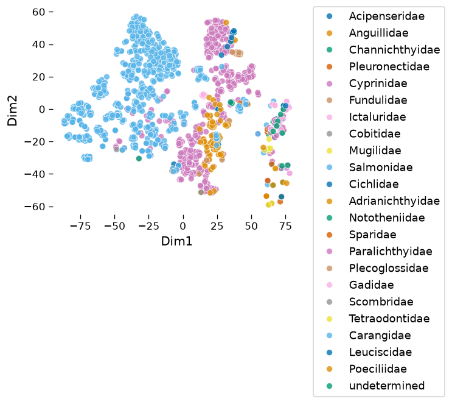

Interesting! First, the graph shows a large Salmonidae cluster in addition to a separate cluster of various families.\

Now, let’s focus on further analyses. We will first convert our data into a count table using `glycowork.motif.processing.presence_to_matrix` and then visualize the results. A heatmap can be generated using `glycowork.motif.analysis.get_heatmap`, and the `yticklabels = True` option allows us to display all the labels.

``` python
df_map_fish = presence_to_matrix(df_fish, label_col_name = 'Family')
get_heatmap(df_map_fish, motifs = True, feature_set = ['known', 'exhaustive'], datatype = 'presence', show_all = True)
```

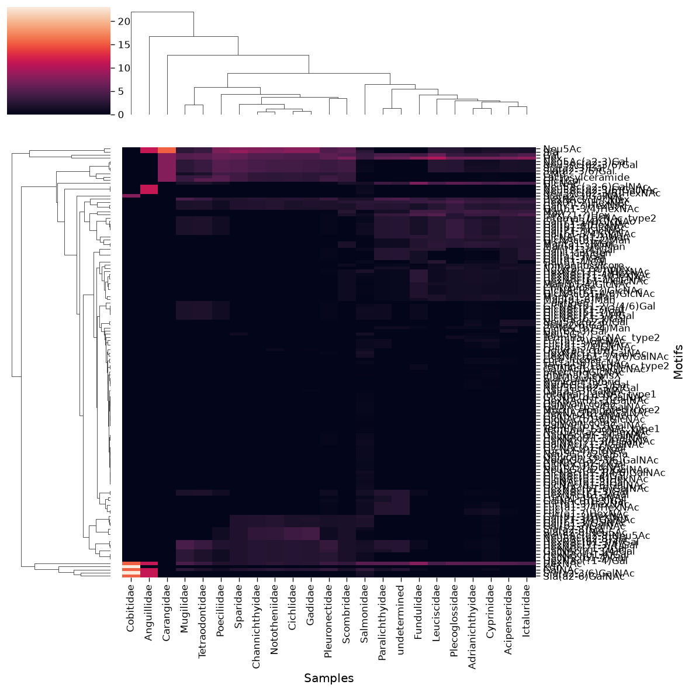

The first thing that catches the eye is the presence of a bunch of glycan motifs in Mugilidae to Cichlidae that are absent in the other classes. One hypothesis for this is that these families mainly contain glycosphingolipids in our database, while the other families focus on *N*-linked glycans (and Salmonidae + Cyprinidae have both as well-investigated families).\

To visualize which dots from the embedding plot correspond to glycosphingolipids, we can focus on 1Cer-containing glycans. We can map them again but with the additional option `shape_feature`. This parameter allows you to transform dots into crosses if the corresponding glycan contains the specified monosaccharide, modification, or linkage.

``` python
plot_embeddings(df_fish.glycan.values.tolist(), label_list = df_fish.Family.values.tolist(), shape_feature = "1Cer")
```

    Download completed.

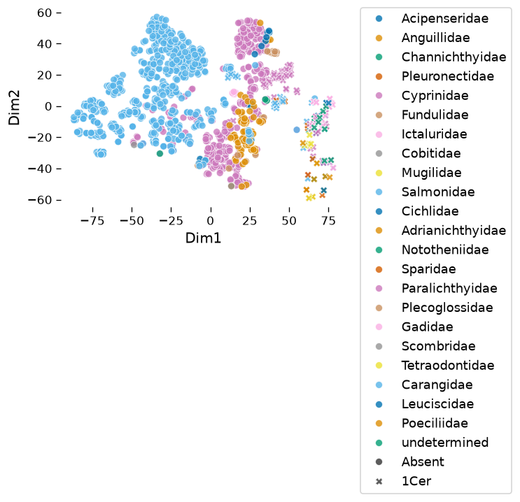

As you can see, in `df_species`, 1Cer-containing glycans (crosses) are only present in one of the two clusters (in the class Actinopterygii). In this cluster, they in turn show enriched locations, presumably corresponding to certain groups of related glycans.\

We can also use `glycowork` to take a look at the overall monosaccharide distribution in fish glycans. `glycowork.motif.analysis.characterize_monosaccharide` will be our best ally to learn what other monosaccharides, for instance, Gal variants are often connected to.\

``` python
characterize_monosaccharide('Gal', rank = 'Class', focus = 'Actinopterygii', modifications = True)
```

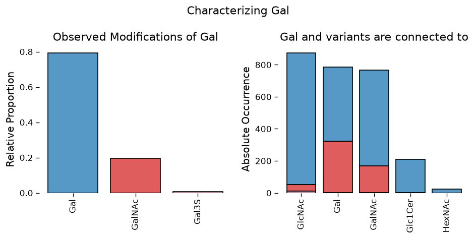

Running this analysis, it appears that Gal is found connected to GlcNAc as well as various other monosaccharides and that it does display several variants, including sulfurylated galactose.\

# Example 2: Glycan binding specificities of lectins

For this second example, we will focus on a specific set of proteins, called lectins, that bind glycans in a sequence-specific manner. One example for lectins can be found in the hemagglutinin protein of influenza virus. Influenza viruses are well known as the biological agents responsible for the seasonal flu in humans. In general, viruses penetrate inside host cells thanks to a mechanism involving contacts between proteins and glycans. Surface proteins surrounding viruses and eukaryotic cells interact together and allow the entry of viral particles inside the targeted cells. However, different influenza strains may recognize different glycosylations on proteins more or less efficiently.\

To measure these glycan binding specificities, one can add virus particles to glycan arrays presenting immobilized glycans. Such a protocol allows screening for specific binding. From such data, we can then ask what are the glycans that are the most efficiently recognized by a given influenza virus?\

Fortunately, `glycowork` can be really helpful to answer such a question! The binding specificity of 1,392 lectins for a vast range of glycans is available in the `glycan_binding` dataset. Let’s start by importing these data.

|   | 3-Anhydro-Gal(a1-3)Gal(b1-4)3-Anhydro-Gal(a1-3)Gal4S | 3-Anhydro-Gal(a1-3)Gal4S(b1-4)3-Anhydro-Gal(a1-3)Gal4S | 3-Anhydro-Gal(a1-3)Gal4S(b1-4)3-Anhydro-Gal(a1-3)Gal4S(b1-4)3-Anhydro-Gal(a1-3)Gal4S | 3-Anhydro-Gal(a1-3)Gal4S(b1-4)3-Anhydro-Gal(a1-3)Gal4S(b1-4)3-Anhydro-Gal(a1-3)Gal4S(b1-4)3-Anhydro-Gal(a1-3)Gal4S | 3-Anhydro-Gal(a1-3)Gal4S(b1-4)3-Anhydro-Gal2S(a1-3)Gal4S(b1-4)3-Anhydro-Gal(a1-3)Gal4S | 3dGal | 3dGal(b1-3)\[Fuc(a1-4)\]Glc | 3dGal(b1-4)Glc | 4d8dNeu5Ac(a2-3)Gal(b1-4)Glc | 4dNeu5Ac(a2-3)Gal(b1-4)Glc | 7dNeu5Ac(a2-3)Gal(b1-4)Glc | 8dNeu5Ac(a2-3)Gal(b1-4)Glc | 8eLeg5Ac7Ac(a2-6)Gal(a1-3)FucNAc(a1-3)GlcNAc(a1-4)8eLeg5Ac7Ac | 8eLeg5Ac7Ac(a2-6)Gal(b1-3)FucNAc(a1-3)GlcNAc(a1-4)8eLeg5Ac7Ac | 9dNeu5Ac(a2-3)Gal(b1-4)Glc | Ara | Ara(a1-2)Xyl(b1-4)Xyl(b1-4)Xyl | Ara(a1-2)\[Ara(a1-3)\]Xyl(b1-4)Xyl(b1-4)Xyl | Ara(a1-2)\[Ara(a1-3)\]\[Xyl(b1-4)\]Xyl(b1-4)Xyl(b1-4)Xyl | Ara(a1-3)Xyl(b1-4)Xyl | Ara(a1-3)Xyl(b1-4)Xyl(b1-4)Xyl | Ara(a1-3)\[Ara(a1-5)\]Ara(a1-5)Ara(a1-5)Ara | Ara(a1-3)\[Xyl(b1-4)\]Xyl(b1-4)Xyl(b1-4)Xyl | Ara(a1-5)Ara | Ara(a1-5)Ara(a1-5)Ara | Ara(a1-5)Ara(a1-5)Ara(a1-5)Ara | Ara(a1-5)Ara(a1-5)Ara(a1-5)Ara(a1-5)Ara | Ara(a1-5)Ara(a1-5)Ara(a1-5)Ara(a1-5)Ara(a1-5)Ara | Ara(a1-5)Ara(a1-5)Ara(a1-5)Ara(a1-5)Ara(a1-5)Ara(a1-5)Ara | Ara(a1-5)Ara(a1-5)Ara(a1-5)Ara(a1-5)Ara(a1-5)Ara(a1-5)Ara(a1-5)Ara | Ara(a1-5)Ara(a1-5)Ara(a1-5)Ara(a1-5)Ara(a1-5)Ara(a1-5)Ara(a1-5)Ara(a1-5)Ara | Ara(a1-5)Ara(a1-5)\[Ara(a1-3)\]Ara(a1-5)Ara(a1-5)Ara | Araf(a1-3)\[Araf(a1-5)\]Araf | Araf(a1-3)\[Araf(a1-5)\]Araf(a1-5)Araf | Araf(a1-5)Araf | Araf(a1-5)Araf(a1-3)\[Araf(a1-5)Araf(a1-5)\]Araf(a1-5)Araf | Araf(a1-5)Araf(a1-5)Araf(a1-5)Araf(a1-5)Araf(a1-5)Araf | Araf(b1-2)Araf(a1-3)\[Araf(b1-2)Araf(a1-5)\]Araf(a1-5)Araf | Col(a1-3)\[Col(a1-6)\]Glc(a1-4)Gal(a1-3)GlcNAc | D-FucNAc | D-Rha | D-Rha4NAc(a1-3)Fuc(a1-4)Glc(b1-3)GalNAc(a1-2)D-Rha4NAc | Fru6P | Fuc | Fuc(a1-2)Gal | Fuc(a1-2)Gal(b1-3)GalNAc | Fuc(a1-2)Gal(b1-3)GalNAc(a1-3)GlcNAc(a1-2)Fuc | Fuc(a1-2)Gal(b1-3)GalNAc(a1-3)\[Fuc(a1-2)\]Gal(b1-4)Glc | Fuc(a1-2)Gal(b1-3)GalNAc(a1-3)\[Fuc(a1-2)\]Gal(b1-4)GlcNAc | Fuc(a1-2)Gal(b1-3)GalNAc(b1-3)Gal | Fuc(a1-2)Gal(b1-3)GalNAc(b1-3)Gal(a1-4)Gal(b1-4)Glc | Fuc(a1-2)Gal(b1-3)GalNAc(b1-3)Gal(a1-4)Gal(b1-4)GlcNAc | Fuc(a1-2)Gal(b1-3)GalNAc(b1-3)Gal(b1-4)Glc | Fuc(a1-2)Gal(b1-3)GalNAc(b1-4)\[Neu5Ac(a2-3)\]Gal(b1-4)Glc | Fuc(a1-2)Gal(b1-3)Glc | Fuc(a1-2)Gal(b1-3)GlcNAc | Fuc(a1-2)Gal(b1-3)GlcNAc(b1-2)Man(a1-3)\[Fuc(a1-2)Gal(b1-3)GlcNAc(b1-2)Man(a1-6)\]Man(b1-4)GlcNAc(b1-4)GlcNAc | Fuc(a1-2)Gal(b1-3)GlcNAc(b1-2)Man(a1-3)\[Fuc(a1-2)Gal(b1-3)GlcNAc(b1-2)Man(a1-6)\]Man(b1-4)GlcNAc(b1-4)\[Fuc(a1-6)\]GlcNAc | Fuc(a1-2)Gal(b1-3)GlcNAc(b1-3)Gal(a1-3)Gal(b1-4)Glc | Fuc(a1-2)Gal(b1-3)GlcNAc(b1-3)Gal(b1-4)Glc | Fuc(a1-2)Gal(b1-3)GlcNAc(b1-3)Gal(b1-4)GlcNAc | Fuc(a1-2)Gal(b1-3)GlcNAc(b1-3)Gal(b1-4)GlcNAc(b1-3)Gal(b1-4)Glc | Fuc(a1-2)Gal(b1-3)GlcNAc(b1-3)Gal(b1-4)GlcNAc(b1-3)Gal(b1-4)GlcNAc(b1-6)\[Fuc(a1-2)Gal(b1-4)GlcNAc(b1-3)\]Gal(b1-4)Glc | Fuc(a1-2)Gal(b1-3)GlcNAc(b1-3)Gal(b1-4)GlcNAc(b1-3)Gal(b1-4)GlcNAc(b1-6)\[Neu5Ac(a2-6)Gal(b1-4)GlcNAc(b1-3)\]Gal(b1-4)Glc | Fuc(a1-2)Gal(b1-3)GlcNAc(b1-3)Gal(b1-4)GlcNAc(b1-6)\[Fuc(a1-2)Gal(b1-3)GlcNAc(b1-3)\]Gal(b1-4)Glc | Fuc(a1-2)Gal(b1-3)GlcNAc(b1-3)Gal(b1-4)\[Fuc(a1-3)\]GlcNAc(b1-6)\[Gal(b1-3)GlcNAc(b1-3)\]Gal(b1-4)Glc | Fuc(a1-2)Gal(b1-3)GlcNAc(b1-3)GalNAc | Fuc(a1-2)Gal(b1-3)GlcNAc(b1-3)\[Fuc(a1-2)Gal(b1-3)GlcNAc(b1-6)\]GalNAc | Fuc(a1-2)Gal(b1-3)GlcNAc(b1-3)\[Fuc(a1-2)Gal(b1-4)\[Fuc(a1-3)\]GlcNAc(b1-6)\]Gal(b1-4)Glc | Fuc(a1-2)Gal(b1-3)GlcNAc(b1-3)\[Fuc(a1-3)\[Gal(b1-4)\]GlcNAc(b1-6)\]Gal(b1-4)Glc | Fuc(a1-2)Gal(b1-3)GlcNAc(b1-3)\[Fuc(a1-3)\]Gal(b1-4)GlcNAc(b1-6)\[Fuc(a1-2)Gal(b1-3)GlcNAc(b1-3)\]Gal(b1-4)Glc | Fuc(a1-2)Gal(b1-3)GlcNAc(b1-3)\[Gal(b1-4)GlcNAc(b1-6)\]Gal(b1-4)Glc | Fuc(a1-2)Gal(b1-3)GlcNAc(b1-3)\[Neu5Ac(a2-3)Gal(b1-4)\[Fuc(a1-3)\]GlcNAc(b1-6)\]Gal(b1-4)Glc | Fuc(a1-2)Gal(b1-3)GlcNAc(b1-3)\[Neu5Ac(a2-6)Gal(b1-4)GlcNAc(b1-6)\]Gal(b1-4)Glc | Fuc(a1-2)Gal(b1-3)GlcNAc6S | Fuc(a1-2)Gal(b1-3)\[Fuc(a1-4)\]Glc | Fuc(a1-2)Gal(b1-3)\[Fuc(a1-4)\]GlcNAc | Fuc(a1-2)Gal(b1-3)\[Fuc(a1-4)\]GlcNAc(b1-2)Man(a1-3)\[Fuc(a1-2)Gal(b1-3)\[Fuc(a1-4)\]GlcNAc(b1-2)Man(a1-3)\]Man(b1-4)GlcNAc(b1-4)GlcNAc | Fuc(a1-2)Gal(b1-3)\[Fuc(a1-4)\]GlcNAc(b1-2)Man(a1-3)\[Fuc(a1-2)Gal(b1-3)\[Fuc(a1-4)\]GlcNAc(b1-2)Man(a1-6)\]Man(b1-4)GlcNAc(b1-4)GlcNAc | Fuc(a1-2)Gal(b1-3)\[Fuc(a1-4)\]GlcNAc(b1-2)Man(a1-3)\[Fuc(a1-2)Gal(b1-3)\[Fuc(a1-4)\]GlcNAc(b1-2)Man(a1-6)\]Man(b1-4)GlcNAc(b1-4)\[Fuc(a1-6)\]GlcNAc | Fuc(a1-2)Gal(b1-3)\[Fuc(a1-4)\]GlcNAc(b1-2)Man(a1-3)\[Fuc(a1-2)Gal(b1-3)\[Fuc(a1-4)\]GlcNAc(b1-2)Man(a1-6)\]Man(b1-4)GlcNAc(b1-4)\[Fuc(a1-6)\]GlcNAc(b1-4)\[Fuc(a1-6)\]GlcNAc | Fuc(a1-2)Gal(b1-3)\[Fuc(a1-4)\]GlcNAc(b1-3)Gal | Fuc(a1-2)Gal(b1-3)\[Fuc(a1-4)\]GlcNAc(b1-3)Gal(b1-4)Glc | Fuc(a1-2)Gal(b1-3)\[Fuc(a1-4)\]GlcNAc(b1-3)Gal(b1-4)GlcNAc(b1-6)\[Gal(b1-3)GlcNAc(b1-3)\]Gal(b1-4)Glc | Fuc(a1-2)Gal(b1-3)\[Fuc(a1-4)\]GlcNAc(b1-3)Gal(b1-4)\[Fuc(a1-3)\]GlcNAc(b1-3)Gal(b1-4)Glc | Fuc(a1-2)Gal(b1-3)\[Fuc(a1-4)\]GlcNAc(b1-3)\[Fuc(a1-2)\]Gal(b1-4)Glc | Fuc(a1-2)Gal(b1-3)\[Fuc(a1-4)\]GlcNAc(b1-3)\[Fuc(a1-3)\[Gal(b1-4)\]GlcNAc(b1-6)\]Gal(b1-4)Glc | Fuc(a1-2)Gal(b1-3)\[Fuc(a1-4)\]GlcNAc(b1-3)\[Gal(b1-4)GlcNAc(b1-6)\]Gal(b1-4)Glc | Fuc(a1-2)Gal(b1-3)\[Fuc(a1-4)\]GlcNAc(b1-3)\[Neu5Ac(a2-6)Gal(b1-4)GlcNAc(b1-6)\]Gal(b1-4)Glc | Fuc(a1-2)Gal(b1-3)\[Neu5Ac(a2-6)\]GlcNAc(b1-3)Gal(b1-4)Glc | Fuc(a1-2)Gal(b1-4)Fuc(a1-3)\]GlcNAc(b1-2)Man(a1-3)\[Fuc(a1-2)Gal(b1-4)\[Fuc(a1-3)\]GlcNAc(b1-2)Man(a1-6)\]Man(b1-4)GlcNAc(b1-4)GlcNAc | Fuc(a1-2)Gal(b1-4)Glc | Fuc(a1-2)Gal(b1-4)Glc6S | Fuc(a1-2)Gal(b1-4)GlcNAc | Fuc(a1-2)Gal(b1-4)GlcNAc(b1-2)Man | Fuc(a1-2)Gal(b1-4)GlcNAc(b1-2)Man(a1-3)\[Fuc(a1-2)Gal(b1-4)GlcNAc(b1-2)Man(a1-6)\]Man(b1-4)GlcNAc(b1-4)GlcNAc | Fuc(a1-2)Gal(b1-4)GlcNAc(b1-2)Man(a1-3)\[Fuc(a1-2)Gal(b1-4)GlcNAc(b1-2)Man(a1-6)\]Man(b1-4)GlcNAc(b1-4)\[Fuc(a1-6)\]GlcNAc | Fuc(a1-2)Gal(b1-4)GlcNAc(b1-2)Man(a1-6)\[Gal(b1-4)GlcNAc(b1-2)Man(a1-3)\]Man(b1-4)GlcNAc(b1-4)GlcNAc | Fuc(a1-2)Gal(b1-4)GlcNAc(b1-2)\[Fuc(a1-2)Gal(b1-4)GlcNAc(b1-4)\]Man(a1-3)\[Fuc(a1-2)Gal(b1-4)GlcNAc(b1-2)Man(a1-6)\]Man(b1-4)GlcNAc(b1-4)GlcNAc | Fuc(a1-2)Gal(b1-4)GlcNAc(b1-3)Gal(b1-3)GalNAc | Fuc(a1-2)Gal(b1-4)GlcNAc(b1-3)Gal(b1-3)\[Fuc(a1-3)\[Gal(b1-4)\]GlcNAc(b1-6)\]GalNAc | Fuc(a1-2)Gal(b1-4)GlcNAc(b1-3)Gal(b1-3)\[Gal(b1-4)GlcNAc(b1-6)\]GalNAc | Fuc(a1-2)Gal(b1-4)GlcNAc(b1-3)Gal(b1-3)\[GlcNAc(b1-6)\]GalNAc | Fuc(a1-2)Gal(b1-4)GlcNAc(b1-3)Gal(b1-4)Glc | Fuc(a1-2)Gal(b1-4)GlcNAc(b1-3)Gal(b1-4)GlcNAc | Fuc(a1-2)Gal(b1-4)GlcNAc(b1-3)Gal(b1-4)GlcNAc(b1-2)Man(a1-3)\[Fuc(a1-2)Gal(b1-4)GlcNAc(b1-3)Gal(b1-4)GlcNAc(b1-2)Man(a1-6)\]Man(b1-4)GlcNAc(b1-4)GlcNAc | Fuc(a1-2)Gal(b1-4)GlcNAc(b1-3)Gal(b1-4)GlcNAc(b1-3)Gal(b1-4)Glc | Fuc(a1-2)Gal(b1-4)GlcNAc(b1-3)Gal(b1-4)GlcNAc(b1-3)Gal(b1-4)GlcNAc | Fuc(a1-2)Gal(b1-4)GlcNAc(b1-3)Gal(b1-4)GlcNAc(b1-3)Gal(b1-4)GlcNAc(b1-2)Man(a1-3)\[Fuc(a1-2)Gal(b1-4)GlcNAc(b1-2)Man(a1-6)\]Man(b1-4)GlcNAc(b1-4)GlcNAc | Fuc(a1-2)Gal(b1-4)GlcNAc(b1-3)Gal(b1-4)GlcNAc(b1-3)Gal(b1-4)GlcNAc(b1-6)\[Fuc(a1-2)Gal(b1-4)GlcNAc(b1-3)\]Gal(b1-4)Glc | Fuc(a1-2)Gal(b1-4)GlcNAc(b1-3)Gal(b1-4)GlcNAc(b1-3)Gal(b1-4)GlcNAc(b1-6)\[Neu5Ac(a2-6)Gal(b1-4)GlcNAc(b1-3)\]Gal(b1-4)Glc | Fuc(a1-2)Gal(b1-4)GlcNAc(b1-3)Gal(b1-4)GlcNAc(b1-6)\[Fuc(a1-2)Gal(b1-4)GlcNAc(b1-3)\]Gal(b1-4)Glc | Fuc(a1-2)Gal(b1-4)GlcNAc(b1-3)Gal(b1-4)GlcNAc(b1-6)\[Fuc(a1-2)Gal(b1-4)GlcNAc(b1-3)\]Gal(b1-4)GlcNAc(b1-6)\[Fuc(a1-2)Gal(b1-4)GlcNAc(b1-3)\]Gal(b1-4)Glc | Fuc(a1-2)Gal(b1-4)GlcNAc(b1-3)Gal(b1-4)GlcNAc(b1-6)\[Fuc(a1-2)Gal(b1-4)GlcNAc(b1-3)\]Gal(b1-4)GlcNAc(b1-6)\[Neu5Ac(a2-6)Gal(b1-4)GlcNAc(b1-3)\]Gal(b1-4)Glc | Fuc(a1-2)Gal(b1-4)GlcNAc(b1-3)Gal(b1-4)GlcNAc(b1-6)\[Fuc(a1-3)\[Gal(b1-4)\]GlcNAc(b1-3)\]Gal(b1-4)Glc | Fuc(a1-2)Gal(b1-4)GlcNAc(b1-3)Gal(b1-4)GlcNAc(b1-6)\[Neu5Ac(a2-6)Gal(b1-4)GlcNAc(b1-3)\]Gal(b1-4)Glc | Fuc(a1-2)Gal(b1-4)GlcNAc(b1-3)Gal(b1-4)\[Fuc(a1-3)\]Glc | Fuc(a1-2)Gal(b1-4)GlcNAc(b1-3)GalNAc | Fuc(a1-2)Gal(b1-4)GlcNAc(b1-3)\[Fuc(a1-2)Gal(b1-4)GlcNAc(b1-6)\]Gal(b1-4)Glc | Fuc(a1-2)Gal(b1-4)GlcNAc(b1-3)\[Fuc(a1-2)Gal(b1-4)GlcNAc(b1-6)\]Gal(b1-4)GlcNAc(b1-3)Gal(b1-4)Glc | Fuc(a1-2)Gal(b1-4)GlcNAc(b1-3)\[Fuc(a1-2)Gal(b1-4)GlcNAc(b1-6)\]Gal(b1-4)GlcNAc(b1-6)\[Neu5Ac(a2-6)Gal(b1-4)GlcNAc(b1-3)\]Gal(b1-4)Glc | Fuc(a1-2)Gal(b1-4)GlcNAc(b1-3)\[Fuc(a1-2)Gal(b1-4)GlcNAc(b1-6)\]GalNAc | Fuc(a1-2)Gal(b1-4)GlcNAc(b1-3)\[Fuc(a1-3)\[Gal(b1-4)\]GlcNAc(b1-6)\]Gal(b1-4)Glc | Fuc(a1-2)Gal(b1-4)GlcNAc(b1-3)\[Gal(b1-4)GlcNAc(b1-6)\]Gal(b1-4)Glc | Fuc(a1-2)Gal(b1-4)GlcNAc(b1-3)\[Gal(b1-4)GlcNAc(b1-6)\]Gal(b1-4)GlcNAc(b1-6)\[Fuc(a1-2)Gal(b1-4)GlcNAc(b1-3)\]Gal(b1-4)Glc | Fuc(a1-2)Gal(b1-4)GlcNAc(b1-3)\[Gal(b1-4)GlcNAc(b1-6)\]Gal(b1-4)GlcNAc(b1-6)\[Neu5Ac(a2-6)Gal(b1-4)GlcNAc(b1-3)\]Gal(b1-4)Glc | Fuc(a1-2)Gal(b1-4)GlcNAc(b1-3)\[GlcNAc(b1-6)\]Gal(b1-4)Glc | Fuc(a1-2)Gal(b1-4)GlcNAc(b1-3)\[Neu5Ac(a2-6)Gal(b1-4)GlcNAc(b1-6)\]Gal(b1-4)Glc | Fuc(a1-2)Gal(b1-4)GlcNAc(b1-6)Gal(b1-4)GlcNAc(b1-3)Gal(b1-4)Glc | Fuc(a1-2)Gal(b1-4)GlcNAc(b1-6)GalNAc | Fuc(a1-2)Gal(b1-4)GlcNAc(b1-6)\[Gal(b1-4)GlcNAc(b1-3)\]Gal(b1-4)GlcNAc(b1-3)Gal(b1-4)Glc | Fuc(a1-2)Gal(b1-4)GlcNAc(b1-6)\[GlcNAc(b1-3)\]Gal(b1-4)GlcNAc | Fuc(a1-2)Gal(b1-4)GlcNAc(b1-6)\[GlcNAc(b1-3)\]Gal(b1-4)GlcNAc(b1-3)Gal(b1-4)Glc | Fuc(a1-2)Gal(b1-4)GlcNAc6S | Fuc(a1-2)Gal(b1-4)\[Fuc(a1-2)\]Glc | Fuc(a1-2)Gal(b1-4)\[Fuc(a1-3)\]GalNAc(b1-3)Gal(b1-4)\[Fuc(a1-3)\]GlcNAc | Fuc(a1-2)Gal(b1-4)\[Fuc(a1-3)\]GalNAc(b1-3)Gal(b1-4)\[Fuc(a1-3)\]GlcNAc(b1-3)Gal(b1-4)\[Fuc(a1-3)\]GalNAc | Fuc(a1-2)Gal(b1-4)\[Fuc(a1-3)\]Glc | Fuc(a1-2)Gal(b1-4)\[Fuc(a1-3)\]GlcNAc | Fuc(a1-2)Gal(b1-4)\[Fuc(a1-3)\]GlcNAc(b1-2)Man(a1-3)\[Fuc(a1-2)Gal(b1-4)\[Fuc(a1-3)\]GlcNAc(b1-2)Man(a1-6)\]Man(b1-4)GlcNAc(b1-4)GlcNAc | Fuc(a1-2)Gal(b1-4)\[Fuc(a1-3)\]GlcNAc(b1-2)Man(a1-3)\[Fuc(a1-2)Gal(b1-4)\[Fuc(a1-3)\]GlcNAc(b1-2)Man(a1-6)\]Man(b1-4)GlcNAc(b1-4)\[Fuc(a1-6)\]GlcNAc | Fuc(a1-2)Gal(b1-4)\[Fuc(a1-3)\]GlcNAc(b1-2)Man(a1-6)\[Fuc(a1-2)Gal(b1-4)\[Fuc(a1-3)\]GlcNAc(b1-2)Man(a1-3)\]Man(b1-4)GlcNAc(b1-4)GlcNA | Fuc(a1-2)Gal(b1-4)\[Fuc(a1-3)\]GlcNAc(b1-2)\[Fuc(a1-2)Gal(b1-4)\[Fuc(a1-3)\]GlcNAc(b1-4)\]Man(a1-3)\[Fuc(a1-2)Gal(b1-4)\[Fuc(a1-3)\]GlcNAc(b1-2)Man(a1-6)\]Man(b1-4)GlcNAc(b1-4)GlcNAc | Fuc(a1-2)Gal(b1-4)\[Fuc(a1-3)\]GlcNAc(b1-3)Gal | Fuc(a1-2)Gal(b1-4)\[Fuc(a1-3)\]GlcNAc(b1-3)Gal(b1-3)GalNAc | Fuc(a1-2)Gal(b1-4)\[Fuc(a1-3)\]GlcNAc(b1-3)Gal(b1-4)Glc | Fuc(a1-2)Gal(b1-4)\[Fuc(a1-3)\]GlcNAc(b1-3)Gal(b1-4)GlcNAc(b1-6)\[Fuc(a1-2)Gal(b1-4)\[Fuc(a1-3)\]GlcNAc(b1-3)\]Gal(b1-4)Glc | Fuc(a1-2)Gal(b1-4)\[Fuc(a1-3)\]GlcNAc(b1-3)Gal(b1-4)GlcNAc(b1-6)\[Fuc(a1-3)\[Gal(b1-4)\]GlcNAc(b1-3)\]Gal(b1-4)Glc | Fuc(a1-2)Gal(b1-4)\[Fuc(a1-3)\]GlcNAc(b1-3)Gal(b1-4)GlcNAc(b1-6)\[Neu5Ac(a2-6)Gal(b1-4)GlcNAc(b1-3)\]Gal(b1-4)Glc | Fuc(a1-2)Gal(b1-4)\[Fuc(a1-3)\]GlcNAc(b1-3)Gal(b1-4)\[Fuc(a1-3)\]GlcNAc | Fuc(a1-2)Gal(b1-4)\[Fuc(a1-3)\]GlcNAc(b1-3)Gal(b1-4)\[Fuc(a1-3)\]GlcNAc(b1-3)Gal(b1-4)\[Fuc(a1-3)\]GlcNAc | Fuc(a1-2)Gal(b1-4)\[Fuc(a1-3)\]GlcNAc(b1-3)Gal(b1-4)\[Fuc(a1-3)\]GlcNAc(b1-6)\[Fuc(a1-2)Gal(b1-4)\[Fuc(a1-3)\]GlcNAc(b1-3)\]Gal(b1-4)Glc | Fuc(a1-2)Gal(b1-4)\[Fuc(a1-3)\]GlcNAc(b1-3)Gal(b1-4)\[Fuc(a1-3)\]GlcNAc(b1-6)\[Fuc(a1-3)\[Gal(b1-4)\]GlcNAc(b1-3)\]Gal(b1-4)Glc | Fuc(a1-2)Gal(b1-4)\[Fuc(a1-3)\]GlcNAc(b1-3)Gal(b1-4)\[Fuc(a1-3)\]GlcNAc(b1-6)\[Neu5Ac(a2-6)Gal(b1-4)GlcNAc(b1-3)\]Gal(b1-4)Glc | Fuc(a1-2)Gal(b1-4)\[Fuc(a1-3)\]GlcNAc(b1-3)GalNAc | Fuc(a1-2)Gal(b1-4)\[Fuc(a1-3)\]GlcNAc(b1-3)\[Fuc(a1-2)Gal(b1-4)\[Fuc(a1-3)\]GlcNAc(b1-6)\]Gal(b1-4)Glc | Fuc(a1-2)Gal(b1-4)\[Fuc(a1-3)\]GlcNAc(b1-3)\[Fuc(a1-2)Gal(b1-4)\[Fuc(a1-3)\]GlcNAc(b1-6)\]GalNAc | Fuc(a1-2)Gal(b1-4)\[Fuc(a1-3)\]GlcNAc(b1-3)\[Fuc(a1-2)\]Gal(b1-4)Glc | Fuc(a1-2)Gal(b1-4)\[Fuc(a1-3)\]GlcNAc(b1-3)\[Fuc(a1-3)\[Gal(b1-4)\]GlcNAc(b1-6)\]Gal(b1-4)Glc | Fuc(a1-2)Gal(b1-4)\[Fuc(a1-3)\]GlcNAc(b1-3)\[Gal(b1-4)GlcNAc(b1-6)\]Gal(b1-4)Glc | Fuc(a1-2)Gal(b1-4)\[Fuc(a1-3)\]GlcNAc(b1-3)\[GlcNAc(b1-6)\]Gal(b1-4)Glc | Fuc(a1-2)Gal(b1-4)\[Fuc(a1-3)\]GlcNAc(b1-3)\[Neu5Ac(a2-6)Gal(b1-4)GlcNAc(b1-6)\]Gal(b1-4)Glc | Fuc(a1-2)Gal(b1-4)\[Fuc(a1-3)\]GlcNAc(b1-6)GalNAc | Fuc(a1-2)Gal(b1-4)\[Fuc(a1-3)\]GlcNAc(b1-6)\[Gal(b1-4)GlcNAc(b1-3)\]Gal(b1-4)Glc | Fuc(a1-2)Gal(b1-4)\[Fuc(a1-3)\]GlcNAc(b1-6)\[Neu5Ac(a2-6)Gal(b1-3)\]GalNAc | Fuc(a1-2)Gal3S | Fuc(a1-2)Gal3S(b1-4)GlcNAc | Fuc(a1-2)Gal6S(b1-3)GlcNAc | Fuc(a1-2)Gal6S(b1-3)GlcNAc6S | Fuc(a1-2)Gal6S(b1-4)Glc | Fuc(a1-2)Gal6S(b1-4)Glc6S | Fuc(a1-2)Gal6S(b1-4)GlcNAc | Fuc(a1-2)GlcNAc | Fuc(a1-2)\[Gal(a1-3)\]Gal | Fuc(a1-2)\[Gal(a1-3)\]Gal(a1-4)GlcNAc | Fuc(a1-2)\[Gal(a1-3)\]Gal(b1-3)GalNAc | Fuc(a1-2)\[Gal(a1-3)\]Gal(b1-3)GalNAc(b1-3)Gal | Fuc(a1-2)\[Gal(a1-3)\]Gal(b1-3)GalNAc(b1-3)Gal(a1-4)Gal(b1-4)Glc | Fuc(a1-2)\[Gal(a1-3)\]Gal(b1-3)GalNAc(b1-3)Gal(a1-4)Gal(b1-4)GlcNAc | Fuc(a1-2)\[Gal(a1-3)\]Gal(b1-3)GlcNAc | Fuc(a1-2)\[Gal(a1-3)\]Gal(b1-3)GlcNAc(b1-2)Man(a1-3)\[Fuc(a1-2)\[Gal(a1-3)\]Gal(b1-3)GlcNAc(b1-2)Man(a1-6)\]Man(b1-4)GlcNAc(b1-4)GlcNAc | Fuc(a1-2)\[Gal(a1-3)\]Gal(b1-3)GlcNAc(b1-2)Man(a1-3)\[Fuc(a1-2)\[Gal(a1-3)\]Gal(b1-3)GlcNAc(b1-2)Man(a1-6)\]Man(b1-4)GlcNAc(b1-4)\[Fuc(a1-6)\]GlcNAc | Fuc(a1-2)\[Gal(a1-3)\]Gal(b1-3)GlcNAc(b1-3)Gal | Fuc(a1-2)\[Gal(a1-3)\]Gal(b1-3)GlcNAc(b1-3)Gal(b1-4)Glc | Fuc(a1-2)\[Gal(a1-3)\]Gal(b1-3)GlcNAc(b1-3)GalNAc | Fuc(a1-2)\[Gal(a1-3)\]Gal(b1-3)GlcNAc(b1-6)GalNAc | Fuc(a1-2)\[Gal(a1-3)\]Gal(b1-3)\[Fuc(a1-4)\]GlcNAc | Fuc(a1-2)\[Gal(a1-3)\]Gal(b1-4)Glc | Fuc(a1-2)\[Gal(a1-3)\]Gal(b1-4)GlcNAc | Fuc(a1-2)\[Gal(a1-3)\]Gal(b1-4)GlcNAc(b1-2)Man | Fuc(a1-2)\[Gal(a1-3)\]Gal(b1-4)GlcNAc(b1-2)Man(a1-3)\[Fuc(a1-2)\[Gal(a1-3)\]Gal(b1-4)GlcNAc(b1-2)Man(a1-6)\]Man(b1-4)GlcNAc(b1-4)GlcNAc | Fuc(a1-2)\[Gal(a1-3)\]Gal(b1-4)GlcNAc(b1-2)Man(a1-3)\[Fuc(a1-2)\[Gal(a1-3)\]Gal(b1-4)GlcNAc(b1-2)Man(a1-6)\]Man(b1-4)GlcNAc(b1-4)\[Fuc(a1-6)\]GlcNAc | Fuc(a1-2)\[Gal(a1-3)\]Gal(b1-4)GlcNAc(b1-3)Gal | Fuc(a1-2)\[Gal(a1-3)\]Gal(b1-4)GlcNAc(b1-3)Gal(b1-3)GalNAc | Fuc(a1-2)\[Gal(a1-3)\]Gal(b1-4)GlcNAc(b1-3)Gal(b1-4)Glc | Fuc(a1-2)\[Gal(a1-3)\]Gal(b1-4)GlcNAc(b1-3)Gal(b1-4)GlcNAc(b1-3)\[Fuc(a1-2)\[Gal(a1-3)\]Gal(b1-4)GlcNAc(b1-6)\]Gal(b1-4)GlcNAc(b1-3)Gal(b1-4)Glc | Fuc(a1-2)\[Gal(a1-3)\]Gal(b1-4)GlcNAc(b1-3)GalNAc | Fuc(a1-2)\[Gal(a1-3)\]Gal(b1-4)GlcNAc(b1-3)\[Fuc(a1-2)\[Gal(a1-3)\]Gal(b1-4)GlcNAc(b1-6)\]Gal(b1-4)GlcNAc(b1-3)Gal(b1-4)Glc | Fuc(a1-2)\[Gal(a1-3)\]Gal(b1-4)GlcNAc(b1-3)\[Fuc(a1-2)\[Gal(a1-3)\]Gal(b1-4)GlcNAc(b1-6)\]GalNAc | Fuc(a1-2)\[Gal(a1-3)\]Gal(b1-4)GlcNAc(b1-6)GalNAc | Fuc(a1-2)\[Gal(a1-3)\]Gal(b1-4)\[Fuc(a1-3)\]Glc | Fuc(a1-2)\[Gal(a1-3)\]Gal(b1-4)\[Fuc(a1-3)\]GlcNAc | Fuc(a1-2)\[Gal(a1-3)\]Gal(b1-4)\[Fuc(a1-3)\]GlcNAc(b1-3)GalNAc | Fuc(a1-2)\[Gal(a1-4)\]Gal(b1-4)GalNAc | Fuc(a1-2)\[Gal(a1-4)\]Gal(b1-4)GlcNAc | Fuc(a1-2)\[Gal(b1-3)\]Gal | Fuc(a1-2)\[Gal(b1-3)\]Gal(b1-4)\[Fuc(a1-3)\]Glc | Fuc(a1-2)\[GalN(a1-3)\]Gal | Fuc(a1-2)\[GalNAc(a1-3)\]Gal | Fuc(a1-2)\[GalNAc(a1-3)\]Gal(a1-3)GalNAc | Fuc(a1-2)\[GalNAc(a1-3)\]Gal(a1-4)GlcNAc | Fuc(a1-2)\[GalNAc(a1-3)\]Gal(b1-3)GalNAc | Fuc(a1-2)\[GalNAc(a1-3)\]Gal(b1-3)GalNAc(a1-3)\[Fuc(a1-2)\]Gal(b1-4)GlcNAc | Fuc(a1-2)\[GalNAc(a1-3)\]Gal(b1-3)GalNAc(b1-3)Gal | Fuc(a1-2)\[GalNAc(a1-3)\]Gal(b1-3)GalNAc(b1-3)Gal(a1-4)Gal(b1-4)Glc | Fuc(a1-2)\[GalNAc(a1-3)\]Gal(b1-3)GalNAc(b1-3)Gal(a1-4)Gal(b1-4)GlcNAc | Fuc(a1-2)\[GalNAc(a1-3)\]Gal(b1-3)GlcNAc | Fuc(a1-2)\[GalNAc(a1-3)\]Gal(b1-3)GlcNAc(b1-2)Man(a1-3)\[Fuc(a1-2)\[GalNAc(a1-3)\]Gal(b1-3)GlcNAc(b1-2)Man(a1-6)\]Man(b1-4)GlcNAc(b1-4)GlcNAc | Fuc(a1-2)\[GalNAc(a1-3)\]Gal(b1-3)GlcNAc(b1-2)Man(a1-3)\[Fuc(a1-2)\[GalNAc(a1-3)\]Gal(b1-3)GlcNAc(b1-2)Man(a1-6)\]Man(b1-4)GlcNAc(b1-4)\[Fuc(a1-6)\]GlcNAc | Fuc(a1-2)\[GalNAc(a1-3)\]Gal(b1-3)GlcNAc(b1-3)Gal | Fuc(a1-2)\[GalNAc(a1-3)\]Gal(b1-3)GlcNAc(b1-3)Gal(b1-4)Glc | Fuc(a1-2)\[GalNAc(a1-3)\]Gal(b1-3)GlcNAc(b1-3)Gal(b1-4)GlcNAc | Fuc(a1-2)\[GalNAc(a1-3)\]Gal(b1-3)GlcNAc(b1-3)GalNAc | Fuc(a1-2)\[GalNAc(a1-3)\]Gal(b1-3)GlcNAc(b1-6)GalNAc | Fuc(a1-2)\[GalNAc(a1-3)\]Gal(b1-3)\[Fuc(a1-4)\]GlcNAc | Fuc(a1-2)\[GalNAc(a1-3)\]Gal(b1-3)\[Fuc(a1-4)\]GlcNAc(b1-3)Gal(b1-4)Glc | Fuc(a1-2)\[GalNAc(a1-3)\]Gal(b1-4)Glc | Fuc(a1-2)\[GalNAc(a1-3)\]Gal(b1-4)GlcNAc | Fuc(a1-2)\[GalNAc(a1-3)\]Gal(b1-4)GlcNAc(b1-2)Man | Fuc(a1-2)\[GalNAc(a1-3)\]Gal(b1-4)GlcNAc(b1-2)Man(a1-3)\[Fuc(a1-2)\[GalNAc(a1-3)\]Gal(b1-4)GlcNAc(b1-2)Man(a1-6)\]Man(b1-4)GlcNAc(b1-4)GlcNAc | Fuc(a1-2)\[GalNAc(a1-3)\]Gal(b1-4)GlcNAc(b1-2)Man(a1-3)\[Fuc(a1-2)\[GalNAc(a1-3)\]Gal(b1-4)GlcNAc(b1-2)Man(a1-6)\]Man(b1-4)GlcNAc(b1-4)\[Fuc(a1-6)\]GlcNAc | Fuc(a1-2)\[GalNAc(a1-3)\]Gal(b1-4)GlcNAc(b1-3)Gal | Fuc(a1-2)\[GalNAc(a1-3)\]Gal(b1-4)GlcNAc(b1-3)Gal(b1-3)GalNAc | Fuc(a1-2)\[GalNAc(a1-3)\]Gal(b1-4)GlcNAc(b1-3)Gal(b1-4)Glc | Fuc(a1-2)\[GalNAc(a1-3)\]Gal(b1-4)GlcNAc(b1-3)Gal(b1-4)GlcNAc | Fuc(a1-2)\[GalNAc(a1-3)\]Gal(b1-4)GlcNAc(b1-3)Gal(b1-4)GlcNAc(b1-3)Gal(b1-4)Glc | Fuc(a1-2)\[GalNAc(a1-3)\]Gal(b1-4)GlcNAc(b1-3)Gal(b1-4)GlcNAc(b1-3)Gal(b1-4)GlcNAc | Fuc(a1-2)\[GalNAc(a1-3)\]Gal(b1-4)GlcNAc(b1-3)Gal(b1-4)GlcNAc(b1-3)\[Fuc(a1-2)\[GalNAc(a1-3)\]Gal(b1-4)GlcNAc(b1-6)\]Gal(b1-4)GlcNAc(b1-3)Gal(b1-4)Glc | Fuc(a1-2)\[GalNAc(a1-3)\]Gal(b1-4)GlcNAc(b1-3)GalNAc | Fuc(a1-2)\[GalNAc(a1-3)\]Gal(b1-4)GlcNAc(b1-3)\[Fuc(a1-2)\[GalNAc(a1-3)\]Gal(b1-4)GlcNAc(b1-6)\]GalNAc | Fuc(a1-2)\[GalNAc(a1-3)\]Gal(b1-4)GlcNAc(b1-6)GalNAc | Fuc(a1-2)\[GalNAc(a1-3)\]Gal(b1-4)\[Fuc(a1-2)\]Glc | Fuc(a1-2)\[GalNAc(a1-3)\]Gal(b1-4)\[Fuc(a1-3)\]Glc | Fuc(a1-2)\[GalNAc(a1-3)\]Gal(b1-4)\[Fuc(a1-3)\]GlcNAc | Fuc(a1-2)\[GalNAc(a1-3)\]Gal(b1-4)\[Fuc(a1-3)\]GlcNAc(b1-3)GalNAc | Fuc(a1-2)\[GalNAc(a1-3)\]GalNAc | Fuc(a1-2)\[GalNAc(a1-4)\]Gal(b1-4)GlcNAc | Fuc(a1-2)\[GalNAc(b1-3)\]Gal | Fuc(a1-2)\[GalNAc(b1-3)\]Gal(b1-4)Glc | Fuc(a1-2)\[GalNAc(b1-3)\]Gal(b1-4)GlcNAc | Fuc(a1-2)\[GalNAc(b1-3)\]Gal(b1-4)\[Fuc(a1-3)\]GlcNAc | Fuc(a1-2)\[GalNGc(a1-3)\]Gal | Fuc(a1-2)\[Neu5Ac(a2-3)\]Gal(b1-4)GlcNAc(b1-3)GalNAc | Fuc(a1-2)\[Neu5Ac(a2-6)\]Gal(b1-3)GlcNAc(b1-3)Gal(b1-4)Glc | Fuc(a1-2)\[Neu5Ac(a2-6)\]Gal(b1-4)GlcNAc | Fuc(a1-2)\[Neu5Ac(a2-6)\]Gal(b1-4)GlcNAc(b1-3)\[Neu5Ac(a2-6)Gal(b1-4)GlcNAc(b1-6)\]Gal(b1-4)Glc | Fuc(a1-2)\[Neu5Ac(b2-6)\]Gal(b1-4)GlcNAc | Fuc(a1-2)\[Neu5Ac(a2-3)\]Gal(b1-3)GlcNAc(b1-3)Gal(b1-4)Glc | Fuc(a1-3)Gal(b1-4)GlcNAc(b1-3)Gal(b1-4)\[Fuc(a1-3)\]Glc | Fuc(a1-3)GlcNAc | Fuc(a1-3)GlcNAc(b1-3)\[Gal(b1-4)GlcNAc(b1-6)\]Gal(b1-4)Glc | Fuc(a1-3)GlcNAc6S | Fuc(a1-3)Xluf(b1-3)Fuc | Fuc(a1-3)Xulf(b1-3)Fuc | Fuc(a1-3)\[3dGal(b1-4)\]Glc | Fuc(a1-3)\[3dGal(b1-4)\]GlcNAc(b1-3)Gal | Fuc(a1-3)\[Fuc(a1-6)\]GlcNAc | Fuc(a1-3)\[Gal(b1-4)\]Glc | Fuc(a1-3)\[Gal(b1-4)\]Glc6S | Fuc(a1-3)\[Gal(b1-4)\]GlcNAc | Fuc(a1-3)\[Gal(b1-4)\]GlcNAc(b1-2)Man | Fuc(a1-3)\[Gal(b1-4)\]GlcNAc(b1-2)Man(a1-3)Man(b1-4)GlcNAc(b1-4)GlcNAc | Fuc(a1-3)\[Gal(b1-4)\]GlcNAc(b1-2)Man(a1-3)\[Fuc(a1-3)\[Gal(b1-4)\]GlcNAc(b1-2)Man(a1-6)\]Man(b1-4)GlcNAc(b1-4)GlcNAc | Fuc(a1-3)\[Gal(b1-4)\]GlcNAc(b1-2)Man(a1-3)\[Fuc(a1-3)\[Gal(b1-4)\]GlcNAc(b1-2)Man(a1-6)\]Man(b1-4)GlcNAc(b1-4)\[Fuc(a1-6)\]GlcNAc | Fuc(a1-3)\[Gal(b1-4)\]GlcNAc(b1-2)Man(a1-3)\[Fuc(a1-3)\[Gal(b1-4)\]GlcNAc(b1-2)Man(a1-6)\]\[GlcNAc(b1-4)\]Man(b1-4)GlcNAc(b1-4)GlcNAc | Fuc(a1-3)\[Gal(b1-4)\]GlcNAc(b1-2)Man(a1-3)\[Fuc(a1-3)\[Gal(b1-4)\]GlcNAc(b1-2)Man(a1-6)\]\[Xyl(b1-2)\]Man(b1-4)GlcNAc(b1-4)GlcNAc | Fuc(a1-3)\[Gal(b1-4)\]GlcNAc(b1-2)Man(a1-3)\[Fuc(a1-3)\[Gal(b1-4)\]GlcNAc(b1-2)Man(a1-6)\]\[Xyl(b1-2)\]Man(b1-4)GlcNAc(b1-4)\[Fuc(a1-3)\]\[Fuc(a1-6)\]GlcNAc | Fuc(a1-3)\[Gal(b1-4)\]GlcNAc(b1-2)Man(a1-3)\[Gal(b1-4)GlcNAc(b1-2)Man(a1-6)\]Man(b1-4)GlcNAc(b1-4)GlcNAc | Fuc(a1-3)\[Gal(b1-4)\]GlcNAc(b1-2)Man(a1-3)\[Gal(b1-4)GlcNAc(b1-2)Man(a1-6)\]\[GlcNAc(b1-4)\]Man(b1-4)GlcNAc(b1-4)GlcNAc | Fuc(a1-3)\[Gal(b1-4)\]GlcNAc(b1-2)Man(a1-3)\[GlcNAc(b1-2)Man(a1-6)\]Man(b1-4)GlcNAc(b1-4)GlcNAc | Fuc(a1-3)\[Gal(b1-4)\]GlcNAc(b1-2)Man(a1-3)\[GlcNAc(b1-2)Man(a1-6)\]\[GlcNAc(b1-4)\]Man(b1-4)GlcNAc(b1-4)GlcNAc | Fuc(a1-3)\[Gal(b1-4)\]GlcNAc(b1-2)Man(a1-3)\[Man(a1-3)\[Man(a1-6)\]Man(a1-6)\]Man(b1-4)GlcNAc(b1-4)GlcNAc | Fuc(a1-3)\[Gal(b1-4)\]GlcNAc(b1-2)Man(a1-3)\[Man(a1-6)\]Man(b1-4)GlcNAc(b1-4)GlcNAc | Fuc(a1-3)\[Gal(b1-4)\]GlcNAc(b1-2)Man(a1-3)\[Xyl(b1-2)\]Man(b1-4)GlcNAc(b1-4)GlcNAc | Fuc(a1-3)\[Gal(b1-4)\]GlcNAc(b1-2)Man(a1-3)\[Xyl(b1-2)\]Man(b1-4)GlcNAc(b1-4)\[Fuc(a1-6)\]GlcNAc | Fuc(a1-3)\[Gal(b1-4)\]GlcNAc(b1-2)Man(a1-3)\[Xyl(b1-2)\]\[Man(a1-6)\]Man(b1-4)GlcNAc(b1-4)GlcNAc | Fuc(a1-3)\[Gal(b1-4)\]GlcNAc(b1-2)Man(a1-6)Man(b1-4)GlcNAc(b1-4)GlcNAc | Fuc(a1-3)\[Gal(b1-4)\]GlcNAc(b1-2)Man(a1-6)\[Gal(b1-4)GlcNAc(b1-2)Man(a1-3)\]Man(b1-4)GlcNAc(b1-4)GlcNAc | Fuc(a1-3)\[Gal(b1-4)\]GlcNAc(b1-2)Man(a1-6)\[GlcNAc(b1-2)Man(a1-3)\]Man(b1-4)GlcNAc(b1-4)GlcNAc | Fuc(a1-3)\[Gal(b1-4)\]GlcNAc(b1-2)Man(a1-6)\[GlcNAc(b1-2)Man(a1-3)\]\[GlcNAc(b1-4)\]Man(b1-4)GlcNAc(b1-4)GlcNAc | Fuc(a1-3)\[Gal(b1-4)\]GlcNAc(b1-2)Man(a1-6)\[Man(a1-3)\]Man(b1-4)GlcNAc(b1-4)GlcNAc | Fuc(a1-3)\[Gal(b1-4)\]GlcNAc(b1-2)Man(a1-6)\[Xyl(b1-2)\]\[Man(a1-3)\]Man(b1-4)GlcNAc(b1-4)GlcNAc | Fuc(a1-3)\[Gal(b1-4)\]GlcNAc(b1-2)\[Fuc(a1-3)\[Gal(b1-4)\]GlcNAc(b1-4)\]Man(a1-3)\[Fuc(a1-3)\[Gal(b1-4)\]GlcNAc(b1-2)Man(a1-6)\]Man(b1-4)GlcNAc(b1-4)GlcNAc | Fuc(a1-3)\[Gal(b1-4)\]GlcNAc(b1-2)\[Fuc(a1-3)\[Gal(b1-4)\]GlcNAc(b1-6)\]Man | Fuc(a1-3)\[Gal(b1-4)\]GlcNAc(b1-2)\[Gal(b1-4)GlcNAc(b1-6)\]Man | Fuc(a1-3)\[Gal(b1-4)\]GlcNAc(b1-2)\[GlcNAc(b1-6)\]Man | Fuc(a1-3)\[Gal(b1-4)\]GlcNAc(b1-3)Gal | Fuc(a1-3)\[Gal(b1-4)\]GlcNAc(b1-3)Gal(b1-3)GalNAc | Fuc(a1-3)\[Gal(b1-4)\]GlcNAc(b1-3)Gal(b1-3)\[Fuc(a1-4)\]GlcNAc | Fuc(a1-3)\[Gal(b1-4)\]GlcNAc(b1-3)Gal(b1-4)Glc | Fuc(a1-3)\[Gal(b1-4)\]GlcNAc(b1-3)Gal(b1-4)GlcNAc(b1-2)Man(a1-6)\[Neu5Ac(a2-6)Gal(b1-4)GlcNAc(b1-3)Gal(b1-4)GlcNAc(b1-2)Man(a1-3)\]Man(b1-4)GlcNAc(b1-4)GlcNAc | Fuc(a1-3)\[Gal(b1-4)\]GlcNAc(b1-3)Gal(b1-4)GlcNAc(b1-3)Gal(b1-4)GlcNAc(b1-2)Man(a1-3)\[GlcNAc(b1-2)Man(a1-6)\]Man(b1-4)GlcNAc(b1-4)GlcNAc | Fuc(a1-3)\[Gal(b1-4)\]GlcNAc(b1-3)Gal(b1-4)GlcNAc(b1-3)Gal(b1-4)GlcNAc(b1-6)\[GlcNAc(b1-2)\]Man(a1-6)\[Gal(b1-4)GlcNAc(b1-3)Gal(b1-4)GlcNAc(b1-2)Man(a1-3)\]Man(b1-4)GlcNAc(b1-4)GlcNAc | Fuc(a1-3)\[Gal(b1-4)\]GlcNAc(b1-3)Gal(b1-4)GlcNAc(b1-3)Gal(b1-4)GlcNAc(b1-6)\[GlcNAc(b1-2)\]Man(a1-6)\[Neu5Ac(a2-3)Gal(b1-4)GlcNAc(b1-3)Gal(b1-4)GlcNAc(b1-2)Man(a1-3)\]Man(b1-4)GlcNAc(b1-4)GlcNAc | Fuc(a1-3)\[Gal(b1-4)\]GlcNAc(b1-3)Gal(b1-4)GlcNAc(b1-6)\[Fuc(a1-3)\[Gal(b1-4)\]GlcNAc(b1-3)\]Gal(b1-4)Glc | Fuc(a1-3)\[Gal(b1-4)\]GlcNAc(b1-3)Gal(b1-4)\[Fuc(a1-3)\]Glc | Fuc(a1-3)\[Gal(b1-4)\]GlcNAc(b1-3)Gal(b1-4)\[Fuc(a1-3)\]GlcNAc | Fuc(a1-3)\[Gal(b1-4)\]GlcNAc(b1-3)Gal(b1-4)\[Fuc(a1-3)\]GlcNAc(b1-2)Man(a1-3)\[Fuc(a1-3)\[Gal(b1-4)\]GlcNAc(b1-3)Gal(b1-4)\[Fuc(a1-3)\]GlcNAc(b1-2)Man(a1-6)\]Man(b1-4)GlcNAc(b1-4)GlcNAc | Fuc(a1-3)\[Gal(b1-4)\]GlcNAc(b1-3)Gal(b1-4)\[Fuc(a1-3)\]GlcNAc(b1-3)Gal(b1-4)Glc | Fuc(a1-3)\[Gal(b1-4)\]GlcNAc(b1-3)Gal(b1-4)\[Fuc(a1-3)\]GlcNAc(b1-3)Gal(b1-4)\[Fuc(a1-3)\]Glc | Fuc(a1-3)\[Gal(b1-4)\]GlcNAc(b1-3)Gal(b1-4)\[Fuc(a1-3)\]GlcNAc(b1-3)Gal(b1-4)\[Fuc(a1-3)\]GlcNAc | Fuc(a1-3)\[Gal(b1-4)\]GlcNAc(b1-3)Gal(b1-4)\[Fuc(a1-3)\]GlcNAc(b1-3)Gal(b1-4)\[Fuc(a1-3)\]GlcNAc(b1-2)Man(a1-3)\[Fuc(a1-3)\[Gal(b1-4)\]GlcNAc(b1-3)Gal(b1-4)\[Fuc(a1-3)\]GlcNAc(b1-3)Gal(b1-4)\[Fuc(a1-3)\]GlcNAc(b1-2)Man(a1-6)\]Man(b1-4)GlcNAc(b1-4)GlcNAc | Fuc(a1-3)\[Gal(b1-4)\]GlcNAc(b1-3)Gal(b1-4)\[Fuc(a1-3)\]GlcNAc(b1-6)\[Fuc(a1-3)\[Gal(b1-4)\]GlcNAc(b1-3)\]Gal(b1-4)Glc | Fuc(a1-3)\[Gal(b1-4)\]GlcNAc(b1-3)Gal(b1-4)\[Fuc(a1-3)\]GlcNAc(b1-6)\[Gal(b1-3)GlcNAc(b1-3)\]Gal(b1-4)Glc | Fuc(a1-3)\[Gal(b1-4)\]GlcNAc(b1-3)Gal(b1-4)\[Fuc(a1-3)\]GlcNAc(b1-6)\[Gal(b1-3)\[Fuc(a1-4)\]GlcNAc(b1-3)\]Gal(b1-4)Glc | Fuc(a1-3)\[Gal(b1-4)\]GlcNAc(b1-3)GalNAc | Fuc(a1-3)\[Gal(b1-4)\]GlcNAc(b1-3)\[Fuc(a1-2)\]Gal(b1-4)Glc | Fuc(a1-3)\[Gal(b1-4)\]GlcNAc(b1-3)\[Fuc(a1-3)\[Gal(b1-4)\]GlcNAc(b1-6)\]Gal(b1-4)Glc | Fuc(a1-3)\[Gal(b1-4)\]GlcNAc(b1-3)\[Fuc(a1-3)\[Gal(b1-4)\]GlcNAc(b1-6)\]Gal(b1-4)GlcNAc(b1-6)\[Neu5Ac(a2-6)Gal(b1-4)GlcNAc(b1-3)\]Gal(b1-4)Glc | Fuc(a1-3)\[Gal(b1-4)\]GlcNAc(b1-3)\[Fuc(a1-3)\[Gal(b1-4)\]GlcNAc(b1-6)\]GalNAc | Fuc(a1-3)\[Gal(b1-4)\]GlcNAc(b1-3)\[Gal(b1-4)GlcNAc(b1-6)\]Gal(b1-4)Glc | Fuc(a1-3)\[Gal(b1-4)\]GlcNAc(b1-3)\[GlcNAc(b1-6)\]Gal(b1-4)Glc | Fuc(a1-3)\[Gal(b1-4)\]GlcNAc(b1-4)Gal(b1-4)\[Fuc(a1-3)\]GlcNAc | Fuc(a1-3)\[Gal(b1-4)\]GlcNAc(b1-4)Gal(b1-4)\[Fuc(a1-3)\]GlcNAc(b1-4)Gal(b1-4)\[Fuc(a1-3)\]GlcNAc | Fuc(a1-3)\[Gal(b1-4)\]GlcNAc(b1-6)GalNAc | Fuc(a1-3)\[Gal(b1-4)\]GlcNAc(b1-6)Man | Fuc(a1-3)\[Gal(b1-4)\]GlcNAc(b1-6)\[Gal(b1-3)GlcNAc(b1-3)\]Gal(b1-4)Glc | Fuc(a1-3)\[Gal(b1-4)\]GlcNAc(b1-6)\[Gal(b1-3)\]GalNAc | Fuc(a1-3)\[Gal(b1-4)\]GlcNAc(b1-6)\[GlcNAc(b1-2)\]Man | Fuc(a1-3)\[Gal(b1-4)\]GlcNAc(b1-6)\[GlcNAc(b1-3)\]Gal(b1-4)Glc | Fuc(a1-3)\[Gal(b1-4)\]GlcNAc6S | Fuc(a1-3)\[Gal3S(b1-4)\]Glc | Fuc(a1-3)\[Gal3S(b1-4)\]Glc6S | Fuc(a1-3)\[Gal3S(b1-4)\]GlcNAc | Fuc(a1-3)\[Gal3S(b1-4)\]GlcNAc(b1-3)Gal | Fuc(a1-3)\[Gal3S(b1-4)\]GlcNAc(b1-3)Gal(b1-4)Glc | Fuc(a1-3)\[Gal3S(b1-4)\]GlcNAc6S | Fuc(a1-3)\[Gal3S(b1-4)\]GlcNAc6S(b1-3)Gal(b1-4)Glc | Fuc(a1-3)\[Gal6S(b1-4)\]GlcNAc(b1-3)Gal(b1-4)Glc | Fuc(a1-3)\[GalNAc(b1-4)\]Gal(b1-4)GlcNAc | Fuc(a1-3)\[GalNAc(b1-4)\]GlcNAc | Fuc(a1-3)\[GalNAc(b1-4)\]GlcNAc(b1-2)Man(a1-3)\[Fuc(a1-3)\[GalNAc(b1-4)\]GlcNAc(b1-2)Man(a1-6)\]Man(b1-4)GlcNAc(b1-4)GlcNAc | Fuc(a1-3)\[GalNAc(b1-4)\]GlcNAc(b1-2)Man(a1-3)\[GalNAc(b1-4)GlcNAc(b1-2)Man(a1-6)\]Man(b1-4)GlcNAc(b1-4)GlcNAc | Fuc(a1-3)\[GalNAc(b1-4)\]GlcNAc(b1-2)Man(a1-3)\[GlcNAc(b1-2)Man(a1-6)\]Man(b1-4)GlcNAc(b1-4)GlcNAc | Fuc(a1-3)\[GalNAc(b1-4)\]GlcNAc(b1-2)Man(a1-6)\[GlcNAc(b1-2)Man(a1-3)\]Man(b1-4)GlcNAc(b1-4)GlcNAc | Fuc(a1-3)\[GalNAc(b1-4)\]GlcNAc(b1-3)Gal(b1-4)Glc | Fuc(a1-3)\[GalNAc(b1-4)\]GlcNAc6S | Fuc(a1-3)\[GalNAc3S(b1-4)\]GlcNAc | Fuc(a1-3)\[GlcNAc(b1-4)\]GlcNAc | Fuc(a1-3)\[Man(b1-4)\]GlcNAc(b1-4)GlcNAc | Fuc(a1-4)Fuc(a1-2)Glc(b1-3)GlcNAc(a1-3)GlcA(b1-4)\[Glc(a1-3)\]Fuc | Fuc(a1-4)GlcNAc | Fuc(a1-6)GlcNAc | Fuc(b1-2)Gal(b1-3)GlcNAc | Fuc(b1-2)Gal(b1-4)GlcNAc | Fuc(b1-2)Gal(b1-4)\[Fuc(a1-3)\]GlcNAc | Fuc(b1-3)GlcNAc | Fuc(b1-3)\[Gal(b1-4)\]GlcNAc | Fuc1P(b1-4)Glc(a1-3)Fuc(a1-3)GlcNAc(b1-2)\[6dTal(a1-3)\]Fuc1P | Fuc3Ac4Ac(a1-2)Gal(b1-3)GalNAc(a1-3)GalNAc(a1-2)Fuc3Ac4Ac | Fuc3NBut4Ac(b1-6)Glc3Ac(a1-4)GlcA(b1-3)GlcNAc(a1-2)Fuc3NBut4Ac | FucNAc | FucNAc(a1-3)D-FucNAc | FucNAc(a1-3)GalNAc(a1-4)Gal | FucNAc(a1-3)GlcNAc(a1-3)GlcA(b1-4)\[Gal(a1-3)\]FucNAc | FucNAc(a1-3)GlcNAc(b1-3)Glc6PGro(b1-4)\[Glc(a1-6)Gal2Ac(a1-3)\]FucNAc | FucNAc(a1-3)GlcNAc(b1-4)\[GlcA(a1-3)\]FucNAc | FucNAc(a1-3)GlcNAc(b1-6)Glc6PGro(b1-4)\[Glc(a1-6)Gal2Ac(a1-3)\]FucNAc | FucNAc(a1-3)GlcNAc6PEtN(a1-3)GlcA(b1-4)\[Gal(a1-3)\]FucNAc | FucNAc(b1-3)GalNAc(a1-4)Gal | Fucf2Ac(b1-3)DDManHep(b1-3)Fucf2Ac | Fucf2Ac(b1-3)LDManHep(b1-3)Fucf2Ac | Gal | Gal(a1-2)Gal | Gal(a1-2)Gal(a1-2)\[Gal(b1-4)\]Glc(a1-3)Glc | Gal(a1-3)FucNAc(a1-3)GalNAc(b1-4)\[Glc(a1-2)Glc(a1-3)\]ManNAcA | Gal(a1-3)Gal | Gal(a1-3)Gal(b1-3)Glc | Gal(a1-3)Gal(b1-3)GlcNAc | Gal(a1-3)Gal(b1-3)GlcNAc(b1-2)Man | Gal(a1-3)Gal(b1-3)GlcNAc(b1-2)Man(a1-3)\[Gal(a1-3)Gal(b1-3)GlcNAc(b1-2)Man(a1-6)\]Man(b1-4)GlcNAc(b1-4)GlcNAc | Gal(a1-3)Gal(b1-3)GlcNAc(b1-3)GalNAc | Gal(a1-3)Gal(b1-3)GlcNAc(b1-6)GalNAc | Gal(a1-3)Gal(b1-3)\[Fuc(a1-4)\]GlcNAc(b1-2)Man(a1-3)\[Gal(a1-3)Gal(b1-3)\[Fuc(a1-4)\]GlcNAc(b1-2)Man(a1-6)\]Man(b1-4)GlcNAc(b1-4)GlcNAc | Gal(a1-3)Gal(b1-4)Gal(a1-3)Gal | Gal(a1-3)Gal(b1-4)Glc | Gal(a1-3)Gal(b1-4)GlcNAc | Gal(a1-3)Gal(b1-4)GlcNAc(b1-2)Man | Gal(a1-3)Gal(b1-4)GlcNAc(b1-2)Man(a1-3)Man(b1-4)GlcNAc(b1-4)GlcNAc | Gal(a1-3)Gal(b1-4)GlcNAc(b1-2)Man(a1-3)\[Gal(a1-3)Gal(b1-4)GlcNAc(b1-2)Man(a1-6)\]Man(b1-4)GlcNAc(b1-4)GlcNAc | Gal(a1-3)Gal(b1-4)GlcNAc(b1-3)Gal | Gal(a1-3)Gal(b1-4)GlcNAc(b1-3)Gal(b1-3)GalNAc | Gal(a1-3)Gal(b1-4)GlcNAc(b1-3)Gal(b1-4)Glc | Gal(a1-3)Gal(b1-4)GlcNAc(b1-3)Gal(b1-4)GlcNAc(b1-2)Man(a1-3)\[Gal(a1-3)Gal(b1-4)GlcNAc(b1-3)Gal(b1-4)GlcNAc(b1-2)Man(a1-6)\]Man(b1-4)GlcNAc(b1-4)GlcNAc | Gal(a1-3)Gal(b1-4)GlcNAc(b1-3)Gal(b1-4)GlcNAc(b1-3)Gal(b1-4)Glc | Gal(a1-3)Gal(b1-4)GlcNAc(b1-3)Gal(b1-4)GlcNAc(b1-3)Gal(b1-4)GlcNAc(b1-2)Man(a1-3)\[Gal(a1-3)Gal(b1-4)GlcNAc(b1-3)Gal(b1-4)GlcNAc(b1-3)Gal(b1-4)GlcNAc(b1-2)Man(a1-6)\]Man(b1-4)GlcNAc(b1-4)GlcNAc | Gal(a1-3)Gal(b1-4)GlcNAc(b1-3)Gal(b1-4)GlcNAc(b1-3)Gal(b1-4)GlcNAc(b1-3)Gal(b1-4)Glc | Gal(a1-3)Gal(b1-4)GlcNAc(b1-3)Gal(b1-4)GlcNAc(b1-3)Gal(b1-4)GlcNAc(b1-3)Gal(b1-4)GlcNAc(b1-2)Man(a1-3)\[Gal(a1-3)Gal(b1-4)GlcNAc(b1-3)Gal(b1-4)GlcNAc(b1-3)Gal(b1-4)GlcNAc(b1-3)Gal(b1-4)GlcNAc(b1-2)Man(a1-6)\]Man(b1-4)GlcNAc(b1-4)GlcNAc | Gal(a1-3)Gal(b1-4)GlcNAc(b1-3)Gal(b1-4)GlcNAc(b1-3)Gal(b1-4)GlcNAc(b1-3)Gal(b1-4)GlcNAc(b1-3)Gal(b1-4)Glc | Gal(a1-3)Gal(b1-4)GlcNAc(b1-3)Gal(b1-4)GlcNAc(b1-3)Gal(b1-4)\[Fuc(a1-3)\]GlcNAc(b1-2)Man(a1-3)\[Gal(a1-3)Gal(b1-4)GlcNAc(b1-3)Gal(b1-4)GlcNAc(b1-3)Gal(b1-4)\[Fuc(a1-3)\]GlcNAc(b1-2)Man(a1-6)\]Man(b1-4)GlcNAc(b1-4)GlcNAc | Gal(a1-3)Gal(b1-4)GlcNAc(b1-3)Gal(b1-4)\[Fuc(a1-3)\]GlcNAc(b1-2)Man(a1-3)\[Gal(a1-3)Gal(b1-4)GlcNAc(b1-3)Gal(b1-4)\[Fuc(a1-3)\]GlcNAc(b1-2)Man(a1-6)\]Man(b1-4)GlcNAc(b1-4)GlcNAc | Gal(a1-3)Gal(b1-4)GlcNAc(b1-3)Gal(b1-4)\[Fuc(a1-3)\]GlcNAc(b1-3)Gal(b1-4)\[Fuc(a1-3)\]GlcNAc(b1-2)Man(a1-3)\[Gal(a1-3)Gal(b1-4)GlcNAc(b1-3)Gal(b1-4)\[Fuc(a1-3)\]GlcNAc(b1-3)Gal(b1-4)\[Fuc(a1-3)\]GlcNAc(b1-2)Man(a1-6)\]Man(b1-4)GlcNAc(b1-4)GlcNAc | Gal(a1-3)Gal(b1-4)GlcNAc(b1-3)GalNAc | Gal(a1-3)Gal(b1-4)GlcNAc(b1-3)\[Gal(a1-3)Gal(b1-4)GlcNAc(b1-6)\]Gal(b1-4)GlcNAc(b1-3)Gal(b1-4)Glc | Gal(a1-3)Gal(b1-4)GlcNAc(b1-3)\[Gal(a1-3)Gal(b1-4)GlcNAc(b1-6)\]Gal(b1-4)GlcNAc(b1-3)\[Gal(a1-3)Gal(b1-4)GlcNAc(b1-6)\]Gal(b1-4)GlcNAc(b1-3)Gal(b1-4)Glc | Gal(a1-3)Gal(b1-4)GlcNAc(b1-3)\[Gal(a1-3)Gal(b1-4)GlcNAc(b1-6)\]Gal(b1-4)GlcNAc(b1-3)\[Gal(a1-3)Gal(b1-4)GlcNAc(b1-6)\]Gal(b1-4)GlcNAc(b1-3)\[Gal(a1-3)Gal(b1-4)GlcNAc(b1-6)\]Gal(b1-4)GlcNAc(b1-3)Gal(b1-4)Glc | Gal(a1-3)Gal(b1-4)GlcNAc(b1-3)\[Gal(a1-3)Gal(b1-4)GlcNAc(b1-6)\]Gal(b1-4)GlcNAc(b1-3)\[Gal(a1-3)Gal(b1-4)GlcNAc(b1-6)\]Gal(b1-4)GlcNAc(b1-3)\[Gal(a1-3)Gal(b1-4)GlcNAc(b1-6)\]Gal(b1-4)GlcNAc(b1-3)\[Gal(a1-3)Gal(b1-4)GlcNAc(b1-6)\]Gal(b1-4)GlcNAc(b1-3)Gal(b1-4)Glc | Gal(a1-3)Gal(b1-4)GlcNAc(b1-3)\[Gal(a1-3)Gal(b1-4)GlcNAc(b1-6)\]GalNAc | Gal(a1-3)Gal(b1-4)GlcNAc(b1-6)GalNAc | Gal(a1-3)Gal(b1-4)GlcNAc(b1-6)\[Gal(b1-3)\]GalNAc | Gal(a1-3)Gal(b1-4)\[Fuc(a1-3)\]GalNAc | Gal(a1-3)Gal(b1-4)\[Fuc(a1-3)\]Glc | Gal(a1-3)Gal(b1-4)\[Fuc(a1-3)\]GlcNAc | Gal(a1-3)Gal(b1-4)\[Fuc(a1-3)\]GlcNAc(b1-2)Man(a1-3)\[Gal(a1-3)Gal(b1-4)\[Fuc(a1-3)\]GlcNAc(b1-2)Man(a1-6)\]Man(b1-4)GlcNAc(b1-4)GlcNAc | Gal(a1-3)Gal(b1-4)\[Fuc(a1-3)\]GlcNAc(b1-3)Gal(b1-4)Glc | Gal(a1-3)Gal(b1-4)\[Fuc(a1-3)\]GlcNAc(b1-3)Gal(b1-4)\[Fuc(a1-3)\]GlcNAc(b1-2)Man(a1-3)\[Gal(a1-3)Gal(b1-4)\[Fuc(a1-3)\]GlcNAc(b1-3)Gal(b1-4)\[Fuc(a1-3)\]GlcNAc(b1-2)Man(a1-6)\]Man(b1-4)GlcNAc(b1-4)GlcNAc | Gal(a1-3)Gal(b1-4)\[Fuc(a1-3)\]GlcNAc(b1-3)Gal(b1-4)\[Fuc(a1-3)\]GlcNAc(b1-3)Gal(b1-4)\[Fuc(a1-3)\]GlcNAc(b1-2)Man(a1-3)\[Gal(a1-3)Gal(b1-4)\[Fuc(a1-3)\]GlcNAc(b1-3)Gal(b1-4)\[Fuc(a1-3)\]GlcNAc(b1-3)Gal(b1-4)\[Fuc(a1-3)\]GlcNAc(b1-2)Man(a1-6)\]Man(b1-4)GlcNAc(b1-4)GlcNAc | Gal(a1-3)GalNAc | Gal(a1-3)GalNAc6S | Gal(a1-3)GalfNAc | Gal(a1-3)GlcNAc | Gal(a1-3)ManNAc(b1-6)Galf(b1-3)GlcNAc(b1-2)\[Galf(a1-4)\]Gal | Gal(a1-3)ManNAc(b1-6)Galf(b1-3)GlcNAc(b1-2)\[Galf2Ac(a1-4)\]Gal | Gal(a1-3)\[Gal(a1-4)\]Gal(b1-4)GlcNAc | Gal(a1-3)\[GlcA(b1-4)\]Fuc(a1-4)GlcNAc(b1-3)Fuc(a1-3)GlcNAc(b1-3)Gal | Gal(a1-3)\[Neu5Ac(a2-6)\]GalNAc | Gal(a1-3)\[Neu5Ac(b2-6)\]GalNAc | Gal(a1-4)Gal | Gal(a1-4)Gal(b1-3)GlcNAc | Gal(a1-4)Gal(b1-3)GlcNAc(b1-2)Man(a1-3)\[Gal(a1-4)Gal(b1-3)GlcNAc(b1-2)Man(a1-6)\]Man(b1-4)GlcNAc(b1-4)GlcNAc | Gal(a1-4)Gal(b1-4)Gal | Gal(a1-4)Gal(b1-4)GalNAc | Gal(a1-4)Gal(b1-4)Glc | Gal(a1-4)Gal(b1-4)GlcNAc | Gal(a1-4)Gal(b1-4)GlcNAc(b1-2)Man(a1-3)\[Gal(a1-4)Gal(b1-4)GlcNAc(b1-2)Man(a1-6)\]Man(b1-4)GlcNAc(b1-4)GlcNAc | Gal(a1-4)Gal(b1-4)GlcNAc(b1-2)Man(a1-6)\[GlcNAc(b1-2)Man(a1-3)\]Man(b1-4)GlcNAc(b1-4)GlcNAc | Gal(a1-4)Gal(b1-4)GlcNAc(b1-3)Gal(b1-4)Glc | Gal(a1-4)Gal(b1-4)GlcNAc(b1-3)Gal(b1-4)GlcNAc(b1-3)Gal(b1-4)Glc | Gal(a1-4)GalNAc | Gal(a1-4)GalNAc(a1-3)FucNAc(a1-3)GlcA6PEtN(b1-3)Gal | Gal(a1-4)GalNAc(a1-3)FucNAc(a1-3)GlcNAc6PEtN(b1-3)Gal | Gal(a1-4)GalNAc(b1-3)GalNAc(b1-3)\[Dhp(a2-4)Man(b1-4)\]Gal | Gal(a1-4)GalNAc(b1-3)GalNAc(b1-3)\[Dhpa(2-4)Man(b1-4)\]Gal | Gal(a1-4)Glc | Gal(a1-4)GlcA(b1-4)Glc(b1-4)Glc | Gal(a1-4)GlcA(b1-6)Gal(b1-4)Gal(b1-4)GlcNAc(b1-6)Gal | Gal(a1-4)GlcNAc | Gal(a1-4)GlcNAc(b1-3)Gal(b1-4)GlcNAc | Gal(a1-6)Glc | Gal(a1-6)Glc(b1-3)GalNAc(b1-3)\[GalNAc4PGro(b1-4)\]Gal | Gal(a1-6)Glc(b1-3)GalNAc(b1-4)\[GalNAc(b1-3)\]Gal | Gal(a1-6)Glc(b1-3)GalNAc(b1-4)\[Rha(a1-4)GalNAc(b1-3)\]Gal | Gal(a1-6)Glc(b1-3)\[Glc(b1-6)\]GalNAc(b1-4)\[Glc(b1-2)\]\[GlcA3Ac4Ac(b1-3)\]Gal | Gal(a1-6)Man(a1-2)Man(a1-3)GalNAc(b1-3)\[GlcA(b1-4)\]Gal | Gal(a1-6)Man(a1-2)Man(a1-3)GalNAc(b1-3)\[Ribf(b1-4)GlcA(b1-4)\]Gal | Gal(b1-2)Gal | Gal(b1-2)Gal(a1-3)GlcNAc | Gal(b1-2)Gal(a1-4)GlcNAc | Gal(b1-2)Gal(b1-4)GlcNAc | Gal(b1-3)Ara | Gal(b1-3)Fuc | Gal(b1-3)FucNAc(a1-3)GlcNAc(b1-2)Gal | Gal(b1-3)Gal | Gal(b1-3)Gal(b1-3)Gal(b1-3)Gal(b1-3)Gal(b1-4)Glc | Gal(b1-3)Gal(b1-3)Gal(b1-3)Gal(b1-4)Glc | Gal(b1-3)Gal(b1-3)Gal(b1-4)Glc | Gal(b1-3)Gal(b1-4)Glc | Gal(b1-3)Gal(b1-4)GlcNAc | Gal(b1-3)Gal(b1-4)GlcNAc(b1-2)Man(a1-3)\[Gal(b1-3)Gal(b1-4)GlcNAc(b1-2)Man(a1-6)\]Man(b1-4)GlcNAc(b1-4)GlcNAc | Gal(b1-3)Gal(b1-4)GlcNAc(b1-3)Gal(b1-4)Glc | Gal(b1-3)GalNAc | Gal(b1-3)GalNAc(a1-3)GlcNAc(b1-6)Glc(a1-4)\[GlcNAc(b1-3)\]Gal | Gal(b1-3)GalNAc(a1-3)\[Fuc(a1-2)\]Gal(b1-4)Glc | Gal(b1-3)GalNAc(a1-3)\[Fuc(a1-2)\]Gal(b1-4)GlcNAc | Gal(b1-3)GalNAc(a1-4)Gal(b1-3)GalNAc(b1-4)\[GlcNAc(b1-2)Glc(b1-2)\]\[GlcNAc(b1-3)\]Gal | Gal(b1-3)GalNAc(b1-3)Gal | Gal(b1-3)GalNAc(b1-3)Gal(a1-3)Gal(b1-4)Glc | Gal(b1-3)GalNAc(b1-3)Gal(a1-4)Gal(b1-4)Glc | Gal(b1-3)GalNAc(b1-3)Gal(b1-4)Glc | Gal(b1-3)GalNAc(b1-3)Gal(b1-4)GlcNAc | Gal(b1-3)GalNAc(b1-3)GalNAc(b1-2)Gal(a1-3)\[Fuc(a1-2)\]Gal | Gal(b1-3)GalNAc(b1-4)Gal(b1-3)GalNAc(b1-4)Gal(b1-4)Glc | Gal(b1-3)GalNAc(b1-4)Gal(b1-4)Glc | Gal(b1-3)GalNAc(b1-4)Gal2S(b1-4)Glc | Gal(b1-3)GalNAc(b1-4)Gal3S(b1-4)Glc | Gal(b1-3)GalNAc(b1-4)Gal3S(b1-4)GlcNAc(b1-3)GalNAc | Gal(b1-3)GalNAc(b1-4)\[Kdn(a2-3)\]Gal(b1-4)Glc | Gal(b1-3)GalNAc(b1-4)\[Neu5Ac(a2-3)\]Gal(b1-4)Glc | Gal(b1-3)GalNAc(b1-4)\[Neu5Gc(a2-3)\]Gal(b1-4)Glc | Gal(b1-3)GalNAc6S | Gal(b1-3)GalNAc6S(b1-4)Gal(b1-4)Glc | Gal(b1-3)GalNAc6S(b1-4)Gal3S(b1-4)Glc | Gal(b1-3)GalNAc6S(b1-4)\[Neu5Ac(a2-3)\]Gal(b1-4)Glc | Gal(b1-3)GalNGc | Gal(b1-3)GalfNAc | Gal(b1-3)GlcNAc | Gal(b1-3)GlcNAc(a1-3)Gal(b1-3)GlcNAc | Gal(b1-3)GlcNAc(a1-3)Gal(b1-4)GlcNAc | Gal(b1-3)GlcNAc(a1-3)GalNAc | Gal(b1-3)GlcNAc(a1-3)Glc6PEtN(b1-3)GlcNAc(b1-2)\[Rib5P-ol(5-3)\]Gal | Gal(b1-3)GlcNAc(a1-4)Rha(a1-3)GlcNAc(b1-2)Gal | Gal(b1-3)GlcNAc(a1-6)Gal(b1-4)GlcNAc | Gal(b1-3)GlcNAc(b1-2)Man | Gal(b1-3)GlcNAc(b1-2)Man(a1-3)\[Gal(b1-3)GlcNAc(b1-2)Man(a1-6)\]Man(b1-4)GlcNAc(b1-4)GlcNAc | Gal(b1-3)GlcNAc(b1-2)Man(a1-3)\[Gal(b1-3)GlcNAc(b1-2)Man(a1-6)\]Man(b1-4)GlcNAc(b1-4)\[Fuc(a1-6)\]GlcNAc | Gal(b1-3)GlcNAc(b1-2)Man(a1-3)\[Gal(b1-3)GlcNAc(b1-2)Man(a1-6)\]\[GlcNAc(b1-4)\]Man(b1-4)GlcNAc(b1-4)GlcNAc | Gal(b1-3)GlcNAc(b1-2)Man(a1-3)\[Gal(b1-3)GlcNAc(b1-2)\[Gal(b1-3)GlcNAc(b1-6)\]Man(a1-6)\]Man(b1-4)GlcNAc(b1-4)GlcNAc | Gal(b1-3)GlcNAc(b1-2)Man(a1-3)\[GlcNAc(b1-4)\]\[Gal(b1-3)GlcNAc(b1-2)Man(a1-6)\]Man(b1-4)GlcNAc(b1-4)GlcNAc | Gal(b1-3)GlcNAc(b1-2)\[Gal(b1-3)GlcNAc(b1-6)\]Man(a1-6)\[Gal(b1-3)GlcNAc(b1-2)Man(a1-3)\]Man(b1-4)GlcNAc(b1-4)GlcNAc | Gal(b1-3)GlcNAc(b1-2)\[Gal(b1-4)GlcNAc(b1-4)\]Man(a1-3)\[Gal(b1-4)GlcNAc(b1-2)Man(a1-6)\]Man(b1-4)GlcNAc(b1-4)GlcNAc | Gal(b1-3)GlcNAc(b1-3)Gal | Gal(b1-3)GlcNAc(b1-3)Gal(a1-4)Gal(b1-4)Glc | Gal(b1-3)GlcNAc(b1-3)Gal(b1-3)GlcNAc | Gal(b1-3)GlcNAc(b1-3)Gal(b1-3)GlcNAc(b1-3)Gal(b1-4)Glc | Gal(b1-3)GlcNAc(b1-3)Gal(b1-4)Glc | Gal(b1-3)GlcNAc(b1-3)Gal(b1-4)GlcNAc | Gal(b1-3)GlcNAc(b1-3)Gal(b1-4)GlcNAc(b1-2)Man(a1-3)\[Gal(b1-3)GlcNAc(b1-3)Gal(b1-4)GlcNAc(b1-2)Man(a1-6)\]Man(b1-4)GlcNAc(b1-4)GlcNAc | Gal(b1-3)GlcNAc(b1-3)Gal(b1-4)GlcNAc(b1-2)Man(a1-3)\[Gal(b1-3)GlcNAc(b1-3)Gal(b1-4)GlcNAc(b1-2)\[Gal(b1-3)GlcNAc(b1-3)Gal(b1-4)GlcNAc(b1-6)\]Man(a1-6)\]Man(b1-4)GlcNAc(b1-4)\[Fuc(a1-6)\]GlcNAc | Gal(b1-3)GlcNAc(b1-3)Gal(b1-4)GlcNAc(b1-2)\[Gal(b1-3)GlcNAc(b1-3)Gal(b1-4)GlcNAc(b1-6)\]Man(a1-6)\[Gal(b1-3)GlcNAc(b1-3)Gal(b1-4)GlcNAc(b1-2)Man(a1-3)\]Man(b1-4)GlcNAc(b1-4)\[Fuc(a1-6)\]GlcNAc | Gal(b1-3)GlcNAc(b1-3)Gal(b1-4)GlcNAc(b1-3)Gal(b1-4)Glc | Gal(b1-3)GlcNAc(b1-3)Gal(b1-4)GlcNAc(b1-3)Gal(b1-4)GlcNAc(b1-2)Man(a1-3)\[Gal(b1-3)GlcNAc(b1-3)Gal(b1-4)GlcNAc(b1-3)Gal(b1-4)GlcNAc(b1-2)\[Gal(b1-3)GlcNAc(b1-3)Gal(b1-4)GlcNAc(b1-3)Gal(b1-4)GlcNAc(b1-6)\]Man(a1-6)\]Man(b1-4)GlcNAc(b1-4)\[Fuc(a1-6)\]GlcNAc | Gal(b1-3)GlcNAc(b1-3)Gal(b1-4)GlcNAc(b1-3)Gal(b1-4)GlcNAc(b1-2)\[Gal(b1-3)GlcNAc(b1-3)Gal(b1-4)GlcNAc(b1-3)Gal(b1-4)GlcNAc(b1-6)\]Man(a1-6)\[Gal(b1-3)GlcNAc(b1-3)Gal(b1-4)GlcNAc(b1-3)Gal(b1-4)GlcNAc(b1-2)Man(a1-3)\]Man(b1-4)GlcNAc(b1-4)\[Fuc(a1-6)\]GlcNAc | Gal(b1-3)GlcNAc(b1-3)Gal(b1-4)GlcNAc(b1-3)Gal(b1-4)GlcNAc(b1-3)Gal(b1-4)GlcNAc(b1-2)Man(a1-3)\[Gal(b1-3)GlcNAc(b1-3)Gal(b1-4)GlcNAc(b1-3)Gal(b1-4)GlcNAc(b1-3)Gal(b1-4)GlcNAc(b1-2)Man(a1-6)\]Man(b1-4)GlcNAc(b1-4)GlcNAc | Gal(b1-3)GlcNAc(b1-3)Gal(b1-4)GlcNAc(b1-3)Gal(b1-4)GlcNAc(b1-6)\[Fuc(a1-2)Gal(b1-4)GlcNAc(b1-3)\]Gal(b1-4)Glc | Gal(b1-3)GlcNAc(b1-3)Gal(b1-4)GlcNAc(b1-3)Gal(b1-4)GlcNAc(b1-6)\[Neu5Ac(a2-6)Gal(b1-4)GlcNAc(b1-3)\]Gal(b1-4)Glc | Gal(b1-3)GlcNAc(b1-3)Gal(b1-4)GlcNAc(b1-6)\[Gal(b1-3)GlcNAc(b1-3)\]Gal(b1-4)Glc | Gal(b1-3)GlcNAc(b1-3)Gal(b1-4)GlcNAc(b1-6)\[Neu5Ac(a2-6)Gal(b1-4)GlcNAc(b1-3)\]Gal(b1-4)Glc | Gal(b1-3)GlcNAc(b1-3)Gal(b1-4)\[Fuc(a1-3)\]Glc | Gal(b1-3)GlcNAc(b1-3)Gal(b1-4)\[Fuc(a1-3)\]GlcNAc | Gal(b1-3)GlcNAc(b1-3)Gal(b1-4)\[Fuc(a1-3)\]GlcNAc(b1-3)Gal(b1-4)Glc | Gal(b1-3)GlcNAc(b1-3)Gal(b1-4)\[Fuc(a1-3)\]GlcNAc(b1-6)\[Fuc(a1-2)Gal(b1-3)GlcNAc(b1-3)\]Gal(b1-4)Glc | Gal(b1-3)GlcNAc(b1-3)Gal(b1-4)\[Fuc(a1-3)\]GlcNAc(b1-6)\[Fuc(a1-2)Gal(b1-3)\[Fuc(a1-4)\]GlcNAc(b1-3)\]Gal(b1-4)Glc | Gal(b1-3)GlcNAc(b1-3)Gal(b1-4)\[Fuc(a1-3)\]GlcNAc(b1-6)\[Gal(b1-3)GlcNAc(b1-3)\]Gal(b1-4)Glc | Gal(b1-3)GlcNAc(b1-3)Gal(b1-4)\[Fuc(a1-3)\]GlcNAc(b1-6)\[Gal(b1-3)\[Fuc(a1-4)\]GlcNAc(b1-3)\]Gal(b1-4)Glc | Gal(b1-3)GlcNAc(b1-3)GalNAc | Gal(b1-3)GlcNAc(b1-3)\[Fuc(a1-3)\[Gal(b1-4)\]GlcNAc(b1-6)\]Gal(b1-4)Glc | Gal(b1-3)GlcNAc(b1-3)\[Fuc(a1-3)\[Gal(b1-4)\]GlcNAc(b1-6)\]Gal(b1-4)GlcNAc(b1-6)\[Gal(b1-3)GlcNAc(b1-3)\]Gal(b1-4)Glc | Gal(b1-3)GlcNAc(b1-3)\[Fuc(a1-3)\[Gal(b1-4)\]GlcNAc(b1-6)\]Gal(b1-4)GlcNAc(b1-6)\[Gal(b1-4)GlcNAc(b1-3)\]Gal(b1-4)Glc | Gal(b1-3)GlcNAc(b1-3)\[Fuc(a1-3)\[Gal(b1-4)\]GlcNAc(b1-6)\]Gal(b1-4)\]GlcNAc(b1-6)\[Gal(b1-4)\]GlcNAc(b1-3)\]Gal(b1-4)Glc | Gal(b1-3)GlcNAc(b1-3)\[Fuc(a1-3)\]Gal(b1-4)GlcNAc(b1-6)\[Fuc(a1-2)Gal(b1-3)GlcNAc(b1-3)\]Gal(b1-4)Glc | Gal(b1-3)GlcNAc(b1-3)\[Gal(b1-4)GlcNAc(b1-6)\]Gal | Gal(b1-3)GlcNAc(b1-3)\[Gal(b1-4)GlcNAc(b1-6)\]Gal(b1-4)Glc | Gal(b1-3)GlcNAc(b1-3)\[Gal(b1-4)GlcNAc(b1-6)\]Gal(b1-4)GlcNAc(b1-6)\[Gal(b1-3)GlcNAc(b1-3)\]Gal(b1-4)Glc | Gal(b1-3)GlcNAc(b1-3)\[GlcNAc(b1-6)\]Gal | Gal(b1-3)GlcNAc(b1-3)\[GlcNAc(b1-6)\]Gal(b1-4)Glc | Gal(b1-3)GlcNAc(b1-3)\[Neu5Ac(a2-6)\]Gal(b1-4)Glc | Gal(b1-3)GlcNAc(b1-6)Gal | Gal(b1-3)GlcNAc(b1-6)Gal(b1-4)GlcNAc | Gal(b1-3)GlcNAc(b1-6)GalNAc | Gal(b1-3)GlcNAc(b1-6)\[Gal(b1-3)\]GalNAc | Gal(b1-3)GlcNAc6Bz | Gal(b1-3)GlcNAc6S | Gal(b1-3)GlcNFm(b1-3)Gal(b1-3)GlcNAc | Gal(b1-3)GlcNFm(b1-3)Gal(b1-4)GlcNAc | Gal(b1-3)GlcNFo(b1-3)Gal(b1-3)GlcNAc | Gal(b1-3)GlcNFo(b1-3)Gal(b1-4)GlcNAc | Gal(b1-3)Man | Gal(b1-3)\[Fuc(a1-4)\]GlcNAc | Gal(b1-3)\[Fuc(a1-4)\]Glc | Gal(b1-3)\[Fuc(a1-4)\]GlcNAc.1 | Gal(b1-3)\[Fuc(a1-4)\]GlcNAc(b1-2)Man | Gal(b1-3)\[Fuc(a1-4)\]GlcNAc(b1-2)Man(a1-3)\[Gal(b1-3)\[Fuc(a1-4)\]GlcNAc(b1-2)Man(a1-6)\]Man(b1-4)GlcNAc(b1-4)GlcNAc | Gal(b1-3)\[Fuc(a1-4)\]GlcNAc(b1-2)Man(a1-3)\[Gal(b1-3)\[Fuc(a1-4)\]GlcNAc(b1-2)Man(a1-6)\]Man(b1-4)GlcNAc(b1-4)\[Fuc(a1-6)\]GlcNAc | Gal(b1-3)\[Fuc(a1-4)\]GlcNAc(b1-3)Gal | Gal(b1-3)\[Fuc(a1-4)\]GlcNAc(b1-3)Gal(b1-3)\[Fuc(a1-4)\]GlcNAc | Gal(b1-3)\[Fuc(a1-4)\]GlcNAc(b1-3)Gal(b1-4)Glc | Gal(b1-3)\[Fuc(a1-4)\]GlcNAc(b1-3)Gal(b1-4)GlcNAc | Gal(b1-3)\[Fuc(a1-4)\]GlcNAc(b1-3)Gal(b1-4)\[Fuc(a1-3)\]Glc | Gal(b1-3)\[Fuc(a1-4)\]GlcNAc(b1-3)Gal(b1-4)\[Fuc(a1-3)\]GlcNAc | Gal(b1-3)\[Fuc(a1-4)\]GlcNAc(b1-3)Gal(b1-4)\[Fuc(a1-3)\]GlcNAc(b1-3)Gal(b1-4)Glc | Gal(b1-3)\[Fuc(a1-4)\]GlcNAc(b1-3)Gal(b1-4)\[Fuc(a1-3)\]GlcNAc(b1-6)\[Gal(b1-3)GlcNAc(b1-3)\]Gal(b1-4)Glc | Gal(b1-3)\[Fuc(a1-4)\]GlcNAc(b1-3)Gal(b1-4)\[Fuc(a1-3)\]GlcNAc(b1-6)\[Gal(b1-3)\[Fuc(a1-4)\]GlcNAc(b1-3)\]Gal(b1-4)Glc | Gal(b1-3)\[Fuc(a1-4)\]GlcNAc(b1-3)\[Fuc(a1-3)\[Gal(b1-4)\]GlcNAc(b1-6)\]Gal(b1-4)Glc | Gal(b1-3)\[Fuc(a1-4)\]GlcNAc(b1-3)\[Gal(b1-4)GlcNAc(b1-6)\]Gal(b1-4)Glc | Gal(b1-3)\[Fuc(a1-4)\]GlcNAc(b1-6)GalNAc | Gal(b1-3)\[Fuc(b1-4)\]GlcNAc | Gal(b1-3)\[Gal(b1-4)\]GlcNAc | Gal(b1-3)\[Gal(b1-6)\]GalNAc | Gal(b1-3)\[GlcNAc(b1-6)\]GalNAc | Gal(b1-3)\[GlcNAc(b1-6)\]GlcNAc | Gal(b1-3)\[Neu5Ac(a2-6)\]GalNAc | Gal(b1-3)\[Neu5Ac(a2-6)\]GalNAc(b1-4)Gal(b1-4)Glc | Gal(b1-3)\[Neu5Ac(a2-6)\]GlcNAc | Gal(b1-3)\[Neu5Ac(a2-6)\]GlcNAc(a1-4)Gal(b1-4)Glc | Gal(b1-3)\[Neu5Ac(a2-6)\]GlcNAc(b1-3)Gal(b1-4)Glc | Gal(b1-3)\[Neu5Ac(a2-6)\]GlcNAc(b1-3)Gal(b1-4)\[Fuc(a1-3)\]Glc | Gal(b1-3)\[Neu5Ac(a2-6)\]GlcNAc(b1-3)\[Fuc(a1-3)\[Gal(b1-4)\]GlcNAc(b1-6)\]Gal(b1-4)Glc | Gal(b1-3)\[Neu5Ac(a2-6)\]GlcNAc(b1-3)\[Gal(b1-4)GlcNAc(b1-6)\]Gal(b1-4)Glc | Gal(b1-3)\[Neu5Ac(a2-6)\]GlcNAc(b1-3)\[GlcNAc(b1-6)\]Gal(b1-4)Glc | Gal(b1-3)\[Neu5Ac(a2-6)\]GlcNAc(b1-4)Gal(b1-4)Glc | Gal(b1-3)\[Neu5Ac(a2-6)\]GlcNAc(b1-6)Gal(b1-4)Glc | Gal(b1-3)\[Neu5Ac(b2-6)\]GalNAc | Gal(b1-3)\[Neu5Ac(b2-6)\]GlcNAc | Gal(b1-4)Fuc | Gal(b1-4)Gal | Gal(b1-4)Gal(a1-3)Gal | Gal(b1-4)Gal(a1-3)Gal(b1-4)Gal | Gal(b1-4)Gal(a1-3)Gal(b1-4)Gal(a1-3)Gal | Gal(b1-4)Gal(a1-3)Gal(b1-4)Gal(a1-3)Gal(b1-4)Gal(a1-3)Gal | Gal(b1-4)Gal(a1-3)Gal(b1-4)Gal(a1-3)Gal(b1-4)Gal(a1-3)Gal(b1-4)Gal(a1-3)Gal | Gal(b1-4)Gal(a1-3)Gal(b1-4)Gal(a1-3)Gal(b1-4)Gal(a1-3)Gal(b1-4)Gal(a1-3)Gal(b1-4)Gal(a1-3)Gal | Gal(b1-4)Gal(b1-4)Glc | Gal(b1-4)Gal(b1-4)GlcNAc | Gal(b1-4)GalNAc | Gal(b1-4)GalNAc(a1-3)\[Fuc(a1-2)\]Gal(b1-4)GlcNAc | Gal(b1-4)GalNAc(b1-3)\[Fuc(a1-2)\]Gal(b1-4)GlcNAc | Gal(b1-4)Glc | Gal(b1-4)Glc(a1-4)GlcA(a1-3)GalNAc(b1-3)\[Galf(a1-2)Rha(a1-4)\]Gal | Gal(b1-4)Glc(b1-6)\[Gal(b1-4)\]GlcNAc | Gal(b1-4)Glc6S | Gal(b1-4)GlcNAc | Gal(b1-4)GlcNAc(a1-3)Gal(b1-4)GlcNAc | Gal(b1-4)GlcNAc(a1-6)Gal(b1-4)GlcNAc | Gal(b1-4)GlcNAc(b1-2)Gal(b1-4)GlcNAc(b1-2)GalNAc | Gal(b1-4)GlcNAc(b1-2)Man | Gal(b1-4)GlcNAc(b1-2)Man(a1-3)Man(b1-4)GlcNAc(b1-4)GlcNAc | Gal(b1-4)GlcNAc(b1-2)Man(a1-3)\[Fuc(a1-3)\[Gal(b1-4)\]GlcNAc(b1-2)Man(a1-6)\]Man(b1-4)GlcNAc(b1-4)GlcNAc | Gal(b1-4)GlcNAc(b1-2)Man(a1-3)\[Fuc(a1-3)\[Gal(b1-4)\]GlcNAc(b1-2)Man(a1-6)\]\[GlcNAc(b1-4)\]Man(b1-4)GlcNAc(b1-4)GlcNAc | Gal(b1-4)GlcNAc(b1-2)Man(a1-3)\[Gal(b1-4)GlcNAc(b1-2)Man(a1-6)\]Man(b1-4)GlcNAc(b1-4)GlcNAc | Gal(b1-4)GlcNAc(b1-2)Man(a1-3)\[Gal(b1-4)GlcNAc(b1-2)Man(a1-6)\]Man(b1-4)GlcNAc(b1-4)\[Fuc(a1-3)\]\[Fuc(a1-6)\]GlcNAc | Gal(b1-4)GlcNAc(b1-2)Man(a1-3)\[Gal(b1-4)GlcNAc(b1-2)Man(a1-6)\]Man(b1-4)GlcNAc(b1-4)\[Fuc(a1-6)\]GlcNAc | Gal(b1-4)GlcNAc(b1-2)Man(a1-3)\[Gal(b1-4)GlcNAc(b1-2)Man(a1-6)\]\[Gal(b1-4)GlcNAc(b1-4)\]Man(b1-4)GlcNAc(b1-4)\[Fuc(a1-6)\]GlcNAc | Gal(b1-4)GlcNAc(b1-2)Man(a1-3)\[Gal(b1-4)GlcNAc(b1-2)Man(a1-6)\]\[GlcNAc(b1-4)\]Man(b1-4)GlcNAc(b1-4)GlcNAc | Gal(b1-4)GlcNAc(b1-2)Man(a1-3)\[Gal(b1-4)GlcNAc(b1-2)Man(a1-6)\]\[GlcNAc(b1-4)\]Man(b1-4)GlcNAc(b1-4)\[Fuc(a1-6)\]GlcNAc | Gal(b1-4)GlcNAc(b1-2)Man(a1-3)\[Gal(b1-4)GlcNAc(b1-2)Man(a1-6)\]\[Xyl(b1-2)\]Man(b1-4)GlcNAc(b1-4)GlcNAc | Gal(b1-4)GlcNAc(b1-2)Man(a1-3)\[Gal(b1-4)GlcNAc(b1-2)\[Gal(b1-4)GlcNAc(b1-6)\]Man(a1-6)\]Man(b1-4)GlcNAc(b1-4)GlcNAc | Gal(b1-4)GlcNAc(b1-2)Man(a1-3)\[Gal(b1-4)GlcNAc(b1-2)\[Gal(b1-4)GlcNAc(b1-6)\]Man(a1-6)\]Man(b1-4)GlcNAc(b1-4)\[Fuc(a1-6)\]GlcNAc | Gal(b1-4)GlcNAc(b1-2)Man(a1-3)\[Gal(b1-4)GlcNAc(b1-2)\[Gal(b1-4)GlcNAc(b1-6)\]Man(a1-6)\]\[GlcNAc(b1-4)\]Man(b1-4)GlcNAc(b1-4)GlcNAc | Gal(b1-4)GlcNAc(b1-2)Man(a1-3)\[GlcNAc(b1-2)Man(a1-6)\]Man(b1-4)GlcNAc(b1-4)GlcNAc | Gal(b1-4)GlcNAc(b1-2)Man(a1-3)\[GlcNAc(b1-2)Man(a1-6)\]Man(b1-4)GlcNAc(b1-4)\[Fuc(a1-6)\]GlcNAc | Gal(b1-4)GlcNAc(b1-2)Man(a1-3)\[GlcNAc(b1-2)Man(a1-6)\]\[GlcNAc(b1-4)\]Man(b1-4)GlcNAc(b1-4)GlcNAc | Gal(b1-4)GlcNAc(b1-2)Man(a1-3)\[GlcNAc(b1-4)\]\[Gal(b1-4)GlcNAc(b1-2)Man(a1-6)\]Man(b1-4)GlcNAc(b1-4)GlcNAc | Gal(b1-4)GlcNAc(b1-2)Man(a1-3)\[Man(a1-3)\[Man(a1-6)\]Man(a1-6)\]Man(b1-4)GlcNAc(b1-4)GlcNAc | Gal(b1-4)GlcNAc(b1-2)Man(a1-3)\[Man(a1-6)\]Man(b1-4)GlcNAc(b1-4)GlcNAc | Gal(b1-4)GlcNAc(b1-2)Man(a1-3)\[Man(a1-6)\]Man(b1-4)GlcNAc(b1-4)\[Fuc(a1-6)\]GlcNAc | Gal(b1-4)GlcNAc(b1-2)Man(a1-3)\[Xyl(b1-2)\]Man(b1-4)GlcNAc(b1-4)GlcNAc | Gal(b1-4)GlcNAc(b1-2)Man(a1-3)\[Xyl(b1-2)\]Man(b1-4)GlcNAc(b1-4)\[Fuc(a1-6)\]GlcNAc | Gal(b1-4)GlcNAc(b1-2)Man(a1-3)\[Xyl(b1-2)\]\[Man(a1-6)\]Man(b1-4)GlcNAc(b1-4)GlcNAc | Gal(b1-4)GlcNAc(b1-2)Man(a1-6)Man(b1-4)GlcNAc(b1-4)GlcNAc | Gal(b1-4)GlcNAc(b1-2)Man(a1-6)\[GlcNAc(b1-2)Man(a1-3)\]Man(b1-4)GlcNAc(b1-4)GlcNAc | Gal(b1-4)GlcNAc(b1-2)Man(a1-6)\[GlcNAc(b1-2)Man(a1-3)\]Man(b1-4)GlcNAc(b1-4)\[Fuc(a1-6)\]GlcNAc | Gal(b1-4)GlcNAc(b1-2)Man(a1-6)\[GlcNAc(b1-2)Man(a1-3)\]Man(b1-4)GlcNAc(b1-4)\[Gal(b1-4)Fuc(a1-6)\]\[Fuc(a1-3)\]GlcNAc | Gal(b1-4)GlcNAc(b1-2)Man(a1-6)\[GlcNAc(b1-2)Man(a1-3)\]\[GlcNAc(b1-4)\]Man(b1-4)GlcNAc(b1-4)GlcNAc | Gal(b1-4)GlcNAc(b1-2)Man(a1-6)\[GlcNAc(b1-2)\[GlcNAc(b1-4)\]Man(a1-3)\]Man(b1-4)GlcNAc(b1-4)GlcNAc | Gal(b1-4)GlcNAc(b1-2)Man(a1-6)\[GlcNAc(b1-2)\[GlcNAc(b1-4)\]Man(a1-3)\]Man(b1-4)GlcNAc(b1-4)\[Fuc(a1-6)\]GlcNAc | Gal(b1-4)GlcNAc(b1-2)Man(a1-6)\[GlcNAc6S(b1-2)Man(a1-3)\]Man(b1-4)GlcNAc(b1-4)GlcNAc | Gal(b1-4)GlcNAc(b1-2)Man(a1-6)\[Man(a1-3)\]Man(b1-4)GlcNAc(b1-4)GlcNAc | Gal(b1-4)GlcNAc(b1-2)Man(a1-6)\[Man(a1-3)\]Man(b1-4)GlcNAc(b1-4)\[Fuc(a1-6)\]GlcNAc | Gal(b1-4)GlcNAc(b1-2)Man(a1-6)\[Xyl(b1-2)\]\[Man(a1-3)\]Man(b1-4)GlcNAc(b1-4)GlcNAc | Gal(b1-4)GlcNAc(b1-2)\[Fuc(a1-3)\[Gal(b1-4)\]GlcNAc(b1-4)\]Man(a1-3)\[Gal(b1-4)GlcNAc(b1-2)Man(a1-6)\]Man(b1-4)GlcNAc(b1-4)GlcNAc | Gal(b1-4)GlcNAc(b1-2)\[Fuc(a1-3)\[Gal(b1-4)\]GlcNAc(b1-4)\]Man(a1-3)\[Gal(b1-4)GlcNAc(b1-2)\[Gal(b1-4)GlcNAc(b1-6)\]Man(a1-6)\]Man(b1-4)GlcNAc(b1-4)GlcNAc | Gal(b1-4)GlcNAc(b1-2)\[Fuc(a1-3)\[Gal(b1-4)\]GlcNAc(b1-6)\]Man | Gal(b1-4)GlcNAc(b1-2)\[Gal(b1-3)GlcNAc(b1-4)\]Man(a1-3)\[Gal(b1-4)GlcNAc(b1-2)Man(a1-6)\]Man(b1-4)GlcNAc(b1-4)GlcNAc | Gal(b1-4)GlcNAc(b1-2)\[Gal(b1-4)GlcNAc(b1-4)\]Man(a1-3)\[Fuc(a1-3)\[Gal(b1-4)\]GlcNAc(b1-2)Man(a1-6)\]Man(b1-4)GlcNAc(b1-4)GlcNAc | Gal(b1-4)GlcNAc(b1-2)\[Gal(b1-4)GlcNAc(b1-4)\]Man(a1-3)\[Gal(b1-4)GlcNAc(b1-2)Man(a1-6)\]Man(b1-4)GlcNAc(b1-4)GlcNAc | Gal(b1-4)GlcNAc(b1-2)\[Gal(b1-4)GlcNAc(b1-4)\]Man(a1-3)\[Gal(b1-4)GlcNAc(b1-2)Man(a1-6)\]Man(b1-4)GlcNAc(b1-4)\[Fuc(a1-6)\]GlcNAc | Gal(b1-4)GlcNAc(b1-2)\[Gal(b1-4)GlcNAc(b1-4)\]Man(a1-3)\[Gal(b1-4)GlcNAc(b1-2)Man(a1-6)\]\[GlcNAc(b1-4)\]Man(b1-4)GlcNAc(b1-4)GlcNAc | Gal(b1-4)GlcNAc(b1-2)\[Gal(b1-4)GlcNAc(b1-4)\]Man(a1-3)\[Gal(b1-4)GlcNAc(b1-2)\[Gal(b1-4)GlcNAc(b1-6)\]Man(a1-6)\]Man(b1-4)GlcNAc(b1-4)GlcNAc | Gal(b1-4)GlcNAc(b1-2)\[Gal(b1-4)GlcNAc(b1-4)\]Man(a1-3)\[Gal(b1-4)GlcNAc(b1-2)\[Gal(b1-4)GlcNAc(b1-6)\]Man(a1-6)\]Man(b1-4)GlcNAc(b1-4)\[Fuc(a1-6)\]GlcNAc | Gal(b1-4)GlcNAc(b1-2)\[Gal(b1-4)GlcNAc(b1-4)\]Man(a1-3)\[Gal(b1-4)GlcNAc(b1-2)\[Gal(b1-4)GlcNAc(b1-6)\]Man(a1-6)\]\[GlcNAc(b1-4)\]Man(b1-4)GlcNAc(b1-4)GlcNAc | Gal(b1-4)GlcNAc(b1-2)\[Gal(b1-4)GlcNAc(b1-4)\]Man(a1-3)\[Gal(b1-4)GlcNAc(b1-2)\[Gal(b1-4)GlcNAc(b1-6)\]Man(a1-6)\]\[GlcNAc(b1-4)\]Man(b1-4)GlcNAc(b1-4)\[Fuc(a1-6)\]GlcNAc | Gal(b1-4)GlcNAc(b1-2)\[Gal(b1-4)GlcNAc(b1-4)\]Man(a1-3)\[Gal(b1-4)GlcNAc(b1-2)\[GlcNAc(b1-6)\]Man(a1-6)\]Man(b1-4)GlcNAc(b1-4)GlcNAc | Gal(b1-4)GlcNAc(b1-2)\[Gal(b1-4)GlcNAc(b1-4)\]Man(a1-3)\[Gal(b1-4)GlcNAc(b1-2)\[GlcNAc(b1-6)\]Man(a1-6)\]Man(b1-4)GlcNAc(b1-4)\[Fuc(a1-6)\]GlcNAc | Gal(b1-4)GlcNAc(b1-2)\[Gal(b1-4)GlcNAc(b1-4)\]Man(a1-3)\[GlcNAc(b1-2)Man(a1-6)\]Man(b1-4)GlcNAc(b1-4)GlcNAc | Gal(b1-4)GlcNAc(b1-2)\[Gal(b1-4)GlcNAc(b1-4)\]Man(a1-3)\[GlcNAc(b1-2)\[GlcNAc(b1-6)\]Man(a1-6)\]Man(b1-4)GlcNAc(b1-4)GlcNAc | Gal(b1-4)GlcNAc(b1-2)\[Gal(b1-4)GlcNAc(b1-4)\]Man(a1-3)\[GlcNAc(b1-2)\[GlcNAc(b1-6)\]Man(a1-6)\]Man(b1-4)GlcNAc(b1-4)\[Fuc(a1-6)\]GlcNAc | Gal(b1-4)GlcNAc(b1-2)\[Gal(b1-4)GlcNAc(b1-4)\]Man(a1-3)\[GlcNAc(b1-4)\]\[Gal(b1-4)GlcNAc(b1-2)Man(a1-6)\]Man(b1-4)GlcNAc(b1-4)GlcNAc | Gal(b1-4)GlcNAc(b1-2)\[Gal(b1-4)GlcNAc(b1-4)\]Man(a1-3)\[Gal(b1-4)GlcNAc(b1-2)\[Gal(b1-4)GlcNAc(b1-4)\]Man(a1-6)\]\[GlcNAc(b1-4)\]Man(b1-4)GlcNAc(b1-4)\[Fuc(a1-6)\]GlcNAc | Gal(b1-4)GlcNAc(b1-2)\[Gal(b1-4)GlcNAc(b1-4)\]Man(a1-3)\[GlcNAc(b1-4)\]\[Gal(b1-4)GlcNAc(b1-2)\[Gal(b1-4)GlcNAc(b1-6)\]Man(a1-6)\]Man(b1-4)GlcNAc(b1-4)GlcNAc | Gal(b1-4)GlcNAc(b1-2)\[Gal(b1-4)GlcNAc(b1-6)\]Man | Gal(b1-4)GlcNAc(b1-2)\[Gal(b1-4)GlcNAc(b1-6)\]Man(a1-6)\[Gal(b1-4)GlcNAc(b1-2)Man(a1-3)\]Man(b1-4)GlcNAc(b1-4)GlcNAc | Gal(b1-4)GlcNAc(b1-2)\[Gal(b1-4)GlcNAc(b1-6)\]Man(a1-6)\[Gal(b1-4)GlcNAc(b1-2)Man(a1-3)\]Man(b1-4)GlcNAc(b1-4)\[Fuc(a1-6)\]GlcNAc | Gal(b1-4)GlcNAc(b1-2)\[Gal(b1-4)GlcNAc(b1-6)\]Man(a1-6)\[GlcNAc(b1-2)\[GlcNAc(b1-4)\]Man(a1-3)\]Man(b1-4)GlcNAc(b1-4)GlcNAc | Gal(b1-4)GlcNAc(b1-2)\[Gal(b1-4)GlcNAc(b1-6)\]Man(a1-6)\[GlcNAc(b1-2)\[GlcNAc(b1-4)\]Man(a1-3)\]Man(b1-4)GlcNAc(b1-4)\[Fuc(a1-6)\]GlcNAc | Gal(b1-4)GlcNAc(b1-2)\[Gal(b1-4)GlcNAc(b1-6)\]Man(a1-6)\[GlcNAc(b1-4)\]\[Gal(b1-4)GlcNAc(b1-2)Man(a1-3)\]Man(b1-4)GlcNAc(b1-4)GlcNAc | Gal(b1-4)GlcNAc(b1-2)\[GlcNAc(b1-4)\]Man(a1-3)\[Gal(b1-4)GlcNAc(b1-2)Man(a1-6)\]Man(b1-4)GlcNAc(b1-4)GlcNAc | Gal(b1-4)GlcNAc(b1-2)\[GlcNAc(b1-4)\]Man(a1-3)\[Gal(b1-4)GlcNAc(b1-2)Man(a1-6)\]Man(b1-4)GlcNAc(b1-4)\[Fuc(a1-6)\]GlcNAc | Gal(b1-4)GlcNAc(b1-2)\[GlcNAc(b1-4)\]Man(a1-3)\[Gal(b1-4)GlcNAc(b1-2)\[Gal(b1-4)GlcNAc(b1-6)\]Man(a1-6)\]Man(b1-4)GlcNAc(b1-4)GlcNAc | Gal(b1-4)GlcNAc(b1-2)\[GlcNAc(b1-4)\]Man(a1-3)\[Gal(b1-4)GlcNAc(b1-2)\[Gal(b1-4)GlcNAc(b1-6)\]Man(a1-6)\]Man(b1-4)GlcNAc(b1-4)\[Fuc(a1-6)\]GlcNAc | Gal(b1-4)GlcNAc(b1-2)\[GlcNAc(b1-4)\]Man(a1-3)\[Gal(b1-4)GlcNAc(b1-2)\[GlcNAc(b1-6)\]Man(a1-6)\]Man(b1-4)GlcNAc(b1-4)GlcNAc | Gal(b1-4)GlcNAc(b1-2)\[GlcNAc(b1-4)\]Man(a1-3)\[Gal(b1-4)GlcNAc(b1-2)\[GlcNAc(b1-6)\]Man(a1-6)\]Man(b1-4)GlcNAc(b1-4)\[Fuc(a1-6)\]GlcNAc | Gal(b1-4)GlcNAc(b1-2)\[GlcNAc(b1-4)\]Man(a1-3)\[Gal(b1-4)GlcNAc(b1-6)\[GlcNAc(b1-2)\]Man(a1-6)\]Man(b1-4)GlcNAc(b1-4)GlcNAc | Gal(b1-4)GlcNAc(b1-2)\[GlcNAc(b1-4)\]Man(a1-3)\[Gal(b1-4)GlcNAc(b1-6)\[GlcNAc(b1-2)\]Man(a1-6)\]Man(b1-4)GlcNAc(b1-4)\[Fuc(a1-6)\]GlcNAc | Gal(b1-4)GlcNAc(b1-2)\[GlcNAc(b1-4)\]Man(a1-3)\[GlcNAc(b1-2)Man(a1-6)\]Man(b1-4)GlcNAc(b1-4)\[Fuc(a1-6)\]GlcNAc | Gal(b1-4)GlcNAc(b1-2)\[GlcNAc(b1-6)\]Man | Gal(b1-4)GlcNAc(b1-2)\[GlcNAc(b1-6)\]Man(a1-6)\[GlcNAc(b1-2)\[GlcNAc(b1-4)\]Man(a1-3)\]Man(b1-4)GlcNAc(b1-4)GlcNAc | Gal(b1-4)GlcNAc(b1-2)\[GlcNAc(b1-6)\]Man(a1-6)\[GlcNAc(b1-2)\[GlcNAc(b1-4)\]Man(a1-3)\]Man(b1-4)GlcNAc(b1-4)\[Fuc(a1-6)\]GlcNAc | Gal(b1-4)GlcNAc(b1-3)Fuc | Gal(b1-4)GlcNAc(b1-3)Gal | Gal(b1-4)GlcNAc(b1-3)Gal(a1-4)Gal(b1-4)Glc | Gal(b1-4)GlcNAc(b1-3)Gal(b1-3)GalNAc | Gal(b1-4)GlcNAc(b1-3)Gal(b1-3)GlcNAc | Gal(b1-4)GlcNAc(b1-3)Gal(b1-4)Glc | Gal(b1-4)GlcNAc(b1-3)Gal(b1-4)GlcNAc | Gal(b1-4)GlcNAc(b1-3)Gal(b1-4)GlcNAc(b1-2)Man(a1-3)\[Gal(b1-4)GlcNAc(b1-3)Gal(b1-4)GlcNAc(b1-2)Man(a1-6)\]Man(b1-4)GlcNAc(b1-4)GlcNAc | Gal(b1-4)GlcNAc(b1-3)Gal(b1-4)GlcNAc(b1-2)Man(a1-3)\[Gal(b1-4)GlcNAc(b1-3)Gal(b1-4)GlcNAc(b1-2)Man(a1-6)\]Man(b1-4)GlcNAc(b1-4)\[Fuc(a1-6)\]GlcNAc | Gal(b1-4)GlcNAc(b1-3)Gal(b1-4)GlcNAc(b1-2)Man(a1-3)\[Gal(b1-4)GlcNAc(b1-3)Gal(b1-4)GlcNAc(b1-2)\[Gal(b1-4)GlcNAc(b1-3)Gal(b1-4)GlcNAc(b1-6)\]Man(a1-6)\]Man(a1-4)GlcNAc(b1-4)GlcNAc | Gal(b1-4)GlcNAc(b1-3)Gal(b1-4)GlcNAc(b1-2)Man(a1-3)\[Gal(b1-4)GlcNAc(b1-3)Gal(b1-4)GlcNAc(b1-2)\[Gal(b1-4)GlcNAc(b1-3)Gal(b1-4)GlcNAc(b1-6)\]Man(a1-6)\]Man(b1-4)GlcNAc(b1-4)GlcNAc | Gal(b1-4)GlcNAc(b1-3)Gal(b1-4)GlcNAc(b1-2)Man(a1-3)\[Gal(b1-4)GlcNAc(b1-3)Gal(b1-4)GlcNAc(b1-2)\[Gal(b1-4)GlcNAc(b1-3)Gal(b1-4)GlcNAc(b1-6)\]Man(a1-6)\]Man(b1-4)GlcNAc(b1-4)\[Fuc(a1-6)\]GlcNAc | Gal(b1-4)GlcNAc(b1-3)Gal(b1-4)GlcNAc(b1-2)\[Gal(b1-4)GlcNAc(b1-3)Gal(b1-4)GlcNAc(b1-6)\]Man(a1-6)\[Gal(b1-4)GlcNAc(b1-3)Gal(b1-4)GlcNAc(b1-2)Man(a1-3)\]Man(b1-4)GlcNAc(b1-4)GlcNAc | Gal(b1-4)GlcNAc(b1-3)Gal(b1-4)GlcNAc(b1-2)\[Gal(b1-4)GlcNAc(b1-3)Gal(b1-4)GlcNAc(b1-6)\]Man(a1-6)\[Gal(b1-4)GlcNAc(b1-3)Gal(b1-4)GlcNAc(b1-2)Man(a1-3)\]Man(b1-4)GlcNAc(b1-4)\[Fuc(a1-6)\]GlcNAc | Gal(b1-4)GlcNAc(b1-3)Gal(b1-4)GlcNAc(b1-3)Gal(b1-4)Glc | Gal(b1-4)GlcNAc(b1-3)Gal(b1-4)GlcNAc(b1-3)Gal(b1-4)GlcNAc | Gal(b1-4)GlcNAc(b1-3)Gal(b1-4)GlcNAc(b1-3)Gal(b1-4)GlcNAc(b1-2)Man(a1-3)\[Fuc(a1-3)GlcNAc(b1-3)Gal(b1-4)GlcNAc(b1-6)\[GlcNAc(b1-2)\]Man(a1-6)\]Man(b1-4)GlcNAc(b1-4)GlcNAc | Gal(b1-4)GlcNAc(b1-3)Gal(b1-4)GlcNAc(b1-3)Gal(b1-4)GlcNAc(b1-2)Man(a1-3)\[Fuc(a1-3)\[Gal(b1-4)\]GlcNAc(b1-3)Gal(b1-4)GlcNAc(b1-2)Man(a1-6)\]Man(b1-4)GlcNAc(b1-4)GlcNAc | Gal(b1-4)GlcNAc(b1-3)Gal(b1-4)GlcNAc(b1-3)Gal(b1-4)GlcNAc(b1-2)Man(a1-3)\[Gal(b1-4)GlcNAc(b1-2)Man(a1-6)\]Man(b1-4)GlcNAc(b1-4)GlcNAc | Gal(b1-4)GlcNAc(b1-3)Gal(b1-4)GlcNAc(b1-3)Gal(b1-4)GlcNAc(b1-2)Man(a1-3)\[Gal(b1-4)GlcNAc(b1-2)\[Gal(b1-4)GlcNAc(b1-6)\]Man(a1-6)\]Man(b1-4)GlcNAc(b1-4)GlcNAc | Gal(b1-4)GlcNAc(b1-3)Gal(b1-4)GlcNAc(b1-3)Gal(b1-4)GlcNAc(b1-2)Man(a1-3)\[Gal(b1-4)GlcNAc(b1-3)Gal(b1-4)GlcNAc(b1-3)Gal(b1-4)GlcNAc(b1-2)Man(a1-6)\]Man(b1-4)GlcNAc(b1-4)GlcNAc | Gal(b1-4)GlcNAc(b1-3)Gal(b1-4)GlcNAc(b1-3)Gal(b1-4)GlcNAc(b1-2)Man(a1-3)\[Gal(b1-4)GlcNAc(b1-3)Gal(b1-4)GlcNAc(b1-3)Gal(b1-4)GlcNAc(b1-2)Man(a1-6)\]Man(b1-4)GlcNAc(b1-4)\[Fuc(a1-6)\]GlcNAc | Gal(b1-4)GlcNAc(b1-3)Gal(b1-4)GlcNAc(b1-3)Gal(b1-4)GlcNAc(b1-2)Man(a1-3)\[Gal(b1-4)GlcNAc(b1-3)Gal(b1-4)GlcNAc(b1-3)Gal(b1-4)GlcNAc(b1-2)\[Gal(b1-4)GlcNAc(b1-3)Gal(b1-4)GlcNAc(b1-3)Gal(b1-4)GlcNAc(b1-6)\]Man(a1-6)\]Man(b1-4)GlcNAc(b1-4)\[Fuc(a1-6)\]GlcNAc | Gal(b1-4)GlcNAc(b1-3)Gal(b1-4)GlcNAc(b1-3)Gal(b1-4)GlcNAc(b1-2)Man(a1-6)\[Gal(b1-4)GlcNAc(b1-2)Man(a1-3)\]Man(b1-4)GlcNAc(b1-4)GlcNAc | Gal(b1-4)GlcNAc(b1-3)Gal(b1-4)GlcNAc(b1-3)Gal(b1-4)GlcNAc(b1-2)\[Fuc(a1-3)\[Gal(b1-4)\]GlcNAc(b1-3)Gal(b1-4)GlcNAc(b1-6)\]Man(a1-6)\[GlcNAc(b1-2)Man(a1-3)\]Man(b1-4)GlcNAc(b1-4)GlcNAc | Gal(b1-4)GlcNAc(b1-3)Gal(b1-4)GlcNAc(b1-3)Gal(b1-4)GlcNAc(b1-2)\[Gal(b1-4)GlcNAc(b1-3)Gal(b1-4)GlcNAc(b1-3)Gal(b1-4)GlcNAc(b1-6)\]Man(a1-6)\[Gal(b1-4)GlcNAc(b1-3)Gal(b1-4)GlcNAc(b1-3)Gal(b1-4)GlcNAc(b1-2)Man(a1-3)\]Man(b1-4)GlcNAc(b1-4)\[Fuc(a1-6)\]GlcNAc | Gal(b1-4)GlcNAc(b1-3)Gal(b1-4)GlcNAc(b1-3)Gal(b1-4)GlcNAc(b1-2)\[Gal(b1-4)GlcNAc(b1-6)\]Man(a1-6)\[Gal(b1-4)GlcNAc(b1-2)Man(a1-3)\]Man(b1-4)GlcNAc(b1-4)GlcNAc | Gal(b1-4)GlcNAc(b1-3)Gal(b1-4)GlcNAc(b1-3)Gal(b1-4)GlcNAc(b1-3)Gal(b1-4)Glc | Gal(b1-4)GlcNAc(b1-3)Gal(b1-4)GlcNAc(b1-3)Gal(b1-4)GlcNAc(b1-3)Gal(b1-4)GlcNAc | Gal(b1-4)GlcNAc(b1-3)Gal(b1-4)GlcNAc(b1-3)Gal(b1-4)GlcNAc(b1-3)Gal(b1-4)GlcNAc(b1-2)Man(a1-3)\[Gal(b1-4)GlcNAc(b1-3)Gal(b1-4)GlcNAc(b1-3)Gal(b1-4)GlcNAc(b1-3)Gal(b1-4)GlcNAc(b1-2)Man(a1-6)\]Man(b1-4)GlcNAc(b1-4)GlcNAc | Gal(b1-4)GlcNAc(b1-3)Gal(b1-4)GlcNAc(b1-3)Gal(b1-4)GlcNAc(b1-3)Gal(b1-4)GlcNAc(b1-2)Man(a1-3)\[Gal(b1-4)GlcNAc(b1-3)Gal(b1-4)GlcNAc(b1-3)Gal(b1-4)GlcNAc(b1-3)Gal(b1-4)GlcNAc(b1-2)Man(a1-6)\]Man(b1-4)GlcNAc(b1-4)\[Fuc(a1-6)\]GlcNAc | Gal(b1-4)GlcNAc(b1-3)Gal(b1-4)GlcNAc(b1-3)Gal(b1-4)GlcNAc(b1-3)Gal(b1-4)GlcNAc(b1-2)Man(a1-3)\[Gal(b1-4)GlcNAc(b1-3)Gal(b1-4)GlcNAc(b1-3)Gal(b1-4)GlcNAc(b1-3)Gal(b1-4)GlcNAc(b1-2)\[Gal(b1-4)GlcNAc(b1-3)Gal(b1-4)GlcNAc(b1-3)Gal(b1-4)GlcNAc(b1-3)Gal(b1-4)GlcNAc(b1-6)\]Man(a1-6)\]Man(b1-4)GlcNAc(b1-4)\[Fuc(a1-6)\]GlcNAc | Gal(b1-4)GlcNAc(b1-3)Gal(b1-4)GlcNAc(b1-3)Gal(b1-4)GlcNAc(b1-3)Gal(b1-4)GlcNAc(b1-2)Man(a1-3)\[Gal(b1-4)GlcNAc(b1-3)Gal(b1-4)GlcNAc(b1-3)Gal(b1-4)GlcNAc(b1-3)Gal(b1-4)GlcNAc(b1-3)Gal(b1-4)GlcNAc(b1-2)Man(a1-6)\]Man(b1-4)GlcNAc(b1-4)GlcNAc | Gal(b1-4)GlcNAc(b1-3)Gal(b1-4)GlcNAc(b1-3)Gal(b1-4)GlcNAc(b1-3)Gal(b1-4)GlcNAc(b1-3)Gal(b1-4)GlcNAc | Gal(b1-4)GlcNAc(b1-3)Gal(b1-4)GlcNAc(b1-3)Gal(b1-4)GlcNAc(b1-3)Gal(b1-4)GlcNAc(b1-3)Gal(b1-4)GlcNAc(b1-2)Man(a1-3)\[Gal(b1-4)GlcNAc(b1-3)Gal(b1-4)GlcNAc(b1-3)Gal(b1-4)GlcNAc(b1-2)Man(a1-6)\]Man(b1-4)GlcNAc(b1-4)GlcNAc | Gal(b1-4)GlcNAc(b1-3)Gal(b1-4)GlcNAc(b1-3)Gal(b1-4)GlcNAc(b1-3)Gal(b1-4)GlcNAc(b1-3)Gal(b1-4)GlcNAc(b1-2)Man(a1-3)\[Gal(b1-4)GlcNAc(b1-3)Gal(b1-4)GlcNAc(b1-3)Gal(b1-4)GlcNAc(b1-3)Gal(b1-4)GlcNAc(b1-3)Gal(b1-4)GlcNAc(b1-2)Man(a1-6)\]Man(b1-4)GlcNAc(b1-4)GlcNAc | Gal(b1-4)GlcNAc(b1-3)Gal(b1-4)GlcNAc(b1-3)Gal(b1-4)GlcNAc(b1-3)Gal(b1-4)GlcNAc(b1-3)Gal(b1-4)GlcNAc(b1-2)Man(a1-3)\[Gal(b1-4)GlcNAc(b1-3)Gal(b1-4)GlcNAc(b1-3)Gal(b1-4)GlcNAc(b1-3)Gal(b1-4)GlcNAc(b1-3)Gal(b1-4)GlcNAc(b1-2)Man(a1-6)\]Man(b1-4)GlcNAc(b1-4)\[Fuc(a1-6)\]GlcNAc | Gal(b1-4)GlcNAc(b1-3)Gal(b1-4)GlcNAc(b1-3)Gal(b1-4)GlcNAc(b1-3)Gal(b1-4)GlcNAc(b1-3)Gal(b1-4)GlcNAc(b1-2)Man(a1-3)\[Gal(b1-4)GlcNAc(b1-3)Gal(b1-4)GlcNAc(b1-3)Gal(b1-4)GlcNAc(b1-3)Gal(b1-4)GlcNAc(b1-3)Gal(b1-4)GlcNAc(b1-2)\[Gal(b1-4)GlcNAc(b1-3)Gal(b1-4)GlcNAc(b1-3)Gal(b1-4)GlcNAc(b1-3)Gal(b1-4)GlcNAc(b1-3)Gal(b1-4)GlcNAc(b1-6)\]Man(a1-6)\]Man(b1-4)GlcNAc(b1-4)\[Fuc(a1-6)\]GlcNAc | Gal(b1-4)GlcNAc(b1-3)Gal(b1-4)GlcNAc(b1-3)Gal(b1-4)GlcNAc(b1-3)Gal(b1-4)GlcNAc(b1-3)Gal(b1-4)GlcNAc(b1-3)Gal(b1-4)GlcNAc(b1-2)Man(a1-3)\[Gal(b1-4)GlcNAc(b1-3)Gal(b1-4)GlcNAc(b1-3)Gal(b1-4)GlcNAc(b1-3)Gal(b1-4)GlcNAc(b1-3)Gal(b1-4)GlcNAc(b1-3)Gal(b1-4)GlcNAc(b1-2)Man(a1-6)\]Man(b1-4)GlcNAc(b1-4)GlcNAc | Gal(b1-4)GlcNAc(b1-3)Gal(b1-4)GlcNAc(b1-3)Gal(b1-4)GlcNAc(b1-3)Gal(b1-4)\[Fuc(a1-3)\]GlcNAc(b1-2)Man(a1-3)\[Gal(b1-4)GlcNAc(b1-3)Gal(b1-4)GlcNAc(b1-3)Gal(b1-4)GlcNAc(b1-3)Gal(b1-4)\[Fuc(a1-3)\]GlcNAc(b1-2)Man(a1-6)\]Man(b1-4)GlcNAc(b1-4)GlcNAc | Gal(b1-4)GlcNAc(b1-3)Gal(b1-4)GlcNAc(b1-3)Gal(b1-4)GlcNAc(b1-3)\[Gal(b1-4)GlcNAc(b1-6)\]Gal(b1-4)GlcNAc | Gal(b1-4)GlcNAc(b1-3)Gal(b1-4)GlcNAc(b1-3)Gal(b1-4)GlcNAc(b1-3)\[GlcNAc(b1-6)\]Gal(b1-4)GlcNAc | Gal(b1-4)GlcNAc(b1-3)Gal(b1-4)GlcNAc(b1-3)Gal(b1-4)GlcNAc(b1-3)\[Neu5Ac(a2-6)\]Gal(b1-4)GlcNAc | Gal(b1-4)GlcNAc(b1-3)Gal(b1-4)GlcNAc(b1-3)Gal(b1-4)GlcNAc(b1-6)\[Fuc(a1-2)Gal(b1-4)GlcNAc(b1-3)\]Gal(b1-4)Glc | Gal(b1-4)GlcNAc(b1-3)Gal(b1-4)GlcNAc(b1-3)Gal(b1-4)GlcNAc(b1-6)\[Gal(b1-4)GlcNAc(b1-2)\]Man(a1-6)\[Gal(b1-4)GlcNAc(b1-2)Man(a1-3)\]Man(b1-4)GlcNAc(b1-4)GlcNAc | Gal(b1-4)GlcNAc(b1-3)Gal(b1-4)GlcNAc(b1-3)Gal(b1-4)GlcNAc(b1-6)\[Neu5Ac(a2-6)Gal(b1-4)GlcNAc(b1-3)\]Gal(b1-4)Glc | Gal(b1-4)GlcNAc(b1-3)Gal(b1-4)GlcNAc(b1-3)Gal(b1-4)\[Fuc(a1-3)\]GlcNAc(b1-2)Man(a1-3)\[Gal(b1-4)GlcNAc(b1-3)Gal(b1-4)GlcNAc(b1-3)Gal(b1-4)\[Fuc(a1-3)\]GlcNAc(b1-2)Man(a1-6)\]Man(b1-4)GlcNAc(b1-4)GlcNAc | Gal(b1-4)GlcNAc(b1-3)Gal(b1-4)GlcNAc(b1-3)Gal6S(b1-4)GlcNAc(b1-3)Gal(b1-4)GlcNAc | Gal(b1-4)GlcNAc(b1-3)Gal(b1-4)GlcNAc(b1-3)Gal6S(b1-4)GlcNAc(b1-3)\[Neu5Ac(a2-6)\]Gal(b1-4)GlcNAc | Gal(b1-4)GlcNAc(b1-3)Gal(b1-4)GlcNAc(b1-3)GalNAc | Gal(b1-4)GlcNAc(b1-3)Gal(b1-4)GlcNAc(b1-3)\[Gal(a1-3)\]Gal(b1-4)Glc | Gal(b1-4)GlcNAc(b1-3)Gal(b1-4)GlcNAc(b1-3)\[Gal(b1-4)GlcNAc(b1-3)Gal(b1-4)GlcNAc(b1-6)\]Gal(b1-4)Glc | Gal(b1-4)GlcNAc(b1-3)Gal(b1-4)GlcNAc(b1-3)\[Gal(b1-4)GlcNAc(b1-3)Gal(b1-4)GlcNAc(b1-6)\]GalNAc | Gal(b1-4)GlcNAc(b1-3)Gal(b1-4)GlcNAc(b1-3)\[Gal(b1-4)GlcNAc(b1-6)\]Gal(b1-4)GlcNAc(b1-3)Gal(b1-4)GlcNAc | Gal(b1-4)GlcNAc(b1-3)Gal(b1-4)GlcNAc(b1-3)\[Gal(b1-4)GlcNAc(b1-6)\]Gal(b1-4)GlcNAc(b1-3)\[Gal(b1-4)GlcNAc(b1-6)\]Gal(b1-4)GlcNAc | Gal(b1-4)GlcNAc(b1-3)Gal(b1-4)GlcNAc(b1-3)\[GlcNAc(b1-6)\]Gal(b1-4)GlcNAc(b1-3)Gal(b1-4)GlcNAc | Gal(b1-4)GlcNAc(b1-3)Gal(b1-4)GlcNAc(b1-3)\[GlcNAc(b1-6)\]Gal(b1-4)GlcNAc(b1-3)\[GlcNAc(b1-6)\]Gal(b1-4)GlcNAc | Gal(b1-4)GlcNAc(b1-3)Gal(b1-4)GlcNAc(b1-6)\[Fuc(a1-2)Gal(b1-3)GlcNAc(b1-3)\]Gal(b1-4)Glc | Gal(b1-4)GlcNAc(b1-3)Gal(b1-4)GlcNAc(b1-6)\[Fuc(a1-2)Gal(b1-4)GlcNAc(b1-3)\]Gal(b1-4)Glc | Gal(b1-4)GlcNAc(b1-3)Gal(b1-4)GlcNAc(b1-6)\[Fuc(a1-2)Gal(b1-4)GlcNAc(b1-3)\]Gal(b1-4)GlcNAc(b1-6)\[Fuc(a1-2)Gal(b1-4)GlcNAc(b1-3)\]Gal(b1-4)Glc | Gal(b1-4)GlcNAc(b1-3)Gal(b1-4)GlcNAc(b1-6)\[Fuc(a1-2)Gal(b1-4)GlcNAc(b1-3)\]Gal(b1-4)GlcNAc(b1-6)\[Neu5Ac(a2-6)Gal(b1-4)GlcNAc(b1-3)\]Gal(b1-4)Glc | Gal(b1-4)GlcNAc(b1-3)Gal(b1-4)GlcNAc(b1-6)\[Fuc(a1-3)\[Gal(b1-4)\]GlcNAc(b1-3)\]Gal(b1-4)Glc | Gal(b1-4)GlcNAc(b1-3)Gal(b1-4)GlcNAc(b1-6)\[Gal(b1-3)GlcNAc(b1-3)\]Gal(b1-4)Glc | Gal(b1-4)GlcNAc(b1-3)Gal(b1-4)GlcNAc(b1-6)\[Gal(b1-3)\[Fuc(a1-4)\]GlcNAc(b1-3)\]Gal(b1-4)Glc | Gal(b1-4)GlcNAc(b1-3)Gal(b1-4)GlcNAc(b1-6)\[Gal(b1-3)\]GalNAc | Gal(b1-4)GlcNAc(b1-3)Gal(b1-4)GlcNAc(b1-6)\[Neu5Ac(a2-6)Gal(b1-4)GlcNAc(b1-3)\]Gal(b1-4)Glc | Gal(b1-4)GlcNAc(b1-3)Gal(b1-4)\[Fuc(a1-3)GlcNAc(b1-6)\]Gal(b1-4)Glc | Gal(b1-4)GlcNAc(b1-3)Gal(b1-4)\[Fuc(a1-3)\]Glc | Gal(b1-4)GlcNAc(b1-3)Gal(b1-4)\[Fuc(a1-3)\]GlcNAc(b1-2)Man(a1-3)\[Gal(b1-4)GlcNAc(b1-3)Gal(b1-4)\[Fuc(a1-3)\]GlcNAc(b1-2)Man(a1-6)\]Man(b1-4)GlcNAc(b1-4)GlcNAc | Gal(b1-4)GlcNAc(b1-3)Gal(b1-4)\[Fuc(a1-3)\]GlcNAc(b1-3)Gal(b1-4)Glc | Gal(b1-4)GlcNAc(b1-3)Gal(b1-4)\[Fuc(a1-3)\]GlcNAc(b1-3)Gal(b1-4)GlcNAc(b1-2)Man(a1-3)\[GlcNAc(b1-2)Man(a1-6)\]Man(b1-4)GlcNAc(b1-4)GlcNAc | Gal(b1-4)GlcNAc(b1-3)Gal(b1-4)\[Fuc(a1-3)\]GlcNAc(b1-3)Gal(b1-4)GlcNAc(b1-2)\[Gal(b1-4)GlcNAc(b1-3)Gal(b1-4)GlcNAc(b1-6)\]Man(a1-6)\[GlcNAc(b1-2)Man(a1-3)\]Man(b1-4)GlcNAc(b1-4)GlcNAc | Gal(b1-4)GlcNAc(b1-3)Gal(b1-4)\[Fuc(a1-3)\]GlcNAc(b1-3)Gal(b1-4)\[Fuc(a1-3)\]GlcNAc | Gal(b1-4)GlcNAc(b1-3)Gal(b1-4)\[Fuc(a1-3)\]GlcNAc(b1-3)Gal(b1-4)\[Fuc(a1-3)\]GlcNAc(b1-2)Man(a1-3)\[Gal(b1-4)GlcNAc(b1-3)Gal(b1-4)\[Fuc(a1-3)\]GlcNAc(b1-3)Gal(b1-4)\[Fuc(a1-3)\]GlcNAc(b1-2)Man(a1-6)\]Man(b1-4)GlcNAc(b1-4)GlcNAc | Gal(b1-4)GlcNAc(b1-3)Gal(b1-4)\[Fuc(a1-3)\]GlcNAc(b1-6)Gal(b1-4)Glc | Gal(b1-4)GlcNAc(b1-3)Gal(b1-4)\[Fuc(a1-3)\]GlcNAc(b1-6)\[Fuc(a1-3)\[Gal(b1-4)\]GlcNAc(b1-3)\]Gal(b1-4)Glc | Gal(b1-4)GlcNAc(b1-3)Gal(b1-4)\[Fuc(a1-3)\]GlcNAc(b1-6)\[Gal(b1-3)GlcNAc(b1-3)\]Gal(b1-4)Glc | Gal(b1-4)GlcNAc(b1-3)Gal(b1-4)\[Fuc(a1-3)\]GlcNAc(b1-6)\[Gal(b1-3)\[Fuc(a1-4)\]GlcNAc(b1-3)\]Gal(b1-4)Glc | Gal(b1-4)GlcNAc(b1-3)Gal(b1-6)\[Gal(b1-3)\]GalNAc | Gal(b1-4)GlcNAc(b1-3)GalNAc | Gal(b1-4)GlcNAc(b1-3)\[Fuc(a1-3)GlcNAc(b1-6)\]Gal(b1-4)Glc | Gal(b1-4)GlcNAc(b1-3)\[Fuc(a1-3)\[Gal(b1-4)\]GlcNAc(b1-6)\]Gal(b1-4)Glc | Gal(b1-4)GlcNAc(b1-3)\[Fuc(a1-3)\[Gal(b1-4)\]GlcNAc(b1-6)\]Gal(b1-4)GlcNAc(b1-6)\[Gal(b1-3)GlcNAc(b1-3)\]Gal(b1-4)Glc | Gal(b1-4)GlcNAc(b1-3)\[Gal(b1-4)GlcNAc(b1-6)\]Gal | Gal(b1-4)GlcNAc(b1-3)\[Gal(b1-4)GlcNAc(b1-6)\]Gal(b1-4)Glc | Gal(b1-4)GlcNAc(b1-3)\[Gal(b1-4)GlcNAc(b1-6)\]Gal(b1-4)GlcNAc | Gal(b1-4)GlcNAc(b1-3)\[Gal(b1-4)GlcNAc(b1-6)\]Gal(b1-4)GlcNAc(b1-3)Gal(b1-4)Glc | Gal(b1-4)GlcNAc(b1-3)\[Gal(b1-4)GlcNAc(b1-6)\]Gal(b1-4)GlcNAc(b1-3)Gal(b1-4)GlcNAc(b1-3)Gal(b1-4)GlcNAc | Gal(b1-4)GlcNAc(b1-3)\[Gal(b1-4)GlcNAc(b1-6)\]Gal(b1-4)GlcNAc(b1-3)Gal(b1-4)GlcNAc(b1-3)\[Gal(b1-4)GlcNAc(b1-6)\]Gal(b1-4)GlcNAc | Gal(b1-4)GlcNAc(b1-3)\[Gal(b1-4)GlcNAc(b1-6)\]Gal(b1-4)GlcNAc(b1-3)Gal(b1-4)GlcNAc(b1-3)\[GlcNAc(b1-6)\]Gal(b1-4)GlcNAc | Gal(b1-4)GlcNAc(b1-3)\[Gal(b1-4)GlcNAc(b1-6)\]Gal(b1-4)GlcNAc(b1-3)Gal(b1-4)GlcNAc(b1-3)\[Neu5Ac(a2-6)\]Gal(b1-4)GlcNAc | Gal(b1-4)GlcNAc(b1-3)\[Gal(b1-4)GlcNAc(b1-6)\]Gal(b1-4)GlcNAc(b1-3)Gal6S(b1-4)GlcNAc(b1-3)Gal(b1-4)GlcNAc | Gal(b1-4)GlcNAc(b1-3)\[Gal(b1-4)GlcNAc(b1-6)\]Gal(b1-4)GlcNAc(b1-3)Gal6S(b1-4)GlcNAc(b1-3)\[GlcNAc(b1-6)\]Gal(b1-4)GlcNAc | Gal(b1-4)GlcNAc(b1-3)\[Gal(b1-4)GlcNAc(b1-6)\]Gal(b1-4)GlcNAc(b1-3)Gal6S(b1-4)GlcNAc(b1-3)\[Neu5Ac(a2-6)\]Gal(b1-4)GlcNAc | Gal(b1-4)GlcNAc(b1-3)\[Gal(b1-4)GlcNAc(b1-6)\]Gal(b1-4)GlcNAc(b1-3)\[Gal(b1-4)GlcNAc(b1-3)\[Gal(b1-4)GlcNAc(b1-6)\]Gal(b1-4)GlcNAc(b1-6)\]Gal(b1-4)Glc | Gal(b1-4)GlcNAc(b1-3)\[Gal(b1-4)GlcNAc(b1-6)\]Gal(b1-4)GlcNAc(b1-3)\[Gal(b1-4)GlcNAc(b1-6)\]Gal(b1-4)GlcNAc(b1-3)Gal(b1-4)Glc | Gal(b1-4)GlcNAc(b1-3)\[Gal(b1-4)GlcNAc(b1-6)\]Gal(b1-4)GlcNAc(b1-3)\[Gal(b1-4)GlcNAc(b1-6)\]Gal(b1-4)GlcNAc(b1-3)Gal(b1-4)GlcNAc | Gal(b1-4)GlcNAc(b1-3)\[Gal(b1-4)GlcNAc(b1-6)\]Gal(b1-4)GlcNAc(b1-3)\[Gal(b1-4)GlcNAc(b1-6)\]Gal(b1-4)GlcNAc(b1-3)\[Gal(b1-4)GlcNAc(b1-6)\]Gal(b1-4)GlcNAc | Gal(b1-4)GlcNAc(b1-3)\[Gal(b1-4)GlcNAc(b1-6)\]Gal(b1-4)GlcNAc(b1-3)\[Gal(b1-4)GlcNAc(b1-6)\]Gal(b1-4)GlcNAc(b1-3)\[Gal(b1-4)GlcNAc(b1-6)\]Gal(b1-4)GlcNAc(b1-3)Gal(b1-4)Glc | Gal(b1-4)GlcNAc(b1-3)\[Gal(b1-4)GlcNAc(b1-6)\]Gal(b1-4)GlcNAc(b1-3)\[Gal(b1-4)GlcNAc(b1-6)\]Gal(b1-4)GlcNAc(b1-3)\[Gal(b1-4)GlcNAc(b1-6)\]Gal(b1-4)GlcNAc(b1-3)\[Gal(b1-4)GlcNAc(b1-6)\]Gal(b1-4)GlcNAc(b1-3)Gal(b1-4)Glc | Gal(b1-4)GlcNAc(b1-3)\[Gal(b1-4)GlcNAc(b1-6)\]Gal(b1-4)GlcNAc(b1-3)\[GlcNAc(b1-6)\]Gal(b1-4)GlcNAc(b1-3)Gal(b1-4)GlcNAc | Gal(b1-4)GlcNAc(b1-3)\[Gal(b1-4)GlcNAc(b1-6)\]Gal(b1-4)GlcNAc(b1-3)\[GlcNAc(b1-6)\]Gal(b1-4)GlcNAc(b1-3)\[Neu5Ac(a2-6)\]Gal(b1-4)GlcNAc | Gal(b1-4)GlcNAc(b1-3)\[Gal(b1-4)GlcNAc(b1-6)\]Gal(b1-4)GlcNAc(b1-6)\[Gal(b1-3)GlcNAc(b1-3)\]Gal(b1-4)Glc | Gal(b1-4)GlcNAc(b1-3)\[Gal(b1-4)GlcNAc(b1-6)\]Gal(b1-4)GlcNAc(b1-6)\[Neu5Ac(a2-6)Gal(b1-4)GlcNAc(b1-3)\]Gal(b1-4)Glc | Gal(b1-4)GlcNAc(b1-3)\[Gal(b1-4)GlcNAc(b1-6)\]GalNAc | Gal(b1-4)GlcNAc(b1-3)\[GlcNAc(b1-6)\]Gal(b1-4)Glc | Gal(b1-4)GlcNAc(b1-3)\[GlcNAc(b1-6)\]Gal(b1-4)GlcNAc | Gal(b1-4)GlcNAc(b1-3)\[GlcNAc(b1-6)\]Gal(b1-4)GlcNAc(b1-3)Gal(b1-4)GlcNAc(b1-3)Gal(b1-4)GlcNAc | Gal(b1-4)GlcNAc(b1-3)\[GlcNAc(b1-6)\]Gal(b1-4)GlcNAc(b1-3)Gal(b1-4)GlcNAc(b1-3)\[GlcNAc(b1-6)\]Gal(b1-4)GlcNAc | Gal(b1-4)GlcNAc(b1-3)\[GlcNAc(b1-6)\]Gal(b1-4)GlcNAc(b1-3)Gal6S(b1-4)GlcNAc(b1-3)\[GlcNAc(b1-6)\]Gal(b1-4)GlcNAc | Gal(b1-4)GlcNAc(b1-3)\[GlcNAc(b1-6)\]Gal(b1-4)GlcNAc(b1-3)Gal6S(b1-4)GlcNAc(b1-3)\[Neu5Ac(a2-6)\]Gal(b1-4)GlcNAc | Gal(b1-4)GlcNAc(b1-3)\[GlcNAc(b1-6)\]Gal(b1-4)GlcNAc(b1-3)\[Gal(b1-4)GlcNAc(b1-3)\[GlcNAc(b1-6)\]Gal(b1-4)GlcNAc(b1-6)\]Gal(b1-4)Glc | Gal(b1-4)GlcNAc(b1-3)\[GlcNAc(b1-6)\]Gal(b1-4)GlcNAc(b1-3)\[GlcNAc(b1-6)\]Gal(b1-4)GlcNAc(b1-3)Gal(b1-4)GlcNAc | Gal(b1-4)GlcNAc(b1-3)\[GlcNAc(b1-6)\]Gal(b1-4)GlcNAc(b1-3)\[GlcNAc(b1-6)\]Gal(b1-4)GlcNAc(b1-3)\[GlcNAc(b1-6)\]Gal(b1-4)GlcNAc | Gal(b1-4)GlcNAc(b1-3)\[GlcNAc(b1-6)\]Gal(b1-4)GlcNAc(b1-3)\[GlcNAc(b1-6)\]Gal(b1-4)GlcNAc(b1-3)\[Neu5Ac(a2-6)\]Gal(b1-4)GlcNAc | Gal(b1-4)GlcNAc(b1-3)\[GlcNAc(b1-6)\]Gal(b1-4)GlcNAc(b1-6)\[Neu5Ac(a2-6)Gal(b1-4)GlcNAc(b1-3)\]Gal(b1-4)Glc | Gal(b1-4)GlcNAc(b1-3)\[Kdn(a2-6)\]Gal(b1-4)GlcNAc(b1-3)Gal(b1-4)GlcNAc(b1-3)Gal(b1-4)GlcNAc | Gal(b1-4)GlcNAc(b1-3)\[Kdn(a2-6)\]Gal(b1-4)GlcNAc(b1-3)Gal(b1-4)GlcNAc(b1-3)\[Neu5Ac(a2-6)\]Gal(b1-4)GlcNAc | Gal(b1-4)GlcNAc(b1-3)\[Kdn(a2-6)\]Gal(b1-4)GlcNAc(b1-3)Gal6S(b1-4)GlcNAc(b1-3)Gal(b1-4)GlcNAc | Gal(b1-4)GlcNAc(b1-3)\[Kdn(a2-6)\]Gal(b1-4)GlcNAc(b1-3)Gal6S(b1-4)GlcNAc(b1-3)\[GlcNAc(b1-6)\]Gal(b1-4)GlcNAc | Gal(b1-4)GlcNAc(b1-3)\[Kdn(a2-6)\]Gal(b1-4)GlcNAc(b1-3)Gal6S(b1-4)GlcNAc(b1-3)\[Neu5Ac(a2-6)\]Gal(b1-4)GlcNAc | Gal(b1-4)GlcNAc(b1-3)\[Kdn(a2-6)\]Gal(b1-4)GlcNAc(b1-3)\[GlcNAc(b1-6)\]Gal(b1-4)GlcNAc(b1-3)\[GlcNAc(b1-6)\]Gal(b1-4)GlcNAc | Gal(b1-4)GlcNAc(b1-3)\[Kdn(a2-6)\]Gal(b1-4)GlcNAc(b1-3)\[GlcNAc(b1-6)\]Gal(b1-4)GlcNAc(b1-3)\[Neu5Ac(a2-6)\]Gal(b1-4)GlcNAc | Gal(b1-4)GlcNAc(b1-3)\[Neu5Ac(a2-6)\]Gal(b1-4)Glc | Gal(b1-4)GlcNAc(b1-3)\[Neu5Ac(a2-6)\]GalNAc | Gal(b1-4)GlcNAc(b1-4)Man(a1-3)\[Man(a1-6)\]Man(b1-4)GlcNAc(b1-4)GlcNAc | Gal(b1-4)GlcNAc(b1-4)\[GlcNAc(b1-2)\]Man(a1-3)\[GlcNAc(b1-2)Man(a1-6)\]Man(b1-4)GlcNAc(b1-4)GlcNAc | Gal(b1-4)GlcNAc(b1-4)\[GlcNAc(b1-2)\]Man(a1-3)\[GlcNAc(b1-2)Man(a1-6)\]\[GlcNAc(b1-4)\]Man(b1-4)GlcNAc(b1-4)GlcNAc | Gal(b1-4)GlcNAc(b1-4)\[GlcNAc(b1-2)\]Man(a1-3)\[GlcNAc(b1-2)\[GlcNAc(b1-6)\]Man(a1-6)\]Man(b1-4)GlcNAc(b1-4)GlcNAc | Gal(b1-4)GlcNAc(b1-4)\[GlcNAc(b1-2)\]Man(a1-3)\[Man(a1-3)Man(a1-6)\]\[GlcNAc(b1-4)\]Man(b1-4)GlcNAc(b1-4)GlcNAc | Gal(b1-4)GlcNAc(b1-4)\[GlcNAc(b1-2)\]Man(a1-3)\[Man(a1-3)\[Man(a1-6)\]Man(a1-6)\]\[GlcNAc(b1-4)\]Man(b1-4)GlcNAc(b1-4)GlcNAc | Gal(b1-4)GlcNAc(b1-4)\[GlcNAc(b1-2)\]Man(a1-3)\[Man(a1-6)Man(a1-6)\]\[GlcNAc(b1-4)\]Man(b1-4)GlcNAc(b1-4)GlcNAc | Gal(b1-4)GlcNAc(b1-6)Gal | Gal(b1-4)GlcNAc(b1-6)Gal(b1-4)GlcNAc | Gal(b1-4)GlcNAc(b1-6)Gal(b1-4)GlcNAc(b1-3)Gal(b1-4)Glc | Gal(b1-4)GlcNAc(b1-6)Gal(b1-4)GlcNAc(b1-6)GalNAc | Gal(b1-4)GlcNAc(b1-6)GalNAc | Gal(b1-4)GlcNAc(b1-6)Man | Gal(b1-4)GlcNAc(b1-6)\[Gal(b1-3)\]GalNAc | Gal(b1-4)GlcNAc(b1-6)\[Gal(b1-3)\]GlcNAc | Gal(b1-4)GlcNAc(b1-6)\[Gal(b1-4)GlcNAc(b1-3)\]GalNAc | Gal(b1-4)GlcNAc(b1-6)\[GlcNAc(b1-2)\]Man | Gal(b1-4)GlcNAc(b1-6)\[GlcNAc(b1-3)\]Gal(b1-4)Glc | Gal(b1-4)GlcNAc(b1-6)\[GlcNAc(b1-3)\]Man | Gal(b1-4)GlcNAc6P | Gal(b1-4)GlcNAc6S | Gal(b1-4)GlcNAc6S(b1-2)Man(a1-3)\[Gal(b1-4)GlcNAc(b1-2)Man(a1-6)\]Man(b1-4)GlcNAc(b1-4)GlcNAc | Gal(b1-4)GlcNAc6S(b1-2)Man(a1-3)\[Gal(b1-4)GlcNAc6S(b1-2)Man(a1-6)\]Man(b1-4)GlcNAc(b1-4)GlcNAc | Gal(b1-4)GlcNAc6S(b1-3)Gal(b1-4)GlcNAc6S | Gal(b1-4)GlcNAc6S(b1-3)Gal6S(b1-4)GlcNAc6S | Gal(b1-4)Man | Gal(b1-4)Man(b1-4)Gal(a1-3)GlcNAc(b1-2)Gal | Gal(b1-4)ManNAc | Gal(b1-4)\[Glc(b1-6)\]GlcNAc(b1-3)Gal | Gal(b1-4)\[Neu5Ac(a2-6)\]GlcNAc | Gal(b1-6)Gal | Gal(b1-6)Gal(b1-4)Glc | Gal(b1-6)GalNAc | Gal(b1-6)Galf(b1-3)GalNAc(b1-3)\[Glc4Lac(b1-6)Glc(a1-4)\]Gal | Gal(b1-6)GlcNAc | Gal(b1-6)Man | Gal2S(b1-4)Gal2S6S | Gal2S(b1-4)Gal2S6S(a1-3)Gal2S | Gal2S(b1-4)Gal2S6S(a1-3)Gal2S(b1-4)Gal2S6S | Gal2S(b1-4)Gal2S6S(a1-3)Gal2S(b1-4)Gal2S6S(a1-3)Gal2S | Gal2S(b1-4)Gal2S6S(a1-3)Gal2S(b1-4)Gal2S6S(a1-3)Gal2S(b1-4)Gal2S6S | Gal3Pyr | Gal3Pyr4Pyr(b1-4)Man(b1-4)Gal(a1-3)GlcNAc(b1-2)Gal3Pyr4Pyr | Gal3S | Gal3S(b1-3)GalNAc | Gal3S(b1-3)GalNAc(b1-4)Gal(b1-4)Glc | Gal3S(b1-3)GalNAc(b1-4)Gal3S(b1-4)Glc | Gal3S(b1-3)GalNAc(b1-4)\[Neu5Ac(a2-3)\]Gal(b1-4)Glc | Gal3S(b1-3)GalNAc6S(b1-4)Gal(b1-4)Glc | Gal3S(b1-3)GalNAc6S(b1-4)Gal3S(b1-4)Glc | Gal3S(b1-3)GalNAc6S(b1-4)\[Neu5Ac(a2-3)\]Gal(b1-4)Glc | Gal3S(b1-3)GlcNAc | Gal3S(b1-3)\[Fuc(a1-4)\]GlcNAc | Gal3S(b1-3)\[Fuc(a1-4)\]GalNAc | Gal3S(b1-3)\[Fuc(a1-4)\]GlcNAc.1 | Gal3S(b1-3)\[Fuc(a1-4)\]GlcNAc(b1-3)Gal(b1-4)Glc | Gal3S(b1-3)\[Neu5Ac(a2-6)\]GalNAc(b1-4)Gal(b1-4)Glc | Gal3S(b1-3)\[Neu5Ac(a2-6)\]GalNAc(b1-4)Gal3S(b1-4)Glc | Gal3S(b1-3)\[Neu5Ac(a2-6)\]GalNAc(b1-4)\[Neu5Ac(a2-3)\]Gal(b1-4)Glc | Gal3S(b1-4)Glc | Gal3S(b1-4)Glc6S | Gal3S(b1-4)GlcNAc | Gal3S(b1-4)GlcNAc(b1-2)Man(a1-3)\[Gal(b1-4)GlcNAc(b1-2)Man(a1-6)\]Man(b1-4)GlcNAc(b1-4)GlcNAc | Gal3S(b1-4)GlcNAc(b1-2)Man(a1-3)\[Gal3S(b1-4)GlcNAc(b1-2)Man(a1-6)\]Man(b1-4)GlcNAc(b1-4)GlcNAc | Gal3S(b1-4)GlcNAc(b1-2)Man(a1-6)\[GlcNAc(b1-2)Man(a1-3)\]Man(b1-4)GlcNAc(b1-4)GlcNAc | Gal3S(b1-4)GlcNAc(b1-3)Gal | Gal3S(b1-4)GlcNAc(b1-3)Gal(b1-4)GlcNAc | Gal3S(b1-4)GlcNAc(b1-3)GalNAc | Gal3S(b1-4)GlcNAc6S | Gal3S(b1-4)\[Fuc(a1-3)\]Glc6S | Gal3S(b1-4)\[Fuc(a1-3)\]GlcNAc | Gal3S(b1-4)\[Fuc(a1-3)\]GlcNAc6S | Gal3S4S(b1-4)GlcNAc | Gal3S6S(b1-4)GlcNAc | Gal3S6S(b1-4)GlcNAc6S | Gal4S | Gal4S(b1-4)Gal(a1-3)Gal4S | Gal4S(b1-4)Gal(a1-3)Gal4S(b1-4)Gal(a1-3)Gal4S | Gal4S(b1-4)Gal(a1-3)Gal4S(b1-4)Gal(a1-3)Gal4S(b1-4)Gal(a1-3)Gal4S | Gal4S(b1-4)Gal(a1-3)Gal4S(b1-4)Gal(a1-3)Gal4S(b1-4)Gal(a1-3)Gal4S(b1-4)Gal(a1-3)Gal4S | Gal4S(b1-4)Gal2S(a1-3)Gal4S(b1-4)Gal2S | Gal4S(b1-4)Gal2S(a1-3)Gal4S(b1-4)Gal2S(a1-3)Gal4S(b1-4)Gal2S | Gal4S(b1-4)Gal2S(a1-3)Gal4S(b1-4)Gal2S(a1-3)Gal4S(b1-4)Gal2S(a1-3)Gal4S(b1-4)Gal2S | Gal4S(b1-4)Gal2S(a1-3)Gal4S(b1-4)Gal2S(a1-3)Gal4S(b1-4)Gal2S(a1-3)Gal4S(b1-4)Gal2S(a1-3)Gal4S(b1-4)Gal2S | Gal4S(b1-4)GlcNAc | Gal4S(b1-4)GlcNAc(b1-3)Gal(b1-4)GlcNAc | Gal4S6S(b1-4)GlcNAc | Gal6Bz(a1-4)GlcNAc6Bz | Gal6Bz(b1-3)GlcNAc | Gal6Bz(b1-3)GlcNAc6Bz | Gal6Bz(b1-4)GlcNAc | Gal6Bz(b1-4)GlcNAc6Bz | Gal6P(b1-4)GlcNAc | Gal6S | Gal6S(a1-3)GalNAc | Gal6S(b1-3)GalNAc | Gal6S(b1-3)GlcNAc | Gal6S(b1-3)GlcNAc6S | Gal6S(b1-3)\[Fuc(a1-4)\]GlcNAc(b1-3)Gal(b1-4)Glc | Gal6S(b1-4)Gal(a1-3)Gal6S | Gal6S(b1-4)Gal(a1-3)Gal6S(b1-4)Gal(a1-3)Gal6S | Gal6S(b1-4)Glc | Gal6S(b1-4)Glc6S | Gal6S(b1-4)GlcNAc | Gal6S(b1-4)GlcNAc(b1-2)Man(a1-3)\[Gal(b1-4)GlcNAc(b1-2)Man(a1-6)\]Man(b1-4)GlcNAc(b1-4)GlcNAc | Gal6S(b1-4)GlcNAc(b1-2)Man(a1-3)\[Gal6S(b1-4)GlcNAc(b1-2)Man(a1-6)\]Man(b1-4)GlcNAc(b1-4)GlcNAc | Gal6S(b1-4)GlcNAc(b1-2)Man(a1-6)\[GlcNAc(b1-2)Man(a1-3)\]Man(b1-4)GlcNAc(b1-4)GlcNAc | Gal6S(b1-4)GlcNAc(b1-3)Gal(b1-4)GlcNAc | Gal6S(b1-4)GlcNAc6S | Gal6S(b1-4)GlcNAc6S(b1-3)Gal6S(b1-4)GlcNAc6S | GalA(a1-2)Rha(a1-2)Ribf(b1-4)Gal(b1-3)GlcNAc(b1-4)GalA | GalA(a1-3)FucNAc(a1-3)GlcNAc(b1-3)FucNAc(a1-4)\[GlcNAc(b1-2)\]GalA | GalA6Lys(a1-4)Gal(a1-3)GalA4Ac6Ser(a1-3)GlcNAc(b1-4)GalA6Lys | GalA6N(a1-4)GalNAc(a1-4)Gal(a1-3)GalNAc(b1-3)\[Qui3NFo(a1-4)\]GalA6N | GalN(a1-6)ManN(a1-3)Fuc(a1-3)\[Glc(b1-4)\]Gal(b1-4)\[Fuc(a1-3)\]GalN | GalN6Ac(a1-3)D-Fuc2Ac(a1-3)GlcNAc6PEtN(b1-3)Gal(a1-4)GalN6Ac | GalNAc | GalNAc(a1-2)Glc(a1-4)IdoA(a1-3)GalNAc(b1-4)\[GlcNAc(b1-3)\]GalNAc | GalNAc(a1-3)Gal | GalNAc(a1-3)Gal(b1-4)Glc | GalNAc(a1-3)Gal(b1-4)GlcNAc | GalNAc(a1-3)Gal(b1-4)GlcNAc(a1-3)Gal(b1-4)GlcNAc | GalNAc(a1-3)Gal(b1-4)\[Fuc(a1-3)\]GlcNAc | GalNAc(a1-3)GalA(a1-3)GlcNAc(a1-4)\[AltA(a1-3)\]GalNAc | GalNAc(a1-3)GalNAc | GalNAc(a1-3)GalNAc(a1-3)Gal(a1-4)Gal(b1-4)GlcNAc | GalNAc(a1-3)GalNAc(b1-3)Gal | GalNAc(a1-3)GalNAc(b1-3)Gal(a1-3)Gal(b1-4)Glc | GalNAc(a1-3)GalNAc(b1-3)Gal(a1-4)Gal(b1-4)Glc | GalNAc(a1-3)GalNAc(b1-3)Gal(a1-4)Gal(b1-4)GlcNAc | GalNAc(a1-3)GalNAc(b1-3)GalNAc(b1-4)Gal(b1-4)Glc | GalNAc(a1-3)GalfNAc | GalNAc(a1-4)Gal | GalNAc(a1-4)Gal(b1-4)GlcNAc | GalNAc(a1-4)GalNAc | GalNAc(a1-4)Glc(a1-4)IdoA(a1-3)GalNAc(b1-4)\[GlcNAc(b1-3)\]GalNAc | GalNAc(a1-4)GlcA(b1-3)GlcNAc(b1-2)GalA(b1-3)GalNAc | GalNAc(a1-4)GlcNAc3NAcA(b1-3)D-FucNAc(a1-3)QuiNAc(b1-3)Rha(a1-3)\[Glc(a1-6)\]Glc(b1-3)\[Glc(a1-4)\]GalN2Ala6P(a1-3)LDManHep2P4P7Cm(a1-3)LDManHep(a1-5)Kdo | GalNAc(a1-6)Man2Ac3Ac4Ac(a1-3)Fuc(a1-3)\[Glc(b1-4)\]Gal(b1-4)\[Fuc(a1-3)\]GalNAc | GalNAc(b1-2)Gal(a1-3)\[Fuc(a1-2)\]Gal(b1-3)GalNAc(b1-3)GalNAc | GalNAc(b1-3)Gal | GalNAc(b1-3)Gal(a1-3)Gal(b1-4)Glc | GalNAc(b1-3)Gal(a1-4)Gal(b1-4)Glc | GalNAc(b1-3)Gal(a1-4)Gal(b1-4)GlcNAc | GalNAc(b1-3)Gal(a1-4)Gal(b1-4)GlcNAc(b1-3)Gal(b1-4)Glc | GalNAc(b1-3)Gal(a1-6)Gal(b1-4)Glc | GalNAc(b1-3)Gal(b1-4)Glc | GalNAc(b1-3)Gal(b1-4)GlcNAc | GalNAc(b1-3)GalNAc | GalNAc(b1-3)GalNAc(b1-4)Gal(b1-4)Glc | GalNAc(b1-3)GlcNAc | GalNAc(b1-3)GlcNAc(b1-2)\[Glc3Lac(a1-3)\]Rha(a1-2)Ribf(b1-4)GalNAc | GalNAc(b1-3)Rha(b1-4)GlcNAc6Ac(b1-4)\[GalA3Ac6Thr(a1-3)\]GalNAc | GalNAc(b1-3)Rha(b1-4)GlcNAc6Ac(b1-4)\[GalA6Thr3Ac(a1-3)\]GalNAc | GalNAc(b1-3)\[Gal(b1-4)\]Gal(b1-4)\[GlcNAc(b1-2)\]Glc(b1-3)GalNAc | GalNAc(b1-4)Gal | GalNAc(b1-4)Gal(b1-4)Glc | GalNAc(b1-4)Gal3S(b1-4)Glc | GalNAc(b1-4)Gal3S(b1-4)GlcNAc(b1-3)GalNAc | GalNAc(b1-4)GalNAc | GalNAc(b1-4)GalNAc(a1-3)GlcNAc(a1-2)Rib-ol | GalNAc(b1-4)GalNAc(b1-4)GalNAc | GalNAc(b1-4)GalNAc3PGro(b1-4)\[Gal(a1-6)\]Glc(b1-3)GalNAc(b1-6)GalNAc | GalNAc(b1-4)GlcA(b1-3)GalNAc(b1-4)GlcA | GalNAc(b1-4)GlcA(b1-3)GalNAc(b1-4)GlcA(b1-3)GalNAc(b1-4)GlcA | GalNAc(b1-4)GlcA(b1-3)GalNAc(b1-4)GlcA(b1-3)GalNAc(b1-4)GlcA(b1-3)GalNAc(b1-4)GlcA | GalNAc(b1-4)GlcA(b1-3)GalNAc(b1-4)GlcA(b1-3)GalNAc(b1-4)GlcA(b1-3)GalNAc(b1-4)GlcA(b1-3)GalNAc(b1-4)GlcA | GalNAc(b1-4)GlcNAc | GalNAc(b1-4)GlcNAc(b1-2)Man | GalNAc(b1-4)GlcNAc(b1-2)Man(a1-3)\[Fuc(a1-3)\[GalNAc(b1-4)\]GlcNAc(b1-2)Man(a1-6)\]Man(b1-4)GlcNAc(b1-4)GlcNAc | GalNAc(b1-4)GlcNAc(b1-2)Man(a1-3)\[GalNAc(b1-4)GlcNAc(b1-2)Man(a1-6)\]Man(b1-4)GlcNAc(b1-4)GlcNAc | GalNAc(b1-4)GlcNAc(b1-2)Man(a1-3)\[GalNAc(b1-4)GlcNAc(b1-2)Man(a1-6)\]\[Xyl(b1-2)\]Man(b1-4)GlcNAc(b1-4)GlcNAc | GalNAc(b1-4)GlcNAc(b1-2)Man(a1-3)\[GalNAc(b1-4)GlcNAc(b1-2)Man(a1-6)\]\[Xyl(b1-2)\]Man(b1-4)GlcNAc(b1-4)\[Fuc(a1-3)\]\[Fuc(a1-6)\]GlcNAc | GalNAc(b1-4)GlcNAc(b1-2)Man(a1-3)\[GlcNAc(b1-2)Man(a1-6)\]Man(b1-4)GlcNAc(b1-4)GlcNAc | GalNAc(b1-4)GlcNAc(b1-2)Man(a1-3)\[Xyl(b1-2)\]Man(b1-4)GlcNAc(b1-4)GlcNAc | GalNAc(b1-4)GlcNAc(b1-2)Man(a1-3)\[Xyl(b1-2)\]Man(b1-4)GlcNAc(b1-4)\[Fuc(a1-3)\]GlcNAc | GalNAc(b1-4)GlcNAc(b1-2)Man(a1-3)\[Xyl(b1-2)\]\[Man(a1-6)\]Man(b1-4)GlcNAc(b1-4)GlcNAc | GalNAc(b1-4)GlcNAc(b1-2)Man(a1-6)\[GlcNAc(b1-2)Man(a1-3)\]Man(b1-4)GlcNAc(b1-4)GlcNAc | GalNAc(b1-4)GlcNAc(b1-2)Man(a1-6)\[Xyl(b1-2)\]\[Man(a1-3)\]Man(b1-4)GlcNAc(b1-4)GlcNAc | GalNAc(b1-4)GlcNAc(b1-3)Gal(b1-4)Glc | GalNAc(b1-4)GlcNAc(b1-3)Gal(b1-6)\[Gal(b1-3)\]GalNAc | GalNAc(b1-4)GlcNAc(b1-3)GalNAc | GalNAc(b1-4)GlcNAc(b1-3)GalNAc(b1-4)GlcNAc | GalNAc(b1-4)GlcNAc(b1-6)GalNAc | GalNAc(b1-4)GlcNAc(b1-6)\[Gal(b1-3)\]GalNAc | GalNAc(b1-4)GlcNAc6Bz | GalNAc(b1-4)GlcNAc6S | GalNAc(b1-4)Man | GalNAc(b1-4)\[Neu5Ac(a2-6)\]Gal(b1-4)Glc | GalNAc(b1-6)GalNAc | GalNAc2S4S | GalNAc2S4S6S | GalNAc2S6S | GalNAc3Ac4Ac(a1-4)GalNAc3Ac(a1-4)GalNAc3Ac(a1-4)GalNAc3Ac | GalNAc3PGro(b1-3)Gal(a1-4)Gal(b1-3)GalNAc(b1-4)GalNAc3PGro | GalNAc3PGroAN(b1-4)Gal(b1-3)FucNAc4N(b1-4)GalNAc3PGroAN | GalNAc3S | GalNAc3S(b1-4)Gal3S(b1-4)Glc | GalNAc3S(b1-4)GlcNAc | GalNAc3S(b1-4)GlcNAc3Ac | GalNAc3S(b1-4)GlcNAc3S | GalNAc3S(b1-4)\[Fuc(a1-3)\]GlcNAc | GalNAc3S4S(b1-4)GlcNAc | GalNAc3S6S(b1-4)GlcNAc | GalNAc4S | GalNAc4S(b1-4)GlcA(b1-3)GalNAc4S | GalNAc4S(b1-4)GlcA(b1-3)GalNAc4S(b1-4)GlcA(b1-3)GalNAc4S | GalNAc4S(b1-4)GlcNAc | GalNAc4S(b1-4)IdoA(a1-3)GalNAc4S | GalNAc4S(b1-4)IdoA(a1-3)GalNAc4S(b1-4)IdoA(a1-3)GalNAc4S | GalNAc4S6S | GalNAc4S6S(b1-4)GlcNAc | GalNAc4S6S(b1-4)GlcNAc3Ac | GalNAc6S | GalNAc6S(b1-4)Gal(b1-4)Glc | GalNAc6S(b1-4)Gal3S(b1-4)Glc | GalNAc6S(b1-4)GlcA(b1-3)GalNAc6S | GalNAc6S(b1-4)GlcA(b1-3)GalNAc6S(b1-4)GlcA(b1-3)GalNAc6S | GalNAc6S(b1-4)GlcNAc | GalNAc6S(b1-4)GlcNAc3Ac | GalNAc6S(b1-4)GlcNAc3S | GalNAc6S(b1-4)GlcNAc6S | GalNAcA3Ac6N(a1-4)GalNAcA(a1-3)GlcNAc | GalNGc | GalNGc(a1-3)GalNAc | Galf(b1-3)Galf(b1-5)\[Glc(a1-2)\]Galf(b1-5)\[Glc(a1-2)\]Galf | Galf(b1-3)GlcNAc(a1-8)Pse5Ac7But(a2-6)Gal(a1-6)Glc(a1-2)Galf | Galf2Ac(b1-3)Gal(a1-3)Galf2Ac | GalfNAc(b1-4)GlcNAc | Glc | Glc(a1-1)Glc | Glc(a1-2)Gal | Glc(a1-2)Gal(a1-3)Glc | Glc(a1-2)Glc | Glc(a1-2)Glc(a1-2)Glc | Glc(a1-2)Glc(a1-2)Glc(a1-2)Glc | Glc(a1-2)Glc(a1-2)Glc(a1-2)Glc(a1-2)Glc | Glc(a1-2)Glc(a1-2)Glc(a1-2)Glc(a1-2)Glc(a1-2)Glc | Glc(a1-2)Glc(a1-2)Glc(a1-2)Glc(a1-2)Glc(a1-2)Glc(a1-2)Glc | Glc(a1-2)Glc(a1-2)Glc(a1-2)Glc(a1-2)Glc(a1-2)Glc(a1-2)Glc(a1-2)Glc | Glc(a1-2)Glc(a1-2)Glc(a1-2)Glc(a1-2)Glc(a1-2)Glc(a1-2)Glc(a1-2)Glc(a1-2)Glc | Glc(a1-2)Glc(a1-2)\[GlcNAc(a1-3)\]Gal(a1-3)Glc | Glc(a1-2)Glc(a1-3)Glc(a1-3)Man(a1-2)Man(a1-2)Man(a1-3)\[Man(a1-2)Man(a1-3)\[Man(a1-2)Man(a1-6)\]Man(a1-6)\]Man(b1-4)GlcNAc | Glc(a1-2)Glc(a1-3)Glc(a1-3)Man(a1-2)Man(a1-2)Man(a1-3)\[Man(a1-3)\[Man(a1-6)\]Man(a1-6)\]Man(b1-4)GlcNAc | Glc(a1-2)Glc(a1-3)\[FucNAc(a1-3)GalNAc(b1-4)\]ManNAcA | Glc(a1-3)GalNAc(a1-3)GalNAc(b1-4)\[Rha(a1-3)\]\[Glc(a1-6)\]Glc | Glc(a1-3)Glc | Glc(a1-3)Glc(a1-3)Glc | Glc(a1-3)Glc(a1-3)Glc(a1-3)Glc | Glc(a1-3)Glc(a1-3)Glc(a1-3)Glc(a1-3)Glc | Glc(a1-3)Glc(a1-3)Glc(a1-3)Glc(a1-3)Glc(a1-3)Glc | Glc(a1-3)Glc(a1-3)Glc(a1-3)Glc(a1-3)Glc(a1-3)Glc(a1-3)Glc | Glc(a1-3)Glc(a1-3)Glc(a1-3)Glc(a1-3)Glc(a1-3)Glc(a1-3)Glc(a1-3)Glc | Glc(a1-3)Glc(a1-3)Glc(a1-3)Glc(a1-3)Glc(a1-3)Glc(a1-3)Glc(a1-3)Glc(a1-3)Glc | Glc(a1-3)Glc(a1-3)Glc(a1-3)Glc(a1-3)Glc(a1-3)Glc(a1-3)Glc(a1-3)Glc(a1-3)Glc(a1-3)Glc | Glc(a1-3)Glc(a1-3)Glc(a1-3)Glc(a1-3)Glc(a1-3)Glc(a1-3)Glc(a1-3)Glc(a1-3)Glc(a1-3)Glc(a1-3)Glc | Glc(a1-3)Glc(a1-3)Glc(a1-3)Glc(a1-3)Glc(a1-3)Glc(a1-3)Glc(a1-3)Glc(a1-3)Glc(a1-3)Glc(a1-3)Glc(a1-3)Glc | Glc(a1-3)Glc(a1-3)Glc(a1-3)Glc(a1-3)Glc(a1-3)Glc(a1-3)Glc(a1-3)Glc(a1-3)Glc(a1-3)Glc(a1-3)Glc(a1-3)Glc(a1-3)Glc | Glc(a1-3)Glc(a1-3)Man | Glc(a1-3)Glc(a1-3)Man(a1-2)Man | Glc(a1-3)Glc(a1-3)Man(a1-2)Man(a1-2)Man | Glc(a1-3)Glc(a1-3)Man(a1-2)Man(a1-2)Man(a1-3)\[Man(a1-2)Man(a1-3)\[Man(a1-2)Man(a1-6)\]Man(a1-6)\]Man(b1-4)GlcNAc(b1-4)GlcNAc | Glc(a1-3)Glc(a1-3)Man(a1-2)Man(a1-2)Man(a1-3)\[Man(a1-3)\[Man(a1-6)\]Man(a1-6)\]Man(b1-4)GlcNAc | Glc(a1-3)Man(a1-2)Man(a1-2)Man(a1-3)\[Man(a1-2)Man(a1-3)\[Man(a1-2)Man(a1-6)\]Man(a1-6)\]Man(b1-4)GlcNAc(b1-4)GlcNAc | Glc(a1-3)Man(a1-2)Man(a1-2)Man(a1-3)\[Man(a1-2)Man(a1-3)\[Man(a1-6)\]Man(a1-6)\]Man(b1-4)GlcNAc(b1-4)GlcNAc | Glc(a1-3)Man(a1-2)Man(a1-2)Man(a1-3)\[Man(a1-2)Man(a1-6)\[Man(a1-3)\]Man(a1-6)\]Man(b1-4)GlcNAc(b1-4)GlcNAc | Glc(a1-3)Man(a1-2)Man(a1-2)Man(a1-3)\[Man(a1-3)\[Man(a1-6)\]Man(a1-6)\]Man(b1-4)GlcNAc(b1-4)GlcNAc | Glc(a1-4)Gal | Glc(a1-4)Gal(a1-3)GlcNAc(b1-4)\[Col(a1-3)\]\[Col(a1-6)\]Glc | Glc(a1-4)Gal(a1-4)GlcA(b1-4)Glc | Glc(a1-4)GalNAc(b1-4)Man | Glc(a1-4)GalNAc(b1-4)\[Man(a1-2)Man(a1-6)\]Man | Glc(a1-4)GalNAc(b1-4)\[Man6PEtN(a1-2)Man(a1-6)\]Man | Glc(a1-4)Glc | Glc(a1-4)Glc(a1-4)Glc | Glc(a1-4)Glc(a1-4)Glc(a1-4)Glc | Glc(a1-4)Glc(a1-4)Glc(a1-4)Glc(a1-4)Glc | Glc(a1-4)Glc(a1-4)Glc(a1-4)Glc(a1-4)Glc(a1-4)Glc | Glc(a1-4)Glc(a1-4)Glc(a1-4)Glc(a1-4)Glc(a1-4)Glc(a1-4)Glc | Glc(a1-4)Glc(a1-4)Glc(a1-4)Glc(a1-4)Glc(a1-4)Glc(a1-4)Glc(a1-4)Glc | Glc(a1-4)Glc(a1-4)Glc(a1-4)Glc(a1-4)Glc(a1-4)Glc(a1-4)Glc(a1-4)Glc(a1-4)Glc | Glc(a1-4)Glc(a1-4)Glc(a1-4)Glc(a1-4)Glc(a1-4)Glc(a1-4)Glc(a1-4)Glc(a1-4)Glc(a1-4)Glc | Glc(a1-4)Glc(a1-4)Glc(a1-4)Glc(a1-4)Glc(a1-4)Glc(a1-4)Glc(a1-4)Glc(a1-4)Glc(a1-4)Glc(a1-4)Glc | Glc(a1-4)Glc(a1-4)Glc(a1-4)Glc(a1-4)Glc(a1-4)Glc(a1-4)Glc(a1-4)Glc(a1-4)Glc(a1-4)Glc(a1-4)Glc(a1-4)Glc | Glc(a1-4)Glc(a1-4)Glc(a1-4)Glc(a1-4)Glc(a1-4)Glc(a1-4)Glc(a1-4)Glc(a1-4)Glc(a1-4)Glc(a1-4)Glc(a1-4)Glc(a1-4)Glc | Glc(a1-4)Glc(a1-4)Glc(a1-6)Glc(a1-4)Glc(a1-4)Glc | Glc(a1-4)Glc(a1-6)Glc | Glc(a1-4)GlcA(b1-3)GlcNAc(a1-3)Rha(a1-4)Glc | Glc(a1-6)Glc | Glc(a1-6)Glc(a1-4)Glc | Glc(a1-6)Glc(a1-4)Glc(a1-4)Glc | Glc(a1-6)Glc(a1-4)Glc(a1-4)Glc(a1-6)Glc(a1-4)Glc(a1-4)Glc | Glc(a1-6)Glc(a1-4)\[GlcNAc(b1-3)\]Gal(a1-3)GlcNAc(b1-2)Glc | Glc(a1-6)Glc(a1-6)Glc | Glc(a1-6)Glc(a1-6)Glc(a1-6)Glc | Glc(a1-6)Glc(a1-6)Glc(a1-6)Glc(a1-6)Glc | Glc(a1-6)Glc(a1-6)Glc(a1-6)Glc(a1-6)Glc(a1-6)Glc | Glc(a1-6)Glc(a1-6)Glc(a1-6)Glc(a1-6)Glc(a1-6)Glc(a1-6)Glc | Glc(a1-6)Glc(a1-6)Glc(a1-6)Glc(a1-6)Glc(a1-6)Glc(a1-6)Glc(a1-6)Glc | Glc(a1-6)Glc(a1-6)Glc(a1-6)Glc(a1-6)Glc(a1-6)Glc(a1-6)Glc(a1-6)Glc(a1-6)Glc | Glc(a1-6)Glc(a1-6)Glc(a1-6)Glc(a1-6)Glc(a1-6)Glc(a1-6)Glc(a1-6)Glc(a1-6)Glc(a1-6)Glc | Glc(a1-6)Glc(a1-6)Glc(a1-6)Glc(a1-6)Glc(a1-6)Glc(a1-6)Glc(a1-6)Glc(a1-6)Glc(a1-6)Glc(a1-6)Glc | Glc(a1-6)Glc(a1-6)Glc(a1-6)Glc(a1-6)Glc(a1-6)Glc(a1-6)Glc(a1-6)Glc(a1-6)Glc(a1-6)Glc(a1-6)Glc(a1-6)Glc | Glc(a1-6)Glc(a1-6)Glc(a1-6)Glc(a1-6)Glc(a1-6)Glc(a1-6)Glc(a1-6)Glc(a1-6)Glc(a1-6)Glc(a1-6)Glc(a1-6)Glc(a1-6)Glc | Glc(a1-6)Glc(b1-3)\[Rha(a1-6)Glc(a1-4)\]GalN(a1-3)LDManHep6P(a1-3)LDManHep2P4P(a1-5)\[Kdo(a2-4)\]Kdo(a2-6)GlcN4P(b1-6)GlcN1P | Glc(b1-2)Fuc3NHb(b1-6)GlcNAc(a1-4)GalNAc(a1-3)\[Glc(a1-6)\]GlcNAc(b1-2)\[Glc(a1-4)\]Glc | Glc(b1-2)Glc | Glc(b1-2)Glc(b1-2)Glc | Glc(b1-2)Glc(b1-2)Glc(b1-2)Glc | Glc(b1-2)Glc(b1-2)Glc(b1-2)Glc(b1-2)Glc | Glc(b1-2)Glc(b1-2)Glc(b1-2)Glc(b1-2)Glc(b1-2)Glc | Glc(b1-2)Glc(b1-2)Glc(b1-2)Glc(b1-2)Glc(b1-2)Glc(b1-2)Glc | Glc(b1-2)Glc(b1-2)Glc(b1-2)Glc(b1-2)Glc(b1-2)Glc(b1-2)Glc(b1-2)Glc | Glc(b1-2)Glc(b1-2)Glc(b1-2)Glc(b1-2)Glc(b1-2)Glc(b1-2)Glc(b1-2)Glc(b1-2)Glc | Glc(b1-2)Glc(b1-2)Glc(b1-2)Glc(b1-2)Glc(b1-2)Glc(b1-2)Glc(b1-2)Glc(b1-2)Glc(b1-2)Glc | Glc(b1-2)Glc(b1-2)Glc(b1-2)Glc(b1-2)Glc(b1-2)Glc(b1-2)Glc(b1-2)Glc(b1-2)Glc(b1-2)Glc(b1-2)Glc | Glc(b1-2)Glc(b1-2)Glc(b1-2)Glc(b1-2)Glc(b1-2)Glc(b1-2)Glc(b1-2)Glc(b1-2)Glc(b1-2)Glc(b1-2)Glc(b1-2)Glc | Glc(b1-2)Glc(b1-2)Glc(b1-2)Glc(b1-2)Glc(b1-2)Glc(b1-2)Glc(b1-2)Glc(b1-2)Glc(b1-2)Glc(b1-2)Glc(b1-2)Glc(b1-2)Glc | Glc(b1-3)6dTal2Ac(a1-3)GlcNAc(b1-2)Glc | Glc(b1-3)D-FucNAc | Glc(b1-3)FucNAc | Glc(b1-3)Gal(a1-4)GalNAc(b1-4)GlcA6Ser(b1-3)GalNAc(b1-4)Glc | Glc(b1-3)Gal(b1-3)GalNAc(b1-4)Rib5P-ol(5-4)\[Glc(a1-3)\]Glc | Glc(b1-3)Gal(b1-4)Man | Glc(b1-3)GalNAc | Glc(b1-3)GalNAc(b1-3)\[Gal(b1-4)\]Gal(b1-4)\[GlcNAc(b1-2)\]Glc | Glc(b1-3)GalNAc(b1-4)GalNAc(b1-4)Gal(b1-4)Glc | Glc(b1-3)Glc | Glc(b1-3)Glc(b1-3)Glc | Glc(b1-3)Glc(b1-3)Glc(b1-3)Glc | Glc(b1-3)Glc(b1-3)Glc(b1-3)Glc(b1-3)Glc | Glc(b1-3)Glc(b1-3)Glc(b1-3)Glc(b1-3)Glc(b1-3)Glc | Glc(b1-3)Glc(b1-3)Glc(b1-3)Glc(b1-3)Glc(b1-3)Glc(b1-3)Glc | Glc(b1-3)Glc(b1-3)Glc(b1-3)Glc(b1-3)Glc(b1-3)Glc(b1-3)Glc(b1-3)Glc | Glc(b1-3)Glc(b1-3)Glc(b1-3)Glc(b1-3)Glc(b1-3)Glc(b1-3)Glc(b1-3)Glc(b1-3)Glc | Glc(b1-3)Glc(b1-3)Glc(b1-3)Glc(b1-3)Glc(b1-3)Glc(b1-3)Glc(b1-3)Glc(b1-3)Glc(b1-3)Glc | Glc(b1-3)Glc(b1-3)Glc(b1-3)Glc(b1-3)Glc(b1-3)Glc(b1-3)Glc(b1-3)Glc(b1-3)Glc(b1-3)Glc(b1-3)Glc | Glc(b1-3)Glc(b1-3)Glc(b1-3)Glc(b1-3)Glc(b1-3)Glc(b1-3)Glc(b1-3)Glc(b1-3)Glc(b1-3)Glc(b1-3)Glc(b1-3)Glc | Glc(b1-3)Glc(b1-3)Glc(b1-3)Glc(b1-3)Glc(b1-3)Glc(b1-3)Glc(b1-3)Glc(b1-3)Glc(b1-3)Glc(b1-3)Glc(b1-3)Glc(b1-3)Glc | Glc(b1-3)Glc(b1-3)Glc(b1-3)Glc(b1-3)Glc(b1-3)Glc(b1-3)Glc(b1-3)Glc(b1-3)Glc(b1-3)Glc(b1-3)Glc(b1-3)Glc(b1-3)Glc(b1-3)Glc(b1-3)Glc | Glc(b1-3)Glc(b1-3)Glc(b1-3)Glc(b1-3)Glc(b1-3)Glc(b1-3)Glc(b1-3)\[Glc(b1-6)\]Glc(b1-3)Glc | Glc(b1-3)Glc(b1-3)Glc(b1-3)Glc(b1-3)Glc(b1-3)Glc(b1-3)\[Glc(b1-6)\]Glc(b1-3)Glc(b1-3)Glc | Glc(b1-3)Glc(b1-3)Glc(b1-3)Glc(b1-3)\[Glc(b1-6)\]Glc(b1-3)Glc(b1-3)Glc(b1-3)Glc(b1-3)Glc | Glc(b1-3)Glc(b1-3)Glc(b1-3)\[Glc(b1-6)\]Glc(b1-3)Glc(b1-3)Glc(b1-3)Glc(b1-3)\[Glc(b1-6)\]Glc(b1-3)Glc | Glc(b1-3)Glc(b1-3)\[Glc(b1-6)\]Glc(b1-3)Glc | Glc(b1-3)Glc(b1-3)\[Glc(b1-6)\]Glc(b1-3)Glc(b1-3)Glc(b1-3)Glc(b1-3)Glc(b1-3)Glc | Glc(b1-3)Glc(b1-3)\[Glc(b1-6)\]Glc(b1-3)Glc(b1-3)Glc(b1-3)Glc(b1-3)Glc(b1-3)Glc(b1-3)Glc | Glc(b1-3)Glc(b1-3)\[Glc(b1-6)\]Glc(b1-3)Glc(b1-3)Glc(b1-3)Glc(b1-3)Glc(b1-3)Glc(b1-3)Glc(b1-3)Glc(b1-3)Glc(b1-3)Glc | Glc(b1-3)Glc(b1-4)Glc | Glc(b1-3)Glc(b1-4)Glc(b1-4)Glc | Glc(b1-3)Glc(b1-4)Glc(b1-6)Glc(b1-4)Glc | Glc(b1-3)GlcA | Glc(b1-3)GlcA(b1-4)Glc | Glc(b1-3)GlcNAc | Glc(b1-3)GlcNAc(b1-3)\[Rib1Ac5P-ol(5-6)\]Gal(b1-4)\[GlcNAc(b1-2)\]Glc | Glc(b1-3)L-6dTal2Ac(a1-3)GlcNAc(b1-2)Glc | Glc(b1-3)\[Glc(b1-6)\]Glc(a1-3)Glc(b1-3)\[Glc(b1-6)\]Glc | Glc(b1-3)\[Glc(b1-6)\]Glc(b1-3)Glc(b1-3)Glc(b1-3)Glc(b1-3)Glc(b1-3)Glc(b1-3)Glc | Glc(b1-4)Gal(b1-4)Glc | Glc(b1-4)GalNAc | Glc(b1-4)Glc | Glc(b1-4)Glc(a1-2)Glc | Glc(b1-4)Glc(a1-4)Gal(a1-4)GlcA | Glc(b1-4)Glc(b1-3)Glc | Glc(b1-4)Glc(b1-3)Glc(b1-4)Glc | Glc(b1-4)Glc(b1-3)GlcA(b1-4)Glc | Glc(b1-4)Glc(b1-4)Glc | Glc(b1-4)Glc(b1-4)Glc(b1-3)Glc | Glc(b1-4)Glc(b1-4)Glc(b1-3)Glc(b1-4)Glc(b1-4)Glc(b1-3)Glc | Glc(b1-4)Glc(b1-4)Glc(b1-4)Glc | Glc(b1-4)Glc(b1-4)Glc(b1-4)Glc(b1-3)Glc | Glc(b1-4)Glc(b1-4)Glc(b1-4)Glc(b1-4)Glc | Glc(b1-4)Glc(b1-4)Glc(b1-4)Glc(b1-4)Glc(b1-4)Glc | Glc(b1-4)Glc(b1-4)Glc(b1-4)Glc(b1-4)Glc(b1-4)Glc(b1-4)Glc | Glc(b1-4)Glc(b1-4)Glc(b1-4)Glc(b1-4)Glc(b1-4)Glc(b1-4)Glc(b1-4)Glc | Glc(b1-4)Glc(b1-4)Glc(b1-4)Glc(b1-4)Glc(b1-4)Glc(b1-4)Glc(b1-4)Glc(b1-4)Glc | Glc(b1-4)Glc(b1-4)Glc(b1-4)Glc(b1-4)Glc(b1-4)Glc(b1-4)Glc(b1-4)Glc(b1-4)Glc(b1-4)Glc | Glc(b1-4)Glc(b1-4)Glc(b1-4)Glc(b1-4)Glc(b1-4)Glc(b1-4)Glc(b1-4)Glc(b1-4)Glc(b1-4)Glc(b1-4)Glc | Glc(b1-4)Glc(b1-4)Glc(b1-4)Glc(b1-4)Glc(b1-4)Glc(b1-4)Glc(b1-4)Glc(b1-4)Glc(b1-4)Glc(b1-4)Glc(b1-4)Glc | Glc(b1-4)Glc(b1-4)Glc(b1-4)Glc(b1-4)Glc(b1-4)Glc(b1-4)Glc(b1-4)Glc(b1-4)Glc(b1-4)Glc(b1-4)Glc(b1-4)Glc(b1-4)Glc | Glc(b1-4)\[Xyl(a1-6)\]Glc(b1-4)\[Xyl(a1-6)\]Glc(b1-4)\[Xyl(a1-6)\]Glc(b1-4)Glc | Glc(b1-6)Gal(a1-6)GalNAc(a1-4)\[Glc(b1-3)\]GalNAc(a1-3)GalNAc(a1-2)Glc | Glc(b1-6)Glc | Glc(b1-6)Glc(b1-3)Glc | Glc(b1-6)Glc(b1-6)Glc | Glc(b1-6)Glc(b1-6)Glc(b1-6)Glc | Glc(b1-6)Glc(b1-6)Glc(b1-6)Glc(b1-6)Glc | Glc(b1-6)Glc(b1-6)Glc(b1-6)Glc(b1-6)Glc(b1-6)Glc | Glc(b1-6)Glc(b1-6)Glc(b1-6)Glc(b1-6)Glc(b1-6)Glc(b1-6)Glc | Glc(b1-6)Glc(b1-6)Glc(b1-6)Glc(b1-6)Glc(b1-6)Glc(b1-6)Glc(b1-6)Glc | Glc(b1-6)Glc(b1-6)Glc(b1-6)Glc(b1-6)Glc(b1-6)Glc(b1-6)Glc(b1-6)Glc(b1-6)Glc | Glc(b1-6)Glc(b1-6)Glc(b1-6)Glc(b1-6)Glc(b1-6)Glc(b1-6)Glc(b1-6)Glc(b1-6)Glc(b1-6)Glc | Glc(b1-6)Glc(b1-6)Glc(b1-6)Glc(b1-6)Glc(b1-6)Glc(b1-6)Glc(b1-6)Glc(b1-6)Glc(b1-6)Glc(b1-6)Glc | Glc(b1-6)Glc(b1-6)Glc(b1-6)Glc(b1-6)Glc(b1-6)Glc(b1-6)Glc(b1-6)Glc(b1-6)Glc(b1-6)Glc(b1-6)Glc(b1-6)Glc | Glc(b1-6)Glc(b1-6)Glc(b1-6)Glc(b1-6)Glc(b1-6)Glc(b1-6)Glc(b1-6)Glc(b1-6)Glc(b1-6)Glc(b1-6)Glc(b1-6)Glc(b1-6)Glc | Glc(b1-6)Glc(b1-6)Glc(b1-6)Glc(b1-6)Glc(b1-6)Glc(b1-6)Glc(b1-6)Glc(b1-6)Glc(b1-6)Glc(b1-6)Glc(b1-6)Glc(b1-6)Glc(b1-6)Glc(b1-6)Glc | Glc(b1-6)GlcNAc(a1-3)FucNAc(a1-3)GlcNAc(b1-2)Glc | Glc-ol | Glc3Me6Me | Glc3Me6Me(b1-4)Rha2Me3Me | Glc4Lac(b1-4)GalNAc(a1-3)GalNAc(b1-6)Glc4Lac | Glc4S(a1-4)Glc3S | Glc6Ac(a1-3)GlcA4Ac(b1-3)GlcNAc(a1-3)GlcA4Ac(b1-4)Glc6Ac | Glc6P | Glc6S | Glc6S(a1-4)Glc6S | GlcA | GlcA(a1-2)Rha(a1-2)Rha(a1-2)Gal(a1-3)GalNAc(b1-3)\[Rha(a1-4)\]GlcA | GlcA(a1-3)Gal | GlcA(a1-3)Gal(a1-3)ManNAc(b1-4)Glc(b1-4)Glc | GlcA(a1-3)Gal(a1-3)ManNAc6Ac(b1-4)Glc(b1-4)Glc | GlcA(b1-2)\[Gal(a1-3)\]Man6Ac(b1-4)Man(b1-3)GlcNAc(b1-4)GlcA | GlcA(b1-3)Gal | GlcA(b1-3)Gal(b1-3)GlcNAc | GlcA(b1-3)Gal(b1-3)GlcNAc(b1-3)Gal(b1-4)Glc | GlcA(b1-3)Gal(b1-4)Glc | GlcA(b1-3)Gal(b1-4)GlcNAc | GlcA(b1-3)Gal(b1-4)GlcNAc(b1-2)Man | GlcA(b1-3)Gal(b1-4)GlcNAc(b1-2)\[Fuc(a1-3)\[Gal(b1-4)\]GlcNAc(b1-6)\]Man | GlcA(b1-3)Gal(b1-4)GlcNAc(b1-2)\[Gal(b1-4)GlcNAc(b1-6)\]Man | GlcA(b1-3)Gal(b1-4)GlcNAc(b1-2)\[GlcA(b1-3)Gal(b1-4)GlcNAc(b1-6)\]Man | GlcA(b1-3)Gal(b1-4)GlcNAc(b1-2)\[GlcNAc(b1-6)\]Man | GlcA(b1-3)Gal(b1-4)GlcNAc(b1-2)\[Neu5Ac(a2-3)Gal(b1-4)GlcNAc(b1-6)\]Man | GlcA(b1-3)Gal(b1-4)GlcNAc(b1-2)\[Neu5Ac(a2-3)Gal(b1-4)\[Fuc(a1-3)\]GlcNAc(b1-6)\]Man | GlcA(b1-3)Gal(b1-4)GlcNAc(b1-2)\[Neu5Gc(a2-3)Gal(b1-4)GlcNAc(b1-6)\]Man | GlcA(b1-3)Gal(b1-4)GlcNAc(b1-2)\[Neu5Gc(a2-3)Gal(b1-4)\[Fuc(a1-3)\]GlcNAc(b1-6)\]Man | GlcA(b1-3)Gal(b1-4)GlcNAc(b1-3)Gal(b1-4)Glc | GlcA(b1-3)Gal(b1-4)GlcNAc(b1-3)Gal(b1-4)GlcNAc(b1-3)Gal(b1-4)Glc | GlcA(b1-3)Gal(b1-4)GlcNAc(b1-6)\[Fuc(a1-3)\[Gal(b1-4)\]GlcNAc(b1-2)\]Man | GlcA(b1-3)Gal(b1-4)GlcNAc(b1-6)\[Gal(b1-4)GlcNAc(b1-2)\]Man | GlcA(b1-3)Gal(b1-4)GlcNAc(b1-6)\[GlcNAc(b1-2)\]Man | GlcA(b1-3)GalA6Thr(b1-3)\[Glc(a1-6)\]GlcNAc(b1-4)\[GlcNAc(b1-2)\]GlcA | GlcA(b1-3)GalNAc | GlcA(b1-3)GalNAc(b1-3)\[GlcNAc(b1-4)Glc(b1-4)\]GalNAc(b1-4)GlcA | GlcA(b1-3)GalNAc(b1-4)GlcA | GlcA(b1-3)GalNAc(b1-4)GlcA(b1-3)GalNAc | GlcA(b1-3)GalNAc(b1-4)GlcA(b1-3)GalNAc(b1-4)GlcA(b1-3)GalNAc | GlcA(b1-3)GalNAc(b1-4)GlcA(b1-3)GalNAc(b1-4)GlcA(b1-3)GalNAc(b1-4)GlcA(b1-3)GalNAc | GlcA(b1-3)GalNAc(b1-4)GlcA(b1-3)GalNAc(b1-4)GlcA(b1-3)GalNAc(b1-4)GlcA(b1-3)GalNAc(b1-4)GlcA(b1-3)GalNAc | GlcA(b1-3)GalNAc(b1-4)GlcA(b1-3)GalNAc(b1-4)GlcA(b1-3)GalNAc(b1-4)GlcA(b1-3)GalNAc(b1-4)GlcA(b1-3)GalNAc(b1-4)GlcA(b1-3)GalNAc(b1-4)GlcA(b1-3)GalNAc(b1-4)GlcA(b1-3)GalNAc(b1-4)GlcA(b1-3)GalNAc(b1-4)GlcA(b1-3)GalNAc | GlcA(b1-3)GalNAc(b1-6)\[GalA6Lys(a1-4)\]GalNAc(b1-4)\[Glc(a1-2)\]GlcA | GlcA(b1-3)GalNAc4S | GlcA(b1-3)GalNAc4S(b1-4)GlcA(b1-3)GalNAc4S | GlcA(b1-3)GalNAc4S6S | GlcA(b1-3)GalNAc6S | GlcA(b1-3)GalNAc6S(b1-4)GlcA(b1-3)GalNAc6S | GlcA(b1-3)GalNAc6S(b1-4)GlcA(b1-3)GalNAc6S(b1-4)GlcA(b1-3)GalNAc6S | GlcA(b1-3)GalNAc6S(b1-4)GlcA(b1-3)GalNAc6S(b1-4)GlcA(b1-3)GalNAc6S(b1-4)GlcA(b1-3)GalNAc6S | GlcA(b1-3)GalNAc6S(b1-4)GlcA(b1-3)GalNAc6S(b1-4)GlcA(b1-3)GalNAc6S(b1-4)GlcA(b1-3)GalNAc6S(b1-4)GlcA(b1-3)GalNAc6S | GlcA(b1-3)GalNAc6S(b1-4)GlcA(b1-3)GalNAc6S(b1-4)GlcA(b1-3)GalNAc6S(b1-4)GlcA(b1-3)GalNAc6S(b1-4)GlcA(b1-3)GalNAc6S(b1-4)GlcA(b1-3)GalNAc6S | GlcA(b1-3)GalNAc6S(b1-4)GlcA(b1-3)GalNAc6S(b1-4)GlcA(b1-3)GalNAc6S(b1-4)GlcA(b1-3)GalNAc6S(b1-4)GlcA(b1-3)GalNAc6S(b1-4)GlcA(b1-3)GalNAc6S(b1-4)GlcA(b1-3)GalNAc6S | GlcA(b1-3)GlcN(a1-4)GlcA(b1-3)Man | GlcA(b1-3)GlcNAc | GlcA(b1-3)GlcNAc(a1-4)GlcA(b1-3)GlcNAc(a1-4)GlcA(b1-3)GlcNAc(a1-4)GlcA(b1-3)GlcNAc(a1-4)GlcA(b1-3)Man | GlcA(b1-3)GlcNAc(a1-4)GlcA(b1-3)GlcNAc(a1-4)GlcA(b1-3)GlcNAc(a1-4)GlcA(b1-3)Man | GlcA(b1-3)GlcNAc(a1-4)GlcA(b1-3)GlcNAc(a1-4)GlcA(b1-3)Man | GlcA(b1-3)GlcNAc(a1-4)GlcA(b1-3)Man | GlcA(b1-3)GlcNAc(a1-4)GlcA(b1-4)\[GlcNAc(b1-2)\]GlcA | GlcA(b1-3)GlcNAc(b1-2)Qui4NAlaBut(b1-3)Gal(a1-4)GlcA | GlcA(b1-3)GlcNAc(b1-2)Qui4NButAla(b1-3)Gal(a1-4)GlcA | GlcA(b1-3)GlcNAc(b1-4)GlcA(b1-3)GlcNAc | GlcA(b1-3)GlcNAc(b1-4)GlcA(b1-3)GlcNAc(b1-4)GlcA(b1-3)GlcNAc | GlcA(b1-3)GlcNAc(b1-4)GlcA(b1-3)GlcNAc(b1-4)GlcA(b1-3)GlcNAc(b1-4)GlcA(b1-3)GlcNAc | GlcA(b1-3)GlcNAc(b1-4)GlcA(b1-3)GlcNAc(b1-4)GlcA(b1-3)GlcNAc(b1-4)GlcA(b1-3)GlcNAc(b1-4)GlcA(b1-3)GlcNAc | GlcA(b1-3)GlcNAc(b1-4)GlcA(b1-3)GlcNAc(b1-4)GlcA(b1-3)GlcNAc(b1-4)GlcA(b1-3)GlcNAc(b1-4)GlcA(b1-3)GlcNAc(b1-4)GlcA(b1-3)GlcNAc | GlcA(b1-3)GlcNAc(b1-4)GlcA(b1-3)GlcNAc(b1-4)GlcA(b1-3)GlcNAc(b1-4)GlcA(b1-3)GlcNAc(b1-4)GlcA(b1-3)GlcNAc(b1-4)GlcA(b1-3)GlcNAc(b1-4)GlcA(b1-3)GlcNAc | GlcA(b1-3)GlcNAc(b1-4)GlcA(b1-3)GlcNAc(b1-4)GlcA(b1-3)GlcNAc(b1-4)GlcA(b1-3)GlcNAc(b1-4)GlcA(b1-3)GlcNAc(b1-4)GlcA(b1-3)GlcNAc(b1-4)GlcA(b1-3)GlcNAc(b1-4)GlcA(b1-3)GlcNAc | GlcA(b1-3)GlcNAc(b1-4)GlcA(b1-3)GlcNAc(b1-4)GlcA(b1-3)GlcNAc(b1-4)GlcA(b1-3)GlcNAc(b1-4)GlcA(b1-3)GlcNAc(b1-4)GlcA(b1-3)GlcNAc(b1-4)GlcA(b1-3)GlcNAc(b1-4)GlcA(b1-3)GlcNAc(b1-4)GlcA(b1-3)GlcNAc | GlcA(b1-3)GlcNAc(b1-4)GlcA(b1-3)GlcNAc(b1-4)GlcA(b1-3)GlcNAc(b1-4)GlcA(b1-3)GlcNAc(b1-4)GlcA(b1-3)GlcNAc(b1-4)GlcA(b1-3)GlcNAc(b1-4)GlcA(b1-3)GlcNAc(b1-4)GlcA(b1-3)GlcNAc(b1-4)GlcA(b1-3)GlcNAc(b1-4)GlcA(b1-3)GlcNAc | GlcA(b1-3)GlcNAc(b1-4)GlcA(b1-3)GlcNAc(b1-4)GlcA(b1-3)GlcNAc(b1-4)GlcA(b1-3)GlcNAc(b1-4)GlcA(b1-3)GlcNAc(b1-4)GlcA(b1-3)GlcNAc(b1-4)GlcA(b1-3)GlcNAc(b1-4)GlcA(b1-3)GlcNAc(b1-4)GlcA(b1-3)GlcNAc(b1-4)GlcA(b1-3)GlcNAc(b1-4)GlcA(b1-3)GlcNAc | GlcA(b1-3)GlcNAc(b1-4)GlcA(b1-3)GlcNAc(b1-4)GlcA(b1-3)GlcNAc(b1-4)GlcA(b1-3)GlcNAc(b1-4)GlcA(b1-3)GlcNAc(b1-4)GlcA(b1-3)GlcNAc(b1-4)GlcA(b1-3)GlcNAc(b1-4)GlcA(b1-3)GlcNAc(b1-4)GlcA(b1-3)GlcNAc(b1-4)GlcA(b1-3)GlcNAc(b1-4)GlcA(b1-3)GlcNAc(b1-4)GlcA(b1-3)GlcNAc | GlcA(b1-3)GlcNAc(b1-4)GlcA(b1-3)GlcNAc(b1-4)GlcA(b1-3)GlcNAc(b1-4)GlcA(b1-3)GlcNAc(b1-4)GlcA(b1-3)GlcNAc(b1-4)GlcA(b1-3)GlcNAc(b1-4)GlcA(b1-3)GlcNAc(b1-4)GlcA(b1-3)GlcNAc(b1-4)GlcA(b1-3)GlcNAc(b1-4)GlcA(b1-3)GlcNAc(b1-4)GlcA(b1-3)GlcNAc(b1-4)GlcA(b1-3)GlcNAc(b1-4)GlcA(b1-3)GlcNAc | GlcA(b1-3)GlcNAc(b1-4)GlcA(b1-3)GlcNAc(b1-4)GlcA(b1-3)GlcNAc(b1-4)GlcA(b1-3)GlcNAc(b1-4)GlcA(b1-3)GlcNAc(b1-4)GlcA(b1-3)GlcNAc(b1-4)GlcA(b1-3)GlcNAc(b1-4)GlcA(b1-3)GlcNAc(b1-4)GlcA(b1-3)GlcNAc(b1-4)GlcA(b1-3)GlcNAc(b1-4)GlcA(b1-3)GlcNAc(b1-4)GlcA(b1-3)GlcNAc(b1-4)GlcA(b1-3)GlcNAc(b1-4)GlcA(b1-3)GlcNAc(b1-4)GlcA(b1-3)GlcNAc(b1-4)GlcA(b1-3)GlcNAc(b1-4)GlcA(b1-3)GlcNAc(b1-4)GlcA(b1-3)GlcNAc(b1-4)GlcA(b1-3)GlcNAc(b1-4)GlcA(b1-3)GlcNAc | GlcA(b1-3)GlcNAc(b1-4)GlcA(b1-3)GlcNAc(b1-4)GlcA(b1-3)GlcNAc(b1-4)GlcA(b1-3)GlcNAc(b1-4)GlcA(b1-3)GlcNAc(b1-4)GlcA(b1-3)GlcNAc(b1-4)GlcA(b1-3)GlcNAc(b1-4)GlcA(b1-3)GlcNAc(b1-4)GlcA(b1-3)GlcNAc(b1-4)GlcA(b1-3)GlcNAc(b1-4)GlcA(b1-3)GlcNAc(b1-4)GlcA(b1-3)GlcNAc(b1-4)GlcA(b1-3)GlcNAc(b1-4)GlcA(b1-3)GlcNAc(b1-4)GlcA(b1-3)GlcNAc(b1-4)GlcA(b1-3)GlcNAc(b1-4)GlcA(b1-3)GlcNAc(b1-4)GlcA(b1-3)GlcNAc(b1-4)GlcA(b1-3)GlcNAc(b1-4)GlcA(b1-3)GlcNAc(b1-4)GlcA(b1-3)GlcNAc(b1-4)GlcA(b1-3)GlcNAc(b1-4)GlcA(b1-3)GlcNAc(b1-4)GlcA(b1-3)GlcNAc(b1-4)GlcA(b1-3)GlcNAc(b1-4)GlcA(b1-3)GlcNAc(b1-4)GlcA(b1-3)GlcNAc(b1-4)GlcA(b1-3)GlcNAc(b1-4)GlcA(b1-3)GlcNAc(b1-4)GlcA(b1-3)GlcNAc(b1-4)GlcA(b1-3)GlcNAc(b1-4)GlcA(b1-3)GlcNAc(b1-4)GlcA(b1-3)GlcNAc(b1-4)GlcA(b1-3)GlcNAc(b1-4)GlcA(b1-3)GlcNAc(b1-4)GlcA(b1-3)GlcNAc(b1-4)GlcA(b1-3)GlcNAc(b1-4)GlcA(b1-3)GlcNAc | GlcA(b1-4)FucNAc | GlcA(b1-4)GalNAc(a1-4)GlcA(b1-4)GalNAc4S | GlcA(b1-4)GalNAc4S(a1-4)GlcA(b1-4)GalNAc4S | GlcA(b1-4)Glc | GlcA(b1-4)Glc(b1-3)GlcA | GlcA(b1-4)Glc(b1-3)GlcA(b1-4)Glc | GlcA(b1-4)Glc(b1-4)Glc(a1-4)Gal | GlcA(b1-4)GlcNAc(a1-4)GlcA | GlcA(b1-4)GlcNAc(a1-4)GlcA(b1-4)2,5-Anhydro-Man | GlcA(b1-4)GlcNAc(a1-4)GlcA(b1-4)GlcNAc | GlcA(b1-4)GlcNAc(a1-4)GlcA(b1-4)GlcNAc(a1-4)GlcA(b1-4)GlcNAc(a1-4)GlcA(b1-4)2,5-Anhydro-Man | GlcA(b1-4)GlcNAc(a1-4)GlcA(b1-4)GlcNAc(a1-4)GlcA(b1-4)GlcNAc(a1-4)GlcA(b1-4)GlcNAc(a1-4)GlcA(b1-4)GlcNAc(a1-4)GlcA(b1-4)GlcNAc(a1-4)GlcA(b1-4)GlcNAc(a1-4)GlcA(b1-4)GlcNAc(a1-4)GlcA(b1-4)GlcNAc(a1-4)GlcA(b1-4)GlcNAc | GlcA(b1-4)GlcNAc(a1-4)GlcA(b1-4)GlcNAc(a1-4)GlcA(b1-4)Man | GlcA(b1-4)GlcNAc(a1-4)GlcA2S(b1-4)GlcNAc | GlcA(b1-4)GlcNAc(a1-4)GlcA2S(b1-4)GlcNAc6S | GlcA(b1-4)GlcNAc(a1-4)IdoA(a1-4)GlcNAc | GlcA(b1-4)GlcNAc(a1-4)IdoA(a1-4)GlcNAc6S | GlcA(b1-4)GlcNAc(a1-4)IdoA(a1-4)GlcNS6S | GlcA(b1-4)GlcNAc(a1-4)IdoA2S(a1-4)GlcNAc | GlcA(b1-4)GlcNAc(a1-4)IdoA2S(a1-4)GlcNAc6S | GlcA(b1-4)GlcNAc(a1-4)IdoA2S(a1-4)GlcNAc6S(a1-4)GlcA(b1-4)GlcNAc | GlcA(b1-4)GlcNAc(a1-4)IdoA2S(a1-4)GlcNS6S | GlcA(b1-4)GlcNAc(a1-4)IdoA2S(a1-4)GlcNS6S(a1-4)IdoA2S(a1-4)GlcNS | GlcA(b1-4)GlcNAc(b1-3)GlcA(b1-4)GlcNAc(b1-3)GlcA(b1-4)GlcNAc(b1-3)GlcA(b1-4)GlcNAc(b1-3)GlcA(b1-4)GlcNAc(b1-3)GlcA(b1-4)GlcNAc(b1-3)GlcA(b1-4)GlcNAc(b1-3)GlcA(b1-4)GlcNAc | GlcA(b1-4)GlcNAc(b1-3)GlcA(b1-4)GlcNAc(b1-3)GlcA(b1-4)GlcNAc(b1-3)GlcA(b1-4)GlcNAc(b1-3)GlcA(b1-4)GlcNAc(b1-3)GlcA(b1-4)GlcNAc(b1-3)GlcA(b1-4)GlcNAc(b1-3)GlcA(b1-4)GlcNAc(b1-3)GlcA(b1-4)GlcNAc(b1-3)GlcA(b1-4)GlcNAc(b1-3)GlcA(b1-4)GlcNAc | GlcA(b1-4)GlcNAc6S | GlcA(b1-4)GlcNAc6S(a1-4)GlcA(b1-4)GlcNAc6S | GlcA(b1-4)GlcNAc6S(a1-4)GlcA2S(b1-4)GlcNAc6S | GlcA(b1-4)GlcNAc6S(a1-4)IdoA(a1-4)GlcNAc6S | GlcA(b1-4)GlcNAc6S(a1-4)IdoA2S(a1-4)GlcNAc6S | GlcA(b1-4)GlcNAc6S(a1-4)IdoA2S(a1-4)GlcNS6S(a1-4)IdoA2S(a1-4)GlcNS | GlcA(b1-4)GlcNS(a1-4)GlcA2S(b1-4)GlcNS | GlcA(b1-4)GlcNS(a1-4)GlcA2S(b1-4)GlcNS6S | GlcA(b1-4)GlcNS(a1-4)IdoA(a1-4)GlcNS6S | GlcA(b1-4)GlcNS(a1-4)IdoA2S(a1-4)GlcNS | GlcA(b1-4)GlcNS(a1-4)IdoA2S(a1-4)GlcNS6S | GlcA(b1-4)GlcNS(a1-4)IdoA2S(a1-4)GlcNS6S(a1-4)GlcA(b1-4)GlcNS | GlcA(b1-4)GlcNS(a1-4)IdoA2S(a1-4)GlcNS6S(a1-4)IdoA2S(a1-4)GlcNS | GlcA(b1-4)GlcNS3S(a1-4)IdoA2S(a1-4)GlcNS | GlcA(b1-4)GlcNS3S(a1-4)IdoA2S(a1-4)GlcNS6S | GlcA(b1-4)GlcNS3S6S(a1-4)IdoA2S(a1-4)GlcNS6S | GlcA(b1-4)GlcNS6S(a1-4)GlcA(b1-4)GlcNAc | GlcA(b1-4)GlcNS6S(a1-4)GlcA(b1-4)GlcNS3S6S(a1-4)IdoA2S(a1-4)GlcNS6S | GlcA(b1-4)GlcNS6S(a1-4)GlcA(b1-4)GlcNS6S | GlcA(b1-4)GlcNS6S(a1-4)GlcA(b1-4)GlcNS6S(a1-4)GlcA(b1-4)GlcNS6S | GlcA(b1-4)GlcNS6S(a1-4)GlcA(b1-4)GlcNS6S(a1-4)IdoA(a1-4)GlcNS6S | GlcA(b1-4)GlcNS6S(a1-4)GlcA(b1-4)GlcNS6S(a1-4)IdoA2S(a1-4)GlcNS6S | GlcA(b1-4)GlcNS6S(a1-4)GlcA2S(b1-4)GlcNS6S | GlcA(b1-4)GlcNS6S(a1-4)IdoA(a1-4)GlcNS | GlcA(b1-4)GlcNS6S(a1-4)IdoA(a1-4)GlcNS(a1-4)IdoA2S(a1-4)GlcNS6S(a1-4)IdoA(a1-4)GlcNAc6S | GlcA(b1-4)GlcNS6S(a1-4)IdoA(a1-4)GlcNS3S6S(a1-4)IdoA2S(a1-4)GlcNS6S | GlcA(b1-4)GlcNS6S(a1-4)IdoA(a1-4)GlcNS6S | GlcA(b1-4)GlcNS6S(a1-4)IdoA(a1-4)GlcNS6S(a1-4)GlcA(b1-4)GlcNS6S | GlcA(b1-4)GlcNS6S(a1-4)IdoA(a1-4)GlcNS6S(a1-4)IdoA(a1-4)GlcNS6S | GlcA(b1-4)GlcNS6S(a1-4)IdoA(a1-4)GlcNS6S(a1-4)IdoA2S(a1-4)GlcNS6S | GlcA(b1-4)GlcNS6S(a1-4)IdoA2S(a1-4)GlcNS3S6S(a1-4)GlcA(b1-4)GlcNS6S | GlcA(b1-4)GlcNS6S(a1-4)IdoA2S(a1-4)GlcNS3S6S(a1-4)IdoA(a1-4)GlcNS6S | GlcA(b1-4)GlcNS6S(a1-4)IdoA2S(a1-4)GlcNS3S6S(a1-4)IdoA2S(a1-4)GlcNS6S | GlcA(b1-4)GlcNS6S(a1-4)IdoA2S(a1-4)GlcNS6S | GlcA(b1-4)GlcNS6S(a1-4)IdoA2S(a1-4)GlcNS6S(a1-4)GlcA(b1-4)GlcNS6S | GlcA(b1-4)GlcNS6S(a1-4)IdoA2S(a1-4)GlcNS6S(a1-4)IdoA(a1-4)GlcNS6S | GlcA(b1-4)GlcNS6S(a1-4)IdoA2S(a1-4)GlcNS6S(a1-4)IdoA2S(a1-4)GlcNS | GlcA(b1-4)GlcNS6S(a1-4)IdoA2S(a1-4)GlcNS6S(a1-4)IdoA2S(a1-4)GlcNS6S | GlcA(b1-6)Gal | GlcA2S(b1-3)GalNAc4S(b1-4)GlcA2S(b1-3)GalNAc4S | GlcA2S(b1-3)GalNAc6S | GlcA3Ac(b1-3)GlcNAc(a1-2)Fuc3NBut(b1-6)Glc4Ac(a1-4)\[Glc(a1-2)\]GlcA3Ac | GlcA3S(b1-3)Gal | GlcA3S(b1-3)Gal(b1-4)Glc | GlcA3S(b1-3)Gal(b1-4)GlcNAc | GlcA3S(b1-3)Gal(b1-4)GlcNAc(b1-2)Man | GlcA3S(b1-3)Gal(b1-4)GlcNAc(b1-2)\[Fuc(a1-3)\[Gal(b1-4)\]GlcNAc(b1-6)\]Man | GlcA3S(b1-3)Gal(b1-4)GlcNAc(b1-2)\[Gal(b1-4)GlcNAc(b1-6)\]Man | GlcA3S(b1-3)Gal(b1-4)GlcNAc(b1-2)\[GlcNAc(b1-6)\]Man | GlcA3S(b1-3)Gal(b1-4)GlcNAc(b1-2)\[Neu5Ac(a2-3)Gal(b1-4)GlcNAc(b1-6)\]Man | GlcA3S(b1-3)Gal(b1-4)GlcNAc(b1-2)\[Neu5Ac(a2-3)Gal(b1-4)\[Fuc(a1-3)\]GlcNAc(b1-6)\]Man | GlcA3S(b1-3)Gal(b1-4)GlcNAc(b1-2)\[Neu5Gc(a2-3)Gal(b1-4)GlcNAc(b1-6)\]Man | GlcA3S(b1-3)Gal(b1-4)GlcNAc(b1-2)\[Neu5Gc(a2-3)Gal(b1-4)\[Fuc(a1-3)\]GlcNAc(b1-6)\]Man | GlcA3S(b1-3)Gal(b1-4)GlcNAc(b1-3)Gal(b1-4)Glc | GlcA3S(b1-3)Gal(b1-4)GlcNAc(b1-3)Gal(b1-4)GlcNAc(b1-3)Gal(b1-4)Glc | GlcA3S(b1-3)Gal(b1-4)GlcNAc(b1-6)\[Fuc(a1-3)\[Gal(b1-4)\]GlcNAc(b1-2)\]Man | GlcA3S(b1-3)Gal(b1-4)GlcNAc(b1-6)\[Gal(b1-4)GlcNAc(b1-2)\]Man | GlcA3S(b1-3)Gal(b1-4)GlcNAc(b1-6)\[GlcNAc(b1-2)\]Man | GlcA6Ala(b1-3)GalNAc(b1-4)Glc(b1-3)Gal(a1-4)GalNAc(b1-4)GlcA6Ala | GlcA6CetLys(b1-6)GalNAc(a1-6)GlcNAc(b1-3)GlcNAc(b1-4)GlcA6CetLys | GlcA6Thr3Ac(b1-6)Gal(b1-6)Glc(b1-3)GalNAc6Ac(b1-4)GlcA6Thr3Ac | GlcA6ThrAc(b1-6)Gal(b1-6)Glc(b1-3)GalNAc6Ac(b1-4)GlcA6ThrAc | GlcN | GlcN(b1-4)GlcN(b1-4)GlcN(b1-4)GlcN | GlcN(b1-4)GlcN(b1-4)GlcN(b1-4)GlcN(b1-4)GlcN | GlcN(b1-4)GlcN(b1-4)GlcN(b1-4)GlcN(b1-4)GlcN(b1-4)GlcN | GlcN2S | GlcN2S6S | GlcN6S | GlcNAc | GlcNAc(a1-2)Glc(a1-2)Glc(a1-3)\[Gal(a1-6)\]Glc | GlcNAc(a1-2)LDManHep(a1-3)LDManHep | GlcNAc(a1-2)LDManHep(a1-3)LDManHep(a1-5)Kdo | GlcNAc(a1-3)Gal(b1-3)GalNAc(a1-6)GlcNAc | GlcNAc(a1-3)Gal(b1-4)GlcNAc | GlcNAc(a1-3)GalNAc | GlcNAc(a1-3)GlcNAc(b1-6)GlcNAc6P(a1-3)GlcNAc6PPenn | GlcNAc(a1-3)GlcNAc6PPenn | GlcNAc(a1-3)Qui4NBut(b1-4)\[Gal(a1-3)\]Man(a1-4)Rha(a1-3)GlcNAc | GlcNAc(a1-3)\[Fuc3Ac4Ac(a1-4)\]GlcNAc(a1-4)GlcA(a1-3)Fuc(a1-3)GlcNAc | GlcNAc(a1-4)Gal | GlcNAc(a1-4)Gal(b1-3)GalNAc | GlcNAc(a1-4)Gal(b1-3)GlcNAc | GlcNAc(a1-4)Gal(b1-3)\[Fuc(a1-2)\]Gal | GlcNAc(a1-4)Gal(b1-4)GalNAc | GlcNAc(a1-4)Gal(b1-4)GlcNAc | GlcNAc(a1-4)Gal(b1-4)GlcNAc(b1-3)Gal(b1-4)Glc | GlcNAc(a1-4)Gal(b1-4)GlcNAc(b1-3)Gal(b1-4)GlcNAc | GlcNAc(a1-4)Gal(b1-4)GlcNAc(b1-3)Gal(b1-4)GlcNAc(b1-3)Gal(b1-4)GlcNAc | GlcNAc(a1-4)Gal(b1-4)GlcNAc(b1-3)Gal(b1-4)\[Fuc(a1-3)\]GlcNAc(b1-3)Gal(b1-4)\[Fuc(a1-3)\]GlcNAc | GlcNAc(a1-4)GlcA(b1-4)GlcNAc(a1-4)GlcA | GlcNAc(a1-4)GlcNAc | GlcNAc(a1-4)IdoA(a1-4)GlcNAc(a1-4)IdoA | GlcNAc(a1-4)IdoA(a1-4)GlcNAc(a1-4)IdoA2S | GlcNAc(a1-4)IdoA(a1-4)GlcNAc6S(a1-4)IdoA | GlcNAc(a1-4)IdoA(a1-4)GlcNAc6S(a1-4)IdoA2S | GlcNAc(a1-4)IdoA(a1-4)GlcNS(a1-4)IdoA | GlcNAc(a1-4)IdoA(a1-4)GlcNS(a1-4)IdoA2S | GlcNAc(a1-4)IdoA(a1-4)GlcNS6S(a1-4)IdoA | GlcNAc(a1-4)IdoA(a1-4)GlcNS6S(a1-4)IdoA2S | GlcNAc(a1-4)IdoA2S(a1-4)GlcNAc(a1-4)IdoA | GlcNAc(a1-4)IdoA2S(a1-4)GlcNAc(a1-4)IdoA2S | GlcNAc(a1-4)IdoA2S(a1-4)GlcNAc6S(a1-4)IdoA | GlcNAc(a1-4)IdoA2S(a1-4)GlcNAc6S(a1-4)IdoA2S | GlcNAc(a1-4)IdoA2S(a1-4)GlcNS(a1-4)IdoA | GlcNAc(a1-4)IdoA2S(a1-4)GlcNS(a1-4)IdoA2S | GlcNAc(a1-4)IdoA2S(a1-4)GlcNS6S(a1-4)IdoA | GlcNAc(a1-4)IdoA2S(a1-4)GlcNS6S(a1-4)IdoA2S | GlcNAc(a1-6)Gal(b1-4)GlcNAc | GlcNAc(b1-2)Fuc | GlcNAc(b1-2)Gal | GlcNAc(b1-2)Gal(b1-3)GalNAc | GlcNAc(b1-2)Gal(b1-3)GlcNAc | GlcNAc(b1-2)Man | GlcNAc(b1-2)Man(a1-3)Man(b1-4)GlcNAc(b1-4)GlcNAc | GlcNAc(b1-2)Man(a1-3)Man(b1-4)GlcNAc(b1-4)\[Fuc(a1-6)\]GlcNAc | GlcNAc(b1-2)Man(a1-3)Man(b1-4)\[Fuc(a1-3)\]GlcNAc(b1-4)\[Fuc(a1-6)\]GlcNAc | GlcNAc(b1-2)Man(a1-3)\[GlcNAc(b1-2)Man(a1-6)\]Man | GlcNAc(b1-2)Man(a1-3)\[GlcNAc(b1-2)Man(a1-6)\]Man(b1-4)GlcNAc(b1-4)GlcNAc | GlcNAc(b1-2)Man(a1-3)\[GlcNAc(b1-2)Man(a1-6)\]Man(b1-4)GlcNAc(b1-4)\[Fuc(a1-3)\]GlcNAc | GlcNAc(b1-2)Man(a1-3)\[GlcNAc(b1-2)Man(a1-6)\]Man(b1-4)GlcNAc(b1-4)\[Fuc(a1-3)\]\[Fuc(a1-6)\]GlcNAc | GlcNAc(b1-2)Man(a1-3)\[GlcNAc(b1-2)Man(a1-6)\]Man(b1-4)GlcNAc(b1-4)\[Fuc(a1-6)\]GlcNAc | GlcNAc(b1-2)Man(a1-3)\[GlcNAc(b1-2)Man(a1-6)\]\[GlcNAc(b1-4)\]Man(b1-4)GlcNAc(b1-4)GlcNAc | GlcNAc(b1-2)Man(a1-3)\[GlcNAc(b1-2)Man(a1-6)\]\[GlcNAc(b1-4)\]Man(b1-4)GlcNAc(b1-4)\[Fuc(a1-6)\]GlcNAc | GlcNAc(b1-2)Man(a1-3)\[GlcNAc(b1-2)Man(a1-6)\]\[Xyl(b1-2)\]Man(b1-4)GlcNAc(b1-4)GlcNAc | GlcNAc(b1-2)Man(a1-3)\[GlcNAc(b1-2)Man(a1-6)\]\[Xyl(b1-2)\]Man(b1-4)GlcNAc(b1-4)\[Fuc(a1-3)\]GlcNAc | GlcNAc(b1-2)Man(a1-3)\[GlcNAc(b1-2)Man(a1-6)\]\[Xyl(b1-2)\]Man(b1-4)GlcNAc(b1-4)\[Fuc(a1-3)\]\[Fuc(a1-6)\]GlcNAc | GlcNAc(b1-2)Man(a1-3)\[GlcNAc(b1-2)Man(a1-6)\]\[Xyl(b1-2)\]Man(b1-4)GlcNAc(b1-4)\[Fuc(a1-6)\]GlcNAc | GlcNAc(b1-2)Man(a1-3)\[GlcNAc(b1-2)\[GlcNAc(b1-6)\]Man(a1-6)\]Man(b1-4)GlcNAc(b1-4)GlcNAc | GlcNAc(b1-2)Man(a1-3)\[GlcNAc(b1-2)\[GlcNAc(b1-6)\]Man(a1-6)\]Man(b1-4)GlcNAc(b1-4)\[Fuc(a1-6)\]GlcNAc | GlcNAc(b1-2)Man(a1-3)\[GlcNAc(b1-2)\[GlcNAc(b1-6)\]Man(a1-6)\]\[GlcNAc(b1-4)\]Man(b1-4)GlcNAc(b1-4)GlcNAc | GlcNAc(b1-2)Man(a1-3)\[GlcNAc(b1-4)\]\[GlcNAc(b1-2)Man(a1-6)\]Man(b1-4)GlcNAc(b1-4)GlcNAc | GlcNAc(b1-2)Man(a1-3)\[GlcNAc(b1-4)\]\[GlcNAc(b1-2)Man(a1-6)\]Man(b1-4)GlcNAc(b1-4)\[Fuc(a1-6)\]GlcNAc | GlcNAc(b1-2)Man(a1-3)\[Man(a1-3)Man(a1-6)\]Man(b1-4)GlcNAc(b1-4)GlcNAc | GlcNAc(b1-2)Man(a1-3)\[Man(a1-3)Man(a1-6)\]Man(b1-4)GlcNAc(b1-4)\[Fuc(a1-3)\]\[Fuc(a1-6)\]GlcNAc | GlcNAc(b1-2)Man(a1-3)\[Man(a1-3)Man(a1-6)\]Man(b1-4)GlcNAc(b1-4)\[Fuc(a1-6)\]GlcNAc | GlcNAc(b1-2)Man(a1-3)\[Man(a1-3)\[Man(a1-6)\]Man(a1-6)\]Man(b1-4)GlcNAc(b1-4)GlcNAc | GlcNAc(b1-2)Man(a1-3)\[Man(a1-3)\[Man(a1-6)\]Man(a1-6)\]Man(b1-4)GlcNAc(b1-4)\[Fuc(a1-3)\]\[Fuc(a1-6)\]GlcNAc | GlcNAc(b1-2)Man(a1-3)\[Man(a1-3)\[Man(a1-6)\]Man(a1-6)\]Man(b1-4)GlcNAc(b1-4)\[Fuc(a1-6)\]GlcNAc | GlcNAc(b1-2)Man(a1-3)\[Man(a1-3)\[Man(a1-6)\]Man(a1-6)\]\[GlcNAc(b1-4)\]Man(b1-4)GlcNAc(b1-4)GlcNAc | GlcNAc(b1-2)Man(a1-3)\[Man(a1-6)Man(a1-6)\]Man(b1-4)GlcNAc(b1-4)GlcNAc | GlcNAc(b1-2)Man(a1-3)\[Man(a1-6)Man(a1-6)\]Man(b1-4)GlcNAc(b1-4)\[Fuc(a1-3)\]\[Fuc(a1-6)\]GlcNAc | GlcNAc(b1-2)Man(a1-3)\[Man(a1-6)Man(a1-6)\]Man(b1-4)GlcNAc(b1-4)\[Fuc(a1-6)\]GlcNAc | GlcNAc(b1-2)Man(a1-3)\[Man(a1-6)Man(a1-6)\]\[GlcNAc(b1-4)\]Man(b1-4)GlcNAc(b1-4)GlcNAc | GlcNAc(b1-2)Man(a1-3)\[Man(a1-6)\]Man(b1-4)GlcNAc(b1-4)GlcNAc | GlcNAc(b1-2)Man(a1-3)\[Man(a1-6)\]Man(b1-4)GlcNAc(b1-4)\[Fuc(a1-6)\]GlcNAc | GlcNAc(b1-2)Man(a1-3)\[Xyl(b1-2)\]Man(b1-4)GlcNAc(b1-4)GlcNAc | GlcNAc(b1-2)Man(a1-3)\[Xyl(b1-2)\]Man(b1-4)GlcNAc(b1-4)\[Fuc(a1-3)\]GlcNAc | GlcNAc(b1-2)Man(a1-3)\[Xyl(b1-2)\]Man(b1-4)GlcNAc(b1-4)\[Fuc(a1-3)\]\[Fuc(a1-6)\]GlcNAc | GlcNAc(b1-2)Man(a1-3)\[Xyl(b1-2)\]Man(b1-4)GlcNAc(b1-4)\[Fuc(a1-6)\]GlcNAc | GlcNAc(b1-2)Man(a1-3)\[Xyl(b1-2)\]\[Man(a1-3)\]Man(b1-4)GlcNAc(b1-4)\[Fuc(a1-6)\]GlcNAc | GlcNAc(b1-2)Man(a1-3)\[Xyl(b1-2)\]\[Man(a1-6)\]Man(b1-4)GlcNAc(b1-4)GlcNAc | GlcNAc(b1-2)Man(a1-3)\[Xyl(b1-2)\]\[Man(a1-6)\]Man(b1-4)GlcNAc(b1-4)\[Fuc(a1-3)\]GlcNAc | GlcNAc(b1-2)Man(a1-3)\[Xyl(b1-2)\]\[Man(a1-6)\]Man(b1-4)GlcNAc(b1-4)\[Fuc(a1-3)\]\[Fuc(a1-6)\]GlcNAc | GlcNAc(b1-2)Man(a1-3)\[Xyl(b1-2)\]\[Man(a1-6)\]Man(b1-4)GlcNAc(b1-4)\[Fuc(a1-6)\]GlcNAc | GlcNAc(b1-2)Man(a1-6)Man(b1-4)GlcNAc(b1-4)GlcNAc | GlcNAc(b1-2)Man(a1-6)\[Man(a1-3)\]Man(b1-4)GlcNAc(b1-4)GlcNAc | GlcNAc(b1-2)Man(a1-6)\[Man(a1-3)\]Man(b1-4)GlcNAc(b1-4)\[Fuc(a1-6)\]GlcNAc | GlcNAc(b1-2)Man(a1-6)\[Xyl(b1-2)\]\[Man(a1-3)\]Man(b1-4)GlcNAc(b1-4)GlcNAc | GlcNAc(b1-2)Rha(a1-2)Rha(a1-3)Rha(a1-3)\[Glc(a1-6)\]GlcNAc | GlcNAc(b1-2)Rha(a1-2)Rha(a1-3)Rha2Ac(a1-3)\[Glc(a1-6)\]GlcNAc | GlcNAc(b1-2)Rha(a1-2)Rha(a1-3)\[Glc(a1-4)\]Rha(a1-3)GlcNAc | GlcNAc(b1-2)Rha(a1-2)Rha(a1-3)\[Glc(b1-4)\]Rha(a1-3)GlcNAc | GlcNAc(b1-2)Rha(a1-2)\[Glc(a1-3)\]Rha(a1-3)Rha(a1-3)GlcNAc | GlcNAc(b1-2)\[Glc(a1-3)\]Rha(a1-2)Rha(a1-3)Rha(a1-3)GlcNAc | GlcNAc(b1-2)\[Glc(a1-3)\]Rha(a1-2)Rha(a1-3)Rha2Ac(a1-3)GlcNAc | GlcNAc(b1-2)\[Glc(a1-3)\]Rha(a1-2)Rha(a1-3)\[Glc(a1-4)\]Rha(a1-3)GlcNAc | GlcNAc(b1-2)\[Glc(a1-3)\]Rha(a1-2)\[Glc(a1-3)\]Rha(a1-3)Rha(a1-3)GlcNAc | GlcNAc(b1-2)\[GlcNAc(b1-4)\]Man | GlcNAc(b1-2)\[GlcNAc(b1-4)\]Man(a1-3)Man(b1-4)GlcNAc(b1-4)GlcNAc | GlcNAc(b1-2)\[GlcNAc(b1-4)\]Man(a1-3)Man(b1-4)GlcNAc(b1-4)\[Fuc(a1-3)\]\[Fuc(a1-6)\]GlcNAc | GlcNAc(b1-2)\[GlcNAc(b1-4)\]Man(a1-3)Man(b1-4)GlcNAc(b1-4)\[Fuc(a1-6)\]GlcNAc | GlcNAc(b1-2)\[GlcNAc(b1-4)\]Man(a1-3)\[GlcNAc(b1-2)Man(a1-6)\]Man(b1-4)GlcNAc(b1-4)GlcNAc | GlcNAc(b1-2)\[GlcNAc(b1-4)\]Man(a1-3)\[GlcNAc(b1-2)Man(a1-6)\]Man(b1-4)GlcNAc(b1-4)\[Fuc(a1-6)\]GlcNAc | GlcNAc(b1-2)\[GlcNAc(b1-4)\]Man(a1-3)\[GlcNAc(b1-2)Man(a1-6)\]\[GlcNAc(b1-4)\]Man(b1-4)GlcNAc(b1-4)GlcNAc | GlcNAc(b1-2)\[GlcNAc(b1-4)\]Man(a1-3)\[GlcNAc(b1-2)\[GlcNAc(b1-4)\]Man(a1-6)\]\[GlcNAc(b1-4)\]Man(b1-4)GlcNAc(b1-4)GlcNAc | GlcNAc(b1-2)\[GlcNAc(b1-4)\]Man(a1-3)\[GlcNAc(b1-2)\[GlcNAc(b1-4)\]\[GlcNAc(b1-6)\]Man(a1-6)\]Man(b1-4)GlcNAc(b1-4)GlcNAc | GlcNAc(b1-2)\[GlcNAc(b1-4)\]Man(a1-3)\[GlcNAc(b1-2)\[GlcNAc(b1-4)\]\[GlcNAc(b1-6)\]Man(a1-6)\]\[GlcNAc(b1-4)\]Man(b1-4)GlcNAc(b1-4)GlcNAc | GlcNAc(b1-2)\[GlcNAc(b1-4)\]Man(a1-3)\[GlcNAc(b1-2)\[GlcNAc(b1-6)\]Man(a1-6)\]Man(b1-4)GlcNAc(b1-4)GlcNAc | GlcNAc(b1-2)\[GlcNAc(b1-4)\]Man(a1-3)\[GlcNAc(b1-2)\[GlcNAc(b1-6)\]Man(a1-6)\]Man(b1-4)GlcNAc(b1-4)\[Fuc(a1-6)\]GlcNAc | GlcNAc(b1-2)\[GlcNAc(b1-4)\]Man(a1-3)\[GlcNAc(b1-2)\[GlcNAc(b1-6)\]Man(a1-6)\]\[GlcNAc(b1-4)\]Man(b1-4)GlcNAc(b1-4)GlcNAc | GlcNAc(b1-2)\[GlcNAc(b1-4)\]Man(a1-3)\[GlcNAc(b1-2)\[GlcNAc(b1-6)\]Man(a1-6)\]\[GlcNAc(b1-4)\]Man(b1-4)GlcNAc(b1-4)\[Fuc(a1-6)\]GlcNAc | GlcNAc(b1-2)\[GlcNAc(b1-4)\]Man(a1-3)\[GlcNAc(b1-4)\]\[GlcNAc(b1-2)Man(a1-6)\]Man(b1-4)GlcNAc(b1-4)GlcNAc | GlcNAc(b1-2)\[GlcNAc(b1-4)\]Man(a1-3)\[GlcNAc(b1-4)\]\[GlcNAc(b1-2)\[GlcNAc(b1-6)\]Man(a1-6)\]Man(b1-4)GlcNAc(b1-4)GlcNAc | GlcNAc(b1-2)\[GlcNAc(b1-4)\]Man(a1-3)\[GlcNAc(b1-4)\]\[GlcNAc(b1-2)\[GlcNAc(b1-6)\]Man(a1-6)\]Man(b1-4)GlcNAc(b1-4)\[Fuc(a1-6)\]GlcNAc | GlcNAc(b1-2)\[GlcNAc(b1-4)\]Man(a1-3)\[Man(a1-3)Man(a1-6)\]\[GlcNAc(b1-4)\]Man(b1-4)GlcNAc(b1-4)GlcNAc | GlcNAc(b1-2)\[GlcNAc(b1-4)\]Man(a1-3)\[Man(a1-3)\[Man(a1-6)\]Man(a1-6)\]\[GlcNAc(b1-4)\]Man(b1-4)GlcNAc(b1-4)GlcNAc | GlcNAc(b1-2)\[GlcNAc(b1-4)\]Man(a1-3)\[Man(a1-6)Man(a1-6)\]\[GlcNAc(b1-4)\]Man(b1-4)GlcNAc(b1-4)GlcNAc | GlcNAc(b1-2)\[GlcNAc(b1-6)\]Man | GlcNAc(b1-2)\[GlcNAc(b1-6)\]Man(a1-6)\[GlcNAc(b1-2)Man(a1-3)\]Man(b1-4)GlcNAc(b1-4)GlcNAc | GlcNAc(b1-2)\[GlcNAc(b1-6)\]Man(a1-6)\[GlcNAc(b1-2)Man(a1-3)\]Man(b1-4)GlcNAc(b1-4)\[Fuc(a1-6)\]GlcNAc | GlcNAc(b1-2)\[GlcNAc(b1-6)\]Man(a1-6)\[GlcNAc(b1-4)\]\[GlcNAc(b1-2)Man(a1-3)\]Man(b1-4)GlcNAc(b1-4)GlcNAc | GlcNAc(b1-3)Fuc | GlcNAc(b1-3)FucNAc(a1-4)\[GlcNAc(b1-2)\]GalA(a1-3)FucNAc(a1-3)GlcNAc | GlcNAc(b1-3)Gal | GlcNAc(b1-3)Gal(b1-3)GalNAc | GlcNAc(b1-3)Gal(b1-3)GlcNAc | GlcNAc(b1-3)Gal(b1-4)Glc | GlcNAc(b1-3)Gal(b1-4)GlcNAc | GlcNAc(b1-3)Gal(b1-4)GlcNAc(b1-2)Man(a1-3)\[GlcNAc(b1-3)Gal(b1-4)GlcNAc(b1-2)Man(a1-6)\]Man(b1-4)GlcNAc(b1-4)GlcNAc | GlcNAc(b1-3)Gal(b1-4)GlcNAc(b1-2)Man(a1-3)\[GlcNAc(b1-3)Gal(b1-4)GlcNAc(b1-2)Man(a1-6)\]Man(b1-4)GlcNAc(b1-4)\[Fuc(a1-6)\]GlcNAc | GlcNAc(b1-3)Gal(b1-4)GlcNAc(b1-2)Man(a1-3)\[GlcNAc(b1-3)Gal(b1-4)GlcNAc(b1-2)\[GlcNAc(b1-3)Gal(b1-4)GlcNAc(b1-6)\]Man(a1-6)\]Man(b1-4)GlcNAc(b1-4)GlcNAc | GlcNAc(b1-3)Gal(b1-4)GlcNAc(b1-3)Gal(b1-4)Glc | GlcNAc(b1-3)Gal(b1-4)GlcNAc(b1-3)Gal(b1-4)GlcNAc | GlcNAc(b1-3)Gal(b1-4)GlcNAc(b1-3)Gal(b1-4)GlcNAc(b1-2)Man(a1-3)\[Fuc(a1-3)\[Gal(b1-4)\]GlcNAc(b1-3)Gal(b1-4)GlcNAc(b1-2)Man(a1-6)\]Man(b1-4)GlcNAc(b1-4)GlcNAc | GlcNAc(b1-3)Gal(b1-4)GlcNAc(b1-3)Gal(b1-4)GlcNAc(b1-2)Man(a1-3)\[GlcNAc(b1-2)Man(a1-6)\]Man(b1-4)GlcNAc(b1-4)GlcNAc | GlcNAc(b1-3)Gal(b1-4)GlcNAc(b1-3)Gal(b1-4)GlcNAc(b1-2)Man(a1-3)\[GlcNAc(b1-2)\[GlcNAc(b1-6)\]Man(a1-6)\]Man(b1-4)GlcNAc(b1-4)GlcNAc | GlcNAc(b1-3)Gal(b1-4)GlcNAc(b1-3)Gal(b1-4)GlcNAc(b1-2)Man(a1-3)\[GlcNAc(b1-3)Gal(b1-4)GlcNAc(b1-3)Gal(b1-4)GlcNAc(b1-2)Man(a1-6)\]Man(b1-4)GlcNAc(b1-4)GlcNAc | GlcNAc(b1-3)Gal(b1-4)GlcNAc(b1-3)Gal(b1-4)GlcNAc(b1-2)Man(a1-3)\[GlcNAc(b1-3)Gal(b1-4)GlcNAc(b1-3)Gal(b1-4)GlcNAc(b1-2)Man(a1-6)\]Man(b1-4)GlcNAc(b1-4)\[Fuc(a1-6)\]GlcNAc | GlcNAc(b1-3)Gal(b1-4)GlcNAc(b1-3)Gal(b1-4)GlcNAc(b1-2)Man(a1-3)\[GlcNAc(b1-3)Gal(b1-4)GlcNAc(b1-3)Gal(b1-4)GlcNAc(b1-2)\[GlcNAc(b1-3)Gal(b1-4)GlcNAc(b1-3)Gal(b1-4)GlcNAc(b1-6)\]Man(a1-6)\]Man(b1-4)GlcNAc(b1-4)\[Fuc(a1-6)\]GlcNAc | GlcNAc(b1-3)Gal(b1-4)GlcNAc(b1-3)Gal(b1-4)GlcNAc(b1-2)Man(a1-6)\[GlcNAc(b1-2)Man(a1-3)\]Man(b1-4)GlcNAc(b1-4)GlcNAc | GlcNAc(b1-3)Gal(b1-4)GlcNAc(b1-3)Gal(b1-4)GlcNAc(b1-2)\[GlcNAc(b1-6)\]Man(a1-6)\[GlcNAc(b1-2)Man(a1-3)\]Man(b1-4)GlcNAc(b1-4)GlcNAc | GlcNAc(b1-3)Gal(b1-4)GlcNAc(b1-3)Gal(b1-4)GlcNAc(b1-3)Gal(b1-4)Glc | GlcNAc(b1-3)Gal(b1-4)GlcNAc(b1-3)Gal(b1-4)GlcNAc(b1-3)Gal(b1-4)GlcNAc(b1-2)Man(a1-3)\[GlcNAc(b1-3)Gal(b1-4)GlcNAc(b1-3)Gal(b1-4)GlcNAc(b1-3)Gal(b1-4)GlcNAc(b1-2)Man(a1-6)\]Man(b1-4)GlcNAc(b1-4)GlcNAc | GlcNAc(b1-3)Gal(b1-4)GlcNAc(b1-3)Gal(b1-4)GlcNAc(b1-3)Gal(b1-4)GlcNAc(b1-2)Man(a1-3)\[GlcNAc(b1-3)Gal(b1-4)GlcNAc(b1-3)Gal(b1-4)GlcNAc(b1-3)Gal(b1-4)GlcNAc(b1-2)Man(a1-6)\]Man(b1-4)GlcNAc(b1-4)\[Fuc(a1-6)\]GlcNAc | GlcNAc(b1-3)Gal(b1-4)GlcNAc(b1-3)Gal(b1-4)GlcNAc(b1-3)Gal(b1-4)GlcNAc(b1-2)Man(a1-3)\[GlcNAc(b1-3)Gal(b1-4)GlcNAc(b1-3)Gal(b1-4)GlcNAc(b1-3)Gal(b1-4)GlcNAc(b1-2)\[GlcNAc(b1-3)Gal(b1-4)GlcNAc(b1-3)Gal(b1-4)GlcNAc(b1-3)Gal(b1-4)GlcNAc(b1-6)\]Man(a1-6)\]Man(b1-4)GlcNAc(b1-4)\[Fuc(a1-6)\]GlcNAc | GlcNAc(b1-3)Gal(b1-4)GlcNAc(b1-3)Gal(b1-4)GlcNAc(b1-3)Gal(b1-4)GlcNAc(b1-3)Gal(b1-4)GlcNAc(b1-2)Man(a1-3)\[GlcNAc(b1-3)Gal(b1-4)GlcNAc(b1-3)Gal(b1-4)GlcNAc(b1-2)Man(a1-6)\]Man(b1-4)GlcNAc(b1-4)GlcNAc | GlcNAc(b1-3)Gal(b1-4)GlcNAc(b1-3)Gal(b1-4)GlcNAc(b1-3)Gal(b1-4)GlcNAc(b1-3)Gal(b1-4)GlcNAc(b1-2)Man(a1-3)\[GlcNAc(b1-3)Gal(b1-4)GlcNAc(b1-3)Gal(b1-4)GlcNAc(b1-3)Gal(b1-4)GlcNAc(b1-3)Gal(b1-4)GlcNAc(b1-2)Man(a1-6)\]Man(b1-4)GlcNAc(b1-4)GlcNAc | GlcNAc(b1-3)Gal(b1-4)GlcNAc(b1-3)Gal(b1-4)GlcNAc(b1-3)Gal(b1-4)GlcNAc(b1-3)Gal(b1-4)GlcNAc(b1-2)Man(a1-3)\[GlcNAc(b1-3)Gal(b1-4)GlcNAc(b1-3)Gal(b1-4)GlcNAc(b1-3)Gal(b1-4)GlcNAc(b1-3)Gal(b1-4)GlcNAc(b1-2)Man(a1-6)\]Man(b1-4)GlcNAc(b1-4)\[Fuc(a1-6)\]GlcNAc | GlcNAc(b1-3)Gal(b1-4)GlcNAc(b1-3)Gal(b1-4)GlcNAc(b1-3)Gal(b1-4)GlcNAc(b1-3)Gal(b1-4)GlcNAc(b1-2)Man(a1-3)\[GlcNAc(b1-3)Gal(b1-4)GlcNAc(b1-3)Gal(b1-4)GlcNAc(b1-3)Gal(b1-4)GlcNAc(b1-3)Gal(b1-4)GlcNAc(b1-2)\[GlcNAc(b1-3)Gal(b1-4)GlcNAc(b1-3)Gal(b1-4)GlcNAc(b1-3)Gal(b1-4)GlcNAc(b1-3)Gal(b1-4)GlcNAc(b1-6)\]Man(a1-6)\]Man(b1-4)GlcNAc(b1-4)\[Fuc(a1-6)\]GlcNAc | GlcNAc(b1-3)Gal(b1-4)GlcNAc(b1-3)Gal(b1-4)GlcNAc(b1-3)Gal(b1-4)\[Fuc(a1-3)\]GlcNAc(b1-2)Man(a1-3)\[GlcNAc(b1-3)Gal(b1-4)GlcNAc(b1-3)Gal(b1-4)GlcNAc(b1-3)Gal(b1-4)\[Fuc(a1-3)\]GlcNAc(b1-2)Man(a1-6)\]Man(b1-4)GlcNAc(b1-4)GlcNAc | GlcNAc(b1-3)Gal(b1-4)GlcNAc(b1-3)Gal(b1-4)GlcNAc(b1-3)GalNAc | GlcNAc(b1-3)Gal(b1-4)GlcNAc(b1-3)Gal(b1-4)GlcNAc(b1-6)\[GlcNAc(b1-2)\]Man(a1-6)\[GlcNAc(b1-2)Man(a1-3)\]Man(b1-4)GlcNAc(b1-4)GlcNAc | GlcNAc(b1-3)Gal(b1-4)GlcNAc(b1-3)Gal(b1-4)GlcNAc(b1-6)\[Neu5Ac(a2-6)Gal(b1-4)GlcNAc(b1-3)\]Gal(b1-4)Glc | GlcNAc(b1-3)Gal(b1-4)GlcNAc(b1-3)Gal(b1-4)\[Fuc(a1-3)\]GlcNAc(b1-2)Man(a1-3)\[GlcNAc(b1-3)Gal(b1-4)GlcNAc(b1-3)Gal(b1-4)\[Fuc(a1-3)\]GlcNAc(b1-2)Man(a1-6)\]Man(b1-4)GlcNAc(b1-4)GlcNAc | GlcNAc(b1-3)Gal(b1-4)GlcNAc(b1-3)GalNAc | GlcNAc(b1-3)Gal(b1-4)GlcNAc(b1-3)\[GlcNAc(b1-3)Gal(b1-4)GlcNAc(b1-3)\]GalNAc | GlcNAc(b1-3)Gal(b1-4)GlcNAc(b1-3)\[GlcNAc(b1-3)Gal(b1-4)GlcNAc(b1-6)\]Gal(b1-4)Glc | GlcNAc(b1-3)Gal(b1-4)GlcNAc(b1-3)\[GlcNAc(b1-3)Gal(b1-4)GlcNAc(b1-6)\]GalNAc | GlcNAc(b1-3)Gal(b1-4)GlcNAc(b1-6)\[Gal(b1-3)\]GalNAc | GlcNAc(b1-3)Gal(b1-4)GlcNAc(b1-6)\[GlcNAc(b1-3)Gal(b1-3)\]GalNAc | GlcNAc(b1-3)Gal(b1-4)GlcNAc(b1-6)\[GlcNAc(b1-3)\]Gal(b1-4)GlcNAc | GlcNAc(b1-3)Gal(b1-4)\[Fuc(a1-3)\]GlcNAc(b1-2)Man(a1-3)\[GlcNAc(b1-3)Gal(b1-4)\[Fuc(a1-3)\]GlcNAc(b1-2)Man(a1-6)\]Man(b1-4)GlcNAc(b1-4)GlcNAc | GlcNAc(b1-3)Gal(b1-4)\[Fuc(a1-3)\]GlcNAc(b1-3)Gal(b1-4)Glc | GlcNAc(b1-3)Gal(b1-4)\[Fuc(a1-3)\]GlcNAc(b1-3)Gal(b1-4)\[Fuc(a1-3)\]GlcNAc(b1-2)Man(a1-3)\[GlcNAc(b1-3)Gal(b1-4)\[Fuc(a1-3)\]GlcNAc(b1-3)Gal(b1-4)\[Fuc(a1-3)\]GlcNAc(b1-2)Man(a1-6)\]Man(b1-4)GlcNAc(b1-4)GlcNAc | GlcNAc(b1-3)Gal(b1-6)\[Gal(b1-3)\]GalNAc | GlcNAc(b1-3)Gal6S(b1-4)GlcNAc(b1-3)Gal(b1-4)GlcNAc | GlcNAc(b1-3)Gal6S(b1-4)GlcNAc(b1-3)\[Neu5Ac(a2-6)\]Gal(b1-4)GlcNAc | GlcNAc(b1-3)GalNAc | GlcNAc(b1-3)GlcA(a1-4)GlcNAc(a1-3)Rha2Ac(b1-4)GlcNAc | GlcNAc(b1-3)Man | GlcNAc(b1-3)\[GalA6CetLys(a1-4)\]Gal(a1-3)GlcNAc | GlcNAc(b1-3)\[GlcNAc(b1-4)\]Gal(b1-4)GlcNAc | GlcNAc(b1-3)\[GlcNAc(b1-4)\]\[GlcNAc(b1-6)\]GalNAc | GlcNAc(b1-3)\[GlcNAc(b1-4)\]\[GlcNAc(b1-6)\]GlcNAc | GlcNAc(b1-3)\[GlcNAc(b1-6)\]Gal | GlcNAc(b1-3)\[GlcNAc(b1-6)\]Gal(b1-4)Glc | GlcNAc(b1-3)\[GlcNAc(b1-6)\]Gal(b1-4)GlcNAc | GlcNAc(b1-3)\[GlcNAc(b1-6)\]Gal(b1-4)GlcNAc(b1-3)\[GlcNAc(b1-6)\]Gal(b1-4)GlcNAc(b1-3)Gal(b1-4)Glc | GlcNAc(b1-3)\[GlcNAc(b1-6)\]GalNAc | GlcNAc(b1-3)\[GlcNAc(b1-6)\]GlcNAc | GlcNAc(b1-3)\[GlcNAc(b1-6)\]GlcNAc(b1-4)GlcNAc | GlcNAc(b1-3)\[Man(b1-4)\]Gal(a1-4)Rha(a1-3)GlcNAc | GlcNAc(b1-3)\[Neu5Ac(a2-6)\]Gal(b1-4)Glc | GlcNAc(b1-3)\[Neu5Ac(a2-6)\]GalNAc | GlcNAc(b1-4)Fuc | GlcNAc(b1-4)Gal | GlcNAc(b1-4)Gal(b1-4)GlcNAc | GlcNAc(b1-4)GalNAc | GlcNAc(b1-4)GlcA3Ac(b1-2)\[Rha3Ac(a1-3)\]Man(a1-4)Gal(b1-3)GlcNAc | GlcNAc(b1-4)GlcNAc | GlcNAc(b1-4)GlcNAc(b1-4)GlcNAc | GlcNAc(b1-4)GlcNAc(b1-4)GlcNAc(b1-4)GlcNAc | GlcNAc(b1-4)GlcNAc(b1-4)GlcNAc(b1-4)GlcNAc(b1-4)GlcNAc | GlcNAc(b1-4)GlcNAc(b1-4)GlcNAc(b1-4)GlcNAc(b1-4)GlcNAc(b1-4)GlcNAc | GlcNAc(b1-4)GlcNAc(b1-4)GlcNAc(b1-4)GlcNAc(b1-4)GlcNAc(b1-4)GlcNAc(b1-4)GlcNAc | GlcNAc(b1-4)GlcNAc(b1-4)GlcNAc(b1-4)GlcNAc(b1-4)GlcNAc(b1-4)GlcNAc(b1-4)GlcNAc(b1-4)GlcNAc | GlcNAc(b1-4)GlcNAc3Ac | GlcNAc(b1-4)GlcNAc3Prop | GlcNAc(b1-4)GlcNAc6S | GlcNAc(b1-4)Man | GlcNAc(b1-4)Man(a1-3)\[Man(a1-6)\]Man(b1-4)GlcNAc(b1-4)GlcNAc | GlcNAc(b1-4)Mur | GlcNAc(b1-4)\[Fuc(a1-6)\]GlcNAc | GlcNAc(b1-4)\[GlcNAc(b1-6)\]GalNAc | GlcNAc(b1-6)Gal(b1-4)GlcNAc | GlcNAc(b1-6)Gal(b1-4)GlcNAc(b1-3)Gal(b1-4)Glc | GlcNAc(b1-6)GalNAc | GlcNAc(b1-6)Glc(a1-4)\[GlcNAc(b1-3)\]Gal(b1-3)GalNAc(a1-3)GlcNAc | GlcNAc(b1-6)GlcNAc | GlcNAc(b1-6)Man | GlcNAc(b1-6)Man6P(a1-2)Man(a1-2)Man | GlcNAc(b1-6)Man6P(a1-2)Man(a1-6)Man | GlcNAc(b1-6)Man6P(a1-2)Man(a1-6)Man(a1-6)Man | GlcNAc(b1-6)Man6P(a1-6)Man(a1-6)Man | GlcNAc1P(b1-6)Man(a1-2)Man(a1-2)Man(a1-3)\[GlcNAc1P(b1-6)Man(a1-2)Man(a1-6)\[Man(a1-2)Man(a1-3)\]Man(a1-6)\]Man(b1-4)GlcNAc(b1-4)GlcNAc | GlcNAc1P(b1-6)Man(a1-2)Man(a1-3)\[GlcNAc1P(b1-6)Man(a1-6)\[Man(a1-3)\]Man(a1-6)\]Man(b1-4)GlcNAc(b1-4)GlcNAc | GlcNAc1P(b1-6)Man(a1-2)Man(a1-3)\[Man(a1-2)Man(a1-3)\[GlcNAc1P(b1-6)Man(a1-6)\]Man(a1-6)\]Man(b1-4)GlcNAc(b1-4)GlcNAc | GlcNAc1P(b1-6)Man(a1-2)Man(a1-3)\[Man(a1-3)\[Man(a1-6)\]Man(a1-6)\]Man(b1-4)GlcNAc(b1-4)GlcNAc | GlcNAc1P(b1-6)Man(a1-2)Man(a1-6)\[Man(a1-2)Man(a1-3)\]Man(a1-6)\[Man(a1-2)Man(a1-2)Man(a1-3)\]Man(b1-4)GlcNAc(b1-4)GlcNAc | GlcNAc1P(b1-6)Man(a1-2)Man(a1-6)\[Man(a1-3)\]Man(a1-6)\[Man(a1-2)Man(a1-2)Man(a1-3)\]Man(b1-4)GlcNAc(b1-4)GlcNAc | GlcNAc2S | GlcNAc2S6S | GlcNAc3Ac(b1-2)Man(a1-3)\[GlcNAc(b1-2)Man(a1-6)\]Man(b1-4)GlcNAc(b1-4)GlcNAc | GlcNAc3Lac(a1-3)L-QuiNAc(a1-3)GlcNAc(a1-6)GlcNAc3Lac | GlcNAc3Lac(b1-3)Gal(a1-3)GlcNAc6Ac(b1-6)GlcNAc3Lac | GlcNAc3Prop(b1-4)GlcNAc | GlcNAc3S | GlcNAc4Lac(b1-2)Rha(a1-2)Rha(a1-3)\[Glc(b1-2)\]Rha(a1-3)GlcNAc(b1-3)GlcNAc4Lac | GlcNAc4P(b1-4)Man | GlcNAc4P(b1-6)GlcNAc | GlcNAc4S | GlcNAc6Ac(a1-4)GlcA(a1-3)Fuc(a1-3)GlcNAc(b1-4)\[Fuc(a1-3)\]GlcNAc6Ac | GlcNAc6PEtN(a1-2)Fuc3NBut(b1-6)Glc(a1-4)GlcA(b1-3)GlcNAc6PEtN | GlcNAc6PEtNAc(a1-3)Qui4NAsp2Ac(b1-6)Glc(a1-4)GalA(a1-3)GlcNAc6PEtNAc | GlcNAc6PPenn(a1-3)GlcNAc6PPenn | GlcNAc6S | GlcNAc6S(a1-4)IdoA(a1-4)GlcNAc(a1-4)IdoA | GlcNAc6S(a1-4)IdoA(a1-4)GlcNAc(a1-4)IdoA2S | GlcNAc6S(a1-4)IdoA(a1-4)GlcNAc6S(a1-4)IdoA | GlcNAc6S(a1-4)IdoA(a1-4)GlcNAc6S(a1-4)IdoA2S | GlcNAc6S(a1-4)IdoA(a1-4)GlcNS(a1-4)IdoA | GlcNAc6S(a1-4)IdoA(a1-4)GlcNS(a1-4)IdoA2S | GlcNAc6S(a1-4)IdoA(a1-4)GlcNS6S(a1-4)IdoA | GlcNAc6S(a1-4)IdoA(a1-4)GlcNS6S(a1-4)IdoA2S | GlcNAc6S(a1-4)IdoA2S(a1-4)GlcNAc(a1-4)IdoA | GlcNAc6S(a1-4)IdoA2S(a1-4)GlcNAc(a1-4)IdoA2S | GlcNAc6S(a1-4)IdoA2S(a1-4)GlcNAc6S(a1-4)IdoA | GlcNAc6S(a1-4)IdoA2S(a1-4)GlcNAc6S(a1-4)IdoA2S | GlcNAc6S(a1-4)IdoA2S(a1-4)GlcNS(a1-4)IdoA | GlcNAc6S(a1-4)IdoA2S(a1-4)GlcNS(a1-4)IdoA2S | GlcNAc6S(a1-4)IdoA2S(a1-4)GlcNS6S(a1-4)IdoA | GlcNAc6S(a1-4)IdoA2S(a1-4)GlcNS6S(a1-4)IdoA2S | GlcNAc6S(b1-2)Man(a1-3)\[GlcNAc(b1-2)Man(a1-6)\]Man(b1-4)GlcNAc(b1-4)GlcNAc | GlcNAc6S(b1-2)Man(a1-3)\[GlcNAc6S(b1-2)Man(a1-6)\]Man(b1-4)GlcNAc(b1-4)GlcNAc | GlcNAc6S(b1-3)Gal(b1-4)GlcNAc | GlcNAc6S(b1-3)Gal6S | GlcNAc6S(b1-3)Gal6S(b1-4)GlcNAc6S | GlcNAc6S(b1-3)Gal6S(b1-4)GlcNAc6S(b1-3)Gal6S | GlcNAc6S(b1-3)Gal6S(b1-4)GlcNAc6S(b1-3)Gal6S(b1-4)GlcNAc6S(b1-3)Gal6S | GlcNAc6S(b1-3)Gal6S(b1-4)GlcNAc6S(b1-3)Gal6S(b1-4)GlcNAc6S(b1-3)Gal6S(b1-4)GlcNAc6S(b1-3)Gal6S(b1-4)GlcNAc6S(b1-3)Gal6S | GlcNAc6S(b1-3)Gal6S(b1-4)GlcNAc6S(b1-3)Gal6S(b1-4)GlcNAc6S(b1-3)Gal6S(b1-4)GlcNAc6S(b1-3)Gal6S(b1-4)GlcNAc6S(b1-3)Gal6S(b1-4)GlcNAc6S(b1-3)Gal6S | GlcNAc6S(b1-3)Gal6S(b1-4)GlcNAc6S(b1-3)Gal6S(b1-4)GlcNAc6S(b1-3)Gal6S(b1-4)GlcNAc6S(b1-3)Gal6S(b1-4)GlcNAc6S(b1-3)Gal6S(b1-4)GlcNAc6S(b1-3)Gal6S(b1-4)GlcNAc6S(b1-3)Gal6S | GlcNAc6S(b1-3)Gal6S(b1-4)GlcNAc6S(b1-3)Gal6S(b1-4)GlcNAc6S(b1-3)Gal6S(b1-4)GlcNAc6S(b1-3)Gal6S(b1-4)GlcNAc6S(b1-3)Gal6S(b1-4)GlcNAc6S(b1-3)Gal6S(b1-4)GlcNAc6S(b1-3)Gal6S(b1-4)GlcNAc6S(b1-3)Gal6S | GlcNAc6S(b1-3)Gal6S(b1-4)GlcNAc6S(b1-3)Gal6S(b1-4)GlcNAc6S(b1-3)Gal6S(b1-4)GlcNAc6S(b1-3)Gal6S(b1-4)GlcNAc6S(b1-3)Gal6S(b1-4)GlcNAc6S(b1-3)Gal6S(b1-4)GlcNAc6S(b1-3)Gal6S(b1-4)GlcNAc6S(b1-3)Gal6S(b1-4)GlcNAc6S(b1-3)Gal6S | GlcNAc6S(b1-3)Gal6S(b1-4)GlcNAc6S(b1-3)Gal6S(b1-4)GlcNAc6S(b1-3)Gal6S(b1-4)GlcNAc6S(b1-3)Gal6S(b1-4)GlcNAc6S(b1-3)Gal6S(b1-4)GlcNAc6S(b1-3)Gal6S(b1-4)GlcNAc6S(b1-3)Gal6S(b1-4)GlcNAc6S(b1-3)Gal6S(b1-4)GlcNAc6S(b1-3)Gal6S(b1-4)GlcNAc6S(b1-3)Gal6S | GlcNGc | GlcNS(a1-4)GlcA(b1-4)GlcNS(a1-4)GlcA | GlcNS(a1-4)IdoA(a1-4)GlcNAc(a1-4)IdoA | GlcNS(a1-4)IdoA(a1-4)GlcNAc(a1-4)IdoA2S | GlcNS(a1-4)IdoA(a1-4)GlcNAc6S(a1-4)IdoA | GlcNS(a1-4)IdoA(a1-4)GlcNAc6S(a1-4)IdoA2S | GlcNS(a1-4)IdoA(a1-4)GlcNS(a1-4)IdoA | GlcNS(a1-4)IdoA(a1-4)GlcNS(a1-4)IdoA2S | GlcNS(a1-4)IdoA(a1-4)GlcNS6S(a1-4)IdoA | GlcNS(a1-4)IdoA(a1-4)GlcNS6S(a1-4)IdoA2S | GlcNS(a1-4)IdoA2S(a1-4)GlcNAc(a1-4)IdoA | GlcNS(a1-4)IdoA2S(a1-4)GlcNAc(a1-4)IdoA2S | GlcNS(a1-4)IdoA2S(a1-4)GlcNAc6S(a1-4)IdoA | GlcNS(a1-4)IdoA2S(a1-4)GlcNAc6S(a1-4)IdoA2S | GlcNS(a1-4)IdoA2S(a1-4)GlcNS(a1-4)IdoA | GlcNS(a1-4)IdoA2S(a1-4)GlcNS(a1-4)IdoA2S | GlcNS(a1-4)IdoA2S(a1-4)GlcNS6S(a1-4)IdoA | GlcNS(a1-4)IdoA2S(a1-4)GlcNS6S(a1-4)IdoA2S | GlcNS2S | GlcNS2S6S | GlcNS6S | GlcNS6S(a1-4)IdoA(a1-4)GlcNAc(a1-4)IdoA | GlcNS6S(a1-4)IdoA(a1-4)GlcNAc(a1-4)IdoA2S | GlcNS6S(a1-4)IdoA(a1-4)GlcNAc6S(a1-4)IdoA | GlcNS6S(a1-4)IdoA(a1-4)GlcNAc6S(a1-4)IdoA2S | GlcNS6S(a1-4)IdoA(a1-4)GlcNS(a1-4)IdoA | GlcNS6S(a1-4)IdoA(a1-4)GlcNS(a1-4)IdoA2S | GlcNS6S(a1-4)IdoA(a1-4)GlcNS6S(a1-4)IdoA | GlcNS6S(a1-4)IdoA(a1-4)GlcNS6S(a1-4)IdoA2S | GlcNS6S(a1-4)IdoA2S(a1-4)GlcNAc(a1-4)IdoA | GlcNS6S(a1-4)IdoA2S(a1-4)GlcNAc(a1-4)IdoA2S | GlcNS6S(a1-4)IdoA2S(a1-4)GlcNAc6S(a1-4)IdoA | GlcNS6S(a1-4)IdoA2S(a1-4)GlcNAc6S(a1-4)IdoA2S | GlcNS6S(a1-4)IdoA2S(a1-4)GlcNS(a1-4)IdoA | GlcNS6S(a1-4)IdoA2S(a1-4)GlcNS(a1-4)IdoA2S | GlcNS6S(a1-4)IdoA2S(a1-4)GlcNS6S(a1-4)IdoA | GlcNS6S(a1-4)IdoA2S(a1-4)GlcNS6S(a1-4)IdoA2S | GulA | GulA(a1-4)GulA(a1-4)GulA(a1-4)GulA | GulA(a1-4)GulA(a1-4)GulA(a1-4)GulA(a1-4)GulA | HexA(a1-3)GalNAc4S(b1-4)GlcA(b1-3)GalNAc4S | HexA(a1-3)GalNAc4S(b1-4)GlcA(b1-3)GalNAc4S(b1-4)GlcA(b1-3)GalNAc4S | HexA(a1-3)GalNAc4S(b1-4)GlcA(b1-3)GalNAc4S(b1-4)GlcA(b1-3)GalNAc4S(b1-4)GlcA(b1-3)GalNAc4S | HexA(a1-3)GalNAc4S(b1-4)GlcA(b1-3)GalNAc4S(b1-4)GlcA(b1-3)GalNAc4S(b1-4)GlcA(b1-3)GalNAc4S(b1-4)GlcA(b1-3)GalNAc4S | HexA(a1-3)GalNAc4S(b1-4)GlcA(b1-3)GalNAc4S(b1-4)GlcA(b1-3)GalNAc4S(b1-4)GlcA(b1-3)GalNAc4S(b1-4)GlcA(b1-3)GalNAc4S(b1-4)GlcA(b1-3)GalNAc4S | HexA(a1-3)GalNAc4S(b1-4)GlcA(b1-3)GalNAc4S(b1-4)GlcA(b1-3)GalNAc4S(b1-4)GlcA(b1-3)GalNAc4S(b1-4)GlcA(b1-3)GalNAc4S(b1-4)GlcA(b1-3)GalNAc4S(b1-4)GlcA(b1-3)GalNAc4S | HexA(a1-3)GalNAc4S(b1-4)GlcA(b1-3)GalNAc4S(b1-4)GlcA(b1-3)GalNAc4S(b1-4)GlcA(b1-3)GalNAc4S(b1-4)GlcA(b1-3)GalNAc4S(b1-4)GlcA(b1-3)GalNAc4S(b1-4)GlcA(b1-3)GalNAc4S(b1-4)GlcA(b1-3)GalNAc4S | HexA(a1-3)GalNAc4S(b1-4)GlcA(b1-3)GalNAc4S(b1-4)GlcA(b1-3)GalNAc4S(b1-4)GlcA(b1-3)GalNAc4S(b1-4)GlcA(b1-3)GalNAc4S(b1-4)GlcA(b1-3)GalNAc4S(b1-4)GlcA(b1-3)GalNAc4S(b1-4)GlcA(b1-3)GalNAc4S(b1-4)GlcA(b1-3)GalNAc4S | HexA(a1-3)GalNAc4S(b1-4)GlcA(b1-3)GalNAc4S(b1-4)GlcA(b1-3)GalNAc4S(b1-4)GlcA(b1-3)GalNAc4S(b1-4)GlcA(b1-3)GalNAc4S(b1-4)GlcA(b1-3)GalNAc4S(b1-4)GlcA(b1-3)GalNAc4S(b1-4)GlcA(b1-3)GalNAc4S(b1-4)GlcA(b1-3)GalNAc4S(b1-4)GlcA(b1-3)GalNAc4S | HexA(a1-3)GalNAc4S(b1-4)IdoA(a1-3)GalNAc4S | HexA(a1-3)GalNAc4S(b1-4)IdoA(a1-3)GalNAc4S(b1-4)IdoA(a1-3)GalNAc4S(b1-4)IdoA(a1-3)GalNAc4S(b1-4)IdoA(a1-3)GalNAc4S(b1-4)IdoA(a1-3)GalNAc4S(b1-4)IdoA(a1-3)GalNAc4S | HexA(a1-3)GalNAc4S(b1-4)IdoA(a1-3)GalNAc4S(b1-4)IdoA(a1-3)GalNAc4S(b1-4)IdoA(a1-3)GalNAc4S(b1-4)IdoA(a1-3)GalNAc4S(b1-4)IdoA(a1-3)GalNAc4S(b1-4)IdoA(a1-3)GalNAc4S(b1-4)IdoA(a1-3)GalNAc4S | HexA(a1-3)GalNAc6S(b1-4)GlcA(b1-3)GalNAc6S | HexA(a1-3)GalNAc6S(b1-4)GlcA(b1-3)GalNAc6S(b1-4)GlcA(b1-3)GalNAc6S(b1-4)GlcA(b1-3)GalNAc6S(b1-4)GlcA(b1-3)GalNAc6S(b1-4)GlcA(b1-3)GalNAc6S(b1-4)GlcA(b1-3)GalNAc6S | HexA(a1-3)GalNAc6S(b1-4)GlcA(b1-3)GalNAc6S(b1-4)GlcA(b1-3)GalNAc6S(b1-4)GlcA(b1-3)GalNAc6S(b1-4)GlcA(b1-3)GalNAc6S(b1-4)GlcA(b1-3)GalNAc6S(b1-4)GlcA(b1-3)GalNAc6S(b1-4)GlcA(b1-3)GalNAc6S | HexA(a1-4)GlcNAc(a1-4)HexA(a1-4)GlcNAc(a1-4)HexA(a1-4)GlcNAc(a1-4)HexA(a1-4)Man | HexA(b1-3)GalNAc4S | HexA(b1-3)GalNAc4S(b1-4)GlcA(b1-3)GalNAc4S | HexA(b1-3)GalNAc4S(b1-4)GlcA(b1-3)GalNAc4S(b1-4)GlcA(b1-3)GalNAc4S | HexA(b1-3)GalNAc4S(b1-4)GlcA(b1-3)GalNAc4S(b1-4)GlcA(b1-3)GalNAc4S(b1-4)GlcA(b1-3)GalNAc4S | HexA(b1-3)GalNAc4S(b1-4)GlcA(b1-3)GalNAc4S(b1-4)GlcA(b1-3)GalNAc4S(b1-4)GlcA(b1-3)GalNAc4S(b1-4)GlcA(b1-3)GalNAc4S | HexA(b1-3)GalNAc4S(b1-4)GlcA(b1-3)GalNAc4S(b1-4)GlcA(b1-3)GalNAc4S(b1-4)GlcA(b1-3)GalNAc4S(b1-4)GlcA(b1-3)GalNAc4S(b1-4)GlcA(b1-3)GalNAc4S | HexA(b1-3)GalNAc4S(b1-4)GlcA(b1-3)GalNAc4S(b1-4)GlcA(b1-3)GalNAc4S(b1-4)GlcA(b1-3)GalNAc4S(b1-4)GlcA(b1-3)GalNAc4S(b1-4)GlcA(b1-3)GalNAc4S(b1-4)GlcA(b1-3)GalNAc4S | HexA(b1-3)GalNAc4S(b1-4)GlcA(b1-3)GalNAc4S(b1-4)GlcA(b1-3)GalNAc4S(b1-4)GlcA(b1-3)GalNAc4S(b1-4)GlcA(b1-3)GalNAc4S(b1-4)GlcA(b1-3)GalNAc4S(b1-4)GlcA(b1-3)GalNAc4S(b1-4)GlcA(b1-3)GalNAc4S | HexA(b1-3)GalNAc4S(b1-4)GlcA(b1-3)GalNAc4S(b1-4)GlcA(b1-3)GalNAc4S(b1-4)GlcA(b1-3)GalNAc4S(b1-4)GlcA(b1-3)GalNAc4S(b1-4)GlcA(b1-3)GalNAc4S(b1-4)GlcA(b1-3)GalNAc4S(b1-4)GlcA(b1-3)GalNAc4S(b1-4)GlcA(b1-3)GalNAc4S | HexA(b1-3)GalNAc4S(b1-4)GlcA(b1-3)GalNAc4S(b1-4)GlcA(b1-3)GalNAc4S(b1-4)GlcA(b1-3)GalNAc4S(b1-4)GlcA(b1-3)GalNAc4S(b1-4)GlcA(b1-3)GalNAc4S(b1-4)GlcA(b1-3)GalNAc4S(b1-4)GlcA(b1-3)GalNAc4S(b1-4)GlcA(b1-3)GalNAc4S(b1-4)GlcA(b1-3)GalNAc4S | HexA(b1-3)GalNAc4S(b1-4)IdoA(a1-3)GalNAc4S | HexA(b1-3)GalNAc4S(b1-4)IdoA(a1-3)GalNAc4S(b1-4)IdoA(a1-3)GalNAc4S | HexA(b1-3)GalNAc4S(b1-4)IdoA(a1-3)GalNAc4S(b1-4)IdoA(a1-3)GalNAc4S(b1-4)IdoA(a1-3)GalNAc4S | HexA(b1-3)GalNAc4S(b1-4)IdoA(a1-3)GalNAc4S(b1-4)IdoA(a1-3)GalNAc4S(b1-4)IdoA(a1-3)GalNAc4S(b1-4)IdoA(a1-3)GalNAc4S | HexA(b1-3)GalNAc4S(b1-4)IdoA(a1-3)GalNAc4S(b1-4)IdoA(a1-3)GalNAc4S(b1-4)IdoA(a1-3)GalNAc4S(b1-4)IdoA(a1-3)GalNAc4S(b1-4)IdoA(a1-3)GalNAc4S | HexA(b1-3)GalNAc4S(b1-4)IdoA(a1-3)GalNAc4S(b1-4)IdoA(a1-3)GalNAc4S(b1-4)IdoA(a1-3)GalNAc4S(b1-4)IdoA(a1-3)GalNAc4S(b1-4)IdoA(a1-3)GalNAc4S(b1-4)IdoA(a1-3)GalNAc4S | HexA(b1-3)GalNAc4S(b1-4)IdoA(a1-3)GalNAc4S(b1-4)IdoA(a1-3)GalNAc4S(b1-4)IdoA(a1-3)GalNAc4S(b1-4)IdoA(a1-3)GalNAc4S(b1-4)IdoA(a1-3)GalNAc4S(b1-4)IdoA(a1-3)GalNAc4S(b1-4)IdoA(a1-3)GalNAc4S | HexA(b1-3)GalNAc4S(b1-4)IdoA(a1-3)GalNAc4S(b1-4)IdoA(a1-3)GalNAc4S(b1-4)IdoA(a1-3)GalNAc4S(b1-4)IdoA(a1-3)GalNAc4S(b1-4)IdoA(a1-3)GalNAc4S(b1-4)IdoA(a1-3)GalNAc4S(b1-4)IdoA(a1-3)GalNAc4S(b1-4)IdoA(a1-3)GalNAc4S | HexA(b1-3)GalNAc4S(b1-4)IdoA(a1-3)GalNAc4S(b1-4)IdoA(a1-3)GalNAc4S(b1-4)IdoA(a1-3)GalNAc4S(b1-4)IdoA(a1-3)GalNAc4S(b1-4)IdoA(a1-3)GalNAc4S(b1-4)IdoA(a1-3)GalNAc4S(b1-4)IdoA(a1-3)GalNAc4S(b1-4)IdoA(a1-3)GalNAc4S(b1-4)IdoA(a1-3)GalNAc4S | HexA(b1-3)GalNAc6S | HexA(b1-3)GalNAc6S(b1-4)GlcA(b1-3)GalNAc6S | HexA(b1-3)GalNAc6S(b1-4)GlcA(b1-3)GalNAc6S(b1-4)GlcA(b1-3)GalNAc6S | HexA(b1-3)GalNAc6S(b1-4)GlcA(b1-3)GalNAc6S(b1-4)GlcA(b1-3)GalNAc6S(b1-4)GlcA(b1-3)GalNAc6S | HexA(b1-3)GalNAc6S(b1-4)GlcA(b1-3)GalNAc6S(b1-4)GlcA(b1-3)GalNAc6S(b1-4)GlcA(b1-3)GalNAc6S(b1-4)GlcA(b1-3)GalNAc6S | HexA(b1-3)GalNAc6S(b1-4)GlcA(b1-3)GalNAc6S(b1-4)GlcA(b1-3)GalNAc6S(b1-4)GlcA(b1-3)GalNAc6S(b1-4)GlcA(b1-3)GalNAc6S(b1-4)GlcA(b1-3)GalNAc6S | HexA(b1-3)GalNAc6S(b1-4)GlcA(b1-3)GalNAc6S(b1-4)GlcA(b1-3)GalNAc6S(b1-4)GlcA(b1-3)GalNAc6S(b1-4)GlcA(b1-3)GalNAc6S(b1-4)GlcA(b1-3)GalNAc6S(b1-4)GlcA(b1-3)GalNAc6S | HexA(b1-3)GalNAc6S(b1-4)GlcA(b1-3)GalNAc6S(b1-4)GlcA(b1-3)GalNAc6S(b1-4)GlcA(b1-3)GalNAc6S(b1-4)GlcA(b1-3)GalNAc6S(b1-4)GlcA(b1-3)GalNAc6S(b1-4)GlcA(b1-3)GalNAc6S(b1-4)GlcA(b1-3)GalNAc6S | HexA(b1-3)GalNAc6S(b1-4)GlcA(b1-3)GalNAc6S(b1-4)GlcA(b1-3)GalNAc6S(b1-4)GlcA(b1-3)GalNAc6S(b1-4)GlcA(b1-3)GalNAc6S(b1-4)GlcA(b1-3)GalNAc6S(b1-4)GlcA(b1-3)GalNAc6S(b1-4)GlcA(b1-3)GalNAc6S(b1-4)GlcA(b1-3)GalNAc6S | HexA(b1-3)GalNAc6S(b1-4)GlcA(b1-3)GalNAc6S(b1-4)GlcA(b1-3)GalNAc6S(b1-4)GlcA(b1-3)GalNAc6S(b1-4)GlcA(b1-3)GalNAc6S(b1-4)GlcA(b1-3)GalNAc6S(b1-4)GlcA(b1-3)GalNAc6S(b1-4)GlcA(b1-3)GalNAc6S(b1-4)GlcA(b1-3)GalNAc6S(b1-4)GlcA(b1-3)GalNAc6S | HexA(b1-3)GlcNAc(b1-4)GlcA(b1-3)GlcNAc(b1-4)GlcA(b1-3)GlcNAc(b1-4)GlcA(b1-3)GlcNAc(b1-4)GlcA(b1-3)GlcNAc(b1-4)GlcA(b1-3)GlcNAc | HexA2S(a1-4)GlcNS6S | HexA2S(a1-4)GlcNS6S(a1-4)IdoA2S(a1-4)GlcNS6S(a1-4)IdoA2S(a1-4)GlcNS6S(a1-4)IdoA2S(a1-4)GlcNS6S(a1-4)IdoA2S(a1-4)GlcNS6S(a1-4)IdoA2S(a1-4)GlcNS6S(a1-4)IdoA2S(a1-4)GlcNS6S(a1-4)IdoA2S(a1-4)GlcNS6S(a1-4)IdoA2S | HexA2S(b1-4)GlcNS6S | HexA2S(b1-4)GlcNS6S(a1-4)IdoA2S(a1-4)GlcNS6S | HexA2S(b1-4)GlcNS6S(a1-4)IdoA2S(a1-4)GlcNS6S(a1-4)IdoA2S(a1-4)GlcNS6S | HexA2S(b1-4)GlcNS6S(a1-4)IdoA2S(a1-4)GlcNS6S(a1-4)IdoA2S(a1-4)GlcNS6S(a1-4)IdoA2S(a1-4)GlcNS6S | HexA2S(b1-4)GlcNS6S(a1-4)IdoA2S(a1-4)GlcNS6S(a1-4)IdoA2S(a1-4)GlcNS6S(a1-4)IdoA2S(a1-4)GlcNS6S(a1-4)IdoA2S(a1-4)GlcNS6S | HexA2S(b1-4)GlcNS6S(a1-4)IdoA2S(a1-4)GlcNS6S(a1-4)IdoA2S(a1-4)GlcNS6S(a1-4)IdoA2S(a1-4)GlcNS6S(a1-4)IdoA2S(a1-4)GlcNS6S(a1-4)IdoA2S(a1-4)GlcNS6S | HexA2S(b1-4)GlcNS6S(a1-4)IdoA2S(a1-4)GlcNS6S(a1-4)IdoA2S(a1-4)GlcNS6S(a1-4)IdoA2S(a1-4)GlcNS6S(a1-4)IdoA2S(a1-4)GlcNS6S(a1-4)IdoA2S(a1-4)GlcNS6S(a1-4)IdoA2S(a1-4)GlcNS6S | HexA2S(b1-4)GlcNS6S(a1-4)IdoA2S(a1-4)GlcNS6S(a1-4)IdoA2S(a1-4)GlcNS6S(a1-4)IdoA2S(a1-4)GlcNS6S(a1-4)IdoA2S(a1-4)GlcNS6S(a1-4)IdoA2S(a1-4)GlcNS6S(a1-4)IdoA2S(a1-4)GlcNS6S(a1-4)IdoA2S(a1-4)GlcNS6S | HexA2S(b1-4)GlcNS6S(a1-4)IdoA2S(a1-4)GlcNS6S(a1-4)IdoA2S(a1-4)GlcNS6S(a1-4)IdoA2S(a1-4)GlcNS6S(a1-4)IdoA2S(a1-4)GlcNS6S(a1-4)IdoA2S(a1-4)GlcNS6S(a1-4)IdoA2S(a1-4)GlcNS6S(a1-4)IdoA2S(a1-4)GlcNS6S(a1-4)IdoA2S(a1-4)GlcNS6S | HexA2S(b1-4)GlcNS6S(a1-4)IdoA2S(a1-4)GlcNS6S(a1-4)IdoA2S(a1-4)GlcNS6S(a1-4)IdoA2S(a1-4)GlcNS6S(a1-4)IdoA2S(a1-4)GlcNS6S(a1-4)IdoA2S(a1-4)GlcNS6S(a1-4)IdoA2S(a1-4)GlcNS6S(a1-4)IdoA2S(a1-4)GlcNS6S(a1-4)IdoA2S(a1-4)GlcNS6S(a1-4)IdoA2S(a1-4)GlcNS6S | HexA6S(a1-4)GlcNS6S(a1-4)IdoA2S(a1-4)GlcNS6S | HexA6S(a1-4)GlcNS6S(a1-4)IdoA2S(a1-4)GlcNS6S(a1-4)IdoA2S(a1-4)GlcNS6S(a1-4)IdoA2S(a1-4)GlcNS6S(a1-4)IdoA2S(a1-4)GlcNS6S(a1-4)IdoA2S(a1-4)GlcNS6S(a1-4)IdoA2S(a1-4)GlcNS6S | IdoA(a1-3)GalNAc | IdoA(a1-3)GalNAc(b1-4)IdoA | IdoA(a1-3)GalNAc4S | IdoA(a1-3)GalNAc4S6S | IdoA(a1-3)GalNAc6S | IdoA(a1-4)GlcN | IdoA(a1-4)GlcN6S | IdoA(a1-4)GlcNAc | IdoA(a1-4)GlcNAc(a1-4)IdoA(a1-4)GlcNAc6S | IdoA(a1-4)GlcNAc(a1-4)IdoA(a1-4)GlcNS | IdoA(a1-4)GlcNAc6S | IdoA(a1-4)GlcNAc6S(a1-4)GlcA(b1-4)GlcNAc | IdoA(a1-4)GlcNAc6S(a1-4)GlcA(b1-4)GlcNAc6S | IdoA(a1-4)GlcNAc6S(a1-4)IdoA(a1-4)GlcNAc | IdoA(a1-4)GlcNAc6S(a1-4)IdoA(a1-4)GlcNAc6S | IdoA(a1-4)GlcNAc6S(a1-4)IdoA2S(a1-4)GlcNAc6S | IdoA(a1-4)GlcNS(a1-4)IdoA(a1-4)GlcNAc | IdoA(a1-4)GlcNS(a1-4)IdoA(a1-4)GlcNS | IdoA(a1-4)GlcNS(a1-4)IdoA(a1-4)GlcNS6S | IdoA(a1-4)GlcNS(a1-4)IdoA2S(a1-4)GlcNS6S | IdoA(a1-4)GlcNS3S6S(a1-4)IdoA(a1-4)GlcNS6S | IdoA(a1-4)GlcNS6S | IdoA(a1-4)GlcNS6S(a1-4)GlcA(b1-4)GlcNS | IdoA(a1-4)GlcNS6S(a1-4)GlcA(b1-4)GlcNS6S | IdoA(a1-4)GlcNS6S(a1-4)IdoA(a1-4)GlcNS6S | IdoA(a1-4)GlcNS6S(a1-4)IdoA2S(a1-4)GlcNS6S | IdoA(b1-3)GalNAc6S(b1-4)IdoA(b1-3)GalNAc6S(b1-4)IdoA(b1-3)GalNAc6S(b1-4)IdoA(b1-3)GalNAc6S(b1-4)IdoA(b1-3)GalNAc6S(b1-4)IdoA(b1-3)GalNAc6S(b1-4)IdoA(b1-3)GalNAc6S(b1-4)IdoA(b1-3)GalNAc6S(b1-4)IdoA(b1-3)GalNAc6S(b1-4)IdoA(b1-3)GalNAc6S | IdoA(b1-4)Glc6S | IdoA(b1-4)GlcNS6S | IdoA(b1-4)GlcNS6S(a1-4)IdoA(a1-4)GlcNS6S | IdoA2S(a1-3)GalNAc4S | IdoA2S(a1-3)GalNAc4S(b1-4)IdoA2S(a1-3)GalNAc4S(b1-4)IdoA2S(a1-3)GalNAc4S(b1-4)IdoA2S(a1-3)GalNAc4S(b1-4)IdoA2S(a1-3)GalNAc4S(b1-4)IdoA2S(a1-3)GalNAc4S(b1-4)IdoA2S(a1-3)GalNAc4S(b1-4)IdoA2S(a1-3)GalNAc4S(b1-4)IdoA2S(a1-3)GalNAc4S(b1-4)IdoA2S(a1-3)GalNAc4S | IdoA2S(a1-3)GalNAc4S6S | IdoA2S(a1-3)GalNAc6S | IdoA2S(a1-4)GlcN | IdoA2S(a1-4)GlcN6S | IdoA2S(a1-4)GlcNAc | IdoA2S(a1-4)GlcNAc(a1-4)GlcA(b1-4)GlcNAc | IdoA2S(a1-4)GlcNAc6S | IdoA2S(a1-4)GlcNAc6S(a1-4)GlcA(b1-4)GlcNAc | IdoA2S(a1-4)GlcNAc6S(a1-4)GlcA(b1-4)GlcNAc6S | IdoA2S(a1-4)GlcNAc6S(a1-4)IdoA2S(a1-4)GlcNAc6S | IdoA2S(a1-4)GlcNS | IdoA2S(a1-4)GlcNS(a1-4)GlcA(b1-4)GlcNS | IdoA2S(a1-4)GlcNS6S | IdoA2S(a1-4)GlcNS6S(a1-4)GlcA(b1-4)GlcNAc(a1-4)IdoA2S | IdoA2S(a1-4)GlcNS6S(a1-4)GlcA(b1-4)GlcNS | IdoA2S(a1-4)GlcNS6S(a1-4)GlcA(b1-4)GlcNS6S | IdoA2S(a1-4)GlcNS6S(a1-4)IdoA(a1-4)GlcNAc6S | IdoA2S(a1-4)GlcNS6S(a1-4)IdoA2S(a1-4)GlcNS | IdoA2S(a1-4)GlcNS6S(a1-4)IdoA2S(a1-4)GlcNS6S | IdoA2S(a1-4)GlcNS6S(a1-4)IdoA2S(a1-4)GlcNS6S(a1-4)IdoA2S(a1-4)GlcNS6S | IdoA2S(a1-4)GlcNS6S(a1-4)IdoA2S(a1-4)GlcNS6S(a1-4)IdoA2S(a1-4)GlcNS6S(a1-4)IdoA2S(a1-4)GlcNS6S | IdoA2S(a1-4)GlcNS6S(a1-4)IdoA2S(a1-4)GlcNS6S(a1-4)IdoA2S(a1-4)GlcNS6S(a1-4)IdoA2S(a1-4)Man6S | IdoA2S(a1-4)GlcNS6S(a1-4)IdoA2S(a1-4)GlcNS6S(a1-4)IdoA2S(a1-4)Man6S | IdoA2S(a1-4)GlcNS6S(a1-4)IdoA2S(a1-4)Man6S | IdoA2S(b1-4)Glc6S | IdoA2S(b1-4)Glc6S(a1-4)IdoA2S(a1-4)Glc6S | IdoA2S(b1-4)GlcNS | IdoA2S(b1-4)GlcNS(a1-4)IdoA2S(a1-4)GlcNS | IdoA2S(b1-4)GlcNS6S | IdoA2S(b1-4)GlcNS6S(a1-4)IdoA2S(a1-4)GlcNS6S | IdoA2S4S | Kdn(a2-3)Gal(b1-3)GalNAc | Kdn(a2-3)Gal(b1-3)GalNAc(b1-3)Gal(a1-3)Gal(b1-4)Glc | Kdn(a2-3)Gal(b1-3)GalNAc(b1-3)Gal(a1-4)Gal(b1-4)Glc | Kdn(a2-3)Gal(b1-3)GalNAc(b1-4)\[Kdn(a2-3)\]Gal(b1-4)Glc | Kdn(a2-3)Gal(b1-3)GlcNAc | Kdn(a2-3)Gal(b1-3)GlcNAc(b1-3)Gal(b1-4)Glc | Kdn(a2-3)Gal(b1-4)Glc | Kdn(a2-3)Gal(b1-4)GlcNAc | Kdn(a2-3)Gal(b1-4)GlcNAc(b1-2)Man(a1-3)\[Kdn(a2-3)Gal(b1-4)GlcNAc(b1-2)Man(a1-6)\]Man(b1-4)GlcNAc(b1-4)GlcNAc | Kdn(a2-3)Gal(b1-4)GlcNAc(b1-3)Gal(b1-4)Glc | Kdn(a2-3)Gal(b1-4)\[Fuc(a1-3)\]GlcNAc | Kdn(a2-3)Gal(b1-4)\[Fuc(a1-3)\]GlcNAc(b1-3)Gal | Kdn(a2-3)Gal(b1-4)\[Fuc(a1-3)\]GlcNAc(b1-3)Gal(b1-4)Glc | Kdn(a2-3)Gal(b1-4)\[Rha(a1-3)\]GlcNAc(b1-3)Gal(b1-4)Glc | Kdn(a2-3)\[GalNAc(b1-4)\]Gal(b1-3)GlcNAc | Kdn(a2-3)\[GalNAc(b1-4)\]Gal(b1-4)Glc | Kdn(a2-6)Gal | Kdn(a2-6)Gal(b1-3)GlcNAc(b1-3)Gal(b1-4)Glc | Kdn(a2-6)Gal(b1-4)GlcNAc | Kdn(a2-6)Gal(b1-4)GlcNAc(b1-3)Gal(b1-4)Glc | Kdn(a2-8)Kdn(a2-3)Gal(b1-4)Glc | Kdn(a2-8)Neu5Ac(a2-3)Gal(b1-4)Glc | Kdn(a2-8)Neu5Ac(a2-3)\[GalNAc(b1-4)\]Gal(b1-4)Glc | Kdn(a2-8)Neu5Gc(a2-3)Gal(b1-4)Glc | Kdn(a2-8)Neu5Gc(a2-3)\[Gal(b1-3)GalNAc(b1-4)\]Gal(b1-4)Glc | Kdn(a2-8)Neu5Gc(a2-3)\[GalNAc(b1-4)\]Gal(b1-4)Glc | Kdn5Ac(a2-3)Gal(b1-4)GlcNAc(b1-2)Man(a1-3)\[Kdn5Ac(a2-3)Gal(b1-4)GlcNAc(b1-2)Man(a1-6)\]Man(b1-4)GlcNAc(b1-4)GlcNAc | Kdn5Ac(a2-3)Gal(b1-4)GlcNAc(b1-3)Gal(b1-4)Glc | Kdn5Ac(a2-6)Gal(b1-3)GlcNAc(b1-3)Gal(b1-4)Glc | Kdn5Ac(a2-6)Gal(b1-4)GlcNAc(b1-2)Man(a1-3)\[Kdn5Ac(a2-6)Gal(b1-4)GlcNAc(b1-2)Man(a1-6)\]Man(b1-4)GlcNAc(b1-4)GlcNAc | Kdn5Ac(a2-6)Gal(b1-4)GlcNAc(b1-3)Gal(b1-4)Glc | Kdn5Ac9Ac(a2-3)Gal(b1-4)GlcNAc(b1-3)Gal(b1-4)Glc | Kdn5Ac9Ac(a2-6)Gal(b1-4)GlcNAc(b1-3)Gal(b1-4)Glc | Kdn5Me(a2-3)Gal(b1-4)GlcNAc(b1-2)Man(a1-3)\[Gal(b1-4)GlcNAc(b1-2)Man(a1-6)\]Man(b1-4)GlcNAc(b1-4)GlcNAc | Kdn5Me(a2-3)Gal(b1-4)GlcNAc(b1-3)Gal(b1-4)Glc | Kdn5Me(a2-6)Gal(b1-3)GlcNAc(b1-3)Gal(b1-4)Glc | Kdn5Me(a2-6)Gal(b1-4)GlcNAc(b1-2)Man(a1-3)\[Gal(b1-4)GlcNAc(b1-2)Man(a1-6)\]Man(b1-4)GlcNAc(b1-4)GlcNAc | Kdn7Me(a2-3)Gal(b1-4)GlcNAc(b1-2)Man(a1-3)\[Gal(b1-4)GlcNAc(b1-2)Man(a1-6)\]Man(b1-4)GlcNAc(b1-4)GlcNAc | Kdn7Me(a2-3)Gal(b1-4)GlcNAc(b1-3)Gal(b1-4)Glc | Kdn7Me(a2-6)Gal(b1-4)GlcNAc(b1-2)Man(a1-3)\[Gal(b1-4)GlcNAc(b1-2)Man(a1-6)\]Man(b1-4)GlcNAc(b1-4)GlcNAc | Kdn7Me(a2-6)Gal(b1-4)GlcNAc(b1-3)Gal(b1-4)Glc | Kdn9Ac(a2-3)Gal(b1-3)GlcNAc(b1-3)Gal(b1-4)Glc | Kdn9Ac(a2-3)Gal(b1-4)GlcNAc(b1-2)Man(a1-3)\[Gal(b1-4)GlcNAc(b1-2)Man(a1-6)\]Man(b1-4)GlcNAc(b1-4)GlcNAc | Kdn9Ac(a2-3)Gal(b1-4)GlcNAc(b1-3)Gal(b1-4)Glc | Kdn9Ac(a2-6)Gal(b1-3)GlcNAc(b1-3)Gal(b1-4)Glc | Kdn9Ac(a2-6)Gal(b1-4)GlcNAc(b1-3)Gal(b1-4)Glc | Kdn9Me(a2-3)Gal(b1-4)GlcNAc(b1-2)Man(a1-3)\[Gal(b1-4)GlcNAc(b1-2)Man(a1-6)\]Man(b1-4)GlcNAc(b1-4)GlcNAc | Kdn9Me(a2-6)Gal(b1-4)GlcNAc(b1-2)Man(a1-3)\[Gal(b1-4)GlcNAc(b1-2)Man(a1-6)\]Man(b1-4)GlcNAc(b1-4)GlcNAc | Kdn9Me(a2-6)Gal(b1-4)GlcNAc(b1-3)Gal(b1-4)Glc | Kdo | Kdo(a2-4)Kdo | Kdo(a2-8)Kdo | Kdo(a2-8)Kdo(a2-4)Kdo | Kdo(a2-8)Kdo(a2-8)Kdo | Kdo5P | Ko(2-4)Kdo | Ko(a2-4)Kdo | L-Ara | L-Glc | L-Glc(b1-3)FucNAc(a1-3)D-FucNAc(b1-2)L-Glc | L-GulA(b1-4)L-GulA(b1-4)L-GulA(b1-4)L-GulA(b1-4)L-GulA | L-GulNAc3NAmA(a1-4)ManNAc3NAcA(b1-3)D-FucNAc4Ac(a1-4)L-GulNAc3NAmA | L-GulNAcA3NAm(a1-4)ManNAcA3NAc(b1-3)D-FucNAc4Ac(a1-4)L-GulNAcA3NAm | L-PneNAc | L-PneNAc(a1-2)GlcA | L-PneNAc(a1-2)GlcA(b1-3)FucNAc(a1-3)D-FucNAc | L-QuiNAc(a1-3)GlcNAc(a1-4)\[L-QuiNAc(a1-3)\]GalNAc(a1-4)Gal1P | L-QuiNAc(a1-3)GlcNAc(a1-4)\[L-QuiNAc(a1-3)\]GalNAc(a1-4)Gal1P(a1-4)L-QuiNAc | L-QuiNAc(a1-3)GlcNAc(a1-6)GlcNAc3Lac(a1-3)L-QuiNAc | LDManHep | LDManHep(a1-2)LDManHep(a1-3)LDManHep(a1-5)Kdo | LDManHep(a1-3)LDManHep | LDManHep(a1-3)LDManHep(a1-5)Kdo | LDManHep(a1-3)LDManHep(a1-5)\[Ara4N(b1-8)\]Kdo | LDManHep(a1-5)Kdo | LDManHep(a1-5)Kdo4P | LDManHep(a1-7)LDManHep(a1-3)LDManHep | LDManHep(a1-7)LDManHep(a1-3)LDManHep(a1-5)Kdo | Leg5Ac7Ala(a2-4)GlcA(b1-3)GlcNAc(b1-8)Leg5Ac7Ala | Man | Man(a1-2)Fuc(a1-2)GlcA4Ac(b1-3)GalNAc(a1-3)Man | Man(a1-2)Man | Man(a1-2)Man(a1-2)Man | Man(a1-2)Man(a1-2)Man(a1-2)Man | Man(a1-2)Man(a1-2)Man(a1-3)Man | Man(a1-2)Man(a1-2)Man(a1-3)Man(b1-4)GlcNAc(b1-4)GlcNAc | Man(a1-2)Man(a1-2)Man(a1-3)\[GlcNAc1P(b1-6)Man(a1-3)\[Man(a1-6)\]Man(a1-6)\]Man(b1-4)GlcNAc(b1-4)GlcNAc | Man(a1-2)Man(a1-2)Man(a1-3)\[Man(a1-2)Man(a1-3)Man(a1-6)\]Man | Man(a1-2)Man(a1-2)Man(a1-3)\[Man(a1-2)Man(a1-3)Man(a1-6)\]Man(b1-4)GlcNAc(b1-4)GlcNAc | Man(a1-2)Man(a1-2)Man(a1-3)\[Man(a1-2)Man(a1-3)\[Man(a1-2)Man(a1-6)\]Man(a1-6)\]Man | Man(a1-2)Man(a1-2)Man(a1-3)\[Man(a1-2)Man(a1-3)\[Man(a1-2)Man(a1-6)\]Man(a1-6)\]Man(b1-4)GlcNAc(b1-4)GlcNAc | Man(a1-2)Man(a1-2)Man(a1-3)\[Man(a1-2)Man(a1-3)\[Man(a1-6)\]Man(a1-6)\]Man | Man(a1-2)Man(a1-2)Man(a1-3)\[Man(a1-2)Man(a1-3)\[Man(a1-6)\]Man(a1-6)\]Man(b1-4)GlcNAc(b1-4)GlcNAc | Man(a1-2)Man(a1-2)Man(a1-3)\[Man(a1-2)Man(a1-3)\[Man6P(a1-2)Man(a1-6)\]Man(a1-6)\]Man(b1-4)GlcNAc(b1-4)GlcNAc | Man(a1-2)Man(a1-2)Man(a1-3)\[Man(a1-2)Man(a1-6)Man(a1-6)\]Man | Man(a1-2)Man(a1-2)Man(a1-3)\[Man(a1-2)Man(a1-6)Man(a1-6)\]Man(b1-4)GlcNAc(b1-4)GlcNAc | Man(a1-2)Man(a1-2)Man(a1-3)\[Man(a1-2)Man(a1-6)\[Man(a1-3)\]Man(a1-6)\]Man | Man(a1-2)Man(a1-2)Man(a1-3)\[Man(a1-2)Man(a1-6)\[Man(a1-3)\]Man(a1-6)\]Man(b1-4)GlcNAc(b1-4)GlcNAc | Man(a1-2)Man(a1-2)Man(a1-3)\[Man(a1-3)Man(a1-6)\]Man | Man(a1-2)Man(a1-2)Man(a1-3)\[Man(a1-3)Man(a1-6)\]Man(b1-4)GlcNAc | Man(a1-2)Man(a1-2)Man(a1-3)\[Man(a1-3)Man(a1-6)\]Man(b1-4)GlcNAc(b1-4)GlcNAc | Man(a1-2)Man(a1-2)Man(a1-3)\[Man(a1-3)\[Man(a1-6)\]Man(a1-6)\]Man | Man(a1-2)Man(a1-2)Man(a1-3)\[Man(a1-3)\[Man(a1-6)\]Man(a1-6)\]Man(b1-4)GlcNAc(b1-4)GlcNAc | Man(a1-2)Man(a1-2)Man(a1-3)\[Man(a1-3)\[Man6P(a1-6)\]Man(a1-6)\]Man(b1-4)GlcNAc(b1-4)GlcNAc | Man(a1-2)Man(a1-2)Man(a1-3)\[Man(a1-6)Man(a1-6)\]Man | Man(a1-2)Man(a1-2)Man(a1-3)\[Man(a1-6)Man(a1-6)\]Man(b1-4)GlcNAc | Man(a1-2)Man(a1-2)Man(a1-3)\[Man(a1-6)Man(a1-6)\]Man(b1-4)GlcNAc(b1-4)GlcNAc | Man(a1-2)Man(a1-2)Man(a1-3)\[Man(a1-6)\]Man | Man(a1-2)Man(a1-2)Man(a1-3)\[Man(a1-6)\]Man(b1-4)GlcNAc | Man(a1-2)Man(a1-2)Man(a1-3)\[Man6P(a1-2)Man(a1-6)\[Man(a1-3)\]Man(a1-6)\]Man(b1-4)GlcNAc(b1-4)GlcNAc | Man(a1-2)Man(a1-2)Man(a1-3)\[Man6P(a1-6)\]Man | Man(a1-2)Man(a1-2)Man(a1-6)\[Man(a1-3)\]Man | Man(a1-2)Man(a1-2)Man(b1-3)GalNAc(a1-4)Man | Man(a1-2)Man(a1-2)\[Gal(b1-4)\]Man | Man(a1-2)Man(a1-2)\[Man(a1-2)Man(a1-6)\]Man | Man(a1-2)Man(a1-2)\[Man(a1-3)\]Man(b1-4)GlcNAc | Man(a1-2)Man(a1-3)Man | Man(a1-2)Man(a1-3)Man(a1-6)Man | Man(a1-2)Man(a1-3)Man(a1-6)\[Man(a1-2)Man(a1-3)\]Man | Man(a1-2)Man(a1-3)Man(a1-6)\[Man(a1-3)\]Man | Man(a1-2)Man(a1-3)Man(a1-6)\[Man(a1-3)\]Man(b1-4)GlcNAc | Man(a1-2)Man(a1-3)Man(b1-4)GlcNAc(b1-4)GlcNAc | Man(a1-2)Man(a1-3)\[Man(a1-2)Man(a1-6)\[Man(a1-3)\]Man(a1-6)\]Man(b1-4)GlcNAc(b1-4)GlcNAc | Man(a1-2)Man(a1-3)\[Man(a1-2)Man(a1-6)\]Man | Man(a1-2)Man(a1-3)\[Man(a1-2)Man(a1-6)\]Man(a1-6)Man | Man(a1-2)Man(a1-3)\[Man(a1-2)Man(a1-6)\]Man(a1-6)\[Man(a1-2)Man(a1-2)Man(a1-3)\]Man | Man(a1-2)Man(a1-3)\[Man(a1-2)Man(a1-6)\]Man(a1-6)\[Man(a1-2)Man(a1-2)Man(a1-3)\]Man(b1-4)GlcNAc(b1-4)GlcNAc | Man(a1-2)Man(a1-3)\[Man(a1-2)Man(a1-6)\]Man(a1-6)\[Man(a1-2)Man(a1-3)\]Man | Man(a1-2)Man(a1-3)\[Man(a1-2)Man(a1-6)\]Man(a1-6)\[Man(a1-2)Man(a1-3)\]Man(b1-4)GlcNAc(b1-4)GlcNAc | Man(a1-2)Man(a1-3)\[Man(a1-2)Man(a1-6)\]Man(a1-6)\[Man(a1-3)\[Man(a1-6)\]Man(a1-3)\]Man(b1-4)GlcNAc(b1-4)GlcNAc | Man(a1-2)Man(a1-3)\[Man(a1-2)Man(a1-6)\]Man(a1-6)\[Man(a1-3)\]Man | Man(a1-2)Man(a1-3)\[Man(a1-3)Man(a1-6)\]Man | Man(a1-2)Man(a1-3)\[Man(a1-3)Man(a1-6)\]Man(b1-4)GlcNAc | Man(a1-2)Man(a1-3)\[Man(a1-3)Man(a1-6)\]Man(b1-4)GlcNAc(b1-4)GlcNAc | Man(a1-2)Man(a1-3)\[Man(a1-3)\[Man(a1-6)\]Man(a1-6)\]Man(b1-4)GlcNAc(b1-4)GlcNAc | Man(a1-2)Man(a1-3)\[Man(a1-3)\[Man6P(a1-6)\]Man(a1-6)\]Man(b1-4)GlcNAc(b1-4)GlcNAc | Man(a1-2)Man(a1-3)\[Man(a1-6)Man(a1-6)\]Man | Man(a1-2)Man(a1-3)\[Man(a1-6)Man(a1-6)\]Man(b1-4)GlcNAc | Man(a1-2)Man(a1-3)\[Man(a1-6)Man(a1-6)\]Man(b1-4)GlcNAc(b1-4)GlcNAc | Man(a1-2)Man(a1-3)\[Man(a1-6)\]Man | Man(a1-2)Man(a1-3)\[Man(a1-6)\]Man(a1-6)Man | Man(a1-2)Man(a1-3)\[Man(a1-6)\]Man(a1-6)\[GlcNAc1P(b1-6)Man(a1-2)Man(a1-3)\]Man(b1-4)GlcNAc(b1-4)GlcNAc | Man(a1-2)Man(a1-3)\[Man(a1-6)\]Man(a1-6)\[Man(a1-2)Man(a1-3)\]Man | Man(a1-2)Man(a1-3)\[Man(a1-6)\]Man(a1-6)\[Man(a1-2)Man(a1-3)\]Man(b1-4)GlcNAc(b1-4)GlcNAc | Man(a1-2)Man(a1-3)\[Man(a1-6)\]Man(a1-6)\[Man(a1-3)\]Man | Man(a1-2)Man(a1-3)\[Man(a1-6)\]Man(a1-6)\[Man(a1-3)\]Man(b1-4)GlcNAc(b1-4)GlcNAc | Man(a1-2)Man(a1-3)\[Man(a1-6)\]Man(a1-6)\[Man6P(a1-2)Man(a1-3)\]Man(b1-4)GlcNAc(b1-4)GlcNAc | Man(a1-2)Man(a1-3)\[Man(a1-6)\]Man(b1-4)GlcNAc(b1-4)GlcNAc | Man(a1-2)Man(a1-3)\[Man4P(a1-6)\]Man | Man(a1-2)Man(a1-3)\[Man6P(a1-6)Man(a1-6)\]Man | Man(a1-2)Man(a1-3)\[Man6P(a1-6)\]Man | Man(a1-2)Man(a1-3)\[Man6P(a1-6)\]Man(a1-6)\[Man6P(a1-2)Man(a1-3)\]Man(b1-4)GlcNAc(b1-4)GlcNAc | Man(a1-2)Man(a1-6)Man | Man(a1-2)Man(a1-6)Man(a1-6)Man | Man(a1-2)Man(a1-6)Man(a1-6)Man(b1-4)GlcNAc | Man(a1-2)Man(a1-6)Man(a1-6)\[Man(a1-2)Man(a1-3)\]Man | Man(a1-2)Man(a1-6)Man(a1-6)\[Man(a1-3)\]Man | Man(a1-2)Man(a1-6)Man(a1-6)\[Man(a1-3)\]Man(b1-4)GlcNAc | Man(a1-2)Man(a1-6)\[GalNAc(b1-4)\]Man | Man(a1-2)Man(a1-6)\[Man(a1-3)\]Man | Man(a1-2)Man(a1-6)\[Man(a1-3)\]Man(a1-6)Man | Man(a1-2)Man(a1-6)\[Man(a1-3)\]Man(a1-6)Man(b1-4)GlcNAc | Man(a1-2)Man(a1-6)\[Man(a1-3)\]Man(a1-6)\[Man(a1-2)Man(a1-2)Man(a1-3)\]Man | Man(a1-2)Man(a1-6)\[Man(a1-3)\]Man(a1-6)\[Man(a1-2)Man(a1-3)\]Man | Man(a1-2)Man(a1-6)\[Man(a1-3)\]Man(a1-6)\[Man(a1-2)Man(a1-3)\]Man(b1-4)GlcNAc(b1-4)GlcNAc | Man(a1-2)Man(a1-6)\[Man(a1-3)\]Man(a1-6)\[Man(a1-3)\]Man | Man(a1-2)Man(a1-6)\[Man(a1-3)\]Man(a1-6)\[Man(a1-3)\]Man(b1-4)GlcNAc(b1-4)GlcNAc | Man(a1-2)\[Glc(a1-3)\]Man(a1-2)Man(a1-2)Man(b1-3)GlcNAc(a1-6)\[Rha(a1-3)\]Man | Man(a1-2)\[Glc(a1-4)\]Man(a1-2)\[Glc(a1-3)\]Man(b1-3)GlcNAc(a1-6)Man | Man(a1-2)\[Glc(a1-4)\]Man(b1-3)GlcNAc(a1-6)Man(a1-2)Man | Man(a1-2)\[Man(a1-3)\]Man(a1-6)Man(b1-4)GlcNAc | Man(a1-2)\[Man(a1-3)\]Man(b1-4)GlcNAc | Man(a1-3)6dTal(a1-3)GalNAc(b1-4)\[6dTal(a1-3)\]Man | Man(a1-3)Fuc(a1-3)GalNAc(a1-4)\[Gal(b1-3)\]GalNAc(b1-2)\[Glc(a1-3)\]Man | Man(a1-3)Fuc(a1-3)GlcNAc(b1-4)\[Rha(a1-2)Fuc(a1-3)\]Man | Man(a1-3)L-6dTal(a1-3)GalNAc(b1-4)\[6dTal(a1-3)\]Man | Man(a1-3)Man | Man(a1-3)Man(a1-6)Man | Man(a1-3)Man(a1-6)Man(b1-4)GlcNAc | Man(a1-3)Man(a1-6)Man(b1-4)GlcNAc(b1-4)GlcNAc | Man(a1-3)Man(a1-6)\[Man(a1-3)\]Man | Man(a1-3)Man(a1-6)\[Man(a1-3)\]Man(b1-4)GlcNAc | Man(a1-3)Man(a1-6)\[Man(a1-3)\]Man(b1-4)GlcNAc(b1-4)GlcNAc | Man(a1-3)Man(b1-4)GlcNAc | Man(a1-3)Man(b1-4)GlcNAc(b1-4)GlcNAc | Man(a1-3)Man(b1-4)GlcNAc(b1-4)\[Fuc(a1-3)\]GlcNAc | Man(a1-3)Man(b1-4)\[Fuc(a1-3)\]GlcNAc(b1-4)GlcNAc | Man(a1-3)Man(b1-4)\[Fuc(a1-3)\]GlcNAc(b1-4)\[Fuc(a1-3)\]GlcNAc | Man(a1-3)Man(b1-4)\[Fuc(a1-3)\]GlcNAc(b1-4)\[Fuc(a1-3)\]\[Fuc(a1-6)\]GlcNAc | Man(a1-3)Man(b1-4)\[Fuc(a1-3)\]GlcNAc(b1-4)\[Fuc(a1-6)\]GlcNAc | Man(a1-3)\[Man(a1-4)\]\[Man(a1-6)\]Man | Man(a1-3)\[Man(a1-6)\]Man | Man(a1-3)\[Man(a1-6)\]Man(a1-3)Man(b1-4)GlcNAc(b1-4)GlcNAc | Man(a1-3)\[Man(a1-6)\]Man(a1-3)\[Man(a1-3)\[Man(a1-6)\]Man(a1-6)\]Man(b1-4)GlcNAc(b1-4)GlcNAc | Man(a1-3)\[Man(a1-6)\]Man(a1-3)\[Man(a1-6)\]Man(b1-4)GlcNAc(b1-4)GlcNAc | Man(a1-3)\[Man(a1-6)\]Man(a1-6)Man | Man(a1-3)\[Man(a1-6)\]Man(a1-6)Man(b1-4)GlcNAc(b1-4)GlcNAc | Man(a1-3)\[Man(a1-6)\]Man(a1-6)Man(b1-4)GlcNAc(b1-4)\[Fuc(a1-6)\]GlcNAc | Man(a1-3)\[Man(a1-6)\]Man(a1-6)\[Man(a1-2)Man(a1-3)\]Man | Man(a1-3)\[Man(a1-6)\]Man(a1-6)\[Man(a1-2)Man(a1-3)\]Man(b1-4)GlcNAc(b1-4)GlcNAc | Man(a1-3)\[Man(a1-6)\]Man(a1-6)\[Man(a1-3)\]Man | Man(a1-3)\[Man(a1-6)\]Man(a1-6)\[Man(a1-3)\]Man(b1-4)GlcNAc(b1-4)GlcNAc | Man(a1-3)\[Man(a1-6)\]Man(a1-6)\[Man(a1-3)\]Man(b1-4)GlcNAc(b1-4)\[Fuc(a1-3)\]GlcNAc | Man(a1-3)\[Man(a1-6)\]Man(a1-6)\[Man(a1-3)\]Man(b1-4)GlcNAc(b1-4)\[Fuc(a1-3)\]\[Fuc(a1-6)\]GlcNAc | Man(a1-3)\[Man(a1-6)\]Man(b1-4)GlcNAc | Man(a1-3)\[Man(a1-6)\]Man(b1-4)GlcNAc(b1-4)GlcNAc | Man(a1-3)\[Man(a1-6)\]Man(b1-4)GlcNAc(b1-4)\[Fuc(a1-3)\]GlcNAc | Man(a1-3)\[Man(a1-6)\]Man(b1-4)GlcNAc(b1-4)\[Fuc(a1-3)\]\[Fuc(a1-6)\]GlcNAc | Man(a1-3)\[Man(a1-6)\]Man(b1-4)GlcNAc(b1-4)\[Fuc(a1-6)\]GlcNAc | Man(a1-3)\[Man6P(a1-6)\]Man(a1-6)\[Man(a1-3)\]Man(b1-4)GlcNAc(b1-4)GlcNAc | Man(a1-4)Man | Man(a1-4)Rha(a1-3)GlcNAc(a1-3)Qui4NBut(b1-4)\[Gal(a1-3)\]Man | Man(a1-4)\[Man(a1-6)\]Man | Man(a1-5)Araf(a1-3)\[Man(a1-5)Araf(a1-5)\]Araf(a1-5)Araf | Man(a1-6)Man | Man(a1-6)Man(a1-4)\[Man(a1-6)Man(a1-6)\]Man | Man(a1-6)Man(a1-6)Man | Man(a1-6)Man(a1-6)Man(b1-4)GlcNAc | Man(a1-6)Man(a1-6)\[Man(a1-3)\]Man | Man(a1-6)Man(a1-6)\[Man(a1-3)\]Man(b1-4)GlcNAc | Man(a1-6)Man(a1-6)\[Man(a1-3)\]Man(b1-4)GlcNAc(b1-4)\[Gal(b1-4)Fuc(a1-6)\]\[Fuc(a1-3)\]GlcNAc | Man(a1-6)Man(a1-6)\[Man6P(a1-3)\]Man | Man(a1-6)Man(b1-4)GlcNAc | Man(a1-6)Man(b1-4)GlcNAc(b1-4)GlcNAc | Man(b1-3)Gal(a1-4)Rha(a1-3)GlcNAc(a1-2)\[RhaNAc3NFo(b1-3)\]Man | Man(b1-3)Glc(b1-3)GlcNAc(b1-2)\[Fuc3NFo(a1-3)\]Man | Man(b1-4)Glc(a1-3)QuiNAc(a1-3)GlcNAc(a1-2)Man | Man(b1-4)GlcA(b1-3)L-QuiNAc(a1-3)GlcNAc(a1-2)Man | Man(b1-4)GlcNAc | Man(b1-4)GlcNAc(b1-4)GlcNAc | Man(b1-4)GlcNAc(b1-4)\[Fuc(a1-3)\]GlcNAc | Man(b1-4)GlcNAc(b1-4)\[Fuc(a1-6)\]GlcNAc | Man(b1-4)Man(a1-3)GalNAc(b1-4)\[Rha2Ac3Lac(a1-3)\]Man | Man(b1-4)Man(b1-4)Man(b1-4)Man | Man(b1-4)Man(b1-4)Man(b1-4)Man(b1-4)Man | Man(b1-4)Man(b1-4)Man(b1-4)Man(b1-4)Man(b1-4)Man | Man(b1-4)Man(b1-4)Man(b1-4)Man(b1-4)Man(b1-4)Man(b1-4)Man | Man(b1-4)Man(b1-4)Man(b1-4)Man(b1-4)Man(b1-4)Man(b1-4)Man(b1-4)Man | Man(b1-4)Man(b1-4)Man(b1-4)Man(b1-4)Man(b1-4)Man(b1-4)Man(b1-4)Man(b1-4)Man | Man(b1-4)Man(b1-4)Man(b1-4)Man(b1-4)Man(b1-4)Man(b1-4)Man(b1-4)Man(b1-4)Man(b1-4)Man | Man(b1-4)Man(b1-4)Man(b1-4)Man(b1-4)Man(b1-4)Man(b1-4)Man(b1-4)Man(b1-4)Man(b1-4)Man(b1-4)Man | Man(b1-4)Man(b1-4)Man(b1-4)Man(b1-4)Man(b1-4)Man(b1-4)Man(b1-4)Man(b1-4)Man(b1-4)Man(b1-4)Man(b1-4)Man | Man(b1-4)Man(b1-4)Man(b1-4)Man(b1-4)Man(b1-4)Man(b1-4)Man(b1-4)Man(b1-4)Man(b1-4)Man(b1-4)Man(b1-4)Man(b1-4)Man | Man6P | Man6P(a1-2)Man(a1-2)Man(a1-3)\[Man(a1-2)Man(a1-3)\[Man6P(a1-2)Man(a1-6)\]Man(a1-6)\]Man(b1-4)GlcNAc(b1-4)GlcNAc | Man6P(a1-2)Man(a1-3)\[Man(a1-3)\[Man(a1-6)\]Man(a1-6)\]Man(b1-4)GlcNAc(b1-4)GlcNAc | Man6P(a1-2)Man(a1-3)\[Man(a1-3)\[Man6P(a1-6)\]Man(a1-6)\]Man(b1-4)GlcNAc(b1-4)GlcNAc | Man6P(a1-3)Man(a1-3)Man(a1-3)Man(a1-2)Man | Man6P(a1-6)Man(a1-6)\[Man(a1-3)\]Man | Man6PEtN(a1-2)Man(a1-6)\[GalNAc(b1-4)\]Man | Man6PEtN(a1-2)Man(a1-6)\[GalNAc(b1-4)\]Man2PEtN | ManA | ManA(b1-4)ManA(b1-4)ManA(b1-4)ManA | ManA(b1-4)ManA(b1-4)ManA(b1-4)ManA(b1-4)ManA | ManNAc | ManNAc(b1-3)FucNAc(a1-3)GalNAc(a1-4)Gal | ManNAc(b1-3)FucNAc(a1-3)GalNAc(a1-4)Gal3Pyr | ManNAc(b1-4)Glc(b1-4)Glc | ManNAc3NAcA(b1-2)Rha(a1-3)Rha(b1-4)GlcNAc(a1-4)ManNAc3NAcA | ManNAc3NAmA(b1-4)L-GulNAc3NAcA(a1-3)D-FucNAc(b1-4)ManNAc3NAmA | ManNAc3NAmA(b1-4)L-GulNAc3NAcA(a1-3)D-FucNAc4N(b1-4)ManNAc3NAmA | ManNAc3NAmA(b1-4)ManNAc3NAcA(b1-3)D-FucNAc(a1-4)ManNAc3NAmA | ManNAcA3NAc(b1-2)Rha(a1-3)Rha(b1-4)GlcNAc(a1-4)ManNAcA3NAc | ManNAcA3NAm(b1-4)L-GulNAcA3NAc(a1-3)D-FucNAc(b1-4)ManNAcA3NAm | ManNAcA3NAm(b1-4)L-GulNAcA3NAc(a1-3)D-FucNAc4N(b1-4)ManNAcA3NAm | ManNAcA3NAm(b1-4)ManNAcA3NAc(b1-3)D-FucNAc(a1-4)ManNAcA3NAm | MurNAc(a1-4)GlcNAc | MurNAc(b1-4)GlcNAc | Neu(a2-3)Gal(b1-4)Glc | Neu(a2-3)Gal(b1-4)GlcNAc(b1-3)Gal(b1-4)\[Fuc(a1-3)\]GlcNAc(b1-3)Gal(b1-4)Glc | Neu(a2-3)Gal(b1-4)GlcNAc6S(b1-3)Gal(b1-4)Glc | Neu(a2-3)Gal(b1-4)\[Fuc(a1-3)\]GlcNAc(b1-3)Gal(b1-4)Glc | Neu(a2-3)Gal(b1-4)\[Fuc(a1-3)\]GlcNAc6S(b1-3)Gal(b1-4)Glc | Neu(a2-3)Gal6S(b1-4)\[Fuc(a1-3)\]GlcN(b1-3)Gal(b1-4)Glc | Neu(a2-6)Gal(b1-4)Glc | Neu4Ac5Ac(a2-3)Gal(b1-4)Glc | Neu4Ac5Ac(a2-3)Gal(b1-4)GlcNAc | Neu4Ac5Ac(a2-6)Gal(b1-4)GlcNAc | Neu4Ac5Ac7Ac9Ac(a2-3)Gal(b1-4)GlcNAc | Neu4Ac5Ac7Ac9Ac(a2-6)Gal(b1-4)GlcNAc | Neu4Ac5Ac9Ac(a2-3)Gal(b1-4)GlcNAc | Neu4Ac5Ac9Ac(a2-6)Gal(b1-4)GlcNAc | Neu4Me5Ac(a2-3)Gal(b1-4)Glc | Neu4S5Ac(a2-3)Gal(b1-4)GlcNAc | Neu4S5Ac(a2-3)Gal(b1-4)\[Fuc(a1-3)\]GlcNAc | Neu4S5Ac(a2-3)Gal6S(b1-4)GlcNAc | Neu4S5Ac(a2-3)Gal6S(b1-4)\[Fuc(a1-3)\]GlcNAc | Neu5A(a2-3)Gal(b1-3)GlcNAc(b1-3)Gal(b1-4)Glc | Neu5A(a2-3)Gal(b1-4)GlcNAc(b1-3)Gal(b1-4)Glc | Neu5A(a2-6)Gal(b1-4)GlcNAc(b1-3)Gal(b1-4)GlcNAc | Neu5Ac | Neu5Ac(a2-2)Glc | Neu5Ac(a2-2)\[Neu5Ac(a2-3)\]Gal | Neu5Ac(a2-3)4dGal(b1-4)\[Fuc(a1-3)\]GlcNAc(b1-3)Gal | Neu5Ac(a2-3)6dGal(b1-4)\[Fuc(a1-3)\]GlcNAc(b1-3)Gal | Neu5Ac(a2-3)FucNAm(a1-3)GlcNAc6Ac(b1-7)Neu5Ac | Neu5Ac(a2-3)Gal | Neu5Ac(a2-3)Gal(a1-3)Gal(b1-4)Glc | Neu5Ac(a2-3)Gal(a1-4)Gal(b1-4)Glc | Neu5Ac(a2-3)Gal(b1-3)6dGalNAc | Neu5Ac(a2-3)Gal(b1-3)GalNAc | Neu5Ac(a2-3)Gal(b1-3)GalNAc(b1-3)Gal | Neu5Ac(a2-3)Gal(b1-3)GalNAc(b1-3)Gal(a1-3)Gal(b1-4)Glc | Neu5Ac(a2-3)Gal(b1-3)GalNAc(b1-3)Gal(a1-4)Gal(b1-4)Glc | Neu5Ac(a2-3)Gal(b1-3)GalNAc(b1-3)Gal(b1-4)GlcNAc | Neu5Ac(a2-3)Gal(b1-3)GalNAc(b1-4)Gal(b1-4)Glc | Neu5Ac(a2-3)Gal(b1-3)GalNAc(b1-4)Gal3S(b1-4)Glc | Neu5Ac(a2-3)Gal(b1-3)GalNAc(b1-4)\[Neu5Ac(a2-3)\]Gal(b1-4)Glc | Neu5Ac(a2-3)Gal(b1-3)GalNAc(b1-4)\[Neu5Ac(a2-8)Neu5Ac(a2-3)\]Gal(b1-4)Glc | Neu5Ac(a2-3)Gal(b1-3)GalNAc6S | Neu5Ac(a2-3)Gal(b1-3)GalNAc6S(b1-4)Gal(b1-4)Glc | Neu5Ac(a2-3)Gal(b1-3)GalNAc6S(b1-4)Gal3S(b1-4)Glc | Neu5Ac(a2-3)Gal(b1-3)GalNAc6S(b1-4)\[Neu5Ac(a2-3)\]Gal(b1-4)Glc | Neu5Ac(a2-3)Gal(b1-3)GalNAc6S(b1-4)\[Neu5Ac(a2-8)Neu5Ac(a2-3)\]Gal(b1-4)Glc | Neu5Ac(a2-3)Gal(b1-3)GlcNAc | Neu5Ac(a2-3)Gal(b1-3)GlcNAc(b1-2)Man | Neu5Ac(a2-3)Gal(b1-3)GlcNAc(b1-2)Man(a1-3)\[GlcNAc(b1-4)\]\[Neu5Ac(a2-3)Gal(b1-3)GlcNAc(b1-2)Man(a1-6)\]Man(b1-4)GlcNAc(b1-4)GlcNAc | Neu5Ac(a2-3)Gal(b1-3)GlcNAc(b1-2)Man(a1-3)\[Neu5Ac(a2-3)Gal(b1-3)GlcNAc(b1-2)Man(a1-6)\]Man(b1-4)GlcNAc(b1-4)GlcNAc | Neu5Ac(a2-3)Gal(b1-3)GlcNAc(b1-2)Man(a1-3)\[Neu5Ac(a2-3)Gal(b1-3)GlcNAc(b1-2)Man(a1-6)\]\[GlcNAc(b1-4)\]Man(b1-4)GlcNAc(b1-4)GlcNAc | Neu5Ac(a2-3)Gal(b1-3)GlcNAc(b1-2)Man(a1-3)\[Neu5Ac(a2-3)Gal(b1-3)GlcNAc(b1-2)\[Neu5Ac(a2-3)Gal(b1-3)GlcNAc(b1-4)\]Man(a1-6)\]Man(b1-4)GlcNAc(b1-4)GlcNAc | Neu5Ac(a2-3)Gal(b1-3)GlcNAc(b1-2)Man(a1-3)\[Neu5Ac(a2-3)Gal(b1-3)GlcNAc(b1-2)\[Neu5Ac(a2-3)Gal(b1-3)GlcNAc(b1-6)\]Man(a1-6)\]\[GlcNAc(b1-4)\]Man(b1-4)GlcNAc(b1-4)GlcNAc | Neu5Ac(a2-3)Gal(b1-3)GlcNAc(b1-3)Gal | Neu5Ac(a2-3)Gal(b1-3)GlcNAc(b1-3)Gal(a1-3)Gal(b1-4)Glc | Neu5Ac(a2-3)Gal(b1-3)GlcNAc(b1-3)Gal(b1-3)GlcNAc | Neu5Ac(a2-3)Gal(b1-3)GlcNAc(b1-3)Gal(b1-4)Glc | Neu5Ac(a2-3)Gal(b1-3)GlcNAc(b1-3)Gal(b1-4)GlcNAc | Neu5Ac(a2-3)Gal(b1-3)GlcNAc(b1-3)Gal(b1-4)\[Fuc(a1-3)\]Glc | Neu5Ac(a2-3)Gal(b1-3)GlcNAc(b1-3)GalNAc | Neu5Ac(a2-3)Gal(b1-3)GlcNAc(b1-3)\[Fuc(a1-3)\[Gal(b1-4)\]GlcNAc(b1-6)\]Gal(b1-4)Glc | Neu5Ac(a2-3)Gal(b1-3)GlcNAc(b1-3)\[Neu5Ac(a2-6)Gal(b1-4)GlcNAc(b1-6)\]Gal(b1-4)Glc | Neu5Ac(a2-3)Gal(b1-3)GlcNAc(b1-4)Gal(b1-4)Glc | Neu5Ac(a2-3)Gal(b1-3)GlcNAc(b1-6)GalNAc | Neu5Ac(a2-3)Gal(b1-3)GlcNAc6S | Neu5Ac(a2-3)Gal(b1-3)\[Fuc(a1-3)\[Gal(b1-4)\]GlcNAc(b1-6)\]GalNAc | Neu5Ac(a2-3)Gal(b1-3)\[Fuc(a1-3)\]GlcN(b1-3)Gal(b1-4)Glc | Neu5Ac(a2-3)Gal(b1-3)\[Fuc(a1-4)\]GlcNAc | Neu5Ac(a2-3)Gal(b1-3)\[Fuc(a1-4)\]GlcNAc(b1-3)Gal(b1-3)\[Fuc(a1-4)\]GlcNAc | Neu5Ac(a2-3)Gal(b1-3)\[Fuc(a1-4)\]GlcNAc(b1-3)Gal(b1-4)Glc | Neu5Ac(a2-3)Gal(b1-3)\[Fuc(a1-4)\]GlcNAc(b1-3)Gal(b1-4)\[Fuc(a1-3)\]GlcNAc | Neu5Ac(a2-3)Gal(b1-3)\[Fuc(a1-4)\]GlcNAc(b1-3)\[Neu5Ac(a2-6)Gal(b1-4)GlcNAc(b1-6)\]Gal(b1-4)Glc | Neu5Ac(a2-3)Gal(b1-3)\[GlcNAc(b1-6)\]GalNAc | Neu5Ac(a2-3)Gal(b1-3)\[Neu5Ac(a2-3)Gal(b1-4)\]GlcNAc | Neu5Ac(a2-3)Gal(b1-3)\[Neu5Ac(a2-6)\]GalNAc | Neu5Ac(a2-3)Gal(b1-3)\[Neu5Ac(a2-6)\]GalNAc(b1-4)Gal(b1-4)Glc | Neu5Ac(a2-3)Gal(b1-3)\[Neu5Ac(a2-6)\]GalNAc(b1-4)Gal3S(b1-4)Glc | Neu5Ac(a2-3)Gal(b1-3)\[Neu5Ac(a2-6)\]GalNAc(b1-4)\[Neu5Ac(a2-3)\]Gal(b1-4)Glc | Neu5Ac(a2-3)Gal(b1-3)\[Neu5Ac(a2-6)\]GalNAc(b1-4)\[Neu5Ac(a2-8)Neu5Ac(a2-3)\]Gal(b1-4)Glc | Neu5Ac(a2-3)Gal(b1-3)\[Neu5Ac(a2-6)\]GlcNAc(b1-3)Gal(b1-4)Glc | Neu5Ac(a2-3)Gal(b1-3)\[Neu5Ac(a2-6)\]GlcNAc(b1-3)Gal(b1-4)\[Fuc(a1-3)\]Glc | Neu5Ac(a2-3)Gal(b1-3)\[Neu5Ac(a2-6)\]GlcNAc(b1-3)\[Fuc(a1-2)Gal(b1-4)GlcNAc(b1-6)\]Gal(b1-4)Glc | Neu5Ac(a2-3)Gal(b1-3)\[Neu5Ac(a2-6)\]GlcNAc(b1-3)\[Fuc(a1-3)\[Gal(b1-4)\]GlcNAc(b1-6)\]Gal(b1-4)Glc | Neu5Ac(a2-3)Gal(b1-3)\[Neu5Ac(a2-6)\]GlcNAc(b1-3)\[Gal(b1-4)GlcNAc(b1-6)\]Gal(b1-4)Glc | Neu5Ac(a2-3)Gal(b1-3)\[Neu5Ac(a2-6)\]GlcNAc(b1-3)\[GlcNAc(b1-6)\]Gal(b1-4)Glc | Neu5Ac(a2-3)Gal(b1-3)\[Neu5Ac(a2-6)\]GlcNAc(b1-3)\[Neu5Ac(a2-6)Gal(b1-4)GlcNAc(b1-6)\]Gal(b1-4)Glc | Neu5Ac(a2-3)Gal(b1-4)Glc | Neu5Ac(a2-3)Gal(b1-4)GlcNAc | Neu5Ac(a2-3)Gal(b1-4)GlcNAc(b1-2)Man | Neu5Ac(a2-3)Gal(b1-4)GlcNAc(b1-2)Man(a1-3)Man(b1-4)GlcNAc(b1-4)GlcNAc | Neu5Ac(a2-3)Gal(b1-4)GlcNAc(b1-2)Man(a1-3)\[Fuc(a1-3)\[Gal(b1-4)\]GlcNAc(b1-2)Man(a1-6)\]Man(b1-4)GlcNAc(b1-4)GlcNAc | Neu5Ac(a2-3)Gal(b1-4)GlcNAc(b1-2)Man(a1-3)\[Gal(b1-4)GlcNAc(b1-2)Man(a1-6)\]Man(b1-4)GlcNAc(b1-4)GlcNAc | Neu5Ac(a2-3)Gal(b1-4)GlcNAc(b1-2)Man(a1-3)\[Gal(b1-4)GlcNAc(b1-2)Man(a1-6)\]\[GlcNAc(b1-4)\]Man(b1-4)GlcNAc(b1-4)GlcNAc | Neu5Ac(a2-3)Gal(b1-4)GlcNAc(b1-2)Man(a1-3)\[GlcNAc(b1-2)Man(a1-6)\]Man(b1-4)GlcNAc(b1-4)GlcNAc | Neu5Ac(a2-3)Gal(b1-4)GlcNAc(b1-2)Man(a1-3)\[GlcNAc(b1-2)Man(a1-6)\]\[GlcNAc(b1-4)\]Man(b1-4)GlcNAc(b1-4)GlcNAc | Neu5Ac(a2-3)Gal(b1-4)GlcNAc(b1-2)Man(a1-3)\[GlcNAc(b1-2)Man(b1-4)GlcNAc(b1-2)Man(a1-6)\]Man(b1-4)GlcNAc(b1-4)GlcNAc | Neu5Ac(a2-3)Gal(b1-4)GlcNAc(b1-2)Man(a1-3)\[GlcNAc(b1-4)\]\[Neu5Ac(a2-3)Gal(b1-4)GlcNAc(b1-2)Man(a1-6)\]Man(b1-4)GlcNAc(b1-4)GlcNAc | Neu5Ac(a2-3)Gal(b1-4)GlcNAc(b1-2)Man(a1-3)\[Man(a1-3)\[Man(a1-6)\]Man(a1-6)\]Man(b1-4)GlcNAc(b1-4)GlcNAc | Neu5Ac(a2-3)Gal(b1-4)GlcNAc(b1-2)Man(a1-3)\[Man(a1-6)\]Man(b1-4)GlcNAc(b1-4)GlcNAc | Neu5Ac(a2-3)Gal(b1-4)GlcNAc(b1-2)Man(a1-3)\[Neu5Ac(a2-3)Gal(b1-4)GlcNAc(b1-2)Man(a1-6)\]Man(b1-4)GlcNAc(b1-4)GlcNAc | Neu5Ac(a2-3)Gal(b1-4)GlcNAc(b1-2)Man(a1-3)\[Neu5Ac(a2-3)Gal(b1-4)GlcNAc(b1-2)Man(a1-6)\]Man(b1-4)GlcNAc(b1-4)\[Fuc(a1-6)\]GlcNAc | Neu5Ac(a2-3)Gal(b1-4)GlcNAc(b1-2)Man(a1-3)\[Neu5Ac(a2-3)Gal(b1-4)GlcNAc(b1-2)Man(a1-6)\]\[GlcNAc(b1-4)\]Man(b1-4)GlcNAc(b1-4)GlcNAc | Neu5Ac(a2-3)Gal(b1-4)GlcNAc(b1-2)Man(a1-3)\[Neu5Ac(a2-3)Gal(b1-4)GlcNAc(b1-2)\[Neu5Ac(a2-3)Gal(b1-4)GlcNAc(b1-6)\]Man(a1-6)\]Man(b1-4)GlcNAc(b1-4)GlcNAc | Neu5Ac(a2-3)Gal(b1-4)GlcNAc(b1-2)Man(a1-3)\[Neu5Ac(a2-3)Gal(b1-4)GlcNAc(b1-2)\[Neu5Ac(a2-3)Gal(b1-4)GlcNAc(b1-6)\]Man(a1-6)\]Man(b1-4)GlcNAc(b1-4)\[Fuc(a1-6)\]GlcNAc | Neu5Ac(a2-3)Gal(b1-4)GlcNAc(b1-2)Man(a1-3)\[Neu5Ac(a2-3)Gal(b1-4)GlcNAc(b1-2)\[Neu5Ac(a2-3)Gal(b1-4)GlcNAc(b1-6)\]Man(a1-6)\]\[GlcNAc(b1-4)\]Man(b1-4)GlcNAc(b1-4)GlcNAc | Neu5Ac(a2-3)Gal(b1-4)GlcNAc(b1-2)Man(a1-3)\[Neu5Ac(a2-3)Gal(b1-4)\[Fuc(a1-3)\]GlcNAc(b1-2)Man(a1-6)\]Man(b1-4)GlcNAc(b1-4)GlcNAc | Neu5Ac(a2-3)Gal(b1-4)GlcNAc(b1-2)Man(a1-3)\[Neu5Ac(a2-3)Gal(b1-4)\[Fuc(a1-3)\]GlcNAc(b1-2)Man(a1-6)\]\[GlcNAc(b1-4)\]Man(b1-4)GlcNAc(b1-4)GlcNAc | Neu5Ac(a2-3)Gal(b1-4)GlcNAc(b1-2)Man(a1-3)\[Neu5Ac(a2-3)Gal6S(b1-4)GlcNAc(b1-2)Man(a1-6)\]Man(b1-4)GlcNAc(b1-4)GlcNAc | Neu5Ac(a2-3)Gal(b1-4)GlcNAc(b1-2)Man(a1-3)\[Neu5Ac(a2-6)Gal(b1-4)GlcNAc(b1-2)Man(a1-6)\]Man(b1-4)GlcNAc(b1-4)GlcNAc | Neu5Ac(a2-3)Gal(b1-4)GlcNAc(b1-2)Man(a1-3)\[Neu5Ac(a2-6)Gal(b1-4)GlcNAc(b1-2)Man(a1-6)\]\[GlcNAc(b1-4)\]Man(b1-4)GlcNAc(b1-4)GlcNAc | Neu5Ac(a2-3)Gal(b1-4)GlcNAc(b1-2)Man(a1-6)Man(b1-4)GlcNAc(b1-4)GlcNAc | Neu5Ac(a2-3)Gal(b1-4)GlcNAc(b1-2)Man(a1-6)\[Fuc(a1-3)\[Gal(b1-4)\]GlcNAc(b1-2)Man(a1-3)\]Man(b1-4)GlcNAc(b1-4)GlcNAc | Neu5Ac(a2-3)Gal(b1-4)GlcNAc(b1-2)Man(a1-6)\[Fuc(a1-3)\[Gal(b1-4)\]GlcNAc(b1-2)Man(a1-3)\]\[GlcNAc(b1-4)\]Man(b1-4)GlcNAc(b1-4)GlcNAc | Neu5Ac(a2-3)Gal(b1-4)GlcNAc(b1-2)Man(a1-6)\[Gal(b1-4)GlcNAc(b1-2)Man(a1-3)\]Man(b1-4)GlcNAc(b1-4)GlcNAc | Neu5Ac(a2-3)Gal(b1-4)GlcNAc(b1-2)Man(a1-6)\[Gal(b1-4)GlcNAc(b1-2)Man(a1-3)\]Man(b1-4)GlcNAc(b1-4)\[Fuc(a1-6)\]GlcNAc | Neu5Ac(a2-3)Gal(b1-4)GlcNAc(b1-2)Man(a1-6)\[Gal(b1-4)GlcNAc(b1-2)Man(a1-3)\]\[GlcNAc(b1-4)\]Man(b1-4)GlcNAc(b1-4)GlcNAc | Neu5Ac(a2-3)Gal(b1-4)GlcNAc(b1-2)Man(a1-6)\[GlcNAc(b1-2)Man(a1-3)\]Man(b1-4)GlcNAc(b1-4)GlcNAc | Neu5Ac(a2-3)Gal(b1-4)GlcNAc(b1-2)Man(a1-6)\[GlcNAc(b1-2)Man(a1-3)\]Man(b1-4)GlcNAc(b1-4)\[Fuc(a1-6)\]GlcNAc | Neu5Ac(a2-3)Gal(b1-4)GlcNAc(b1-2)Man(a1-6)\[GlcNAc(b1-2)Man(a1-3)\]\[GlcNAc(b1-4)\]Man(b1-4)GlcNAc(b1-4)GlcNAc | Neu5Ac(a2-3)Gal(b1-4)GlcNAc(b1-2)Man(a1-6)\[Man(a1-3)\]Man(b1-4)GlcNAc(b1-4)GlcNAc | Neu5Ac(a2-3)Gal(b1-4)GlcNAc(b1-2)\[Fuc(a1-3)\[Gal(b1-4)\]GlcNAc(b1-6)\]Man | Neu5Ac(a2-3)Gal(b1-4)GlcNAc(b1-2)\[Gal(b1-4)GlcNAc(b1-6)\]Man | Neu5Ac(a2-3)Gal(b1-4)GlcNAc(b1-2)\[GlcA(b1-3)Gal(b1-4)GlcNAc(b1-6)\]Man | Neu5Ac(a2-3)Gal(b1-4)GlcNAc(b1-2)\[GlcA3S(b1-3)Gal(b1-4)GlcNAc(b1-6)\]Man | Neu5Ac(a2-3)Gal(b1-4)GlcNAc(b1-2)\[GlcNAc(b1-6)\]Man | Neu5Ac(a2-3)Gal(b1-4)GlcNAc(b1-2)\[Neu5Ac(a2-3)Gal(b1-4)GlcNAc(b1-4)\]Man(a1-3)\[GlcNAc(b1-4)\]\[Neu5Ac(a2-3)Gal(b1-4)GlcNAc(b1-2)\[Neu5Ac(a2-3)Gal(b1-4)GlcNAc(b1-6)\]Man(a1-6)\]Man(b1-4)GlcNAc(b1-4)GlcNAc | Neu5Ac(a2-3)Gal(b1-4)GlcNAc(b1-2)\[Neu5Ac(a2-3)Gal(b1-4)GlcNAc(b1-4)\]Man(a1-3)\[GlcNAc(b1-4)\]\[Neu5Ac(a2-3)Gal(b1-4)GlcNAc(b1-4)Man(a1-6)\]Man(b1-4)GlcNAc(b1-4)GlcNAc | Neu5Ac(a2-3)Gal(b1-4)GlcNAc(b1-2)\[Neu5Ac(a2-3)Gal(b1-4)GlcNAc(b1-4)\]Man(a1-3)\[GlcNAc(b1-6)Man(a1-6)\]Man(b1-4)GlcNAc(b1-4)GlcNAc | Neu5Ac(a2-3)Gal(b1-4)GlcNAc(b1-2)\[Neu5Ac(a2-3)Gal(b1-4)GlcNAc(b1-4)\]Man(a1-3)\[Neu5Ac(a2-3)Gal(b1-4)GlcNAc(b1-2)Man(a1-6)\]Man(b1-4)GlcNAc(b1-4)GlcNAc | Neu5Ac(a2-3)Gal(b1-4)GlcNAc(b1-2)\[Neu5Ac(a2-3)Gal(b1-4)GlcNAc(b1-4)\]Man(a1-3)\[Neu5Ac(a2-3)Gal(b1-4)GlcNAc(b1-2)Man(a1-6)\]Man(b1-4)GlcNAc(b1-4)\[Fuc(a1-6)\]GlcNAc | Neu5Ac(a2-3)Gal(b1-4)GlcNAc(b1-2)\[Neu5Ac(a2-3)Gal(b1-4)GlcNAc(b1-4)\]Man(a1-3)\[Neu5Ac(a2-3)Gal(b1-4)GlcNAc(b1-2)\[Neu5Ac(a2-3)Gal(b1-4)GlcNAc(b1-6)\]Man(a1-6)\]Man(b1-4)GlcNAc(b1-4)GlcNAc | Neu5Ac(a2-3)Gal(b1-4)GlcNAc(b1-2)\[Neu5Ac(a2-3)Gal(b1-4)GlcNAc(b1-4)\]Man(a1-3)\[Neu5Ac(a2-3)Gal(b1-4)GlcNAc(b1-2)\[Neu5Ac(a2-3)Gal(b1-4)GlcNAc(b1-6)\]Man(a1-6)\]Man(b1-4)GlcNAc(b1-4)\[Fuc(a1-6)\]GlcNAc | Neu5Ac(a2-3)Gal(b1-4)GlcNAc(b1-2)\[Neu5Ac(a2-3)Gal(b1-4)GlcNAc(b1-4)\]Man(a1-3)\[Neu5Ac(a2-3)Gal(b1-4)GlcNAc(b1-2)\[Neu5Ac(a2-3)Gal(b1-4)GlcNAc(b1-6)\]Man(a1-6)\]\[GlcNAc(b1-4)\]Man(b1-4)GlcNAc(b1-4)GlcNAc | Neu5Ac(a2-3)Gal(b1-4)GlcNAc(b1-2)\[Neu5Ac(a2-3)Gal(b1-4)GlcNAc(b1-4)\]Man(a1-3)\[Neu5Ac(a2-3)Gal(b1-4)GlcNAc(b1-4)Man(a1-6)\]\[GlcNAc(b1-4)\]Man(b1-4)GlcNAc(b1-4)GlcNAc | Neu5Ac(a2-3)Gal(b1-4)GlcNAc(b1-2)\[Neu5Ac(a2-3)Gal(b1-4)GlcNAc(b1-6)\]Man | Neu5Ac(a2-3)Gal(b1-4)GlcNAc(b1-2)\[Neu5Ac(a2-3)Gal(b1-4)GlcNAc(b1-6)\]Man(a1-6)\[Neu5Ac(a2-3)Gal(b1-4)GlcNAc(b1-2)Man(a1-3)\]\[GlcNAc(b1-4)\]Man(b1-4)GlcNAc(b1-4)GlcNAc | Neu5Ac(a2-3)Gal(b1-4)GlcNAc(b1-2)\[Neu5Ac(a2-3)Gal(b1-4)\[Fuc(a1-3)\]GlcNAc(b1-6)\]Man | Neu5Ac(a2-3)Gal(b1-4)GlcNAc(b1-2)\[Neu5Ac(a2-6)Gal(b1-4)GlcNAc(b1-6)\]Man | Neu5Ac(a2-3)Gal(b1-4)GlcNAc(b1-2)\[Neu5Gc(a2-3)Gal(b1-4)GlcNAc(b1-6)\]Man | Neu5Ac(a2-3)Gal(b1-4)GlcNAc(b1-2)\[Neu5Gc(a2-3)Gal(b1-4)\[Fuc(a1-3)\]GlcNAc(b1-6)\]Man | Neu5Ac(a2-3)Gal(b1-4)GlcNAc(b1-3)Gal | Neu5Ac(a2-3)Gal(b1-4)GlcNAc(b1-3)Gal(b1-3)GalNAc | Neu5Ac(a2-3)Gal(b1-4)GlcNAc(b1-3)Gal(b1-3)GlcNAc | Neu5Ac(a2-3)Gal(b1-4)GlcNAc(b1-3)Gal(b1-3)\[Fuc(a1-3)\[Gal(b1-4)\]GlcNAc(b1-6)\]GalNAc | Neu5Ac(a2-3)Gal(b1-4)GlcNAc(b1-3)Gal(b1-3)\[Gal(b1-4)GlcNAc(b1-6)\]GalNAc | Neu5Ac(a2-3)Gal(b1-4)GlcNAc(b1-3)Gal(b1-3)\[Neu5Ac(a2-3)Gal(b1-4)GlcNAc(b1-6)\]GalNAc | Neu5Ac(a2-3)Gal(b1-4)GlcNAc(b1-3)Gal(b1-4)Glc | Neu5Ac(a2-3)Gal(b1-4)GlcNAc(b1-3)Gal(b1-4)GlcNAc | Neu5Ac(a2-3)Gal(b1-4)GlcNAc(b1-3)Gal(b1-4)GlcNAc(b1-2)Man(a1-3)\[Gal(b1-4)GlcNAc(b1-2)Man(a1-6)\]Man(b1-4)GlcNAc(b1-4)GlcNAc | Neu5Ac(a2-3)Gal(b1-4)GlcNAc(b1-3)Gal(b1-4)GlcNAc(b1-2)Man(a1-3)\[Neu5Ac(a2-3)Gal(b1-4)GlcNAc(b1-2)Man(a1-6)\]Man(b1-4)GlcNAc(b1-4)GlcNAc | Neu5Ac(a2-3)Gal(b1-4)GlcNAc(b1-3)Gal(b1-4)GlcNAc(b1-2)Man(a1-3)\[Neu5Ac(a2-3)Gal(b1-4)GlcNAc(b1-3)Gal(b1-4)GlcNAc(b1-2)Man(a1-6)\]Man(b1-4)GlcNAc(b1-4)GlcNAc | Neu5Ac(a2-3)Gal(b1-4)GlcNAc(b1-3)Gal(b1-4)GlcNAc(b1-2)Man(a1-3)\[Neu5Ac(a2-3)Gal(b1-4)GlcNAc(b1-3)Gal(b1-4)GlcNAc(b1-2)Man(a1-6)\]Man(b1-4)GlcNAc(b1-4)\[Fuc(a1-6)\]GlcNAc | Neu5Ac(a2-3)Gal(b1-4)GlcNAc(b1-3)Gal(b1-4)GlcNAc(b1-2)\[Neu5Ac(a2-3)Gal(b1-4)GlcNAc(b1-3)Gal(b1-4)GlcNAc(b1-6)\]Man(a1-6)\[Neu5Ac(a2-3)Gal(b1-4)GlcNAc(b1-2)\[Neu5Ac(a2-3)Gal(b1-4)GlcNAc(b1-4)\]Man(a1-3)\]Man(b1-4)GlcNAc(b1-4)\[Fuc(a1-6)\]GlcNAc | Neu5Ac(a2-3)Gal(b1-4)GlcNAc(b1-3)Gal(b1-4)GlcNAc(b1-2)\[Neu5Ac(a2-3)Gal(b1-4)GlcNAc(b1-6)\]Man(a1-6)\[Neu5Ac(a2-3)Gal(b1-4)GlcNAc(b1-2)\[Neu5Ac(a2-3)Gal(b1-4)GlcNAc(b1-4)\]Man(a1-3)\]Man(b1-4)GlcNAc(b1-4)\[Fuc(a1-6)\]GlcNAc | Neu5Ac(a2-3)Gal(b1-4)GlcNAc(b1-3)Gal(b1-4)GlcNAc(b1-3)Gal(b1-3)GalNAc | Neu5Ac(a2-3)Gal(b1-4)GlcNAc(b1-3)Gal(b1-4)GlcNAc(b1-3)Gal(b1-4)Glc | Neu5Ac(a2-3)Gal(b1-4)GlcNAc(b1-3)Gal(b1-4)GlcNAc(b1-3)Gal(b1-4)GlcNAc | Neu5Ac(a2-3)Gal(b1-4)GlcNAc(b1-3)Gal(b1-4)GlcNAc(b1-3)Gal(b1-4)GlcNAc(b1-2)Man(a1-3)\[Fuc(a1-3)GlcNAc(b1-3)Gal(b1-4)GlcNAc(b1-6)\[Gal(b1-4)GlcNAc(b1-2)\]Man(a1-6)\]Man(b1-4)GlcNAc(b1-4)GlcNAc | Neu5Ac(a2-3)Gal(b1-4)GlcNAc(b1-3)Gal(b1-4)GlcNAc(b1-3)Gal(b1-4)GlcNAc(b1-2)Man(a1-3)\[Fuc(a1-3)GlcNAc(b1-3)Gal(b1-4)GlcNAc(b1-6)\[GlcNAc(b1-2)\]Man(a1-6)\]Man(b1-4)GlcNAc(b1-4)GlcNAc | Neu5Ac(a2-3)Gal(b1-4)GlcNAc(b1-3)Gal(b1-4)GlcNAc(b1-3)Gal(b1-4)GlcNAc(b1-2)Man(a1-3)\[Fuc(a1-3)\[Gal(b1-4)\]GlcNAc(b1-3)Gal(b1-4)GlcNAc(b1-2)Man(a1-6)\]Man(b1-4)GlcNAc(b1-4)GlcNAc | Neu5Ac(a2-3)Gal(b1-4)GlcNAc(b1-3)Gal(b1-4)GlcNAc(b1-3)Gal(b1-4)GlcNAc(b1-2)Man(a1-3)\[Gal(b1-4)GlcNAc(b1-2)Man(a1-6)\]Man(b1-4)GlcNAc(b1-4)GlcNAc | Neu5Ac(a2-3)Gal(b1-4)GlcNAc(b1-3)Gal(b1-4)GlcNAc(b1-3)Gal(b1-4)GlcNAc(b1-2)Man(a1-3)\[Neu5Ac(a2-3)Gal(b1-4)GlcNAc(b1-2)Man(a1-6)\]Man(b1-4)GlcNAc(b1-4)GlcNAc | Neu5Ac(a2-3)Gal(b1-4)GlcNAc(b1-3)Gal(b1-4)GlcNAc(b1-3)Gal(b1-4)GlcNAc(b1-2)Man(a1-3)\[Neu5Ac(a2-3)Gal(b1-4)GlcNAc(b1-2)\[Neu5Ac(a2-3)Gal(b1-4)GlcNAc(b1-6)\]Man(a1-6)\]Man(b1-4)GlcNAc(b1-4)GlcNAc | Neu5Ac(a2-3)Gal(b1-4)GlcNAc(b1-3)Gal(b1-4)GlcNAc(b1-3)Gal(b1-4)GlcNAc(b1-2)Man(a1-3)\[Neu5Ac(a2-3)Gal(b1-4)GlcNAc(b1-3)Gal(b1-4)GlcNAc(b1-2)Man(a1-6)\]Man(b1-4)GlcNAc(b1-4)GlcNAc | Neu5Ac(a2-3)Gal(b1-4)GlcNAc(b1-3)Gal(b1-4)GlcNAc(b1-3)Gal(b1-4)GlcNAc(b1-2)Man(a1-3)\[Neu5Ac(a2-3)Gal(b1-4)GlcNAc(b1-3)Gal(b1-4)GlcNAc(b1-3)Gal(b1-4)GlcNAc(b1-2)Man(a1-6)\]GalNAc | Neu5Ac(a2-3)Gal(b1-4)GlcNAc(b1-3)Gal(b1-4)GlcNAc(b1-3)Gal(b1-4)GlcNAc(b1-2)Man(a1-3)\[Neu5Ac(a2-3)Gal(b1-4)GlcNAc(b1-3)Gal(b1-4)GlcNAc(b1-3)Gal(b1-4)GlcNAc(b1-2)Man(a1-6)\]Man(b1-4)GlcNAc(b1-4)GlcNAc | Neu5Ac(a2-3)Gal(b1-4)GlcNAc(b1-3)Gal(b1-4)GlcNAc(b1-3)Gal(b1-4)GlcNAc(b1-2)Man(a1-3)\[Neu5Ac(a2-3)Gal(b1-4)GlcNAc(b1-3)Gal(b1-4)GlcNAc(b1-3)Gal(b1-4)GlcNAc(b1-2)Man(a1-6)\]Man(b1-4)GlcNAc(b1-4)\[Fuc(a1-6)\]GlcNAc | Neu5Ac(a2-3)Gal(b1-4)GlcNAc(b1-3)Gal(b1-4)GlcNAc(b1-3)Gal(b1-4)GlcNAc(b1-2)Man(a1-6)\[Neu5Ac(a2-3)Gal(b1-4)GlcNAc(b1-2)Man(a1-3)\]Man(b1-4)GlcNAc(b1-4)GlcNAc | Neu5Ac(a2-3)Gal(b1-4)GlcNAc(b1-3)Gal(b1-4)GlcNAc(b1-3)Gal(b1-4)GlcNAc(b1-2)Man(a1-6)\[Neu5Ac(a2-3)Gal(b1-4)GlcNAc(b1-3)Gal(b1-4)GlcNAc(b1-2)Man(a1-3)\]Man(b1-4)GlcNAc(b1-4)GlcNAc | Neu5Ac(a2-3)Gal(b1-4)GlcNAc(b1-3)Gal(b1-4)GlcNAc(b1-3)Gal(b1-4)GlcNAc(b1-2)\[Fuc(a1-3)\[Gal(b1-4)\]GlcNAc(b1-3)Gal(b1-4)GlcNAc(b1-6)\]Man(a1-6)\[GlcNAc(b1-2)Man(a1-3)\]Man(b1-4)GlcNAc(b1-4)GlcNAc | Neu5Ac(a2-3)Gal(b1-4)GlcNAc(b1-3)Gal(b1-4)GlcNAc(b1-3)Gal(b1-4)GlcNAc(b1-2)\[Neu5Ac(a2-3)Gal(b1-4)GlcNAc(b1-6)\]Man(a1-6)\[Neu5Ac(a2-3)Gal(b1-4)GlcNAc(b1-2)Man(a1-3)\]Man(b1-4)GlcNAc(b1-4)GlcNAc | Neu5Ac(a2-3)Gal(b1-4)GlcNAc(b1-3)Gal(b1-4)GlcNAc(b1-3)Gal(b1-4)GlcNAc(b1-3)Gal(b1-3)GalNAc | Neu5Ac(a2-3)Gal(b1-4)GlcNAc(b1-3)Gal(b1-4)GlcNAc(b1-3)Gal(b1-4)GlcNAc(b1-3)Gal(b1-4)Glc | Neu5Ac(a2-3)Gal(b1-4)GlcNAc(b1-3)Gal(b1-4)GlcNAc(b1-3)Gal(b1-4)GlcNAc(b1-3)Gal(b1-4)GlcNAc | Neu5Ac(a2-3)Gal(b1-4)GlcNAc(b1-3)Gal(b1-4)GlcNAc(b1-3)Gal(b1-4)GlcNAc(b1-3)Gal(b1-4)GlcNAc(b1-3)Gal(b1-3)GalNAc | Neu5Ac(a2-3)Gal(b1-4)GlcNAc(b1-3)Gal(b1-4)GlcNAc(b1-3)Gal(b1-4)GlcNAc(b1-3)Gal(b1-4)GlcNAc(b1-3)Gal(b1-4)GlcNAc(b1-2)Man(a1-3)\[Neu5Ac(a2-3)Gal(b1-4)GlcNAc(b1-3)Gal(b1-4)GlcNAc(b1-3)Gal(b1-4)GlcNAc(b1-2)Man(a1-6)\]Man(b1-4)GlcNAc(b1-4)GlcNAc | Neu5Ac(a2-3)Gal(b1-4)GlcNAc(b1-3)Gal(b1-4)GlcNAc(b1-3)Gal(b1-4)GlcNAc(b1-3)Gal(b1-4)GlcNAc(b1-3)Gal(b1-4)GlcNAc(b1-6)\[Gal(b1-3)\]GalNAc | Neu5Ac(a2-3)Gal(b1-4)GlcNAc(b1-3)Gal(b1-4)GlcNAc(b1-3)Gal(b1-4)GlcNAc(b1-3)Gal(b1-4)GlcNAc(b1-6)\[Gal(b1-3)\]GalNAc | Neu5Ac(a2-3)Gal(b1-4)GlcNAc(b1-3)Gal(b1-4)GlcNAc(b1-3)Gal(b1-4)GlcNAc(b1-6)\[Gal(b1-3)\]GalNAc | Neu5Ac(a2-3)Gal(b1-4)GlcNAc(b1-3)Gal(b1-4)GlcNAc(b1-3)Gal(b1-4)GlcNAc(b1-6)\[Neu5Ac(a2-3)Gal(b1-4)GlcNAc(b1-2)\]Man(a1-6)\[Neu5Ac(a2-3)Gal(b1-4)GlcNAc(b1-2)Man(a1-3)\]Man(b1-4)GlcNAc(b1-4)GlcNAc | Neu5Ac(a2-3)Gal(b1-4)GlcNAc(b1-3)Gal(b1-4)GlcNAc(b1-3)GalNAc | Neu5Ac(a2-3)Gal(b1-4)GlcNAc(b1-3)Gal(b1-4)GlcNAc(b1-3)\[Neu5Ac(a2-3)Gal(b1-4)GlcNAc(b1-3)Gal(b1-4)GlcNAc(b1-6)\]GalNAc | Neu5Ac(a2-3)Gal(b1-4)GlcNAc(b1-3)Gal(b1-4)GlcNAc(b1-6)\[Gal(b1-3)\]GalNAc | Neu5Ac(a2-3)Gal(b1-4)GlcNAc(b1-3)Gal(b1-4)\[Fuc(a1-3)\]GlcNAc | Neu5Ac(a2-3)Gal(b1-4)GlcNAc(b1-3)Gal(b1-4)\[Fuc(a1-3)\]GlcNAc(b1-2)Man(a1-3)\[Neu5Ac(a2-3)Gal(b1-4)GlcNAc(b1-3)Gal(b1-4)\[Fuc(a1-3)\]GlcNAc(b1-2)Man(a1-6)\]Man(b1-4)GlcNAc(b1-4)GlcNAc | Neu5Ac(a2-3)Gal(b1-4)GlcNAc(b1-3)Gal(b1-4)\[Fuc(a1-3)\]GlcNAc(b1-3)Gal(b1-4)GlcNAc(b1-2)Man(a1-3)\[GlcNAc(b1-2)Man(a1-6)\]Man(b1-4)GlcNAc(b1-4)GlcNAc | Neu5Ac(a2-3)Gal(b1-4)GlcNAc(b1-3)Gal(b1-4)\[Fuc(a1-3)\]GlcNAc(b1-3)Gal(b1-4)GlcNAc(b1-2)\[GlcNAc(b1-3)Gal(b1-4)GlcNAc(b1-6)\]Man(a1-6)\[GlcNAc(b1-2)Man(a1-3)\]Man(b1-4)GlcNAc(b1-4)GlcNAc | Neu5Ac(a2-3)Gal(b1-4)GlcNAc(b1-3)GalNAc | Neu5Ac(a2-3)Gal(b1-4)GlcNAc(b1-3)\[GlcNAc(b1-6)\]Gal(b1-4)GlcNAc(b1-3)\[GlcNAc(b1-6)\]Gal(b1-4)GlcNAc(b1-3)\[GlcNAc(b1-6)\]Gal(b1-4)GlcNAc | Neu5Ac(a2-3)Gal(b1-4)GlcNAc(b1-3)\[Neu5Ac(a2-3)Gal(b1-4)GlcNAc(b1-6)\]GalNAc | Neu5Ac(a2-3)Gal(b1-4)GlcNAc(b1-3)\[Neu5Ac(a2-6)\]Gal(b1-4)GlcNAc(b1-2)Man(a1-3)\[Neu5Ac(a2-3)Gal(b1-4)GlcNAc(b1-3)\[Neu5Ac(a2-6)\]Gal(b1-4)GlcNAc(b1-2)Man(a1-6)\]Man(b1-4)GlcNAc(b1-4)GlcNAc | Neu5Ac(a2-3)Gal(b1-4)GlcNAc(b1-4)\[Neu5Ac(a2-3)Gal(b1-4)GlcNAc(b1-2)\]Man(a1-3)\[Neu5Ac(a2-3)Gal(b1-4)GlcNAc(b1-2)\[Neu5Ac(a2-3)Gal(b1-4)GlcNAc(b1-6)\]Man(a1-6)\]\[GlcNAc(b1-4)\]Man(b1-4)GlcNAc(b1-4)GlcNAc | Neu5Ac(a2-3)Gal(b1-4)GlcNAc(b1-4)\[Neu5Ac(a2-3)Gal(b1-4)GlcNAc(b1-2)\]Man(a1-3)\[Neu5Ac(a2-3)Gal(b1-4)GlcNAc(b1-4)Man(a1-6)\]\[GlcNAc(b1-4)\]Man(b1-4)GlcNAc(b1-4)GlcNAc | Neu5Ac(a2-3)Gal(b1-4)GlcNAc(b1-6)GalNAc | Neu5Ac(a2-3)Gal(b1-4)GlcNAc(b1-6)GalNAc(a1-3)Gal(b1-4)Glc | Neu5Ac(a2-3)Gal(b1-4)GlcNAc(b1-6)Man | Neu5Ac(a2-3)Gal(b1-4)GlcNAc(b1-6)\[Fuc(a1-3)\[Gal(b1-4)\]GlcNAc(b1-2)\]Man | Neu5Ac(a2-3)Gal(b1-4)GlcNAc(b1-6)\[Gal(b1-3)\]GalNAc | Neu5Ac(a2-3)Gal(b1-4)GlcNAc(b1-6)\[Gal(b1-4)GlcNAc(b1-2)\]Man | Neu5Ac(a2-3)Gal(b1-4)GlcNAc(b1-6)\[GlcNAc(b1-2)\]Man | Neu5Ac(a2-3)Gal(b1-4)GlcNAc(b1-6)\[Neu5Ac(a2-3)Gal(b1-3)\]GalNAc | Neu5Ac(a2-3)Gal(b1-4)GlcNAc(b1-6)\[Neu5Ac(a2-6)Gal(b1-3)\]GalNAc | Neu5Ac(a2-3)Gal(b1-4)GlcNAc6S | Neu5Ac(a2-3)Gal(b1-4)GlcNAc6S(b1-2)Man(a1-3)\[Neu5Ac(a2-3)Gal(b1-4)GlcNAc(b1-2)Man(a1-6)\]Man(b1-4)GlcNAc(b1-4)GlcNAc | Neu5Ac(a2-3)Gal(b1-4)GlcNAc6S(b1-2)Man(a1-3)\[Neu5Ac(a2-3)Gal(b1-4)GlcNAc6S(b1-2)Man(a1-6)\]Man(b1-4)GlcNAc(b1-4)GlcNAc | Neu5Ac(a2-3)Gal(b1-4)GlcNAc6S(b1-3)Gal6S(b1-3)GlcNAc6S | Neu5Ac(a2-3)Gal(b1-4)GlcNAc6S(b1-3)Gal6S(b1-4)GlcNAc6S | Neu5Ac(a2-3)Gal(b1-4)GlcNAc6S(b1-6)\[Gal(b1-3)\]GalNAc | Neu5Ac(a2-3)Gal(b1-4)ManNAc(b1-3)Gal(b1-4)GlcNAc(b1-3)Gal(b1-4)GlcNAc(b1-2)Man(a1-3)\[Neu5Ac(a2-3)Gal(b1-4)GlcNAc(b1-2)Man(a1-6)\]Man(b1-4)GlcNAc(b1-4)GlcNAc | Neu5Ac(a2-3)Gal(b1-4)\[3dFuc(a1-3)\]GlcNAc(b1-3)Gal | Neu5Ac(a2-3)Gal(b1-4)\[4dFuc(a1-3)\]GlcNAc(b1-3)Gal | Neu5Ac(a2-3)Gal(b1-4)\[6dTal(a1-3)\]GlcNAc(b1-3)Gal | Neu5Ac(a2-3)Gal(b1-4)\[Fuc(a1-3)\]Glc | Neu5Ac(a2-3)Gal(b1-4)\[Fuc(a1-3)\]GlcNAc | Neu5Ac(a2-3)Gal(b1-4)\[Fuc(a1-3)\]GlcNAc(b1-2)Man | Neu5Ac(a2-3)Gal(b1-4)\[Fuc(a1-3)\]GlcNAc(b1-2)Man(a1-3)Man(b1-4)GlcNAc(b1-4)GlcNAc | Neu5Ac(a2-3)Gal(b1-4)\[Fuc(a1-3)\]GlcNAc(b1-2)Man(a1-3)\[Fuc(a1-3)\[Gal(b1-4)\]GlcNAc(b1-2)Man(a1-6)\]Man(b1-4)GlcNAc(b1-4)GlcNAc | Neu5Ac(a2-3)Gal(b1-4)\[Fuc(a1-3)\]GlcNAc(b1-2)Man(a1-3)\[Fuc(a1-3)\[Gal(b1-4)\]GlcNAc(b1-2)Man(a1-6)\]\[GlcNAc(b1-4)\]Man(b1-4)GlcNAc(b1-4)GlcNAc | Neu5Ac(a2-3)Gal(b1-4)\[Fuc(a1-3)\]GlcNAc(b1-2)Man(a1-3)\[Gal(b1-4)GlcNAc(b1-2)Man(a1-6)\]Man(b1-4)GlcNAc(b1-4)GlcNAc | Neu5Ac(a2-3)Gal(b1-4)\[Fuc(a1-3)\]GlcNAc(b1-2)Man(a1-3)\[Gal(b1-4)GlcNAc(b1-2)Man(a1-6)\]\[GlcNAc(b1-4)\]Man(b1-4)GlcNAc(b1-4)GlcNAc | Neu5Ac(a2-3)Gal(b1-4)\[Fuc(a1-3)\]GlcNAc(b1-2)Man(a1-3)\[GlcNAc(b1-2)Man(a1-6)\]Man(b1-4)GlcNAc(b1-4)GlcNAc | Neu5Ac(a2-3)Gal(b1-4)\[Fuc(a1-3)\]GlcNAc(b1-2)Man(a1-3)\[GlcNAc(b1-2)Man(a1-6)\]\[GlcNAc(b1-4)\]Man(b1-4)GlcNAc(b1-4)GlcNAc | Neu5Ac(a2-3)Gal(b1-4)\[Fuc(a1-3)\]GlcNAc(b1-2)Man(a1-3)\[Man(a1-3)\[Man(a1-6)\]Man(a1-6)\]Man(b1-4)GlcNAc(b1-4)GlcNAc | Neu5Ac(a2-3)Gal(b1-4)\[Fuc(a1-3)\]GlcNAc(b1-2)Man(a1-3)\[Man(a1-6)\]Man(b1-4)GlcNAc(b1-4)GlcNAc | Neu5Ac(a2-3)Gal(b1-4)\[Fuc(a1-3)\]GlcNAc(b1-2)Man(a1-3)\[Neu5Ac(a2-3)Gal(b1-4)GlcNAc(b1-2)Man(a1-6)\]Man(b1-4)GlcNAc(b1-4)GlcNAc | Neu5Ac(a2-3)Gal(b1-4)\[Fuc(a1-3)\]GlcNAc(b1-2)Man(a1-3)\[Neu5Ac(a2-3)Gal(b1-4)GlcNAc(b1-2)Man(a1-6)\]\[GlcNAc(b1-4)\]Man(b1-4)GlcNAc(b1-4)GlcNAc | Neu5Ac(a2-3)Gal(b1-4)\[Fuc(a1-3)\]GlcNAc(b1-2)Man(a1-3)\[Neu5Ac(a2-3)Gal(b1-4)\[Fuc(a1-3)\]GlcNAc(b1-2)Man(a1-6)\]Man(b1-4)GlcNAc(b1-4)GlcNAc | Neu5Ac(a2-3)Gal(b1-4)\[Fuc(a1-3)\]GlcNAc(b1-2)Man(a1-3)\[Neu5Ac(a2-3)Gal(b1-4)\[Fuc(a1-3)\]GlcNAc(b1-2)Man(a1-6)\]\[GlcNAc(b1-4)\]Man(b1-4)GlcNAc(b1-4)GlcNAc | Neu5Ac(a2-3)Gal(b1-4)\[Fuc(a1-3)\]GlcNAc(b1-2)Man(a1-3)\[Neu5Ac(a2-6)Gal(b1-4)GlcNAc(b1-2)Man(a1-6)\]Man(b1-4)GlcNAc(b1-4)GlcNAc | Neu5Ac(a2-3)Gal(b1-4)\[Fuc(a1-3)\]GlcNAc(b1-2)Man(a1-3)\[Neu5Ac(a2-6)Gal(b1-4)GlcNAc(b1-2)Man(a1-6)\]\[GlcNAc(b1-4)\]Man(b1-4)GlcNAc(b1-4)GlcNAc | Neu5Ac(a2-3)Gal(b1-4)\[Fuc(a1-3)\]GlcNAc(b1-2)Man(a1-6)Man(b1-4)GlcNAc(b1-4)GlcNAc | Neu5Ac(a2-3)Gal(b1-4)\[Fuc(a1-3)\]GlcNAc(b1-2)Man(a1-6)\[Fuc(a1-3)\[Gal(b1-4)\]GlcNAc(b1-2)Man(a1-3)\]Man(b1-4)GlcNAc(b1-4)GlcNAc | Neu5Ac(a2-3)Gal(b1-4)\[Fuc(a1-3)\]GlcNAc(b1-2)Man(a1-6)\[Fuc(a1-3)\[Gal(b1-4)\]GlcNAc(b1-2)Man(a1-3)\]\[GlcNAc(b1-4)\]Man(b1-4)GlcNAc(b1-4)GlcNAc | Neu5Ac(a2-3)Gal(b1-4)\[Fuc(a1-3)\]GlcNAc(b1-2)Man(a1-6)\[Gal(b1-4)GlcNAc(b1-2)Man(a1-3)\]Man(b1-4)GlcNAc(b1-4)GlcNAc | Neu5Ac(a2-3)Gal(b1-4)\[Fuc(a1-3)\]GlcNAc(b1-2)Man(a1-6)\[Gal(b1-4)GlcNAc(b1-2)Man(a1-3)\]\[GlcNAc(b1-4)\]Man(b1-4)GlcNAc(b1-4)GlcNAc | Neu5Ac(a2-3)Gal(b1-4)\[Fuc(a1-3)\]GlcNAc(b1-2)Man(a1-6)\[GlcNAc(b1-2)Man(a1-3)\]Man(b1-4)GlcNAc(b1-4)GlcNAc | Neu5Ac(a2-3)Gal(b1-4)\[Fuc(a1-3)\]GlcNAc(b1-2)Man(a1-6)\[GlcNAc(b1-2)Man(a1-3)\]\[GlcNAc(b1-4)\]Man(b1-4)GlcNAc(b1-4)GlcNAc | Neu5Ac(a2-3)Gal(b1-4)\[Fuc(a1-3)\]GlcNAc(b1-2)Man(a1-6)\[Man(a1-3)\]Man(b1-4)GlcNAc(b1-4)GlcNAc | Neu5Ac(a2-3)Gal(b1-4)\[Fuc(a1-3)\]GlcNAc(b1-2)Man(a1-6)\[Neu5Ac(a2-3)Gal(b1-4)GlcNAc(b1-2)Man(a1-3)\]Man(b1-4)GlcNAc(b1-4)GlcNAc | Neu5Ac(a2-3)Gal(b1-4)\[Fuc(a1-3)\]GlcNAc(b1-2)Man(a1-6)\[Neu5Ac(a2-6)Gal(b1-4)GlcNAc(b1-2)Man(a1-3)\]Man(b1-4)GlcNAc(b1-4)GlcNAc | Neu5Ac(a2-3)Gal(b1-4)\[Fuc(a1-3)\]GlcNAc(b1-2)\[Fuc(a1-3)\[Gal(b1-4)\]GlcNAc(b1-6)\]Man | Neu5Ac(a2-3)Gal(b1-4)\[Fuc(a1-3)\]GlcNAc(b1-2)\[Gal(b1-4)GlcNAc(b1-6)\]Man | Neu5Ac(a2-3)Gal(b1-4)\[Fuc(a1-3)\]GlcNAc(b1-2)\[GlcA(b1-3)Gal(b1-4)GlcNAc(b1-6)\]Man | Neu5Ac(a2-3)Gal(b1-4)\[Fuc(a1-3)\]GlcNAc(b1-2)\[GlcA3S(b1-3)Gal(b1-4)GlcNAc(b1-6)\]Man | Neu5Ac(a2-3)Gal(b1-4)\[Fuc(a1-3)\]GlcNAc(b1-2)\[GlcNAc(b1-6)\]Man | Neu5Ac(a2-3)Gal(b1-4)\[Fuc(a1-3)\]GlcNAc(b1-2)\[Neu5Ac(a2-3)Gal(b1-4)GlcNAc(b1-6)\]Man | Neu5Ac(a2-3)Gal(b1-4)\[Fuc(a1-3)\]GlcNAc(b1-2)\[Neu5Ac(a2-3)Gal(b1-4)\[Fuc(a1-3)\]GlcNAc(b1-6)\]Man | Neu5Ac(a2-3)Gal(b1-4)\[Fuc(a1-3)\]GlcNAc(b1-2)\[Neu5Ac(a2-6)Gal(b1-4)GlcNAc(b1-6)\]Man | Neu5Ac(a2-3)Gal(b1-4)\[Fuc(a1-3)\]GlcNAc(b1-2)\[Neu5Gc(a2-3)Gal(b1-4)GlcNAc(b1-6)\]Man | Neu5Ac(a2-3)Gal(b1-4)\[Fuc(a1-3)\]GlcNAc(b1-2)\[Neu5Gc(a2-3)Gal(b1-4)\[Fuc(a1-3)\]GlcNAc(b1-6)\]Man | Neu5Ac(a2-3)Gal(b1-4)\[Fuc(a1-3)\]GlcNAc(b1-3)Gal | Neu5Ac(a2-3)Gal(b1-4)\[Fuc(a1-3)\]GlcNAc(b1-3)Gal(b1-3)GalNAc | Neu5Ac(a2-3)Gal(b1-4)\[Fuc(a1-3)\]GlcNAc(b1-3)Gal(b1-4)Glc | Neu5Ac(a2-3)Gal(b1-4)\[Fuc(a1-3)\]GlcNAc(b1-3)Gal(b1-4)GlcNAc | Neu5Ac(a2-3)Gal(b1-4)\[Fuc(a1-3)\]GlcNAc(b1-3)Gal(b1-4)GlcNAc(b1-3)Gal(b1-4)GlcNAc(b1-2)Man(a1-3)\[GlcNAc(b1-2)Man(a1-6)\]Man(b1-4)GlcNAc(b1-4)GlcNAc | Neu5Ac(a2-3)Gal(b1-4)\[Fuc(a1-3)\]GlcNAc(b1-3)Gal(b1-4)\[Fuc(a1-3)\]GlcNAc | Neu5Ac(a2-3)Gal(b1-4)\[Fuc(a1-3)\]GlcNAc(b1-3)Gal(b1-4)\[Fuc(a1-3)\]GlcNAc(b1-3)Gal(b1-4)Glc | Neu5Ac(a2-3)Gal(b1-4)\[Fuc(a1-3)\]GlcNAc(b1-3)Gal(b1-4)\[Fuc(a1-3)\]GlcNAc(b1-3)Gal(b1-4)\[Fuc(a1-3)\]GlcNAc | Neu5Ac(a2-3)Gal(b1-4)\[Fuc(a1-3)\]GlcNAc(b1-3)Gal(b1-4)\[Fuc(a1-3)\]GlcNAc(b1-3)Gal(b1-4)\[Fuc(a1-3)\]GlcNAc(b1-3)Gal(b1-3)GalNAc | Neu5Ac(a2-3)Gal(b1-4)\[Fuc(a1-3)\]GlcNAc(b1-3)Gal(b1-4)\[Fuc(a1-3)\]GlcNAc(b1-3)Gal(b1-4)\[Fuc(a1-3)\]GlcNAc(b1-3)GalNAc | Neu5Ac(a2-3)Gal(b1-4)\[Fuc(a1-3)\]GlcNAc(b1-3)GalNAc | Neu5Ac(a2-3)Gal(b1-4)\[Fuc(a1-3)\]GlcNAc(b1-3)\[Neu5Ac(a2-3)Gal(b1-4)\[Fuc(a1-3)\]GlcNAc(b1-6)\]GalNAc | Neu5Ac(a2-3)Gal(b1-4)\[Fuc(a1-3)\]GlcNAc(b1-4)GalNAc(b1-3)Gal(b1-4)Glc | Neu5Ac(a2-3)Gal(b1-4)\[Fuc(a1-3)\]GlcNAc(b1-6)Gal(b1-4)Glc | Neu5Ac(a2-3)Gal(b1-4)\[Fuc(a1-3)\]GlcNAc(b1-6)GalNAc | Neu5Ac(a2-3)Gal(b1-4)\[Fuc(a1-3)\]GlcNAc(b1-6)Man | Neu5Ac(a2-3)Gal(b1-4)\[Fuc(a1-3)\]GlcNAc(b1-6)\[Fuc(a1-3)\[Gal(b1-4)\]GlcNAc(b1-2)\]Man | Neu5Ac(a2-3)Gal(b1-4)\[Fuc(a1-3)\]GlcNAc(b1-6)\[Gal(b1-3)\]GalNAc | Neu5Ac(a2-3)Gal(b1-4)\[Fuc(a1-3)\]GlcNAc(b1-6)\[Gal(b1-4)GlcNAc(b1-2)\]Man | Neu5Ac(a2-3)Gal(b1-4)\[Fuc(a1-3)\]GlcNAc(b1-6)\[GlcNAc(b1-2)\]Man | Neu5Ac(a2-3)Gal(b1-4)\[Fuc(a1-3)\]GlcNAc(b1-6)\[Neu5Ac(a2-3)Gal(b1-3)\]GalNAc | Neu5Ac(a2-3)Gal(b1-4)\[Fuc(a1-3)\]GlcNAc6S | Neu5Ac(a2-3)Gal(b1-4)\[Fuc(a1-3)\]GlcNAc6S(b1-3)Gal(b1-4)Glc | Neu5Ac(a2-3)Gal(b1-4)\[Fuc(a1-3)\]GlcNAc6S(b1-3)Gal6S(b1-3)GlcNAc6S | Neu5Ac(a2-3)Gal(b1-4)\[Fuc(a1-4)\]GlcNAc(b1-6)\[Gal(b1-3)GlcNAc(b1-3)\]Gal(b1-4)Glc | Neu5Ac(a2-3)Gal(b1-4)\[Fuc(a1-4)\]GlcNAc(b1-6)\[Gal(b1-3)\[Fuc(a1-4)\]GlcNAc(b1-3)\]Gal(b1-4)Glc | Neu5Ac(a2-3)Gal(b1-4)\[Fuc(b1-3)\]GlcNAc | Neu5Ac(a2-3)Gal(b1-4)\[Fuc2Me(a1-3)\]GlcNAc(b1-3)Gal | Neu5Ac(a2-3)Gal(b1-4)\[Fuc2S(a1-3)\]GlcNAc | Neu5Ac(a2-3)Gal(b1-4)\[Fuc2S(a1-3)\]GlcNAc6S | Neu5Ac(a2-3)Gal(b1-4)\[Fuc3S(a1-3)\]GlcNAc | Neu5Ac(a2-3)Gal(b1-4)\[Qui(a1-3)\]GlcNAc(b1-3)Gal | Neu5Ac(a2-3)Gal(b1-4)\[Rha(a1-3)\]GlcNAc(b1-3)Gal | Neu5Ac(a2-3)Gal3S | Neu5Ac(a2-3)Gal6S | Neu5Ac(a2-3)Gal6S(b1-3)GalNAc | Neu5Ac(a2-3)Gal6S(b1-4)GlcNAc | Neu5Ac(a2-3)Gal6S(b1-4)GlcNAc(b1-2)Man(a1-3)\[Neu5Ac(a2-3)Gal(b1-4)GlcNAc(b1-2)Man(a1-6)\]Man(b1-4)GlcNAc(b1-4)GlcNAc | Neu5Ac(a2-3)Gal6S(b1-4)GlcNAc(b1-2)Man(a1-3)\[Neu5Ac(a2-3)Gal6S(b1-4)GlcNAc(b1-2)Man(a1-6)\]Man(b1-4)GlcNAc(b1-4)GlcNAc | Neu5Ac(a2-3)Gal6S(b1-4)GlcNAc6S | Neu5Ac(a2-3)Gal6S(b1-4)\[Fuc(a1-3)\]GlcNAc | Neu5Ac(a2-3)Gal6S(b1-4)\[Fuc(a1-3)\]GlcNAc(b1-3)Gal(b1-4)Glc | Neu5Ac(a2-3)Gal6S(b1-4)\[Fuc(a1-3)\]GlcNAc6S(b1-3)Gal(b1-4)Glc | Neu5Ac(a2-3)GalNAc | Neu5Ac(a2-3)GalNAc(b1-4)GlcNAc | Neu5Ac(a2-3)GalNBz(b1-4)GlcNAc | Neu5Ac(a2-3)Glc | Neu5Ac(a2-3)\[Gal(b1-4)\]Gal(b1-4)Glc | Neu5Ac(a2-3)\[GalNAc(b1-4)\]Gal(b1-3)Gal | Neu5Ac(a2-3)\[GalNAc(b1-4)\]Gal(b1-3)GalNAc(b1-4)\[Neu5Ac(a2-3)\]Gal(b1-4)Glc | Neu5Ac(a2-3)\[GalNAc(b1-4)\]Gal(b1-3)Glc | Neu5Ac(a2-3)\[GalNAc(b1-4)\]Gal(b1-3)GlcNAc(b1-3)Gal(b1-4)Glc | Neu5Ac(a2-3)\[GalNAc(b1-4)\]Gal(b1-4)Glc | Neu5Ac(a2-3)\[GalNAc(b1-4)\]Gal(b1-4)GlcNAc | Neu5Ac(a2-3)\[GalNAc(b1-4)\]Gal(b1-4)GlcNAc(b1-3)Gal(b1-3)GalNAc | Neu5Ac(a2-3)\[GalNAc(b1-4)\]Gal(b1-4)GlcNAc(b1-3)Gal(b1-3)\[Gal(b1-4)GlcNAc(b1-6)\]GalNAc | Neu5Ac(a2-3)\[GalNAc(b1-4)\]Gal(b1-4)GlcNAc(b1-3)Gal(b1-3)\[GlcNAc(b1-6)\]GalNAc | Neu5Ac(a2-3)\[GalNAc(b1-4)\]Gal(b1-4)GlcNAc(b1-3)Gal(b1-3)\[Neu5Ac(a2-3)Gal(b1-4)GlcNAc(b1-6)\]GalNAc | Neu5Ac(a2-3)\[GalNAc(b1-4)\]Gal(b1-4)GlcNAc(b1-3)Gal(b1-3)\[Neu5Ac(a2-3)\[GalNAc(b1-4)\]Gal(b1-4)GlcNAc(b1-6)\]GalNAc | Neu5Ac(a2-3)\[GalNAc(b1-4)\]Gal(b1-4)GlcNAc(b1-3)Gal(b1-3)\[Neu5Ac(a2-6)\]GalNAc | Neu5Ac(a2-3)\[GalNAc(b1-4)\]Gal(b1-4)GlcNAc(b1-3)Gal(b1-4)Glc | Neu5Ac(a2-3)\[GalNAc(b1-4)\]Gal(b1-4)GlcNAc(b1-3)GalNAc | Neu5Ac(a2-3)\[GalNAc(b1-4)\]Gal(b1-4)GlcNAc(b1-3)\[Neu5Ac(a2-3)\[GalNAc(b1-4)\]Gal(b1-4)GlcNAc(b1-6)\]GalNAc | Neu5Ac(a2-3)\[GalNAc(b1-4)\]Gal(b1-4)GlcNAc(b1-6)GalNAc | Neu5Ac(a2-3)\[GalNAc(b1-4)\]Gal(b1-4)GlcNAc(b1-6)\[Neu5Ac(a2-6)Gal(b1-3)\]GalNAc | Neu5Ac(a2-3)\[GalNAc(b1-6)\]Gal(b1-4)Glc | Neu5Ac(a2-3)\[GalNAc6S(b1-4)\]Gal(b1-4)Glc | Neu5Ac(a2-3)\[Neu5Ac(a2-6)\]Gal(b1-3)GalNAc | Neu5Ac(a2-3)\[Neu5Ac(a2-6)\]GalNAc | Neu5Ac(a2-6)Gal | Neu5Ac(a2-6)Gal(a1-3)Gal(b1-4)Glc | Neu5Ac(a2-6)Gal(b1-3)GalNAc | Neu5Ac(a2-6)Gal(b1-3)GalNAc(b1-4)Gal(b1-4)Glc | Neu5Ac(a2-6)Gal(b1-3)GlcNAc | Neu5Ac(a2-6)Gal(b1-3)GlcNAc(b1-3)Gal(b1-4)Glc | Neu5Ac(a2-6)Gal(b1-3)GlcNAc(b1-3)Gal(b1-4)\[Fuc(a1-3)\]Glc | Neu5Ac(a2-6)Gal(b1-3)GlcNAc(b1-3)\[Fuc(a1-3)\[Gal(b1-4)\]GlcNAc(b1-6)\]Gal(b1-4)Glc | Neu5Ac(a2-6)Gal(b1-3)GlcNAc(b1-3)\[Gal(b1-4)GlcNAc(b1-6)\]Gal(b1-4)Glc | Neu5Ac(a2-6)Gal(b1-3)GlcNAc(b1-3)\[Neu5Ac(a2-6)\]Gal(b1-4)Glc | Neu5Ac(a2-6)Gal(b1-3)GlcNAc6S | Neu5Ac(a2-6)Gal(b1-3)\[Fuc(a1-3)\[Gal(b1-4)\]GlcNAc(b1-6)\]GalNAc | Neu5Ac(a2-6)Gal(b1-3)\[Gal(b1-4)GlcNAc(b1-6)\]GalNAc | Neu5Ac(a2-6)Gal(b1-3)\[GlcNAc(b1-6)\]GalNAc | Neu5Ac(a2-6)Gal(b1-3)\[Neu5Ac(a2-6)\]GalNAc | Neu5Ac(a2-6)Gal(b1-3)\[Neu5Ac(a2-6)\]GalNAc(b1-4)Gal(b1-4)Glc | Neu5Ac(a2-6)Gal(b1-4)Glc | Neu5Ac(a2-6)Gal(b1-4)GlcNAc | Neu5Ac(a2-6)Gal(b1-4)GlcNAc(b1-2)Man | Neu5Ac(a2-6)Gal(b1-4)GlcNAc(b1-2)Man(a1-3)Man(b1-4)GlcNAc(b1-4)GlcNAc | Neu5Ac(a2-6)Gal(b1-4)GlcNAc(b1-2)Man(a1-3)\[Fuc(a1-3)\[Gal(b1-4)\]GlcNAc(b1-2)Man(a1-6)\]Man(b1-4)GlcNAc(b1-4)GlcNAc | Neu5Ac(a2-6)Gal(b1-4)GlcNAc(b1-2)Man(a1-3)\[Fuc(a1-3)\[Gal(b1-4)\]GlcNAc(b1-2)Man(a1-6)\]\[GlcNAc(b1-4)\]Man(b1-4)GlcNAc(b1-4)GlcNAc | Neu5Ac(a2-6)Gal(b1-4)GlcNAc(b1-2)Man(a1-3)\[Gal(b1-4)GlcNAc(b1-2)Man(a1-6)\]Man(b1-4)GlcNAc(b1-4)GlcNAc | Neu5Ac(a2-6)Gal(b1-4)GlcNAc(b1-2)Man(a1-3)\[Gal(b1-4)GlcNAc(b1-2)Man(a1-6)\]Man(b1-4)GlcNAc(b1-4)\[Fuc(a1-6)\]GlcNAc | Neu5Ac(a2-6)Gal(b1-4)GlcNAc(b1-2)Man(a1-3)\[Gal(b1-4)GlcNAc(b1-2)Man(a1-6)\]\[GlcNAc(b1-4)\]Man(b1-4)GlcNAc(b1-4)GlcNAc | Neu5Ac(a2-6)Gal(b1-4)GlcNAc(b1-2)Man(a1-3)\[GlcNAc(b1-2)Man(a1-6)\]Man(b1-4)GlcNAc(b1-4)GlcNAc | Neu5Ac(a2-6)Gal(b1-4)GlcNAc(b1-2)Man(a1-3)\[GlcNAc(b1-2)Man(a1-6)\]\[GlcNAc(b1-4)\]Man(b1-4)GlcNAc(b1-4)GlcNAc | Neu5Ac(a2-6)Gal(b1-4)GlcNAc(b1-2)Man(a1-3)\[GlcNAc(b1-2)Man(b1-4)GlcNAc(b1-2)Man(a1-6)\]Man(b1-4)GlcNAc(b1-4)GlcNAc | Neu5Ac(a2-6)Gal(b1-4)GlcNAc(b1-2)Man(a1-3)\[GlcNAc(b1-4)\]\[Neu5Ac(a2-6)Gal(b1-4)GlcNAc(b1-2)Man(a1-6)\]Man(b1-4)GlcNAc(b1-4)GlcNAc | Neu5Ac(a2-6)Gal(b1-4)GlcNAc(b1-2)Man(a1-3)\[Man(a1-3)\[Man(a1-6)\]Man(a1-6)\]Man(b1-4)GlcNAc(b1-4)GlcNAc | Neu5Ac(a2-6)Gal(b1-4)GlcNAc(b1-2)Man(a1-3)\[Man(a1-6)\]Man(b1-4)GlcNAc(b1-4)GlcNAc | Neu5Ac(a2-6)Gal(b1-4)GlcNAc(b1-2)Man(a1-3)\[Neu5Ac(a2-3)Gal(b1-4)GlcNAc(b1-2)Man(a1-6)\]Man(b1-4)GlcNAc(b1-4)GlcNAc | Neu5Ac(a2-6)Gal(b1-4)GlcNAc(b1-2)Man(a1-3)\[Neu5Ac(a2-3)Gal(b1-4)GlcNAc(b1-2)Man(a1-6)\]\[GlcNAc(b1-4)\]Man(b1-4)GlcNAc(b1-4)GlcNAc | Neu5Ac(a2-6)Gal(b1-4)GlcNAc(b1-2)Man(a1-3)\[Neu5Ac(a2-3)Gal(b1-4)\[Fuc(a1-3)\]GlcNAc(b1-2)Man(a1-6)\]Man(b1-4)GlcNAc(b1-4)GlcNAc | Neu5Ac(a2-6)Gal(b1-4)GlcNAc(b1-2)Man(a1-3)\[Neu5Ac(a2-3)Gal(b1-4)\[Fuc(a1-3)\]GlcNAc(b1-2)Man(a1-6)\]\[GlcNAc(b1-4)\]Man(b1-4)GlcNAc(b1-4)GlcNAc | Neu5Ac(a2-6)Gal(b1-4)GlcNAc(b1-2)Man(a1-3)\[Neu5Ac(a2-6)Gal(b1-4)GlcNAc(b1-2)Man(a1-6)\]Man(b1-4)GlcNAc(b1-4)GlcNAc | Neu5Ac(a2-6)Gal(b1-4)GlcNAc(b1-2)Man(a1-3)\[Neu5Ac(a2-6)Gal(b1-4)GlcNAc(b1-2)Man(a1-6)\]Man(b1-4)GlcNAc(b1-4)\[Fuc(a1-6)\]GlcNAc | Neu5Ac(a2-6)Gal(b1-4)GlcNAc(b1-2)Man(a1-3)\[Neu5Ac(a2-6)Gal(b1-4)GlcNAc(b1-2)Man(a1-6)\]\[GlcNAc(b1-4)\]Man(b1-4)GlcNAc(b1-4)GlcNAc | Neu5Ac(a2-6)Gal(b1-4)GlcNAc(b1-2)Man(a1-3)\[Neu5Ac(a2-6)Gal(b1-4)GlcNAc(b1-2)\[Neu5Ac(a2-6)Gal(b1-4)GlcNAc(b1-6)\]Man(a1-6)\]Man(b1-4)GlcNAc(b1-4)GlcNAc | Neu5Ac(a2-6)Gal(b1-4)GlcNAc(b1-2)Man(a1-3)\[Neu5Ac(a2-6)Gal(b1-4)GlcNAc(b1-2)\[Neu5Ac(a2-6)Gal(b1-4)GlcNAc(b1-6)\]Man(a1-6)\]Man(b1-4)GlcNAc(b1-4)\[Fuc(a1-6)\]GlcNAc | Neu5Ac(a2-6)Gal(b1-4)GlcNAc(b1-2)Man(a1-3)\[Neu5Ac(a2-6)Gal(b1-4)GlcNAc(b1-2)\[Neu5Ac(a2-6)Gal(b1-4)GlcNAc(b1-6)\]Man(a1-6)\]\[GlcNAc(b1-4)\]Man(b1-4)GlcNAc(b1-4)GlcNAc | Neu5Ac(a2-6)Gal(b1-4)GlcNAc(b1-2)Man(a1-3)\[Neu5Gc(a2-6)Gal(b1-4)GlcNAc(b1-2)Man(a1-6)\]Man(b1-4)GlcNAc(b1-4)GlcNAc | Neu5Ac(a2-6)Gal(b1-4)GlcNAc(b1-2)Man(a1-6)Man(b1-4)GlcNAc(b1-4)GlcNAc | Neu5Ac(a2-6)Gal(b1-4)GlcNAc(b1-2)Man(a1-6)\[Fuc(a1-3)\[Gal(b1-4)\]GlcNAc(b1-2)Man(a1-3)\]Man(b1-4)GlcNAc(b1-4)GlcNAc | Neu5Ac(a2-6)Gal(b1-4)GlcNAc(b1-2)Man(a1-6)\[Fuc(a1-3)\[Gal(b1-4)\]GlcNAc(b1-2)Man(a1-3)\]\[GlcNAc(b1-4)\]Man(b1-4)GlcNAc(b1-4)GlcNAc | Neu5Ac(a2-6)Gal(b1-4)GlcNAc(b1-2)Man(a1-6)\[Fuc(a1-3)\[Gal(b1-4)\]GlcNAc(b1-2)\[Fuc(a1-3)\[Gal(b1-4)\]GlcNAc(b1-4)\]Man(a1-3)\]Man(b1-4)GlcNAc(b1-4)GlcNAc | Neu5Ac(a2-6)Gal(b1-4)GlcNAc(b1-2)Man(a1-6)\[Gal(b1-4)GlcNAc(b1-2)Man(a1-3)\]Man(b1-4)GlcNAc(b1-4)GlcNAc | Neu5Ac(a2-6)Gal(b1-4)GlcNAc(b1-2)Man(a1-6)\[Gal(b1-4)GlcNAc(b1-2)Man(a1-3)\]\[GlcNAc(b1-4)\]Man(b1-4)GlcNAc(b1-4)GlcNAc | Neu5Ac(a2-6)Gal(b1-4)GlcNAc(b1-2)Man(a1-6)\[GlcNAc(b1-2)Man(a1-3)\]Man(b1-4)GlcNAc(b1-4)GlcNAc | Neu5Ac(a2-6)Gal(b1-4)GlcNAc(b1-2)Man(a1-6)\[GlcNAc(b1-2)Man(a1-3)\]\[GlcNAc(b1-4)\]Man(b1-4)GlcNAc(b1-4)GlcNAc | Neu5Ac(a2-6)Gal(b1-4)GlcNAc(b1-2)Man(a1-6)\[Man(a1-3)\]Man(b1-4)GlcNAc(b1-4)GlcNAc | Neu5Ac(a2-6)Gal(b1-4)GlcNAc(b1-2)Man(a1-6)\[Neu5Ac(a2-3)Gal(b1-4)GlcNAc(b1-2)Man(a1-3)\]Man(b1-4)GlcNAc(b1-4)GlcNAc | Neu5Ac(a2-6)Gal(b1-4)GlcNAc(b1-2)\[Fuc(a1-3)\[Gal(b1-4)\]GlcNAc(b1-6)\]Man | Neu5Ac(a2-6)Gal(b1-4)GlcNAc(b1-2)\[Gal(b1-4)GlcNAc(b1-6)\]Man | Neu5Ac(a2-6)Gal(b1-4)GlcNAc(b1-2)\[GlcNAc(b1-6)\]Man | Neu5Ac(a2-6)Gal(b1-4)GlcNAc(b1-2)\[Neu5Ac(a2-3)Gal(b1-3)\[Neu5Ac(a2-6)\]GlcNAc(b1-4)\]Man(a1-3)\[Neu5Ac(a2-6)Gal(b1-4)GlcNAc(b1-2)Man(a1-6)\]Man(b1-4)GlcNAc(b1-4)GlcNAc | Neu5Ac(a2-6)Gal(b1-4)GlcNAc(b1-2)\[Neu5Ac(a2-3)Gal(b1-4)GlcNAc(b1-4)\]Man(a1-3)\[Neu5Ac(a2-3)Gal(b1-4)GlcNAc(b1-2)Man(a1-6)\]Man(b1-4)GlcNAc(b1-4)GlcNAc | Neu5Ac(a2-6)Gal(b1-4)GlcNAc(b1-2)\[Neu5Ac(a2-3)Gal(b1-4)GlcNAc(b1-6)\]Man | Neu5Ac(a2-6)Gal(b1-4)GlcNAc(b1-2)\[Neu5Ac(a2-3)Gal(b1-4)\[Fuc(a1-3)\]GlcNAc(b1-6)\]Man | Neu5Ac(a2-6)Gal(b1-4)GlcNAc(b1-2)\[Neu5Ac(a2-6)Gal(b1-3)\[Neu5Ac(a2-6)\]GlcNAc(b1-4)\]Man(a1-3)\[Neu5Ac(a2-6)Gal(b1-4)GlcNAc(b1-2)Man(a1-6)\]Man(b1-4)GlcNAc(b1-4)GlcNAc | Neu5Ac(a2-6)Gal(b1-4)GlcNAc(b1-2)\[Neu5Ac(a2-6)Gal(b1-4)GlcNAc(b1-4)\]Man(a1-3)\[Gal(b1-4)GlcNAc(b1-2)Man(a1-6)\]Man(b1-4)GlcNAc(b1-4)GlcNAc | Neu5Ac(a2-6)Gal(b1-4)GlcNAc(b1-2)\[Neu5Ac(a2-6)Gal(b1-4)GlcNAc(b1-4)\]Man(a1-3)\[GlcNAc(b1-4)\]\[Neu5Ac(a2-6)Gal(b1-4)GlcNAc(b1-2)\[Neu5Ac(a2-6)Gal(b1-4)GlcNAc(b1-6)\]Man(a1-6)\]Man(b1-4)GlcNAc(b1-4)GlcNAc | Neu5Ac(a2-6)Gal(b1-4)GlcNAc(b1-2)\[Neu5Ac(a2-6)Gal(b1-4)GlcNAc(b1-4)\]Man(a1-3)\[GlcNAc(b1-4)\]\[Neu5Ac(a2-6)Gal(b1-4)GlcNAc(b1-4)Man(a1-6)\]Man(b1-4)GlcNAc(b1-4)GlcNAc | Neu5Ac(a2-6)Gal(b1-4)GlcNAc(b1-2)\[Neu5Ac(a2-6)Gal(b1-4)GlcNAc(b1-4)\]Man(a1-3)\[Neu5Ac(a2-6)Gal(b1-4)GlcNAc(b1-2)Man(a1-6)\]Man(b1-4)GlcNAc(b1-4)GlcNAc | Neu5Ac(a2-6)Gal(b1-4)GlcNAc(b1-2)\[Neu5Ac(a2-6)Gal(b1-4)GlcNAc(b1-4)\]Man(a1-3)\[Neu5Ac(a2-6)Gal(b1-4)GlcNAc(b1-2)Man(a1-6)\]Man(b1-4)GlcNAc(b1-4)\[Fuc(a1-6)\]GlcNAc | Neu5Ac(a2-6)Gal(b1-4)GlcNAc(b1-2)\[Neu5Ac(a2-6)Gal(b1-4)GlcNAc(b1-4)\]Man(a1-3)\[Neu5Ac(a2-6)Gal(b1-4)GlcNAc(b1-2)\[Neu5Ac(a2-6)Gal(b1-4)GlcNAc(b1-6)\]Man(a1-6)\]Man(b1-4)GlcNAc(b1-4)GlcNAc | Neu5Ac(a2-6)Gal(b1-4)GlcNAc(b1-2)\[Neu5Ac(a2-6)Gal(b1-4)GlcNAc(b1-4)\]Man(a1-3)\[Neu5Ac(a2-6)Gal(b1-4)GlcNAc(b1-2)\[Neu5Ac(a2-6)Gal(b1-4)GlcNAc(b1-6)\]Man(a1-6)\]Man(b1-4)GlcNAc(b1-4)\[Fuc(a1-6)\]GlcNAc | Neu5Ac(a2-6)Gal(b1-4)GlcNAc(b1-2)\[Neu5Ac(a2-6)Gal(b1-4)GlcNAc(b1-4)\]Man(a1-3)\[Neu5Ac(a2-6)Gal(b1-4)GlcNAc(b1-2)\[Neu5Ac(a2-6)Gal(b1-4)GlcNAc(b1-6)\]Man(a1-6)\]\[GlcNAc(b1-4)\]Man(b1-4)GlcNAc(b1-4)GlcNAc | Neu5Ac(a2-6)Gal(b1-4)GlcNAc(b1-2)\[Neu5Ac(a2-6)Gal(b1-4)GlcNAc(b1-4)\]Man(a1-3)\[Neu5Ac(a2-6)Gal(b1-4)GlcNAc(b1-4)Man(a1-6)\]\[GlcNAc(b1-4)\]Man(b1-4)GlcNAc(b1-4)GlcNAc | Neu5Ac(a2-6)Gal(b1-4)GlcNAc(b1-2)\[Neu5Ac(a2-6)Gal(b1-4)GlcNAc(b1-6)\]Man | Neu5Ac(a2-6)Gal(b1-4)GlcNAc(b1-2)\[Neu5Ac(a2-6)Gal(b1-4)GlcNAc(b1-6)\]Man(a1-6)\[Neu5Ac(a2-6)Gal(b1-4)GlcNAc(b1-2)Man(a1-3)\]\[GlcNAc(b1-4)\]Man(b1-4)GlcNAc(b1-4)GlcNAc | Neu5Ac(a2-6)Gal(b1-4)GlcNAc(b1-3)Gal(b1-3)GalNAc | Neu5Ac(a2-6)Gal(b1-4)GlcNAc(b1-3)Gal(b1-3)GlcNAc | Neu5Ac(a2-6)Gal(b1-4)GlcNAc(b1-3)Gal(b1-4)Glc | Neu5Ac(a2-6)Gal(b1-4)GlcNAc(b1-3)Gal(b1-4)GlcNAc | Neu5Ac(a2-6)Gal(b1-4)GlcNAc(b1-3)Gal(b1-4)GlcNAc(b1-2)Man(a1-3)\[Gal(b1-4)GlcNAc(b1-2)Man(a1-6)\]Man(b1-4)GlcNAc(b1-4)GlcNAc | Neu5Ac(a2-6)Gal(b1-4)GlcNAc(b1-3)Gal(b1-4)GlcNAc(b1-2)Man(a1-3)\[Neu5Ac(a2-6)Gal(b1-4)GlcNAc(b1-3)Gal(b1-4)GlcNAc(b1-2)Man(a1-6)\]GalNAc | Neu5Ac(a2-6)Gal(b1-4)GlcNAc(b1-3)Gal(b1-4)GlcNAc(b1-2)Man(a1-3)\[Neu5Ac(a2-6)Gal(b1-4)GlcNAc(b1-3)Gal(b1-4)GlcNAc(b1-2)Man(a1-6)\]Man(b1-4)GlcNAc(b1-4)GlcNAc | Neu5Ac(a2-6)Gal(b1-4)GlcNAc(b1-3)Gal(b1-4)GlcNAc(b1-2)Man(a1-3)\[Neu5Ac(a2-6)Gal(b1-4)GlcNAc(b1-3)Gal(b1-4)GlcNAc(b1-2)Man(a1-6)\]Man(b1-4)GlcNAc(b1-4)\[Fuc(a1-6)\]GlcNAc | Neu5Ac(a2-6)Gal(b1-4)GlcNAc(b1-3)Gal(b1-4)GlcNAc(b1-2)Man(a1-6)\[Fuc(a1-3)\[Gal(b1-4)\]GlcNAc(b1-2)\[Fuc(a1-3)\[Gal(b1-4)\]GlcNAc(b1-4)\]Man(a1-3)\]Man(b1-4)GlcNAc(b1-4)GlcNAc | Neu5Ac(a2-6)Gal(b1-4)GlcNAc(b1-3)Gal(b1-4)GlcNAc(b1-2)Man(a1-6)\[Gal(b1-4)GlcNAc(b1-2)Man(a1-3)\]Man(b1-4)GlcNAc(b1-4)GlcNAc | Neu5Ac(a2-6)Gal(b1-4)GlcNAc(b1-3)Gal(b1-4)GlcNAc(b1-2)Man(a1-6)\[Neu5Ac(a2-3)Gal(b1-4)\[Fuc(a1-3)\]GlcNAc(b1-2)\[Fuc(a1-3)\[Gal(b1-4)\]GlcNAc(b1-4)\]Man(a1-3)\]Man(b1-4)GlcNAc(b1-4)GlcNAc | Neu5Ac(a2-6)Gal(b1-4)GlcNAc(b1-3)Gal(b1-4)GlcNAc(b1-2)Man(a1-6)\[Neu5Ac(a2-6)Gal(b1-4)GlcNAc(b1-2)\[Neu5Ac(a2-6)Gal(b1-4)GlcNAc(b1-4)\]Man(a1-3)\]Man(b1-4)GlcNAc(b1-4)GlcNAc | Neu5Ac(a2-6)Gal(b1-4)GlcNAc(b1-3)Gal(b1-4)GlcNAc(b1-3)Gal(b1-3)GalNAc | Neu5Ac(a2-6)Gal(b1-4)GlcNAc(b1-3)Gal(b1-4)GlcNAc(b1-3)Gal(b1-4)GlcNAc | Neu5Ac(a2-6)Gal(b1-4)GlcNAc(b1-3)Gal(b1-4)GlcNAc(b1-3)Gal(b1-4)GlcNAc(b1-2)Man(a1-3)\[Fuc(a1-3)GlcNAc(b1-3)Gal(b1-4)GlcNAc(b1-6)\[GlcNAc(b1-2)\]Man(a1-6)\]Man(b1-4)GlcNAc(b1-4)GlcNAc | Neu5Ac(a2-6)Gal(b1-4)GlcNAc(b1-3)Gal(b1-4)GlcNAc(b1-3)Gal(b1-4)GlcNAc(b1-2)Man(a1-3)\[Fuc(a1-3)\[Gal(b1-4)\]GlcNAc(b1-3)Gal(b1-4)GlcNAc(b1-2)Man(a1-6)\]Man(b1-4)GlcNAc(b1-4)GlcNAc | Neu5Ac(a2-6)Gal(b1-4)GlcNAc(b1-3)Gal(b1-4)GlcNAc(b1-3)Gal(b1-4)GlcNAc(b1-2)Man(a1-3)\[Gal(b1-4)GlcNAc(b1-2)Man(a1-6)\]Man(b1-4)GlcNAc(b1-4)GlcNAc | Neu5Ac(a2-6)Gal(b1-4)GlcNAc(b1-3)Gal(b1-4)GlcNAc(b1-3)Gal(b1-4)GlcNAc(b1-2)Man(a1-3)\[GlcNAc(b1-2)Man(a1-6)\]Man(b1-4)GlcNAc(b1-4)GlcNAc | Neu5Ac(a2-6)Gal(b1-4)GlcNAc(b1-3)Gal(b1-4)GlcNAc(b1-3)Gal(b1-4)GlcNAc(b1-2)Man(a1-3)\[Neu5Ac(a2-6)Gal(b1-4)GlcNAc(b1-2)Man(a1-6)\]Man(b1-4)GlcNAc(b1-4)GlcNAc | Neu5Ac(a2-6)Gal(b1-4)GlcNAc(b1-3)Gal(b1-4)GlcNAc(b1-3)Gal(b1-4)GlcNAc(b1-2)Man(a1-3)\[Neu5Ac(a2-6)Gal(b1-4)GlcNAc(b1-2)\[Neu5Ac(a2-6)Gal(b1-4)GlcNAc(b1-6)\]Man(a1-6)\]Man(b1-4)GlcNAc(b1-4)GlcNAc | Neu5Ac(a2-6)Gal(b1-4)GlcNAc(b1-3)Gal(b1-4)GlcNAc(b1-3)Gal(b1-4)GlcNAc(b1-2)Man(a1-3)\[Neu5Ac(a2-6)Gal(b1-4)GlcNAc(b1-3)Gal(b1-4)GlcNAc(b1-3)Gal(b1-4)GlcNAc(b1-2)Man(a1-6)\]GalNAc | Neu5Ac(a2-6)Gal(b1-4)GlcNAc(b1-3)Gal(b1-4)GlcNAc(b1-3)Gal(b1-4)GlcNAc(b1-2)Man(a1-3)\[Neu5Ac(a2-6)Gal(b1-4)GlcNAc(b1-3)Gal(b1-4)GlcNAc(b1-3)Gal(b1-4)GlcNAc(b1-2)Man(a1-6)\]Man(b1-4)GlcNAc(b1-4)GlcNAc | Neu5Ac(a2-6)Gal(b1-4)GlcNAc(b1-3)Gal(b1-4)GlcNAc(b1-3)Gal(b1-4)GlcNAc(b1-2)Man(a1-3)\[Neu5Ac(a2-6)Gal(b1-4)GlcNAc(b1-3)Gal(b1-4)GlcNAc(b1-3)Gal(b1-4)GlcNAc(b1-2)Man(a1-6)\]Man(b1-4)GlcNAc(b1-4)\[Fuc(a1-6)\]GlcNAc | Neu5Ac(a2-6)Gal(b1-4)GlcNAc(b1-3)Gal(b1-4)GlcNAc(b1-3)Gal(b1-4)GlcNAc(b1-2)Man(a1-6)\[Gal(b1-4)GlcNAc(b1-2)Man(a1-3)\]Man(b1-4)GlcNAc(b1-4)GlcNAc | Neu5Ac(a2-6)Gal(b1-4)GlcNAc(b1-3)Gal(b1-4)GlcNAc(b1-3)Gal(b1-4)GlcNAc(b1-2)Man(a1-6)\[Neu5Ac(a2-6)Gal(b1-4)GlcNAc(b1-2)Man(a1-3)\]Man(b1-4)GlcNAc(b1-4)GlcNAc | Neu5Ac(a2-6)Gal(b1-4)GlcNAc(b1-3)Gal(b1-4)GlcNAc(b1-3)Gal(b1-4)GlcNAc(b1-2)\[Fuc(a1-3)\[Gal(b1-4)\]GlcNAc(b1-3)Gal(b1-4)GlcNAc(b1-6)\]Man(a1-6)\[GlcNAc(b1-2)Man(a1-3)\]Man(b1-4)GlcNAc(b1-4)GlcNAc | Neu5Ac(a2-6)Gal(b1-4)GlcNAc(b1-3)Gal(b1-4)GlcNAc(b1-3)Gal(b1-4)GlcNAc(b1-2)\[Neu5Ac(a2-6)Gal(b1-4)GlcNAc(b1-6)\]Man(a1-6)\[Neu5Ac(a2-6)Gal(b1-4)GlcNAc(b1-2)Man(a1-3)\]Man(b1-4)GlcNAc(b1-4)GlcNAc | Neu5Ac(a2-6)Gal(b1-4)GlcNAc(b1-3)Gal(b1-4)GlcNAc(b1-3)Gal(b1-4)GlcNAc(b1-3)Gal(b1-3)GalNAc | Neu5Ac(a2-6)Gal(b1-4)GlcNAc(b1-3)Gal(b1-4)GlcNAc(b1-3)Gal(b1-4)GlcNAc(b1-3)Gal(b1-4)Glc | Neu5Ac(a2-6)Gal(b1-4)GlcNAc(b1-3)Gal(b1-4)GlcNAc(b1-3)Gal(b1-4)GlcNAc(b1-3)Gal(b1-4)GlcNAc | Neu5Ac(a2-6)Gal(b1-4)GlcNAc(b1-3)Gal(b1-4)GlcNAc(b1-3)Gal(b1-4)GlcNAc(b1-3)Gal(b1-4)GlcNAc(b1-3)Gal(b1-3)GalNAc | Neu5Ac(a2-6)Gal(b1-4)GlcNAc(b1-3)Gal(b1-4)GlcNAc(b1-3)Gal(b1-4)GlcNAc(b1-3)Gal(b1-4)GlcNAc(b1-3)Gal(b1-4)GlcNAc(b1-2)Man(a1-3)\[Neu5Ac(a2-6)Gal(b1-4)GlcNAc(b1-3)Gal(b1-4)GlcNAc(b1-3)Gal(b1-4)GlcNAc(b1-2)Man(a1-6)\]Man(b1-4)GlcNAc(b1-4)GlcNAc | Neu5Ac(a2-6)Gal(b1-4)GlcNAc(b1-3)Gal(b1-4)GlcNAc(b1-3)Gal(b1-4)GlcNAc(b1-3)Gal(b1-4)GlcNAc(b1-3)Gal(b1-4)GlcNAc(b1-6)\[Gal(b1-3)\]GalNAc | Neu5Ac(a2-6)Gal(b1-4)GlcNAc(b1-3)Gal(b1-4)GlcNAc(b1-3)Gal(b1-4)GlcNAc(b1-3)Gal(b1-4)GlcNAc(b1-6)\[Gal(b1-3)\]GalNAc | Neu5Ac(a2-6)Gal(b1-4)GlcNAc(b1-3)Gal(b1-4)GlcNAc(b1-3)Gal(b1-4)GlcNAc(b1-6)\[Fuc(a1-2)Gal(b1-4)GlcNAc(b1-3)\]Gal(b1-4)Glc | Neu5Ac(a2-6)Gal(b1-4)GlcNAc(b1-3)Gal(b1-4)GlcNAc(b1-3)Gal(b1-4)GlcNAc(b1-6)\[Fuc(a1-2)\[Neu5Ac(a2-6)\]Gal(b1-4)GlcNAc(b1-3)\]Gal(b1-4)Glc | Neu5Ac(a2-6)Gal(b1-4)GlcNAc(b1-3)Gal(b1-4)GlcNAc(b1-3)Gal(b1-4)GlcNAc(b1-6)\[Gal(b1-3)\]GalNAc | Neu5Ac(a2-6)Gal(b1-4)GlcNAc(b1-3)Gal(b1-4)GlcNAc(b1-3)Gal(b1-4)GlcNAc(b1-6)\[Neu5Ac(a2-6)Gal(b1-4)GlcNAc(b1-2)\]Man(a1-6)\[Neu5Ac(a2-6)Gal(b1-4)GlcNAc(b1-2)Man(a1-3)\]Man(b1-4)GlcNAc(b1-4)GlcNAc | Neu5Ac(a2-6)Gal(b1-4)GlcNAc(b1-3)Gal(b1-4)GlcNAc(b1-3)GalNAc | Neu5Ac(a2-6)Gal(b1-4)GlcNAc(b1-3)Gal(b1-4)GlcNAc(b1-3)\[Neu5Ac(a2-6)Gal(b1-4)GlcNAc(b1-3)Gal(b1-4)GlcNAc(b1-6)\]GalNAc | Neu5Ac(a2-6)Gal(b1-4)GlcNAc(b1-3)Gal(b1-4)GlcNAc(b1-6)\[Fuc(a1-2)Gal(b1-4)GlcNAc(b1-3)\]Gal(b1-4)Glc | Neu5Ac(a2-6)Gal(b1-4)GlcNAc(b1-3)Gal(b1-4)GlcNAc(b1-6)\[Fuc(a1-2)\[Neu5Ac(a2-6)\]Gal(b1-4)GlcNAc(b1-3)\]Gal(b1-4)Glc | Neu5Ac(a2-6)Gal(b1-4)GlcNAc(b1-3)Gal(b1-4)GlcNAc(b1-6)\[Gal(b1-3)GlcNAc(b1-3)\]Gal(b1-4)Glc | Neu5Ac(a2-6)Gal(b1-4)GlcNAc(b1-3)Gal(b1-4)GlcNAc(b1-6)\[Gal(b1-3)\]GalNAc | Neu5Ac(a2-6)Gal(b1-4)GlcNAc(b1-3)Gal(b1-4)\[Fuc(a1-3)\]Glc | Neu5Ac(a2-6)Gal(b1-4)GlcNAc(b1-3)Gal(b1-4)\[Fuc(a1-3)\]GlcNAc(b1-3)Gal(b1-4)GlcNAc(b1-2)Man(a1-3)\[Gal(b1-4)GlcNAc(b1-2)Man(a1-6)\]Man(b1-4)GlcNAc(b1-4)GlcNAc | Neu5Ac(a2-6)Gal(b1-4)GlcNAc(b1-3)Gal(b1-4)\[Fuc(a1-3)\]GlcNAc(b1-3)Gal(b1-4)GlcNAc(b1-2)Man(a1-3)\[GlcNAc(b1-2)Man(a1-6)\]Man(b1-4)GlcNAc(b1-4)GlcNAc | Neu5Ac(a2-6)Gal(b1-4)GlcNAc(b1-3)Gal(b1-4)\[Fuc(a1-3)\]GlcNAc(b1-3)Gal(b1-4)GlcNAc(b1-2)\[GlcNAc(b1-3)Gal(b1-4)GlcNAc(b1-6)\]Man(a1-6)\[GlcNAc(b1-2)Man(a1-3)\]Man(b1-4)GlcNAc(b1-4)GlcNAc | Neu5Ac(a2-6)Gal(b1-4)GlcNAc(b1-3)Gal(b1-4)\[Fuc(a1-3)\]GlcNAc(b1-3)Gal(b1-4)\[Fuc(a1-3)\]GlcNAc | Neu5Ac(a2-6)Gal(b1-4)GlcNAc(b1-3)Gal(b1-4)\[Fuc(a1-3)\]GlcNAc(b1-6)\[Fuc(a1-3)\[Gal(b1-4)\]GlcNAc(b1-3)\]Gal(b1-4)Glc | Neu5Ac(a2-6)Gal(b1-4)GlcNAc(b1-3)Gal(b1-4)\[Fuc(a1-3)\]GlcNAc(b1-6)\[Gal(b1-3)GlcNAc(b1-3)\]Gal(b1-4)Glc | Neu5Ac(a2-6)Gal(b1-4)GlcNAc(b1-3)Gal(b1-4)\[Neu5Ac(a2-6)\]GlcNAc(b1-3)Gal(b1-4)GlcNAc(b1-2)Man(a1-3)\[Fuc(a1-3)GlcNAc(b1-3)Gal(b1-4)GlcNAc(b1-6)\[GlcNAc(b1-2)\]Man(a1-6)\]Man(b1-4)GlcNAc(b1-4)GlcNAc | Neu5Ac(a2-6)Gal(b1-4)GlcNAc(b1-3)GalNAc | Neu5Ac(a2-6)Gal(b1-4)GlcNAc(b1-3)\[Fuc(a1-2)Gal(b1-4)GlcNAc(b1-6)\]Gal(b1-4)Glc | Neu5Ac(a2-6)Gal(b1-4)GlcNAc(b1-3)\[Fuc(a1-2)Gal(b1-4)GlcNAc(b1-6)\]Gal(b1-4)GlcNAc(b1-6)\[Neu5Ac(a2-6)Gal(b1-4)GlcNAc(b1-3)\]Gal(b1-4)Glc | Neu5Ac(a2-6)Gal(b1-4)GlcNAc(b1-3)\[Fuc(a1-2)Gal(b1-4)\[Fuc(a1-3)\]GlcNAc(b1-6)\]Gal(b1-4)Glc | Neu5Ac(a2-6)Gal(b1-4)GlcNAc(b1-3)\[Fuc(a1-3)\[Gal(b1-4)\]GlcNAc(b1-6)\]Gal(b1-4)Glc | Neu5Ac(a2-6)Gal(b1-4)GlcNAc(b1-3)\[Gal(b1-4)GlcNAc(b1-6)\]Gal(b1-4)Glc | Neu5Ac(a2-6)Gal(b1-4)GlcNAc(b1-3)\[Gal(b1-4)GlcNAc(b1-6)\]Gal(b1-4)GlcNAc(b1-3)\[Gal(b1-4)GlcNAc(b1-6)\]Gal(b1-4)GlcNAc(b1-3)\[Gal(b1-4)GlcNAc(b1-6)\]Gal(b1-4)GlcNAc | Neu5Ac(a2-6)Gal(b1-4)GlcNAc(b1-3)\[Gal(b1-4)GlcNAc(b1-6)\]Gal(b1-4)GlcNAc(b1-6)\[Neu5Ac(a2-6)Gal(b1-4)GlcNAc(b1-3)\]Gal(b1-4)Glc | Neu5Ac(a2-6)Gal(b1-4)GlcNAc(b1-3)\[GlcNAc(b1-3)Gal(b1-4)GlcNAc(b1-6)\]Gal(b1-4)Glc | Neu5Ac(a2-6)Gal(b1-4)GlcNAc(b1-3)\[GlcNAc(b1-3)Gal(b1-4)\[Fuc(a1-3)\]GlcNAc(b1-6)\]Gal(b1-4)Glc | Neu5Ac(a2-6)Gal(b1-4)GlcNAc(b1-3)\[GlcNAc(b1-6)\]Gal(b1-4)Glc | Neu5Ac(a2-6)Gal(b1-4)GlcNAc(b1-3)\[GlcNAc(b1-6)\]Gal(b1-4)GlcNAc(b1-3)\[GlcNAc(b1-6)\]Gal(b1-4)GlcNAc(b1-3)\[GlcNAc(b1-6)\]Gal(b1-4)GlcNAc | Neu5Ac(a2-6)Gal(b1-4)GlcNAc(b1-3)\[GlcNAc(b1-6)\]Gal(b1-4)GlcNAc(b1-6)\[Neu5Ac(a2-6)Gal(b1-4)GlcNAc(b1-3)\]Gal(b1-4)Glc | Neu5Ac(a2-6)Gal(b1-4)GlcNAc(b1-3)\[Neu5Ac(a2-6)Gal(b1-4)GlcNAc(b1-6)\]Gal(b1-4)Glc | Neu5Ac(a2-6)Gal(b1-4)GlcNAc(b1-3)\[Neu5Ac(a2-6)Gal(b1-4)GlcNAc(b1-6)\]Gal(b1-4)GlcNAc(b1-3)\[GlcNAc(b1-6)\]Gal(b1-4)GlcNAc(b1-3)Gal(b1-4)GlcNAc | Neu5Ac(a2-6)Gal(b1-4)GlcNAc(b1-3)\[Neu5Ac(a2-6)Gal(b1-4)GlcNAc(b1-6)\]Gal(b1-4)GlcNAc(b1-6)\[Neu5Ac(a2-6)Gal(b1-4)GlcNAc(b1-3)\]Gal(b1-4)Glc | Neu5Ac(a2-6)Gal(b1-4)GlcNAc(b1-3)\[Neu5Ac(a2-6)Gal(b1-4)GlcNAc(b1-6)\]GalNAc | Neu5Ac(a2-6)Gal(b1-4)GlcNAc(b1-3)\[Neu5Ac(a2-6)\]Gal(b1-4)GlcNAc(b1-2)Man(a1-3)\[Neu5Ac(a2-6)Gal(b1-4)GlcNAc(b1-3)\[Neu5Ac(a2-6)\]Gal(b1-4)GlcNAc(b1-2)Man(a1-6)\]Man(b1-4)GlcNAc(b1-4)GlcNAc | Neu5Ac(a2-6)Gal(b1-4)GlcNAc(b1-4)\[Neu5Ac(a2-6)Gal(b1-4)GlcNAc(b1-2)\]Man(a1-3)\[Neu5Ac(a2-6)Gal(b1-4)GlcNAc(b1-4)Man(a1-6)\]\[GlcNAc(b1-4)\]Man(b1-4)GlcNAc(b1-4)GlcNAc | Neu5Ac(a2-6)Gal(b1-4)GlcNAc(b1-6)GalNAc | Neu5Ac(a2-6)Gal(b1-4)GlcNAc(b1-6)\[Fuc(a1-3)\[Gal(b1-4)\]GlcNAc(b1-2)\]Man | Neu5Ac(a2-6)Gal(b1-4)GlcNAc(b1-6)\[Gal(b1-3)GlcNAc(b1-3)\]Gal(b1-4)Glc | Neu5Ac(a2-6)Gal(b1-4)GlcNAc(b1-6)\[Gal(b1-3)\[Fuc(a1-4)\]GlcNAc(b1-3)\]Gal(b1-4)Glc | Neu5Ac(a2-6)Gal(b1-4)GlcNAc(b1-6)\[Gal(b1-3)\]GalNAc | Neu5Ac(a2-6)Gal(b1-4)GlcNAc(b1-6)\[Gal(b1-4)GlcNAc(b1-2)\]Man | Neu5Ac(a2-6)Gal(b1-4)GlcNAc(b1-6)\[Gal(b1-4)GlcNAc(b1-3)\]Gal(b1-4)Glc | Neu5Ac(a2-6)Gal(b1-4)GlcNAc(b1-6)\[GlcNAc(b1-2)\]Man | Neu5Ac(a2-6)Gal(b1-4)GlcNAc(b1-6)\[GlcNAc(b1-3)\]Gal(b1-4)Glc | Neu5Ac(a2-6)Gal(b1-4)GlcNAc(b1-6)\[Neu5Ac(a2-6)Gal(b1-3)\]GalNAc | Neu5Ac(a2-6)Gal(b1-4)GlcNAc6S | Neu5Ac(a2-6)Gal(b1-4)GlcNAc6S(b1-2)Man(a1-3)\[Neu5Ac(a2-6)Gal(b1-4)GlcNAc(b1-2)Man(a1-6)\]Man(b1-4)GlcNAc(b1-4)GlcNAc | Neu5Ac(a2-6)Gal(b1-4)GlcNAc6S(b1-2)Man(a1-3)\[Neu5Ac(a2-6)Gal(b1-4)GlcNAc6S(b1-2)Man(a1-6)\]Man(b1-4)GlcNAc(b1-4)GlcNAc | Neu5Ac(a2-6)Gal(b1-4)\[Fuc(a1-3)\]GlcNAc(b1-2)Man(a1-3)\[Man(a1-3)\[Man(a1-6)\]Man(a1-6)\]Man(b1-4)GlcNAc(b1-4)GlcNAc | Neu5Ac(a2-6)Gal(b1-4)\[Fuc(a1-3)\]GlcNAc(b1-3)Gal(b1-4)Glc | Neu5Ac(a2-6)Gal(b1-6)GalNAc(b1-4)Gal(b1-4)Glc | Neu5Ac(a2-6)Gal3S(b1-4)GlcNAc(b1-2)Man(a1-3)\[Neu5Ac(a2-6)Gal(b1-4)GlcNAc(b1-2)Man(a1-6)\]Man(b1-4)GlcNAc(b1-4)GlcNAc | Neu5Ac(a2-6)Gal3S(b1-4)GlcNAc(b1-2)Man(a1-3)\[Neu5Ac(a2-6)Gal3S(b1-4)GlcNAc(b1-2)Man(a1-6)\]Man(b1-4)GlcNAc(b1-4)GlcNAc | Neu5Ac(a2-6)Gal6S | Neu5Ac(a2-6)Gal6S(b1-4)Glc | Neu5Ac(a2-6)Gal6S(b1-4)Glc4S | Neu5Ac(a2-6)GalNAc | Neu5Ac(a2-6)GalNAc(b1-4)GlcNAc | Neu5Ac(a2-6)GalNAc(b1-4)GlcNAc6S | Neu5Ac(a2-6)Glc | Neu5Ac(a2-6)Glc6S | Neu5Ac(a2-6)GlcNAc | Neu5Ac(a2-6)GlcNAc(b1-4)GlcNAc | Neu5Ac(a2-6)GlcNAc(b1-4)GlcNAc(b1-4)GlcNAc | Neu5Ac(a2-6)GlcNAc6S | Neu5Ac(a2-8)Kdn(a2-3)Gal(b1-4)Glc | Neu5Ac(a2-8)Neu5Ac | Neu5Ac(a2-8)Neu5Ac(a2-3)Gal | Neu5Ac(a2-8)Neu5Ac(a2-3)Gal(b1-3)GalNAc(b1-4)Gal(b1-4)Glc | Neu5Ac(a2-8)Neu5Ac(a2-3)Gal(b1-3)GalNAc(b1-4)Gal3S(b1-4)Glc | Neu5Ac(a2-8)Neu5Ac(a2-3)Gal(b1-3)GalNAc(b1-4)\[Neu5Ac(a2-3)\]Gal(b1-4)Glc | Neu5Ac(a2-8)Neu5Ac(a2-3)Gal(b1-3)GalNAc(b1-4)\[Neu5Ac(a2-8)Neu5Ac(a2-3)\]Gal(b1-4)Glc | Neu5Ac(a2-8)Neu5Ac(a2-3)Gal(b1-3)GalNAc(b1-4)\[Neu5Ac(a2-8)Neu5Ac(a2-8)Neu5Ac(a2-3)\]Gal(b1-4)Glc | Neu5Ac(a2-8)Neu5Ac(a2-3)Gal(b1-3)GalNAc6S(b1-4)Gal(b1-4)Glc | Neu5Ac(a2-8)Neu5Ac(a2-3)Gal(b1-3)GalNAc6S(b1-4)Gal3S(b1-4)Glc | Neu5Ac(a2-8)Neu5Ac(a2-3)Gal(b1-3)GalNAc6S(b1-4)\[Neu5Ac(a2-3)\]Gal(b1-4)Glc | Neu5Ac(a2-8)Neu5Ac(a2-3)Gal(b1-3)GalNAc6S(b1-4)\[Neu5Ac(a2-8)Neu5Ac(a2-3)\]Gal(b1-4)Glc | Neu5Ac(a2-8)Neu5Ac(a2-3)Gal(b1-3)GalNAc6S(b1-4)\[Neu5Ac(a2-8)Neu5Ac(a2-8)Neu5Ac(a2-3)\]Gal(b1-4)Glc | Neu5Ac(a2-8)Neu5Ac(a2-3)Gal(b1-4)Glc | Neu5Ac(a2-8)Neu5Ac(a2-3)Gal(b1-4)GlcNAc | Neu5Ac(a2-8)Neu5Ac(a2-3)Gal(b1-4)GlcNAc(b1-2)Man(a1-3)\[Neu5Ac(a2-8)Neu5Ac(a2-3)Gal(b1-4)GlcNAc(b1-2)Man(a1-6)\]Man(b1-4)GlcNAc(b1-4)GlcNAc | Neu5Ac(a2-8)Neu5Ac(a2-3)Gal(b1-4)GlcNAc(b1-3)Gal(b1-4)Glc | Neu5Ac(a2-8)Neu5Ac(a2-3)\[Gal(b1-3)GalNAc(b1-4)\]Gal(b1-4)Glc | Neu5Ac(a2-8)Neu5Ac(a2-3)\[Gal(b1-3)GalNAc6S(b1-4)\]Gal(b1-4)Glc | Neu5Ac(a2-8)Neu5Ac(a2-3)\[Gal3S(b1-3)GalNAc(b1-4)\]Gal(b1-4)Glc | Neu5Ac(a2-8)Neu5Ac(a2-3)\[Gal3S(b1-3)GalNAc6S(b1-4)\]Gal(b1-4)Glc | Neu5Ac(a2-8)Neu5Ac(a2-3)\[Gal3S(b1-3)\[Neu5Ac(a2-6)\]GalNAc(b1-4)\]Gal(b1-4)Glc | Neu5Ac(a2-8)Neu5Ac(a2-3)\[GalNAc(b1-4)\]Gal(b1-4)Glc | Neu5Ac(a2-8)Neu5Ac(a2-3)\[GalNAc6S(b1-4)\]Gal(b1-4)Glc | Neu5Ac(a2-8)Neu5Ac(a2-6)Gal | Neu5Ac(a2-8)Neu5Ac(a2-6)Gal(b1-4)Glc | Neu5Ac(a2-8)Neu5Ac(a2-6)Gal(b1-4)GlcNAc(b1-2)Man(a1-3)\[Neu5Ac(a2-8)Neu5Ac(a2-6)Gal(b1-4)GlcNAc(b1-2)Man(a1-6)\]Man(b1-4)GlcNAc(b1-4)GlcNAc | Neu5Ac(a2-8)Neu5Ac(a2-6)Glc | Neu5Ac(a2-8)Neu5Ac(a2-8)Neu5Ac | Neu5Ac(a2-8)Neu5Ac(a2-8)Neu5Ac(a2-3)Gal(b1-4)Glc | Neu5Ac(a2-8)Neu5Ac(a2-8)Neu5Ac(a2-3)\[Gal(b1-3)GalNAc(b1-4)\]Gal(b1-4)Glc | Neu5Ac(a2-8)Neu5Ac(a2-8)Neu5Ac(a2-3)\[Gal(b1-3)GalNAc6S(b1-4)\]Gal(b1-4)Glc | Neu5Ac(a2-8)Neu5Ac(a2-8)Neu5Ac(a2-3)\[Gal3S(b1-3)GalNAc(b1-4)\]Gal(b1-4)Glc | Neu5Ac(a2-8)Neu5Ac(a2-8)Neu5Ac(a2-3)\[Gal3S(b1-3)GalNAc6S(b1-4)\]Gal(b1-4)Glc | Neu5Ac(a2-8)Neu5Ac(a2-8)Neu5Ac(a2-3)\[Gal3S(b1-3)\[Neu5Ac(a2-6)\]GalNAc(b1-4)\]Gal(b1-4)Glc | Neu5Ac(a2-8)Neu5Ac(a2-8)Neu5Ac(a2-3)\[GalNAc(b1-4)\]Gal(b1-4)Glc | Neu5Ac(a2-8)Neu5Ac(a2-8)Neu5Ac(a2-3)\[GalNAc6S(b1-4)\]Gal(b1-4)Glc | Neu5Ac(a2-8)Neu5Ac(a2-8)Neu5Ac(a2-3)\[Neu5Ac(a2-3)Gal(b1-3)GalNAc(b1-4)\]Gal(b1-4)Glc | Neu5Ac(a2-8)Neu5Ac(a2-8)Neu5Ac(a2-3)\[Neu5Ac(a2-3)Gal(b1-3)GalNAc6S(b1-4)\]Gal(b1-4)Glc | Neu5Ac(a2-8)Neu5Ac(a2-8)Neu5Ac(a2-3)\[Neu5Ac(a2-3)Gal(b1-3)\[Neu5Ac(a2-6)\]GalNAc(b1-4)\]Gal(b1-4)Glc | Neu5Ac(a2-8)Neu5Ac(a2-8)Neu5Ac(a2-6)Gal | Neu5Ac(a2-8)Neu5Ac(a2-8)Neu5Ac(a2-8)Neu5Ac | Neu5Ac(a2-8)Neu5Ac(a2-8)Neu5Ac(a2-8)Neu5Ac(a2-3)Gal(b1-4)Glc | Neu5Ac(a2-8)Neu5Ac(a2-8)Neu5Ac(a2-8)Neu5Ac(a2-3)\[GalNAc(b1-4)\]Gal(b1-4)Glc | Neu5Ac(a2-8)Neu5Ac(a2-8)Neu5Ac(a2-8)Neu5Ac(a2-8)Neu5Ac | Neu5Ac(a2-8)Neu5Ac(a2-8)Neu5Ac(a2-8)Neu5Ac(a2-8)Neu5Ac(a2-8)Neu5Ac | Neu5Ac(a2-8)Neu5Ac(a2-8)Neu5Ac(a2-8)Neu5Ac(a2-8)Neu5Ac(a2-8)Neu5Ac(a2-8)Neu5Ac | Neu5Ac(a2-8)Neu5Ac(a2-8)Neu5Ac(a2-8)Neu5Ac(a2-8)Neu5Ac(a2-8)Neu5Ac(a2-8)Neu5Ac(a2-8)Neu5Ac | Neu5Ac(a2-8)Neu5Ac(a2-8)Neu5Ac(a2-8)Neu5Ac(a2-8)Neu5Ac(a2-8)Neu5Ac(a2-8)Neu5Ac(a2-8)Neu5Ac(a2-8)Neu5Ac | Neu5Ac(a2-8)Neu5Ac(a2-8)Neu5Ac(a2-8)Neu5Ac(a2-8)Neu5Ac(a2-8)Neu5Ac(a2-8)Neu5Ac(a2-8)Neu5Ac(a2-8)Neu5Ac(a2-8)Neu5Ac | Neu5Ac(a2-8)Neu5Ac(a2-8)Neu5Ac(a2-8)Neu5Ac(a2-8)Neu5Ac(a2-8)Neu5Ac(a2-8)Neu5Ac(a2-8)Neu5Ac(a2-8)Neu5Ac(a2-8)Neu5Ac(a2-8)Neu5Ac | Neu5Ac(a2-8)Neu5Gc(a2-3)Gal(b1-4)Glc | Neu5Ac(a2-8)Neu5Gc(a2-3)Gal(b1-4)GlcNAc | Neu5Ac(a2-8)Neu5Gc(a2-3)Gal(b1-4)GlcNAc(b1-2)Man(a1-3)\[Neu5Ac(a2-8)Neu5Gc(a2-3)Gal(b1-4)GlcNAc(b1-2)Man(a1-6)\]Man(b1-4)GlcNAc(b1-4)GlcNAc | Neu5Ac(a2-8)Neu5Gc(a2-3)\[GalNAc(b1-4)\]Gal(b1-4)Glc | Neu5Ac(a2-8)Neu5Gc(a2-6)Gal(b1-4)GlcNAc(b1-2)Man(a1-3)\[Neu5Ac(a2-8)Neu5Gc(a2-6)Gal(b1-4)GlcNAc(b1-2)Man(a1-6)\]Man(b1-4)GlcNAc(b1-4)GlcNAc | Neu5Ac(a2-9)Neu5Ac | Neu5Ac(a2-9)Neu5Ac(a2-3)Gal(b1-4)Glc | Neu5Ac(a2-9)Neu5Ac(a2-9)Neu5Ac | Neu5Ac(a2-9)Neu5Ac(a2-9)Neu5Ac(a2-9)Neu5Ac | Neu5Ac(a2-9)Neu5Ac(a2-9)Neu5Ac(a2-9)Neu5Ac(a2-9)Neu5Ac | Neu5Ac(a2-9)Neu5Ac(a2-9)Neu5Ac(a2-9)Neu5Ac(a2-9)Neu5Ac(a2-9)Neu5Ac | Neu5Ac(b1-6)GalNAc | Neu5Ac(b2-3)Gal(b1-4)Glc | Neu5Ac(b2-3)Gal(b1-4)GlcNAc | Neu5Ac(b2-6)Gal | Neu5Ac(b2-6)Gal(b1-3)GalNAc | Neu5Ac(b2-6)Gal(b1-4)Glc | Neu5Ac(b2-6)Gal(b1-4)GlcNAc | Neu5Ac(b2-6)GalNAc | Neu5Ac4S(a2-3)Gal6S(b1-4)\[Fuc(a1-3)\]GlcNAc | Neu5Ac7Ac(a2-6)Gal(b1-4)GlcNAc | Neu5Ac7Ac9Ac(a2-3)Gal(b1-4)GlcNAc | Neu5Ac7Ac9Ac(a2-6)Gal(b1-4)GlcNAc | Neu5Ac8Me(a2-3)Gal(b1-4)GlcNAc(b1-2)Man(a1-3)\[Gal(b1-4)GlcNAc(b1-2)Man(a1-6)\]Man(b1-4)GlcNAc(b1-4)GlcNAc | Neu5Ac8Me(a2-3)Gal(b1-4)GlcNAc(b1-3)Gal(b1-4)Glc | Neu5Ac8Me(a2-6)Gal(b1-4)GlcNAc(b1-2)Man(a1-3)\[Neu5Ac8Me(a2-6)Gal(b1-4)GlcNAc(b1-2)Man(a1-6)\]Man(b1-4)GlcNAc(b1-4)GlcNAc | Neu5Ac8Me(a2-6)Gal(b1-4)GlcNAc(b1-3)Gal(b1-4)Glc | Neu5Ac9Ac | Neu5Ac9Ac(a2-3)Gal(b1-3)GlcNAc | Neu5Ac9Ac(a2-3)Gal(b1-3)GlcNAc(b1-3)Gal(b1-4)Glc | Neu5Ac9Ac(a2-3)Gal(b1-3)\[Fuc(a1-4)\]GlcNAc | Neu5Ac9Ac(a2-3)Gal(b1-4)GlcNAc | Neu5Ac9Ac(a2-3)Gal(b1-4)GlcNAc(b1-2)Man(a1-3)\[Gal(b1-4)GlcNAc(b1-2)Man(a1-6)\]Man(b1-4)GlcNAc(b1-4)GlcNAc | Neu5Ac9Ac(a2-3)Gal(b1-4)GlcNAc(b1-3)Gal(b1-4)Glc | Neu5Ac9Ac(a2-3)Gal(b1-4)\[Fuc(a1-3)\]GlcNAc | Neu5Ac9Ac(a2-3)Gal(b1-4)\[Fuc(a1-3)\]GlcNAc(b1-3)Gal | Neu5Ac9Ac(a2-6)Gal(b1-3)GlcNAc(b1-3)Gal(b1-4)Glc | Neu5Ac9Ac(a2-6)Gal(b1-4)GlcNAc | Neu5Ac9Ac(a2-6)Gal(b1-4)GlcNAc(b1-2)Man(a1-3)\[Neu5Ac9Ac(a2-6)Gal(b1-4)GlcNAc(b1-2)Man(a1-6)\]Man(b1-4)GlcNAc(b1-4)GlcNAc | Neu5Ac9Ac(a2-6)Gal(b1-4)GlcNAc(b1-3)Gal(b1-4)Glc | Neu5Ac9Ac(a2-8)Neu5Ac | Neu5Ac9Lac(a2-3)Gal(b1-4)GlcNAc(b1-2)Man(a1-3)\[Neu5Ac9Lac(a2-3)Gal(b1-4)GlcNAc(b1-2)Man(a1-6)\]Man(b1-4)GlcNAc(b1-4)GlcNAc | Neu5Ac9Lac(a2-3)Gal(b1-4)GlcNAc(b1-3)Gal(b1-4)Glc | Neu5Ac9Lac(a2-6)Gal(b1-3)GlcNAc(b1-3)Gal(b1-4)Glc | Neu5Ac9Lac(a2-6)Gal(b1-4)GlcNAc(b1-2)Man(a1-3)\[Neu5Ac9Lac(a2-6)Gal(b1-4)GlcNAc(b1-2)Man(a1-6)\]Man(b1-4)GlcNAc(b1-4)GlcNAc | Neu5Ac9Lac(a2-6)Gal(b1-4)GlcNAc(b1-3)Gal(b1-4)Glc | Neu5Ac9Me(a2-3)Gal(b1-4)Glc | Neu5Ac9Me(a2-3)Gal(b1-4)GlcNAc(b1-2)Man(a1-3)\[Gal(b1-4)GlcNAc(b1-2)Man(a1-6)\]Man(b1-4)GlcNAc(b1-4)GlcNAc | Neu5Ac9Me(a2-3)Gal(b1-4)GlcNAc(b1-3)Gal(b1-4)Glc | Neu5Ac9Me(a2-6)Gal(b1-4)GlcNAc(b1-2)Man(a1-3)\[Gal(b1-4)GlcNAc(b1-2)Man(a1-6)\]Man(b1-4)GlcNAc(b1-4)GlcNAc | Neu5Ac9Me(a2-6)Gal(b1-4)GlcNAc(b1-3)Gal(b1-4)Glc | Neu5Ac9S(a2-3)Gal(b1-4)GlcNAc | Neu5Gc | Neu5Gc(a2-3)Gal | Neu5Gc(a2-3)Gal(b1-3)GalNAc(b1-3)Gal(a1-3)Gal(b1-4)Glc | Neu5Gc(a2-3)Gal(b1-3)GalNAc(b1-3)Gal(a1-4)Gal(b1-4)Glc | Neu5Gc(a2-3)Gal(b1-3)GlcNAc | Neu5Gc(a2-3)Gal(b1-3)GlcNAc(b1-3)Gal(b1-4)Glc | Neu5Gc(a2-3)Gal(b1-3)GlcNAc6S | Neu5Gc(a2-3)Gal(b1-3)\[Fuc(a1-4)\]GlcNAc | Neu5Gc(a2-3)Gal(b1-4)Glc | Neu5Gc(a2-3)Gal(b1-4)GlcNAc | Neu5Gc(a2-3)Gal(b1-4)GlcNAc(b1-2)Man | Neu5Gc(a2-3)Gal(b1-4)GlcNAc(b1-2)Man(a1-3)Man(b1-4)GlcNAc(b1-4)GlcNAc | Neu5Gc(a2-3)Gal(b1-4)GlcNAc(b1-2)Man(a1-3)\[GlcNAc(b1-2)Man(a1-6)\]Man(b1-4)GlcNAc(b1-4)GlcNAc | Neu5Gc(a2-3)Gal(b1-4)GlcNAc(b1-2)Man(a1-3)\[Man(a1-3)\[Man(a1-6)\]Man(a1-6)\]Man(b1-4)GlcNAc(b1-4)GlcNAc | Neu5Gc(a2-3)Gal(b1-4)GlcNAc(b1-2)Man(a1-3)\[Neu5Gc(a2-3)Gal(b1-4)GlcNAc(b1-2)Man(a1-6)\]Man(b1-4)GlcNAc(b1-4)GlcNAc | Neu5Gc(a2-3)Gal(b1-4)GlcNAc(b1-2)\[Fuc(a1-3)\[Gal(b1-4)\]GlcNAc(b1-6)\]Man | Neu5Gc(a2-3)Gal(b1-4)GlcNAc(b1-2)\[Gal(b1-4)GlcNAc(b1-6)\]Man | Neu5Gc(a2-3)Gal(b1-4)GlcNAc(b1-2)\[GlcA(b1-3)Gal(b1-4)GlcNAc(b1-6)\]Man | Neu5Gc(a2-3)Gal(b1-4)GlcNAc(b1-2)\[GlcA3S(b1-3)Gal(b1-4)GlcNAc(b1-6)\]Man | Neu5Gc(a2-3)Gal(b1-4)GlcNAc(b1-2)\[GlcNAc(b1-6)\]Man | Neu5Gc(a2-3)Gal(b1-4)GlcNAc(b1-2)\[Neu5Ac(a2-3)Gal(b1-4)GlcNAc(b1-6)\]Man | Neu5Gc(a2-3)Gal(b1-4)GlcNAc(b1-2)\[Neu5Ac(a2-3)Gal(b1-4)\[Fuc(a1-3)\]GlcNAc(b1-6)\]Man | Neu5Gc(a2-3)Gal(b1-4)GlcNAc(b1-2)\[Neu5Gc(a2-3)Gal(b1-4)GlcNAc(b1-6)\]Man | Neu5Gc(a2-3)Gal(b1-4)GlcNAc(b1-2)\[Neu5Gc(a2-3)Gal(b1-4)\[Fuc(a1-3)\]GlcNAc(b1-6)\]Man | Neu5Gc(a2-3)Gal(b1-4)GlcNAc(b1-3)Gal(b1-4)Glc | Neu5Gc(a2-3)Gal(b1-4)GlcNAc(b1-3)Gal(b1-4)GlcNAc | Neu5Gc(a2-3)Gal(b1-4)GlcNAc(b1-3)Gal(b1-4)GlcNAc(b1-2)Man(a1-3)\[Neu5Gc(a2-3)Gal(b1-4)GlcNAc(b1-3)Gal(b1-4)GlcNAc(b1-2)Man(a1-6)\]Man(b1-4)GlcNAc(b1-4)GlcNAc | Neu5Gc(a2-3)Gal(b1-4)GlcNAc(b1-3)Gal(b1-4)GlcNAc(b1-2)Man(a1-3)\[Neu5Gc(a2-3)Gal(b1-4)GlcNAc(b1-3)Gal(b1-4)GlcNAc(b1-2)Man(a1-6)\]Man(b1-4)GlcNAc(b1-4)\[Fuc(a1-6)\]GlcNAc | Neu5Gc(a2-3)Gal(b1-4)GlcNAc(b1-3)Gal(b1-4)GlcNAc(b1-3)Gal(b1-4)Glc | Neu5Gc(a2-3)Gal(b1-4)GlcNAc(b1-3)Gal(b1-4)GlcNAc(b1-3)Gal(b1-4)GlcNAc | Neu5Gc(a2-3)Gal(b1-4)GlcNAc(b1-3)Gal(b1-4)GlcNAc(b1-3)Gal(b1-4)GlcNAc(b1-2)Man(a1-3)\[Neu5Gc(a2-3)Gal(b1-4)GlcNAc(b1-3)Gal(b1-4)GlcNAc(b1-3)Gal(b1-4)GlcNAc(b1-2)Man(a1-6)\]Man(b1-4)GlcNAc(b1-4)GlcNAc | Neu5Gc(a2-3)Gal(b1-4)GlcNAc(b1-3)Gal(b1-4)GlcNAc(b1-3)Gal(b1-4)GlcNAc(b1-2)Man(a1-3)\[Neu5Gc(a2-3)Gal(b1-4)GlcNAc(b1-3)Gal(b1-4)GlcNAc(b1-3)Gal(b1-4)GlcNAc(b1-2)Man(a1-6)\]Man(b1-4)GlcNAc(b1-4)\[Fuc(a1-6)\]GlcNAc | Neu5Gc(a2-3)Gal(b1-4)GlcNAc(b1-6)Man | Neu5Gc(a2-3)Gal(b1-4)GlcNAc(b1-6)\[Fuc(a1-3)\[Gal(b1-4)\]GlcNAc(b1-2)\]Man | Neu5Gc(a2-3)Gal(b1-4)GlcNAc(b1-6)\[Gal(b1-4)GlcNAc(b1-2)\]Man | Neu5Gc(a2-3)Gal(b1-4)GlcNAc(b1-6)\[GlcNAc(b1-2)\]Man | Neu5Gc(a2-3)Gal(b1-4)GlcNAc6S | Neu5Gc(a2-3)Gal(b1-4)\[Fuc(a1-3)\]GlcNAc | Neu5Gc(a2-3)Gal(b1-4)\[Fuc(a1-3)\]GlcNAc(b1-2)Man | Neu5Gc(a2-3)Gal(b1-4)\[Fuc(a1-3)\]GlcNAc(b1-2)Man(a1-3)Man(b1-4)GlcNAc(b1-4)GlcNAc | Neu5Gc(a2-3)Gal(b1-4)\[Fuc(a1-3)\]GlcNAc(b1-2)Man(a1-3)\[Man(a1-3)\[Man(a1-6)\]Man(a1-6)\]Man(b1-4)GlcNAc(b1-4)GlcNAc | Neu5Gc(a2-3)Gal(b1-4)\[Fuc(a1-3)\]GlcNAc(b1-2)Man(a1-3)\[Neu5Gc(a2-3)Gal(b1-4)\[Fuc(a1-3)\]GlcNAc(b1-2)Man(a1-6)\]Man(b1-4)GlcNAc(b1-4)GlcNAc | Neu5Gc(a2-3)Gal(b1-4)\[Fuc(a1-3)\]GlcNAc(b1-2)\[Fuc(a1-3)\[Gal(b1-4)\]GlcNAc(b1-6)\]Man | Neu5Gc(a2-3)Gal(b1-4)\[Fuc(a1-3)\]GlcNAc(b1-2)\[Gal(b1-4)GlcNAc(b1-6)\]Man | Neu5Gc(a2-3)Gal(b1-4)\[Fuc(a1-3)\]GlcNAc(b1-2)\[GlcA(b1-3)Gal(b1-4)GlcNAc(b1-6)\]Man | Neu5Gc(a2-3)Gal(b1-4)\[Fuc(a1-3)\]GlcNAc(b1-2)\[GlcA3S(b1-3)Gal(b1-4)GlcNAc(b1-6)\]Man | Neu5Gc(a2-3)Gal(b1-4)\[Fuc(a1-3)\]GlcNAc(b1-2)\[GlcNAc(b1-6)\]Man | Neu5Gc(a2-3)Gal(b1-4)\[Fuc(a1-3)\]GlcNAc(b1-2)\[Neu5Ac(a2-3)Gal(b1-4)GlcNAc(b1-6)\]Man | Neu5Gc(a2-3)Gal(b1-4)\[Fuc(a1-3)\]GlcNAc(b1-2)\[Neu5Ac(a2-3)Gal(b1-4)\[Fuc(a1-3)\]GlcNAc(b1-6)\]Man | Neu5Gc(a2-3)Gal(b1-4)\[Fuc(a1-3)\]GlcNAc(b1-2)\[Neu5Gc(a2-3)Gal(b1-4)GlcNAc(b1-6)\]Man | Neu5Gc(a2-3)Gal(b1-4)\[Fuc(a1-3)\]GlcNAc(b1-2)\[Neu5Gc(a2-3)Gal(b1-4)\[Fuc(a1-3)\]GlcNAc(b1-6)\]Man | Neu5Gc(a2-3)Gal(b1-4)\[Fuc(a1-3)\]GlcNAc(b1-3)Gal | Neu5Gc(a2-3)Gal(b1-4)\[Fuc(a1-3)\]GlcNAc(b1-3)Gal(b1-4)Glc | Neu5Gc(a2-3)Gal(b1-4)\[Fuc(a1-3)\]GlcNAc(b1-6)Man | Neu5Gc(a2-3)Gal(b1-4)\[Fuc(a1-3)\]GlcNAc(b1-6)\[Fuc(a1-3)\[Gal(b1-4)\]GlcNAc(b1-2)\]Man | Neu5Gc(a2-3)Gal(b1-4)\[Fuc(a1-3)\]GlcNAc(b1-6)\[Gal(b1-4)GlcNAc(b1-2)\]Man | Neu5Gc(a2-3)Gal(b1-4)\[Fuc(a1-3)\]GlcNAc(b1-6)\[GlcNAc(b1-2)\]Man | Neu5Gc(a2-3)Gal(b1-4)\[Fuc(a1-4)\]GlcNAc | Neu5Gc(a2-3)\[GalNAc(b1-4)\]Gal | Neu5Gc(a2-3)\[GalNAc(b1-4)\]Gal(b1-4)Glc | Neu5Gc(a2-6)Gal(b1-3)GlcNAc | Neu5Gc(a2-6)Gal(b1-3)GlcNAc(b1-3)Gal(b1-4)Glc | Neu5Gc(a2-6)Gal(b1-4)Glc | Neu5Gc(a2-6)Gal(b1-4)GlcNAc | Neu5Gc(a2-6)Gal(b1-4)GlcNAc(b1-2)Man | Neu5Gc(a2-6)Gal(b1-4)GlcNAc(b1-2)Man(a1-3)Man(b1-4)GlcNAc(b1-4)GlcNAc | Neu5Gc(a2-6)Gal(b1-4)GlcNAc(b1-2)Man(a1-3)\[GlcNAc(b1-2)Man(a1-6)\]Man(b1-4)GlcNAc(b1-4)GlcNAc | Neu5Gc(a2-6)Gal(b1-4)GlcNAc(b1-2)Man(a1-3)\[Man(a1-3)\[Man(a1-6)\]Man(a1-6)\]Man(b1-4)GlcNAc(b1-4)GlcNAc | Neu5Gc(a2-6)Gal(b1-4)GlcNAc(b1-2)Man(a1-3)\[Neu5Gc(a2-6)Gal(b1-4)GlcNAc(b1-2)Man(a1-6)\]Man(b1-4)GlcNAc(b1-4)GlcNAc | Neu5Gc(a2-6)Gal(b1-4)GlcNAc(b1-3)Gal(b1-4)Glc | Neu5Gc(a2-6)Gal(b1-4)GlcNAc(b1-3)Gal(b1-4)GlcNAc | Neu5Gc(a2-6)Gal(b1-4)GlcNAc(b1-3)Gal(b1-4)GlcNAc(b1-2)Man(a1-3)\[Neu5Gc(a2-6)Gal(b1-4)GlcNAc(b1-3)Gal(b1-4)GlcNAc(b1-2)Man(a1-6)\]Man(b1-4)GlcNAc(b1-4)GlcNAc | Neu5Gc(a2-6)Gal(b1-4)GlcNAc(b1-3)Gal(b1-4)GlcNAc(b1-2)Man(a1-3)\[Neu5Gc(a2-6)Gal(b1-4)GlcNAc(b1-3)Gal(b1-4)GlcNAc(b1-2)Man(a1-6)\]Man(b1-4)GlcNAc(b1-4)\[Fuc(a1-6)\]GlcNAc | Neu5Gc(a2-6)Gal(b1-4)GlcNAc(b1-3)Gal(b1-4)GlcNAc(b1-3)Gal(b1-4)GlcNAc | Neu5Gc(a2-6)Gal(b1-4)GlcNAc(b1-3)Gal(b1-4)GlcNAc(b1-3)Gal(b1-4)GlcNAc(b1-2)Man(a1-3)\[Neu5Gc(a2-6)Gal(b1-4)GlcNAc(b1-3)Gal(b1-4)GlcNAc(b1-3)Gal(b1-4)GlcNAc(b1-2)Man(a1-6)\]Man(b1-4)GlcNAc(b1-4)GlcNAc | Neu5Gc(a2-6)Gal(b1-4)GlcNAc(b1-3)Gal(b1-4)GlcNAc(b1-3)Gal(b1-4)GlcNAc(b1-2)Man(a1-3)\[Neu5Gc(a2-6)Gal(b1-4)GlcNAc(b1-3)Gal(b1-4)GlcNAc(b1-3)Gal(b1-4)GlcNAc(b1-2)Man(a1-6)\]Man(b1-4)GlcNAc(b1-4)\[Fuc(a1-6)\]GlcNAc | Neu5Gc(a2-6)Gal(b1-4)GlcNAc(b1-3)\[GlcNAc(b1-6)\]Gal(b1-4)Glc | Neu5Gc(a2-6)Gal(b1-4)GlcNAc(b1-3)\[Neu5Gc(a2-6)Gal(b1-4)GlcNAc(b1-6)\]Gal(b1-4)Glc | Neu5Gc(a2-6)Gal(b1-4)GlcNAc(b1-3)\[Neu5Gc(a2-6)\]Gal(b1-4)GlcNAc(b1-2)Man(a1-3)\[Neu5Gc(a2-6)Gal(b1-4)GlcNAc(b1-3)\[Neu5Gc(a2-6)\]Gal(b1-4)GlcNAc(b1-2)Man(a1-6)\]Man(b1-4)GlcNAc(b1-4)GlcNAc | Neu5Gc(a2-6)Gal(b1-4)GlcNAc(b1-6)\[Gal(b1-4)GlcNAc(b1-3)\]Gal(b1-4)Glc | Neu5Gc(a2-6)Gal(b1-4)\[Fuc(a1-3)\]GlcNAc(b1-2)Man(a1-3)Man(b1-4)GlcNAc(b1-4)GlcNAc | Neu5Gc(a2-6)GalNAc | Neu5Gc(a2-8)Neu5Ac(a2-3)Gal(b1-4)Glc | Neu5Gc(a2-8)Neu5Ac(a2-3)Gal(b1-4)GlcNAc | Neu5Gc(a2-8)Neu5Ac(a2-3)Gal(b1-4)GlcNAc(b1-2)Man(a1-3)\[Neu5Gc(a2-8)Neu5Ac(a2-3)Gal(b1-4)GlcNAc(b1-2)Man(a1-6)\]Man(b1-4)GlcNAc(b1-4)GlcNAc | Neu5Gc(a2-8)Neu5Ac(a2-3)Gal(b1-4)GlcNAc(b1-3)Gal(b1-4)Glc | Neu5Gc(a2-8)Neu5Ac(a2-3)\[Gal(b1-3)GalNAc(b1-4)\]Gal(b1-4)Glc | Neu5Gc(a2-8)Neu5Ac(a2-3)\[GalNAc(b1-4)\]Gal(b1-4)Glc | Neu5Gc(a2-8)Neu5Ac(a2-6)Gal(b1-4)GlcNAc(b1-2)Man(a1-3)\[Neu5Gc(a2-8)Neu5Ac(a2-6)Gal(b1-4)GlcNAc(b1-2)Man(a1-6)\]Man(b1-4)GlcNAc(b1-4)GlcNAc | Neu5Gc(a2-8)Neu5Gc(a2-3)Gal(b1-4)Glc | Neu5Gc(a2-8)Neu5Gc(a2-3)Gal(b1-4)GlcNAc | Neu5Gc(a2-8)Neu5Gc(a2-3)Gal(b1-4)GlcNAc(b1-2)Man(a1-3)\[Neu5Gc(a2-8)Neu5Gc(a2-3)Gal(b1-4)GlcNAc(b1-2)Man(a1-6)\]Man(b1-4)GlcNAc(b1-4)GlcNAc | Neu5Gc(a2-8)Neu5Gc(a2-3)Gal(b1-4)GlcNAc(b1-3)Gal(b1-4)GlcNAc | Neu5Gc(a2-8)Neu5Gc(a2-3)\[Gal(b1-3)GalNAc(b1-4)\]Gal(b1-4)Glc | Neu5Gc(a2-8)Neu5Gc(a2-3)\[GalNAc(b1-4)\]Gal(b1-4)Glc | Neu5Gc(a2-8)Neu5Gc(a2-6)Gal(b1-4)GlcNAc | Neu5Gc(a2-8)Neu5Gc(a2-6)Gal(b1-4)GlcNAc(b1-2)Man(a1-3)\[Neu5Gc(a2-8)Neu5Gc(a2-6)Gal(b1-4)GlcNAc(b1-2)Man(a1-6)\]Man(b1-4)GlcNAc(b1-4)GlcNAc | Neu5Gc(b2-6)Gal(b1-4)GlcNAc | Neu5Gc(b2-6)GalNAc | Neu5Gc9Ac(a2-3)Gal(b1-4)GlcNAc(b1-2)Man(a1-3)\[Neu5Gc9Ac(a2-3)Gal(b1-4)GlcNAc(b1-2)Man(a1-6)\]Man(b1-4)GlcNAc(b1-4)GlcNAc | Neu5Gc9Ac(a2-3)Gal(b1-4)GlcNAc(b1-3)Gal(b1-4)Glc | Neu5Gc9Ac(a2-6)Gal(b1-4)GlcNAc(b1-2)Man(a1-3)\[Neu5Gc9Ac(a2-6)Gal(b1-4)GlcNAc(b1-2)Man(a1-6)\]Man(b1-4)GlcNAc(b1-4)GlcNAc | Neu5Gc9Ac(a2-6)Gal(b1-4)GlcNAc(b1-3)Gal(b1-4)Glc | Neu5GcOAc(a2-3)Gal(b1-4)GlcNAc(b1-2)Man(a1-3)\[Gal(b1-4)GlcNAc(b1-2)Man(a1-6)\]Man(b1-4)GlcNAc(b1-4)GlcNAc | Neu5GcOAc(a2-3)Gal(b1-4)GlcNAc(b1-3)Gal(b1-4)Glc | Neu5GcOAc(a2-6)Gal(b1-3)GlcNAc(b1-3)Gal(b1-4)Glc | Neu5GcOAc(a2-6)Gal(b1-4)GlcNAc(b1-2)Man(a1-3)\[Neu5GcOAc(a2-6)Gal(b1-4)GlcNAc(b1-2)Man(a1-6)\]Man(b1-4)GlcNAc(b1-4)GlcNAc | Neu5GcOAc(a2-6)Gal(b1-4)GlcNAc(b1-3)Gal(b1-4)Glc | Neu5GcOMe(a2-3)Gal(b1-3)GlcNAc(b1-3)Gal(b1-4)Glc | Neu5GcOMe(a2-3)Gal(b1-4)GlcNAc(b1-2)Man(a1-3)\[Neu5GcOMe(a2-3)Gal(b1-4)GlcNAc(b1-2)Man(a1-6)\]Man(b1-4)GlcNAc(b1-4)GlcNAc | Neu5GcOMe(a2-3)Gal(b1-4)GlcNAc(b1-3)Gal(b1-4)Glc | Neu5GcOMe(a2-6)Gal(b1-3)GlcNAc(b1-3)Gal(b1-4)Glc | Neu5GcOMe(a2-6)Gal(b1-4)GlcNAc(b1-2)Man(a1-3)\[Neu5GcOMe(a2-6)Gal(b1-4)GlcNAc(b1-2)Man(a1-6)\]Man(b1-4)GlcNAc(b1-4)GlcNAc | Neu5GcOMe(a2-6)Gal(b1-4)GlcNAc(b1-3)Gal(b1-4)Glc | Pse4Ac5Ac7But(b2-4)D-FucNAc(a1-3)QuiNAc(b1-3)Pse4Ac5Ac7But | Qui3N(a1-3)Rha(a1-4)Gal(b1-3)\[Glc(b1-4)\]GalN(a1-4)Qui3N | Qui3NAc(a1-3)Rha(a1-4)Gal(b1-3)GalNAc(a1-4)Qui3NAc | Qui3NAc(a1-3)Rha(a1-4)Gal(b1-3)\[Glc(b1-4)\]GalNAc(a1-4)Qui3NAc | Qui3NAc(a1-3)Rha(a1-6)GlcNAc(a1-4)GlcA(b1-3)\[Glc(b1-4)\]GalNAc(a1-4)Qui3NAc | Qui3NFo(b1-3)Gal(a1-3)GlcA(b1-3)GalNAc(b1-4)Qui3NFo | Qui4NAsp2Ac(b1-6)Glc(a1-4)GalA(a1-3)\[GlcNAc6PEtNAc(a1-3)\]Qui4NAsp2Ac | Qui4NBut(a1-4)GalNAc(b1-4)Rha(a1-3)GlcNAc6Ac(b1-2)Qui4NBut | Qui4NButAla(b1-6)GlcNAc(a1-3)L-QuiNAc(a1-3)GlcNAc6Ac(a1-3)Qui4NButAla | Qui4NButAla(b1-6)GlcNAc(a1-3)QuiNAc(a1-3)GlcNAc(a1-3)Qui4NButAla | Qui4NSer2Ac(b1-3)Ribf(b1-4)GalNAc(a1-3)GlcNAc(a1-3)Qui4NSer2Ac | Qui4NSer2Ac(b1-4)Ribf(b1-4)GalNAc(a1-3)GlcNAc(a1-3)Qui4NSer2Ac | Rha | Rha(a1-2)Rha(a1-2)Gal(a1-3)GlcNAc(b1-3)\[ManNAc(b1-2)\]Rha | Rha(a1-2)Rha(a1-2)Gal6Ac(a1-3)GlcNAc(b1-3)\[Glc(b1-3)GlcNAc4Lac(b1-2)\]Rha | Rha(a1-2)Rha(a1-2)Rha | Rha(a1-2)Rha(a1-2)Rha(a1-2)Glc(a1-3)GlcNAc6Ac(a1-2)Rha | Rha(a1-2)Rha(a1-2)Rha(a1-3)\[Glc(a1-2)\]Rha(a1-3)\[Glc(a1-2)\]Rha | Rha(a1-2)Rha(a1-2)Rha(a1-4)GalA(a1-3)GlcNAc(a1-2)Rha | Rha(a1-2)Rha(a1-3)Gal(a1-3)D-FucNAc(a1-3)Rha(b1-4)\[Glc(a1-3)\]Rha | Rha(a1-2)Rha(a1-3)Rha(a1-2)Rha(a1-3)GlcNAc(b1-3)\[GalNAcA6N(a1-2)\]Rha | Rha(a1-2)Rha(a1-3)Rha(a1-3)GlcNAc(b1-2)Rha | Rha(a1-2)Rha(a1-3)Rha(a1-3)\[Glc(a1-4)\]GlcNAc(b1-2)\[Glc(a1-3)\]Rha | Rha(a1-2)Rha(a1-3)Rha2Ac(a1-3)GlcNAc(b1-2)Rha | Rha(a1-2)Rha(a1-3)Rha2Ac(a1-3)\[Glc(a1-6)\]GlcNAc(b1-2)Rha | Rha(a1-2)Rha(a1-4)Glc(a1-3)GalNAc(b1-3)\[GlcNAc(b1-2)\]Rha | Rha(a1-2)Rha3PEtN(a1-3)Rha(a1-3)GlcNAc(b1-2)\[Glc(a1-3)\]Rha | Rha(a1-3)FucNAc(a1-3)FucNAc(a1-3)D-FucNAc(a1-2)Rha | Rha(a1-3)FucNAc(a1-3)FucNAc(a1-3)QuiNAc(a1-2)Rha | Rha(a1-3)Glc | Rha(a1-3)Glc(b1-4)Glc | Rha(a1-3)Glc(b1-4)\[Rha(a1-3)\]Glc(a1-2)Glc | Rha(a1-3)Rha(a1-2)Gal(a1-3)GlcNAc(a1-3)Rha | Rha(a1-3)Rha(a1-2)Glc(a1-3)GlcNAc(a1-3)Rha | Rha(a1-3)Rha(a1-3)Rha(a1-3)GalNAc(a1-2)\[ManNAc(a1-3)\]Rha | Rha(a1-3)Rha(a1-4)GalNAcA(a1-3)QuiNAc(b1-3)Rha(a1-3)\[Glc(a1-6)\]Glc(b1-3)\[Glc(a1-4)\]GalN2Ala(a1-3)LDManHep6P7Cm(a1-3)LDManHep2P4P(a1-5)Kdo | Rha(a1-3)Rha(a1-4)GalNAcA3Ac(a1-3)QuiNAc(b1-2)Rha | Rha(a1-3)\[Glc(a1-4)\]GlcNAc(b1-2)Rha(a1-2)Rha(a1-3)Rha | Rha(a1-4)GalNAcA3Ac(a1-4)GalNFoA(a1-3)QuiNAc(a1-2)Rha | Rha(a1-4)Glc(a1-2)Rha(a1-3)GlcNAc(b1-3)\[Rha2Ac3Ac4Ac(a1-4)GalA(a1-2)\]Rha | Rha(a1-4)L-GalNAcA(a1-3)QuiNAc(a1-3)Rha | Rha(a1-6)Glc | Rha(b1-4)Rha(a1-2)Rha(a1-2)GalA(a1-3)GalNAc(a1-3)Rha | Rha(b1-4)Rha(a1-4)GlcA(b1-3)GlcNAc(b1-3)\[Qui2Ac3NAc4Ac(a1-2)\]Rha | Rha3Ac(a1-2)Rha(a1-3)Rha(a1-3)GlcNAc6Ac(b1-2)Rha | Rha3Ac(a1-2)Rha(a1-3)Rha(a1-3)GlcNAc6Ac(b1-2)Rha3Ac | Rha3Ac(a1-2)Rha(a1-4)GalA(b1-3)GalNAc(b1-2)Rha3Ac | Rha3Ac(a1-6)GlcNAc(a1-4)L-GalNAcA(a1-3)QuiNAc4NHb(b1-2)Rha3Ac | Rha3Ac(a1-6)GlcNAc(a1-4)L-GalNAcA(a1-3)QuiNAc4NSHb(b1-2)Rha3Ac | Rha3Ac(a1-6)GlcNAc(a1-4)L-GalNAcA3Ac(a1-3)QuiNAc4NBut(b1-2)Rha3Ac | Rha3Ac4Ac(a1-2)Rha(a1-4)GalA(b1-3)GalNAc(b1-2)Rha3Ac4Ac | Rha3PEtN(a1-2)Rha(a1-3)Rha(a1-3)\[Glc(a1-6)\]GlcNAc(b1-2)Rha3PEtN | Rha3PEtN(a1-2)Rha3PEtN(a1-3)Rha(a1-3)GlcNAc(b1-2)Rha3PEtN | Rha3PEtN(a1-2)Rha3PEtN(a1-3)Rha(a1-3)GlcNAc6Ac(b1-2)Rha3PEtN | Rha4NAc(a1-3)Fuc(a1-4)Glc(b1-3)GalNAc(a1-2)Rha4NAc | Rib | Rib1Ac5P-ol(5-6)Gal(b1-4)\[GlcNAc(b1-2)\]Glc(b1-3)GlcNAc(b1-3)Rib1Ac5P-ol(5-6)Gal | Rib5P-ol(5-3)Gal(b1-3)GlcNAc(a1-3)Glc6PEtN(b1-3)GlcNAc(b1-2)Rib5P-ol(5-3)Gal | Rib5P-ol(5-6)Gal(a1-3)FucNAm(a1-3)GlcN(b1-2)Rib5P-ol(5-6)Gal | Rib5P-ol(5-6)Gal(a1-3)FucNAm(a1-3)GlcNAc(b1-3)Rib5P-ol(5-6)Gal | Rib5P-ol(5-6)Gal(a1-3)FucNAm(a1-3)\[GlcNAc(b1-4)\]GlcNAc(b1-2)Rib5P-ol(5-6)Gal | Ribf(b1-3)GalNAc(a1-2)Ribf | Ribf(b1-4)Gal(b1-4)GlcNAc(a1-4)Gal(a1-3)GlcNAc(a1-2)Ribf | Ribf(b1-4)Gal(b1-4)GlcNAc(a1-4)Gal(b1-3)GlcNAc(a1-2)Ribf | Ribf(b1-4)GalA(a1-3)GlcNAc(a1-2)\[Galf(b1-3)\]Rha(a1-2)Rha(a1-2)Ribf(b1-4)GalA(a1-2)Ribf | Xyl | Xyl(a1-3)Glc | Xyl(a1-3)Xyl(a1-3)Glc | Xyl(a1-6)Glc(b1-4)\[Xyl(a1-6)\]Glc(b1-4)\[Xyl(a1-6)\]Glc(b1-4)Glc | Xyl(b1-2)Man | Xyl(b1-2)Man(b1-4)GlcNAc(b1-4)\[Fuc(a1-3)\]GlcNAc | Xyl(b1-2)\[Man(a1-3)\]Man(b1-4)GlcNAc(b1-4)GlcNAc | Xyl(b1-2)\[Man(a1-3)\]Man(b1-4)GlcNAc(b1-4)\[Fuc(a1-3)\]GlcNAc | Xyl(b1-2)\[Man(a1-3)\]Man(b1-4)GlcNAc(b1-4)\[Fuc(a1-3)\]\[Fuc(a1-6)\]GlcNAc | Xyl(b1-2)\[Man(a1-3)\]Man(b1-4)GlcNAc(b1-4)\[Fuc(a1-6)\]GlcNAc | Xyl(b1-2)\[Man(a1-3)\]\[Man(a1-6)\]Man(b1-4)GlcNAc(b1-4)GlcNAc | Xyl(b1-2)\[Man(a1-3)\]\[Man(a1-6)\]Man(b1-4)GlcNAc(b1-4)\[Fuc(a1-3)\]GlcNAc | Xyl(b1-2)\[Man(a1-3)\]\[Man(a1-6)\]Man(b1-4)GlcNAc(b1-4)\[Fuc(a1-3)\]\[Fuc(a1-6)\]GlcNAc | Xyl(b1-2)\[Man(a1-3)\]\[Man(a1-6)\]Man(b1-4)GlcNAc(b1-4)\[Fuc(a1-6)\]GlcNAc | Xyl(b1-2)\[Man(a1-6)\]Man(b1-4)GlcNAc(b1-4)GlcNAc | Xyl(b1-2)\[Man(a1-6)\]Man(b1-4)GlcNAc(b1-4)\[Fuc(a1-6)\]GlcNAc | Xyl(b1-4)Xyl | Xyl(b1-4)Xyl(b1-4)Xyl | Xyl(b1-4)Xyl(b1-4)Xyl(b1-4)Xyl | Xyl(b1-4)Xyl(b1-4)Xyl(b1-4)Xyl(b1-4)Xyl | Xyl(b1-4)Xyl(b1-4)Xyl(b1-4)Xyl(b1-4)Xyl(b1-4)Xyl | Xyl(b1-4)Xyl(b1-4)Xyl(b1-4)Xyl(b1-4)Xyl(b1-4)Xyl(b1-4)Xyl(b1-4)Xyl | Xyl(b1-4)Xyl(b1-4)Xyl(b1-4)Xyl(b1-4)Xyl(b1-4)Xyl(b1-4)Xyl(b1-4)Xyl(b1-4)Xyl | Xyl(b1-4)Xyl(b1-4)Xyl(b1-4)Xyl(b1-4)Xyl(b1-4)Xyl(b1-4)Xyl(b1-4)Xyl(b1-4)Xyl(b1-4)Xyl | Xyl(b1-4)Xyl(b1-4)Xyl(b1-4)Xyl(b1-4)Xyl(b1-4)Xyl(b1-4)Xyl(b1-4)Xyl(b1-4)Xyl(b1-4)Xyl(b1-4)Xyl | Xyl(b1-4)Xyl(b1-4)Xyl(b1-4)Xyl(b1-4)Xyl(b1-4)Xyl(b1-4)Xyl(b1-4)Xyl(b1-4)Xyl(b1-4)Xyl(b1-4)Xyl(b1-4)Xyl | Xyl(b1-4)Xyl(b1-4)Xyl(b1-4)Xyl(b1-4)Xyl(b1-4)Xyl(b1-4)Xyl(b1-4)Xyl(b1-4)Xyl(b1-4)Xyl(b1-4)Xyl(b1-4)Xyl(b1-4)Xyl | target | protein |
|----|----|----|----|----|----|----|----|----|----|----|----|----|----|----|----|----|----|----|----|----|----|----|----|----|----|----|----|----|----|----|----|----|----|----|----|----|----|----|----|----|----|----|----|----|----|----|----|----|----|----|----|----|----|----|----|----|----|----|----|----|----|----|----|----|----|----|----|----|----|----|----|----|----|----|----|----|----|----|----|----|----|----|----|----|----|----|----|----|----|----|----|----|----|----|----|----|----|----|----|----|----|----|----|----|----|----|----|----|----|----|----|----|----|----|----|----|----|----|----|----|----|----|----|----|----|----|----|----|----|----|----|----|----|----|----|----|----|----|----|----|----|----|----|----|----|----|----|----|----|----|----|----|----|----|----|----|----|----|----|----|----|----|----|----|----|----|----|----|----|----|----|----|----|----|----|----|----|----|----|----|----|----|----|----|----|----|----|----|----|----|----|----|----|----|----|----|----|----|----|----|----|----|----|----|----|----|----|----|----|----|----|----|----|----|----|----|----|----|----|----|----|----|----|----|----|----|----|----|----|----|----|----|----|----|----|----|----|----|----|----|----|----|----|----|----|----|----|----|----|----|----|----|----|----|----|----|----|----|----|----|----|----|----|----|----|----|----|----|----|----|----|----|----|----|----|----|----|----|----|----|----|----|----|----|----|----|----|----|----|----|----|----|----|----|----|----|----|----|----|----|----|----|----|----|----|----|----|----|----|----|----|----|----|----|----|----|----|----|----|----|----|----|----|----|----|----|----|----|----|----|----|----|----|----|----|----|----|----|----|----|----|----|----|----|----|----|----|----|----|----|----|----|----|----|----|----|----|----|----|----|----|----|----|----|----|----|----|----|----|----|----|----|----|----|----|----|----|----|----|----|----|----|----|----|----|----|----|----|----|----|----|----|----|----|----|----|----|----|----|----|----|----|----|----|----|----|----|----|----|----|----|----|----|----|----|----|----|----|----|----|----|----|----|----|----|----|----|----|----|----|----|----|----|----|----|----|----|----|----|----|----|----|----|----|----|----|----|----|----|----|----|----|----|----|----|----|----|----|----|----|----|----|----|----|----|----|----|----|----|----|----|----|----|----|----|----|----|----|----|----|----|----|----|----|----|----|----|----|----|----|----|----|----|----|----|----|----|----|----|----|----|----|----|----|----|----|----|----|----|----|----|----|----|----|----|----|----|----|----|----|----|----|----|----|----|----|----|----|----|----|----|----|----|----|----|----|----|----|----|----|----|----|----|----|----|----|----|----|----|----|----|----|----|----|----|----|----|----|----|----|----|----|----|----|----|----|----|----|----|----|----|----|----|----|----|----|----|----|----|----|----|----|----|----|----|----|----|----|----|----|----|----|----|----|----|----|----|----|----|----|----|----|----|----|----|----|----|----|----|----|----|----|----|----|----|----|----|----|----|----|----|----|----|----|----|----|----|----|----|----|----|----|----|----|----|----|----|----|----|----|----|----|----|----|----|----|----|----|----|----|----|----|----|----|----|----|----|----|----|----|----|----|----|----|----|----|----|----|----|----|----|----|----|----|----|----|----|----|----|----|----|----|----|----|----|----|----|----|----|----|----|----|----|----|----|----|----|----|----|----|----|----|----|----|----|----|----|----|----|----|----|----|----|----|----|----|----|----|----|----|----|----|----|----|----|----|----|----|----|----|----|----|----|----|----|----|----|----|----|----|----|----|----|----|----|----|----|----|----|----|----|----|----|----|----|----|----|----|----|----|----|----|----|----|----|----|----|----|----|----|----|----|----|----|----|----|----|----|----|----|----|----|----|----|----|----|----|----|----|----|----|----|----|----|----|----|----|----|----|----|----|----|----|----|----|----|----|----|----|----|----|----|----|----|----|----|----|----|----|----|----|----|----|----|----|----|----|----|----|----|----|----|----|----|----|----|----|----|----|----|----|----|----|----|----|----|----|----|----|----|----|----|----|----|----|----|----|----|----|----|----|----|----|----|----|----|----|----|----|----|----|----|----|----|----|----|----|----|----|----|----|----|----|----|----|----|----|----|----|----|----|----|----|----|----|----|----|----|----|----|----|----|----|----|----|----|----|----|----|----|----|----|----|----|----|----|----|----|----|----|----|----|----|----|----|----|----|----|----|----|----|----|----|----|----|----|----|----|----|----|----|----|----|----|----|----|----|----|----|----|----|----|----|----|----|----|----|----|----|----|----|----|----|----|----|----|----|----|----|----|----|----|----|----|----|----|----|----|----|----|----|----|----|----|----|----|----|----|----|----|----|----|----|----|----|----|----|----|----|----|----|----|----|----|----|----|----|----|----|----|----|----|----|----|----|----|----|----|----|----|----|----|----|----|----|----|----|----|----|----|----|----|----|----|----|----|----|----|----|----|----|----|----|----|----|----|----|----|----|----|----|----|----|----|----|----|----|----|----|----|----|----|----|----|----|----|----|----|----|----|----|----|----|----|----|----|----|----|----|----|----|----|----|----|----|----|----|----|----|----|----|----|----|----|----|----|----|----|----|----|----|----|----|----|----|----|----|----|----|----|----|----|----|----|----|----|----|----|----|----|----|----|----|----|----|----|----|----|----|----|----|----|----|----|----|----|----|----|----|----|----|----|----|----|----|----|----|----|----|----|----|----|----|----|----|----|----|----|----|----|----|----|----|----|----|----|----|----|----|----|----|----|----|----|----|----|----|----|----|----|----|----|----|----|----|----|----|----|----|----|----|----|----|----|----|----|----|----|----|----|----|----|----|----|----|----|----|----|----|----|----|----|----|----|----|----|----|----|----|----|----|----|----|----|----|----|----|----|----|----|----|----|----|----|----|----|----|----|----|----|----|----|----|----|----|----|----|----|----|----|----|----|----|----|----|----|----|----|----|----|----|----|----|----|----|----|----|----|----|----|----|----|----|----|----|----|----|----|----|----|----|----|----|----|----|----|----|----|----|----|----|----|----|----|----|----|----|----|----|----|----|----|----|----|----|----|----|----|----|----|----|----|----|----|----|----|----|----|----|----|----|----|----|----|----|----|----|----|----|----|----|----|----|----|----|----|----|----|----|----|----|----|----|----|----|----|----|----|----|----|----|----|----|----|----|----|----|----|----|----|----|----|----|----|----|----|----|----|----|----|----|----|----|----|----|----|----|----|----|----|----|----|----|----|----|----|----|----|----|----|----|----|----|----|----|----|----|----|----|----|----|----|----|----|----|----|----|----|----|----|----|----|----|----|----|----|----|----|----|----|----|----|----|----|----|----|----|----|----|----|----|----|----|----|----|----|----|----|----|----|----|----|----|----|----|----|----|----|----|----|----|----|----|----|----|----|----|----|----|----|----|----|----|----|----|----|----|----|----|----|----|----|----|----|----|----|----|----|----|----|----|----|----|----|----|----|----|----|----|----|----|----|----|----|----|----|----|----|----|----|----|----|----|----|----|----|----|----|----|----|----|----|----|----|----|----|----|----|----|----|----|----|----|----|----|----|----|----|----|----|----|----|----|----|----|----|----|----|----|----|----|----|----|----|----|----|----|----|----|----|----|----|----|----|----|----|----|----|----|----|----|----|----|----|----|----|----|----|----|----|----|----|----|----|----|----|----|----|----|----|----|----|----|----|----|----|----|----|----|----|----|----|----|----|----|----|----|----|----|----|----|----|----|----|----|----|----|----|----|----|----|----|----|----|----|----|----|----|----|----|----|----|----|----|----|----|----|----|----|----|----|----|----|----|----|----|----|----|----|----|----|----|----|----|----|----|----|----|----|----|----|----|----|----|----|----|----|----|----|----|----|----|----|----|----|----|----|----|----|----|----|----|----|----|----|----|----|----|----|----|----|----|----|----|----|----|----|----|----|----|----|----|----|----|----|----|----|----|----|----|----|----|----|----|----|----|----|----|----|----|----|----|----|----|----|----|----|----|----|----|----|----|----|----|----|----|----|----|----|----|----|----|----|----|----|----|----|----|----|----|----|----|----|----|----|----|----|----|----|----|----|----|----|----|----|----|----|----|----|----|----|----|----|----|----|----|----|----|----|----|----|----|----|----|----|----|----|----|----|----|----|----|----|----|----|----|----|----|----|----|----|----|----|----|----|----|----|----|----|----|----|----|----|----|----|----|----|----|----|----|----|----|----|----|----|----|----|----|----|----|----|----|----|----|----|----|----|----|----|----|----|----|----|----|----|----|----|----|----|----|----|----|----|----|----|----|----|----|----|----|----|----|----|----|----|----|----|----|----|----|----|----|----|----|----|----|----|----|----|----|----|----|----|----|----|----|----|----|----|----|----|----|----|----|----|----|----|----|----|----|----|----|----|----|----|----|----|----|----|----|----|----|----|----|----|----|----|----|----|----|----|----|----|----|----|----|----|----|----|----|----|----|----|----|----|----|----|----|----|----|----|----|----|----|----|----|----|----|----|----|----|----|----|----|----|----|----|----|----|----|----|----|----|----|----|----|----|----|----|----|----|----|----|----|----|----|----|----|----|----|----|----|----|----|----|----|----|----|----|----|----|----|----|----|----|----|----|----|----|----|----|----|----|----|----|----|----|----|----|----|----|----|----|----|----|----|----|----|----|----|----|----|----|----|----|----|----|----|----|----|----|----|----|----|----|----|----|----|----|----|----|----|----|----|----|----|----|----|----|----|----|----|----|----|----|----|----|----|----|----|----|----|----|----|----|----|----|----|----|----|----|----|----|----|----|----|----|----|----|----|----|----|----|----|----|----|----|----|----|----|----|----|----|----|----|----|----|----|----|----|----|----|----|----|----|----|----|----|----|----|----|----|----|----|----|----|----|----|----|----|----|----|----|----|----|----|----|----|----|----|----|----|----|----|----|----|----|----|----|----|----|----|----|----|----|----|----|----|----|----|----|----|----|----|----|----|----|----|----|----|----|----|----|----|----|----|----|----|----|----|----|----|----|----|----|----|----|----|----|----|----|----|----|----|----|----|----|----|----|----|----|----|----|----|----|----|----|----|----|----|----|----|----|----|----|----|----|----|----|----|----|----|----|----|----|----|----|----|----|----|----|----|----|----|----|----|----|----|----|----|----|----|----|----|----|----|----|----|----|----|----|----|----|----|----|----|----|----|----|----|----|----|----|----|----|----|----|----|----|----|----|----|----|----|----|----|----|----|----|----|----|----|----|----|----|----|----|----|----|----|----|----|----|----|----|----|----|----|----|----|----|----|----|----|----|----|----|----|----|----|----|----|----|----|----|----|----|----|----|----|----|----|----|----|----|----|----|----|----|----|----|----|----|----|----|----|----|----|----|----|----|----|----|----|----|----|----|----|----|----|----|----|----|----|----|----|----|----|----|----|----|----|----|----|----|----|----|----|----|----|----|----|----|----|----|----|----|----|----|----|----|----|----|----|----|----|----|----|----|----|----|----|----|----|----|----|----|----|----|----|----|----|----|----|----|----|----|----|----|----|----|----|----|----|----|----|----|----|----|----|----|----|----|----|----|----|----|----|----|----|----|----|----|----|----|----|----|----|----|----|----|----|----|----|----|----|----|----|----|----|----|----|----|----|----|----|----|----|----|----|----|----|----|----|----|----|----|----|----|----|----|----|----|----|----|----|----|----|----|----|----|----|----|----|----|----|----|----|----|----|----|----|----|----|----|----|----|----|----|----|----|----|----|----|----|----|----|----|----|----|----|----|----|----|----|----|----|----|----|----|----|----|----|----|----|----|----|----|----|----|----|----|----|----|----|----|----|----|----|----|----|----|----|----|----|----|----|----|----|----|----|----|----|----|----|----|----|----|----|----|----|----|----|----|----|----|----|----|----|----|----|----|----|----|----|----|----|----|----|----|----|----|----|----|----|----|----|----|----|----|----|----|----|----|----|----|----|----|----|----|----|----|----|----|----|----|----|----|----|----|----|----|----|----|----|----|----|----|----|----|----|----|----|----|----|----|----|----|----|----|----|----|----|----|----|----|----|----|----|----|----|----|----|----|----|----|----|----|----|----|----|----|----|----|----|----|----|----|----|----|----|----|----|----|----|----|----|----|----|----|----|----|----|----|----|----|----|----|----|----|----|----|----|----|----|----|----|----|----|----|----|----|----|----|----|----|----|----|----|----|----|----|----|----|----|----|----|----|----|----|----|----|----|----|----|----|----|----|----|----|----|----|----|----|----|----|----|----|----|----|----|----|----|----|----|----|----|----|----|----|----|----|----|----|----|----|----|----|----|----|----|----|----|----|----|----|----|----|----|----|----|----|----|----|----|----|----|----|----|----|----|----|----|----|----|----|----|----|----|----|----|----|----|----|----|----|----|----|----|----|----|----|----|----|----|----|----|----|----|----|----|----|----|----|----|----|----|----|----|----|----|----|----|----|----|----|----|----|----|----|----|----|----|----|----|----|----|----|----|----|----|----|----|----|----|----|----|----|----|----|----|----|----|----|----|----|----|----|----|----|----|----|----|----|----|----|----|----|----|----|----|----|----|----|----|----|----|----|----|----|----|----|----|----|----|----|----|----|----|----|----|----|----|----|----|----|----|----|----|----|----|----|----|----|----|----|----|----|----|----|
| 0 | nan | nan | nan | nan | nan | nan | nan | nan | nan | nan | nan | nan | nan | nan | nan | nan | nan | nan | nan | nan | nan | nan | nan | nan | nan | nan | nan | nan | nan | nan | nan | nan | nan | nan | nan | nan | nan | nan | nan | nan | nan | nan | nan | nan | 0.293500 | -1.317000 | nan | -0.860700 | -1.212000 | -0.335300 | -1.127000 | nan | nan | -0.070200 | nan | -0.262100 | -0.555700 | -1.313000 | nan | -0.134600 | nan | nan | nan | nan | nan | nan | 0.317000 | 0.821200 | nan | nan | nan | -1.076000 | nan | -0.068530 | 1.831000 | nan | -0.670400 | nan | 0.691100 | nan | 0.276500 | nan | nan | nan | nan | nan | -1.171000 | 0.295200 | nan | nan | nan | 0.401200 | -1.117000 | 1.984000 | -0.524700 | -0.792900 | 0.556900 | nan | 0.281700 | nan | nan | nan | nan | nan | 0.858200 | 0.750700 | nan | -0.326900 | nan | nan | nan | nan | nan | nan | nan | nan | nan | -0.490200 | nan | nan | nan | -0.019970 | 0.206700 | nan | nan | nan | nan | nan | nan | -0.321100 | nan | nan | nan | -0.315400 | nan | nan | nan | nan | -0.061100 | -1.023000 | 0.778300 | nan | -1.123000 | nan | nan | nan | nan | nan | nan | -0.866600 | 0.898800 | nan | nan | nan | 0.753100 | nan | nan | nan | nan | nan | nan | -0.570600 | nan | nan | nan | nan | -0.370600 | -0.214400 | -0.083590 | -0.202400 | -0.234200 | nan | nan | 0.228400 | nan | -0.474000 | nan | -0.130500 | nan | -0.600000 | -0.336400 | 1.158000 | nan | nan | -1.315000 | -0.942200 | nan | 1.502000 | -0.334500 | -0.251000 | 1.007000 | -0.859000 | nan | nan | nan | nan | -1.982000 | nan | -0.676400 | 0.471300 | 0.036640 | 0.468500 | -1.811000 | nan | 2.316000 | nan | nan | nan | 0.199600 | nan | nan | nan | -0.505400 | nan | 0.728200 | nan | 0.026060 | 0.321200 | -1.399000 | nan | nan | nan | 0.334900 | -1.018000 | nan | nan | -0.620600 | 0.033780 | 1.863000 | -0.315900 | 0.550100 | nan | nan | nan | -0.013550 | nan | -0.509700 | nan | -0.417800 | -0.156700 | -0.549900 | nan | nan | -0.162000 | -0.731600 | nan | -0.855800 | -0.491000 | nan | nan | nan | nan | nan | nan | nan | nan | nan | nan | nan | -0.555500 | nan | nan | nan | nan | nan | nan | nan | nan | 0.195000 | 0.512200 | -0.996100 | nan | 0.948400 | 0.618700 | nan | nan | nan | nan | nan | nan | nan | nan | nan | nan | nan | nan | nan | nan | nan | nan | nan | nan | nan | nan | nan | nan | nan | nan | 0.454700 | nan | nan | nan | nan | nan | nan | nan | -0.321600 | nan | nan | nan | -1.673000 | nan | nan | nan | nan | -0.605800 | nan | nan | nan | nan | nan | nan | nan | nan | -0.062010 | nan | nan | nan | nan | nan | 0.659800 | -0.287000 | 0.417400 | -0.293200 | nan | nan | 0.585600 | nan | nan | nan | 3.190000 | nan | nan | nan | nan | nan | -0.396300 | -0.530100 | nan | nan | nan | 1.141000 | nan | nan | nan | nan | -0.301500 | nan | nan | nan | nan | nan | nan | nan | nan | nan | nan | nan | nan | nan | nan | nan | nan | -0.207000 | nan | nan | -0.661400 | nan | -1.726000 | -0.809100 | 0.359400 | -1.037000 | 0.369400 | 0.387400 | nan | -0.806700 | -0.344500 | -1.689000 | nan | -0.266900 | nan | nan | nan | nan | nan | nan | nan | nan | nan | nan | nan | nan | 0.345600 | nan | nan | nan | nan | nan | -1.349000 | nan | nan | nan | 0.730800 | -1.558000 | nan | nan | nan | -0.635500 | nan | nan | nan | nan | nan | -0.656500 | nan | nan | nan | nan | nan | -0.356000 | nan | nan | -0.551800 | 0.196500 | 0.170800 | nan | -1.292000 | nan | nan | nan | nan | nan | nan | nan | nan | nan | 2.594000 | nan | 1.790000 | nan | nan | nan | nan | nan | nan | 0.734100 | nan | nan | nan | nan | nan | nan | -0.511100 | nan | nan | nan | nan | 2.921000 | nan | nan | -0.084440 | nan | -0.472700 | -0.542300 | nan | -1.256000 | nan | -0.155500 | nan | nan | nan | nan | 0.177600 | nan | nan | nan | nan | 0.291100 | nan | nan | nan | nan | nan | nan | nan | -0.678800 | nan | -0.809900 | nan | nan | nan | 0.827000 | -0.521000 | -1.125000 | -0.545100 | 1.177000 | 0.473600 | nan | nan | nan | nan | nan | -0.096640 | nan | 1.222000 | -1.018000 | 0.182800 | -0.348600 | nan | nan | 0.206000 | nan | nan | nan | nan | -0.934500 | nan | nan | -0.408100 | nan | nan | nan | -0.224600 | nan | 0.662700 | 0.549400 | nan | nan | nan | nan | nan | nan | nan | nan | nan | nan | nan | 0.002986 | -0.262700 | -0.366800 | nan | 3.147000 | nan | nan | nan | nan | nan | nan | nan | -0.073750 | 0.506400 | nan | 1.230000 | nan | -0.763100 | nan | nan | nan | 0.013600 | nan | nan | nan | nan | nan | -0.100300 | nan | nan | nan | 2.391000 | nan | -0.969200 | nan | nan | nan | nan | nan | nan | nan | nan | -0.310700 | nan | -0.444100 | nan | nan | -1.421000 | nan | nan | nan | nan | nan | nan | nan | nan | nan | -1.418000 | 1.069000 | -0.134200 | nan | nan | -0.333600 | 0.513700 | nan | 0.443800 | nan | 0.361100 | 0.990300 | nan | nan | 0.345300 | nan | 0.685400 | -0.637600 | -0.531700 | -0.903300 | nan | -0.699100 | 0.291500 | -1.058000 | 0.960100 | nan | nan | nan | nan | 0.205600 | nan | nan | nan | nan | 1.103000 | 0.194400 | nan | nan | nan | nan | nan | nan | -0.255600 | nan | nan | nan | nan | nan | nan | nan | 3.527000 | nan | -0.088100 | -1.013000 | nan | -0.822400 | -0.429100 | nan | nan | nan | nan | nan | nan | nan | nan | nan | nan | nan | nan | nan | nan | nan | nan | nan | nan | nan | nan | nan | nan | nan | nan | nan | nan | nan | nan | nan | -0.484400 | -0.822500 | -0.778700 | 0.031070 | 0.102800 | -0.013920 | nan | -0.104200 | 0.235800 | nan | nan | nan | -0.692400 | nan | nan | nan | nan | -0.371800 | 0.791900 | -0.238000 | nan | nan | nan | nan | nan | nan | -1.341000 | 0.567300 | 0.311100 | nan | nan | nan | -0.740000 | 1.503000 | -0.777400 | 0.224700 | nan | nan | nan | nan | nan | nan | nan | nan | nan | nan | 0.204100 | nan | nan | 0.880300 | nan | nan | nan | nan | nan | nan | nan | nan | nan | nan | nan | 1.169000 | nan | nan | nan | nan | nan | nan | nan | -0.175500 | nan | nan | nan | nan | nan | nan | -0.186700 | -1.767000 | nan | nan | nan | nan | 0.074450 | nan | nan | nan | nan | nan | nan | nan | nan | nan | nan | nan | nan | nan | nan | nan | nan | nan | nan | 0.866100 | nan | 0.861200 | nan | nan | nan | nan | nan | nan | nan | nan | nan | nan | nan | nan | nan | nan | nan | nan | nan | nan | nan | nan | nan | nan | nan | nan | nan | nan | -0.275700 | nan | nan | 0.760400 | nan | -0.122200 | nan | nan | nan | nan | nan | 1.528000 | nan | nan | nan | nan | nan | nan | nan | nan | nan | nan | -0.059110 | nan | nan | nan | nan | nan | nan | nan | nan | nan | nan | nan | nan | nan | -1.266000 | nan | nan | nan | nan | nan | nan | 1.920000 | nan | nan | -1.300000 | nan | nan | nan | nan | 1.820000 | 0.909700 | -0.394600 | nan | nan | nan | nan | nan | nan | nan | nan | nan | nan | -0.189500 | 2.276000 | 1.880000 | nan | nan | nan | nan | nan | nan | nan | nan | nan | 0.034790 | nan | 1.943000 | nan | nan | nan | nan | nan | 0.132800 | nan | nan | nan | -1.320000 | 0.017780 | nan | nan | nan | -0.536300 | 2.233000 | 0.993900 | nan | nan | nan | nan | -0.398400 | nan | nan | nan | nan | nan | nan | nan | nan | nan | 0.613300 | nan | nan | nan | nan | nan | 0.657100 | nan | nan | nan | 0.083960 | 0.070880 | nan | nan | nan | nan | nan | nan | nan | nan | nan | nan | -0.639300 | nan | nan | 0.963100 | 0.340300 | -0.435800 | nan | nan | 1.315000 | nan | -0.707100 | nan | nan | nan | nan | nan | 0.010440 | nan | nan | nan | nan | nan | nan | nan | nan | nan | nan | 1.409000 | 1.313000 | nan | -0.647200 | nan | nan | nan | nan | nan | nan | nan | nan | nan | nan | nan | -0.378300 | nan | nan | nan | 0.091270 | nan | nan | -1.099000 | nan | nan | nan | nan | nan | nan | nan | nan | -0.087910 | nan | -1.070000 | nan | nan | nan | nan | nan | nan | nan | nan | nan | nan | 1.162000 | nan | nan | nan | nan | nan | nan | -0.544400 | nan | nan | nan | nan | nan | nan | nan | nan | nan | nan | nan | nan | nan | nan | nan | nan | nan | nan | nan | nan | nan | nan | nan | nan | nan | nan | nan | nan | nan | nan | nan | nan | nan | nan | nan | nan | nan | nan | nan | nan | nan | nan | nan | nan | nan | nan | nan | nan | nan | nan | nan | nan | nan | nan | -0.583900 | nan | -0.205200 | nan | nan | nan | nan | nan | nan | nan | nan | nan | nan | nan | nan | nan | nan | nan | nan | nan | 0.264300 | -2.011000 | nan | nan | nan | nan | nan | nan | nan | nan | nan | nan | nan | nan | nan | nan | nan | nan | nan | nan | nan | nan | nan | nan | nan | nan | nan | nan | nan | nan | nan | nan | nan | nan | nan | nan | nan | nan | nan | nan | nan | nan | nan | nan | nan | nan | nan | nan | nan | nan | nan | nan | nan | nan | nan | nan | nan | nan | nan | nan | nan | nan | nan | nan | nan | nan | nan | -1.294000 | nan | nan | nan | nan | nan | nan | nan | nan | nan | nan | nan | nan | nan | nan | nan | nan | nan | nan | nan | nan | nan | -1.846000 | nan | nan | nan | nan | nan | nan | nan | nan | nan | nan | nan | nan | nan | nan | nan | nan | nan | nan | nan | nan | nan | nan | nan | nan | nan | nan | nan | nan | nan | -0.252500 | nan | nan | nan | nan | nan | nan | nan | nan | nan | nan | nan | nan | nan | nan | nan | nan | nan | nan | nan | nan | nan | nan | nan | nan | nan | nan | nan | nan | nan | nan | nan | nan | nan | nan | nan | nan | nan | nan | nan | -0.370800 | nan | nan | nan | nan | nan | nan | nan | nan | nan | nan | nan | nan | nan | nan | nan | nan | nan | nan | nan | nan | nan | nan | nan | nan | nan | nan | nan | nan | nan | nan | nan | nan | nan | nan | nan | nan | nan | nan | nan | nan | nan | nan | nan | nan | nan | nan | nan | nan | nan | nan | nan | nan | nan | nan | nan | nan | nan | nan | nan | nan | nan | nan | nan | nan | nan | nan | nan | nan | nan | nan | nan | nan | nan | nan | nan | nan | nan | nan | nan | nan | nan | nan | nan | nan | -0.729700 | nan | nan | nan | nan | nan | nan | -1.829000 | nan | nan | nan | nan | nan | nan | nan | 1.020000 | nan | nan | nan | nan | nan | nan | nan | nan | nan | nan | nan | nan | nan | nan | nan | nan | nan | nan | nan | nan | 1.164000 | nan | nan | nan | nan | nan | nan | nan | -0.118900 | nan | -0.209600 | 0.133700 | -0.136600 | 0.335800 | -0.673900 | 0.090150 | nan | nan | nan | nan | nan | nan | nan | nan | nan | nan | nan | nan | nan | nan | nan | nan | nan | nan | -1.037000 | nan | nan | 0.736800 | nan | nan | nan | nan | nan | nan | 2.789000 | nan | nan | 0.725200 | 0.424800 | -0.145500 | nan | nan | nan | nan | 0.370900 | -1.508000 | -0.447900 | nan | nan | nan | nan | nan | nan | nan | nan | nan | nan | nan | nan | nan | nan | nan | nan | nan | nan | nan | nan | nan | nan | nan | nan | nan | nan | nan | nan | nan | nan | nan | nan | nan | nan | nan | nan | nan | nan | nan | nan | nan | 0.841200 | nan | -0.902300 | nan | nan | nan | nan | nan | -1.070000 | -0.549900 | nan | nan | nan | nan | nan | nan | nan | nan | nan | nan | 0.387800 | nan | -0.060700 | 0.173400 | nan | -1.081000 | -0.603100 | -0.266600 | -0.050780 | 0.402800 | nan | -0.523500 | nan | nan | nan | 0.029310 | -0.717800 | -0.522500 | nan | nan | nan | 0.114500 | -0.156100 | -0.597300 | nan | 1.445000 | -0.014700 | -0.451000 | nan | 0.580900 | nan | nan | nan | -0.866300 | nan | nan | -0.152100 | 0.586300 | -0.887300 | -0.090750 | nan | nan | nan | nan | nan | nan | -0.740100 | nan | 0.386400 | nan | nan | nan | 0.432000 | nan | nan | 0.229100 | nan | -0.105000 | nan | nan | nan | nan | nan | nan | nan | 0.158300 | nan | nan | -0.600500 | -1.673000 | nan | 1.440000 | -0.051130 | nan | nan | nan | nan | nan | nan | nan | nan | nan | 0.968100 | -0.938700 | nan | -0.417600 | nan | nan | nan | nan | nan | nan | nan | nan | nan | nan | nan | nan | nan | nan | nan | nan | nan | nan | nan | nan | nan | nan | nan | nan | nan | nan | nan | nan | nan | nan | nan | nan | nan | nan | nan | nan | nan | nan | nan | nan | nan | nan | nan | nan | nan | nan | nan | 0.390400 | nan | nan | nan | nan | nan | nan | nan | nan | nan | nan | nan | nan | nan | nan | nan | nan | nan | nan | nan | nan | nan | nan | nan | nan | nan | nan | nan | nan | nan | nan | nan | nan | nan | nan | nan | nan | nan | nan | nan | nan | nan | nan | nan | nan | nan | nan | nan | nan | nan | nan | nan | nan | nan | nan | nan | nan | nan | nan | nan | nan | nan | nan | nan | nan | nan | nan | nan | nan | nan | nan | nan | nan | nan | nan | nan | nan | nan | nan | nan | nan | nan | nan | nan | nan | nan | nan | nan | nan | nan | nan | nan | nan | nan | nan | nan | nan | nan | nan | nan | nan | nan | nan | nan | nan | nan | nan | nan | nan | nan | nan | nan | nan | nan | nan | nan | nan | nan | nan | nan | nan | nan | nan | nan | nan | nan | nan | nan | nan | nan | nan | nan | nan | nan | nan | nan | nan | nan | nan | nan | nan | nan | nan | nan | nan | nan | nan | nan | nan | nan | nan | nan | nan | nan | nan | nan | nan | nan | nan | nan | nan | nan | nan | nan | nan | nan | nan | nan | nan | nan | nan | nan | nan | nan | -1.562000 | nan | nan | nan | 0.509700 | nan | 0.121400 | 0.399700 | nan | nan | -0.467000 | nan | nan | nan | nan | nan | nan | nan | -0.602400 | nan | nan | nan | nan | nan | nan | nan | nan | nan | nan | nan | nan | nan | nan | nan | nan | nan | nan | nan | nan | nan | nan | nan | nan | nan | nan | nan | nan | nan | nan | nan | nan | nan | nan | nan | nan | nan | nan | nan | nan | nan | nan | nan | nan | nan | nan | nan | nan | nan | nan | nan | nan | nan | nan | nan | nan | nan | nan | nan | nan | nan | nan | nan | nan | nan | -0.592600 | nan | nan | nan | nan | 0.042090 | -0.832500 | nan | nan | nan | nan | nan | 1.376000 | -1.149000 | nan | nan | nan | nan | nan | nan | nan | nan | nan | nan | nan | nan | nan | 0.189500 | nan | nan | nan | nan | -1.231000 | nan | nan | nan | nan | nan | nan | 0.034990 | nan | nan | nan | nan | nan | nan | nan | nan | nan | nan | -1.281000 | nan | nan | nan | nan | nan | nan | nan | nan | 0.599800 | nan | nan | nan | nan | nan | nan | nan | nan | nan | nan | nan | nan | nan | nan | nan | nan | nan | nan | nan | nan | nan | nan | nan | nan | nan | nan | nan | nan | nan | nan | nan | nan | nan | nan | nan | nan | nan | nan | nan | nan | nan | nan | nan | nan | nan | nan | nan | 3.241000 | nan | nan | nan | nan | nan | nan | nan | nan | -0.512400 | -0.006985 | nan | nan | nan | -0.368900 | nan | nan | 0.616200 | nan | nan | nan | nan | nan | -1.366000 | nan | nan | nan | nan | nan | nan | nan | nan | nan | nan | nan | nan | nan | 0.015450 | nan | nan | nan | nan | nan | nan | nan | nan | nan | nan | nan | nan | nan | nan | nan | nan | nan | nan | nan | nan | nan | nan | nan | nan | nan | nan | nan | nan | nan | nan | nan | nan | nan | nan | nan | nan | nan | nan | -0.836100 | nan | nan | nan | nan | nan | nan | nan | nan | nan | nan | nan | nan | nan | nan | nan | nan | nan | nan | nan | nan | nan | nan | nan | nan | nan | nan | nan | nan | -0.938200 | nan | nan | nan | -0.869600 | nan | nan | 1.555000 | nan | nan | nan | 0.854200 | 0.392200 | 0.743100 | nan | nan | nan | nan | 0.415800 | -0.188500 | nan | 0.679100 | -0.323000 | nan | nan | nan | nan | -0.898500 | nan | -0.568400 | nan | 0.525800 | nan | nan | -0.389300 | -0.944200 | -0.021670 | nan | nan | -1.095000 | 1.407000 | nan | 1.648000 | nan | -0.435800 | 0.718500 | 0.082120 | nan | nan | nan | nan | nan | nan | nan | -1.215000 | nan | nan | nan | 1.217000 | -0.435600 | -0.663400 | nan | nan | nan | nan | nan | nan | nan | nan | nan | nan | 0.201300 | -0.509200 | -0.429100 | 0.740800 | nan | -0.364300 | nan | nan | nan | -0.106700 | nan | nan | nan | nan | nan | nan | nan | nan | nan | nan | nan | nan | nan | nan | nan | nan | nan | nan | nan | nan | nan | nan | nan | -1.167000 | 0.340300 | nan | nan | nan | nan | nan | nan | -1.250000 | nan | -0.878600 | nan | nan | nan | nan | 0.077390 | nan | nan | 2.518000 | nan | nan | nan | nan | nan | -0.019360 | nan | nan | nan | nan | nan | nan | nan | 1.491000 | nan | nan | nan | nan | nan | nan | nan | nan | nan | nan | nan | nan | nan | nan | nan | -0.303600 | -0.672400 | 0.317800 | 0.332000 | nan | nan | nan | 0.333900 | nan | -2.222000 | nan | nan | nan | 0.120200 | nan | nan | nan | -0.585600 | nan | nan | -1.455000 | nan | 0.470700 | nan | nan | nan | nan | nan | nan | nan | nan | nan | nan | -0.955400 | -1.256000 | nan | nan | nan | nan | nan | nan | nan | nan | nan | nan | nan | nan | nan | nan | nan | nan | nan | nan | nan | nan | nan | nan | nan | nan | nan | nan | nan | nan | nan | nan | nan | nan | nan | nan | nan | 0.373000 | nan | nan | 1.995000 | nan | nan | nan | -0.188000 | nan | nan | -0.179900 | nan | nan | nan | nan | nan | nan | -0.340100 | nan | nan | -0.871500 | 1.115000 | nan | nan | nan | nan | nan | nan | nan | nan | nan | nan | nan | nan | nan | nan | 0.867100 | nan | nan | nan | -1.056000 | nan | nan | 0.412600 | 0.198500 | nan | nan | nan | nan | nan | nan | nan | -1.028000 | -0.761300 | nan | nan | nan | nan | nan | nan | nan | 0.779100 | nan | nan | nan | nan | nan | nan | -0.633300 | -0.127700 | nan | nan | nan | nan | nan | nan | nan | 0.175800 | nan | nan | nan | nan | nan | nan | nan | 0.220800 | 1.907000 | -0.769800 | 1.142000 | nan | nan | 0.148100 | nan | nan | -0.493200 | nan | nan | nan | nan | -1.280000 | 0.793200 | nan | nan | nan | -0.408300 | 0.572500 | -0.335800 | nan | nan | -0.278900 | nan | -1.045000 | nan | nan | nan | 0.655800 | nan | -0.839000 | nan | -0.593600 | nan | nan | nan | nan | nan | nan | nan | nan | nan | nan | nan | nan | nan | nan | nan | nan | 0.212700 | -1.617000 | nan | nan | nan | 0.252200 | nan | -0.421100 | nan | -1.389000 | nan | nan | nan | nan | nan | nan | nan | -1.095000 | nan | nan | nan | nan | nan | nan | -0.881500 | nan | nan | nan | nan | nan | nan | nan | nan | nan | nan | nan | nan | nan | nan | nan | nan | nan | 3.895000 | 1.396000 | nan | nan | nan | 1.640000 | nan | nan | nan | nan | -1.231000 | nan | nan | nan | 1.347000 | nan | nan | nan | nan | nan | nan | nan | nan | nan | nan | nan | nan | nan | nan | nan | 0.082460 | nan | nan | -0.710100 | nan | -1.089000 | nan | -1.186000 | nan | nan | nan | nan | nan | 1.357000 | nan | nan | nan | nan | nan | nan | nan | nan | nan | nan | 0.179700 | 0.778500 | 0.790300 | nan | nan | nan | 0.492500 | -0.722600 | nan | nan | 0.607300 | nan | nan | nan | -1.436000 | 0.068760 | nan | nan | nan | nan | nan | nan | -1.488000 | 1.208000 | nan | nan | -0.586200 | nan | nan | nan | nan | -0.463200 | nan | nan | nan | nan | nan | 0.490000 | -1.628000 | -0.364400 | nan | nan | nan | nan | -0.514100 | nan | nan | nan | nan | nan | nan | nan | -0.204500 | nan | nan | nan | nan | nan | nan | nan | nan | 0.658500 | nan | nan | nan | nan | nan | nan | nan | nan | nan | nan | nan | nan | nan | nan | nan | -0.091530 | -1.166000 | nan | nan | nan | nan | nan | nan | nan | nan | nan | 0.626600 | nan | nan | -1.109000 | nan | nan | nan | nan | nan | -0.388200 | nan | nan | nan | nan | nan | nan | nan | nan | nan | nan | nan | nan | nan | nan | nan | nan | nan | nan | 0.455500 | nan | nan | 0.443300 | -0.000956 | -1.521000 | nan | nan | nan | nan | nan | nan | nan | nan | nan | nan | nan | nan | nan | nan | nan | nan | -0.171800 | nan | nan | nan | nan | nan | nan | nan | nan | nan | nan | 0.156900 | nan | nan | nan | nan | nan | nan | nan | nan | nan | nan | nan | nan | nan | nan | nan | nan | nan | nan | nan | nan | nan | nan | nan | nan | nan | 0.420000 | nan | nan | nan | nan | nan | nan | nan | nan | nan | nan | nan | nan | nan | nan | nan | nan | nan | -0.225500 | nan | 0.185500 | nan | nan | nan | nan | nan | nan | -1.111000 | nan | 0.759800 | nan | nan | -0.801300 | nan | -0.285600 | nan | nan | nan | nan | nan | nan | nan | nan | nan | nan | nan | nan | nan | nan | nan | nan | nan | nan | nan | nan | nan | nan | nan | nan | nan | nan | nan | nan | nan | nan | nan | nan | nan | nan | nan | nan | nan | nan | nan | nan | nan | nan | nan | nan | nan | nan | nan | nan | nan | nan | nan | nan | nan | nan | nan | nan | nan | nan | nan | nan | nan | nan | nan | nan | nan | nan | nan | nan | nan | nan | nan | nan | nan | nan | nan | nan | nan | nan | nan | nan | nan | nan | nan | nan | nan | nan | nan | nan | nan | nan | nan | nan | nan | nan | nan | nan | nan | nan | nan | nan | nan | nan | nan | nan | nan | nan | nan | nan | AADSIPSISPTGIITPTPTQSGMVSNCNKFYDVHSNDGCSAIASSQHVDLSSLYKWNPAIKTDCSGLQASVYVCIGILTTSMSTTSKLPTTTSKPSTTSKPPTGITTPTPTQSGMVKNCNKFYDVHSGDGCSAIASSQKVNLSSFYLWNPAVKTDCSGLQASVFVCIGTLTTSMSTTTSKLPTTTSKPSTTSKPPTGIITPTPTQNGMVKNCNKFYDVHSGDGCSAIASSQKVNLSSFYLWNPAVKTDCSGLQASVFVCVGTATTTTAAGITTPTPTQSGMVSGCNKFYDVHAGDGCSAIASSQKIALSSLYKWNPAVKTDCSGLQASVYICIGVGNAAAARVTGALEQKLISEEDLNSAVDHHHHHH | TAL6-4LysM |
| 1 | nan | nan | nan | nan | nan | nan | nan | nan | nan | nan | nan | nan | nan | nan | nan | nan | nan | nan | nan | nan | nan | nan | nan | nan | nan | nan | nan | nan | nan | nan | nan | nan | nan | nan | nan | nan | nan | nan | nan | nan | nan | nan | nan | nan | -0.210300 | -0.318000 | nan | -0.535700 | -0.428600 | 0.304800 | -0.599700 | nan | nan | -0.514000 | nan | -0.621800 | 0.110200 | 1.704000 | nan | -0.343000 | nan | nan | nan | nan | nan | nan | -0.241700 | -0.094320 | nan | nan | nan | 0.548400 | nan | -0.164100 | -0.301700 | nan | -0.286700 | nan | 5.996000 | nan | 0.195200 | nan | nan | nan | nan | nan | -0.572900 | -0.078470 | nan | nan | nan | -0.271600 | -0.185800 | -0.477000 | -0.148200 | 0.273900 | 3.048000 | nan | 1.536000 | nan | nan | nan | nan | nan | -0.388300 | 0.720400 | nan | -0.154000 | nan | nan | nan | nan | nan | nan | nan | nan | nan | 0.145100 | nan | nan | nan | -0.120500 | -0.642600 | nan | nan | nan | nan | nan | nan | -0.358500 | nan | nan | nan | -0.402000 | nan | nan | nan | nan | -0.453000 | -0.597300 | 0.746000 | nan | 0.881700 | nan | nan | nan | nan | nan | nan | -0.673600 | -0.409300 | nan | nan | nan | -0.241900 | nan | nan | nan | nan | nan | nan | -0.084830 | nan | nan | nan | nan | -0.452800 | -0.526700 | 0.338300 | -0.350200 | -0.280800 | nan | nan | -0.219100 | nan | -0.214100 | nan | -0.278400 | nan | -0.039950 | 0.319400 | 0.767500 | nan | nan | 0.321300 | 0.054520 | nan | -0.004854 | -0.394300 | -0.397700 | -0.363100 | 0.408800 | nan | nan | nan | nan | -0.538200 | nan | -0.072650 | -0.305600 | -0.598300 | -0.146400 | -0.588300 | nan | 0.127800 | nan | nan | nan | -0.389600 | nan | nan | nan | -0.544300 | nan | -0.273700 | nan | 0.496900 | -0.562700 | 0.696400 | nan | nan | nan | 0.293000 | -0.439400 | nan | nan | -0.487700 | -0.387000 | -0.723100 | -0.716500 | 1.611000 | nan | nan | nan | -0.422200 | nan | 0.319900 | nan | -0.606300 | -0.160300 | -0.494400 | nan | nan | 0.049720 | 1.055000 | nan | -1.226000 | -0.689900 | nan | nan | nan | nan | nan | nan | nan | nan | nan | nan | nan | -0.394100 | nan | nan | nan | nan | nan | nan | nan | nan | 0.209900 | -0.632000 | -0.279800 | nan | 0.120900 | -0.035910 | nan | nan | nan | nan | nan | nan | nan | nan | nan | nan | nan | nan | nan | nan | nan | nan | nan | nan | nan | nan | nan | nan | nan | nan | -0.393700 | nan | nan | nan | nan | nan | nan | nan | -0.163400 | nan | nan | nan | -0.735800 | nan | nan | nan | nan | -0.050860 | nan | nan | nan | nan | nan | nan | nan | nan | 0.153100 | nan | nan | nan | nan | nan | 0.114500 | -0.238600 | -0.506800 | 0.084050 | nan | nan | -0.195500 | nan | nan | nan | -0.169200 | nan | nan | nan | nan | nan | -0.537200 | -0.664200 | nan | nan | nan | 0.108800 | nan | nan | nan | nan | -0.017560 | nan | nan | nan | nan | nan | nan | nan | nan | nan | nan | nan | nan | nan | nan | nan | nan | -0.278400 | nan | nan | -0.706100 | nan | -0.421400 | -0.637800 | 0.325900 | -0.185600 | -0.206800 | -1.225000 | nan | -0.201100 | -0.284100 | -0.316100 | nan | 1.196000 | nan | nan | nan | nan | nan | nan | nan | nan | nan | nan | nan | nan | -0.161100 | nan | nan | nan | nan | nan | -0.551500 | nan | nan | nan | -0.120500 | 3.751000 | nan | nan | nan | -0.044980 | nan | nan | nan | nan | nan | -0.627500 | nan | nan | nan | nan | nan | 0.714600 | nan | nan | -0.307000 | -0.428600 | 3.366000 | nan | -0.475400 | nan | nan | nan | nan | nan | nan | nan | nan | nan | -0.156300 | nan | -0.273500 | nan | nan | nan | nan | nan | nan | -0.257200 | nan | nan | nan | nan | nan | nan | -0.077100 | nan | nan | nan | nan | -0.238300 | nan | nan | -0.229500 | nan | 0.020190 | -0.151300 | nan | -0.297800 | nan | -0.170000 | nan | nan | nan | nan | -0.071470 | nan | nan | nan | nan | -0.118100 | nan | nan | nan | nan | nan | nan | nan | -0.315900 | nan | -0.184800 | nan | nan | nan | 0.176000 | -0.056910 | -0.571100 | 0.493600 | 0.506800 | 1.096000 | nan | nan | nan | nan | nan | -0.285000 | nan | -0.328700 | 0.059040 | 1.714000 | -0.023350 | nan | nan | 1.438000 | nan | nan | nan | nan | 0.560700 | nan | nan | -0.064960 | nan | nan | nan | 0.293300 | nan | -0.738000 | 0.159900 | nan | nan | nan | nan | nan | nan | nan | nan | nan | nan | nan | 0.438800 | -0.647900 | -0.911900 | nan | -0.147100 | nan | nan | nan | nan | nan | nan | nan | -0.076760 | -0.105700 | nan | -0.291600 | nan | -0.332600 | nan | nan | nan | -0.471100 | nan | nan | nan | nan | nan | -0.623400 | nan | nan | nan | -0.423200 | nan | 0.335200 | nan | nan | nan | nan | nan | nan | nan | nan | -0.458800 | nan | -0.458500 | nan | nan | -0.620900 | nan | nan | nan | nan | nan | nan | nan | nan | nan | -0.433000 | -0.746300 | 0.103000 | nan | nan | -0.424100 | -0.219600 | nan | 3.942000 | nan | -0.204700 | 0.140100 | nan | nan | 0.004276 | nan | 0.558500 | 0.196700 | -0.267300 | -0.263200 | nan | 2.066000 | 3.411000 | -0.375300 | -0.932200 | nan | nan | nan | nan | -0.189800 | nan | nan | nan | nan | -0.193600 | -0.518000 | nan | nan | nan | nan | nan | nan | -0.587000 | nan | nan | nan | nan | nan | nan | nan | 0.465000 | nan | 0.522700 | 2.988000 | nan | 1.023000 | 0.986000 | nan | nan | nan | nan | nan | nan | nan | nan | nan | nan | nan | nan | nan | nan | nan | nan | nan | nan | nan | nan | nan | nan | nan | nan | nan | nan | nan | nan | nan | -0.209100 | -0.503400 | 0.011710 | -0.336100 | 5.985000 | 1.320000 | nan | 1.269000 | 2.711000 | nan | nan | nan | 0.528700 | nan | nan | nan | nan | 4.452000 | 1.299000 | 4.112000 | nan | nan | nan | nan | nan | nan | 2.141000 | 1.656000 | 4.641000 | nan | nan | nan | 0.770500 | 0.433800 | 3.938000 | 2.332000 | nan | nan | nan | nan | nan | nan | nan | nan | nan | nan | 1.566000 | nan | nan | 2.655000 | nan | nan | nan | nan | nan | nan | nan | nan | nan | nan | nan | 1.949000 | nan | nan | nan | nan | nan | nan | nan | -0.135400 | nan | nan | nan | nan | nan | nan | -0.320300 | 0.660700 | nan | nan | nan | nan | -0.071170 | nan | nan | nan | nan | nan | nan | nan | nan | nan | nan | nan | nan | nan | nan | nan | nan | nan | nan | 0.039730 | nan | 0.091180 | nan | nan | nan | nan | nan | nan | nan | nan | nan | nan | nan | nan | nan | nan | nan | nan | nan | nan | nan | nan | nan | nan | nan | nan | nan | nan | -0.504000 | nan | nan | -0.307400 | nan | -0.085960 | nan | nan | nan | nan | nan | -1.267000 | nan | nan | nan | nan | nan | nan | nan | nan | nan | nan | -0.148700 | nan | nan | nan | nan | nan | nan | nan | nan | nan | nan | nan | nan | nan | -0.368000 | nan | nan | nan | nan | nan | nan | -0.308900 | nan | nan | -0.266400 | nan | nan | nan | nan | -0.303900 | -0.416300 | -0.132100 | nan | nan | nan | nan | nan | nan | nan | nan | nan | nan | -0.316900 | -0.323900 | -0.596300 | nan | nan | nan | nan | nan | nan | nan | nan | nan | -0.376100 | nan | -0.281900 | nan | nan | nan | nan | nan | -0.326500 | nan | nan | nan | -0.777400 | -0.576500 | nan | nan | nan | -0.662100 | -0.504200 | -0.713100 | nan | nan | nan | nan | -0.450000 | nan | nan | nan | nan | nan | nan | nan | nan | nan | -0.243300 | nan | nan | nan | nan | nan | -0.628900 | nan | nan | nan | -0.574300 | -0.006513 | nan | nan | nan | nan | nan | nan | nan | nan | nan | nan | -0.048030 | nan | nan | 0.014490 | -0.096470 | 0.329200 | nan | nan | -0.444000 | nan | -0.496300 | nan | nan | nan | nan | nan | 0.571200 | nan | nan | nan | nan | nan | nan | nan | nan | nan | nan | -0.019900 | 0.037510 | nan | 3.418000 | nan | nan | nan | nan | nan | nan | nan | nan | nan | nan | nan | -0.062730 | nan | nan | nan | -0.072520 | nan | nan | -0.267900 | nan | nan | nan | nan | nan | nan | nan | nan | -0.340300 | nan | -0.693000 | nan | nan | nan | nan | nan | nan | nan | nan | nan | nan | -0.578900 | nan | nan | nan | nan | nan | nan | -0.260500 | nan | nan | nan | nan | nan | nan | nan | nan | nan | nan | nan | nan | nan | nan | nan | nan | nan | nan | nan | nan | nan | nan | nan | nan | nan | nan | nan | nan | nan | nan | nan | nan | nan | nan | nan | nan | nan | nan | nan | nan | nan | nan | nan | nan | nan | nan | nan | nan | nan | nan | nan | nan | nan | nan | 0.029600 | nan | 0.085730 | nan | nan | nan | nan | nan | nan | nan | nan | nan | nan | nan | nan | nan | nan | nan | nan | nan | 0.061390 | -0.230000 | nan | nan | nan | nan | nan | nan | nan | nan | nan | nan | nan | nan | nan | nan | nan | nan | nan | nan | nan | nan | nan | nan | nan | nan | nan | nan | nan | nan | nan | nan | nan | nan | nan | nan | nan | nan | nan | nan | nan | nan | nan | nan | nan | nan | nan | nan | nan | nan | nan | nan | nan | nan | nan | nan | nan | nan | nan | nan | nan | nan | nan | nan | nan | nan | nan | 0.068150 | nan | nan | nan | nan | nan | nan | nan | nan | nan | nan | nan | nan | nan | nan | nan | nan | nan | nan | nan | nan | nan | -0.146400 | nan | nan | nan | nan | nan | nan | nan | nan | nan | nan | nan | nan | nan | nan | nan | nan | nan | nan | nan | nan | nan | nan | nan | nan | nan | nan | nan | nan | nan | -0.929800 | nan | nan | nan | nan | nan | nan | nan | nan | nan | nan | nan | nan | nan | nan | nan | nan | nan | nan | nan | nan | nan | nan | nan | nan | nan | nan | nan | nan | nan | nan | nan | nan | nan | nan | nan | nan | nan | nan | nan | 0.021350 | nan | nan | nan | nan | nan | nan | nan | nan | nan | nan | nan | nan | nan | nan | nan | nan | nan | nan | nan | nan | nan | nan | nan | nan | nan | nan | nan | nan | nan | nan | nan | nan | nan | nan | nan | nan | nan | nan | nan | nan | nan | nan | nan | nan | nan | nan | nan | nan | nan | nan | nan | nan | nan | nan | nan | nan | nan | nan | nan | nan | nan | nan | nan | nan | nan | nan | nan | nan | nan | nan | nan | nan | nan | nan | nan | nan | nan | nan | nan | nan | nan | nan | nan | nan | 1.188000 | nan | nan | nan | nan | nan | nan | -0.613500 | nan | nan | nan | nan | nan | nan | nan | -0.792700 | nan | nan | nan | nan | nan | nan | nan | nan | nan | nan | nan | nan | nan | nan | nan | nan | nan | nan | nan | nan | -0.305400 | nan | nan | nan | nan | nan | nan | nan | -0.191700 | nan | -0.786300 | -0.729000 | -1.106000 | -0.380800 | -0.522500 | 0.091360 | nan | nan | nan | nan | nan | nan | nan | nan | nan | nan | nan | nan | nan | nan | nan | nan | nan | nan | 0.294400 | nan | nan | -0.603700 | nan | nan | nan | nan | nan | nan | -0.374200 | nan | nan | 1.312000 | -0.318100 | -0.164100 | nan | nan | nan | nan | -0.226900 | 1.354000 | -0.425900 | nan | nan | nan | nan | nan | nan | nan | nan | nan | nan | nan | nan | nan | nan | nan | nan | nan | nan | nan | nan | nan | nan | nan | nan | nan | nan | nan | nan | nan | nan | nan | nan | nan | nan | nan | nan | nan | nan | nan | nan | nan | 0.031530 | nan | -0.276200 | nan | nan | nan | nan | nan | -0.196000 | -0.642200 | nan | nan | nan | nan | nan | nan | nan | nan | nan | nan | -0.004902 | nan | -0.618300 | -0.116800 | nan | -0.626300 | -0.454400 | 0.076760 | -0.352600 | -0.546700 | nan | -0.255300 | nan | nan | nan | 3.023000 | 0.405100 | -0.859300 | nan | nan | nan | -0.214900 | 0.698400 | -1.061000 | nan | -0.268800 | 0.053260 | -0.432200 | nan | -0.453600 | nan | nan | nan | -0.132900 | nan | nan | 0.249700 | -0.117200 | -0.124800 | -0.667800 | nan | nan | nan | nan | nan | nan | -0.561000 | nan | 0.734700 | nan | nan | nan | -0.363400 | nan | nan | -0.723400 | nan | -0.541200 | nan | nan | nan | nan | nan | nan | nan | 0.711900 | nan | nan | -0.274300 | -0.208100 | nan | -0.146100 | -0.305100 | nan | nan | nan | nan | nan | nan | nan | nan | nan | -0.002285 | -0.312100 | nan | -0.194700 | nan | nan | nan | nan | nan | nan | nan | nan | nan | nan | nan | nan | nan | nan | nan | nan | nan | nan | nan | nan | nan | nan | nan | nan | nan | nan | nan | nan | nan | nan | nan | nan | nan | nan | nan | nan | nan | nan | nan | nan | nan | nan | nan | nan | nan | nan | nan | 0.135000 | nan | nan | nan | nan | nan | nan | nan | nan | nan | nan | nan | nan | nan | nan | nan | nan | nan | nan | nan | nan | nan | nan | nan | nan | nan | nan | nan | nan | nan | nan | nan | nan | nan | nan | nan | nan | nan | nan | nan | nan | nan | nan | nan | nan | nan | nan | nan | nan | nan | nan | nan | nan | nan | nan | nan | nan | nan | nan | nan | nan | nan | nan | nan | nan | nan | nan | nan | nan | nan | nan | nan | nan | nan | nan | nan | nan | nan | nan | nan | nan | nan | nan | nan | nan | nan | nan | nan | nan | nan | nan | nan | nan | nan | nan | nan | nan | nan | nan | nan | nan | nan | nan | nan | nan | nan | nan | nan | nan | nan | nan | nan | nan | nan | nan | nan | nan | nan | nan | nan | nan | nan | nan | nan | nan | nan | nan | nan | nan | nan | nan | nan | nan | nan | nan | nan | nan | nan | nan | nan | nan | nan | nan | nan | nan | nan | nan | nan | nan | nan | nan | nan | nan | nan | nan | nan | nan | nan | nan | nan | nan | nan | nan | nan | nan | nan | nan | nan | nan | nan | nan | nan | nan | nan | -0.192500 | nan | nan | nan | -0.880700 | nan | 0.223000 | -0.261800 | nan | nan | 0.026420 | nan | nan | nan | nan | nan | nan | nan | -0.099070 | nan | nan | nan | nan | nan | nan | nan | nan | nan | nan | nan | nan | nan | nan | nan | nan | nan | nan | nan | nan | nan | nan | nan | nan | nan | nan | nan | nan | nan | nan | nan | nan | nan | nan | nan | nan | nan | nan | nan | nan | nan | nan | nan | nan | nan | nan | nan | nan | nan | nan | nan | nan | nan | nan | nan | nan | nan | nan | nan | nan | nan | nan | nan | nan | nan | -0.432900 | nan | nan | nan | nan | -0.570400 | 0.842600 | nan | nan | nan | nan | nan | -0.958400 | 0.134000 | nan | nan | nan | nan | nan | nan | nan | nan | nan | nan | nan | nan | nan | -0.006577 | nan | nan | nan | nan | -0.482100 | nan | nan | nan | nan | nan | nan | -0.986300 | nan | nan | nan | nan | nan | nan | nan | nan | nan | nan | 1.719000 | nan | nan | nan | nan | nan | nan | nan | nan | -0.650600 | nan | nan | nan | nan | nan | nan | nan | nan | nan | nan | nan | nan | nan | nan | nan | nan | nan | nan | nan | nan | nan | nan | nan | nan | nan | nan | nan | nan | nan | nan | nan | nan | nan | nan | nan | nan | nan | nan | nan | nan | nan | nan | nan | nan | nan | nan | nan | -0.022820 | nan | nan | nan | nan | nan | nan | nan | nan | -0.085630 | 0.139800 | nan | nan | nan | -0.211900 | nan | nan | -0.498000 | nan | nan | nan | nan | nan | -0.763800 | nan | nan | nan | nan | nan | nan | nan | nan | nan | nan | nan | nan | nan | -0.160900 | nan | nan | nan | nan | nan | nan | nan | nan | nan | nan | nan | nan | nan | nan | nan | nan | nan | nan | nan | nan | nan | nan | nan | nan | nan | nan | nan | nan | nan | nan | nan | nan | nan | nan | nan | nan | nan | nan | -0.247500 | nan | nan | nan | nan | nan | nan | nan | nan | nan | nan | nan | nan | nan | nan | nan | nan | nan | nan | nan | nan | nan | nan | nan | nan | nan | nan | nan | nan | -0.334200 | nan | nan | nan | -0.476300 | nan | nan | -0.224100 | nan | nan | nan | -0.333100 | 0.303400 | -0.283200 | nan | nan | nan | nan | -0.334100 | -0.094590 | nan | 5.370000 | -0.467900 | 0.155600 | nan | nan | nan | 0.092590 | nan | -0.252500 | nan | -0.121600 | nan | nan | 0.011680 | 0.200800 | 0.753700 | nan | nan | -0.549500 | -0.194600 | nan | -0.238300 | nan | -0.348000 | -0.474800 | -0.429700 | nan | nan | nan | nan | nan | nan | nan | 0.044240 | nan | nan | nan | 0.341400 | -0.728700 | 0.283300 | nan | nan | nan | nan | nan | nan | nan | nan | nan | nan | -0.329700 | 0.096210 | -0.431500 | nan | nan | -0.417800 | nan | nan | nan | -0.712500 | nan | nan | nan | nan | nan | nan | nan | nan | nan | nan | nan | nan | nan | nan | nan | nan | nan | nan | nan | nan | nan | nan | nan | 0.042460 | -0.115800 | nan | nan | nan | nan | nan | nan | -0.931000 | nan | -0.432300 | nan | nan | nan | nan | -0.022240 | nan | nan | 1.624000 | nan | nan | nan | nan | nan | -0.539700 | nan | nan | nan | nan | nan | nan | nan | 4.100000 | nan | nan | nan | nan | nan | nan | nan | nan | nan | nan | nan | nan | nan | nan | nan | -0.397100 | 0.489300 | -0.373300 | -0.136200 | nan | nan | nan | -0.263600 | nan | -0.192100 | nan | nan | nan | -0.107800 | nan | nan | nan | 0.089840 | nan | nan | -0.210900 | nan | -0.489100 | nan | nan | nan | nan | nan | nan | nan | nan | nan | nan | -0.535500 | -1.351000 | nan | nan | nan | nan | nan | nan | nan | nan | nan | nan | nan | nan | nan | nan | nan | nan | nan | nan | nan | nan | nan | nan | nan | nan | nan | nan | nan | nan | nan | nan | nan | nan | nan | nan | nan | -0.441500 | nan | nan | 0.271700 | nan | nan | nan | 0.143800 | nan | nan | 0.502500 | nan | nan | nan | nan | nan | nan | -0.389700 | nan | nan | 0.160500 | -0.443900 | nan | nan | nan | nan | nan | nan | nan | nan | nan | nan | nan | nan | nan | nan | -0.759400 | nan | nan | nan | -0.672300 | nan | nan | -0.763800 | 0.043080 | nan | nan | nan | nan | nan | nan | nan | -0.324800 | -0.735300 | nan | nan | nan | nan | nan | nan | nan | 0.606200 | nan | nan | nan | nan | nan | nan | -0.143000 | -0.537900 | nan | nan | nan | nan | nan | nan | nan | 0.024370 | nan | nan | nan | nan | nan | nan | nan | -0.232800 | -0.253300 | -0.167700 | -0.302300 | nan | nan | -0.272300 | nan | nan | -0.465100 | nan | nan | nan | nan | -0.337400 | -0.337700 | nan | nan | nan | -0.048930 | -0.204200 | -0.331200 | nan | nan | -0.276000 | nan | -0.112200 | nan | nan | nan | -0.372500 | nan | -0.381500 | nan | -0.629200 | nan | nan | nan | nan | nan | nan | nan | nan | nan | nan | nan | nan | nan | nan | nan | nan | -0.212900 | -0.068440 | nan | nan | nan | 0.274100 | nan | -0.269300 | nan | -0.020470 | nan | nan | nan | nan | nan | nan | nan | 0.059680 | nan | nan | nan | nan | nan | nan | 3.189000 | nan | nan | nan | nan | nan | nan | nan | nan | nan | nan | nan | nan | nan | nan | nan | nan | nan | -0.179500 | 2.341000 | nan | nan | nan | -0.716500 | nan | nan | nan | nan | -0.502000 | nan | nan | nan | 0.044380 | nan | nan | nan | nan | nan | nan | nan | nan | nan | nan | nan | nan | nan | nan | nan | -0.190600 | nan | nan | 0.066740 | nan | -0.347500 | nan | -0.387400 | nan | nan | nan | nan | nan | -0.577000 | nan | nan | nan | nan | nan | nan | nan | nan | nan | nan | -0.379800 | -0.632500 | -0.457400 | nan | nan | nan | -0.601600 | -0.895900 | nan | nan | -0.141300 | nan | nan | nan | -0.272900 | 0.387600 | nan | nan | nan | nan | nan | nan | -0.526900 | -0.847600 | nan | nan | -0.384900 | nan | nan | nan | nan | -0.715200 | nan | nan | nan | nan | nan | -0.552300 | -0.435900 | 0.673400 | nan | nan | nan | nan | -0.806500 | nan | nan | nan | nan | nan | nan | nan | -0.316800 | nan | nan | nan | nan | nan | nan | nan | nan | -0.765200 | nan | nan | nan | nan | nan | nan | nan | nan | nan | nan | nan | nan | nan | nan | nan | -0.665400 | -0.547300 | nan | nan | nan | nan | nan | nan | nan | nan | nan | -0.188300 | nan | nan | 2.014000 | nan | nan | nan | nan | nan | -0.286000 | nan | nan | nan | nan | nan | nan | nan | nan | nan | nan | nan | nan | nan | nan | nan | nan | nan | nan | -0.115000 | nan | nan | -0.318700 | -0.609500 | -0.444500 | nan | nan | nan | nan | nan | nan | nan | nan | nan | nan | nan | nan | nan | nan | nan | nan | 0.288300 | nan | nan | nan | nan | nan | nan | nan | nan | nan | nan | -0.236200 | nan | nan | nan | nan | nan | nan | nan | nan | nan | nan | nan | nan | nan | nan | nan | nan | nan | nan | nan | nan | nan | nan | nan | nan | nan | -0.087590 | nan | nan | nan | nan | nan | nan | nan | nan | nan | nan | nan | nan | nan | nan | nan | nan | nan | -0.230800 | nan | -0.591000 | nan | nan | nan | nan | nan | nan | -0.542700 | nan | -0.645800 | nan | nan | -0.630600 | nan | -0.083160 | nan | nan | nan | nan | nan | nan | nan | nan | nan | nan | nan | nan | nan | nan | nan | nan | nan | nan | nan | nan | nan | nan | nan | nan | nan | nan | nan | nan | nan | nan | nan | nan | nan | nan | nan | nan | nan | nan | nan | nan | nan | nan | nan | nan | nan | nan | nan | nan | nan | nan | nan | nan | nan | nan | nan | nan | nan | nan | nan | nan | nan | nan | nan | nan | nan | nan | nan | nan | nan | nan | nan | nan | nan | nan | nan | nan | nan | nan | nan | nan | nan | nan | nan | nan | nan | nan | nan | nan | nan | nan | nan | nan | nan | nan | nan | nan | nan | nan | nan | nan | nan | nan | nan | nan | nan | nan | nan | nan | AAFFSLVVLLALLPFGIHASALPSTELTPRVNPNLPGPNDVFVGFRGTNNIVGAIYEKDGIKDTPLNNGADAEMGPGSYITDGLFTARIFASGSAGNNPGTTATVCKIYASGVQWRGAPKGYIPVAYFGNGPTAEQRRQTYLRTLGLPGTAIRFGNLNTNPGQGPTAPRQMVVPPGPLRSLLKASCFPAADTRLPQTLHYFEKRVDWNIITAADSQTWGH | rCnSL-proA |
| 2 | nan | nan | nan | nan | nan | nan | nan | nan | nan | nan | nan | nan | nan | nan | nan | nan | nan | nan | nan | nan | nan | nan | nan | nan | nan | nan | nan | nan | nan | nan | nan | nan | nan | nan | nan | nan | nan | nan | nan | nan | nan | nan | nan | nan | -0.141300 | -0.048690 | nan | 0.028280 | -1.018000 | -0.871000 | -1.541000 | nan | nan | -0.350400 | nan | -0.652200 | 0.716400 | 0.612200 | nan | -1.259000 | nan | nan | nan | nan | nan | nan | 0.237500 | 0.422100 | nan | nan | nan | -1.544000 | nan | -1.187000 | 0.457300 | nan | 0.480500 | nan | 0.420600 | nan | 0.614900 | nan | nan | nan | nan | nan | -0.839600 | -0.770400 | nan | nan | nan | -0.064920 | 1.149000 | -0.565200 | 1.387000 | 1.495000 | 1.110000 | nan | 0.655800 | nan | nan | nan | nan | nan | -1.040000 | 0.724800 | nan | 0.654300 | nan | nan | nan | nan | nan | nan | nan | nan | nan | -0.034220 | nan | nan | nan | 0.338700 | -0.844800 | nan | nan | nan | nan | nan | nan | 1.889000 | nan | nan | nan | -0.715200 | nan | nan | nan | nan | 0.076580 | 4.684000 | 2.556000 | nan | 0.208500 | nan | nan | nan | nan | nan | nan | 0.169700 | 1.501000 | nan | nan | nan | 0.835500 | nan | nan | nan | nan | nan | nan | -0.889900 | nan | nan | nan | nan | -1.078000 | 0.470100 | -0.124200 | -0.552100 | 0.254300 | nan | nan | -0.227900 | nan | 0.123400 | nan | -0.957600 | nan | -0.863300 | -0.497200 | -0.592300 | nan | nan | 1.598000 | 0.337300 | nan | -0.571600 | -1.003000 | -0.527700 | 0.174000 | 3.104000 | nan | nan | nan | nan | -0.213400 | nan | -0.495300 | -0.016560 | 0.825000 | -0.161100 | -0.145800 | nan | -0.200200 | nan | nan | nan | -1.129000 | nan | nan | nan | -0.354200 | nan | -0.495100 | nan | 0.349600 | 1.034000 | -0.775100 | nan | nan | nan | 0.739000 | -0.331500 | nan | nan | -0.729900 | -0.846200 | -0.980800 | 1.013000 | 0.155300 | nan | nan | nan | -0.715700 | nan | 0.176700 | nan | 0.387400 | 0.200400 | -0.876700 | nan | nan | 0.390200 | 1.570000 | nan | 0.887800 | 0.107200 | nan | nan | nan | nan | nan | nan | nan | nan | nan | nan | nan | 0.171400 | nan | nan | nan | nan | nan | nan | nan | nan | -0.335500 | 0.825200 | -0.374700 | nan | 0.125700 | 0.761000 | nan | nan | nan | nan | nan | nan | nan | nan | nan | nan | nan | nan | nan | nan | nan | nan | nan | nan | nan | nan | nan | nan | nan | nan | -0.626200 | nan | nan | nan | nan | nan | nan | nan | 0.906800 | nan | nan | nan | -0.372100 | nan | nan | nan | nan | 2.643000 | nan | nan | nan | nan | nan | nan | nan | nan | 0.145200 | nan | nan | nan | nan | nan | 0.209800 | 0.537100 | 3.679000 | 0.472900 | nan | nan | 0.837400 | nan | nan | nan | 0.931600 | nan | nan | nan | nan | nan | -0.390100 | -0.559600 | nan | nan | nan | -0.388100 | nan | nan | nan | nan | -0.590200 | nan | nan | nan | nan | nan | nan | nan | nan | nan | nan | nan | nan | nan | nan | nan | nan | -0.596000 | nan | nan | -0.196800 | nan | -0.563100 | -0.640700 | 3.467000 | 2.790000 | 0.992900 | 0.369500 | nan | -0.763200 | -0.982500 | -0.101600 | nan | 1.548000 | nan | nan | nan | nan | nan | nan | nan | nan | nan | nan | nan | nan | -1.153000 | nan | nan | nan | nan | nan | -0.128300 | nan | nan | nan | -1.037000 | 0.993200 | nan | nan | nan | 1.360000 | nan | nan | nan | nan | nan | 0.240600 | nan | nan | nan | nan | nan | 2.055000 | nan | nan | 0.900700 | -0.269300 | -0.010580 | nan | -0.067020 | nan | nan | nan | nan | nan | nan | nan | nan | nan | -0.879200 | nan | -0.190900 | nan | nan | nan | nan | nan | nan | -0.551300 | nan | nan | nan | nan | nan | nan | 0.084390 | nan | nan | nan | nan | -0.051380 | nan | nan | -0.409300 | nan | 1.010000 | 0.077780 | nan | -0.620900 | nan | 0.437600 | nan | nan | nan | nan | -0.798300 | nan | nan | nan | nan | -0.731800 | nan | nan | nan | nan | nan | nan | nan | 0.211000 | nan | -0.673600 | nan | nan | nan | 0.451400 | -0.152200 | 0.099130 | 0.484100 | 1.129000 | 0.815300 | nan | nan | nan | nan | nan | 1.592000 | nan | -0.068060 | 0.484900 | -0.071730 | 1.149000 | nan | nan | 5.612000 | nan | nan | nan | nan | -1.076000 | nan | nan | -0.401500 | nan | nan | nan | -0.768700 | nan | -0.215100 | -1.157000 | nan | nan | nan | nan | nan | nan | nan | nan | nan | nan | nan | -0.879400 | -1.147000 | -0.090990 | nan | 0.093780 | nan | nan | nan | nan | nan | nan | nan | -0.532500 | 0.064580 | nan | 0.264500 | nan | -1.390000 | nan | nan | nan | 0.182200 | nan | nan | nan | nan | nan | 3.096000 | nan | nan | nan | 0.648800 | nan | -0.774900 | nan | nan | nan | nan | nan | nan | nan | nan | -0.670900 | nan | -1.083000 | nan | nan | 0.659000 | nan | nan | nan | nan | nan | nan | nan | nan | nan | -0.098130 | -1.496000 | 0.297800 | nan | nan | 1.204000 | -0.744100 | nan | 1.049000 | nan | 0.599300 | -0.225800 | nan | nan | -1.123000 | nan | 1.808000 | -0.213200 | -0.555000 | -1.220000 | nan | -0.417600 | -0.250900 | -0.581500 | -0.072940 | nan | nan | nan | nan | 1.673000 | nan | nan | nan | nan | 0.216200 | -0.498000 | nan | nan | nan | nan | nan | nan | 0.473000 | nan | nan | nan | nan | nan | nan | nan | -0.518600 | nan | -0.310400 | 0.027250 | nan | 0.598300 | -0.574000 | nan | nan | nan | nan | nan | nan | nan | nan | nan | nan | nan | nan | nan | nan | nan | nan | nan | nan | nan | nan | nan | nan | nan | nan | nan | nan | nan | nan | nan | -0.492100 | 0.173100 | -0.380700 | -0.087450 | 0.700900 | 2.038000 | nan | 1.555000 | 1.535000 | nan | nan | nan | -0.395900 | nan | nan | nan | nan | 0.926900 | 1.394000 | 1.809000 | nan | nan | nan | nan | nan | nan | 2.518000 | 3.269000 | 2.271000 | nan | nan | nan | 2.198000 | 1.301000 | 1.714000 | 3.906000 | nan | nan | nan | nan | nan | nan | nan | nan | nan | nan | 1.995000 | nan | nan | 0.339200 | nan | nan | nan | nan | nan | nan | nan | nan | nan | nan | nan | -0.398400 | nan | nan | nan | nan | nan | nan | nan | -0.717300 | nan | nan | nan | nan | nan | nan | -1.152000 | -0.738100 | nan | nan | nan | nan | 0.600500 | nan | nan | nan | nan | nan | nan | nan | nan | nan | nan | nan | nan | nan | nan | nan | nan | nan | nan | 0.429500 | nan | 0.525100 | nan | nan | nan | nan | nan | nan | nan | nan | nan | nan | nan | nan | nan | nan | nan | nan | nan | nan | nan | nan | nan | nan | nan | nan | nan | nan | -0.192400 | nan | nan | -0.203300 | nan | 0.419100 | nan | nan | nan | nan | nan | -0.923700 | nan | nan | nan | nan | nan | nan | nan | nan | nan | nan | -0.487700 | nan | nan | nan | nan | nan | nan | nan | nan | nan | nan | nan | nan | nan | -1.051000 | nan | nan | nan | nan | nan | nan | -0.670200 | nan | nan | 0.514900 | nan | nan | nan | nan | 0.494100 | -0.822400 | 0.443900 | nan | nan | nan | nan | nan | nan | nan | nan | nan | nan | -0.164600 | 0.603100 | 0.435500 | nan | nan | nan | nan | nan | nan | nan | nan | nan | -0.506100 | nan | -1.143000 | nan | nan | nan | nan | nan | -1.279000 | nan | nan | nan | -0.028600 | 0.363300 | nan | nan | nan | -0.109700 | 1.010000 | 0.781600 | nan | nan | nan | nan | 0.522800 | nan | nan | nan | nan | nan | nan | nan | nan | nan | 0.000915 | nan | nan | nan | nan | nan | 0.326600 | -0.515500 | nan | nan | -0.223900 | nan | nan | nan | nan | nan | nan | nan | nan | nan | nan | nan | -0.411200 | nan | nan | 0.730000 | -0.843200 | -1.059000 | nan | nan | 1.370000 | nan | -0.475100 | nan | nan | nan | nan | nan | -0.825400 | nan | nan | nan | nan | nan | nan | nan | nan | nan | nan | 0.185200 | -0.796600 | nan | -0.867800 | nan | nan | nan | nan | nan | nan | nan | nan | nan | nan | nan | -0.774200 | nan | nan | nan | -1.301000 | nan | nan | -0.454500 | nan | nan | nan | nan | nan | nan | nan | nan | -1.462000 | nan | -0.649300 | nan | nan | nan | nan | nan | nan | nan | nan | nan | nan | -0.462500 | nan | nan | nan | nan | nan | nan | 0.953500 | nan | nan | nan | nan | nan | nan | nan | nan | nan | nan | nan | nan | nan | nan | nan | nan | nan | nan | nan | nan | nan | nan | nan | nan | nan | nan | nan | nan | nan | nan | nan | nan | nan | nan | nan | nan | nan | nan | nan | nan | nan | nan | nan | nan | nan | nan | nan | nan | nan | nan | nan | nan | nan | nan | -0.184300 | nan | -1.188000 | nan | nan | nan | nan | nan | nan | nan | nan | nan | nan | nan | nan | nan | nan | nan | nan | nan | -0.587300 | 0.176600 | nan | nan | nan | nan | nan | nan | nan | nan | nan | nan | nan | nan | nan | nan | nan | nan | nan | nan | nan | nan | nan | nan | nan | nan | nan | nan | nan | nan | nan | nan | nan | nan | nan | nan | nan | nan | nan | nan | nan | nan | nan | nan | nan | nan | nan | nan | nan | nan | nan | nan | nan | nan | nan | nan | nan | nan | nan | nan | nan | nan | nan | nan | nan | nan | nan | -0.226800 | nan | nan | nan | nan | nan | nan | nan | nan | nan | nan | nan | nan | nan | nan | nan | nan | nan | nan | nan | nan | nan | -0.364100 | nan | nan | nan | nan | nan | nan | nan | nan | nan | nan | nan | nan | nan | nan | nan | nan | nan | nan | nan | nan | nan | nan | nan | nan | nan | nan | nan | nan | nan | -1.101000 | nan | nan | nan | nan | nan | nan | nan | nan | nan | nan | nan | nan | nan | nan | nan | nan | nan | nan | nan | nan | nan | nan | nan | nan | nan | nan | nan | nan | nan | nan | nan | nan | nan | nan | nan | nan | nan | nan | nan | -0.575100 | nan | nan | nan | nan | nan | nan | nan | nan | nan | nan | nan | nan | nan | nan | nan | nan | nan | nan | nan | nan | nan | nan | nan | nan | nan | nan | nan | nan | nan | nan | nan | nan | nan | nan | nan | nan | nan | nan | nan | nan | nan | nan | nan | nan | nan | nan | nan | nan | nan | nan | nan | nan | nan | nan | nan | nan | nan | nan | nan | nan | nan | nan | nan | nan | nan | nan | nan | nan | nan | nan | nan | nan | nan | nan | nan | nan | nan | nan | nan | nan | nan | nan | nan | nan | 0.668800 | nan | nan | nan | nan | nan | nan | -1.077000 | nan | nan | nan | nan | nan | nan | nan | -0.669000 | nan | nan | nan | nan | nan | nan | nan | nan | nan | nan | nan | nan | nan | nan | nan | nan | nan | nan | nan | nan | -0.723600 | nan | nan | nan | nan | nan | nan | nan | -0.217600 | nan | -0.792700 | -0.916300 | 0.081840 | 1.469000 | -0.892400 | 0.069650 | nan | nan | nan | nan | nan | nan | nan | nan | nan | nan | nan | nan | nan | nan | nan | nan | nan | nan | 0.177300 | nan | nan | -1.058000 | nan | nan | nan | nan | nan | nan | -0.622100 | nan | nan | -0.727500 | -1.109000 | 1.460000 | nan | nan | nan | nan | 0.082350 | 0.953900 | -0.813900 | nan | nan | nan | nan | nan | nan | nan | nan | nan | nan | nan | nan | nan | nan | nan | nan | nan | nan | nan | nan | nan | nan | nan | nan | nan | nan | nan | nan | nan | nan | nan | nan | nan | nan | nan | nan | nan | nan | nan | nan | nan | -0.122700 | nan | -1.350000 | nan | nan | nan | nan | nan | -0.894600 | -0.588300 | nan | nan | nan | nan | nan | nan | nan | nan | nan | nan | -1.017000 | nan | -0.153100 | -0.295200 | nan | -1.246000 | 0.116400 | -0.320400 | 0.424500 | 0.978900 | nan | -0.330300 | nan | nan | nan | 2.186000 | 0.477900 | -0.456300 | nan | nan | nan | -0.017360 | 0.510500 | 1.957000 | nan | 1.126000 | 3.227000 | 0.602000 | nan | -1.005000 | nan | nan | nan | -0.624200 | nan | nan | -0.581600 | -0.907500 | 0.271100 | -0.012440 | nan | nan | nan | nan | nan | nan | -0.709800 | nan | -1.029000 | nan | nan | nan | -0.953500 | nan | nan | -1.175000 | nan | -0.557100 | nan | nan | nan | nan | nan | nan | nan | -0.561500 | nan | nan | 0.034970 | 0.168200 | nan | 0.051790 | -0.579800 | nan | nan | nan | nan | nan | nan | nan | nan | nan | -0.642600 | -0.001472 | nan | -0.654700 | nan | nan | nan | nan | nan | nan | nan | nan | nan | nan | nan | nan | nan | nan | nan | nan | nan | nan | nan | nan | nan | nan | nan | nan | nan | nan | nan | nan | nan | nan | nan | nan | nan | nan | nan | nan | nan | nan | nan | nan | nan | nan | nan | nan | nan | nan | nan | 0.769800 | nan | nan | nan | nan | nan | nan | nan | nan | nan | nan | nan | nan | nan | nan | nan | nan | nan | nan | nan | nan | nan | nan | nan | nan | nan | nan | nan | nan | nan | nan | nan | nan | nan | nan | nan | nan | nan | nan | nan | nan | nan | nan | nan | nan | nan | nan | nan | nan | nan | nan | nan | nan | nan | nan | nan | nan | nan | nan | nan | nan | nan | nan | nan | nan | nan | nan | nan | nan | nan | nan | nan | nan | nan | nan | nan | nan | nan | nan | nan | nan | nan | nan | nan | nan | nan | nan | nan | nan | nan | nan | nan | nan | nan | nan | nan | nan | nan | nan | nan | nan | nan | nan | nan | nan | nan | nan | nan | nan | nan | nan | nan | nan | nan | nan | nan | nan | nan | nan | nan | nan | nan | nan | nan | nan | nan | nan | nan | nan | nan | nan | nan | nan | nan | nan | nan | nan | nan | nan | nan | nan | nan | nan | nan | nan | nan | nan | nan | nan | nan | nan | nan | nan | nan | nan | nan | nan | nan | nan | nan | nan | nan | nan | nan | nan | nan | nan | nan | nan | nan | nan | nan | nan | nan | 0.902400 | nan | nan | nan | 0.431700 | nan | 0.137700 | -0.618200 | nan | nan | 1.134000 | nan | nan | nan | nan | nan | nan | nan | -1.054000 | nan | nan | nan | nan | nan | nan | nan | nan | nan | nan | nan | nan | nan | nan | nan | nan | nan | nan | nan | nan | nan | nan | nan | nan | nan | nan | nan | nan | nan | nan | nan | nan | nan | nan | nan | nan | nan | nan | nan | nan | nan | nan | nan | nan | nan | nan | nan | nan | nan | nan | nan | nan | nan | nan | nan | nan | nan | nan | nan | nan | nan | nan | nan | nan | nan | -1.161000 | nan | nan | nan | nan | -1.513000 | -0.708900 | nan | nan | nan | nan | nan | -1.481000 | 0.974900 | nan | nan | nan | nan | nan | nan | nan | nan | nan | nan | nan | nan | nan | 1.221000 | nan | nan | nan | nan | 0.520000 | nan | nan | nan | nan | nan | nan | -0.805100 | nan | nan | nan | nan | nan | nan | nan | nan | nan | nan | 0.367500 | nan | nan | nan | nan | nan | nan | nan | nan | -0.990900 | nan | nan | nan | nan | nan | nan | nan | nan | nan | nan | nan | nan | nan | nan | nan | nan | nan | nan | nan | nan | nan | nan | nan | nan | nan | nan | nan | nan | nan | nan | nan | nan | nan | nan | nan | nan | nan | nan | nan | nan | nan | nan | nan | nan | nan | nan | nan | 0.130400 | nan | nan | nan | nan | nan | nan | nan | nan | -0.420500 | -0.421600 | nan | nan | nan | -0.410900 | nan | nan | -0.692600 | nan | nan | nan | nan | nan | -0.277200 | nan | nan | nan | nan | nan | nan | nan | nan | nan | nan | nan | nan | nan | -0.516200 | nan | nan | nan | nan | nan | nan | nan | nan | nan | nan | nan | nan | nan | nan | nan | nan | nan | nan | nan | nan | nan | nan | nan | nan | nan | nan | nan | nan | nan | nan | nan | nan | nan | nan | nan | nan | nan | nan | 0.740400 | nan | nan | nan | nan | nan | nan | nan | nan | nan | nan | nan | nan | nan | nan | nan | nan | nan | nan | nan | nan | nan | nan | nan | nan | nan | nan | nan | nan | -0.346600 | nan | nan | nan | -0.763700 | nan | nan | 0.491900 | nan | nan | nan | -0.369300 | 0.854700 | -0.385100 | nan | nan | nan | nan | -0.142700 | -0.920900 | nan | 0.302500 | -0.192700 | nan | nan | nan | nan | -0.515200 | nan | -1.161000 | nan | -0.806700 | nan | nan | -0.890400 | 0.015840 | -1.255000 | nan | nan | -0.416300 | -0.256300 | nan | -0.386600 | nan | 0.442700 | 0.015880 | -1.056000 | nan | nan | nan | nan | nan | nan | nan | -0.099210 | nan | nan | nan | -0.468000 | 0.012560 | 0.920600 | nan | nan | nan | nan | nan | nan | nan | nan | nan | nan | -0.300500 | -1.077000 | -0.724100 | 0.406100 | nan | -1.349000 | nan | nan | nan | 0.080170 | nan | nan | nan | nan | nan | nan | nan | nan | nan | nan | nan | nan | nan | nan | nan | nan | nan | nan | nan | nan | nan | nan | nan | 0.009904 | -0.940600 | nan | nan | nan | nan | nan | nan | -1.178000 | nan | 0.366100 | nan | nan | nan | nan | -0.615600 | nan | nan | -0.057790 | nan | nan | nan | nan | nan | -0.965000 | nan | nan | nan | nan | nan | nan | nan | 1.397000 | nan | nan | nan | nan | nan | nan | nan | nan | nan | nan | nan | nan | nan | nan | nan | 1.421000 | 0.324000 | -0.290300 | -0.593200 | nan | nan | nan | -1.273000 | nan | 0.764000 | nan | nan | nan | -1.013000 | nan | nan | nan | -0.572200 | nan | nan | 0.144800 | nan | -0.627500 | nan | nan | nan | nan | nan | nan | nan | nan | nan | nan | -0.523700 | 2.243000 | nan | nan | nan | nan | nan | nan | nan | nan | nan | nan | nan | nan | nan | nan | nan | nan | nan | nan | nan | nan | nan | nan | nan | nan | nan | nan | nan | nan | nan | nan | nan | nan | nan | nan | nan | -0.529300 | nan | nan | -0.000575 | nan | nan | nan | -0.070430 | nan | nan | 1.569000 | nan | nan | nan | nan | nan | nan | 2.322000 | nan | nan | 0.167500 | -1.036000 | nan | nan | nan | nan | nan | nan | nan | nan | nan | nan | nan | nan | nan | nan | -0.680200 | nan | nan | nan | -0.675300 | nan | nan | -1.048000 | -0.789400 | nan | nan | nan | nan | nan | nan | nan | -0.635700 | -0.450300 | nan | nan | nan | nan | nan | nan | nan | 0.843700 | nan | nan | nan | nan | nan | nan | 0.222300 | -1.554000 | nan | nan | nan | nan | nan | nan | nan | 0.439400 | nan | nan | nan | nan | nan | nan | nan | -0.114400 | -0.451700 | -0.521800 | -0.244900 | nan | nan | 0.156900 | nan | nan | -0.928200 | nan | nan | nan | nan | 0.483800 | 0.381500 | nan | nan | nan | -0.329500 | 1.668000 | -0.618400 | nan | nan | 0.992800 | nan | -0.280300 | nan | nan | nan | -1.050000 | nan | -0.891100 | nan | -1.133000 | nan | nan | nan | nan | nan | nan | nan | nan | nan | nan | nan | nan | nan | nan | nan | nan | -0.286000 | 1.052000 | nan | nan | nan | -1.100000 | nan | -0.213900 | nan | -0.823400 | nan | nan | nan | nan | nan | nan | nan | -1.169000 | nan | nan | nan | nan | nan | nan | 1.737000 | nan | nan | nan | nan | nan | nan | nan | nan | nan | nan | nan | nan | nan | nan | nan | nan | nan | -0.349200 | 0.793200 | nan | nan | nan | 0.305800 | nan | nan | nan | nan | 0.246500 | nan | nan | nan | 0.206400 | nan | nan | nan | nan | nan | nan | nan | nan | nan | nan | nan | nan | nan | nan | nan | -1.081000 | nan | nan | 0.255500 | nan | -0.279700 | nan | -1.323000 | nan | nan | nan | nan | nan | 1.061000 | nan | nan | nan | nan | nan | nan | nan | nan | nan | nan | -0.370800 | -1.167000 | -0.769800 | nan | nan | nan | -0.598000 | -0.712800 | nan | nan | -0.380700 | nan | nan | nan | 0.241300 | -0.035080 | nan | nan | nan | nan | nan | nan | -0.254500 | -0.756900 | nan | nan | -0.073090 | nan | nan | nan | nan | 0.406700 | nan | nan | nan | nan | nan | -0.735300 | -0.756700 | 0.119500 | nan | nan | nan | nan | 0.774500 | nan | nan | nan | nan | nan | nan | nan | 0.749300 | nan | nan | nan | nan | nan | nan | nan | nan | -0.976400 | nan | nan | nan | nan | nan | nan | nan | nan | nan | nan | nan | nan | nan | nan | nan | 0.331100 | -1.136000 | nan | nan | nan | nan | nan | nan | nan | nan | nan | -1.544000 | nan | nan | -1.292000 | nan | nan | nan | nan | nan | -0.505100 | nan | nan | nan | nan | nan | nan | nan | nan | nan | nan | nan | nan | nan | nan | nan | nan | nan | nan | -0.716000 | nan | nan | -0.884800 | -0.071250 | -0.464600 | nan | nan | nan | nan | nan | nan | nan | nan | nan | nan | nan | nan | nan | nan | nan | nan | 1.883000 | nan | nan | nan | nan | nan | nan | nan | nan | nan | nan | 0.707200 | nan | nan | nan | nan | nan | nan | nan | nan | nan | nan | nan | nan | nan | nan | nan | nan | nan | nan | nan | nan | nan | nan | nan | nan | nan | 0.797900 | nan | nan | nan | nan | nan | nan | nan | nan | nan | nan | nan | nan | nan | nan | nan | nan | nan | 0.493700 | nan | 1.663000 | nan | nan | nan | nan | nan | nan | -0.703500 | nan | -1.168000 | nan | nan | -1.297000 | nan | 1.006000 | nan | nan | nan | nan | nan | nan | nan | nan | nan | nan | nan | nan | nan | nan | nan | nan | nan | nan | nan | nan | nan | nan | nan | nan | nan | nan | nan | nan | nan | nan | nan | nan | nan | nan | nan | nan | nan | nan | nan | nan | nan | nan | nan | nan | nan | nan | nan | nan | nan | nan | nan | nan | nan | nan | nan | nan | nan | nan | nan | nan | nan | nan | nan | nan | nan | nan | nan | nan | nan | nan | nan | nan | nan | nan | nan | nan | nan | nan | nan | nan | nan | nan | nan | nan | nan | nan | nan | nan | nan | nan | nan | nan | nan | nan | nan | nan | nan | nan | nan | nan | nan | nan | nan | nan | nan | nan | nan | nan | AANEADYQAKLTAYQTELARVQKANADAKAAYEAAVAANNAANAALTAENTAIKKRNADAKADYEAKLAKYQADLAKYQKDLADYPVKLKAYEDEQASIKAALAELEKHKNEDGNLTEPSAQNLVYDLEPNANLSLTTDGKFLKASAVDDAFSKSTSKAKYDQKILQLDDLDITNLEQSNDVASSMELYGNFGDKAGWSTTVSNNSQVKWGSVLLERGQSATATYTNLQNSYYNGKKISKIVYKYTVDPKSKFQGQKVWLGIFTDPTLGVFASAYTGQVEKNTSIFIKNEFTFYDEDGKPINFDNALLSVASLNREHNSIEMAKDYSGKFVKISGSSIGEKNGMIYATDTLNFKQGEGGSRWTMYKNSQAGSGWDSSDAPNSWYGAGAIKMSGPNNYVTVGATSATNVMPVSDMPVVPGKDNTDGKKPNIWYSLNGKIRAVNVPKVTKEKPTPPVKPTAPTKPTYETEKPLKPAPVAPNYEKEPTPPTRLEHHHHHH | AntigenI/IIA3VP1 |
| 3 | nan | nan | nan | nan | nan | nan | nan | nan | nan | nan | nan | nan | nan | nan | nan | nan | nan | nan | nan | nan | nan | nan | nan | nan | nan | nan | nan | nan | nan | nan | nan | nan | nan | nan | nan | nan | nan | nan | nan | nan | nan | nan | nan | nan | 0.951600 | -0.590600 | nan | -0.209300 | -1.769000 | 0.072970 | -0.120800 | nan | nan | -0.588300 | nan | -0.073490 | -1.230000 | -0.903300 | nan | -0.233600 | nan | nan | nan | nan | nan | nan | -0.595200 | 0.213100 | nan | nan | nan | 0.974100 | nan | -1.468000 | 0.905700 | nan | -1.175000 | nan | -2.406000 | nan | 0.448900 | nan | nan | nan | nan | nan | -0.675000 | -0.124400 | nan | nan | nan | 0.310400 | 0.072210 | 1.269000 | -0.376500 | 0.429700 | -1.153000 | nan | 0.463300 | nan | nan | nan | nan | nan | -0.313900 | -1.397000 | nan | 0.083590 | nan | nan | nan | nan | nan | nan | nan | nan | nan | 0.064160 | nan | nan | nan | -0.205200 | 0.428200 | nan | nan | nan | nan | nan | nan | 3.118000 | nan | nan | nan | 0.291500 | nan | nan | nan | nan | -0.195800 | 0.066960 | 0.008242 | nan | -0.207400 | nan | nan | nan | nan | nan | nan | -0.762200 | 2.678000 | nan | nan | nan | 1.622000 | nan | nan | nan | nan | nan | nan | 1.822000 | nan | nan | nan | nan | 0.063800 | -0.395800 | 1.448000 | -0.384900 | 0.326300 | nan | nan | 0.612400 | nan | -0.805200 | nan | 0.209400 | nan | 1.378000 | -0.506200 | -1.232000 | nan | nan | -0.133000 | 0.722600 | nan | 0.490800 | 1.197000 | -0.907200 | 0.478300 | 1.704000 | nan | nan | nan | nan | -0.999400 | nan | -0.723800 | -0.509400 | -0.694400 | -0.889000 | 0.955400 | nan | 0.687000 | nan | nan | nan | -0.757000 | nan | nan | nan | -0.873000 | nan | -0.404400 | nan | 0.346700 | -0.391200 | -1.064000 | nan | nan | nan | 0.203500 | 1.125000 | nan | nan | -0.723700 | 0.557000 | 0.179400 | 0.420200 | -2.018000 | nan | nan | nan | -0.762100 | nan | -0.144400 | nan | -0.337700 | 1.583000 | 1.535000 | nan | nan | 0.713400 | -0.108200 | nan | -0.239400 | -0.198500 | nan | nan | nan | nan | nan | nan | nan | nan | nan | nan | nan | 0.349000 | nan | nan | nan | nan | nan | nan | nan | nan | 0.625700 | -0.409200 | 0.367400 | nan | -0.825700 | 0.672700 | nan | nan | nan | nan | nan | nan | nan | nan | nan | nan | nan | nan | nan | nan | nan | nan | nan | nan | nan | nan | nan | nan | nan | nan | 0.407000 | nan | nan | nan | nan | nan | nan | nan | -0.013480 | nan | nan | nan | -0.382700 | nan | nan | nan | nan | 0.693000 | nan | nan | nan | nan | nan | nan | nan | nan | -0.638000 | nan | nan | nan | nan | nan | 0.506800 | -0.760800 | 2.959000 | -0.229900 | nan | nan | 0.160200 | nan | nan | nan | 2.992000 | nan | nan | nan | nan | nan | 0.001304 | -0.003395 | nan | nan | nan | -0.873900 | nan | nan | nan | nan | -0.452600 | nan | nan | nan | nan | nan | nan | nan | nan | nan | nan | nan | nan | nan | nan | nan | nan | -0.943500 | nan | nan | -0.439600 | nan | -0.376300 | 0.127400 | -0.832100 | 0.586500 | -1.257000 | 1.502000 | nan | -0.260000 | 2.223000 | 0.538400 | nan | 0.080430 | nan | nan | nan | nan | nan | nan | nan | nan | nan | nan | nan | nan | -1.018000 | nan | nan | nan | nan | nan | -0.541600 | nan | nan | nan | -0.417700 | -0.687500 | nan | nan | nan | 0.186900 | nan | nan | nan | nan | nan | 0.464800 | nan | nan | nan | nan | nan | -0.972400 | nan | nan | 2.693000 | 0.404600 | -0.586100 | nan | -0.008127 | nan | nan | nan | nan | nan | nan | nan | nan | nan | -1.604000 | nan | 0.524600 | nan | nan | nan | nan | nan | nan | -0.670400 | nan | nan | nan | nan | nan | nan | -0.191900 | nan | nan | nan | nan | 0.459000 | nan | nan | -0.343100 | nan | -2.146000 | -0.299300 | nan | -1.582000 | nan | -0.336900 | nan | nan | nan | nan | -0.503400 | nan | nan | nan | nan | -0.686900 | nan | nan | nan | nan | nan | nan | nan | -0.122200 | nan | 0.950300 | nan | nan | nan | -1.168000 | 3.657000 | 0.699300 | -0.231500 | -0.060760 | -0.157400 | nan | nan | nan | nan | nan | 1.474000 | nan | -0.601700 | -0.570500 | 0.355700 | -0.913000 | nan | nan | 0.008199 | nan | nan | nan | nan | -1.312000 | nan | nan | -0.428400 | nan | nan | nan | -1.392000 | nan | -0.728600 | 0.048010 | nan | nan | nan | nan | nan | nan | nan | nan | nan | nan | nan | 0.847600 | -0.120000 | -1.012000 | nan | -0.288500 | nan | nan | nan | nan | nan | nan | nan | 0.801800 | 0.148900 | nan | -0.760300 | nan | 0.447400 | nan | nan | nan | -1.195000 | nan | nan | nan | nan | nan | 1.020000 | nan | nan | nan | -0.669800 | nan | -0.094800 | nan | nan | nan | nan | nan | nan | nan | nan | -0.503500 | nan | 0.532900 | nan | nan | -0.396700 | nan | nan | nan | nan | nan | nan | nan | nan | nan | 0.915800 | -1.313000 | 0.667600 | nan | nan | -1.078000 | -0.744100 | nan | -0.177300 | nan | 0.066580 | -0.341400 | nan | nan | 0.478700 | nan | -1.433000 | -1.239000 | 0.569100 | 0.551200 | nan | -0.309700 | -1.184000 | -0.993500 | -0.218000 | nan | nan | nan | nan | -1.586000 | nan | nan | nan | nan | -0.133200 | -0.648400 | nan | nan | nan | nan | nan | nan | 0.445200 | nan | nan | nan | nan | nan | nan | nan | 0.340400 | nan | -1.108000 | -0.570300 | nan | 1.238000 | 0.536900 | nan | nan | nan | nan | nan | nan | nan | nan | nan | nan | nan | nan | nan | nan | nan | nan | nan | nan | nan | nan | nan | nan | nan | nan | nan | nan | nan | nan | nan | -0.573500 | -1.816000 | -0.431800 | -1.181000 | -0.047440 | 0.711600 | nan | 0.687700 | -0.076690 | nan | nan | nan | 0.635700 | nan | nan | nan | nan | -0.179200 | -0.033230 | 2.094000 | nan | nan | nan | nan | nan | nan | 1.773000 | -0.763500 | 0.045720 | nan | nan | nan | -1.114000 | 0.184400 | 0.687800 | 0.243200 | nan | nan | nan | nan | nan | nan | nan | nan | nan | nan | 1.433000 | nan | nan | 0.100600 | nan | nan | nan | nan | nan | nan | nan | nan | nan | nan | nan | 0.642400 | nan | nan | nan | nan | nan | nan | nan | 0.867800 | nan | nan | nan | nan | nan | nan | 0.941400 | -0.192000 | nan | nan | nan | nan | 1.147000 | nan | nan | nan | nan | nan | nan | nan | nan | nan | nan | nan | nan | nan | nan | nan | nan | nan | nan | 1.094000 | nan | -1.598000 | nan | nan | nan | nan | nan | nan | nan | nan | nan | nan | nan | nan | nan | nan | nan | nan | nan | nan | nan | nan | nan | nan | nan | nan | nan | nan | -0.255900 | nan | nan | 2.005000 | nan | -0.644300 | nan | nan | nan | nan | nan | 0.256700 | nan | nan | nan | nan | nan | nan | nan | nan | nan | nan | 1.479000 | nan | nan | nan | nan | nan | nan | nan | nan | nan | nan | nan | nan | nan | 0.856100 | nan | nan | nan | nan | nan | nan | 0.215800 | nan | nan | 0.692600 | nan | nan | nan | nan | -0.867500 | 1.857000 | 0.434000 | nan | nan | nan | nan | nan | nan | nan | nan | nan | nan | -0.547400 | 2.509000 | 2.998000 | nan | nan | nan | nan | nan | nan | nan | nan | nan | 0.092530 | nan | 0.716400 | nan | nan | nan | nan | nan | -1.321000 | nan | nan | nan | -0.839400 | -1.524000 | nan | nan | nan | 0.457100 | 0.947800 | 0.000163 | nan | nan | nan | nan | -0.018150 | nan | nan | nan | nan | nan | nan | nan | nan | nan | 2.441000 | nan | nan | nan | nan | nan | -1.350000 | nan | nan | nan | 0.453700 | -0.793500 | nan | nan | nan | nan | nan | nan | nan | nan | nan | nan | 1.284000 | nan | nan | -0.315100 | 0.376000 | -0.541700 | nan | nan | -0.839700 | nan | -0.240700 | nan | nan | nan | nan | nan | 0.272600 | nan | nan | nan | nan | nan | nan | nan | nan | nan | nan | 1.071000 | -1.475000 | nan | 1.818000 | nan | nan | nan | nan | nan | nan | nan | nan | nan | nan | nan | -1.492000 | nan | nan | nan | 0.992200 | nan | nan | -0.302700 | nan | nan | nan | nan | nan | nan | nan | nan | -0.701500 | nan | 0.679700 | nan | nan | nan | nan | nan | nan | nan | nan | nan | nan | -1.077000 | nan | nan | nan | nan | nan | nan | 0.157200 | nan | nan | nan | nan | nan | nan | nan | nan | nan | nan | nan | nan | nan | nan | nan | nan | nan | nan | nan | nan | nan | nan | nan | nan | nan | nan | nan | nan | nan | nan | nan | nan | nan | nan | nan | nan | nan | nan | nan | nan | nan | nan | nan | nan | nan | nan | nan | nan | nan | nan | nan | nan | nan | nan | -0.578700 | nan | -0.352900 | nan | nan | nan | nan | nan | nan | nan | nan | nan | nan | nan | nan | nan | nan | nan | nan | nan | -0.776100 | -0.389700 | nan | nan | nan | nan | nan | nan | nan | nan | nan | nan | nan | nan | nan | nan | nan | nan | nan | nan | nan | nan | nan | nan | nan | nan | nan | nan | nan | nan | nan | nan | nan | nan | nan | nan | nan | nan | nan | nan | nan | nan | nan | nan | nan | nan | nan | nan | nan | nan | nan | nan | nan | nan | nan | nan | nan | nan | nan | nan | nan | nan | nan | nan | nan | nan | nan | -0.771700 | nan | nan | nan | nan | nan | nan | nan | nan | nan | nan | nan | nan | nan | nan | nan | nan | nan | nan | nan | nan | nan | -0.128500 | nan | nan | nan | nan | nan | nan | nan | nan | nan | nan | nan | nan | nan | nan | nan | nan | nan | nan | nan | nan | nan | nan | nan | nan | nan | nan | nan | nan | nan | 0.743600 | nan | nan | nan | nan | nan | nan | nan | nan | nan | nan | nan | nan | nan | nan | nan | nan | nan | nan | nan | nan | nan | nan | nan | nan | nan | nan | nan | nan | nan | nan | nan | nan | nan | nan | nan | nan | nan | nan | nan | 1.114000 | nan | nan | nan | nan | nan | nan | nan | nan | nan | nan | nan | nan | nan | nan | nan | nan | nan | nan | nan | nan | nan | nan | nan | nan | nan | nan | nan | nan | nan | nan | nan | nan | nan | nan | nan | nan | nan | nan | nan | nan | nan | nan | nan | nan | nan | nan | nan | nan | nan | nan | nan | nan | nan | nan | nan | nan | nan | nan | nan | nan | nan | nan | nan | nan | nan | nan | nan | nan | nan | nan | nan | nan | nan | nan | nan | nan | nan | nan | nan | nan | nan | nan | nan | nan | 0.562800 | nan | nan | nan | nan | nan | nan | 2.024000 | nan | nan | nan | nan | nan | nan | nan | 0.145700 | nan | nan | nan | nan | nan | nan | nan | nan | nan | nan | nan | nan | nan | nan | nan | nan | nan | nan | nan | nan | -0.284100 | nan | nan | nan | nan | nan | nan | nan | 0.821300 | nan | -0.903400 | 0.444600 | -1.306000 | -1.485000 | -0.008224 | -0.364600 | nan | nan | nan | nan | nan | nan | nan | nan | nan | nan | nan | nan | nan | nan | nan | nan | nan | nan | 0.905300 | nan | nan | -0.296400 | nan | nan | nan | nan | nan | nan | 0.420000 | nan | nan | 0.127700 | -1.172000 | -0.838200 | nan | nan | nan | nan | -1.160000 | 1.142000 | -0.275500 | nan | nan | nan | nan | nan | nan | nan | nan | nan | nan | nan | nan | nan | nan | nan | nan | nan | nan | nan | nan | nan | nan | nan | nan | nan | nan | nan | nan | nan | nan | nan | nan | nan | nan | nan | nan | nan | nan | nan | nan | nan | -0.559000 | nan | 1.149000 | nan | nan | nan | nan | nan | 0.222800 | 0.450800 | nan | nan | nan | nan | nan | nan | nan | nan | nan | nan | -0.654000 | nan | -0.362000 | 0.060990 | nan | 0.267800 | 0.020740 | -1.201000 | 0.822800 | 1.763000 | nan | 0.291400 | nan | nan | nan | 0.251700 | 0.195200 | -0.539000 | nan | nan | nan | 0.512000 | -0.349600 | -0.372800 | nan | -0.734500 | 1.318000 | 2.311000 | nan | -0.562200 | nan | nan | nan | 0.441700 | nan | nan | 0.159300 | -0.872000 | -0.152600 | -0.350800 | nan | nan | nan | nan | nan | nan | -0.097610 | nan | -0.043340 | nan | nan | nan | 1.903000 | nan | nan | -0.187900 | nan | -1.078000 | nan | nan | nan | nan | nan | nan | nan | -0.966900 | nan | nan | -0.196700 | 0.249500 | nan | 0.737300 | -0.323800 | nan | nan | nan | nan | nan | nan | nan | nan | nan | 1.001000 | -1.185000 | nan | 1.316000 | nan | nan | nan | nan | nan | nan | nan | nan | nan | nan | nan | nan | nan | nan | nan | nan | nan | nan | nan | nan | nan | nan | nan | nan | nan | nan | nan | nan | nan | nan | nan | nan | nan | nan | nan | nan | nan | nan | nan | nan | nan | nan | nan | nan | nan | nan | nan | 0.253300 | nan | nan | nan | nan | nan | nan | nan | nan | nan | nan | nan | nan | nan | nan | nan | nan | nan | nan | nan | nan | nan | nan | nan | nan | nan | nan | nan | nan | nan | nan | nan | nan | nan | nan | nan | nan | nan | nan | nan | nan | nan | nan | nan | nan | nan | nan | nan | nan | nan | nan | nan | nan | nan | nan | nan | nan | nan | nan | nan | nan | nan | nan | nan | nan | nan | nan | nan | nan | nan | nan | nan | nan | nan | nan | nan | nan | nan | nan | nan | nan | nan | nan | nan | nan | nan | nan | nan | nan | nan | nan | nan | nan | nan | nan | nan | nan | nan | nan | nan | nan | nan | nan | nan | nan | nan | nan | nan | nan | nan | nan | nan | nan | nan | nan | nan | nan | nan | nan | nan | nan | nan | nan | nan | nan | nan | nan | nan | nan | nan | nan | nan | nan | nan | nan | nan | nan | nan | nan | nan | nan | nan | nan | nan | nan | nan | nan | nan | nan | nan | nan | nan | nan | nan | nan | nan | nan | nan | nan | nan | nan | nan | nan | nan | nan | nan | nan | nan | nan | nan | nan | nan | nan | nan | -0.312600 | nan | nan | nan | -1.177000 | nan | -0.558900 | 0.210000 | nan | nan | 1.880000 | nan | nan | nan | nan | nan | nan | nan | 2.710000 | nan | nan | nan | nan | nan | nan | nan | nan | nan | nan | nan | nan | nan | nan | nan | nan | nan | nan | nan | nan | nan | nan | nan | nan | nan | nan | nan | nan | nan | nan | nan | nan | nan | nan | nan | nan | nan | nan | nan | nan | nan | nan | nan | nan | nan | nan | nan | nan | nan | nan | nan | nan | nan | nan | nan | nan | nan | nan | nan | nan | nan | nan | nan | nan | nan | -0.997800 | nan | nan | nan | nan | -0.014180 | -0.419800 | nan | nan | nan | nan | nan | 0.122300 | -0.099240 | nan | nan | nan | nan | nan | nan | nan | nan | nan | nan | nan | nan | nan | -1.132000 | nan | nan | nan | nan | -0.128300 | nan | nan | nan | nan | nan | nan | -0.347900 | nan | nan | nan | nan | nan | nan | nan | nan | nan | nan | 2.524000 | nan | nan | nan | nan | nan | nan | nan | nan | -0.092630 | nan | nan | nan | nan | nan | nan | nan | nan | nan | nan | nan | nan | nan | nan | nan | nan | nan | nan | nan | nan | nan | nan | nan | nan | nan | nan | nan | nan | nan | nan | nan | nan | nan | nan | nan | nan | nan | nan | nan | nan | nan | nan | nan | nan | nan | nan | nan | -0.021410 | nan | nan | nan | nan | nan | nan | nan | nan | -0.725900 | 0.135500 | nan | nan | nan | -0.273600 | nan | nan | 0.172000 | nan | nan | nan | nan | nan | -0.108200 | nan | nan | nan | nan | nan | nan | nan | nan | nan | nan | nan | nan | nan | 0.529700 | nan | nan | nan | nan | nan | nan | nan | nan | nan | nan | nan | nan | nan | nan | nan | nan | nan | nan | nan | nan | nan | nan | nan | nan | nan | nan | nan | nan | nan | nan | nan | nan | nan | nan | nan | nan | nan | nan | 0.385500 | nan | nan | nan | nan | nan | nan | nan | nan | nan | nan | nan | nan | nan | nan | nan | nan | nan | nan | nan | nan | nan | nan | nan | nan | nan | nan | nan | nan | 0.154300 | nan | nan | nan | -1.434000 | nan | nan | -0.741300 | nan | nan | nan | -0.799800 | -0.659300 | 0.648800 | nan | nan | nan | nan | -0.539000 | 0.460500 | nan | -1.382000 | 0.806600 | nan | nan | nan | nan | 1.138000 | nan | -0.457200 | nan | 2.366000 | nan | nan | 0.273400 | -0.412500 | -0.031420 | nan | nan | 1.223000 | -0.756000 | nan | 1.023000 | nan | -1.627000 | -0.806700 | 0.886800 | nan | nan | nan | nan | nan | nan | nan | 0.865300 | nan | nan | nan | -0.572700 | -0.585600 | 0.220300 | nan | nan | nan | nan | nan | nan | nan | nan | nan | nan | -0.417200 | 0.049110 | 0.193600 | 0.484900 | nan | 0.012650 | nan | nan | nan | -0.682800 | nan | nan | nan | nan | nan | nan | nan | nan | nan | nan | nan | nan | nan | nan | nan | nan | nan | nan | nan | nan | nan | nan | nan | -0.980700 | -0.720600 | nan | nan | nan | nan | nan | nan | -1.164000 | nan | -0.146900 | nan | nan | nan | nan | -0.540300 | nan | nan | -0.657800 | nan | nan | nan | nan | nan | 1.757000 | nan | nan | nan | nan | nan | nan | nan | -0.398300 | nan | nan | nan | nan | nan | nan | nan | nan | nan | nan | nan | nan | nan | nan | nan | 0.926300 | -0.648300 | -0.274700 | 0.025700 | nan | nan | nan | -0.542500 | nan | -1.250000 | nan | nan | nan | 0.786900 | nan | nan | nan | -1.452000 | nan | nan | -1.140000 | nan | -0.460000 | nan | nan | nan | nan | nan | nan | nan | nan | nan | nan | -0.196300 | -0.794000 | nan | nan | nan | nan | nan | nan | nan | nan | nan | nan | nan | nan | nan | nan | nan | nan | nan | nan | nan | nan | nan | nan | nan | nan | nan | nan | nan | nan | nan | nan | nan | nan | nan | nan | nan | 0.168700 | nan | nan | -0.591100 | nan | nan | nan | 0.057750 | nan | nan | -0.077480 | nan | nan | nan | nan | nan | nan | 0.957700 | nan | nan | -0.367000 | 0.058730 | nan | nan | nan | nan | nan | nan | nan | nan | nan | nan | nan | nan | nan | nan | 0.427600 | nan | nan | nan | -1.041000 | nan | nan | 0.267000 | -0.544600 | nan | nan | nan | nan | nan | nan | nan | -1.282000 | -1.084000 | nan | nan | nan | nan | nan | nan | nan | 1.672000 | nan | nan | nan | nan | nan | nan | 0.398700 | -0.907100 | nan | nan | nan | nan | nan | nan | nan | -0.730300 | nan | nan | nan | nan | nan | nan | nan | 0.029380 | -0.076600 | -0.567300 | -0.141500 | nan | nan | 0.695200 | nan | nan | 0.741700 | nan | nan | nan | nan | -0.593800 | -0.013120 | nan | nan | nan | 0.076120 | -0.890900 | 0.064320 | nan | nan | 0.005115 | nan | 0.838300 | nan | nan | nan | 0.106100 | nan | -0.010290 | nan | -1.407000 | nan | nan | nan | nan | nan | nan | nan | nan | nan | nan | nan | nan | nan | nan | nan | nan | 0.287900 | -0.828800 | nan | nan | nan | -1.096000 | nan | 1.522000 | nan | 1.366000 | nan | nan | nan | nan | nan | nan | nan | 1.285000 | nan | nan | nan | nan | nan | nan | 1.616000 | nan | nan | nan | nan | nan | nan | nan | nan | nan | nan | nan | nan | nan | nan | nan | nan | nan | -0.316600 | 0.003150 | nan | nan | nan | -0.387200 | nan | nan | nan | nan | 2.129000 | nan | nan | nan | -1.095000 | nan | nan | nan | nan | nan | nan | nan | nan | nan | nan | nan | nan | nan | nan | nan | -0.108200 | nan | nan | -0.092170 | nan | -1.033000 | nan | -0.007605 | nan | nan | nan | nan | nan | 0.283400 | nan | nan | nan | nan | nan | nan | nan | nan | nan | nan | -0.324900 | -0.721000 | 1.990000 | nan | nan | nan | -0.899700 | -1.003000 | nan | nan | -0.044500 | nan | nan | nan | -0.252600 | 0.051700 | nan | nan | nan | nan | nan | nan | -1.511000 | -1.091000 | nan | nan | -0.398500 | nan | nan | nan | nan | 2.167000 | nan | nan | nan | nan | nan | -0.138800 | -0.818500 | -0.053380 | nan | nan | nan | nan | 1.195000 | nan | nan | nan | nan | nan | nan | nan | 0.372500 | nan | nan | nan | nan | nan | nan | nan | nan | -0.396400 | nan | nan | nan | nan | nan | nan | nan | nan | nan | nan | nan | nan | nan | nan | nan | 0.125600 | -0.369400 | nan | nan | nan | nan | nan | nan | nan | nan | nan | -1.092000 | nan | nan | -1.112000 | nan | nan | nan | nan | nan | -0.339400 | nan | nan | nan | nan | nan | nan | nan | nan | nan | nan | nan | nan | nan | nan | nan | nan | nan | nan | -0.841100 | nan | nan | -1.240000 | -1.250000 | -0.604700 | nan | nan | nan | nan | nan | nan | nan | nan | nan | nan | nan | nan | nan | nan | nan | nan | -1.838000 | nan | nan | nan | nan | nan | nan | nan | nan | nan | nan | 0.247100 | nan | nan | nan | nan | nan | nan | nan | nan | nan | nan | nan | nan | nan | nan | nan | nan | nan | nan | nan | nan | nan | nan | nan | nan | nan | 0.191000 | nan | nan | nan | nan | nan | nan | nan | nan | nan | nan | nan | nan | nan | nan | nan | nan | nan | -0.669700 | nan | -0.626200 | nan | nan | nan | nan | nan | nan | -1.722000 | nan | -0.429000 | nan | nan | -0.454900 | nan | 0.217300 | nan | nan | nan | nan | nan | nan | nan | nan | nan | nan | nan | nan | nan | nan | nan | nan | nan | nan | nan | nan | nan | nan | nan | nan | nan | nan | nan | nan | nan | nan | nan | nan | nan | nan | nan | nan | nan | nan | nan | nan | nan | nan | nan | nan | nan | nan | nan | nan | nan | nan | nan | nan | nan | nan | nan | nan | nan | nan | nan | nan | nan | nan | nan | nan | nan | nan | nan | nan | nan | nan | nan | nan | nan | nan | nan | nan | nan | nan | nan | nan | nan | nan | nan | nan | nan | nan | nan | nan | nan | nan | nan | nan | nan | nan | nan | nan | nan | nan | nan | nan | nan | nan | nan | nan | nan | nan | nan | nan | AASKLGVPQPAQRDQVNCQLYAVQPNDNCIDISSKNNITYAQLLSWNPSLSSTCSNLASLNSSSICVSNPKGTFSISSNTVGATDIATTTAPVPSPTLDQTTSRCAKYYQVSDGDDCSHLTAQFAITLKDFIFLNSEVWQNCTNLELGYYYCVEPVGYISTYPGYLPTATTKPFNQTSATSLPYDGDPWARFSSNSSVIPIANGTRVDCYSYVYVKNLTENLFADCWNMASMYEITREELVLWNPSLGNDGSSGSNLSGAEASQVASSIAIPTTAPSSITTNLYTYPCTVAANISYCVALVSSTGALPTNTAPPGPHASGEISNCTAWFAPEAYDTCKSILDIFEMSFANFYKMNPSVGPDCSGLAVGTNYCVSTYPNGEDPNDDWDGDDSIPSISPTGIITPTPTQSGMVSNCNKFYDVHSNDGCSAIASSQHVDLSSLYKWNPAIKTDCSGLQASVYVCIGILTTSMSTTSKLPTTTSKPSTTSKPPTGITTPTPTQSGMVKNCNKFYDVHSGDGCSAIASSQKVNLSSFYLWNPAVKTDCSGLQASVFVCIGTLTTSMSTTTSKLPTTTSKPSTTSKPPTGIITPTPTQNGMVKNCNKFYDVHSGDGCSAIASSQKVNLSSFYLWNPAVKTDCSGLQASVFVCVGTATTTTAAGITTPTPTQSGMVSGCNKFYDVHAGDGCSAIASSQKIALSSLYKWNPAVKTDCSGLQASVYICIGVGNAAAARVTGAAASFLEQKLISEEDLNSAVDHHHHHH | TAL6-6LysM |
| 4 | nan | nan | nan | nan | nan | nan | nan | nan | nan | nan | nan | nan | nan | nan | nan | nan | nan | nan | nan | nan | nan | nan | nan | nan | nan | nan | nan | nan | nan | nan | nan | nan | nan | nan | nan | nan | nan | nan | nan | nan | nan | nan | nan | nan | -0.352100 | 0.244700 | nan | -0.461000 | -0.234800 | -0.325600 | -0.052850 | nan | nan | -0.291700 | nan | -0.201400 | 0.068010 | 0.284900 | nan | -0.207700 | nan | nan | nan | nan | nan | nan | -0.509200 | 0.261700 | nan | nan | nan | -0.461100 | nan | 0.281900 | 0.314500 | nan | -0.547000 | nan | 0.065650 | nan | -0.206700 | nan | nan | nan | nan | nan | 0.069360 | -0.440800 | nan | nan | nan | -0.352200 | -0.313800 | -0.054420 | 0.220400 | 0.000593 | -0.468500 | nan | -0.642600 | nan | nan | nan | nan | nan | -0.213300 | 0.004967 | nan | -0.419000 | nan | nan | nan | nan | nan | nan | nan | nan | nan | 0.019800 | nan | nan | nan | 0.348700 | -0.167500 | nan | nan | nan | nan | nan | nan | -0.072310 | nan | nan | nan | -0.415600 | nan | nan | nan | nan | -0.007247 | -0.096730 | 0.493500 | nan | -0.049570 | nan | nan | nan | nan | nan | nan | 0.356700 | -0.231000 | nan | nan | nan | 0.687300 | nan | nan | nan | nan | nan | nan | 0.039240 | nan | nan | nan | nan | 0.289500 | -0.017010 | 0.552700 | 0.254000 | 0.024840 | nan | nan | -0.092760 | nan | -0.050600 | nan | -0.253700 | nan | -0.034000 | -0.640600 | -0.332800 | nan | nan | -0.456500 | 0.013720 | nan | -0.257100 | -0.423300 | 0.238800 | 1.040000 | -0.252800 | nan | nan | nan | nan | -0.459500 | nan | 8.335000 | -0.000602 | 0.304300 | -0.082540 | -0.571400 | nan | 0.359100 | nan | nan | nan | -0.372300 | nan | nan | nan | -0.115200 | nan | -0.467800 | nan | -0.495900 | -0.284500 | -0.135800 | nan | nan | nan | 0.521400 | -0.180500 | nan | nan | -0.311900 | -0.437600 | -0.499100 | -0.580700 | -0.433800 | nan | nan | nan | -0.622200 | nan | 0.178100 | nan | -0.594000 | -0.479800 | -0.404200 | nan | nan | 0.426000 | 0.186900 | nan | -0.169700 | -0.266500 | nan | nan | nan | nan | nan | nan | nan | nan | nan | nan | nan | -0.062680 | nan | nan | nan | nan | nan | nan | nan | nan | -0.087710 | -0.428200 | 0.186700 | nan | -0.260400 | -0.097690 | nan | nan | nan | nan | nan | nan | nan | nan | nan | nan | nan | nan | nan | nan | nan | nan | nan | nan | nan | nan | nan | nan | nan | nan | -0.084460 | nan | nan | nan | nan | nan | nan | nan | -0.236900 | nan | nan | nan | 0.000047 | nan | nan | nan | nan | -0.328700 | nan | nan | nan | nan | nan | nan | nan | nan | -0.050000 | nan | nan | nan | nan | nan | 0.096290 | -0.713800 | 0.626600 | 0.216800 | nan | nan | 0.025860 | nan | nan | nan | 0.140300 | nan | nan | nan | nan | nan | -0.483200 | -0.125300 | nan | nan | nan | 19.130000 | nan | nan | nan | nan | 0.447100 | nan | nan | nan | nan | nan | nan | nan | nan | nan | nan | nan | nan | nan | nan | nan | nan | -0.091160 | nan | nan | 0.236200 | nan | 0.958500 | -0.137800 | 0.299300 | -0.456600 | -0.101000 | 0.394300 | nan | -0.381000 | 0.230100 | -0.413900 | nan | 0.708600 | nan | nan | nan | nan | nan | nan | nan | nan | nan | nan | nan | nan | -0.731700 | nan | nan | nan | nan | nan | 0.055040 | nan | nan | nan | -0.425300 | -0.560000 | nan | nan | nan | -0.214300 | nan | nan | nan | nan | nan | 1.285000 | nan | nan | nan | nan | nan | -0.247200 | nan | nan | 0.738800 | 0.260700 | 0.550400 | nan | -0.507200 | nan | nan | nan | nan | nan | nan | nan | nan | nan | 0.095770 | nan | 0.431800 | nan | nan | nan | nan | nan | nan | 0.055440 | nan | nan | nan | nan | nan | nan | 0.251400 | nan | nan | nan | nan | -0.593200 | nan | nan | -0.057300 | nan | -0.520800 | -0.694600 | nan | -0.697900 | nan | -0.489000 | nan | nan | nan | nan | -0.148900 | nan | nan | nan | nan | -0.500300 | nan | nan | nan | nan | nan | nan | nan | 0.060700 | nan | 0.216900 | nan | nan | nan | -0.414400 | 2.763000 | 0.261400 | -0.152400 | -0.152800 | -0.324800 | nan | nan | nan | nan | nan | 0.024280 | nan | -0.436700 | 0.029820 | 0.086220 | 0.558100 | nan | nan | 0.752200 | nan | nan | nan | nan | 0.016110 | nan | nan | -0.575000 | nan | nan | nan | 0.183200 | nan | 0.028880 | -0.388100 | nan | nan | nan | nan | nan | nan | nan | nan | nan | nan | nan | -0.558200 | 0.161700 | -0.273600 | nan | -0.287000 | nan | nan | nan | nan | nan | nan | nan | -0.203300 | 0.303300 | nan | 0.610600 | nan | -0.080310 | nan | nan | nan | -0.228200 | nan | nan | nan | nan | nan | 0.188900 | nan | nan | nan | -0.316100 | nan | -0.200900 | nan | nan | nan | nan | nan | nan | nan | nan | 0.765800 | nan | -0.060500 | nan | nan | -0.338800 | nan | nan | nan | nan | nan | nan | nan | nan | nan | -0.474900 | -0.312400 | -0.450600 | nan | nan | 0.631200 | -0.184600 | nan | -0.496600 | nan | 1.025000 | -0.191400 | nan | nan | -0.393800 | nan | -0.014130 | -0.392900 | -0.182900 | -0.322900 | nan | 0.109800 | -0.253600 | -0.304200 | -0.460300 | nan | nan | nan | nan | -0.153200 | nan | nan | nan | nan | -0.545000 | -0.093180 | nan | nan | nan | nan | nan | nan | 0.225500 | nan | nan | nan | nan | nan | nan | nan | -0.050550 | nan | -0.429500 | -0.035620 | nan | -0.651200 | -0.757100 | nan | nan | nan | nan | nan | nan | nan | nan | nan | nan | nan | nan | nan | nan | nan | nan | nan | nan | nan | nan | nan | nan | nan | nan | nan | nan | nan | nan | nan | -0.408000 | -0.172900 | 0.225900 | -0.124600 | 0.404400 | -0.278300 | nan | 0.676400 | 0.102600 | nan | nan | nan | 0.071180 | nan | nan | nan | nan | 0.701700 | 2.767000 | -0.332700 | nan | nan | nan | nan | nan | nan | 0.200400 | -0.113800 | 0.090590 | nan | nan | nan | -0.342200 | 0.440400 | 0.968400 | 0.152300 | nan | nan | nan | nan | nan | nan | nan | nan | nan | nan | -0.438700 | nan | nan | 0.116500 | nan | nan | nan | nan | nan | nan | nan | nan | nan | nan | nan | -0.289700 | nan | nan | nan | nan | nan | nan | nan | -0.127800 | nan | nan | nan | nan | nan | nan | 0.135400 | -0.732400 | nan | nan | nan | nan | 0.369300 | nan | nan | nan | nan | nan | nan | nan | nan | nan | nan | nan | nan | nan | nan | nan | nan | nan | nan | -0.234100 | nan | -0.376700 | nan | nan | nan | nan | nan | nan | nan | nan | nan | nan | nan | nan | nan | nan | nan | nan | nan | nan | nan | nan | nan | nan | nan | nan | nan | nan | -0.426700 | nan | nan | 0.329200 | nan | 0.088460 | nan | nan | nan | nan | nan | 0.203300 | nan | nan | nan | nan | nan | nan | nan | nan | nan | nan | 0.156800 | nan | nan | nan | nan | nan | nan | nan | nan | nan | nan | nan | nan | nan | 0.970100 | nan | nan | nan | nan | nan | nan | -0.098160 | nan | nan | 0.014630 | nan | nan | nan | nan | 0.256900 | -0.049150 | -0.260200 | nan | nan | nan | nan | nan | nan | nan | nan | nan | nan | 0.201300 | -0.342300 | 0.110800 | nan | nan | nan | nan | nan | nan | nan | nan | nan | 0.158700 | nan | -0.453500 | nan | nan | nan | nan | nan | -0.354200 | nan | nan | nan | -0.111200 | -0.062460 | nan | nan | nan | 0.170300 | 0.024250 | -0.335100 | nan | nan | nan | nan | 0.156700 | nan | nan | nan | nan | nan | nan | nan | nan | nan | 0.557800 | nan | nan | nan | nan | nan | 1.352000 | nan | nan | nan | -0.020120 | -0.210000 | nan | nan | nan | nan | nan | nan | nan | nan | nan | nan | -0.418700 | nan | nan | 0.107100 | -0.168500 | -0.042230 | nan | nan | 0.046230 | nan | 0.253800 | nan | nan | nan | nan | nan | -0.084550 | nan | nan | nan | nan | nan | nan | nan | nan | nan | nan | 1.179000 | -0.103400 | nan | 1.540000 | nan | nan | nan | nan | nan | nan | nan | nan | nan | nan | nan | -0.000352 | nan | nan | nan | -0.085180 | nan | nan | -0.485300 | nan | nan | nan | nan | nan | nan | nan | nan | -0.021830 | nan | -0.113700 | nan | nan | nan | nan | nan | nan | nan | nan | nan | nan | -0.366500 | nan | nan | nan | nan | nan | nan | -0.367800 | nan | nan | nan | nan | nan | nan | nan | nan | nan | nan | nan | nan | nan | nan | nan | nan | nan | nan | nan | nan | nan | nan | nan | nan | nan | nan | nan | nan | nan | nan | nan | nan | nan | nan | nan | nan | nan | nan | nan | nan | nan | nan | nan | nan | nan | nan | nan | nan | nan | nan | nan | nan | nan | nan | -0.119100 | nan | -0.416100 | nan | nan | nan | nan | nan | nan | nan | nan | nan | nan | nan | nan | nan | nan | nan | nan | nan | -0.005896 | 0.998700 | nan | nan | nan | nan | nan | nan | nan | nan | nan | nan | nan | nan | nan | nan | nan | nan | nan | nan | nan | nan | nan | nan | nan | nan | nan | nan | nan | nan | nan | nan | nan | nan | nan | nan | nan | nan | nan | nan | nan | nan | nan | nan | nan | nan | nan | nan | nan | nan | nan | nan | nan | nan | nan | nan | nan | nan | nan | nan | nan | nan | nan | nan | nan | nan | nan | -0.217600 | nan | nan | nan | nan | nan | nan | nan | nan | nan | nan | nan | nan | nan | nan | nan | nan | nan | nan | nan | nan | nan | -0.041770 | nan | nan | nan | nan | nan | nan | nan | nan | nan | nan | nan | nan | nan | nan | nan | nan | nan | nan | nan | nan | nan | nan | nan | nan | nan | nan | nan | nan | nan | 0.163500 | nan | nan | nan | nan | nan | nan | nan | nan | nan | nan | nan | nan | nan | nan | nan | nan | nan | nan | nan | nan | nan | nan | nan | nan | nan | nan | nan | nan | nan | nan | nan | nan | nan | nan | nan | nan | nan | nan | nan | -0.486200 | nan | nan | nan | nan | nan | nan | nan | nan | nan | nan | nan | nan | nan | nan | nan | nan | nan | nan | nan | nan | nan | nan | nan | nan | nan | nan | nan | nan | nan | nan | nan | nan | nan | nan | nan | nan | nan | nan | nan | nan | nan | nan | nan | nan | nan | nan | nan | nan | nan | nan | nan | nan | nan | nan | nan | nan | nan | nan | nan | nan | nan | nan | nan | nan | nan | nan | nan | nan | nan | nan | nan | nan | nan | nan | nan | nan | nan | nan | nan | nan | nan | nan | nan | nan | 0.865600 | nan | nan | nan | nan | nan | nan | 0.245500 | nan | nan | nan | nan | nan | nan | nan | -0.574000 | nan | nan | nan | nan | nan | nan | nan | nan | nan | nan | nan | nan | nan | nan | nan | nan | nan | nan | nan | nan | 0.266600 | nan | nan | nan | nan | nan | nan | nan | -0.025310 | nan | 0.024380 | -0.275300 | 0.184700 | -0.187800 | -0.270400 | 0.595300 | nan | nan | nan | nan | nan | nan | nan | nan | nan | nan | nan | nan | nan | nan | nan | nan | nan | nan | -0.121700 | nan | nan | 0.906500 | nan | nan | nan | nan | nan | nan | -0.386200 | nan | nan | 0.166300 | -0.364900 | -0.473700 | nan | nan | nan | nan | -0.298900 | -0.150500 | 0.157200 | nan | nan | nan | nan | nan | nan | nan | nan | nan | nan | nan | nan | nan | nan | nan | nan | nan | nan | nan | nan | nan | nan | nan | nan | nan | nan | nan | nan | nan | nan | nan | nan | nan | nan | nan | nan | nan | nan | nan | nan | nan | -0.083000 | nan | 1.107000 | nan | nan | nan | nan | nan | -0.391500 | -0.358000 | nan | nan | nan | nan | nan | nan | nan | nan | nan | nan | 0.370800 | nan | -0.639700 | -0.205900 | nan | 0.170100 | -0.233200 | -0.005755 | 0.082970 | 0.155400 | nan | 0.054910 | nan | nan | nan | 0.130700 | 0.848400 | -0.141300 | nan | nan | nan | -0.146300 | -0.318000 | 0.005869 | nan | -0.225600 | -0.027210 | 0.133400 | nan | -0.503200 | nan | nan | nan | 0.500400 | nan | nan | 0.147900 | 0.223100 | -0.227000 | -0.085660 | nan | nan | nan | nan | nan | nan | -0.484500 | nan | -0.187600 | nan | nan | nan | -0.192400 | nan | nan | -0.304200 | nan | -0.543700 | nan | nan | nan | nan | nan | nan | nan | -0.192600 | nan | nan | -0.421300 | -0.575200 | nan | -0.451800 | 0.044480 | nan | nan | nan | nan | nan | nan | nan | nan | nan | -0.018560 | 0.154500 | nan | 0.491900 | nan | nan | nan | nan | nan | nan | nan | nan | nan | nan | nan | nan | nan | nan | nan | nan | nan | nan | nan | nan | nan | nan | nan | nan | nan | nan | nan | nan | nan | nan | nan | nan | nan | nan | nan | nan | nan | nan | nan | nan | nan | nan | nan | nan | nan | nan | nan | -0.262400 | nan | nan | nan | nan | nan | nan | nan | nan | nan | nan | nan | nan | nan | nan | nan | nan | nan | nan | nan | nan | nan | nan | nan | nan | nan | nan | nan | nan | nan | nan | nan | nan | nan | nan | nan | nan | nan | nan | nan | nan | nan | nan | nan | nan | nan | nan | nan | nan | nan | nan | nan | nan | nan | nan | nan | nan | nan | nan | nan | nan | nan | nan | nan | nan | nan | nan | nan | nan | nan | nan | nan | nan | nan | nan | nan | nan | nan | nan | nan | nan | nan | nan | nan | nan | nan | nan | nan | nan | nan | nan | nan | nan | nan | nan | nan | nan | nan | nan | nan | nan | nan | nan | nan | nan | nan | nan | nan | nan | nan | nan | nan | nan | nan | nan | nan | nan | nan | nan | nan | nan | nan | nan | nan | nan | nan | nan | nan | nan | nan | nan | nan | nan | nan | nan | nan | nan | nan | nan | nan | nan | nan | nan | nan | nan | nan | nan | nan | nan | nan | nan | nan | nan | nan | nan | nan | nan | nan | nan | nan | nan | nan | nan | nan | nan | nan | nan | nan | nan | nan | nan | nan | nan | nan | -0.433600 | nan | nan | nan | -0.316100 | nan | -0.005388 | -0.184500 | nan | nan | -0.263900 | nan | nan | nan | nan | nan | nan | nan | -0.417200 | nan | nan | nan | nan | nan | nan | nan | nan | nan | nan | nan | nan | nan | nan | nan | nan | nan | nan | nan | nan | nan | nan | nan | nan | nan | nan | nan | nan | nan | nan | nan | nan | nan | nan | nan | nan | nan | nan | nan | nan | nan | nan | nan | nan | nan | nan | nan | nan | nan | nan | nan | nan | nan | nan | nan | nan | nan | nan | nan | nan | nan | nan | nan | nan | nan | -0.467600 | nan | nan | nan | nan | 0.464400 | -0.190400 | nan | nan | nan | nan | nan | -0.562800 | -0.086740 | nan | nan | nan | nan | nan | nan | nan | nan | nan | nan | nan | nan | nan | -0.281300 | nan | nan | nan | nan | 0.048000 | nan | nan | nan | nan | nan | nan | 0.074370 | nan | nan | nan | nan | nan | nan | nan | nan | nan | nan | 0.003137 | nan | nan | nan | nan | nan | nan | nan | nan | -0.204200 | nan | nan | nan | nan | nan | nan | nan | nan | nan | nan | nan | nan | nan | nan | nan | nan | nan | nan | nan | nan | nan | nan | nan | nan | nan | nan | nan | nan | nan | nan | nan | nan | nan | nan | nan | nan | nan | nan | nan | nan | nan | nan | nan | nan | nan | nan | nan | -0.441200 | nan | nan | nan | nan | nan | nan | nan | nan | 0.017720 | -0.617800 | nan | nan | nan | -0.053200 | nan | nan | -0.355300 | nan | nan | nan | nan | nan | 0.305800 | nan | nan | nan | nan | nan | nan | nan | nan | nan | nan | nan | nan | nan | 0.382800 | nan | nan | nan | nan | nan | nan | nan | nan | nan | nan | nan | nan | nan | nan | nan | nan | nan | nan | nan | nan | nan | nan | nan | nan | nan | nan | nan | nan | nan | nan | nan | nan | nan | nan | nan | nan | nan | nan | -0.316500 | nan | nan | nan | nan | nan | nan | nan | nan | nan | nan | nan | nan | nan | nan | nan | nan | nan | nan | nan | nan | nan | nan | nan | nan | nan | nan | nan | nan | -0.313900 | nan | nan | nan | 1.939000 | nan | nan | -0.170600 | nan | nan | nan | -0.365700 | -0.259900 | -0.271600 | nan | nan | nan | nan | -0.033170 | -0.425700 | nan | -0.508200 | -0.337500 | nan | nan | nan | nan | -0.321000 | nan | 0.109900 | nan | -0.085300 | nan | nan | -0.392900 | -0.332900 | 0.046870 | nan | nan | -0.072950 | -0.282900 | nan | 0.437900 | nan | -0.390500 | -0.237900 | -0.445900 | nan | nan | nan | nan | nan | nan | nan | -0.697200 | nan | nan | nan | 0.996900 | -0.021290 | -0.249000 | nan | nan | nan | nan | nan | nan | nan | nan | nan | nan | -0.551900 | -0.039140 | -0.235900 | 0.847100 | nan | -0.440400 | nan | nan | nan | 0.132800 | nan | nan | nan | nan | nan | nan | nan | nan | nan | nan | nan | nan | nan | nan | nan | nan | nan | nan | nan | nan | nan | nan | nan | -0.000585 | -0.388100 | nan | nan | nan | nan | nan | nan | -0.267900 | nan | 0.117300 | nan | nan | nan | nan | -0.729500 | nan | nan | 0.703700 | nan | nan | nan | nan | nan | -0.258500 | nan | nan | nan | nan | nan | nan | nan | 0.516400 | nan | nan | nan | nan | nan | nan | nan | nan | nan | nan | nan | nan | nan | nan | nan | -0.510200 | -0.103100 | -0.213700 | 0.411200 | nan | nan | nan | 0.717600 | nan | -0.228100 | nan | nan | nan | -0.192400 | nan | nan | nan | -0.224700 | nan | nan | -0.543400 | nan | -0.405100 | nan | nan | nan | nan | nan | nan | nan | nan | nan | nan | -0.246800 | 0.056780 | nan | nan | nan | nan | nan | nan | nan | nan | nan | nan | nan | nan | nan | nan | nan | nan | nan | nan | nan | nan | nan | nan | nan | nan | nan | nan | nan | nan | nan | nan | nan | nan | nan | nan | nan | -0.134500 | nan | nan | 0.266100 | nan | nan | nan | -0.053080 | nan | nan | 1.759000 | nan | nan | nan | nan | nan | nan | 0.512100 | nan | nan | 0.537300 | -0.150400 | nan | nan | nan | nan | nan | nan | nan | nan | nan | nan | nan | nan | nan | nan | -0.364000 | nan | nan | nan | -0.363300 | nan | nan | 0.234000 | -0.166400 | nan | nan | nan | nan | nan | nan | nan | -0.539500 | 0.103400 | nan | nan | nan | nan | nan | nan | nan | -0.481600 | nan | nan | nan | nan | nan | nan | 0.465300 | 0.099510 | nan | nan | nan | nan | nan | nan | nan | -0.503000 | nan | nan | nan | nan | nan | nan | nan | -0.225900 | 0.493400 | -0.622500 | -0.385000 | nan | nan | -0.153600 | nan | nan | -0.134600 | nan | nan | nan | nan | -0.362100 | -0.228900 | nan | nan | nan | -0.264700 | 0.105500 | -0.079860 | nan | nan | -0.263100 | nan | -0.067150 | nan | nan | nan | -0.140800 | nan | -0.498500 | nan | 0.202200 | nan | nan | nan | nan | nan | nan | nan | nan | nan | nan | nan | nan | nan | nan | nan | nan | 0.739100 | -0.509300 | nan | nan | nan | 0.258900 | nan | -0.679900 | nan | 0.228400 | nan | nan | nan | nan | nan | nan | nan | -0.319400 | nan | nan | nan | nan | nan | nan | -0.157400 | nan | nan | nan | nan | nan | nan | nan | nan | nan | nan | nan | nan | nan | nan | nan | nan | nan | -0.371900 | -0.294900 | nan | nan | nan | -0.195800 | nan | nan | nan | nan | 0.107300 | nan | nan | nan | -0.619100 | nan | nan | nan | nan | nan | nan | nan | nan | nan | nan | nan | nan | nan | nan | nan | -0.179700 | nan | nan | -0.236800 | nan | -0.565000 | nan | -0.423700 | nan | nan | nan | nan | nan | -0.194100 | nan | nan | nan | nan | nan | nan | nan | nan | nan | nan | -0.359500 | -0.736100 | -0.451600 | nan | nan | nan | -0.508300 | -0.452800 | nan | nan | -0.247100 | nan | nan | nan | -0.496800 | 0.029670 | nan | nan | nan | nan | nan | nan | -0.384300 | -0.345200 | nan | nan | -0.082610 | nan | nan | nan | nan | -0.466400 | nan | nan | nan | nan | nan | -0.123200 | -0.508800 | -0.048360 | nan | nan | nan | nan | -0.300100 | nan | nan | nan | nan | nan | nan | nan | -0.365800 | nan | nan | nan | nan | nan | nan | nan | nan | -0.209900 | nan | nan | nan | nan | nan | nan | nan | nan | nan | nan | nan | nan | nan | nan | nan | -0.305400 | -0.462800 | nan | nan | nan | nan | nan | nan | nan | nan | nan | -0.509800 | nan | nan | -0.391000 | nan | nan | nan | nan | nan | -0.311100 | nan | nan | nan | nan | nan | nan | nan | nan | nan | nan | nan | nan | nan | nan | nan | nan | nan | nan | -0.105800 | nan | nan | -0.411700 | -0.099620 | -0.187700 | nan | nan | nan | nan | nan | nan | nan | nan | nan | nan | nan | nan | nan | nan | nan | nan | 0.181000 | nan | nan | nan | nan | nan | nan | nan | nan | nan | nan | 0.629400 | nan | nan | nan | nan | nan | nan | nan | nan | nan | nan | nan | nan | nan | nan | nan | nan | nan | nan | nan | nan | nan | nan | nan | nan | nan | -0.371100 | nan | nan | nan | nan | nan | nan | nan | nan | nan | nan | nan | nan | nan | nan | nan | nan | nan | -0.285300 | nan | 0.013750 | nan | nan | nan | nan | nan | nan | -0.427400 | nan | -0.077220 | nan | nan | -0.087640 | nan | 0.645300 | nan | nan | nan | nan | nan | nan | nan | nan | nan | nan | nan | nan | nan | nan | nan | nan | nan | nan | nan | nan | nan | nan | nan | nan | nan | nan | nan | nan | nan | nan | nan | nan | nan | nan | nan | nan | nan | nan | nan | nan | nan | nan | nan | nan | nan | nan | nan | nan | nan | nan | nan | nan | nan | nan | nan | nan | nan | nan | nan | nan | nan | nan | nan | nan | nan | nan | nan | nan | nan | nan | nan | nan | nan | nan | nan | nan | nan | nan | nan | nan | nan | nan | nan | nan | nan | nan | nan | nan | nan | nan | nan | nan | nan | nan | nan | nan | nan | nan | nan | nan | nan | nan | nan | nan | nan | nan | nan | nan | ACNNEWEDEQYEQYISFKSPIPAGGEGVTDIYVRYKEDGKVTYRLPIVVSGSTTNTLDREVHIAVDKDTLETLNIERFSIHRPGLWYTALEEDKYDFPKTVHISAGSSVEQLNIDFNLQGIDMLEKWVLPLTIVDDPSYNYKSHPRKNYAKALLRVIPFNNYSGSYTSSAMKVYTYINGKPDTNARTANKRTGYVINDNTVFFYAGLISEDLDKEVREKYKINVHFNEDGTLHMEQGDPTNKMKFELIGTPTYSKTSVMDATRPYLERRYVQIMFEYDFEDFSYGGNGVDVIPIKYKVEGSMTLQRNINTQIPDEDQQIEW | SP15308A-bot-339-19-339 |

As you can see, this dataset contains numerical values (Z-scores) corresponding to the ability of different lectins to bind different glycans. From these data, we can compute a heatmap with `get_heatmap`. The results should teach us whether some specific strains bind specific glycans. As we work with quantitative values, the `datatype` parameter must be set to `'response'`. If you want to include literature-annotated motifs (e.g., VIM, Lewis X, Blood group A), just add ‘known’ to the list of the feature_set. Let’s see what kind of heatmap we can generate using this dataset.

``` python
get_heatmap(glycan_binding.iloc[:,:-2], motifs = True, feature_set = ['exhaustive'], datatype = 'response', yticklabels = 1,
            xticklabels = False)
```

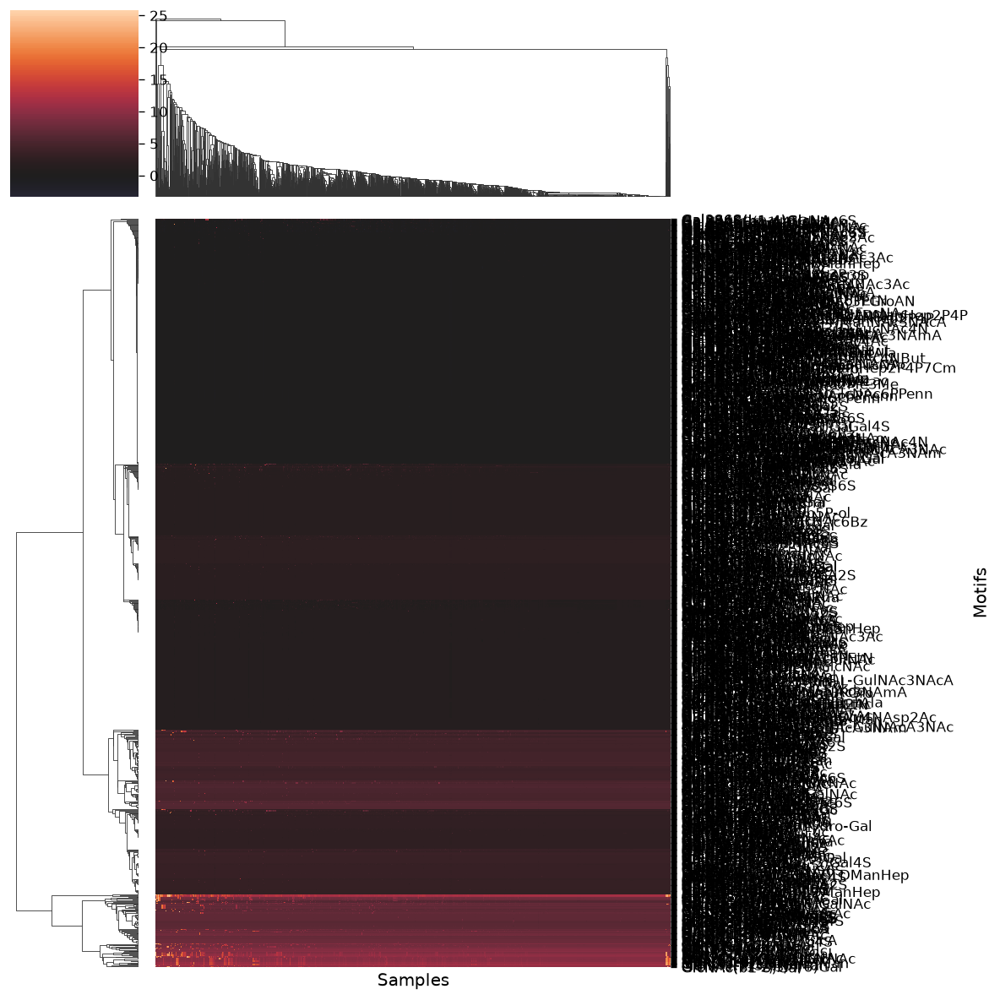

Due to the high number of lectins in this dataset, the heatmap is difficult to analyze in detail. However, we can clearly see that there are clusters of lectins recognizing specific glycan motifs. Examples include Neu5Ac(a2-6)Gal, Neu5Ac(a2-3)Gal, Fuc(a1-6)GlcNAc, and others. All these represent well-known glycan motifs with important roles in biology.\

Another way to analyze the glycan binding capacities of lectins is to use `glycowork.motif.analysis.get_pvals_motifs`. As we are working with data obtained from different proteins, we must also set `multiple_samples` to `True`.

``` python
results = get_pvals_motifs(glycan_binding.iloc[:,:-2].T.reset_index(), feature_set = ['exhaustive'], multiple_samples = True)
```

    Significance inflation detected. The CLR/ALR transformation possibly cannot handle this dataset. Consider running again with a higher gamma value.             Proceed with caution; for now switching to Bonferroni correction to be conservative about this.
    Chosen grouping: by_motif_family

|   | motif | pval | corr_pval | significant | effect_size | equivalence_pval | Explained by | Redistribution p-val | Residual p-val | Residual effect size |
|----|----|----|----|----|----|----|----|----|----|----|
| 46 | Gal | 0 | 0 | True | 1.41 | 1 | Neu(a2-3/6)Gal (-1.42), Rha(a1-2/3/4)Gal (-1.41), Neu4Ac5Ac(a2-3)Gal (-1.41), Gal(?1-3)FucNAc (-1.41), Neu5GcOMe(a2-6)Gal (-1.41), +104 more | 0.536 | nan | 0 |
| 130 | GlcNAc | 0 | 0 | True | 1.4 | 1 | L-QuiNAc(a1-3)GlcNAc (-1.40), FucNAc(a1-3)GlcNAc (-1.40), GlcNAc(b1-2/3)Rib5P-ol (-1.40), GlcNAc(b1-2/4)GalA (-1.40), FucNAm(a1-3)GlcNAc (-1.40), +104 more | 0.148 | nan | 0 |
| 357 | Gal(?1-3/4/6)GlcNAc | 0 | 0 | True | 1.2 | 1 | Gal(b1-6)GlcNAc (-1.20), Gal(a1-3)GlcNAc (-1.18), Gal(a1-4)GlcNAc (-1.14), Gal(b1-3)GlcNAc (-0.67), Gal(b1-4)GlcNAc (-0.10) | 2.35e-105 | 1 | 0 |
| 851 | Man(?1-3/4)GlcNAc | 0 | 0 | True | 1.17 | 1 | Man(b1-3)GlcNAc (-1.17), Man(a1-4)GlcNAc (-1.16), Man(b1-4)GlcNAc (-0.00) | 4.32e-105 | 1 | 0 |
| 866 | Man(b1-4)GlcNAc | 0 | 0 | True | 1.17 | 1 |  | nan | nan | nan |
| 857 | Man(a1-3)Man | 0 | 0 | True | 1.15 | 1 |  | nan | nan | nan |
| 705 | GlcNAc(b1-2)Man | 0 | 0 | True | 1.15 | 1 |  | nan | nan | nan |
| 862 | Man(a1-6)Man | 0 | 0 | True | 1.14 | 1 |  | nan | nan | nan |
| 192 | Man | 0 | 0 | True | 1.14 | 1 | Man6P(a1-2/3/6)Man (-1.15), GlcNAc1P(b1-6)Man (-1.15), GlcNAc(a1-6)Man (-1.14), Man(a1-2/3)Fuc (-1.14), GlcNAc(a1-2)Man (-1.14), +29 more | 0.224 | nan | 0 |
| 412 | Gal(b1-4)GlcNAc | 0 | 0 | True | 1.1 | 1 |  | nan | nan | nan |
| 663 | GlcNAc(?1-2/3/4/6)Man | 0 | 0 | True | 1.07 | 1 | GlcNAc(a1-6)Man (-1.08), GlcNAc(a1-2)Man (-1.08), GlcNAc(b1-3)Man (-1.04), GlcNAc(b1-4)Man (-0.72), GlcNAc(b1-6)Man (-0.57), +1 more | 2.57e-88 | 1 | 0 |
| 264 | Sia | 0 | 0 | True | 1.02 | 1 | Sia(b2-6)GalNAc (-0.98), Sia(b2-6)Gal (-0.98), Neu5Gc (-0.86), Sia(a2-6)GalNAc (-0.79), Neu5Ac (-0.00) | 5.17e-154 | 1 | 0 |
| 218 | Neu5Ac | 0 | 0 | True | 1.02 | 1 | Neu5Ac(b1-6)GalNAc (-1.02), Neu5Ac(a2-2/3/6)Glc (-1.02), Neu5Ac(a2-6)Glc6S (-1.02), Neu5Ac(a2-6)GlcNAc6S (-1.02), Neu5Ac(a2-3/6)Gal3S (-1.01), +10 more | nan | 1 | 0 |
| 849 | Man(?1-2/3/4/6)Man | 0 | 0 | True | 1.01 | 1 | Man(a1-4)Man (-0.99), Man(b1-4)Man (-0.99), Man(a1-2)Man (-0.69), Man(a1-3)Man (+0.15), Man(a1-6)Man (+0.14) | 3.25e-138 | 1 | 0 |
| 1000 | Sia(?2-2/3/6)Gal | 0 | 0 | True | 0.988 | 1 | Sia(b2-6)Gal (-0.95), Neu5Gc(?2-3/6)Gal (-0.83), Sia(a2-6)Gal (-0.42), Sia(a2-3)Gal (-0.22), Neu5Ac(?2-2/3/6)Gal (-0.02) | 4.5e-164 | 1 | 0 |
| 894 | Neu5Ac(?2-2/3/6)Gal | 0 | 0 | True | 0.965 | 1 | Neu5Ac(a2-2)Gal (-0.97), Neu5Ac(b2-3)Gal (-0.94), Neu5Ac(b2-6)Gal (-0.94), Neu5Ac(a2-6)Gal (-0.40), Neu5Ac(a2-3)Gal (-0.22) | 9.12e-161 | 1 | 0 |
| 32 | Fuc | 0 | 0 | True | 0.964 | 1 | GlcA(?1-3/4)Fuc (-0.97), Man(a1-2/3)Fuc (-0.97), Glc(a1-3)Fuc (-0.97), Fuc(a1-3)Xulf (-0.97), Fuc(a1-3)Xluf (-0.97), +14 more | 0.87 | nan | 0 |
| 729 | GlcNAc(b1-4)GlcNAc | 0 | 0 | True | 0.944 | 1 |  | nan | nan | nan |
| 666 | GlcNAc(?1-3/4/6)GlcNAc | 0 | 0 | True | 0.942 | 1 | GlcNAc(a1-3)GlcNAc (-0.95), GlcNAc(a1-4)GlcNAc (-0.91), GlcNAc(b1-3)GlcNAc (-0.88), GlcNAc(b1-6)GlcNAc (-0.87), GlcNAc(b1-4)GlcNAc (+0.00) | 1.45e-119 | 1 | 0 |
| 74 | GalNAc | 0 | 0 | True | 0.853 | 1 | GalNAc(?1-2/4)Glc (-0.86), GalNAc(?1-2/3/4)Rha (-0.86), GalA(?1-3)GalNAc (-0.86), Neu5Ac(b1-6)GalNAc (-0.86), GalNAc(a1-4)Qui3NAc (-0.86), +70 more | 0.00252 | nan | 0 |
| 304 | Fuc(?1-2/3/4/6)GlcNAc | 0 | 0 | True | 0.801 | 1 | Fuc(b1-4)GlcNAc (-0.79), Fuc(b1-3)GlcNAc (-0.78), Fuc(a1-2)GlcNAc (-0.78), Fuc(a1-4)GlcNAc (-0.54), Fuc(a1-3)GlcNAc (-0.28), +1 more | 1.26e-39 | 1 | 0 |
| 661 | GlcNAc(?1-2/3/4/6)Gal | 0 | 0 | True | 0.786 | 1 | GlcNAc(b1-2)Gal (-0.76), GlcNAc(a1-3)Gal (-0.71), GlcNAc(b1-4)Gal (-0.70), GlcNAc(a1-6)Gal (-0.69), GlcNAc(a1-4)Gal (-0.57), +2 more | 2.76e-92 | 1 | 0 |
| 1001 | Sia(a2-3)Gal | 0 | 0 | True | 0.764 | 1 | Kdn(a2-3)Gal (-0.70), Neu5Gc(a2-3)Gal (-0.62), Neu5Ac(a2-3)Gal (-0.02) | 8.99e-88 | 1 | 0 |
| 713 | GlcNAc(b1-3)Gal | 0 | 0 | True | 0.755 | 1 |  | nan | nan | nan |
| 899 | Neu5Ac(a2-3)Gal | 0 | 0 | True | 0.743 | 1 |  | nan | nan | nan |

These results indicate, for each motif, a p-value and a corrected p-value. These quantitative results support our qualitative observations from before. However, this represents a bird’s eye view across all lectins in the dataset. A follow-up analysis might be to focus on a specific group of lectins, analyzing their binding patterns in depth.

# Example 3: Glycan classification using machine learning models

The investigation of glycans from animals and viruses demonstrated how specific their presence in an organism can be. This particular characteristic can be exploited to predict the source of a given glycan among organisms. By classifying which glycans stem from which species/taxonomic groups, machine learning models can be trained to learn which motifs are enriched in which species, allowing for further insights.\

Let’s see how we can use `glycowork` to classify human versus non-human primate glycans! First, we need to annotate each known glycan using a binary code where **1** means **human glycan** and **0** means **non-human primate glycan**.

``` python
human = [1 if k == 'Homo_sapiens' else 0 for k in df_species[df_species.Order=='Primates'].Species.values.tolist()]
```

Now, we have to generate two sets of glycans that we will use as train set and test set. In addition, we also need their corresponding sets with classes labelled as **0** or **1**. One way to do it is to use `glycowork.ml.train_test_split.general_split`. This function assigns the data with a 80/20 ratio to train and test sets respectively.

``` python
X_train, X_test, y_train, y_test = general_split(df_species[df_species.Order=='Primates'].glycan.values.tolist(), human)
```

It is now time to train a machine learning model on these data! Different machine learning algorithms are available in `glycowork` and here we can use `glycowork.ml.model_training.train_ml_model`. This classification method uses a standard machine learning model (XGBoost) trained on short glycan motifs which may not be the most accurate, but can be sufficient for a preliminary exploration of our problem. Plus, it has the advantage of running faster than other more complex algorithms such as deep learning so… let’s give it a try!

``` python
model_ft, _, X_test = train_ml_model(X_train, X_test, y_train, y_test, feature_calc = True, feature_set = ['terminal'],
                         return_features = True)
```

    Calculating Glycan Features...

    Training model...

    Evaluating model...
    Accuracy of trained model on separate validation set: 0.8604852686308492

As you can see, even this (quite) simple algorithm is enough to reach high prediction accuracy on the test set! It also confirms that glycan sequence is highly representative of their origin and allows to efficiently discriminate human from non-human primate glycans.\

One more step we can do is the analysis of the model we have generated. This is important, as we do not know yet what information is the most useful for the model to predict the origin of a glycan. The `glycowork.ml.model_training.analyze_ml_model` function can help us to understand on which basis the model predictions are made.

``` python
analyze_ml_model(model_ft)
```

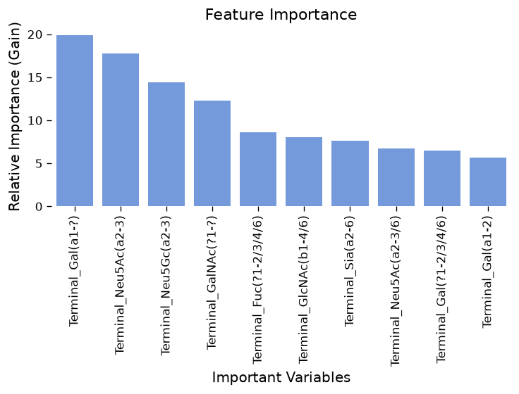

Interesting! It appears that the presence/absence of alpha-Gal and Neu5Gc are quite discriminative of its belonging to Homo sapiens or not!\

Next to knowing what is important for model prediction, it is often also crucial to know the limits of a model. In `glycowork`, you can use `glycowork.ml.model_training.get_mismatch` module to get a sense of wrong classifications. This could for instance inform you about potential model biases.

``` python
get_mismatch(model_ft, X_test, y_test)
```

    [('Gal(b1-4)GlcNAc(b1-3)Gal(b1-4)Glc-ol', 0.7145445942878723),
     ('Gal(b1-4)GlcNAc(b1-2)Man(a1-6)[GlcNAc(b1-2)Man(a1-3)]Man(b1-4)GlcNAc(b1-4)[Fuc(a1-6)]GlcNAc',
      0.7493613362312317),
     ('GlcNAc(b1-2)Man(a1-3)[GlcNAc(b1-2)Man(a1-6)]Man(b1-4)GlcNAc(b1-4)[Fuc(a1-6)]GlcNAc',
      0.31766071915626526),
     ('Gal(b1-3)[Fuc(a1-4)]GlcNAc(b1-3)Gal(b1-4)Glc-ol', 0.8473755717277527),
     ('Neu5Ac(a2-3)Gal(b1-3/4)GlcNAc(b1-2)Man(a1-3)[Man(a1-3)[Man(a1-6)]Man(a1-6)]Man(b1-4)GlcNAc(b1-4)[Fuc(a1-6)]GlcNAc',
      0.8396848440170288),
     ('Gal(b1-3)[Neu5Ac(a2-6)]GlcNAc(b1-3)Gal(b1-4)Glc-ol', 0.7336083650588989),
     ('Fuc(a1-3/4)[Gal(b1-3/4)]GlcNAc(b1-2)[Fuc(a1-3/4)[Gal(b1-3/4)]GlcNAc(b1-4)]Man(a1-3)[Fuc(a1-3/4)[Gal(b1-3/4)]GlcNAc(b1-2)[Fuc(a1-3/4)[Gal(b1-3/4)]GlcNAc(b1-6)]Man(a1-6)]Man(b1-4)GlcNAc(b1-4)[Fuc(a1-6)]GlcNAc',
      0.6133107542991638),
     ('Gal(b1-3/4)GlcNAc(b1-2/4)[GlcNAc(b1-2/4)]Man(a1-3)[Man(a1-3)[Man(a1-6)]Man(a1-6)]Man(b1-4)GlcNAc(b1-4)[Fuc(a1-6)]GlcNAc',
      0.6319893598556519),
     ('Gal(b1-4)Glc-ol', 0.7145445942878723),
     ('Gal(b1-4)GlcNAc(b1-2)Man(a1-3)[Man(a1-3)[Man(a1-6)]Man(a1-6)]Man(b1-4)GlcNAc(b1-4)GlcNAc',
      0.76183021068573)]

Here we can see that our model was especially confused by glycans which can occur in both types of orders and therefore are ambiguous for classification ambiguous. Maybe in these scenarios a more powerful, deep learning-based model might be able to differentiate (at least a bit better)!\

# Example 4: Constructing and exploring biosynthetic networks

The `network` module of glycowork is designed to readily construct and analyze biosynthetic networks from a list of glycans in a very modular way. Below, this is illustrated with a fictional set of milk glycans (all default parameters of `construct_network` are optimized for milk glycans and should be changed for other glycan classes). Just inputting a list of biosynthetically related glycans into `glycowork.network.biosynthesis.construct_network` and then `glycowork.network.biosynthesis.plot_network` will build and plot our biosynthetic network! (depending on your browser etc, this might not render correctly)

``` python
glycans = ["Gal(b1-4)Glc-ol", "GlcNAc(b1-3)Gal(b1-4)Glc-ol",
           "GlcNAc6S(b1-3)Gal(b1-4)Glc-ol",
           "Gal(b1-4)GlcNAc(b1-3)Gal(b1-4)Glc-ol", "Fuc(a1-2)Gal(b1-4)Glc-ol",
          "Gal(b1-4)GlcNAc(b1-3)[Gal(b1-3)GlcNAc(b1-6)]Gal(b1-4)Glc-ol"]
network = construct_network(glycans)
plot_network(network, draw_glycans = True)
```

![]() ![](data:image/svg+xml;base64,PHN2ZyB4bWxucz0iaHR0cDovL3d3dy53My5vcmcvMjAwMC9zdmciIHdpZHRoPSIzNzAiIGhlaWdodD0iNzEiIHZpZXdib3g9IjAgMCAzNzAgNzEiPgo8ZyB0cmFuc2Zvcm09Im1hdHJpeCgxIDAgMCAtMSAwIDcxKSI+CjxwYXRoIGQ9Ik0gLTEwMCAwIEwgMCAwIEwgLTEwMCAwIFoiIHRyYW5zZm9ybT0ibWF0cml4KDEgMCAwIC0xIDMzNSAzNSkiIGZpbGw9Im5vbmUiIHN0cm9rZT0iIzFDMTkxNyIgc3Ryb2tlLXdpZHRoPSI0IiBzdHJva2UtbGluZWNhcD0icm91bmQiIHN0cm9rZS1saW5lam9pbj0icm91bmQiIC8+CjxwYXRoIGQ9Ik0gLTIwMCAwIEwgLTEwMCAwIEwgLTIwMCAwIFoiIHRyYW5zZm9ybT0ibWF0cml4KDEgMCAwIC0xIDMzNSAzNSkiIGZpbGw9Im5vbmUiIHN0cm9rZT0iIzFDMTkxNyIgc3Ryb2tlLXdpZHRoPSI0IiBzdHJva2UtbGluZWNhcD0icm91bmQiIHN0cm9rZS1saW5lam9pbj0icm91bmQiIC8+CjxwYXRoIGQ9Ik0gLTMwMCAwIEwgLTIwMCAwIEwgLTMwMCAwIFoiIHRyYW5zZm9ybT0ibWF0cml4KDEgMCAwIC0xIDMzNSAzNSkiIGZpbGw9Im5vbmUiIHN0cm9rZT0iIzFDMTkxNyIgc3Ryb2tlLXdpZHRoPSI0IiBzdHJva2UtbGluZWNhcD0icm91bmQiIHN0cm9rZS1saW5lam9pbj0icm91bmQiIC8+CjxwYXRoIGQ9Ik0gLTI1IDAgQyAtMjUgMTMuODA3MSAtMTMuODA3MSAyNSAwIDI1IEMgMTMuODA3MSAyNSAyNSAxMy44MDcxIDI1IDAgQyAyNSAtMTMuODA3MSAxMy44MDcxIC0yNSAwIC0yNSBDIC0xMy44MDcxIC0yNSAtMjUgLTEzLjgwNzEgLTI1IDAgWiIgdHJhbnNmb3JtPSJtYXRyaXgoMSAwIDAgLTEgMzM1IDM1KSIgZmlsbD0iIzAzODVBRSIgc3Ryb2tlPSIjMUMxOTE3IiBzdHJva2Utd2lkdGg9IjIiIC8+CjxwYXRoIGQ9Ik0gLTEyNSAwIEMgLTEyNSAxMy44MDcxIC0xMTMuODA3MSAyNSAtMTAwIDI1IEMgLTg2LjE5MjkgMjUgLTc1IDEzLjgwNzEgLTc1IDAgQyAtNzUgLTEzLjgwNzEgLTg2LjE5MjkgLTI1IC0xMDAgLTI1IEMgLTExMy44MDcxIC0yNSAtMTI1IC0xMy44MDcxIC0xMjUgMCBaIiB0cmFuc2Zvcm09Im1hdHJpeCgxIDAgMCAtMSAzMzUgMzUpIiBmaWxsPSIjRkNDMzI2IiBzdHJva2U9IiMxQzE5MTciIHN0cm9rZS13aWR0aD0iMiIgLz4KPHBhdGggZD0iTSAtMzI1IDAgQyAtMzI1IDEzLjgwNzEgLTMxMy44MDcxIDI1IC0zMDAgMjUgQyAtMjg2LjE5MjkgMjUgLTI3NSAxMy44MDcxIC0yNzUgMCBDIC0yNzUgLTEzLjgwNzEgLTI4Ni4xOTI5IC0yNSAtMzAwIC0yNSBDIC0zMTMuODA3MSAtMjUgLTMyNSAtMTMuODA3MSAtMzI1IDAgWiIgdHJhbnNmb3JtPSJtYXRyaXgoMSAwIDAgLTEgMzM1IDM1KSIgZmlsbD0iI0ZDQzMyNiIgc3Ryb2tlPSIjMUMxOTE3IiBzdHJva2Utd2lkdGg9IjIiIC8+CjxwYXRoIGQ9Ik0gLTIyNSAtMjUgTCAtMTc1IC0yNSBMIC0xNzUgMjUgTCAtMjI1IDI1IFoiIHRyYW5zZm9ybT0ibWF0cml4KDEgMCAwIC0xIDMzNSAzNSkiIGZpbGw9IiMwMzg1QUUiIHN0cm9rZT0iIzFDMTkxNyIgc3Ryb2tlLXdpZHRoPSIyIiBzdHJva2UtbGluZWpvaW49InJvdW5kIiAvPgo8cGF0aCBkPSJNIDIuOTAwNCAxLjYwMTYgTCAyLjkwMDQgLTMuODg2NyBMIDEuNTIzNCAtMy44ODY3IEwgMS41MjM0IDEwLjgxMDUgUSAxLjUyMzQgMTMuMDU2NiAyLjY4NTUgMTQuMDI4MyBRIDMuODQ3NyAxNSA1LjQyOTcgMTUgUSA3LjA1MDggMTUgOC4wMDI5IDE0LjEzNTcgUSA4Ljk1NTEgMTMuMjcxNSA4Ljk1NTEgMTEuODI2MiBRIDguOTU1MSA5LjU3MDMgNi44MTY0IDguNzg5MSBRIDguNjkxNCA4LjYwMzUgOS44MDQ3IDcuNDUxMiBRIDEwLjkxOCA2LjI5ODggMTAuOTE4IDQuNTExNyBRIDEwLjkxOCAyLjQ3MDcgOS41NjA1IDEuMDk4NiBRIDguMjAzMSAtMC4yNzM0IDYuMjAxMiAtMC4yNzM0IFEgNC4xMTEzIC0wLjI3MzQgMi45MDA0IDEuNjAxNiBaIE0gNC4yNDggNy44NjEzIEwgNC4yNDggOS4wMDM5IFEgNy41NTg2IDkuMDkxOCA3LjU1ODYgMTEuNjg5NSBRIDcuNTU4NiAxMi41ODc5IDcuMDA2OCAxMy4xNDk0IFEgNi40NTUxIDEzLjcxMDkgNS41MzcxIDEzLjcxMDkgUSA0LjI1NzggMTMuNzEwOSAzLjU3OTEgMTMuMDA3OCBRIDIuOTAwNCAxMi4zMDQ3IDIuOTAwNCAxMC40ODgzIEwgMi45MTAyIDQuNTAyIFEgMi45MTAyIDIuOTE5OSAzLjg2NzIgMS45NzI3IFEgNC44MjQyIDEuMDI1NCA2LjE4MTYgMS4wMjU0IFEgNy41OTc3IDEuMDI1NCA4LjU1OTYgMi4wMDY4IFEgOS41MjE1IDIuOTg4MyA5LjUyMTUgNC40MjM4IFEgOS41MjE1IDUuODM5OCA4LjU0OTggNi44NTA2IFEgNy41NzgxIDcuODYxMyA0LjkzMTYgNy44NjEzIEwgNC4yNDggNy44NjEzIFogTSAyMS40Mzk1IDE0LjcyNjYgTCAyMS43MzI0IDE0LjcyNjYgTCAyMS43MzI0IDQuNzE2OCBMIDIzLjQ3MDcgNC43MTY4IEwgMjMuNDcwNyAzLjMzOTggTCAyMS43MzI0IDMuMzM5OCBMIDIxLjczMjQgMCBMIDIwLjI5NjkgMCBMIDIwLjI5NjkgMy4zMzk4IEwgMTMuNDMxNiAzLjMzOTggTCAyMS40Mzk1IDE0LjcyNjYgWiBNIDIwLjI5NjkgNC43MTY4IEwgMjAuMjk2OSAxMC43MDMxIEwgMTYuMDY4NCA0LjcxNjggTCAyMC4yOTY5IDQuNzE2OCBaIiB0cmFuc2Zvcm09Im1hdHJpeCgxIDAgMCAxIDI3Mi45OTYxIDQ1KSIgZmlsbD0iIzFDMTkxNyIgLz4KPHBhdGggZD0iTSAyLjkwMDQgMS42MDE2IEwgMi45MDA0IC0zLjg4NjcgTCAxLjUyMzQgLTMuODg2NyBMIDEuNTIzNCAxMC44MTA1IFEgMS41MjM0IDEzLjA1NjYgMi42ODU1IDE0LjAyODMgUSAzLjg0NzcgMTUgNS40Mjk3IDE1IFEgNy4wNTA4IDE1IDguMDAyOSAxNC4xMzU3IFEgOC45NTUxIDEzLjI3MTUgOC45NTUxIDExLjgyNjIgUSA4Ljk1NTEgOS41NzAzIDYuODE2NCA4Ljc4OTEgUSA4LjY5MTQgOC42MDM1IDkuODA0NyA3LjQ1MTIgUSAxMC45MTggNi4yOTg4IDEwLjkxOCA0LjUxMTcgUSAxMC45MTggMi40NzA3IDkuNTYwNSAxLjA5ODYgUSA4LjIwMzEgLTAuMjczNCA2LjIwMTIgLTAuMjczNCBRIDQuMTExMyAtMC4yNzM0IDIuOTAwNCAxLjYwMTYgWiBNIDQuMjQ4IDcuODYxMyBMIDQuMjQ4IDkuMDAzOSBRIDcuNTU4NiA5LjA5MTggNy41NTg2IDExLjY4OTUgUSA3LjU1ODYgMTIuNTg3OSA3LjAwNjggMTMuMTQ5NCBRIDYuNDU1MSAxMy43MTA5IDUuNTM3MSAxMy43MTA5IFEgNC4yNTc4IDEzLjcxMDkgMy41NzkxIDEzLjAwNzggUSAyLjkwMDQgMTIuMzA0NyAyLjkwMDQgMTAuNDg4MyBMIDIuOTEwMiA0LjUwMiBRIDIuOTEwMiAyLjkxOTkgMy44NjcyIDEuOTcyNyBRIDQuODI0MiAxLjAyNTQgNi4xODE2IDEuMDI1NCBRIDcuNTk3NyAxLjAyNTQgOC41NTk2IDIuMDA2OCBRIDkuNTIxNSAyLjk4ODMgOS41MjE1IDQuNDIzOCBRIDkuNTIxNSA1LjgzOTggOC41NDk4IDYuODUwNiBRIDcuNTc4MSA3Ljg2MTMgNC45MzE2IDcuODYxMyBMIDQuMjQ4IDcuODYxMyBaIE0gMTUuNTcwMyAxMS4wMzUyIEwgMTQuMTA1NSAxMS4wMzUyIFEgMTQuNTA1OSAxMi44MTI1IDE1LjYzODcgMTMuNzY5NSBRIDE2Ljc3MTUgMTQuNzI2NiAxOC4zMTQ1IDE0LjcyNjYgUSAxOS40Mzc1IDE0LjcyNjYgMjAuNDA5MiAxNC4yMTM5IFEgMjEuMzgwOSAxMy43MDEyIDIxLjkxMzEgMTIuODMyIFEgMjIuNDQ1MyAxMS45NjI5IDIyLjQ0NTMgMTEuMDE1NiBRIDIyLjQ0NTMgOS4xNjAyIDIwLjU5OTYgOC4wNzYyIFEgMjEuNjM0OCA3LjY1NjIgMjIuMjk4OCA2Ljg0NTcgUSAyMy4yMzYzIDUuNzAzMSAyMy4yMzYzIDQuMjg3MSBRIDIzLjIzNjMgMy4wNjY0IDIyLjU5MTggMS45NTggUSAyMS45NDczIDAuODQ5NiAyMC44MzQgMC4yNDQxIFEgMTkuNzIwNyAtMC4zNjEzIDE4LjM0MzggLTAuMzYxMyBRIDE2LjQ4ODMgLTAuMzYxMyAxNS4yNDggMC43MDggUSAxNC4wMDc4IDEuNzc3MyAxMy42MjcgMy44NDc3IEwgMTUuMDMzMiAzLjg0NzcgUSAxNS40MDQzIDIuNDUxMiAxNi4wOTc3IDEuODI2MiBRIDE2Ljk4NjMgMS4wMzUyIDE4LjM2MzMgMS4wMzUyIFEgMTkuOTI1OCAxLjAzNTIgMjAuODczIDEuOTcyNyBRIDIxLjgyMDMgMi45MTAyIDIxLjgyMDMgNC4xNjk5IFEgMjEuODIwMyA1LjAwOTggMjEuMzQ2NyA1Ljc0MjIgUSAyMC44NzMgNi40NzQ2IDIwLjA3NzEgNi44NDU3IFEgMTkuMjgxMiA3LjIxNjggMTcuNjExMyA3LjMwNDcgTCAxNy42MTEzIDguNjIzIFEgMTguNTk3NyA4LjYyMyAxOS40MDgyIDguOTY5NyBRIDIwLjIxODggOS4zMTY0IDIwLjU4NSA5Ljg1MzUgUSAyMC45NTEyIDEwLjM5MDYgMjAuOTUxMiAxMS4wMjU0IFEgMjAuOTUxMiAxMS45NjI5IDIwLjIwNDEgMTIuNjQ2NSBRIDE5LjQ1NyAxMy4zMzAxIDE4LjMxNDUgMTMuMzMwMSBRIDE3LjM4NjcgMTMuMzMwMSAxNi43MTI5IDEyLjgwNzYgUSAxNi4wMzkxIDEyLjI4NTIgMTUuNTcwMyAxMS4wMzUyIFoiIHRyYW5zZm9ybT0ibWF0cml4KDEgMCAwIDEgMTcyLjk5NjEgNDUpIiBmaWxsPSIjMUMxOTE3IiAvPgo8cGF0aCBkPSJNIDIuOTAwNCAxLjYwMTYgTCAyLjkwMDQgLTMuODg2NyBMIDEuNTIzNCAtMy44ODY3IEwgMS41MjM0IDEwLjgxMDUgUSAxLjUyMzQgMTMuMDU2NiAyLjY4NTUgMTQuMDI4MyBRIDMuODQ3NyAxNSA1LjQyOTcgMTUgUSA3LjA1MDggMTUgOC4wMDI5IDE0LjEzNTcgUSA4Ljk1NTEgMTMuMjcxNSA4Ljk1NTEgMTEuODI2MiBRIDguOTU1MSA5LjU3MDMgNi44MTY0IDguNzg5MSBRIDguNjkxNCA4LjYwMzUgOS44MDQ3IDcuNDUxMiBRIDEwLjkxOCA2LjI5ODggMTAuOTE4IDQuNTExNyBRIDEwLjkxOCAyLjQ3MDcgOS41NjA1IDEuMDk4NiBRIDguMjAzMSAtMC4yNzM0IDYuMjAxMiAtMC4yNzM0IFEgNC4xMTEzIC0wLjI3MzQgMi45MDA0IDEuNjAxNiBaIE0gNC4yNDggNy44NjEzIEwgNC4yNDggOS4wMDM5IFEgNy41NTg2IDkuMDkxOCA3LjU1ODYgMTEuNjg5NSBRIDcuNTU4NiAxMi41ODc5IDcuMDA2OCAxMy4xNDk0IFEgNi40NTUxIDEzLjcxMDkgNS41MzcxIDEzLjcxMDkgUSA0LjI1NzggMTMuNzEwOSAzLjU3OTEgMTMuMDA3OCBRIDIuOTAwNCAxMi4zMDQ3IDIuOTAwNCAxMC40ODgzIEwgMi45MTAyIDQuNTAyIFEgMi45MTAyIDIuOTE5OSAzLjg2NzIgMS45NzI3IFEgNC44MjQyIDEuMDI1NCA2LjE4MTYgMS4wMjU0IFEgNy41OTc3IDEuMDI1NCA4LjU1OTYgMi4wMDY4IFEgOS41MjE1IDIuOTg4MyA5LjUyMTUgNC40MjM4IFEgOS41MjE1IDUuODM5OCA4LjU0OTggNi44NTA2IFEgNy41NzgxIDcuODYxMyA0LjkzMTYgNy44NjEzIEwgNC4yNDggNy44NjEzIFogTSAyMS40Mzk1IDE0LjcyNjYgTCAyMS43MzI0IDE0LjcyNjYgTCAyMS43MzI0IDQuNzE2OCBMIDIzLjQ3MDcgNC43MTY4IEwgMjMuNDcwNyAzLjMzOTggTCAyMS43MzI0IDMuMzM5OCBMIDIxLjczMjQgMCBMIDIwLjI5NjkgMCBMIDIwLjI5NjkgMy4zMzk4IEwgMTMuNDMxNiAzLjMzOTggTCAyMS40Mzk1IDE0LjcyNjYgWiBNIDIwLjI5NjkgNC43MTY4IEwgMjAuMjk2OSAxMC43MDMxIEwgMTYuMDY4NCA0LjcxNjggTCAyMC4yOTY5IDQuNzE2OCBaIiB0cmFuc2Zvcm09Im1hdHJpeCgxIDAgMCAxIDcyLjk5NjEgNDUpIiBmaWxsPSIjMUMxOTE3IiAvPgo8L2c+Cjwvc3ZnPg==) ![](data:image/svg+xml;base64,PHN2ZyB4bWxucz0iaHR0cDovL3d3dy53My5vcmcvMjAwMC9zdmciIHdpZHRoPSIyNzAiIGhlaWdodD0iODkuMTI1IiB2aWV3Ym94PSIwIDAgMjcwIDg5LjEyNSI+CjxnIHRyYW5zZm9ybT0ibWF0cml4KDEgMCAwIC0xIDAgODkuMTI1KSI+CjxwYXRoIGQ9Ik0gLTEwMCAwIEwgMCAwIEwgLTEwMCAwIFoiIHRyYW5zZm9ybT0ibWF0cml4KDEgMCAwIC0xIDIzNSAzNSkiIGZpbGw9Im5vbmUiIHN0cm9rZT0iIzFDMTkxNyIgc3Ryb2tlLXdpZHRoPSI0IiBzdHJva2UtbGluZWNhcD0icm91bmQiIHN0cm9rZS1saW5lam9pbj0icm91bmQiIC8+CjxwYXRoIGQ9Ik0gLTIwMCAwIEwgLTEwMCAwIEwgLTIwMCAwIFoiIHRyYW5zZm9ybT0ibWF0cml4KDEgMCAwIC0xIDIzNSAzNSkiIGZpbGw9Im5vbmUiIHN0cm9rZT0iIzFDMTkxNyIgc3Ryb2tlLXdpZHRoPSI0IiBzdHJva2UtbGluZWNhcD0icm91bmQiIHN0cm9rZS1saW5lam9pbj0icm91bmQiIC8+CjxwYXRoIGQ9Ik0gLTI1IDAgQyAtMjUgMTMuODA3MSAtMTMuODA3MSAyNSAwIDI1IEMgMTMuODA3MSAyNSAyNSAxMy44MDcxIDI1IDAgQyAyNSAtMTMuODA3MSAxMy44MDcxIC0yNSAwIC0yNSBDIC0xMy44MDcxIC0yNSAtMjUgLTEzLjgwNzEgLTI1IDAgWiIgdHJhbnNmb3JtPSJtYXRyaXgoMSAwIDAgLTEgMjM1IDM1KSIgZmlsbD0iIzAzODVBRSIgc3Ryb2tlPSIjMUMxOTE3IiBzdHJva2Utd2lkdGg9IjIiIC8+CjxwYXRoIGQ9Ik0gLTEyNSAwIEMgLTEyNSAxMy44MDcxIC0xMTMuODA3MSAyNSAtMTAwIDI1IEMgLTg2LjE5MjkgMjUgLTc1IDEzLjgwNzEgLTc1IDAgQyAtNzUgLTEzLjgwNzEgLTg2LjE5MjkgLTI1IC0xMDAgLTI1IEMgLTExMy44MDcxIC0yNSAtMTI1IC0xMy44MDcxIC0xMjUgMCBaIiB0cmFuc2Zvcm09Im1hdHJpeCgxIDAgMCAtMSAyMzUgMzUpIiBmaWxsPSIjRkNDMzI2IiBzdHJva2U9IiMxQzE5MTciIHN0cm9rZS13aWR0aD0iMiIgLz4KPHBhdGggZD0iTSAtMjI1IC0yNSBMIC0xNzUgLTI1IEwgLTE3NSAyNSBMIC0yMjUgMjUgWiIgdHJhbnNmb3JtPSJtYXRyaXgoMSAwIDAgLTEgMjM1IDM1KSIgZmlsbD0iIzAzODVBRSIgc3Ryb2tlPSIjMUMxOTE3IiBzdHJva2Utd2lkdGg9IjIiIHN0cm9rZS1saW5lam9pbj0icm91bmQiIC8+CjxwYXRoIGQ9Ik0gMi45MDA0IDEuNjAxNiBMIDIuOTAwNCAtMy44ODY3IEwgMS41MjM0IC0zLjg4NjcgTCAxLjUyMzQgMTAuODEwNSBRIDEuNTIzNCAxMy4wNTY2IDIuNjg1NSAxNC4wMjgzIFEgMy44NDc3IDE1IDUuNDI5NyAxNSBRIDcuMDUwOCAxNSA4LjAwMjkgMTQuMTM1NyBRIDguOTU1MSAxMy4yNzE1IDguOTU1MSAxMS44MjYyIFEgOC45NTUxIDkuNTcwMyA2LjgxNjQgOC43ODkxIFEgOC42OTE0IDguNjAzNSA5LjgwNDcgNy40NTEyIFEgMTAuOTE4IDYuMjk4OCAxMC45MTggNC41MTE3IFEgMTAuOTE4IDIuNDcwNyA5LjU2MDUgMS4wOTg2IFEgOC4yMDMxIC0wLjI3MzQgNi4yMDEyIC0wLjI3MzQgUSA0LjExMTMgLTAuMjczNCAyLjkwMDQgMS42MDE2IFogTSA0LjI0OCA3Ljg2MTMgTCA0LjI0OCA5LjAwMzkgUSA3LjU1ODYgOS4wOTE4IDcuNTU4NiAxMS42ODk1IFEgNy41NTg2IDEyLjU4NzkgNy4wMDY4IDEzLjE0OTQgUSA2LjQ1NTEgMTMuNzEwOSA1LjUzNzEgMTMuNzEwOSBRIDQuMjU3OCAxMy43MTA5IDMuNTc5MSAxMy4wMDc4IFEgMi45MDA0IDEyLjMwNDcgMi45MDA0IDEwLjQ4ODMgTCAyLjkxMDIgNC41MDIgUSAyLjkxMDIgMi45MTk5IDMuODY3MiAxLjk3MjcgUSA0LjgyNDIgMS4wMjU0IDYuMTgxNiAxLjAyNTQgUSA3LjU5NzcgMS4wMjU0IDguNTU5NiAyLjAwNjggUSA5LjUyMTUgMi45ODgzIDkuNTIxNSA0LjQyMzggUSA5LjUyMTUgNS44Mzk4IDguNTQ5OCA2Ljg1MDYgUSA3LjU3ODEgNy44NjEzIDQuOTMxNiA3Ljg2MTMgTCA0LjI0OCA3Ljg2MTMgWiBNIDIxLjQzOTUgMTQuNzI2NiBMIDIxLjczMjQgMTQuNzI2NiBMIDIxLjczMjQgNC43MTY4IEwgMjMuNDcwNyA0LjcxNjggTCAyMy40NzA3IDMuMzM5OCBMIDIxLjczMjQgMy4zMzk4IEwgMjEuNzMyNCAwIEwgMjAuMjk2OSAwIEwgMjAuMjk2OSAzLjMzOTggTCAxMy40MzE2IDMuMzM5OCBMIDIxLjQzOTUgMTQuNzI2NiBaIE0gMjAuMjk2OSA0LjcxNjggTCAyMC4yOTY5IDEwLjcwMzEgTCAxNi4wNjg0IDQuNzE2OCBMIDIwLjI5NjkgNC43MTY4IFoiIHRyYW5zZm9ybT0ibWF0cml4KDEgMCAwIDEgMTcyLjk5NjEgNDUpIiBmaWxsPSIjMUMxOTE3IiAvPgo8cGF0aCBkPSJNIDIuOTAwNCAxLjYwMTYgTCAyLjkwMDQgLTMuODg2NyBMIDEuNTIzNCAtMy44ODY3IEwgMS41MjM0IDEwLjgxMDUgUSAxLjUyMzQgMTMuMDU2NiAyLjY4NTUgMTQuMDI4MyBRIDMuODQ3NyAxNSA1LjQyOTcgMTUgUSA3LjA1MDggMTUgOC4wMDI5IDE0LjEzNTcgUSA4Ljk1NTEgMTMuMjcxNSA4Ljk1NTEgMTEuODI2MiBRIDguOTU1MSA5LjU3MDMgNi44MTY0IDguNzg5MSBRIDguNjkxNCA4LjYwMzUgOS44MDQ3IDcuNDUxMiBRIDEwLjkxOCA2LjI5ODggMTAuOTE4IDQuNTExNyBRIDEwLjkxOCAyLjQ3MDcgOS41NjA1IDEuMDk4NiBRIDguMjAzMSAtMC4yNzM0IDYuMjAxMiAtMC4yNzM0IFEgNC4xMTEzIC0wLjI3MzQgMi45MDA0IDEuNjAxNiBaIE0gNC4yNDggNy44NjEzIEwgNC4yNDggOS4wMDM5IFEgNy41NTg2IDkuMDkxOCA3LjU1ODYgMTEuNjg5NSBRIDcuNTU4NiAxMi41ODc5IDcuMDA2OCAxMy4xNDk0IFEgNi40NTUxIDEzLjcxMDkgNS41MzcxIDEzLjcxMDkgUSA0LjI1NzggMTMuNzEwOSAzLjU3OTEgMTMuMDA3OCBRIDIuOTAwNCAxMi4zMDQ3IDIuOTAwNCAxMC40ODgzIEwgMi45MTAyIDQuNTAyIFEgMi45MTAyIDIuOTE5OSAzLjg2NzIgMS45NzI3IFEgNC44MjQyIDEuMDI1NCA2LjE4MTYgMS4wMjU0IFEgNy41OTc3IDEuMDI1NCA4LjU1OTYgMi4wMDY4IFEgOS41MjE1IDIuOTg4MyA5LjUyMTUgNC40MjM4IFEgOS41MjE1IDUuODM5OCA4LjU0OTggNi44NTA2IFEgNy41NzgxIDcuODYxMyA0LjkzMTYgNy44NjEzIEwgNC4yNDggNy44NjEzIFogTSAxNS41NzAzIDExLjAzNTIgTCAxNC4xMDU1IDExLjAzNTIgUSAxNC41MDU5IDEyLjgxMjUgMTUuNjM4NyAxMy43Njk1IFEgMTYuNzcxNSAxNC43MjY2IDE4LjMxNDUgMTQuNzI2NiBRIDE5LjQzNzUgMTQuNzI2NiAyMC40MDkyIDE0LjIxMzkgUSAyMS4zODA5IDEzLjcwMTIgMjEuOTEzMSAxMi44MzIgUSAyMi40NDUzIDExLjk2MjkgMjIuNDQ1MyAxMS4wMTU2IFEgMjIuNDQ1MyA5LjE2MDIgMjAuNTk5NiA4LjA3NjIgUSAyMS42MzQ4IDcuNjU2MiAyMi4yOTg4IDYuODQ1NyBRIDIzLjIzNjMgNS43MDMxIDIzLjIzNjMgNC4yODcxIFEgMjMuMjM2MyAzLjA2NjQgMjIuNTkxOCAxLjk1OCBRIDIxLjk0NzMgMC44NDk2IDIwLjgzNCAwLjI0NDEgUSAxOS43MjA3IC0wLjM2MTMgMTguMzQzOCAtMC4zNjEzIFEgMTYuNDg4MyAtMC4zNjEzIDE1LjI0OCAwLjcwOCBRIDE0LjAwNzggMS43NzczIDEzLjYyNyAzLjg0NzcgTCAxNS4wMzMyIDMuODQ3NyBRIDE1LjQwNDMgMi40NTEyIDE2LjA5NzcgMS44MjYyIFEgMTYuOTg2MyAxLjAzNTIgMTguMzYzMyAxLjAzNTIgUSAxOS45MjU4IDEuMDM1MiAyMC44NzMgMS45NzI3IFEgMjEuODIwMyAyLjkxMDIgMjEuODIwMyA0LjE2OTkgUSAyMS44MjAzIDUuMDA5OCAyMS4zNDY3IDUuNzQyMiBRIDIwLjg3MyA2LjQ3NDYgMjAuMDc3MSA2Ljg0NTcgUSAxOS4yODEyIDcuMjE2OCAxNy42MTEzIDcuMzA0NyBMIDE3LjYxMTMgOC42MjMgUSAxOC41OTc3IDguNjIzIDE5LjQwODIgOC45Njk3IFEgMjAuMjE4OCA5LjMxNjQgMjAuNTg1IDkuODUzNSBRIDIwLjk1MTIgMTAuMzkwNiAyMC45NTEyIDExLjAyNTQgUSAyMC45NTEyIDExLjk2MjkgMjAuMjA0MSAxMi42NDY1IFEgMTkuNDU3IDEzLjMzMDEgMTguMzE0NSAxMy4zMzAxIFEgMTcuMzg2NyAxMy4zMzAxIDE2LjcxMjkgMTIuODA3NiBRIDE2LjAzOTEgMTIuMjg1MiAxNS41NzAzIDExLjAzNTIgWiIgdHJhbnNmb3JtPSJtYXRyaXgoMSAwIDAgMSA3Mi45OTYxIDQ1KSIgZmlsbD0iIzFDMTkxNyIgLz4KPHBhdGggZD0iTSA1LjA3NTcgMTIuODg1NyBMIDcuMTA5NCAxMS44Njg5IEwgNC45MTMzIDcuNTk2NCBRIDYuNTExMiA3LjU5NjQgNy42MzA2IDYuNDUxNCBRIDguNzUgNS4zMDY0IDguNzUgMy42MDYgUSA4Ljc1IDEuOTY1MyA3LjYwMDcgMC44MjQ2IFEgNi40NTE0IC0wLjMxNjIgNC44Mjc5IC0wLjMxNjIgUSAzLjEyNzQgLTAuMzE2MiAxLjk5NTIgMC44NjczIFEgMC44NjMgMi4wNTA4IDAuODYzIDMuNTgwMyBRIDAuODYzIDQuMTYxNCAxLjAzODIgNC43NTEgUSAxLjIxMzQgNS4zNDA2IDEuODQ1NyA2LjU2MjUgTCA1LjA3NTcgMTIuODg1NyBaIE0gNC43NzY2IDUuMzMyIFEgNC4xMTAxIDUuMzMyIDMuNjU3MiA0Ljg0OTIgUSAzLjIwNDMgNC4zNjY1IDMuMjA0MyAzLjY0MDEgUSAzLjIwNDMgMi45MTM4IDMuNjc4NiAyLjQxODIgUSA0LjE1MjggMS45MjI2IDQuNzg1MiAxLjkyMjYgUSA1LjQ1MTcgMS45MjI2IDUuOTMwMiAyLjQwOTcgUSA2LjQwODcgMi44OTY3IDYuNDA4NyAzLjY0MDEgUSA2LjQwODcgNC4zNjY1IDUuOTQzIDQuODQ5MiBRIDUuNDc3MyA1LjMzMiA0Ljc3NjYgNS4zMzIgWiBNIDE4LjY5OTcgMTAuODYwNiBMIDE2LjkzMDkgOS4yOTY5IFEgMTUuOTk5NSAxMC41OTU3IDE1LjAzMzkgMTAuNTk1NyBRIDE0LjU2NCAxMC41OTU3IDE0LjI2NDkgMTAuMzQzNiBRIDEzLjk2NTggMTAuMDkxNiAxMy45NjU4IDkuNzc1NCBRIDEzLjk2NTggOS40NTkyIDE0LjE3OTQgOS4xNzcyIFEgMTQuNDcgOC44MDEzIDE1LjkzMTIgNy41NjIzIFEgMTcuMjk4MyA2LjQxNzIgMTcuNTg4OSA2LjExODIgUSAxOC4zMTUyIDUuMzgzMyAxOC42MTg1IDQuNzEyNSBRIDE4LjkyMTkgNC4wNDE3IDE4LjkyMTkgMy4yNDcxIFEgMTguOTIxOSAxLjcwMDQgMTcuODUzOCAwLjY5MjEgUSAxNi43ODU2IC0wLjMxNjIgMTUuMDY4MSAtMC4zMTYyIFEgMTMuNzI2NiAtMC4zMTYyIDEyLjczMTEgMC4zNDE4IFEgMTEuNzM1NiAwLjk5OTggMTEuMDI2NCAyLjQwOTcgTCAxMy4wMzQ0IDMuNjIzIFEgMTMuOTQwMiAxLjk1NjggMTUuMTE5NCAxLjk1NjggUSAxNS43MzQ2IDEuOTU2OCAxNi4xNTMzIDIuMzE1NyBRIDE2LjU3MiAyLjY3NDYgMTYuNTcyIDMuMTQ0NSBRIDE2LjU3MiAzLjU3MTggMTYuMjU1OSAzLjk5OSBRIDE1LjkzOTcgNC40MjYzIDE0Ljg2MyA1LjMwNjQgUSAxMi44MTIzIDYuOTgxMiAxMi4yMTQxIDcuODkxMiBRIDExLjYxNiA4LjgwMTMgMTEuNjE2IDkuNzA3IFEgMTEuNjE2IDExLjAxNDQgMTIuNjExNSAxMS45NTAxIFEgMTMuNjA2OSAxMi44ODU3IDE1LjA2ODEgMTIuODg1NyBRIDE2LjAwODEgMTIuODg1NyAxNi44NTgzIDEyLjQ1IFEgMTcuNzA4NSAxMi4wMTQyIDE4LjY5OTcgMTAuODYwNiBaIiB0cmFuc2Zvcm09Im1hdHJpeCgxIDAgMCAxIDI1LjExMTggNjUuMTI1KSIgZmlsbD0iIzFDMTkxNyIgLz4KPC9nPgo8L3N2Zz4=) ![](data:image/svg+xml;base64,PHN2ZyB4bWxucz0iaHR0cDovL3d3dy53My5vcmcvMjAwMC9zdmciIHdpZHRoPSIyNzAiIGhlaWdodD0iNzEiIHZpZXdib3g9IjAgMCAyNzAgNzEiPgo8ZyB0cmFuc2Zvcm09Im1hdHJpeCgxIDAgMCAtMSAwIDcxKSI+CjxwYXRoIGQ9Ik0gLTEwMCAwIEwgMCAwIEwgLTEwMCAwIFoiIHRyYW5zZm9ybT0ibWF0cml4KDEgMCAwIC0xIDIzNSAzNSkiIGZpbGw9Im5vbmUiIHN0cm9rZT0iIzFDMTkxNyIgc3Ryb2tlLXdpZHRoPSI0IiBzdHJva2UtbGluZWNhcD0icm91bmQiIHN0cm9rZS1saW5lam9pbj0icm91bmQiIC8+CjxwYXRoIGQ9Ik0gLTIwMCAwIEwgLTEwMCAwIEwgLTIwMCAwIFoiIHRyYW5zZm9ybT0ibWF0cml4KDEgMCAwIC0xIDIzNSAzNSkiIGZpbGw9Im5vbmUiIHN0cm9rZT0iIzFDMTkxNyIgc3Ryb2tlLXdpZHRoPSI0IiBzdHJva2UtbGluZWNhcD0icm91bmQiIHN0cm9rZS1saW5lam9pbj0icm91bmQiIC8+CjxwYXRoIGQ9Ik0gLTI1IDAgQyAtMjUgMTMuODA3MSAtMTMuODA3MSAyNSAwIDI1IEMgMTMuODA3MSAyNSAyNSAxMy44MDcxIDI1IDAgQyAyNSAtMTMuODA3MSAxMy44MDcxIC0yNSAwIC0yNSBDIC0xMy44MDcxIC0yNSAtMjUgLTEzLjgwNzEgLTI1IDAgWiIgdHJhbnNmb3JtPSJtYXRyaXgoMSAwIDAgLTEgMjM1IDM1KSIgZmlsbD0iIzAzODVBRSIgc3Ryb2tlPSIjMUMxOTE3IiBzdHJva2Utd2lkdGg9IjIiIC8+CjxwYXRoIGQ9Ik0gLTEyNSAwIEMgLTEyNSAxMy44MDcxIC0xMTMuODA3MSAyNSAtMTAwIDI1IEMgLTg2LjE5MjkgMjUgLTc1IDEzLjgwNzEgLTc1IDAgQyAtNzUgLTEzLjgwNzEgLTg2LjE5MjkgLTI1IC0xMDAgLTI1IEMgLTExMy44MDcxIC0yNSAtMTI1IC0xMy44MDcxIC0xMjUgMCBaIiB0cmFuc2Zvcm09Im1hdHJpeCgxIDAgMCAtMSAyMzUgMzUpIiBmaWxsPSIjRkNDMzI2IiBzdHJva2U9IiMxQzE5MTciIHN0cm9rZS13aWR0aD0iMiIgLz4KPHBhdGggZD0iTSAtMjI1IC0yNSBMIC0xNzUgLTI1IEwgLTE3NSAyNSBMIC0yMjUgMjUgWiIgdHJhbnNmb3JtPSJtYXRyaXgoMSAwIDAgLTEgMjM1IDM1KSIgZmlsbD0iIzAzODVBRSIgc3Ryb2tlPSIjMUMxOTE3IiBzdHJva2Utd2lkdGg9IjIiIHN0cm9rZS1saW5lam9pbj0icm91bmQiIC8+CjxwYXRoIGQ9Ik0gMi45MDA0IDEuNjAxNiBMIDIuOTAwNCAtMy44ODY3IEwgMS41MjM0IC0zLjg4NjcgTCAxLjUyMzQgMTAuODEwNSBRIDEuNTIzNCAxMy4wNTY2IDIuNjg1NSAxNC4wMjgzIFEgMy44NDc3IDE1IDUuNDI5NyAxNSBRIDcuMDUwOCAxNSA4LjAwMjkgMTQuMTM1NyBRIDguOTU1MSAxMy4yNzE1IDguOTU1MSAxMS44MjYyIFEgOC45NTUxIDkuNTcwMyA2LjgxNjQgOC43ODkxIFEgOC42OTE0IDguNjAzNSA5LjgwNDcgNy40NTEyIFEgMTAuOTE4IDYuMjk4OCAxMC45MTggNC41MTE3IFEgMTAuOTE4IDIuNDcwNyA5LjU2MDUgMS4wOTg2IFEgOC4yMDMxIC0wLjI3MzQgNi4yMDEyIC0wLjI3MzQgUSA0LjExMTMgLTAuMjczNCAyLjkwMDQgMS42MDE2IFogTSA0LjI0OCA3Ljg2MTMgTCA0LjI0OCA5LjAwMzkgUSA3LjU1ODYgOS4wOTE4IDcuNTU4NiAxMS42ODk1IFEgNy41NTg2IDEyLjU4NzkgNy4wMDY4IDEzLjE0OTQgUSA2LjQ1NTEgMTMuNzEwOSA1LjUzNzEgMTMuNzEwOSBRIDQuMjU3OCAxMy43MTA5IDMuNTc5MSAxMy4wMDc4IFEgMi45MDA0IDEyLjMwNDcgMi45MDA0IDEwLjQ4ODMgTCAyLjkxMDIgNC41MDIgUSAyLjkxMDIgMi45MTk5IDMuODY3MiAxLjk3MjcgUSA0LjgyNDIgMS4wMjU0IDYuMTgxNiAxLjAyNTQgUSA3LjU5NzcgMS4wMjU0IDguNTU5NiAyLjAwNjggUSA5LjUyMTUgMi45ODgzIDkuNTIxNSA0LjQyMzggUSA5LjUyMTUgNS44Mzk4IDguNTQ5OCA2Ljg1MDYgUSA3LjU3ODEgNy44NjEzIDQuOTMxNiA3Ljg2MTMgTCA0LjI0OCA3Ljg2MTMgWiBNIDIxLjQzOTUgMTQuNzI2NiBMIDIxLjczMjQgMTQuNzI2NiBMIDIxLjczMjQgNC43MTY4IEwgMjMuNDcwNyA0LjcxNjggTCAyMy40NzA3IDMuMzM5OCBMIDIxLjczMjQgMy4zMzk4IEwgMjEuNzMyNCAwIEwgMjAuMjk2OSAwIEwgMjAuMjk2OSAzLjMzOTggTCAxMy40MzE2IDMuMzM5OCBMIDIxLjQzOTUgMTQuNzI2NiBaIE0gMjAuMjk2OSA0LjcxNjggTCAyMC4yOTY5IDEwLjcwMzEgTCAxNi4wNjg0IDQuNzE2OCBMIDIwLjI5NjkgNC43MTY4IFoiIHRyYW5zZm9ybT0ibWF0cml4KDEgMCAwIDEgMTcyLjk5NjEgNDUpIiBmaWxsPSIjMUMxOTE3IiAvPgo8cGF0aCBkPSJNIDIuOTAwNCAxLjYwMTYgTCAyLjkwMDQgLTMuODg2NyBMIDEuNTIzNCAtMy44ODY3IEwgMS41MjM0IDEwLjgxMDUgUSAxLjUyMzQgMTMuMDU2NiAyLjY4NTUgMTQuMDI4MyBRIDMuODQ3NyAxNSA1LjQyOTcgMTUgUSA3LjA1MDggMTUgOC4wMDI5IDE0LjEzNTcgUSA4Ljk1NTEgMTMuMjcxNSA4Ljk1NTEgMTEuODI2MiBRIDguOTU1MSA5LjU3MDMgNi44MTY0IDguNzg5MSBRIDguNjkxNCA4LjYwMzUgOS44MDQ3IDcuNDUxMiBRIDEwLjkxOCA2LjI5ODggMTAuOTE4IDQuNTExNyBRIDEwLjkxOCAyLjQ3MDcgOS41NjA1IDEuMDk4NiBRIDguMjAzMSAtMC4yNzM0IDYuMjAxMiAtMC4yNzM0IFEgNC4xMTEzIC0wLjI3MzQgMi45MDA0IDEuNjAxNiBaIE0gNC4yNDggNy44NjEzIEwgNC4yNDggOS4wMDM5IFEgNy41NTg2IDkuMDkxOCA3LjU1ODYgMTEuNjg5NSBRIDcuNTU4NiAxMi41ODc5IDcuMDA2OCAxMy4xNDk0IFEgNi40NTUxIDEzLjcxMDkgNS41MzcxIDEzLjcxMDkgUSA0LjI1NzggMTMuNzEwOSAzLjU3OTEgMTMuMDA3OCBRIDIuOTAwNCAxMi4zMDQ3IDIuOTAwNCAxMC40ODgzIEwgMi45MTAyIDQuNTAyIFEgMi45MTAyIDIuOTE5OSAzLjg2NzIgMS45NzI3IFEgNC44MjQyIDEuMDI1NCA2LjE4MTYgMS4wMjU0IFEgNy41OTc3IDEuMDI1NCA4LjU1OTYgMi4wMDY4IFEgOS41MjE1IDIuOTg4MyA5LjUyMTUgNC40MjM4IFEgOS41MjE1IDUuODM5OCA4LjU0OTggNi44NTA2IFEgNy41NzgxIDcuODYxMyA0LjkzMTYgNy44NjEzIEwgNC4yNDggNy44NjEzIFogTSAxNS41NzAzIDExLjAzNTIgTCAxNC4xMDU1IDExLjAzNTIgUSAxNC41MDU5IDEyLjgxMjUgMTUuNjM4NyAxMy43Njk1IFEgMTYuNzcxNSAxNC43MjY2IDE4LjMxNDUgMTQuNzI2NiBRIDE5LjQzNzUgMTQuNzI2NiAyMC40MDkyIDE0LjIxMzkgUSAyMS4zODA5IDEzLjcwMTIgMjEuOTEzMSAxMi44MzIgUSAyMi40NDUzIDExLjk2MjkgMjIuNDQ1MyAxMS4wMTU2IFEgMjIuNDQ1MyA5LjE2MDIgMjAuNTk5NiA4LjA3NjIgUSAyMS42MzQ4IDcuNjU2MiAyMi4yOTg4IDYuODQ1NyBRIDIzLjIzNjMgNS43MDMxIDIzLjIzNjMgNC4yODcxIFEgMjMuMjM2MyAzLjA2NjQgMjIuNTkxOCAxLjk1OCBRIDIxLjk0NzMgMC44NDk2IDIwLjgzNCAwLjI0NDEgUSAxOS43MjA3IC0wLjM2MTMgMTguMzQzOCAtMC4zNjEzIFEgMTYuNDg4MyAtMC4zNjEzIDE1LjI0OCAwLjcwOCBRIDE0LjAwNzggMS43NzczIDEzLjYyNyAzLjg0NzcgTCAxNS4wMzMyIDMuODQ3NyBRIDE1LjQwNDMgMi40NTEyIDE2LjA5NzcgMS44MjYyIFEgMTYuOTg2MyAxLjAzNTIgMTguMzYzMyAxLjAzNTIgUSAxOS45MjU4IDEuMDM1MiAyMC44NzMgMS45NzI3IFEgMjEuODIwMyAyLjkxMDIgMjEuODIwMyA0LjE2OTkgUSAyMS44MjAzIDUuMDA5OCAyMS4zNDY3IDUuNzQyMiBRIDIwLjg3MyA2LjQ3NDYgMjAuMDc3MSA2Ljg0NTcgUSAxOS4yODEyIDcuMjE2OCAxNy42MTEzIDcuMzA0NyBMIDE3LjYxMTMgOC42MjMgUSAxOC41OTc3IDguNjIzIDE5LjQwODIgOC45Njk3IFEgMjAuMjE4OCA5LjMxNjQgMjAuNTg1IDkuODUzNSBRIDIwLjk1MTIgMTAuMzkwNiAyMC45NTEyIDExLjAyNTQgUSAyMC45NTEyIDExLjk2MjkgMjAuMjA0MSAxMi42NDY1IFEgMTkuNDU3IDEzLjMzMDEgMTguMzE0NSAxMy4zMzAxIFEgMTcuMzg2NyAxMy4zMzAxIDE2LjcxMjkgMTIuODA3NiBRIDE2LjAzOTEgMTIuMjg1MiAxNS41NzAzIDExLjAzNTIgWiIgdHJhbnNmb3JtPSJtYXRyaXgoMSAwIDAgMSA3Mi45OTYxIDQ1KSIgZmlsbD0iIzFDMTkxNyIgLz4KPC9nPgo8L3N2Zz4=) ![](data:image/svg+xml;base64,PHN2ZyB4bWxucz0iaHR0cDovL3d3dy53My5vcmcvMjAwMC9zdmciIHdpZHRoPSIxNzAiIGhlaWdodD0iMTY3LjY1MDYiIHZpZXdib3g9IjAgMCAxNzAgMTY3LjY1MDYiPgo8ZyB0cmFuc2Zvcm09Im1hdHJpeCgxIDAgMCAtMSAwIDE2Ny42NTA2KSI+CjxwYXRoIGQ9Ik0gLTEwMCAwIEwgMCAwIEwgLTEwMCAwIFoiIHRyYW5zZm9ybT0ibWF0cml4KDEgMCAwIC0xIDEzNSAxMzEuNjUwNikiIGZpbGw9Im5vbmUiIHN0cm9rZT0iIzFDMTkxNyIgc3Ryb2tlLXdpZHRoPSI0IiBzdHJva2UtbGluZWNhcD0icm91bmQiIHN0cm9rZS1saW5lam9pbj0icm91bmQiIC8+CjxwYXRoIGQ9Ik0gLTEwMCAxMDAgTCAtMTAwIDAgTCAtMTAwIDEwMCBaIiB0cmFuc2Zvcm09Im1hdHJpeCgxIDAgMCAtMSAxMzUgMTMxLjY1MDYpIiBmaWxsPSJub25lIiBzdHJva2U9IiMxQzE5MTciIHN0cm9rZS13aWR0aD0iNCIgLz4KPHBhdGggZD0iTSAtMjUgMCBDIC0yNSAxMy44MDcxIC0xMy44MDcxIDI1IDAgMjUgQyAxMy44MDcxIDI1IDI1IDEzLjgwNzEgMjUgMCBDIDI1IC0xMy44MDcxIDEzLjgwNzEgLTI1IDAgLTI1IEMgLTEzLjgwNzEgLTI1IC0yNSAtMTMuODA3MSAtMjUgMCBaIiB0cmFuc2Zvcm09Im1hdHJpeCgxIDAgMCAtMSAxMzUgMTMxLjY1MDYpIiBmaWxsPSIjMDM4NUFFIiBzdHJva2U9IiMxQzE5MTciIHN0cm9rZS13aWR0aD0iMiIgLz4KPHBhdGggZD0iTSAtMTI1IDAgQyAtMTI1IDEzLjgwNzEgLTExMy44MDcxIDI1IC0xMDAgMjUgQyAtODYuMTkyOSAyNSAtNzUgMTMuODA3MSAtNzUgMCBDIC03NSAtMTMuODA3MSAtODYuMTkyOSAtMjUgLTEwMCAtMjUgQyAtMTEzLjgwNzEgLTI1IC0xMjUgLTEzLjgwNzEgLTEyNSAwIFoiIHRyYW5zZm9ybT0ibWF0cml4KDEgMCAwIC0xIDEzNSAxMzEuNjUwNikiIGZpbGw9IiNGQ0MzMjYiIHN0cm9rZT0iIzFDMTkxNyIgc3Ryb2tlLXdpZHRoPSIyIiAvPgo8cGF0aCBkPSJNIC0xMjUgMTIxLjY1MDYgTCAtMTAwIDc4LjM0OTQgTCAtNzUgMTIxLjY1MDYgTCAtMTI1IDEyMS42NTA2IFoiIHRyYW5zZm9ybT0ibWF0cml4KDEgMCAwIC0xIDEzNSAxMzEuNjUwNikiIGZpbGw9IiNDMjM1MzciIHN0cm9rZT0iIzFDMTkxNyIgc3Ryb2tlLXdpZHRoPSIyIiBzdHJva2UtbGluZWpvaW49InJvdW5kIiAvPgo8cGF0aCBkPSJNIDIuOTAwNCAxLjYwMTYgTCAyLjkwMDQgLTMuODg2NyBMIDEuNTIzNCAtMy44ODY3IEwgMS41MjM0IDEwLjgxMDUgUSAxLjUyMzQgMTMuMDU2NiAyLjY4NTUgMTQuMDI4MyBRIDMuODQ3NyAxNSA1LjQyOTcgMTUgUSA3LjA1MDggMTUgOC4wMDI5IDE0LjEzNTcgUSA4Ljk1NTEgMTMuMjcxNSA4Ljk1NTEgMTEuODI2MiBRIDguOTU1MSA5LjU3MDMgNi44MTY0IDguNzg5MSBRIDguNjkxNCA4LjYwMzUgOS44MDQ3IDcuNDUxMiBRIDEwLjkxOCA2LjI5ODggMTAuOTE4IDQuNTExNyBRIDEwLjkxOCAyLjQ3MDcgOS41NjA1IDEuMDk4NiBRIDguMjAzMSAtMC4yNzM0IDYuMjAxMiAtMC4yNzM0IFEgNC4xMTEzIC0wLjI3MzQgMi45MDA0IDEuNjAxNiBaIE0gNC4yNDggNy44NjEzIEwgNC4yNDggOS4wMDM5IFEgNy41NTg2IDkuMDkxOCA3LjU1ODYgMTEuNjg5NSBRIDcuNTU4NiAxMi41ODc5IDcuMDA2OCAxMy4xNDk0IFEgNi40NTUxIDEzLjcxMDkgNS41MzcxIDEzLjcxMDkgUSA0LjI1NzggMTMuNzEwOSAzLjU3OTEgMTMuMDA3OCBRIDIuOTAwNCAxMi4zMDQ3IDIuOTAwNCAxMC40ODgzIEwgMi45MTAyIDQuNTAyIFEgMi45MTAyIDIuOTE5OSAzLjg2NzIgMS45NzI3IFEgNC44MjQyIDEuMDI1NCA2LjE4MTYgMS4wMjU0IFEgNy41OTc3IDEuMDI1NCA4LjU1OTYgMi4wMDY4IFEgOS41MjE1IDIuOTg4MyA5LjUyMTUgNC40MjM4IFEgOS41MjE1IDUuODM5OCA4LjU0OTggNi44NTA2IFEgNy41NzgxIDcuODYxMyA0LjkzMTYgNy44NjEzIEwgNC4yNDggNy44NjEzIFogTSAyMS40Mzk1IDE0LjcyNjYgTCAyMS43MzI0IDE0LjcyNjYgTCAyMS43MzI0IDQuNzE2OCBMIDIzLjQ3MDcgNC43MTY4IEwgMjMuNDcwNyAzLjMzOTggTCAyMS43MzI0IDMuMzM5OCBMIDIxLjczMjQgMCBMIDIwLjI5NjkgMCBMIDIwLjI5NjkgMy4zMzk4IEwgMTMuNDMxNiAzLjMzOTggTCAyMS40Mzk1IDE0LjcyNjYgWiBNIDIwLjI5NjkgNC43MTY4IEwgMjAuMjk2OSAxMC43MDMxIEwgMTYuMDY4NCA0LjcxNjggTCAyMC4yOTY5IDQuNzE2OCBaIiB0cmFuc2Zvcm09Im1hdHJpeCgxIDAgMCAxIDcyLjk5NjEgMTQxLjY1MDYpIiBmaWxsPSIjMUMxOTE3IiAvPgo8cGF0aCBkPSJNIDEyLjEwOTQgMTAuNjI1IEwgMTIuMTA5NCAwIEwgMTAuNzYxNyAwIEwgMTAuNzYxNyAxLjgyNjIgUSA5LjkwMjMgMC43ODEyIDguODMzIDAuMjUzOSBRIDcuNzYzNyAtMC4yNzM0IDYuNDk0MSAtMC4yNzM0IFEgNC4yMzgzIC0wLjI3MzQgMi42NDE2IDEuMzYyMyBRIDEuMDQ0OSAyLjk5OCAxLjA0NDkgNS4zNDE4IFEgMS4wNDQ5IDcuNjM2NyAyLjY1NjIgOS4yNjc2IFEgNC4yNjc2IDEwLjg5ODQgNi41MzMyIDEwLjg5ODQgUSA3Ljg0MTggMTAuODk4NCA4LjkwMTQgMTAuMzQxOCBRIDkuOTYwOSA5Ljc4NTIgMTAuNzYxNyA4LjY3MTkgTCAxMC43NjE3IDEwLjYyNSBMIDEyLjEwOTQgMTAuNjI1IFogTSA2LjY0MDYgOS41ODAxIFEgNS40OTggOS41ODAxIDQuNTMxMiA5LjAxODYgUSAzLjU2NDUgOC40NTcgMi45OTMyIDcuNDQxNCBRIDIuNDIxOSA2LjQyNTggMi40MjE5IDUuMjkzIFEgMi40MjE5IDQuMTY5OSAyLjk5OCAzLjE0NDUgUSAzLjU3NDIgMi4xMTkxIDQuNTQ1OSAxLjU0NzkgUSA1LjUxNzYgMC45NzY2IDYuNjMwOSAwLjk3NjYgUSA3Ljc1MzkgMC45NzY2IDguNzU5OCAxLjU0MyBRIDkuNzY1NiAyLjEwOTQgMTAuMzA3NiAzLjA3NjIgUSAxMC44NDk2IDQuMDQzIDEwLjg0OTYgNS4yNTM5IFEgMTAuODQ5NiA3LjA5OTYgOS42MzM4IDguMzM5OCBRIDguNDE4IDkuNTgwMSA2LjY0MDYgOS41ODAxIFogTSAxNi45NzY2IDkuODYzMyBMIDE1LjU5OTYgOS44NjMzIFEgMTUuNjU4MiAxMS45OTIyIDE3LjAyMDUgMTMuMzU5NCBRIDE4LjM4MjggMTQuNzI2NiAyMC4zODQ4IDE0LjcyNjYgUSAyMi4zNjcyIDE0LjcyNjYgMjMuNTkyOCAxMy40NDczIFEgMjQuODE4NCAxMi4xNjggMjQuODE4NCAxMC40Mjk3IFEgMjQuODE4NCA5LjIwOSAyNC4yMzI0IDguMTM5NiBRIDIzLjY0NjUgNy4wNzAzIDIxLjk1NyA1LjI0NDEgTCAxOC4zODI4IDEuMzg2NyBMIDI1LjAxMzcgMS4zODY3IEwgMjUuMDEzNyAwIEwgMTUuMjU3OCAwIEwgMjAuNzQ2MSA1LjkyNzcgUSAyMi40MTYgNy43MTQ4IDIyLjkxODkgOC41NzkxIFEgMjMuNDIxOSA5LjQ0MzQgMjMuNDIxOSAxMC40MDA0IFEgMjMuNDIxOSAxMS42MTEzIDIyLjUxODYgMTIuNDg1NCBRIDIxLjYxNTIgMTMuMzU5NCAyMC4zMDY2IDEzLjM1OTQgUSAxOC45Mjk3IDEzLjM1OTQgMTguMDE2NiAxMi40NDE0IFEgMTcuMTAzNSAxMS41MjM0IDE2Ljk3NjYgOS44NjMzIFoiIHRyYW5zZm9ybT0ibWF0cml4KDAgMSAtMSAwIDI1IDY4Ljc3NzYpIiBmaWxsPSIjMUMxOTE3IiAvPgo8L2c+Cjwvc3ZnPg==) ![](data:image/svg+xml;base64,PHN2ZyB4bWxucz0iaHR0cDovL3d3dy53My5vcmcvMjAwMC9zdmciIHdpZHRoPSIxNzAiIGhlaWdodD0iNzEiIHZpZXdib3g9IjAgMCAxNzAgNzEiPgo8ZyB0cmFuc2Zvcm09Im1hdHJpeCgxIDAgMCAtMSAwIDcxKSI+CjxwYXRoIGQ9Ik0gLTEwMCAwIEwgMCAwIEwgLTEwMCAwIFoiIHRyYW5zZm9ybT0ibWF0cml4KDEgMCAwIC0xIDEzNSAzNSkiIGZpbGw9Im5vbmUiIHN0cm9rZT0iIzFDMTkxNyIgc3Ryb2tlLXdpZHRoPSI0IiBzdHJva2UtbGluZWNhcD0icm91bmQiIHN0cm9rZS1saW5lam9pbj0icm91bmQiIC8+CjxwYXRoIGQ9Ik0gLTI1IDAgQyAtMjUgMTMuODA3MSAtMTMuODA3MSAyNSAwIDI1IEMgMTMuODA3MSAyNSAyNSAxMy44MDcxIDI1IDAgQyAyNSAtMTMuODA3MSAxMy44MDcxIC0yNSAwIC0yNSBDIC0xMy44MDcxIC0yNSAtMjUgLTEzLjgwNzEgLTI1IDAgWiIgdHJhbnNmb3JtPSJtYXRyaXgoMSAwIDAgLTEgMTM1IDM1KSIgZmlsbD0iIzAzODVBRSIgc3Ryb2tlPSIjMUMxOTE3IiBzdHJva2Utd2lkdGg9IjIiIC8+CjxwYXRoIGQ9Ik0gLTEyNSAwIEMgLTEyNSAxMy44MDcxIC0xMTMuODA3MSAyNSAtMTAwIDI1IEMgLTg2LjE5MjkgMjUgLTc1IDEzLjgwNzEgLTc1IDAgQyAtNzUgLTEzLjgwNzEgLTg2LjE5MjkgLTI1IC0xMDAgLTI1IEMgLTExMy44MDcxIC0yNSAtMTI1IC0xMy44MDcxIC0xMjUgMCBaIiB0cmFuc2Zvcm09Im1hdHJpeCgxIDAgMCAtMSAxMzUgMzUpIiBmaWxsPSIjRkNDMzI2IiBzdHJva2U9IiMxQzE5MTciIHN0cm9rZS13aWR0aD0iMiIgLz4KPHBhdGggZD0iTSAyLjkwMDQgMS42MDE2IEwgMi45MDA0IC0zLjg4NjcgTCAxLjUyMzQgLTMuODg2NyBMIDEuNTIzNCAxMC44MTA1IFEgMS41MjM0IDEzLjA1NjYgMi42ODU1IDE0LjAyODMgUSAzLjg0NzcgMTUgNS40Mjk3IDE1IFEgNy4wNTA4IDE1IDguMDAyOSAxNC4xMzU3IFEgOC45NTUxIDEzLjI3MTUgOC45NTUxIDExLjgyNjIgUSA4Ljk1NTEgOS41NzAzIDYuODE2NCA4Ljc4OTEgUSA4LjY5MTQgOC42MDM1IDkuODA0NyA3LjQ1MTIgUSAxMC45MTggNi4yOTg4IDEwLjkxOCA0LjUxMTcgUSAxMC45MTggMi40NzA3IDkuNTYwNSAxLjA5ODYgUSA4LjIwMzEgLTAuMjczNCA2LjIwMTIgLTAuMjczNCBRIDQuMTExMyAtMC4yNzM0IDIuOTAwNCAxLjYwMTYgWiBNIDQuMjQ4IDcuODYxMyBMIDQuMjQ4IDkuMDAzOSBRIDcuNTU4NiA5LjA5MTggNy41NTg2IDExLjY4OTUgUSA3LjU1ODYgMTIuNTg3OSA3LjAwNjggMTMuMTQ5NCBRIDYuNDU1MSAxMy43MTA5IDUuNTM3MSAxMy43MTA5IFEgNC4yNTc4IDEzLjcxMDkgMy41NzkxIDEzLjAwNzggUSAyLjkwMDQgMTIuMzA0NyAyLjkwMDQgMTAuNDg4MyBMIDIuOTEwMiA0LjUwMiBRIDIuOTEwMiAyLjkxOTkgMy44NjcyIDEuOTcyNyBRIDQuODI0MiAxLjAyNTQgNi4xODE2IDEuMDI1NCBRIDcuNTk3NyAxLjAyNTQgOC41NTk2IDIuMDA2OCBRIDkuNTIxNSAyLjk4ODMgOS41MjE1IDQuNDIzOCBRIDkuNTIxNSA1LjgzOTggOC41NDk4IDYuODUwNiBRIDcuNTc4MSA3Ljg2MTMgNC45MzE2IDcuODYxMyBMIDQuMjQ4IDcuODYxMyBaIE0gMjEuNDM5NSAxNC43MjY2IEwgMjEuNzMyNCAxNC43MjY2IEwgMjEuNzMyNCA0LjcxNjggTCAyMy40NzA3IDQuNzE2OCBMIDIzLjQ3MDcgMy4zMzk4IEwgMjEuNzMyNCAzLjMzOTggTCAyMS43MzI0IDAgTCAyMC4yOTY5IDAgTCAyMC4yOTY5IDMuMzM5OCBMIDEzLjQzMTYgMy4zMzk4IEwgMjEuNDM5NSAxNC43MjY2IFogTSAyMC4yOTY5IDQuNzE2OCBMIDIwLjI5NjkgMTAuNzAzMSBMIDE2LjA2ODQgNC43MTY4IEwgMjAuMjk2OSA0LjcxNjggWiIgdHJhbnNmb3JtPSJtYXRyaXgoMSAwIDAgMSA3Mi45OTYxIDQ1KSIgZmlsbD0iIzFDMTkxNyIgLz4KPC9nPgo8L3N2Zz4=) ![](data:image/svg+xml;base64,PHN2ZyB4bWxucz0iaHR0cDovL3d3dy53My5vcmcvMjAwMC9zdmciIHdpZHRoPSIzNzAiIGhlaWdodD0iMTcxIiB2aWV3Ym94PSIwIDAgMzcwIDE3MSI+CjxnIHRyYW5zZm9ybT0ibWF0cml4KDEgMCAwIC0xIDAgMTcxKSI+CjxwYXRoIGQ9Ik0gLTEwMCAwIEwgMCAwIEwgLTEwMCAwIFoiIHRyYW5zZm9ybT0ibWF0cml4KDEgMCAwIC0xIDMzNSA4NSkiIGZpbGw9Im5vbmUiIHN0cm9rZT0iIzFDMTkxNyIgc3Ryb2tlLXdpZHRoPSI0IiBzdHJva2UtbGluZWNhcD0icm91bmQiIHN0cm9rZS1saW5lam9pbj0icm91bmQiIC8+CjxwYXRoIGQ9Ik0gLTIwMCA1MCBMIC0xMDAgMCBMIC0yMDAgNTAgWiIgdHJhbnNmb3JtPSJtYXRyaXgoMSAwIDAgLTEgMzM1IDg1KSIgZmlsbD0ibm9uZSIgc3Ryb2tlPSIjMUMxOTE3IiBzdHJva2Utd2lkdGg9IjQiIHN0cm9rZS1saW5lY2FwPSJyb3VuZCIgc3Ryb2tlLWxpbmVqb2luPSJyb3VuZCIgLz4KPHBhdGggZD0iTSAtMzAwIC01MCBMIC0yMDAgLTUwIEwgLTMwMCAtNTAgWiIgdHJhbnNmb3JtPSJtYXRyaXgoMSAwIDAgLTEgMzM1IDg1KSIgZmlsbD0ibm9uZSIgc3Ryb2tlPSIjMUMxOTE3IiBzdHJva2Utd2lkdGg9IjQiIHN0cm9rZS1saW5lY2FwPSJyb3VuZCIgc3Ryb2tlLWxpbmVqb2luPSJyb3VuZCIgLz4KPHBhdGggZD0iTSAtMjAwIC01MCBMIC0xMDAgMCBMIC0yMDAgLTUwIFoiIHRyYW5zZm9ybT0ibWF0cml4KDEgMCAwIC0xIDMzNSA4NSkiIGZpbGw9Im5vbmUiIHN0cm9rZT0iIzFDMTkxNyIgc3Ryb2tlLXdpZHRoPSI0IiBzdHJva2UtbGluZWNhcD0icm91bmQiIHN0cm9rZS1saW5lam9pbj0icm91bmQiIC8+CjxwYXRoIGQ9Ik0gLTI1IDAgQyAtMjUgMTMuODA3MSAtMTMuODA3MSAyNSAwIDI1IEMgMTMuODA3MSAyNSAyNSAxMy44MDcxIDI1IDAgQyAyNSAtMTMuODA3MSAxMy44MDcxIC0yNSAwIC0yNSBDIC0xMy44MDcxIC0yNSAtMjUgLTEzLjgwNzEgLTI1IDAgWiIgdHJhbnNmb3JtPSJtYXRyaXgoMSAwIDAgLTEgMzM1IDg1KSIgZmlsbD0iIzAzODVBRSIgc3Ryb2tlPSIjMUMxOTE3IiBzdHJva2Utd2lkdGg9IjIiIC8+CjxwYXRoIGQ9Ik0gLTEyNSAwIEMgLTEyNSAxMy44MDcxIC0xMTMuODA3MSAyNSAtMTAwIDI1IEMgLTg2LjE5MjkgMjUgLTc1IDEzLjgwNzEgLTc1IDAgQyAtNzUgLTEzLjgwNzEgLTg2LjE5MjkgLTI1IC0xMDAgLTI1IEMgLTExMy44MDcxIC0yNSAtMTI1IC0xMy44MDcxIC0xMjUgMCBaIiB0cmFuc2Zvcm09Im1hdHJpeCgxIDAgMCAtMSAzMzUgODUpIiBmaWxsPSIjRkNDMzI2IiBzdHJva2U9IiMxQzE5MTciIHN0cm9rZS13aWR0aD0iMiIgLz4KPHBhdGggZD0iTSAtMzI1IC01MCBDIC0zMjUgLTM2LjE5MjkgLTMxMy44MDcxIC0yNSAtMzAwIC0yNSBDIC0yODYuMTkyOSAtMjUgLTI3NSAtMzYuMTkyOSAtMjc1IC01MCBDIC0yNzUgLTYzLjgwNzEgLTI4Ni4xOTI5IC03NSAtMzAwIC03NSBDIC0zMTMuODA3MSAtNzUgLTMyNSAtNjMuODA3MSAtMzI1IC01MCBaIiB0cmFuc2Zvcm09Im1hdHJpeCgxIDAgMCAtMSAzMzUgODUpIiBmaWxsPSIjRkNDMzI2IiBzdHJva2U9IiMxQzE5MTciIHN0cm9rZS13aWR0aD0iMiIgLz4KPHBhdGggZD0iTSAtMjI1IDI1IEwgLTE3NSAyNSBMIC0xNzUgNzUgTCAtMjI1IDc1IFoiIHRyYW5zZm9ybT0ibWF0cml4KDEgMCAwIC0xIDMzNSA4NSkiIGZpbGw9IiMwMzg1QUUiIHN0cm9rZT0iIzFDMTkxNyIgc3Ryb2tlLXdpZHRoPSIyIiBzdHJva2UtbGluZWpvaW49InJvdW5kIiAvPgo8cGF0aCBkPSJNIC0yMjUgLTc1IEwgLTE3NSAtNzUgTCAtMTc1IC0yNSBMIC0yMjUgLTI1IFoiIHRyYW5zZm9ybT0ibWF0cml4KDEgMCAwIC0xIDMzNSA4NSkiIGZpbGw9IiMwMzg1QUUiIHN0cm9rZT0iIzFDMTkxNyIgc3Ryb2tlLXdpZHRoPSIyIiBzdHJva2UtbGluZWpvaW49InJvdW5kIiAvPgo8cGF0aCBkPSJNIDIuOTAwNCAxLjYwMTYgTCAyLjkwMDQgLTMuODg2NyBMIDEuNTIzNCAtMy44ODY3IEwgMS41MjM0IDEwLjgxMDUgUSAxLjUyMzQgMTMuMDU2NiAyLjY4NTUgMTQuMDI4MyBRIDMuODQ3NyAxNSA1LjQyOTcgMTUgUSA3LjA1MDggMTUgOC4wMDI5IDE0LjEzNTcgUSA4Ljk1NTEgMTMuMjcxNSA4Ljk1NTEgMTEuODI2MiBRIDguOTU1MSA5LjU3MDMgNi44MTY0IDguNzg5MSBRIDguNjkxNCA4LjYwMzUgOS44MDQ3IDcuNDUxMiBRIDEwLjkxOCA2LjI5ODggMTAuOTE4IDQuNTExNyBRIDEwLjkxOCAyLjQ3MDcgOS41NjA1IDEuMDk4NiBRIDguMjAzMSAtMC4yNzM0IDYuMjAxMiAtMC4yNzM0IFEgNC4xMTEzIC0wLjI3MzQgMi45MDA0IDEuNjAxNiBaIE0gNC4yNDggNy44NjEzIEwgNC4yNDggOS4wMDM5IFEgNy41NTg2IDkuMDkxOCA3LjU1ODYgMTEuNjg5NSBRIDcuNTU4NiAxMi41ODc5IDcuMDA2OCAxMy4xNDk0IFEgNi40NTUxIDEzLjcxMDkgNS41MzcxIDEzLjcxMDkgUSA0LjI1NzggMTMuNzEwOSAzLjU3OTEgMTMuMDA3OCBRIDIuOTAwNCAxMi4zMDQ3IDIuOTAwNCAxMC40ODgzIEwgMi45MTAyIDQuNTAyIFEgMi45MTAyIDIuOTE5OSAzLjg2NzIgMS45NzI3IFEgNC44MjQyIDEuMDI1NCA2LjE4MTYgMS4wMjU0IFEgNy41OTc3IDEuMDI1NCA4LjU1OTYgMi4wMDY4IFEgOS41MjE1IDIuOTg4MyA5LjUyMTUgNC40MjM4IFEgOS41MjE1IDUuODM5OCA4LjU0OTggNi44NTA2IFEgNy41NzgxIDcuODYxMyA0LjkzMTYgNy44NjEzIEwgNC4yNDggNy44NjEzIFogTSAyMS40Mzk1IDE0LjcyNjYgTCAyMS43MzI0IDE0LjcyNjYgTCAyMS43MzI0IDQuNzE2OCBMIDIzLjQ3MDcgNC43MTY4IEwgMjMuNDcwNyAzLjMzOTggTCAyMS43MzI0IDMuMzM5OCBMIDIxLjczMjQgMCBMIDIwLjI5NjkgMCBMIDIwLjI5NjkgMy4zMzk4IEwgMTMuNDMxNiAzLjMzOTggTCAyMS40Mzk1IDE0LjcyNjYgWiBNIDIwLjI5NjkgNC43MTY4IEwgMjAuMjk2OSAxMC43MDMxIEwgMTYuMDY4NCA0LjcxNjggTCAyMC4yOTY5IDQuNzE2OCBaIiB0cmFuc2Zvcm09Im1hdHJpeCgxIDAgMCAxIDI3Mi45OTYxIDk1KSIgZmlsbD0iIzFDMTkxNyIgLz4KPHBhdGggZD0iTSAyLjkwMDQgMS42MDE2IEwgMi45MDA0IC0zLjg4NjcgTCAxLjUyMzQgLTMuODg2NyBMIDEuNTIzNCAxMC44MTA1IFEgMS41MjM0IDEzLjA1NjYgMi42ODU1IDE0LjAyODMgUSAzLjg0NzcgMTUgNS40Mjk3IDE1IFEgNy4wNTA4IDE1IDguMDAyOSAxNC4xMzU3IFEgOC45NTUxIDEzLjI3MTUgOC45NTUxIDExLjgyNjIgUSA4Ljk1NTEgOS41NzAzIDYuODE2NCA4Ljc4OTEgUSA4LjY5MTQgOC42MDM1IDkuODA0NyA3LjQ1MTIgUSAxMC45MTggNi4yOTg4IDEwLjkxOCA0LjUxMTcgUSAxMC45MTggMi40NzA3IDkuNTYwNSAxLjA5ODYgUSA4LjIwMzEgLTAuMjczNCA2LjIwMTIgLTAuMjczNCBRIDQuMTExMyAtMC4yNzM0IDIuOTAwNCAxLjYwMTYgWiBNIDQuMjQ4IDcuODYxMyBMIDQuMjQ4IDkuMDAzOSBRIDcuNTU4NiA5LjA5MTggNy41NTg2IDExLjY4OTUgUSA3LjU1ODYgMTIuNTg3OSA3LjAwNjggMTMuMTQ5NCBRIDYuNDU1MSAxMy43MTA5IDUuNTM3MSAxMy43MTA5IFEgNC4yNTc4IDEzLjcxMDkgMy41NzkxIDEzLjAwNzggUSAyLjkwMDQgMTIuMzA0NyAyLjkwMDQgMTAuNDg4MyBMIDIuOTEwMiA0LjUwMiBRIDIuOTEwMiAyLjkxOTkgMy44NjcyIDEuOTcyNyBRIDQuODI0MiAxLjAyNTQgNi4xODE2IDEuMDI1NCBRIDcuNTk3NyAxLjAyNTQgOC41NTk2IDIuMDA2OCBRIDkuNTIxNSAyLjk4ODMgOS41MjE1IDQuNDIzOCBRIDkuNTIxNSA1LjgzOTggOC41NDk4IDYuODUwNiBRIDcuNTc4MSA3Ljg2MTMgNC45MzE2IDcuODYxMyBMIDQuMjQ4IDcuODYxMyBaIE0gMTUuNTcwMyAxMS4wMzUyIEwgMTQuMTA1NSAxMS4wMzUyIFEgMTQuNTA1OSAxMi44MTI1IDE1LjYzODcgMTMuNzY5NSBRIDE2Ljc3MTUgMTQuNzI2NiAxOC4zMTQ1IDE0LjcyNjYgUSAxOS40Mzc1IDE0LjcyNjYgMjAuNDA5MiAxNC4yMTM5IFEgMjEuMzgwOSAxMy43MDEyIDIxLjkxMzEgMTIuODMyIFEgMjIuNDQ1MyAxMS45NjI5IDIyLjQ0NTMgMTEuMDE1NiBRIDIyLjQ0NTMgOS4xNjAyIDIwLjU5OTYgOC4wNzYyIFEgMjEuNjM0OCA3LjY1NjIgMjIuMjk4OCA2Ljg0NTcgUSAyMy4yMzYzIDUuNzAzMSAyMy4yMzYzIDQuMjg3MSBRIDIzLjIzNjMgMy4wNjY0IDIyLjU5MTggMS45NTggUSAyMS45NDczIDAuODQ5NiAyMC44MzQgMC4yNDQxIFEgMTkuNzIwNyAtMC4zNjEzIDE4LjM0MzggLTAuMzYxMyBRIDE2LjQ4ODMgLTAuMzYxMyAxNS4yNDggMC43MDggUSAxNC4wMDc4IDEuNzc3MyAxMy42MjcgMy44NDc3IEwgMTUuMDMzMiAzLjg0NzcgUSAxNS40MDQzIDIuNDUxMiAxNi4wOTc3IDEuODI2MiBRIDE2Ljk4NjMgMS4wMzUyIDE4LjM2MzMgMS4wMzUyIFEgMTkuOTI1OCAxLjAzNTIgMjAuODczIDEuOTcyNyBRIDIxLjgyMDMgMi45MTAyIDIxLjgyMDMgNC4xNjk5IFEgMjEuODIwMyA1LjAwOTggMjEuMzQ2NyA1Ljc0MjIgUSAyMC44NzMgNi40NzQ2IDIwLjA3NzEgNi44NDU3IFEgMTkuMjgxMiA3LjIxNjggMTcuNjExMyA3LjMwNDcgTCAxNy42MTEzIDguNjIzIFEgMTguNTk3NyA4LjYyMyAxOS40MDgyIDguOTY5NyBRIDIwLjIxODggOS4zMTY0IDIwLjU4NSA5Ljg1MzUgUSAyMC45NTEyIDEwLjM5MDYgMjAuOTUxMiAxMS4wMjU0IFEgMjAuOTUxMiAxMS45NjI5IDIwLjIwNDEgMTIuNjQ2NSBRIDE5LjQ1NyAxMy4zMzAxIDE4LjMxNDUgMTMuMzMwMSBRIDE3LjM4NjcgMTMuMzMwMSAxNi43MTI5IDEyLjgwNzYgUSAxNi4wMzkxIDEyLjI4NTIgMTUuNTcwMyAxMS4wMzUyIFoiIHRyYW5zZm9ybT0ibWF0cml4KDAuODk0NCAwLjQ0NzIgLTAuNDQ3MiAwLjg5NDQgMTY5Ljc5MTIgNjMuNTc2KSIgZmlsbD0iIzFDMTkxNyIgLz4KPHBhdGggZD0iTSAyLjkwMDQgMS42MDE2IEwgMi45MDA0IC0zLjg4NjcgTCAxLjUyMzQgLTMuODg2NyBMIDEuNTIzNCAxMC44MTA1IFEgMS41MjM0IDEzLjA1NjYgMi42ODU1IDE0LjAyODMgUSAzLjg0NzcgMTUgNS40Mjk3IDE1IFEgNy4wNTA4IDE1IDguMDAyOSAxNC4xMzU3IFEgOC45NTUxIDEzLjI3MTUgOC45NTUxIDExLjgyNjIgUSA4Ljk1NTEgOS41NzAzIDYuODE2NCA4Ljc4OTEgUSA4LjY5MTQgOC42MDM1IDkuODA0NyA3LjQ1MTIgUSAxMC45MTggNi4yOTg4IDEwLjkxOCA0LjUxMTcgUSAxMC45MTggMi40NzA3IDkuNTYwNSAxLjA5ODYgUSA4LjIwMzEgLTAuMjczNCA2LjIwMTIgLTAuMjczNCBRIDQuMTExMyAtMC4yNzM0IDIuOTAwNCAxLjYwMTYgWiBNIDQuMjQ4IDcuODYxMyBMIDQuMjQ4IDkuMDAzOSBRIDcuNTU4NiA5LjA5MTggNy41NTg2IDExLjY4OTUgUSA3LjU1ODYgMTIuNTg3OSA3LjAwNjggMTMuMTQ5NCBRIDYuNDU1MSAxMy43MTA5IDUuNTM3MSAxMy43MTA5IFEgNC4yNTc4IDEzLjcxMDkgMy41NzkxIDEzLjAwNzggUSAyLjkwMDQgMTIuMzA0NyAyLjkwMDQgMTAuNDg4MyBMIDIuOTEwMiA0LjUwMiBRIDIuOTEwMiAyLjkxOTkgMy44NjcyIDEuOTcyNyBRIDQuODI0MiAxLjAyNTQgNi4xODE2IDEuMDI1NCBRIDcuNTk3NyAxLjAyNTQgOC41NTk2IDIuMDA2OCBRIDkuNTIxNSAyLjk4ODMgOS41MjE1IDQuNDIzOCBRIDkuNTIxNSA1LjgzOTggOC41NDk4IDYuODUwNiBRIDcuNTc4MSA3Ljg2MTMgNC45MzE2IDcuODYxMyBMIDQuMjQ4IDcuODYxMyBaIE0gMTUuNTcwMyAxMS4wMzUyIEwgMTQuMTA1NSAxMS4wMzUyIFEgMTQuNTA1OSAxMi44MTI1IDE1LjYzODcgMTMuNzY5NSBRIDE2Ljc3MTUgMTQuNzI2NiAxOC4zMTQ1IDE0LjcyNjYgUSAxOS40Mzc1IDE0LjcyNjYgMjAuNDA5MiAxNC4yMTM5IFEgMjEuMzgwOSAxMy43MDEyIDIxLjkxMzEgMTIuODMyIFEgMjIuNDQ1MyAxMS45NjI5IDIyLjQ0NTMgMTEuMDE1NiBRIDIyLjQ0NTMgOS4xNjAyIDIwLjU5OTYgOC4wNzYyIFEgMjEuNjM0OCA3LjY1NjIgMjIuMjk4OCA2Ljg0NTcgUSAyMy4yMzYzIDUuNzAzMSAyMy4yMzYzIDQuMjg3MSBRIDIzLjIzNjMgMy4wNjY0IDIyLjU5MTggMS45NTggUSAyMS45NDczIDAuODQ5NiAyMC44MzQgMC4yNDQxIFEgMTkuNzIwNyAtMC4zNjEzIDE4LjM0MzggLTAuMzYxMyBRIDE2LjQ4ODMgLTAuMzYxMyAxNS4yNDggMC43MDggUSAxNC4wMDc4IDEuNzc3MyAxMy42MjcgMy44NDc3IEwgMTUuMDMzMiAzLjg0NzcgUSAxNS40MDQzIDIuNDUxMiAxNi4wOTc3IDEuODI2MiBRIDE2Ljk4NjMgMS4wMzUyIDE4LjM2MzMgMS4wMzUyIFEgMTkuOTI1OCAxLjAzNTIgMjAuODczIDEuOTcyNyBRIDIxLjgyMDMgMi45MTAyIDIxLjgyMDMgNC4xNjk5IFEgMjEuODIwMyA1LjAwOTggMjEuMzQ2NyA1Ljc0MjIgUSAyMC44NzMgNi40NzQ2IDIwLjA3NzEgNi44NDU3IFEgMTkuMjgxMiA3LjIxNjggMTcuNjExMyA3LjMwNDcgTCAxNy42MTEzIDguNjIzIFEgMTguNTk3NyA4LjYyMyAxOS40MDgyIDguOTY5NyBRIDIwLjIxODggOS4zMTY0IDIwLjU4NSA5Ljg1MzUgUSAyMC45NTEyIDEwLjM5MDYgMjAuOTUxMiAxMS4wMjU0IFEgMjAuOTUxMiAxMS45NjI5IDIwLjIwNDEgMTIuNjQ2NSBRIDE5LjQ1NyAxMy4zMzAxIDE4LjMxNDUgMTMuMzMwMSBRIDE3LjM4NjcgMTMuMzMwMSAxNi43MTI5IDEyLjgwNzYgUSAxNi4wMzkxIDEyLjI4NTIgMTUuNTcwMyAxMS4wMzUyIFoiIHRyYW5zZm9ybT0ibWF0cml4KDEgMCAwIDEgNzIuOTk2MSAxNDUpIiBmaWxsPSIjMUMxOTE3IiAvPgo8cGF0aCBkPSJNIDIuOTAwNCAxLjYwMTYgTCAyLjkwMDQgLTMuODg2NyBMIDEuNTIzNCAtMy44ODY3IEwgMS41MjM0IDEwLjgxMDUgUSAxLjUyMzQgMTMuMDU2NiAyLjY4NTUgMTQuMDI4MyBRIDMuODQ3NyAxNSA1LjQyOTcgMTUgUSA3LjA1MDggMTUgOC4wMDI5IDE0LjEzNTcgUSA4Ljk1NTEgMTMuMjcxNSA4Ljk1NTEgMTEuODI2MiBRIDguOTU1MSA5LjU3MDMgNi44MTY0IDguNzg5MSBRIDguNjkxNCA4LjYwMzUgOS44MDQ3IDcuNDUxMiBRIDEwLjkxOCA2LjI5ODggMTAuOTE4IDQuNTExNyBRIDEwLjkxOCAyLjQ3MDcgOS41NjA1IDEuMDk4NiBRIDguMjAzMSAtMC4yNzM0IDYuMjAxMiAtMC4yNzM0IFEgNC4xMTEzIC0wLjI3MzQgMi45MDA0IDEuNjAxNiBaIE0gNC4yNDggNy44NjEzIEwgNC4yNDggOS4wMDM5IFEgNy41NTg2IDkuMDkxOCA3LjU1ODYgMTEuNjg5NSBRIDcuNTU4NiAxMi41ODc5IDcuMDA2OCAxMy4xNDk0IFEgNi40NTUxIDEzLjcxMDkgNS41MzcxIDEzLjcxMDkgUSA0LjI1NzggMTMuNzEwOSAzLjU3OTEgMTMuMDA3OCBRIDIuOTAwNCAxMi4zMDQ3IDIuOTAwNCAxMC40ODgzIEwgMi45MTAyIDQuNTAyIFEgMi45MTAyIDIuOTE5OSAzLjg2NzIgMS45NzI3IFEgNC44MjQyIDEuMDI1NCA2LjE4MTYgMS4wMjU0IFEgNy41OTc3IDEuMDI1NCA4LjU1OTYgMi4wMDY4IFEgOS41MjE1IDIuOTg4MyA5LjUyMTUgNC40MjM4IFEgOS41MjE1IDUuODM5OCA4LjU0OTggNi44NTA2IFEgNy41NzgxIDcuODYxMyA0LjkzMTYgNy44NjEzIEwgNC4yNDggNy44NjEzIFogTSAyMC4yNTc4IDE0LjcyNjYgTCAyMS40Mzk1IDEzLjk1NTEgTCAxNy41NjI1IDguMDc2MiBRIDE4LjM0MzggOC4zMzk4IDE5LjAyNzMgOC4zMzk4IFEgMjAuNzM2MyA4LjMzOTggMjEuOTI3NyA3LjEwNDUgUSAyMy4xMTkxIDUuODY5MSAyMy4xMTkxIDQuMDYyNSBRIDIzLjExOTEgMi44MjIzIDIyLjU0MyAxLjgyMTMgUSAyMS45NjY4IDAuODIwMyAyMC45MDcyIDAuMjI5NSBRIDE5Ljg0NzcgLTAuMzYxMyAxOC42MjcgLTAuMzYxMyBRIDE3LjQ0NTMgLTAuMzYxMyAxNi40MzQ2IDAuMjEgUSAxNS40MjM4IDAuNzgxMiAxNC44NDc3IDEuODE2NCBRIDE0LjI3MTUgMi44NTE2IDE0LjI3MTUgNC4wMzMyIFEgMTQuMjcxNSA0LjkxMjEgMTQuNjI3OSA1Ljg4MzggUSAxNC45ODQ0IDYuODU1NSAxNS45MDIzIDguMjIyNyBMIDIwLjI1NzggMTQuNzI2NiBaIE0gMTguNjg1NSA3LjA4MDEgUSAxNy40MzU1IDcuMDgwMSAxNi41NTE4IDYuMTk2MyBRIDE1LjY2OCA1LjMxMjUgMTUuNjY4IDQuMDUyNyBRIDE1LjY2OCAyLjgwMjcgMTYuNTUxOCAxLjkxODkgUSAxNy40MzU1IDEuMDM1MiAxOC42ODU1IDEuMDM1MiBRIDE5LjkzNTUgMS4wMzUyIDIwLjgxOTMgMS45MTg5IFEgMjEuNzAzMSAyLjgwMjcgMjEuNzAzMSA0LjA1MjcgUSAyMS43MDMxIDUuMzEyNSAyMC44MTkzIDYuMTk2MyBRIDE5LjkzNTUgNy4wODAxIDE4LjY4NTUgNy4wODAxIFoiIHRyYW5zZm9ybT0ibWF0cml4KDAuODk0NCAtMC40NDcyIDAuNDQ3MiAwLjg5NDQgMTc4LjczNTUgMTI0LjMxMjYpIiBmaWxsPSIjMUMxOTE3IiAvPgo8L2c+Cjwvc3ZnPg==) ![](data:image/svg+xml;base64,PHN2ZyB4bWxucz0iaHR0cDovL3d3dy53My5vcmcvMjAwMC9zdmciIHdpZHRoPSIzNzAiIGhlaWdodD0iMTcwIiB2aWV3Ym94PSIwIDAgMzcwIDE3MCI+CjxnIHRyYW5zZm9ybT0ibWF0cml4KDEgMCAwIC0xIDAgMTcwKSI+CjxwYXRoIGQ9Ik0gLTEwMCAwIEwgMCAwIEwgLTEwMCAwIFoiIHRyYW5zZm9ybT0ibWF0cml4KDEgMCAwIC0xIDMzNSA4NSkiIGZpbGw9Im5vbmUiIHN0cm9rZT0iIzFDMTkxNyIgc3Ryb2tlLXdpZHRoPSI0IiBzdHJva2UtbGluZWNhcD0icm91bmQiIHN0cm9rZS1saW5lam9pbj0icm91bmQiIC8+CjxwYXRoIGQ9Ik0gLTIwMCA1MCBMIC0xMDAgMCBMIC0yMDAgNTAgWiIgdHJhbnNmb3JtPSJtYXRyaXgoMSAwIDAgLTEgMzM1IDg1KSIgZmlsbD0ibm9uZSIgc3Ryb2tlPSIjMUMxOTE3IiBzdHJva2Utd2lkdGg9IjQiIHN0cm9rZS1saW5lY2FwPSJyb3VuZCIgc3Ryb2tlLWxpbmVqb2luPSJyb3VuZCIgLz4KPHBhdGggZD0iTSAtMzAwIDUwIEwgLTIwMCA1MCBMIC0zMDAgNTAgWiIgdHJhbnNmb3JtPSJtYXRyaXgoMSAwIDAgLTEgMzM1IDg1KSIgZmlsbD0ibm9uZSIgc3Ryb2tlPSIjMUMxOTE3IiBzdHJva2Utd2lkdGg9IjQiIHN0cm9rZS1saW5lY2FwPSJyb3VuZCIgc3Ryb2tlLWxpbmVqb2luPSJyb3VuZCIgLz4KPHBhdGggZD0iTSAtMjAwIC01MCBMIC0xMDAgMCBMIC0yMDAgLTUwIFoiIHRyYW5zZm9ybT0ibWF0cml4KDEgMCAwIC0xIDMzNSA4NSkiIGZpbGw9Im5vbmUiIHN0cm9rZT0iIzFDMTkxNyIgc3Ryb2tlLXdpZHRoPSI0IiBzdHJva2UtbGluZWNhcD0icm91bmQiIHN0cm9rZS1saW5lam9pbj0icm91bmQiIC8+CjxwYXRoIGQ9Ik0gLTI1IDAgQyAtMjUgMTMuODA3MSAtMTMuODA3MSAyNSAwIDI1IEMgMTMuODA3MSAyNSAyNSAxMy44MDcxIDI1IDAgQyAyNSAtMTMuODA3MSAxMy44MDcxIC0yNSAwIC0yNSBDIC0xMy44MDcxIC0yNSAtMjUgLTEzLjgwNzEgLTI1IDAgWiIgdHJhbnNmb3JtPSJtYXRyaXgoMSAwIDAgLTEgMzM1IDg1KSIgZmlsbD0iIzAzODVBRSIgc3Ryb2tlPSIjMUMxOTE3IiBzdHJva2Utd2lkdGg9IjIiIC8+CjxwYXRoIGQ9Ik0gLTEyNSAwIEMgLTEyNSAxMy44MDcxIC0xMTMuODA3MSAyNSAtMTAwIDI1IEMgLTg2LjE5MjkgMjUgLTc1IDEzLjgwNzEgLTc1IDAgQyAtNzUgLTEzLjgwNzEgLTg2LjE5MjkgLTI1IC0xMDAgLTI1IEMgLTExMy44MDcxIC0yNSAtMTI1IC0xMy44MDcxIC0xMjUgMCBaIiB0cmFuc2Zvcm09Im1hdHJpeCgxIDAgMCAtMSAzMzUgODUpIiBmaWxsPSIjRkNDMzI2IiBzdHJva2U9IiMxQzE5MTciIHN0cm9rZS13aWR0aD0iMiIgLz4KPHBhdGggZD0iTSAtMzI1IDUwIEMgLTMyNSA2My44MDcxIC0zMTMuODA3MSA3NSAtMzAwIDc1IEMgLTI4Ni4xOTI5IDc1IC0yNzUgNjMuODA3MSAtMjc1IDUwIEMgLTI3NSAzNi4xOTI5IC0yODYuMTkyOSAyNSAtMzAwIDI1IEMgLTMxMy44MDcxIDI1IC0zMjUgMzYuMTkyOSAtMzI1IDUwIFoiIHRyYW5zZm9ybT0ibWF0cml4KDEgMCAwIC0xIDMzNSA4NSkiIGZpbGw9IiNGQ0MzMjYiIHN0cm9rZT0iIzFDMTkxNyIgc3Ryb2tlLXdpZHRoPSIyIiAvPgo8cGF0aCBkPSJNIC0yMjUgMjUgTCAtMTc1IDI1IEwgLTE3NSA3NSBMIC0yMjUgNzUgWiIgdHJhbnNmb3JtPSJtYXRyaXgoMSAwIDAgLTEgMzM1IDg1KSIgZmlsbD0iIzAzODVBRSIgc3Ryb2tlPSIjMUMxOTE3IiBzdHJva2Utd2lkdGg9IjIiIHN0cm9rZS1saW5lam9pbj0icm91bmQiIC8+CjxwYXRoIGQ9Ik0gLTIyNSAtNzUgTCAtMTc1IC03NSBMIC0xNzUgLTI1IEwgLTIyNSAtMjUgWiIgdHJhbnNmb3JtPSJtYXRyaXgoMSAwIDAgLTEgMzM1IDg1KSIgZmlsbD0iIzAzODVBRSIgc3Ryb2tlPSIjMUMxOTE3IiBzdHJva2Utd2lkdGg9IjIiIHN0cm9rZS1saW5lam9pbj0icm91bmQiIC8+CjxwYXRoIGQ9Ik0gMi45MDA0IDEuNjAxNiBMIDIuOTAwNCAtMy44ODY3IEwgMS41MjM0IC0zLjg4NjcgTCAxLjUyMzQgMTAuODEwNSBRIDEuNTIzNCAxMy4wNTY2IDIuNjg1NSAxNC4wMjgzIFEgMy44NDc3IDE1IDUuNDI5NyAxNSBRIDcuMDUwOCAxNSA4LjAwMjkgMTQuMTM1NyBRIDguOTU1MSAxMy4yNzE1IDguOTU1MSAxMS44MjYyIFEgOC45NTUxIDkuNTcwMyA2LjgxNjQgOC43ODkxIFEgOC42OTE0IDguNjAzNSA5LjgwNDcgNy40NTEyIFEgMTAuOTE4IDYuMjk4OCAxMC45MTggNC41MTE3IFEgMTAuOTE4IDIuNDcwNyA5LjU2MDUgMS4wOTg2IFEgOC4yMDMxIC0wLjI3MzQgNi4yMDEyIC0wLjI3MzQgUSA0LjExMTMgLTAuMjczNCAyLjkwMDQgMS42MDE2IFogTSA0LjI0OCA3Ljg2MTMgTCA0LjI0OCA5LjAwMzkgUSA3LjU1ODYgOS4wOTE4IDcuNTU4NiAxMS42ODk1IFEgNy41NTg2IDEyLjU4NzkgNy4wMDY4IDEzLjE0OTQgUSA2LjQ1NTEgMTMuNzEwOSA1LjUzNzEgMTMuNzEwOSBRIDQuMjU3OCAxMy43MTA5IDMuNTc5MSAxMy4wMDc4IFEgMi45MDA0IDEyLjMwNDcgMi45MDA0IDEwLjQ4ODMgTCAyLjkxMDIgNC41MDIgUSAyLjkxMDIgMi45MTk5IDMuODY3MiAxLjk3MjcgUSA0LjgyNDIgMS4wMjU0IDYuMTgxNiAxLjAyNTQgUSA3LjU5NzcgMS4wMjU0IDguNTU5NiAyLjAwNjggUSA5LjUyMTUgMi45ODgzIDkuNTIxNSA0LjQyMzggUSA5LjUyMTUgNS44Mzk4IDguNTQ5OCA2Ljg1MDYgUSA3LjU3ODEgNy44NjEzIDQuOTMxNiA3Ljg2MTMgTCA0LjI0OCA3Ljg2MTMgWiBNIDIxLjQzOTUgMTQuNzI2NiBMIDIxLjczMjQgMTQuNzI2NiBMIDIxLjczMjQgNC43MTY4IEwgMjMuNDcwNyA0LjcxNjggTCAyMy40NzA3IDMuMzM5OCBMIDIxLjczMjQgMy4zMzk4IEwgMjEuNzMyNCAwIEwgMjAuMjk2OSAwIEwgMjAuMjk2OSAzLjMzOTggTCAxMy40MzE2IDMuMzM5OCBMIDIxLjQzOTUgMTQuNzI2NiBaIE0gMjAuMjk2OSA0LjcxNjggTCAyMC4yOTY5IDEwLjcwMzEgTCAxNi4wNjg0IDQuNzE2OCBMIDIwLjI5NjkgNC43MTY4IFoiIHRyYW5zZm9ybT0ibWF0cml4KDEgMCAwIDEgMjcyLjk5NjEgOTUpIiBmaWxsPSIjMUMxOTE3IiAvPgo8cGF0aCBkPSJNIDIuOTAwNCAxLjYwMTYgTCAyLjkwMDQgLTMuODg2NyBMIDEuNTIzNCAtMy44ODY3IEwgMS41MjM0IDEwLjgxMDUgUSAxLjUyMzQgMTMuMDU2NiAyLjY4NTUgMTQuMDI4MyBRIDMuODQ3NyAxNSA1LjQyOTcgMTUgUSA3LjA1MDggMTUgOC4wMDI5IDE0LjEzNTcgUSA4Ljk1NTEgMTMuMjcxNSA4Ljk1NTEgMTEuODI2MiBRIDguOTU1MSA5LjU3MDMgNi44MTY0IDguNzg5MSBRIDguNjkxNCA4LjYwMzUgOS44MDQ3IDcuNDUxMiBRIDEwLjkxOCA2LjI5ODggMTAuOTE4IDQuNTExNyBRIDEwLjkxOCAyLjQ3MDcgOS41NjA1IDEuMDk4NiBRIDguMjAzMSAtMC4yNzM0IDYuMjAxMiAtMC4yNzM0IFEgNC4xMTEzIC0wLjI3MzQgMi45MDA0IDEuNjAxNiBaIE0gNC4yNDggNy44NjEzIEwgNC4yNDggOS4wMDM5IFEgNy41NTg2IDkuMDkxOCA3LjU1ODYgMTEuNjg5NSBRIDcuNTU4NiAxMi41ODc5IDcuMDA2OCAxMy4xNDk0IFEgNi40NTUxIDEzLjcxMDkgNS41MzcxIDEzLjcxMDkgUSA0LjI1NzggMTMuNzEwOSAzLjU3OTEgMTMuMDA3OCBRIDIuOTAwNCAxMi4zMDQ3IDIuOTAwNCAxMC40ODgzIEwgMi45MTAyIDQuNTAyIFEgMi45MTAyIDIuOTE5OSAzLjg2NzIgMS45NzI3IFEgNC44MjQyIDEuMDI1NCA2LjE4MTYgMS4wMjU0IFEgNy41OTc3IDEuMDI1NCA4LjU1OTYgMi4wMDY4IFEgOS41MjE1IDIuOTg4MyA5LjUyMTUgNC40MjM4IFEgOS41MjE1IDUuODM5OCA4LjU0OTggNi44NTA2IFEgNy41NzgxIDcuODYxMyA0LjkzMTYgNy44NjEzIEwgNC4yNDggNy44NjEzIFogTSAxNS41NzAzIDExLjAzNTIgTCAxNC4xMDU1IDExLjAzNTIgUSAxNC41MDU5IDEyLjgxMjUgMTUuNjM4NyAxMy43Njk1IFEgMTYuNzcxNSAxNC43MjY2IDE4LjMxNDUgMTQuNzI2NiBRIDE5LjQzNzUgMTQuNzI2NiAyMC40MDkyIDE0LjIxMzkgUSAyMS4zODA5IDEzLjcwMTIgMjEuOTEzMSAxMi44MzIgUSAyMi40NDUzIDExLjk2MjkgMjIuNDQ1MyAxMS4wMTU2IFEgMjIuNDQ1MyA5LjE2MDIgMjAuNTk5NiA4LjA3NjIgUSAyMS42MzQ4IDcuNjU2MiAyMi4yOTg4IDYuODQ1NyBRIDIzLjIzNjMgNS43MDMxIDIzLjIzNjMgNC4yODcxIFEgMjMuMjM2MyAzLjA2NjQgMjIuNTkxOCAxLjk1OCBRIDIxLjk0NzMgMC44NDk2IDIwLjgzNCAwLjI0NDEgUSAxOS43MjA3IC0wLjM2MTMgMTguMzQzOCAtMC4zNjEzIFEgMTYuNDg4MyAtMC4zNjEzIDE1LjI0OCAwLjcwOCBRIDE0LjAwNzggMS43NzczIDEzLjYyNyAzLjg0NzcgTCAxNS4wMzMyIDMuODQ3NyBRIDE1LjQwNDMgMi40NTEyIDE2LjA5NzcgMS44MjYyIFEgMTYuOTg2MyAxLjAzNTIgMTguMzYzMyAxLjAzNTIgUSAxOS45MjU4IDEuMDM1MiAyMC44NzMgMS45NzI3IFEgMjEuODIwMyAyLjkxMDIgMjEuODIwMyA0LjE2OTkgUSAyMS44MjAzIDUuMDA5OCAyMS4zNDY3IDUuNzQyMiBRIDIwLjg3MyA2LjQ3NDYgMjAuMDc3MSA2Ljg0NTcgUSAxOS4yODEyIDcuMjE2OCAxNy42MTEzIDcuMzA0NyBMIDE3LjYxMTMgOC42MjMgUSAxOC41OTc3IDguNjIzIDE5LjQwODIgOC45Njk3IFEgMjAuMjE4OCA5LjMxNjQgMjAuNTg1IDkuODUzNSBRIDIwLjk1MTIgMTAuMzkwNiAyMC45NTEyIDExLjAyNTQgUSAyMC45NTEyIDExLjk2MjkgMjAuMjA0MSAxMi42NDY1IFEgMTkuNDU3IDEzLjMzMDEgMTguMzE0NSAxMy4zMzAxIFEgMTcuMzg2NyAxMy4zMzAxIDE2LjcxMjkgMTIuODA3NiBRIDE2LjAzOTEgMTIuMjg1MiAxNS41NzAzIDExLjAzNTIgWiIgdHJhbnNmb3JtPSJtYXRyaXgoMC44OTQ0IDAuNDQ3MiAtMC40NDcyIDAuODk0NCAxNjkuNzkxMiA2My41NzYpIiBmaWxsPSIjMUMxOTE3IiAvPgo8cGF0aCBkPSJNIDIuOTAwNCAxLjYwMTYgTCAyLjkwMDQgLTMuODg2NyBMIDEuNTIzNCAtMy44ODY3IEwgMS41MjM0IDEwLjgxMDUgUSAxLjUyMzQgMTMuMDU2NiAyLjY4NTUgMTQuMDI4MyBRIDMuODQ3NyAxNSA1LjQyOTcgMTUgUSA3LjA1MDggMTUgOC4wMDI5IDE0LjEzNTcgUSA4Ljk1NTEgMTMuMjcxNSA4Ljk1NTEgMTEuODI2MiBRIDguOTU1MSA5LjU3MDMgNi44MTY0IDguNzg5MSBRIDguNjkxNCA4LjYwMzUgOS44MDQ3IDcuNDUxMiBRIDEwLjkxOCA2LjI5ODggMTAuOTE4IDQuNTExNyBRIDEwLjkxOCAyLjQ3MDcgOS41NjA1IDEuMDk4NiBRIDguMjAzMSAtMC4yNzM0IDYuMjAxMiAtMC4yNzM0IFEgNC4xMTEzIC0wLjI3MzQgMi45MDA0IDEuNjAxNiBaIE0gNC4yNDggNy44NjEzIEwgNC4yNDggOS4wMDM5IFEgNy41NTg2IDkuMDkxOCA3LjU1ODYgMTEuNjg5NSBRIDcuNTU4NiAxMi41ODc5IDcuMDA2OCAxMy4xNDk0IFEgNi40NTUxIDEzLjcxMDkgNS41MzcxIDEzLjcxMDkgUSA0LjI1NzggMTMuNzEwOSAzLjU3OTEgMTMuMDA3OCBRIDIuOTAwNCAxMi4zMDQ3IDIuOTAwNCAxMC40ODgzIEwgMi45MTAyIDQuNTAyIFEgMi45MTAyIDIuOTE5OSAzLjg2NzIgMS45NzI3IFEgNC44MjQyIDEuMDI1NCA2LjE4MTYgMS4wMjU0IFEgNy41OTc3IDEuMDI1NCA4LjU1OTYgMi4wMDY4IFEgOS41MjE1IDIuOTg4MyA5LjUyMTUgNC40MjM4IFEgOS41MjE1IDUuODM5OCA4LjU0OTggNi44NTA2IFEgNy41NzgxIDcuODYxMyA0LjkzMTYgNy44NjEzIEwgNC4yNDggNy44NjEzIFogTSAyMS40Mzk1IDE0LjcyNjYgTCAyMS43MzI0IDE0LjcyNjYgTCAyMS43MzI0IDQuNzE2OCBMIDIzLjQ3MDcgNC43MTY4IEwgMjMuNDcwNyAzLjMzOTggTCAyMS43MzI0IDMuMzM5OCBMIDIxLjczMjQgMCBMIDIwLjI5NjkgMCBMIDIwLjI5NjkgMy4zMzk4IEwgMTMuNDMxNiAzLjMzOTggTCAyMS40Mzk1IDE0LjcyNjYgWiBNIDIwLjI5NjkgNC43MTY4IEwgMjAuMjk2OSAxMC43MDMxIEwgMTYuMDY4NCA0LjcxNjggTCAyMC4yOTY5IDQuNzE2OCBaIiB0cmFuc2Zvcm09Im1hdHJpeCgxIDAgMCAxIDcyLjk5NjEgNDUpIiBmaWxsPSIjMUMxOTE3IiAvPgo8cGF0aCBkPSJNIDIuOTAwNCAxLjYwMTYgTCAyLjkwMDQgLTMuODg2NyBMIDEuNTIzNCAtMy44ODY3IEwgMS41MjM0IDEwLjgxMDUgUSAxLjUyMzQgMTMuMDU2NiAyLjY4NTUgMTQuMDI4MyBRIDMuODQ3NyAxNSA1LjQyOTcgMTUgUSA3LjA1MDggMTUgOC4wMDI5IDE0LjEzNTcgUSA4Ljk1NTEgMTMuMjcxNSA4Ljk1NTEgMTEuODI2MiBRIDguOTU1MSA5LjU3MDMgNi44MTY0IDguNzg5MSBRIDguNjkxNCA4LjYwMzUgOS44MDQ3IDcuNDUxMiBRIDEwLjkxOCA2LjI5ODggMTAuOTE4IDQuNTExNyBRIDEwLjkxOCAyLjQ3MDcgOS41NjA1IDEuMDk4NiBRIDguMjAzMSAtMC4yNzM0IDYuMjAxMiAtMC4yNzM0IFEgNC4xMTEzIC0wLjI3MzQgMi45MDA0IDEuNjAxNiBaIE0gNC4yNDggNy44NjEzIEwgNC4yNDggOS4wMDM5IFEgNy41NTg2IDkuMDkxOCA3LjU1ODYgMTEuNjg5NSBRIDcuNTU4NiAxMi41ODc5IDcuMDA2OCAxMy4xNDk0IFEgNi40NTUxIDEzLjcxMDkgNS41MzcxIDEzLjcxMDkgUSA0LjI1NzggMTMuNzEwOSAzLjU3OTEgMTMuMDA3OCBRIDIuOTAwNCAxMi4zMDQ3IDIuOTAwNCAxMC40ODgzIEwgMi45MTAyIDQuNTAyIFEgMi45MTAyIDIuOTE5OSAzLjg2NzIgMS45NzI3IFEgNC44MjQyIDEuMDI1NCA2LjE4MTYgMS4wMjU0IFEgNy41OTc3IDEuMDI1NCA4LjU1OTYgMi4wMDY4IFEgOS41MjE1IDIuOTg4MyA5LjUyMTUgNC40MjM4IFEgOS41MjE1IDUuODM5OCA4LjU0OTggNi44NTA2IFEgNy41NzgxIDcuODYxMyA0LjkzMTYgNy44NjEzIEwgNC4yNDggNy44NjEzIFogTSAyMC4yNTc4IDE0LjcyNjYgTCAyMS40Mzk1IDEzLjk1NTEgTCAxNy41NjI1IDguMDc2MiBRIDE4LjM0MzggOC4zMzk4IDE5LjAyNzMgOC4zMzk4IFEgMjAuNzM2MyA4LjMzOTggMjEuOTI3NyA3LjEwNDUgUSAyMy4xMTkxIDUuODY5MSAyMy4xMTkxIDQuMDYyNSBRIDIzLjExOTEgMi44MjIzIDIyLjU0MyAxLjgyMTMgUSAyMS45NjY4IDAuODIwMyAyMC45MDcyIDAuMjI5NSBRIDE5Ljg0NzcgLTAuMzYxMyAxOC42MjcgLTAuMzYxMyBRIDE3LjQ0NTMgLTAuMzYxMyAxNi40MzQ2IDAuMjEgUSAxNS40MjM4IDAuNzgxMiAxNC44NDc3IDEuODE2NCBRIDE0LjI3MTUgMi44NTE2IDE0LjI3MTUgNC4wMzMyIFEgMTQuMjcxNSA0LjkxMjEgMTQuNjI3OSA1Ljg4MzggUSAxNC45ODQ0IDYuODU1NSAxNS45MDIzIDguMjIyNyBMIDIwLjI1NzggMTQuNzI2NiBaIE0gMTguNjg1NSA3LjA4MDEgUSAxNy40MzU1IDcuMDgwMSAxNi41NTE4IDYuMTk2MyBRIDE1LjY2OCA1LjMxMjUgMTUuNjY4IDQuMDUyNyBRIDE1LjY2OCAyLjgwMjcgMTYuNTUxOCAxLjkxODkgUSAxNy40MzU1IDEuMDM1MiAxOC42ODU1IDEuMDM1MiBRIDE5LjkzNTUgMS4wMzUyIDIwLjgxOTMgMS45MTg5IFEgMjEuNzAzMSAyLjgwMjcgMjEuNzAzMSA0LjA1MjcgUSAyMS43MDMxIDUuMzEyNSAyMC44MTkzIDYuMTk2MyBRIDE5LjkzNTUgNy4wODAxIDE4LjY4NTUgNy4wODAxIFoiIHRyYW5zZm9ybT0ibWF0cml4KDAuODk0NCAtMC40NDcyIDAuNDQ3MiAwLjg5NDQgMTc4LjczNTUgMTI0LjMxMjYpIiBmaWxsPSIjMUMxOTE3IiAvPgo8L2c+Cjwvc3ZnPg==) ![](data:image/svg+xml;base64,PHN2ZyB4bWxucz0iaHR0cDovL3d3dy53My5vcmcvMjAwMC9zdmciIHdpZHRoPSIyNzAiIGhlaWdodD0iMTcwIiB2aWV3Ym94PSIwIDAgMjcwIDE3MCI+CjxnIHRyYW5zZm9ybT0ibWF0cml4KDEgMCAwIC0xIDAgMTcwKSI+CjxwYXRoIGQ9Ik0gLTEwMCAwIEwgMCAwIEwgLTEwMCAwIFoiIHRyYW5zZm9ybT0ibWF0cml4KDEgMCAwIC0xIDIzNSA4NSkiIGZpbGw9Im5vbmUiIHN0cm9rZT0iIzFDMTkxNyIgc3Ryb2tlLXdpZHRoPSI0IiBzdHJva2UtbGluZWNhcD0icm91bmQiIHN0cm9rZS1saW5lam9pbj0icm91bmQiIC8+CjxwYXRoIGQ9Ik0gLTIwMCA1MCBMIC0xMDAgMCBMIC0yMDAgNTAgWiIgdHJhbnNmb3JtPSJtYXRyaXgoMSAwIDAgLTEgMjM1IDg1KSIgZmlsbD0ibm9uZSIgc3Ryb2tlPSIjMUMxOTE3IiBzdHJva2Utd2lkdGg9IjQiIHN0cm9rZS1saW5lY2FwPSJyb3VuZCIgc3Ryb2tlLWxpbmVqb2luPSJyb3VuZCIgLz4KPHBhdGggZD0iTSAtMjAwIC01MCBMIC0xMDAgMCBMIC0yMDAgLTUwIFoiIHRyYW5zZm9ybT0ibWF0cml4KDEgMCAwIC0xIDIzNSA4NSkiIGZpbGw9Im5vbmUiIHN0cm9rZT0iIzFDMTkxNyIgc3Ryb2tlLXdpZHRoPSI0IiBzdHJva2UtbGluZWNhcD0icm91bmQiIHN0cm9rZS1saW5lam9pbj0icm91bmQiIC8+CjxwYXRoIGQ9Ik0gLTI1IDAgQyAtMjUgMTMuODA3MSAtMTMuODA3MSAyNSAwIDI1IEMgMTMuODA3MSAyNSAyNSAxMy44MDcxIDI1IDAgQyAyNSAtMTMuODA3MSAxMy44MDcxIC0yNSAwIC0yNSBDIC0xMy44MDcxIC0yNSAtMjUgLTEzLjgwNzEgLTI1IDAgWiIgdHJhbnNmb3JtPSJtYXRyaXgoMSAwIDAgLTEgMjM1IDg1KSIgZmlsbD0iIzAzODVBRSIgc3Ryb2tlPSIjMUMxOTE3IiBzdHJva2Utd2lkdGg9IjIiIC8+CjxwYXRoIGQ9Ik0gLTEyNSAwIEMgLTEyNSAxMy44MDcxIC0xMTMuODA3MSAyNSAtMTAwIDI1IEMgLTg2LjE5MjkgMjUgLTc1IDEzLjgwNzEgLTc1IDAgQyAtNzUgLTEzLjgwNzEgLTg2LjE5MjkgLTI1IC0xMDAgLTI1IEMgLTExMy44MDcxIC0yNSAtMTI1IC0xMy44MDcxIC0xMjUgMCBaIiB0cmFuc2Zvcm09Im1hdHJpeCgxIDAgMCAtMSAyMzUgODUpIiBmaWxsPSIjRkNDMzI2IiBzdHJva2U9IiMxQzE5MTciIHN0cm9rZS13aWR0aD0iMiIgLz4KPHBhdGggZD0iTSAtMjI1IDI1IEwgLTE3NSAyNSBMIC0xNzUgNzUgTCAtMjI1IDc1IFoiIHRyYW5zZm9ybT0ibWF0cml4KDEgMCAwIC0xIDIzNSA4NSkiIGZpbGw9IiMwMzg1QUUiIHN0cm9rZT0iIzFDMTkxNyIgc3Ryb2tlLXdpZHRoPSIyIiBzdHJva2UtbGluZWpvaW49InJvdW5kIiAvPgo8cGF0aCBkPSJNIC0yMjUgLTc1IEwgLTE3NSAtNzUgTCAtMTc1IC0yNSBMIC0yMjUgLTI1IFoiIHRyYW5zZm9ybT0ibWF0cml4KDEgMCAwIC0xIDIzNSA4NSkiIGZpbGw9IiMwMzg1QUUiIHN0cm9rZT0iIzFDMTkxNyIgc3Ryb2tlLXdpZHRoPSIyIiBzdHJva2UtbGluZWpvaW49InJvdW5kIiAvPgo8cGF0aCBkPSJNIDIuOTAwNCAxLjYwMTYgTCAyLjkwMDQgLTMuODg2NyBMIDEuNTIzNCAtMy44ODY3IEwgMS41MjM0IDEwLjgxMDUgUSAxLjUyMzQgMTMuMDU2NiAyLjY4NTUgMTQuMDI4MyBRIDMuODQ3NyAxNSA1LjQyOTcgMTUgUSA3LjA1MDggMTUgOC4wMDI5IDE0LjEzNTcgUSA4Ljk1NTEgMTMuMjcxNSA4Ljk1NTEgMTEuODI2MiBRIDguOTU1MSA5LjU3MDMgNi44MTY0IDguNzg5MSBRIDguNjkxNCA4LjYwMzUgOS44MDQ3IDcuNDUxMiBRIDEwLjkxOCA2LjI5ODggMTAuOTE4IDQuNTExNyBRIDEwLjkxOCAyLjQ3MDcgOS41NjA1IDEuMDk4NiBRIDguMjAzMSAtMC4yNzM0IDYuMjAxMiAtMC4yNzM0IFEgNC4xMTEzIC0wLjI3MzQgMi45MDA0IDEuNjAxNiBaIE0gNC4yNDggNy44NjEzIEwgNC4yNDggOS4wMDM5IFEgNy41NTg2IDkuMDkxOCA3LjU1ODYgMTEuNjg5NSBRIDcuNTU4NiAxMi41ODc5IDcuMDA2OCAxMy4xNDk0IFEgNi40NTUxIDEzLjcxMDkgNS41MzcxIDEzLjcxMDkgUSA0LjI1NzggMTMuNzEwOSAzLjU3OTEgMTMuMDA3OCBRIDIuOTAwNCAxMi4zMDQ3IDIuOTAwNCAxMC40ODgzIEwgMi45MTAyIDQuNTAyIFEgMi45MTAyIDIuOTE5OSAzLjg2NzIgMS45NzI3IFEgNC44MjQyIDEuMDI1NCA2LjE4MTYgMS4wMjU0IFEgNy41OTc3IDEuMDI1NCA4LjU1OTYgMi4wMDY4IFEgOS41MjE1IDIuOTg4MyA5LjUyMTUgNC40MjM4IFEgOS41MjE1IDUuODM5OCA4LjU0OTggNi44NTA2IFEgNy41NzgxIDcuODYxMyA0LjkzMTYgNy44NjEzIEwgNC4yNDggNy44NjEzIFogTSAyMS40Mzk1IDE0LjcyNjYgTCAyMS43MzI0IDE0LjcyNjYgTCAyMS43MzI0IDQuNzE2OCBMIDIzLjQ3MDcgNC43MTY4IEwgMjMuNDcwNyAzLjMzOTggTCAyMS43MzI0IDMuMzM5OCBMIDIxLjczMjQgMCBMIDIwLjI5NjkgMCBMIDIwLjI5NjkgMy4zMzk4IEwgMTMuNDMxNiAzLjMzOTggTCAyMS40Mzk1IDE0LjcyNjYgWiBNIDIwLjI5NjkgNC43MTY4IEwgMjAuMjk2OSAxMC43MDMxIEwgMTYuMDY4NCA0LjcxNjggTCAyMC4yOTY5IDQuNzE2OCBaIiB0cmFuc2Zvcm09Im1hdHJpeCgxIDAgMCAxIDE3Mi45OTYxIDk1KSIgZmlsbD0iIzFDMTkxNyIgLz4KPHBhdGggZD0iTSAyLjkwMDQgMS42MDE2IEwgMi45MDA0IC0zLjg4NjcgTCAxLjUyMzQgLTMuODg2NyBMIDEuNTIzNCAxMC44MTA1IFEgMS41MjM0IDEzLjA1NjYgMi42ODU1IDE0LjAyODMgUSAzLjg0NzcgMTUgNS40Mjk3IDE1IFEgNy4wNTA4IDE1IDguMDAyOSAxNC4xMzU3IFEgOC45NTUxIDEzLjI3MTUgOC45NTUxIDExLjgyNjIgUSA4Ljk1NTEgOS41NzAzIDYuODE2NCA4Ljc4OTEgUSA4LjY5MTQgOC42MDM1IDkuODA0NyA3LjQ1MTIgUSAxMC45MTggNi4yOTg4IDEwLjkxOCA0LjUxMTcgUSAxMC45MTggMi40NzA3IDkuNTYwNSAxLjA5ODYgUSA4LjIwMzEgLTAuMjczNCA2LjIwMTIgLTAuMjczNCBRIDQuMTExMyAtMC4yNzM0IDIuOTAwNCAxLjYwMTYgWiBNIDQuMjQ4IDcuODYxMyBMIDQuMjQ4IDkuMDAzOSBRIDcuNTU4NiA5LjA5MTggNy41NTg2IDExLjY4OTUgUSA3LjU1ODYgMTIuNTg3OSA3LjAwNjggMTMuMTQ5NCBRIDYuNDU1MSAxMy43MTA5IDUuNTM3MSAxMy43MTA5IFEgNC4yNTc4IDEzLjcxMDkgMy41NzkxIDEzLjAwNzggUSAyLjkwMDQgMTIuMzA0NyAyLjkwMDQgMTAuNDg4MyBMIDIuOTEwMiA0LjUwMiBRIDIuOTEwMiAyLjkxOTkgMy44NjcyIDEuOTcyNyBRIDQuODI0MiAxLjAyNTQgNi4xODE2IDEuMDI1NCBRIDcuNTk3NyAxLjAyNTQgOC41NTk2IDIuMDA2OCBRIDkuNTIxNSAyLjk4ODMgOS41MjE1IDQuNDIzOCBRIDkuNTIxNSA1LjgzOTggOC41NDk4IDYuODUwNiBRIDcuNTc4MSA3Ljg2MTMgNC45MzE2IDcuODYxMyBMIDQuMjQ4IDcuODYxMyBaIE0gMTUuNTcwMyAxMS4wMzUyIEwgMTQuMTA1NSAxMS4wMzUyIFEgMTQuNTA1OSAxMi44MTI1IDE1LjYzODcgMTMuNzY5NSBRIDE2Ljc3MTUgMTQuNzI2NiAxOC4zMTQ1IDE0LjcyNjYgUSAxOS40Mzc1IDE0LjcyNjYgMjAuNDA5MiAxNC4yMTM5IFEgMjEuMzgwOSAxMy43MDEyIDIxLjkxMzEgMTIuODMyIFEgMjIuNDQ1MyAxMS45NjI5IDIyLjQ0NTMgMTEuMDE1NiBRIDIyLjQ0NTMgOS4xNjAyIDIwLjU5OTYgOC4wNzYyIFEgMjEuNjM0OCA3LjY1NjIgMjIuMjk4OCA2Ljg0NTcgUSAyMy4yMzYzIDUuNzAzMSAyMy4yMzYzIDQuMjg3MSBRIDIzLjIzNjMgMy4wNjY0IDIyLjU5MTggMS45NTggUSAyMS45NDczIDAuODQ5NiAyMC44MzQgMC4yNDQxIFEgMTkuNzIwNyAtMC4zNjEzIDE4LjM0MzggLTAuMzYxMyBRIDE2LjQ4ODMgLTAuMzYxMyAxNS4yNDggMC43MDggUSAxNC4wMDc4IDEuNzc3MyAxMy42MjcgMy44NDc3IEwgMTUuMDMzMiAzLjg0NzcgUSAxNS40MDQzIDIuNDUxMiAxNi4wOTc3IDEuODI2MiBRIDE2Ljk4NjMgMS4wMzUyIDE4LjM2MzMgMS4wMzUyIFEgMTkuOTI1OCAxLjAzNTIgMjAuODczIDEuOTcyNyBRIDIxLjgyMDMgMi45MTAyIDIxLjgyMDMgNC4xNjk5IFEgMjEuODIwMyA1LjAwOTggMjEuMzQ2NyA1Ljc0MjIgUSAyMC44NzMgNi40NzQ2IDIwLjA3NzEgNi44NDU3IFEgMTkuMjgxMiA3LjIxNjggMTcuNjExMyA3LjMwNDcgTCAxNy42MTEzIDguNjIzIFEgMTguNTk3NyA4LjYyMyAxOS40MDgyIDguOTY5NyBRIDIwLjIxODggOS4zMTY0IDIwLjU4NSA5Ljg1MzUgUSAyMC45NTEyIDEwLjM5MDYgMjAuOTUxMiAxMS4wMjU0IFEgMjAuOTUxMiAxMS45NjI5IDIwLjIwNDEgMTIuNjQ2NSBRIDE5LjQ1NyAxMy4zMzAxIDE4LjMxNDUgMTMuMzMwMSBRIDE3LjM4NjcgMTMuMzMwMSAxNi43MTI5IDEyLjgwNzYgUSAxNi4wMzkxIDEyLjI4NTIgMTUuNTcwMyAxMS4wMzUyIFoiIHRyYW5zZm9ybT0ibWF0cml4KDAuODk0NCAwLjQ0NzIgLTAuNDQ3MiAwLjg5NDQgNjkuNzkxMiA2My41NzYpIiBmaWxsPSIjMUMxOTE3IiAvPgo8cGF0aCBkPSJNIDIuOTAwNCAxLjYwMTYgTCAyLjkwMDQgLTMuODg2NyBMIDEuNTIzNCAtMy44ODY3IEwgMS41MjM0IDEwLjgxMDUgUSAxLjUyMzQgMTMuMDU2NiAyLjY4NTUgMTQuMDI4MyBRIDMuODQ3NyAxNSA1LjQyOTcgMTUgUSA3LjA1MDggMTUgOC4wMDI5IDE0LjEzNTcgUSA4Ljk1NTEgMTMuMjcxNSA4Ljk1NTEgMTEuODI2MiBRIDguOTU1MSA5LjU3MDMgNi44MTY0IDguNzg5MSBRIDguNjkxNCA4LjYwMzUgOS44MDQ3IDcuNDUxMiBRIDEwLjkxOCA2LjI5ODggMTAuOTE4IDQuNTExNyBRIDEwLjkxOCAyLjQ3MDcgOS41NjA1IDEuMDk4NiBRIDguMjAzMSAtMC4yNzM0IDYuMjAxMiAtMC4yNzM0IFEgNC4xMTEzIC0wLjI3MzQgMi45MDA0IDEuNjAxNiBaIE0gNC4yNDggNy44NjEzIEwgNC4yNDggOS4wMDM5IFEgNy41NTg2IDkuMDkxOCA3LjU1ODYgMTEuNjg5NSBRIDcuNTU4NiAxMi41ODc5IDcuMDA2OCAxMy4xNDk0IFEgNi40NTUxIDEzLjcxMDkgNS41MzcxIDEzLjcxMDkgUSA0LjI1NzggMTMuNzEwOSAzLjU3OTEgMTMuMDA3OCBRIDIuOTAwNCAxMi4zMDQ3IDIuOTAwNCAxMC40ODgzIEwgMi45MTAyIDQuNTAyIFEgMi45MTAyIDIuOTE5OSAzLjg2NzIgMS45NzI3IFEgNC44MjQyIDEuMDI1NCA2LjE4MTYgMS4wMjU0IFEgNy41OTc3IDEuMDI1NCA4LjU1OTYgMi4wMDY4IFEgOS41MjE1IDIuOTg4MyA5LjUyMTUgNC40MjM4IFEgOS41MjE1IDUuODM5OCA4LjU0OTggNi44NTA2IFEgNy41NzgxIDcuODYxMyA0LjkzMTYgNy44NjEzIEwgNC4yNDggNy44NjEzIFogTSAyMC4yNTc4IDE0LjcyNjYgTCAyMS40Mzk1IDEzLjk1NTEgTCAxNy41NjI1IDguMDc2MiBRIDE4LjM0MzggOC4zMzk4IDE5LjAyNzMgOC4zMzk4IFEgMjAuNzM2MyA4LjMzOTggMjEuOTI3NyA3LjEwNDUgUSAyMy4xMTkxIDUuODY5MSAyMy4xMTkxIDQuMDYyNSBRIDIzLjExOTEgMi44MjIzIDIyLjU0MyAxLjgyMTMgUSAyMS45NjY4IDAuODIwMyAyMC45MDcyIDAuMjI5NSBRIDE5Ljg0NzcgLTAuMzYxMyAxOC42MjcgLTAuMzYxMyBRIDE3LjQ0NTMgLTAuMzYxMyAxNi40MzQ2IDAuMjEgUSAxNS40MjM4IDAuNzgxMiAxNC44NDc3IDEuODE2NCBRIDE0LjI3MTUgMi44NTE2IDE0LjI3MTUgNC4wMzMyIFEgMTQuMjcxNSA0LjkxMjEgMTQuNjI3OSA1Ljg4MzggUSAxNC45ODQ0IDYuODU1NSAxNS45MDIzIDguMjIyNyBMIDIwLjI1NzggMTQuNzI2NiBaIE0gMTguNjg1NSA3LjA4MDEgUSAxNy40MzU1IDcuMDgwMSAxNi41NTE4IDYuMTk2MyBRIDE1LjY2OCA1LjMxMjUgMTUuNjY4IDQuMDUyNyBRIDE1LjY2OCAyLjgwMjcgMTYuNTUxOCAxLjkxODkgUSAxNy40MzU1IDEuMDM1MiAxOC42ODU1IDEuMDM1MiBRIDE5LjkzNTUgMS4wMzUyIDIwLjgxOTMgMS45MTg5IFEgMjEuNzAzMSAyLjgwMjcgMjEuNzAzMSA0LjA1MjcgUSAyMS43MDMxIDUuMzEyNSAyMC44MTkzIDYuMTk2MyBRIDE5LjkzNTUgNy4wODAxIDE4LjY4NTUgNy4wODAxIFoiIHRyYW5zZm9ybT0ibWF0cml4KDAuODk0NCAtMC40NDcyIDAuNDQ3MiAwLjg5NDQgNzguNzM1NSAxMjQuMzEyNikiIGZpbGw9IiMxQzE5MTciIC8+CjwvZz4KPC9zdmc+) ![](data:image/svg+xml;base64,PHN2ZyB4bWxucz0iaHR0cDovL3d3dy53My5vcmcvMjAwMC9zdmciIHdpZHRoPSIyNzAiIGhlaWdodD0iNzEiIHZpZXdib3g9IjAgMCAyNzAgNzEiPgo8ZyB0cmFuc2Zvcm09Im1hdHJpeCgxIDAgMCAtMSAwIDcxKSI+CjxwYXRoIGQ9Ik0gLTEwMCAwIEwgMCAwIEwgLTEwMCAwIFoiIHRyYW5zZm9ybT0ibWF0cml4KDEgMCAwIC0xIDIzNSAzNSkiIGZpbGw9Im5vbmUiIHN0cm9rZT0iIzFDMTkxNyIgc3Ryb2tlLXdpZHRoPSI0IiBzdHJva2UtbGluZWNhcD0icm91bmQiIHN0cm9rZS1saW5lam9pbj0icm91bmQiIC8+CjxwYXRoIGQ9Ik0gLTIwMCAwIEwgLTEwMCAwIEwgLTIwMCAwIFoiIHRyYW5zZm9ybT0ibWF0cml4KDEgMCAwIC0xIDIzNSAzNSkiIGZpbGw9Im5vbmUiIHN0cm9rZT0iIzFDMTkxNyIgc3Ryb2tlLXdpZHRoPSI0IiBzdHJva2UtbGluZWNhcD0icm91bmQiIHN0cm9rZS1saW5lam9pbj0icm91bmQiIC8+CjxwYXRoIGQ9Ik0gLTI1IDAgQyAtMjUgMTMuODA3MSAtMTMuODA3MSAyNSAwIDI1IEMgMTMuODA3MSAyNSAyNSAxMy44MDcxIDI1IDAgQyAyNSAtMTMuODA3MSAxMy44MDcxIC0yNSAwIC0yNSBDIC0xMy44MDcxIC0yNSAtMjUgLTEzLjgwNzEgLTI1IDAgWiIgdHJhbnNmb3JtPSJtYXRyaXgoMSAwIDAgLTEgMjM1IDM1KSIgZmlsbD0iIzAzODVBRSIgc3Ryb2tlPSIjMUMxOTE3IiBzdHJva2Utd2lkdGg9IjIiIC8+CjxwYXRoIGQ9Ik0gLTEyNSAwIEMgLTEyNSAxMy44MDcxIC0xMTMuODA3MSAyNSAtMTAwIDI1IEMgLTg2LjE5MjkgMjUgLTc1IDEzLjgwNzEgLTc1IDAgQyAtNzUgLTEzLjgwNzEgLTg2LjE5MjkgLTI1IC0xMDAgLTI1IEMgLTExMy44MDcxIC0yNSAtMTI1IC0xMy44MDcxIC0xMjUgMCBaIiB0cmFuc2Zvcm09Im1hdHJpeCgxIDAgMCAtMSAyMzUgMzUpIiBmaWxsPSIjRkNDMzI2IiBzdHJva2U9IiMxQzE5MTciIHN0cm9rZS13aWR0aD0iMiIgLz4KPHBhdGggZD0iTSAtMjI1IC0yNSBMIC0xNzUgLTI1IEwgLTE3NSAyNSBMIC0yMjUgMjUgWiIgdHJhbnNmb3JtPSJtYXRyaXgoMSAwIDAgLTEgMjM1IDM1KSIgZmlsbD0iIzAzODVBRSIgc3Ryb2tlPSIjMUMxOTE3IiBzdHJva2Utd2lkdGg9IjIiIHN0cm9rZS1saW5lam9pbj0icm91bmQiIC8+CjxwYXRoIGQ9Ik0gMi45MDA0IDEuNjAxNiBMIDIuOTAwNCAtMy44ODY3IEwgMS41MjM0IC0zLjg4NjcgTCAxLjUyMzQgMTAuODEwNSBRIDEuNTIzNCAxMy4wNTY2IDIuNjg1NSAxNC4wMjgzIFEgMy44NDc3IDE1IDUuNDI5NyAxNSBRIDcuMDUwOCAxNSA4LjAwMjkgMTQuMTM1NyBRIDguOTU1MSAxMy4yNzE1IDguOTU1MSAxMS44MjYyIFEgOC45NTUxIDkuNTcwMyA2LjgxNjQgOC43ODkxIFEgOC42OTE0IDguNjAzNSA5LjgwNDcgNy40NTEyIFEgMTAuOTE4IDYuMjk4OCAxMC45MTggNC41MTE3IFEgMTAuOTE4IDIuNDcwNyA5LjU2MDUgMS4wOTg2IFEgOC4yMDMxIC0wLjI3MzQgNi4yMDEyIC0wLjI3MzQgUSA0LjExMTMgLTAuMjczNCAyLjkwMDQgMS42MDE2IFogTSA0LjI0OCA3Ljg2MTMgTCA0LjI0OCA5LjAwMzkgUSA3LjU1ODYgOS4wOTE4IDcuNTU4NiAxMS42ODk1IFEgNy41NTg2IDEyLjU4NzkgNy4wMDY4IDEzLjE0OTQgUSA2LjQ1NTEgMTMuNzEwOSA1LjUzNzEgMTMuNzEwOSBRIDQuMjU3OCAxMy43MTA5IDMuNTc5MSAxMy4wMDc4IFEgMi45MDA0IDEyLjMwNDcgMi45MDA0IDEwLjQ4ODMgTCAyLjkxMDIgNC41MDIgUSAyLjkxMDIgMi45MTk5IDMuODY3MiAxLjk3MjcgUSA0LjgyNDIgMS4wMjU0IDYuMTgxNiAxLjAyNTQgUSA3LjU5NzcgMS4wMjU0IDguNTU5NiAyLjAwNjggUSA5LjUyMTUgMi45ODgzIDkuNTIxNSA0LjQyMzggUSA5LjUyMTUgNS44Mzk4IDguNTQ5OCA2Ljg1MDYgUSA3LjU3ODEgNy44NjEzIDQuOTMxNiA3Ljg2MTMgTCA0LjI0OCA3Ljg2MTMgWiBNIDIxLjQzOTUgMTQuNzI2NiBMIDIxLjczMjQgMTQuNzI2NiBMIDIxLjczMjQgNC43MTY4IEwgMjMuNDcwNyA0LjcxNjggTCAyMy40NzA3IDMuMzM5OCBMIDIxLjczMjQgMy4zMzk4IEwgMjEuNzMyNCAwIEwgMjAuMjk2OSAwIEwgMjAuMjk2OSAzLjMzOTggTCAxMy40MzE2IDMuMzM5OCBMIDIxLjQzOTUgMTQuNzI2NiBaIE0gMjAuMjk2OSA0LjcxNjggTCAyMC4yOTY5IDEwLjcwMzEgTCAxNi4wNjg0IDQuNzE2OCBMIDIwLjI5NjkgNC43MTY4IFoiIHRyYW5zZm9ybT0ibWF0cml4KDEgMCAwIDEgMTcyLjk5NjEgNDUpIiBmaWxsPSIjMUMxOTE3IiAvPgo8cGF0aCBkPSJNIDIuOTAwNCAxLjYwMTYgTCAyLjkwMDQgLTMuODg2NyBMIDEuNTIzNCAtMy44ODY3IEwgMS41MjM0IDEwLjgxMDUgUSAxLjUyMzQgMTMuMDU2NiAyLjY4NTUgMTQuMDI4MyBRIDMuODQ3NyAxNSA1LjQyOTcgMTUgUSA3LjA1MDggMTUgOC4wMDI5IDE0LjEzNTcgUSA4Ljk1NTEgMTMuMjcxNSA4Ljk1NTEgMTEuODI2MiBRIDguOTU1MSA5LjU3MDMgNi44MTY0IDguNzg5MSBRIDguNjkxNCA4LjYwMzUgOS44MDQ3IDcuNDUxMiBRIDEwLjkxOCA2LjI5ODggMTAuOTE4IDQuNTExNyBRIDEwLjkxOCAyLjQ3MDcgOS41NjA1IDEuMDk4NiBRIDguMjAzMSAtMC4yNzM0IDYuMjAxMiAtMC4yNzM0IFEgNC4xMTEzIC0wLjI3MzQgMi45MDA0IDEuNjAxNiBaIE0gNC4yNDggNy44NjEzIEwgNC4yNDggOS4wMDM5IFEgNy41NTg2IDkuMDkxOCA3LjU1ODYgMTEuNjg5NSBRIDcuNTU4NiAxMi41ODc5IDcuMDA2OCAxMy4xNDk0IFEgNi40NTUxIDEzLjcxMDkgNS41MzcxIDEzLjcxMDkgUSA0LjI1NzggMTMuNzEwOSAzLjU3OTEgMTMuMDA3OCBRIDIuOTAwNCAxMi4zMDQ3IDIuOTAwNCAxMC40ODgzIEwgMi45MTAyIDQuNTAyIFEgMi45MTAyIDIuOTE5OSAzLjg2NzIgMS45NzI3IFEgNC44MjQyIDEuMDI1NCA2LjE4MTYgMS4wMjU0IFEgNy41OTc3IDEuMDI1NCA4LjU1OTYgMi4wMDY4IFEgOS41MjE1IDIuOTg4MyA5LjUyMTUgNC40MjM4IFEgOS41MjE1IDUuODM5OCA4LjU0OTggNi44NTA2IFEgNy41NzgxIDcuODYxMyA0LjkzMTYgNy44NjEzIEwgNC4yNDggNy44NjEzIFogTSAyMC4yNTc4IDE0LjcyNjYgTCAyMS40Mzk1IDEzLjk1NTEgTCAxNy41NjI1IDguMDc2MiBRIDE4LjM0MzggOC4zMzk4IDE5LjAyNzMgOC4zMzk4IFEgMjAuNzM2MyA4LjMzOTggMjEuOTI3NyA3LjEwNDUgUSAyMy4xMTkxIDUuODY5MSAyMy4xMTkxIDQuMDYyNSBRIDIzLjExOTEgMi44MjIzIDIyLjU0MyAxLjgyMTMgUSAyMS45NjY4IDAuODIwMyAyMC45MDcyIDAuMjI5NSBRIDE5Ljg0NzcgLTAuMzYxMyAxOC42MjcgLTAuMzYxMyBRIDE3LjQ0NTMgLTAuMzYxMyAxNi40MzQ2IDAuMjEgUSAxNS40MjM4IDAuNzgxMiAxNC44NDc3IDEuODE2NCBRIDE0LjI3MTUgMi44NTE2IDE0LjI3MTUgNC4wMzMyIFEgMTQuMjcxNSA0LjkxMjEgMTQuNjI3OSA1Ljg4MzggUSAxNC45ODQ0IDYuODU1NSAxNS45MDIzIDguMjIyNyBMIDIwLjI1NzggMTQuNzI2NiBaIE0gMTguNjg1NSA3LjA4MDEgUSAxNy40MzU1IDcuMDgwMSAxNi41NTE4IDYuMTk2MyBRIDE1LjY2OCA1LjMxMjUgMTUuNjY4IDQuMDUyNyBRIDE1LjY2OCAyLjgwMjcgMTYuNTUxOCAxLjkxODkgUSAxNy40MzU1IDEuMDM1MiAxOC42ODU1IDEuMDM1MiBRIDE5LjkzNTUgMS4wMzUyIDIwLjgxOTMgMS45MTg5IFEgMjEuNzAzMSAyLjgwMjcgMjEuNzAzMSA0LjA1MjcgUSAyMS43MDMxIDUuMzEyNSAyMC44MTkzIDYuMTk2MyBRIDE5LjkzNTUgNy4wODAxIDE4LjY4NTUgNy4wODAxIFoiIHRyYW5zZm9ybT0ibWF0cml4KDEgMCAwIDEgNzIuOTk2MSA0NSkiIGZpbGw9IiMxQzE5MTciIC8+CjwvZz4KPC9zdmc+) ![](data:image/svg+xml;base64,PHN2ZyB4bWxucz0iaHR0cDovL3d3dy53My5vcmcvMjAwMC9zdmciIHdpZHRoPSIzNzAiIGhlaWdodD0iNzEiIHZpZXdib3g9IjAgMCAzNzAgNzEiPgo8ZyB0cmFuc2Zvcm09Im1hdHJpeCgxIDAgMCAtMSAwIDcxKSI+CjxwYXRoIGQ9Ik0gLTEwMCAwIEwgMCAwIEwgLTEwMCAwIFoiIHRyYW5zZm9ybT0ibWF0cml4KDEgMCAwIC0xIDMzNSAzNSkiIGZpbGw9Im5vbmUiIHN0cm9rZT0iIzFDMTkxNyIgc3Ryb2tlLXdpZHRoPSI0IiBzdHJva2UtbGluZWNhcD0icm91bmQiIHN0cm9rZS1saW5lam9pbj0icm91bmQiIC8+CjxwYXRoIGQ9Ik0gLTIwMCAwIEwgLTEwMCAwIEwgLTIwMCAwIFoiIHRyYW5zZm9ybT0ibWF0cml4KDEgMCAwIC0xIDMzNSAzNSkiIGZpbGw9Im5vbmUiIHN0cm9rZT0iIzFDMTkxNyIgc3Ryb2tlLXdpZHRoPSI0IiBzdHJva2UtbGluZWNhcD0icm91bmQiIHN0cm9rZS1saW5lam9pbj0icm91bmQiIC8+CjxwYXRoIGQ9Ik0gLTMwMCAwIEwgLTIwMCAwIEwgLTMwMCAwIFoiIHRyYW5zZm9ybT0ibWF0cml4KDEgMCAwIC0xIDMzNSAzNSkiIGZpbGw9Im5vbmUiIHN0cm9rZT0iIzFDMTkxNyIgc3Ryb2tlLXdpZHRoPSI0IiBzdHJva2UtbGluZWNhcD0icm91bmQiIHN0cm9rZS1saW5lam9pbj0icm91bmQiIC8+CjxwYXRoIGQ9Ik0gLTI1IDAgQyAtMjUgMTMuODA3MSAtMTMuODA3MSAyNSAwIDI1IEMgMTMuODA3MSAyNSAyNSAxMy44MDcxIDI1IDAgQyAyNSAtMTMuODA3MSAxMy44MDcxIC0yNSAwIC0yNSBDIC0xMy44MDcxIC0yNSAtMjUgLTEzLjgwNzEgLTI1IDAgWiIgdHJhbnNmb3JtPSJtYXRyaXgoMSAwIDAgLTEgMzM1IDM1KSIgZmlsbD0iIzAzODVBRSIgc3Ryb2tlPSIjMUMxOTE3IiBzdHJva2Utd2lkdGg9IjIiIC8+CjxwYXRoIGQ9Ik0gLTEyNSAwIEMgLTEyNSAxMy44MDcxIC0xMTMuODA3MSAyNSAtMTAwIDI1IEMgLTg2LjE5MjkgMjUgLTc1IDEzLjgwNzEgLTc1IDAgQyAtNzUgLTEzLjgwNzEgLTg2LjE5MjkgLTI1IC0xMDAgLTI1IEMgLTExMy44MDcxIC0yNSAtMTI1IC0xMy44MDcxIC0xMjUgMCBaIiB0cmFuc2Zvcm09Im1hdHJpeCgxIDAgMCAtMSAzMzUgMzUpIiBmaWxsPSIjRkNDMzI2IiBzdHJva2U9IiMxQzE5MTciIHN0cm9rZS13aWR0aD0iMiIgLz4KPHBhdGggZD0iTSAtMzI1IDAgQyAtMzI1IDEzLjgwNzEgLTMxMy44MDcxIDI1IC0zMDAgMjUgQyAtMjg2LjE5MjkgMjUgLTI3NSAxMy44MDcxIC0yNzUgMCBDIC0yNzUgLTEzLjgwNzEgLTI4Ni4xOTI5IC0yNSAtMzAwIC0yNSBDIC0zMTMuODA3MSAtMjUgLTMyNSAtMTMuODA3MSAtMzI1IDAgWiIgdHJhbnNmb3JtPSJtYXRyaXgoMSAwIDAgLTEgMzM1IDM1KSIgZmlsbD0iI0ZDQzMyNiIgc3Ryb2tlPSIjMUMxOTE3IiBzdHJva2Utd2lkdGg9IjIiIC8+CjxwYXRoIGQ9Ik0gLTIyNSAtMjUgTCAtMTc1IC0yNSBMIC0xNzUgMjUgTCAtMjI1IDI1IFoiIHRyYW5zZm9ybT0ibWF0cml4KDEgMCAwIC0xIDMzNSAzNSkiIGZpbGw9IiMwMzg1QUUiIHN0cm9rZT0iIzFDMTkxNyIgc3Ryb2tlLXdpZHRoPSIyIiBzdHJva2UtbGluZWpvaW49InJvdW5kIiAvPgo8cGF0aCBkPSJNIDIuOTAwNCAxLjYwMTYgTCAyLjkwMDQgLTMuODg2NyBMIDEuNTIzNCAtMy44ODY3IEwgMS41MjM0IDEwLjgxMDUgUSAxLjUyMzQgMTMuMDU2NiAyLjY4NTUgMTQuMDI4MyBRIDMuODQ3NyAxNSA1LjQyOTcgMTUgUSA3LjA1MDggMTUgOC4wMDI5IDE0LjEzNTcgUSA4Ljk1NTEgMTMuMjcxNSA4Ljk1NTEgMTEuODI2MiBRIDguOTU1MSA5LjU3MDMgNi44MTY0IDguNzg5MSBRIDguNjkxNCA4LjYwMzUgOS44MDQ3IDcuNDUxMiBRIDEwLjkxOCA2LjI5ODggMTAuOTE4IDQuNTExNyBRIDEwLjkxOCAyLjQ3MDcgOS41NjA1IDEuMDk4NiBRIDguMjAzMSAtMC4yNzM0IDYuMjAxMiAtMC4yNzM0IFEgNC4xMTEzIC0wLjI3MzQgMi45MDA0IDEuNjAxNiBaIE0gNC4yNDggNy44NjEzIEwgNC4yNDggOS4wMDM5IFEgNy41NTg2IDkuMDkxOCA3LjU1ODYgMTEuNjg5NSBRIDcuNTU4NiAxMi41ODc5IDcuMDA2OCAxMy4xNDk0IFEgNi40NTUxIDEzLjcxMDkgNS41MzcxIDEzLjcxMDkgUSA0LjI1NzggMTMuNzEwOSAzLjU3OTEgMTMuMDA3OCBRIDIuOTAwNCAxMi4zMDQ3IDIuOTAwNCAxMC40ODgzIEwgMi45MTAyIDQuNTAyIFEgMi45MTAyIDIuOTE5OSAzLjg2NzIgMS45NzI3IFEgNC44MjQyIDEuMDI1NCA2LjE4MTYgMS4wMjU0IFEgNy41OTc3IDEuMDI1NCA4LjU1OTYgMi4wMDY4IFEgOS41MjE1IDIuOTg4MyA5LjUyMTUgNC40MjM4IFEgOS41MjE1IDUuODM5OCA4LjU0OTggNi44NTA2IFEgNy41NzgxIDcuODYxMyA0LjkzMTYgNy44NjEzIEwgNC4yNDggNy44NjEzIFogTSAyMS40Mzk1IDE0LjcyNjYgTCAyMS43MzI0IDE0LjcyNjYgTCAyMS43MzI0IDQuNzE2OCBMIDIzLjQ3MDcgNC43MTY4IEwgMjMuNDcwNyAzLjMzOTggTCAyMS43MzI0IDMuMzM5OCBMIDIxLjczMjQgMCBMIDIwLjI5NjkgMCBMIDIwLjI5NjkgMy4zMzk4IEwgMTMuNDMxNiAzLjMzOTggTCAyMS40Mzk1IDE0LjcyNjYgWiBNIDIwLjI5NjkgNC43MTY4IEwgMjAuMjk2OSAxMC43MDMxIEwgMTYuMDY4NCA0LjcxNjggTCAyMC4yOTY5IDQuNzE2OCBaIiB0cmFuc2Zvcm09Im1hdHJpeCgxIDAgMCAxIDI3Mi45OTYxIDQ1KSIgZmlsbD0iIzFDMTkxNyIgLz4KPHBhdGggZD0iTSAyLjkwMDQgMS42MDE2IEwgMi45MDA0IC0zLjg4NjcgTCAxLjUyMzQgLTMuODg2NyBMIDEuNTIzNCAxMC44MTA1IFEgMS41MjM0IDEzLjA1NjYgMi42ODU1IDE0LjAyODMgUSAzLjg0NzcgMTUgNS40Mjk3IDE1IFEgNy4wNTA4IDE1IDguMDAyOSAxNC4xMzU3IFEgOC45NTUxIDEzLjI3MTUgOC45NTUxIDExLjgyNjIgUSA4Ljk1NTEgOS41NzAzIDYuODE2NCA4Ljc4OTEgUSA4LjY5MTQgOC42MDM1IDkuODA0NyA3LjQ1MTIgUSAxMC45MTggNi4yOTg4IDEwLjkxOCA0LjUxMTcgUSAxMC45MTggMi40NzA3IDkuNTYwNSAxLjA5ODYgUSA4LjIwMzEgLTAuMjczNCA2LjIwMTIgLTAuMjczNCBRIDQuMTExMyAtMC4yNzM0IDIuOTAwNCAxLjYwMTYgWiBNIDQuMjQ4IDcuODYxMyBMIDQuMjQ4IDkuMDAzOSBRIDcuNTU4NiA5LjA5MTggNy41NTg2IDExLjY4OTUgUSA3LjU1ODYgMTIuNTg3OSA3LjAwNjggMTMuMTQ5NCBRIDYuNDU1MSAxMy43MTA5IDUuNTM3MSAxMy43MTA5IFEgNC4yNTc4IDEzLjcxMDkgMy41NzkxIDEzLjAwNzggUSAyLjkwMDQgMTIuMzA0NyAyLjkwMDQgMTAuNDg4MyBMIDIuOTEwMiA0LjUwMiBRIDIuOTEwMiAyLjkxOTkgMy44NjcyIDEuOTcyNyBRIDQuODI0MiAxLjAyNTQgNi4xODE2IDEuMDI1NCBRIDcuNTk3NyAxLjAyNTQgOC41NTk2IDIuMDA2OCBRIDkuNTIxNSAyLjk4ODMgOS41MjE1IDQuNDIzOCBRIDkuNTIxNSA1LjgzOTggOC41NDk4IDYuODUwNiBRIDcuNTc4MSA3Ljg2MTMgNC45MzE2IDcuODYxMyBMIDQuMjQ4IDcuODYxMyBaIE0gMjAuMjU3OCAxNC43MjY2IEwgMjEuNDM5NSAxMy45NTUxIEwgMTcuNTYyNSA4LjA3NjIgUSAxOC4zNDM4IDguMzM5OCAxOS4wMjczIDguMzM5OCBRIDIwLjczNjMgOC4zMzk4IDIxLjkyNzcgNy4xMDQ1IFEgMjMuMTE5MSA1Ljg2OTEgMjMuMTE5MSA0LjA2MjUgUSAyMy4xMTkxIDIuODIyMyAyMi41NDMgMS44MjEzIFEgMjEuOTY2OCAwLjgyMDMgMjAuOTA3MiAwLjIyOTUgUSAxOS44NDc3IC0wLjM2MTMgMTguNjI3IC0wLjM2MTMgUSAxNy40NDUzIC0wLjM2MTMgMTYuNDM0NiAwLjIxIFEgMTUuNDIzOCAwLjc4MTIgMTQuODQ3NyAxLjgxNjQgUSAxNC4yNzE1IDIuODUxNiAxNC4yNzE1IDQuMDMzMiBRIDE0LjI3MTUgNC45MTIxIDE0LjYyNzkgNS44ODM4IFEgMTQuOTg0NCA2Ljg1NTUgMTUuOTAyMyA4LjIyMjcgTCAyMC4yNTc4IDE0LjcyNjYgWiBNIDE4LjY4NTUgNy4wODAxIFEgMTcuNDM1NSA3LjA4MDEgMTYuNTUxOCA2LjE5NjMgUSAxNS42NjggNS4zMTI1IDE1LjY2OCA0LjA1MjcgUSAxNS42NjggMi44MDI3IDE2LjU1MTggMS45MTg5IFEgMTcuNDM1NSAxLjAzNTIgMTguNjg1NSAxLjAzNTIgUSAxOS45MzU1IDEuMDM1MiAyMC44MTkzIDEuOTE4OSBRIDIxLjcwMzEgMi44MDI3IDIxLjcwMzEgNC4wNTI3IFEgMjEuNzAzMSA1LjMxMjUgMjAuODE5MyA2LjE5NjMgUSAxOS45MzU1IDcuMDgwMSAxOC42ODU1IDcuMDgwMSBaIiB0cmFuc2Zvcm09Im1hdHJpeCgxIDAgMCAxIDE3Mi45OTYxIDQ1KSIgZmlsbD0iIzFDMTkxNyIgLz4KPHBhdGggZD0iTSAyLjkwMDQgMS42MDE2IEwgMi45MDA0IC0zLjg4NjcgTCAxLjUyMzQgLTMuODg2NyBMIDEuNTIzNCAxMC44MTA1IFEgMS41MjM0IDEzLjA1NjYgMi42ODU1IDE0LjAyODMgUSAzLjg0NzcgMTUgNS40Mjk3IDE1IFEgNy4wNTA4IDE1IDguMDAyOSAxNC4xMzU3IFEgOC45NTUxIDEzLjI3MTUgOC45NTUxIDExLjgyNjIgUSA4Ljk1NTEgOS41NzAzIDYuODE2NCA4Ljc4OTEgUSA4LjY5MTQgOC42MDM1IDkuODA0NyA3LjQ1MTIgUSAxMC45MTggNi4yOTg4IDEwLjkxOCA0LjUxMTcgUSAxMC45MTggMi40NzA3IDkuNTYwNSAxLjA5ODYgUSA4LjIwMzEgLTAuMjczNCA2LjIwMTIgLTAuMjczNCBRIDQuMTExMyAtMC4yNzM0IDIuOTAwNCAxLjYwMTYgWiBNIDQuMjQ4IDcuODYxMyBMIDQuMjQ4IDkuMDAzOSBRIDcuNTU4NiA5LjA5MTggNy41NTg2IDExLjY4OTUgUSA3LjU1ODYgMTIuNTg3OSA3LjAwNjggMTMuMTQ5NCBRIDYuNDU1MSAxMy43MTA5IDUuNTM3MSAxMy43MTA5IFEgNC4yNTc4IDEzLjcxMDkgMy41NzkxIDEzLjAwNzggUSAyLjkwMDQgMTIuMzA0NyAyLjkwMDQgMTAuNDg4MyBMIDIuOTEwMiA0LjUwMiBRIDIuOTEwMiAyLjkxOTkgMy44NjcyIDEuOTcyNyBRIDQuODI0MiAxLjAyNTQgNi4xODE2IDEuMDI1NCBRIDcuNTk3NyAxLjAyNTQgOC41NTk2IDIuMDA2OCBRIDkuNTIxNSAyLjk4ODMgOS41MjE1IDQuNDIzOCBRIDkuNTIxNSA1LjgzOTggOC41NDk4IDYuODUwNiBRIDcuNTc4MSA3Ljg2MTMgNC45MzE2IDcuODYxMyBMIDQuMjQ4IDcuODYxMyBaIE0gMTUuNTcwMyAxMS4wMzUyIEwgMTQuMTA1NSAxMS4wMzUyIFEgMTQuNTA1OSAxMi44MTI1IDE1LjYzODcgMTMuNzY5NSBRIDE2Ljc3MTUgMTQuNzI2NiAxOC4zMTQ1IDE0LjcyNjYgUSAxOS40Mzc1IDE0LjcyNjYgMjAuNDA5MiAxNC4yMTM5IFEgMjEuMzgwOSAxMy43MDEyIDIxLjkxMzEgMTIuODMyIFEgMjIuNDQ1MyAxMS45NjI5IDIyLjQ0NTMgMTEuMDE1NiBRIDIyLjQ0NTMgOS4xNjAyIDIwLjU5OTYgOC4wNzYyIFEgMjEuNjM0OCA3LjY1NjIgMjIuMjk4OCA2Ljg0NTcgUSAyMy4yMzYzIDUuNzAzMSAyMy4yMzYzIDQuMjg3MSBRIDIzLjIzNjMgMy4wNjY0IDIyLjU5MTggMS45NTggUSAyMS45NDczIDAuODQ5NiAyMC44MzQgMC4yNDQxIFEgMTkuNzIwNyAtMC4zNjEzIDE4LjM0MzggLTAuMzYxMyBRIDE2LjQ4ODMgLTAuMzYxMyAxNS4yNDggMC43MDggUSAxNC4wMDc4IDEuNzc3MyAxMy42MjcgMy44NDc3IEwgMTUuMDMzMiAzLjg0NzcgUSAxNS40MDQzIDIuNDUxMiAxNi4wOTc3IDEuODI2MiBRIDE2Ljk4NjMgMS4wMzUyIDE4LjM2MzMgMS4wMzUyIFEgMTkuOTI1OCAxLjAzNTIgMjAuODczIDEuOTcyNyBRIDIxLjgyMDMgMi45MTAyIDIxLjgyMDMgNC4xNjk5IFEgMjEuODIwMyA1LjAwOTggMjEuMzQ2NyA1Ljc0MjIgUSAyMC44NzMgNi40NzQ2IDIwLjA3NzEgNi44NDU3IFEgMTkuMjgxMiA3LjIxNjggMTcuNjExMyA3LjMwNDcgTCAxNy42MTEzIDguNjIzIFEgMTguNTk3NyA4LjYyMyAxOS40MDgyIDguOTY5NyBRIDIwLjIxODggOS4zMTY0IDIwLjU4NSA5Ljg1MzUgUSAyMC45NTEyIDEwLjM5MDYgMjAuOTUxMiAxMS4wMjU0IFEgMjAuOTUxMiAxMS45NjI5IDIwLjIwNDEgMTIuNjQ2NSBRIDE5LjQ1NyAxMy4zMzAxIDE4LjMxNDUgMTMuMzMwMSBRIDE3LjM4NjcgMTMuMzMwMSAxNi43MTI5IDEyLjgwNzYgUSAxNi4wMzkxIDEyLjI4NTIgMTUuNTcwMyAxMS4wMzUyIFoiIHRyYW5zZm9ybT0ibWF0cml4KDEgMCAwIDEgNzIuOTk2MSA0NSkiIGZpbGw9IiMxQzE5MTciIC8+CjwvZz4KPC9zdmc+) ![](data:image/svg+xml;base64,PHN2ZyB4bWxucz0iaHR0cDovL3d3dy53My5vcmcvMjAwMC9zdmciIHdpZHRoPSIxMjAiIGhlaWdodD0iNzEiIHZpZXdib3g9IjAgMCAxMjAgNzEiPgo8ZyB0cmFuc2Zvcm09Im1hdHJpeCgxIDAgMCAtMSAwIDcxKSI+CjxwYXRoIGQ9Ik0gLTEwMCAwIEwgLTI1IDAgTCAtMTAwIDAgWiIgdHJhbnNmb3JtPSJtYXRyaXgoMSAwIDAgLTEgMTM1IDM1KSIgZmlsbD0ibm9uZSIgc3Ryb2tlPSIjMUMxOTE3IiBzdHJva2Utd2lkdGg9IjQiIHN0cm9rZS1saW5lY2FwPSJyb3VuZCIgc3Ryb2tlLWxpbmVqb2luPSJyb3VuZCIgLz4KPHBhdGggZD0iTSAtMTI1IC0yNSBMIC03NSAtMjUgTCAtNzUgMjUgTCAtMTI1IDI1IFoiIHRyYW5zZm9ybT0ibWF0cml4KDEgMCAwIC0xIDEzNSAzNSkiIGZpbGw9IiMwMzg1QUUiIHN0cm9rZT0iIzFDMTkxNyIgc3Ryb2tlLXdpZHRoPSIyIiBzdHJva2UtbGluZWpvaW49InJvdW5kIiAvPgo8cGF0aCBkPSJNIDIuOTAwNCAxLjYwMTYgTCAyLjkwMDQgLTMuODg2NyBMIDEuNTIzNCAtMy44ODY3IEwgMS41MjM0IDEwLjgxMDUgUSAxLjUyMzQgMTMuMDU2NiAyLjY4NTUgMTQuMDI4MyBRIDMuODQ3NyAxNSA1LjQyOTcgMTUgUSA3LjA1MDggMTUgOC4wMDI5IDE0LjEzNTcgUSA4Ljk1NTEgMTMuMjcxNSA4Ljk1NTEgMTEuODI2MiBRIDguOTU1MSA5LjU3MDMgNi44MTY0IDguNzg5MSBRIDguNjkxNCA4LjYwMzUgOS44MDQ3IDcuNDUxMiBRIDEwLjkxOCA2LjI5ODggMTAuOTE4IDQuNTExNyBRIDEwLjkxOCAyLjQ3MDcgOS41NjA1IDEuMDk4NiBRIDguMjAzMSAtMC4yNzM0IDYuMjAxMiAtMC4yNzM0IFEgNC4xMTEzIC0wLjI3MzQgMi45MDA0IDEuNjAxNiBaIE0gNC4yNDggNy44NjEzIEwgNC4yNDggOS4wMDM5IFEgNy41NTg2IDkuMDkxOCA3LjU1ODYgMTEuNjg5NSBRIDcuNTU4NiAxMi41ODc5IDcuMDA2OCAxMy4xNDk0IFEgNi40NTUxIDEzLjcxMDkgNS41MzcxIDEzLjcxMDkgUSA0LjI1NzggMTMuNzEwOSAzLjU3OTEgMTMuMDA3OCBRIDIuOTAwNCAxMi4zMDQ3IDIuOTAwNCAxMC40ODgzIEwgMi45MTAyIDQuNTAyIFEgMi45MTAyIDIuOTE5OSAzLjg2NzIgMS45NzI3IFEgNC44MjQyIDEuMDI1NCA2LjE4MTYgMS4wMjU0IFEgNy41OTc3IDEuMDI1NCA4LjU1OTYgMi4wMDY4IFEgOS41MjE1IDIuOTg4MyA5LjUyMTUgNC40MjM4IFEgOS41MjE1IDUuODM5OCA4LjU0OTggNi44NTA2IFEgNy41NzgxIDcuODYxMyA0LjkzMTYgNy44NjEzIEwgNC4yNDggNy44NjEzIFogTSAyMC4yNTc4IDE0LjcyNjYgTCAyMS40Mzk1IDEzLjk1NTEgTCAxNy41NjI1IDguMDc2MiBRIDE4LjM0MzggOC4zMzk4IDE5LjAyNzMgOC4zMzk4IFEgMjAuNzM2MyA4LjMzOTggMjEuOTI3NyA3LjEwNDUgUSAyMy4xMTkxIDUuODY5MSAyMy4xMTkxIDQuMDYyNSBRIDIzLjExOTEgMi44MjIzIDIyLjU0MyAxLjgyMTMgUSAyMS45NjY4IDAuODIwMyAyMC45MDcyIDAuMjI5NSBRIDE5Ljg0NzcgLTAuMzYxMyAxOC42MjcgLTAuMzYxMyBRIDE3LjQ0NTMgLTAuMzYxMyAxNi40MzQ2IDAuMjEgUSAxNS40MjM4IDAuNzgxMiAxNC44NDc3IDEuODE2NCBRIDE0LjI3MTUgMi44NTE2IDE0LjI3MTUgNC4wMzMyIFEgMTQuMjcxNSA0LjkxMjEgMTQuNjI3OSA1Ljg4MzggUSAxNC45ODQ0IDYuODU1NSAxNS45MDIzIDguMjIyNyBMIDIwLjI1NzggMTQuNzI2NiBaIE0gMTguNjg1NSA3LjA4MDEgUSAxNy40MzU1IDcuMDgwMSAxNi41NTE4IDYuMTk2MyBRIDE1LjY2OCA1LjMxMjUgMTUuNjY4IDQuMDUyNyBRIDE1LjY2OCAyLjgwMjcgMTYuNTUxOCAxLjkxODkgUSAxNy40MzU1IDEuMDM1MiAxOC42ODU1IDEuMDM1MiBRIDE5LjkzNTUgMS4wMzUyIDIwLjgxOTMgMS45MTg5IFEgMjEuNzAzMSAyLjgwMjcgMjEuNzAzMSA0LjA1MjcgUSAyMS43MDMxIDUuMzEyNSAyMC44MTkzIDYuMTk2MyBRIDE5LjkzNTUgNy4wODAxIDE4LjY4NTUgNy4wODAxIFoiIHRyYW5zZm9ybT0ibWF0cml4KDEgMCAwIDEgNzIuOTk2MSA0NSkiIGZpbGw9IiMxQzE5MTciIC8+CjwvZz4KPC9zdmc+) ![](data:image/svg+xml;base64,PHN2ZyB4bWxucz0iaHR0cDovL3d3dy53My5vcmcvMjAwMC9zdmciIHdpZHRoPSIxMjAiIGhlaWdodD0iNzEiIHZpZXdib3g9IjAgMCAxMjAgNzEiPgo8ZyB0cmFuc2Zvcm09Im1hdHJpeCgxIDAgMCAtMSAwIDcxKSI+CjxwYXRoIGQ9Ik0gLTEwMCAwIEwgLTI1IDAgTCAtMTAwIDAgWiIgdHJhbnNmb3JtPSJtYXRyaXgoMSAwIDAgLTEgMTM1IDM1KSIgZmlsbD0ibm9uZSIgc3Ryb2tlPSIjMUMxOTE3IiBzdHJva2Utd2lkdGg9IjQiIHN0cm9rZS1saW5lY2FwPSJyb3VuZCIgc3Ryb2tlLWxpbmVqb2luPSJyb3VuZCIgLz4KPHBhdGggZD0iTSAtMTI1IDAgQyAtMTI1IDEzLjgwNzEgLTExMy44MDcxIDI1IC0xMDAgMjUgQyAtODYuMTkyOSAyNSAtNzUgMTMuODA3MSAtNzUgMCBDIC03NSAtMTMuODA3MSAtODYuMTkyOSAtMjUgLTEwMCAtMjUgQyAtMTEzLjgwNzEgLTI1IC0xMjUgLTEzLjgwNzEgLTEyNSAwIFoiIHRyYW5zZm9ybT0ibWF0cml4KDEgMCAwIC0xIDEzNSAzNSkiIGZpbGw9IiNGQ0MzMjYiIHN0cm9rZT0iIzFDMTkxNyIgc3Ryb2tlLXdpZHRoPSIyIiAvPgo8cGF0aCBkPSJNIDIuOTAwNCAxLjYwMTYgTCAyLjkwMDQgLTMuODg2NyBMIDEuNTIzNCAtMy44ODY3IEwgMS41MjM0IDEwLjgxMDUgUSAxLjUyMzQgMTMuMDU2NiAyLjY4NTUgMTQuMDI4MyBRIDMuODQ3NyAxNSA1LjQyOTcgMTUgUSA3LjA1MDggMTUgOC4wMDI5IDE0LjEzNTcgUSA4Ljk1NTEgMTMuMjcxNSA4Ljk1NTEgMTEuODI2MiBRIDguOTU1MSA5LjU3MDMgNi44MTY0IDguNzg5MSBRIDguNjkxNCA4LjYwMzUgOS44MDQ3IDcuNDUxMiBRIDEwLjkxOCA2LjI5ODggMTAuOTE4IDQuNTExNyBRIDEwLjkxOCAyLjQ3MDcgOS41NjA1IDEuMDk4NiBRIDguMjAzMSAtMC4yNzM0IDYuMjAxMiAtMC4yNzM0IFEgNC4xMTEzIC0wLjI3MzQgMi45MDA0IDEuNjAxNiBaIE0gNC4yNDggNy44NjEzIEwgNC4yNDggOS4wMDM5IFEgNy41NTg2IDkuMDkxOCA3LjU1ODYgMTEuNjg5NSBRIDcuNTU4NiAxMi41ODc5IDcuMDA2OCAxMy4xNDk0IFEgNi40NTUxIDEzLjcxMDkgNS41MzcxIDEzLjcxMDkgUSA0LjI1NzggMTMuNzEwOSAzLjU3OTEgMTMuMDA3OCBRIDIuOTAwNCAxMi4zMDQ3IDIuOTAwNCAxMC40ODgzIEwgMi45MTAyIDQuNTAyIFEgMi45MTAyIDIuOTE5OSAzLjg2NzIgMS45NzI3IFEgNC44MjQyIDEuMDI1NCA2LjE4MTYgMS4wMjU0IFEgNy41OTc3IDEuMDI1NCA4LjU1OTYgMi4wMDY4IFEgOS41MjE1IDIuOTg4MyA5LjUyMTUgNC40MjM4IFEgOS41MjE1IDUuODM5OCA4LjU0OTggNi44NTA2IFEgNy41NzgxIDcuODYxMyA0LjkzMTYgNy44NjEzIEwgNC4yNDggNy44NjEzIFogTSAyMS40Mzk1IDE0LjcyNjYgTCAyMS43MzI0IDE0LjcyNjYgTCAyMS43MzI0IDQuNzE2OCBMIDIzLjQ3MDcgNC43MTY4IEwgMjMuNDcwNyAzLjMzOTggTCAyMS43MzI0IDMuMzM5OCBMIDIxLjczMjQgMCBMIDIwLjI5NjkgMCBMIDIwLjI5NjkgMy4zMzk4IEwgMTMuNDMxNiAzLjMzOTggTCAyMS40Mzk1IDE0LjcyNjYgWiBNIDIwLjI5NjkgNC43MTY4IEwgMjAuMjk2OSAxMC43MDMxIEwgMTYuMDY4NCA0LjcxNjggTCAyMC4yOTY5IDQuNzE2OCBaIiB0cmFuc2Zvcm09Im1hdHJpeCgxIDAgMCAxIDcyLjk5NjEgNDUpIiBmaWxsPSIjMUMxOTE3IiAvPgo8L2c+Cjwvc3ZnPg==) ![](data:image/svg+xml;base64,PHN2ZyB4bWxucz0iaHR0cDovL3d3dy53My5vcmcvMjAwMC9zdmciIHdpZHRoPSIxMjAiIGhlaWdodD0iNzEiIHZpZXdib3g9IjAgMCAxMjAgNzEiPgo8ZyB0cmFuc2Zvcm09Im1hdHJpeCgxIDAgMCAtMSAwIDcxKSI+CjxwYXRoIGQ9Ik0gLTEwMCAwIEwgLTI1IDAgTCAtMTAwIDAgWiIgdHJhbnNmb3JtPSJtYXRyaXgoMSAwIDAgLTEgMTM1IDM1KSIgZmlsbD0ibm9uZSIgc3Ryb2tlPSIjMUMxOTE3IiBzdHJva2Utd2lkdGg9IjQiIHN0cm9rZS1saW5lY2FwPSJyb3VuZCIgc3Ryb2tlLWxpbmVqb2luPSJyb3VuZCIgLz4KPHBhdGggZD0iTSAtMTI1IC0yNSBMIC03NSAtMjUgTCAtNzUgMjUgTCAtMTI1IDI1IFoiIHRyYW5zZm9ybT0ibWF0cml4KDEgMCAwIC0xIDEzNSAzNSkiIGZpbGw9IiMwMzg1QUUiIHN0cm9rZT0iIzFDMTkxNyIgc3Ryb2tlLXdpZHRoPSIyIiBzdHJva2UtbGluZWpvaW49InJvdW5kIiAvPgo8cGF0aCBkPSJNIDIuOTAwNCAxLjYwMTYgTCAyLjkwMDQgLTMuODg2NyBMIDEuNTIzNCAtMy44ODY3IEwgMS41MjM0IDEwLjgxMDUgUSAxLjUyMzQgMTMuMDU2NiAyLjY4NTUgMTQuMDI4MyBRIDMuODQ3NyAxNSA1LjQyOTcgMTUgUSA3LjA1MDggMTUgOC4wMDI5IDE0LjEzNTcgUSA4Ljk1NTEgMTMuMjcxNSA4Ljk1NTEgMTEuODI2MiBRIDguOTU1MSA5LjU3MDMgNi44MTY0IDguNzg5MSBRIDguNjkxNCA4LjYwMzUgOS44MDQ3IDcuNDUxMiBRIDEwLjkxOCA2LjI5ODggMTAuOTE4IDQuNTExNyBRIDEwLjkxOCAyLjQ3MDcgOS41NjA1IDEuMDk4NiBRIDguMjAzMSAtMC4yNzM0IDYuMjAxMiAtMC4yNzM0IFEgNC4xMTEzIC0wLjI3MzQgMi45MDA0IDEuNjAxNiBaIE0gNC4yNDggNy44NjEzIEwgNC4yNDggOS4wMDM5IFEgNy41NTg2IDkuMDkxOCA3LjU1ODYgMTEuNjg5NSBRIDcuNTU4NiAxMi41ODc5IDcuMDA2OCAxMy4xNDk0IFEgNi40NTUxIDEzLjcxMDkgNS41MzcxIDEzLjcxMDkgUSA0LjI1NzggMTMuNzEwOSAzLjU3OTEgMTMuMDA3OCBRIDIuOTAwNCAxMi4zMDQ3IDIuOTAwNCAxMC40ODgzIEwgMi45MTAyIDQuNTAyIFEgMi45MTAyIDIuOTE5OSAzLjg2NzIgMS45NzI3IFEgNC44MjQyIDEuMDI1NCA2LjE4MTYgMS4wMjU0IFEgNy41OTc3IDEuMDI1NCA4LjU1OTYgMi4wMDY4IFEgOS41MjE1IDIuOTg4MyA5LjUyMTUgNC40MjM4IFEgOS41MjE1IDUuODM5OCA4LjU0OTggNi44NTA2IFEgNy41NzgxIDcuODYxMyA0LjkzMTYgNy44NjEzIEwgNC4yNDggNy44NjEzIFogTSAyMC4yNTc4IDE0LjcyNjYgTCAyMS40Mzk1IDEzLjk1NTEgTCAxNy41NjI1IDguMDc2MiBRIDE4LjM0MzggOC4zMzk4IDE5LjAyNzMgOC4zMzk4IFEgMjAuNzM2MyA4LjMzOTggMjEuOTI3NyA3LjEwNDUgUSAyMy4xMTkxIDUuODY5MSAyMy4xMTkxIDQuMDYyNSBRIDIzLjExOTEgMi44MjIzIDIyLjU0MyAxLjgyMTMgUSAyMS45NjY4IDAuODIwMyAyMC45MDcyIDAuMjI5NSBRIDE5Ljg0NzcgLTAuMzYxMyAxOC42MjcgLTAuMzYxMyBRIDE3LjQ0NTMgLTAuMzYxMyAxNi40MzQ2IDAuMjEgUSAxNS40MjM4IDAuNzgxMiAxNC44NDc3IDEuODE2NCBRIDE0LjI3MTUgMi44NTE2IDE0LjI3MTUgNC4wMzMyIFEgMTQuMjcxNSA0LjkxMjEgMTQuNjI3OSA1Ljg4MzggUSAxNC45ODQ0IDYuODU1NSAxNS45MDIzIDguMjIyNyBMIDIwLjI1NzggMTQuNzI2NiBaIE0gMTguNjg1NSA3LjA4MDEgUSAxNy40MzU1IDcuMDgwMSAxNi41NTE4IDYuMTk2MyBRIDE1LjY2OCA1LjMxMjUgMTUuNjY4IDQuMDUyNyBRIDE1LjY2OCAyLjgwMjcgMTYuNTUxOCAxLjkxODkgUSAxNy40MzU1IDEuMDM1MiAxOC42ODU1IDEuMDM1MiBRIDE5LjkzNTUgMS4wMzUyIDIwLjgxOTMgMS45MTg5IFEgMjEuNzAzMSAyLjgwMjcgMjEuNzAzMSA0LjA1MjcgUSAyMS43MDMxIDUuMzEyNSAyMC44MTkzIDYuMTk2MyBRIDE5LjkzNTUgNy4wODAxIDE4LjY4NTUgNy4wODAxIFoiIHRyYW5zZm9ybT0ibWF0cml4KDEgMCAwIDEgNzIuOTk2MSA0NSkiIGZpbGw9IiMxQzE5MTciIC8+CjwvZz4KPC9zdmc+) ![](data:image/svg+xml;base64,PHN2ZyB4bWxucz0iaHR0cDovL3d3dy53My5vcmcvMjAwMC9zdmciIHdpZHRoPSIxMjAiIGhlaWdodD0iNzEiIHZpZXdib3g9IjAgMCAxMjAgNzEiPgo8ZyB0cmFuc2Zvcm09Im1hdHJpeCgxIDAgMCAtMSAwIDcxKSI+CjxwYXRoIGQ9Ik0gLTEwMCAwIEwgLTI1IDAgTCAtMTAwIDAgWiIgdHJhbnNmb3JtPSJtYXRyaXgoMSAwIDAgLTEgMTM1IDM1KSIgZmlsbD0ibm9uZSIgc3Ryb2tlPSIjMUMxOTE3IiBzdHJva2Utd2lkdGg9IjQiIHN0cm9rZS1saW5lY2FwPSJyb3VuZCIgc3Ryb2tlLWxpbmVqb2luPSJyb3VuZCIgLz4KPHBhdGggZD0iTSAtMTI1IC0yNSBMIC03NSAtMjUgTCAtNzUgMjUgTCAtMTI1IDI1IFoiIHRyYW5zZm9ybT0ibWF0cml4KDEgMCAwIC0xIDEzNSAzNSkiIGZpbGw9IiMwMzg1QUUiIHN0cm9rZT0iIzFDMTkxNyIgc3Ryb2tlLXdpZHRoPSIyIiBzdHJva2UtbGluZWpvaW49InJvdW5kIiAvPgo8cGF0aCBkPSJNIDIuOTAwNCAxLjYwMTYgTCAyLjkwMDQgLTMuODg2NyBMIDEuNTIzNCAtMy44ODY3IEwgMS41MjM0IDEwLjgxMDUgUSAxLjUyMzQgMTMuMDU2NiAyLjY4NTUgMTQuMDI4MyBRIDMuODQ3NyAxNSA1LjQyOTcgMTUgUSA3LjA1MDggMTUgOC4wMDI5IDE0LjEzNTcgUSA4Ljk1NTEgMTMuMjcxNSA4Ljk1NTEgMTEuODI2MiBRIDguOTU1MSA5LjU3MDMgNi44MTY0IDguNzg5MSBRIDguNjkxNCA4LjYwMzUgOS44MDQ3IDcuNDUxMiBRIDEwLjkxOCA2LjI5ODggMTAuOTE4IDQuNTExNyBRIDEwLjkxOCAyLjQ3MDcgOS41NjA1IDEuMDk4NiBRIDguMjAzMSAtMC4yNzM0IDYuMjAxMiAtMC4yNzM0IFEgNC4xMTEzIC0wLjI3MzQgMi45MDA0IDEuNjAxNiBaIE0gNC4yNDggNy44NjEzIEwgNC4yNDggOS4wMDM5IFEgNy41NTg2IDkuMDkxOCA3LjU1ODYgMTEuNjg5NSBRIDcuNTU4NiAxMi41ODc5IDcuMDA2OCAxMy4xNDk0IFEgNi40NTUxIDEzLjcxMDkgNS41MzcxIDEzLjcxMDkgUSA0LjI1NzggMTMuNzEwOSAzLjU3OTEgMTMuMDA3OCBRIDIuOTAwNCAxMi4zMDQ3IDIuOTAwNCAxMC40ODgzIEwgMi45MTAyIDQuNTAyIFEgMi45MTAyIDIuOTE5OSAzLjg2NzIgMS45NzI3IFEgNC44MjQyIDEuMDI1NCA2LjE4MTYgMS4wMjU0IFEgNy41OTc3IDEuMDI1NCA4LjU1OTYgMi4wMDY4IFEgOS41MjE1IDIuOTg4MyA5LjUyMTUgNC40MjM4IFEgOS41MjE1IDUuODM5OCA4LjU0OTggNi44NTA2IFEgNy41NzgxIDcuODYxMyA0LjkzMTYgNy44NjEzIEwgNC4yNDggNy44NjEzIFogTSAxNS41NzAzIDExLjAzNTIgTCAxNC4xMDU1IDExLjAzNTIgUSAxNC41MDU5IDEyLjgxMjUgMTUuNjM4NyAxMy43Njk1IFEgMTYuNzcxNSAxNC43MjY2IDE4LjMxNDUgMTQuNzI2NiBRIDE5LjQzNzUgMTQuNzI2NiAyMC40MDkyIDE0LjIxMzkgUSAyMS4zODA5IDEzLjcwMTIgMjEuOTEzMSAxMi44MzIgUSAyMi40NDUzIDExLjk2MjkgMjIuNDQ1MyAxMS4wMTU2IFEgMjIuNDQ1MyA5LjE2MDIgMjAuNTk5NiA4LjA3NjIgUSAyMS42MzQ4IDcuNjU2MiAyMi4yOTg4IDYuODQ1NyBRIDIzLjIzNjMgNS43MDMxIDIzLjIzNjMgNC4yODcxIFEgMjMuMjM2MyAzLjA2NjQgMjIuNTkxOCAxLjk1OCBRIDIxLjk0NzMgMC44NDk2IDIwLjgzNCAwLjI0NDEgUSAxOS43MjA3IC0wLjM2MTMgMTguMzQzOCAtMC4zNjEzIFEgMTYuNDg4MyAtMC4zNjEzIDE1LjI0OCAwLjcwOCBRIDE0LjAwNzggMS43NzczIDEzLjYyNyAzLjg0NzcgTCAxNS4wMzMyIDMuODQ3NyBRIDE1LjQwNDMgMi40NTEyIDE2LjA5NzcgMS44MjYyIFEgMTYuOTg2MyAxLjAzNTIgMTguMzYzMyAxLjAzNTIgUSAxOS45MjU4IDEuMDM1MiAyMC44NzMgMS45NzI3IFEgMjEuODIwMyAyLjkxMDIgMjEuODIwMyA0LjE2OTkgUSAyMS44MjAzIDUuMDA5OCAyMS4zNDY3IDUuNzQyMiBRIDIwLjg3MyA2LjQ3NDYgMjAuMDc3MSA2Ljg0NTcgUSAxOS4yODEyIDcuMjE2OCAxNy42MTEzIDcuMzA0NyBMIDE3LjYxMTMgOC42MjMgUSAxOC41OTc3IDguNjIzIDE5LjQwODIgOC45Njk3IFEgMjAuMjE4OCA5LjMxNjQgMjAuNTg1IDkuODUzNSBRIDIwLjk1MTIgMTAuMzkwNiAyMC45NTEyIDExLjAyNTQgUSAyMC45NTEyIDExLjk2MjkgMjAuMjA0MSAxMi42NDY1IFEgMTkuNDU3IDEzLjMzMDEgMTguMzE0NSAxMy4zMzAxIFEgMTcuMzg2NyAxMy4zMzAxIDE2LjcxMjkgMTIuODA3NiBRIDE2LjAzOTEgMTIuMjg1MiAxNS41NzAzIDExLjAzNTIgWiIgdHJhbnNmb3JtPSJtYXRyaXgoMSAwIDAgMSA3Mi45OTYxIDQ1KSIgZmlsbD0iIzFDMTkxNyIgLz4KPC9nPgo8L3N2Zz4=) ![](data:image/svg+xml;base64,PHN2ZyB4bWxucz0iaHR0cDovL3d3dy53My5vcmcvMjAwMC9zdmciIHdpZHRoPSIxMjAiIGhlaWdodD0iNjcuNjUwNiIgdmlld2JveD0iMCAwIDEyMCA2Ny42NTA2Ij4KPGcgdHJhbnNmb3JtPSJtYXRyaXgoMSAwIDAgLTEgMCA2Ny42NTA2KSI+CjxwYXRoIGQ9Ik0gLTEwMCAwIEwgLTI1IDAgTCAtMTAwIDAgWiIgdHJhbnNmb3JtPSJtYXRyaXgoMSAwIDAgLTEgMTM1IDMxLjY1MDYpIiBmaWxsPSJub25lIiBzdHJva2U9IiMxQzE5MTciIHN0cm9rZS13aWR0aD0iNCIgc3Ryb2tlLWxpbmVjYXA9InJvdW5kIiBzdHJva2UtbGluZWpvaW49InJvdW5kIiAvPgo8cGF0aCBkPSJNIC0xMjUgMjEuNjUwNiBMIC0xMDAgLTIxLjY1MDYgTCAtNzUgMjEuNjUwNiBMIC0xMjUgMjEuNjUwNiBaIiB0cmFuc2Zvcm09Im1hdHJpeCgxIDAgMCAtMSAxMzUgMzEuNjUwNikiIGZpbGw9IiNDMjM1MzciIHN0cm9rZT0iIzFDMTkxNyIgc3Ryb2tlLXdpZHRoPSIyIiBzdHJva2UtbGluZWpvaW49InJvdW5kIiAvPgo8cGF0aCBkPSJNIDEyLjEwOTQgMTAuNjI1IEwgMTIuMTA5NCAwIEwgMTAuNzYxNyAwIEwgMTAuNzYxNyAxLjgyNjIgUSA5LjkwMjMgMC43ODEyIDguODMzIDAuMjUzOSBRIDcuNzYzNyAtMC4yNzM0IDYuNDk0MSAtMC4yNzM0IFEgNC4yMzgzIC0wLjI3MzQgMi42NDE2IDEuMzYyMyBRIDEuMDQ0OSAyLjk5OCAxLjA0NDkgNS4zNDE4IFEgMS4wNDQ5IDcuNjM2NyAyLjY1NjIgOS4yNjc2IFEgNC4yNjc2IDEwLjg5ODQgNi41MzMyIDEwLjg5ODQgUSA3Ljg0MTggMTAuODk4NCA4LjkwMTQgMTAuMzQxOCBRIDkuOTYwOSA5Ljc4NTIgMTAuNzYxNyA4LjY3MTkgTCAxMC43NjE3IDEwLjYyNSBMIDEyLjEwOTQgMTAuNjI1IFogTSA2LjY0MDYgOS41ODAxIFEgNS40OTggOS41ODAxIDQuNTMxMiA5LjAxODYgUSAzLjU2NDUgOC40NTcgMi45OTMyIDcuNDQxNCBRIDIuNDIxOSA2LjQyNTggMi40MjE5IDUuMjkzIFEgMi40MjE5IDQuMTY5OSAyLjk5OCAzLjE0NDUgUSAzLjU3NDIgMi4xMTkxIDQuNTQ1OSAxLjU0NzkgUSA1LjUxNzYgMC45NzY2IDYuNjMwOSAwLjk3NjYgUSA3Ljc1MzkgMC45NzY2IDguNzU5OCAxLjU0MyBRIDkuNzY1NiAyLjEwOTQgMTAuMzA3NiAzLjA3NjIgUSAxMC44NDk2IDQuMDQzIDEwLjg0OTYgNS4yNTM5IFEgMTAuODQ5NiA3LjA5OTYgOS42MzM4IDguMzM5OCBRIDguNDE4IDkuNTgwMSA2LjY0MDYgOS41ODAxIFogTSAxNi45NzY2IDkuODYzMyBMIDE1LjU5OTYgOS44NjMzIFEgMTUuNjU4MiAxMS45OTIyIDE3LjAyMDUgMTMuMzU5NCBRIDE4LjM4MjggMTQuNzI2NiAyMC4zODQ4IDE0LjcyNjYgUSAyMi4zNjcyIDE0LjcyNjYgMjMuNTkyOCAxMy40NDczIFEgMjQuODE4NCAxMi4xNjggMjQuODE4NCAxMC40Mjk3IFEgMjQuODE4NCA5LjIwOSAyNC4yMzI0IDguMTM5NiBRIDIzLjY0NjUgNy4wNzAzIDIxLjk1NyA1LjI0NDEgTCAxOC4zODI4IDEuMzg2NyBMIDI1LjAxMzcgMS4zODY3IEwgMjUuMDEzNyAwIEwgMTUuMjU3OCAwIEwgMjAuNzQ2MSA1LjkyNzcgUSAyMi40MTYgNy43MTQ4IDIyLjkxODkgOC41NzkxIFEgMjMuNDIxOSA5LjQ0MzQgMjMuNDIxOSAxMC40MDA0IFEgMjMuNDIxOSAxMS42MTEzIDIyLjUxODYgMTIuNDg1NCBRIDIxLjYxNTIgMTMuMzU5NCAyMC4zMDY2IDEzLjM1OTQgUSAxOC45Mjk3IDEzLjM1OTQgMTguMDE2NiAxMi40NDE0IFEgMTcuMTAzNSAxMS41MjM0IDE2Ljk3NjYgOS44NjMzIFoiIHRyYW5zZm9ybT0ibWF0cml4KDEgMCAwIDEgNzIuMTI3IDQxLjY1MDYpIiBmaWxsPSIjMUMxOTE3IiAvPgo8L2c+Cjwvc3ZnPg==) ![](data:image/svg+xml;base64,PHN2ZyB4bWxucz0iaHR0cDovL3d3dy53My5vcmcvMjAwMC9zdmciIHdpZHRoPSIxMjAiIGhlaWdodD0iNzEiIHZpZXdib3g9IjAgMCAxMjAgNzEiPgo8ZyB0cmFuc2Zvcm09Im1hdHJpeCgxIDAgMCAtMSAwIDcxKSI+CjxwYXRoIGQ9Ik0gLTEwMCAwIEwgLTI1IDAgTCAtMTAwIDAgWiIgdHJhbnNmb3JtPSJtYXRyaXgoMSAwIDAgLTEgMTM1IDM1KSIgZmlsbD0ibm9uZSIgc3Ryb2tlPSIjMUMxOTE3IiBzdHJva2Utd2lkdGg9IjQiIHN0cm9rZS1saW5lY2FwPSJyb3VuZCIgc3Ryb2tlLWxpbmVqb2luPSJyb3VuZCIgLz4KPHBhdGggZD0iTSAtMTI1IC0yNSBMIC03NSAtMjUgTCAtNzUgMjUgTCAtMTI1IDI1IFoiIHRyYW5zZm9ybT0ibWF0cml4KDEgMCAwIC0xIDEzNSAzNSkiIGZpbGw9IiMwMzg1QUUiIHN0cm9rZT0iIzFDMTkxNyIgc3Ryb2tlLXdpZHRoPSIyIiBzdHJva2UtbGluZWpvaW49InJvdW5kIiAvPgo8cGF0aCBkPSJNIDIuOTAwNCAxLjYwMTYgTCAyLjkwMDQgLTMuODg2NyBMIDEuNTIzNCAtMy44ODY3IEwgMS41MjM0IDEwLjgxMDUgUSAxLjUyMzQgMTMuMDU2NiAyLjY4NTUgMTQuMDI4MyBRIDMuODQ3NyAxNSA1LjQyOTcgMTUgUSA3LjA1MDggMTUgOC4wMDI5IDE0LjEzNTcgUSA4Ljk1NTEgMTMuMjcxNSA4Ljk1NTEgMTEuODI2MiBRIDguOTU1MSA5LjU3MDMgNi44MTY0IDguNzg5MSBRIDguNjkxNCA4LjYwMzUgOS44MDQ3IDcuNDUxMiBRIDEwLjkxOCA2LjI5ODggMTAuOTE4IDQuNTExNyBRIDEwLjkxOCAyLjQ3MDcgOS41NjA1IDEuMDk4NiBRIDguMjAzMSAtMC4yNzM0IDYuMjAxMiAtMC4yNzM0IFEgNC4xMTEzIC0wLjI3MzQgMi45MDA0IDEuNjAxNiBaIE0gNC4yNDggNy44NjEzIEwgNC4yNDggOS4wMDM5IFEgNy41NTg2IDkuMDkxOCA3LjU1ODYgMTEuNjg5NSBRIDcuNTU4NiAxMi41ODc5IDcuMDA2OCAxMy4xNDk0IFEgNi40NTUxIDEzLjcxMDkgNS41MzcxIDEzLjcxMDkgUSA0LjI1NzggMTMuNzEwOSAzLjU3OTEgMTMuMDA3OCBRIDIuOTAwNCAxMi4zMDQ3IDIuOTAwNCAxMC40ODgzIEwgMi45MTAyIDQuNTAyIFEgMi45MTAyIDIuOTE5OSAzLjg2NzIgMS45NzI3IFEgNC44MjQyIDEuMDI1NCA2LjE4MTYgMS4wMjU0IFEgNy41OTc3IDEuMDI1NCA4LjU1OTYgMi4wMDY4IFEgOS41MjE1IDIuOTg4MyA5LjUyMTUgNC40MjM4IFEgOS41MjE1IDUuODM5OCA4LjU0OTggNi44NTA2IFEgNy41NzgxIDcuODYxMyA0LjkzMTYgNy44NjEzIEwgNC4yNDggNy44NjEzIFogTSAyMC4yNTc4IDE0LjcyNjYgTCAyMS40Mzk1IDEzLjk1NTEgTCAxNy41NjI1IDguMDc2MiBRIDE4LjM0MzggOC4zMzk4IDE5LjAyNzMgOC4zMzk4IFEgMjAuNzM2MyA4LjMzOTggMjEuOTI3NyA3LjEwNDUgUSAyMy4xMTkxIDUuODY5MSAyMy4xMTkxIDQuMDYyNSBRIDIzLjExOTEgMi44MjIzIDIyLjU0MyAxLjgyMTMgUSAyMS45NjY4IDAuODIwMyAyMC45MDcyIDAuMjI5NSBRIDE5Ljg0NzcgLTAuMzYxMyAxOC42MjcgLTAuMzYxMyBRIDE3LjQ0NTMgLTAuMzYxMyAxNi40MzQ2IDAuMjEgUSAxNS40MjM4IDAuNzgxMiAxNC44NDc3IDEuODE2NCBRIDE0LjI3MTUgMi44NTE2IDE0LjI3MTUgNC4wMzMyIFEgMTQuMjcxNSA0LjkxMjEgMTQuNjI3OSA1Ljg4MzggUSAxNC45ODQ0IDYuODU1NSAxNS45MDIzIDguMjIyNyBMIDIwLjI1NzggMTQuNzI2NiBaIE0gMTguNjg1NSA3LjA4MDEgUSAxNy40MzU1IDcuMDgwMSAxNi41NTE4IDYuMTk2MyBRIDE1LjY2OCA1LjMxMjUgMTUuNjY4IDQuMDUyNyBRIDE1LjY2OCAyLjgwMjcgMTYuNTUxOCAxLjkxODkgUSAxNy40MzU1IDEuMDM1MiAxOC42ODU1IDEuMDM1MiBRIDE5LjkzNTUgMS4wMzUyIDIwLjgxOTMgMS45MTg5IFEgMjEuNzAzMSAyLjgwMjcgMjEuNzAzMSA0LjA1MjcgUSAyMS43MDMxIDUuMzEyNSAyMC44MTkzIDYuMTk2MyBRIDE5LjkzNTUgNy4wODAxIDE4LjY4NTUgNy4wODAxIFoiIHRyYW5zZm9ybT0ibWF0cml4KDEgMCAwIDEgNzIuOTk2MSA0NSkiIGZpbGw9IiMxQzE5MTciIC8+CjwvZz4KPC9zdmc+) ![](data:image/svg+xml;base64,PHN2ZyB4bWxucz0iaHR0cDovL3d3dy53My5vcmcvMjAwMC9zdmciIHdpZHRoPSIxMjAiIGhlaWdodD0iNzEiIHZpZXdib3g9IjAgMCAxMjAgNzEiPgo8ZyB0cmFuc2Zvcm09Im1hdHJpeCgxIDAgMCAtMSAwIDcxKSI+CjxwYXRoIGQ9Ik0gLTEwMCAwIEwgLTI1IDAgTCAtMTAwIDAgWiIgdHJhbnNmb3JtPSJtYXRyaXgoMSAwIDAgLTEgMTM1IDM1KSIgZmlsbD0ibm9uZSIgc3Ryb2tlPSIjMUMxOTE3IiBzdHJva2Utd2lkdGg9IjQiIHN0cm9rZS1saW5lY2FwPSJyb3VuZCIgc3Ryb2tlLWxpbmVqb2luPSJyb3VuZCIgLz4KPHBhdGggZD0iTSAtMTI1IDAgQyAtMTI1IDEzLjgwNzEgLTExMy44MDcxIDI1IC0xMDAgMjUgQyAtODYuMTkyOSAyNSAtNzUgMTMuODA3MSAtNzUgMCBDIC03NSAtMTMuODA3MSAtODYuMTkyOSAtMjUgLTEwMCAtMjUgQyAtMTEzLjgwNzEgLTI1IC0xMjUgLTEzLjgwNzEgLTEyNSAwIFoiIHRyYW5zZm9ybT0ibWF0cml4KDEgMCAwIC0xIDEzNSAzNSkiIGZpbGw9IiNGQ0MzMjYiIHN0cm9rZT0iIzFDMTkxNyIgc3Ryb2tlLXdpZHRoPSIyIiAvPgo8cGF0aCBkPSJNIDIuOTAwNCAxLjYwMTYgTCAyLjkwMDQgLTMuODg2NyBMIDEuNTIzNCAtMy44ODY3IEwgMS41MjM0IDEwLjgxMDUgUSAxLjUyMzQgMTMuMDU2NiAyLjY4NTUgMTQuMDI4MyBRIDMuODQ3NyAxNSA1LjQyOTcgMTUgUSA3LjA1MDggMTUgOC4wMDI5IDE0LjEzNTcgUSA4Ljk1NTEgMTMuMjcxNSA4Ljk1NTEgMTEuODI2MiBRIDguOTU1MSA5LjU3MDMgNi44MTY0IDguNzg5MSBRIDguNjkxNCA4LjYwMzUgOS44MDQ3IDcuNDUxMiBRIDEwLjkxOCA2LjI5ODggMTAuOTE4IDQuNTExNyBRIDEwLjkxOCAyLjQ3MDcgOS41NjA1IDEuMDk4NiBRIDguMjAzMSAtMC4yNzM0IDYuMjAxMiAtMC4yNzM0IFEgNC4xMTEzIC0wLjI3MzQgMi45MDA0IDEuNjAxNiBaIE0gNC4yNDggNy44NjEzIEwgNC4yNDggOS4wMDM5IFEgNy41NTg2IDkuMDkxOCA3LjU1ODYgMTEuNjg5NSBRIDcuNTU4NiAxMi41ODc5IDcuMDA2OCAxMy4xNDk0IFEgNi40NTUxIDEzLjcxMDkgNS41MzcxIDEzLjcxMDkgUSA0LjI1NzggMTMuNzEwOSAzLjU3OTEgMTMuMDA3OCBRIDIuOTAwNCAxMi4zMDQ3IDIuOTAwNCAxMC40ODgzIEwgMi45MTAyIDQuNTAyIFEgMi45MTAyIDIuOTE5OSAzLjg2NzIgMS45NzI3IFEgNC44MjQyIDEuMDI1NCA2LjE4MTYgMS4wMjU0IFEgNy41OTc3IDEuMDI1NCA4LjU1OTYgMi4wMDY4IFEgOS41MjE1IDIuOTg4MyA5LjUyMTUgNC40MjM4IFEgOS41MjE1IDUuODM5OCA4LjU0OTggNi44NTA2IFEgNy41NzgxIDcuODYxMyA0LjkzMTYgNy44NjEzIEwgNC4yNDggNy44NjEzIFogTSAyMS40Mzk1IDE0LjcyNjYgTCAyMS43MzI0IDE0LjcyNjYgTCAyMS43MzI0IDQuNzE2OCBMIDIzLjQ3MDcgNC43MTY4IEwgMjMuNDcwNyAzLjMzOTggTCAyMS43MzI0IDMuMzM5OCBMIDIxLjczMjQgMCBMIDIwLjI5NjkgMCBMIDIwLjI5NjkgMy4zMzk4IEwgMTMuNDMxNiAzLjMzOTggTCAyMS40Mzk1IDE0LjcyNjYgWiBNIDIwLjI5NjkgNC43MTY4IEwgMjAuMjk2OSAxMC43MDMxIEwgMTYuMDY4NCA0LjcxNjggTCAyMC4yOTY5IDQuNzE2OCBaIiB0cmFuc2Zvcm09Im1hdHJpeCgxIDAgMCAxIDcyLjk5NjEgNDUpIiBmaWxsPSIjMUMxOTE3IiAvPgo8L2c+Cjwvc3ZnPg==) ![](data:image/svg+xml;base64,PHN2ZyB4bWxucz0iaHR0cDovL3d3dy53My5vcmcvMjAwMC9zdmciIHdpZHRoPSIxMjAiIGhlaWdodD0iNzEiIHZpZXdib3g9IjAgMCAxMjAgNzEiPgo8ZyB0cmFuc2Zvcm09Im1hdHJpeCgxIDAgMCAtMSAwIDcxKSI+CjxwYXRoIGQ9Ik0gLTEwMCAwIEwgLTI1IDAgTCAtMTAwIDAgWiIgdHJhbnNmb3JtPSJtYXRyaXgoMSAwIDAgLTEgMTM1IDM1KSIgZmlsbD0ibm9uZSIgc3Ryb2tlPSIjMUMxOTE3IiBzdHJva2Utd2lkdGg9IjQiIHN0cm9rZS1saW5lY2FwPSJyb3VuZCIgc3Ryb2tlLWxpbmVqb2luPSJyb3VuZCIgLz4KPHBhdGggZD0iTSAtMTI1IDAgQyAtMTI1IDEzLjgwNzEgLTExMy44MDcxIDI1IC0xMDAgMjUgQyAtODYuMTkyOSAyNSAtNzUgMTMuODA3MSAtNzUgMCBDIC03NSAtMTMuODA3MSAtODYuMTkyOSAtMjUgLTEwMCAtMjUgQyAtMTEzLjgwNzEgLTI1IC0xMjUgLTEzLjgwNzEgLTEyNSAwIFoiIHRyYW5zZm9ybT0ibWF0cml4KDEgMCAwIC0xIDEzNSAzNSkiIGZpbGw9IiNGQ0MzMjYiIHN0cm9rZT0iIzFDMTkxNyIgc3Ryb2tlLXdpZHRoPSIyIiAvPgo8cGF0aCBkPSJNIDIuOTAwNCAxLjYwMTYgTCAyLjkwMDQgLTMuODg2NyBMIDEuNTIzNCAtMy44ODY3IEwgMS41MjM0IDEwLjgxMDUgUSAxLjUyMzQgMTMuMDU2NiAyLjY4NTUgMTQuMDI4MyBRIDMuODQ3NyAxNSA1LjQyOTcgMTUgUSA3LjA1MDggMTUgOC4wMDI5IDE0LjEzNTcgUSA4Ljk1NTEgMTMuMjcxNSA4Ljk1NTEgMTEuODI2MiBRIDguOTU1MSA5LjU3MDMgNi44MTY0IDguNzg5MSBRIDguNjkxNCA4LjYwMzUgOS44MDQ3IDcuNDUxMiBRIDEwLjkxOCA2LjI5ODggMTAuOTE4IDQuNTExNyBRIDEwLjkxOCAyLjQ3MDcgOS41NjA1IDEuMDk4NiBRIDguMjAzMSAtMC4yNzM0IDYuMjAxMiAtMC4yNzM0IFEgNC4xMTEzIC0wLjI3MzQgMi45MDA0IDEuNjAxNiBaIE0gNC4yNDggNy44NjEzIEwgNC4yNDggOS4wMDM5IFEgNy41NTg2IDkuMDkxOCA3LjU1ODYgMTEuNjg5NSBRIDcuNTU4NiAxMi41ODc5IDcuMDA2OCAxMy4xNDk0IFEgNi40NTUxIDEzLjcxMDkgNS41MzcxIDEzLjcxMDkgUSA0LjI1NzggMTMuNzEwOSAzLjU3OTEgMTMuMDA3OCBRIDIuOTAwNCAxMi4zMDQ3IDIuOTAwNCAxMC40ODgzIEwgMi45MTAyIDQuNTAyIFEgMi45MTAyIDIuOTE5OSAzLjg2NzIgMS45NzI3IFEgNC44MjQyIDEuMDI1NCA2LjE4MTYgMS4wMjU0IFEgNy41OTc3IDEuMDI1NCA4LjU1OTYgMi4wMDY4IFEgOS41MjE1IDIuOTg4MyA5LjUyMTUgNC40MjM4IFEgOS41MjE1IDUuODM5OCA4LjU0OTggNi44NTA2IFEgNy41NzgxIDcuODYxMyA0LjkzMTYgNy44NjEzIEwgNC4yNDggNy44NjEzIFogTSAxNS41NzAzIDExLjAzNTIgTCAxNC4xMDU1IDExLjAzNTIgUSAxNC41MDU5IDEyLjgxMjUgMTUuNjM4NyAxMy43Njk1IFEgMTYuNzcxNSAxNC43MjY2IDE4LjMxNDUgMTQuNzI2NiBRIDE5LjQzNzUgMTQuNzI2NiAyMC40MDkyIDE0LjIxMzkgUSAyMS4zODA5IDEzLjcwMTIgMjEuOTEzMSAxMi44MzIgUSAyMi40NDUzIDExLjk2MjkgMjIuNDQ1MyAxMS4wMTU2IFEgMjIuNDQ1MyA5LjE2MDIgMjAuNTk5NiA4LjA3NjIgUSAyMS42MzQ4IDcuNjU2MiAyMi4yOTg4IDYuODQ1NyBRIDIzLjIzNjMgNS43MDMxIDIzLjIzNjMgNC4yODcxIFEgMjMuMjM2MyAzLjA2NjQgMjIuNTkxOCAxLjk1OCBRIDIxLjk0NzMgMC44NDk2IDIwLjgzNCAwLjI0NDEgUSAxOS43MjA3IC0wLjM2MTMgMTguMzQzOCAtMC4zNjEzIFEgMTYuNDg4MyAtMC4zNjEzIDE1LjI0OCAwLjcwOCBRIDE0LjAwNzggMS43NzczIDEzLjYyNyAzLjg0NzcgTCAxNS4wMzMyIDMuODQ3NyBRIDE1LjQwNDMgMi40NTEyIDE2LjA5NzcgMS44MjYyIFEgMTYuOTg2MyAxLjAzNTIgMTguMzYzMyAxLjAzNTIgUSAxOS45MjU4IDEuMDM1MiAyMC44NzMgMS45NzI3IFEgMjEuODIwMyAyLjkxMDIgMjEuODIwMyA0LjE2OTkgUSAyMS44MjAzIDUuMDA5OCAyMS4zNDY3IDUuNzQyMiBRIDIwLjg3MyA2LjQ3NDYgMjAuMDc3MSA2Ljg0NTcgUSAxOS4yODEyIDcuMjE2OCAxNy42MTEzIDcuMzA0NyBMIDE3LjYxMTMgOC42MjMgUSAxOC41OTc3IDguNjIzIDE5LjQwODIgOC45Njk3IFEgMjAuMjE4OCA5LjMxNjQgMjAuNTg1IDkuODUzNSBRIDIwLjk1MTIgMTAuMzkwNiAyMC45NTEyIDExLjAyNTQgUSAyMC45NTEyIDExLjk2MjkgMjAuMjA0MSAxMi42NDY1IFEgMTkuNDU3IDEzLjMzMDEgMTguMzE0NSAxMy4zMzAxIFEgMTcuMzg2NyAxMy4zMzAxIDE2LjcxMjkgMTIuODA3NiBRIDE2LjAzOTEgMTIuMjg1MiAxNS41NzAzIDExLjAzNTIgWiIgdHJhbnNmb3JtPSJtYXRyaXgoMSAwIDAgMSA3Mi45OTYxIDQ1KSIgZmlsbD0iIzFDMTkxNyIgLz4KPC9nPgo8L3N2Zz4=) ![](data:image/svg+xml;base64,PHN2ZyB4bWxucz0iaHR0cDovL3d3dy53My5vcmcvMjAwMC9zdmciIHdpZHRoPSIxMjAiIGhlaWdodD0iNzEiIHZpZXdib3g9IjAgMCAxMjAgNzEiPgo8ZyB0cmFuc2Zvcm09Im1hdHJpeCgxIDAgMCAtMSAwIDcxKSI+CjxwYXRoIGQ9Ik0gLTEwMCAwIEwgLTI1IDAgTCAtMTAwIDAgWiIgdHJhbnNmb3JtPSJtYXRyaXgoMSAwIDAgLTEgMTM1IDM1KSIgZmlsbD0ibm9uZSIgc3Ryb2tlPSIjMUMxOTE3IiBzdHJva2Utd2lkdGg9IjQiIHN0cm9rZS1saW5lY2FwPSJyb3VuZCIgc3Ryb2tlLWxpbmVqb2luPSJyb3VuZCIgLz4KPHBhdGggZD0iTSAtMTI1IDAgQyAtMTI1IDEzLjgwNzEgLTExMy44MDcxIDI1IC0xMDAgMjUgQyAtODYuMTkyOSAyNSAtNzUgMTMuODA3MSAtNzUgMCBDIC03NSAtMTMuODA3MSAtODYuMTkyOSAtMjUgLTEwMCAtMjUgQyAtMTEzLjgwNzEgLTI1IC0xMjUgLTEzLjgwNzEgLTEyNSAwIFoiIHRyYW5zZm9ybT0ibWF0cml4KDEgMCAwIC0xIDEzNSAzNSkiIGZpbGw9IiNGQ0MzMjYiIHN0cm9rZT0iIzFDMTkxNyIgc3Ryb2tlLXdpZHRoPSIyIiAvPgo8cGF0aCBkPSJNIDIuOTAwNCAxLjYwMTYgTCAyLjkwMDQgLTMuODg2NyBMIDEuNTIzNCAtMy44ODY3IEwgMS41MjM0IDEwLjgxMDUgUSAxLjUyMzQgMTMuMDU2NiAyLjY4NTUgMTQuMDI4MyBRIDMuODQ3NyAxNSA1LjQyOTcgMTUgUSA3LjA1MDggMTUgOC4wMDI5IDE0LjEzNTcgUSA4Ljk1NTEgMTMuMjcxNSA4Ljk1NTEgMTEuODI2MiBRIDguOTU1MSA5LjU3MDMgNi44MTY0IDguNzg5MSBRIDguNjkxNCA4LjYwMzUgOS44MDQ3IDcuNDUxMiBRIDEwLjkxOCA2LjI5ODggMTAuOTE4IDQuNTExNyBRIDEwLjkxOCAyLjQ3MDcgOS41NjA1IDEuMDk4NiBRIDguMjAzMSAtMC4yNzM0IDYuMjAxMiAtMC4yNzM0IFEgNC4xMTEzIC0wLjI3MzQgMi45MDA0IDEuNjAxNiBaIE0gNC4yNDggNy44NjEzIEwgNC4yNDggOS4wMDM5IFEgNy41NTg2IDkuMDkxOCA3LjU1ODYgMTEuNjg5NSBRIDcuNTU4NiAxMi41ODc5IDcuMDA2OCAxMy4xNDk0IFEgNi40NTUxIDEzLjcxMDkgNS41MzcxIDEzLjcxMDkgUSA0LjI1NzggMTMuNzEwOSAzLjU3OTEgMTMuMDA3OCBRIDIuOTAwNCAxMi4zMDQ3IDIuOTAwNCAxMC40ODgzIEwgMi45MTAyIDQuNTAyIFEgMi45MTAyIDIuOTE5OSAzLjg2NzIgMS45NzI3IFEgNC44MjQyIDEuMDI1NCA2LjE4MTYgMS4wMjU0IFEgNy41OTc3IDEuMDI1NCA4LjU1OTYgMi4wMDY4IFEgOS41MjE1IDIuOTg4MyA5LjUyMTUgNC40MjM4IFEgOS41MjE1IDUuODM5OCA4LjU0OTggNi44NTA2IFEgNy41NzgxIDcuODYxMyA0LjkzMTYgNy44NjEzIEwgNC4yNDggNy44NjEzIFogTSAxNS41NzAzIDExLjAzNTIgTCAxNC4xMDU1IDExLjAzNTIgUSAxNC41MDU5IDEyLjgxMjUgMTUuNjM4NyAxMy43Njk1IFEgMTYuNzcxNSAxNC43MjY2IDE4LjMxNDUgMTQuNzI2NiBRIDE5LjQzNzUgMTQuNzI2NiAyMC40MDkyIDE0LjIxMzkgUSAyMS4zODA5IDEzLjcwMTIgMjEuOTEzMSAxMi44MzIgUSAyMi40NDUzIDExLjk2MjkgMjIuNDQ1MyAxMS4wMTU2IFEgMjIuNDQ1MyA5LjE2MDIgMjAuNTk5NiA4LjA3NjIgUSAyMS42MzQ4IDcuNjU2MiAyMi4yOTg4IDYuODQ1NyBRIDIzLjIzNjMgNS43MDMxIDIzLjIzNjMgNC4yODcxIFEgMjMuMjM2MyAzLjA2NjQgMjIuNTkxOCAxLjk1OCBRIDIxLjk0NzMgMC44NDk2IDIwLjgzNCAwLjI0NDEgUSAxOS43MjA3IC0wLjM2MTMgMTguMzQzOCAtMC4zNjEzIFEgMTYuNDg4MyAtMC4zNjEzIDE1LjI0OCAwLjcwOCBRIDE0LjAwNzggMS43NzczIDEzLjYyNyAzLjg0NzcgTCAxNS4wMzMyIDMuODQ3NyBRIDE1LjQwNDMgMi40NTEyIDE2LjA5NzcgMS44MjYyIFEgMTYuOTg2MyAxLjAzNTIgMTguMzYzMyAxLjAzNTIgUSAxOS45MjU4IDEuMDM1MiAyMC44NzMgMS45NzI3IFEgMjEuODIwMyAyLjkxMDIgMjEuODIwMyA0LjE2OTkgUSAyMS44MjAzIDUuMDA5OCAyMS4zNDY3IDUuNzQyMiBRIDIwLjg3MyA2LjQ3NDYgMjAuMDc3MSA2Ljg0NTcgUSAxOS4yODEyIDcuMjE2OCAxNy42MTEzIDcuMzA0NyBMIDE3LjYxMTMgOC42MjMgUSAxOC41OTc3IDguNjIzIDE5LjQwODIgOC45Njk3IFEgMjAuMjE4OCA5LjMxNjQgMjAuNTg1IDkuODUzNSBRIDIwLjk1MTIgMTAuMzkwNiAyMC45NTEyIDExLjAyNTQgUSAyMC45NTEyIDExLjk2MjkgMjAuMjA0MSAxMi42NDY1IFEgMTkuNDU3IDEzLjMzMDEgMTguMzE0NSAxMy4zMzAxIFEgMTcuMzg2NyAxMy4zMzAxIDE2LjcxMjkgMTIuODA3NiBRIDE2LjAzOTEgMTIuMjg1MiAxNS41NzAzIDExLjAzNTIgWiIgdHJhbnNmb3JtPSJtYXRyaXgoMSAwIDAgMSA3Mi45OTYxIDQ1KSIgZmlsbD0iIzFDMTkxNyIgLz4KPC9nPgo8L3N2Zz4=) ![](data:image/svg+xml;base64,PHN2ZyB4bWxucz0iaHR0cDovL3d3dy53My5vcmcvMjAwMC9zdmciIHdpZHRoPSIxMjAiIGhlaWdodD0iNzEiIHZpZXdib3g9IjAgMCAxMjAgNzEiPgo8ZyB0cmFuc2Zvcm09Im1hdHJpeCgxIDAgMCAtMSAwIDcxKSI+CjxwYXRoIGQ9Ik0gLTEwMCAwIEwgLTI1IDAgTCAtMTAwIDAgWiIgdHJhbnNmb3JtPSJtYXRyaXgoMSAwIDAgLTEgMTM1IDM1KSIgZmlsbD0ibm9uZSIgc3Ryb2tlPSIjMUMxOTE3IiBzdHJva2Utd2lkdGg9IjQiIHN0cm9rZS1saW5lY2FwPSJyb3VuZCIgc3Ryb2tlLWxpbmVqb2luPSJyb3VuZCIgLz4KPHBhdGggZD0iTSAtMTI1IDAgQyAtMTI1IDEzLjgwNzEgLTExMy44MDcxIDI1IC0xMDAgMjUgQyAtODYuMTkyOSAyNSAtNzUgMTMuODA3MSAtNzUgMCBDIC03NSAtMTMuODA3MSAtODYuMTkyOSAtMjUgLTEwMCAtMjUgQyAtMTEzLjgwNzEgLTI1IC0xMjUgLTEzLjgwNzEgLTEyNSAwIFoiIHRyYW5zZm9ybT0ibWF0cml4KDEgMCAwIC0xIDEzNSAzNSkiIGZpbGw9IiNGQ0MzMjYiIHN0cm9rZT0iIzFDMTkxNyIgc3Ryb2tlLXdpZHRoPSIyIiAvPgo8cGF0aCBkPSJNIDIuOTAwNCAxLjYwMTYgTCAyLjkwMDQgLTMuODg2NyBMIDEuNTIzNCAtMy44ODY3IEwgMS41MjM0IDEwLjgxMDUgUSAxLjUyMzQgMTMuMDU2NiAyLjY4NTUgMTQuMDI4MyBRIDMuODQ3NyAxNSA1LjQyOTcgMTUgUSA3LjA1MDggMTUgOC4wMDI5IDE0LjEzNTcgUSA4Ljk1NTEgMTMuMjcxNSA4Ljk1NTEgMTEuODI2MiBRIDguOTU1MSA5LjU3MDMgNi44MTY0IDguNzg5MSBRIDguNjkxNCA4LjYwMzUgOS44MDQ3IDcuNDUxMiBRIDEwLjkxOCA2LjI5ODggMTAuOTE4IDQuNTExNyBRIDEwLjkxOCAyLjQ3MDcgOS41NjA1IDEuMDk4NiBRIDguMjAzMSAtMC4yNzM0IDYuMjAxMiAtMC4yNzM0IFEgNC4xMTEzIC0wLjI3MzQgMi45MDA0IDEuNjAxNiBaIE0gNC4yNDggNy44NjEzIEwgNC4yNDggOS4wMDM5IFEgNy41NTg2IDkuMDkxOCA3LjU1ODYgMTEuNjg5NSBRIDcuNTU4NiAxMi41ODc5IDcuMDA2OCAxMy4xNDk0IFEgNi40NTUxIDEzLjcxMDkgNS41MzcxIDEzLjcxMDkgUSA0LjI1NzggMTMuNzEwOSAzLjU3OTEgMTMuMDA3OCBRIDIuOTAwNCAxMi4zMDQ3IDIuOTAwNCAxMC40ODgzIEwgMi45MTAyIDQuNTAyIFEgMi45MTAyIDIuOTE5OSAzLjg2NzIgMS45NzI3IFEgNC44MjQyIDEuMDI1NCA2LjE4MTYgMS4wMjU0IFEgNy41OTc3IDEuMDI1NCA4LjU1OTYgMi4wMDY4IFEgOS41MjE1IDIuOTg4MyA5LjUyMTUgNC40MjM4IFEgOS41MjE1IDUuODM5OCA4LjU0OTggNi44NTA2IFEgNy41NzgxIDcuODYxMyA0LjkzMTYgNy44NjEzIEwgNC4yNDggNy44NjEzIFogTSAyMS40Mzk1IDE0LjcyNjYgTCAyMS43MzI0IDE0LjcyNjYgTCAyMS43MzI0IDQuNzE2OCBMIDIzLjQ3MDcgNC43MTY4IEwgMjMuNDcwNyAzLjMzOTggTCAyMS43MzI0IDMuMzM5OCBMIDIxLjczMjQgMCBMIDIwLjI5NjkgMCBMIDIwLjI5NjkgMy4zMzk4IEwgMTMuNDMxNiAzLjMzOTggTCAyMS40Mzk1IDE0LjcyNjYgWiBNIDIwLjI5NjkgNC43MTY4IEwgMjAuMjk2OSAxMC43MDMxIEwgMTYuMDY4NCA0LjcxNjggTCAyMC4yOTY5IDQuNzE2OCBaIiB0cmFuc2Zvcm09Im1hdHJpeCgxIDAgMCAxIDcyLjk5NjEgNDUpIiBmaWxsPSIjMUMxOTE3IiAvPgo8L2c+Cjwvc3ZnPg==) ![](data:image/svg+xml;base64,PHN2ZyB4bWxucz0iaHR0cDovL3d3dy53My5vcmcvMjAwMC9zdmciIHdpZHRoPSIxMjAiIGhlaWdodD0iNzEiIHZpZXdib3g9IjAgMCAxMjAgNzEiPgo8ZyB0cmFuc2Zvcm09Im1hdHJpeCgxIDAgMCAtMSAwIDcxKSI+CjxwYXRoIGQ9Ik0gLTEwMCAwIEwgLTI1IDAgTCAtMTAwIDAgWiIgdHJhbnNmb3JtPSJtYXRyaXgoMSAwIDAgLTEgMTM1IDM1KSIgZmlsbD0ibm9uZSIgc3Ryb2tlPSIjMUMxOTE3IiBzdHJva2Utd2lkdGg9IjQiIHN0cm9rZS1saW5lY2FwPSJyb3VuZCIgc3Ryb2tlLWxpbmVqb2luPSJyb3VuZCIgLz4KPHBhdGggZD0iTSAtMTI1IC0yNSBMIC03NSAtMjUgTCAtNzUgMjUgTCAtMTI1IDI1IFoiIHRyYW5zZm9ybT0ibWF0cml4KDEgMCAwIC0xIDEzNSAzNSkiIGZpbGw9IiMwMzg1QUUiIHN0cm9rZT0iIzFDMTkxNyIgc3Ryb2tlLXdpZHRoPSIyIiBzdHJva2UtbGluZWpvaW49InJvdW5kIiAvPgo8cGF0aCBkPSJNIDIuOTAwNCAxLjYwMTYgTCAyLjkwMDQgLTMuODg2NyBMIDEuNTIzNCAtMy44ODY3IEwgMS41MjM0IDEwLjgxMDUgUSAxLjUyMzQgMTMuMDU2NiAyLjY4NTUgMTQuMDI4MyBRIDMuODQ3NyAxNSA1LjQyOTcgMTUgUSA3LjA1MDggMTUgOC4wMDI5IDE0LjEzNTcgUSA4Ljk1NTEgMTMuMjcxNSA4Ljk1NTEgMTEuODI2MiBRIDguOTU1MSA5LjU3MDMgNi44MTY0IDguNzg5MSBRIDguNjkxNCA4LjYwMzUgOS44MDQ3IDcuNDUxMiBRIDEwLjkxOCA2LjI5ODggMTAuOTE4IDQuNTExNyBRIDEwLjkxOCAyLjQ3MDcgOS41NjA1IDEuMDk4NiBRIDguMjAzMSAtMC4yNzM0IDYuMjAxMiAtMC4yNzM0IFEgNC4xMTEzIC0wLjI3MzQgMi45MDA0IDEuNjAxNiBaIE0gNC4yNDggNy44NjEzIEwgNC4yNDggOS4wMDM5IFEgNy41NTg2IDkuMDkxOCA3LjU1ODYgMTEuNjg5NSBRIDcuNTU4NiAxMi41ODc5IDcuMDA2OCAxMy4xNDk0IFEgNi40NTUxIDEzLjcxMDkgNS41MzcxIDEzLjcxMDkgUSA0LjI1NzggMTMuNzEwOSAzLjU3OTEgMTMuMDA3OCBRIDIuOTAwNCAxMi4zMDQ3IDIuOTAwNCAxMC40ODgzIEwgMi45MTAyIDQuNTAyIFEgMi45MTAyIDIuOTE5OSAzLjg2NzIgMS45NzI3IFEgNC44MjQyIDEuMDI1NCA2LjE4MTYgMS4wMjU0IFEgNy41OTc3IDEuMDI1NCA4LjU1OTYgMi4wMDY4IFEgOS41MjE1IDIuOTg4MyA5LjUyMTUgNC40MjM4IFEgOS41MjE1IDUuODM5OCA4LjU0OTggNi44NTA2IFEgNy41NzgxIDcuODYxMyA0LjkzMTYgNy44NjEzIEwgNC4yNDggNy44NjEzIFogTSAxNS41NzAzIDExLjAzNTIgTCAxNC4xMDU1IDExLjAzNTIgUSAxNC41MDU5IDEyLjgxMjUgMTUuNjM4NyAxMy43Njk1IFEgMTYuNzcxNSAxNC43MjY2IDE4LjMxNDUgMTQuNzI2NiBRIDE5LjQzNzUgMTQuNzI2NiAyMC40MDkyIDE0LjIxMzkgUSAyMS4zODA5IDEzLjcwMTIgMjEuOTEzMSAxMi44MzIgUSAyMi40NDUzIDExLjk2MjkgMjIuNDQ1MyAxMS4wMTU2IFEgMjIuNDQ1MyA5LjE2MDIgMjAuNTk5NiA4LjA3NjIgUSAyMS42MzQ4IDcuNjU2MiAyMi4yOTg4IDYuODQ1NyBRIDIzLjIzNjMgNS43MDMxIDIzLjIzNjMgNC4yODcxIFEgMjMuMjM2MyAzLjA2NjQgMjIuNTkxOCAxLjk1OCBRIDIxLjk0NzMgMC44NDk2IDIwLjgzNCAwLjI0NDEgUSAxOS43MjA3IC0wLjM2MTMgMTguMzQzOCAtMC4zNjEzIFEgMTYuNDg4MyAtMC4zNjEzIDE1LjI0OCAwLjcwOCBRIDE0LjAwNzggMS43NzczIDEzLjYyNyAzLjg0NzcgTCAxNS4wMzMyIDMuODQ3NyBRIDE1LjQwNDMgMi40NTEyIDE2LjA5NzcgMS44MjYyIFEgMTYuOTg2MyAxLjAzNTIgMTguMzYzMyAxLjAzNTIgUSAxOS45MjU4IDEuMDM1MiAyMC44NzMgMS45NzI3IFEgMjEuODIwMyAyLjkxMDIgMjEuODIwMyA0LjE2OTkgUSAyMS44MjAzIDUuMDA5OCAyMS4zNDY3IDUuNzQyMiBRIDIwLjg3MyA2LjQ3NDYgMjAuMDc3MSA2Ljg0NTcgUSAxOS4yODEyIDcuMjE2OCAxNy42MTEzIDcuMzA0NyBMIDE3LjYxMTMgOC42MjMgUSAxOC41OTc3IDguNjIzIDE5LjQwODIgOC45Njk3IFEgMjAuMjE4OCA5LjMxNjQgMjAuNTg1IDkuODUzNSBRIDIwLjk1MTIgMTAuMzkwNiAyMC45NTEyIDExLjAyNTQgUSAyMC45NTEyIDExLjk2MjkgMjAuMjA0MSAxMi42NDY1IFEgMTkuNDU3IDEzLjMzMDEgMTguMzE0NSAxMy4zMzAxIFEgMTcuMzg2NyAxMy4zMzAxIDE2LjcxMjkgMTIuODA3NiBRIDE2LjAzOTEgMTIuMjg1MiAxNS41NzAzIDExLjAzNTIgWiIgdHJhbnNmb3JtPSJtYXRyaXgoMSAwIDAgMSA3Mi45OTYxIDQ1KSIgZmlsbD0iIzFDMTkxNyIgLz4KPC9nPgo8L3N2Zz4=) ![](data:image/svg+xml;base64,PHN2ZyB4bWxucz0iaHR0cDovL3d3dy53My5vcmcvMjAwMC9zdmciIHdpZHRoPSIxMjAiIGhlaWdodD0iNzEiIHZpZXdib3g9IjAgMCAxMjAgNzEiPgo8ZyB0cmFuc2Zvcm09Im1hdHJpeCgxIDAgMCAtMSAwIDcxKSI+CjxwYXRoIGQ9Ik0gLTEwMCAwIEwgLTI1IDAgTCAtMTAwIDAgWiIgdHJhbnNmb3JtPSJtYXRyaXgoMSAwIDAgLTEgMTM1IDM1KSIgZmlsbD0ibm9uZSIgc3Ryb2tlPSIjMUMxOTE3IiBzdHJva2Utd2lkdGg9IjQiIHN0cm9rZS1saW5lY2FwPSJyb3VuZCIgc3Ryb2tlLWxpbmVqb2luPSJyb3VuZCIgLz4KPHBhdGggZD0iTSAtMTI1IDAgQyAtMTI1IDEzLjgwNzEgLTExMy44MDcxIDI1IC0xMDAgMjUgQyAtODYuMTkyOSAyNSAtNzUgMTMuODA3MSAtNzUgMCBDIC03NSAtMTMuODA3MSAtODYuMTkyOSAtMjUgLTEwMCAtMjUgQyAtMTEzLjgwNzEgLTI1IC0xMjUgLTEzLjgwNzEgLTEyNSAwIFoiIHRyYW5zZm9ybT0ibWF0cml4KDEgMCAwIC0xIDEzNSAzNSkiIGZpbGw9IiNGQ0MzMjYiIHN0cm9rZT0iIzFDMTkxNyIgc3Ryb2tlLXdpZHRoPSIyIiAvPgo8cGF0aCBkPSJNIDIuOTAwNCAxLjYwMTYgTCAyLjkwMDQgLTMuODg2NyBMIDEuNTIzNCAtMy44ODY3IEwgMS41MjM0IDEwLjgxMDUgUSAxLjUyMzQgMTMuMDU2NiAyLjY4NTUgMTQuMDI4MyBRIDMuODQ3NyAxNSA1LjQyOTcgMTUgUSA3LjA1MDggMTUgOC4wMDI5IDE0LjEzNTcgUSA4Ljk1NTEgMTMuMjcxNSA4Ljk1NTEgMTEuODI2MiBRIDguOTU1MSA5LjU3MDMgNi44MTY0IDguNzg5MSBRIDguNjkxNCA4LjYwMzUgOS44MDQ3IDcuNDUxMiBRIDEwLjkxOCA2LjI5ODggMTAuOTE4IDQuNTExNyBRIDEwLjkxOCAyLjQ3MDcgOS41NjA1IDEuMDk4NiBRIDguMjAzMSAtMC4yNzM0IDYuMjAxMiAtMC4yNzM0IFEgNC4xMTEzIC0wLjI3MzQgMi45MDA0IDEuNjAxNiBaIE0gNC4yNDggNy44NjEzIEwgNC4yNDggOS4wMDM5IFEgNy41NTg2IDkuMDkxOCA3LjU1ODYgMTEuNjg5NSBRIDcuNTU4NiAxMi41ODc5IDcuMDA2OCAxMy4xNDk0IFEgNi40NTUxIDEzLjcxMDkgNS41MzcxIDEzLjcxMDkgUSA0LjI1NzggMTMuNzEwOSAzLjU3OTEgMTMuMDA3OCBRIDIuOTAwNCAxMi4zMDQ3IDIuOTAwNCAxMC40ODgzIEwgMi45MTAyIDQuNTAyIFEgMi45MTAyIDIuOTE5OSAzLjg2NzIgMS45NzI3IFEgNC44MjQyIDEuMDI1NCA2LjE4MTYgMS4wMjU0IFEgNy41OTc3IDEuMDI1NCA4LjU1OTYgMi4wMDY4IFEgOS41MjE1IDIuOTg4MyA5LjUyMTUgNC40MjM4IFEgOS41MjE1IDUuODM5OCA4LjU0OTggNi44NTA2IFEgNy41NzgxIDcuODYxMyA0LjkzMTYgNy44NjEzIEwgNC4yNDggNy44NjEzIFogTSAxNS41NzAzIDExLjAzNTIgTCAxNC4xMDU1IDExLjAzNTIgUSAxNC41MDU5IDEyLjgxMjUgMTUuNjM4NyAxMy43Njk1IFEgMTYuNzcxNSAxNC43MjY2IDE4LjMxNDUgMTQuNzI2NiBRIDE5LjQzNzUgMTQuNzI2NiAyMC40MDkyIDE0LjIxMzkgUSAyMS4zODA5IDEzLjcwMTIgMjEuOTEzMSAxMi44MzIgUSAyMi40NDUzIDExLjk2MjkgMjIuNDQ1MyAxMS4wMTU2IFEgMjIuNDQ1MyA5LjE2MDIgMjAuNTk5NiA4LjA3NjIgUSAyMS42MzQ4IDcuNjU2MiAyMi4yOTg4IDYuODQ1NyBRIDIzLjIzNjMgNS43MDMxIDIzLjIzNjMgNC4yODcxIFEgMjMuMjM2MyAzLjA2NjQgMjIuNTkxOCAxLjk1OCBRIDIxLjk0NzMgMC44NDk2IDIwLjgzNCAwLjI0NDEgUSAxOS43MjA3IC0wLjM2MTMgMTguMzQzOCAtMC4zNjEzIFEgMTYuNDg4MyAtMC4zNjEzIDE1LjI0OCAwLjcwOCBRIDE0LjAwNzggMS43NzczIDEzLjYyNyAzLjg0NzcgTCAxNS4wMzMyIDMuODQ3NyBRIDE1LjQwNDMgMi40NTEyIDE2LjA5NzcgMS44MjYyIFEgMTYuOTg2MyAxLjAzNTIgMTguMzYzMyAxLjAzNTIgUSAxOS45MjU4IDEuMDM1MiAyMC44NzMgMS45NzI3IFEgMjEuODIwMyAyLjkxMDIgMjEuODIwMyA0LjE2OTkgUSAyMS44MjAzIDUuMDA5OCAyMS4zNDY3IDUuNzQyMiBRIDIwLjg3MyA2LjQ3NDYgMjAuMDc3MSA2Ljg0NTcgUSAxOS4yODEyIDcuMjE2OCAxNy42MTEzIDcuMzA0NyBMIDE3LjYxMTMgOC42MjMgUSAxOC41OTc3IDguNjIzIDE5LjQwODIgOC45Njk3IFEgMjAuMjE4OCA5LjMxNjQgMjAuNTg1IDkuODUzNSBRIDIwLjk1MTIgMTAuMzkwNiAyMC45NTEyIDExLjAyNTQgUSAyMC45NTEyIDExLjk2MjkgMjAuMjA0MSAxMi42NDY1IFEgMTkuNDU3IDEzLjMzMDEgMTguMzE0NSAxMy4zMzAxIFEgMTcuMzg2NyAxMy4zMzAxIDE2LjcxMjkgMTIuODA3NiBRIDE2LjAzOTEgMTIuMjg1MiAxNS41NzAzIDExLjAzNTIgWiIgdHJhbnNmb3JtPSJtYXRyaXgoMSAwIDAgMSA3Mi45OTYxIDQ1KSIgZmlsbD0iIzFDMTkxNyIgLz4KPC9nPgo8L3N2Zz4=) ![](data:image/svg+xml;base64,PHN2ZyB4bWxucz0iaHR0cDovL3d3dy53My5vcmcvMjAwMC9zdmciIHdpZHRoPSIxMjAiIGhlaWdodD0iNzEiIHZpZXdib3g9IjAgMCAxMjAgNzEiPgo8ZyB0cmFuc2Zvcm09Im1hdHJpeCgxIDAgMCAtMSAwIDcxKSI+CjxwYXRoIGQ9Ik0gLTEwMCAwIEwgLTI1IDAgTCAtMTAwIDAgWiIgdHJhbnNmb3JtPSJtYXRyaXgoMSAwIDAgLTEgMTM1IDM1KSIgZmlsbD0ibm9uZSIgc3Ryb2tlPSIjMUMxOTE3IiBzdHJva2Utd2lkdGg9IjQiIHN0cm9rZS1saW5lY2FwPSJyb3VuZCIgc3Ryb2tlLWxpbmVqb2luPSJyb3VuZCIgLz4KPHBhdGggZD0iTSAtMTI1IC0yNSBMIC03NSAtMjUgTCAtNzUgMjUgTCAtMTI1IDI1IFoiIHRyYW5zZm9ybT0ibWF0cml4KDEgMCAwIC0xIDEzNSAzNSkiIGZpbGw9IiMwMzg1QUUiIHN0cm9rZT0iIzFDMTkxNyIgc3Ryb2tlLXdpZHRoPSIyIiBzdHJva2UtbGluZWpvaW49InJvdW5kIiAvPgo8cGF0aCBkPSJNIDIuOTAwNCAxLjYwMTYgTCAyLjkwMDQgLTMuODg2NyBMIDEuNTIzNCAtMy44ODY3IEwgMS41MjM0IDEwLjgxMDUgUSAxLjUyMzQgMTMuMDU2NiAyLjY4NTUgMTQuMDI4MyBRIDMuODQ3NyAxNSA1LjQyOTcgMTUgUSA3LjA1MDggMTUgOC4wMDI5IDE0LjEzNTcgUSA4Ljk1NTEgMTMuMjcxNSA4Ljk1NTEgMTEuODI2MiBRIDguOTU1MSA5LjU3MDMgNi44MTY0IDguNzg5MSBRIDguNjkxNCA4LjYwMzUgOS44MDQ3IDcuNDUxMiBRIDEwLjkxOCA2LjI5ODggMTAuOTE4IDQuNTExNyBRIDEwLjkxOCAyLjQ3MDcgOS41NjA1IDEuMDk4NiBRIDguMjAzMSAtMC4yNzM0IDYuMjAxMiAtMC4yNzM0IFEgNC4xMTEzIC0wLjI3MzQgMi45MDA0IDEuNjAxNiBaIE0gNC4yNDggNy44NjEzIEwgNC4yNDggOS4wMDM5IFEgNy41NTg2IDkuMDkxOCA3LjU1ODYgMTEuNjg5NSBRIDcuNTU4NiAxMi41ODc5IDcuMDA2OCAxMy4xNDk0IFEgNi40NTUxIDEzLjcxMDkgNS41MzcxIDEzLjcxMDkgUSA0LjI1NzggMTMuNzEwOSAzLjU3OTEgMTMuMDA3OCBRIDIuOTAwNCAxMi4zMDQ3IDIuOTAwNCAxMC40ODgzIEwgMi45MTAyIDQuNTAyIFEgMi45MTAyIDIuOTE5OSAzLjg2NzIgMS45NzI3IFEgNC44MjQyIDEuMDI1NCA2LjE4MTYgMS4wMjU0IFEgNy41OTc3IDEuMDI1NCA4LjU1OTYgMi4wMDY4IFEgOS41MjE1IDIuOTg4MyA5LjUyMTUgNC40MjM4IFEgOS41MjE1IDUuODM5OCA4LjU0OTggNi44NTA2IFEgNy41NzgxIDcuODYxMyA0LjkzMTYgNy44NjEzIEwgNC4yNDggNy44NjEzIFogTSAxNS41NzAzIDExLjAzNTIgTCAxNC4xMDU1IDExLjAzNTIgUSAxNC41MDU5IDEyLjgxMjUgMTUuNjM4NyAxMy43Njk1IFEgMTYuNzcxNSAxNC43MjY2IDE4LjMxNDUgMTQuNzI2NiBRIDE5LjQzNzUgMTQuNzI2NiAyMC40MDkyIDE0LjIxMzkgUSAyMS4zODA5IDEzLjcwMTIgMjEuOTEzMSAxMi44MzIgUSAyMi40NDUzIDExLjk2MjkgMjIuNDQ1MyAxMS4wMTU2IFEgMjIuNDQ1MyA5LjE2MDIgMjAuNTk5NiA4LjA3NjIgUSAyMS42MzQ4IDcuNjU2MiAyMi4yOTg4IDYuODQ1NyBRIDIzLjIzNjMgNS43MDMxIDIzLjIzNjMgNC4yODcxIFEgMjMuMjM2MyAzLjA2NjQgMjIuNTkxOCAxLjk1OCBRIDIxLjk0NzMgMC44NDk2IDIwLjgzNCAwLjI0NDEgUSAxOS43MjA3IC0wLjM2MTMgMTguMzQzOCAtMC4zNjEzIFEgMTYuNDg4MyAtMC4zNjEzIDE1LjI0OCAwLjcwOCBRIDE0LjAwNzggMS43NzczIDEzLjYyNyAzLjg0NzcgTCAxNS4wMzMyIDMuODQ3NyBRIDE1LjQwNDMgMi40NTEyIDE2LjA5NzcgMS44MjYyIFEgMTYuOTg2MyAxLjAzNTIgMTguMzYzMyAxLjAzNTIgUSAxOS45MjU4IDEuMDM1MiAyMC44NzMgMS45NzI3IFEgMjEuODIwMyAyLjkxMDIgMjEuODIwMyA0LjE2OTkgUSAyMS44MjAzIDUuMDA5OCAyMS4zNDY3IDUuNzQyMiBRIDIwLjg3MyA2LjQ3NDYgMjAuMDc3MSA2Ljg0NTcgUSAxOS4yODEyIDcuMjE2OCAxNy42MTEzIDcuMzA0NyBMIDE3LjYxMTMgOC42MjMgUSAxOC41OTc3IDguNjIzIDE5LjQwODIgOC45Njk3IFEgMjAuMjE4OCA5LjMxNjQgMjAuNTg1IDkuODUzNSBRIDIwLjk1MTIgMTAuMzkwNiAyMC45NTEyIDExLjAyNTQgUSAyMC45NTEyIDExLjk2MjkgMjAuMjA0MSAxMi42NDY1IFEgMTkuNDU3IDEzLjMzMDEgMTguMzE0NSAxMy4zMzAxIFEgMTcuMzg2NyAxMy4zMzAxIDE2LjcxMjkgMTIuODA3NiBRIDE2LjAzOTEgMTIuMjg1MiAxNS41NzAzIDExLjAzNTIgWiIgdHJhbnNmb3JtPSJtYXRyaXgoMSAwIDAgMSA3Mi45OTYxIDQ1KSIgZmlsbD0iIzFDMTkxNyIgLz4KPC9nPgo8L3N2Zz4=)

Hover for details

We can see that, in these networks, every dot is a glycan (and can be hovered over to see its sequence) and every link is the addition of a monosaccharide in a defined linkage by an enzyme. Blue dots are glycans which we provided as input, orange glycans are inferred in order to connect the network.\

One thing you can immediately see is that there often are multiple paths to reach a blue dot, via several orange routes. This is because we don’t know the order in which the monosaccharides have been added. We show in recent work that this order is highly conserved. Therefore, we could use knowledge gathered over decades in the breast milk of over a hundred mammalian species, to find out which order is realistic.\

`glycowork` can help you here as well, since it contains pre-computed biosynthetic networks for milk glycans of \>100 mammalian species. We can use the `glycowork.network.biosynthesis.evoprune_network` function to use this information to prune our networks, removing paths that are evolutionarily very unlikely.

``` python
print(len(network.edges()))
network = evoprune_network(network)
print(len(network.edges()))
plot_network(network, draw_glycans = True)
```

    14
    7

![]() ![](data:image/svg+xml;base64,PHN2ZyB4bWxucz0iaHR0cDovL3d3dy53My5vcmcvMjAwMC9zdmciIHdpZHRoPSIzNzAiIGhlaWdodD0iNzEiIHZpZXdib3g9IjAgMCAzNzAgNzEiPgo8ZyB0cmFuc2Zvcm09Im1hdHJpeCgxIDAgMCAtMSAwIDcxKSI+CjxwYXRoIGQ9Ik0gLTEwMCAwIEwgMCAwIEwgLTEwMCAwIFoiIHRyYW5zZm9ybT0ibWF0cml4KDEgMCAwIC0xIDMzNSAzNSkiIGZpbGw9Im5vbmUiIHN0cm9rZT0iIzFDMTkxNyIgc3Ryb2tlLXdpZHRoPSI0IiBzdHJva2UtbGluZWNhcD0icm91bmQiIHN0cm9rZS1saW5lam9pbj0icm91bmQiIC8+CjxwYXRoIGQ9Ik0gLTIwMCAwIEwgLTEwMCAwIEwgLTIwMCAwIFoiIHRyYW5zZm9ybT0ibWF0cml4KDEgMCAwIC0xIDMzNSAzNSkiIGZpbGw9Im5vbmUiIHN0cm9rZT0iIzFDMTkxNyIgc3Ryb2tlLXdpZHRoPSI0IiBzdHJva2UtbGluZWNhcD0icm91bmQiIHN0cm9rZS1saW5lam9pbj0icm91bmQiIC8+CjxwYXRoIGQ9Ik0gLTMwMCAwIEwgLTIwMCAwIEwgLTMwMCAwIFoiIHRyYW5zZm9ybT0ibWF0cml4KDEgMCAwIC0xIDMzNSAzNSkiIGZpbGw9Im5vbmUiIHN0cm9rZT0iIzFDMTkxNyIgc3Ryb2tlLXdpZHRoPSI0IiBzdHJva2UtbGluZWNhcD0icm91bmQiIHN0cm9rZS1saW5lam9pbj0icm91bmQiIC8+CjxwYXRoIGQ9Ik0gLTI1IDAgQyAtMjUgMTMuODA3MSAtMTMuODA3MSAyNSAwIDI1IEMgMTMuODA3MSAyNSAyNSAxMy44MDcxIDI1IDAgQyAyNSAtMTMuODA3MSAxMy44MDcxIC0yNSAwIC0yNSBDIC0xMy44MDcxIC0yNSAtMjUgLTEzLjgwNzEgLTI1IDAgWiIgdHJhbnNmb3JtPSJtYXRyaXgoMSAwIDAgLTEgMzM1IDM1KSIgZmlsbD0iIzAzODVBRSIgc3Ryb2tlPSIjMUMxOTE3IiBzdHJva2Utd2lkdGg9IjIiIC8+CjxwYXRoIGQ9Ik0gLTEyNSAwIEMgLTEyNSAxMy44MDcxIC0xMTMuODA3MSAyNSAtMTAwIDI1IEMgLTg2LjE5MjkgMjUgLTc1IDEzLjgwNzEgLTc1IDAgQyAtNzUgLTEzLjgwNzEgLTg2LjE5MjkgLTI1IC0xMDAgLTI1IEMgLTExMy44MDcxIC0yNSAtMTI1IC0xMy44MDcxIC0xMjUgMCBaIiB0cmFuc2Zvcm09Im1hdHJpeCgxIDAgMCAtMSAzMzUgMzUpIiBmaWxsPSIjRkNDMzI2IiBzdHJva2U9IiMxQzE5MTciIHN0cm9rZS13aWR0aD0iMiIgLz4KPHBhdGggZD0iTSAtMzI1IDAgQyAtMzI1IDEzLjgwNzEgLTMxMy44MDcxIDI1IC0zMDAgMjUgQyAtMjg2LjE5MjkgMjUgLTI3NSAxMy44MDcxIC0yNzUgMCBDIC0yNzUgLTEzLjgwNzEgLTI4Ni4xOTI5IC0yNSAtMzAwIC0yNSBDIC0zMTMuODA3MSAtMjUgLTMyNSAtMTMuODA3MSAtMzI1IDAgWiIgdHJhbnNmb3JtPSJtYXRyaXgoMSAwIDAgLTEgMzM1IDM1KSIgZmlsbD0iI0ZDQzMyNiIgc3Ryb2tlPSIjMUMxOTE3IiBzdHJva2Utd2lkdGg9IjIiIC8+CjxwYXRoIGQ9Ik0gLTIyNSAtMjUgTCAtMTc1IC0yNSBMIC0xNzUgMjUgTCAtMjI1IDI1IFoiIHRyYW5zZm9ybT0ibWF0cml4KDEgMCAwIC0xIDMzNSAzNSkiIGZpbGw9IiMwMzg1QUUiIHN0cm9rZT0iIzFDMTkxNyIgc3Ryb2tlLXdpZHRoPSIyIiBzdHJva2UtbGluZWpvaW49InJvdW5kIiAvPgo8cGF0aCBkPSJNIDIuOTAwNCAxLjYwMTYgTCAyLjkwMDQgLTMuODg2NyBMIDEuNTIzNCAtMy44ODY3IEwgMS41MjM0IDEwLjgxMDUgUSAxLjUyMzQgMTMuMDU2NiAyLjY4NTUgMTQuMDI4MyBRIDMuODQ3NyAxNSA1LjQyOTcgMTUgUSA3LjA1MDggMTUgOC4wMDI5IDE0LjEzNTcgUSA4Ljk1NTEgMTMuMjcxNSA4Ljk1NTEgMTEuODI2MiBRIDguOTU1MSA5LjU3MDMgNi44MTY0IDguNzg5MSBRIDguNjkxNCA4LjYwMzUgOS44MDQ3IDcuNDUxMiBRIDEwLjkxOCA2LjI5ODggMTAuOTE4IDQuNTExNyBRIDEwLjkxOCAyLjQ3MDcgOS41NjA1IDEuMDk4NiBRIDguMjAzMSAtMC4yNzM0IDYuMjAxMiAtMC4yNzM0IFEgNC4xMTEzIC0wLjI3MzQgMi45MDA0IDEuNjAxNiBaIE0gNC4yNDggNy44NjEzIEwgNC4yNDggOS4wMDM5IFEgNy41NTg2IDkuMDkxOCA3LjU1ODYgMTEuNjg5NSBRIDcuNTU4NiAxMi41ODc5IDcuMDA2OCAxMy4xNDk0IFEgNi40NTUxIDEzLjcxMDkgNS41MzcxIDEzLjcxMDkgUSA0LjI1NzggMTMuNzEwOSAzLjU3OTEgMTMuMDA3OCBRIDIuOTAwNCAxMi4zMDQ3IDIuOTAwNCAxMC40ODgzIEwgMi45MTAyIDQuNTAyIFEgMi45MTAyIDIuOTE5OSAzLjg2NzIgMS45NzI3IFEgNC44MjQyIDEuMDI1NCA2LjE4MTYgMS4wMjU0IFEgNy41OTc3IDEuMDI1NCA4LjU1OTYgMi4wMDY4IFEgOS41MjE1IDIuOTg4MyA5LjUyMTUgNC40MjM4IFEgOS41MjE1IDUuODM5OCA4LjU0OTggNi44NTA2IFEgNy41NzgxIDcuODYxMyA0LjkzMTYgNy44NjEzIEwgNC4yNDggNy44NjEzIFogTSAyMS40Mzk1IDE0LjcyNjYgTCAyMS43MzI0IDE0LjcyNjYgTCAyMS43MzI0IDQuNzE2OCBMIDIzLjQ3MDcgNC43MTY4IEwgMjMuNDcwNyAzLjMzOTggTCAyMS43MzI0IDMuMzM5OCBMIDIxLjczMjQgMCBMIDIwLjI5NjkgMCBMIDIwLjI5NjkgMy4zMzk4IEwgMTMuNDMxNiAzLjMzOTggTCAyMS40Mzk1IDE0LjcyNjYgWiBNIDIwLjI5NjkgNC43MTY4IEwgMjAuMjk2OSAxMC43MDMxIEwgMTYuMDY4NCA0LjcxNjggTCAyMC4yOTY5IDQuNzE2OCBaIiB0cmFuc2Zvcm09Im1hdHJpeCgxIDAgMCAxIDI3Mi45OTYxIDQ1KSIgZmlsbD0iIzFDMTkxNyIgLz4KPHBhdGggZD0iTSAyLjkwMDQgMS42MDE2IEwgMi45MDA0IC0zLjg4NjcgTCAxLjUyMzQgLTMuODg2NyBMIDEuNTIzNCAxMC44MTA1IFEgMS41MjM0IDEzLjA1NjYgMi42ODU1IDE0LjAyODMgUSAzLjg0NzcgMTUgNS40Mjk3IDE1IFEgNy4wNTA4IDE1IDguMDAyOSAxNC4xMzU3IFEgOC45NTUxIDEzLjI3MTUgOC45NTUxIDExLjgyNjIgUSA4Ljk1NTEgOS41NzAzIDYuODE2NCA4Ljc4OTEgUSA4LjY5MTQgOC42MDM1IDkuODA0NyA3LjQ1MTIgUSAxMC45MTggNi4yOTg4IDEwLjkxOCA0LjUxMTcgUSAxMC45MTggMi40NzA3IDkuNTYwNSAxLjA5ODYgUSA4LjIwMzEgLTAuMjczNCA2LjIwMTIgLTAuMjczNCBRIDQuMTExMyAtMC4yNzM0IDIuOTAwNCAxLjYwMTYgWiBNIDQuMjQ4IDcuODYxMyBMIDQuMjQ4IDkuMDAzOSBRIDcuNTU4NiA5LjA5MTggNy41NTg2IDExLjY4OTUgUSA3LjU1ODYgMTIuNTg3OSA3LjAwNjggMTMuMTQ5NCBRIDYuNDU1MSAxMy43MTA5IDUuNTM3MSAxMy43MTA5IFEgNC4yNTc4IDEzLjcxMDkgMy41NzkxIDEzLjAwNzggUSAyLjkwMDQgMTIuMzA0NyAyLjkwMDQgMTAuNDg4MyBMIDIuOTEwMiA0LjUwMiBRIDIuOTEwMiAyLjkxOTkgMy44NjcyIDEuOTcyNyBRIDQuODI0MiAxLjAyNTQgNi4xODE2IDEuMDI1NCBRIDcuNTk3NyAxLjAyNTQgOC41NTk2IDIuMDA2OCBRIDkuNTIxNSAyLjk4ODMgOS41MjE1IDQuNDIzOCBRIDkuNTIxNSA1LjgzOTggOC41NDk4IDYuODUwNiBRIDcuNTc4MSA3Ljg2MTMgNC45MzE2IDcuODYxMyBMIDQuMjQ4IDcuODYxMyBaIE0gMTUuNTcwMyAxMS4wMzUyIEwgMTQuMTA1NSAxMS4wMzUyIFEgMTQuNTA1OSAxMi44MTI1IDE1LjYzODcgMTMuNzY5NSBRIDE2Ljc3MTUgMTQuNzI2NiAxOC4zMTQ1IDE0LjcyNjYgUSAxOS40Mzc1IDE0LjcyNjYgMjAuNDA5MiAxNC4yMTM5IFEgMjEuMzgwOSAxMy43MDEyIDIxLjkxMzEgMTIuODMyIFEgMjIuNDQ1MyAxMS45NjI5IDIyLjQ0NTMgMTEuMDE1NiBRIDIyLjQ0NTMgOS4xNjAyIDIwLjU5OTYgOC4wNzYyIFEgMjEuNjM0OCA3LjY1NjIgMjIuMjk4OCA2Ljg0NTcgUSAyMy4yMzYzIDUuNzAzMSAyMy4yMzYzIDQuMjg3MSBRIDIzLjIzNjMgMy4wNjY0IDIyLjU5MTggMS45NTggUSAyMS45NDczIDAuODQ5NiAyMC44MzQgMC4yNDQxIFEgMTkuNzIwNyAtMC4zNjEzIDE4LjM0MzggLTAuMzYxMyBRIDE2LjQ4ODMgLTAuMzYxMyAxNS4yNDggMC43MDggUSAxNC4wMDc4IDEuNzc3MyAxMy42MjcgMy44NDc3IEwgMTUuMDMzMiAzLjg0NzcgUSAxNS40MDQzIDIuNDUxMiAxNi4wOTc3IDEuODI2MiBRIDE2Ljk4NjMgMS4wMzUyIDE4LjM2MzMgMS4wMzUyIFEgMTkuOTI1OCAxLjAzNTIgMjAuODczIDEuOTcyNyBRIDIxLjgyMDMgMi45MTAyIDIxLjgyMDMgNC4xNjk5IFEgMjEuODIwMyA1LjAwOTggMjEuMzQ2NyA1Ljc0MjIgUSAyMC44NzMgNi40NzQ2IDIwLjA3NzEgNi44NDU3IFEgMTkuMjgxMiA3LjIxNjggMTcuNjExMyA3LjMwNDcgTCAxNy42MTEzIDguNjIzIFEgMTguNTk3NyA4LjYyMyAxOS40MDgyIDguOTY5NyBRIDIwLjIxODggOS4zMTY0IDIwLjU4NSA5Ljg1MzUgUSAyMC45NTEyIDEwLjM5MDYgMjAuOTUxMiAxMS4wMjU0IFEgMjAuOTUxMiAxMS45NjI5IDIwLjIwNDEgMTIuNjQ2NSBRIDE5LjQ1NyAxMy4zMzAxIDE4LjMxNDUgMTMuMzMwMSBRIDE3LjM4NjcgMTMuMzMwMSAxNi43MTI5IDEyLjgwNzYgUSAxNi4wMzkxIDEyLjI4NTIgMTUuNTcwMyAxMS4wMzUyIFoiIHRyYW5zZm9ybT0ibWF0cml4KDEgMCAwIDEgMTcyLjk5NjEgNDUpIiBmaWxsPSIjMUMxOTE3IiAvPgo8cGF0aCBkPSJNIDIuOTAwNCAxLjYwMTYgTCAyLjkwMDQgLTMuODg2NyBMIDEuNTIzNCAtMy44ODY3IEwgMS41MjM0IDEwLjgxMDUgUSAxLjUyMzQgMTMuMDU2NiAyLjY4NTUgMTQuMDI4MyBRIDMuODQ3NyAxNSA1LjQyOTcgMTUgUSA3LjA1MDggMTUgOC4wMDI5IDE0LjEzNTcgUSA4Ljk1NTEgMTMuMjcxNSA4Ljk1NTEgMTEuODI2MiBRIDguOTU1MSA5LjU3MDMgNi44MTY0IDguNzg5MSBRIDguNjkxNCA4LjYwMzUgOS44MDQ3IDcuNDUxMiBRIDEwLjkxOCA2LjI5ODggMTAuOTE4IDQuNTExNyBRIDEwLjkxOCAyLjQ3MDcgOS41NjA1IDEuMDk4NiBRIDguMjAzMSAtMC4yNzM0IDYuMjAxMiAtMC4yNzM0IFEgNC4xMTEzIC0wLjI3MzQgMi45MDA0IDEuNjAxNiBaIE0gNC4yNDggNy44NjEzIEwgNC4yNDggOS4wMDM5IFEgNy41NTg2IDkuMDkxOCA3LjU1ODYgMTEuNjg5NSBRIDcuNTU4NiAxMi41ODc5IDcuMDA2OCAxMy4xNDk0IFEgNi40NTUxIDEzLjcxMDkgNS41MzcxIDEzLjcxMDkgUSA0LjI1NzggMTMuNzEwOSAzLjU3OTEgMTMuMDA3OCBRIDIuOTAwNCAxMi4zMDQ3IDIuOTAwNCAxMC40ODgzIEwgMi45MTAyIDQuNTAyIFEgMi45MTAyIDIuOTE5OSAzLjg2NzIgMS45NzI3IFEgNC44MjQyIDEuMDI1NCA2LjE4MTYgMS4wMjU0IFEgNy41OTc3IDEuMDI1NCA4LjU1OTYgMi4wMDY4IFEgOS41MjE1IDIuOTg4MyA5LjUyMTUgNC40MjM4IFEgOS41MjE1IDUuODM5OCA4LjU0OTggNi44NTA2IFEgNy41NzgxIDcuODYxMyA0LjkzMTYgNy44NjEzIEwgNC4yNDggNy44NjEzIFogTSAyMS40Mzk1IDE0LjcyNjYgTCAyMS43MzI0IDE0LjcyNjYgTCAyMS43MzI0IDQuNzE2OCBMIDIzLjQ3MDcgNC43MTY4IEwgMjMuNDcwNyAzLjMzOTggTCAyMS43MzI0IDMuMzM5OCBMIDIxLjczMjQgMCBMIDIwLjI5NjkgMCBMIDIwLjI5NjkgMy4zMzk4IEwgMTMuNDMxNiAzLjMzOTggTCAyMS40Mzk1IDE0LjcyNjYgWiBNIDIwLjI5NjkgNC43MTY4IEwgMjAuMjk2OSAxMC43MDMxIEwgMTYuMDY4NCA0LjcxNjggTCAyMC4yOTY5IDQuNzE2OCBaIiB0cmFuc2Zvcm09Im1hdHJpeCgxIDAgMCAxIDcyLjk5NjEgNDUpIiBmaWxsPSIjMUMxOTE3IiAvPgo8L2c+Cjwvc3ZnPg==) ![](data:image/svg+xml;base64,PHN2ZyB4bWxucz0iaHR0cDovL3d3dy53My5vcmcvMjAwMC9zdmciIHdpZHRoPSIyNzAiIGhlaWdodD0iODkuMTI1IiB2aWV3Ym94PSIwIDAgMjcwIDg5LjEyNSI+CjxnIHRyYW5zZm9ybT0ibWF0cml4KDEgMCAwIC0xIDAgODkuMTI1KSI+CjxwYXRoIGQ9Ik0gLTEwMCAwIEwgMCAwIEwgLTEwMCAwIFoiIHRyYW5zZm9ybT0ibWF0cml4KDEgMCAwIC0xIDIzNSAzNSkiIGZpbGw9Im5vbmUiIHN0cm9rZT0iIzFDMTkxNyIgc3Ryb2tlLXdpZHRoPSI0IiBzdHJva2UtbGluZWNhcD0icm91bmQiIHN0cm9rZS1saW5lam9pbj0icm91bmQiIC8+CjxwYXRoIGQ9Ik0gLTIwMCAwIEwgLTEwMCAwIEwgLTIwMCAwIFoiIHRyYW5zZm9ybT0ibWF0cml4KDEgMCAwIC0xIDIzNSAzNSkiIGZpbGw9Im5vbmUiIHN0cm9rZT0iIzFDMTkxNyIgc3Ryb2tlLXdpZHRoPSI0IiBzdHJva2UtbGluZWNhcD0icm91bmQiIHN0cm9rZS1saW5lam9pbj0icm91bmQiIC8+CjxwYXRoIGQ9Ik0gLTI1IDAgQyAtMjUgMTMuODA3MSAtMTMuODA3MSAyNSAwIDI1IEMgMTMuODA3MSAyNSAyNSAxMy44MDcxIDI1IDAgQyAyNSAtMTMuODA3MSAxMy44MDcxIC0yNSAwIC0yNSBDIC0xMy44MDcxIC0yNSAtMjUgLTEzLjgwNzEgLTI1IDAgWiIgdHJhbnNmb3JtPSJtYXRyaXgoMSAwIDAgLTEgMjM1IDM1KSIgZmlsbD0iIzAzODVBRSIgc3Ryb2tlPSIjMUMxOTE3IiBzdHJva2Utd2lkdGg9IjIiIC8+CjxwYXRoIGQ9Ik0gLTEyNSAwIEMgLTEyNSAxMy44MDcxIC0xMTMuODA3MSAyNSAtMTAwIDI1IEMgLTg2LjE5MjkgMjUgLTc1IDEzLjgwNzEgLTc1IDAgQyAtNzUgLTEzLjgwNzEgLTg2LjE5MjkgLTI1IC0xMDAgLTI1IEMgLTExMy44MDcxIC0yNSAtMTI1IC0xMy44MDcxIC0xMjUgMCBaIiB0cmFuc2Zvcm09Im1hdHJpeCgxIDAgMCAtMSAyMzUgMzUpIiBmaWxsPSIjRkNDMzI2IiBzdHJva2U9IiMxQzE5MTciIHN0cm9rZS13aWR0aD0iMiIgLz4KPHBhdGggZD0iTSAtMjI1IC0yNSBMIC0xNzUgLTI1IEwgLTE3NSAyNSBMIC0yMjUgMjUgWiIgdHJhbnNmb3JtPSJtYXRyaXgoMSAwIDAgLTEgMjM1IDM1KSIgZmlsbD0iIzAzODVBRSIgc3Ryb2tlPSIjMUMxOTE3IiBzdHJva2Utd2lkdGg9IjIiIHN0cm9rZS1saW5lam9pbj0icm91bmQiIC8+CjxwYXRoIGQ9Ik0gMi45MDA0IDEuNjAxNiBMIDIuOTAwNCAtMy44ODY3IEwgMS41MjM0IC0zLjg4NjcgTCAxLjUyMzQgMTAuODEwNSBRIDEuNTIzNCAxMy4wNTY2IDIuNjg1NSAxNC4wMjgzIFEgMy44NDc3IDE1IDUuNDI5NyAxNSBRIDcuMDUwOCAxNSA4LjAwMjkgMTQuMTM1NyBRIDguOTU1MSAxMy4yNzE1IDguOTU1MSAxMS44MjYyIFEgOC45NTUxIDkuNTcwMyA2LjgxNjQgOC43ODkxIFEgOC42OTE0IDguNjAzNSA5LjgwNDcgNy40NTEyIFEgMTAuOTE4IDYuMjk4OCAxMC45MTggNC41MTE3IFEgMTAuOTE4IDIuNDcwNyA5LjU2MDUgMS4wOTg2IFEgOC4yMDMxIC0wLjI3MzQgNi4yMDEyIC0wLjI3MzQgUSA0LjExMTMgLTAuMjczNCAyLjkwMDQgMS42MDE2IFogTSA0LjI0OCA3Ljg2MTMgTCA0LjI0OCA5LjAwMzkgUSA3LjU1ODYgOS4wOTE4IDcuNTU4NiAxMS42ODk1IFEgNy41NTg2IDEyLjU4NzkgNy4wMDY4IDEzLjE0OTQgUSA2LjQ1NTEgMTMuNzEwOSA1LjUzNzEgMTMuNzEwOSBRIDQuMjU3OCAxMy43MTA5IDMuNTc5MSAxMy4wMDc4IFEgMi45MDA0IDEyLjMwNDcgMi45MDA0IDEwLjQ4ODMgTCAyLjkxMDIgNC41MDIgUSAyLjkxMDIgMi45MTk5IDMuODY3MiAxLjk3MjcgUSA0LjgyNDIgMS4wMjU0IDYuMTgxNiAxLjAyNTQgUSA3LjU5NzcgMS4wMjU0IDguNTU5NiAyLjAwNjggUSA5LjUyMTUgMi45ODgzIDkuNTIxNSA0LjQyMzggUSA5LjUyMTUgNS44Mzk4IDguNTQ5OCA2Ljg1MDYgUSA3LjU3ODEgNy44NjEzIDQuOTMxNiA3Ljg2MTMgTCA0LjI0OCA3Ljg2MTMgWiBNIDIxLjQzOTUgMTQuNzI2NiBMIDIxLjczMjQgMTQuNzI2NiBMIDIxLjczMjQgNC43MTY4IEwgMjMuNDcwNyA0LjcxNjggTCAyMy40NzA3IDMuMzM5OCBMIDIxLjczMjQgMy4zMzk4IEwgMjEuNzMyNCAwIEwgMjAuMjk2OSAwIEwgMjAuMjk2OSAzLjMzOTggTCAxMy40MzE2IDMuMzM5OCBMIDIxLjQzOTUgMTQuNzI2NiBaIE0gMjAuMjk2OSA0LjcxNjggTCAyMC4yOTY5IDEwLjcwMzEgTCAxNi4wNjg0IDQuNzE2OCBMIDIwLjI5NjkgNC43MTY4IFoiIHRyYW5zZm9ybT0ibWF0cml4KDEgMCAwIDEgMTcyLjk5NjEgNDUpIiBmaWxsPSIjMUMxOTE3IiAvPgo8cGF0aCBkPSJNIDIuOTAwNCAxLjYwMTYgTCAyLjkwMDQgLTMuODg2NyBMIDEuNTIzNCAtMy44ODY3IEwgMS41MjM0IDEwLjgxMDUgUSAxLjUyMzQgMTMuMDU2NiAyLjY4NTUgMTQuMDI4MyBRIDMuODQ3NyAxNSA1LjQyOTcgMTUgUSA3LjA1MDggMTUgOC4wMDI5IDE0LjEzNTcgUSA4Ljk1NTEgMTMuMjcxNSA4Ljk1NTEgMTEuODI2MiBRIDguOTU1MSA5LjU3MDMgNi44MTY0IDguNzg5MSBRIDguNjkxNCA4LjYwMzUgOS44MDQ3IDcuNDUxMiBRIDEwLjkxOCA2LjI5ODggMTAuOTE4IDQuNTExNyBRIDEwLjkxOCAyLjQ3MDcgOS41NjA1IDEuMDk4NiBRIDguMjAzMSAtMC4yNzM0IDYuMjAxMiAtMC4yNzM0IFEgNC4xMTEzIC0wLjI3MzQgMi45MDA0IDEuNjAxNiBaIE0gNC4yNDggNy44NjEzIEwgNC4yNDggOS4wMDM5IFEgNy41NTg2IDkuMDkxOCA3LjU1ODYgMTEuNjg5NSBRIDcuNTU4NiAxMi41ODc5IDcuMDA2OCAxMy4xNDk0IFEgNi40NTUxIDEzLjcxMDkgNS41MzcxIDEzLjcxMDkgUSA0LjI1NzggMTMuNzEwOSAzLjU3OTEgMTMuMDA3OCBRIDIuOTAwNCAxMi4zMDQ3IDIuOTAwNCAxMC40ODgzIEwgMi45MTAyIDQuNTAyIFEgMi45MTAyIDIuOTE5OSAzLjg2NzIgMS45NzI3IFEgNC44MjQyIDEuMDI1NCA2LjE4MTYgMS4wMjU0IFEgNy41OTc3IDEuMDI1NCA4LjU1OTYgMi4wMDY4IFEgOS41MjE1IDIuOTg4MyA5LjUyMTUgNC40MjM4IFEgOS41MjE1IDUuODM5OCA4LjU0OTggNi44NTA2IFEgNy41NzgxIDcuODYxMyA0LjkzMTYgNy44NjEzIEwgNC4yNDggNy44NjEzIFogTSAxNS41NzAzIDExLjAzNTIgTCAxNC4xMDU1IDExLjAzNTIgUSAxNC41MDU5IDEyLjgxMjUgMTUuNjM4NyAxMy43Njk1IFEgMTYuNzcxNSAxNC43MjY2IDE4LjMxNDUgMTQuNzI2NiBRIDE5LjQzNzUgMTQuNzI2NiAyMC40MDkyIDE0LjIxMzkgUSAyMS4zODA5IDEzLjcwMTIgMjEuOTEzMSAxMi44MzIgUSAyMi40NDUzIDExLjk2MjkgMjIuNDQ1MyAxMS4wMTU2IFEgMjIuNDQ1MyA5LjE2MDIgMjAuNTk5NiA4LjA3NjIgUSAyMS42MzQ4IDcuNjU2MiAyMi4yOTg4IDYuODQ1NyBRIDIzLjIzNjMgNS43MDMxIDIzLjIzNjMgNC4yODcxIFEgMjMuMjM2MyAzLjA2NjQgMjIuNTkxOCAxLjk1OCBRIDIxLjk0NzMgMC44NDk2IDIwLjgzNCAwLjI0NDEgUSAxOS43MjA3IC0wLjM2MTMgMTguMzQzOCAtMC4zNjEzIFEgMTYuNDg4MyAtMC4zNjEzIDE1LjI0OCAwLjcwOCBRIDE0LjAwNzggMS43NzczIDEzLjYyNyAzLjg0NzcgTCAxNS4wMzMyIDMuODQ3NyBRIDE1LjQwNDMgMi40NTEyIDE2LjA5NzcgMS44MjYyIFEgMTYuOTg2MyAxLjAzNTIgMTguMzYzMyAxLjAzNTIgUSAxOS45MjU4IDEuMDM1MiAyMC44NzMgMS45NzI3IFEgMjEuODIwMyAyLjkxMDIgMjEuODIwMyA0LjE2OTkgUSAyMS44MjAzIDUuMDA5OCAyMS4zNDY3IDUuNzQyMiBRIDIwLjg3MyA2LjQ3NDYgMjAuMDc3MSA2Ljg0NTcgUSAxOS4yODEyIDcuMjE2OCAxNy42MTEzIDcuMzA0NyBMIDE3LjYxMTMgOC42MjMgUSAxOC41OTc3IDguNjIzIDE5LjQwODIgOC45Njk3IFEgMjAuMjE4OCA5LjMxNjQgMjAuNTg1IDkuODUzNSBRIDIwLjk1MTIgMTAuMzkwNiAyMC45NTEyIDExLjAyNTQgUSAyMC45NTEyIDExLjk2MjkgMjAuMjA0MSAxMi42NDY1IFEgMTkuNDU3IDEzLjMzMDEgMTguMzE0NSAxMy4zMzAxIFEgMTcuMzg2NyAxMy4zMzAxIDE2LjcxMjkgMTIuODA3NiBRIDE2LjAzOTEgMTIuMjg1MiAxNS41NzAzIDExLjAzNTIgWiIgdHJhbnNmb3JtPSJtYXRyaXgoMSAwIDAgMSA3Mi45OTYxIDQ1KSIgZmlsbD0iIzFDMTkxNyIgLz4KPHBhdGggZD0iTSA1LjA3NTcgMTIuODg1NyBMIDcuMTA5NCAxMS44Njg5IEwgNC45MTMzIDcuNTk2NCBRIDYuNTExMiA3LjU5NjQgNy42MzA2IDYuNDUxNCBRIDguNzUgNS4zMDY0IDguNzUgMy42MDYgUSA4Ljc1IDEuOTY1MyA3LjYwMDcgMC44MjQ2IFEgNi40NTE0IC0wLjMxNjIgNC44Mjc5IC0wLjMxNjIgUSAzLjEyNzQgLTAuMzE2MiAxLjk5NTIgMC44NjczIFEgMC44NjMgMi4wNTA4IDAuODYzIDMuNTgwMyBRIDAuODYzIDQuMTYxNCAxLjAzODIgNC43NTEgUSAxLjIxMzQgNS4zNDA2IDEuODQ1NyA2LjU2MjUgTCA1LjA3NTcgMTIuODg1NyBaIE0gNC43NzY2IDUuMzMyIFEgNC4xMTAxIDUuMzMyIDMuNjU3MiA0Ljg0OTIgUSAzLjIwNDMgNC4zNjY1IDMuMjA0MyAzLjY0MDEgUSAzLjIwNDMgMi45MTM4IDMuNjc4NiAyLjQxODIgUSA0LjE1MjggMS45MjI2IDQuNzg1MiAxLjkyMjYgUSA1LjQ1MTcgMS45MjI2IDUuOTMwMiAyLjQwOTcgUSA2LjQwODcgMi44OTY3IDYuNDA4NyAzLjY0MDEgUSA2LjQwODcgNC4zNjY1IDUuOTQzIDQuODQ5MiBRIDUuNDc3MyA1LjMzMiA0Ljc3NjYgNS4zMzIgWiBNIDE4LjY5OTcgMTAuODYwNiBMIDE2LjkzMDkgOS4yOTY5IFEgMTUuOTk5NSAxMC41OTU3IDE1LjAzMzkgMTAuNTk1NyBRIDE0LjU2NCAxMC41OTU3IDE0LjI2NDkgMTAuMzQzNiBRIDEzLjk2NTggMTAuMDkxNiAxMy45NjU4IDkuNzc1NCBRIDEzLjk2NTggOS40NTkyIDE0LjE3OTQgOS4xNzcyIFEgMTQuNDcgOC44MDEzIDE1LjkzMTIgNy41NjIzIFEgMTcuMjk4MyA2LjQxNzIgMTcuNTg4OSA2LjExODIgUSAxOC4zMTUyIDUuMzgzMyAxOC42MTg1IDQuNzEyNSBRIDE4LjkyMTkgNC4wNDE3IDE4LjkyMTkgMy4yNDcxIFEgMTguOTIxOSAxLjcwMDQgMTcuODUzOCAwLjY5MjEgUSAxNi43ODU2IC0wLjMxNjIgMTUuMDY4MSAtMC4zMTYyIFEgMTMuNzI2NiAtMC4zMTYyIDEyLjczMTEgMC4zNDE4IFEgMTEuNzM1NiAwLjk5OTggMTEuMDI2NCAyLjQwOTcgTCAxMy4wMzQ0IDMuNjIzIFEgMTMuOTQwMiAxLjk1NjggMTUuMTE5NCAxLjk1NjggUSAxNS43MzQ2IDEuOTU2OCAxNi4xNTMzIDIuMzE1NyBRIDE2LjU3MiAyLjY3NDYgMTYuNTcyIDMuMTQ0NSBRIDE2LjU3MiAzLjU3MTggMTYuMjU1OSAzLjk5OSBRIDE1LjkzOTcgNC40MjYzIDE0Ljg2MyA1LjMwNjQgUSAxMi44MTIzIDYuOTgxMiAxMi4yMTQxIDcuODkxMiBRIDExLjYxNiA4LjgwMTMgMTEuNjE2IDkuNzA3IFEgMTEuNjE2IDExLjAxNDQgMTIuNjExNSAxMS45NTAxIFEgMTMuNjA2OSAxMi44ODU3IDE1LjA2ODEgMTIuODg1NyBRIDE2LjAwODEgMTIuODg1NyAxNi44NTgzIDEyLjQ1IFEgMTcuNzA4NSAxMi4wMTQyIDE4LjY5OTcgMTAuODYwNiBaIiB0cmFuc2Zvcm09Im1hdHJpeCgxIDAgMCAxIDI1LjExMTggNjUuMTI1KSIgZmlsbD0iIzFDMTkxNyIgLz4KPC9nPgo8L3N2Zz4=) ![](data:image/svg+xml;base64,PHN2ZyB4bWxucz0iaHR0cDovL3d3dy53My5vcmcvMjAwMC9zdmciIHdpZHRoPSIyNzAiIGhlaWdodD0iNzEiIHZpZXdib3g9IjAgMCAyNzAgNzEiPgo8ZyB0cmFuc2Zvcm09Im1hdHJpeCgxIDAgMCAtMSAwIDcxKSI+CjxwYXRoIGQ9Ik0gLTEwMCAwIEwgMCAwIEwgLTEwMCAwIFoiIHRyYW5zZm9ybT0ibWF0cml4KDEgMCAwIC0xIDIzNSAzNSkiIGZpbGw9Im5vbmUiIHN0cm9rZT0iIzFDMTkxNyIgc3Ryb2tlLXdpZHRoPSI0IiBzdHJva2UtbGluZWNhcD0icm91bmQiIHN0cm9rZS1saW5lam9pbj0icm91bmQiIC8+CjxwYXRoIGQ9Ik0gLTIwMCAwIEwgLTEwMCAwIEwgLTIwMCAwIFoiIHRyYW5zZm9ybT0ibWF0cml4KDEgMCAwIC0xIDIzNSAzNSkiIGZpbGw9Im5vbmUiIHN0cm9rZT0iIzFDMTkxNyIgc3Ryb2tlLXdpZHRoPSI0IiBzdHJva2UtbGluZWNhcD0icm91bmQiIHN0cm9rZS1saW5lam9pbj0icm91bmQiIC8+CjxwYXRoIGQ9Ik0gLTI1IDAgQyAtMjUgMTMuODA3MSAtMTMuODA3MSAyNSAwIDI1IEMgMTMuODA3MSAyNSAyNSAxMy44MDcxIDI1IDAgQyAyNSAtMTMuODA3MSAxMy44MDcxIC0yNSAwIC0yNSBDIC0xMy44MDcxIC0yNSAtMjUgLTEzLjgwNzEgLTI1IDAgWiIgdHJhbnNmb3JtPSJtYXRyaXgoMSAwIDAgLTEgMjM1IDM1KSIgZmlsbD0iIzAzODVBRSIgc3Ryb2tlPSIjMUMxOTE3IiBzdHJva2Utd2lkdGg9IjIiIC8+CjxwYXRoIGQ9Ik0gLTEyNSAwIEMgLTEyNSAxMy44MDcxIC0xMTMuODA3MSAyNSAtMTAwIDI1IEMgLTg2LjE5MjkgMjUgLTc1IDEzLjgwNzEgLTc1IDAgQyAtNzUgLTEzLjgwNzEgLTg2LjE5MjkgLTI1IC0xMDAgLTI1IEMgLTExMy44MDcxIC0yNSAtMTI1IC0xMy44MDcxIC0xMjUgMCBaIiB0cmFuc2Zvcm09Im1hdHJpeCgxIDAgMCAtMSAyMzUgMzUpIiBmaWxsPSIjRkNDMzI2IiBzdHJva2U9IiMxQzE5MTciIHN0cm9rZS13aWR0aD0iMiIgLz4KPHBhdGggZD0iTSAtMjI1IC0yNSBMIC0xNzUgLTI1IEwgLTE3NSAyNSBMIC0yMjUgMjUgWiIgdHJhbnNmb3JtPSJtYXRyaXgoMSAwIDAgLTEgMjM1IDM1KSIgZmlsbD0iIzAzODVBRSIgc3Ryb2tlPSIjMUMxOTE3IiBzdHJva2Utd2lkdGg9IjIiIHN0cm9rZS1saW5lam9pbj0icm91bmQiIC8+CjxwYXRoIGQ9Ik0gMi45MDA0IDEuNjAxNiBMIDIuOTAwNCAtMy44ODY3IEwgMS41MjM0IC0zLjg4NjcgTCAxLjUyMzQgMTAuODEwNSBRIDEuNTIzNCAxMy4wNTY2IDIuNjg1NSAxNC4wMjgzIFEgMy44NDc3IDE1IDUuNDI5NyAxNSBRIDcuMDUwOCAxNSA4LjAwMjkgMTQuMTM1NyBRIDguOTU1MSAxMy4yNzE1IDguOTU1MSAxMS44MjYyIFEgOC45NTUxIDkuNTcwMyA2LjgxNjQgOC43ODkxIFEgOC42OTE0IDguNjAzNSA5LjgwNDcgNy40NTEyIFEgMTAuOTE4IDYuMjk4OCAxMC45MTggNC41MTE3IFEgMTAuOTE4IDIuNDcwNyA5LjU2MDUgMS4wOTg2IFEgOC4yMDMxIC0wLjI3MzQgNi4yMDEyIC0wLjI3MzQgUSA0LjExMTMgLTAuMjczNCAyLjkwMDQgMS42MDE2IFogTSA0LjI0OCA3Ljg2MTMgTCA0LjI0OCA5LjAwMzkgUSA3LjU1ODYgOS4wOTE4IDcuNTU4NiAxMS42ODk1IFEgNy41NTg2IDEyLjU4NzkgNy4wMDY4IDEzLjE0OTQgUSA2LjQ1NTEgMTMuNzEwOSA1LjUzNzEgMTMuNzEwOSBRIDQuMjU3OCAxMy43MTA5IDMuNTc5MSAxMy4wMDc4IFEgMi45MDA0IDEyLjMwNDcgMi45MDA0IDEwLjQ4ODMgTCAyLjkxMDIgNC41MDIgUSAyLjkxMDIgMi45MTk5IDMuODY3MiAxLjk3MjcgUSA0LjgyNDIgMS4wMjU0IDYuMTgxNiAxLjAyNTQgUSA3LjU5NzcgMS4wMjU0IDguNTU5NiAyLjAwNjggUSA5LjUyMTUgMi45ODgzIDkuNTIxNSA0LjQyMzggUSA5LjUyMTUgNS44Mzk4IDguNTQ5OCA2Ljg1MDYgUSA3LjU3ODEgNy44NjEzIDQuOTMxNiA3Ljg2MTMgTCA0LjI0OCA3Ljg2MTMgWiBNIDIxLjQzOTUgMTQuNzI2NiBMIDIxLjczMjQgMTQuNzI2NiBMIDIxLjczMjQgNC43MTY4IEwgMjMuNDcwNyA0LjcxNjggTCAyMy40NzA3IDMuMzM5OCBMIDIxLjczMjQgMy4zMzk4IEwgMjEuNzMyNCAwIEwgMjAuMjk2OSAwIEwgMjAuMjk2OSAzLjMzOTggTCAxMy40MzE2IDMuMzM5OCBMIDIxLjQzOTUgMTQuNzI2NiBaIE0gMjAuMjk2OSA0LjcxNjggTCAyMC4yOTY5IDEwLjcwMzEgTCAxNi4wNjg0IDQuNzE2OCBMIDIwLjI5NjkgNC43MTY4IFoiIHRyYW5zZm9ybT0ibWF0cml4KDEgMCAwIDEgMTcyLjk5NjEgNDUpIiBmaWxsPSIjMUMxOTE3IiAvPgo8cGF0aCBkPSJNIDIuOTAwNCAxLjYwMTYgTCAyLjkwMDQgLTMuODg2NyBMIDEuNTIzNCAtMy44ODY3IEwgMS41MjM0IDEwLjgxMDUgUSAxLjUyMzQgMTMuMDU2NiAyLjY4NTUgMTQuMDI4MyBRIDMuODQ3NyAxNSA1LjQyOTcgMTUgUSA3LjA1MDggMTUgOC4wMDI5IDE0LjEzNTcgUSA4Ljk1NTEgMTMuMjcxNSA4Ljk1NTEgMTEuODI2MiBRIDguOTU1MSA5LjU3MDMgNi44MTY0IDguNzg5MSBRIDguNjkxNCA4LjYwMzUgOS44MDQ3IDcuNDUxMiBRIDEwLjkxOCA2LjI5ODggMTAuOTE4IDQuNTExNyBRIDEwLjkxOCAyLjQ3MDcgOS41NjA1IDEuMDk4NiBRIDguMjAzMSAtMC4yNzM0IDYuMjAxMiAtMC4yNzM0IFEgNC4xMTEzIC0wLjI3MzQgMi45MDA0IDEuNjAxNiBaIE0gNC4yNDggNy44NjEzIEwgNC4yNDggOS4wMDM5IFEgNy41NTg2IDkuMDkxOCA3LjU1ODYgMTEuNjg5NSBRIDcuNTU4NiAxMi41ODc5IDcuMDA2OCAxMy4xNDk0IFEgNi40NTUxIDEzLjcxMDkgNS41MzcxIDEzLjcxMDkgUSA0LjI1NzggMTMuNzEwOSAzLjU3OTEgMTMuMDA3OCBRIDIuOTAwNCAxMi4zMDQ3IDIuOTAwNCAxMC40ODgzIEwgMi45MTAyIDQuNTAyIFEgMi45MTAyIDIuOTE5OSAzLjg2NzIgMS45NzI3IFEgNC44MjQyIDEuMDI1NCA2LjE4MTYgMS4wMjU0IFEgNy41OTc3IDEuMDI1NCA4LjU1OTYgMi4wMDY4IFEgOS41MjE1IDIuOTg4MyA5LjUyMTUgNC40MjM4IFEgOS41MjE1IDUuODM5OCA4LjU0OTggNi44NTA2IFEgNy41NzgxIDcuODYxMyA0LjkzMTYgNy44NjEzIEwgNC4yNDggNy44NjEzIFogTSAxNS41NzAzIDExLjAzNTIgTCAxNC4xMDU1IDExLjAzNTIgUSAxNC41MDU5IDEyLjgxMjUgMTUuNjM4NyAxMy43Njk1IFEgMTYuNzcxNSAxNC43MjY2IDE4LjMxNDUgMTQuNzI2NiBRIDE5LjQzNzUgMTQuNzI2NiAyMC40MDkyIDE0LjIxMzkgUSAyMS4zODA5IDEzLjcwMTIgMjEuOTEzMSAxMi44MzIgUSAyMi40NDUzIDExLjk2MjkgMjIuNDQ1MyAxMS4wMTU2IFEgMjIuNDQ1MyA5LjE2MDIgMjAuNTk5NiA4LjA3NjIgUSAyMS42MzQ4IDcuNjU2MiAyMi4yOTg4IDYuODQ1NyBRIDIzLjIzNjMgNS43MDMxIDIzLjIzNjMgNC4yODcxIFEgMjMuMjM2MyAzLjA2NjQgMjIuNTkxOCAxLjk1OCBRIDIxLjk0NzMgMC44NDk2IDIwLjgzNCAwLjI0NDEgUSAxOS43MjA3IC0wLjM2MTMgMTguMzQzOCAtMC4zNjEzIFEgMTYuNDg4MyAtMC4zNjEzIDE1LjI0OCAwLjcwOCBRIDE0LjAwNzggMS43NzczIDEzLjYyNyAzLjg0NzcgTCAxNS4wMzMyIDMuODQ3NyBRIDE1LjQwNDMgMi40NTEyIDE2LjA5NzcgMS44MjYyIFEgMTYuOTg2MyAxLjAzNTIgMTguMzYzMyAxLjAzNTIgUSAxOS45MjU4IDEuMDM1MiAyMC44NzMgMS45NzI3IFEgMjEuODIwMyAyLjkxMDIgMjEuODIwMyA0LjE2OTkgUSAyMS44MjAzIDUuMDA5OCAyMS4zNDY3IDUuNzQyMiBRIDIwLjg3MyA2LjQ3NDYgMjAuMDc3MSA2Ljg0NTcgUSAxOS4yODEyIDcuMjE2OCAxNy42MTEzIDcuMzA0NyBMIDE3LjYxMTMgOC42MjMgUSAxOC41OTc3IDguNjIzIDE5LjQwODIgOC45Njk3IFEgMjAuMjE4OCA5LjMxNjQgMjAuNTg1IDkuODUzNSBRIDIwLjk1MTIgMTAuMzkwNiAyMC45NTEyIDExLjAyNTQgUSAyMC45NTEyIDExLjk2MjkgMjAuMjA0MSAxMi42NDY1IFEgMTkuNDU3IDEzLjMzMDEgMTguMzE0NSAxMy4zMzAxIFEgMTcuMzg2NyAxMy4zMzAxIDE2LjcxMjkgMTIuODA3NiBRIDE2LjAzOTEgMTIuMjg1MiAxNS41NzAzIDExLjAzNTIgWiIgdHJhbnNmb3JtPSJtYXRyaXgoMSAwIDAgMSA3Mi45OTYxIDQ1KSIgZmlsbD0iIzFDMTkxNyIgLz4KPC9nPgo8L3N2Zz4=) ![](data:image/svg+xml;base64,PHN2ZyB4bWxucz0iaHR0cDovL3d3dy53My5vcmcvMjAwMC9zdmciIHdpZHRoPSIxNzAiIGhlaWdodD0iMTY3LjY1MDYiIHZpZXdib3g9IjAgMCAxNzAgMTY3LjY1MDYiPgo8ZyB0cmFuc2Zvcm09Im1hdHJpeCgxIDAgMCAtMSAwIDE2Ny42NTA2KSI+CjxwYXRoIGQ9Ik0gLTEwMCAwIEwgMCAwIEwgLTEwMCAwIFoiIHRyYW5zZm9ybT0ibWF0cml4KDEgMCAwIC0xIDEzNSAxMzEuNjUwNikiIGZpbGw9Im5vbmUiIHN0cm9rZT0iIzFDMTkxNyIgc3Ryb2tlLXdpZHRoPSI0IiBzdHJva2UtbGluZWNhcD0icm91bmQiIHN0cm9rZS1saW5lam9pbj0icm91bmQiIC8+CjxwYXRoIGQ9Ik0gLTEwMCAxMDAgTCAtMTAwIDAgTCAtMTAwIDEwMCBaIiB0cmFuc2Zvcm09Im1hdHJpeCgxIDAgMCAtMSAxMzUgMTMxLjY1MDYpIiBmaWxsPSJub25lIiBzdHJva2U9IiMxQzE5MTciIHN0cm9rZS13aWR0aD0iNCIgLz4KPHBhdGggZD0iTSAtMjUgMCBDIC0yNSAxMy44MDcxIC0xMy44MDcxIDI1IDAgMjUgQyAxMy44MDcxIDI1IDI1IDEzLjgwNzEgMjUgMCBDIDI1IC0xMy44MDcxIDEzLjgwNzEgLTI1IDAgLTI1IEMgLTEzLjgwNzEgLTI1IC0yNSAtMTMuODA3MSAtMjUgMCBaIiB0cmFuc2Zvcm09Im1hdHJpeCgxIDAgMCAtMSAxMzUgMTMxLjY1MDYpIiBmaWxsPSIjMDM4NUFFIiBzdHJva2U9IiMxQzE5MTciIHN0cm9rZS13aWR0aD0iMiIgLz4KPHBhdGggZD0iTSAtMTI1IDAgQyAtMTI1IDEzLjgwNzEgLTExMy44MDcxIDI1IC0xMDAgMjUgQyAtODYuMTkyOSAyNSAtNzUgMTMuODA3MSAtNzUgMCBDIC03NSAtMTMuODA3MSAtODYuMTkyOSAtMjUgLTEwMCAtMjUgQyAtMTEzLjgwNzEgLTI1IC0xMjUgLTEzLjgwNzEgLTEyNSAwIFoiIHRyYW5zZm9ybT0ibWF0cml4KDEgMCAwIC0xIDEzNSAxMzEuNjUwNikiIGZpbGw9IiNGQ0MzMjYiIHN0cm9rZT0iIzFDMTkxNyIgc3Ryb2tlLXdpZHRoPSIyIiAvPgo8cGF0aCBkPSJNIC0xMjUgMTIxLjY1MDYgTCAtMTAwIDc4LjM0OTQgTCAtNzUgMTIxLjY1MDYgTCAtMTI1IDEyMS42NTA2IFoiIHRyYW5zZm9ybT0ibWF0cml4KDEgMCAwIC0xIDEzNSAxMzEuNjUwNikiIGZpbGw9IiNDMjM1MzciIHN0cm9rZT0iIzFDMTkxNyIgc3Ryb2tlLXdpZHRoPSIyIiBzdHJva2UtbGluZWpvaW49InJvdW5kIiAvPgo8cGF0aCBkPSJNIDIuOTAwNCAxLjYwMTYgTCAyLjkwMDQgLTMuODg2NyBMIDEuNTIzNCAtMy44ODY3IEwgMS41MjM0IDEwLjgxMDUgUSAxLjUyMzQgMTMuMDU2NiAyLjY4NTUgMTQuMDI4MyBRIDMuODQ3NyAxNSA1LjQyOTcgMTUgUSA3LjA1MDggMTUgOC4wMDI5IDE0LjEzNTcgUSA4Ljk1NTEgMTMuMjcxNSA4Ljk1NTEgMTEuODI2MiBRIDguOTU1MSA5LjU3MDMgNi44MTY0IDguNzg5MSBRIDguNjkxNCA4LjYwMzUgOS44MDQ3IDcuNDUxMiBRIDEwLjkxOCA2LjI5ODggMTAuOTE4IDQuNTExNyBRIDEwLjkxOCAyLjQ3MDcgOS41NjA1IDEuMDk4NiBRIDguMjAzMSAtMC4yNzM0IDYuMjAxMiAtMC4yNzM0IFEgNC4xMTEzIC0wLjI3MzQgMi45MDA0IDEuNjAxNiBaIE0gNC4yNDggNy44NjEzIEwgNC4yNDggOS4wMDM5IFEgNy41NTg2IDkuMDkxOCA3LjU1ODYgMTEuNjg5NSBRIDcuNTU4NiAxMi41ODc5IDcuMDA2OCAxMy4xNDk0IFEgNi40NTUxIDEzLjcxMDkgNS41MzcxIDEzLjcxMDkgUSA0LjI1NzggMTMuNzEwOSAzLjU3OTEgMTMuMDA3OCBRIDIuOTAwNCAxMi4zMDQ3IDIuOTAwNCAxMC40ODgzIEwgMi45MTAyIDQuNTAyIFEgMi45MTAyIDIuOTE5OSAzLjg2NzIgMS45NzI3IFEgNC44MjQyIDEuMDI1NCA2LjE4MTYgMS4wMjU0IFEgNy41OTc3IDEuMDI1NCA4LjU1OTYgMi4wMDY4IFEgOS41MjE1IDIuOTg4MyA5LjUyMTUgNC40MjM4IFEgOS41MjE1IDUuODM5OCA4LjU0OTggNi44NTA2IFEgNy41NzgxIDcuODYxMyA0LjkzMTYgNy44NjEzIEwgNC4yNDggNy44NjEzIFogTSAyMS40Mzk1IDE0LjcyNjYgTCAyMS43MzI0IDE0LjcyNjYgTCAyMS43MzI0IDQuNzE2OCBMIDIzLjQ3MDcgNC43MTY4IEwgMjMuNDcwNyAzLjMzOTggTCAyMS43MzI0IDMuMzM5OCBMIDIxLjczMjQgMCBMIDIwLjI5NjkgMCBMIDIwLjI5NjkgMy4zMzk4IEwgMTMuNDMxNiAzLjMzOTggTCAyMS40Mzk1IDE0LjcyNjYgWiBNIDIwLjI5NjkgNC43MTY4IEwgMjAuMjk2OSAxMC43MDMxIEwgMTYuMDY4NCA0LjcxNjggTCAyMC4yOTY5IDQuNzE2OCBaIiB0cmFuc2Zvcm09Im1hdHJpeCgxIDAgMCAxIDcyLjk5NjEgMTQxLjY1MDYpIiBmaWxsPSIjMUMxOTE3IiAvPgo8cGF0aCBkPSJNIDEyLjEwOTQgMTAuNjI1IEwgMTIuMTA5NCAwIEwgMTAuNzYxNyAwIEwgMTAuNzYxNyAxLjgyNjIgUSA5LjkwMjMgMC43ODEyIDguODMzIDAuMjUzOSBRIDcuNzYzNyAtMC4yNzM0IDYuNDk0MSAtMC4yNzM0IFEgNC4yMzgzIC0wLjI3MzQgMi42NDE2IDEuMzYyMyBRIDEuMDQ0OSAyLjk5OCAxLjA0NDkgNS4zNDE4IFEgMS4wNDQ5IDcuNjM2NyAyLjY1NjIgOS4yNjc2IFEgNC4yNjc2IDEwLjg5ODQgNi41MzMyIDEwLjg5ODQgUSA3Ljg0MTggMTAuODk4NCA4LjkwMTQgMTAuMzQxOCBRIDkuOTYwOSA5Ljc4NTIgMTAuNzYxNyA4LjY3MTkgTCAxMC43NjE3IDEwLjYyNSBMIDEyLjEwOTQgMTAuNjI1IFogTSA2LjY0MDYgOS41ODAxIFEgNS40OTggOS41ODAxIDQuNTMxMiA5LjAxODYgUSAzLjU2NDUgOC40NTcgMi45OTMyIDcuNDQxNCBRIDIuNDIxOSA2LjQyNTggMi40MjE5IDUuMjkzIFEgMi40MjE5IDQuMTY5OSAyLjk5OCAzLjE0NDUgUSAzLjU3NDIgMi4xMTkxIDQuNTQ1OSAxLjU0NzkgUSA1LjUxNzYgMC45NzY2IDYuNjMwOSAwLjk3NjYgUSA3Ljc1MzkgMC45NzY2IDguNzU5OCAxLjU0MyBRIDkuNzY1NiAyLjEwOTQgMTAuMzA3NiAzLjA3NjIgUSAxMC44NDk2IDQuMDQzIDEwLjg0OTYgNS4yNTM5IFEgMTAuODQ5NiA3LjA5OTYgOS42MzM4IDguMzM5OCBRIDguNDE4IDkuNTgwMSA2LjY0MDYgOS41ODAxIFogTSAxNi45NzY2IDkuODYzMyBMIDE1LjU5OTYgOS44NjMzIFEgMTUuNjU4MiAxMS45OTIyIDE3LjAyMDUgMTMuMzU5NCBRIDE4LjM4MjggMTQuNzI2NiAyMC4zODQ4IDE0LjcyNjYgUSAyMi4zNjcyIDE0LjcyNjYgMjMuNTkyOCAxMy40NDczIFEgMjQuODE4NCAxMi4xNjggMjQuODE4NCAxMC40Mjk3IFEgMjQuODE4NCA5LjIwOSAyNC4yMzI0IDguMTM5NiBRIDIzLjY0NjUgNy4wNzAzIDIxLjk1NyA1LjI0NDEgTCAxOC4zODI4IDEuMzg2NyBMIDI1LjAxMzcgMS4zODY3IEwgMjUuMDEzNyAwIEwgMTUuMjU3OCAwIEwgMjAuNzQ2MSA1LjkyNzcgUSAyMi40MTYgNy43MTQ4IDIyLjkxODkgOC41NzkxIFEgMjMuNDIxOSA5LjQ0MzQgMjMuNDIxOSAxMC40MDA0IFEgMjMuNDIxOSAxMS42MTEzIDIyLjUxODYgMTIuNDg1NCBRIDIxLjYxNTIgMTMuMzU5NCAyMC4zMDY2IDEzLjM1OTQgUSAxOC45Mjk3IDEzLjM1OTQgMTguMDE2NiAxMi40NDE0IFEgMTcuMTAzNSAxMS41MjM0IDE2Ljk3NjYgOS44NjMzIFoiIHRyYW5zZm9ybT0ibWF0cml4KDAgMSAtMSAwIDI1IDY4Ljc3NzYpIiBmaWxsPSIjMUMxOTE3IiAvPgo8L2c+Cjwvc3ZnPg==) ![](data:image/svg+xml;base64,PHN2ZyB4bWxucz0iaHR0cDovL3d3dy53My5vcmcvMjAwMC9zdmciIHdpZHRoPSIxNzAiIGhlaWdodD0iNzEiIHZpZXdib3g9IjAgMCAxNzAgNzEiPgo8ZyB0cmFuc2Zvcm09Im1hdHJpeCgxIDAgMCAtMSAwIDcxKSI+CjxwYXRoIGQ9Ik0gLTEwMCAwIEwgMCAwIEwgLTEwMCAwIFoiIHRyYW5zZm9ybT0ibWF0cml4KDEgMCAwIC0xIDEzNSAzNSkiIGZpbGw9Im5vbmUiIHN0cm9rZT0iIzFDMTkxNyIgc3Ryb2tlLXdpZHRoPSI0IiBzdHJva2UtbGluZWNhcD0icm91bmQiIHN0cm9rZS1saW5lam9pbj0icm91bmQiIC8+CjxwYXRoIGQ9Ik0gLTI1IDAgQyAtMjUgMTMuODA3MSAtMTMuODA3MSAyNSAwIDI1IEMgMTMuODA3MSAyNSAyNSAxMy44MDcxIDI1IDAgQyAyNSAtMTMuODA3MSAxMy44MDcxIC0yNSAwIC0yNSBDIC0xMy44MDcxIC0yNSAtMjUgLTEzLjgwNzEgLTI1IDAgWiIgdHJhbnNmb3JtPSJtYXRyaXgoMSAwIDAgLTEgMTM1IDM1KSIgZmlsbD0iIzAzODVBRSIgc3Ryb2tlPSIjMUMxOTE3IiBzdHJva2Utd2lkdGg9IjIiIC8+CjxwYXRoIGQ9Ik0gLTEyNSAwIEMgLTEyNSAxMy44MDcxIC0xMTMuODA3MSAyNSAtMTAwIDI1IEMgLTg2LjE5MjkgMjUgLTc1IDEzLjgwNzEgLTc1IDAgQyAtNzUgLTEzLjgwNzEgLTg2LjE5MjkgLTI1IC0xMDAgLTI1IEMgLTExMy44MDcxIC0yNSAtMTI1IC0xMy44MDcxIC0xMjUgMCBaIiB0cmFuc2Zvcm09Im1hdHJpeCgxIDAgMCAtMSAxMzUgMzUpIiBmaWxsPSIjRkNDMzI2IiBzdHJva2U9IiMxQzE5MTciIHN0cm9rZS13aWR0aD0iMiIgLz4KPHBhdGggZD0iTSAyLjkwMDQgMS42MDE2IEwgMi45MDA0IC0zLjg4NjcgTCAxLjUyMzQgLTMuODg2NyBMIDEuNTIzNCAxMC44MTA1IFEgMS41MjM0IDEzLjA1NjYgMi42ODU1IDE0LjAyODMgUSAzLjg0NzcgMTUgNS40Mjk3IDE1IFEgNy4wNTA4IDE1IDguMDAyOSAxNC4xMzU3IFEgOC45NTUxIDEzLjI3MTUgOC45NTUxIDExLjgyNjIgUSA4Ljk1NTEgOS41NzAzIDYuODE2NCA4Ljc4OTEgUSA4LjY5MTQgOC42MDM1IDkuODA0NyA3LjQ1MTIgUSAxMC45MTggNi4yOTg4IDEwLjkxOCA0LjUxMTcgUSAxMC45MTggMi40NzA3IDkuNTYwNSAxLjA5ODYgUSA4LjIwMzEgLTAuMjczNCA2LjIwMTIgLTAuMjczNCBRIDQuMTExMyAtMC4yNzM0IDIuOTAwNCAxLjYwMTYgWiBNIDQuMjQ4IDcuODYxMyBMIDQuMjQ4IDkuMDAzOSBRIDcuNTU4NiA5LjA5MTggNy41NTg2IDExLjY4OTUgUSA3LjU1ODYgMTIuNTg3OSA3LjAwNjggMTMuMTQ5NCBRIDYuNDU1MSAxMy43MTA5IDUuNTM3MSAxMy43MTA5IFEgNC4yNTc4IDEzLjcxMDkgMy41NzkxIDEzLjAwNzggUSAyLjkwMDQgMTIuMzA0NyAyLjkwMDQgMTAuNDg4MyBMIDIuOTEwMiA0LjUwMiBRIDIuOTEwMiAyLjkxOTkgMy44NjcyIDEuOTcyNyBRIDQuODI0MiAxLjAyNTQgNi4xODE2IDEuMDI1NCBRIDcuNTk3NyAxLjAyNTQgOC41NTk2IDIuMDA2OCBRIDkuNTIxNSAyLjk4ODMgOS41MjE1IDQuNDIzOCBRIDkuNTIxNSA1LjgzOTggOC41NDk4IDYuODUwNiBRIDcuNTc4MSA3Ljg2MTMgNC45MzE2IDcuODYxMyBMIDQuMjQ4IDcuODYxMyBaIE0gMjEuNDM5NSAxNC43MjY2IEwgMjEuNzMyNCAxNC43MjY2IEwgMjEuNzMyNCA0LjcxNjggTCAyMy40NzA3IDQuNzE2OCBMIDIzLjQ3MDcgMy4zMzk4IEwgMjEuNzMyNCAzLjMzOTggTCAyMS43MzI0IDAgTCAyMC4yOTY5IDAgTCAyMC4yOTY5IDMuMzM5OCBMIDEzLjQzMTYgMy4zMzk4IEwgMjEuNDM5NSAxNC43MjY2IFogTSAyMC4yOTY5IDQuNzE2OCBMIDIwLjI5NjkgMTAuNzAzMSBMIDE2LjA2ODQgNC43MTY4IEwgMjAuMjk2OSA0LjcxNjggWiIgdHJhbnNmb3JtPSJtYXRyaXgoMSAwIDAgMSA3Mi45OTYxIDQ1KSIgZmlsbD0iIzFDMTkxNyIgLz4KPC9nPgo8L3N2Zz4=) ![](data:image/svg+xml;base64,PHN2ZyB4bWxucz0iaHR0cDovL3d3dy53My5vcmcvMjAwMC9zdmciIHdpZHRoPSIzNzAiIGhlaWdodD0iMTcwIiB2aWV3Ym94PSIwIDAgMzcwIDE3MCI+CjxnIHRyYW5zZm9ybT0ibWF0cml4KDEgMCAwIC0xIDAgMTcwKSI+CjxwYXRoIGQ9Ik0gLTEwMCAwIEwgMCAwIEwgLTEwMCAwIFoiIHRyYW5zZm9ybT0ibWF0cml4KDEgMCAwIC0xIDMzNSA4NSkiIGZpbGw9Im5vbmUiIHN0cm9rZT0iIzFDMTkxNyIgc3Ryb2tlLXdpZHRoPSI0IiBzdHJva2UtbGluZWNhcD0icm91bmQiIHN0cm9rZS1saW5lam9pbj0icm91bmQiIC8+CjxwYXRoIGQ9Ik0gLTIwMCA1MCBMIC0xMDAgMCBMIC0yMDAgNTAgWiIgdHJhbnNmb3JtPSJtYXRyaXgoMSAwIDAgLTEgMzM1IDg1KSIgZmlsbD0ibm9uZSIgc3Ryb2tlPSIjMUMxOTE3IiBzdHJva2Utd2lkdGg9IjQiIHN0cm9rZS1saW5lY2FwPSJyb3VuZCIgc3Ryb2tlLWxpbmVqb2luPSJyb3VuZCIgLz4KPHBhdGggZD0iTSAtMzAwIDUwIEwgLTIwMCA1MCBMIC0zMDAgNTAgWiIgdHJhbnNmb3JtPSJtYXRyaXgoMSAwIDAgLTEgMzM1IDg1KSIgZmlsbD0ibm9uZSIgc3Ryb2tlPSIjMUMxOTE3IiBzdHJva2Utd2lkdGg9IjQiIHN0cm9rZS1saW5lY2FwPSJyb3VuZCIgc3Ryb2tlLWxpbmVqb2luPSJyb3VuZCIgLz4KPHBhdGggZD0iTSAtMjAwIC01MCBMIC0xMDAgMCBMIC0yMDAgLTUwIFoiIHRyYW5zZm9ybT0ibWF0cml4KDEgMCAwIC0xIDMzNSA4NSkiIGZpbGw9Im5vbmUiIHN0cm9rZT0iIzFDMTkxNyIgc3Ryb2tlLXdpZHRoPSI0IiBzdHJva2UtbGluZWNhcD0icm91bmQiIHN0cm9rZS1saW5lam9pbj0icm91bmQiIC8+CjxwYXRoIGQ9Ik0gLTI1IDAgQyAtMjUgMTMuODA3MSAtMTMuODA3MSAyNSAwIDI1IEMgMTMuODA3MSAyNSAyNSAxMy44MDcxIDI1IDAgQyAyNSAtMTMuODA3MSAxMy44MDcxIC0yNSAwIC0yNSBDIC0xMy44MDcxIC0yNSAtMjUgLTEzLjgwNzEgLTI1IDAgWiIgdHJhbnNmb3JtPSJtYXRyaXgoMSAwIDAgLTEgMzM1IDg1KSIgZmlsbD0iIzAzODVBRSIgc3Ryb2tlPSIjMUMxOTE3IiBzdHJva2Utd2lkdGg9IjIiIC8+CjxwYXRoIGQ9Ik0gLTEyNSAwIEMgLTEyNSAxMy44MDcxIC0xMTMuODA3MSAyNSAtMTAwIDI1IEMgLTg2LjE5MjkgMjUgLTc1IDEzLjgwNzEgLTc1IDAgQyAtNzUgLTEzLjgwNzEgLTg2LjE5MjkgLTI1IC0xMDAgLTI1IEMgLTExMy44MDcxIC0yNSAtMTI1IC0xMy44MDcxIC0xMjUgMCBaIiB0cmFuc2Zvcm09Im1hdHJpeCgxIDAgMCAtMSAzMzUgODUpIiBmaWxsPSIjRkNDMzI2IiBzdHJva2U9IiMxQzE5MTciIHN0cm9rZS13aWR0aD0iMiIgLz4KPHBhdGggZD0iTSAtMzI1IDUwIEMgLTMyNSA2My44MDcxIC0zMTMuODA3MSA3NSAtMzAwIDc1IEMgLTI4Ni4xOTI5IDc1IC0yNzUgNjMuODA3MSAtMjc1IDUwIEMgLTI3NSAzNi4xOTI5IC0yODYuMTkyOSAyNSAtMzAwIDI1IEMgLTMxMy44MDcxIDI1IC0zMjUgMzYuMTkyOSAtMzI1IDUwIFoiIHRyYW5zZm9ybT0ibWF0cml4KDEgMCAwIC0xIDMzNSA4NSkiIGZpbGw9IiNGQ0MzMjYiIHN0cm9rZT0iIzFDMTkxNyIgc3Ryb2tlLXdpZHRoPSIyIiAvPgo8cGF0aCBkPSJNIC0yMjUgMjUgTCAtMTc1IDI1IEwgLTE3NSA3NSBMIC0yMjUgNzUgWiIgdHJhbnNmb3JtPSJtYXRyaXgoMSAwIDAgLTEgMzM1IDg1KSIgZmlsbD0iIzAzODVBRSIgc3Ryb2tlPSIjMUMxOTE3IiBzdHJva2Utd2lkdGg9IjIiIHN0cm9rZS1saW5lam9pbj0icm91bmQiIC8+CjxwYXRoIGQ9Ik0gLTIyNSAtNzUgTCAtMTc1IC03NSBMIC0xNzUgLTI1IEwgLTIyNSAtMjUgWiIgdHJhbnNmb3JtPSJtYXRyaXgoMSAwIDAgLTEgMzM1IDg1KSIgZmlsbD0iIzAzODVBRSIgc3Ryb2tlPSIjMUMxOTE3IiBzdHJva2Utd2lkdGg9IjIiIHN0cm9rZS1saW5lam9pbj0icm91bmQiIC8+CjxwYXRoIGQ9Ik0gMi45MDA0IDEuNjAxNiBMIDIuOTAwNCAtMy44ODY3IEwgMS41MjM0IC0zLjg4NjcgTCAxLjUyMzQgMTAuODEwNSBRIDEuNTIzNCAxMy4wNTY2IDIuNjg1NSAxNC4wMjgzIFEgMy44NDc3IDE1IDUuNDI5NyAxNSBRIDcuMDUwOCAxNSA4LjAwMjkgMTQuMTM1NyBRIDguOTU1MSAxMy4yNzE1IDguOTU1MSAxMS44MjYyIFEgOC45NTUxIDkuNTcwMyA2LjgxNjQgOC43ODkxIFEgOC42OTE0IDguNjAzNSA5LjgwNDcgNy40NTEyIFEgMTAuOTE4IDYuMjk4OCAxMC45MTggNC41MTE3IFEgMTAuOTE4IDIuNDcwNyA5LjU2MDUgMS4wOTg2IFEgOC4yMDMxIC0wLjI3MzQgNi4yMDEyIC0wLjI3MzQgUSA0LjExMTMgLTAuMjczNCAyLjkwMDQgMS42MDE2IFogTSA0LjI0OCA3Ljg2MTMgTCA0LjI0OCA5LjAwMzkgUSA3LjU1ODYgOS4wOTE4IDcuNTU4NiAxMS42ODk1IFEgNy41NTg2IDEyLjU4NzkgNy4wMDY4IDEzLjE0OTQgUSA2LjQ1NTEgMTMuNzEwOSA1LjUzNzEgMTMuNzEwOSBRIDQuMjU3OCAxMy43MTA5IDMuNTc5MSAxMy4wMDc4IFEgMi45MDA0IDEyLjMwNDcgMi45MDA0IDEwLjQ4ODMgTCAyLjkxMDIgNC41MDIgUSAyLjkxMDIgMi45MTk5IDMuODY3MiAxLjk3MjcgUSA0LjgyNDIgMS4wMjU0IDYuMTgxNiAxLjAyNTQgUSA3LjU5NzcgMS4wMjU0IDguNTU5NiAyLjAwNjggUSA5LjUyMTUgMi45ODgzIDkuNTIxNSA0LjQyMzggUSA5LjUyMTUgNS44Mzk4IDguNTQ5OCA2Ljg1MDYgUSA3LjU3ODEgNy44NjEzIDQuOTMxNiA3Ljg2MTMgTCA0LjI0OCA3Ljg2MTMgWiBNIDIxLjQzOTUgMTQuNzI2NiBMIDIxLjczMjQgMTQuNzI2NiBMIDIxLjczMjQgNC43MTY4IEwgMjMuNDcwNyA0LjcxNjggTCAyMy40NzA3IDMuMzM5OCBMIDIxLjczMjQgMy4zMzk4IEwgMjEuNzMyNCAwIEwgMjAuMjk2OSAwIEwgMjAuMjk2OSAzLjMzOTggTCAxMy40MzE2IDMuMzM5OCBMIDIxLjQzOTUgMTQuNzI2NiBaIE0gMjAuMjk2OSA0LjcxNjggTCAyMC4yOTY5IDEwLjcwMzEgTCAxNi4wNjg0IDQuNzE2OCBMIDIwLjI5NjkgNC43MTY4IFoiIHRyYW5zZm9ybT0ibWF0cml4KDEgMCAwIDEgMjcyLjk5NjEgOTUpIiBmaWxsPSIjMUMxOTE3IiAvPgo8cGF0aCBkPSJNIDIuOTAwNCAxLjYwMTYgTCAyLjkwMDQgLTMuODg2NyBMIDEuNTIzNCAtMy44ODY3IEwgMS41MjM0IDEwLjgxMDUgUSAxLjUyMzQgMTMuMDU2NiAyLjY4NTUgMTQuMDI4MyBRIDMuODQ3NyAxNSA1LjQyOTcgMTUgUSA3LjA1MDggMTUgOC4wMDI5IDE0LjEzNTcgUSA4Ljk1NTEgMTMuMjcxNSA4Ljk1NTEgMTEuODI2MiBRIDguOTU1MSA5LjU3MDMgNi44MTY0IDguNzg5MSBRIDguNjkxNCA4LjYwMzUgOS44MDQ3IDcuNDUxMiBRIDEwLjkxOCA2LjI5ODggMTAuOTE4IDQuNTExNyBRIDEwLjkxOCAyLjQ3MDcgOS41NjA1IDEuMDk4NiBRIDguMjAzMSAtMC4yNzM0IDYuMjAxMiAtMC4yNzM0IFEgNC4xMTEzIC0wLjI3MzQgMi45MDA0IDEuNjAxNiBaIE0gNC4yNDggNy44NjEzIEwgNC4yNDggOS4wMDM5IFEgNy41NTg2IDkuMDkxOCA3LjU1ODYgMTEuNjg5NSBRIDcuNTU4NiAxMi41ODc5IDcuMDA2OCAxMy4xNDk0IFEgNi40NTUxIDEzLjcxMDkgNS41MzcxIDEzLjcxMDkgUSA0LjI1NzggMTMuNzEwOSAzLjU3OTEgMTMuMDA3OCBRIDIuOTAwNCAxMi4zMDQ3IDIuOTAwNCAxMC40ODgzIEwgMi45MTAyIDQuNTAyIFEgMi45MTAyIDIuOTE5OSAzLjg2NzIgMS45NzI3IFEgNC44MjQyIDEuMDI1NCA2LjE4MTYgMS4wMjU0IFEgNy41OTc3IDEuMDI1NCA4LjU1OTYgMi4wMDY4IFEgOS41MjE1IDIuOTg4MyA5LjUyMTUgNC40MjM4IFEgOS41MjE1IDUuODM5OCA4LjU0OTggNi44NTA2IFEgNy41NzgxIDcuODYxMyA0LjkzMTYgNy44NjEzIEwgNC4yNDggNy44NjEzIFogTSAxNS41NzAzIDExLjAzNTIgTCAxNC4xMDU1IDExLjAzNTIgUSAxNC41MDU5IDEyLjgxMjUgMTUuNjM4NyAxMy43Njk1IFEgMTYuNzcxNSAxNC43MjY2IDE4LjMxNDUgMTQuNzI2NiBRIDE5LjQzNzUgMTQuNzI2NiAyMC40MDkyIDE0LjIxMzkgUSAyMS4zODA5IDEzLjcwMTIgMjEuOTEzMSAxMi44MzIgUSAyMi40NDUzIDExLjk2MjkgMjIuNDQ1MyAxMS4wMTU2IFEgMjIuNDQ1MyA5LjE2MDIgMjAuNTk5NiA4LjA3NjIgUSAyMS42MzQ4IDcuNjU2MiAyMi4yOTg4IDYuODQ1NyBRIDIzLjIzNjMgNS43MDMxIDIzLjIzNjMgNC4yODcxIFEgMjMuMjM2MyAzLjA2NjQgMjIuNTkxOCAxLjk1OCBRIDIxLjk0NzMgMC44NDk2IDIwLjgzNCAwLjI0NDEgUSAxOS43MjA3IC0wLjM2MTMgMTguMzQzOCAtMC4zNjEzIFEgMTYuNDg4MyAtMC4zNjEzIDE1LjI0OCAwLjcwOCBRIDE0LjAwNzggMS43NzczIDEzLjYyNyAzLjg0NzcgTCAxNS4wMzMyIDMuODQ3NyBRIDE1LjQwNDMgMi40NTEyIDE2LjA5NzcgMS44MjYyIFEgMTYuOTg2MyAxLjAzNTIgMTguMzYzMyAxLjAzNTIgUSAxOS45MjU4IDEuMDM1MiAyMC44NzMgMS45NzI3IFEgMjEuODIwMyAyLjkxMDIgMjEuODIwMyA0LjE2OTkgUSAyMS44MjAzIDUuMDA5OCAyMS4zNDY3IDUuNzQyMiBRIDIwLjg3MyA2LjQ3NDYgMjAuMDc3MSA2Ljg0NTcgUSAxOS4yODEyIDcuMjE2OCAxNy42MTEzIDcuMzA0NyBMIDE3LjYxMTMgOC42MjMgUSAxOC41OTc3IDguNjIzIDE5LjQwODIgOC45Njk3IFEgMjAuMjE4OCA5LjMxNjQgMjAuNTg1IDkuODUzNSBRIDIwLjk1MTIgMTAuMzkwNiAyMC45NTEyIDExLjAyNTQgUSAyMC45NTEyIDExLjk2MjkgMjAuMjA0MSAxMi42NDY1IFEgMTkuNDU3IDEzLjMzMDEgMTguMzE0NSAxMy4zMzAxIFEgMTcuMzg2NyAxMy4zMzAxIDE2LjcxMjkgMTIuODA3NiBRIDE2LjAzOTEgMTIuMjg1MiAxNS41NzAzIDExLjAzNTIgWiIgdHJhbnNmb3JtPSJtYXRyaXgoMC44OTQ0IDAuNDQ3MiAtMC40NDcyIDAuODk0NCAxNjkuNzkxMiA2My41NzYpIiBmaWxsPSIjMUMxOTE3IiAvPgo8cGF0aCBkPSJNIDIuOTAwNCAxLjYwMTYgTCAyLjkwMDQgLTMuODg2NyBMIDEuNTIzNCAtMy44ODY3IEwgMS41MjM0IDEwLjgxMDUgUSAxLjUyMzQgMTMuMDU2NiAyLjY4NTUgMTQuMDI4MyBRIDMuODQ3NyAxNSA1LjQyOTcgMTUgUSA3LjA1MDggMTUgOC4wMDI5IDE0LjEzNTcgUSA4Ljk1NTEgMTMuMjcxNSA4Ljk1NTEgMTEuODI2MiBRIDguOTU1MSA5LjU3MDMgNi44MTY0IDguNzg5MSBRIDguNjkxNCA4LjYwMzUgOS44MDQ3IDcuNDUxMiBRIDEwLjkxOCA2LjI5ODggMTAuOTE4IDQuNTExNyBRIDEwLjkxOCAyLjQ3MDcgOS41NjA1IDEuMDk4NiBRIDguMjAzMSAtMC4yNzM0IDYuMjAxMiAtMC4yNzM0IFEgNC4xMTEzIC0wLjI3MzQgMi45MDA0IDEuNjAxNiBaIE0gNC4yNDggNy44NjEzIEwgNC4yNDggOS4wMDM5IFEgNy41NTg2IDkuMDkxOCA3LjU1ODYgMTEuNjg5NSBRIDcuNTU4NiAxMi41ODc5IDcuMDA2OCAxMy4xNDk0IFEgNi40NTUxIDEzLjcxMDkgNS41MzcxIDEzLjcxMDkgUSA0LjI1NzggMTMuNzEwOSAzLjU3OTEgMTMuMDA3OCBRIDIuOTAwNCAxMi4zMDQ3IDIuOTAwNCAxMC40ODgzIEwgMi45MTAyIDQuNTAyIFEgMi45MTAyIDIuOTE5OSAzLjg2NzIgMS45NzI3IFEgNC44MjQyIDEuMDI1NCA2LjE4MTYgMS4wMjU0IFEgNy41OTc3IDEuMDI1NCA4LjU1OTYgMi4wMDY4IFEgOS41MjE1IDIuOTg4MyA5LjUyMTUgNC40MjM4IFEgOS41MjE1IDUuODM5OCA4LjU0OTggNi44NTA2IFEgNy41NzgxIDcuODYxMyA0LjkzMTYgNy44NjEzIEwgNC4yNDggNy44NjEzIFogTSAyMS40Mzk1IDE0LjcyNjYgTCAyMS43MzI0IDE0LjcyNjYgTCAyMS43MzI0IDQuNzE2OCBMIDIzLjQ3MDcgNC43MTY4IEwgMjMuNDcwNyAzLjMzOTggTCAyMS43MzI0IDMuMzM5OCBMIDIxLjczMjQgMCBMIDIwLjI5NjkgMCBMIDIwLjI5NjkgMy4zMzk4IEwgMTMuNDMxNiAzLjMzOTggTCAyMS40Mzk1IDE0LjcyNjYgWiBNIDIwLjI5NjkgNC43MTY4IEwgMjAuMjk2OSAxMC43MDMxIEwgMTYuMDY4NCA0LjcxNjggTCAyMC4yOTY5IDQuNzE2OCBaIiB0cmFuc2Zvcm09Im1hdHJpeCgxIDAgMCAxIDcyLjk5NjEgNDUpIiBmaWxsPSIjMUMxOTE3IiAvPgo8cGF0aCBkPSJNIDIuOTAwNCAxLjYwMTYgTCAyLjkwMDQgLTMuODg2NyBMIDEuNTIzNCAtMy44ODY3IEwgMS41MjM0IDEwLjgxMDUgUSAxLjUyMzQgMTMuMDU2NiAyLjY4NTUgMTQuMDI4MyBRIDMuODQ3NyAxNSA1LjQyOTcgMTUgUSA3LjA1MDggMTUgOC4wMDI5IDE0LjEzNTcgUSA4Ljk1NTEgMTMuMjcxNSA4Ljk1NTEgMTEuODI2MiBRIDguOTU1MSA5LjU3MDMgNi44MTY0IDguNzg5MSBRIDguNjkxNCA4LjYwMzUgOS44MDQ3IDcuNDUxMiBRIDEwLjkxOCA2LjI5ODggMTAuOTE4IDQuNTExNyBRIDEwLjkxOCAyLjQ3MDcgOS41NjA1IDEuMDk4NiBRIDguMjAzMSAtMC4yNzM0IDYuMjAxMiAtMC4yNzM0IFEgNC4xMTEzIC0wLjI3MzQgMi45MDA0IDEuNjAxNiBaIE0gNC4yNDggNy44NjEzIEwgNC4yNDggOS4wMDM5IFEgNy41NTg2IDkuMDkxOCA3LjU1ODYgMTEuNjg5NSBRIDcuNTU4NiAxMi41ODc5IDcuMDA2OCAxMy4xNDk0IFEgNi40NTUxIDEzLjcxMDkgNS41MzcxIDEzLjcxMDkgUSA0LjI1NzggMTMuNzEwOSAzLjU3OTEgMTMuMDA3OCBRIDIuOTAwNCAxMi4zMDQ3IDIuOTAwNCAxMC40ODgzIEwgMi45MTAyIDQuNTAyIFEgMi45MTAyIDIuOTE5OSAzLjg2NzIgMS45NzI3IFEgNC44MjQyIDEuMDI1NCA2LjE4MTYgMS4wMjU0IFEgNy41OTc3IDEuMDI1NCA4LjU1OTYgMi4wMDY4IFEgOS41MjE1IDIuOTg4MyA5LjUyMTUgNC40MjM4IFEgOS41MjE1IDUuODM5OCA4LjU0OTggNi44NTA2IFEgNy41NzgxIDcuODYxMyA0LjkzMTYgNy44NjEzIEwgNC4yNDggNy44NjEzIFogTSAyMC4yNTc4IDE0LjcyNjYgTCAyMS40Mzk1IDEzLjk1NTEgTCAxNy41NjI1IDguMDc2MiBRIDE4LjM0MzggOC4zMzk4IDE5LjAyNzMgOC4zMzk4IFEgMjAuNzM2MyA4LjMzOTggMjEuOTI3NyA3LjEwNDUgUSAyMy4xMTkxIDUuODY5MSAyMy4xMTkxIDQuMDYyNSBRIDIzLjExOTEgMi44MjIzIDIyLjU0MyAxLjgyMTMgUSAyMS45NjY4IDAuODIwMyAyMC45MDcyIDAuMjI5NSBRIDE5Ljg0NzcgLTAuMzYxMyAxOC42MjcgLTAuMzYxMyBRIDE3LjQ0NTMgLTAuMzYxMyAxNi40MzQ2IDAuMjEgUSAxNS40MjM4IDAuNzgxMiAxNC44NDc3IDEuODE2NCBRIDE0LjI3MTUgMi44NTE2IDE0LjI3MTUgNC4wMzMyIFEgMTQuMjcxNSA0LjkxMjEgMTQuNjI3OSA1Ljg4MzggUSAxNC45ODQ0IDYuODU1NSAxNS45MDIzIDguMjIyNyBMIDIwLjI1NzggMTQuNzI2NiBaIE0gMTguNjg1NSA3LjA4MDEgUSAxNy40MzU1IDcuMDgwMSAxNi41NTE4IDYuMTk2MyBRIDE1LjY2OCA1LjMxMjUgMTUuNjY4IDQuMDUyNyBRIDE1LjY2OCAyLjgwMjcgMTYuNTUxOCAxLjkxODkgUSAxNy40MzU1IDEuMDM1MiAxOC42ODU1IDEuMDM1MiBRIDE5LjkzNTUgMS4wMzUyIDIwLjgxOTMgMS45MTg5IFEgMjEuNzAzMSAyLjgwMjcgMjEuNzAzMSA0LjA1MjcgUSAyMS43MDMxIDUuMzEyNSAyMC44MTkzIDYuMTk2MyBRIDE5LjkzNTUgNy4wODAxIDE4LjY4NTUgNy4wODAxIFoiIHRyYW5zZm9ybT0ibWF0cml4KDAuODk0NCAtMC40NDcyIDAuNDQ3MiAwLjg5NDQgMTc4LjczNTUgMTI0LjMxMjYpIiBmaWxsPSIjMUMxOTE3IiAvPgo8L2c+Cjwvc3ZnPg==) ![](data:image/svg+xml;base64,PHN2ZyB4bWxucz0iaHR0cDovL3d3dy53My5vcmcvMjAwMC9zdmciIHdpZHRoPSIyNzAiIGhlaWdodD0iNzEiIHZpZXdib3g9IjAgMCAyNzAgNzEiPgo8ZyB0cmFuc2Zvcm09Im1hdHJpeCgxIDAgMCAtMSAwIDcxKSI+CjxwYXRoIGQ9Ik0gLTEwMCAwIEwgMCAwIEwgLTEwMCAwIFoiIHRyYW5zZm9ybT0ibWF0cml4KDEgMCAwIC0xIDIzNSAzNSkiIGZpbGw9Im5vbmUiIHN0cm9rZT0iIzFDMTkxNyIgc3Ryb2tlLXdpZHRoPSI0IiBzdHJva2UtbGluZWNhcD0icm91bmQiIHN0cm9rZS1saW5lam9pbj0icm91bmQiIC8+CjxwYXRoIGQ9Ik0gLTIwMCAwIEwgLTEwMCAwIEwgLTIwMCAwIFoiIHRyYW5zZm9ybT0ibWF0cml4KDEgMCAwIC0xIDIzNSAzNSkiIGZpbGw9Im5vbmUiIHN0cm9rZT0iIzFDMTkxNyIgc3Ryb2tlLXdpZHRoPSI0IiBzdHJva2UtbGluZWNhcD0icm91bmQiIHN0cm9rZS1saW5lam9pbj0icm91bmQiIC8+CjxwYXRoIGQ9Ik0gLTI1IDAgQyAtMjUgMTMuODA3MSAtMTMuODA3MSAyNSAwIDI1IEMgMTMuODA3MSAyNSAyNSAxMy44MDcxIDI1IDAgQyAyNSAtMTMuODA3MSAxMy44MDcxIC0yNSAwIC0yNSBDIC0xMy44MDcxIC0yNSAtMjUgLTEzLjgwNzEgLTI1IDAgWiIgdHJhbnNmb3JtPSJtYXRyaXgoMSAwIDAgLTEgMjM1IDM1KSIgZmlsbD0iIzAzODVBRSIgc3Ryb2tlPSIjMUMxOTE3IiBzdHJva2Utd2lkdGg9IjIiIC8+CjxwYXRoIGQ9Ik0gLTEyNSAwIEMgLTEyNSAxMy44MDcxIC0xMTMuODA3MSAyNSAtMTAwIDI1IEMgLTg2LjE5MjkgMjUgLTc1IDEzLjgwNzEgLTc1IDAgQyAtNzUgLTEzLjgwNzEgLTg2LjE5MjkgLTI1IC0xMDAgLTI1IEMgLTExMy44MDcxIC0yNSAtMTI1IC0xMy44MDcxIC0xMjUgMCBaIiB0cmFuc2Zvcm09Im1hdHJpeCgxIDAgMCAtMSAyMzUgMzUpIiBmaWxsPSIjRkNDMzI2IiBzdHJva2U9IiMxQzE5MTciIHN0cm9rZS13aWR0aD0iMiIgLz4KPHBhdGggZD0iTSAtMjI1IC0yNSBMIC0xNzUgLTI1IEwgLTE3NSAyNSBMIC0yMjUgMjUgWiIgdHJhbnNmb3JtPSJtYXRyaXgoMSAwIDAgLTEgMjM1IDM1KSIgZmlsbD0iIzAzODVBRSIgc3Ryb2tlPSIjMUMxOTE3IiBzdHJva2Utd2lkdGg9IjIiIHN0cm9rZS1saW5lam9pbj0icm91bmQiIC8+CjxwYXRoIGQ9Ik0gMi45MDA0IDEuNjAxNiBMIDIuOTAwNCAtMy44ODY3IEwgMS41MjM0IC0zLjg4NjcgTCAxLjUyMzQgMTAuODEwNSBRIDEuNTIzNCAxMy4wNTY2IDIuNjg1NSAxNC4wMjgzIFEgMy44NDc3IDE1IDUuNDI5NyAxNSBRIDcuMDUwOCAxNSA4LjAwMjkgMTQuMTM1NyBRIDguOTU1MSAxMy4yNzE1IDguOTU1MSAxMS44MjYyIFEgOC45NTUxIDkuNTcwMyA2LjgxNjQgOC43ODkxIFEgOC42OTE0IDguNjAzNSA5LjgwNDcgNy40NTEyIFEgMTAuOTE4IDYuMjk4OCAxMC45MTggNC41MTE3IFEgMTAuOTE4IDIuNDcwNyA5LjU2MDUgMS4wOTg2IFEgOC4yMDMxIC0wLjI3MzQgNi4yMDEyIC0wLjI3MzQgUSA0LjExMTMgLTAuMjczNCAyLjkwMDQgMS42MDE2IFogTSA0LjI0OCA3Ljg2MTMgTCA0LjI0OCA5LjAwMzkgUSA3LjU1ODYgOS4wOTE4IDcuNTU4NiAxMS42ODk1IFEgNy41NTg2IDEyLjU4NzkgNy4wMDY4IDEzLjE0OTQgUSA2LjQ1NTEgMTMuNzEwOSA1LjUzNzEgMTMuNzEwOSBRIDQuMjU3OCAxMy43MTA5IDMuNTc5MSAxMy4wMDc4IFEgMi45MDA0IDEyLjMwNDcgMi45MDA0IDEwLjQ4ODMgTCAyLjkxMDIgNC41MDIgUSAyLjkxMDIgMi45MTk5IDMuODY3MiAxLjk3MjcgUSA0LjgyNDIgMS4wMjU0IDYuMTgxNiAxLjAyNTQgUSA3LjU5NzcgMS4wMjU0IDguNTU5NiAyLjAwNjggUSA5LjUyMTUgMi45ODgzIDkuNTIxNSA0LjQyMzggUSA5LjUyMTUgNS44Mzk4IDguNTQ5OCA2Ljg1MDYgUSA3LjU3ODEgNy44NjEzIDQuOTMxNiA3Ljg2MTMgTCA0LjI0OCA3Ljg2MTMgWiBNIDIxLjQzOTUgMTQuNzI2NiBMIDIxLjczMjQgMTQuNzI2NiBMIDIxLjczMjQgNC43MTY4IEwgMjMuNDcwNyA0LjcxNjggTCAyMy40NzA3IDMuMzM5OCBMIDIxLjczMjQgMy4zMzk4IEwgMjEuNzMyNCAwIEwgMjAuMjk2OSAwIEwgMjAuMjk2OSAzLjMzOTggTCAxMy40MzE2IDMuMzM5OCBMIDIxLjQzOTUgMTQuNzI2NiBaIE0gMjAuMjk2OSA0LjcxNjggTCAyMC4yOTY5IDEwLjcwMzEgTCAxNi4wNjg0IDQuNzE2OCBMIDIwLjI5NjkgNC43MTY4IFoiIHRyYW5zZm9ybT0ibWF0cml4KDEgMCAwIDEgMTcyLjk5NjEgNDUpIiBmaWxsPSIjMUMxOTE3IiAvPgo8cGF0aCBkPSJNIDIuOTAwNCAxLjYwMTYgTCAyLjkwMDQgLTMuODg2NyBMIDEuNTIzNCAtMy44ODY3IEwgMS41MjM0IDEwLjgxMDUgUSAxLjUyMzQgMTMuMDU2NiAyLjY4NTUgMTQuMDI4MyBRIDMuODQ3NyAxNSA1LjQyOTcgMTUgUSA3LjA1MDggMTUgOC4wMDI5IDE0LjEzNTcgUSA4Ljk1NTEgMTMuMjcxNSA4Ljk1NTEgMTEuODI2MiBRIDguOTU1MSA5LjU3MDMgNi44MTY0IDguNzg5MSBRIDguNjkxNCA4LjYwMzUgOS44MDQ3IDcuNDUxMiBRIDEwLjkxOCA2LjI5ODggMTAuOTE4IDQuNTExNyBRIDEwLjkxOCAyLjQ3MDcgOS41NjA1IDEuMDk4NiBRIDguMjAzMSAtMC4yNzM0IDYuMjAxMiAtMC4yNzM0IFEgNC4xMTEzIC0wLjI3MzQgMi45MDA0IDEuNjAxNiBaIE0gNC4yNDggNy44NjEzIEwgNC4yNDggOS4wMDM5IFEgNy41NTg2IDkuMDkxOCA3LjU1ODYgMTEuNjg5NSBRIDcuNTU4NiAxMi41ODc5IDcuMDA2OCAxMy4xNDk0IFEgNi40NTUxIDEzLjcxMDkgNS41MzcxIDEzLjcxMDkgUSA0LjI1NzggMTMuNzEwOSAzLjU3OTEgMTMuMDA3OCBRIDIuOTAwNCAxMi4zMDQ3IDIuOTAwNCAxMC40ODgzIEwgMi45MTAyIDQuNTAyIFEgMi45MTAyIDIuOTE5OSAzLjg2NzIgMS45NzI3IFEgNC44MjQyIDEuMDI1NCA2LjE4MTYgMS4wMjU0IFEgNy41OTc3IDEuMDI1NCA4LjU1OTYgMi4wMDY4IFEgOS41MjE1IDIuOTg4MyA5LjUyMTUgNC40MjM4IFEgOS41MjE1IDUuODM5OCA4LjU0OTggNi44NTA2IFEgNy41NzgxIDcuODYxMyA0LjkzMTYgNy44NjEzIEwgNC4yNDggNy44NjEzIFogTSAyMC4yNTc4IDE0LjcyNjYgTCAyMS40Mzk1IDEzLjk1NTEgTCAxNy41NjI1IDguMDc2MiBRIDE4LjM0MzggOC4zMzk4IDE5LjAyNzMgOC4zMzk4IFEgMjAuNzM2MyA4LjMzOTggMjEuOTI3NyA3LjEwNDUgUSAyMy4xMTkxIDUuODY5MSAyMy4xMTkxIDQuMDYyNSBRIDIzLjExOTEgMi44MjIzIDIyLjU0MyAxLjgyMTMgUSAyMS45NjY4IDAuODIwMyAyMC45MDcyIDAuMjI5NSBRIDE5Ljg0NzcgLTAuMzYxMyAxOC42MjcgLTAuMzYxMyBRIDE3LjQ0NTMgLTAuMzYxMyAxNi40MzQ2IDAuMjEgUSAxNS40MjM4IDAuNzgxMiAxNC44NDc3IDEuODE2NCBRIDE0LjI3MTUgMi44NTE2IDE0LjI3MTUgNC4wMzMyIFEgMTQuMjcxNSA0LjkxMjEgMTQuNjI3OSA1Ljg4MzggUSAxNC45ODQ0IDYuODU1NSAxNS45MDIzIDguMjIyNyBMIDIwLjI1NzggMTQuNzI2NiBaIE0gMTguNjg1NSA3LjA4MDEgUSAxNy40MzU1IDcuMDgwMSAxNi41NTE4IDYuMTk2MyBRIDE1LjY2OCA1LjMxMjUgMTUuNjY4IDQuMDUyNyBRIDE1LjY2OCAyLjgwMjcgMTYuNTUxOCAxLjkxODkgUSAxNy40MzU1IDEuMDM1MiAxOC42ODU1IDEuMDM1MiBRIDE5LjkzNTUgMS4wMzUyIDIwLjgxOTMgMS45MTg5IFEgMjEuNzAzMSAyLjgwMjcgMjEuNzAzMSA0LjA1MjcgUSAyMS43MDMxIDUuMzEyNSAyMC44MTkzIDYuMTk2MyBRIDE5LjkzNTUgNy4wODAxIDE4LjY4NTUgNy4wODAxIFoiIHRyYW5zZm9ybT0ibWF0cml4KDEgMCAwIDEgNzIuOTk2MSA0NSkiIGZpbGw9IiMxQzE5MTciIC8+CjwvZz4KPC9zdmc+) ![](data:image/svg+xml;base64,PHN2ZyB4bWxucz0iaHR0cDovL3d3dy53My5vcmcvMjAwMC9zdmciIHdpZHRoPSIxMjAiIGhlaWdodD0iNzEiIHZpZXdib3g9IjAgMCAxMjAgNzEiPgo8ZyB0cmFuc2Zvcm09Im1hdHJpeCgxIDAgMCAtMSAwIDcxKSI+CjxwYXRoIGQ9Ik0gLTEwMCAwIEwgLTI1IDAgTCAtMTAwIDAgWiIgdHJhbnNmb3JtPSJtYXRyaXgoMSAwIDAgLTEgMTM1IDM1KSIgZmlsbD0ibm9uZSIgc3Ryb2tlPSIjMUMxOTE3IiBzdHJva2Utd2lkdGg9IjQiIHN0cm9rZS1saW5lY2FwPSJyb3VuZCIgc3Ryb2tlLWxpbmVqb2luPSJyb3VuZCIgLz4KPHBhdGggZD0iTSAtMTI1IC0yNSBMIC03NSAtMjUgTCAtNzUgMjUgTCAtMTI1IDI1IFoiIHRyYW5zZm9ybT0ibWF0cml4KDEgMCAwIC0xIDEzNSAzNSkiIGZpbGw9IiMwMzg1QUUiIHN0cm9rZT0iIzFDMTkxNyIgc3Ryb2tlLXdpZHRoPSIyIiBzdHJva2UtbGluZWpvaW49InJvdW5kIiAvPgo8cGF0aCBkPSJNIDIuOTAwNCAxLjYwMTYgTCAyLjkwMDQgLTMuODg2NyBMIDEuNTIzNCAtMy44ODY3IEwgMS41MjM0IDEwLjgxMDUgUSAxLjUyMzQgMTMuMDU2NiAyLjY4NTUgMTQuMDI4MyBRIDMuODQ3NyAxNSA1LjQyOTcgMTUgUSA3LjA1MDggMTUgOC4wMDI5IDE0LjEzNTcgUSA4Ljk1NTEgMTMuMjcxNSA4Ljk1NTEgMTEuODI2MiBRIDguOTU1MSA5LjU3MDMgNi44MTY0IDguNzg5MSBRIDguNjkxNCA4LjYwMzUgOS44MDQ3IDcuNDUxMiBRIDEwLjkxOCA2LjI5ODggMTAuOTE4IDQuNTExNyBRIDEwLjkxOCAyLjQ3MDcgOS41NjA1IDEuMDk4NiBRIDguMjAzMSAtMC4yNzM0IDYuMjAxMiAtMC4yNzM0IFEgNC4xMTEzIC0wLjI3MzQgMi45MDA0IDEuNjAxNiBaIE0gNC4yNDggNy44NjEzIEwgNC4yNDggOS4wMDM5IFEgNy41NTg2IDkuMDkxOCA3LjU1ODYgMTEuNjg5NSBRIDcuNTU4NiAxMi41ODc5IDcuMDA2OCAxMy4xNDk0IFEgNi40NTUxIDEzLjcxMDkgNS41MzcxIDEzLjcxMDkgUSA0LjI1NzggMTMuNzEwOSAzLjU3OTEgMTMuMDA3OCBRIDIuOTAwNCAxMi4zMDQ3IDIuOTAwNCAxMC40ODgzIEwgMi45MTAyIDQuNTAyIFEgMi45MTAyIDIuOTE5OSAzLjg2NzIgMS45NzI3IFEgNC44MjQyIDEuMDI1NCA2LjE4MTYgMS4wMjU0IFEgNy41OTc3IDEuMDI1NCA4LjU1OTYgMi4wMDY4IFEgOS41MjE1IDIuOTg4MyA5LjUyMTUgNC40MjM4IFEgOS41MjE1IDUuODM5OCA4LjU0OTggNi44NTA2IFEgNy41NzgxIDcuODYxMyA0LjkzMTYgNy44NjEzIEwgNC4yNDggNy44NjEzIFogTSAyMC4yNTc4IDE0LjcyNjYgTCAyMS40Mzk1IDEzLjk1NTEgTCAxNy41NjI1IDguMDc2MiBRIDE4LjM0MzggOC4zMzk4IDE5LjAyNzMgOC4zMzk4IFEgMjAuNzM2MyA4LjMzOTggMjEuOTI3NyA3LjEwNDUgUSAyMy4xMTkxIDUuODY5MSAyMy4xMTkxIDQuMDYyNSBRIDIzLjExOTEgMi44MjIzIDIyLjU0MyAxLjgyMTMgUSAyMS45NjY4IDAuODIwMyAyMC45MDcyIDAuMjI5NSBRIDE5Ljg0NzcgLTAuMzYxMyAxOC42MjcgLTAuMzYxMyBRIDE3LjQ0NTMgLTAuMzYxMyAxNi40MzQ2IDAuMjEgUSAxNS40MjM4IDAuNzgxMiAxNC44NDc3IDEuODE2NCBRIDE0LjI3MTUgMi44NTE2IDE0LjI3MTUgNC4wMzMyIFEgMTQuMjcxNSA0LjkxMjEgMTQuNjI3OSA1Ljg4MzggUSAxNC45ODQ0IDYuODU1NSAxNS45MDIzIDguMjIyNyBMIDIwLjI1NzggMTQuNzI2NiBaIE0gMTguNjg1NSA3LjA4MDEgUSAxNy40MzU1IDcuMDgwMSAxNi41NTE4IDYuMTk2MyBRIDE1LjY2OCA1LjMxMjUgMTUuNjY4IDQuMDUyNyBRIDE1LjY2OCAyLjgwMjcgMTYuNTUxOCAxLjkxODkgUSAxNy40MzU1IDEuMDM1MiAxOC42ODU1IDEuMDM1MiBRIDE5LjkzNTUgMS4wMzUyIDIwLjgxOTMgMS45MTg5IFEgMjEuNzAzMSAyLjgwMjcgMjEuNzAzMSA0LjA1MjcgUSAyMS43MDMxIDUuMzEyNSAyMC44MTkzIDYuMTk2MyBRIDE5LjkzNTUgNy4wODAxIDE4LjY4NTUgNy4wODAxIFoiIHRyYW5zZm9ybT0ibWF0cml4KDEgMCAwIDEgNzIuOTk2MSA0NSkiIGZpbGw9IiMxQzE5MTciIC8+CjwvZz4KPC9zdmc+) ![](data:image/svg+xml;base64,PHN2ZyB4bWxucz0iaHR0cDovL3d3dy53My5vcmcvMjAwMC9zdmciIHdpZHRoPSIxMjAiIGhlaWdodD0iNzEiIHZpZXdib3g9IjAgMCAxMjAgNzEiPgo8ZyB0cmFuc2Zvcm09Im1hdHJpeCgxIDAgMCAtMSAwIDcxKSI+CjxwYXRoIGQ9Ik0gLTEwMCAwIEwgLTI1IDAgTCAtMTAwIDAgWiIgdHJhbnNmb3JtPSJtYXRyaXgoMSAwIDAgLTEgMTM1IDM1KSIgZmlsbD0ibm9uZSIgc3Ryb2tlPSIjMUMxOTE3IiBzdHJva2Utd2lkdGg9IjQiIHN0cm9rZS1saW5lY2FwPSJyb3VuZCIgc3Ryb2tlLWxpbmVqb2luPSJyb3VuZCIgLz4KPHBhdGggZD0iTSAtMTI1IDAgQyAtMTI1IDEzLjgwNzEgLTExMy44MDcxIDI1IC0xMDAgMjUgQyAtODYuMTkyOSAyNSAtNzUgMTMuODA3MSAtNzUgMCBDIC03NSAtMTMuODA3MSAtODYuMTkyOSAtMjUgLTEwMCAtMjUgQyAtMTEzLjgwNzEgLTI1IC0xMjUgLTEzLjgwNzEgLTEyNSAwIFoiIHRyYW5zZm9ybT0ibWF0cml4KDEgMCAwIC0xIDEzNSAzNSkiIGZpbGw9IiNGQ0MzMjYiIHN0cm9rZT0iIzFDMTkxNyIgc3Ryb2tlLXdpZHRoPSIyIiAvPgo8cGF0aCBkPSJNIDIuOTAwNCAxLjYwMTYgTCAyLjkwMDQgLTMuODg2NyBMIDEuNTIzNCAtMy44ODY3IEwgMS41MjM0IDEwLjgxMDUgUSAxLjUyMzQgMTMuMDU2NiAyLjY4NTUgMTQuMDI4MyBRIDMuODQ3NyAxNSA1LjQyOTcgMTUgUSA3LjA1MDggMTUgOC4wMDI5IDE0LjEzNTcgUSA4Ljk1NTEgMTMuMjcxNSA4Ljk1NTEgMTEuODI2MiBRIDguOTU1MSA5LjU3MDMgNi44MTY0IDguNzg5MSBRIDguNjkxNCA4LjYwMzUgOS44MDQ3IDcuNDUxMiBRIDEwLjkxOCA2LjI5ODggMTAuOTE4IDQuNTExNyBRIDEwLjkxOCAyLjQ3MDcgOS41NjA1IDEuMDk4NiBRIDguMjAzMSAtMC4yNzM0IDYuMjAxMiAtMC4yNzM0IFEgNC4xMTEzIC0wLjI3MzQgMi45MDA0IDEuNjAxNiBaIE0gNC4yNDggNy44NjEzIEwgNC4yNDggOS4wMDM5IFEgNy41NTg2IDkuMDkxOCA3LjU1ODYgMTEuNjg5NSBRIDcuNTU4NiAxMi41ODc5IDcuMDA2OCAxMy4xNDk0IFEgNi40NTUxIDEzLjcxMDkgNS41MzcxIDEzLjcxMDkgUSA0LjI1NzggMTMuNzEwOSAzLjU3OTEgMTMuMDA3OCBRIDIuOTAwNCAxMi4zMDQ3IDIuOTAwNCAxMC40ODgzIEwgMi45MTAyIDQuNTAyIFEgMi45MTAyIDIuOTE5OSAzLjg2NzIgMS45NzI3IFEgNC44MjQyIDEuMDI1NCA2LjE4MTYgMS4wMjU0IFEgNy41OTc3IDEuMDI1NCA4LjU1OTYgMi4wMDY4IFEgOS41MjE1IDIuOTg4MyA5LjUyMTUgNC40MjM4IFEgOS41MjE1IDUuODM5OCA4LjU0OTggNi44NTA2IFEgNy41NzgxIDcuODYxMyA0LjkzMTYgNy44NjEzIEwgNC4yNDggNy44NjEzIFogTSAyMS40Mzk1IDE0LjcyNjYgTCAyMS43MzI0IDE0LjcyNjYgTCAyMS43MzI0IDQuNzE2OCBMIDIzLjQ3MDcgNC43MTY4IEwgMjMuNDcwNyAzLjMzOTggTCAyMS43MzI0IDMuMzM5OCBMIDIxLjczMjQgMCBMIDIwLjI5NjkgMCBMIDIwLjI5NjkgMy4zMzk4IEwgMTMuNDMxNiAzLjMzOTggTCAyMS40Mzk1IDE0LjcyNjYgWiBNIDIwLjI5NjkgNC43MTY4IEwgMjAuMjk2OSAxMC43MDMxIEwgMTYuMDY4NCA0LjcxNjggTCAyMC4yOTY5IDQuNzE2OCBaIiB0cmFuc2Zvcm09Im1hdHJpeCgxIDAgMCAxIDcyLjk5NjEgNDUpIiBmaWxsPSIjMUMxOTE3IiAvPgo8L2c+Cjwvc3ZnPg==) ![](data:image/svg+xml;base64,PHN2ZyB4bWxucz0iaHR0cDovL3d3dy53My5vcmcvMjAwMC9zdmciIHdpZHRoPSIxMjAiIGhlaWdodD0iNzEiIHZpZXdib3g9IjAgMCAxMjAgNzEiPgo8ZyB0cmFuc2Zvcm09Im1hdHJpeCgxIDAgMCAtMSAwIDcxKSI+CjxwYXRoIGQ9Ik0gLTEwMCAwIEwgLTI1IDAgTCAtMTAwIDAgWiIgdHJhbnNmb3JtPSJtYXRyaXgoMSAwIDAgLTEgMTM1IDM1KSIgZmlsbD0ibm9uZSIgc3Ryb2tlPSIjMUMxOTE3IiBzdHJva2Utd2lkdGg9IjQiIHN0cm9rZS1saW5lY2FwPSJyb3VuZCIgc3Ryb2tlLWxpbmVqb2luPSJyb3VuZCIgLz4KPHBhdGggZD0iTSAtMTI1IC0yNSBMIC03NSAtMjUgTCAtNzUgMjUgTCAtMTI1IDI1IFoiIHRyYW5zZm9ybT0ibWF0cml4KDEgMCAwIC0xIDEzNSAzNSkiIGZpbGw9IiMwMzg1QUUiIHN0cm9rZT0iIzFDMTkxNyIgc3Ryb2tlLXdpZHRoPSIyIiBzdHJva2UtbGluZWpvaW49InJvdW5kIiAvPgo8cGF0aCBkPSJNIDIuOTAwNCAxLjYwMTYgTCAyLjkwMDQgLTMuODg2NyBMIDEuNTIzNCAtMy44ODY3IEwgMS41MjM0IDEwLjgxMDUgUSAxLjUyMzQgMTMuMDU2NiAyLjY4NTUgMTQuMDI4MyBRIDMuODQ3NyAxNSA1LjQyOTcgMTUgUSA3LjA1MDggMTUgOC4wMDI5IDE0LjEzNTcgUSA4Ljk1NTEgMTMuMjcxNSA4Ljk1NTEgMTEuODI2MiBRIDguOTU1MSA5LjU3MDMgNi44MTY0IDguNzg5MSBRIDguNjkxNCA4LjYwMzUgOS44MDQ3IDcuNDUxMiBRIDEwLjkxOCA2LjI5ODggMTAuOTE4IDQuNTExNyBRIDEwLjkxOCAyLjQ3MDcgOS41NjA1IDEuMDk4NiBRIDguMjAzMSAtMC4yNzM0IDYuMjAxMiAtMC4yNzM0IFEgNC4xMTEzIC0wLjI3MzQgMi45MDA0IDEuNjAxNiBaIE0gNC4yNDggNy44NjEzIEwgNC4yNDggOS4wMDM5IFEgNy41NTg2IDkuMDkxOCA3LjU1ODYgMTEuNjg5NSBRIDcuNTU4NiAxMi41ODc5IDcuMDA2OCAxMy4xNDk0IFEgNi40NTUxIDEzLjcxMDkgNS41MzcxIDEzLjcxMDkgUSA0LjI1NzggMTMuNzEwOSAzLjU3OTEgMTMuMDA3OCBRIDIuOTAwNCAxMi4zMDQ3IDIuOTAwNCAxMC40ODgzIEwgMi45MTAyIDQuNTAyIFEgMi45MTAyIDIuOTE5OSAzLjg2NzIgMS45NzI3IFEgNC44MjQyIDEuMDI1NCA2LjE4MTYgMS4wMjU0IFEgNy41OTc3IDEuMDI1NCA4LjU1OTYgMi4wMDY4IFEgOS41MjE1IDIuOTg4MyA5LjUyMTUgNC40MjM4IFEgOS41MjE1IDUuODM5OCA4LjU0OTggNi44NTA2IFEgNy41NzgxIDcuODYxMyA0LjkzMTYgNy44NjEzIEwgNC4yNDggNy44NjEzIFogTSAxNS41NzAzIDExLjAzNTIgTCAxNC4xMDU1IDExLjAzNTIgUSAxNC41MDU5IDEyLjgxMjUgMTUuNjM4NyAxMy43Njk1IFEgMTYuNzcxNSAxNC43MjY2IDE4LjMxNDUgMTQuNzI2NiBRIDE5LjQzNzUgMTQuNzI2NiAyMC40MDkyIDE0LjIxMzkgUSAyMS4zODA5IDEzLjcwMTIgMjEuOTEzMSAxMi44MzIgUSAyMi40NDUzIDExLjk2MjkgMjIuNDQ1MyAxMS4wMTU2IFEgMjIuNDQ1MyA5LjE2MDIgMjAuNTk5NiA4LjA3NjIgUSAyMS42MzQ4IDcuNjU2MiAyMi4yOTg4IDYuODQ1NyBRIDIzLjIzNjMgNS43MDMxIDIzLjIzNjMgNC4yODcxIFEgMjMuMjM2MyAzLjA2NjQgMjIuNTkxOCAxLjk1OCBRIDIxLjk0NzMgMC44NDk2IDIwLjgzNCAwLjI0NDEgUSAxOS43MjA3IC0wLjM2MTMgMTguMzQzOCAtMC4zNjEzIFEgMTYuNDg4MyAtMC4zNjEzIDE1LjI0OCAwLjcwOCBRIDE0LjAwNzggMS43NzczIDEzLjYyNyAzLjg0NzcgTCAxNS4wMzMyIDMuODQ3NyBRIDE1LjQwNDMgMi40NTEyIDE2LjA5NzcgMS44MjYyIFEgMTYuOTg2MyAxLjAzNTIgMTguMzYzMyAxLjAzNTIgUSAxOS45MjU4IDEuMDM1MiAyMC44NzMgMS45NzI3IFEgMjEuODIwMyAyLjkxMDIgMjEuODIwMyA0LjE2OTkgUSAyMS44MjAzIDUuMDA5OCAyMS4zNDY3IDUuNzQyMiBRIDIwLjg3MyA2LjQ3NDYgMjAuMDc3MSA2Ljg0NTcgUSAxOS4yODEyIDcuMjE2OCAxNy42MTEzIDcuMzA0NyBMIDE3LjYxMTMgOC42MjMgUSAxOC41OTc3IDguNjIzIDE5LjQwODIgOC45Njk3IFEgMjAuMjE4OCA5LjMxNjQgMjAuNTg1IDkuODUzNSBRIDIwLjk1MTIgMTAuMzkwNiAyMC45NTEyIDExLjAyNTQgUSAyMC45NTEyIDExLjk2MjkgMjAuMjA0MSAxMi42NDY1IFEgMTkuNDU3IDEzLjMzMDEgMTguMzE0NSAxMy4zMzAxIFEgMTcuMzg2NyAxMy4zMzAxIDE2LjcxMjkgMTIuODA3NiBRIDE2LjAzOTEgMTIuMjg1MiAxNS41NzAzIDExLjAzNTIgWiIgdHJhbnNmb3JtPSJtYXRyaXgoMSAwIDAgMSA3Mi45OTYxIDQ1KSIgZmlsbD0iIzFDMTkxNyIgLz4KPC9nPgo8L3N2Zz4=) ![](data:image/svg+xml;base64,PHN2ZyB4bWxucz0iaHR0cDovL3d3dy53My5vcmcvMjAwMC9zdmciIHdpZHRoPSIxMjAiIGhlaWdodD0iNjcuNjUwNiIgdmlld2JveD0iMCAwIDEyMCA2Ny42NTA2Ij4KPGcgdHJhbnNmb3JtPSJtYXRyaXgoMSAwIDAgLTEgMCA2Ny42NTA2KSI+CjxwYXRoIGQ9Ik0gLTEwMCAwIEwgLTI1IDAgTCAtMTAwIDAgWiIgdHJhbnNmb3JtPSJtYXRyaXgoMSAwIDAgLTEgMTM1IDMxLjY1MDYpIiBmaWxsPSJub25lIiBzdHJva2U9IiMxQzE5MTciIHN0cm9rZS13aWR0aD0iNCIgc3Ryb2tlLWxpbmVjYXA9InJvdW5kIiBzdHJva2UtbGluZWpvaW49InJvdW5kIiAvPgo8cGF0aCBkPSJNIC0xMjUgMjEuNjUwNiBMIC0xMDAgLTIxLjY1MDYgTCAtNzUgMjEuNjUwNiBMIC0xMjUgMjEuNjUwNiBaIiB0cmFuc2Zvcm09Im1hdHJpeCgxIDAgMCAtMSAxMzUgMzEuNjUwNikiIGZpbGw9IiNDMjM1MzciIHN0cm9rZT0iIzFDMTkxNyIgc3Ryb2tlLXdpZHRoPSIyIiBzdHJva2UtbGluZWpvaW49InJvdW5kIiAvPgo8cGF0aCBkPSJNIDEyLjEwOTQgMTAuNjI1IEwgMTIuMTA5NCAwIEwgMTAuNzYxNyAwIEwgMTAuNzYxNyAxLjgyNjIgUSA5LjkwMjMgMC43ODEyIDguODMzIDAuMjUzOSBRIDcuNzYzNyAtMC4yNzM0IDYuNDk0MSAtMC4yNzM0IFEgNC4yMzgzIC0wLjI3MzQgMi42NDE2IDEuMzYyMyBRIDEuMDQ0OSAyLjk5OCAxLjA0NDkgNS4zNDE4IFEgMS4wNDQ5IDcuNjM2NyAyLjY1NjIgOS4yNjc2IFEgNC4yNjc2IDEwLjg5ODQgNi41MzMyIDEwLjg5ODQgUSA3Ljg0MTggMTAuODk4NCA4LjkwMTQgMTAuMzQxOCBRIDkuOTYwOSA5Ljc4NTIgMTAuNzYxNyA4LjY3MTkgTCAxMC43NjE3IDEwLjYyNSBMIDEyLjEwOTQgMTAuNjI1IFogTSA2LjY0MDYgOS41ODAxIFEgNS40OTggOS41ODAxIDQuNTMxMiA5LjAxODYgUSAzLjU2NDUgOC40NTcgMi45OTMyIDcuNDQxNCBRIDIuNDIxOSA2LjQyNTggMi40MjE5IDUuMjkzIFEgMi40MjE5IDQuMTY5OSAyLjk5OCAzLjE0NDUgUSAzLjU3NDIgMi4xMTkxIDQuNTQ1OSAxLjU0NzkgUSA1LjUxNzYgMC45NzY2IDYuNjMwOSAwLjk3NjYgUSA3Ljc1MzkgMC45NzY2IDguNzU5OCAxLjU0MyBRIDkuNzY1NiAyLjEwOTQgMTAuMzA3NiAzLjA3NjIgUSAxMC44NDk2IDQuMDQzIDEwLjg0OTYgNS4yNTM5IFEgMTAuODQ5NiA3LjA5OTYgOS42MzM4IDguMzM5OCBRIDguNDE4IDkuNTgwMSA2LjY0MDYgOS41ODAxIFogTSAxNi45NzY2IDkuODYzMyBMIDE1LjU5OTYgOS44NjMzIFEgMTUuNjU4MiAxMS45OTIyIDE3LjAyMDUgMTMuMzU5NCBRIDE4LjM4MjggMTQuNzI2NiAyMC4zODQ4IDE0LjcyNjYgUSAyMi4zNjcyIDE0LjcyNjYgMjMuNTkyOCAxMy40NDczIFEgMjQuODE4NCAxMi4xNjggMjQuODE4NCAxMC40Mjk3IFEgMjQuODE4NCA5LjIwOSAyNC4yMzI0IDguMTM5NiBRIDIzLjY0NjUgNy4wNzAzIDIxLjk1NyA1LjI0NDEgTCAxOC4zODI4IDEuMzg2NyBMIDI1LjAxMzcgMS4zODY3IEwgMjUuMDEzNyAwIEwgMTUuMjU3OCAwIEwgMjAuNzQ2MSA1LjkyNzcgUSAyMi40MTYgNy43MTQ4IDIyLjkxODkgOC41NzkxIFEgMjMuNDIxOSA5LjQ0MzQgMjMuNDIxOSAxMC40MDA0IFEgMjMuNDIxOSAxMS42MTEzIDIyLjUxODYgMTIuNDg1NCBRIDIxLjYxNTIgMTMuMzU5NCAyMC4zMDY2IDEzLjM1OTQgUSAxOC45Mjk3IDEzLjM1OTQgMTguMDE2NiAxMi40NDE0IFEgMTcuMTAzNSAxMS41MjM0IDE2Ljk3NjYgOS44NjMzIFoiIHRyYW5zZm9ybT0ibWF0cml4KDEgMCAwIDEgNzIuMTI3IDQxLjY1MDYpIiBmaWxsPSIjMUMxOTE3IiAvPgo8L2c+Cjwvc3ZnPg==) ![](data:image/svg+xml;base64,PHN2ZyB4bWxucz0iaHR0cDovL3d3dy53My5vcmcvMjAwMC9zdmciIHdpZHRoPSIxMjAiIGhlaWdodD0iNzEiIHZpZXdib3g9IjAgMCAxMjAgNzEiPgo8ZyB0cmFuc2Zvcm09Im1hdHJpeCgxIDAgMCAtMSAwIDcxKSI+CjxwYXRoIGQ9Ik0gLTEwMCAwIEwgLTI1IDAgTCAtMTAwIDAgWiIgdHJhbnNmb3JtPSJtYXRyaXgoMSAwIDAgLTEgMTM1IDM1KSIgZmlsbD0ibm9uZSIgc3Ryb2tlPSIjMUMxOTE3IiBzdHJva2Utd2lkdGg9IjQiIHN0cm9rZS1saW5lY2FwPSJyb3VuZCIgc3Ryb2tlLWxpbmVqb2luPSJyb3VuZCIgLz4KPHBhdGggZD0iTSAtMTI1IC0yNSBMIC03NSAtMjUgTCAtNzUgMjUgTCAtMTI1IDI1IFoiIHRyYW5zZm9ybT0ibWF0cml4KDEgMCAwIC0xIDEzNSAzNSkiIGZpbGw9IiMwMzg1QUUiIHN0cm9rZT0iIzFDMTkxNyIgc3Ryb2tlLXdpZHRoPSIyIiBzdHJva2UtbGluZWpvaW49InJvdW5kIiAvPgo8cGF0aCBkPSJNIDIuOTAwNCAxLjYwMTYgTCAyLjkwMDQgLTMuODg2NyBMIDEuNTIzNCAtMy44ODY3IEwgMS41MjM0IDEwLjgxMDUgUSAxLjUyMzQgMTMuMDU2NiAyLjY4NTUgMTQuMDI4MyBRIDMuODQ3NyAxNSA1LjQyOTcgMTUgUSA3LjA1MDggMTUgOC4wMDI5IDE0LjEzNTcgUSA4Ljk1NTEgMTMuMjcxNSA4Ljk1NTEgMTEuODI2MiBRIDguOTU1MSA5LjU3MDMgNi44MTY0IDguNzg5MSBRIDguNjkxNCA4LjYwMzUgOS44MDQ3IDcuNDUxMiBRIDEwLjkxOCA2LjI5ODggMTAuOTE4IDQuNTExNyBRIDEwLjkxOCAyLjQ3MDcgOS41NjA1IDEuMDk4NiBRIDguMjAzMSAtMC4yNzM0IDYuMjAxMiAtMC4yNzM0IFEgNC4xMTEzIC0wLjI3MzQgMi45MDA0IDEuNjAxNiBaIE0gNC4yNDggNy44NjEzIEwgNC4yNDggOS4wMDM5IFEgNy41NTg2IDkuMDkxOCA3LjU1ODYgMTEuNjg5NSBRIDcuNTU4NiAxMi41ODc5IDcuMDA2OCAxMy4xNDk0IFEgNi40NTUxIDEzLjcxMDkgNS41MzcxIDEzLjcxMDkgUSA0LjI1NzggMTMuNzEwOSAzLjU3OTEgMTMuMDA3OCBRIDIuOTAwNCAxMi4zMDQ3IDIuOTAwNCAxMC40ODgzIEwgMi45MTAyIDQuNTAyIFEgMi45MTAyIDIuOTE5OSAzLjg2NzIgMS45NzI3IFEgNC44MjQyIDEuMDI1NCA2LjE4MTYgMS4wMjU0IFEgNy41OTc3IDEuMDI1NCA4LjU1OTYgMi4wMDY4IFEgOS41MjE1IDIuOTg4MyA5LjUyMTUgNC40MjM4IFEgOS41MjE1IDUuODM5OCA4LjU0OTggNi44NTA2IFEgNy41NzgxIDcuODYxMyA0LjkzMTYgNy44NjEzIEwgNC4yNDggNy44NjEzIFogTSAyMC4yNTc4IDE0LjcyNjYgTCAyMS40Mzk1IDEzLjk1NTEgTCAxNy41NjI1IDguMDc2MiBRIDE4LjM0MzggOC4zMzk4IDE5LjAyNzMgOC4zMzk4IFEgMjAuNzM2MyA4LjMzOTggMjEuOTI3NyA3LjEwNDUgUSAyMy4xMTkxIDUuODY5MSAyMy4xMTkxIDQuMDYyNSBRIDIzLjExOTEgMi44MjIzIDIyLjU0MyAxLjgyMTMgUSAyMS45NjY4IDAuODIwMyAyMC45MDcyIDAuMjI5NSBRIDE5Ljg0NzcgLTAuMzYxMyAxOC42MjcgLTAuMzYxMyBRIDE3LjQ0NTMgLTAuMzYxMyAxNi40MzQ2IDAuMjEgUSAxNS40MjM4IDAuNzgxMiAxNC44NDc3IDEuODE2NCBRIDE0LjI3MTUgMi44NTE2IDE0LjI3MTUgNC4wMzMyIFEgMTQuMjcxNSA0LjkxMjEgMTQuNjI3OSA1Ljg4MzggUSAxNC45ODQ0IDYuODU1NSAxNS45MDIzIDguMjIyNyBMIDIwLjI1NzggMTQuNzI2NiBaIE0gMTguNjg1NSA3LjA4MDEgUSAxNy40MzU1IDcuMDgwMSAxNi41NTE4IDYuMTk2MyBRIDE1LjY2OCA1LjMxMjUgMTUuNjY4IDQuMDUyNyBRIDE1LjY2OCAyLjgwMjcgMTYuNTUxOCAxLjkxODkgUSAxNy40MzU1IDEuMDM1MiAxOC42ODU1IDEuMDM1MiBRIDE5LjkzNTUgMS4wMzUyIDIwLjgxOTMgMS45MTg5IFEgMjEuNzAzMSAyLjgwMjcgMjEuNzAzMSA0LjA1MjcgUSAyMS43MDMxIDUuMzEyNSAyMC44MTkzIDYuMTk2MyBRIDE5LjkzNTUgNy4wODAxIDE4LjY4NTUgNy4wODAxIFoiIHRyYW5zZm9ybT0ibWF0cml4KDEgMCAwIDEgNzIuOTk2MSA0NSkiIGZpbGw9IiMxQzE5MTciIC8+CjwvZz4KPC9zdmc+) ![](data:image/svg+xml;base64,PHN2ZyB4bWxucz0iaHR0cDovL3d3dy53My5vcmcvMjAwMC9zdmciIHdpZHRoPSIxMjAiIGhlaWdodD0iNzEiIHZpZXdib3g9IjAgMCAxMjAgNzEiPgo8ZyB0cmFuc2Zvcm09Im1hdHJpeCgxIDAgMCAtMSAwIDcxKSI+CjxwYXRoIGQ9Ik0gLTEwMCAwIEwgLTI1IDAgTCAtMTAwIDAgWiIgdHJhbnNmb3JtPSJtYXRyaXgoMSAwIDAgLTEgMTM1IDM1KSIgZmlsbD0ibm9uZSIgc3Ryb2tlPSIjMUMxOTE3IiBzdHJva2Utd2lkdGg9IjQiIHN0cm9rZS1saW5lY2FwPSJyb3VuZCIgc3Ryb2tlLWxpbmVqb2luPSJyb3VuZCIgLz4KPHBhdGggZD0iTSAtMTI1IDAgQyAtMTI1IDEzLjgwNzEgLTExMy44MDcxIDI1IC0xMDAgMjUgQyAtODYuMTkyOSAyNSAtNzUgMTMuODA3MSAtNzUgMCBDIC03NSAtMTMuODA3MSAtODYuMTkyOSAtMjUgLTEwMCAtMjUgQyAtMTEzLjgwNzEgLTI1IC0xMjUgLTEzLjgwNzEgLTEyNSAwIFoiIHRyYW5zZm9ybT0ibWF0cml4KDEgMCAwIC0xIDEzNSAzNSkiIGZpbGw9IiNGQ0MzMjYiIHN0cm9rZT0iIzFDMTkxNyIgc3Ryb2tlLXdpZHRoPSIyIiAvPgo8cGF0aCBkPSJNIDIuOTAwNCAxLjYwMTYgTCAyLjkwMDQgLTMuODg2NyBMIDEuNTIzNCAtMy44ODY3IEwgMS41MjM0IDEwLjgxMDUgUSAxLjUyMzQgMTMuMDU2NiAyLjY4NTUgMTQuMDI4MyBRIDMuODQ3NyAxNSA1LjQyOTcgMTUgUSA3LjA1MDggMTUgOC4wMDI5IDE0LjEzNTcgUSA4Ljk1NTEgMTMuMjcxNSA4Ljk1NTEgMTEuODI2MiBRIDguOTU1MSA5LjU3MDMgNi44MTY0IDguNzg5MSBRIDguNjkxNCA4LjYwMzUgOS44MDQ3IDcuNDUxMiBRIDEwLjkxOCA2LjI5ODggMTAuOTE4IDQuNTExNyBRIDEwLjkxOCAyLjQ3MDcgOS41NjA1IDEuMDk4NiBRIDguMjAzMSAtMC4yNzM0IDYuMjAxMiAtMC4yNzM0IFEgNC4xMTEzIC0wLjI3MzQgMi45MDA0IDEuNjAxNiBaIE0gNC4yNDggNy44NjEzIEwgNC4yNDggOS4wMDM5IFEgNy41NTg2IDkuMDkxOCA3LjU1ODYgMTEuNjg5NSBRIDcuNTU4NiAxMi41ODc5IDcuMDA2OCAxMy4xNDk0IFEgNi40NTUxIDEzLjcxMDkgNS41MzcxIDEzLjcxMDkgUSA0LjI1NzggMTMuNzEwOSAzLjU3OTEgMTMuMDA3OCBRIDIuOTAwNCAxMi4zMDQ3IDIuOTAwNCAxMC40ODgzIEwgMi45MTAyIDQuNTAyIFEgMi45MTAyIDIuOTE5OSAzLjg2NzIgMS45NzI3IFEgNC44MjQyIDEuMDI1NCA2LjE4MTYgMS4wMjU0IFEgNy41OTc3IDEuMDI1NCA4LjU1OTYgMi4wMDY4IFEgOS41MjE1IDIuOTg4MyA5LjUyMTUgNC40MjM4IFEgOS41MjE1IDUuODM5OCA4LjU0OTggNi44NTA2IFEgNy41NzgxIDcuODYxMyA0LjkzMTYgNy44NjEzIEwgNC4yNDggNy44NjEzIFogTSAxNS41NzAzIDExLjAzNTIgTCAxNC4xMDU1IDExLjAzNTIgUSAxNC41MDU5IDEyLjgxMjUgMTUuNjM4NyAxMy43Njk1IFEgMTYuNzcxNSAxNC43MjY2IDE4LjMxNDUgMTQuNzI2NiBRIDE5LjQzNzUgMTQuNzI2NiAyMC40MDkyIDE0LjIxMzkgUSAyMS4zODA5IDEzLjcwMTIgMjEuOTEzMSAxMi44MzIgUSAyMi40NDUzIDExLjk2MjkgMjIuNDQ1MyAxMS4wMTU2IFEgMjIuNDQ1MyA5LjE2MDIgMjAuNTk5NiA4LjA3NjIgUSAyMS42MzQ4IDcuNjU2MiAyMi4yOTg4IDYuODQ1NyBRIDIzLjIzNjMgNS43MDMxIDIzLjIzNjMgNC4yODcxIFEgMjMuMjM2MyAzLjA2NjQgMjIuNTkxOCAxLjk1OCBRIDIxLjk0NzMgMC44NDk2IDIwLjgzNCAwLjI0NDEgUSAxOS43MjA3IC0wLjM2MTMgMTguMzQzOCAtMC4zNjEzIFEgMTYuNDg4MyAtMC4zNjEzIDE1LjI0OCAwLjcwOCBRIDE0LjAwNzggMS43NzczIDEzLjYyNyAzLjg0NzcgTCAxNS4wMzMyIDMuODQ3NyBRIDE1LjQwNDMgMi40NTEyIDE2LjA5NzcgMS44MjYyIFEgMTYuOTg2MyAxLjAzNTIgMTguMzYzMyAxLjAzNTIgUSAxOS45MjU4IDEuMDM1MiAyMC44NzMgMS45NzI3IFEgMjEuODIwMyAyLjkxMDIgMjEuODIwMyA0LjE2OTkgUSAyMS44MjAzIDUuMDA5OCAyMS4zNDY3IDUuNzQyMiBRIDIwLjg3MyA2LjQ3NDYgMjAuMDc3MSA2Ljg0NTcgUSAxOS4yODEyIDcuMjE2OCAxNy42MTEzIDcuMzA0NyBMIDE3LjYxMTMgOC42MjMgUSAxOC41OTc3IDguNjIzIDE5LjQwODIgOC45Njk3IFEgMjAuMjE4OCA5LjMxNjQgMjAuNTg1IDkuODUzNSBRIDIwLjk1MTIgMTAuMzkwNiAyMC45NTEyIDExLjAyNTQgUSAyMC45NTEyIDExLjk2MjkgMjAuMjA0MSAxMi42NDY1IFEgMTkuNDU3IDEzLjMzMDEgMTguMzE0NSAxMy4zMzAxIFEgMTcuMzg2NyAxMy4zMzAxIDE2LjcxMjkgMTIuODA3NiBRIDE2LjAzOTEgMTIuMjg1MiAxNS41NzAzIDExLjAzNTIgWiIgdHJhbnNmb3JtPSJtYXRyaXgoMSAwIDAgMSA3Mi45OTYxIDQ1KSIgZmlsbD0iIzFDMTkxNyIgLz4KPC9nPgo8L3N2Zz4=)

Hover for details

Nice, that’s a bit more organized! `evoprune_network` has removed a few of the nodes that had zero probability. You can see that the orange nodes have changed size as well. This is to indicate their probability. If you change the `threshold` parameter of `evoprune_network` these low-probability nodes might also be pruned away, yet network connectivity is always preserved.\

Now, let’s say we want to highlight parts of the network containing the monosaccharide Fuc. For this, we can use `glycowork.network.biosynthesis.highlight_network`. With this function, you can highlight many things in a network: motifs, abundances, species occurence, evolutionary conservation, etc.

``` python
network = highlight_network(network, 'motif', motif = 'Fuc')
plot_network(network, draw_glycans = True)
```

![]() ![](data:image/svg+xml;base64,PHN2ZyB4bWxucz0iaHR0cDovL3d3dy53My5vcmcvMjAwMC9zdmciIHdpZHRoPSIzNzAiIGhlaWdodD0iNzEiIHZpZXdib3g9IjAgMCAzNzAgNzEiPgo8ZyB0cmFuc2Zvcm09Im1hdHJpeCgxIDAgMCAtMSAwIDcxKSI+CjxwYXRoIGQ9Ik0gLTEwMCAwIEwgMCAwIEwgLTEwMCAwIFoiIHRyYW5zZm9ybT0ibWF0cml4KDEgMCAwIC0xIDMzNSAzNSkiIGZpbGw9Im5vbmUiIHN0cm9rZT0iIzFDMTkxNyIgc3Ryb2tlLXdpZHRoPSI0IiBzdHJva2UtbGluZWNhcD0icm91bmQiIHN0cm9rZS1saW5lam9pbj0icm91bmQiIC8+CjxwYXRoIGQ9Ik0gLTIwMCAwIEwgLTEwMCAwIEwgLTIwMCAwIFoiIHRyYW5zZm9ybT0ibWF0cml4KDEgMCAwIC0xIDMzNSAzNSkiIGZpbGw9Im5vbmUiIHN0cm9rZT0iIzFDMTkxNyIgc3Ryb2tlLXdpZHRoPSI0IiBzdHJva2UtbGluZWNhcD0icm91bmQiIHN0cm9rZS1saW5lam9pbj0icm91bmQiIC8+CjxwYXRoIGQ9Ik0gLTMwMCAwIEwgLTIwMCAwIEwgLTMwMCAwIFoiIHRyYW5zZm9ybT0ibWF0cml4KDEgMCAwIC0xIDMzNSAzNSkiIGZpbGw9Im5vbmUiIHN0cm9rZT0iIzFDMTkxNyIgc3Ryb2tlLXdpZHRoPSI0IiBzdHJva2UtbGluZWNhcD0icm91bmQiIHN0cm9rZS1saW5lam9pbj0icm91bmQiIC8+CjxwYXRoIGQ9Ik0gLTI1IDAgQyAtMjUgMTMuODA3MSAtMTMuODA3MSAyNSAwIDI1IEMgMTMuODA3MSAyNSAyNSAxMy44MDcxIDI1IDAgQyAyNSAtMTMuODA3MSAxMy44MDcxIC0yNSAwIC0yNSBDIC0xMy44MDcxIC0yNSAtMjUgLTEzLjgwNzEgLTI1IDAgWiIgdHJhbnNmb3JtPSJtYXRyaXgoMSAwIDAgLTEgMzM1IDM1KSIgZmlsbD0iIzAzODVBRSIgc3Ryb2tlPSIjMUMxOTE3IiBzdHJva2Utd2lkdGg9IjIiIC8+CjxwYXRoIGQ9Ik0gLTEyNSAwIEMgLTEyNSAxMy44MDcxIC0xMTMuODA3MSAyNSAtMTAwIDI1IEMgLTg2LjE5MjkgMjUgLTc1IDEzLjgwNzEgLTc1IDAgQyAtNzUgLTEzLjgwNzEgLTg2LjE5MjkgLTI1IC0xMDAgLTI1IEMgLTExMy44MDcxIC0yNSAtMTI1IC0xMy44MDcxIC0xMjUgMCBaIiB0cmFuc2Zvcm09Im1hdHJpeCgxIDAgMCAtMSAzMzUgMzUpIiBmaWxsPSIjRkNDMzI2IiBzdHJva2U9IiMxQzE5MTciIHN0cm9rZS13aWR0aD0iMiIgLz4KPHBhdGggZD0iTSAtMzI1IDAgQyAtMzI1IDEzLjgwNzEgLTMxMy44MDcxIDI1IC0zMDAgMjUgQyAtMjg2LjE5MjkgMjUgLTI3NSAxMy44MDcxIC0yNzUgMCBDIC0yNzUgLTEzLjgwNzEgLTI4Ni4xOTI5IC0yNSAtMzAwIC0yNSBDIC0zMTMuODA3MSAtMjUgLTMyNSAtMTMuODA3MSAtMzI1IDAgWiIgdHJhbnNmb3JtPSJtYXRyaXgoMSAwIDAgLTEgMzM1IDM1KSIgZmlsbD0iI0ZDQzMyNiIgc3Ryb2tlPSIjMUMxOTE3IiBzdHJva2Utd2lkdGg9IjIiIC8+CjxwYXRoIGQ9Ik0gLTIyNSAtMjUgTCAtMTc1IC0yNSBMIC0xNzUgMjUgTCAtMjI1IDI1IFoiIHRyYW5zZm9ybT0ibWF0cml4KDEgMCAwIC0xIDMzNSAzNSkiIGZpbGw9IiMwMzg1QUUiIHN0cm9rZT0iIzFDMTkxNyIgc3Ryb2tlLXdpZHRoPSIyIiBzdHJva2UtbGluZWpvaW49InJvdW5kIiAvPgo8cGF0aCBkPSJNIDIuOTAwNCAxLjYwMTYgTCAyLjkwMDQgLTMuODg2NyBMIDEuNTIzNCAtMy44ODY3IEwgMS41MjM0IDEwLjgxMDUgUSAxLjUyMzQgMTMuMDU2NiAyLjY4NTUgMTQuMDI4MyBRIDMuODQ3NyAxNSA1LjQyOTcgMTUgUSA3LjA1MDggMTUgOC4wMDI5IDE0LjEzNTcgUSA4Ljk1NTEgMTMuMjcxNSA4Ljk1NTEgMTEuODI2MiBRIDguOTU1MSA5LjU3MDMgNi44MTY0IDguNzg5MSBRIDguNjkxNCA4LjYwMzUgOS44MDQ3IDcuNDUxMiBRIDEwLjkxOCA2LjI5ODggMTAuOTE4IDQuNTExNyBRIDEwLjkxOCAyLjQ3MDcgOS41NjA1IDEuMDk4NiBRIDguMjAzMSAtMC4yNzM0IDYuMjAxMiAtMC4yNzM0IFEgNC4xMTEzIC0wLjI3MzQgMi45MDA0IDEuNjAxNiBaIE0gNC4yNDggNy44NjEzIEwgNC4yNDggOS4wMDM5IFEgNy41NTg2IDkuMDkxOCA3LjU1ODYgMTEuNjg5NSBRIDcuNTU4NiAxMi41ODc5IDcuMDA2OCAxMy4xNDk0IFEgNi40NTUxIDEzLjcxMDkgNS41MzcxIDEzLjcxMDkgUSA0LjI1NzggMTMuNzEwOSAzLjU3OTEgMTMuMDA3OCBRIDIuOTAwNCAxMi4zMDQ3IDIuOTAwNCAxMC40ODgzIEwgMi45MTAyIDQuNTAyIFEgMi45MTAyIDIuOTE5OSAzLjg2NzIgMS45NzI3IFEgNC44MjQyIDEuMDI1NCA2LjE4MTYgMS4wMjU0IFEgNy41OTc3IDEuMDI1NCA4LjU1OTYgMi4wMDY4IFEgOS41MjE1IDIuOTg4MyA5LjUyMTUgNC40MjM4IFEgOS41MjE1IDUuODM5OCA4LjU0OTggNi44NTA2IFEgNy41NzgxIDcuODYxMyA0LjkzMTYgNy44NjEzIEwgNC4yNDggNy44NjEzIFogTSAyMS40Mzk1IDE0LjcyNjYgTCAyMS43MzI0IDE0LjcyNjYgTCAyMS43MzI0IDQuNzE2OCBMIDIzLjQ3MDcgNC43MTY4IEwgMjMuNDcwNyAzLjMzOTggTCAyMS43MzI0IDMuMzM5OCBMIDIxLjczMjQgMCBMIDIwLjI5NjkgMCBMIDIwLjI5NjkgMy4zMzk4IEwgMTMuNDMxNiAzLjMzOTggTCAyMS40Mzk1IDE0LjcyNjYgWiBNIDIwLjI5NjkgNC43MTY4IEwgMjAuMjk2OSAxMC43MDMxIEwgMTYuMDY4NCA0LjcxNjggTCAyMC4yOTY5IDQuNzE2OCBaIiB0cmFuc2Zvcm09Im1hdHJpeCgxIDAgMCAxIDI3Mi45OTYxIDQ1KSIgZmlsbD0iIzFDMTkxNyIgLz4KPHBhdGggZD0iTSAyLjkwMDQgMS42MDE2IEwgMi45MDA0IC0zLjg4NjcgTCAxLjUyMzQgLTMuODg2NyBMIDEuNTIzNCAxMC44MTA1IFEgMS41MjM0IDEzLjA1NjYgMi42ODU1IDE0LjAyODMgUSAzLjg0NzcgMTUgNS40Mjk3IDE1IFEgNy4wNTA4IDE1IDguMDAyOSAxNC4xMzU3IFEgOC45NTUxIDEzLjI3MTUgOC45NTUxIDExLjgyNjIgUSA4Ljk1NTEgOS41NzAzIDYuODE2NCA4Ljc4OTEgUSA4LjY5MTQgOC42MDM1IDkuODA0NyA3LjQ1MTIgUSAxMC45MTggNi4yOTg4IDEwLjkxOCA0LjUxMTcgUSAxMC45MTggMi40NzA3IDkuNTYwNSAxLjA5ODYgUSA4LjIwMzEgLTAuMjczNCA2LjIwMTIgLTAuMjczNCBRIDQuMTExMyAtMC4yNzM0IDIuOTAwNCAxLjYwMTYgWiBNIDQuMjQ4IDcuODYxMyBMIDQuMjQ4IDkuMDAzOSBRIDcuNTU4NiA5LjA5MTggNy41NTg2IDExLjY4OTUgUSA3LjU1ODYgMTIuNTg3OSA3LjAwNjggMTMuMTQ5NCBRIDYuNDU1MSAxMy43MTA5IDUuNTM3MSAxMy43MTA5IFEgNC4yNTc4IDEzLjcxMDkgMy41NzkxIDEzLjAwNzggUSAyLjkwMDQgMTIuMzA0NyAyLjkwMDQgMTAuNDg4MyBMIDIuOTEwMiA0LjUwMiBRIDIuOTEwMiAyLjkxOTkgMy44NjcyIDEuOTcyNyBRIDQuODI0MiAxLjAyNTQgNi4xODE2IDEuMDI1NCBRIDcuNTk3NyAxLjAyNTQgOC41NTk2IDIuMDA2OCBRIDkuNTIxNSAyLjk4ODMgOS41MjE1IDQuNDIzOCBRIDkuNTIxNSA1LjgzOTggOC41NDk4IDYuODUwNiBRIDcuNTc4MSA3Ljg2MTMgNC45MzE2IDcuODYxMyBMIDQuMjQ4IDcuODYxMyBaIE0gMTUuNTcwMyAxMS4wMzUyIEwgMTQuMTA1NSAxMS4wMzUyIFEgMTQuNTA1OSAxMi44MTI1IDE1LjYzODcgMTMuNzY5NSBRIDE2Ljc3MTUgMTQuNzI2NiAxOC4zMTQ1IDE0LjcyNjYgUSAxOS40Mzc1IDE0LjcyNjYgMjAuNDA5MiAxNC4yMTM5IFEgMjEuMzgwOSAxMy43MDEyIDIxLjkxMzEgMTIuODMyIFEgMjIuNDQ1MyAxMS45NjI5IDIyLjQ0NTMgMTEuMDE1NiBRIDIyLjQ0NTMgOS4xNjAyIDIwLjU5OTYgOC4wNzYyIFEgMjEuNjM0OCA3LjY1NjIgMjIuMjk4OCA2Ljg0NTcgUSAyMy4yMzYzIDUuNzAzMSAyMy4yMzYzIDQuMjg3MSBRIDIzLjIzNjMgMy4wNjY0IDIyLjU5MTggMS45NTggUSAyMS45NDczIDAuODQ5NiAyMC44MzQgMC4yNDQxIFEgMTkuNzIwNyAtMC4zNjEzIDE4LjM0MzggLTAuMzYxMyBRIDE2LjQ4ODMgLTAuMzYxMyAxNS4yNDggMC43MDggUSAxNC4wMDc4IDEuNzc3MyAxMy42MjcgMy44NDc3IEwgMTUuMDMzMiAzLjg0NzcgUSAxNS40MDQzIDIuNDUxMiAxNi4wOTc3IDEuODI2MiBRIDE2Ljk4NjMgMS4wMzUyIDE4LjM2MzMgMS4wMzUyIFEgMTkuOTI1OCAxLjAzNTIgMjAuODczIDEuOTcyNyBRIDIxLjgyMDMgMi45MTAyIDIxLjgyMDMgNC4xNjk5IFEgMjEuODIwMyA1LjAwOTggMjEuMzQ2NyA1Ljc0MjIgUSAyMC44NzMgNi40NzQ2IDIwLjA3NzEgNi44NDU3IFEgMTkuMjgxMiA3LjIxNjggMTcuNjExMyA3LjMwNDcgTCAxNy42MTEzIDguNjIzIFEgMTguNTk3NyA4LjYyMyAxOS40MDgyIDguOTY5NyBRIDIwLjIxODggOS4zMTY0IDIwLjU4NSA5Ljg1MzUgUSAyMC45NTEyIDEwLjM5MDYgMjAuOTUxMiAxMS4wMjU0IFEgMjAuOTUxMiAxMS45NjI5IDIwLjIwNDEgMTIuNjQ2NSBRIDE5LjQ1NyAxMy4zMzAxIDE4LjMxNDUgMTMuMzMwMSBRIDE3LjM4NjcgMTMuMzMwMSAxNi43MTI5IDEyLjgwNzYgUSAxNi4wMzkxIDEyLjI4NTIgMTUuNTcwMyAxMS4wMzUyIFoiIHRyYW5zZm9ybT0ibWF0cml4KDEgMCAwIDEgMTcyLjk5NjEgNDUpIiBmaWxsPSIjMUMxOTE3IiAvPgo8cGF0aCBkPSJNIDIuOTAwNCAxLjYwMTYgTCAyLjkwMDQgLTMuODg2NyBMIDEuNTIzNCAtMy44ODY3IEwgMS41MjM0IDEwLjgxMDUgUSAxLjUyMzQgMTMuMDU2NiAyLjY4NTUgMTQuMDI4MyBRIDMuODQ3NyAxNSA1LjQyOTcgMTUgUSA3LjA1MDggMTUgOC4wMDI5IDE0LjEzNTcgUSA4Ljk1NTEgMTMuMjcxNSA4Ljk1NTEgMTEuODI2MiBRIDguOTU1MSA5LjU3MDMgNi44MTY0IDguNzg5MSBRIDguNjkxNCA4LjYwMzUgOS44MDQ3IDcuNDUxMiBRIDEwLjkxOCA2LjI5ODggMTAuOTE4IDQuNTExNyBRIDEwLjkxOCAyLjQ3MDcgOS41NjA1IDEuMDk4NiBRIDguMjAzMSAtMC4yNzM0IDYuMjAxMiAtMC4yNzM0IFEgNC4xMTEzIC0wLjI3MzQgMi45MDA0IDEuNjAxNiBaIE0gNC4yNDggNy44NjEzIEwgNC4yNDggOS4wMDM5IFEgNy41NTg2IDkuMDkxOCA3LjU1ODYgMTEuNjg5NSBRIDcuNTU4NiAxMi41ODc5IDcuMDA2OCAxMy4xNDk0IFEgNi40NTUxIDEzLjcxMDkgNS41MzcxIDEzLjcxMDkgUSA0LjI1NzggMTMuNzEwOSAzLjU3OTEgMTMuMDA3OCBRIDIuOTAwNCAxMi4zMDQ3IDIuOTAwNCAxMC40ODgzIEwgMi45MTAyIDQuNTAyIFEgMi45MTAyIDIuOTE5OSAzLjg2NzIgMS45NzI3IFEgNC44MjQyIDEuMDI1NCA2LjE4MTYgMS4wMjU0IFEgNy41OTc3IDEuMDI1NCA4LjU1OTYgMi4wMDY4IFEgOS41MjE1IDIuOTg4MyA5LjUyMTUgNC40MjM4IFEgOS41MjE1IDUuODM5OCA4LjU0OTggNi44NTA2IFEgNy41NzgxIDcuODYxMyA0LjkzMTYgNy44NjEzIEwgNC4yNDggNy44NjEzIFogTSAyMS40Mzk1IDE0LjcyNjYgTCAyMS43MzI0IDE0LjcyNjYgTCAyMS43MzI0IDQuNzE2OCBMIDIzLjQ3MDcgNC43MTY4IEwgMjMuNDcwNyAzLjMzOTggTCAyMS43MzI0IDMuMzM5OCBMIDIxLjczMjQgMCBMIDIwLjI5NjkgMCBMIDIwLjI5NjkgMy4zMzk4IEwgMTMuNDMxNiAzLjMzOTggTCAyMS40Mzk1IDE0LjcyNjYgWiBNIDIwLjI5NjkgNC43MTY4IEwgMjAuMjk2OSAxMC43MDMxIEwgMTYuMDY4NCA0LjcxNjggTCAyMC4yOTY5IDQuNzE2OCBaIiB0cmFuc2Zvcm09Im1hdHJpeCgxIDAgMCAxIDcyLjk5NjEgNDUpIiBmaWxsPSIjMUMxOTE3IiAvPgo8L2c+Cjwvc3ZnPg==) ![](data:image/svg+xml;base64,PHN2ZyB4bWxucz0iaHR0cDovL3d3dy53My5vcmcvMjAwMC9zdmciIHdpZHRoPSIyNzAiIGhlaWdodD0iODkuMTI1IiB2aWV3Ym94PSIwIDAgMjcwIDg5LjEyNSI+CjxnIHRyYW5zZm9ybT0ibWF0cml4KDEgMCAwIC0xIDAgODkuMTI1KSI+CjxwYXRoIGQ9Ik0gLTEwMCAwIEwgMCAwIEwgLTEwMCAwIFoiIHRyYW5zZm9ybT0ibWF0cml4KDEgMCAwIC0xIDIzNSAzNSkiIGZpbGw9Im5vbmUiIHN0cm9rZT0iIzFDMTkxNyIgc3Ryb2tlLXdpZHRoPSI0IiBzdHJva2UtbGluZWNhcD0icm91bmQiIHN0cm9rZS1saW5lam9pbj0icm91bmQiIC8+CjxwYXRoIGQ9Ik0gLTIwMCAwIEwgLTEwMCAwIEwgLTIwMCAwIFoiIHRyYW5zZm9ybT0ibWF0cml4KDEgMCAwIC0xIDIzNSAzNSkiIGZpbGw9Im5vbmUiIHN0cm9rZT0iIzFDMTkxNyIgc3Ryb2tlLXdpZHRoPSI0IiBzdHJva2UtbGluZWNhcD0icm91bmQiIHN0cm9rZS1saW5lam9pbj0icm91bmQiIC8+CjxwYXRoIGQ9Ik0gLTI1IDAgQyAtMjUgMTMuODA3MSAtMTMuODA3MSAyNSAwIDI1IEMgMTMuODA3MSAyNSAyNSAxMy44MDcxIDI1IDAgQyAyNSAtMTMuODA3MSAxMy44MDcxIC0yNSAwIC0yNSBDIC0xMy44MDcxIC0yNSAtMjUgLTEzLjgwNzEgLTI1IDAgWiIgdHJhbnNmb3JtPSJtYXRyaXgoMSAwIDAgLTEgMjM1IDM1KSIgZmlsbD0iIzAzODVBRSIgc3Ryb2tlPSIjMUMxOTE3IiBzdHJva2Utd2lkdGg9IjIiIC8+CjxwYXRoIGQ9Ik0gLTEyNSAwIEMgLTEyNSAxMy44MDcxIC0xMTMuODA3MSAyNSAtMTAwIDI1IEMgLTg2LjE5MjkgMjUgLTc1IDEzLjgwNzEgLTc1IDAgQyAtNzUgLTEzLjgwNzEgLTg2LjE5MjkgLTI1IC0xMDAgLTI1IEMgLTExMy44MDcxIC0yNSAtMTI1IC0xMy44MDcxIC0xMjUgMCBaIiB0cmFuc2Zvcm09Im1hdHJpeCgxIDAgMCAtMSAyMzUgMzUpIiBmaWxsPSIjRkNDMzI2IiBzdHJva2U9IiMxQzE5MTciIHN0cm9rZS13aWR0aD0iMiIgLz4KPHBhdGggZD0iTSAtMjI1IC0yNSBMIC0xNzUgLTI1IEwgLTE3NSAyNSBMIC0yMjUgMjUgWiIgdHJhbnNmb3JtPSJtYXRyaXgoMSAwIDAgLTEgMjM1IDM1KSIgZmlsbD0iIzAzODVBRSIgc3Ryb2tlPSIjMUMxOTE3IiBzdHJva2Utd2lkdGg9IjIiIHN0cm9rZS1saW5lam9pbj0icm91bmQiIC8+CjxwYXRoIGQ9Ik0gMi45MDA0IDEuNjAxNiBMIDIuOTAwNCAtMy44ODY3IEwgMS41MjM0IC0zLjg4NjcgTCAxLjUyMzQgMTAuODEwNSBRIDEuNTIzNCAxMy4wNTY2IDIuNjg1NSAxNC4wMjgzIFEgMy44NDc3IDE1IDUuNDI5NyAxNSBRIDcuMDUwOCAxNSA4LjAwMjkgMTQuMTM1NyBRIDguOTU1MSAxMy4yNzE1IDguOTU1MSAxMS44MjYyIFEgOC45NTUxIDkuNTcwMyA2LjgxNjQgOC43ODkxIFEgOC42OTE0IDguNjAzNSA5LjgwNDcgNy40NTEyIFEgMTAuOTE4IDYuMjk4OCAxMC45MTggNC41MTE3IFEgMTAuOTE4IDIuNDcwNyA5LjU2MDUgMS4wOTg2IFEgOC4yMDMxIC0wLjI3MzQgNi4yMDEyIC0wLjI3MzQgUSA0LjExMTMgLTAuMjczNCAyLjkwMDQgMS42MDE2IFogTSA0LjI0OCA3Ljg2MTMgTCA0LjI0OCA5LjAwMzkgUSA3LjU1ODYgOS4wOTE4IDcuNTU4NiAxMS42ODk1IFEgNy41NTg2IDEyLjU4NzkgNy4wMDY4IDEzLjE0OTQgUSA2LjQ1NTEgMTMuNzEwOSA1LjUzNzEgMTMuNzEwOSBRIDQuMjU3OCAxMy43MTA5IDMuNTc5MSAxMy4wMDc4IFEgMi45MDA0IDEyLjMwNDcgMi45MDA0IDEwLjQ4ODMgTCAyLjkxMDIgNC41MDIgUSAyLjkxMDIgMi45MTk5IDMuODY3MiAxLjk3MjcgUSA0LjgyNDIgMS4wMjU0IDYuMTgxNiAxLjAyNTQgUSA3LjU5NzcgMS4wMjU0IDguNTU5NiAyLjAwNjggUSA5LjUyMTUgMi45ODgzIDkuNTIxNSA0LjQyMzggUSA5LjUyMTUgNS44Mzk4IDguNTQ5OCA2Ljg1MDYgUSA3LjU3ODEgNy44NjEzIDQuOTMxNiA3Ljg2MTMgTCA0LjI0OCA3Ljg2MTMgWiBNIDIxLjQzOTUgMTQuNzI2NiBMIDIxLjczMjQgMTQuNzI2NiBMIDIxLjczMjQgNC43MTY4IEwgMjMuNDcwNyA0LjcxNjggTCAyMy40NzA3IDMuMzM5OCBMIDIxLjczMjQgMy4zMzk4IEwgMjEuNzMyNCAwIEwgMjAuMjk2OSAwIEwgMjAuMjk2OSAzLjMzOTggTCAxMy40MzE2IDMuMzM5OCBMIDIxLjQzOTUgMTQuNzI2NiBaIE0gMjAuMjk2OSA0LjcxNjggTCAyMC4yOTY5IDEwLjcwMzEgTCAxNi4wNjg0IDQuNzE2OCBMIDIwLjI5NjkgNC43MTY4IFoiIHRyYW5zZm9ybT0ibWF0cml4KDEgMCAwIDEgMTcyLjk5NjEgNDUpIiBmaWxsPSIjMUMxOTE3IiAvPgo8cGF0aCBkPSJNIDIuOTAwNCAxLjYwMTYgTCAyLjkwMDQgLTMuODg2NyBMIDEuNTIzNCAtMy44ODY3IEwgMS41MjM0IDEwLjgxMDUgUSAxLjUyMzQgMTMuMDU2NiAyLjY4NTUgMTQuMDI4MyBRIDMuODQ3NyAxNSA1LjQyOTcgMTUgUSA3LjA1MDggMTUgOC4wMDI5IDE0LjEzNTcgUSA4Ljk1NTEgMTMuMjcxNSA4Ljk1NTEgMTEuODI2MiBRIDguOTU1MSA5LjU3MDMgNi44MTY0IDguNzg5MSBRIDguNjkxNCA4LjYwMzUgOS44MDQ3IDcuNDUxMiBRIDEwLjkxOCA2LjI5ODggMTAuOTE4IDQuNTExNyBRIDEwLjkxOCAyLjQ3MDcgOS41NjA1IDEuMDk4NiBRIDguMjAzMSAtMC4yNzM0IDYuMjAxMiAtMC4yNzM0IFEgNC4xMTEzIC0wLjI3MzQgMi45MDA0IDEuNjAxNiBaIE0gNC4yNDggNy44NjEzIEwgNC4yNDggOS4wMDM5IFEgNy41NTg2IDkuMDkxOCA3LjU1ODYgMTEuNjg5NSBRIDcuNTU4NiAxMi41ODc5IDcuMDA2OCAxMy4xNDk0IFEgNi40NTUxIDEzLjcxMDkgNS41MzcxIDEzLjcxMDkgUSA0LjI1NzggMTMuNzEwOSAzLjU3OTEgMTMuMDA3OCBRIDIuOTAwNCAxMi4zMDQ3IDIuOTAwNCAxMC40ODgzIEwgMi45MTAyIDQuNTAyIFEgMi45MTAyIDIuOTE5OSAzLjg2NzIgMS45NzI3IFEgNC44MjQyIDEuMDI1NCA2LjE4MTYgMS4wMjU0IFEgNy41OTc3IDEuMDI1NCA4LjU1OTYgMi4wMDY4IFEgOS41MjE1IDIuOTg4MyA5LjUyMTUgNC40MjM4IFEgOS41MjE1IDUuODM5OCA4LjU0OTggNi44NTA2IFEgNy41NzgxIDcuODYxMyA0LjkzMTYgNy44NjEzIEwgNC4yNDggNy44NjEzIFogTSAxNS41NzAzIDExLjAzNTIgTCAxNC4xMDU1IDExLjAzNTIgUSAxNC41MDU5IDEyLjgxMjUgMTUuNjM4NyAxMy43Njk1IFEgMTYuNzcxNSAxNC43MjY2IDE4LjMxNDUgMTQuNzI2NiBRIDE5LjQzNzUgMTQuNzI2NiAyMC40MDkyIDE0LjIxMzkgUSAyMS4zODA5IDEzLjcwMTIgMjEuOTEzMSAxMi44MzIgUSAyMi40NDUzIDExLjk2MjkgMjIuNDQ1MyAxMS4wMTU2IFEgMjIuNDQ1MyA5LjE2MDIgMjAuNTk5NiA4LjA3NjIgUSAyMS42MzQ4IDcuNjU2MiAyMi4yOTg4IDYuODQ1NyBRIDIzLjIzNjMgNS43MDMxIDIzLjIzNjMgNC4yODcxIFEgMjMuMjM2MyAzLjA2NjQgMjIuNTkxOCAxLjk1OCBRIDIxLjk0NzMgMC44NDk2IDIwLjgzNCAwLjI0NDEgUSAxOS43MjA3IC0wLjM2MTMgMTguMzQzOCAtMC4zNjEzIFEgMTYuNDg4MyAtMC4zNjEzIDE1LjI0OCAwLjcwOCBRIDE0LjAwNzggMS43NzczIDEzLjYyNyAzLjg0NzcgTCAxNS4wMzMyIDMuODQ3NyBRIDE1LjQwNDMgMi40NTEyIDE2LjA5NzcgMS44MjYyIFEgMTYuOTg2MyAxLjAzNTIgMTguMzYzMyAxLjAzNTIgUSAxOS45MjU4IDEuMDM1MiAyMC44NzMgMS45NzI3IFEgMjEuODIwMyAyLjkxMDIgMjEuODIwMyA0LjE2OTkgUSAyMS44MjAzIDUuMDA5OCAyMS4zNDY3IDUuNzQyMiBRIDIwLjg3MyA2LjQ3NDYgMjAuMDc3MSA2Ljg0NTcgUSAxOS4yODEyIDcuMjE2OCAxNy42MTEzIDcuMzA0NyBMIDE3LjYxMTMgOC42MjMgUSAxOC41OTc3IDguNjIzIDE5LjQwODIgOC45Njk3IFEgMjAuMjE4OCA5LjMxNjQgMjAuNTg1IDkuODUzNSBRIDIwLjk1MTIgMTAuMzkwNiAyMC45NTEyIDExLjAyNTQgUSAyMC45NTEyIDExLjk2MjkgMjAuMjA0MSAxMi42NDY1IFEgMTkuNDU3IDEzLjMzMDEgMTguMzE0NSAxMy4zMzAxIFEgMTcuMzg2NyAxMy4zMzAxIDE2LjcxMjkgMTIuODA3NiBRIDE2LjAzOTEgMTIuMjg1MiAxNS41NzAzIDExLjAzNTIgWiIgdHJhbnNmb3JtPSJtYXRyaXgoMSAwIDAgMSA3Mi45OTYxIDQ1KSIgZmlsbD0iIzFDMTkxNyIgLz4KPHBhdGggZD0iTSA1LjA3NTcgMTIuODg1NyBMIDcuMTA5NCAxMS44Njg5IEwgNC45MTMzIDcuNTk2NCBRIDYuNTExMiA3LjU5NjQgNy42MzA2IDYuNDUxNCBRIDguNzUgNS4zMDY0IDguNzUgMy42MDYgUSA4Ljc1IDEuOTY1MyA3LjYwMDcgMC44MjQ2IFEgNi40NTE0IC0wLjMxNjIgNC44Mjc5IC0wLjMxNjIgUSAzLjEyNzQgLTAuMzE2MiAxLjk5NTIgMC44NjczIFEgMC44NjMgMi4wNTA4IDAuODYzIDMuNTgwMyBRIDAuODYzIDQuMTYxNCAxLjAzODIgNC43NTEgUSAxLjIxMzQgNS4zNDA2IDEuODQ1NyA2LjU2MjUgTCA1LjA3NTcgMTIuODg1NyBaIE0gNC43NzY2IDUuMzMyIFEgNC4xMTAxIDUuMzMyIDMuNjU3MiA0Ljg0OTIgUSAzLjIwNDMgNC4zNjY1IDMuMjA0MyAzLjY0MDEgUSAzLjIwNDMgMi45MTM4IDMuNjc4NiAyLjQxODIgUSA0LjE1MjggMS45MjI2IDQuNzg1MiAxLjkyMjYgUSA1LjQ1MTcgMS45MjI2IDUuOTMwMiAyLjQwOTcgUSA2LjQwODcgMi44OTY3IDYuNDA4NyAzLjY0MDEgUSA2LjQwODcgNC4zNjY1IDUuOTQzIDQuODQ5MiBRIDUuNDc3MyA1LjMzMiA0Ljc3NjYgNS4zMzIgWiBNIDE4LjY5OTcgMTAuODYwNiBMIDE2LjkzMDkgOS4yOTY5IFEgMTUuOTk5NSAxMC41OTU3IDE1LjAzMzkgMTAuNTk1NyBRIDE0LjU2NCAxMC41OTU3IDE0LjI2NDkgMTAuMzQzNiBRIDEzLjk2NTggMTAuMDkxNiAxMy45NjU4IDkuNzc1NCBRIDEzLjk2NTggOS40NTkyIDE0LjE3OTQgOS4xNzcyIFEgMTQuNDcgOC44MDEzIDE1LjkzMTIgNy41NjIzIFEgMTcuMjk4MyA2LjQxNzIgMTcuNTg4OSA2LjExODIgUSAxOC4zMTUyIDUuMzgzMyAxOC42MTg1IDQuNzEyNSBRIDE4LjkyMTkgNC4wNDE3IDE4LjkyMTkgMy4yNDcxIFEgMTguOTIxOSAxLjcwMDQgMTcuODUzOCAwLjY5MjEgUSAxNi43ODU2IC0wLjMxNjIgMTUuMDY4MSAtMC4zMTYyIFEgMTMuNzI2NiAtMC4zMTYyIDEyLjczMTEgMC4zNDE4IFEgMTEuNzM1NiAwLjk5OTggMTEuMDI2NCAyLjQwOTcgTCAxMy4wMzQ0IDMuNjIzIFEgMTMuOTQwMiAxLjk1NjggMTUuMTE5NCAxLjk1NjggUSAxNS43MzQ2IDEuOTU2OCAxNi4xNTMzIDIuMzE1NyBRIDE2LjU3MiAyLjY3NDYgMTYuNTcyIDMuMTQ0NSBRIDE2LjU3MiAzLjU3MTggMTYuMjU1OSAzLjk5OSBRIDE1LjkzOTcgNC40MjYzIDE0Ljg2MyA1LjMwNjQgUSAxMi44MTIzIDYuOTgxMiAxMi4yMTQxIDcuODkxMiBRIDExLjYxNiA4LjgwMTMgMTEuNjE2IDkuNzA3IFEgMTEuNjE2IDExLjAxNDQgMTIuNjExNSAxMS45NTAxIFEgMTMuNjA2OSAxMi44ODU3IDE1LjA2ODEgMTIuODg1NyBRIDE2LjAwODEgMTIuODg1NyAxNi44NTgzIDEyLjQ1IFEgMTcuNzA4NSAxMi4wMTQyIDE4LjY5OTcgMTAuODYwNiBaIiB0cmFuc2Zvcm09Im1hdHJpeCgxIDAgMCAxIDI1LjExMTggNjUuMTI1KSIgZmlsbD0iIzFDMTkxNyIgLz4KPC9nPgo8L3N2Zz4=) ![](data:image/svg+xml;base64,PHN2ZyB4bWxucz0iaHR0cDovL3d3dy53My5vcmcvMjAwMC9zdmciIHdpZHRoPSIyNzAiIGhlaWdodD0iNzEiIHZpZXdib3g9IjAgMCAyNzAgNzEiPgo8ZyB0cmFuc2Zvcm09Im1hdHJpeCgxIDAgMCAtMSAwIDcxKSI+CjxwYXRoIGQ9Ik0gLTEwMCAwIEwgMCAwIEwgLTEwMCAwIFoiIHRyYW5zZm9ybT0ibWF0cml4KDEgMCAwIC0xIDIzNSAzNSkiIGZpbGw9Im5vbmUiIHN0cm9rZT0iIzFDMTkxNyIgc3Ryb2tlLXdpZHRoPSI0IiBzdHJva2UtbGluZWNhcD0icm91bmQiIHN0cm9rZS1saW5lam9pbj0icm91bmQiIC8+CjxwYXRoIGQ9Ik0gLTIwMCAwIEwgLTEwMCAwIEwgLTIwMCAwIFoiIHRyYW5zZm9ybT0ibWF0cml4KDEgMCAwIC0xIDIzNSAzNSkiIGZpbGw9Im5vbmUiIHN0cm9rZT0iIzFDMTkxNyIgc3Ryb2tlLXdpZHRoPSI0IiBzdHJva2UtbGluZWNhcD0icm91bmQiIHN0cm9rZS1saW5lam9pbj0icm91bmQiIC8+CjxwYXRoIGQ9Ik0gLTI1IDAgQyAtMjUgMTMuODA3MSAtMTMuODA3MSAyNSAwIDI1IEMgMTMuODA3MSAyNSAyNSAxMy44MDcxIDI1IDAgQyAyNSAtMTMuODA3MSAxMy44MDcxIC0yNSAwIC0yNSBDIC0xMy44MDcxIC0yNSAtMjUgLTEzLjgwNzEgLTI1IDAgWiIgdHJhbnNmb3JtPSJtYXRyaXgoMSAwIDAgLTEgMjM1IDM1KSIgZmlsbD0iIzAzODVBRSIgc3Ryb2tlPSIjMUMxOTE3IiBzdHJva2Utd2lkdGg9IjIiIC8+CjxwYXRoIGQ9Ik0gLTEyNSAwIEMgLTEyNSAxMy44MDcxIC0xMTMuODA3MSAyNSAtMTAwIDI1IEMgLTg2LjE5MjkgMjUgLTc1IDEzLjgwNzEgLTc1IDAgQyAtNzUgLTEzLjgwNzEgLTg2LjE5MjkgLTI1IC0xMDAgLTI1IEMgLTExMy44MDcxIC0yNSAtMTI1IC0xMy44MDcxIC0xMjUgMCBaIiB0cmFuc2Zvcm09Im1hdHJpeCgxIDAgMCAtMSAyMzUgMzUpIiBmaWxsPSIjRkNDMzI2IiBzdHJva2U9IiMxQzE5MTciIHN0cm9rZS13aWR0aD0iMiIgLz4KPHBhdGggZD0iTSAtMjI1IC0yNSBMIC0xNzUgLTI1IEwgLTE3NSAyNSBMIC0yMjUgMjUgWiIgdHJhbnNmb3JtPSJtYXRyaXgoMSAwIDAgLTEgMjM1IDM1KSIgZmlsbD0iIzAzODVBRSIgc3Ryb2tlPSIjMUMxOTE3IiBzdHJva2Utd2lkdGg9IjIiIHN0cm9rZS1saW5lam9pbj0icm91bmQiIC8+CjxwYXRoIGQ9Ik0gMi45MDA0IDEuNjAxNiBMIDIuOTAwNCAtMy44ODY3IEwgMS41MjM0IC0zLjg4NjcgTCAxLjUyMzQgMTAuODEwNSBRIDEuNTIzNCAxMy4wNTY2IDIuNjg1NSAxNC4wMjgzIFEgMy44NDc3IDE1IDUuNDI5NyAxNSBRIDcuMDUwOCAxNSA4LjAwMjkgMTQuMTM1NyBRIDguOTU1MSAxMy4yNzE1IDguOTU1MSAxMS44MjYyIFEgOC45NTUxIDkuNTcwMyA2LjgxNjQgOC43ODkxIFEgOC42OTE0IDguNjAzNSA5LjgwNDcgNy40NTEyIFEgMTAuOTE4IDYuMjk4OCAxMC45MTggNC41MTE3IFEgMTAuOTE4IDIuNDcwNyA5LjU2MDUgMS4wOTg2IFEgOC4yMDMxIC0wLjI3MzQgNi4yMDEyIC0wLjI3MzQgUSA0LjExMTMgLTAuMjczNCAyLjkwMDQgMS42MDE2IFogTSA0LjI0OCA3Ljg2MTMgTCA0LjI0OCA5LjAwMzkgUSA3LjU1ODYgOS4wOTE4IDcuNTU4NiAxMS42ODk1IFEgNy41NTg2IDEyLjU4NzkgNy4wMDY4IDEzLjE0OTQgUSA2LjQ1NTEgMTMuNzEwOSA1LjUzNzEgMTMuNzEwOSBRIDQuMjU3OCAxMy43MTA5IDMuNTc5MSAxMy4wMDc4IFEgMi45MDA0IDEyLjMwNDcgMi45MDA0IDEwLjQ4ODMgTCAyLjkxMDIgNC41MDIgUSAyLjkxMDIgMi45MTk5IDMuODY3MiAxLjk3MjcgUSA0LjgyNDIgMS4wMjU0IDYuMTgxNiAxLjAyNTQgUSA3LjU5NzcgMS4wMjU0IDguNTU5NiAyLjAwNjggUSA5LjUyMTUgMi45ODgzIDkuNTIxNSA0LjQyMzggUSA5LjUyMTUgNS44Mzk4IDguNTQ5OCA2Ljg1MDYgUSA3LjU3ODEgNy44NjEzIDQuOTMxNiA3Ljg2MTMgTCA0LjI0OCA3Ljg2MTMgWiBNIDIxLjQzOTUgMTQuNzI2NiBMIDIxLjczMjQgMTQuNzI2NiBMIDIxLjczMjQgNC43MTY4IEwgMjMuNDcwNyA0LjcxNjggTCAyMy40NzA3IDMuMzM5OCBMIDIxLjczMjQgMy4zMzk4IEwgMjEuNzMyNCAwIEwgMjAuMjk2OSAwIEwgMjAuMjk2OSAzLjMzOTggTCAxMy40MzE2IDMuMzM5OCBMIDIxLjQzOTUgMTQuNzI2NiBaIE0gMjAuMjk2OSA0LjcxNjggTCAyMC4yOTY5IDEwLjcwMzEgTCAxNi4wNjg0IDQuNzE2OCBMIDIwLjI5NjkgNC43MTY4IFoiIHRyYW5zZm9ybT0ibWF0cml4KDEgMCAwIDEgMTcyLjk5NjEgNDUpIiBmaWxsPSIjMUMxOTE3IiAvPgo8cGF0aCBkPSJNIDIuOTAwNCAxLjYwMTYgTCAyLjkwMDQgLTMuODg2NyBMIDEuNTIzNCAtMy44ODY3IEwgMS41MjM0IDEwLjgxMDUgUSAxLjUyMzQgMTMuMDU2NiAyLjY4NTUgMTQuMDI4MyBRIDMuODQ3NyAxNSA1LjQyOTcgMTUgUSA3LjA1MDggMTUgOC4wMDI5IDE0LjEzNTcgUSA4Ljk1NTEgMTMuMjcxNSA4Ljk1NTEgMTEuODI2MiBRIDguOTU1MSA5LjU3MDMgNi44MTY0IDguNzg5MSBRIDguNjkxNCA4LjYwMzUgOS44MDQ3IDcuNDUxMiBRIDEwLjkxOCA2LjI5ODggMTAuOTE4IDQuNTExNyBRIDEwLjkxOCAyLjQ3MDcgOS41NjA1IDEuMDk4NiBRIDguMjAzMSAtMC4yNzM0IDYuMjAxMiAtMC4yNzM0IFEgNC4xMTEzIC0wLjI3MzQgMi45MDA0IDEuNjAxNiBaIE0gNC4yNDggNy44NjEzIEwgNC4yNDggOS4wMDM5IFEgNy41NTg2IDkuMDkxOCA3LjU1ODYgMTEuNjg5NSBRIDcuNTU4NiAxMi41ODc5IDcuMDA2OCAxMy4xNDk0IFEgNi40NTUxIDEzLjcxMDkgNS41MzcxIDEzLjcxMDkgUSA0LjI1NzggMTMuNzEwOSAzLjU3OTEgMTMuMDA3OCBRIDIuOTAwNCAxMi4zMDQ3IDIuOTAwNCAxMC40ODgzIEwgMi45MTAyIDQuNTAyIFEgMi45MTAyIDIuOTE5OSAzLjg2NzIgMS45NzI3IFEgNC44MjQyIDEuMDI1NCA2LjE4MTYgMS4wMjU0IFEgNy41OTc3IDEuMDI1NCA4LjU1OTYgMi4wMDY4IFEgOS41MjE1IDIuOTg4MyA5LjUyMTUgNC40MjM4IFEgOS41MjE1IDUuODM5OCA4LjU0OTggNi44NTA2IFEgNy41NzgxIDcuODYxMyA0LjkzMTYgNy44NjEzIEwgNC4yNDggNy44NjEzIFogTSAxNS41NzAzIDExLjAzNTIgTCAxNC4xMDU1IDExLjAzNTIgUSAxNC41MDU5IDEyLjgxMjUgMTUuNjM4NyAxMy43Njk1IFEgMTYuNzcxNSAxNC43MjY2IDE4LjMxNDUgMTQuNzI2NiBRIDE5LjQzNzUgMTQuNzI2NiAyMC40MDkyIDE0LjIxMzkgUSAyMS4zODA5IDEzLjcwMTIgMjEuOTEzMSAxMi44MzIgUSAyMi40NDUzIDExLjk2MjkgMjIuNDQ1MyAxMS4wMTU2IFEgMjIuNDQ1MyA5LjE2MDIgMjAuNTk5NiA4LjA3NjIgUSAyMS42MzQ4IDcuNjU2MiAyMi4yOTg4IDYuODQ1NyBRIDIzLjIzNjMgNS43MDMxIDIzLjIzNjMgNC4yODcxIFEgMjMuMjM2MyAzLjA2NjQgMjIuNTkxOCAxLjk1OCBRIDIxLjk0NzMgMC44NDk2IDIwLjgzNCAwLjI0NDEgUSAxOS43MjA3IC0wLjM2MTMgMTguMzQzOCAtMC4zNjEzIFEgMTYuNDg4MyAtMC4zNjEzIDE1LjI0OCAwLjcwOCBRIDE0LjAwNzggMS43NzczIDEzLjYyNyAzLjg0NzcgTCAxNS4wMzMyIDMuODQ3NyBRIDE1LjQwNDMgMi40NTEyIDE2LjA5NzcgMS44MjYyIFEgMTYuOTg2MyAxLjAzNTIgMTguMzYzMyAxLjAzNTIgUSAxOS45MjU4IDEuMDM1MiAyMC44NzMgMS45NzI3IFEgMjEuODIwMyAyLjkxMDIgMjEuODIwMyA0LjE2OTkgUSAyMS44MjAzIDUuMDA5OCAyMS4zNDY3IDUuNzQyMiBRIDIwLjg3MyA2LjQ3NDYgMjAuMDc3MSA2Ljg0NTcgUSAxOS4yODEyIDcuMjE2OCAxNy42MTEzIDcuMzA0NyBMIDE3LjYxMTMgOC42MjMgUSAxOC41OTc3IDguNjIzIDE5LjQwODIgOC45Njk3IFEgMjAuMjE4OCA5LjMxNjQgMjAuNTg1IDkuODUzNSBRIDIwLjk1MTIgMTAuMzkwNiAyMC45NTEyIDExLjAyNTQgUSAyMC45NTEyIDExLjk2MjkgMjAuMjA0MSAxMi42NDY1IFEgMTkuNDU3IDEzLjMzMDEgMTguMzE0NSAxMy4zMzAxIFEgMTcuMzg2NyAxMy4zMzAxIDE2LjcxMjkgMTIuODA3NiBRIDE2LjAzOTEgMTIuMjg1MiAxNS41NzAzIDExLjAzNTIgWiIgdHJhbnNmb3JtPSJtYXRyaXgoMSAwIDAgMSA3Mi45OTYxIDQ1KSIgZmlsbD0iIzFDMTkxNyIgLz4KPC9nPgo8L3N2Zz4=) ![](data:image/svg+xml;base64,PHN2ZyB4bWxucz0iaHR0cDovL3d3dy53My5vcmcvMjAwMC9zdmciIHdpZHRoPSIxNzAiIGhlaWdodD0iMTY3LjY1MDYiIHZpZXdib3g9IjAgMCAxNzAgMTY3LjY1MDYiPgo8ZyB0cmFuc2Zvcm09Im1hdHJpeCgxIDAgMCAtMSAwIDE2Ny42NTA2KSI+CjxwYXRoIGQ9Ik0gLTEwMCAwIEwgMCAwIEwgLTEwMCAwIFoiIHRyYW5zZm9ybT0ibWF0cml4KDEgMCAwIC0xIDEzNSAxMzEuNjUwNikiIGZpbGw9Im5vbmUiIHN0cm9rZT0iIzFDMTkxNyIgc3Ryb2tlLXdpZHRoPSI0IiBzdHJva2UtbGluZWNhcD0icm91bmQiIHN0cm9rZS1saW5lam9pbj0icm91bmQiIC8+CjxwYXRoIGQ9Ik0gLTEwMCAxMDAgTCAtMTAwIDAgTCAtMTAwIDEwMCBaIiB0cmFuc2Zvcm09Im1hdHJpeCgxIDAgMCAtMSAxMzUgMTMxLjY1MDYpIiBmaWxsPSJub25lIiBzdHJva2U9IiMxQzE5MTciIHN0cm9rZS13aWR0aD0iNCIgLz4KPHBhdGggZD0iTSAtMjUgMCBDIC0yNSAxMy44MDcxIC0xMy44MDcxIDI1IDAgMjUgQyAxMy44MDcxIDI1IDI1IDEzLjgwNzEgMjUgMCBDIDI1IC0xMy44MDcxIDEzLjgwNzEgLTI1IDAgLTI1IEMgLTEzLjgwNzEgLTI1IC0yNSAtMTMuODA3MSAtMjUgMCBaIiB0cmFuc2Zvcm09Im1hdHJpeCgxIDAgMCAtMSAxMzUgMTMxLjY1MDYpIiBmaWxsPSIjMDM4NUFFIiBzdHJva2U9IiMxQzE5MTciIHN0cm9rZS13aWR0aD0iMiIgLz4KPHBhdGggZD0iTSAtMTI1IDAgQyAtMTI1IDEzLjgwNzEgLTExMy44MDcxIDI1IC0xMDAgMjUgQyAtODYuMTkyOSAyNSAtNzUgMTMuODA3MSAtNzUgMCBDIC03NSAtMTMuODA3MSAtODYuMTkyOSAtMjUgLTEwMCAtMjUgQyAtMTEzLjgwNzEgLTI1IC0xMjUgLTEzLjgwNzEgLTEyNSAwIFoiIHRyYW5zZm9ybT0ibWF0cml4KDEgMCAwIC0xIDEzNSAxMzEuNjUwNikiIGZpbGw9IiNGQ0MzMjYiIHN0cm9rZT0iIzFDMTkxNyIgc3Ryb2tlLXdpZHRoPSIyIiAvPgo8cGF0aCBkPSJNIC0xMjUgMTIxLjY1MDYgTCAtMTAwIDc4LjM0OTQgTCAtNzUgMTIxLjY1MDYgTCAtMTI1IDEyMS42NTA2IFoiIHRyYW5zZm9ybT0ibWF0cml4KDEgMCAwIC0xIDEzNSAxMzEuNjUwNikiIGZpbGw9IiNDMjM1MzciIHN0cm9rZT0iIzFDMTkxNyIgc3Ryb2tlLXdpZHRoPSIyIiBzdHJva2UtbGluZWpvaW49InJvdW5kIiAvPgo8cGF0aCBkPSJNIDIuOTAwNCAxLjYwMTYgTCAyLjkwMDQgLTMuODg2NyBMIDEuNTIzNCAtMy44ODY3IEwgMS41MjM0IDEwLjgxMDUgUSAxLjUyMzQgMTMuMDU2NiAyLjY4NTUgMTQuMDI4MyBRIDMuODQ3NyAxNSA1LjQyOTcgMTUgUSA3LjA1MDggMTUgOC4wMDI5IDE0LjEzNTcgUSA4Ljk1NTEgMTMuMjcxNSA4Ljk1NTEgMTEuODI2MiBRIDguOTU1MSA5LjU3MDMgNi44MTY0IDguNzg5MSBRIDguNjkxNCA4LjYwMzUgOS44MDQ3IDcuNDUxMiBRIDEwLjkxOCA2LjI5ODggMTAuOTE4IDQuNTExNyBRIDEwLjkxOCAyLjQ3MDcgOS41NjA1IDEuMDk4NiBRIDguMjAzMSAtMC4yNzM0IDYuMjAxMiAtMC4yNzM0IFEgNC4xMTEzIC0wLjI3MzQgMi45MDA0IDEuNjAxNiBaIE0gNC4yNDggNy44NjEzIEwgNC4yNDggOS4wMDM5IFEgNy41NTg2IDkuMDkxOCA3LjU1ODYgMTEuNjg5NSBRIDcuNTU4NiAxMi41ODc5IDcuMDA2OCAxMy4xNDk0IFEgNi40NTUxIDEzLjcxMDkgNS41MzcxIDEzLjcxMDkgUSA0LjI1NzggMTMuNzEwOSAzLjU3OTEgMTMuMDA3OCBRIDIuOTAwNCAxMi4zMDQ3IDIuOTAwNCAxMC40ODgzIEwgMi45MTAyIDQuNTAyIFEgMi45MTAyIDIuOTE5OSAzLjg2NzIgMS45NzI3IFEgNC44MjQyIDEuMDI1NCA2LjE4MTYgMS4wMjU0IFEgNy41OTc3IDEuMDI1NCA4LjU1OTYgMi4wMDY4IFEgOS41MjE1IDIuOTg4MyA5LjUyMTUgNC40MjM4IFEgOS41MjE1IDUuODM5OCA4LjU0OTggNi44NTA2IFEgNy41NzgxIDcuODYxMyA0LjkzMTYgNy44NjEzIEwgNC4yNDggNy44NjEzIFogTSAyMS40Mzk1IDE0LjcyNjYgTCAyMS43MzI0IDE0LjcyNjYgTCAyMS43MzI0IDQuNzE2OCBMIDIzLjQ3MDcgNC43MTY4IEwgMjMuNDcwNyAzLjMzOTggTCAyMS43MzI0IDMuMzM5OCBMIDIxLjczMjQgMCBMIDIwLjI5NjkgMCBMIDIwLjI5NjkgMy4zMzk4IEwgMTMuNDMxNiAzLjMzOTggTCAyMS40Mzk1IDE0LjcyNjYgWiBNIDIwLjI5NjkgNC43MTY4IEwgMjAuMjk2OSAxMC43MDMxIEwgMTYuMDY4NCA0LjcxNjggTCAyMC4yOTY5IDQuNzE2OCBaIiB0cmFuc2Zvcm09Im1hdHJpeCgxIDAgMCAxIDcyLjk5NjEgMTQxLjY1MDYpIiBmaWxsPSIjMUMxOTE3IiAvPgo8cGF0aCBkPSJNIDEyLjEwOTQgMTAuNjI1IEwgMTIuMTA5NCAwIEwgMTAuNzYxNyAwIEwgMTAuNzYxNyAxLjgyNjIgUSA5LjkwMjMgMC43ODEyIDguODMzIDAuMjUzOSBRIDcuNzYzNyAtMC4yNzM0IDYuNDk0MSAtMC4yNzM0IFEgNC4yMzgzIC0wLjI3MzQgMi42NDE2IDEuMzYyMyBRIDEuMDQ0OSAyLjk5OCAxLjA0NDkgNS4zNDE4IFEgMS4wNDQ5IDcuNjM2NyAyLjY1NjIgOS4yNjc2IFEgNC4yNjc2IDEwLjg5ODQgNi41MzMyIDEwLjg5ODQgUSA3Ljg0MTggMTAuODk4NCA4LjkwMTQgMTAuMzQxOCBRIDkuOTYwOSA5Ljc4NTIgMTAuNzYxNyA4LjY3MTkgTCAxMC43NjE3IDEwLjYyNSBMIDEyLjEwOTQgMTAuNjI1IFogTSA2LjY0MDYgOS41ODAxIFEgNS40OTggOS41ODAxIDQuNTMxMiA5LjAxODYgUSAzLjU2NDUgOC40NTcgMi45OTMyIDcuNDQxNCBRIDIuNDIxOSA2LjQyNTggMi40MjE5IDUuMjkzIFEgMi40MjE5IDQuMTY5OSAyLjk5OCAzLjE0NDUgUSAzLjU3NDIgMi4xMTkxIDQuNTQ1OSAxLjU0NzkgUSA1LjUxNzYgMC45NzY2IDYuNjMwOSAwLjk3NjYgUSA3Ljc1MzkgMC45NzY2IDguNzU5OCAxLjU0MyBRIDkuNzY1NiAyLjEwOTQgMTAuMzA3NiAzLjA3NjIgUSAxMC44NDk2IDQuMDQzIDEwLjg0OTYgNS4yNTM5IFEgMTAuODQ5NiA3LjA5OTYgOS42MzM4IDguMzM5OCBRIDguNDE4IDkuNTgwMSA2LjY0MDYgOS41ODAxIFogTSAxNi45NzY2IDkuODYzMyBMIDE1LjU5OTYgOS44NjMzIFEgMTUuNjU4MiAxMS45OTIyIDE3LjAyMDUgMTMuMzU5NCBRIDE4LjM4MjggMTQuNzI2NiAyMC4zODQ4IDE0LjcyNjYgUSAyMi4zNjcyIDE0LjcyNjYgMjMuNTkyOCAxMy40NDczIFEgMjQuODE4NCAxMi4xNjggMjQuODE4NCAxMC40Mjk3IFEgMjQuODE4NCA5LjIwOSAyNC4yMzI0IDguMTM5NiBRIDIzLjY0NjUgNy4wNzAzIDIxLjk1NyA1LjI0NDEgTCAxOC4zODI4IDEuMzg2NyBMIDI1LjAxMzcgMS4zODY3IEwgMjUuMDEzNyAwIEwgMTUuMjU3OCAwIEwgMjAuNzQ2MSA1LjkyNzcgUSAyMi40MTYgNy43MTQ4IDIyLjkxODkgOC41NzkxIFEgMjMuNDIxOSA5LjQ0MzQgMjMuNDIxOSAxMC40MDA0IFEgMjMuNDIxOSAxMS42MTEzIDIyLjUxODYgMTIuNDg1NCBRIDIxLjYxNTIgMTMuMzU5NCAyMC4zMDY2IDEzLjM1OTQgUSAxOC45Mjk3IDEzLjM1OTQgMTguMDE2NiAxMi40NDE0IFEgMTcuMTAzNSAxMS41MjM0IDE2Ljk3NjYgOS44NjMzIFoiIHRyYW5zZm9ybT0ibWF0cml4KDAgMSAtMSAwIDI1IDY4Ljc3NzYpIiBmaWxsPSIjMUMxOTE3IiAvPgo8L2c+Cjwvc3ZnPg==) ![](data:image/svg+xml;base64,PHN2ZyB4bWxucz0iaHR0cDovL3d3dy53My5vcmcvMjAwMC9zdmciIHdpZHRoPSIxNzAiIGhlaWdodD0iNzEiIHZpZXdib3g9IjAgMCAxNzAgNzEiPgo8ZyB0cmFuc2Zvcm09Im1hdHJpeCgxIDAgMCAtMSAwIDcxKSI+CjxwYXRoIGQ9Ik0gLTEwMCAwIEwgMCAwIEwgLTEwMCAwIFoiIHRyYW5zZm9ybT0ibWF0cml4KDEgMCAwIC0xIDEzNSAzNSkiIGZpbGw9Im5vbmUiIHN0cm9rZT0iIzFDMTkxNyIgc3Ryb2tlLXdpZHRoPSI0IiBzdHJva2UtbGluZWNhcD0icm91bmQiIHN0cm9rZS1saW5lam9pbj0icm91bmQiIC8+CjxwYXRoIGQ9Ik0gLTI1IDAgQyAtMjUgMTMuODA3MSAtMTMuODA3MSAyNSAwIDI1IEMgMTMuODA3MSAyNSAyNSAxMy44MDcxIDI1IDAgQyAyNSAtMTMuODA3MSAxMy44MDcxIC0yNSAwIC0yNSBDIC0xMy44MDcxIC0yNSAtMjUgLTEzLjgwNzEgLTI1IDAgWiIgdHJhbnNmb3JtPSJtYXRyaXgoMSAwIDAgLTEgMTM1IDM1KSIgZmlsbD0iIzAzODVBRSIgc3Ryb2tlPSIjMUMxOTE3IiBzdHJva2Utd2lkdGg9IjIiIC8+CjxwYXRoIGQ9Ik0gLTEyNSAwIEMgLTEyNSAxMy44MDcxIC0xMTMuODA3MSAyNSAtMTAwIDI1IEMgLTg2LjE5MjkgMjUgLTc1IDEzLjgwNzEgLTc1IDAgQyAtNzUgLTEzLjgwNzEgLTg2LjE5MjkgLTI1IC0xMDAgLTI1IEMgLTExMy44MDcxIC0yNSAtMTI1IC0xMy44MDcxIC0xMjUgMCBaIiB0cmFuc2Zvcm09Im1hdHJpeCgxIDAgMCAtMSAxMzUgMzUpIiBmaWxsPSIjRkNDMzI2IiBzdHJva2U9IiMxQzE5MTciIHN0cm9rZS13aWR0aD0iMiIgLz4KPHBhdGggZD0iTSAyLjkwMDQgMS42MDE2IEwgMi45MDA0IC0zLjg4NjcgTCAxLjUyMzQgLTMuODg2NyBMIDEuNTIzNCAxMC44MTA1IFEgMS41MjM0IDEzLjA1NjYgMi42ODU1IDE0LjAyODMgUSAzLjg0NzcgMTUgNS40Mjk3IDE1IFEgNy4wNTA4IDE1IDguMDAyOSAxNC4xMzU3IFEgOC45NTUxIDEzLjI3MTUgOC45NTUxIDExLjgyNjIgUSA4Ljk1NTEgOS41NzAzIDYuODE2NCA4Ljc4OTEgUSA4LjY5MTQgOC42MDM1IDkuODA0NyA3LjQ1MTIgUSAxMC45MTggNi4yOTg4IDEwLjkxOCA0LjUxMTcgUSAxMC45MTggMi40NzA3IDkuNTYwNSAxLjA5ODYgUSA4LjIwMzEgLTAuMjczNCA2LjIwMTIgLTAuMjczNCBRIDQuMTExMyAtMC4yNzM0IDIuOTAwNCAxLjYwMTYgWiBNIDQuMjQ4IDcuODYxMyBMIDQuMjQ4IDkuMDAzOSBRIDcuNTU4NiA5LjA5MTggNy41NTg2IDExLjY4OTUgUSA3LjU1ODYgMTIuNTg3OSA3LjAwNjggMTMuMTQ5NCBRIDYuNDU1MSAxMy43MTA5IDUuNTM3MSAxMy43MTA5IFEgNC4yNTc4IDEzLjcxMDkgMy41NzkxIDEzLjAwNzggUSAyLjkwMDQgMTIuMzA0NyAyLjkwMDQgMTAuNDg4MyBMIDIuOTEwMiA0LjUwMiBRIDIuOTEwMiAyLjkxOTkgMy44NjcyIDEuOTcyNyBRIDQuODI0MiAxLjAyNTQgNi4xODE2IDEuMDI1NCBRIDcuNTk3NyAxLjAyNTQgOC41NTk2IDIuMDA2OCBRIDkuNTIxNSAyLjk4ODMgOS41MjE1IDQuNDIzOCBRIDkuNTIxNSA1LjgzOTggOC41NDk4IDYuODUwNiBRIDcuNTc4MSA3Ljg2MTMgNC45MzE2IDcuODYxMyBMIDQuMjQ4IDcuODYxMyBaIE0gMjEuNDM5NSAxNC43MjY2IEwgMjEuNzMyNCAxNC43MjY2IEwgMjEuNzMyNCA0LjcxNjggTCAyMy40NzA3IDQuNzE2OCBMIDIzLjQ3MDcgMy4zMzk4IEwgMjEuNzMyNCAzLjMzOTggTCAyMS43MzI0IDAgTCAyMC4yOTY5IDAgTCAyMC4yOTY5IDMuMzM5OCBMIDEzLjQzMTYgMy4zMzk4IEwgMjEuNDM5NSAxNC43MjY2IFogTSAyMC4yOTY5IDQuNzE2OCBMIDIwLjI5NjkgMTAuNzAzMSBMIDE2LjA2ODQgNC43MTY4IEwgMjAuMjk2OSA0LjcxNjggWiIgdHJhbnNmb3JtPSJtYXRyaXgoMSAwIDAgMSA3Mi45OTYxIDQ1KSIgZmlsbD0iIzFDMTkxNyIgLz4KPC9nPgo8L3N2Zz4=) ![](data:image/svg+xml;base64,PHN2ZyB4bWxucz0iaHR0cDovL3d3dy53My5vcmcvMjAwMC9zdmciIHdpZHRoPSIzNzAiIGhlaWdodD0iMTcwIiB2aWV3Ym94PSIwIDAgMzcwIDE3MCI+CjxnIHRyYW5zZm9ybT0ibWF0cml4KDEgMCAwIC0xIDAgMTcwKSI+CjxwYXRoIGQ9Ik0gLTEwMCAwIEwgMCAwIEwgLTEwMCAwIFoiIHRyYW5zZm9ybT0ibWF0cml4KDEgMCAwIC0xIDMzNSA4NSkiIGZpbGw9Im5vbmUiIHN0cm9rZT0iIzFDMTkxNyIgc3Ryb2tlLXdpZHRoPSI0IiBzdHJva2UtbGluZWNhcD0icm91bmQiIHN0cm9rZS1saW5lam9pbj0icm91bmQiIC8+CjxwYXRoIGQ9Ik0gLTIwMCA1MCBMIC0xMDAgMCBMIC0yMDAgNTAgWiIgdHJhbnNmb3JtPSJtYXRyaXgoMSAwIDAgLTEgMzM1IDg1KSIgZmlsbD0ibm9uZSIgc3Ryb2tlPSIjMUMxOTE3IiBzdHJva2Utd2lkdGg9IjQiIHN0cm9rZS1saW5lY2FwPSJyb3VuZCIgc3Ryb2tlLWxpbmVqb2luPSJyb3VuZCIgLz4KPHBhdGggZD0iTSAtMzAwIDUwIEwgLTIwMCA1MCBMIC0zMDAgNTAgWiIgdHJhbnNmb3JtPSJtYXRyaXgoMSAwIDAgLTEgMzM1IDg1KSIgZmlsbD0ibm9uZSIgc3Ryb2tlPSIjMUMxOTE3IiBzdHJva2Utd2lkdGg9IjQiIHN0cm9rZS1saW5lY2FwPSJyb3VuZCIgc3Ryb2tlLWxpbmVqb2luPSJyb3VuZCIgLz4KPHBhdGggZD0iTSAtMjAwIC01MCBMIC0xMDAgMCBMIC0yMDAgLTUwIFoiIHRyYW5zZm9ybT0ibWF0cml4KDEgMCAwIC0xIDMzNSA4NSkiIGZpbGw9Im5vbmUiIHN0cm9rZT0iIzFDMTkxNyIgc3Ryb2tlLXdpZHRoPSI0IiBzdHJva2UtbGluZWNhcD0icm91bmQiIHN0cm9rZS1saW5lam9pbj0icm91bmQiIC8+CjxwYXRoIGQ9Ik0gLTI1IDAgQyAtMjUgMTMuODA3MSAtMTMuODA3MSAyNSAwIDI1IEMgMTMuODA3MSAyNSAyNSAxMy44MDcxIDI1IDAgQyAyNSAtMTMuODA3MSAxMy44MDcxIC0yNSAwIC0yNSBDIC0xMy44MDcxIC0yNSAtMjUgLTEzLjgwNzEgLTI1IDAgWiIgdHJhbnNmb3JtPSJtYXRyaXgoMSAwIDAgLTEgMzM1IDg1KSIgZmlsbD0iIzAzODVBRSIgc3Ryb2tlPSIjMUMxOTE3IiBzdHJva2Utd2lkdGg9IjIiIC8+CjxwYXRoIGQ9Ik0gLTEyNSAwIEMgLTEyNSAxMy44MDcxIC0xMTMuODA3MSAyNSAtMTAwIDI1IEMgLTg2LjE5MjkgMjUgLTc1IDEzLjgwNzEgLTc1IDAgQyAtNzUgLTEzLjgwNzEgLTg2LjE5MjkgLTI1IC0xMDAgLTI1IEMgLTExMy44MDcxIC0yNSAtMTI1IC0xMy44MDcxIC0xMjUgMCBaIiB0cmFuc2Zvcm09Im1hdHJpeCgxIDAgMCAtMSAzMzUgODUpIiBmaWxsPSIjRkNDMzI2IiBzdHJva2U9IiMxQzE5MTciIHN0cm9rZS13aWR0aD0iMiIgLz4KPHBhdGggZD0iTSAtMzI1IDUwIEMgLTMyNSA2My44MDcxIC0zMTMuODA3MSA3NSAtMzAwIDc1IEMgLTI4Ni4xOTI5IDc1IC0yNzUgNjMuODA3MSAtMjc1IDUwIEMgLTI3NSAzNi4xOTI5IC0yODYuMTkyOSAyNSAtMzAwIDI1IEMgLTMxMy44MDcxIDI1IC0zMjUgMzYuMTkyOSAtMzI1IDUwIFoiIHRyYW5zZm9ybT0ibWF0cml4KDEgMCAwIC0xIDMzNSA4NSkiIGZpbGw9IiNGQ0MzMjYiIHN0cm9rZT0iIzFDMTkxNyIgc3Ryb2tlLXdpZHRoPSIyIiAvPgo8cGF0aCBkPSJNIC0yMjUgMjUgTCAtMTc1IDI1IEwgLTE3NSA3NSBMIC0yMjUgNzUgWiIgdHJhbnNmb3JtPSJtYXRyaXgoMSAwIDAgLTEgMzM1IDg1KSIgZmlsbD0iIzAzODVBRSIgc3Ryb2tlPSIjMUMxOTE3IiBzdHJva2Utd2lkdGg9IjIiIHN0cm9rZS1saW5lam9pbj0icm91bmQiIC8+CjxwYXRoIGQ9Ik0gLTIyNSAtNzUgTCAtMTc1IC03NSBMIC0xNzUgLTI1IEwgLTIyNSAtMjUgWiIgdHJhbnNmb3JtPSJtYXRyaXgoMSAwIDAgLTEgMzM1IDg1KSIgZmlsbD0iIzAzODVBRSIgc3Ryb2tlPSIjMUMxOTE3IiBzdHJva2Utd2lkdGg9IjIiIHN0cm9rZS1saW5lam9pbj0icm91bmQiIC8+CjxwYXRoIGQ9Ik0gMi45MDA0IDEuNjAxNiBMIDIuOTAwNCAtMy44ODY3IEwgMS41MjM0IC0zLjg4NjcgTCAxLjUyMzQgMTAuODEwNSBRIDEuNTIzNCAxMy4wNTY2IDIuNjg1NSAxNC4wMjgzIFEgMy44NDc3IDE1IDUuNDI5NyAxNSBRIDcuMDUwOCAxNSA4LjAwMjkgMTQuMTM1NyBRIDguOTU1MSAxMy4yNzE1IDguOTU1MSAxMS44MjYyIFEgOC45NTUxIDkuNTcwMyA2LjgxNjQgOC43ODkxIFEgOC42OTE0IDguNjAzNSA5LjgwNDcgNy40NTEyIFEgMTAuOTE4IDYuMjk4OCAxMC45MTggNC41MTE3IFEgMTAuOTE4IDIuNDcwNyA5LjU2MDUgMS4wOTg2IFEgOC4yMDMxIC0wLjI3MzQgNi4yMDEyIC0wLjI3MzQgUSA0LjExMTMgLTAuMjczNCAyLjkwMDQgMS42MDE2IFogTSA0LjI0OCA3Ljg2MTMgTCA0LjI0OCA5LjAwMzkgUSA3LjU1ODYgOS4wOTE4IDcuNTU4NiAxMS42ODk1IFEgNy41NTg2IDEyLjU4NzkgNy4wMDY4IDEzLjE0OTQgUSA2LjQ1NTEgMTMuNzEwOSA1LjUzNzEgMTMuNzEwOSBRIDQuMjU3OCAxMy43MTA5IDMuNTc5MSAxMy4wMDc4IFEgMi45MDA0IDEyLjMwNDcgMi45MDA0IDEwLjQ4ODMgTCAyLjkxMDIgNC41MDIgUSAyLjkxMDIgMi45MTk5IDMuODY3MiAxLjk3MjcgUSA0LjgyNDIgMS4wMjU0IDYuMTgxNiAxLjAyNTQgUSA3LjU5NzcgMS4wMjU0IDguNTU5NiAyLjAwNjggUSA5LjUyMTUgMi45ODgzIDkuNTIxNSA0LjQyMzggUSA5LjUyMTUgNS44Mzk4IDguNTQ5OCA2Ljg1MDYgUSA3LjU3ODEgNy44NjEzIDQuOTMxNiA3Ljg2MTMgTCA0LjI0OCA3Ljg2MTMgWiBNIDIxLjQzOTUgMTQuNzI2NiBMIDIxLjczMjQgMTQuNzI2NiBMIDIxLjczMjQgNC43MTY4IEwgMjMuNDcwNyA0LjcxNjggTCAyMy40NzA3IDMuMzM5OCBMIDIxLjczMjQgMy4zMzk4IEwgMjEuNzMyNCAwIEwgMjAuMjk2OSAwIEwgMjAuMjk2OSAzLjMzOTggTCAxMy40MzE2IDMuMzM5OCBMIDIxLjQzOTUgMTQuNzI2NiBaIE0gMjAuMjk2OSA0LjcxNjggTCAyMC4yOTY5IDEwLjcwMzEgTCAxNi4wNjg0IDQuNzE2OCBMIDIwLjI5NjkgNC43MTY4IFoiIHRyYW5zZm9ybT0ibWF0cml4KDEgMCAwIDEgMjcyLjk5NjEgOTUpIiBmaWxsPSIjMUMxOTE3IiAvPgo8cGF0aCBkPSJNIDIuOTAwNCAxLjYwMTYgTCAyLjkwMDQgLTMuODg2NyBMIDEuNTIzNCAtMy44ODY3IEwgMS41MjM0IDEwLjgxMDUgUSAxLjUyMzQgMTMuMDU2NiAyLjY4NTUgMTQuMDI4MyBRIDMuODQ3NyAxNSA1LjQyOTcgMTUgUSA3LjA1MDggMTUgOC4wMDI5IDE0LjEzNTcgUSA4Ljk1NTEgMTMuMjcxNSA4Ljk1NTEgMTEuODI2MiBRIDguOTU1MSA5LjU3MDMgNi44MTY0IDguNzg5MSBRIDguNjkxNCA4LjYwMzUgOS44MDQ3IDcuNDUxMiBRIDEwLjkxOCA2LjI5ODggMTAuOTE4IDQuNTExNyBRIDEwLjkxOCAyLjQ3MDcgOS41NjA1IDEuMDk4NiBRIDguMjAzMSAtMC4yNzM0IDYuMjAxMiAtMC4yNzM0IFEgNC4xMTEzIC0wLjI3MzQgMi45MDA0IDEuNjAxNiBaIE0gNC4yNDggNy44NjEzIEwgNC4yNDggOS4wMDM5IFEgNy41NTg2IDkuMDkxOCA3LjU1ODYgMTEuNjg5NSBRIDcuNTU4NiAxMi41ODc5IDcuMDA2OCAxMy4xNDk0IFEgNi40NTUxIDEzLjcxMDkgNS41MzcxIDEzLjcxMDkgUSA0LjI1NzggMTMuNzEwOSAzLjU3OTEgMTMuMDA3OCBRIDIuOTAwNCAxMi4zMDQ3IDIuOTAwNCAxMC40ODgzIEwgMi45MTAyIDQuNTAyIFEgMi45MTAyIDIuOTE5OSAzLjg2NzIgMS45NzI3IFEgNC44MjQyIDEuMDI1NCA2LjE4MTYgMS4wMjU0IFEgNy41OTc3IDEuMDI1NCA4LjU1OTYgMi4wMDY4IFEgOS41MjE1IDIuOTg4MyA5LjUyMTUgNC40MjM4IFEgOS41MjE1IDUuODM5OCA4LjU0OTggNi44NTA2IFEgNy41NzgxIDcuODYxMyA0LjkzMTYgNy44NjEzIEwgNC4yNDggNy44NjEzIFogTSAxNS41NzAzIDExLjAzNTIgTCAxNC4xMDU1IDExLjAzNTIgUSAxNC41MDU5IDEyLjgxMjUgMTUuNjM4NyAxMy43Njk1IFEgMTYuNzcxNSAxNC43MjY2IDE4LjMxNDUgMTQuNzI2NiBRIDE5LjQzNzUgMTQuNzI2NiAyMC40MDkyIDE0LjIxMzkgUSAyMS4zODA5IDEzLjcwMTIgMjEuOTEzMSAxMi44MzIgUSAyMi40NDUzIDExLjk2MjkgMjIuNDQ1MyAxMS4wMTU2IFEgMjIuNDQ1MyA5LjE2MDIgMjAuNTk5NiA4LjA3NjIgUSAyMS42MzQ4IDcuNjU2MiAyMi4yOTg4IDYuODQ1NyBRIDIzLjIzNjMgNS43MDMxIDIzLjIzNjMgNC4yODcxIFEgMjMuMjM2MyAzLjA2NjQgMjIuNTkxOCAxLjk1OCBRIDIxLjk0NzMgMC44NDk2IDIwLjgzNCAwLjI0NDEgUSAxOS43MjA3IC0wLjM2MTMgMTguMzQzOCAtMC4zNjEzIFEgMTYuNDg4MyAtMC4zNjEzIDE1LjI0OCAwLjcwOCBRIDE0LjAwNzggMS43NzczIDEzLjYyNyAzLjg0NzcgTCAxNS4wMzMyIDMuODQ3NyBRIDE1LjQwNDMgMi40NTEyIDE2LjA5NzcgMS44MjYyIFEgMTYuOTg2MyAxLjAzNTIgMTguMzYzMyAxLjAzNTIgUSAxOS45MjU4IDEuMDM1MiAyMC44NzMgMS45NzI3IFEgMjEuODIwMyAyLjkxMDIgMjEuODIwMyA0LjE2OTkgUSAyMS44MjAzIDUuMDA5OCAyMS4zNDY3IDUuNzQyMiBRIDIwLjg3MyA2LjQ3NDYgMjAuMDc3MSA2Ljg0NTcgUSAxOS4yODEyIDcuMjE2OCAxNy42MTEzIDcuMzA0NyBMIDE3LjYxMTMgOC42MjMgUSAxOC41OTc3IDguNjIzIDE5LjQwODIgOC45Njk3IFEgMjAuMjE4OCA5LjMxNjQgMjAuNTg1IDkuODUzNSBRIDIwLjk1MTIgMTAuMzkwNiAyMC45NTEyIDExLjAyNTQgUSAyMC45NTEyIDExLjk2MjkgMjAuMjA0MSAxMi42NDY1IFEgMTkuNDU3IDEzLjMzMDEgMTguMzE0NSAxMy4zMzAxIFEgMTcuMzg2NyAxMy4zMzAxIDE2LjcxMjkgMTIuODA3NiBRIDE2LjAzOTEgMTIuMjg1MiAxNS41NzAzIDExLjAzNTIgWiIgdHJhbnNmb3JtPSJtYXRyaXgoMC44OTQ0IDAuNDQ3MiAtMC40NDcyIDAuODk0NCAxNjkuNzkxMiA2My41NzYpIiBmaWxsPSIjMUMxOTE3IiAvPgo8cGF0aCBkPSJNIDIuOTAwNCAxLjYwMTYgTCAyLjkwMDQgLTMuODg2NyBMIDEuNTIzNCAtMy44ODY3IEwgMS41MjM0IDEwLjgxMDUgUSAxLjUyMzQgMTMuMDU2NiAyLjY4NTUgMTQuMDI4MyBRIDMuODQ3NyAxNSA1LjQyOTcgMTUgUSA3LjA1MDggMTUgOC4wMDI5IDE0LjEzNTcgUSA4Ljk1NTEgMTMuMjcxNSA4Ljk1NTEgMTEuODI2MiBRIDguOTU1MSA5LjU3MDMgNi44MTY0IDguNzg5MSBRIDguNjkxNCA4LjYwMzUgOS44MDQ3IDcuNDUxMiBRIDEwLjkxOCA2LjI5ODggMTAuOTE4IDQuNTExNyBRIDEwLjkxOCAyLjQ3MDcgOS41NjA1IDEuMDk4NiBRIDguMjAzMSAtMC4yNzM0IDYuMjAxMiAtMC4yNzM0IFEgNC4xMTEzIC0wLjI3MzQgMi45MDA0IDEuNjAxNiBaIE0gNC4yNDggNy44NjEzIEwgNC4yNDggOS4wMDM5IFEgNy41NTg2IDkuMDkxOCA3LjU1ODYgMTEuNjg5NSBRIDcuNTU4NiAxMi41ODc5IDcuMDA2OCAxMy4xNDk0IFEgNi40NTUxIDEzLjcxMDkgNS41MzcxIDEzLjcxMDkgUSA0LjI1NzggMTMuNzEwOSAzLjU3OTEgMTMuMDA3OCBRIDIuOTAwNCAxMi4zMDQ3IDIuOTAwNCAxMC40ODgzIEwgMi45MTAyIDQuNTAyIFEgMi45MTAyIDIuOTE5OSAzLjg2NzIgMS45NzI3IFEgNC44MjQyIDEuMDI1NCA2LjE4MTYgMS4wMjU0IFEgNy41OTc3IDEuMDI1NCA4LjU1OTYgMi4wMDY4IFEgOS41MjE1IDIuOTg4MyA5LjUyMTUgNC40MjM4IFEgOS41MjE1IDUuODM5OCA4LjU0OTggNi44NTA2IFEgNy41NzgxIDcuODYxMyA0LjkzMTYgNy44NjEzIEwgNC4yNDggNy44NjEzIFogTSAyMS40Mzk1IDE0LjcyNjYgTCAyMS43MzI0IDE0LjcyNjYgTCAyMS43MzI0IDQuNzE2OCBMIDIzLjQ3MDcgNC43MTY4IEwgMjMuNDcwNyAzLjMzOTggTCAyMS43MzI0IDMuMzM5OCBMIDIxLjczMjQgMCBMIDIwLjI5NjkgMCBMIDIwLjI5NjkgMy4zMzk4IEwgMTMuNDMxNiAzLjMzOTggTCAyMS40Mzk1IDE0LjcyNjYgWiBNIDIwLjI5NjkgNC43MTY4IEwgMjAuMjk2OSAxMC43MDMxIEwgMTYuMDY4NCA0LjcxNjggTCAyMC4yOTY5IDQuNzE2OCBaIiB0cmFuc2Zvcm09Im1hdHJpeCgxIDAgMCAxIDcyLjk5NjEgNDUpIiBmaWxsPSIjMUMxOTE3IiAvPgo8cGF0aCBkPSJNIDIuOTAwNCAxLjYwMTYgTCAyLjkwMDQgLTMuODg2NyBMIDEuNTIzNCAtMy44ODY3IEwgMS41MjM0IDEwLjgxMDUgUSAxLjUyMzQgMTMuMDU2NiAyLjY4NTUgMTQuMDI4MyBRIDMuODQ3NyAxNSA1LjQyOTcgMTUgUSA3LjA1MDggMTUgOC4wMDI5IDE0LjEzNTcgUSA4Ljk1NTEgMTMuMjcxNSA4Ljk1NTEgMTEuODI2MiBRIDguOTU1MSA5LjU3MDMgNi44MTY0IDguNzg5MSBRIDguNjkxNCA4LjYwMzUgOS44MDQ3IDcuNDUxMiBRIDEwLjkxOCA2LjI5ODggMTAuOTE4IDQuNTExNyBRIDEwLjkxOCAyLjQ3MDcgOS41NjA1IDEuMDk4NiBRIDguMjAzMSAtMC4yNzM0IDYuMjAxMiAtMC4yNzM0IFEgNC4xMTEzIC0wLjI3MzQgMi45MDA0IDEuNjAxNiBaIE0gNC4yNDggNy44NjEzIEwgNC4yNDggOS4wMDM5IFEgNy41NTg2IDkuMDkxOCA3LjU1ODYgMTEuNjg5NSBRIDcuNTU4NiAxMi41ODc5IDcuMDA2OCAxMy4xNDk0IFEgNi40NTUxIDEzLjcxMDkgNS41MzcxIDEzLjcxMDkgUSA0LjI1NzggMTMuNzEwOSAzLjU3OTEgMTMuMDA3OCBRIDIuOTAwNCAxMi4zMDQ3IDIuOTAwNCAxMC40ODgzIEwgMi45MTAyIDQuNTAyIFEgMi45MTAyIDIuOTE5OSAzLjg2NzIgMS45NzI3IFEgNC44MjQyIDEuMDI1NCA2LjE4MTYgMS4wMjU0IFEgNy41OTc3IDEuMDI1NCA4LjU1OTYgMi4wMDY4IFEgOS41MjE1IDIuOTg4MyA5LjUyMTUgNC40MjM4IFEgOS41MjE1IDUuODM5OCA4LjU0OTggNi44NTA2IFEgNy41NzgxIDcuODYxMyA0LjkzMTYgNy44NjEzIEwgNC4yNDggNy44NjEzIFogTSAyMC4yNTc4IDE0LjcyNjYgTCAyMS40Mzk1IDEzLjk1NTEgTCAxNy41NjI1IDguMDc2MiBRIDE4LjM0MzggOC4zMzk4IDE5LjAyNzMgOC4zMzk4IFEgMjAuNzM2MyA4LjMzOTggMjEuOTI3NyA3LjEwNDUgUSAyMy4xMTkxIDUuODY5MSAyMy4xMTkxIDQuMDYyNSBRIDIzLjExOTEgMi44MjIzIDIyLjU0MyAxLjgyMTMgUSAyMS45NjY4IDAuODIwMyAyMC45MDcyIDAuMjI5NSBRIDE5Ljg0NzcgLTAuMzYxMyAxOC42MjcgLTAuMzYxMyBRIDE3LjQ0NTMgLTAuMzYxMyAxNi40MzQ2IDAuMjEgUSAxNS40MjM4IDAuNzgxMiAxNC44NDc3IDEuODE2NCBRIDE0LjI3MTUgMi44NTE2IDE0LjI3MTUgNC4wMzMyIFEgMTQuMjcxNSA0LjkxMjEgMTQuNjI3OSA1Ljg4MzggUSAxNC45ODQ0IDYuODU1NSAxNS45MDIzIDguMjIyNyBMIDIwLjI1NzggMTQuNzI2NiBaIE0gMTguNjg1NSA3LjA4MDEgUSAxNy40MzU1IDcuMDgwMSAxNi41NTE4IDYuMTk2MyBRIDE1LjY2OCA1LjMxMjUgMTUuNjY4IDQuMDUyNyBRIDE1LjY2OCAyLjgwMjcgMTYuNTUxOCAxLjkxODkgUSAxNy40MzU1IDEuMDM1MiAxOC42ODU1IDEuMDM1MiBRIDE5LjkzNTUgMS4wMzUyIDIwLjgxOTMgMS45MTg5IFEgMjEuNzAzMSAyLjgwMjcgMjEuNzAzMSA0LjA1MjcgUSAyMS43MDMxIDUuMzEyNSAyMC44MTkzIDYuMTk2MyBRIDE5LjkzNTUgNy4wODAxIDE4LjY4NTUgNy4wODAxIFoiIHRyYW5zZm9ybT0ibWF0cml4KDAuODk0NCAtMC40NDcyIDAuNDQ3MiAwLjg5NDQgMTc4LjczNTUgMTI0LjMxMjYpIiBmaWxsPSIjMUMxOTE3IiAvPgo8L2c+Cjwvc3ZnPg==) ![](data:image/svg+xml;base64,PHN2ZyB4bWxucz0iaHR0cDovL3d3dy53My5vcmcvMjAwMC9zdmciIHdpZHRoPSIyNzAiIGhlaWdodD0iNzEiIHZpZXdib3g9IjAgMCAyNzAgNzEiPgo8ZyB0cmFuc2Zvcm09Im1hdHJpeCgxIDAgMCAtMSAwIDcxKSI+CjxwYXRoIGQ9Ik0gLTEwMCAwIEwgMCAwIEwgLTEwMCAwIFoiIHRyYW5zZm9ybT0ibWF0cml4KDEgMCAwIC0xIDIzNSAzNSkiIGZpbGw9Im5vbmUiIHN0cm9rZT0iIzFDMTkxNyIgc3Ryb2tlLXdpZHRoPSI0IiBzdHJva2UtbGluZWNhcD0icm91bmQiIHN0cm9rZS1saW5lam9pbj0icm91bmQiIC8+CjxwYXRoIGQ9Ik0gLTIwMCAwIEwgLTEwMCAwIEwgLTIwMCAwIFoiIHRyYW5zZm9ybT0ibWF0cml4KDEgMCAwIC0xIDIzNSAzNSkiIGZpbGw9Im5vbmUiIHN0cm9rZT0iIzFDMTkxNyIgc3Ryb2tlLXdpZHRoPSI0IiBzdHJva2UtbGluZWNhcD0icm91bmQiIHN0cm9rZS1saW5lam9pbj0icm91bmQiIC8+CjxwYXRoIGQ9Ik0gLTI1IDAgQyAtMjUgMTMuODA3MSAtMTMuODA3MSAyNSAwIDI1IEMgMTMuODA3MSAyNSAyNSAxMy44MDcxIDI1IDAgQyAyNSAtMTMuODA3MSAxMy44MDcxIC0yNSAwIC0yNSBDIC0xMy44MDcxIC0yNSAtMjUgLTEzLjgwNzEgLTI1IDAgWiIgdHJhbnNmb3JtPSJtYXRyaXgoMSAwIDAgLTEgMjM1IDM1KSIgZmlsbD0iIzAzODVBRSIgc3Ryb2tlPSIjMUMxOTE3IiBzdHJva2Utd2lkdGg9IjIiIC8+CjxwYXRoIGQ9Ik0gLTEyNSAwIEMgLTEyNSAxMy44MDcxIC0xMTMuODA3MSAyNSAtMTAwIDI1IEMgLTg2LjE5MjkgMjUgLTc1IDEzLjgwNzEgLTc1IDAgQyAtNzUgLTEzLjgwNzEgLTg2LjE5MjkgLTI1IC0xMDAgLTI1IEMgLTExMy44MDcxIC0yNSAtMTI1IC0xMy44MDcxIC0xMjUgMCBaIiB0cmFuc2Zvcm09Im1hdHJpeCgxIDAgMCAtMSAyMzUgMzUpIiBmaWxsPSIjRkNDMzI2IiBzdHJva2U9IiMxQzE5MTciIHN0cm9rZS13aWR0aD0iMiIgLz4KPHBhdGggZD0iTSAtMjI1IC0yNSBMIC0xNzUgLTI1IEwgLTE3NSAyNSBMIC0yMjUgMjUgWiIgdHJhbnNmb3JtPSJtYXRyaXgoMSAwIDAgLTEgMjM1IDM1KSIgZmlsbD0iIzAzODVBRSIgc3Ryb2tlPSIjMUMxOTE3IiBzdHJva2Utd2lkdGg9IjIiIHN0cm9rZS1saW5lam9pbj0icm91bmQiIC8+CjxwYXRoIGQ9Ik0gMi45MDA0IDEuNjAxNiBMIDIuOTAwNCAtMy44ODY3IEwgMS41MjM0IC0zLjg4NjcgTCAxLjUyMzQgMTAuODEwNSBRIDEuNTIzNCAxMy4wNTY2IDIuNjg1NSAxNC4wMjgzIFEgMy44NDc3IDE1IDUuNDI5NyAxNSBRIDcuMDUwOCAxNSA4LjAwMjkgMTQuMTM1NyBRIDguOTU1MSAxMy4yNzE1IDguOTU1MSAxMS44MjYyIFEgOC45NTUxIDkuNTcwMyA2LjgxNjQgOC43ODkxIFEgOC42OTE0IDguNjAzNSA5LjgwNDcgNy40NTEyIFEgMTAuOTE4IDYuMjk4OCAxMC45MTggNC41MTE3IFEgMTAuOTE4IDIuNDcwNyA5LjU2MDUgMS4wOTg2IFEgOC4yMDMxIC0wLjI3MzQgNi4yMDEyIC0wLjI3MzQgUSA0LjExMTMgLTAuMjczNCAyLjkwMDQgMS42MDE2IFogTSA0LjI0OCA3Ljg2MTMgTCA0LjI0OCA5LjAwMzkgUSA3LjU1ODYgOS4wOTE4IDcuNTU4NiAxMS42ODk1IFEgNy41NTg2IDEyLjU4NzkgNy4wMDY4IDEzLjE0OTQgUSA2LjQ1NTEgMTMuNzEwOSA1LjUzNzEgMTMuNzEwOSBRIDQuMjU3OCAxMy43MTA5IDMuNTc5MSAxMy4wMDc4IFEgMi45MDA0IDEyLjMwNDcgMi45MDA0IDEwLjQ4ODMgTCAyLjkxMDIgNC41MDIgUSAyLjkxMDIgMi45MTk5IDMuODY3MiAxLjk3MjcgUSA0LjgyNDIgMS4wMjU0IDYuMTgxNiAxLjAyNTQgUSA3LjU5NzcgMS4wMjU0IDguNTU5NiAyLjAwNjggUSA5LjUyMTUgMi45ODgzIDkuNTIxNSA0LjQyMzggUSA5LjUyMTUgNS44Mzk4IDguNTQ5OCA2Ljg1MDYgUSA3LjU3ODEgNy44NjEzIDQuOTMxNiA3Ljg2MTMgTCA0LjI0OCA3Ljg2MTMgWiBNIDIxLjQzOTUgMTQuNzI2NiBMIDIxLjczMjQgMTQuNzI2NiBMIDIxLjczMjQgNC43MTY4IEwgMjMuNDcwNyA0LjcxNjggTCAyMy40NzA3IDMuMzM5OCBMIDIxLjczMjQgMy4zMzk4IEwgMjEuNzMyNCAwIEwgMjAuMjk2OSAwIEwgMjAuMjk2OSAzLjMzOTggTCAxMy40MzE2IDMuMzM5OCBMIDIxLjQzOTUgMTQuNzI2NiBaIE0gMjAuMjk2OSA0LjcxNjggTCAyMC4yOTY5IDEwLjcwMzEgTCAxNi4wNjg0IDQuNzE2OCBMIDIwLjI5NjkgNC43MTY4IFoiIHRyYW5zZm9ybT0ibWF0cml4KDEgMCAwIDEgMTcyLjk5NjEgNDUpIiBmaWxsPSIjMUMxOTE3IiAvPgo8cGF0aCBkPSJNIDIuOTAwNCAxLjYwMTYgTCAyLjkwMDQgLTMuODg2NyBMIDEuNTIzNCAtMy44ODY3IEwgMS41MjM0IDEwLjgxMDUgUSAxLjUyMzQgMTMuMDU2NiAyLjY4NTUgMTQuMDI4MyBRIDMuODQ3NyAxNSA1LjQyOTcgMTUgUSA3LjA1MDggMTUgOC4wMDI5IDE0LjEzNTcgUSA4Ljk1NTEgMTMuMjcxNSA4Ljk1NTEgMTEuODI2MiBRIDguOTU1MSA5LjU3MDMgNi44MTY0IDguNzg5MSBRIDguNjkxNCA4LjYwMzUgOS44MDQ3IDcuNDUxMiBRIDEwLjkxOCA2LjI5ODggMTAuOTE4IDQuNTExNyBRIDEwLjkxOCAyLjQ3MDcgOS41NjA1IDEuMDk4NiBRIDguMjAzMSAtMC4yNzM0IDYuMjAxMiAtMC4yNzM0IFEgNC4xMTEzIC0wLjI3MzQgMi45MDA0IDEuNjAxNiBaIE0gNC4yNDggNy44NjEzIEwgNC4yNDggOS4wMDM5IFEgNy41NTg2IDkuMDkxOCA3LjU1ODYgMTEuNjg5NSBRIDcuNTU4NiAxMi41ODc5IDcuMDA2OCAxMy4xNDk0IFEgNi40NTUxIDEzLjcxMDkgNS41MzcxIDEzLjcxMDkgUSA0LjI1NzggMTMuNzEwOSAzLjU3OTEgMTMuMDA3OCBRIDIuOTAwNCAxMi4zMDQ3IDIuOTAwNCAxMC40ODgzIEwgMi45MTAyIDQuNTAyIFEgMi45MTAyIDIuOTE5OSAzLjg2NzIgMS45NzI3IFEgNC44MjQyIDEuMDI1NCA2LjE4MTYgMS4wMjU0IFEgNy41OTc3IDEuMDI1NCA4LjU1OTYgMi4wMDY4IFEgOS41MjE1IDIuOTg4MyA5LjUyMTUgNC40MjM4IFEgOS41MjE1IDUuODM5OCA4LjU0OTggNi44NTA2IFEgNy41NzgxIDcuODYxMyA0LjkzMTYgNy44NjEzIEwgNC4yNDggNy44NjEzIFogTSAyMC4yNTc4IDE0LjcyNjYgTCAyMS40Mzk1IDEzLjk1NTEgTCAxNy41NjI1IDguMDc2MiBRIDE4LjM0MzggOC4zMzk4IDE5LjAyNzMgOC4zMzk4IFEgMjAuNzM2MyA4LjMzOTggMjEuOTI3NyA3LjEwNDUgUSAyMy4xMTkxIDUuODY5MSAyMy4xMTkxIDQuMDYyNSBRIDIzLjExOTEgMi44MjIzIDIyLjU0MyAxLjgyMTMgUSAyMS45NjY4IDAuODIwMyAyMC45MDcyIDAuMjI5NSBRIDE5Ljg0NzcgLTAuMzYxMyAxOC42MjcgLTAuMzYxMyBRIDE3LjQ0NTMgLTAuMzYxMyAxNi40MzQ2IDAuMjEgUSAxNS40MjM4IDAuNzgxMiAxNC44NDc3IDEuODE2NCBRIDE0LjI3MTUgMi44NTE2IDE0LjI3MTUgNC4wMzMyIFEgMTQuMjcxNSA0LjkxMjEgMTQuNjI3OSA1Ljg4MzggUSAxNC45ODQ0IDYuODU1NSAxNS45MDIzIDguMjIyNyBMIDIwLjI1NzggMTQuNzI2NiBaIE0gMTguNjg1NSA3LjA4MDEgUSAxNy40MzU1IDcuMDgwMSAxNi41NTE4IDYuMTk2MyBRIDE1LjY2OCA1LjMxMjUgMTUuNjY4IDQuMDUyNyBRIDE1LjY2OCAyLjgwMjcgMTYuNTUxOCAxLjkxODkgUSAxNy40MzU1IDEuMDM1MiAxOC42ODU1IDEuMDM1MiBRIDE5LjkzNTUgMS4wMzUyIDIwLjgxOTMgMS45MTg5IFEgMjEuNzAzMSAyLjgwMjcgMjEuNzAzMSA0LjA1MjcgUSAyMS43MDMxIDUuMzEyNSAyMC44MTkzIDYuMTk2MyBRIDE5LjkzNTUgNy4wODAxIDE4LjY4NTUgNy4wODAxIFoiIHRyYW5zZm9ybT0ibWF0cml4KDEgMCAwIDEgNzIuOTk2MSA0NSkiIGZpbGw9IiMxQzE5MTciIC8+CjwvZz4KPC9zdmc+) ![](data:image/svg+xml;base64,PHN2ZyB4bWxucz0iaHR0cDovL3d3dy53My5vcmcvMjAwMC9zdmciIHdpZHRoPSIxMjAiIGhlaWdodD0iNzEiIHZpZXdib3g9IjAgMCAxMjAgNzEiPgo8ZyB0cmFuc2Zvcm09Im1hdHJpeCgxIDAgMCAtMSAwIDcxKSI+CjxwYXRoIGQ9Ik0gLTEwMCAwIEwgLTI1IDAgTCAtMTAwIDAgWiIgdHJhbnNmb3JtPSJtYXRyaXgoMSAwIDAgLTEgMTM1IDM1KSIgZmlsbD0ibm9uZSIgc3Ryb2tlPSIjMUMxOTE3IiBzdHJva2Utd2lkdGg9IjQiIHN0cm9rZS1saW5lY2FwPSJyb3VuZCIgc3Ryb2tlLWxpbmVqb2luPSJyb3VuZCIgLz4KPHBhdGggZD0iTSAtMTI1IC0yNSBMIC03NSAtMjUgTCAtNzUgMjUgTCAtMTI1IDI1IFoiIHRyYW5zZm9ybT0ibWF0cml4KDEgMCAwIC0xIDEzNSAzNSkiIGZpbGw9IiMwMzg1QUUiIHN0cm9rZT0iIzFDMTkxNyIgc3Ryb2tlLXdpZHRoPSIyIiBzdHJva2UtbGluZWpvaW49InJvdW5kIiAvPgo8cGF0aCBkPSJNIDIuOTAwNCAxLjYwMTYgTCAyLjkwMDQgLTMuODg2NyBMIDEuNTIzNCAtMy44ODY3IEwgMS41MjM0IDEwLjgxMDUgUSAxLjUyMzQgMTMuMDU2NiAyLjY4NTUgMTQuMDI4MyBRIDMuODQ3NyAxNSA1LjQyOTcgMTUgUSA3LjA1MDggMTUgOC4wMDI5IDE0LjEzNTcgUSA4Ljk1NTEgMTMuMjcxNSA4Ljk1NTEgMTEuODI2MiBRIDguOTU1MSA5LjU3MDMgNi44MTY0IDguNzg5MSBRIDguNjkxNCA4LjYwMzUgOS44MDQ3IDcuNDUxMiBRIDEwLjkxOCA2LjI5ODggMTAuOTE4IDQuNTExNyBRIDEwLjkxOCAyLjQ3MDcgOS41NjA1IDEuMDk4NiBRIDguMjAzMSAtMC4yNzM0IDYuMjAxMiAtMC4yNzM0IFEgNC4xMTEzIC0wLjI3MzQgMi45MDA0IDEuNjAxNiBaIE0gNC4yNDggNy44NjEzIEwgNC4yNDggOS4wMDM5IFEgNy41NTg2IDkuMDkxOCA3LjU1ODYgMTEuNjg5NSBRIDcuNTU4NiAxMi41ODc5IDcuMDA2OCAxMy4xNDk0IFEgNi40NTUxIDEzLjcxMDkgNS41MzcxIDEzLjcxMDkgUSA0LjI1NzggMTMuNzEwOSAzLjU3OTEgMTMuMDA3OCBRIDIuOTAwNCAxMi4zMDQ3IDIuOTAwNCAxMC40ODgzIEwgMi45MTAyIDQuNTAyIFEgMi45MTAyIDIuOTE5OSAzLjg2NzIgMS45NzI3IFEgNC44MjQyIDEuMDI1NCA2LjE4MTYgMS4wMjU0IFEgNy41OTc3IDEuMDI1NCA4LjU1OTYgMi4wMDY4IFEgOS41MjE1IDIuOTg4MyA5LjUyMTUgNC40MjM4IFEgOS41MjE1IDUuODM5OCA4LjU0OTggNi44NTA2IFEgNy41NzgxIDcuODYxMyA0LjkzMTYgNy44NjEzIEwgNC4yNDggNy44NjEzIFogTSAyMC4yNTc4IDE0LjcyNjYgTCAyMS40Mzk1IDEzLjk1NTEgTCAxNy41NjI1IDguMDc2MiBRIDE4LjM0MzggOC4zMzk4IDE5LjAyNzMgOC4zMzk4IFEgMjAuNzM2MyA4LjMzOTggMjEuOTI3NyA3LjEwNDUgUSAyMy4xMTkxIDUuODY5MSAyMy4xMTkxIDQuMDYyNSBRIDIzLjExOTEgMi44MjIzIDIyLjU0MyAxLjgyMTMgUSAyMS45NjY4IDAuODIwMyAyMC45MDcyIDAuMjI5NSBRIDE5Ljg0NzcgLTAuMzYxMyAxOC42MjcgLTAuMzYxMyBRIDE3LjQ0NTMgLTAuMzYxMyAxNi40MzQ2IDAuMjEgUSAxNS40MjM4IDAuNzgxMiAxNC44NDc3IDEuODE2NCBRIDE0LjI3MTUgMi44NTE2IDE0LjI3MTUgNC4wMzMyIFEgMTQuMjcxNSA0LjkxMjEgMTQuNjI3OSA1Ljg4MzggUSAxNC45ODQ0IDYuODU1NSAxNS45MDIzIDguMjIyNyBMIDIwLjI1NzggMTQuNzI2NiBaIE0gMTguNjg1NSA3LjA4MDEgUSAxNy40MzU1IDcuMDgwMSAxNi41NTE4IDYuMTk2MyBRIDE1LjY2OCA1LjMxMjUgMTUuNjY4IDQuMDUyNyBRIDE1LjY2OCAyLjgwMjcgMTYuNTUxOCAxLjkxODkgUSAxNy40MzU1IDEuMDM1MiAxOC42ODU1IDEuMDM1MiBRIDE5LjkzNTUgMS4wMzUyIDIwLjgxOTMgMS45MTg5IFEgMjEuNzAzMSAyLjgwMjcgMjEuNzAzMSA0LjA1MjcgUSAyMS43MDMxIDUuMzEyNSAyMC44MTkzIDYuMTk2MyBRIDE5LjkzNTUgNy4wODAxIDE4LjY4NTUgNy4wODAxIFoiIHRyYW5zZm9ybT0ibWF0cml4KDEgMCAwIDEgNzIuOTk2MSA0NSkiIGZpbGw9IiMxQzE5MTciIC8+CjwvZz4KPC9zdmc+) ![](data:image/svg+xml;base64,PHN2ZyB4bWxucz0iaHR0cDovL3d3dy53My5vcmcvMjAwMC9zdmciIHdpZHRoPSIxMjAiIGhlaWdodD0iNzEiIHZpZXdib3g9IjAgMCAxMjAgNzEiPgo8ZyB0cmFuc2Zvcm09Im1hdHJpeCgxIDAgMCAtMSAwIDcxKSI+CjxwYXRoIGQ9Ik0gLTEwMCAwIEwgLTI1IDAgTCAtMTAwIDAgWiIgdHJhbnNmb3JtPSJtYXRyaXgoMSAwIDAgLTEgMTM1IDM1KSIgZmlsbD0ibm9uZSIgc3Ryb2tlPSIjMUMxOTE3IiBzdHJva2Utd2lkdGg9IjQiIHN0cm9rZS1saW5lY2FwPSJyb3VuZCIgc3Ryb2tlLWxpbmVqb2luPSJyb3VuZCIgLz4KPHBhdGggZD0iTSAtMTI1IDAgQyAtMTI1IDEzLjgwNzEgLTExMy44MDcxIDI1IC0xMDAgMjUgQyAtODYuMTkyOSAyNSAtNzUgMTMuODA3MSAtNzUgMCBDIC03NSAtMTMuODA3MSAtODYuMTkyOSAtMjUgLTEwMCAtMjUgQyAtMTEzLjgwNzEgLTI1IC0xMjUgLTEzLjgwNzEgLTEyNSAwIFoiIHRyYW5zZm9ybT0ibWF0cml4KDEgMCAwIC0xIDEzNSAzNSkiIGZpbGw9IiNGQ0MzMjYiIHN0cm9rZT0iIzFDMTkxNyIgc3Ryb2tlLXdpZHRoPSIyIiAvPgo8cGF0aCBkPSJNIDIuOTAwNCAxLjYwMTYgTCAyLjkwMDQgLTMuODg2NyBMIDEuNTIzNCAtMy44ODY3IEwgMS41MjM0IDEwLjgxMDUgUSAxLjUyMzQgMTMuMDU2NiAyLjY4NTUgMTQuMDI4MyBRIDMuODQ3NyAxNSA1LjQyOTcgMTUgUSA3LjA1MDggMTUgOC4wMDI5IDE0LjEzNTcgUSA4Ljk1NTEgMTMuMjcxNSA4Ljk1NTEgMTEuODI2MiBRIDguOTU1MSA5LjU3MDMgNi44MTY0IDguNzg5MSBRIDguNjkxNCA4LjYwMzUgOS44MDQ3IDcuNDUxMiBRIDEwLjkxOCA2LjI5ODggMTAuOTE4IDQuNTExNyBRIDEwLjkxOCAyLjQ3MDcgOS41NjA1IDEuMDk4NiBRIDguMjAzMSAtMC4yNzM0IDYuMjAxMiAtMC4yNzM0IFEgNC4xMTEzIC0wLjI3MzQgMi45MDA0IDEuNjAxNiBaIE0gNC4yNDggNy44NjEzIEwgNC4yNDggOS4wMDM5IFEgNy41NTg2IDkuMDkxOCA3LjU1ODYgMTEuNjg5NSBRIDcuNTU4NiAxMi41ODc5IDcuMDA2OCAxMy4xNDk0IFEgNi40NTUxIDEzLjcxMDkgNS41MzcxIDEzLjcxMDkgUSA0LjI1NzggMTMuNzEwOSAzLjU3OTEgMTMuMDA3OCBRIDIuOTAwNCAxMi4zMDQ3IDIuOTAwNCAxMC40ODgzIEwgMi45MTAyIDQuNTAyIFEgMi45MTAyIDIuOTE5OSAzLjg2NzIgMS45NzI3IFEgNC44MjQyIDEuMDI1NCA2LjE4MTYgMS4wMjU0IFEgNy41OTc3IDEuMDI1NCA4LjU1OTYgMi4wMDY4IFEgOS41MjE1IDIuOTg4MyA5LjUyMTUgNC40MjM4IFEgOS41MjE1IDUuODM5OCA4LjU0OTggNi44NTA2IFEgNy41NzgxIDcuODYxMyA0LjkzMTYgNy44NjEzIEwgNC4yNDggNy44NjEzIFogTSAyMS40Mzk1IDE0LjcyNjYgTCAyMS43MzI0IDE0LjcyNjYgTCAyMS43MzI0IDQuNzE2OCBMIDIzLjQ3MDcgNC43MTY4IEwgMjMuNDcwNyAzLjMzOTggTCAyMS43MzI0IDMuMzM5OCBMIDIxLjczMjQgMCBMIDIwLjI5NjkgMCBMIDIwLjI5NjkgMy4zMzk4IEwgMTMuNDMxNiAzLjMzOTggTCAyMS40Mzk1IDE0LjcyNjYgWiBNIDIwLjI5NjkgNC43MTY4IEwgMjAuMjk2OSAxMC43MDMxIEwgMTYuMDY4NCA0LjcxNjggTCAyMC4yOTY5IDQuNzE2OCBaIiB0cmFuc2Zvcm09Im1hdHJpeCgxIDAgMCAxIDcyLjk5NjEgNDUpIiBmaWxsPSIjMUMxOTE3IiAvPgo8L2c+Cjwvc3ZnPg==) ![](data:image/svg+xml;base64,PHN2ZyB4bWxucz0iaHR0cDovL3d3dy53My5vcmcvMjAwMC9zdmciIHdpZHRoPSIxMjAiIGhlaWdodD0iNzEiIHZpZXdib3g9IjAgMCAxMjAgNzEiPgo8ZyB0cmFuc2Zvcm09Im1hdHJpeCgxIDAgMCAtMSAwIDcxKSI+CjxwYXRoIGQ9Ik0gLTEwMCAwIEwgLTI1IDAgTCAtMTAwIDAgWiIgdHJhbnNmb3JtPSJtYXRyaXgoMSAwIDAgLTEgMTM1IDM1KSIgZmlsbD0ibm9uZSIgc3Ryb2tlPSIjMUMxOTE3IiBzdHJva2Utd2lkdGg9IjQiIHN0cm9rZS1saW5lY2FwPSJyb3VuZCIgc3Ryb2tlLWxpbmVqb2luPSJyb3VuZCIgLz4KPHBhdGggZD0iTSAtMTI1IC0yNSBMIC03NSAtMjUgTCAtNzUgMjUgTCAtMTI1IDI1IFoiIHRyYW5zZm9ybT0ibWF0cml4KDEgMCAwIC0xIDEzNSAzNSkiIGZpbGw9IiMwMzg1QUUiIHN0cm9rZT0iIzFDMTkxNyIgc3Ryb2tlLXdpZHRoPSIyIiBzdHJva2UtbGluZWpvaW49InJvdW5kIiAvPgo8cGF0aCBkPSJNIDIuOTAwNCAxLjYwMTYgTCAyLjkwMDQgLTMuODg2NyBMIDEuNTIzNCAtMy44ODY3IEwgMS41MjM0IDEwLjgxMDUgUSAxLjUyMzQgMTMuMDU2NiAyLjY4NTUgMTQuMDI4MyBRIDMuODQ3NyAxNSA1LjQyOTcgMTUgUSA3LjA1MDggMTUgOC4wMDI5IDE0LjEzNTcgUSA4Ljk1NTEgMTMuMjcxNSA4Ljk1NTEgMTEuODI2MiBRIDguOTU1MSA5LjU3MDMgNi44MTY0IDguNzg5MSBRIDguNjkxNCA4LjYwMzUgOS44MDQ3IDcuNDUxMiBRIDEwLjkxOCA2LjI5ODggMTAuOTE4IDQuNTExNyBRIDEwLjkxOCAyLjQ3MDcgOS41NjA1IDEuMDk4NiBRIDguMjAzMSAtMC4yNzM0IDYuMjAxMiAtMC4yNzM0IFEgNC4xMTEzIC0wLjI3MzQgMi45MDA0IDEuNjAxNiBaIE0gNC4yNDggNy44NjEzIEwgNC4yNDggOS4wMDM5IFEgNy41NTg2IDkuMDkxOCA3LjU1ODYgMTEuNjg5NSBRIDcuNTU4NiAxMi41ODc5IDcuMDA2OCAxMy4xNDk0IFEgNi40NTUxIDEzLjcxMDkgNS41MzcxIDEzLjcxMDkgUSA0LjI1NzggMTMuNzEwOSAzLjU3OTEgMTMuMDA3OCBRIDIuOTAwNCAxMi4zMDQ3IDIuOTAwNCAxMC40ODgzIEwgMi45MTAyIDQuNTAyIFEgMi45MTAyIDIuOTE5OSAzLjg2NzIgMS45NzI3IFEgNC44MjQyIDEuMDI1NCA2LjE4MTYgMS4wMjU0IFEgNy41OTc3IDEuMDI1NCA4LjU1OTYgMi4wMDY4IFEgOS41MjE1IDIuOTg4MyA5LjUyMTUgNC40MjM4IFEgOS41MjE1IDUuODM5OCA4LjU0OTggNi44NTA2IFEgNy41NzgxIDcuODYxMyA0LjkzMTYgNy44NjEzIEwgNC4yNDggNy44NjEzIFogTSAxNS41NzAzIDExLjAzNTIgTCAxNC4xMDU1IDExLjAzNTIgUSAxNC41MDU5IDEyLjgxMjUgMTUuNjM4NyAxMy43Njk1IFEgMTYuNzcxNSAxNC43MjY2IDE4LjMxNDUgMTQuNzI2NiBRIDE5LjQzNzUgMTQuNzI2NiAyMC40MDkyIDE0LjIxMzkgUSAyMS4zODA5IDEzLjcwMTIgMjEuOTEzMSAxMi44MzIgUSAyMi40NDUzIDExLjk2MjkgMjIuNDQ1MyAxMS4wMTU2IFEgMjIuNDQ1MyA5LjE2MDIgMjAuNTk5NiA4LjA3NjIgUSAyMS42MzQ4IDcuNjU2MiAyMi4yOTg4IDYuODQ1NyBRIDIzLjIzNjMgNS43MDMxIDIzLjIzNjMgNC4yODcxIFEgMjMuMjM2MyAzLjA2NjQgMjIuNTkxOCAxLjk1OCBRIDIxLjk0NzMgMC44NDk2IDIwLjgzNCAwLjI0NDEgUSAxOS43MjA3IC0wLjM2MTMgMTguMzQzOCAtMC4zNjEzIFEgMTYuNDg4MyAtMC4zNjEzIDE1LjI0OCAwLjcwOCBRIDE0LjAwNzggMS43NzczIDEzLjYyNyAzLjg0NzcgTCAxNS4wMzMyIDMuODQ3NyBRIDE1LjQwNDMgMi40NTEyIDE2LjA5NzcgMS44MjYyIFEgMTYuOTg2MyAxLjAzNTIgMTguMzYzMyAxLjAzNTIgUSAxOS45MjU4IDEuMDM1MiAyMC44NzMgMS45NzI3IFEgMjEuODIwMyAyLjkxMDIgMjEuODIwMyA0LjE2OTkgUSAyMS44MjAzIDUuMDA5OCAyMS4zNDY3IDUuNzQyMiBRIDIwLjg3MyA2LjQ3NDYgMjAuMDc3MSA2Ljg0NTcgUSAxOS4yODEyIDcuMjE2OCAxNy42MTEzIDcuMzA0NyBMIDE3LjYxMTMgOC42MjMgUSAxOC41OTc3IDguNjIzIDE5LjQwODIgOC45Njk3IFEgMjAuMjE4OCA5LjMxNjQgMjAuNTg1IDkuODUzNSBRIDIwLjk1MTIgMTAuMzkwNiAyMC45NTEyIDExLjAyNTQgUSAyMC45NTEyIDExLjk2MjkgMjAuMjA0MSAxMi42NDY1IFEgMTkuNDU3IDEzLjMzMDEgMTguMzE0NSAxMy4zMzAxIFEgMTcuMzg2NyAxMy4zMzAxIDE2LjcxMjkgMTIuODA3NiBRIDE2LjAzOTEgMTIuMjg1MiAxNS41NzAzIDExLjAzNTIgWiIgdHJhbnNmb3JtPSJtYXRyaXgoMSAwIDAgMSA3Mi45OTYxIDQ1KSIgZmlsbD0iIzFDMTkxNyIgLz4KPC9nPgo8L3N2Zz4=) ![](data:image/svg+xml;base64,PHN2ZyB4bWxucz0iaHR0cDovL3d3dy53My5vcmcvMjAwMC9zdmciIHdpZHRoPSIxMjAiIGhlaWdodD0iNjcuNjUwNiIgdmlld2JveD0iMCAwIDEyMCA2Ny42NTA2Ij4KPGcgdHJhbnNmb3JtPSJtYXRyaXgoMSAwIDAgLTEgMCA2Ny42NTA2KSI+CjxwYXRoIGQ9Ik0gLTEwMCAwIEwgLTI1IDAgTCAtMTAwIDAgWiIgdHJhbnNmb3JtPSJtYXRyaXgoMSAwIDAgLTEgMTM1IDMxLjY1MDYpIiBmaWxsPSJub25lIiBzdHJva2U9IiMxQzE5MTciIHN0cm9rZS13aWR0aD0iNCIgc3Ryb2tlLWxpbmVjYXA9InJvdW5kIiBzdHJva2UtbGluZWpvaW49InJvdW5kIiAvPgo8cGF0aCBkPSJNIC0xMjUgMjEuNjUwNiBMIC0xMDAgLTIxLjY1MDYgTCAtNzUgMjEuNjUwNiBMIC0xMjUgMjEuNjUwNiBaIiB0cmFuc2Zvcm09Im1hdHJpeCgxIDAgMCAtMSAxMzUgMzEuNjUwNikiIGZpbGw9IiNDMjM1MzciIHN0cm9rZT0iIzFDMTkxNyIgc3Ryb2tlLXdpZHRoPSIyIiBzdHJva2UtbGluZWpvaW49InJvdW5kIiAvPgo8cGF0aCBkPSJNIDEyLjEwOTQgMTAuNjI1IEwgMTIuMTA5NCAwIEwgMTAuNzYxNyAwIEwgMTAuNzYxNyAxLjgyNjIgUSA5LjkwMjMgMC43ODEyIDguODMzIDAuMjUzOSBRIDcuNzYzNyAtMC4yNzM0IDYuNDk0MSAtMC4yNzM0IFEgNC4yMzgzIC0wLjI3MzQgMi42NDE2IDEuMzYyMyBRIDEuMDQ0OSAyLjk5OCAxLjA0NDkgNS4zNDE4IFEgMS4wNDQ5IDcuNjM2NyAyLjY1NjIgOS4yNjc2IFEgNC4yNjc2IDEwLjg5ODQgNi41MzMyIDEwLjg5ODQgUSA3Ljg0MTggMTAuODk4NCA4LjkwMTQgMTAuMzQxOCBRIDkuOTYwOSA5Ljc4NTIgMTAuNzYxNyA4LjY3MTkgTCAxMC43NjE3IDEwLjYyNSBMIDEyLjEwOTQgMTAuNjI1IFogTSA2LjY0MDYgOS41ODAxIFEgNS40OTggOS41ODAxIDQuNTMxMiA5LjAxODYgUSAzLjU2NDUgOC40NTcgMi45OTMyIDcuNDQxNCBRIDIuNDIxOSA2LjQyNTggMi40MjE5IDUuMjkzIFEgMi40MjE5IDQuMTY5OSAyLjk5OCAzLjE0NDUgUSAzLjU3NDIgMi4xMTkxIDQuNTQ1OSAxLjU0NzkgUSA1LjUxNzYgMC45NzY2IDYuNjMwOSAwLjk3NjYgUSA3Ljc1MzkgMC45NzY2IDguNzU5OCAxLjU0MyBRIDkuNzY1NiAyLjEwOTQgMTAuMzA3NiAzLjA3NjIgUSAxMC44NDk2IDQuMDQzIDEwLjg0OTYgNS4yNTM5IFEgMTAuODQ5NiA3LjA5OTYgOS42MzM4IDguMzM5OCBRIDguNDE4IDkuNTgwMSA2LjY0MDYgOS41ODAxIFogTSAxNi45NzY2IDkuODYzMyBMIDE1LjU5OTYgOS44NjMzIFEgMTUuNjU4MiAxMS45OTIyIDE3LjAyMDUgMTMuMzU5NCBRIDE4LjM4MjggMTQuNzI2NiAyMC4zODQ4IDE0LjcyNjYgUSAyMi4zNjcyIDE0LjcyNjYgMjMuNTkyOCAxMy40NDczIFEgMjQuODE4NCAxMi4xNjggMjQuODE4NCAxMC40Mjk3IFEgMjQuODE4NCA5LjIwOSAyNC4yMzI0IDguMTM5NiBRIDIzLjY0NjUgNy4wNzAzIDIxLjk1NyA1LjI0NDEgTCAxOC4zODI4IDEuMzg2NyBMIDI1LjAxMzcgMS4zODY3IEwgMjUuMDEzNyAwIEwgMTUuMjU3OCAwIEwgMjAuNzQ2MSA1LjkyNzcgUSAyMi40MTYgNy43MTQ4IDIyLjkxODkgOC41NzkxIFEgMjMuNDIxOSA5LjQ0MzQgMjMuNDIxOSAxMC40MDA0IFEgMjMuNDIxOSAxMS42MTEzIDIyLjUxODYgMTIuNDg1NCBRIDIxLjYxNTIgMTMuMzU5NCAyMC4zMDY2IDEzLjM1OTQgUSAxOC45Mjk3IDEzLjM1OTQgMTguMDE2NiAxMi40NDE0IFEgMTcuMTAzNSAxMS41MjM0IDE2Ljk3NjYgOS44NjMzIFoiIHRyYW5zZm9ybT0ibWF0cml4KDEgMCAwIDEgNzIuMTI3IDQxLjY1MDYpIiBmaWxsPSIjMUMxOTE3IiAvPgo8L2c+Cjwvc3ZnPg==) ![](data:image/svg+xml;base64,PHN2ZyB4bWxucz0iaHR0cDovL3d3dy53My5vcmcvMjAwMC9zdmciIHdpZHRoPSIxMjAiIGhlaWdodD0iNzEiIHZpZXdib3g9IjAgMCAxMjAgNzEiPgo8ZyB0cmFuc2Zvcm09Im1hdHJpeCgxIDAgMCAtMSAwIDcxKSI+CjxwYXRoIGQ9Ik0gLTEwMCAwIEwgLTI1IDAgTCAtMTAwIDAgWiIgdHJhbnNmb3JtPSJtYXRyaXgoMSAwIDAgLTEgMTM1IDM1KSIgZmlsbD0ibm9uZSIgc3Ryb2tlPSIjMUMxOTE3IiBzdHJva2Utd2lkdGg9IjQiIHN0cm9rZS1saW5lY2FwPSJyb3VuZCIgc3Ryb2tlLWxpbmVqb2luPSJyb3VuZCIgLz4KPHBhdGggZD0iTSAtMTI1IC0yNSBMIC03NSAtMjUgTCAtNzUgMjUgTCAtMTI1IDI1IFoiIHRyYW5zZm9ybT0ibWF0cml4KDEgMCAwIC0xIDEzNSAzNSkiIGZpbGw9IiMwMzg1QUUiIHN0cm9rZT0iIzFDMTkxNyIgc3Ryb2tlLXdpZHRoPSIyIiBzdHJva2UtbGluZWpvaW49InJvdW5kIiAvPgo8cGF0aCBkPSJNIDIuOTAwNCAxLjYwMTYgTCAyLjkwMDQgLTMuODg2NyBMIDEuNTIzNCAtMy44ODY3IEwgMS41MjM0IDEwLjgxMDUgUSAxLjUyMzQgMTMuMDU2NiAyLjY4NTUgMTQuMDI4MyBRIDMuODQ3NyAxNSA1LjQyOTcgMTUgUSA3LjA1MDggMTUgOC4wMDI5IDE0LjEzNTcgUSA4Ljk1NTEgMTMuMjcxNSA4Ljk1NTEgMTEuODI2MiBRIDguOTU1MSA5LjU3MDMgNi44MTY0IDguNzg5MSBRIDguNjkxNCA4LjYwMzUgOS44MDQ3IDcuNDUxMiBRIDEwLjkxOCA2LjI5ODggMTAuOTE4IDQuNTExNyBRIDEwLjkxOCAyLjQ3MDcgOS41NjA1IDEuMDk4NiBRIDguMjAzMSAtMC4yNzM0IDYuMjAxMiAtMC4yNzM0IFEgNC4xMTEzIC0wLjI3MzQgMi45MDA0IDEuNjAxNiBaIE0gNC4yNDggNy44NjEzIEwgNC4yNDggOS4wMDM5IFEgNy41NTg2IDkuMDkxOCA3LjU1ODYgMTEuNjg5NSBRIDcuNTU4NiAxMi41ODc5IDcuMDA2OCAxMy4xNDk0IFEgNi40NTUxIDEzLjcxMDkgNS41MzcxIDEzLjcxMDkgUSA0LjI1NzggMTMuNzEwOSAzLjU3OTEgMTMuMDA3OCBRIDIuOTAwNCAxMi4zMDQ3IDIuOTAwNCAxMC40ODgzIEwgMi45MTAyIDQuNTAyIFEgMi45MTAyIDIuOTE5OSAzLjg2NzIgMS45NzI3IFEgNC44MjQyIDEuMDI1NCA2LjE4MTYgMS4wMjU0IFEgNy41OTc3IDEuMDI1NCA4LjU1OTYgMi4wMDY4IFEgOS41MjE1IDIuOTg4MyA5LjUyMTUgNC40MjM4IFEgOS41MjE1IDUuODM5OCA4LjU0OTggNi44NTA2IFEgNy41NzgxIDcuODYxMyA0LjkzMTYgNy44NjEzIEwgNC4yNDggNy44NjEzIFogTSAyMC4yNTc4IDE0LjcyNjYgTCAyMS40Mzk1IDEzLjk1NTEgTCAxNy41NjI1IDguMDc2MiBRIDE4LjM0MzggOC4zMzk4IDE5LjAyNzMgOC4zMzk4IFEgMjAuNzM2MyA4LjMzOTggMjEuOTI3NyA3LjEwNDUgUSAyMy4xMTkxIDUuODY5MSAyMy4xMTkxIDQuMDYyNSBRIDIzLjExOTEgMi44MjIzIDIyLjU0MyAxLjgyMTMgUSAyMS45NjY4IDAuODIwMyAyMC45MDcyIDAuMjI5NSBRIDE5Ljg0NzcgLTAuMzYxMyAxOC42MjcgLTAuMzYxMyBRIDE3LjQ0NTMgLTAuMzYxMyAxNi40MzQ2IDAuMjEgUSAxNS40MjM4IDAuNzgxMiAxNC44NDc3IDEuODE2NCBRIDE0LjI3MTUgMi44NTE2IDE0LjI3MTUgNC4wMzMyIFEgMTQuMjcxNSA0LjkxMjEgMTQuNjI3OSA1Ljg4MzggUSAxNC45ODQ0IDYuODU1NSAxNS45MDIzIDguMjIyNyBMIDIwLjI1NzggMTQuNzI2NiBaIE0gMTguNjg1NSA3LjA4MDEgUSAxNy40MzU1IDcuMDgwMSAxNi41NTE4IDYuMTk2MyBRIDE1LjY2OCA1LjMxMjUgMTUuNjY4IDQuMDUyNyBRIDE1LjY2OCAyLjgwMjcgMTYuNTUxOCAxLjkxODkgUSAxNy40MzU1IDEuMDM1MiAxOC42ODU1IDEuMDM1MiBRIDE5LjkzNTUgMS4wMzUyIDIwLjgxOTMgMS45MTg5IFEgMjEuNzAzMSAyLjgwMjcgMjEuNzAzMSA0LjA1MjcgUSAyMS43MDMxIDUuMzEyNSAyMC44MTkzIDYuMTk2MyBRIDE5LjkzNTUgNy4wODAxIDE4LjY4NTUgNy4wODAxIFoiIHRyYW5zZm9ybT0ibWF0cml4KDEgMCAwIDEgNzIuOTk2MSA0NSkiIGZpbGw9IiMxQzE5MTciIC8+CjwvZz4KPC9zdmc+) ![](data:image/svg+xml;base64,PHN2ZyB4bWxucz0iaHR0cDovL3d3dy53My5vcmcvMjAwMC9zdmciIHdpZHRoPSIxMjAiIGhlaWdodD0iNzEiIHZpZXdib3g9IjAgMCAxMjAgNzEiPgo8ZyB0cmFuc2Zvcm09Im1hdHJpeCgxIDAgMCAtMSAwIDcxKSI+CjxwYXRoIGQ9Ik0gLTEwMCAwIEwgLTI1IDAgTCAtMTAwIDAgWiIgdHJhbnNmb3JtPSJtYXRyaXgoMSAwIDAgLTEgMTM1IDM1KSIgZmlsbD0ibm9uZSIgc3Ryb2tlPSIjMUMxOTE3IiBzdHJva2Utd2lkdGg9IjQiIHN0cm9rZS1saW5lY2FwPSJyb3VuZCIgc3Ryb2tlLWxpbmVqb2luPSJyb3VuZCIgLz4KPHBhdGggZD0iTSAtMTI1IDAgQyAtMTI1IDEzLjgwNzEgLTExMy44MDcxIDI1IC0xMDAgMjUgQyAtODYuMTkyOSAyNSAtNzUgMTMuODA3MSAtNzUgMCBDIC03NSAtMTMuODA3MSAtODYuMTkyOSAtMjUgLTEwMCAtMjUgQyAtMTEzLjgwNzEgLTI1IC0xMjUgLTEzLjgwNzEgLTEyNSAwIFoiIHRyYW5zZm9ybT0ibWF0cml4KDEgMCAwIC0xIDEzNSAzNSkiIGZpbGw9IiNGQ0MzMjYiIHN0cm9rZT0iIzFDMTkxNyIgc3Ryb2tlLXdpZHRoPSIyIiAvPgo8cGF0aCBkPSJNIDIuOTAwNCAxLjYwMTYgTCAyLjkwMDQgLTMuODg2NyBMIDEuNTIzNCAtMy44ODY3IEwgMS41MjM0IDEwLjgxMDUgUSAxLjUyMzQgMTMuMDU2NiAyLjY4NTUgMTQuMDI4MyBRIDMuODQ3NyAxNSA1LjQyOTcgMTUgUSA3LjA1MDggMTUgOC4wMDI5IDE0LjEzNTcgUSA4Ljk1NTEgMTMuMjcxNSA4Ljk1NTEgMTEuODI2MiBRIDguOTU1MSA5LjU3MDMgNi44MTY0IDguNzg5MSBRIDguNjkxNCA4LjYwMzUgOS44MDQ3IDcuNDUxMiBRIDEwLjkxOCA2LjI5ODggMTAuOTE4IDQuNTExNyBRIDEwLjkxOCAyLjQ3MDcgOS41NjA1IDEuMDk4NiBRIDguMjAzMSAtMC4yNzM0IDYuMjAxMiAtMC4yNzM0IFEgNC4xMTEzIC0wLjI3MzQgMi45MDA0IDEuNjAxNiBaIE0gNC4yNDggNy44NjEzIEwgNC4yNDggOS4wMDM5IFEgNy41NTg2IDkuMDkxOCA3LjU1ODYgMTEuNjg5NSBRIDcuNTU4NiAxMi41ODc5IDcuMDA2OCAxMy4xNDk0IFEgNi40NTUxIDEzLjcxMDkgNS41MzcxIDEzLjcxMDkgUSA0LjI1NzggMTMuNzEwOSAzLjU3OTEgMTMuMDA3OCBRIDIuOTAwNCAxMi4zMDQ3IDIuOTAwNCAxMC40ODgzIEwgMi45MTAyIDQuNTAyIFEgMi45MTAyIDIuOTE5OSAzLjg2NzIgMS45NzI3IFEgNC44MjQyIDEuMDI1NCA2LjE4MTYgMS4wMjU0IFEgNy41OTc3IDEuMDI1NCA4LjU1OTYgMi4wMDY4IFEgOS41MjE1IDIuOTg4MyA5LjUyMTUgNC40MjM4IFEgOS41MjE1IDUuODM5OCA4LjU0OTggNi44NTA2IFEgNy41NzgxIDcuODYxMyA0LjkzMTYgNy44NjEzIEwgNC4yNDggNy44NjEzIFogTSAxNS41NzAzIDExLjAzNTIgTCAxNC4xMDU1IDExLjAzNTIgUSAxNC41MDU5IDEyLjgxMjUgMTUuNjM4NyAxMy43Njk1IFEgMTYuNzcxNSAxNC43MjY2IDE4LjMxNDUgMTQuNzI2NiBRIDE5LjQzNzUgMTQuNzI2NiAyMC40MDkyIDE0LjIxMzkgUSAyMS4zODA5IDEzLjcwMTIgMjEuOTEzMSAxMi44MzIgUSAyMi40NDUzIDExLjk2MjkgMjIuNDQ1MyAxMS4wMTU2IFEgMjIuNDQ1MyA5LjE2MDIgMjAuNTk5NiA4LjA3NjIgUSAyMS42MzQ4IDcuNjU2MiAyMi4yOTg4IDYuODQ1NyBRIDIzLjIzNjMgNS43MDMxIDIzLjIzNjMgNC4yODcxIFEgMjMuMjM2MyAzLjA2NjQgMjIuNTkxOCAxLjk1OCBRIDIxLjk0NzMgMC44NDk2IDIwLjgzNCAwLjI0NDEgUSAxOS43MjA3IC0wLjM2MTMgMTguMzQzOCAtMC4zNjEzIFEgMTYuNDg4MyAtMC4zNjEzIDE1LjI0OCAwLjcwOCBRIDE0LjAwNzggMS43NzczIDEzLjYyNyAzLjg0NzcgTCAxNS4wMzMyIDMuODQ3NyBRIDE1LjQwNDMgMi40NTEyIDE2LjA5NzcgMS44MjYyIFEgMTYuOTg2MyAxLjAzNTIgMTguMzYzMyAxLjAzNTIgUSAxOS45MjU4IDEuMDM1MiAyMC44NzMgMS45NzI3IFEgMjEuODIwMyAyLjkxMDIgMjEuODIwMyA0LjE2OTkgUSAyMS44MjAzIDUuMDA5OCAyMS4zNDY3IDUuNzQyMiBRIDIwLjg3MyA2LjQ3NDYgMjAuMDc3MSA2Ljg0NTcgUSAxOS4yODEyIDcuMjE2OCAxNy42MTEzIDcuMzA0NyBMIDE3LjYxMTMgOC42MjMgUSAxOC41OTc3IDguNjIzIDE5LjQwODIgOC45Njk3IFEgMjAuMjE4OCA5LjMxNjQgMjAuNTg1IDkuODUzNSBRIDIwLjk1MTIgMTAuMzkwNiAyMC45NTEyIDExLjAyNTQgUSAyMC45NTEyIDExLjk2MjkgMjAuMjA0MSAxMi42NDY1IFEgMTkuNDU3IDEzLjMzMDEgMTguMzE0NSAxMy4zMzAxIFEgMTcuMzg2NyAxMy4zMzAxIDE2LjcxMjkgMTIuODA3NiBRIDE2LjAzOTEgMTIuMjg1MiAxNS41NzAzIDExLjAzNTIgWiIgdHJhbnNmb3JtPSJtYXRyaXgoMSAwIDAgMSA3Mi45OTYxIDQ1KSIgZmlsbD0iIzFDMTkxNyIgLz4KPC9nPgo8L3N2Zz4=)

Hover for details

You can see that the node color has changed now. Every glycan/node that contains Fuc now is showing up as a green node, while those lacking Fuc are purple. You can also still make out which nodes are inferred (transparent) and actually observed (solid). The probabilities from `evoprune_network`are also still contained within the network. Apart from these visualizations, you can use these networks for all kinds of analytical work, from `glycowork.motif.graph.generate_graph_features` to `glycowork.network.evolution.get_communities`; your only limitation is your creativity!:-)

We can also use the functions within `glycowork.network` to compare species and their milk glycomes: Let’s have a look at the two pre-computed biosynthetic networks (found in net_dic) of black bears (*Ursus americanus*) and brown bears (*Ursus arctos*).

``` python
blackbear_network = net_dic['Ursus_americanus']
brownbear_network = net_dic['Ursus_arctos']
plot_network(network = brownbear_network, draw_glycans = True)
```

![]() ![](data:image/svg+xml;base64,PHN2ZyB4bWxucz0iaHR0cDovL3d3dy53My5vcmcvMjAwMC9zdmciIHdpZHRoPSIzNzAiIGhlaWdodD0iMTY3LjY1MDYiIHZpZXdib3g9IjAgMCAzNzAgMTY3LjY1MDYiPgo8ZyB0cmFuc2Zvcm09Im1hdHJpeCgxIDAgMCAtMSAwIDE2Ny42NTA2KSI+CjxwYXRoIGQ9Ik0gLTEwMCAwIEwgMCAwIEwgLTEwMCAwIFoiIHRyYW5zZm9ybT0ibWF0cml4KDEgMCAwIC0xIDMzNSAxMzEuNjUwNikiIGZpbGw9Im5vbmUiIHN0cm9rZT0iIzFDMTkxNyIgc3Ryb2tlLXdpZHRoPSI0IiBzdHJva2UtbGluZWNhcD0icm91bmQiIHN0cm9rZS1saW5lam9pbj0icm91bmQiIC8+CjxwYXRoIGQ9Ik0gLTIwMCAwIEwgLTEwMCAwIEwgLTIwMCAwIFoiIHRyYW5zZm9ybT0ibWF0cml4KDEgMCAwIC0xIDMzNSAxMzEuNjUwNikiIGZpbGw9Im5vbmUiIHN0cm9rZT0iIzFDMTkxNyIgc3Ryb2tlLXdpZHRoPSI0IiBzdHJva2UtbGluZWNhcD0icm91bmQiIHN0cm9rZS1saW5lam9pbj0icm91bmQiIC8+CjxwYXRoIGQ9Ik0gLTMwMCAwIEwgLTIwMCAwIEwgLTMwMCAwIFoiIHRyYW5zZm9ybT0ibWF0cml4KDEgMCAwIC0xIDMzNSAxMzEuNjUwNikiIGZpbGw9Im5vbmUiIHN0cm9rZT0iIzFDMTkxNyIgc3Ryb2tlLXdpZHRoPSI0IiBzdHJva2UtbGluZWNhcD0icm91bmQiIHN0cm9rZS1saW5lam9pbj0icm91bmQiIC8+CjxwYXRoIGQ9Ik0gLTMwMCAxMDAgTCAtMzAwIDAgTCAtMzAwIDEwMCBaIiB0cmFuc2Zvcm09Im1hdHJpeCgxIDAgMCAtMSAzMzUgMTMxLjY1MDYpIiBmaWxsPSJub25lIiBzdHJva2U9IiMxQzE5MTciIHN0cm9rZS13aWR0aD0iNCIgLz4KPHBhdGggZD0iTSAtMjAwIDEwMCBMIC0yMDAgMCBMIC0yMDAgMTAwIFoiIHRyYW5zZm9ybT0ibWF0cml4KDEgMCAwIC0xIDMzNSAxMzEuNjUwNikiIGZpbGw9Im5vbmUiIHN0cm9rZT0iIzFDMTkxNyIgc3Ryb2tlLXdpZHRoPSI0IiAvPgo8cGF0aCBkPSJNIC0yNSAwIEMgLTI1IDEzLjgwNzEgLTEzLjgwNzEgMjUgMCAyNSBDIDEzLjgwNzEgMjUgMjUgMTMuODA3MSAyNSAwIEMgMjUgLTEzLjgwNzEgMTMuODA3MSAtMjUgMCAtMjUgQyAtMTMuODA3MSAtMjUgLTI1IC0xMy44MDcxIC0yNSAwIFoiIHRyYW5zZm9ybT0ibWF0cml4KDEgMCAwIC0xIDMzNSAxMzEuNjUwNikiIGZpbGw9IiMwMzg1QUUiIHN0cm9rZT0iIzFDMTkxNyIgc3Ryb2tlLXdpZHRoPSIyIiAvPgo8cGF0aCBkPSJNIC0xMjUgMCBDIC0xMjUgMTMuODA3MSAtMTEzLjgwNzEgMjUgLTEwMCAyNSBDIC04Ni4xOTI5IDI1IC03NSAxMy44MDcxIC03NSAwIEMgLTc1IC0xMy44MDcxIC04Ni4xOTI5IC0yNSAtMTAwIC0yNSBDIC0xMTMuODA3MSAtMjUgLTEyNSAtMTMuODA3MSAtMTI1IDAgWiIgdHJhbnNmb3JtPSJtYXRyaXgoMSAwIDAgLTEgMzM1IDEzMS42NTA2KSIgZmlsbD0iI0ZDQzMyNiIgc3Ryb2tlPSIjMUMxOTE3IiBzdHJva2Utd2lkdGg9IjIiIC8+CjxwYXRoIGQ9Ik0gLTMyNSAwIEMgLTMyNSAxMy44MDcxIC0zMTMuODA3MSAyNSAtMzAwIDI1IEMgLTI4Ni4xOTI5IDI1IC0yNzUgMTMuODA3MSAtMjc1IDAgQyAtMjc1IC0xMy44MDcxIC0yODYuMTkyOSAtMjUgLTMwMCAtMjUgQyAtMzEzLjgwNzEgLTI1IC0zMjUgLTEzLjgwNzEgLTMyNSAwIFoiIHRyYW5zZm9ybT0ibWF0cml4KDEgMCAwIC0xIDMzNSAxMzEuNjUwNikiIGZpbGw9IiNGQ0MzMjYiIHN0cm9rZT0iIzFDMTkxNyIgc3Ryb2tlLXdpZHRoPSIyIiAvPgo8cGF0aCBkPSJNIC0yMjUgLTI1IEwgLTE3NSAtMjUgTCAtMTc1IDI1IEwgLTIyNSAyNSBaIiB0cmFuc2Zvcm09Im1hdHJpeCgxIDAgMCAtMSAzMzUgMTMxLjY1MDYpIiBmaWxsPSIjMDM4NUFFIiBzdHJva2U9IiMxQzE5MTciIHN0cm9rZS13aWR0aD0iMiIgc3Ryb2tlLWxpbmVqb2luPSJyb3VuZCIgLz4KPHBhdGggZD0iTSAtMzI1IDEyMS42NTA2IEwgLTMwMCA3OC4zNDk0IEwgLTI3NSAxMjEuNjUwNiBMIC0zMjUgMTIxLjY1MDYgWiIgdHJhbnNmb3JtPSJtYXRyaXgoMSAwIDAgLTEgMzM1IDEzMS42NTA2KSIgZmlsbD0iI0MyMzUzNyIgc3Ryb2tlPSIjMUMxOTE3IiBzdHJva2Utd2lkdGg9IjIiIHN0cm9rZS1saW5lam9pbj0icm91bmQiIC8+CjxwYXRoIGQ9Ik0gLTIyNSAxMjEuNjUwNiBMIC0yMDAgNzguMzQ5NCBMIC0xNzUgMTIxLjY1MDYgTCAtMjI1IDEyMS42NTA2IFoiIHRyYW5zZm9ybT0ibWF0cml4KDEgMCAwIC0xIDMzNSAxMzEuNjUwNikiIGZpbGw9IiNDMjM1MzciIHN0cm9rZT0iIzFDMTkxNyIgc3Ryb2tlLXdpZHRoPSIyIiBzdHJva2UtbGluZWpvaW49InJvdW5kIiAvPgo8cGF0aCBkPSJNIDIuOTAwNCAxLjYwMTYgTCAyLjkwMDQgLTMuODg2NyBMIDEuNTIzNCAtMy44ODY3IEwgMS41MjM0IDEwLjgxMDUgUSAxLjUyMzQgMTMuMDU2NiAyLjY4NTUgMTQuMDI4MyBRIDMuODQ3NyAxNSA1LjQyOTcgMTUgUSA3LjA1MDggMTUgOC4wMDI5IDE0LjEzNTcgUSA4Ljk1NTEgMTMuMjcxNSA4Ljk1NTEgMTEuODI2MiBRIDguOTU1MSA5LjU3MDMgNi44MTY0IDguNzg5MSBRIDguNjkxNCA4LjYwMzUgOS44MDQ3IDcuNDUxMiBRIDEwLjkxOCA2LjI5ODggMTAuOTE4IDQuNTExNyBRIDEwLjkxOCAyLjQ3MDcgOS41NjA1IDEuMDk4NiBRIDguMjAzMSAtMC4yNzM0IDYuMjAxMiAtMC4yNzM0IFEgNC4xMTEzIC0wLjI3MzQgMi45MDA0IDEuNjAxNiBaIE0gNC4yNDggNy44NjEzIEwgNC4yNDggOS4wMDM5IFEgNy41NTg2IDkuMDkxOCA3LjU1ODYgMTEuNjg5NSBRIDcuNTU4NiAxMi41ODc5IDcuMDA2OCAxMy4xNDk0IFEgNi40NTUxIDEzLjcxMDkgNS41MzcxIDEzLjcxMDkgUSA0LjI1NzggMTMuNzEwOSAzLjU3OTEgMTMuMDA3OCBRIDIuOTAwNCAxMi4zMDQ3IDIuOTAwNCAxMC40ODgzIEwgMi45MTAyIDQuNTAyIFEgMi45MTAyIDIuOTE5OSAzLjg2NzIgMS45NzI3IFEgNC44MjQyIDEuMDI1NCA2LjE4MTYgMS4wMjU0IFEgNy41OTc3IDEuMDI1NCA4LjU1OTYgMi4wMDY4IFEgOS41MjE1IDIuOTg4MyA5LjUyMTUgNC40MjM4IFEgOS41MjE1IDUuODM5OCA4LjU0OTggNi44NTA2IFEgNy41NzgxIDcuODYxMyA0LjkzMTYgNy44NjEzIEwgNC4yNDggNy44NjEzIFogTSAyMS40Mzk1IDE0LjcyNjYgTCAyMS43MzI0IDE0LjcyNjYgTCAyMS43MzI0IDQuNzE2OCBMIDIzLjQ3MDcgNC43MTY4IEwgMjMuNDcwNyAzLjMzOTggTCAyMS43MzI0IDMuMzM5OCBMIDIxLjczMjQgMCBMIDIwLjI5NjkgMCBMIDIwLjI5NjkgMy4zMzk4IEwgMTMuNDMxNiAzLjMzOTggTCAyMS40Mzk1IDE0LjcyNjYgWiBNIDIwLjI5NjkgNC43MTY4IEwgMjAuMjk2OSAxMC43MDMxIEwgMTYuMDY4NCA0LjcxNjggTCAyMC4yOTY5IDQuNzE2OCBaIiB0cmFuc2Zvcm09Im1hdHJpeCgxIDAgMCAxIDI3Mi45OTYxIDE0MS42NTA2KSIgZmlsbD0iIzFDMTkxNyIgLz4KPHBhdGggZD0iTSAyLjkwMDQgMS42MDE2IEwgMi45MDA0IC0zLjg4NjcgTCAxLjUyMzQgLTMuODg2NyBMIDEuNTIzNCAxMC44MTA1IFEgMS41MjM0IDEzLjA1NjYgMi42ODU1IDE0LjAyODMgUSAzLjg0NzcgMTUgNS40Mjk3IDE1IFEgNy4wNTA4IDE1IDguMDAyOSAxNC4xMzU3IFEgOC45NTUxIDEzLjI3MTUgOC45NTUxIDExLjgyNjIgUSA4Ljk1NTEgOS41NzAzIDYuODE2NCA4Ljc4OTEgUSA4LjY5MTQgOC42MDM1IDkuODA0NyA3LjQ1MTIgUSAxMC45MTggNi4yOTg4IDEwLjkxOCA0LjUxMTcgUSAxMC45MTggMi40NzA3IDkuNTYwNSAxLjA5ODYgUSA4LjIwMzEgLTAuMjczNCA2LjIwMTIgLTAuMjczNCBRIDQuMTExMyAtMC4yNzM0IDIuOTAwNCAxLjYwMTYgWiBNIDQuMjQ4IDcuODYxMyBMIDQuMjQ4IDkuMDAzOSBRIDcuNTU4NiA5LjA5MTggNy41NTg2IDExLjY4OTUgUSA3LjU1ODYgMTIuNTg3OSA3LjAwNjggMTMuMTQ5NCBRIDYuNDU1MSAxMy43MTA5IDUuNTM3MSAxMy43MTA5IFEgNC4yNTc4IDEzLjcxMDkgMy41NzkxIDEzLjAwNzggUSAyLjkwMDQgMTIuMzA0NyAyLjkwMDQgMTAuNDg4MyBMIDIuOTEwMiA0LjUwMiBRIDIuOTEwMiAyLjkxOTkgMy44NjcyIDEuOTcyNyBRIDQuODI0MiAxLjAyNTQgNi4xODE2IDEuMDI1NCBRIDcuNTk3NyAxLjAyNTQgOC41NTk2IDIuMDA2OCBRIDkuNTIxNSAyLjk4ODMgOS41MjE1IDQuNDIzOCBRIDkuNTIxNSA1LjgzOTggOC41NDk4IDYuODUwNiBRIDcuNTc4MSA3Ljg2MTMgNC45MzE2IDcuODYxMyBMIDQuMjQ4IDcuODYxMyBaIE0gMTUuNTcwMyAxMS4wMzUyIEwgMTQuMTA1NSAxMS4wMzUyIFEgMTQuNTA1OSAxMi44MTI1IDE1LjYzODcgMTMuNzY5NSBRIDE2Ljc3MTUgMTQuNzI2NiAxOC4zMTQ1IDE0LjcyNjYgUSAxOS40Mzc1IDE0LjcyNjYgMjAuNDA5MiAxNC4yMTM5IFEgMjEuMzgwOSAxMy43MDEyIDIxLjkxMzEgMTIuODMyIFEgMjIuNDQ1MyAxMS45NjI5IDIyLjQ0NTMgMTEuMDE1NiBRIDIyLjQ0NTMgOS4xNjAyIDIwLjU5OTYgOC4wNzYyIFEgMjEuNjM0OCA3LjY1NjIgMjIuMjk4OCA2Ljg0NTcgUSAyMy4yMzYzIDUuNzAzMSAyMy4yMzYzIDQuMjg3MSBRIDIzLjIzNjMgMy4wNjY0IDIyLjU5MTggMS45NTggUSAyMS45NDczIDAuODQ5NiAyMC44MzQgMC4yNDQxIFEgMTkuNzIwNyAtMC4zNjEzIDE4LjM0MzggLTAuMzYxMyBRIDE2LjQ4ODMgLTAuMzYxMyAxNS4yNDggMC43MDggUSAxNC4wMDc4IDEuNzc3MyAxMy42MjcgMy44NDc3IEwgMTUuMDMzMiAzLjg0NzcgUSAxNS40MDQzIDIuNDUxMiAxNi4wOTc3IDEuODI2MiBRIDE2Ljk4NjMgMS4wMzUyIDE4LjM2MzMgMS4wMzUyIFEgMTkuOTI1OCAxLjAzNTIgMjAuODczIDEuOTcyNyBRIDIxLjgyMDMgMi45MTAyIDIxLjgyMDMgNC4xNjk5IFEgMjEuODIwMyA1LjAwOTggMjEuMzQ2NyA1Ljc0MjIgUSAyMC44NzMgNi40NzQ2IDIwLjA3NzEgNi44NDU3IFEgMTkuMjgxMiA3LjIxNjggMTcuNjExMyA3LjMwNDcgTCAxNy42MTEzIDguNjIzIFEgMTguNTk3NyA4LjYyMyAxOS40MDgyIDguOTY5NyBRIDIwLjIxODggOS4zMTY0IDIwLjU4NSA5Ljg1MzUgUSAyMC45NTEyIDEwLjM5MDYgMjAuOTUxMiAxMS4wMjU0IFEgMjAuOTUxMiAxMS45NjI5IDIwLjIwNDEgMTIuNjQ2NSBRIDE5LjQ1NyAxMy4zMzAxIDE4LjMxNDUgMTMuMzMwMSBRIDE3LjM4NjcgMTMuMzMwMSAxNi43MTI5IDEyLjgwNzYgUSAxNi4wMzkxIDEyLjI4NTIgMTUuNTcwMyAxMS4wMzUyIFoiIHRyYW5zZm9ybT0ibWF0cml4KDEgMCAwIDEgMTcyLjk5NjEgMTQxLjY1MDYpIiBmaWxsPSIjMUMxOTE3IiAvPgo8cGF0aCBkPSJNIDIuOTAwNCAxLjYwMTYgTCAyLjkwMDQgLTMuODg2NyBMIDEuNTIzNCAtMy44ODY3IEwgMS41MjM0IDEwLjgxMDUgUSAxLjUyMzQgMTMuMDU2NiAyLjY4NTUgMTQuMDI4MyBRIDMuODQ3NyAxNSA1LjQyOTcgMTUgUSA3LjA1MDggMTUgOC4wMDI5IDE0LjEzNTcgUSA4Ljk1NTEgMTMuMjcxNSA4Ljk1NTEgMTEuODI2MiBRIDguOTU1MSA5LjU3MDMgNi44MTY0IDguNzg5MSBRIDguNjkxNCA4LjYwMzUgOS44MDQ3IDcuNDUxMiBRIDEwLjkxOCA2LjI5ODggMTAuOTE4IDQuNTExNyBRIDEwLjkxOCAyLjQ3MDcgOS41NjA1IDEuMDk4NiBRIDguMjAzMSAtMC4yNzM0IDYuMjAxMiAtMC4yNzM0IFEgNC4xMTEzIC0wLjI3MzQgMi45MDA0IDEuNjAxNiBaIE0gNC4yNDggNy44NjEzIEwgNC4yNDggOS4wMDM5IFEgNy41NTg2IDkuMDkxOCA3LjU1ODYgMTEuNjg5NSBRIDcuNTU4NiAxMi41ODc5IDcuMDA2OCAxMy4xNDk0IFEgNi40NTUxIDEzLjcxMDkgNS41MzcxIDEzLjcxMDkgUSA0LjI1NzggMTMuNzEwOSAzLjU3OTEgMTMuMDA3OCBRIDIuOTAwNCAxMi4zMDQ3IDIuOTAwNCAxMC40ODgzIEwgMi45MTAyIDQuNTAyIFEgMi45MTAyIDIuOTE5OSAzLjg2NzIgMS45NzI3IFEgNC44MjQyIDEuMDI1NCA2LjE4MTYgMS4wMjU0IFEgNy41OTc3IDEuMDI1NCA4LjU1OTYgMi4wMDY4IFEgOS41MjE1IDIuOTg4MyA5LjUyMTUgNC40MjM4IFEgOS41MjE1IDUuODM5OCA4LjU0OTggNi44NTA2IFEgNy41NzgxIDcuODYxMyA0LjkzMTYgNy44NjEzIEwgNC4yNDggNy44NjEzIFogTSAxNS41NzAzIDExLjAzNTIgTCAxNC4xMDU1IDExLjAzNTIgUSAxNC41MDU5IDEyLjgxMjUgMTUuNjM4NyAxMy43Njk1IFEgMTYuNzcxNSAxNC43MjY2IDE4LjMxNDUgMTQuNzI2NiBRIDE5LjQzNzUgMTQuNzI2NiAyMC40MDkyIDE0LjIxMzkgUSAyMS4zODA5IDEzLjcwMTIgMjEuOTEzMSAxMi44MzIgUSAyMi40NDUzIDExLjk2MjkgMjIuNDQ1MyAxMS4wMTU2IFEgMjIuNDQ1MyA5LjE2MDIgMjAuNTk5NiA4LjA3NjIgUSAyMS42MzQ4IDcuNjU2MiAyMi4yOTg4IDYuODQ1NyBRIDIzLjIzNjMgNS43MDMxIDIzLjIzNjMgNC4yODcxIFEgMjMuMjM2MyAzLjA2NjQgMjIuNTkxOCAxLjk1OCBRIDIxLjk0NzMgMC44NDk2IDIwLjgzNCAwLjI0NDEgUSAxOS43MjA3IC0wLjM2MTMgMTguMzQzOCAtMC4zNjEzIFEgMTYuNDg4MyAtMC4zNjEzIDE1LjI0OCAwLjcwOCBRIDE0LjAwNzggMS43NzczIDEzLjYyNyAzLjg0NzcgTCAxNS4wMzMyIDMuODQ3NyBRIDE1LjQwNDMgMi40NTEyIDE2LjA5NzcgMS44MjYyIFEgMTYuOTg2MyAxLjAzNTIgMTguMzYzMyAxLjAzNTIgUSAxOS45MjU4IDEuMDM1MiAyMC44NzMgMS45NzI3IFEgMjEuODIwMyAyLjkxMDIgMjEuODIwMyA0LjE2OTkgUSAyMS44MjAzIDUuMDA5OCAyMS4zNDY3IDUuNzQyMiBRIDIwLjg3MyA2LjQ3NDYgMjAuMDc3MSA2Ljg0NTcgUSAxOS4yODEyIDcuMjE2OCAxNy42MTEzIDcuMzA0NyBMIDE3LjYxMTMgOC42MjMgUSAxOC41OTc3IDguNjIzIDE5LjQwODIgOC45Njk3IFEgMjAuMjE4OCA5LjMxNjQgMjAuNTg1IDkuODUzNSBRIDIwLjk1MTIgMTAuMzkwNiAyMC45NTEyIDExLjAyNTQgUSAyMC45NTEyIDExLjk2MjkgMjAuMjA0MSAxMi42NDY1IFEgMTkuNDU3IDEzLjMzMDEgMTguMzE0NSAxMy4zMzAxIFEgMTcuMzg2NyAxMy4zMzAxIDE2LjcxMjkgMTIuODA3NiBRIDE2LjAzOTEgMTIuMjg1MiAxNS41NzAzIDExLjAzNTIgWiIgdHJhbnNmb3JtPSJtYXRyaXgoMSAwIDAgMSA3Mi45OTYxIDE0MS42NTA2KSIgZmlsbD0iIzFDMTkxNyIgLz4KPHBhdGggZD0iTSAxMi4xMDk0IDEwLjYyNSBMIDEyLjEwOTQgMCBMIDEwLjc2MTcgMCBMIDEwLjc2MTcgMS44MjYyIFEgOS45MDIzIDAuNzgxMiA4LjgzMyAwLjI1MzkgUSA3Ljc2MzcgLTAuMjczNCA2LjQ5NDEgLTAuMjczNCBRIDQuMjM4MyAtMC4yNzM0IDIuNjQxNiAxLjM2MjMgUSAxLjA0NDkgMi45OTggMS4wNDQ5IDUuMzQxOCBRIDEuMDQ0OSA3LjYzNjcgMi42NTYyIDkuMjY3NiBRIDQuMjY3NiAxMC44OTg0IDYuNTMzMiAxMC44OTg0IFEgNy44NDE4IDEwLjg5ODQgOC45MDE0IDEwLjM0MTggUSA5Ljk2MDkgOS43ODUyIDEwLjc2MTcgOC42NzE5IEwgMTAuNzYxNyAxMC42MjUgTCAxMi4xMDk0IDEwLjYyNSBaIE0gNi42NDA2IDkuNTgwMSBRIDUuNDk4IDkuNTgwMSA0LjUzMTIgOS4wMTg2IFEgMy41NjQ1IDguNDU3IDIuOTkzMiA3LjQ0MTQgUSAyLjQyMTkgNi40MjU4IDIuNDIxOSA1LjI5MyBRIDIuNDIxOSA0LjE2OTkgMi45OTggMy4xNDQ1IFEgMy41NzQyIDIuMTE5MSA0LjU0NTkgMS41NDc5IFEgNS41MTc2IDAuOTc2NiA2LjYzMDkgMC45NzY2IFEgNy43NTM5IDAuOTc2NiA4Ljc1OTggMS41NDMgUSA5Ljc2NTYgMi4xMDk0IDEwLjMwNzYgMy4wNzYyIFEgMTAuODQ5NiA0LjA0MyAxMC44NDk2IDUuMjUzOSBRIDEwLjg0OTYgNy4wOTk2IDkuNjMzOCA4LjMzOTggUSA4LjQxOCA5LjU4MDEgNi42NDA2IDkuNTgwMSBaIE0gMTYuOTc2NiA5Ljg2MzMgTCAxNS41OTk2IDkuODYzMyBRIDE1LjY1ODIgMTEuOTkyMiAxNy4wMjA1IDEzLjM1OTQgUSAxOC4zODI4IDE0LjcyNjYgMjAuMzg0OCAxNC43MjY2IFEgMjIuMzY3MiAxNC43MjY2IDIzLjU5MjggMTMuNDQ3MyBRIDI0LjgxODQgMTIuMTY4IDI0LjgxODQgMTAuNDI5NyBRIDI0LjgxODQgOS4yMDkgMjQuMjMyNCA4LjEzOTYgUSAyMy42NDY1IDcuMDcwMyAyMS45NTcgNS4yNDQxIEwgMTguMzgyOCAxLjM4NjcgTCAyNS4wMTM3IDEuMzg2NyBMIDI1LjAxMzcgMCBMIDE1LjI1NzggMCBMIDIwLjc0NjEgNS45Mjc3IFEgMjIuNDE2IDcuNzE0OCAyMi45MTg5IDguNTc5MSBRIDIzLjQyMTkgOS40NDM0IDIzLjQyMTkgMTAuNDAwNCBRIDIzLjQyMTkgMTEuNjExMyAyMi41MTg2IDEyLjQ4NTQgUSAyMS42MTUyIDEzLjM1OTQgMjAuMzA2NiAxMy4zNTk0IFEgMTguOTI5NyAxMy4zNTk0IDE4LjAxNjYgMTIuNDQxNCBRIDE3LjEwMzUgMTEuNTIzNCAxNi45NzY2IDkuODYzMyBaIiB0cmFuc2Zvcm09Im1hdHJpeCgwIDEgLTEgMCAyNSA2OC43Nzc2KSIgZmlsbD0iIzFDMTkxNyIgLz4KPHBhdGggZD0iTSAxMi4xMDk0IDEwLjYyNSBMIDEyLjEwOTQgMCBMIDEwLjc2MTcgMCBMIDEwLjc2MTcgMS44MjYyIFEgOS45MDIzIDAuNzgxMiA4LjgzMyAwLjI1MzkgUSA3Ljc2MzcgLTAuMjczNCA2LjQ5NDEgLTAuMjczNCBRIDQuMjM4MyAtMC4yNzM0IDIuNjQxNiAxLjM2MjMgUSAxLjA0NDkgMi45OTggMS4wNDQ5IDUuMzQxOCBRIDEuMDQ0OSA3LjYzNjcgMi42NTYyIDkuMjY3NiBRIDQuMjY3NiAxMC44OTg0IDYuNTMzMiAxMC44OTg0IFEgNy44NDE4IDEwLjg5ODQgOC45MDE0IDEwLjM0MTggUSA5Ljk2MDkgOS43ODUyIDEwLjc2MTcgOC42NzE5IEwgMTAuNzYxNyAxMC42MjUgTCAxMi4xMDk0IDEwLjYyNSBaIE0gNi42NDA2IDkuNTgwMSBRIDUuNDk4IDkuNTgwMSA0LjUzMTIgOS4wMTg2IFEgMy41NjQ1IDguNDU3IDIuOTkzMiA3LjQ0MTQgUSAyLjQyMTkgNi40MjU4IDIuNDIxOSA1LjI5MyBRIDIuNDIxOSA0LjE2OTkgMi45OTggMy4xNDQ1IFEgMy41NzQyIDIuMTE5MSA0LjU0NTkgMS41NDc5IFEgNS41MTc2IDAuOTc2NiA2LjYzMDkgMC45NzY2IFEgNy43NTM5IDAuOTc2NiA4Ljc1OTggMS41NDMgUSA5Ljc2NTYgMi4xMDk0IDEwLjMwNzYgMy4wNzYyIFEgMTAuODQ5NiA0LjA0MyAxMC44NDk2IDUuMjUzOSBRIDEwLjg0OTYgNy4wOTk2IDkuNjMzOCA4LjMzOTggUSA4LjQxOCA5LjU4MDEgNi42NDA2IDkuNTgwMSBaIE0gMjMuMTc3NyAxNC43MjY2IEwgMjMuNDcwNyAxNC43MjY2IEwgMjMuNDcwNyA0LjcxNjggTCAyNS4yMDkgNC43MTY4IEwgMjUuMjA5IDMuMzM5OCBMIDIzLjQ3MDcgMy4zMzk4IEwgMjMuNDcwNyAwIEwgMjIuMDM1MiAwIEwgMjIuMDM1MiAzLjMzOTggTCAxNS4xNjk5IDMuMzM5OCBMIDIzLjE3NzcgMTQuNzI2NiBaIE0gMjIuMDM1MiA0LjcxNjggTCAyMi4wMzUyIDEwLjcwMzEgTCAxNy44MDY2IDQuNzE2OCBMIDIyLjAzNTIgNC43MTY4IFoiIHRyYW5zZm9ybT0ibWF0cml4KDAgMSAtMSAwIDEyNSA2OC43Nzc2KSIgZmlsbD0iIzFDMTkxNyIgLz4KPC9nPgo8L3N2Zz4=) ![](data:image/svg+xml;base64,PHN2ZyB4bWxucz0iaHR0cDovL3d3dy53My5vcmcvMjAwMC9zdmciIHdpZHRoPSIzNzAiIGhlaWdodD0iMTY3LjY1MDYiIHZpZXdib3g9IjAgMCAzNzAgMTY3LjY1MDYiPgo8ZyB0cmFuc2Zvcm09Im1hdHJpeCgxIDAgMCAtMSAwIDE2Ny42NTA2KSI+CjxwYXRoIGQ9Ik0gLTEwMCAwIEwgMCAwIEwgLTEwMCAwIFoiIHRyYW5zZm9ybT0ibWF0cml4KDEgMCAwIC0xIDMzNSAxMzEuNjUwNikiIGZpbGw9Im5vbmUiIHN0cm9rZT0iIzFDMTkxNyIgc3Ryb2tlLXdpZHRoPSI0IiBzdHJva2UtbGluZWNhcD0icm91bmQiIHN0cm9rZS1saW5lam9pbj0icm91bmQiIC8+CjxwYXRoIGQ9Ik0gLTIwMCAwIEwgLTEwMCAwIEwgLTIwMCAwIFoiIHRyYW5zZm9ybT0ibWF0cml4KDEgMCAwIC0xIDMzNSAxMzEuNjUwNikiIGZpbGw9Im5vbmUiIHN0cm9rZT0iIzFDMTkxNyIgc3Ryb2tlLXdpZHRoPSI0IiBzdHJva2UtbGluZWNhcD0icm91bmQiIHN0cm9rZS1saW5lam9pbj0icm91bmQiIC8+CjxwYXRoIGQ9Ik0gLTIwMCAxMDAgTCAtMjAwIDAgTCAtMjAwIDEwMCBaIiB0cmFuc2Zvcm09Im1hdHJpeCgxIDAgMCAtMSAzMzUgMTMxLjY1MDYpIiBmaWxsPSJub25lIiBzdHJva2U9IiMxQzE5MTciIHN0cm9rZS13aWR0aD0iNCIgLz4KPHBhdGggZD0iTSAtMzAwIDAgTCAtMjAwIDAgTCAtMzAwIDAgWiIgdHJhbnNmb3JtPSJtYXRyaXgoMSAwIDAgLTEgMzM1IDEzMS42NTA2KSIgZmlsbD0ibm9uZSIgc3Ryb2tlPSIjMUMxOTE3IiBzdHJva2Utd2lkdGg9IjQiIHN0cm9rZS1saW5lY2FwPSJyb3VuZCIgc3Ryb2tlLWxpbmVqb2luPSJyb3VuZCIgLz4KPHBhdGggZD0iTSAtMjUgMCBDIC0yNSAxMy44MDcxIC0xMy44MDcxIDI1IDAgMjUgQyAxMy44MDcxIDI1IDI1IDEzLjgwNzEgMjUgMCBDIDI1IC0xMy44MDcxIDEzLjgwNzEgLTI1IDAgLTI1IEMgLTEzLjgwNzEgLTI1IC0yNSAtMTMuODA3MSAtMjUgMCBaIiB0cmFuc2Zvcm09Im1hdHJpeCgxIDAgMCAtMSAzMzUgMTMxLjY1MDYpIiBmaWxsPSIjMDM4NUFFIiBzdHJva2U9IiMxQzE5MTciIHN0cm9rZS13aWR0aD0iMiIgLz4KPHBhdGggZD0iTSAtMTI1IDAgQyAtMTI1IDEzLjgwNzEgLTExMy44MDcxIDI1IC0xMDAgMjUgQyAtODYuMTkyOSAyNSAtNzUgMTMuODA3MSAtNzUgMCBDIC03NSAtMTMuODA3MSAtODYuMTkyOSAtMjUgLTEwMCAtMjUgQyAtMTEzLjgwNzEgLTI1IC0xMjUgLTEzLjgwNzEgLTEyNSAwIFoiIHRyYW5zZm9ybT0ibWF0cml4KDEgMCAwIC0xIDMzNSAxMzEuNjUwNikiIGZpbGw9IiNGQ0MzMjYiIHN0cm9rZT0iIzFDMTkxNyIgc3Ryb2tlLXdpZHRoPSIyIiAvPgo8cGF0aCBkPSJNIC0zMjUgMCBDIC0zMjUgMTMuODA3MSAtMzEzLjgwNzEgMjUgLTMwMCAyNSBDIC0yODYuMTkyOSAyNSAtMjc1IDEzLjgwNzEgLTI3NSAwIEMgLTI3NSAtMTMuODA3MSAtMjg2LjE5MjkgLTI1IC0zMDAgLTI1IEMgLTMxMy44MDcxIC0yNSAtMzI1IC0xMy44MDcxIC0zMjUgMCBaIiB0cmFuc2Zvcm09Im1hdHJpeCgxIDAgMCAtMSAzMzUgMTMxLjY1MDYpIiBmaWxsPSIjRkNDMzI2IiBzdHJva2U9IiMxQzE5MTciIHN0cm9rZS13aWR0aD0iMiIgLz4KPHBhdGggZD0iTSAtMjI1IC0yNSBMIC0xNzUgLTI1IEwgLTE3NSAyNSBMIC0yMjUgMjUgWiIgdHJhbnNmb3JtPSJtYXRyaXgoMSAwIDAgLTEgMzM1IDEzMS42NTA2KSIgZmlsbD0iIzAzODVBRSIgc3Ryb2tlPSIjMUMxOTE3IiBzdHJva2Utd2lkdGg9IjIiIHN0cm9rZS1saW5lam9pbj0icm91bmQiIC8+CjxwYXRoIGQ9Ik0gLTIyNSAxMjEuNjUwNiBMIC0yMDAgNzguMzQ5NCBMIC0xNzUgMTIxLjY1MDYgTCAtMjI1IDEyMS42NTA2IFoiIHRyYW5zZm9ybT0ibWF0cml4KDEgMCAwIC0xIDMzNSAxMzEuNjUwNikiIGZpbGw9IiNDMjM1MzciIHN0cm9rZT0iIzFDMTkxNyIgc3Ryb2tlLXdpZHRoPSIyIiBzdHJva2UtbGluZWpvaW49InJvdW5kIiAvPgo8cGF0aCBkPSJNIDIuOTAwNCAxLjYwMTYgTCAyLjkwMDQgLTMuODg2NyBMIDEuNTIzNCAtMy44ODY3IEwgMS41MjM0IDEwLjgxMDUgUSAxLjUyMzQgMTMuMDU2NiAyLjY4NTUgMTQuMDI4MyBRIDMuODQ3NyAxNSA1LjQyOTcgMTUgUSA3LjA1MDggMTUgOC4wMDI5IDE0LjEzNTcgUSA4Ljk1NTEgMTMuMjcxNSA4Ljk1NTEgMTEuODI2MiBRIDguOTU1MSA5LjU3MDMgNi44MTY0IDguNzg5MSBRIDguNjkxNCA4LjYwMzUgOS44MDQ3IDcuNDUxMiBRIDEwLjkxOCA2LjI5ODggMTAuOTE4IDQuNTExNyBRIDEwLjkxOCAyLjQ3MDcgOS41NjA1IDEuMDk4NiBRIDguMjAzMSAtMC4yNzM0IDYuMjAxMiAtMC4yNzM0IFEgNC4xMTEzIC0wLjI3MzQgMi45MDA0IDEuNjAxNiBaIE0gNC4yNDggNy44NjEzIEwgNC4yNDggOS4wMDM5IFEgNy41NTg2IDkuMDkxOCA3LjU1ODYgMTEuNjg5NSBRIDcuNTU4NiAxMi41ODc5IDcuMDA2OCAxMy4xNDk0IFEgNi40NTUxIDEzLjcxMDkgNS41MzcxIDEzLjcxMDkgUSA0LjI1NzggMTMuNzEwOSAzLjU3OTEgMTMuMDA3OCBRIDIuOTAwNCAxMi4zMDQ3IDIuOTAwNCAxMC40ODgzIEwgMi45MTAyIDQuNTAyIFEgMi45MTAyIDIuOTE5OSAzLjg2NzIgMS45NzI3IFEgNC44MjQyIDEuMDI1NCA2LjE4MTYgMS4wMjU0IFEgNy41OTc3IDEuMDI1NCA4LjU1OTYgMi4wMDY4IFEgOS41MjE1IDIuOTg4MyA5LjUyMTUgNC40MjM4IFEgOS41MjE1IDUuODM5OCA4LjU0OTggNi44NTA2IFEgNy41NzgxIDcuODYxMyA0LjkzMTYgNy44NjEzIEwgNC4yNDggNy44NjEzIFogTSAyMS40Mzk1IDE0LjcyNjYgTCAyMS43MzI0IDE0LjcyNjYgTCAyMS43MzI0IDQuNzE2OCBMIDIzLjQ3MDcgNC43MTY4IEwgMjMuNDcwNyAzLjMzOTggTCAyMS43MzI0IDMuMzM5OCBMIDIxLjczMjQgMCBMIDIwLjI5NjkgMCBMIDIwLjI5NjkgMy4zMzk4IEwgMTMuNDMxNiAzLjMzOTggTCAyMS40Mzk1IDE0LjcyNjYgWiBNIDIwLjI5NjkgNC43MTY4IEwgMjAuMjk2OSAxMC43MDMxIEwgMTYuMDY4NCA0LjcxNjggTCAyMC4yOTY5IDQuNzE2OCBaIiB0cmFuc2Zvcm09Im1hdHJpeCgxIDAgMCAxIDI3Mi45OTYxIDE0MS42NTA2KSIgZmlsbD0iIzFDMTkxNyIgLz4KPHBhdGggZD0iTSAyLjkwMDQgMS42MDE2IEwgMi45MDA0IC0zLjg4NjcgTCAxLjUyMzQgLTMuODg2NyBMIDEuNTIzNCAxMC44MTA1IFEgMS41MjM0IDEzLjA1NjYgMi42ODU1IDE0LjAyODMgUSAzLjg0NzcgMTUgNS40Mjk3IDE1IFEgNy4wNTA4IDE1IDguMDAyOSAxNC4xMzU3IFEgOC45NTUxIDEzLjI3MTUgOC45NTUxIDExLjgyNjIgUSA4Ljk1NTEgOS41NzAzIDYuODE2NCA4Ljc4OTEgUSA4LjY5MTQgOC42MDM1IDkuODA0NyA3LjQ1MTIgUSAxMC45MTggNi4yOTg4IDEwLjkxOCA0LjUxMTcgUSAxMC45MTggMi40NzA3IDkuNTYwNSAxLjA5ODYgUSA4LjIwMzEgLTAuMjczNCA2LjIwMTIgLTAuMjczNCBRIDQuMTExMyAtMC4yNzM0IDIuOTAwNCAxLjYwMTYgWiBNIDQuMjQ4IDcuODYxMyBMIDQuMjQ4IDkuMDAzOSBRIDcuNTU4NiA5LjA5MTggNy41NTg2IDExLjY4OTUgUSA3LjU1ODYgMTIuNTg3OSA3LjAwNjggMTMuMTQ5NCBRIDYuNDU1MSAxMy43MTA5IDUuNTM3MSAxMy43MTA5IFEgNC4yNTc4IDEzLjcxMDkgMy41NzkxIDEzLjAwNzggUSAyLjkwMDQgMTIuMzA0NyAyLjkwMDQgMTAuNDg4MyBMIDIuOTEwMiA0LjUwMiBRIDIuOTEwMiAyLjkxOTkgMy44NjcyIDEuOTcyNyBRIDQuODI0MiAxLjAyNTQgNi4xODE2IDEuMDI1NCBRIDcuNTk3NyAxLjAyNTQgOC41NTk2IDIuMDA2OCBRIDkuNTIxNSAyLjk4ODMgOS41MjE1IDQuNDIzOCBRIDkuNTIxNSA1LjgzOTggOC41NDk4IDYuODUwNiBRIDcuNTc4MSA3Ljg2MTMgNC45MzE2IDcuODYxMyBMIDQuMjQ4IDcuODYxMyBaIE0gMTUuNTcwMyAxMS4wMzUyIEwgMTQuMTA1NSAxMS4wMzUyIFEgMTQuNTA1OSAxMi44MTI1IDE1LjYzODcgMTMuNzY5NSBRIDE2Ljc3MTUgMTQuNzI2NiAxOC4zMTQ1IDE0LjcyNjYgUSAxOS40Mzc1IDE0LjcyNjYgMjAuNDA5MiAxNC4yMTM5IFEgMjEuMzgwOSAxMy43MDEyIDIxLjkxMzEgMTIuODMyIFEgMjIuNDQ1MyAxMS45NjI5IDIyLjQ0NTMgMTEuMDE1NiBRIDIyLjQ0NTMgOS4xNjAyIDIwLjU5OTYgOC4wNzYyIFEgMjEuNjM0OCA3LjY1NjIgMjIuMjk4OCA2Ljg0NTcgUSAyMy4yMzYzIDUuNzAzMSAyMy4yMzYzIDQuMjg3MSBRIDIzLjIzNjMgMy4wNjY0IDIyLjU5MTggMS45NTggUSAyMS45NDczIDAuODQ5NiAyMC44MzQgMC4yNDQxIFEgMTkuNzIwNyAtMC4zNjEzIDE4LjM0MzggLTAuMzYxMyBRIDE2LjQ4ODMgLTAuMzYxMyAxNS4yNDggMC43MDggUSAxNC4wMDc4IDEuNzc3MyAxMy42MjcgMy44NDc3IEwgMTUuMDMzMiAzLjg0NzcgUSAxNS40MDQzIDIuNDUxMiAxNi4wOTc3IDEuODI2MiBRIDE2Ljk4NjMgMS4wMzUyIDE4LjM2MzMgMS4wMzUyIFEgMTkuOTI1OCAxLjAzNTIgMjAuODczIDEuOTcyNyBRIDIxLjgyMDMgMi45MTAyIDIxLjgyMDMgNC4xNjk5IFEgMjEuODIwMyA1LjAwOTggMjEuMzQ2NyA1Ljc0MjIgUSAyMC44NzMgNi40NzQ2IDIwLjA3NzEgNi44NDU3IFEgMTkuMjgxMiA3LjIxNjggMTcuNjExMyA3LjMwNDcgTCAxNy42MTEzIDguNjIzIFEgMTguNTk3NyA4LjYyMyAxOS40MDgyIDguOTY5NyBRIDIwLjIxODggOS4zMTY0IDIwLjU4NSA5Ljg1MzUgUSAyMC45NTEyIDEwLjM5MDYgMjAuOTUxMiAxMS4wMjU0IFEgMjAuOTUxMiAxMS45NjI5IDIwLjIwNDEgMTIuNjQ2NSBRIDE5LjQ1NyAxMy4zMzAxIDE4LjMxNDUgMTMuMzMwMSBRIDE3LjM4NjcgMTMuMzMwMSAxNi43MTI5IDEyLjgwNzYgUSAxNi4wMzkxIDEyLjI4NTIgMTUuNTcwMyAxMS4wMzUyIFoiIHRyYW5zZm9ybT0ibWF0cml4KDEgMCAwIDEgMTcyLjk5NjEgMTQxLjY1MDYpIiBmaWxsPSIjMUMxOTE3IiAvPgo8cGF0aCBkPSJNIDEyLjEwOTQgMTAuNjI1IEwgMTIuMTA5NCAwIEwgMTAuNzYxNyAwIEwgMTAuNzYxNyAxLjgyNjIgUSA5LjkwMjMgMC43ODEyIDguODMzIDAuMjUzOSBRIDcuNzYzNyAtMC4yNzM0IDYuNDk0MSAtMC4yNzM0IFEgNC4yMzgzIC0wLjI3MzQgMi42NDE2IDEuMzYyMyBRIDEuMDQ0OSAyLjk5OCAxLjA0NDkgNS4zNDE4IFEgMS4wNDQ5IDcuNjM2NyAyLjY1NjIgOS4yNjc2IFEgNC4yNjc2IDEwLjg5ODQgNi41MzMyIDEwLjg5ODQgUSA3Ljg0MTggMTAuODk4NCA4LjkwMTQgMTAuMzQxOCBRIDkuOTYwOSA5Ljc4NTIgMTAuNzYxNyA4LjY3MTkgTCAxMC43NjE3IDEwLjYyNSBMIDEyLjEwOTQgMTAuNjI1IFogTSA2LjY0MDYgOS41ODAxIFEgNS40OTggOS41ODAxIDQuNTMxMiA5LjAxODYgUSAzLjU2NDUgOC40NTcgMi45OTMyIDcuNDQxNCBRIDIuNDIxOSA2LjQyNTggMi40MjE5IDUuMjkzIFEgMi40MjE5IDQuMTY5OSAyLjk5OCAzLjE0NDUgUSAzLjU3NDIgMi4xMTkxIDQuNTQ1OSAxLjU0NzkgUSA1LjUxNzYgMC45NzY2IDYuNjMwOSAwLjk3NjYgUSA3Ljc1MzkgMC45NzY2IDguNzU5OCAxLjU0MyBRIDkuNzY1NiAyLjEwOTQgMTAuMzA3NiAzLjA3NjIgUSAxMC44NDk2IDQuMDQzIDEwLjg0OTYgNS4yNTM5IFEgMTAuODQ5NiA3LjA5OTYgOS42MzM4IDguMzM5OCBRIDguNDE4IDkuNTgwMSA2LjY0MDYgOS41ODAxIFoiIHRyYW5zZm9ybT0ibWF0cml4KDAgMSAtMSAwIDEyNSA3NC44MTk2KSIgZmlsbD0iIzFDMTkxNyIgLz4KPHBhdGggZD0iTSAyLjkwMDQgMS42MDE2IEwgMi45MDA0IC0zLjg4NjcgTCAxLjUyMzQgLTMuODg2NyBMIDEuNTIzNCAxMC44MTA1IFEgMS41MjM0IDEzLjA1NjYgMi42ODU1IDE0LjAyODMgUSAzLjg0NzcgMTUgNS40Mjk3IDE1IFEgNy4wNTA4IDE1IDguMDAyOSAxNC4xMzU3IFEgOC45NTUxIDEzLjI3MTUgOC45NTUxIDExLjgyNjIgUSA4Ljk1NTEgOS41NzAzIDYuODE2NCA4Ljc4OTEgUSA4LjY5MTQgOC42MDM1IDkuODA0NyA3LjQ1MTIgUSAxMC45MTggNi4yOTg4IDEwLjkxOCA0LjUxMTcgUSAxMC45MTggMi40NzA3IDkuNTYwNSAxLjA5ODYgUSA4LjIwMzEgLTAuMjczNCA2LjIwMTIgLTAuMjczNCBRIDQuMTExMyAtMC4yNzM0IDIuOTAwNCAxLjYwMTYgWiBNIDQuMjQ4IDcuODYxMyBMIDQuMjQ4IDkuMDAzOSBRIDcuNTU4NiA5LjA5MTggNy41NTg2IDExLjY4OTUgUSA3LjU1ODYgMTIuNTg3OSA3LjAwNjggMTMuMTQ5NCBRIDYuNDU1MSAxMy43MTA5IDUuNTM3MSAxMy43MTA5IFEgNC4yNTc4IDEzLjcxMDkgMy41NzkxIDEzLjAwNzggUSAyLjkwMDQgMTIuMzA0NyAyLjkwMDQgMTAuNDg4MyBMIDIuOTEwMiA0LjUwMiBRIDIuOTEwMiAyLjkxOTkgMy44NjcyIDEuOTcyNyBRIDQuODI0MiAxLjAyNTQgNi4xODE2IDEuMDI1NCBRIDcuNTk3NyAxLjAyNTQgOC41NTk2IDIuMDA2OCBRIDkuNTIxNSAyLjk4ODMgOS41MjE1IDQuNDIzOCBRIDkuNTIxNSA1LjgzOTggOC41NDk4IDYuODUwNiBRIDcuNTc4MSA3Ljg2MTMgNC45MzE2IDcuODYxMyBMIDQuMjQ4IDcuODYxMyBaIiB0cmFuc2Zvcm09Im1hdHJpeCgxIDAgMCAxIDc5LjAzODEgMTQxLjY1MDYpIiBmaWxsPSIjMUMxOTE3IiAvPgo8L2c+Cjwvc3ZnPg==) ![](data:image/svg+xml;base64,PHN2ZyB4bWxucz0iaHR0cDovL3d3dy53My5vcmcvMjAwMC9zdmciIHdpZHRoPSIzNzAiIGhlaWdodD0iMTY3LjY1MDYiIHZpZXdib3g9IjAgMCAzNzAgMTY3LjY1MDYiPgo8ZyB0cmFuc2Zvcm09Im1hdHJpeCgxIDAgMCAtMSAwIDE2Ny42NTA2KSI+CjxwYXRoIGQ9Ik0gLTEwMCAwIEwgMCAwIEwgLTEwMCAwIFoiIHRyYW5zZm9ybT0ibWF0cml4KDEgMCAwIC0xIDMzNSAxMzEuNjUwNikiIGZpbGw9Im5vbmUiIHN0cm9rZT0iIzFDMTkxNyIgc3Ryb2tlLXdpZHRoPSI0IiBzdHJva2UtbGluZWNhcD0icm91bmQiIHN0cm9rZS1saW5lam9pbj0icm91bmQiIC8+CjxwYXRoIGQ9Ik0gLTIwMCAwIEwgLTEwMCAwIEwgLTIwMCAwIFoiIHRyYW5zZm9ybT0ibWF0cml4KDEgMCAwIC0xIDMzNSAxMzEuNjUwNikiIGZpbGw9Im5vbmUiIHN0cm9rZT0iIzFDMTkxNyIgc3Ryb2tlLXdpZHRoPSI0IiBzdHJva2UtbGluZWNhcD0icm91bmQiIHN0cm9rZS1saW5lam9pbj0icm91bmQiIC8+CjxwYXRoIGQ9Ik0gLTMwMCAwIEwgLTIwMCAwIEwgLTMwMCAwIFoiIHRyYW5zZm9ybT0ibWF0cml4KDEgMCAwIC0xIDMzNSAxMzEuNjUwNikiIGZpbGw9Im5vbmUiIHN0cm9rZT0iIzFDMTkxNyIgc3Ryb2tlLXdpZHRoPSI0IiBzdHJva2UtbGluZWNhcD0icm91bmQiIHN0cm9rZS1saW5lam9pbj0icm91bmQiIC8+CjxwYXRoIGQ9Ik0gLTMwMCAxMDAgTCAtMzAwIDAgTCAtMzAwIDEwMCBaIiB0cmFuc2Zvcm09Im1hdHJpeCgxIDAgMCAtMSAzMzUgMTMxLjY1MDYpIiBmaWxsPSJub25lIiBzdHJva2U9IiMxQzE5MTciIHN0cm9rZS13aWR0aD0iNCIgLz4KPHBhdGggZD0iTSAtMjUgMCBDIC0yNSAxMy44MDcxIC0xMy44MDcxIDI1IDAgMjUgQyAxMy44MDcxIDI1IDI1IDEzLjgwNzEgMjUgMCBDIDI1IC0xMy44MDcxIDEzLjgwNzEgLTI1IDAgLTI1IEMgLTEzLjgwNzEgLTI1IC0yNSAtMTMuODA3MSAtMjUgMCBaIiB0cmFuc2Zvcm09Im1hdHJpeCgxIDAgMCAtMSAzMzUgMTMxLjY1MDYpIiBmaWxsPSIjMDM4NUFFIiBzdHJva2U9IiMxQzE5MTciIHN0cm9rZS13aWR0aD0iMiIgLz4KPHBhdGggZD0iTSAtMTI1IDAgQyAtMTI1IDEzLjgwNzEgLTExMy44MDcxIDI1IC0xMDAgMjUgQyAtODYuMTkyOSAyNSAtNzUgMTMuODA3MSAtNzUgMCBDIC03NSAtMTMuODA3MSAtODYuMTkyOSAtMjUgLTEwMCAtMjUgQyAtMTEzLjgwNzEgLTI1IC0xMjUgLTEzLjgwNzEgLTEyNSAwIFoiIHRyYW5zZm9ybT0ibWF0cml4KDEgMCAwIC0xIDMzNSAxMzEuNjUwNikiIGZpbGw9IiNGQ0MzMjYiIHN0cm9rZT0iIzFDMTkxNyIgc3Ryb2tlLXdpZHRoPSIyIiAvPgo8cGF0aCBkPSJNIC0zMjUgMCBDIC0zMjUgMTMuODA3MSAtMzEzLjgwNzEgMjUgLTMwMCAyNSBDIC0yODYuMTkyOSAyNSAtMjc1IDEzLjgwNzEgLTI3NSAwIEMgLTI3NSAtMTMuODA3MSAtMjg2LjE5MjkgLTI1IC0zMDAgLTI1IEMgLTMxMy44MDcxIC0yNSAtMzI1IC0xMy44MDcxIC0zMjUgMCBaIiB0cmFuc2Zvcm09Im1hdHJpeCgxIDAgMCAtMSAzMzUgMTMxLjY1MDYpIiBmaWxsPSIjRkNDMzI2IiBzdHJva2U9IiMxQzE5MTciIHN0cm9rZS13aWR0aD0iMiIgLz4KPHBhdGggZD0iTSAtMjI1IC0yNSBMIC0xNzUgLTI1IEwgLTE3NSAyNSBMIC0yMjUgMjUgWiIgdHJhbnNmb3JtPSJtYXRyaXgoMSAwIDAgLTEgMzM1IDEzMS42NTA2KSIgZmlsbD0iIzAzODVBRSIgc3Ryb2tlPSIjMUMxOTE3IiBzdHJva2Utd2lkdGg9IjIiIHN0cm9rZS1saW5lam9pbj0icm91bmQiIC8+CjxwYXRoIGQ9Ik0gLTMyNSAxMjEuNjUwNiBMIC0zMDAgNzguMzQ5NCBMIC0yNzUgMTIxLjY1MDYgTCAtMzI1IDEyMS42NTA2IFoiIHRyYW5zZm9ybT0ibWF0cml4KDEgMCAwIC0xIDMzNSAxMzEuNjUwNikiIGZpbGw9IiNDMjM1MzciIHN0cm9rZT0iIzFDMTkxNyIgc3Ryb2tlLXdpZHRoPSIyIiBzdHJva2UtbGluZWpvaW49InJvdW5kIiAvPgo8cGF0aCBkPSJNIDIuOTAwNCAxLjYwMTYgTCAyLjkwMDQgLTMuODg2NyBMIDEuNTIzNCAtMy44ODY3IEwgMS41MjM0IDEwLjgxMDUgUSAxLjUyMzQgMTMuMDU2NiAyLjY4NTUgMTQuMDI4MyBRIDMuODQ3NyAxNSA1LjQyOTcgMTUgUSA3LjA1MDggMTUgOC4wMDI5IDE0LjEzNTcgUSA4Ljk1NTEgMTMuMjcxNSA4Ljk1NTEgMTEuODI2MiBRIDguOTU1MSA5LjU3MDMgNi44MTY0IDguNzg5MSBRIDguNjkxNCA4LjYwMzUgOS44MDQ3IDcuNDUxMiBRIDEwLjkxOCA2LjI5ODggMTAuOTE4IDQuNTExNyBRIDEwLjkxOCAyLjQ3MDcgOS41NjA1IDEuMDk4NiBRIDguMjAzMSAtMC4yNzM0IDYuMjAxMiAtMC4yNzM0IFEgNC4xMTEzIC0wLjI3MzQgMi45MDA0IDEuNjAxNiBaIE0gNC4yNDggNy44NjEzIEwgNC4yNDggOS4wMDM5IFEgNy41NTg2IDkuMDkxOCA3LjU1ODYgMTEuNjg5NSBRIDcuNTU4NiAxMi41ODc5IDcuMDA2OCAxMy4xNDk0IFEgNi40NTUxIDEzLjcxMDkgNS41MzcxIDEzLjcxMDkgUSA0LjI1NzggMTMuNzEwOSAzLjU3OTEgMTMuMDA3OCBRIDIuOTAwNCAxMi4zMDQ3IDIuOTAwNCAxMC40ODgzIEwgMi45MTAyIDQuNTAyIFEgMi45MTAyIDIuOTE5OSAzLjg2NzIgMS45NzI3IFEgNC44MjQyIDEuMDI1NCA2LjE4MTYgMS4wMjU0IFEgNy41OTc3IDEuMDI1NCA4LjU1OTYgMi4wMDY4IFEgOS41MjE1IDIuOTg4MyA5LjUyMTUgNC40MjM4IFEgOS41MjE1IDUuODM5OCA4LjU0OTggNi44NTA2IFEgNy41NzgxIDcuODYxMyA0LjkzMTYgNy44NjEzIEwgNC4yNDggNy44NjEzIFogTSAyMS40Mzk1IDE0LjcyNjYgTCAyMS43MzI0IDE0LjcyNjYgTCAyMS43MzI0IDQuNzE2OCBMIDIzLjQ3MDcgNC43MTY4IEwgMjMuNDcwNyAzLjMzOTggTCAyMS43MzI0IDMuMzM5OCBMIDIxLjczMjQgMCBMIDIwLjI5NjkgMCBMIDIwLjI5NjkgMy4zMzk4IEwgMTMuNDMxNiAzLjMzOTggTCAyMS40Mzk1IDE0LjcyNjYgWiBNIDIwLjI5NjkgNC43MTY4IEwgMjAuMjk2OSAxMC43MDMxIEwgMTYuMDY4NCA0LjcxNjggTCAyMC4yOTY5IDQuNzE2OCBaIiB0cmFuc2Zvcm09Im1hdHJpeCgxIDAgMCAxIDI3Mi45OTYxIDE0MS42NTA2KSIgZmlsbD0iIzFDMTkxNyIgLz4KPHBhdGggZD0iTSAyLjkwMDQgMS42MDE2IEwgMi45MDA0IC0zLjg4NjcgTCAxLjUyMzQgLTMuODg2NyBMIDEuNTIzNCAxMC44MTA1IFEgMS41MjM0IDEzLjA1NjYgMi42ODU1IDE0LjAyODMgUSAzLjg0NzcgMTUgNS40Mjk3IDE1IFEgNy4wNTA4IDE1IDguMDAyOSAxNC4xMzU3IFEgOC45NTUxIDEzLjI3MTUgOC45NTUxIDExLjgyNjIgUSA4Ljk1NTEgOS41NzAzIDYuODE2NCA4Ljc4OTEgUSA4LjY5MTQgOC42MDM1IDkuODA0NyA3LjQ1MTIgUSAxMC45MTggNi4yOTg4IDEwLjkxOCA0LjUxMTcgUSAxMC45MTggMi40NzA3IDkuNTYwNSAxLjA5ODYgUSA4LjIwMzEgLTAuMjczNCA2LjIwMTIgLTAuMjczNCBRIDQuMTExMyAtMC4yNzM0IDIuOTAwNCAxLjYwMTYgWiBNIDQuMjQ4IDcuODYxMyBMIDQuMjQ4IDkuMDAzOSBRIDcuNTU4NiA5LjA5MTggNy41NTg2IDExLjY4OTUgUSA3LjU1ODYgMTIuNTg3OSA3LjAwNjggMTMuMTQ5NCBRIDYuNDU1MSAxMy43MTA5IDUuNTM3MSAxMy43MTA5IFEgNC4yNTc4IDEzLjcxMDkgMy41NzkxIDEzLjAwNzggUSAyLjkwMDQgMTIuMzA0NyAyLjkwMDQgMTAuNDg4MyBMIDIuOTEwMiA0LjUwMiBRIDIuOTEwMiAyLjkxOTkgMy44NjcyIDEuOTcyNyBRIDQuODI0MiAxLjAyNTQgNi4xODE2IDEuMDI1NCBRIDcuNTk3NyAxLjAyNTQgOC41NTk2IDIuMDA2OCBRIDkuNTIxNSAyLjk4ODMgOS41MjE1IDQuNDIzOCBRIDkuNTIxNSA1LjgzOTggOC41NDk4IDYuODUwNiBRIDcuNTc4MSA3Ljg2MTMgNC45MzE2IDcuODYxMyBMIDQuMjQ4IDcuODYxMyBaIE0gMTUuNTcwMyAxMS4wMzUyIEwgMTQuMTA1NSAxMS4wMzUyIFEgMTQuNTA1OSAxMi44MTI1IDE1LjYzODcgMTMuNzY5NSBRIDE2Ljc3MTUgMTQuNzI2NiAxOC4zMTQ1IDE0LjcyNjYgUSAxOS40Mzc1IDE0LjcyNjYgMjAuNDA5MiAxNC4yMTM5IFEgMjEuMzgwOSAxMy43MDEyIDIxLjkxMzEgMTIuODMyIFEgMjIuNDQ1MyAxMS45NjI5IDIyLjQ0NTMgMTEuMDE1NiBRIDIyLjQ0NTMgOS4xNjAyIDIwLjU5OTYgOC4wNzYyIFEgMjEuNjM0OCA3LjY1NjIgMjIuMjk4OCA2Ljg0NTcgUSAyMy4yMzYzIDUuNzAzMSAyMy4yMzYzIDQuMjg3MSBRIDIzLjIzNjMgMy4wNjY0IDIyLjU5MTggMS45NTggUSAyMS45NDczIDAuODQ5NiAyMC44MzQgMC4yNDQxIFEgMTkuNzIwNyAtMC4zNjEzIDE4LjM0MzggLTAuMzYxMyBRIDE2LjQ4ODMgLTAuMzYxMyAxNS4yNDggMC43MDggUSAxNC4wMDc4IDEuNzc3MyAxMy42MjcgMy44NDc3IEwgMTUuMDMzMiAzLjg0NzcgUSAxNS40MDQzIDIuNDUxMiAxNi4wOTc3IDEuODI2MiBRIDE2Ljk4NjMgMS4wMzUyIDE4LjM2MzMgMS4wMzUyIFEgMTkuOTI1OCAxLjAzNTIgMjAuODczIDEuOTcyNyBRIDIxLjgyMDMgMi45MTAyIDIxLjgyMDMgNC4xNjk5IFEgMjEuODIwMyA1LjAwOTggMjEuMzQ2NyA1Ljc0MjIgUSAyMC44NzMgNi40NzQ2IDIwLjA3NzEgNi44NDU3IFEgMTkuMjgxMiA3LjIxNjggMTcuNjExMyA3LjMwNDcgTCAxNy42MTEzIDguNjIzIFEgMTguNTk3NyA4LjYyMyAxOS40MDgyIDguOTY5NyBRIDIwLjIxODggOS4zMTY0IDIwLjU4NSA5Ljg1MzUgUSAyMC45NTEyIDEwLjM5MDYgMjAuOTUxMiAxMS4wMjU0IFEgMjAuOTUxMiAxMS45NjI5IDIwLjIwNDEgMTIuNjQ2NSBRIDE5LjQ1NyAxMy4zMzAxIDE4LjMxNDUgMTMuMzMwMSBRIDE3LjM4NjcgMTMuMzMwMSAxNi43MTI5IDEyLjgwNzYgUSAxNi4wMzkxIDEyLjI4NTIgMTUuNTcwMyAxMS4wMzUyIFoiIHRyYW5zZm9ybT0ibWF0cml4KDEgMCAwIDEgMTcyLjk5NjEgMTQxLjY1MDYpIiBmaWxsPSIjMUMxOTE3IiAvPgo8cGF0aCBkPSJNIDIuOTAwNCAxLjYwMTYgTCAyLjkwMDQgLTMuODg2NyBMIDEuNTIzNCAtMy44ODY3IEwgMS41MjM0IDEwLjgxMDUgUSAxLjUyMzQgMTMuMDU2NiAyLjY4NTUgMTQuMDI4MyBRIDMuODQ3NyAxNSA1LjQyOTcgMTUgUSA3LjA1MDggMTUgOC4wMDI5IDE0LjEzNTcgUSA4Ljk1NTEgMTMuMjcxNSA4Ljk1NTEgMTEuODI2MiBRIDguOTU1MSA5LjU3MDMgNi44MTY0IDguNzg5MSBRIDguNjkxNCA4LjYwMzUgOS44MDQ3IDcuNDUxMiBRIDEwLjkxOCA2LjI5ODggMTAuOTE4IDQuNTExNyBRIDEwLjkxOCAyLjQ3MDcgOS41NjA1IDEuMDk4NiBRIDguMjAzMSAtMC4yNzM0IDYuMjAxMiAtMC4yNzM0IFEgNC4xMTEzIC0wLjI3MzQgMi45MDA0IDEuNjAxNiBaIE0gNC4yNDggNy44NjEzIEwgNC4yNDggOS4wMDM5IFEgNy41NTg2IDkuMDkxOCA3LjU1ODYgMTEuNjg5NSBRIDcuNTU4NiAxMi41ODc5IDcuMDA2OCAxMy4xNDk0IFEgNi40NTUxIDEzLjcxMDkgNS41MzcxIDEzLjcxMDkgUSA0LjI1NzggMTMuNzEwOSAzLjU3OTEgMTMuMDA3OCBRIDIuOTAwNCAxMi4zMDQ3IDIuOTAwNCAxMC40ODgzIEwgMi45MTAyIDQuNTAyIFEgMi45MTAyIDIuOTE5OSAzLjg2NzIgMS45NzI3IFEgNC44MjQyIDEuMDI1NCA2LjE4MTYgMS4wMjU0IFEgNy41OTc3IDEuMDI1NCA4LjU1OTYgMi4wMDY4IFEgOS41MjE1IDIuOTg4MyA5LjUyMTUgNC40MjM4IFEgOS41MjE1IDUuODM5OCA4LjU0OTggNi44NTA2IFEgNy41NzgxIDcuODYxMyA0LjkzMTYgNy44NjEzIEwgNC4yNDggNy44NjEzIFogTSAxNS41NzAzIDExLjAzNTIgTCAxNC4xMDU1IDExLjAzNTIgUSAxNC41MDU5IDEyLjgxMjUgMTUuNjM4NyAxMy43Njk1IFEgMTYuNzcxNSAxNC43MjY2IDE4LjMxNDUgMTQuNzI2NiBRIDE5LjQzNzUgMTQuNzI2NiAyMC40MDkyIDE0LjIxMzkgUSAyMS4zODA5IDEzLjcwMTIgMjEuOTEzMSAxMi44MzIgUSAyMi40NDUzIDExLjk2MjkgMjIuNDQ1MyAxMS4wMTU2IFEgMjIuNDQ1MyA5LjE2MDIgMjAuNTk5NiA4LjA3NjIgUSAyMS42MzQ4IDcuNjU2MiAyMi4yOTg4IDYuODQ1NyBRIDIzLjIzNjMgNS43MDMxIDIzLjIzNjMgNC4yODcxIFEgMjMuMjM2MyAzLjA2NjQgMjIuNTkxOCAxLjk1OCBRIDIxLjk0NzMgMC44NDk2IDIwLjgzNCAwLjI0NDEgUSAxOS43MjA3IC0wLjM2MTMgMTguMzQzOCAtMC4zNjEzIFEgMTYuNDg4MyAtMC4zNjEzIDE1LjI0OCAwLjcwOCBRIDE0LjAwNzggMS43NzczIDEzLjYyNyAzLjg0NzcgTCAxNS4wMzMyIDMuODQ3NyBRIDE1LjQwNDMgMi40NTEyIDE2LjA5NzcgMS44MjYyIFEgMTYuOTg2MyAxLjAzNTIgMTguMzYzMyAxLjAzNTIgUSAxOS45MjU4IDEuMDM1MiAyMC44NzMgMS45NzI3IFEgMjEuODIwMyAyLjkxMDIgMjEuODIwMyA0LjE2OTkgUSAyMS44MjAzIDUuMDA5OCAyMS4zNDY3IDUuNzQyMiBRIDIwLjg3MyA2LjQ3NDYgMjAuMDc3MSA2Ljg0NTcgUSAxOS4yODEyIDcuMjE2OCAxNy42MTEzIDcuMzA0NyBMIDE3LjYxMTMgOC42MjMgUSAxOC41OTc3IDguNjIzIDE5LjQwODIgOC45Njk3IFEgMjAuMjE4OCA5LjMxNjQgMjAuNTg1IDkuODUzNSBRIDIwLjk1MTIgMTAuMzkwNiAyMC45NTEyIDExLjAyNTQgUSAyMC45NTEyIDExLjk2MjkgMjAuMjA0MSAxMi42NDY1IFEgMTkuNDU3IDEzLjMzMDEgMTguMzE0NSAxMy4zMzAxIFEgMTcuMzg2NyAxMy4zMzAxIDE2LjcxMjkgMTIuODA3NiBRIDE2LjAzOTEgMTIuMjg1MiAxNS41NzAzIDExLjAzNTIgWiIgdHJhbnNmb3JtPSJtYXRyaXgoMSAwIDAgMSA3Mi45OTYxIDE0MS42NTA2KSIgZmlsbD0iIzFDMTkxNyIgLz4KPHBhdGggZD0iTSAxMi4xMDk0IDEwLjYyNSBMIDEyLjEwOTQgMCBMIDEwLjc2MTcgMCBMIDEwLjc2MTcgMS44MjYyIFEgOS45MDIzIDAuNzgxMiA4LjgzMyAwLjI1MzkgUSA3Ljc2MzcgLTAuMjczNCA2LjQ5NDEgLTAuMjczNCBRIDQuMjM4MyAtMC4yNzM0IDIuNjQxNiAxLjM2MjMgUSAxLjA0NDkgMi45OTggMS4wNDQ5IDUuMzQxOCBRIDEuMDQ0OSA3LjYzNjcgMi42NTYyIDkuMjY3NiBRIDQuMjY3NiAxMC44OTg0IDYuNTMzMiAxMC44OTg0IFEgNy44NDE4IDEwLjg5ODQgOC45MDE0IDEwLjM0MTggUSA5Ljk2MDkgOS43ODUyIDEwLjc2MTcgOC42NzE5IEwgMTAuNzYxNyAxMC42MjUgTCAxMi4xMDk0IDEwLjYyNSBaIE0gNi42NDA2IDkuNTgwMSBRIDUuNDk4IDkuNTgwMSA0LjUzMTIgOS4wMTg2IFEgMy41NjQ1IDguNDU3IDIuOTkzMiA3LjQ0MTQgUSAyLjQyMTkgNi40MjU4IDIuNDIxOSA1LjI5MyBRIDIuNDIxOSA0LjE2OTkgMi45OTggMy4xNDQ1IFEgMy41NzQyIDIuMTE5MSA0LjU0NTkgMS41NDc5IFEgNS41MTc2IDAuOTc2NiA2LjYzMDkgMC45NzY2IFEgNy43NTM5IDAuOTc2NiA4Ljc1OTggMS41NDMgUSA5Ljc2NTYgMi4xMDk0IDEwLjMwNzYgMy4wNzYyIFEgMTAuODQ5NiA0LjA0MyAxMC44NDk2IDUuMjUzOSBRIDEwLjg0OTYgNy4wOTk2IDkuNjMzOCA4LjMzOTggUSA4LjQxOCA5LjU4MDEgNi42NDA2IDkuNTgwMSBaIE0gMTYuOTc2NiA5Ljg2MzMgTCAxNS41OTk2IDkuODYzMyBRIDE1LjY1ODIgMTEuOTkyMiAxNy4wMjA1IDEzLjM1OTQgUSAxOC4zODI4IDE0LjcyNjYgMjAuMzg0OCAxNC43MjY2IFEgMjIuMzY3MiAxNC43MjY2IDIzLjU5MjggMTMuNDQ3MyBRIDI0LjgxODQgMTIuMTY4IDI0LjgxODQgMTAuNDI5NyBRIDI0LjgxODQgOS4yMDkgMjQuMjMyNCA4LjEzOTYgUSAyMy42NDY1IDcuMDcwMyAyMS45NTcgNS4yNDQxIEwgMTguMzgyOCAxLjM4NjcgTCAyNS4wMTM3IDEuMzg2NyBMIDI1LjAxMzcgMCBMIDE1LjI1NzggMCBMIDIwLjc0NjEgNS45Mjc3IFEgMjIuNDE2IDcuNzE0OCAyMi45MTg5IDguNTc5MSBRIDIzLjQyMTkgOS40NDM0IDIzLjQyMTkgMTAuNDAwNCBRIDIzLjQyMTkgMTEuNjExMyAyMi41MTg2IDEyLjQ4NTQgUSAyMS42MTUyIDEzLjM1OTQgMjAuMzA2NiAxMy4zNTk0IFEgMTguOTI5NyAxMy4zNTk0IDE4LjAxNjYgMTIuNDQxNCBRIDE3LjEwMzUgMTEuNTIzNCAxNi45NzY2IDkuODYzMyBaIiB0cmFuc2Zvcm09Im1hdHJpeCgwIDEgLTEgMCAyNSA2OC43Nzc2KSIgZmlsbD0iIzFDMTkxNyIgLz4KPC9nPgo8L3N2Zz4=) ![](data:image/svg+xml;base64,PHN2ZyB4bWxucz0iaHR0cDovL3d3dy53My5vcmcvMjAwMC9zdmciIHdpZHRoPSIzNzAiIGhlaWdodD0iNzEiIHZpZXdib3g9IjAgMCAzNzAgNzEiPgo8ZyB0cmFuc2Zvcm09Im1hdHJpeCgxIDAgMCAtMSAwIDcxKSI+CjxwYXRoIGQ9Ik0gLTEwMCAwIEwgMCAwIEwgLTEwMCAwIFoiIHRyYW5zZm9ybT0ibWF0cml4KDEgMCAwIC0xIDMzNSAzNSkiIGZpbGw9Im5vbmUiIHN0cm9rZT0iIzFDMTkxNyIgc3Ryb2tlLXdpZHRoPSI0IiBzdHJva2UtbGluZWNhcD0icm91bmQiIHN0cm9rZS1saW5lam9pbj0icm91bmQiIC8+CjxwYXRoIGQ9Ik0gLTIwMCAwIEwgLTEwMCAwIEwgLTIwMCAwIFoiIHRyYW5zZm9ybT0ibWF0cml4KDEgMCAwIC0xIDMzNSAzNSkiIGZpbGw9Im5vbmUiIHN0cm9rZT0iIzFDMTkxNyIgc3Ryb2tlLXdpZHRoPSI0IiBzdHJva2UtbGluZWNhcD0icm91bmQiIHN0cm9rZS1saW5lam9pbj0icm91bmQiIC8+CjxwYXRoIGQ9Ik0gLTMwMCAwIEwgLTIwMCAwIEwgLTMwMCAwIFoiIHRyYW5zZm9ybT0ibWF0cml4KDEgMCAwIC0xIDMzNSAzNSkiIGZpbGw9Im5vbmUiIHN0cm9rZT0iIzFDMTkxNyIgc3Ryb2tlLXdpZHRoPSI0IiBzdHJva2UtbGluZWNhcD0icm91bmQiIHN0cm9rZS1saW5lam9pbj0icm91bmQiIC8+CjxwYXRoIGQ9Ik0gLTI1IDAgQyAtMjUgMTMuODA3MSAtMTMuODA3MSAyNSAwIDI1IEMgMTMuODA3MSAyNSAyNSAxMy44MDcxIDI1IDAgQyAyNSAtMTMuODA3MSAxMy44MDcxIC0yNSAwIC0yNSBDIC0xMy44MDcxIC0yNSAtMjUgLTEzLjgwNzEgLTI1IDAgWiIgdHJhbnNmb3JtPSJtYXRyaXgoMSAwIDAgLTEgMzM1IDM1KSIgZmlsbD0iIzAzODVBRSIgc3Ryb2tlPSIjMUMxOTE3IiBzdHJva2Utd2lkdGg9IjIiIC8+CjxwYXRoIGQ9Ik0gLTEyNSAwIEMgLTEyNSAxMy44MDcxIC0xMTMuODA3MSAyNSAtMTAwIDI1IEMgLTg2LjE5MjkgMjUgLTc1IDEzLjgwNzEgLTc1IDAgQyAtNzUgLTEzLjgwNzEgLTg2LjE5MjkgLTI1IC0xMDAgLTI1IEMgLTExMy44MDcxIC0yNSAtMTI1IC0xMy44MDcxIC0xMjUgMCBaIiB0cmFuc2Zvcm09Im1hdHJpeCgxIDAgMCAtMSAzMzUgMzUpIiBmaWxsPSIjRkNDMzI2IiBzdHJva2U9IiMxQzE5MTciIHN0cm9rZS13aWR0aD0iMiIgLz4KPHBhdGggZD0iTSAtMzI1IDAgQyAtMzI1IDEzLjgwNzEgLTMxMy44MDcxIDI1IC0zMDAgMjUgQyAtMjg2LjE5MjkgMjUgLTI3NSAxMy44MDcxIC0yNzUgMCBDIC0yNzUgLTEzLjgwNzEgLTI4Ni4xOTI5IC0yNSAtMzAwIC0yNSBDIC0zMTMuODA3MSAtMjUgLTMyNSAtMTMuODA3MSAtMzI1IDAgWiIgdHJhbnNmb3JtPSJtYXRyaXgoMSAwIDAgLTEgMzM1IDM1KSIgZmlsbD0iI0ZDQzMyNiIgc3Ryb2tlPSIjMUMxOTE3IiBzdHJva2Utd2lkdGg9IjIiIC8+CjxwYXRoIGQ9Ik0gLTIyNSAtMjUgTCAtMTc1IC0yNSBMIC0xNzUgMjUgTCAtMjI1IDI1IFoiIHRyYW5zZm9ybT0ibWF0cml4KDEgMCAwIC0xIDMzNSAzNSkiIGZpbGw9IiMwMzg1QUUiIHN0cm9rZT0iIzFDMTkxNyIgc3Ryb2tlLXdpZHRoPSIyIiBzdHJva2UtbGluZWpvaW49InJvdW5kIiAvPgo8cGF0aCBkPSJNIDIuOTAwNCAxLjYwMTYgTCAyLjkwMDQgLTMuODg2NyBMIDEuNTIzNCAtMy44ODY3IEwgMS41MjM0IDEwLjgxMDUgUSAxLjUyMzQgMTMuMDU2NiAyLjY4NTUgMTQuMDI4MyBRIDMuODQ3NyAxNSA1LjQyOTcgMTUgUSA3LjA1MDggMTUgOC4wMDI5IDE0LjEzNTcgUSA4Ljk1NTEgMTMuMjcxNSA4Ljk1NTEgMTEuODI2MiBRIDguOTU1MSA5LjU3MDMgNi44MTY0IDguNzg5MSBRIDguNjkxNCA4LjYwMzUgOS44MDQ3IDcuNDUxMiBRIDEwLjkxOCA2LjI5ODggMTAuOTE4IDQuNTExNyBRIDEwLjkxOCAyLjQ3MDcgOS41NjA1IDEuMDk4NiBRIDguMjAzMSAtMC4yNzM0IDYuMjAxMiAtMC4yNzM0IFEgNC4xMTEzIC0wLjI3MzQgMi45MDA0IDEuNjAxNiBaIE0gNC4yNDggNy44NjEzIEwgNC4yNDggOS4wMDM5IFEgNy41NTg2IDkuMDkxOCA3LjU1ODYgMTEuNjg5NSBRIDcuNTU4NiAxMi41ODc5IDcuMDA2OCAxMy4xNDk0IFEgNi40NTUxIDEzLjcxMDkgNS41MzcxIDEzLjcxMDkgUSA0LjI1NzggMTMuNzEwOSAzLjU3OTEgMTMuMDA3OCBRIDIuOTAwNCAxMi4zMDQ3IDIuOTAwNCAxMC40ODgzIEwgMi45MTAyIDQuNTAyIFEgMi45MTAyIDIuOTE5OSAzLjg2NzIgMS45NzI3IFEgNC44MjQyIDEuMDI1NCA2LjE4MTYgMS4wMjU0IFEgNy41OTc3IDEuMDI1NCA4LjU1OTYgMi4wMDY4IFEgOS41MjE1IDIuOTg4MyA5LjUyMTUgNC40MjM4IFEgOS41MjE1IDUuODM5OCA4LjU0OTggNi44NTA2IFEgNy41NzgxIDcuODYxMyA0LjkzMTYgNy44NjEzIEwgNC4yNDggNy44NjEzIFogTSAyMS40Mzk1IDE0LjcyNjYgTCAyMS43MzI0IDE0LjcyNjYgTCAyMS43MzI0IDQuNzE2OCBMIDIzLjQ3MDcgNC43MTY4IEwgMjMuNDcwNyAzLjMzOTggTCAyMS43MzI0IDMuMzM5OCBMIDIxLjczMjQgMCBMIDIwLjI5NjkgMCBMIDIwLjI5NjkgMy4zMzk4IEwgMTMuNDMxNiAzLjMzOTggTCAyMS40Mzk1IDE0LjcyNjYgWiBNIDIwLjI5NjkgNC43MTY4IEwgMjAuMjk2OSAxMC43MDMxIEwgMTYuMDY4NCA0LjcxNjggTCAyMC4yOTY5IDQuNzE2OCBaIiB0cmFuc2Zvcm09Im1hdHJpeCgxIDAgMCAxIDI3Mi45OTYxIDQ1KSIgZmlsbD0iIzFDMTkxNyIgLz4KPHBhdGggZD0iTSAyLjkwMDQgMS42MDE2IEwgMi45MDA0IC0zLjg4NjcgTCAxLjUyMzQgLTMuODg2NyBMIDEuNTIzNCAxMC44MTA1IFEgMS41MjM0IDEzLjA1NjYgMi42ODU1IDE0LjAyODMgUSAzLjg0NzcgMTUgNS40Mjk3IDE1IFEgNy4wNTA4IDE1IDguMDAyOSAxNC4xMzU3IFEgOC45NTUxIDEzLjI3MTUgOC45NTUxIDExLjgyNjIgUSA4Ljk1NTEgOS41NzAzIDYuODE2NCA4Ljc4OTEgUSA4LjY5MTQgOC42MDM1IDkuODA0NyA3LjQ1MTIgUSAxMC45MTggNi4yOTg4IDEwLjkxOCA0LjUxMTcgUSAxMC45MTggMi40NzA3IDkuNTYwNSAxLjA5ODYgUSA4LjIwMzEgLTAuMjczNCA2LjIwMTIgLTAuMjczNCBRIDQuMTExMyAtMC4yNzM0IDIuOTAwNCAxLjYwMTYgWiBNIDQuMjQ4IDcuODYxMyBMIDQuMjQ4IDkuMDAzOSBRIDcuNTU4NiA5LjA5MTggNy41NTg2IDExLjY4OTUgUSA3LjU1ODYgMTIuNTg3OSA3LjAwNjggMTMuMTQ5NCBRIDYuNDU1MSAxMy43MTA5IDUuNTM3MSAxMy43MTA5IFEgNC4yNTc4IDEzLjcxMDkgMy41NzkxIDEzLjAwNzggUSAyLjkwMDQgMTIuMzA0NyAyLjkwMDQgMTAuNDg4MyBMIDIuOTEwMiA0LjUwMiBRIDIuOTEwMiAyLjkxOTkgMy44NjcyIDEuOTcyNyBRIDQuODI0MiAxLjAyNTQgNi4xODE2IDEuMDI1NCBRIDcuNTk3NyAxLjAyNTQgOC41NTk2IDIuMDA2OCBRIDkuNTIxNSAyLjk4ODMgOS41MjE1IDQuNDIzOCBRIDkuNTIxNSA1LjgzOTggOC41NDk4IDYuODUwNiBRIDcuNTc4MSA3Ljg2MTMgNC45MzE2IDcuODYxMyBMIDQuMjQ4IDcuODYxMyBaIE0gMTUuNTcwMyAxMS4wMzUyIEwgMTQuMTA1NSAxMS4wMzUyIFEgMTQuNTA1OSAxMi44MTI1IDE1LjYzODcgMTMuNzY5NSBRIDE2Ljc3MTUgMTQuNzI2NiAxOC4zMTQ1IDE0LjcyNjYgUSAxOS40Mzc1IDE0LjcyNjYgMjAuNDA5MiAxNC4yMTM5IFEgMjEuMzgwOSAxMy43MDEyIDIxLjkxMzEgMTIuODMyIFEgMjIuNDQ1MyAxMS45NjI5IDIyLjQ0NTMgMTEuMDE1NiBRIDIyLjQ0NTMgOS4xNjAyIDIwLjU5OTYgOC4wNzYyIFEgMjEuNjM0OCA3LjY1NjIgMjIuMjk4OCA2Ljg0NTcgUSAyMy4yMzYzIDUuNzAzMSAyMy4yMzYzIDQuMjg3MSBRIDIzLjIzNjMgMy4wNjY0IDIyLjU5MTggMS45NTggUSAyMS45NDczIDAuODQ5NiAyMC44MzQgMC4yNDQxIFEgMTkuNzIwNyAtMC4zNjEzIDE4LjM0MzggLTAuMzYxMyBRIDE2LjQ4ODMgLTAuMzYxMyAxNS4yNDggMC43MDggUSAxNC4wMDc4IDEuNzc3MyAxMy42MjcgMy44NDc3IEwgMTUuMDMzMiAzLjg0NzcgUSAxNS40MDQzIDIuNDUxMiAxNi4wOTc3IDEuODI2MiBRIDE2Ljk4NjMgMS4wMzUyIDE4LjM2MzMgMS4wMzUyIFEgMTkuOTI1OCAxLjAzNTIgMjAuODczIDEuOTcyNyBRIDIxLjgyMDMgMi45MTAyIDIxLjgyMDMgNC4xNjk5IFEgMjEuODIwMyA1LjAwOTggMjEuMzQ2NyA1Ljc0MjIgUSAyMC44NzMgNi40NzQ2IDIwLjA3NzEgNi44NDU3IFEgMTkuMjgxMiA3LjIxNjggMTcuNjExMyA3LjMwNDcgTCAxNy42MTEzIDguNjIzIFEgMTguNTk3NyA4LjYyMyAxOS40MDgyIDguOTY5NyBRIDIwLjIxODggOS4zMTY0IDIwLjU4NSA5Ljg1MzUgUSAyMC45NTEyIDEwLjM5MDYgMjAuOTUxMiAxMS4wMjU0IFEgMjAuOTUxMiAxMS45NjI5IDIwLjIwNDEgMTIuNjQ2NSBRIDE5LjQ1NyAxMy4zMzAxIDE4LjMxNDUgMTMuMzMwMSBRIDE3LjM4NjcgMTMuMzMwMSAxNi43MTI5IDEyLjgwNzYgUSAxNi4wMzkxIDEyLjI4NTIgMTUuNTcwMyAxMS4wMzUyIFoiIHRyYW5zZm9ybT0ibWF0cml4KDEgMCAwIDEgMTcyLjk5NjEgNDUpIiBmaWxsPSIjMUMxOTE3IiAvPgo8cGF0aCBkPSJNIDIuOTAwNCAxLjYwMTYgTCAyLjkwMDQgLTMuODg2NyBMIDEuNTIzNCAtMy44ODY3IEwgMS41MjM0IDEwLjgxMDUgUSAxLjUyMzQgMTMuMDU2NiAyLjY4NTUgMTQuMDI4MyBRIDMuODQ3NyAxNSA1LjQyOTcgMTUgUSA3LjA1MDggMTUgOC4wMDI5IDE0LjEzNTcgUSA4Ljk1NTEgMTMuMjcxNSA4Ljk1NTEgMTEuODI2MiBRIDguOTU1MSA5LjU3MDMgNi44MTY0IDguNzg5MSBRIDguNjkxNCA4LjYwMzUgOS44MDQ3IDcuNDUxMiBRIDEwLjkxOCA2LjI5ODggMTAuOTE4IDQuNTExNyBRIDEwLjkxOCAyLjQ3MDcgOS41NjA1IDEuMDk4NiBRIDguMjAzMSAtMC4yNzM0IDYuMjAxMiAtMC4yNzM0IFEgNC4xMTEzIC0wLjI3MzQgMi45MDA0IDEuNjAxNiBaIE0gNC4yNDggNy44NjEzIEwgNC4yNDggOS4wMDM5IFEgNy41NTg2IDkuMDkxOCA3LjU1ODYgMTEuNjg5NSBRIDcuNTU4NiAxMi41ODc5IDcuMDA2OCAxMy4xNDk0IFEgNi40NTUxIDEzLjcxMDkgNS41MzcxIDEzLjcxMDkgUSA0LjI1NzggMTMuNzEwOSAzLjU3OTEgMTMuMDA3OCBRIDIuOTAwNCAxMi4zMDQ3IDIuOTAwNCAxMC40ODgzIEwgMi45MTAyIDQuNTAyIFEgMi45MTAyIDIuOTE5OSAzLjg2NzIgMS45NzI3IFEgNC44MjQyIDEuMDI1NCA2LjE4MTYgMS4wMjU0IFEgNy41OTc3IDEuMDI1NCA4LjU1OTYgMi4wMDY4IFEgOS41MjE1IDIuOTg4MyA5LjUyMTUgNC40MjM4IFEgOS41MjE1IDUuODM5OCA4LjU0OTggNi44NTA2IFEgNy41NzgxIDcuODYxMyA0LjkzMTYgNy44NjEzIEwgNC4yNDggNy44NjEzIFogTSAxNS41NzAzIDExLjAzNTIgTCAxNC4xMDU1IDExLjAzNTIgUSAxNC41MDU5IDEyLjgxMjUgMTUuNjM4NyAxMy43Njk1IFEgMTYuNzcxNSAxNC43MjY2IDE4LjMxNDUgMTQuNzI2NiBRIDE5LjQzNzUgMTQuNzI2NiAyMC40MDkyIDE0LjIxMzkgUSAyMS4zODA5IDEzLjcwMTIgMjEuOTEzMSAxMi44MzIgUSAyMi40NDUzIDExLjk2MjkgMjIuNDQ1MyAxMS4wMTU2IFEgMjIuNDQ1MyA5LjE2MDIgMjAuNTk5NiA4LjA3NjIgUSAyMS42MzQ4IDcuNjU2MiAyMi4yOTg4IDYuODQ1NyBRIDIzLjIzNjMgNS43MDMxIDIzLjIzNjMgNC4yODcxIFEgMjMuMjM2MyAzLjA2NjQgMjIuNTkxOCAxLjk1OCBRIDIxLjk0NzMgMC44NDk2IDIwLjgzNCAwLjI0NDEgUSAxOS43MjA3IC0wLjM2MTMgMTguMzQzOCAtMC4zNjEzIFEgMTYuNDg4MyAtMC4zNjEzIDE1LjI0OCAwLjcwOCBRIDE0LjAwNzggMS43NzczIDEzLjYyNyAzLjg0NzcgTCAxNS4wMzMyIDMuODQ3NyBRIDE1LjQwNDMgMi40NTEyIDE2LjA5NzcgMS44MjYyIFEgMTYuOTg2MyAxLjAzNTIgMTguMzYzMyAxLjAzNTIgUSAxOS45MjU4IDEuMDM1MiAyMC44NzMgMS45NzI3IFEgMjEuODIwMyAyLjkxMDIgMjEuODIwMyA0LjE2OTkgUSAyMS44MjAzIDUuMDA5OCAyMS4zNDY3IDUuNzQyMiBRIDIwLjg3MyA2LjQ3NDYgMjAuMDc3MSA2Ljg0NTcgUSAxOS4yODEyIDcuMjE2OCAxNy42MTEzIDcuMzA0NyBMIDE3LjYxMTMgOC42MjMgUSAxOC41OTc3IDguNjIzIDE5LjQwODIgOC45Njk3IFEgMjAuMjE4OCA5LjMxNjQgMjAuNTg1IDkuODUzNSBRIDIwLjk1MTIgMTAuMzkwNiAyMC45NTEyIDExLjAyNTQgUSAyMC45NTEyIDExLjk2MjkgMjAuMjA0MSAxMi42NDY1IFEgMTkuNDU3IDEzLjMzMDEgMTguMzE0NSAxMy4zMzAxIFEgMTcuMzg2NyAxMy4zMzAxIDE2LjcxMjkgMTIuODA3NiBRIDE2LjAzOTEgMTIuMjg1MiAxNS41NzAzIDExLjAzNTIgWiIgdHJhbnNmb3JtPSJtYXRyaXgoMSAwIDAgMSA3Mi45OTYxIDQ1KSIgZmlsbD0iIzFDMTkxNyIgLz4KPC9nPgo8L3N2Zz4=) ![](data:image/svg+xml;base64,PHN2ZyB4bWxucz0iaHR0cDovL3d3dy53My5vcmcvMjAwMC9zdmciIHdpZHRoPSIzNzAiIGhlaWdodD0iNzEiIHZpZXdib3g9IjAgMCAzNzAgNzEiPgo8ZyB0cmFuc2Zvcm09Im1hdHJpeCgxIDAgMCAtMSAwIDcxKSI+CjxwYXRoIGQ9Ik0gLTEwMCAwIEwgMCAwIEwgLTEwMCAwIFoiIHRyYW5zZm9ybT0ibWF0cml4KDEgMCAwIC0xIDMzNSAzNSkiIGZpbGw9Im5vbmUiIHN0cm9rZT0iIzFDMTkxNyIgc3Ryb2tlLXdpZHRoPSI0IiBzdHJva2UtbGluZWNhcD0icm91bmQiIHN0cm9rZS1saW5lam9pbj0icm91bmQiIC8+CjxwYXRoIGQ9Ik0gLTIwMCAwIEwgLTEwMCAwIEwgLTIwMCAwIFoiIHRyYW5zZm9ybT0ibWF0cml4KDEgMCAwIC0xIDMzNSAzNSkiIGZpbGw9Im5vbmUiIHN0cm9rZT0iIzFDMTkxNyIgc3Ryb2tlLXdpZHRoPSI0IiBzdHJva2UtbGluZWNhcD0icm91bmQiIHN0cm9rZS1saW5lam9pbj0icm91bmQiIC8+CjxwYXRoIGQ9Ik0gLTMwMCAwIEwgLTIwMCAwIEwgLTMwMCAwIFoiIHRyYW5zZm9ybT0ibWF0cml4KDEgMCAwIC0xIDMzNSAzNSkiIGZpbGw9Im5vbmUiIHN0cm9rZT0iIzFDMTkxNyIgc3Ryb2tlLXdpZHRoPSI0IiBzdHJva2UtbGluZWNhcD0icm91bmQiIHN0cm9rZS1saW5lam9pbj0icm91bmQiIC8+CjxwYXRoIGQ9Ik0gLTI1IDAgQyAtMjUgMTMuODA3MSAtMTMuODA3MSAyNSAwIDI1IEMgMTMuODA3MSAyNSAyNSAxMy44MDcxIDI1IDAgQyAyNSAtMTMuODA3MSAxMy44MDcxIC0yNSAwIC0yNSBDIC0xMy44MDcxIC0yNSAtMjUgLTEzLjgwNzEgLTI1IDAgWiIgdHJhbnNmb3JtPSJtYXRyaXgoMSAwIDAgLTEgMzM1IDM1KSIgZmlsbD0iIzAzODVBRSIgc3Ryb2tlPSIjMUMxOTE3IiBzdHJva2Utd2lkdGg9IjIiIC8+CjxwYXRoIGQ9Ik0gLTEyNSAwIEMgLTEyNSAxMy44MDcxIC0xMTMuODA3MSAyNSAtMTAwIDI1IEMgLTg2LjE5MjkgMjUgLTc1IDEzLjgwNzEgLTc1IDAgQyAtNzUgLTEzLjgwNzEgLTg2LjE5MjkgLTI1IC0xMDAgLTI1IEMgLTExMy44MDcxIC0yNSAtMTI1IC0xMy44MDcxIC0xMjUgMCBaIiB0cmFuc2Zvcm09Im1hdHJpeCgxIDAgMCAtMSAzMzUgMzUpIiBmaWxsPSIjRkNDMzI2IiBzdHJva2U9IiMxQzE5MTciIHN0cm9rZS13aWR0aD0iMiIgLz4KPHBhdGggZD0iTSAtMzI1IDAgQyAtMzI1IDEzLjgwNzEgLTMxMy44MDcxIDI1IC0zMDAgMjUgQyAtMjg2LjE5MjkgMjUgLTI3NSAxMy44MDcxIC0yNzUgMCBDIC0yNzUgLTEzLjgwNzEgLTI4Ni4xOTI5IC0yNSAtMzAwIC0yNSBDIC0zMTMuODA3MSAtMjUgLTMyNSAtMTMuODA3MSAtMzI1IDAgWiIgdHJhbnNmb3JtPSJtYXRyaXgoMSAwIDAgLTEgMzM1IDM1KSIgZmlsbD0iI0ZDQzMyNiIgc3Ryb2tlPSIjMUMxOTE3IiBzdHJva2Utd2lkdGg9IjIiIC8+CjxwYXRoIGQ9Ik0gLTIyNSAtMjUgTCAtMTc1IC0yNSBMIC0xNzUgMjUgTCAtMjI1IDI1IFoiIHRyYW5zZm9ybT0ibWF0cml4KDEgMCAwIC0xIDMzNSAzNSkiIGZpbGw9IiMwMzg1QUUiIHN0cm9rZT0iIzFDMTkxNyIgc3Ryb2tlLXdpZHRoPSIyIiBzdHJva2UtbGluZWpvaW49InJvdW5kIiAvPgo8cGF0aCBkPSJNIDIuOTAwNCAxLjYwMTYgTCAyLjkwMDQgLTMuODg2NyBMIDEuNTIzNCAtMy44ODY3IEwgMS41MjM0IDEwLjgxMDUgUSAxLjUyMzQgMTMuMDU2NiAyLjY4NTUgMTQuMDI4MyBRIDMuODQ3NyAxNSA1LjQyOTcgMTUgUSA3LjA1MDggMTUgOC4wMDI5IDE0LjEzNTcgUSA4Ljk1NTEgMTMuMjcxNSA4Ljk1NTEgMTEuODI2MiBRIDguOTU1MSA5LjU3MDMgNi44MTY0IDguNzg5MSBRIDguNjkxNCA4LjYwMzUgOS44MDQ3IDcuNDUxMiBRIDEwLjkxOCA2LjI5ODggMTAuOTE4IDQuNTExNyBRIDEwLjkxOCAyLjQ3MDcgOS41NjA1IDEuMDk4NiBRIDguMjAzMSAtMC4yNzM0IDYuMjAxMiAtMC4yNzM0IFEgNC4xMTEzIC0wLjI3MzQgMi45MDA0IDEuNjAxNiBaIE0gNC4yNDggNy44NjEzIEwgNC4yNDggOS4wMDM5IFEgNy41NTg2IDkuMDkxOCA3LjU1ODYgMTEuNjg5NSBRIDcuNTU4NiAxMi41ODc5IDcuMDA2OCAxMy4xNDk0IFEgNi40NTUxIDEzLjcxMDkgNS41MzcxIDEzLjcxMDkgUSA0LjI1NzggMTMuNzEwOSAzLjU3OTEgMTMuMDA3OCBRIDIuOTAwNCAxMi4zMDQ3IDIuOTAwNCAxMC40ODgzIEwgMi45MTAyIDQuNTAyIFEgMi45MTAyIDIuOTE5OSAzLjg2NzIgMS45NzI3IFEgNC44MjQyIDEuMDI1NCA2LjE4MTYgMS4wMjU0IFEgNy41OTc3IDEuMDI1NCA4LjU1OTYgMi4wMDY4IFEgOS41MjE1IDIuOTg4MyA5LjUyMTUgNC40MjM4IFEgOS41MjE1IDUuODM5OCA4LjU0OTggNi44NTA2IFEgNy41NzgxIDcuODYxMyA0LjkzMTYgNy44NjEzIEwgNC4yNDggNy44NjEzIFogTSAyMS40Mzk1IDE0LjcyNjYgTCAyMS43MzI0IDE0LjcyNjYgTCAyMS43MzI0IDQuNzE2OCBMIDIzLjQ3MDcgNC43MTY4IEwgMjMuNDcwNyAzLjMzOTggTCAyMS43MzI0IDMuMzM5OCBMIDIxLjczMjQgMCBMIDIwLjI5NjkgMCBMIDIwLjI5NjkgMy4zMzk4IEwgMTMuNDMxNiAzLjMzOTggTCAyMS40Mzk1IDE0LjcyNjYgWiBNIDIwLjI5NjkgNC43MTY4IEwgMjAuMjk2OSAxMC43MDMxIEwgMTYuMDY4NCA0LjcxNjggTCAyMC4yOTY5IDQuNzE2OCBaIiB0cmFuc2Zvcm09Im1hdHJpeCgxIDAgMCAxIDI3Mi45OTYxIDQ1KSIgZmlsbD0iIzFDMTkxNyIgLz4KPHBhdGggZD0iTSAyLjkwMDQgMS42MDE2IEwgMi45MDA0IC0zLjg4NjcgTCAxLjUyMzQgLTMuODg2NyBMIDEuNTIzNCAxMC44MTA1IFEgMS41MjM0IDEzLjA1NjYgMi42ODU1IDE0LjAyODMgUSAzLjg0NzcgMTUgNS40Mjk3IDE1IFEgNy4wNTA4IDE1IDguMDAyOSAxNC4xMzU3IFEgOC45NTUxIDEzLjI3MTUgOC45NTUxIDExLjgyNjIgUSA4Ljk1NTEgOS41NzAzIDYuODE2NCA4Ljc4OTEgUSA4LjY5MTQgOC42MDM1IDkuODA0NyA3LjQ1MTIgUSAxMC45MTggNi4yOTg4IDEwLjkxOCA0LjUxMTcgUSAxMC45MTggMi40NzA3IDkuNTYwNSAxLjA5ODYgUSA4LjIwMzEgLTAuMjczNCA2LjIwMTIgLTAuMjczNCBRIDQuMTExMyAtMC4yNzM0IDIuOTAwNCAxLjYwMTYgWiBNIDQuMjQ4IDcuODYxMyBMIDQuMjQ4IDkuMDAzOSBRIDcuNTU4NiA5LjA5MTggNy41NTg2IDExLjY4OTUgUSA3LjU1ODYgMTIuNTg3OSA3LjAwNjggMTMuMTQ5NCBRIDYuNDU1MSAxMy43MTA5IDUuNTM3MSAxMy43MTA5IFEgNC4yNTc4IDEzLjcxMDkgMy41NzkxIDEzLjAwNzggUSAyLjkwMDQgMTIuMzA0NyAyLjkwMDQgMTAuNDg4MyBMIDIuOTEwMiA0LjUwMiBRIDIuOTEwMiAyLjkxOTkgMy44NjcyIDEuOTcyNyBRIDQuODI0MiAxLjAyNTQgNi4xODE2IDEuMDI1NCBRIDcuNTk3NyAxLjAyNTQgOC41NTk2IDIuMDA2OCBRIDkuNTIxNSAyLjk4ODMgOS41MjE1IDQuNDIzOCBRIDkuNTIxNSA1LjgzOTggOC41NDk4IDYuODUwNiBRIDcuNTc4MSA3Ljg2MTMgNC45MzE2IDcuODYxMyBMIDQuMjQ4IDcuODYxMyBaIE0gMTUuNTcwMyAxMS4wMzUyIEwgMTQuMTA1NSAxMS4wMzUyIFEgMTQuNTA1OSAxMi44MTI1IDE1LjYzODcgMTMuNzY5NSBRIDE2Ljc3MTUgMTQuNzI2NiAxOC4zMTQ1IDE0LjcyNjYgUSAxOS40Mzc1IDE0LjcyNjYgMjAuNDA5MiAxNC4yMTM5IFEgMjEuMzgwOSAxMy43MDEyIDIxLjkxMzEgMTIuODMyIFEgMjIuNDQ1MyAxMS45NjI5IDIyLjQ0NTMgMTEuMDE1NiBRIDIyLjQ0NTMgOS4xNjAyIDIwLjU5OTYgOC4wNzYyIFEgMjEuNjM0OCA3LjY1NjIgMjIuMjk4OCA2Ljg0NTcgUSAyMy4yMzYzIDUuNzAzMSAyMy4yMzYzIDQuMjg3MSBRIDIzLjIzNjMgMy4wNjY0IDIyLjU5MTggMS45NTggUSAyMS45NDczIDAuODQ5NiAyMC44MzQgMC4yNDQxIFEgMTkuNzIwNyAtMC4zNjEzIDE4LjM0MzggLTAuMzYxMyBRIDE2LjQ4ODMgLTAuMzYxMyAxNS4yNDggMC43MDggUSAxNC4wMDc4IDEuNzc3MyAxMy42MjcgMy44NDc3IEwgMTUuMDMzMiAzLjg0NzcgUSAxNS40MDQzIDIuNDUxMiAxNi4wOTc3IDEuODI2MiBRIDE2Ljk4NjMgMS4wMzUyIDE4LjM2MzMgMS4wMzUyIFEgMTkuOTI1OCAxLjAzNTIgMjAuODczIDEuOTcyNyBRIDIxLjgyMDMgMi45MTAyIDIxLjgyMDMgNC4xNjk5IFEgMjEuODIwMyA1LjAwOTggMjEuMzQ2NyA1Ljc0MjIgUSAyMC44NzMgNi40NzQ2IDIwLjA3NzEgNi44NDU3IFEgMTkuMjgxMiA3LjIxNjggMTcuNjExMyA3LjMwNDcgTCAxNy42MTEzIDguNjIzIFEgMTguNTk3NyA4LjYyMyAxOS40MDgyIDguOTY5NyBRIDIwLjIxODggOS4zMTY0IDIwLjU4NSA5Ljg1MzUgUSAyMC45NTEyIDEwLjM5MDYgMjAuOTUxMiAxMS4wMjU0IFEgMjAuOTUxMiAxMS45NjI5IDIwLjIwNDEgMTIuNjQ2NSBRIDE5LjQ1NyAxMy4zMzAxIDE4LjMxNDUgMTMuMzMwMSBRIDE3LjM4NjcgMTMuMzMwMSAxNi43MTI5IDEyLjgwNzYgUSAxNi4wMzkxIDEyLjI4NTIgMTUuNTcwMyAxMS4wMzUyIFoiIHRyYW5zZm9ybT0ibWF0cml4KDEgMCAwIDEgMTcyLjk5NjEgNDUpIiBmaWxsPSIjMUMxOTE3IiAvPgo8cGF0aCBkPSJNIDIuOTAwNCAxLjYwMTYgTCAyLjkwMDQgLTMuODg2NyBMIDEuNTIzNCAtMy44ODY3IEwgMS41MjM0IDEwLjgxMDUgUSAxLjUyMzQgMTMuMDU2NiAyLjY4NTUgMTQuMDI4MyBRIDMuODQ3NyAxNSA1LjQyOTcgMTUgUSA3LjA1MDggMTUgOC4wMDI5IDE0LjEzNTcgUSA4Ljk1NTEgMTMuMjcxNSA4Ljk1NTEgMTEuODI2MiBRIDguOTU1MSA5LjU3MDMgNi44MTY0IDguNzg5MSBRIDguNjkxNCA4LjYwMzUgOS44MDQ3IDcuNDUxMiBRIDEwLjkxOCA2LjI5ODggMTAuOTE4IDQuNTExNyBRIDEwLjkxOCAyLjQ3MDcgOS41NjA1IDEuMDk4NiBRIDguMjAzMSAtMC4yNzM0IDYuMjAxMiAtMC4yNzM0IFEgNC4xMTEzIC0wLjI3MzQgMi45MDA0IDEuNjAxNiBaIE0gNC4yNDggNy44NjEzIEwgNC4yNDggOS4wMDM5IFEgNy41NTg2IDkuMDkxOCA3LjU1ODYgMTEuNjg5NSBRIDcuNTU4NiAxMi41ODc5IDcuMDA2OCAxMy4xNDk0IFEgNi40NTUxIDEzLjcxMDkgNS41MzcxIDEzLjcxMDkgUSA0LjI1NzggMTMuNzEwOSAzLjU3OTEgMTMuMDA3OCBRIDIuOTAwNCAxMi4zMDQ3IDIuOTAwNCAxMC40ODgzIEwgMi45MTAyIDQuNTAyIFEgMi45MTAyIDIuOTE5OSAzLjg2NzIgMS45NzI3IFEgNC44MjQyIDEuMDI1NCA2LjE4MTYgMS4wMjU0IFEgNy41OTc3IDEuMDI1NCA4LjU1OTYgMi4wMDY4IFEgOS41MjE1IDIuOTg4MyA5LjUyMTUgNC40MjM4IFEgOS41MjE1IDUuODM5OCA4LjU0OTggNi44NTA2IFEgNy41NzgxIDcuODYxMyA0LjkzMTYgNy44NjEzIEwgNC4yNDggNy44NjEzIFogTSAyMS40Mzk1IDE0LjcyNjYgTCAyMS43MzI0IDE0LjcyNjYgTCAyMS43MzI0IDQuNzE2OCBMIDIzLjQ3MDcgNC43MTY4IEwgMjMuNDcwNyAzLjMzOTggTCAyMS43MzI0IDMuMzM5OCBMIDIxLjczMjQgMCBMIDIwLjI5NjkgMCBMIDIwLjI5NjkgMy4zMzk4IEwgMTMuNDMxNiAzLjMzOTggTCAyMS40Mzk1IDE0LjcyNjYgWiBNIDIwLjI5NjkgNC43MTY4IEwgMjAuMjk2OSAxMC43MDMxIEwgMTYuMDY4NCA0LjcxNjggTCAyMC4yOTY5IDQuNzE2OCBaIiB0cmFuc2Zvcm09Im1hdHJpeCgxIDAgMCAxIDcyLjk5NjEgNDUpIiBmaWxsPSIjMUMxOTE3IiAvPgo8L2c+Cjwvc3ZnPg==) ![](data:image/svg+xml;base64,PHN2ZyB4bWxucz0iaHR0cDovL3d3dy53My5vcmcvMjAwMC9zdmciIHdpZHRoPSIxNzAiIGhlaWdodD0iMTY3LjY1MDYiIHZpZXdib3g9IjAgMCAxNzAgMTY3LjY1MDYiPgo8ZyB0cmFuc2Zvcm09Im1hdHJpeCgxIDAgMCAtMSAwIDE2Ny42NTA2KSI+CjxwYXRoIGQ9Ik0gLTEwMCAwIEwgMCAwIEwgLTEwMCAwIFoiIHRyYW5zZm9ybT0ibWF0cml4KDEgMCAwIC0xIDEzNSAxMzEuNjUwNikiIGZpbGw9Im5vbmUiIHN0cm9rZT0iIzFDMTkxNyIgc3Ryb2tlLXdpZHRoPSI0IiBzdHJva2UtbGluZWNhcD0icm91bmQiIHN0cm9rZS1saW5lam9pbj0icm91bmQiIC8+CjxwYXRoIGQ9Ik0gLTEwMCAxMDAgTCAtMTAwIDAgTCAtMTAwIDEwMCBaIiB0cmFuc2Zvcm09Im1hdHJpeCgxIDAgMCAtMSAxMzUgMTMxLjY1MDYpIiBmaWxsPSJub25lIiBzdHJva2U9IiMxQzE5MTciIHN0cm9rZS13aWR0aD0iNCIgLz4KPHBhdGggZD0iTSAwIDEwMCBMIDAgMCBMIDAgMTAwIFoiIHRyYW5zZm9ybT0ibWF0cml4KDEgMCAwIC0xIDEzNSAxMzEuNjUwNikiIGZpbGw9Im5vbmUiIHN0cm9rZT0iIzFDMTkxNyIgc3Ryb2tlLXdpZHRoPSI0IiAvPgo8cGF0aCBkPSJNIC0yNSAwIEMgLTI1IDEzLjgwNzEgLTEzLjgwNzEgMjUgMCAyNSBDIDEzLjgwNzEgMjUgMjUgMTMuODA3MSAyNSAwIEMgMjUgLTEzLjgwNzEgMTMuODA3MSAtMjUgMCAtMjUgQyAtMTMuODA3MSAtMjUgLTI1IC0xMy44MDcxIC0yNSAwIFoiIHRyYW5zZm9ybT0ibWF0cml4KDEgMCAwIC0xIDEzNSAxMzEuNjUwNikiIGZpbGw9IiMwMzg1QUUiIHN0cm9rZT0iIzFDMTkxNyIgc3Ryb2tlLXdpZHRoPSIyIiAvPgo8cGF0aCBkPSJNIC0xMjUgMCBDIC0xMjUgMTMuODA3MSAtMTEzLjgwNzEgMjUgLTEwMCAyNSBDIC04Ni4xOTI5IDI1IC03NSAxMy44MDcxIC03NSAwIEMgLTc1IC0xMy44MDcxIC04Ni4xOTI5IC0yNSAtMTAwIC0yNSBDIC0xMTMuODA3MSAtMjUgLTEyNSAtMTMuODA3MSAtMTI1IDAgWiIgdHJhbnNmb3JtPSJtYXRyaXgoMSAwIDAgLTEgMTM1IDEzMS42NTA2KSIgZmlsbD0iI0ZDQzMyNiIgc3Ryb2tlPSIjMUMxOTE3IiBzdHJva2Utd2lkdGg9IjIiIC8+CjxwYXRoIGQ9Ik0gLTEyNSAxMjEuNjUwNiBMIC0xMDAgNzguMzQ5NCBMIC03NSAxMjEuNjUwNiBMIC0xMjUgMTIxLjY1MDYgWiIgdHJhbnNmb3JtPSJtYXRyaXgoMSAwIDAgLTEgMTM1IDEzMS42NTA2KSIgZmlsbD0iI0MyMzUzNyIgc3Ryb2tlPSIjMUMxOTE3IiBzdHJva2Utd2lkdGg9IjIiIHN0cm9rZS1saW5lam9pbj0icm91bmQiIC8+CjxwYXRoIGQ9Ik0gLTI1IDEyMS42NTA2IEwgMCA3OC4zNDk0IEwgMjUgMTIxLjY1MDYgTCAtMjUgMTIxLjY1MDYgWiIgdHJhbnNmb3JtPSJtYXRyaXgoMSAwIDAgLTEgMTM1IDEzMS42NTA2KSIgZmlsbD0iI0MyMzUzNyIgc3Ryb2tlPSIjMUMxOTE3IiBzdHJva2Utd2lkdGg9IjIiIHN0cm9rZS1saW5lam9pbj0icm91bmQiIC8+CjxwYXRoIGQ9Ik0gMi45MDA0IDEuNjAxNiBMIDIuOTAwNCAtMy44ODY3IEwgMS41MjM0IC0zLjg4NjcgTCAxLjUyMzQgMTAuODEwNSBRIDEuNTIzNCAxMy4wNTY2IDIuNjg1NSAxNC4wMjgzIFEgMy44NDc3IDE1IDUuNDI5NyAxNSBRIDcuMDUwOCAxNSA4LjAwMjkgMTQuMTM1NyBRIDguOTU1MSAxMy4yNzE1IDguOTU1MSAxMS44MjYyIFEgOC45NTUxIDkuNTcwMyA2LjgxNjQgOC43ODkxIFEgOC42OTE0IDguNjAzNSA5LjgwNDcgNy40NTEyIFEgMTAuOTE4IDYuMjk4OCAxMC45MTggNC41MTE3IFEgMTAuOTE4IDIuNDcwNyA5LjU2MDUgMS4wOTg2IFEgOC4yMDMxIC0wLjI3MzQgNi4yMDEyIC0wLjI3MzQgUSA0LjExMTMgLTAuMjczNCAyLjkwMDQgMS42MDE2IFogTSA0LjI0OCA3Ljg2MTMgTCA0LjI0OCA5LjAwMzkgUSA3LjU1ODYgOS4wOTE4IDcuNTU4NiAxMS42ODk1IFEgNy41NTg2IDEyLjU4NzkgNy4wMDY4IDEzLjE0OTQgUSA2LjQ1NTEgMTMuNzEwOSA1LjUzNzEgMTMuNzEwOSBRIDQuMjU3OCAxMy43MTA5IDMuNTc5MSAxMy4wMDc4IFEgMi45MDA0IDEyLjMwNDcgMi45MDA0IDEwLjQ4ODMgTCAyLjkxMDIgNC41MDIgUSAyLjkxMDIgMi45MTk5IDMuODY3MiAxLjk3MjcgUSA0LjgyNDIgMS4wMjU0IDYuMTgxNiAxLjAyNTQgUSA3LjU5NzcgMS4wMjU0IDguNTU5NiAyLjAwNjggUSA5LjUyMTUgMi45ODgzIDkuNTIxNSA0LjQyMzggUSA5LjUyMTUgNS44Mzk4IDguNTQ5OCA2Ljg1MDYgUSA3LjU3ODEgNy44NjEzIDQuOTMxNiA3Ljg2MTMgTCA0LjI0OCA3Ljg2MTMgWiBNIDIxLjQzOTUgMTQuNzI2NiBMIDIxLjczMjQgMTQuNzI2NiBMIDIxLjczMjQgNC43MTY4IEwgMjMuNDcwNyA0LjcxNjggTCAyMy40NzA3IDMuMzM5OCBMIDIxLjczMjQgMy4zMzk4IEwgMjEuNzMyNCAwIEwgMjAuMjk2OSAwIEwgMjAuMjk2OSAzLjMzOTggTCAxMy40MzE2IDMuMzM5OCBMIDIxLjQzOTUgMTQuNzI2NiBaIE0gMjAuMjk2OSA0LjcxNjggTCAyMC4yOTY5IDEwLjcwMzEgTCAxNi4wNjg0IDQuNzE2OCBMIDIwLjI5NjkgNC43MTY4IFoiIHRyYW5zZm9ybT0ibWF0cml4KDEgMCAwIDEgNzIuOTk2MSAxNDEuNjUwNikiIGZpbGw9IiMxQzE5MTciIC8+CjxwYXRoIGQ9Ik0gMTIuMTA5NCAxMC42MjUgTCAxMi4xMDk0IDAgTCAxMC43NjE3IDAgTCAxMC43NjE3IDEuODI2MiBRIDkuOTAyMyAwLjc4MTIgOC44MzMgMC4yNTM5IFEgNy43NjM3IC0wLjI3MzQgNi40OTQxIC0wLjI3MzQgUSA0LjIzODMgLTAuMjczNCAyLjY0MTYgMS4zNjIzIFEgMS4wNDQ5IDIuOTk4IDEuMDQ0OSA1LjM0MTggUSAxLjA0NDkgNy42MzY3IDIuNjU2MiA5LjI2NzYgUSA0LjI2NzYgMTAuODk4NCA2LjUzMzIgMTAuODk4NCBRIDcuODQxOCAxMC44OTg0IDguOTAxNCAxMC4zNDE4IFEgOS45NjA5IDkuNzg1MiAxMC43NjE3IDguNjcxOSBMIDEwLjc2MTcgMTAuNjI1IEwgMTIuMTA5NCAxMC42MjUgWiBNIDYuNjQwNiA5LjU4MDEgUSA1LjQ5OCA5LjU4MDEgNC41MzEyIDkuMDE4NiBRIDMuNTY0NSA4LjQ1NyAyLjk5MzIgNy40NDE0IFEgMi40MjE5IDYuNDI1OCAyLjQyMTkgNS4yOTMgUSAyLjQyMTkgNC4xNjk5IDIuOTk4IDMuMTQ0NSBRIDMuNTc0MiAyLjExOTEgNC41NDU5IDEuNTQ3OSBRIDUuNTE3NiAwLjk3NjYgNi42MzA5IDAuOTc2NiBRIDcuNzUzOSAwLjk3NjYgOC43NTk4IDEuNTQzIFEgOS43NjU2IDIuMTA5NCAxMC4zMDc2IDMuMDc2MiBRIDEwLjg0OTYgNC4wNDMgMTAuODQ5NiA1LjI1MzkgUSAxMC44NDk2IDcuMDk5NiA5LjYzMzggOC4zMzk4IFEgOC40MTggOS41ODAxIDYuNjQwNiA5LjU4MDEgWiBNIDE2Ljk3NjYgOS44NjMzIEwgMTUuNTk5NiA5Ljg2MzMgUSAxNS42NTgyIDExLjk5MjIgMTcuMDIwNSAxMy4zNTk0IFEgMTguMzgyOCAxNC43MjY2IDIwLjM4NDggMTQuNzI2NiBRIDIyLjM2NzIgMTQuNzI2NiAyMy41OTI4IDEzLjQ0NzMgUSAyNC44MTg0IDEyLjE2OCAyNC44MTg0IDEwLjQyOTcgUSAyNC44MTg0IDkuMjA5IDI0LjIzMjQgOC4xMzk2IFEgMjMuNjQ2NSA3LjA3MDMgMjEuOTU3IDUuMjQ0MSBMIDE4LjM4MjggMS4zODY3IEwgMjUuMDEzNyAxLjM4NjcgTCAyNS4wMTM3IDAgTCAxNS4yNTc4IDAgTCAyMC43NDYxIDUuOTI3NyBRIDIyLjQxNiA3LjcxNDggMjIuOTE4OSA4LjU3OTEgUSAyMy40MjE5IDkuNDQzNCAyMy40MjE5IDEwLjQwMDQgUSAyMy40MjE5IDExLjYxMTMgMjIuNTE4NiAxMi40ODU0IFEgMjEuNjE1MiAxMy4zNTk0IDIwLjMwNjYgMTMuMzU5NCBRIDE4LjkyOTcgMTMuMzU5NCAxOC4wMTY2IDEyLjQ0MTQgUSAxNy4xMDM1IDExLjUyMzQgMTYuOTc2NiA5Ljg2MzMgWiIgdHJhbnNmb3JtPSJtYXRyaXgoMCAxIC0xIDAgMjUgNjguNzc3NikiIGZpbGw9IiMxQzE5MTciIC8+CjxwYXRoIGQ9Ik0gMTIuMTA5NCAxMC42MjUgTCAxMi4xMDk0IDAgTCAxMC43NjE3IDAgTCAxMC43NjE3IDEuODI2MiBRIDkuOTAyMyAwLjc4MTIgOC44MzMgMC4yNTM5IFEgNy43NjM3IC0wLjI3MzQgNi40OTQxIC0wLjI3MzQgUSA0LjIzODMgLTAuMjczNCAyLjY0MTYgMS4zNjIzIFEgMS4wNDQ5IDIuOTk4IDEuMDQ0OSA1LjM0MTggUSAxLjA0NDkgNy42MzY3IDIuNjU2MiA5LjI2NzYgUSA0LjI2NzYgMTAuODk4NCA2LjUzMzIgMTAuODk4NCBRIDcuODQxOCAxMC44OTg0IDguOTAxNCAxMC4zNDE4IFEgOS45NjA5IDkuNzg1MiAxMC43NjE3IDguNjcxOSBMIDEwLjc2MTcgMTAuNjI1IEwgMTIuMTA5NCAxMC42MjUgWiBNIDYuNjQwNiA5LjU4MDEgUSA1LjQ5OCA5LjU4MDEgNC41MzEyIDkuMDE4NiBRIDMuNTY0NSA4LjQ1NyAyLjk5MzIgNy40NDE0IFEgMi40MjE5IDYuNDI1OCAyLjQyMTkgNS4yOTMgUSAyLjQyMTkgNC4xNjk5IDIuOTk4IDMuMTQ0NSBRIDMuNTc0MiAyLjExOTEgNC41NDU5IDEuNTQ3OSBRIDUuNTE3NiAwLjk3NjYgNi42MzA5IDAuOTc2NiBRIDcuNzUzOSAwLjk3NjYgOC43NTk4IDEuNTQzIFEgOS43NjU2IDIuMTA5NCAxMC4zMDc2IDMuMDc2MiBRIDEwLjg0OTYgNC4wNDMgMTAuODQ5NiA1LjI1MzkgUSAxMC44NDk2IDcuMDk5NiA5LjYzMzggOC4zMzk4IFEgOC40MTggOS41ODAxIDYuNjQwNiA5LjU4MDEgWiBNIDE3LjMwODYgMTEuMDM1MiBMIDE1Ljg0MzggMTEuMDM1MiBRIDE2LjI0NDEgMTIuODEyNSAxNy4zNzcgMTMuNzY5NSBRIDE4LjUwOTggMTQuNzI2NiAyMC4wNTI3IDE0LjcyNjYgUSAyMS4xNzU4IDE0LjcyNjYgMjIuMTQ3NSAxNC4yMTM5IFEgMjMuMTE5MSAxMy43MDEyIDIzLjY1MTQgMTIuODMyIFEgMjQuMTgzNiAxMS45NjI5IDI0LjE4MzYgMTEuMDE1NiBRIDI0LjE4MzYgOS4xNjAyIDIyLjMzNzkgOC4wNzYyIFEgMjMuMzczIDcuNjU2MiAyNC4wMzcxIDYuODQ1NyBRIDI0Ljk3NDYgNS43MDMxIDI0Ljk3NDYgNC4yODcxIFEgMjQuOTc0NiAzLjA2NjQgMjQuMzMwMSAxLjk1OCBRIDIzLjY4NTUgMC44NDk2IDIyLjU3MjMgMC4yNDQxIFEgMjEuNDU5IC0wLjM2MTMgMjAuMDgyIC0wLjM2MTMgUSAxOC4yMjY2IC0wLjM2MTMgMTYuOTg2MyAwLjcwOCBRIDE1Ljc0NjEgMS43NzczIDE1LjM2NTIgMy44NDc3IEwgMTYuNzcxNSAzLjg0NzcgUSAxNy4xNDI2IDIuNDUxMiAxNy44MzU5IDEuODI2MiBRIDE4LjcyNDYgMS4wMzUyIDIwLjEwMTYgMS4wMzUyIFEgMjEuNjY0MSAxLjAzNTIgMjIuNjExMyAxLjk3MjcgUSAyMy41NTg2IDIuOTEwMiAyMy41NTg2IDQuMTY5OSBRIDIzLjU1ODYgNS4wMDk4IDIzLjA4NSA1Ljc0MjIgUSAyMi42MTEzIDYuNDc0NiAyMS44MTU0IDYuODQ1NyBRIDIxLjAxOTUgNy4yMTY4IDE5LjM0OTYgNy4zMDQ3IEwgMTkuMzQ5NiA4LjYyMyBRIDIwLjMzNTkgOC42MjMgMjEuMTQ2NSA4Ljk2OTcgUSAyMS45NTcgOS4zMTY0IDIyLjMyMzIgOS44NTM1IFEgMjIuNjg5NSAxMC4zOTA2IDIyLjY4OTUgMTEuMDI1NCBRIDIyLjY4OTUgMTEuOTYyOSAyMS45NDI0IDEyLjY0NjUgUSAyMS4xOTUzIDEzLjMzMDEgMjAuMDUyNyAxMy4zMzAxIFEgMTkuMTI1IDEzLjMzMDEgMTguNDUxMiAxMi44MDc2IFEgMTcuNzc3MyAxMi4yODUyIDE3LjMwODYgMTEuMDM1MiBaIiB0cmFuc2Zvcm09Im1hdHJpeCgwIDEgLTEgMCAxMjUgNjguNzc3NikiIGZpbGw9IiMxQzE5MTciIC8+CjwvZz4KPC9zdmc+) ![](data:image/svg+xml;base64,PHN2ZyB4bWxucz0iaHR0cDovL3d3dy53My5vcmcvMjAwMC9zdmciIHdpZHRoPSIxNzAiIGhlaWdodD0iMTY3LjY1MDYiIHZpZXdib3g9IjAgMCAxNzAgMTY3LjY1MDYiPgo8ZyB0cmFuc2Zvcm09Im1hdHJpeCgxIDAgMCAtMSAwIDE2Ny42NTA2KSI+CjxwYXRoIGQ9Ik0gLTEwMCAwIEwgMCAwIEwgLTEwMCAwIFoiIHRyYW5zZm9ybT0ibWF0cml4KDEgMCAwIC0xIDEzNSAxMzEuNjUwNikiIGZpbGw9Im5vbmUiIHN0cm9rZT0iIzFDMTkxNyIgc3Ryb2tlLXdpZHRoPSI0IiBzdHJva2UtbGluZWNhcD0icm91bmQiIHN0cm9rZS1saW5lam9pbj0icm91bmQiIC8+CjxwYXRoIGQ9Ik0gLTEwMCAxMDAgTCAtMTAwIDAgTCAtMTAwIDEwMCBaIiB0cmFuc2Zvcm09Im1hdHJpeCgxIDAgMCAtMSAxMzUgMTMxLjY1MDYpIiBmaWxsPSJub25lIiBzdHJva2U9IiMxQzE5MTciIHN0cm9rZS13aWR0aD0iNCIgLz4KPHBhdGggZD0iTSAtMjUgMCBDIC0yNSAxMy44MDcxIC0xMy44MDcxIDI1IDAgMjUgQyAxMy44MDcxIDI1IDI1IDEzLjgwNzEgMjUgMCBDIDI1IC0xMy44MDcxIDEzLjgwNzEgLTI1IDAgLTI1IEMgLTEzLjgwNzEgLTI1IC0yNSAtMTMuODA3MSAtMjUgMCBaIiB0cmFuc2Zvcm09Im1hdHJpeCgxIDAgMCAtMSAxMzUgMTMxLjY1MDYpIiBmaWxsPSIjMDM4NUFFIiBzdHJva2U9IiMxQzE5MTciIHN0cm9rZS13aWR0aD0iMiIgLz4KPHBhdGggZD0iTSAtMTI1IDAgQyAtMTI1IDEzLjgwNzEgLTExMy44MDcxIDI1IC0xMDAgMjUgQyAtODYuMTkyOSAyNSAtNzUgMTMuODA3MSAtNzUgMCBDIC03NSAtMTMuODA3MSAtODYuMTkyOSAtMjUgLTEwMCAtMjUgQyAtMTEzLjgwNzEgLTI1IC0xMjUgLTEzLjgwNzEgLTEyNSAwIFoiIHRyYW5zZm9ybT0ibWF0cml4KDEgMCAwIC0xIDEzNSAxMzEuNjUwNikiIGZpbGw9IiNGQ0MzMjYiIHN0cm9rZT0iIzFDMTkxNyIgc3Ryb2tlLXdpZHRoPSIyIiAvPgo8cGF0aCBkPSJNIC0xMjUgMTIxLjY1MDYgTCAtMTAwIDc4LjM0OTQgTCAtNzUgMTIxLjY1MDYgTCAtMTI1IDEyMS42NTA2IFoiIHRyYW5zZm9ybT0ibWF0cml4KDEgMCAwIC0xIDEzNSAxMzEuNjUwNikiIGZpbGw9IiNDMjM1MzciIHN0cm9rZT0iIzFDMTkxNyIgc3Ryb2tlLXdpZHRoPSIyIiBzdHJva2UtbGluZWpvaW49InJvdW5kIiAvPgo8cGF0aCBkPSJNIDIuOTAwNCAxLjYwMTYgTCAyLjkwMDQgLTMuODg2NyBMIDEuNTIzNCAtMy44ODY3IEwgMS41MjM0IDEwLjgxMDUgUSAxLjUyMzQgMTMuMDU2NiAyLjY4NTUgMTQuMDI4MyBRIDMuODQ3NyAxNSA1LjQyOTcgMTUgUSA3LjA1MDggMTUgOC4wMDI5IDE0LjEzNTcgUSA4Ljk1NTEgMTMuMjcxNSA4Ljk1NTEgMTEuODI2MiBRIDguOTU1MSA5LjU3MDMgNi44MTY0IDguNzg5MSBRIDguNjkxNCA4LjYwMzUgOS44MDQ3IDcuNDUxMiBRIDEwLjkxOCA2LjI5ODggMTAuOTE4IDQuNTExNyBRIDEwLjkxOCAyLjQ3MDcgOS41NjA1IDEuMDk4NiBRIDguMjAzMSAtMC4yNzM0IDYuMjAxMiAtMC4yNzM0IFEgNC4xMTEzIC0wLjI3MzQgMi45MDA0IDEuNjAxNiBaIE0gNC4yNDggNy44NjEzIEwgNC4yNDggOS4wMDM5IFEgNy41NTg2IDkuMDkxOCA3LjU1ODYgMTEuNjg5NSBRIDcuNTU4NiAxMi41ODc5IDcuMDA2OCAxMy4xNDk0IFEgNi40NTUxIDEzLjcxMDkgNS41MzcxIDEzLjcxMDkgUSA0LjI1NzggMTMuNzEwOSAzLjU3OTEgMTMuMDA3OCBRIDIuOTAwNCAxMi4zMDQ3IDIuOTAwNCAxMC40ODgzIEwgMi45MTAyIDQuNTAyIFEgMi45MTAyIDIuOTE5OSAzLjg2NzIgMS45NzI3IFEgNC44MjQyIDEuMDI1NCA2LjE4MTYgMS4wMjU0IFEgNy41OTc3IDEuMDI1NCA4LjU1OTYgMi4wMDY4IFEgOS41MjE1IDIuOTg4MyA5LjUyMTUgNC40MjM4IFEgOS41MjE1IDUuODM5OCA4LjU0OTggNi44NTA2IFEgNy41NzgxIDcuODYxMyA0LjkzMTYgNy44NjEzIEwgNC4yNDggNy44NjEzIFogTSAyMS40Mzk1IDE0LjcyNjYgTCAyMS43MzI0IDE0LjcyNjYgTCAyMS43MzI0IDQuNzE2OCBMIDIzLjQ3MDcgNC43MTY4IEwgMjMuNDcwNyAzLjMzOTggTCAyMS43MzI0IDMuMzM5OCBMIDIxLjczMjQgMCBMIDIwLjI5NjkgMCBMIDIwLjI5NjkgMy4zMzk4IEwgMTMuNDMxNiAzLjMzOTggTCAyMS40Mzk1IDE0LjcyNjYgWiBNIDIwLjI5NjkgNC43MTY4IEwgMjAuMjk2OSAxMC43MDMxIEwgMTYuMDY4NCA0LjcxNjggTCAyMC4yOTY5IDQuNzE2OCBaIiB0cmFuc2Zvcm09Im1hdHJpeCgxIDAgMCAxIDcyLjk5NjEgMTQxLjY1MDYpIiBmaWxsPSIjMUMxOTE3IiAvPgo8cGF0aCBkPSJNIDEyLjEwOTQgMTAuNjI1IEwgMTIuMTA5NCAwIEwgMTAuNzYxNyAwIEwgMTAuNzYxNyAxLjgyNjIgUSA5LjkwMjMgMC43ODEyIDguODMzIDAuMjUzOSBRIDcuNzYzNyAtMC4yNzM0IDYuNDk0MSAtMC4yNzM0IFEgNC4yMzgzIC0wLjI3MzQgMi42NDE2IDEuMzYyMyBRIDEuMDQ0OSAyLjk5OCAxLjA0NDkgNS4zNDE4IFEgMS4wNDQ5IDcuNjM2NyAyLjY1NjIgOS4yNjc2IFEgNC4yNjc2IDEwLjg5ODQgNi41MzMyIDEwLjg5ODQgUSA3Ljg0MTggMTAuODk4NCA4LjkwMTQgMTAuMzQxOCBRIDkuOTYwOSA5Ljc4NTIgMTAuNzYxNyA4LjY3MTkgTCAxMC43NjE3IDEwLjYyNSBMIDEyLjEwOTQgMTAuNjI1IFogTSA2LjY0MDYgOS41ODAxIFEgNS40OTggOS41ODAxIDQuNTMxMiA5LjAxODYgUSAzLjU2NDUgOC40NTcgMi45OTMyIDcuNDQxNCBRIDIuNDIxOSA2LjQyNTggMi40MjE5IDUuMjkzIFEgMi40MjE5IDQuMTY5OSAyLjk5OCAzLjE0NDUgUSAzLjU3NDIgMi4xMTkxIDQuNTQ1OSAxLjU0NzkgUSA1LjUxNzYgMC45NzY2IDYuNjMwOSAwLjk3NjYgUSA3Ljc1MzkgMC45NzY2IDguNzU5OCAxLjU0MyBRIDkuNzY1NiAyLjEwOTQgMTAuMzA3NiAzLjA3NjIgUSAxMC44NDk2IDQuMDQzIDEwLjg0OTYgNS4yNTM5IFEgMTAuODQ5NiA3LjA5OTYgOS42MzM4IDguMzM5OCBRIDguNDE4IDkuNTgwMSA2LjY0MDYgOS41ODAxIFogTSAxNi45NzY2IDkuODYzMyBMIDE1LjU5OTYgOS44NjMzIFEgMTUuNjU4MiAxMS45OTIyIDE3LjAyMDUgMTMuMzU5NCBRIDE4LjM4MjggMTQuNzI2NiAyMC4zODQ4IDE0LjcyNjYgUSAyMi4zNjcyIDE0LjcyNjYgMjMuNTkyOCAxMy40NDczIFEgMjQuODE4NCAxMi4xNjggMjQuODE4NCAxMC40Mjk3IFEgMjQuODE4NCA5LjIwOSAyNC4yMzI0IDguMTM5NiBRIDIzLjY0NjUgNy4wNzAzIDIxLjk1NyA1LjI0NDEgTCAxOC4zODI4IDEuMzg2NyBMIDI1LjAxMzcgMS4zODY3IEwgMjUuMDEzNyAwIEwgMTUuMjU3OCAwIEwgMjAuNzQ2MSA1LjkyNzcgUSAyMi40MTYgNy43MTQ4IDIyLjkxODkgOC41NzkxIFEgMjMuNDIxOSA5LjQ0MzQgMjMuNDIxOSAxMC40MDA0IFEgMjMuNDIxOSAxMS42MTEzIDIyLjUxODYgMTIuNDg1NCBRIDIxLjYxNTIgMTMuMzU5NCAyMC4zMDY2IDEzLjM1OTQgUSAxOC45Mjk3IDEzLjM1OTQgMTguMDE2NiAxMi40NDE0IFEgMTcuMTAzNSAxMS41MjM0IDE2Ljk3NjYgOS44NjMzIFoiIHRyYW5zZm9ybT0ibWF0cml4KDAgMSAtMSAwIDI1IDY4Ljc3NzYpIiBmaWxsPSIjMUMxOTE3IiAvPgo8L2c+Cjwvc3ZnPg==) ![](data:image/svg+xml;base64,PHN2ZyB4bWxucz0iaHR0cDovL3d3dy53My5vcmcvMjAwMC9zdmciIHdpZHRoPSIxNzAiIGhlaWdodD0iNzEiIHZpZXdib3g9IjAgMCAxNzAgNzEiPgo8ZyB0cmFuc2Zvcm09Im1hdHJpeCgxIDAgMCAtMSAwIDcxKSI+CjxwYXRoIGQ9Ik0gLTEwMCAwIEwgMCAwIEwgLTEwMCAwIFoiIHRyYW5zZm9ybT0ibWF0cml4KDEgMCAwIC0xIDEzNSAzNSkiIGZpbGw9Im5vbmUiIHN0cm9rZT0iIzFDMTkxNyIgc3Ryb2tlLXdpZHRoPSI0IiBzdHJva2UtbGluZWNhcD0icm91bmQiIHN0cm9rZS1saW5lam9pbj0icm91bmQiIC8+CjxwYXRoIGQ9Ik0gLTI1IDAgQyAtMjUgMTMuODA3MSAtMTMuODA3MSAyNSAwIDI1IEMgMTMuODA3MSAyNSAyNSAxMy44MDcxIDI1IDAgQyAyNSAtMTMuODA3MSAxMy44MDcxIC0yNSAwIC0yNSBDIC0xMy44MDcxIC0yNSAtMjUgLTEzLjgwNzEgLTI1IDAgWiIgdHJhbnNmb3JtPSJtYXRyaXgoMSAwIDAgLTEgMTM1IDM1KSIgZmlsbD0iIzAzODVBRSIgc3Ryb2tlPSIjMUMxOTE3IiBzdHJva2Utd2lkdGg9IjIiIC8+CjxwYXRoIGQ9Ik0gLTEyNSAwIEMgLTEyNSAxMy44MDcxIC0xMTMuODA3MSAyNSAtMTAwIDI1IEMgLTg2LjE5MjkgMjUgLTc1IDEzLjgwNzEgLTc1IDAgQyAtNzUgLTEzLjgwNzEgLTg2LjE5MjkgLTI1IC0xMDAgLTI1IEMgLTExMy44MDcxIC0yNSAtMTI1IC0xMy44MDcxIC0xMjUgMCBaIiB0cmFuc2Zvcm09Im1hdHJpeCgxIDAgMCAtMSAxMzUgMzUpIiBmaWxsPSIjRkNDMzI2IiBzdHJva2U9IiMxQzE5MTciIHN0cm9rZS13aWR0aD0iMiIgLz4KPHBhdGggZD0iTSAyLjkwMDQgMS42MDE2IEwgMi45MDA0IC0zLjg4NjcgTCAxLjUyMzQgLTMuODg2NyBMIDEuNTIzNCAxMC44MTA1IFEgMS41MjM0IDEzLjA1NjYgMi42ODU1IDE0LjAyODMgUSAzLjg0NzcgMTUgNS40Mjk3IDE1IFEgNy4wNTA4IDE1IDguMDAyOSAxNC4xMzU3IFEgOC45NTUxIDEzLjI3MTUgOC45NTUxIDExLjgyNjIgUSA4Ljk1NTEgOS41NzAzIDYuODE2NCA4Ljc4OTEgUSA4LjY5MTQgOC42MDM1IDkuODA0NyA3LjQ1MTIgUSAxMC45MTggNi4yOTg4IDEwLjkxOCA0LjUxMTcgUSAxMC45MTggMi40NzA3IDkuNTYwNSAxLjA5ODYgUSA4LjIwMzEgLTAuMjczNCA2LjIwMTIgLTAuMjczNCBRIDQuMTExMyAtMC4yNzM0IDIuOTAwNCAxLjYwMTYgWiBNIDQuMjQ4IDcuODYxMyBMIDQuMjQ4IDkuMDAzOSBRIDcuNTU4NiA5LjA5MTggNy41NTg2IDExLjY4OTUgUSA3LjU1ODYgMTIuNTg3OSA3LjAwNjggMTMuMTQ5NCBRIDYuNDU1MSAxMy43MTA5IDUuNTM3MSAxMy43MTA5IFEgNC4yNTc4IDEzLjcxMDkgMy41NzkxIDEzLjAwNzggUSAyLjkwMDQgMTIuMzA0NyAyLjkwMDQgMTAuNDg4MyBMIDIuOTEwMiA0LjUwMiBRIDIuOTEwMiAyLjkxOTkgMy44NjcyIDEuOTcyNyBRIDQuODI0MiAxLjAyNTQgNi4xODE2IDEuMDI1NCBRIDcuNTk3NyAxLjAyNTQgOC41NTk2IDIuMDA2OCBRIDkuNTIxNSAyLjk4ODMgOS41MjE1IDQuNDIzOCBRIDkuNTIxNSA1LjgzOTggOC41NDk4IDYuODUwNiBRIDcuNTc4MSA3Ljg2MTMgNC45MzE2IDcuODYxMyBMIDQuMjQ4IDcuODYxMyBaIE0gMjEuNDM5NSAxNC43MjY2IEwgMjEuNzMyNCAxNC43MjY2IEwgMjEuNzMyNCA0LjcxNjggTCAyMy40NzA3IDQuNzE2OCBMIDIzLjQ3MDcgMy4zMzk4IEwgMjEuNzMyNCAzLjMzOTggTCAyMS43MzI0IDAgTCAyMC4yOTY5IDAgTCAyMC4yOTY5IDMuMzM5OCBMIDEzLjQzMTYgMy4zMzk4IEwgMjEuNDM5NSAxNC43MjY2IFogTSAyMC4yOTY5IDQuNzE2OCBMIDIwLjI5NjkgMTAuNzAzMSBMIDE2LjA2ODQgNC43MTY4IEwgMjAuMjk2OSA0LjcxNjggWiIgdHJhbnNmb3JtPSJtYXRyaXgoMSAwIDAgMSA3Mi45OTYxIDQ1KSIgZmlsbD0iIzFDMTkxNyIgLz4KPC9nPgo8L3N2Zz4=) ![](data:image/svg+xml;base64,PHN2ZyB4bWxucz0iaHR0cDovL3d3dy53My5vcmcvMjAwMC9zdmciIHdpZHRoPSIyNzAiIGhlaWdodD0iNzEiIHZpZXdib3g9IjAgMCAyNzAgNzEiPgo8ZyB0cmFuc2Zvcm09Im1hdHJpeCgxIDAgMCAtMSAwIDcxKSI+CjxwYXRoIGQ9Ik0gLTEwMCAwIEwgMCAwIEwgLTEwMCAwIFoiIHRyYW5zZm9ybT0ibWF0cml4KDEgMCAwIC0xIDIzNSAzNSkiIGZpbGw9Im5vbmUiIHN0cm9rZT0iIzFDMTkxNyIgc3Ryb2tlLXdpZHRoPSI0IiBzdHJva2UtbGluZWNhcD0icm91bmQiIHN0cm9rZS1saW5lam9pbj0icm91bmQiIC8+CjxwYXRoIGQ9Ik0gLTIwMCAwIEwgLTEwMCAwIEwgLTIwMCAwIFoiIHRyYW5zZm9ybT0ibWF0cml4KDEgMCAwIC0xIDIzNSAzNSkiIGZpbGw9Im5vbmUiIHN0cm9rZT0iIzFDMTkxNyIgc3Ryb2tlLXdpZHRoPSI0IiBzdHJva2UtbGluZWNhcD0icm91bmQiIHN0cm9rZS1saW5lam9pbj0icm91bmQiIC8+CjxwYXRoIGQ9Ik0gLTI1IDAgQyAtMjUgMTMuODA3MSAtMTMuODA3MSAyNSAwIDI1IEMgMTMuODA3MSAyNSAyNSAxMy44MDcxIDI1IDAgQyAyNSAtMTMuODA3MSAxMy44MDcxIC0yNSAwIC0yNSBDIC0xMy44MDcxIC0yNSAtMjUgLTEzLjgwNzEgLTI1IDAgWiIgdHJhbnNmb3JtPSJtYXRyaXgoMSAwIDAgLTEgMjM1IDM1KSIgZmlsbD0iIzAzODVBRSIgc3Ryb2tlPSIjMUMxOTE3IiBzdHJva2Utd2lkdGg9IjIiIC8+CjxwYXRoIGQ9Ik0gLTEyNSAwIEMgLTEyNSAxMy44MDcxIC0xMTMuODA3MSAyNSAtMTAwIDI1IEMgLTg2LjE5MjkgMjUgLTc1IDEzLjgwNzEgLTc1IDAgQyAtNzUgLTEzLjgwNzEgLTg2LjE5MjkgLTI1IC0xMDAgLTI1IEMgLTExMy44MDcxIC0yNSAtMTI1IC0xMy44MDcxIC0xMjUgMCBaIiB0cmFuc2Zvcm09Im1hdHJpeCgxIDAgMCAtMSAyMzUgMzUpIiBmaWxsPSIjRkNDMzI2IiBzdHJva2U9IiMxQzE5MTciIHN0cm9rZS13aWR0aD0iMiIgLz4KPHBhdGggZD0iTSAtMjI1IC0yNSBMIC0xNzUgLTI1IEwgLTE3NSAyNSBMIC0yMjUgMjUgWiIgdHJhbnNmb3JtPSJtYXRyaXgoMSAwIDAgLTEgMjM1IDM1KSIgZmlsbD0iIzAzODVBRSIgc3Ryb2tlPSIjMUMxOTE3IiBzdHJva2Utd2lkdGg9IjIiIHN0cm9rZS1saW5lam9pbj0icm91bmQiIC8+CjxwYXRoIGQ9Ik0gMi45MDA0IDEuNjAxNiBMIDIuOTAwNCAtMy44ODY3IEwgMS41MjM0IC0zLjg4NjcgTCAxLjUyMzQgMTAuODEwNSBRIDEuNTIzNCAxMy4wNTY2IDIuNjg1NSAxNC4wMjgzIFEgMy44NDc3IDE1IDUuNDI5NyAxNSBRIDcuMDUwOCAxNSA4LjAwMjkgMTQuMTM1NyBRIDguOTU1MSAxMy4yNzE1IDguOTU1MSAxMS44MjYyIFEgOC45NTUxIDkuNTcwMyA2LjgxNjQgOC43ODkxIFEgOC42OTE0IDguNjAzNSA5LjgwNDcgNy40NTEyIFEgMTAuOTE4IDYuMjk4OCAxMC45MTggNC41MTE3IFEgMTAuOTE4IDIuNDcwNyA5LjU2MDUgMS4wOTg2IFEgOC4yMDMxIC0wLjI3MzQgNi4yMDEyIC0wLjI3MzQgUSA0LjExMTMgLTAuMjczNCAyLjkwMDQgMS42MDE2IFogTSA0LjI0OCA3Ljg2MTMgTCA0LjI0OCA5LjAwMzkgUSA3LjU1ODYgOS4wOTE4IDcuNTU4NiAxMS42ODk1IFEgNy41NTg2IDEyLjU4NzkgNy4wMDY4IDEzLjE0OTQgUSA2LjQ1NTEgMTMuNzEwOSA1LjUzNzEgMTMuNzEwOSBRIDQuMjU3OCAxMy43MTA5IDMuNTc5MSAxMy4wMDc4IFEgMi45MDA0IDEyLjMwNDcgMi45MDA0IDEwLjQ4ODMgTCAyLjkxMDIgNC41MDIgUSAyLjkxMDIgMi45MTk5IDMuODY3MiAxLjk3MjcgUSA0LjgyNDIgMS4wMjU0IDYuMTgxNiAxLjAyNTQgUSA3LjU5NzcgMS4wMjU0IDguNTU5NiAyLjAwNjggUSA5LjUyMTUgMi45ODgzIDkuNTIxNSA0LjQyMzggUSA5LjUyMTUgNS44Mzk4IDguNTQ5OCA2Ljg1MDYgUSA3LjU3ODEgNy44NjEzIDQuOTMxNiA3Ljg2MTMgTCA0LjI0OCA3Ljg2MTMgWiBNIDIxLjQzOTUgMTQuNzI2NiBMIDIxLjczMjQgMTQuNzI2NiBMIDIxLjczMjQgNC43MTY4IEwgMjMuNDcwNyA0LjcxNjggTCAyMy40NzA3IDMuMzM5OCBMIDIxLjczMjQgMy4zMzk4IEwgMjEuNzMyNCAwIEwgMjAuMjk2OSAwIEwgMjAuMjk2OSAzLjMzOTggTCAxMy40MzE2IDMuMzM5OCBMIDIxLjQzOTUgMTQuNzI2NiBaIE0gMjAuMjk2OSA0LjcxNjggTCAyMC4yOTY5IDEwLjcwMzEgTCAxNi4wNjg0IDQuNzE2OCBMIDIwLjI5NjkgNC43MTY4IFoiIHRyYW5zZm9ybT0ibWF0cml4KDEgMCAwIDEgMTcyLjk5NjEgNDUpIiBmaWxsPSIjMUMxOTE3IiAvPgo8cGF0aCBkPSJNIDIuOTAwNCAxLjYwMTYgTCAyLjkwMDQgLTMuODg2NyBMIDEuNTIzNCAtMy44ODY3IEwgMS41MjM0IDEwLjgxMDUgUSAxLjUyMzQgMTMuMDU2NiAyLjY4NTUgMTQuMDI4MyBRIDMuODQ3NyAxNSA1LjQyOTcgMTUgUSA3LjA1MDggMTUgOC4wMDI5IDE0LjEzNTcgUSA4Ljk1NTEgMTMuMjcxNSA4Ljk1NTEgMTEuODI2MiBRIDguOTU1MSA5LjU3MDMgNi44MTY0IDguNzg5MSBRIDguNjkxNCA4LjYwMzUgOS44MDQ3IDcuNDUxMiBRIDEwLjkxOCA2LjI5ODggMTAuOTE4IDQuNTExNyBRIDEwLjkxOCAyLjQ3MDcgOS41NjA1IDEuMDk4NiBRIDguMjAzMSAtMC4yNzM0IDYuMjAxMiAtMC4yNzM0IFEgNC4xMTEzIC0wLjI3MzQgMi45MDA0IDEuNjAxNiBaIE0gNC4yNDggNy44NjEzIEwgNC4yNDggOS4wMDM5IFEgNy41NTg2IDkuMDkxOCA3LjU1ODYgMTEuNjg5NSBRIDcuNTU4NiAxMi41ODc5IDcuMDA2OCAxMy4xNDk0IFEgNi40NTUxIDEzLjcxMDkgNS41MzcxIDEzLjcxMDkgUSA0LjI1NzggMTMuNzEwOSAzLjU3OTEgMTMuMDA3OCBRIDIuOTAwNCAxMi4zMDQ3IDIuOTAwNCAxMC40ODgzIEwgMi45MTAyIDQuNTAyIFEgMi45MTAyIDIuOTE5OSAzLjg2NzIgMS45NzI3IFEgNC44MjQyIDEuMDI1NCA2LjE4MTYgMS4wMjU0IFEgNy41OTc3IDEuMDI1NCA4LjU1OTYgMi4wMDY4IFEgOS41MjE1IDIuOTg4MyA5LjUyMTUgNC40MjM4IFEgOS41MjE1IDUuODM5OCA4LjU0OTggNi44NTA2IFEgNy41NzgxIDcuODYxMyA0LjkzMTYgNy44NjEzIEwgNC4yNDggNy44NjEzIFogTSAxNS41NzAzIDExLjAzNTIgTCAxNC4xMDU1IDExLjAzNTIgUSAxNC41MDU5IDEyLjgxMjUgMTUuNjM4NyAxMy43Njk1IFEgMTYuNzcxNSAxNC43MjY2IDE4LjMxNDUgMTQuNzI2NiBRIDE5LjQzNzUgMTQuNzI2NiAyMC40MDkyIDE0LjIxMzkgUSAyMS4zODA5IDEzLjcwMTIgMjEuOTEzMSAxMi44MzIgUSAyMi40NDUzIDExLjk2MjkgMjIuNDQ1MyAxMS4wMTU2IFEgMjIuNDQ1MyA5LjE2MDIgMjAuNTk5NiA4LjA3NjIgUSAyMS42MzQ4IDcuNjU2MiAyMi4yOTg4IDYuODQ1NyBRIDIzLjIzNjMgNS43MDMxIDIzLjIzNjMgNC4yODcxIFEgMjMuMjM2MyAzLjA2NjQgMjIuNTkxOCAxLjk1OCBRIDIxLjk0NzMgMC44NDk2IDIwLjgzNCAwLjI0NDEgUSAxOS43MjA3IC0wLjM2MTMgMTguMzQzOCAtMC4zNjEzIFEgMTYuNDg4MyAtMC4zNjEzIDE1LjI0OCAwLjcwOCBRIDE0LjAwNzggMS43NzczIDEzLjYyNyAzLjg0NzcgTCAxNS4wMzMyIDMuODQ3NyBRIDE1LjQwNDMgMi40NTEyIDE2LjA5NzcgMS44MjYyIFEgMTYuOTg2MyAxLjAzNTIgMTguMzYzMyAxLjAzNTIgUSAxOS45MjU4IDEuMDM1MiAyMC44NzMgMS45NzI3IFEgMjEuODIwMyAyLjkxMDIgMjEuODIwMyA0LjE2OTkgUSAyMS44MjAzIDUuMDA5OCAyMS4zNDY3IDUuNzQyMiBRIDIwLjg3MyA2LjQ3NDYgMjAuMDc3MSA2Ljg0NTcgUSAxOS4yODEyIDcuMjE2OCAxNy42MTEzIDcuMzA0NyBMIDE3LjYxMTMgOC42MjMgUSAxOC41OTc3IDguNjIzIDE5LjQwODIgOC45Njk3IFEgMjAuMjE4OCA5LjMxNjQgMjAuNTg1IDkuODUzNSBRIDIwLjk1MTIgMTAuMzkwNiAyMC45NTEyIDExLjAyNTQgUSAyMC45NTEyIDExLjk2MjkgMjAuMjA0MSAxMi42NDY1IFEgMTkuNDU3IDEzLjMzMDEgMTguMzE0NSAxMy4zMzAxIFEgMTcuMzg2NyAxMy4zMzAxIDE2LjcxMjkgMTIuODA3NiBRIDE2LjAzOTEgMTIuMjg1MiAxNS41NzAzIDExLjAzNTIgWiIgdHJhbnNmb3JtPSJtYXRyaXgoMSAwIDAgMSA3Mi45OTYxIDQ1KSIgZmlsbD0iIzFDMTkxNyIgLz4KPC9nPgo8L3N2Zz4=) ![](data:image/svg+xml;base64,PHN2ZyB4bWxucz0iaHR0cDovL3d3dy53My5vcmcvMjAwMC9zdmciIHdpZHRoPSIyNzAiIGhlaWdodD0iMTY3LjY1MDYiIHZpZXdib3g9IjAgMCAyNzAgMTY3LjY1MDYiPgo8ZyB0cmFuc2Zvcm09Im1hdHJpeCgxIDAgMCAtMSAwIDE2Ny42NTA2KSI+CjxwYXRoIGQ9Ik0gLTEwMCAwIEwgMCAwIEwgLTEwMCAwIFoiIHRyYW5zZm9ybT0ibWF0cml4KDEgMCAwIC0xIDIzNSAxMzEuNjUwNikiIGZpbGw9Im5vbmUiIHN0cm9rZT0iIzFDMTkxNyIgc3Ryb2tlLXdpZHRoPSI0IiBzdHJva2UtbGluZWNhcD0icm91bmQiIHN0cm9rZS1saW5lam9pbj0icm91bmQiIC8+CjxwYXRoIGQ9Ik0gLTIwMCAwIEwgLTEwMCAwIEwgLTIwMCAwIFoiIHRyYW5zZm9ybT0ibWF0cml4KDEgMCAwIC0xIDIzNSAxMzEuNjUwNikiIGZpbGw9Im5vbmUiIHN0cm9rZT0iIzFDMTkxNyIgc3Ryb2tlLXdpZHRoPSI0IiBzdHJva2UtbGluZWNhcD0icm91bmQiIHN0cm9rZS1saW5lam9pbj0icm91bmQiIC8+CjxwYXRoIGQ9Ik0gLTIwMCAxMDAgTCAtMjAwIDAgTCAtMjAwIDEwMCBaIiB0cmFuc2Zvcm09Im1hdHJpeCgxIDAgMCAtMSAyMzUgMTMxLjY1MDYpIiBmaWxsPSJub25lIiBzdHJva2U9IiMxQzE5MTciIHN0cm9rZS13aWR0aD0iNCIgLz4KPHBhdGggZD0iTSAtMjUgMCBDIC0yNSAxMy44MDcxIC0xMy44MDcxIDI1IDAgMjUgQyAxMy44MDcxIDI1IDI1IDEzLjgwNzEgMjUgMCBDIDI1IC0xMy44MDcxIDEzLjgwNzEgLTI1IDAgLTI1IEMgLTEzLjgwNzEgLTI1IC0yNSAtMTMuODA3MSAtMjUgMCBaIiB0cmFuc2Zvcm09Im1hdHJpeCgxIDAgMCAtMSAyMzUgMTMxLjY1MDYpIiBmaWxsPSIjMDM4NUFFIiBzdHJva2U9IiMxQzE5MTciIHN0cm9rZS13aWR0aD0iMiIgLz4KPHBhdGggZD0iTSAtMTI1IDAgQyAtMTI1IDEzLjgwNzEgLTExMy44MDcxIDI1IC0xMDAgMjUgQyAtODYuMTkyOSAyNSAtNzUgMTMuODA3MSAtNzUgMCBDIC03NSAtMTMuODA3MSAtODYuMTkyOSAtMjUgLTEwMCAtMjUgQyAtMTEzLjgwNzEgLTI1IC0xMjUgLTEzLjgwNzEgLTEyNSAwIFoiIHRyYW5zZm9ybT0ibWF0cml4KDEgMCAwIC0xIDIzNSAxMzEuNjUwNikiIGZpbGw9IiNGQ0MzMjYiIHN0cm9rZT0iIzFDMTkxNyIgc3Ryb2tlLXdpZHRoPSIyIiAvPgo8cGF0aCBkPSJNIC0yMjUgLTI1IEwgLTE3NSAtMjUgTCAtMTc1IDI1IEwgLTIyNSAyNSBaIiB0cmFuc2Zvcm09Im1hdHJpeCgxIDAgMCAtMSAyMzUgMTMxLjY1MDYpIiBmaWxsPSIjMDM4NUFFIiBzdHJva2U9IiMxQzE5MTciIHN0cm9rZS13aWR0aD0iMiIgc3Ryb2tlLWxpbmVqb2luPSJyb3VuZCIgLz4KPHBhdGggZD0iTSAtMjI1IDEyMS42NTA2IEwgLTIwMCA3OC4zNDk0IEwgLTE3NSAxMjEuNjUwNiBMIC0yMjUgMTIxLjY1MDYgWiIgdHJhbnNmb3JtPSJtYXRyaXgoMSAwIDAgLTEgMjM1IDEzMS42NTA2KSIgZmlsbD0iI0MyMzUzNyIgc3Ryb2tlPSIjMUMxOTE3IiBzdHJva2Utd2lkdGg9IjIiIHN0cm9rZS1saW5lam9pbj0icm91bmQiIC8+CjxwYXRoIGQ9Ik0gMi45MDA0IDEuNjAxNiBMIDIuOTAwNCAtMy44ODY3IEwgMS41MjM0IC0zLjg4NjcgTCAxLjUyMzQgMTAuODEwNSBRIDEuNTIzNCAxMy4wNTY2IDIuNjg1NSAxNC4wMjgzIFEgMy44NDc3IDE1IDUuNDI5NyAxNSBRIDcuMDUwOCAxNSA4LjAwMjkgMTQuMTM1NyBRIDguOTU1MSAxMy4yNzE1IDguOTU1MSAxMS44MjYyIFEgOC45NTUxIDkuNTcwMyA2LjgxNjQgOC43ODkxIFEgOC42OTE0IDguNjAzNSA5LjgwNDcgNy40NTEyIFEgMTAuOTE4IDYuMjk4OCAxMC45MTggNC41MTE3IFEgMTAuOTE4IDIuNDcwNyA5LjU2MDUgMS4wOTg2IFEgOC4yMDMxIC0wLjI3MzQgNi4yMDEyIC0wLjI3MzQgUSA0LjExMTMgLTAuMjczNCAyLjkwMDQgMS42MDE2IFogTSA0LjI0OCA3Ljg2MTMgTCA0LjI0OCA5LjAwMzkgUSA3LjU1ODYgOS4wOTE4IDcuNTU4NiAxMS42ODk1IFEgNy41NTg2IDEyLjU4NzkgNy4wMDY4IDEzLjE0OTQgUSA2LjQ1NTEgMTMuNzEwOSA1LjUzNzEgMTMuNzEwOSBRIDQuMjU3OCAxMy43MTA5IDMuNTc5MSAxMy4wMDc4IFEgMi45MDA0IDEyLjMwNDcgMi45MDA0IDEwLjQ4ODMgTCAyLjkxMDIgNC41MDIgUSAyLjkxMDIgMi45MTk5IDMuODY3MiAxLjk3MjcgUSA0LjgyNDIgMS4wMjU0IDYuMTgxNiAxLjAyNTQgUSA3LjU5NzcgMS4wMjU0IDguNTU5NiAyLjAwNjggUSA5LjUyMTUgMi45ODgzIDkuNTIxNSA0LjQyMzggUSA5LjUyMTUgNS44Mzk4IDguNTQ5OCA2Ljg1MDYgUSA3LjU3ODEgNy44NjEzIDQuOTMxNiA3Ljg2MTMgTCA0LjI0OCA3Ljg2MTMgWiBNIDIxLjQzOTUgMTQuNzI2NiBMIDIxLjczMjQgMTQuNzI2NiBMIDIxLjczMjQgNC43MTY4IEwgMjMuNDcwNyA0LjcxNjggTCAyMy40NzA3IDMuMzM5OCBMIDIxLjczMjQgMy4zMzk4IEwgMjEuNzMyNCAwIEwgMjAuMjk2OSAwIEwgMjAuMjk2OSAzLjMzOTggTCAxMy40MzE2IDMuMzM5OCBMIDIxLjQzOTUgMTQuNzI2NiBaIE0gMjAuMjk2OSA0LjcxNjggTCAyMC4yOTY5IDEwLjcwMzEgTCAxNi4wNjg0IDQuNzE2OCBMIDIwLjI5NjkgNC43MTY4IFoiIHRyYW5zZm9ybT0ibWF0cml4KDEgMCAwIDEgMTcyLjk5NjEgMTQxLjY1MDYpIiBmaWxsPSIjMUMxOTE3IiAvPgo8cGF0aCBkPSJNIDIuOTAwNCAxLjYwMTYgTCAyLjkwMDQgLTMuODg2NyBMIDEuNTIzNCAtMy44ODY3IEwgMS41MjM0IDEwLjgxMDUgUSAxLjUyMzQgMTMuMDU2NiAyLjY4NTUgMTQuMDI4MyBRIDMuODQ3NyAxNSA1LjQyOTcgMTUgUSA3LjA1MDggMTUgOC4wMDI5IDE0LjEzNTcgUSA4Ljk1NTEgMTMuMjcxNSA4Ljk1NTEgMTEuODI2MiBRIDguOTU1MSA5LjU3MDMgNi44MTY0IDguNzg5MSBRIDguNjkxNCA4LjYwMzUgOS44MDQ3IDcuNDUxMiBRIDEwLjkxOCA2LjI5ODggMTAuOTE4IDQuNTExNyBRIDEwLjkxOCAyLjQ3MDcgOS41NjA1IDEuMDk4NiBRIDguMjAzMSAtMC4yNzM0IDYuMjAxMiAtMC4yNzM0IFEgNC4xMTEzIC0wLjI3MzQgMi45MDA0IDEuNjAxNiBaIE0gNC4yNDggNy44NjEzIEwgNC4yNDggOS4wMDM5IFEgNy41NTg2IDkuMDkxOCA3LjU1ODYgMTEuNjg5NSBRIDcuNTU4NiAxMi41ODc5IDcuMDA2OCAxMy4xNDk0IFEgNi40NTUxIDEzLjcxMDkgNS41MzcxIDEzLjcxMDkgUSA0LjI1NzggMTMuNzEwOSAzLjU3OTEgMTMuMDA3OCBRIDIuOTAwNCAxMi4zMDQ3IDIuOTAwNCAxMC40ODgzIEwgMi45MTAyIDQuNTAyIFEgMi45MTAyIDIuOTE5OSAzLjg2NzIgMS45NzI3IFEgNC44MjQyIDEuMDI1NCA2LjE4MTYgMS4wMjU0IFEgNy41OTc3IDEuMDI1NCA4LjU1OTYgMi4wMDY4IFEgOS41MjE1IDIuOTg4MyA5LjUyMTUgNC40MjM4IFEgOS41MjE1IDUuODM5OCA4LjU0OTggNi44NTA2IFEgNy41NzgxIDcuODYxMyA0LjkzMTYgNy44NjEzIEwgNC4yNDggNy44NjEzIFogTSAxNS41NzAzIDExLjAzNTIgTCAxNC4xMDU1IDExLjAzNTIgUSAxNC41MDU5IDEyLjgxMjUgMTUuNjM4NyAxMy43Njk1IFEgMTYuNzcxNSAxNC43MjY2IDE4LjMxNDUgMTQuNzI2NiBRIDE5LjQzNzUgMTQuNzI2NiAyMC40MDkyIDE0LjIxMzkgUSAyMS4zODA5IDEzLjcwMTIgMjEuOTEzMSAxMi44MzIgUSAyMi40NDUzIDExLjk2MjkgMjIuNDQ1MyAxMS4wMTU2IFEgMjIuNDQ1MyA5LjE2MDIgMjAuNTk5NiA4LjA3NjIgUSAyMS42MzQ4IDcuNjU2MiAyMi4yOTg4IDYuODQ1NyBRIDIzLjIzNjMgNS43MDMxIDIzLjIzNjMgNC4yODcxIFEgMjMuMjM2MyAzLjA2NjQgMjIuNTkxOCAxLjk1OCBRIDIxLjk0NzMgMC44NDk2IDIwLjgzNCAwLjI0NDEgUSAxOS43MjA3IC0wLjM2MTMgMTguMzQzOCAtMC4zNjEzIFEgMTYuNDg4MyAtMC4zNjEzIDE1LjI0OCAwLjcwOCBRIDE0LjAwNzggMS43NzczIDEzLjYyNyAzLjg0NzcgTCAxNS4wMzMyIDMuODQ3NyBRIDE1LjQwNDMgMi40NTEyIDE2LjA5NzcgMS44MjYyIFEgMTYuOTg2MyAxLjAzNTIgMTguMzYzMyAxLjAzNTIgUSAxOS45MjU4IDEuMDM1MiAyMC44NzMgMS45NzI3IFEgMjEuODIwMyAyLjkxMDIgMjEuODIwMyA0LjE2OTkgUSAyMS44MjAzIDUuMDA5OCAyMS4zNDY3IDUuNzQyMiBRIDIwLjg3MyA2LjQ3NDYgMjAuMDc3MSA2Ljg0NTcgUSAxOS4yODEyIDcuMjE2OCAxNy42MTEzIDcuMzA0NyBMIDE3LjYxMTMgOC42MjMgUSAxOC41OTc3IDguNjIzIDE5LjQwODIgOC45Njk3IFEgMjAuMjE4OCA5LjMxNjQgMjAuNTg1IDkuODUzNSBRIDIwLjk1MTIgMTAuMzkwNiAyMC45NTEyIDExLjAyNTQgUSAyMC45NTEyIDExLjk2MjkgMjAuMjA0MSAxMi42NDY1IFEgMTkuNDU3IDEzLjMzMDEgMTguMzE0NSAxMy4zMzAxIFEgMTcuMzg2NyAxMy4zMzAxIDE2LjcxMjkgMTIuODA3NiBRIDE2LjAzOTEgMTIuMjg1MiAxNS41NzAzIDExLjAzNTIgWiIgdHJhbnNmb3JtPSJtYXRyaXgoMSAwIDAgMSA3Mi45OTYxIDE0MS42NTA2KSIgZmlsbD0iIzFDMTkxNyIgLz4KPHBhdGggZD0iTSAxMi4xMDk0IDEwLjYyNSBMIDEyLjEwOTQgMCBMIDEwLjc2MTcgMCBMIDEwLjc2MTcgMS44MjYyIFEgOS45MDIzIDAuNzgxMiA4LjgzMyAwLjI1MzkgUSA3Ljc2MzcgLTAuMjczNCA2LjQ5NDEgLTAuMjczNCBRIDQuMjM4MyAtMC4yNzM0IDIuNjQxNiAxLjM2MjMgUSAxLjA0NDkgMi45OTggMS4wNDQ5IDUuMzQxOCBRIDEuMDQ0OSA3LjYzNjcgMi42NTYyIDkuMjY3NiBRIDQuMjY3NiAxMC44OTg0IDYuNTMzMiAxMC44OTg0IFEgNy44NDE4IDEwLjg5ODQgOC45MDE0IDEwLjM0MTggUSA5Ljk2MDkgOS43ODUyIDEwLjc2MTcgOC42NzE5IEwgMTAuNzYxNyAxMC42MjUgTCAxMi4xMDk0IDEwLjYyNSBaIE0gNi42NDA2IDkuNTgwMSBRIDUuNDk4IDkuNTgwMSA0LjUzMTIgOS4wMTg2IFEgMy41NjQ1IDguNDU3IDIuOTkzMiA3LjQ0MTQgUSAyLjQyMTkgNi40MjU4IDIuNDIxOSA1LjI5MyBRIDIuNDIxOSA0LjE2OTkgMi45OTggMy4xNDQ1IFEgMy41NzQyIDIuMTE5MSA0LjU0NTkgMS41NDc5IFEgNS41MTc2IDAuOTc2NiA2LjYzMDkgMC45NzY2IFEgNy43NTM5IDAuOTc2NiA4Ljc1OTggMS41NDMgUSA5Ljc2NTYgMi4xMDk0IDEwLjMwNzYgMy4wNzYyIFEgMTAuODQ5NiA0LjA0MyAxMC44NDk2IDUuMjUzOSBRIDEwLjg0OTYgNy4wOTk2IDkuNjMzOCA4LjMzOTggUSA4LjQxOCA5LjU4MDEgNi42NDA2IDkuNTgwMSBaIE0gMjMuMTc3NyAxNC43MjY2IEwgMjMuNDcwNyAxNC43MjY2IEwgMjMuNDcwNyA0LjcxNjggTCAyNS4yMDkgNC43MTY4IEwgMjUuMjA5IDMuMzM5OCBMIDIzLjQ3MDcgMy4zMzk4IEwgMjMuNDcwNyAwIEwgMjIuMDM1MiAwIEwgMjIuMDM1MiAzLjMzOTggTCAxNS4xNjk5IDMuMzM5OCBMIDIzLjE3NzcgMTQuNzI2NiBaIE0gMjIuMDM1MiA0LjcxNjggTCAyMi4wMzUyIDEwLjcwMzEgTCAxNy44MDY2IDQuNzE2OCBMIDIyLjAzNTIgNC43MTY4IFoiIHRyYW5zZm9ybT0ibWF0cml4KDAgMSAtMSAwIDI1IDY4Ljc3NzYpIiBmaWxsPSIjMUMxOTE3IiAvPgo8L2c+Cjwvc3ZnPg==) ![](data:image/svg+xml;base64,PHN2ZyB4bWxucz0iaHR0cDovL3d3dy53My5vcmcvMjAwMC9zdmciIHdpZHRoPSIyNzAiIGhlaWdodD0iMTY3LjY1MDYiIHZpZXdib3g9IjAgMCAyNzAgMTY3LjY1MDYiPgo8ZyB0cmFuc2Zvcm09Im1hdHJpeCgxIDAgMCAtMSAwIDE2Ny42NTA2KSI+CjxwYXRoIGQ9Ik0gLTEwMCAwIEwgMCAwIEwgLTEwMCAwIFoiIHRyYW5zZm9ybT0ibWF0cml4KDEgMCAwIC0xIDIzNSAxMzEuNjUwNikiIGZpbGw9Im5vbmUiIHN0cm9rZT0iIzFDMTkxNyIgc3Ryb2tlLXdpZHRoPSI0IiBzdHJva2UtbGluZWNhcD0icm91bmQiIHN0cm9rZS1saW5lam9pbj0icm91bmQiIC8+CjxwYXRoIGQ9Ik0gLTIwMCAwIEwgLTEwMCAwIEwgLTIwMCAwIFoiIHRyYW5zZm9ybT0ibWF0cml4KDEgMCAwIC0xIDIzNSAxMzEuNjUwNikiIGZpbGw9Im5vbmUiIHN0cm9rZT0iIzFDMTkxNyIgc3Ryb2tlLXdpZHRoPSI0IiBzdHJva2UtbGluZWNhcD0icm91bmQiIHN0cm9rZS1saW5lam9pbj0icm91bmQiIC8+CjxwYXRoIGQ9Ik0gLTIwMCAxMDAgTCAtMjAwIDAgTCAtMjAwIDEwMCBaIiB0cmFuc2Zvcm09Im1hdHJpeCgxIDAgMCAtMSAyMzUgMTMxLjY1MDYpIiBmaWxsPSJub25lIiBzdHJva2U9IiMxQzE5MTciIHN0cm9rZS13aWR0aD0iNCIgLz4KPHBhdGggZD0iTSAwIDEwMCBMIDAgMCBMIDAgMTAwIFoiIHRyYW5zZm9ybT0ibWF0cml4KDEgMCAwIC0xIDIzNSAxMzEuNjUwNikiIGZpbGw9Im5vbmUiIHN0cm9rZT0iIzFDMTkxNyIgc3Ryb2tlLXdpZHRoPSI0IiAvPgo8cGF0aCBkPSJNIC0yNSAwIEMgLTI1IDEzLjgwNzEgLTEzLjgwNzEgMjUgMCAyNSBDIDEzLjgwNzEgMjUgMjUgMTMuODA3MSAyNSAwIEMgMjUgLTEzLjgwNzEgMTMuODA3MSAtMjUgMCAtMjUgQyAtMTMuODA3MSAtMjUgLTI1IC0xMy44MDcxIC0yNSAwIFoiIHRyYW5zZm9ybT0ibWF0cml4KDEgMCAwIC0xIDIzNSAxMzEuNjUwNikiIGZpbGw9IiMwMzg1QUUiIHN0cm9rZT0iIzFDMTkxNyIgc3Ryb2tlLXdpZHRoPSIyIiAvPgo8cGF0aCBkPSJNIC0xMjUgMCBDIC0xMjUgMTMuODA3MSAtMTEzLjgwNzEgMjUgLTEwMCAyNSBDIC04Ni4xOTI5IDI1IC03NSAxMy44MDcxIC03NSAwIEMgLTc1IC0xMy44MDcxIC04Ni4xOTI5IC0yNSAtMTAwIC0yNSBDIC0xMTMuODA3MSAtMjUgLTEyNSAtMTMuODA3MSAtMTI1IDAgWiIgdHJhbnNmb3JtPSJtYXRyaXgoMSAwIDAgLTEgMjM1IDEzMS42NTA2KSIgZmlsbD0iI0ZDQzMyNiIgc3Ryb2tlPSIjMUMxOTE3IiBzdHJva2Utd2lkdGg9IjIiIC8+CjxwYXRoIGQ9Ik0gLTIyNSAtMjUgTCAtMTc1IC0yNSBMIC0xNzUgMjUgTCAtMjI1IDI1IFoiIHRyYW5zZm9ybT0ibWF0cml4KDEgMCAwIC0xIDIzNSAxMzEuNjUwNikiIGZpbGw9IiMwMzg1QUUiIHN0cm9rZT0iIzFDMTkxNyIgc3Ryb2tlLXdpZHRoPSIyIiBzdHJva2UtbGluZWpvaW49InJvdW5kIiAvPgo8cGF0aCBkPSJNIC0yMjUgMTIxLjY1MDYgTCAtMjAwIDc4LjM0OTQgTCAtMTc1IDEyMS42NTA2IEwgLTIyNSAxMjEuNjUwNiBaIiB0cmFuc2Zvcm09Im1hdHJpeCgxIDAgMCAtMSAyMzUgMTMxLjY1MDYpIiBmaWxsPSIjQzIzNTM3IiBzdHJva2U9IiMxQzE5MTciIHN0cm9rZS13aWR0aD0iMiIgc3Ryb2tlLWxpbmVqb2luPSJyb3VuZCIgLz4KPHBhdGggZD0iTSAtMjUgMTIxLjY1MDYgTCAwIDc4LjM0OTQgTCAyNSAxMjEuNjUwNiBMIC0yNSAxMjEuNjUwNiBaIiB0cmFuc2Zvcm09Im1hdHJpeCgxIDAgMCAtMSAyMzUgMTMxLjY1MDYpIiBmaWxsPSIjQzIzNTM3IiBzdHJva2U9IiMxQzE5MTciIHN0cm9rZS13aWR0aD0iMiIgc3Ryb2tlLWxpbmVqb2luPSJyb3VuZCIgLz4KPHBhdGggZD0iTSAyLjkwMDQgMS42MDE2IEwgMi45MDA0IC0zLjg4NjcgTCAxLjUyMzQgLTMuODg2NyBMIDEuNTIzNCAxMC44MTA1IFEgMS41MjM0IDEzLjA1NjYgMi42ODU1IDE0LjAyODMgUSAzLjg0NzcgMTUgNS40Mjk3IDE1IFEgNy4wNTA4IDE1IDguMDAyOSAxNC4xMzU3IFEgOC45NTUxIDEzLjI3MTUgOC45NTUxIDExLjgyNjIgUSA4Ljk1NTEgOS41NzAzIDYuODE2NCA4Ljc4OTEgUSA4LjY5MTQgOC42MDM1IDkuODA0NyA3LjQ1MTIgUSAxMC45MTggNi4yOTg4IDEwLjkxOCA0LjUxMTcgUSAxMC45MTggMi40NzA3IDkuNTYwNSAxLjA5ODYgUSA4LjIwMzEgLTAuMjczNCA2LjIwMTIgLTAuMjczNCBRIDQuMTExMyAtMC4yNzM0IDIuOTAwNCAxLjYwMTYgWiBNIDQuMjQ4IDcuODYxMyBMIDQuMjQ4IDkuMDAzOSBRIDcuNTU4NiA5LjA5MTggNy41NTg2IDExLjY4OTUgUSA3LjU1ODYgMTIuNTg3OSA3LjAwNjggMTMuMTQ5NCBRIDYuNDU1MSAxMy43MTA5IDUuNTM3MSAxMy43MTA5IFEgNC4yNTc4IDEzLjcxMDkgMy41NzkxIDEzLjAwNzggUSAyLjkwMDQgMTIuMzA0NyAyLjkwMDQgMTAuNDg4MyBMIDIuOTEwMiA0LjUwMiBRIDIuOTEwMiAyLjkxOTkgMy44NjcyIDEuOTcyNyBRIDQuODI0MiAxLjAyNTQgNi4xODE2IDEuMDI1NCBRIDcuNTk3NyAxLjAyNTQgOC41NTk2IDIuMDA2OCBRIDkuNTIxNSAyLjk4ODMgOS41MjE1IDQuNDIzOCBRIDkuNTIxNSA1LjgzOTggOC41NDk4IDYuODUwNiBRIDcuNTc4MSA3Ljg2MTMgNC45MzE2IDcuODYxMyBMIDQuMjQ4IDcuODYxMyBaIE0gMjEuNDM5NSAxNC43MjY2IEwgMjEuNzMyNCAxNC43MjY2IEwgMjEuNzMyNCA0LjcxNjggTCAyMy40NzA3IDQuNzE2OCBMIDIzLjQ3MDcgMy4zMzk4IEwgMjEuNzMyNCAzLjMzOTggTCAyMS43MzI0IDAgTCAyMC4yOTY5IDAgTCAyMC4yOTY5IDMuMzM5OCBMIDEzLjQzMTYgMy4zMzk4IEwgMjEuNDM5NSAxNC43MjY2IFogTSAyMC4yOTY5IDQuNzE2OCBMIDIwLjI5NjkgMTAuNzAzMSBMIDE2LjA2ODQgNC43MTY4IEwgMjAuMjk2OSA0LjcxNjggWiIgdHJhbnNmb3JtPSJtYXRyaXgoMSAwIDAgMSAxNzIuOTk2MSAxNDEuNjUwNikiIGZpbGw9IiMxQzE5MTciIC8+CjxwYXRoIGQ9Ik0gMi45MDA0IDEuNjAxNiBMIDIuOTAwNCAtMy44ODY3IEwgMS41MjM0IC0zLjg4NjcgTCAxLjUyMzQgMTAuODEwNSBRIDEuNTIzNCAxMy4wNTY2IDIuNjg1NSAxNC4wMjgzIFEgMy44NDc3IDE1IDUuNDI5NyAxNSBRIDcuMDUwOCAxNSA4LjAwMjkgMTQuMTM1NyBRIDguOTU1MSAxMy4yNzE1IDguOTU1MSAxMS44MjYyIFEgOC45NTUxIDkuNTcwMyA2LjgxNjQgOC43ODkxIFEgOC42OTE0IDguNjAzNSA5LjgwNDcgNy40NTEyIFEgMTAuOTE4IDYuMjk4OCAxMC45MTggNC41MTE3IFEgMTAuOTE4IDIuNDcwNyA5LjU2MDUgMS4wOTg2IFEgOC4yMDMxIC0wLjI3MzQgNi4yMDEyIC0wLjI3MzQgUSA0LjExMTMgLTAuMjczNCAyLjkwMDQgMS42MDE2IFogTSA0LjI0OCA3Ljg2MTMgTCA0LjI0OCA5LjAwMzkgUSA3LjU1ODYgOS4wOTE4IDcuNTU4NiAxMS42ODk1IFEgNy41NTg2IDEyLjU4NzkgNy4wMDY4IDEzLjE0OTQgUSA2LjQ1NTEgMTMuNzEwOSA1LjUzNzEgMTMuNzEwOSBRIDQuMjU3OCAxMy43MTA5IDMuNTc5MSAxMy4wMDc4IFEgMi45MDA0IDEyLjMwNDcgMi45MDA0IDEwLjQ4ODMgTCAyLjkxMDIgNC41MDIgUSAyLjkxMDIgMi45MTk5IDMuODY3MiAxLjk3MjcgUSA0LjgyNDIgMS4wMjU0IDYuMTgxNiAxLjAyNTQgUSA3LjU5NzcgMS4wMjU0IDguNTU5NiAyLjAwNjggUSA5LjUyMTUgMi45ODgzIDkuNTIxNSA0LjQyMzggUSA5LjUyMTUgNS44Mzk4IDguNTQ5OCA2Ljg1MDYgUSA3LjU3ODEgNy44NjEzIDQuOTMxNiA3Ljg2MTMgTCA0LjI0OCA3Ljg2MTMgWiBNIDE1LjU3MDMgMTEuMDM1MiBMIDE0LjEwNTUgMTEuMDM1MiBRIDE0LjUwNTkgMTIuODEyNSAxNS42Mzg3IDEzLjc2OTUgUSAxNi43NzE1IDE0LjcyNjYgMTguMzE0NSAxNC43MjY2IFEgMTkuNDM3NSAxNC43MjY2IDIwLjQwOTIgMTQuMjEzOSBRIDIxLjM4MDkgMTMuNzAxMiAyMS45MTMxIDEyLjgzMiBRIDIyLjQ0NTMgMTEuOTYyOSAyMi40NDUzIDExLjAxNTYgUSAyMi40NDUzIDkuMTYwMiAyMC41OTk2IDguMDc2MiBRIDIxLjYzNDggNy42NTYyIDIyLjI5ODggNi44NDU3IFEgMjMuMjM2MyA1LjcwMzEgMjMuMjM2MyA0LjI4NzEgUSAyMy4yMzYzIDMuMDY2NCAyMi41OTE4IDEuOTU4IFEgMjEuOTQ3MyAwLjg0OTYgMjAuODM0IDAuMjQ0MSBRIDE5LjcyMDcgLTAuMzYxMyAxOC4zNDM4IC0wLjM2MTMgUSAxNi40ODgzIC0wLjM2MTMgMTUuMjQ4IDAuNzA4IFEgMTQuMDA3OCAxLjc3NzMgMTMuNjI3IDMuODQ3NyBMIDE1LjAzMzIgMy44NDc3IFEgMTUuNDA0MyAyLjQ1MTIgMTYuMDk3NyAxLjgyNjIgUSAxNi45ODYzIDEuMDM1MiAxOC4zNjMzIDEuMDM1MiBRIDE5LjkyNTggMS4wMzUyIDIwLjg3MyAxLjk3MjcgUSAyMS44MjAzIDIuOTEwMiAyMS44MjAzIDQuMTY5OSBRIDIxLjgyMDMgNS4wMDk4IDIxLjM0NjcgNS43NDIyIFEgMjAuODczIDYuNDc0NiAyMC4wNzcxIDYuODQ1NyBRIDE5LjI4MTIgNy4yMTY4IDE3LjYxMTMgNy4zMDQ3IEwgMTcuNjExMyA4LjYyMyBRIDE4LjU5NzcgOC42MjMgMTkuNDA4MiA4Ljk2OTcgUSAyMC4yMTg4IDkuMzE2NCAyMC41ODUgOS44NTM1IFEgMjAuOTUxMiAxMC4zOTA2IDIwLjk1MTIgMTEuMDI1NCBRIDIwLjk1MTIgMTEuOTYyOSAyMC4yMDQxIDEyLjY0NjUgUSAxOS40NTcgMTMuMzMwMSAxOC4zMTQ1IDEzLjMzMDEgUSAxNy4zODY3IDEzLjMzMDEgMTYuNzEyOSAxMi44MDc2IFEgMTYuMDM5MSAxMi4yODUyIDE1LjU3MDMgMTEuMDM1MiBaIiB0cmFuc2Zvcm09Im1hdHJpeCgxIDAgMCAxIDcyLjk5NjEgMTQxLjY1MDYpIiBmaWxsPSIjMUMxOTE3IiAvPgo8cGF0aCBkPSJNIDEyLjEwOTQgMTAuNjI1IEwgMTIuMTA5NCAwIEwgMTAuNzYxNyAwIEwgMTAuNzYxNyAxLjgyNjIgUSA5LjkwMjMgMC43ODEyIDguODMzIDAuMjUzOSBRIDcuNzYzNyAtMC4yNzM0IDYuNDk0MSAtMC4yNzM0IFEgNC4yMzgzIC0wLjI3MzQgMi42NDE2IDEuMzYyMyBRIDEuMDQ0OSAyLjk5OCAxLjA0NDkgNS4zNDE4IFEgMS4wNDQ5IDcuNjM2NyAyLjY1NjIgOS4yNjc2IFEgNC4yNjc2IDEwLjg5ODQgNi41MzMyIDEwLjg5ODQgUSA3Ljg0MTggMTAuODk4NCA4LjkwMTQgMTAuMzQxOCBRIDkuOTYwOSA5Ljc4NTIgMTAuNzYxNyA4LjY3MTkgTCAxMC43NjE3IDEwLjYyNSBMIDEyLjEwOTQgMTAuNjI1IFogTSA2LjY0MDYgOS41ODAxIFEgNS40OTggOS41ODAxIDQuNTMxMiA5LjAxODYgUSAzLjU2NDUgOC40NTcgMi45OTMyIDcuNDQxNCBRIDIuNDIxOSA2LjQyNTggMi40MjE5IDUuMjkzIFEgMi40MjE5IDQuMTY5OSAyLjk5OCAzLjE0NDUgUSAzLjU3NDIgMi4xMTkxIDQuNTQ1OSAxLjU0NzkgUSA1LjUxNzYgMC45NzY2IDYuNjMwOSAwLjk3NjYgUSA3Ljc1MzkgMC45NzY2IDguNzU5OCAxLjU0MyBRIDkuNzY1NiAyLjEwOTQgMTAuMzA3NiAzLjA3NjIgUSAxMC44NDk2IDQuMDQzIDEwLjg0OTYgNS4yNTM5IFEgMTAuODQ5NiA3LjA5OTYgOS42MzM4IDguMzM5OCBRIDguNDE4IDkuNTgwMSA2LjY0MDYgOS41ODAxIFogTSAyMy4xNzc3IDE0LjcyNjYgTCAyMy40NzA3IDE0LjcyNjYgTCAyMy40NzA3IDQuNzE2OCBMIDI1LjIwOSA0LjcxNjggTCAyNS4yMDkgMy4zMzk4IEwgMjMuNDcwNyAzLjMzOTggTCAyMy40NzA3IDAgTCAyMi4wMzUyIDAgTCAyMi4wMzUyIDMuMzM5OCBMIDE1LjE2OTkgMy4zMzk4IEwgMjMuMTc3NyAxNC43MjY2IFogTSAyMi4wMzUyIDQuNzE2OCBMIDIyLjAzNTIgMTAuNzAzMSBMIDE3LjgwNjYgNC43MTY4IEwgMjIuMDM1MiA0LjcxNjggWiIgdHJhbnNmb3JtPSJtYXRyaXgoMCAxIC0xIDAgMjUgNjguNzc3NikiIGZpbGw9IiMxQzE5MTciIC8+CjxwYXRoIGQ9Ik0gMTIuMTA5NCAxMC42MjUgTCAxMi4xMDk0IDAgTCAxMC43NjE3IDAgTCAxMC43NjE3IDEuODI2MiBRIDkuOTAyMyAwLjc4MTIgOC44MzMgMC4yNTM5IFEgNy43NjM3IC0wLjI3MzQgNi40OTQxIC0wLjI3MzQgUSA0LjIzODMgLTAuMjczNCAyLjY0MTYgMS4zNjIzIFEgMS4wNDQ5IDIuOTk4IDEuMDQ0OSA1LjM0MTggUSAxLjA0NDkgNy42MzY3IDIuNjU2MiA5LjI2NzYgUSA0LjI2NzYgMTAuODk4NCA2LjUzMzIgMTAuODk4NCBRIDcuODQxOCAxMC44OTg0IDguOTAxNCAxMC4zNDE4IFEgOS45NjA5IDkuNzg1MiAxMC43NjE3IDguNjcxOSBMIDEwLjc2MTcgMTAuNjI1IEwgMTIuMTA5NCAxMC42MjUgWiBNIDYuNjQwNiA5LjU4MDEgUSA1LjQ5OCA5LjU4MDEgNC41MzEyIDkuMDE4NiBRIDMuNTY0NSA4LjQ1NyAyLjk5MzIgNy40NDE0IFEgMi40MjE5IDYuNDI1OCAyLjQyMTkgNS4yOTMgUSAyLjQyMTkgNC4xNjk5IDIuOTk4IDMuMTQ0NSBRIDMuNTc0MiAyLjExOTEgNC41NDU5IDEuNTQ3OSBRIDUuNTE3NiAwLjk3NjYgNi42MzA5IDAuOTc2NiBRIDcuNzUzOSAwLjk3NjYgOC43NTk4IDEuNTQzIFEgOS43NjU2IDIuMTA5NCAxMC4zMDc2IDMuMDc2MiBRIDEwLjg0OTYgNC4wNDMgMTAuODQ5NiA1LjI1MzkgUSAxMC44NDk2IDcuMDk5NiA5LjYzMzggOC4zMzk4IFEgOC40MTggOS41ODAxIDYuNjQwNiA5LjU4MDEgWiBNIDE3LjMwODYgMTEuMDM1MiBMIDE1Ljg0MzggMTEuMDM1MiBRIDE2LjI0NDEgMTIuODEyNSAxNy4zNzcgMTMuNzY5NSBRIDE4LjUwOTggMTQuNzI2NiAyMC4wNTI3IDE0LjcyNjYgUSAyMS4xNzU4IDE0LjcyNjYgMjIuMTQ3NSAxNC4yMTM5IFEgMjMuMTE5MSAxMy43MDEyIDIzLjY1MTQgMTIuODMyIFEgMjQuMTgzNiAxMS45NjI5IDI0LjE4MzYgMTEuMDE1NiBRIDI0LjE4MzYgOS4xNjAyIDIyLjMzNzkgOC4wNzYyIFEgMjMuMzczIDcuNjU2MiAyNC4wMzcxIDYuODQ1NyBRIDI0Ljk3NDYgNS43MDMxIDI0Ljk3NDYgNC4yODcxIFEgMjQuOTc0NiAzLjA2NjQgMjQuMzMwMSAxLjk1OCBRIDIzLjY4NTUgMC44NDk2IDIyLjU3MjMgMC4yNDQxIFEgMjEuNDU5IC0wLjM2MTMgMjAuMDgyIC0wLjM2MTMgUSAxOC4yMjY2IC0wLjM2MTMgMTYuOTg2MyAwLjcwOCBRIDE1Ljc0NjEgMS43NzczIDE1LjM2NTIgMy44NDc3IEwgMTYuNzcxNSAzLjg0NzcgUSAxNy4xNDI2IDIuNDUxMiAxNy44MzU5IDEuODI2MiBRIDE4LjcyNDYgMS4wMzUyIDIwLjEwMTYgMS4wMzUyIFEgMjEuNjY0MSAxLjAzNTIgMjIuNjExMyAxLjk3MjcgUSAyMy41NTg2IDIuOTEwMiAyMy41NTg2IDQuMTY5OSBRIDIzLjU1ODYgNS4wMDk4IDIzLjA4NSA1Ljc0MjIgUSAyMi42MTEzIDYuNDc0NiAyMS44MTU0IDYuODQ1NyBRIDIxLjAxOTUgNy4yMTY4IDE5LjM0OTYgNy4zMDQ3IEwgMTkuMzQ5NiA4LjYyMyBRIDIwLjMzNTkgOC42MjMgMjEuMTQ2NSA4Ljk2OTcgUSAyMS45NTcgOS4zMTY0IDIyLjMyMzIgOS44NTM1IFEgMjIuNjg5NSAxMC4zOTA2IDIyLjY4OTUgMTEuMDI1NCBRIDIyLjY4OTUgMTEuOTYyOSAyMS45NDI0IDEyLjY0NjUgUSAyMS4xOTUzIDEzLjMzMDEgMjAuMDUyNyAxMy4zMzAxIFEgMTkuMTI1IDEzLjMzMDEgMTguNDUxMiAxMi44MDc2IFEgMTcuNzc3MyAxMi4yODUyIDE3LjMwODYgMTEuMDM1MiBaIiB0cmFuc2Zvcm09Im1hdHJpeCgwIDEgLTEgMCAyMjUgNjguNzc3NikiIGZpbGw9IiMxQzE5MTciIC8+CjwvZz4KPC9zdmc+) ![](data:image/svg+xml;base64,PHN2ZyB4bWxucz0iaHR0cDovL3d3dy53My5vcmcvMjAwMC9zdmciIHdpZHRoPSIzNzAiIGhlaWdodD0iMTY3LjY1MDYiIHZpZXdib3g9IjAgMCAzNzAgMTY3LjY1MDYiPgo8ZyB0cmFuc2Zvcm09Im1hdHJpeCgxIDAgMCAtMSAwIDE2Ny42NTA2KSI+CjxwYXRoIGQ9Ik0gLTEwMCAwIEwgMCAwIEwgLTEwMCAwIFoiIHRyYW5zZm9ybT0ibWF0cml4KDEgMCAwIC0xIDMzNSAxMzEuNjUwNikiIGZpbGw9Im5vbmUiIHN0cm9rZT0iIzFDMTkxNyIgc3Ryb2tlLXdpZHRoPSI0IiBzdHJva2UtbGluZWNhcD0icm91bmQiIHN0cm9rZS1saW5lam9pbj0icm91bmQiIC8+CjxwYXRoIGQ9Ik0gLTIwMCAwIEwgLTEwMCAwIEwgLTIwMCAwIFoiIHRyYW5zZm9ybT0ibWF0cml4KDEgMCAwIC0xIDMzNSAxMzEuNjUwNikiIGZpbGw9Im5vbmUiIHN0cm9rZT0iIzFDMTkxNyIgc3Ryb2tlLXdpZHRoPSI0IiBzdHJva2UtbGluZWNhcD0icm91bmQiIHN0cm9rZS1saW5lam9pbj0icm91bmQiIC8+CjxwYXRoIGQ9Ik0gLTMwMCAwIEwgLTIwMCAwIEwgLTMwMCAwIFoiIHRyYW5zZm9ybT0ibWF0cml4KDEgMCAwIC0xIDMzNSAxMzEuNjUwNikiIGZpbGw9Im5vbmUiIHN0cm9rZT0iIzFDMTkxNyIgc3Ryb2tlLXdpZHRoPSI0IiBzdHJva2UtbGluZWNhcD0icm91bmQiIHN0cm9rZS1saW5lam9pbj0icm91bmQiIC8+CjxwYXRoIGQ9Ik0gMCAxMDAgTCAwIDAgTCAwIDEwMCBaIiB0cmFuc2Zvcm09Im1hdHJpeCgxIDAgMCAtMSAzMzUgMTMxLjY1MDYpIiBmaWxsPSJub25lIiBzdHJva2U9IiMxQzE5MTciIHN0cm9rZS13aWR0aD0iNCIgLz4KPHBhdGggZD0iTSAtMjUgMCBDIC0yNSAxMy44MDcxIC0xMy44MDcxIDI1IDAgMjUgQyAxMy44MDcxIDI1IDI1IDEzLjgwNzEgMjUgMCBDIDI1IC0xMy44MDcxIDEzLjgwNzEgLTI1IDAgLTI1IEMgLTEzLjgwNzEgLTI1IC0yNSAtMTMuODA3MSAtMjUgMCBaIiB0cmFuc2Zvcm09Im1hdHJpeCgxIDAgMCAtMSAzMzUgMTMxLjY1MDYpIiBmaWxsPSIjMDM4NUFFIiBzdHJva2U9IiMxQzE5MTciIHN0cm9rZS13aWR0aD0iMiIgLz4KPHBhdGggZD0iTSAtMTI1IDAgQyAtMTI1IDEzLjgwNzEgLTExMy44MDcxIDI1IC0xMDAgMjUgQyAtODYuMTkyOSAyNSAtNzUgMTMuODA3MSAtNzUgMCBDIC03NSAtMTMuODA3MSAtODYuMTkyOSAtMjUgLTEwMCAtMjUgQyAtMTEzLjgwNzEgLTI1IC0xMjUgLTEzLjgwNzEgLTEyNSAwIFoiIHRyYW5zZm9ybT0ibWF0cml4KDEgMCAwIC0xIDMzNSAxMzEuNjUwNikiIGZpbGw9IiNGQ0MzMjYiIHN0cm9rZT0iIzFDMTkxNyIgc3Ryb2tlLXdpZHRoPSIyIiAvPgo8cGF0aCBkPSJNIC0zMjUgMCBDIC0zMjUgMTMuODA3MSAtMzEzLjgwNzEgMjUgLTMwMCAyNSBDIC0yODYuMTkyOSAyNSAtMjc1IDEzLjgwNzEgLTI3NSAwIEMgLTI3NSAtMTMuODA3MSAtMjg2LjE5MjkgLTI1IC0zMDAgLTI1IEMgLTMxMy44MDcxIC0yNSAtMzI1IC0xMy44MDcxIC0zMjUgMCBaIiB0cmFuc2Zvcm09Im1hdHJpeCgxIDAgMCAtMSAzMzUgMTMxLjY1MDYpIiBmaWxsPSIjRkNDMzI2IiBzdHJva2U9IiMxQzE5MTciIHN0cm9rZS13aWR0aD0iMiIgLz4KPHBhdGggZD0iTSAtMjI1IC0yNSBMIC0xNzUgLTI1IEwgLTE3NSAyNSBMIC0yMjUgMjUgWiIgdHJhbnNmb3JtPSJtYXRyaXgoMSAwIDAgLTEgMzM1IDEzMS42NTA2KSIgZmlsbD0iIzAzODVBRSIgc3Ryb2tlPSIjMUMxOTE3IiBzdHJva2Utd2lkdGg9IjIiIHN0cm9rZS1saW5lam9pbj0icm91bmQiIC8+CjxwYXRoIGQ9Ik0gLTI1IDEyMS42NTA2IEwgMCA3OC4zNDk0IEwgMjUgMTIxLjY1MDYgTCAtMjUgMTIxLjY1MDYgWiIgdHJhbnNmb3JtPSJtYXRyaXgoMSAwIDAgLTEgMzM1IDEzMS42NTA2KSIgZmlsbD0iI0MyMzUzNyIgc3Ryb2tlPSIjMUMxOTE3IiBzdHJva2Utd2lkdGg9IjIiIHN0cm9rZS1saW5lam9pbj0icm91bmQiIC8+CjxwYXRoIGQ9Ik0gMi45MDA0IDEuNjAxNiBMIDIuOTAwNCAtMy44ODY3IEwgMS41MjM0IC0zLjg4NjcgTCAxLjUyMzQgMTAuODEwNSBRIDEuNTIzNCAxMy4wNTY2IDIuNjg1NSAxNC4wMjgzIFEgMy44NDc3IDE1IDUuNDI5NyAxNSBRIDcuMDUwOCAxNSA4LjAwMjkgMTQuMTM1NyBRIDguOTU1MSAxMy4yNzE1IDguOTU1MSAxMS44MjYyIFEgOC45NTUxIDkuNTcwMyA2LjgxNjQgOC43ODkxIFEgOC42OTE0IDguNjAzNSA5LjgwNDcgNy40NTEyIFEgMTAuOTE4IDYuMjk4OCAxMC45MTggNC41MTE3IFEgMTAuOTE4IDIuNDcwNyA5LjU2MDUgMS4wOTg2IFEgOC4yMDMxIC0wLjI3MzQgNi4yMDEyIC0wLjI3MzQgUSA0LjExMTMgLTAuMjczNCAyLjkwMDQgMS42MDE2IFogTSA0LjI0OCA3Ljg2MTMgTCA0LjI0OCA5LjAwMzkgUSA3LjU1ODYgOS4wOTE4IDcuNTU4NiAxMS42ODk1IFEgNy41NTg2IDEyLjU4NzkgNy4wMDY4IDEzLjE0OTQgUSA2LjQ1NTEgMTMuNzEwOSA1LjUzNzEgMTMuNzEwOSBRIDQuMjU3OCAxMy43MTA5IDMuNTc5MSAxMy4wMDc4IFEgMi45MDA0IDEyLjMwNDcgMi45MDA0IDEwLjQ4ODMgTCAyLjkxMDIgNC41MDIgUSAyLjkxMDIgMi45MTk5IDMuODY3MiAxLjk3MjcgUSA0LjgyNDIgMS4wMjU0IDYuMTgxNiAxLjAyNTQgUSA3LjU5NzcgMS4wMjU0IDguNTU5NiAyLjAwNjggUSA5LjUyMTUgMi45ODgzIDkuNTIxNSA0LjQyMzggUSA5LjUyMTUgNS44Mzk4IDguNTQ5OCA2Ljg1MDYgUSA3LjU3ODEgNy44NjEzIDQuOTMxNiA3Ljg2MTMgTCA0LjI0OCA3Ljg2MTMgWiBNIDIxLjQzOTUgMTQuNzI2NiBMIDIxLjczMjQgMTQuNzI2NiBMIDIxLjczMjQgNC43MTY4IEwgMjMuNDcwNyA0LjcxNjggTCAyMy40NzA3IDMuMzM5OCBMIDIxLjczMjQgMy4zMzk4IEwgMjEuNzMyNCAwIEwgMjAuMjk2OSAwIEwgMjAuMjk2OSAzLjMzOTggTCAxMy40MzE2IDMuMzM5OCBMIDIxLjQzOTUgMTQuNzI2NiBaIE0gMjAuMjk2OSA0LjcxNjggTCAyMC4yOTY5IDEwLjcwMzEgTCAxNi4wNjg0IDQuNzE2OCBMIDIwLjI5NjkgNC43MTY4IFoiIHRyYW5zZm9ybT0ibWF0cml4KDEgMCAwIDEgMjcyLjk5NjEgMTQxLjY1MDYpIiBmaWxsPSIjMUMxOTE3IiAvPgo8cGF0aCBkPSJNIDIuOTAwNCAxLjYwMTYgTCAyLjkwMDQgLTMuODg2NyBMIDEuNTIzNCAtMy44ODY3IEwgMS41MjM0IDEwLjgxMDUgUSAxLjUyMzQgMTMuMDU2NiAyLjY4NTUgMTQuMDI4MyBRIDMuODQ3NyAxNSA1LjQyOTcgMTUgUSA3LjA1MDggMTUgOC4wMDI5IDE0LjEzNTcgUSA4Ljk1NTEgMTMuMjcxNSA4Ljk1NTEgMTEuODI2MiBRIDguOTU1MSA5LjU3MDMgNi44MTY0IDguNzg5MSBRIDguNjkxNCA4LjYwMzUgOS44MDQ3IDcuNDUxMiBRIDEwLjkxOCA2LjI5ODggMTAuOTE4IDQuNTExNyBRIDEwLjkxOCAyLjQ3MDcgOS41NjA1IDEuMDk4NiBRIDguMjAzMSAtMC4yNzM0IDYuMjAxMiAtMC4yNzM0IFEgNC4xMTEzIC0wLjI3MzQgMi45MDA0IDEuNjAxNiBaIE0gNC4yNDggNy44NjEzIEwgNC4yNDggOS4wMDM5IFEgNy41NTg2IDkuMDkxOCA3LjU1ODYgMTEuNjg5NSBRIDcuNTU4NiAxMi41ODc5IDcuMDA2OCAxMy4xNDk0IFEgNi40NTUxIDEzLjcxMDkgNS41MzcxIDEzLjcxMDkgUSA0LjI1NzggMTMuNzEwOSAzLjU3OTEgMTMuMDA3OCBRIDIuOTAwNCAxMi4zMDQ3IDIuOTAwNCAxMC40ODgzIEwgMi45MTAyIDQuNTAyIFEgMi45MTAyIDIuOTE5OSAzLjg2NzIgMS45NzI3IFEgNC44MjQyIDEuMDI1NCA2LjE4MTYgMS4wMjU0IFEgNy41OTc3IDEuMDI1NCA4LjU1OTYgMi4wMDY4IFEgOS41MjE1IDIuOTg4MyA5LjUyMTUgNC40MjM4IFEgOS41MjE1IDUuODM5OCA4LjU0OTggNi44NTA2IFEgNy41NzgxIDcuODYxMyA0LjkzMTYgNy44NjEzIEwgNC4yNDggNy44NjEzIFogTSAxNS41NzAzIDExLjAzNTIgTCAxNC4xMDU1IDExLjAzNTIgUSAxNC41MDU5IDEyLjgxMjUgMTUuNjM4NyAxMy43Njk1IFEgMTYuNzcxNSAxNC43MjY2IDE4LjMxNDUgMTQuNzI2NiBRIDE5LjQzNzUgMTQuNzI2NiAyMC40MDkyIDE0LjIxMzkgUSAyMS4zODA5IDEzLjcwMTIgMjEuOTEzMSAxMi44MzIgUSAyMi40NDUzIDExLjk2MjkgMjIuNDQ1MyAxMS4wMTU2IFEgMjIuNDQ1MyA5LjE2MDIgMjAuNTk5NiA4LjA3NjIgUSAyMS42MzQ4IDcuNjU2MiAyMi4yOTg4IDYuODQ1NyBRIDIzLjIzNjMgNS43MDMxIDIzLjIzNjMgNC4yODcxIFEgMjMuMjM2MyAzLjA2NjQgMjIuNTkxOCAxLjk1OCBRIDIxLjk0NzMgMC44NDk2IDIwLjgzNCAwLjI0NDEgUSAxOS43MjA3IC0wLjM2MTMgMTguMzQzOCAtMC4zNjEzIFEgMTYuNDg4MyAtMC4zNjEzIDE1LjI0OCAwLjcwOCBRIDE0LjAwNzggMS43NzczIDEzLjYyNyAzLjg0NzcgTCAxNS4wMzMyIDMuODQ3NyBRIDE1LjQwNDMgMi40NTEyIDE2LjA5NzcgMS44MjYyIFEgMTYuOTg2MyAxLjAzNTIgMTguMzYzMyAxLjAzNTIgUSAxOS45MjU4IDEuMDM1MiAyMC44NzMgMS45NzI3IFEgMjEuODIwMyAyLjkxMDIgMjEuODIwMyA0LjE2OTkgUSAyMS44MjAzIDUuMDA5OCAyMS4zNDY3IDUuNzQyMiBRIDIwLjg3MyA2LjQ3NDYgMjAuMDc3MSA2Ljg0NTcgUSAxOS4yODEyIDcuMjE2OCAxNy42MTEzIDcuMzA0NyBMIDE3LjYxMTMgOC42MjMgUSAxOC41OTc3IDguNjIzIDE5LjQwODIgOC45Njk3IFEgMjAuMjE4OCA5LjMxNjQgMjAuNTg1IDkuODUzNSBRIDIwLjk1MTIgMTAuMzkwNiAyMC45NTEyIDExLjAyNTQgUSAyMC45NTEyIDExLjk2MjkgMjAuMjA0MSAxMi42NDY1IFEgMTkuNDU3IDEzLjMzMDEgMTguMzE0NSAxMy4zMzAxIFEgMTcuMzg2NyAxMy4zMzAxIDE2LjcxMjkgMTIuODA3NiBRIDE2LjAzOTEgMTIuMjg1MiAxNS41NzAzIDExLjAzNTIgWiIgdHJhbnNmb3JtPSJtYXRyaXgoMSAwIDAgMSAxNzIuOTk2MSAxNDEuNjUwNikiIGZpbGw9IiMxQzE5MTciIC8+CjxwYXRoIGQ9Ik0gMi45MDA0IDEuNjAxNiBMIDIuOTAwNCAtMy44ODY3IEwgMS41MjM0IC0zLjg4NjcgTCAxLjUyMzQgMTAuODEwNSBRIDEuNTIzNCAxMy4wNTY2IDIuNjg1NSAxNC4wMjgzIFEgMy44NDc3IDE1IDUuNDI5NyAxNSBRIDcuMDUwOCAxNSA4LjAwMjkgMTQuMTM1NyBRIDguOTU1MSAxMy4yNzE1IDguOTU1MSAxMS44MjYyIFEgOC45NTUxIDkuNTcwMyA2LjgxNjQgOC43ODkxIFEgOC42OTE0IDguNjAzNSA5LjgwNDcgNy40NTEyIFEgMTAuOTE4IDYuMjk4OCAxMC45MTggNC41MTE3IFEgMTAuOTE4IDIuNDcwNyA5LjU2MDUgMS4wOTg2IFEgOC4yMDMxIC0wLjI3MzQgNi4yMDEyIC0wLjI3MzQgUSA0LjExMTMgLTAuMjczNCAyLjkwMDQgMS42MDE2IFogTSA0LjI0OCA3Ljg2MTMgTCA0LjI0OCA5LjAwMzkgUSA3LjU1ODYgOS4wOTE4IDcuNTU4NiAxMS42ODk1IFEgNy41NTg2IDEyLjU4NzkgNy4wMDY4IDEzLjE0OTQgUSA2LjQ1NTEgMTMuNzEwOSA1LjUzNzEgMTMuNzEwOSBRIDQuMjU3OCAxMy43MTA5IDMuNTc5MSAxMy4wMDc4IFEgMi45MDA0IDEyLjMwNDcgMi45MDA0IDEwLjQ4ODMgTCAyLjkxMDIgNC41MDIgUSAyLjkxMDIgMi45MTk5IDMuODY3MiAxLjk3MjcgUSA0LjgyNDIgMS4wMjU0IDYuMTgxNiAxLjAyNTQgUSA3LjU5NzcgMS4wMjU0IDguNTU5NiAyLjAwNjggUSA5LjUyMTUgMi45ODgzIDkuNTIxNSA0LjQyMzggUSA5LjUyMTUgNS44Mzk4IDguNTQ5OCA2Ljg1MDYgUSA3LjU3ODEgNy44NjEzIDQuOTMxNiA3Ljg2MTMgTCA0LjI0OCA3Ljg2MTMgWiBNIDE1LjU3MDMgMTEuMDM1MiBMIDE0LjEwNTUgMTEuMDM1MiBRIDE0LjUwNTkgMTIuODEyNSAxNS42Mzg3IDEzLjc2OTUgUSAxNi43NzE1IDE0LjcyNjYgMTguMzE0NSAxNC43MjY2IFEgMTkuNDM3NSAxNC43MjY2IDIwLjQwOTIgMTQuMjEzOSBRIDIxLjM4MDkgMTMuNzAxMiAyMS45MTMxIDEyLjgzMiBRIDIyLjQ0NTMgMTEuOTYyOSAyMi40NDUzIDExLjAxNTYgUSAyMi40NDUzIDkuMTYwMiAyMC41OTk2IDguMDc2MiBRIDIxLjYzNDggNy42NTYyIDIyLjI5ODggNi44NDU3IFEgMjMuMjM2MyA1LjcwMzEgMjMuMjM2MyA0LjI4NzEgUSAyMy4yMzYzIDMuMDY2NCAyMi41OTE4IDEuOTU4IFEgMjEuOTQ3MyAwLjg0OTYgMjAuODM0IDAuMjQ0MSBRIDE5LjcyMDcgLTAuMzYxMyAxOC4zNDM4IC0wLjM2MTMgUSAxNi40ODgzIC0wLjM2MTMgMTUuMjQ4IDAuNzA4IFEgMTQuMDA3OCAxLjc3NzMgMTMuNjI3IDMuODQ3NyBMIDE1LjAzMzIgMy44NDc3IFEgMTUuNDA0MyAyLjQ1MTIgMTYuMDk3NyAxLjgyNjIgUSAxNi45ODYzIDEuMDM1MiAxOC4zNjMzIDEuMDM1MiBRIDE5LjkyNTggMS4wMzUyIDIwLjg3MyAxLjk3MjcgUSAyMS44MjAzIDIuOTEwMiAyMS44MjAzIDQuMTY5OSBRIDIxLjgyMDMgNS4wMDk4IDIxLjM0NjcgNS43NDIyIFEgMjAuODczIDYuNDc0NiAyMC4wNzcxIDYuODQ1NyBRIDE5LjI4MTIgNy4yMTY4IDE3LjYxMTMgNy4zMDQ3IEwgMTcuNjExMyA4LjYyMyBRIDE4LjU5NzcgOC42MjMgMTkuNDA4MiA4Ljk2OTcgUSAyMC4yMTg4IDkuMzE2NCAyMC41ODUgOS44NTM1IFEgMjAuOTUxMiAxMC4zOTA2IDIwLjk1MTIgMTEuMDI1NCBRIDIwLjk1MTIgMTEuOTYyOSAyMC4yMDQxIDEyLjY0NjUgUSAxOS40NTcgMTMuMzMwMSAxOC4zMTQ1IDEzLjMzMDEgUSAxNy4zODY3IDEzLjMzMDEgMTYuNzEyOSAxMi44MDc2IFEgMTYuMDM5MSAxMi4yODUyIDE1LjU3MDMgMTEuMDM1MiBaIiB0cmFuc2Zvcm09Im1hdHJpeCgxIDAgMCAxIDcyLjk5NjEgMTQxLjY1MDYpIiBmaWxsPSIjMUMxOTE3IiAvPgo8cGF0aCBkPSJNIDEyLjEwOTQgMTAuNjI1IEwgMTIuMTA5NCAwIEwgMTAuNzYxNyAwIEwgMTAuNzYxNyAxLjgyNjIgUSA5LjkwMjMgMC43ODEyIDguODMzIDAuMjUzOSBRIDcuNzYzNyAtMC4yNzM0IDYuNDk0MSAtMC4yNzM0IFEgNC4yMzgzIC0wLjI3MzQgMi42NDE2IDEuMzYyMyBRIDEuMDQ0OSAyLjk5OCAxLjA0NDkgNS4zNDE4IFEgMS4wNDQ5IDcuNjM2NyAyLjY1NjIgOS4yNjc2IFEgNC4yNjc2IDEwLjg5ODQgNi41MzMyIDEwLjg5ODQgUSA3Ljg0MTggMTAuODk4NCA4LjkwMTQgMTAuMzQxOCBRIDkuOTYwOSA5Ljc4NTIgMTAuNzYxNyA4LjY3MTkgTCAxMC43NjE3IDEwLjYyNSBMIDEyLjEwOTQgMTAuNjI1IFogTSA2LjY0MDYgOS41ODAxIFEgNS40OTggOS41ODAxIDQuNTMxMiA5LjAxODYgUSAzLjU2NDUgOC40NTcgMi45OTMyIDcuNDQxNCBRIDIuNDIxOSA2LjQyNTggMi40MjE5IDUuMjkzIFEgMi40MjE5IDQuMTY5OSAyLjk5OCAzLjE0NDUgUSAzLjU3NDIgMi4xMTkxIDQuNTQ1OSAxLjU0NzkgUSA1LjUxNzYgMC45NzY2IDYuNjMwOSAwLjk3NjYgUSA3Ljc1MzkgMC45NzY2IDguNzU5OCAxLjU0MyBRIDkuNzY1NiAyLjEwOTQgMTAuMzA3NiAzLjA3NjIgUSAxMC44NDk2IDQuMDQzIDEwLjg0OTYgNS4yNTM5IFEgMTAuODQ5NiA3LjA5OTYgOS42MzM4IDguMzM5OCBRIDguNDE4IDkuNTgwMSA2LjY0MDYgOS41ODAxIFogTSAxNy4zMDg2IDExLjAzNTIgTCAxNS44NDM4IDExLjAzNTIgUSAxNi4yNDQxIDEyLjgxMjUgMTcuMzc3IDEzLjc2OTUgUSAxOC41MDk4IDE0LjcyNjYgMjAuMDUyNyAxNC43MjY2IFEgMjEuMTc1OCAxNC43MjY2IDIyLjE0NzUgMTQuMjEzOSBRIDIzLjExOTEgMTMuNzAxMiAyMy42NTE0IDEyLjgzMiBRIDI0LjE4MzYgMTEuOTYyOSAyNC4xODM2IDExLjAxNTYgUSAyNC4xODM2IDkuMTYwMiAyMi4zMzc5IDguMDc2MiBRIDIzLjM3MyA3LjY1NjIgMjQuMDM3MSA2Ljg0NTcgUSAyNC45NzQ2IDUuNzAzMSAyNC45NzQ2IDQuMjg3MSBRIDI0Ljk3NDYgMy4wNjY0IDI0LjMzMDEgMS45NTggUSAyMy42ODU1IDAuODQ5NiAyMi41NzIzIDAuMjQ0MSBRIDIxLjQ1OSAtMC4zNjEzIDIwLjA4MiAtMC4zNjEzIFEgMTguMjI2NiAtMC4zNjEzIDE2Ljk4NjMgMC43MDggUSAxNS43NDYxIDEuNzc3MyAxNS4zNjUyIDMuODQ3NyBMIDE2Ljc3MTUgMy44NDc3IFEgMTcuMTQyNiAyLjQ1MTIgMTcuODM1OSAxLjgyNjIgUSAxOC43MjQ2IDEuMDM1MiAyMC4xMDE2IDEuMDM1MiBRIDIxLjY2NDEgMS4wMzUyIDIyLjYxMTMgMS45NzI3IFEgMjMuNTU4NiAyLjkxMDIgMjMuNTU4NiA0LjE2OTkgUSAyMy41NTg2IDUuMDA5OCAyMy4wODUgNS43NDIyIFEgMjIuNjExMyA2LjQ3NDYgMjEuODE1NCA2Ljg0NTcgUSAyMS4wMTk1IDcuMjE2OCAxOS4zNDk2IDcuMzA0NyBMIDE5LjM0OTYgOC42MjMgUSAyMC4zMzU5IDguNjIzIDIxLjE0NjUgOC45Njk3IFEgMjEuOTU3IDkuMzE2NCAyMi4zMjMyIDkuODUzNSBRIDIyLjY4OTUgMTAuMzkwNiAyMi42ODk1IDExLjAyNTQgUSAyMi42ODk1IDExLjk2MjkgMjEuOTQyNCAxMi42NDY1IFEgMjEuMTk1MyAxMy4zMzAxIDIwLjA1MjcgMTMuMzMwMSBRIDE5LjEyNSAxMy4zMzAxIDE4LjQ1MTIgMTIuODA3NiBRIDE3Ljc3NzMgMTIuMjg1MiAxNy4zMDg2IDExLjAzNTIgWiIgdHJhbnNmb3JtPSJtYXRyaXgoMCAxIC0xIDAgMzI1IDY4Ljc3NzYpIiBmaWxsPSIjMUMxOTE3IiAvPgo8L2c+Cjwvc3ZnPg==) ![](data:image/svg+xml;base64,PHN2ZyB4bWxucz0iaHR0cDovL3d3dy53My5vcmcvMjAwMC9zdmciIHdpZHRoPSIyNzAiIGhlaWdodD0iMTY3LjY1MDYiIHZpZXdib3g9IjAgMCAyNzAgMTY3LjY1MDYiPgo8ZyB0cmFuc2Zvcm09Im1hdHJpeCgxIDAgMCAtMSAwIDE2Ny42NTA2KSI+CjxwYXRoIGQ9Ik0gLTEwMCAwIEwgMCAwIEwgLTEwMCAwIFoiIHRyYW5zZm9ybT0ibWF0cml4KDEgMCAwIC0xIDIzNSAxMzEuNjUwNikiIGZpbGw9Im5vbmUiIHN0cm9rZT0iIzFDMTkxNyIgc3Ryb2tlLXdpZHRoPSI0IiBzdHJva2UtbGluZWNhcD0icm91bmQiIHN0cm9rZS1saW5lam9pbj0icm91bmQiIC8+CjxwYXRoIGQ9Ik0gLTIwMCAwIEwgLTEwMCAwIEwgLTIwMCAwIFoiIHRyYW5zZm9ybT0ibWF0cml4KDEgMCAwIC0xIDIzNSAxMzEuNjUwNikiIGZpbGw9Im5vbmUiIHN0cm9rZT0iIzFDMTkxNyIgc3Ryb2tlLXdpZHRoPSI0IiBzdHJva2UtbGluZWNhcD0icm91bmQiIHN0cm9rZS1saW5lam9pbj0icm91bmQiIC8+CjxwYXRoIGQ9Ik0gMCAxMDAgTCAwIDAgTCAwIDEwMCBaIiB0cmFuc2Zvcm09Im1hdHJpeCgxIDAgMCAtMSAyMzUgMTMxLjY1MDYpIiBmaWxsPSJub25lIiBzdHJva2U9IiMxQzE5MTciIHN0cm9rZS13aWR0aD0iNCIgLz4KPHBhdGggZD0iTSAtMjUgMCBDIC0yNSAxMy44MDcxIC0xMy44MDcxIDI1IDAgMjUgQyAxMy44MDcxIDI1IDI1IDEzLjgwNzEgMjUgMCBDIDI1IC0xMy44MDcxIDEzLjgwNzEgLTI1IDAgLTI1IEMgLTEzLjgwNzEgLTI1IC0yNSAtMTMuODA3MSAtMjUgMCBaIiB0cmFuc2Zvcm09Im1hdHJpeCgxIDAgMCAtMSAyMzUgMTMxLjY1MDYpIiBmaWxsPSIjMDM4NUFFIiBzdHJva2U9IiMxQzE5MTciIHN0cm9rZS13aWR0aD0iMiIgLz4KPHBhdGggZD0iTSAtMTI1IDAgQyAtMTI1IDEzLjgwNzEgLTExMy44MDcxIDI1IC0xMDAgMjUgQyAtODYuMTkyOSAyNSAtNzUgMTMuODA3MSAtNzUgMCBDIC03NSAtMTMuODA3MSAtODYuMTkyOSAtMjUgLTEwMCAtMjUgQyAtMTEzLjgwNzEgLTI1IC0xMjUgLTEzLjgwNzEgLTEyNSAwIFoiIHRyYW5zZm9ybT0ibWF0cml4KDEgMCAwIC0xIDIzNSAxMzEuNjUwNikiIGZpbGw9IiNGQ0MzMjYiIHN0cm9rZT0iIzFDMTkxNyIgc3Ryb2tlLXdpZHRoPSIyIiAvPgo8cGF0aCBkPSJNIC0yMjUgLTI1IEwgLTE3NSAtMjUgTCAtMTc1IDI1IEwgLTIyNSAyNSBaIiB0cmFuc2Zvcm09Im1hdHJpeCgxIDAgMCAtMSAyMzUgMTMxLjY1MDYpIiBmaWxsPSIjMDM4NUFFIiBzdHJva2U9IiMxQzE5MTciIHN0cm9rZS13aWR0aD0iMiIgc3Ryb2tlLWxpbmVqb2luPSJyb3VuZCIgLz4KPHBhdGggZD0iTSAtMjUgMTIxLjY1MDYgTCAwIDc4LjM0OTQgTCAyNSAxMjEuNjUwNiBMIC0yNSAxMjEuNjUwNiBaIiB0cmFuc2Zvcm09Im1hdHJpeCgxIDAgMCAtMSAyMzUgMTMxLjY1MDYpIiBmaWxsPSIjQzIzNTM3IiBzdHJva2U9IiMxQzE5MTciIHN0cm9rZS13aWR0aD0iMiIgc3Ryb2tlLWxpbmVqb2luPSJyb3VuZCIgLz4KPHBhdGggZD0iTSAyLjkwMDQgMS42MDE2IEwgMi45MDA0IC0zLjg4NjcgTCAxLjUyMzQgLTMuODg2NyBMIDEuNTIzNCAxMC44MTA1IFEgMS41MjM0IDEzLjA1NjYgMi42ODU1IDE0LjAyODMgUSAzLjg0NzcgMTUgNS40Mjk3IDE1IFEgNy4wNTA4IDE1IDguMDAyOSAxNC4xMzU3IFEgOC45NTUxIDEzLjI3MTUgOC45NTUxIDExLjgyNjIgUSA4Ljk1NTEgOS41NzAzIDYuODE2NCA4Ljc4OTEgUSA4LjY5MTQgOC42MDM1IDkuODA0NyA3LjQ1MTIgUSAxMC45MTggNi4yOTg4IDEwLjkxOCA0LjUxMTcgUSAxMC45MTggMi40NzA3IDkuNTYwNSAxLjA5ODYgUSA4LjIwMzEgLTAuMjczNCA2LjIwMTIgLTAuMjczNCBRIDQuMTExMyAtMC4yNzM0IDIuOTAwNCAxLjYwMTYgWiBNIDQuMjQ4IDcuODYxMyBMIDQuMjQ4IDkuMDAzOSBRIDcuNTU4NiA5LjA5MTggNy41NTg2IDExLjY4OTUgUSA3LjU1ODYgMTIuNTg3OSA3LjAwNjggMTMuMTQ5NCBRIDYuNDU1MSAxMy43MTA5IDUuNTM3MSAxMy43MTA5IFEgNC4yNTc4IDEzLjcxMDkgMy41NzkxIDEzLjAwNzggUSAyLjkwMDQgMTIuMzA0NyAyLjkwMDQgMTAuNDg4MyBMIDIuOTEwMiA0LjUwMiBRIDIuOTEwMiAyLjkxOTkgMy44NjcyIDEuOTcyNyBRIDQuODI0MiAxLjAyNTQgNi4xODE2IDEuMDI1NCBRIDcuNTk3NyAxLjAyNTQgOC41NTk2IDIuMDA2OCBRIDkuNTIxNSAyLjk4ODMgOS41MjE1IDQuNDIzOCBRIDkuNTIxNSA1LjgzOTggOC41NDk4IDYuODUwNiBRIDcuNTc4MSA3Ljg2MTMgNC45MzE2IDcuODYxMyBMIDQuMjQ4IDcuODYxMyBaIE0gMjEuNDM5NSAxNC43MjY2IEwgMjEuNzMyNCAxNC43MjY2IEwgMjEuNzMyNCA0LjcxNjggTCAyMy40NzA3IDQuNzE2OCBMIDIzLjQ3MDcgMy4zMzk4IEwgMjEuNzMyNCAzLjMzOTggTCAyMS43MzI0IDAgTCAyMC4yOTY5IDAgTCAyMC4yOTY5IDMuMzM5OCBMIDEzLjQzMTYgMy4zMzk4IEwgMjEuNDM5NSAxNC43MjY2IFogTSAyMC4yOTY5IDQuNzE2OCBMIDIwLjI5NjkgMTAuNzAzMSBMIDE2LjA2ODQgNC43MTY4IEwgMjAuMjk2OSA0LjcxNjggWiIgdHJhbnNmb3JtPSJtYXRyaXgoMSAwIDAgMSAxNzIuOTk2MSAxNDEuNjUwNikiIGZpbGw9IiMxQzE5MTciIC8+CjxwYXRoIGQ9Ik0gMi45MDA0IDEuNjAxNiBMIDIuOTAwNCAtMy44ODY3IEwgMS41MjM0IC0zLjg4NjcgTCAxLjUyMzQgMTAuODEwNSBRIDEuNTIzNCAxMy4wNTY2IDIuNjg1NSAxNC4wMjgzIFEgMy44NDc3IDE1IDUuNDI5NyAxNSBRIDcuMDUwOCAxNSA4LjAwMjkgMTQuMTM1NyBRIDguOTU1MSAxMy4yNzE1IDguOTU1MSAxMS44MjYyIFEgOC45NTUxIDkuNTcwMyA2LjgxNjQgOC43ODkxIFEgOC42OTE0IDguNjAzNSA5LjgwNDcgNy40NTEyIFEgMTAuOTE4IDYuMjk4OCAxMC45MTggNC41MTE3IFEgMTAuOTE4IDIuNDcwNyA5LjU2MDUgMS4wOTg2IFEgOC4yMDMxIC0wLjI3MzQgNi4yMDEyIC0wLjI3MzQgUSA0LjExMTMgLTAuMjczNCAyLjkwMDQgMS42MDE2IFogTSA0LjI0OCA3Ljg2MTMgTCA0LjI0OCA5LjAwMzkgUSA3LjU1ODYgOS4wOTE4IDcuNTU4NiAxMS42ODk1IFEgNy41NTg2IDEyLjU4NzkgNy4wMDY4IDEzLjE0OTQgUSA2LjQ1NTEgMTMuNzEwOSA1LjUzNzEgMTMuNzEwOSBRIDQuMjU3OCAxMy43MTA5IDMuNTc5MSAxMy4wMDc4IFEgMi45MDA0IDEyLjMwNDcgMi45MDA0IDEwLjQ4ODMgTCAyLjkxMDIgNC41MDIgUSAyLjkxMDIgMi45MTk5IDMuODY3MiAxLjk3MjcgUSA0LjgyNDIgMS4wMjU0IDYuMTgxNiAxLjAyNTQgUSA3LjU5NzcgMS4wMjU0IDguNTU5NiAyLjAwNjggUSA5LjUyMTUgMi45ODgzIDkuNTIxNSA0LjQyMzggUSA5LjUyMTUgNS44Mzk4IDguNTQ5OCA2Ljg1MDYgUSA3LjU3ODEgNy44NjEzIDQuOTMxNiA3Ljg2MTMgTCA0LjI0OCA3Ljg2MTMgWiBNIDE1LjU3MDMgMTEuMDM1MiBMIDE0LjEwNTUgMTEuMDM1MiBRIDE0LjUwNTkgMTIuODEyNSAxNS42Mzg3IDEzLjc2OTUgUSAxNi43NzE1IDE0LjcyNjYgMTguMzE0NSAxNC43MjY2IFEgMTkuNDM3NSAxNC43MjY2IDIwLjQwOTIgMTQuMjEzOSBRIDIxLjM4MDkgMTMuNzAxMiAyMS45MTMxIDEyLjgzMiBRIDIyLjQ0NTMgMTEuOTYyOSAyMi40NDUzIDExLjAxNTYgUSAyMi40NDUzIDkuMTYwMiAyMC41OTk2IDguMDc2MiBRIDIxLjYzNDggNy42NTYyIDIyLjI5ODggNi44NDU3IFEgMjMuMjM2MyA1LjcwMzEgMjMuMjM2MyA0LjI4NzEgUSAyMy4yMzYzIDMuMDY2NCAyMi41OTE4IDEuOTU4IFEgMjEuOTQ3MyAwLjg0OTYgMjAuODM0IDAuMjQ0MSBRIDE5LjcyMDcgLTAuMzYxMyAxOC4zNDM4IC0wLjM2MTMgUSAxNi40ODgzIC0wLjM2MTMgMTUuMjQ4IDAuNzA4IFEgMTQuMDA3OCAxLjc3NzMgMTMuNjI3IDMuODQ3NyBMIDE1LjAzMzIgMy44NDc3IFEgMTUuNDA0MyAyLjQ1MTIgMTYuMDk3NyAxLjgyNjIgUSAxNi45ODYzIDEuMDM1MiAxOC4zNjMzIDEuMDM1MiBRIDE5LjkyNTggMS4wMzUyIDIwLjg3MyAxLjk3MjcgUSAyMS44MjAzIDIuOTEwMiAyMS44MjAzIDQuMTY5OSBRIDIxLjgyMDMgNS4wMDk4IDIxLjM0NjcgNS43NDIyIFEgMjAuODczIDYuNDc0NiAyMC4wNzcxIDYuODQ1NyBRIDE5LjI4MTIgNy4yMTY4IDE3LjYxMTMgNy4zMDQ3IEwgMTcuNjExMyA4LjYyMyBRIDE4LjU5NzcgOC42MjMgMTkuNDA4MiA4Ljk2OTcgUSAyMC4yMTg4IDkuMzE2NCAyMC41ODUgOS44NTM1IFEgMjAuOTUxMiAxMC4zOTA2IDIwLjk1MTIgMTEuMDI1NCBRIDIwLjk1MTIgMTEuOTYyOSAyMC4yMDQxIDEyLjY0NjUgUSAxOS40NTcgMTMuMzMwMSAxOC4zMTQ1IDEzLjMzMDEgUSAxNy4zODY3IDEzLjMzMDEgMTYuNzEyOSAxMi44MDc2IFEgMTYuMDM5MSAxMi4yODUyIDE1LjU3MDMgMTEuMDM1MiBaIiB0cmFuc2Zvcm09Im1hdHJpeCgxIDAgMCAxIDcyLjk5NjEgMTQxLjY1MDYpIiBmaWxsPSIjMUMxOTE3IiAvPgo8cGF0aCBkPSJNIDEyLjEwOTQgMTAuNjI1IEwgMTIuMTA5NCAwIEwgMTAuNzYxNyAwIEwgMTAuNzYxNyAxLjgyNjIgUSA5LjkwMjMgMC43ODEyIDguODMzIDAuMjUzOSBRIDcuNzYzNyAtMC4yNzM0IDYuNDk0MSAtMC4yNzM0IFEgNC4yMzgzIC0wLjI3MzQgMi42NDE2IDEuMzYyMyBRIDEuMDQ0OSAyLjk5OCAxLjA0NDkgNS4zNDE4IFEgMS4wNDQ5IDcuNjM2NyAyLjY1NjIgOS4yNjc2IFEgNC4yNjc2IDEwLjg5ODQgNi41MzMyIDEwLjg5ODQgUSA3Ljg0MTggMTAuODk4NCA4LjkwMTQgMTAuMzQxOCBRIDkuOTYwOSA5Ljc4NTIgMTAuNzYxNyA4LjY3MTkgTCAxMC43NjE3IDEwLjYyNSBMIDEyLjEwOTQgMTAuNjI1IFogTSA2LjY0MDYgOS41ODAxIFEgNS40OTggOS41ODAxIDQuNTMxMiA5LjAxODYgUSAzLjU2NDUgOC40NTcgMi45OTMyIDcuNDQxNCBRIDIuNDIxOSA2LjQyNTggMi40MjE5IDUuMjkzIFEgMi40MjE5IDQuMTY5OSAyLjk5OCAzLjE0NDUgUSAzLjU3NDIgMi4xMTkxIDQuNTQ1OSAxLjU0NzkgUSA1LjUxNzYgMC45NzY2IDYuNjMwOSAwLjk3NjYgUSA3Ljc1MzkgMC45NzY2IDguNzU5OCAxLjU0MyBRIDkuNzY1NiAyLjEwOTQgMTAuMzA3NiAzLjA3NjIgUSAxMC44NDk2IDQuMDQzIDEwLjg0OTYgNS4yNTM5IFEgMTAuODQ5NiA3LjA5OTYgOS42MzM4IDguMzM5OCBRIDguNDE4IDkuNTgwMSA2LjY0MDYgOS41ODAxIFogTSAxNy4zMDg2IDExLjAzNTIgTCAxNS44NDM4IDExLjAzNTIgUSAxNi4yNDQxIDEyLjgxMjUgMTcuMzc3IDEzLjc2OTUgUSAxOC41MDk4IDE0LjcyNjYgMjAuMDUyNyAxNC43MjY2IFEgMjEuMTc1OCAxNC43MjY2IDIyLjE0NzUgMTQuMjEzOSBRIDIzLjExOTEgMTMuNzAxMiAyMy42NTE0IDEyLjgzMiBRIDI0LjE4MzYgMTEuOTYyOSAyNC4xODM2IDExLjAxNTYgUSAyNC4xODM2IDkuMTYwMiAyMi4zMzc5IDguMDc2MiBRIDIzLjM3MyA3LjY1NjIgMjQuMDM3MSA2Ljg0NTcgUSAyNC45NzQ2IDUuNzAzMSAyNC45NzQ2IDQuMjg3MSBRIDI0Ljk3NDYgMy4wNjY0IDI0LjMzMDEgMS45NTggUSAyMy42ODU1IDAuODQ5NiAyMi41NzIzIDAuMjQ0MSBRIDIxLjQ1OSAtMC4zNjEzIDIwLjA4MiAtMC4zNjEzIFEgMTguMjI2NiAtMC4zNjEzIDE2Ljk4NjMgMC43MDggUSAxNS43NDYxIDEuNzc3MyAxNS4zNjUyIDMuODQ3NyBMIDE2Ljc3MTUgMy44NDc3IFEgMTcuMTQyNiAyLjQ1MTIgMTcuODM1OSAxLjgyNjIgUSAxOC43MjQ2IDEuMDM1MiAyMC4xMDE2IDEuMDM1MiBRIDIxLjY2NDEgMS4wMzUyIDIyLjYxMTMgMS45NzI3IFEgMjMuNTU4NiAyLjkxMDIgMjMuNTU4NiA0LjE2OTkgUSAyMy41NTg2IDUuMDA5OCAyMy4wODUgNS43NDIyIFEgMjIuNjExMyA2LjQ3NDYgMjEuODE1NCA2Ljg0NTcgUSAyMS4wMTk1IDcuMjE2OCAxOS4zNDk2IDcuMzA0NyBMIDE5LjM0OTYgOC42MjMgUSAyMC4zMzU5IDguNjIzIDIxLjE0NjUgOC45Njk3IFEgMjEuOTU3IDkuMzE2NCAyMi4zMjMyIDkuODUzNSBRIDIyLjY4OTUgMTAuMzkwNiAyMi42ODk1IDExLjAyNTQgUSAyMi42ODk1IDExLjk2MjkgMjEuOTQyNCAxMi42NDY1IFEgMjEuMTk1MyAxMy4zMzAxIDIwLjA1MjcgMTMuMzMwMSBRIDE5LjEyNSAxMy4zMzAxIDE4LjQ1MTIgMTIuODA3NiBRIDE3Ljc3NzMgMTIuMjg1MiAxNy4zMDg2IDExLjAzNTIgWiIgdHJhbnNmb3JtPSJtYXRyaXgoMCAxIC0xIDAgMjI1IDY4Ljc3NzYpIiBmaWxsPSIjMUMxOTE3IiAvPgo8L2c+Cjwvc3ZnPg==) ![](data:image/svg+xml;base64,PHN2ZyB4bWxucz0iaHR0cDovL3d3dy53My5vcmcvMjAwMC9zdmciIHdpZHRoPSIxNzAiIGhlaWdodD0iMTY3LjY1MDYiIHZpZXdib3g9IjAgMCAxNzAgMTY3LjY1MDYiPgo8ZyB0cmFuc2Zvcm09Im1hdHJpeCgxIDAgMCAtMSAwIDE2Ny42NTA2KSI+CjxwYXRoIGQ9Ik0gMCAxMDAgTCAwIDAgTCAwIDEwMCBaIiB0cmFuc2Zvcm09Im1hdHJpeCgxIDAgMCAtMSAxMzUgMTMxLjY1MDYpIiBmaWxsPSJub25lIiBzdHJva2U9IiMxQzE5MTciIHN0cm9rZS13aWR0aD0iNCIgLz4KPHBhdGggZD0iTSAtMTAwIDAgTCAwIDAgTCAtMTAwIDAgWiIgdHJhbnNmb3JtPSJtYXRyaXgoMSAwIDAgLTEgMTM1IDEzMS42NTA2KSIgZmlsbD0ibm9uZSIgc3Ryb2tlPSIjMUMxOTE3IiBzdHJva2Utd2lkdGg9IjQiIHN0cm9rZS1saW5lY2FwPSJyb3VuZCIgc3Ryb2tlLWxpbmVqb2luPSJyb3VuZCIgLz4KPHBhdGggZD0iTSAtMjUgMCBDIC0yNSAxMy44MDcxIC0xMy44MDcxIDI1IDAgMjUgQyAxMy44MDcxIDI1IDI1IDEzLjgwNzEgMjUgMCBDIDI1IC0xMy44MDcxIDEzLjgwNzEgLTI1IDAgLTI1IEMgLTEzLjgwNzEgLTI1IC0yNSAtMTMuODA3MSAtMjUgMCBaIiB0cmFuc2Zvcm09Im1hdHJpeCgxIDAgMCAtMSAxMzUgMTMxLjY1MDYpIiBmaWxsPSIjMDM4NUFFIiBzdHJva2U9IiMxQzE5MTciIHN0cm9rZS13aWR0aD0iMiIgLz4KPHBhdGggZD0iTSAtMTI1IDAgQyAtMTI1IDEzLjgwNzEgLTExMy44MDcxIDI1IC0xMDAgMjUgQyAtODYuMTkyOSAyNSAtNzUgMTMuODA3MSAtNzUgMCBDIC03NSAtMTMuODA3MSAtODYuMTkyOSAtMjUgLTEwMCAtMjUgQyAtMTEzLjgwNzEgLTI1IC0xMjUgLTEzLjgwNzEgLTEyNSAwIFoiIHRyYW5zZm9ybT0ibWF0cml4KDEgMCAwIC0xIDEzNSAxMzEuNjUwNikiIGZpbGw9IiNGQ0MzMjYiIHN0cm9rZT0iIzFDMTkxNyIgc3Ryb2tlLXdpZHRoPSIyIiAvPgo8cGF0aCBkPSJNIC0yNSAxMjEuNjUwNiBMIDAgNzguMzQ5NCBMIDI1IDEyMS42NTA2IEwgLTI1IDEyMS42NTA2IFoiIHRyYW5zZm9ybT0ibWF0cml4KDEgMCAwIC0xIDEzNSAxMzEuNjUwNikiIGZpbGw9IiNDMjM1MzciIHN0cm9rZT0iIzFDMTkxNyIgc3Ryb2tlLXdpZHRoPSIyIiBzdHJva2UtbGluZWpvaW49InJvdW5kIiAvPgo8cGF0aCBkPSJNIDEyLjEwOTQgMTAuNjI1IEwgMTIuMTA5NCAwIEwgMTAuNzYxNyAwIEwgMTAuNzYxNyAxLjgyNjIgUSA5LjkwMjMgMC43ODEyIDguODMzIDAuMjUzOSBRIDcuNzYzNyAtMC4yNzM0IDYuNDk0MSAtMC4yNzM0IFEgNC4yMzgzIC0wLjI3MzQgMi42NDE2IDEuMzYyMyBRIDEuMDQ0OSAyLjk5OCAxLjA0NDkgNS4zNDE4IFEgMS4wNDQ5IDcuNjM2NyAyLjY1NjIgOS4yNjc2IFEgNC4yNjc2IDEwLjg5ODQgNi41MzMyIDEwLjg5ODQgUSA3Ljg0MTggMTAuODk4NCA4LjkwMTQgMTAuMzQxOCBRIDkuOTYwOSA5Ljc4NTIgMTAuNzYxNyA4LjY3MTkgTCAxMC43NjE3IDEwLjYyNSBMIDEyLjEwOTQgMTAuNjI1IFogTSA2LjY0MDYgOS41ODAxIFEgNS40OTggOS41ODAxIDQuNTMxMiA5LjAxODYgUSAzLjU2NDUgOC40NTcgMi45OTMyIDcuNDQxNCBRIDIuNDIxOSA2LjQyNTggMi40MjE5IDUuMjkzIFEgMi40MjE5IDQuMTY5OSAyLjk5OCAzLjE0NDUgUSAzLjU3NDIgMi4xMTkxIDQuNTQ1OSAxLjU0NzkgUSA1LjUxNzYgMC45NzY2IDYuNjMwOSAwLjk3NjYgUSA3Ljc1MzkgMC45NzY2IDguNzU5OCAxLjU0MyBRIDkuNzY1NiAyLjEwOTQgMTAuMzA3NiAzLjA3NjIgUSAxMC44NDk2IDQuMDQzIDEwLjg0OTYgNS4yNTM5IFEgMTAuODQ5NiA3LjA5OTYgOS42MzM4IDguMzM5OCBRIDguNDE4IDkuNTgwMSA2LjY0MDYgOS41ODAxIFogTSAxNy4zMDg2IDExLjAzNTIgTCAxNS44NDM4IDExLjAzNTIgUSAxNi4yNDQxIDEyLjgxMjUgMTcuMzc3IDEzLjc2OTUgUSAxOC41MDk4IDE0LjcyNjYgMjAuMDUyNyAxNC43MjY2IFEgMjEuMTc1OCAxNC43MjY2IDIyLjE0NzUgMTQuMjEzOSBRIDIzLjExOTEgMTMuNzAxMiAyMy42NTE0IDEyLjgzMiBRIDI0LjE4MzYgMTEuOTYyOSAyNC4xODM2IDExLjAxNTYgUSAyNC4xODM2IDkuMTYwMiAyMi4zMzc5IDguMDc2MiBRIDIzLjM3MyA3LjY1NjIgMjQuMDM3MSA2Ljg0NTcgUSAyNC45NzQ2IDUuNzAzMSAyNC45NzQ2IDQuMjg3MSBRIDI0Ljk3NDYgMy4wNjY0IDI0LjMzMDEgMS45NTggUSAyMy42ODU1IDAuODQ5NiAyMi41NzIzIDAuMjQ0MSBRIDIxLjQ1OSAtMC4zNjEzIDIwLjA4MiAtMC4zNjEzIFEgMTguMjI2NiAtMC4zNjEzIDE2Ljk4NjMgMC43MDggUSAxNS43NDYxIDEuNzc3MyAxNS4zNjUyIDMuODQ3NyBMIDE2Ljc3MTUgMy44NDc3IFEgMTcuMTQyNiAyLjQ1MTIgMTcuODM1OSAxLjgyNjIgUSAxOC43MjQ2IDEuMDM1MiAyMC4xMDE2IDEuMDM1MiBRIDIxLjY2NDEgMS4wMzUyIDIyLjYxMTMgMS45NzI3IFEgMjMuNTU4NiAyLjkxMDIgMjMuNTU4NiA0LjE2OTkgUSAyMy41NTg2IDUuMDA5OCAyMy4wODUgNS43NDIyIFEgMjIuNjExMyA2LjQ3NDYgMjEuODE1NCA2Ljg0NTcgUSAyMS4wMTk1IDcuMjE2OCAxOS4zNDk2IDcuMzA0NyBMIDE5LjM0OTYgOC42MjMgUSAyMC4zMzU5IDguNjIzIDIxLjE0NjUgOC45Njk3IFEgMjEuOTU3IDkuMzE2NCAyMi4zMjMyIDkuODUzNSBRIDIyLjY4OTUgMTAuMzkwNiAyMi42ODk1IDExLjAyNTQgUSAyMi42ODk1IDExLjk2MjkgMjEuOTQyNCAxMi42NDY1IFEgMjEuMTk1MyAxMy4zMzAxIDIwLjA1MjcgMTMuMzMwMSBRIDE5LjEyNSAxMy4zMzAxIDE4LjQ1MTIgMTIuODA3NiBRIDE3Ljc3NzMgMTIuMjg1MiAxNy4zMDg2IDExLjAzNTIgWiIgdHJhbnNmb3JtPSJtYXRyaXgoMCAxIC0xIDAgMTI1IDY4Ljc3NzYpIiBmaWxsPSIjMUMxOTE3IiAvPgo8cGF0aCBkPSJNIDIuOTAwNCAxLjYwMTYgTCAyLjkwMDQgLTMuODg2NyBMIDEuNTIzNCAtMy44ODY3IEwgMS41MjM0IDEwLjgxMDUgUSAxLjUyMzQgMTMuMDU2NiAyLjY4NTUgMTQuMDI4MyBRIDMuODQ3NyAxNSA1LjQyOTcgMTUgUSA3LjA1MDggMTUgOC4wMDI5IDE0LjEzNTcgUSA4Ljk1NTEgMTMuMjcxNSA4Ljk1NTEgMTEuODI2MiBRIDguOTU1MSA5LjU3MDMgNi44MTY0IDguNzg5MSBRIDguNjkxNCA4LjYwMzUgOS44MDQ3IDcuNDUxMiBRIDEwLjkxOCA2LjI5ODggMTAuOTE4IDQuNTExNyBRIDEwLjkxOCAyLjQ3MDcgOS41NjA1IDEuMDk4NiBRIDguMjAzMSAtMC4yNzM0IDYuMjAxMiAtMC4yNzM0IFEgNC4xMTEzIC0wLjI3MzQgMi45MDA0IDEuNjAxNiBaIE0gNC4yNDggNy44NjEzIEwgNC4yNDggOS4wMDM5IFEgNy41NTg2IDkuMDkxOCA3LjU1ODYgMTEuNjg5NSBRIDcuNTU4NiAxMi41ODc5IDcuMDA2OCAxMy4xNDk0IFEgNi40NTUxIDEzLjcxMDkgNS41MzcxIDEzLjcxMDkgUSA0LjI1NzggMTMuNzEwOSAzLjU3OTEgMTMuMDA3OCBRIDIuOTAwNCAxMi4zMDQ3IDIuOTAwNCAxMC40ODgzIEwgMi45MTAyIDQuNTAyIFEgMi45MTAyIDIuOTE5OSAzLjg2NzIgMS45NzI3IFEgNC44MjQyIDEuMDI1NCA2LjE4MTYgMS4wMjU0IFEgNy41OTc3IDEuMDI1NCA4LjU1OTYgMi4wMDY4IFEgOS41MjE1IDIuOTg4MyA5LjUyMTUgNC40MjM4IFEgOS41MjE1IDUuODM5OCA4LjU0OTggNi44NTA2IFEgNy41NzgxIDcuODYxMyA0LjkzMTYgNy44NjEzIEwgNC4yNDggNy44NjEzIFogTSAyMS40Mzk1IDE0LjcyNjYgTCAyMS43MzI0IDE0LjcyNjYgTCAyMS43MzI0IDQuNzE2OCBMIDIzLjQ3MDcgNC43MTY4IEwgMjMuNDcwNyAzLjMzOTggTCAyMS43MzI0IDMuMzM5OCBMIDIxLjczMjQgMCBMIDIwLjI5NjkgMCBMIDIwLjI5NjkgMy4zMzk4IEwgMTMuNDMxNiAzLjMzOTggTCAyMS40Mzk1IDE0LjcyNjYgWiBNIDIwLjI5NjkgNC43MTY4IEwgMjAuMjk2OSAxMC43MDMxIEwgMTYuMDY4NCA0LjcxNjggTCAyMC4yOTY5IDQuNzE2OCBaIiB0cmFuc2Zvcm09Im1hdHJpeCgxIDAgMCAxIDcyLjk5NjEgMTQxLjY1MDYpIiBmaWxsPSIjMUMxOTE3IiAvPgo8L2c+Cjwvc3ZnPg==) ![](data:image/svg+xml;base64,PHN2ZyB4bWxucz0iaHR0cDovL3d3dy53My5vcmcvMjAwMC9zdmciIHdpZHRoPSIyNzAiIGhlaWdodD0iMTY3LjY1MDYiIHZpZXdib3g9IjAgMCAyNzAgMTY3LjY1MDYiPgo8ZyB0cmFuc2Zvcm09Im1hdHJpeCgxIDAgMCAtMSAwIDE2Ny42NTA2KSI+CjxwYXRoIGQ9Ik0gLTEwMCAwIEwgMCAwIEwgLTEwMCAwIFoiIHRyYW5zZm9ybT0ibWF0cml4KDEgMCAwIC0xIDIzNSAxMzEuNjUwNikiIGZpbGw9Im5vbmUiIHN0cm9rZT0iIzFDMTkxNyIgc3Ryb2tlLXdpZHRoPSI0IiBzdHJva2UtbGluZWNhcD0icm91bmQiIHN0cm9rZS1saW5lam9pbj0icm91bmQiIC8+CjxwYXRoIGQ9Ik0gLTIwMCAwIEwgLTEwMCAwIEwgLTIwMCAwIFoiIHRyYW5zZm9ybT0ibWF0cml4KDEgMCAwIC0xIDIzNSAxMzEuNjUwNikiIGZpbGw9Im5vbmUiIHN0cm9rZT0iIzFDMTkxNyIgc3Ryb2tlLXdpZHRoPSI0IiBzdHJva2UtbGluZWNhcD0icm91bmQiIHN0cm9rZS1saW5lam9pbj0icm91bmQiIC8+CjxwYXRoIGQ9Ik0gLTIwMCAxMDAgTCAtMjAwIDAgTCAtMjAwIDEwMCBaIiB0cmFuc2Zvcm09Im1hdHJpeCgxIDAgMCAtMSAyMzUgMTMxLjY1MDYpIiBmaWxsPSJub25lIiBzdHJva2U9IiMxQzE5MTciIHN0cm9rZS13aWR0aD0iNCIgLz4KPHBhdGggZD0iTSAtMjUgMCBDIC0yNSAxMy44MDcxIC0xMy44MDcxIDI1IDAgMjUgQyAxMy44MDcxIDI1IDI1IDEzLjgwNzEgMjUgMCBDIDI1IC0xMy44MDcxIDEzLjgwNzEgLTI1IDAgLTI1IEMgLTEzLjgwNzEgLTI1IC0yNSAtMTMuODA3MSAtMjUgMCBaIiB0cmFuc2Zvcm09Im1hdHJpeCgxIDAgMCAtMSAyMzUgMTMxLjY1MDYpIiBmaWxsPSIjMDM4NUFFIiBzdHJva2U9IiMxQzE5MTciIHN0cm9rZS13aWR0aD0iMiIgLz4KPHBhdGggZD0iTSAtMTI1IDAgQyAtMTI1IDEzLjgwNzEgLTExMy44MDcxIDI1IC0xMDAgMjUgQyAtODYuMTkyOSAyNSAtNzUgMTMuODA3MSAtNzUgMCBDIC03NSAtMTMuODA3MSAtODYuMTkyOSAtMjUgLTEwMCAtMjUgQyAtMTEzLjgwNzEgLTI1IC0xMjUgLTEzLjgwNzEgLTEyNSAwIFoiIHRyYW5zZm9ybT0ibWF0cml4KDEgMCAwIC0xIDIzNSAxMzEuNjUwNikiIGZpbGw9IiNGQ0MzMjYiIHN0cm9rZT0iIzFDMTkxNyIgc3Ryb2tlLXdpZHRoPSIyIiAvPgo8cGF0aCBkPSJNIC0yMjUgLTI1IEwgLTE3NSAtMjUgTCAtMTc1IDI1IEwgLTIyNSAyNSBaIiB0cmFuc2Zvcm09Im1hdHJpeCgxIDAgMCAtMSAyMzUgMTMxLjY1MDYpIiBmaWxsPSIjMDM4NUFFIiBzdHJva2U9IiMxQzE5MTciIHN0cm9rZS13aWR0aD0iMiIgc3Ryb2tlLWxpbmVqb2luPSJyb3VuZCIgLz4KPHBhdGggZD0iTSAtMjI1IDEyMS42NTA2IEwgLTIwMCA3OC4zNDk0IEwgLTE3NSAxMjEuNjUwNiBMIC0yMjUgMTIxLjY1MDYgWiIgdHJhbnNmb3JtPSJtYXRyaXgoMSAwIDAgLTEgMjM1IDEzMS42NTA2KSIgZmlsbD0iI0MyMzUzNyIgc3Ryb2tlPSIjMUMxOTE3IiBzdHJva2Utd2lkdGg9IjIiIHN0cm9rZS1saW5lam9pbj0icm91bmQiIC8+CjxwYXRoIGQ9Ik0gMi45MDA0IDEuNjAxNiBMIDIuOTAwNCAtMy44ODY3IEwgMS41MjM0IC0zLjg4NjcgTCAxLjUyMzQgMTAuODEwNSBRIDEuNTIzNCAxMy4wNTY2IDIuNjg1NSAxNC4wMjgzIFEgMy44NDc3IDE1IDUuNDI5NyAxNSBRIDcuMDUwOCAxNSA4LjAwMjkgMTQuMTM1NyBRIDguOTU1MSAxMy4yNzE1IDguOTU1MSAxMS44MjYyIFEgOC45NTUxIDkuNTcwMyA2LjgxNjQgOC43ODkxIFEgOC42OTE0IDguNjAzNSA5LjgwNDcgNy40NTEyIFEgMTAuOTE4IDYuMjk4OCAxMC45MTggNC41MTE3IFEgMTAuOTE4IDIuNDcwNyA5LjU2MDUgMS4wOTg2IFEgOC4yMDMxIC0wLjI3MzQgNi4yMDEyIC0wLjI3MzQgUSA0LjExMTMgLTAuMjczNCAyLjkwMDQgMS42MDE2IFogTSA0LjI0OCA3Ljg2MTMgTCA0LjI0OCA5LjAwMzkgUSA3LjU1ODYgOS4wOTE4IDcuNTU4NiAxMS42ODk1IFEgNy41NTg2IDEyLjU4NzkgNy4wMDY4IDEzLjE0OTQgUSA2LjQ1NTEgMTMuNzEwOSA1LjUzNzEgMTMuNzEwOSBRIDQuMjU3OCAxMy43MTA5IDMuNTc5MSAxMy4wMDc4IFEgMi45MDA0IDEyLjMwNDcgMi45MDA0IDEwLjQ4ODMgTCAyLjkxMDIgNC41MDIgUSAyLjkxMDIgMi45MTk5IDMuODY3MiAxLjk3MjcgUSA0LjgyNDIgMS4wMjU0IDYuMTgxNiAxLjAyNTQgUSA3LjU5NzcgMS4wMjU0IDguNTU5NiAyLjAwNjggUSA5LjUyMTUgMi45ODgzIDkuNTIxNSA0LjQyMzggUSA5LjUyMTUgNS44Mzk4IDguNTQ5OCA2Ljg1MDYgUSA3LjU3ODEgNy44NjEzIDQuOTMxNiA3Ljg2MTMgTCA0LjI0OCA3Ljg2MTMgWiBNIDIxLjQzOTUgMTQuNzI2NiBMIDIxLjczMjQgMTQuNzI2NiBMIDIxLjczMjQgNC43MTY4IEwgMjMuNDcwNyA0LjcxNjggTCAyMy40NzA3IDMuMzM5OCBMIDIxLjczMjQgMy4zMzk4IEwgMjEuNzMyNCAwIEwgMjAuMjk2OSAwIEwgMjAuMjk2OSAzLjMzOTggTCAxMy40MzE2IDMuMzM5OCBMIDIxLjQzOTUgMTQuNzI2NiBaIE0gMjAuMjk2OSA0LjcxNjggTCAyMC4yOTY5IDEwLjcwMzEgTCAxNi4wNjg0IDQuNzE2OCBMIDIwLjI5NjkgNC43MTY4IFoiIHRyYW5zZm9ybT0ibWF0cml4KDEgMCAwIDEgMTcyLjk5NjEgMTQxLjY1MDYpIiBmaWxsPSIjMUMxOTE3IiAvPgo8cGF0aCBkPSJNIDIuOTAwNCAxLjYwMTYgTCAyLjkwMDQgLTMuODg2NyBMIDEuNTIzNCAtMy44ODY3IEwgMS41MjM0IDEwLjgxMDUgUSAxLjUyMzQgMTMuMDU2NiAyLjY4NTUgMTQuMDI4MyBRIDMuODQ3NyAxNSA1LjQyOTcgMTUgUSA3LjA1MDggMTUgOC4wMDI5IDE0LjEzNTcgUSA4Ljk1NTEgMTMuMjcxNSA4Ljk1NTEgMTEuODI2MiBRIDguOTU1MSA5LjU3MDMgNi44MTY0IDguNzg5MSBRIDguNjkxNCA4LjYwMzUgOS44MDQ3IDcuNDUxMiBRIDEwLjkxOCA2LjI5ODggMTAuOTE4IDQuNTExNyBRIDEwLjkxOCAyLjQ3MDcgOS41NjA1IDEuMDk4NiBRIDguMjAzMSAtMC4yNzM0IDYuMjAxMiAtMC4yNzM0IFEgNC4xMTEzIC0wLjI3MzQgMi45MDA0IDEuNjAxNiBaIE0gNC4yNDggNy44NjEzIEwgNC4yNDggOS4wMDM5IFEgNy41NTg2IDkuMDkxOCA3LjU1ODYgMTEuNjg5NSBRIDcuNTU4NiAxMi41ODc5IDcuMDA2OCAxMy4xNDk0IFEgNi40NTUxIDEzLjcxMDkgNS41MzcxIDEzLjcxMDkgUSA0LjI1NzggMTMuNzEwOSAzLjU3OTEgMTMuMDA3OCBRIDIuOTAwNCAxMi4zMDQ3IDIuOTAwNCAxMC40ODgzIEwgMi45MTAyIDQuNTAyIFEgMi45MTAyIDIuOTE5OSAzLjg2NzIgMS45NzI3IFEgNC44MjQyIDEuMDI1NCA2LjE4MTYgMS4wMjU0IFEgNy41OTc3IDEuMDI1NCA4LjU1OTYgMi4wMDY4IFEgOS41MjE1IDIuOTg4MyA5LjUyMTUgNC40MjM4IFEgOS41MjE1IDUuODM5OCA4LjU0OTggNi44NTA2IFEgNy41NzgxIDcuODYxMyA0LjkzMTYgNy44NjEzIEwgNC4yNDggNy44NjEzIFogTSAxNS41NzAzIDExLjAzNTIgTCAxNC4xMDU1IDExLjAzNTIgUSAxNC41MDU5IDEyLjgxMjUgMTUuNjM4NyAxMy43Njk1IFEgMTYuNzcxNSAxNC43MjY2IDE4LjMxNDUgMTQuNzI2NiBRIDE5LjQzNzUgMTQuNzI2NiAyMC40MDkyIDE0LjIxMzkgUSAyMS4zODA5IDEzLjcwMTIgMjEuOTEzMSAxMi44MzIgUSAyMi40NDUzIDExLjk2MjkgMjIuNDQ1MyAxMS4wMTU2IFEgMjIuNDQ1MyA5LjE2MDIgMjAuNTk5NiA4LjA3NjIgUSAyMS42MzQ4IDcuNjU2MiAyMi4yOTg4IDYuODQ1NyBRIDIzLjIzNjMgNS43MDMxIDIzLjIzNjMgNC4yODcxIFEgMjMuMjM2MyAzLjA2NjQgMjIuNTkxOCAxLjk1OCBRIDIxLjk0NzMgMC44NDk2IDIwLjgzNCAwLjI0NDEgUSAxOS43MjA3IC0wLjM2MTMgMTguMzQzOCAtMC4zNjEzIFEgMTYuNDg4MyAtMC4zNjEzIDE1LjI0OCAwLjcwOCBRIDE0LjAwNzggMS43NzczIDEzLjYyNyAzLjg0NzcgTCAxNS4wMzMyIDMuODQ3NyBRIDE1LjQwNDMgMi40NTEyIDE2LjA5NzcgMS44MjYyIFEgMTYuOTg2MyAxLjAzNTIgMTguMzYzMyAxLjAzNTIgUSAxOS45MjU4IDEuMDM1MiAyMC44NzMgMS45NzI3IFEgMjEuODIwMyAyLjkxMDIgMjEuODIwMyA0LjE2OTkgUSAyMS44MjAzIDUuMDA5OCAyMS4zNDY3IDUuNzQyMiBRIDIwLjg3MyA2LjQ3NDYgMjAuMDc3MSA2Ljg0NTcgUSAxOS4yODEyIDcuMjE2OCAxNy42MTEzIDcuMzA0NyBMIDE3LjYxMTMgOC42MjMgUSAxOC41OTc3IDguNjIzIDE5LjQwODIgOC45Njk3IFEgMjAuMjE4OCA5LjMxNjQgMjAuNTg1IDkuODUzNSBRIDIwLjk1MTIgMTAuMzkwNiAyMC45NTEyIDExLjAyNTQgUSAyMC45NTEyIDExLjk2MjkgMjAuMjA0MSAxMi42NDY1IFEgMTkuNDU3IDEzLjMzMDEgMTguMzE0NSAxMy4zMzAxIFEgMTcuMzg2NyAxMy4zMzAxIDE2LjcxMjkgMTIuODA3NiBRIDE2LjAzOTEgMTIuMjg1MiAxNS41NzAzIDExLjAzNTIgWiIgdHJhbnNmb3JtPSJtYXRyaXgoMSAwIDAgMSA3Mi45OTYxIDE0MS42NTA2KSIgZmlsbD0iIzFDMTkxNyIgLz4KPHBhdGggZD0iTSAxMi4xMDk0IDEwLjYyNSBMIDEyLjEwOTQgMCBMIDEwLjc2MTcgMCBMIDEwLjc2MTcgMS44MjYyIFEgOS45MDIzIDAuNzgxMiA4LjgzMyAwLjI1MzkgUSA3Ljc2MzcgLTAuMjczNCA2LjQ5NDEgLTAuMjczNCBRIDQuMjM4MyAtMC4yNzM0IDIuNjQxNiAxLjM2MjMgUSAxLjA0NDkgMi45OTggMS4wNDQ5IDUuMzQxOCBRIDEuMDQ0OSA3LjYzNjcgMi42NTYyIDkuMjY3NiBRIDQuMjY3NiAxMC44OTg0IDYuNTMzMiAxMC44OTg0IFEgNy44NDE4IDEwLjg5ODQgOC45MDE0IDEwLjM0MTggUSA5Ljk2MDkgOS43ODUyIDEwLjc2MTcgOC42NzE5IEwgMTAuNzYxNyAxMC42MjUgTCAxMi4xMDk0IDEwLjYyNSBaIE0gNi42NDA2IDkuNTgwMSBRIDUuNDk4IDkuNTgwMSA0LjUzMTIgOS4wMTg2IFEgMy41NjQ1IDguNDU3IDIuOTkzMiA3LjQ0MTQgUSAyLjQyMTkgNi40MjU4IDIuNDIxOSA1LjI5MyBRIDIuNDIxOSA0LjE2OTkgMi45OTggMy4xNDQ1IFEgMy41NzQyIDIuMTE5MSA0LjU0NTkgMS41NDc5IFEgNS41MTc2IDAuOTc2NiA2LjYzMDkgMC45NzY2IFEgNy43NTM5IDAuOTc2NiA4Ljc1OTggMS41NDMgUSA5Ljc2NTYgMi4xMDk0IDEwLjMwNzYgMy4wNzYyIFEgMTAuODQ5NiA0LjA0MyAxMC44NDk2IDUuMjUzOSBRIDEwLjg0OTYgNy4wOTk2IDkuNjMzOCA4LjMzOTggUSA4LjQxOCA5LjU4MDEgNi42NDA2IDkuNTgwMSBaIiB0cmFuc2Zvcm09Im1hdHJpeCgwIDEgLTEgMCAyNSA3NC44MTk2KSIgZmlsbD0iIzFDMTkxNyIgLz4KPC9nPgo8L3N2Zz4=) ![](data:image/svg+xml;base64,PHN2ZyB4bWxucz0iaHR0cDovL3d3dy53My5vcmcvMjAwMC9zdmciIHdpZHRoPSIxMjAiIGhlaWdodD0iNjcuNjUwNiIgdmlld2JveD0iMCAwIDEyMCA2Ny42NTA2Ij4KPGcgdHJhbnNmb3JtPSJtYXRyaXgoMSAwIDAgLTEgMCA2Ny42NTA2KSI+CjxwYXRoIGQ9Ik0gLTEwMCAwIEwgLTI1IDAgTCAtMTAwIDAgWiIgdHJhbnNmb3JtPSJtYXRyaXgoMSAwIDAgLTEgMTM1IDMxLjY1MDYpIiBmaWxsPSJub25lIiBzdHJva2U9IiMxQzE5MTciIHN0cm9rZS13aWR0aD0iNCIgc3Ryb2tlLWxpbmVjYXA9InJvdW5kIiBzdHJva2UtbGluZWpvaW49InJvdW5kIiAvPgo8cGF0aCBkPSJNIC0xMjUgMjEuNjUwNiBMIC0xMDAgLTIxLjY1MDYgTCAtNzUgMjEuNjUwNiBMIC0xMjUgMjEuNjUwNiBaIiB0cmFuc2Zvcm09Im1hdHJpeCgxIDAgMCAtMSAxMzUgMzEuNjUwNikiIGZpbGw9IiNDMjM1MzciIHN0cm9rZT0iIzFDMTkxNyIgc3Ryb2tlLXdpZHRoPSIyIiBzdHJva2UtbGluZWpvaW49InJvdW5kIiAvPgo8cGF0aCBkPSJNIDEyLjEwOTQgMTAuNjI1IEwgMTIuMTA5NCAwIEwgMTAuNzYxNyAwIEwgMTAuNzYxNyAxLjgyNjIgUSA5LjkwMjMgMC43ODEyIDguODMzIDAuMjUzOSBRIDcuNzYzNyAtMC4yNzM0IDYuNDk0MSAtMC4yNzM0IFEgNC4yMzgzIC0wLjI3MzQgMi42NDE2IDEuMzYyMyBRIDEuMDQ0OSAyLjk5OCAxLjA0NDkgNS4zNDE4IFEgMS4wNDQ5IDcuNjM2NyAyLjY1NjIgOS4yNjc2IFEgNC4yNjc2IDEwLjg5ODQgNi41MzMyIDEwLjg5ODQgUSA3Ljg0MTggMTAuODk4NCA4LjkwMTQgMTAuMzQxOCBRIDkuOTYwOSA5Ljc4NTIgMTAuNzYxNyA4LjY3MTkgTCAxMC43NjE3IDEwLjYyNSBMIDEyLjEwOTQgMTAuNjI1IFogTSA2LjY0MDYgOS41ODAxIFEgNS40OTggOS41ODAxIDQuNTMxMiA5LjAxODYgUSAzLjU2NDUgOC40NTcgMi45OTMyIDcuNDQxNCBRIDIuNDIxOSA2LjQyNTggMi40MjE5IDUuMjkzIFEgMi40MjE5IDQuMTY5OSAyLjk5OCAzLjE0NDUgUSAzLjU3NDIgMi4xMTkxIDQuNTQ1OSAxLjU0NzkgUSA1LjUxNzYgMC45NzY2IDYuNjMwOSAwLjk3NjYgUSA3Ljc1MzkgMC45NzY2IDguNzU5OCAxLjU0MyBRIDkuNzY1NiAyLjEwOTQgMTAuMzA3NiAzLjA3NjIgUSAxMC44NDk2IDQuMDQzIDEwLjg0OTYgNS4yNTM5IFEgMTAuODQ5NiA3LjA5OTYgOS42MzM4IDguMzM5OCBRIDguNDE4IDkuNTgwMSA2LjY0MDYgOS41ODAxIFogTSAyMy4xNzc3IDE0LjcyNjYgTCAyMy40NzA3IDE0LjcyNjYgTCAyMy40NzA3IDQuNzE2OCBMIDI1LjIwOSA0LjcxNjggTCAyNS4yMDkgMy4zMzk4IEwgMjMuNDcwNyAzLjMzOTggTCAyMy40NzA3IDAgTCAyMi4wMzUyIDAgTCAyMi4wMzUyIDMuMzM5OCBMIDE1LjE2OTkgMy4zMzk4IEwgMjMuMTc3NyAxNC43MjY2IFogTSAyMi4wMzUyIDQuNzE2OCBMIDIyLjAzNTIgMTAuNzAzMSBMIDE3LjgwNjYgNC43MTY4IEwgMjIuMDM1MiA0LjcxNjggWiIgdHJhbnNmb3JtPSJtYXRyaXgoMSAwIDAgMSA3Mi4xMjcgNDEuNjUwNikiIGZpbGw9IiMxQzE5MTciIC8+CjwvZz4KPC9zdmc+) ![](data:image/svg+xml;base64,PHN2ZyB4bWxucz0iaHR0cDovL3d3dy53My5vcmcvMjAwMC9zdmciIHdpZHRoPSIxMjAiIGhlaWdodD0iNjcuNjUwNiIgdmlld2JveD0iMCAwIDEyMCA2Ny42NTA2Ij4KPGcgdHJhbnNmb3JtPSJtYXRyaXgoMSAwIDAgLTEgMCA2Ny42NTA2KSI+CjxwYXRoIGQ9Ik0gLTEwMCAwIEwgLTI1IDAgTCAtMTAwIDAgWiIgdHJhbnNmb3JtPSJtYXRyaXgoMSAwIDAgLTEgMTM1IDMxLjY1MDYpIiBmaWxsPSJub25lIiBzdHJva2U9IiMxQzE5MTciIHN0cm9rZS13aWR0aD0iNCIgc3Ryb2tlLWxpbmVjYXA9InJvdW5kIiBzdHJva2UtbGluZWpvaW49InJvdW5kIiAvPgo8cGF0aCBkPSJNIC0xMjUgMjEuNjUwNiBMIC0xMDAgLTIxLjY1MDYgTCAtNzUgMjEuNjUwNiBMIC0xMjUgMjEuNjUwNiBaIiB0cmFuc2Zvcm09Im1hdHJpeCgxIDAgMCAtMSAxMzUgMzEuNjUwNikiIGZpbGw9IiNDMjM1MzciIHN0cm9rZT0iIzFDMTkxNyIgc3Ryb2tlLXdpZHRoPSIyIiBzdHJva2UtbGluZWpvaW49InJvdW5kIiAvPgo8cGF0aCBkPSJNIDEyLjEwOTQgMTAuNjI1IEwgMTIuMTA5NCAwIEwgMTAuNzYxNyAwIEwgMTAuNzYxNyAxLjgyNjIgUSA5LjkwMjMgMC43ODEyIDguODMzIDAuMjUzOSBRIDcuNzYzNyAtMC4yNzM0IDYuNDk0MSAtMC4yNzM0IFEgNC4yMzgzIC0wLjI3MzQgMi42NDE2IDEuMzYyMyBRIDEuMDQ0OSAyLjk5OCAxLjA0NDkgNS4zNDE4IFEgMS4wNDQ5IDcuNjM2NyAyLjY1NjIgOS4yNjc2IFEgNC4yNjc2IDEwLjg5ODQgNi41MzMyIDEwLjg5ODQgUSA3Ljg0MTggMTAuODk4NCA4LjkwMTQgMTAuMzQxOCBRIDkuOTYwOSA5Ljc4NTIgMTAuNzYxNyA4LjY3MTkgTCAxMC43NjE3IDEwLjYyNSBMIDEyLjEwOTQgMTAuNjI1IFogTSA2LjY0MDYgOS41ODAxIFEgNS40OTggOS41ODAxIDQuNTMxMiA5LjAxODYgUSAzLjU2NDUgOC40NTcgMi45OTMyIDcuNDQxNCBRIDIuNDIxOSA2LjQyNTggMi40MjE5IDUuMjkzIFEgMi40MjE5IDQuMTY5OSAyLjk5OCAzLjE0NDUgUSAzLjU3NDIgMi4xMTkxIDQuNTQ1OSAxLjU0NzkgUSA1LjUxNzYgMC45NzY2IDYuNjMwOSAwLjk3NjYgUSA3Ljc1MzkgMC45NzY2IDguNzU5OCAxLjU0MyBRIDkuNzY1NiAyLjEwOTQgMTAuMzA3NiAzLjA3NjIgUSAxMC44NDk2IDQuMDQzIDEwLjg0OTYgNS4yNTM5IFEgMTAuODQ5NiA3LjA5OTYgOS42MzM4IDguMzM5OCBRIDguNDE4IDkuNTgwMSA2LjY0MDYgOS41ODAxIFogTSAxNi45NzY2IDkuODYzMyBMIDE1LjU5OTYgOS44NjMzIFEgMTUuNjU4MiAxMS45OTIyIDE3LjAyMDUgMTMuMzU5NCBRIDE4LjM4MjggMTQuNzI2NiAyMC4zODQ4IDE0LjcyNjYgUSAyMi4zNjcyIDE0LjcyNjYgMjMuNTkyOCAxMy40NDczIFEgMjQuODE4NCAxMi4xNjggMjQuODE4NCAxMC40Mjk3IFEgMjQuODE4NCA5LjIwOSAyNC4yMzI0IDguMTM5NiBRIDIzLjY0NjUgNy4wNzAzIDIxLjk1NyA1LjI0NDEgTCAxOC4zODI4IDEuMzg2NyBMIDI1LjAxMzcgMS4zODY3IEwgMjUuMDEzNyAwIEwgMTUuMjU3OCAwIEwgMjAuNzQ2MSA1LjkyNzcgUSAyMi40MTYgNy43MTQ4IDIyLjkxODkgOC41NzkxIFEgMjMuNDIxOSA5LjQ0MzQgMjMuNDIxOSAxMC40MDA0IFEgMjMuNDIxOSAxMS42MTEzIDIyLjUxODYgMTIuNDg1NCBRIDIxLjYxNTIgMTMuMzU5NCAyMC4zMDY2IDEzLjM1OTQgUSAxOC45Mjk3IDEzLjM1OTQgMTguMDE2NiAxMi40NDE0IFEgMTcuMTAzNSAxMS41MjM0IDE2Ljk3NjYgOS44NjMzIFoiIHRyYW5zZm9ybT0ibWF0cml4KDEgMCAwIDEgNzIuMTI3IDQxLjY1MDYpIiBmaWxsPSIjMUMxOTE3IiAvPgo8L2c+Cjwvc3ZnPg==) ![](data:image/svg+xml;base64,PHN2ZyB4bWxucz0iaHR0cDovL3d3dy53My5vcmcvMjAwMC9zdmciIHdpZHRoPSIxMjAiIGhlaWdodD0iNjcuNjUwNiIgdmlld2JveD0iMCAwIDEyMCA2Ny42NTA2Ij4KPGcgdHJhbnNmb3JtPSJtYXRyaXgoMSAwIDAgLTEgMCA2Ny42NTA2KSI+CjxwYXRoIGQ9Ik0gLTEwMCAwIEwgLTI1IDAgTCAtMTAwIDAgWiIgdHJhbnNmb3JtPSJtYXRyaXgoMSAwIDAgLTEgMTM1IDMxLjY1MDYpIiBmaWxsPSJub25lIiBzdHJva2U9IiMxQzE5MTciIHN0cm9rZS13aWR0aD0iNCIgc3Ryb2tlLWxpbmVjYXA9InJvdW5kIiBzdHJva2UtbGluZWpvaW49InJvdW5kIiAvPgo8cGF0aCBkPSJNIC0xMjUgMjEuNjUwNiBMIC0xMDAgLTIxLjY1MDYgTCAtNzUgMjEuNjUwNiBMIC0xMjUgMjEuNjUwNiBaIiB0cmFuc2Zvcm09Im1hdHJpeCgxIDAgMCAtMSAxMzUgMzEuNjUwNikiIGZpbGw9IiNDMjM1MzciIHN0cm9rZT0iIzFDMTkxNyIgc3Ryb2tlLXdpZHRoPSIyIiBzdHJva2UtbGluZWpvaW49InJvdW5kIiAvPgo8cGF0aCBkPSJNIDEyLjEwOTQgMTAuNjI1IEwgMTIuMTA5NCAwIEwgMTAuNzYxNyAwIEwgMTAuNzYxNyAxLjgyNjIgUSA5LjkwMjMgMC43ODEyIDguODMzIDAuMjUzOSBRIDcuNzYzNyAtMC4yNzM0IDYuNDk0MSAtMC4yNzM0IFEgNC4yMzgzIC0wLjI3MzQgMi42NDE2IDEuMzYyMyBRIDEuMDQ0OSAyLjk5OCAxLjA0NDkgNS4zNDE4IFEgMS4wNDQ5IDcuNjM2NyAyLjY1NjIgOS4yNjc2IFEgNC4yNjc2IDEwLjg5ODQgNi41MzMyIDEwLjg5ODQgUSA3Ljg0MTggMTAuODk4NCA4LjkwMTQgMTAuMzQxOCBRIDkuOTYwOSA5Ljc4NTIgMTAuNzYxNyA4LjY3MTkgTCAxMC43NjE3IDEwLjYyNSBMIDEyLjEwOTQgMTAuNjI1IFogTSA2LjY0MDYgOS41ODAxIFEgNS40OTggOS41ODAxIDQuNTMxMiA5LjAxODYgUSAzLjU2NDUgOC40NTcgMi45OTMyIDcuNDQxNCBRIDIuNDIxOSA2LjQyNTggMi40MjE5IDUuMjkzIFEgMi40MjE5IDQuMTY5OSAyLjk5OCAzLjE0NDUgUSAzLjU3NDIgMi4xMTkxIDQuNTQ1OSAxLjU0NzkgUSA1LjUxNzYgMC45NzY2IDYuNjMwOSAwLjk3NjYgUSA3Ljc1MzkgMC45NzY2IDguNzU5OCAxLjU0MyBRIDkuNzY1NiAyLjEwOTQgMTAuMzA3NiAzLjA3NjIgUSAxMC44NDk2IDQuMDQzIDEwLjg0OTYgNS4yNTM5IFEgMTAuODQ5NiA3LjA5OTYgOS42MzM4IDguMzM5OCBRIDguNDE4IDkuNTgwMSA2LjY0MDYgOS41ODAxIFogTSAxNy4zMDg2IDExLjAzNTIgTCAxNS44NDM4IDExLjAzNTIgUSAxNi4yNDQxIDEyLjgxMjUgMTcuMzc3IDEzLjc2OTUgUSAxOC41MDk4IDE0LjcyNjYgMjAuMDUyNyAxNC43MjY2IFEgMjEuMTc1OCAxNC43MjY2IDIyLjE0NzUgMTQuMjEzOSBRIDIzLjExOTEgMTMuNzAxMiAyMy42NTE0IDEyLjgzMiBRIDI0LjE4MzYgMTEuOTYyOSAyNC4xODM2IDExLjAxNTYgUSAyNC4xODM2IDkuMTYwMiAyMi4zMzc5IDguMDc2MiBRIDIzLjM3MyA3LjY1NjIgMjQuMDM3MSA2Ljg0NTcgUSAyNC45NzQ2IDUuNzAzMSAyNC45NzQ2IDQuMjg3MSBRIDI0Ljk3NDYgMy4wNjY0IDI0LjMzMDEgMS45NTggUSAyMy42ODU1IDAuODQ5NiAyMi41NzIzIDAuMjQ0MSBRIDIxLjQ1OSAtMC4zNjEzIDIwLjA4MiAtMC4zNjEzIFEgMTguMjI2NiAtMC4zNjEzIDE2Ljk4NjMgMC43MDggUSAxNS43NDYxIDEuNzc3MyAxNS4zNjUyIDMuODQ3NyBMIDE2Ljc3MTUgMy44NDc3IFEgMTcuMTQyNiAyLjQ1MTIgMTcuODM1OSAxLjgyNjIgUSAxOC43MjQ2IDEuMDM1MiAyMC4xMDE2IDEuMDM1MiBRIDIxLjY2NDEgMS4wMzUyIDIyLjYxMTMgMS45NzI3IFEgMjMuNTU4NiAyLjkxMDIgMjMuNTU4NiA0LjE2OTkgUSAyMy41NTg2IDUuMDA5OCAyMy4wODUgNS43NDIyIFEgMjIuNjExMyA2LjQ3NDYgMjEuODE1NCA2Ljg0NTcgUSAyMS4wMTk1IDcuMjE2OCAxOS4zNDk2IDcuMzA0NyBMIDE5LjM0OTYgOC42MjMgUSAyMC4zMzU5IDguNjIzIDIxLjE0NjUgOC45Njk3IFEgMjEuOTU3IDkuMzE2NCAyMi4zMjMyIDkuODUzNSBRIDIyLjY4OTUgMTAuMzkwNiAyMi42ODk1IDExLjAyNTQgUSAyMi42ODk1IDExLjk2MjkgMjEuOTQyNCAxMi42NDY1IFEgMjEuMTk1MyAxMy4zMzAxIDIwLjA1MjcgMTMuMzMwMSBRIDE5LjEyNSAxMy4zMzAxIDE4LjQ1MTIgMTIuODA3NiBRIDE3Ljc3NzMgMTIuMjg1MiAxNy4zMDg2IDExLjAzNTIgWiIgdHJhbnNmb3JtPSJtYXRyaXgoMSAwIDAgMSA3Mi4xMjcgNDEuNjUwNikiIGZpbGw9IiMxQzE5MTciIC8+CjwvZz4KPC9zdmc+) ![](data:image/svg+xml;base64,PHN2ZyB4bWxucz0iaHR0cDovL3d3dy53My5vcmcvMjAwMC9zdmciIHdpZHRoPSIxMjAiIGhlaWdodD0iNjcuNjUwNiIgdmlld2JveD0iMCAwIDEyMCA2Ny42NTA2Ij4KPGcgdHJhbnNmb3JtPSJtYXRyaXgoMSAwIDAgLTEgMCA2Ny42NTA2KSI+CjxwYXRoIGQ9Ik0gLTEwMCAwIEwgLTI1IDAgTCAtMTAwIDAgWiIgdHJhbnNmb3JtPSJtYXRyaXgoMSAwIDAgLTEgMTM1IDMxLjY1MDYpIiBmaWxsPSJub25lIiBzdHJva2U9IiMxQzE5MTciIHN0cm9rZS13aWR0aD0iNCIgc3Ryb2tlLWxpbmVjYXA9InJvdW5kIiBzdHJva2UtbGluZWpvaW49InJvdW5kIiAvPgo8cGF0aCBkPSJNIC0xMjUgMjEuNjUwNiBMIC0xMDAgLTIxLjY1MDYgTCAtNzUgMjEuNjUwNiBMIC0xMjUgMjEuNjUwNiBaIiB0cmFuc2Zvcm09Im1hdHJpeCgxIDAgMCAtMSAxMzUgMzEuNjUwNikiIGZpbGw9IiNDMjM1MzciIHN0cm9rZT0iIzFDMTkxNyIgc3Ryb2tlLXdpZHRoPSIyIiBzdHJva2UtbGluZWpvaW49InJvdW5kIiAvPgo8cGF0aCBkPSJNIDEyLjEwOTQgMTAuNjI1IEwgMTIuMTA5NCAwIEwgMTAuNzYxNyAwIEwgMTAuNzYxNyAxLjgyNjIgUSA5LjkwMjMgMC43ODEyIDguODMzIDAuMjUzOSBRIDcuNzYzNyAtMC4yNzM0IDYuNDk0MSAtMC4yNzM0IFEgNC4yMzgzIC0wLjI3MzQgMi42NDE2IDEuMzYyMyBRIDEuMDQ0OSAyLjk5OCAxLjA0NDkgNS4zNDE4IFEgMS4wNDQ5IDcuNjM2NyAyLjY1NjIgOS4yNjc2IFEgNC4yNjc2IDEwLjg5ODQgNi41MzMyIDEwLjg5ODQgUSA3Ljg0MTggMTAuODk4NCA4LjkwMTQgMTAuMzQxOCBRIDkuOTYwOSA5Ljc4NTIgMTAuNzYxNyA4LjY3MTkgTCAxMC43NjE3IDEwLjYyNSBMIDEyLjEwOTQgMTAuNjI1IFogTSA2LjY0MDYgOS41ODAxIFEgNS40OTggOS41ODAxIDQuNTMxMiA5LjAxODYgUSAzLjU2NDUgOC40NTcgMi45OTMyIDcuNDQxNCBRIDIuNDIxOSA2LjQyNTggMi40MjE5IDUuMjkzIFEgMi40MjE5IDQuMTY5OSAyLjk5OCAzLjE0NDUgUSAzLjU3NDIgMi4xMTkxIDQuNTQ1OSAxLjU0NzkgUSA1LjUxNzYgMC45NzY2IDYuNjMwOSAwLjk3NjYgUSA3Ljc1MzkgMC45NzY2IDguNzU5OCAxLjU0MyBRIDkuNzY1NiAyLjEwOTQgMTAuMzA3NiAzLjA3NjIgUSAxMC44NDk2IDQuMDQzIDEwLjg0OTYgNS4yNTM5IFEgMTAuODQ5NiA3LjA5OTYgOS42MzM4IDguMzM5OCBRIDguNDE4IDkuNTgwMSA2LjY0MDYgOS41ODAxIFogTSAxNy4zMDg2IDExLjAzNTIgTCAxNS44NDM4IDExLjAzNTIgUSAxNi4yNDQxIDEyLjgxMjUgMTcuMzc3IDEzLjc2OTUgUSAxOC41MDk4IDE0LjcyNjYgMjAuMDUyNyAxNC43MjY2IFEgMjEuMTc1OCAxNC43MjY2IDIyLjE0NzUgMTQuMjEzOSBRIDIzLjExOTEgMTMuNzAxMiAyMy42NTE0IDEyLjgzMiBRIDI0LjE4MzYgMTEuOTYyOSAyNC4xODM2IDExLjAxNTYgUSAyNC4xODM2IDkuMTYwMiAyMi4zMzc5IDguMDc2MiBRIDIzLjM3MyA3LjY1NjIgMjQuMDM3MSA2Ljg0NTcgUSAyNC45NzQ2IDUuNzAzMSAyNC45NzQ2IDQuMjg3MSBRIDI0Ljk3NDYgMy4wNjY0IDI0LjMzMDEgMS45NTggUSAyMy42ODU1IDAuODQ5NiAyMi41NzIzIDAuMjQ0MSBRIDIxLjQ1OSAtMC4zNjEzIDIwLjA4MiAtMC4zNjEzIFEgMTguMjI2NiAtMC4zNjEzIDE2Ljk4NjMgMC43MDggUSAxNS43NDYxIDEuNzc3MyAxNS4zNjUyIDMuODQ3NyBMIDE2Ljc3MTUgMy44NDc3IFEgMTcuMTQyNiAyLjQ1MTIgMTcuODM1OSAxLjgyNjIgUSAxOC43MjQ2IDEuMDM1MiAyMC4xMDE2IDEuMDM1MiBRIDIxLjY2NDEgMS4wMzUyIDIyLjYxMTMgMS45NzI3IFEgMjMuNTU4NiAyLjkxMDIgMjMuNTU4NiA0LjE2OTkgUSAyMy41NTg2IDUuMDA5OCAyMy4wODUgNS43NDIyIFEgMjIuNjExMyA2LjQ3NDYgMjEuODE1NCA2Ljg0NTcgUSAyMS4wMTk1IDcuMjE2OCAxOS4zNDk2IDcuMzA0NyBMIDE5LjM0OTYgOC42MjMgUSAyMC4zMzU5IDguNjIzIDIxLjE0NjUgOC45Njk3IFEgMjEuOTU3IDkuMzE2NCAyMi4zMjMyIDkuODUzNSBRIDIyLjY4OTUgMTAuMzkwNiAyMi42ODk1IDExLjAyNTQgUSAyMi42ODk1IDExLjk2MjkgMjEuOTQyNCAxMi42NDY1IFEgMjEuMTk1MyAxMy4zMzAxIDIwLjA1MjcgMTMuMzMwMSBRIDE5LjEyNSAxMy4zMzAxIDE4LjQ1MTIgMTIuODA3NiBRIDE3Ljc3NzMgMTIuMjg1MiAxNy4zMDg2IDExLjAzNTIgWiIgdHJhbnNmb3JtPSJtYXRyaXgoMSAwIDAgMSA3Mi4xMjcgNDEuNjUwNikiIGZpbGw9IiMxQzE5MTciIC8+CjwvZz4KPC9zdmc+) ![](data:image/svg+xml;base64,PHN2ZyB4bWxucz0iaHR0cDovL3d3dy53My5vcmcvMjAwMC9zdmciIHdpZHRoPSIxMjAiIGhlaWdodD0iNjcuNjUwNiIgdmlld2JveD0iMCAwIDEyMCA2Ny42NTA2Ij4KPGcgdHJhbnNmb3JtPSJtYXRyaXgoMSAwIDAgLTEgMCA2Ny42NTA2KSI+CjxwYXRoIGQ9Ik0gLTEwMCAwIEwgLTI1IDAgTCAtMTAwIDAgWiIgdHJhbnNmb3JtPSJtYXRyaXgoMSAwIDAgLTEgMTM1IDMxLjY1MDYpIiBmaWxsPSJub25lIiBzdHJva2U9IiMxQzE5MTciIHN0cm9rZS13aWR0aD0iNCIgc3Ryb2tlLWxpbmVjYXA9InJvdW5kIiBzdHJva2UtbGluZWpvaW49InJvdW5kIiAvPgo8cGF0aCBkPSJNIC0xMjUgMjEuNjUwNiBMIC0xMDAgLTIxLjY1MDYgTCAtNzUgMjEuNjUwNiBMIC0xMjUgMjEuNjUwNiBaIiB0cmFuc2Zvcm09Im1hdHJpeCgxIDAgMCAtMSAxMzUgMzEuNjUwNikiIGZpbGw9IiNDMjM1MzciIHN0cm9rZT0iIzFDMTkxNyIgc3Ryb2tlLXdpZHRoPSIyIiBzdHJva2UtbGluZWpvaW49InJvdW5kIiAvPgo8cGF0aCBkPSJNIDEyLjEwOTQgMTAuNjI1IEwgMTIuMTA5NCAwIEwgMTAuNzYxNyAwIEwgMTAuNzYxNyAxLjgyNjIgUSA5LjkwMjMgMC43ODEyIDguODMzIDAuMjUzOSBRIDcuNzYzNyAtMC4yNzM0IDYuNDk0MSAtMC4yNzM0IFEgNC4yMzgzIC0wLjI3MzQgMi42NDE2IDEuMzYyMyBRIDEuMDQ0OSAyLjk5OCAxLjA0NDkgNS4zNDE4IFEgMS4wNDQ5IDcuNjM2NyAyLjY1NjIgOS4yNjc2IFEgNC4yNjc2IDEwLjg5ODQgNi41MzMyIDEwLjg5ODQgUSA3Ljg0MTggMTAuODk4NCA4LjkwMTQgMTAuMzQxOCBRIDkuOTYwOSA5Ljc4NTIgMTAuNzYxNyA4LjY3MTkgTCAxMC43NjE3IDEwLjYyNSBMIDEyLjEwOTQgMTAuNjI1IFogTSA2LjY0MDYgOS41ODAxIFEgNS40OTggOS41ODAxIDQuNTMxMiA5LjAxODYgUSAzLjU2NDUgOC40NTcgMi45OTMyIDcuNDQxNCBRIDIuNDIxOSA2LjQyNTggMi40MjE5IDUuMjkzIFEgMi40MjE5IDQuMTY5OSAyLjk5OCAzLjE0NDUgUSAzLjU3NDIgMi4xMTkxIDQuNTQ1OSAxLjU0NzkgUSA1LjUxNzYgMC45NzY2IDYuNjMwOSAwLjk3NjYgUSA3Ljc1MzkgMC45NzY2IDguNzU5OCAxLjU0MyBRIDkuNzY1NiAyLjEwOTQgMTAuMzA3NiAzLjA3NjIgUSAxMC44NDk2IDQuMDQzIDEwLjg0OTYgNS4yNTM5IFEgMTAuODQ5NiA3LjA5OTYgOS42MzM4IDguMzM5OCBRIDguNDE4IDkuNTgwMSA2LjY0MDYgOS41ODAxIFogTSAxNi45NzY2IDkuODYzMyBMIDE1LjU5OTYgOS44NjMzIFEgMTUuNjU4MiAxMS45OTIyIDE3LjAyMDUgMTMuMzU5NCBRIDE4LjM4MjggMTQuNzI2NiAyMC4zODQ4IDE0LjcyNjYgUSAyMi4zNjcyIDE0LjcyNjYgMjMuNTkyOCAxMy40NDczIFEgMjQuODE4NCAxMi4xNjggMjQuODE4NCAxMC40Mjk3IFEgMjQuODE4NCA5LjIwOSAyNC4yMzI0IDguMTM5NiBRIDIzLjY0NjUgNy4wNzAzIDIxLjk1NyA1LjI0NDEgTCAxOC4zODI4IDEuMzg2NyBMIDI1LjAxMzcgMS4zODY3IEwgMjUuMDEzNyAwIEwgMTUuMjU3OCAwIEwgMjAuNzQ2MSA1LjkyNzcgUSAyMi40MTYgNy43MTQ4IDIyLjkxODkgOC41NzkxIFEgMjMuNDIxOSA5LjQ0MzQgMjMuNDIxOSAxMC40MDA0IFEgMjMuNDIxOSAxMS42MTEzIDIyLjUxODYgMTIuNDg1NCBRIDIxLjYxNTIgMTMuMzU5NCAyMC4zMDY2IDEzLjM1OTQgUSAxOC45Mjk3IDEzLjM1OTQgMTguMDE2NiAxMi40NDE0IFEgMTcuMTAzNSAxMS41MjM0IDE2Ljk3NjYgOS44NjMzIFoiIHRyYW5zZm9ybT0ibWF0cml4KDEgMCAwIDEgNzIuMTI3IDQxLjY1MDYpIiBmaWxsPSIjMUMxOTE3IiAvPgo8L2c+Cjwvc3ZnPg==) ![](data:image/svg+xml;base64,PHN2ZyB4bWxucz0iaHR0cDovL3d3dy53My5vcmcvMjAwMC9zdmciIHdpZHRoPSIxMjAiIGhlaWdodD0iNzEiIHZpZXdib3g9IjAgMCAxMjAgNzEiPgo8ZyB0cmFuc2Zvcm09Im1hdHJpeCgxIDAgMCAtMSAwIDcxKSI+CjxwYXRoIGQ9Ik0gLTEwMCAwIEwgLTI1IDAgTCAtMTAwIDAgWiIgdHJhbnNmb3JtPSJtYXRyaXgoMSAwIDAgLTEgMTM1IDM1KSIgZmlsbD0ibm9uZSIgc3Ryb2tlPSIjMUMxOTE3IiBzdHJva2Utd2lkdGg9IjQiIHN0cm9rZS1saW5lY2FwPSJyb3VuZCIgc3Ryb2tlLWxpbmVqb2luPSJyb3VuZCIgLz4KPHBhdGggZD0iTSAtMTI1IC0yNSBMIC03NSAtMjUgTCAtNzUgMjUgTCAtMTI1IDI1IFoiIHRyYW5zZm9ybT0ibWF0cml4KDEgMCAwIC0xIDEzNSAzNSkiIGZpbGw9IiMwMzg1QUUiIHN0cm9rZT0iIzFDMTkxNyIgc3Ryb2tlLXdpZHRoPSIyIiBzdHJva2UtbGluZWpvaW49InJvdW5kIiAvPgo8cGF0aCBkPSJNIDIuOTAwNCAxLjYwMTYgTCAyLjkwMDQgLTMuODg2NyBMIDEuNTIzNCAtMy44ODY3IEwgMS41MjM0IDEwLjgxMDUgUSAxLjUyMzQgMTMuMDU2NiAyLjY4NTUgMTQuMDI4MyBRIDMuODQ3NyAxNSA1LjQyOTcgMTUgUSA3LjA1MDggMTUgOC4wMDI5IDE0LjEzNTcgUSA4Ljk1NTEgMTMuMjcxNSA4Ljk1NTEgMTEuODI2MiBRIDguOTU1MSA5LjU3MDMgNi44MTY0IDguNzg5MSBRIDguNjkxNCA4LjYwMzUgOS44MDQ3IDcuNDUxMiBRIDEwLjkxOCA2LjI5ODggMTAuOTE4IDQuNTExNyBRIDEwLjkxOCAyLjQ3MDcgOS41NjA1IDEuMDk4NiBRIDguMjAzMSAtMC4yNzM0IDYuMjAxMiAtMC4yNzM0IFEgNC4xMTEzIC0wLjI3MzQgMi45MDA0IDEuNjAxNiBaIE0gNC4yNDggNy44NjEzIEwgNC4yNDggOS4wMDM5IFEgNy41NTg2IDkuMDkxOCA3LjU1ODYgMTEuNjg5NSBRIDcuNTU4NiAxMi41ODc5IDcuMDA2OCAxMy4xNDk0IFEgNi40NTUxIDEzLjcxMDkgNS41MzcxIDEzLjcxMDkgUSA0LjI1NzggMTMuNzEwOSAzLjU3OTEgMTMuMDA3OCBRIDIuOTAwNCAxMi4zMDQ3IDIuOTAwNCAxMC40ODgzIEwgMi45MTAyIDQuNTAyIFEgMi45MTAyIDIuOTE5OSAzLjg2NzIgMS45NzI3IFEgNC44MjQyIDEuMDI1NCA2LjE4MTYgMS4wMjU0IFEgNy41OTc3IDEuMDI1NCA4LjU1OTYgMi4wMDY4IFEgOS41MjE1IDIuOTg4MyA5LjUyMTUgNC40MjM4IFEgOS41MjE1IDUuODM5OCA4LjU0OTggNi44NTA2IFEgNy41NzgxIDcuODYxMyA0LjkzMTYgNy44NjEzIEwgNC4yNDggNy44NjEzIFogTSAxNS41NzAzIDExLjAzNTIgTCAxNC4xMDU1IDExLjAzNTIgUSAxNC41MDU5IDEyLjgxMjUgMTUuNjM4NyAxMy43Njk1IFEgMTYuNzcxNSAxNC43MjY2IDE4LjMxNDUgMTQuNzI2NiBRIDE5LjQzNzUgMTQuNzI2NiAyMC40MDkyIDE0LjIxMzkgUSAyMS4zODA5IDEzLjcwMTIgMjEuOTEzMSAxMi44MzIgUSAyMi40NDUzIDExLjk2MjkgMjIuNDQ1MyAxMS4wMTU2IFEgMjIuNDQ1MyA5LjE2MDIgMjAuNTk5NiA4LjA3NjIgUSAyMS42MzQ4IDcuNjU2MiAyMi4yOTg4IDYuODQ1NyBRIDIzLjIzNjMgNS43MDMxIDIzLjIzNjMgNC4yODcxIFEgMjMuMjM2MyAzLjA2NjQgMjIuNTkxOCAxLjk1OCBRIDIxLjk0NzMgMC44NDk2IDIwLjgzNCAwLjI0NDEgUSAxOS43MjA3IC0wLjM2MTMgMTguMzQzOCAtMC4zNjEzIFEgMTYuNDg4MyAtMC4zNjEzIDE1LjI0OCAwLjcwOCBRIDE0LjAwNzggMS43NzczIDEzLjYyNyAzLjg0NzcgTCAxNS4wMzMyIDMuODQ3NyBRIDE1LjQwNDMgMi40NTEyIDE2LjA5NzcgMS44MjYyIFEgMTYuOTg2MyAxLjAzNTIgMTguMzYzMyAxLjAzNTIgUSAxOS45MjU4IDEuMDM1MiAyMC44NzMgMS45NzI3IFEgMjEuODIwMyAyLjkxMDIgMjEuODIwMyA0LjE2OTkgUSAyMS44MjAzIDUuMDA5OCAyMS4zNDY3IDUuNzQyMiBRIDIwLjg3MyA2LjQ3NDYgMjAuMDc3MSA2Ljg0NTcgUSAxOS4yODEyIDcuMjE2OCAxNy42MTEzIDcuMzA0NyBMIDE3LjYxMTMgOC42MjMgUSAxOC41OTc3IDguNjIzIDE5LjQwODIgOC45Njk3IFEgMjAuMjE4OCA5LjMxNjQgMjAuNTg1IDkuODUzNSBRIDIwLjk1MTIgMTAuMzkwNiAyMC45NTEyIDExLjAyNTQgUSAyMC45NTEyIDExLjk2MjkgMjAuMjA0MSAxMi42NDY1IFEgMTkuNDU3IDEzLjMzMDEgMTguMzE0NSAxMy4zMzAxIFEgMTcuMzg2NyAxMy4zMzAxIDE2LjcxMjkgMTIuODA3NiBRIDE2LjAzOTEgMTIuMjg1MiAxNS41NzAzIDExLjAzNTIgWiIgdHJhbnNmb3JtPSJtYXRyaXgoMSAwIDAgMSA3Mi45OTYxIDQ1KSIgZmlsbD0iIzFDMTkxNyIgLz4KPC9nPgo8L3N2Zz4=) ![](data:image/svg+xml;base64,PHN2ZyB4bWxucz0iaHR0cDovL3d3dy53My5vcmcvMjAwMC9zdmciIHdpZHRoPSIxMjAiIGhlaWdodD0iNjcuNjUwNiIgdmlld2JveD0iMCAwIDEyMCA2Ny42NTA2Ij4KPGcgdHJhbnNmb3JtPSJtYXRyaXgoMSAwIDAgLTEgMCA2Ny42NTA2KSI+CjxwYXRoIGQ9Ik0gLTEwMCAwIEwgLTI1IDAgTCAtMTAwIDAgWiIgdHJhbnNmb3JtPSJtYXRyaXgoMSAwIDAgLTEgMTM1IDMxLjY1MDYpIiBmaWxsPSJub25lIiBzdHJva2U9IiMxQzE5MTciIHN0cm9rZS13aWR0aD0iNCIgc3Ryb2tlLWxpbmVjYXA9InJvdW5kIiBzdHJva2UtbGluZWpvaW49InJvdW5kIiAvPgo8cGF0aCBkPSJNIC0xMjUgMjEuNjUwNiBMIC0xMDAgLTIxLjY1MDYgTCAtNzUgMjEuNjUwNiBMIC0xMjUgMjEuNjUwNiBaIiB0cmFuc2Zvcm09Im1hdHJpeCgxIDAgMCAtMSAxMzUgMzEuNjUwNikiIGZpbGw9IiNDMjM1MzciIHN0cm9rZT0iIzFDMTkxNyIgc3Ryb2tlLXdpZHRoPSIyIiBzdHJva2UtbGluZWpvaW49InJvdW5kIiAvPgo8cGF0aCBkPSJNIDEyLjEwOTQgMTAuNjI1IEwgMTIuMTA5NCAwIEwgMTAuNzYxNyAwIEwgMTAuNzYxNyAxLjgyNjIgUSA5LjkwMjMgMC43ODEyIDguODMzIDAuMjUzOSBRIDcuNzYzNyAtMC4yNzM0IDYuNDk0MSAtMC4yNzM0IFEgNC4yMzgzIC0wLjI3MzQgMi42NDE2IDEuMzYyMyBRIDEuMDQ0OSAyLjk5OCAxLjA0NDkgNS4zNDE4IFEgMS4wNDQ5IDcuNjM2NyAyLjY1NjIgOS4yNjc2IFEgNC4yNjc2IDEwLjg5ODQgNi41MzMyIDEwLjg5ODQgUSA3Ljg0MTggMTAuODk4NCA4LjkwMTQgMTAuMzQxOCBRIDkuOTYwOSA5Ljc4NTIgMTAuNzYxNyA4LjY3MTkgTCAxMC43NjE3IDEwLjYyNSBMIDEyLjEwOTQgMTAuNjI1IFogTSA2LjY0MDYgOS41ODAxIFEgNS40OTggOS41ODAxIDQuNTMxMiA5LjAxODYgUSAzLjU2NDUgOC40NTcgMi45OTMyIDcuNDQxNCBRIDIuNDIxOSA2LjQyNTggMi40MjE5IDUuMjkzIFEgMi40MjE5IDQuMTY5OSAyLjk5OCAzLjE0NDUgUSAzLjU3NDIgMi4xMTkxIDQuNTQ1OSAxLjU0NzkgUSA1LjUxNzYgMC45NzY2IDYuNjMwOSAwLjk3NjYgUSA3Ljc1MzkgMC45NzY2IDguNzU5OCAxLjU0MyBRIDkuNzY1NiAyLjEwOTQgMTAuMzA3NiAzLjA3NjIgUSAxMC44NDk2IDQuMDQzIDEwLjg0OTYgNS4yNTM5IFEgMTAuODQ5NiA3LjA5OTYgOS42MzM4IDguMzM5OCBRIDguNDE4IDkuNTgwMSA2LjY0MDYgOS41ODAxIFogTSAxNy4zMDg2IDExLjAzNTIgTCAxNS44NDM4IDExLjAzNTIgUSAxNi4yNDQxIDEyLjgxMjUgMTcuMzc3IDEzLjc2OTUgUSAxOC41MDk4IDE0LjcyNjYgMjAuMDUyNyAxNC43MjY2IFEgMjEuMTc1OCAxNC43MjY2IDIyLjE0NzUgMTQuMjEzOSBRIDIzLjExOTEgMTMuNzAxMiAyMy42NTE0IDEyLjgzMiBRIDI0LjE4MzYgMTEuOTYyOSAyNC4xODM2IDExLjAxNTYgUSAyNC4xODM2IDkuMTYwMiAyMi4zMzc5IDguMDc2MiBRIDIzLjM3MyA3LjY1NjIgMjQuMDM3MSA2Ljg0NTcgUSAyNC45NzQ2IDUuNzAzMSAyNC45NzQ2IDQuMjg3MSBRIDI0Ljk3NDYgMy4wNjY0IDI0LjMzMDEgMS45NTggUSAyMy42ODU1IDAuODQ5NiAyMi41NzIzIDAuMjQ0MSBRIDIxLjQ1OSAtMC4zNjEzIDIwLjA4MiAtMC4zNjEzIFEgMTguMjI2NiAtMC4zNjEzIDE2Ljk4NjMgMC43MDggUSAxNS43NDYxIDEuNzc3MyAxNS4zNjUyIDMuODQ3NyBMIDE2Ljc3MTUgMy44NDc3IFEgMTcuMTQyNiAyLjQ1MTIgMTcuODM1OSAxLjgyNjIgUSAxOC43MjQ2IDEuMDM1MiAyMC4xMDE2IDEuMDM1MiBRIDIxLjY2NDEgMS4wMzUyIDIyLjYxMTMgMS45NzI3IFEgMjMuNTU4NiAyLjkxMDIgMjMuNTU4NiA0LjE2OTkgUSAyMy41NTg2IDUuMDA5OCAyMy4wODUgNS43NDIyIFEgMjIuNjExMyA2LjQ3NDYgMjEuODE1NCA2Ljg0NTcgUSAyMS4wMTk1IDcuMjE2OCAxOS4zNDk2IDcuMzA0NyBMIDE5LjM0OTYgOC42MjMgUSAyMC4zMzU5IDguNjIzIDIxLjE0NjUgOC45Njk3IFEgMjEuOTU3IDkuMzE2NCAyMi4zMjMyIDkuODUzNSBRIDIyLjY4OTUgMTAuMzkwNiAyMi42ODk1IDExLjAyNTQgUSAyMi42ODk1IDExLjk2MjkgMjEuOTQyNCAxMi42NDY1IFEgMjEuMTk1MyAxMy4zMzAxIDIwLjA1MjcgMTMuMzMwMSBRIDE5LjEyNSAxMy4zMzAxIDE4LjQ1MTIgMTIuODA3NiBRIDE3Ljc3NzMgMTIuMjg1MiAxNy4zMDg2IDExLjAzNTIgWiIgdHJhbnNmb3JtPSJtYXRyaXgoMSAwIDAgMSA3Mi4xMjcgNDEuNjUwNikiIGZpbGw9IiMxQzE5MTciIC8+CjwvZz4KPC9zdmc+) ![](data:image/svg+xml;base64,PHN2ZyB4bWxucz0iaHR0cDovL3d3dy53My5vcmcvMjAwMC9zdmciIHdpZHRoPSIxMjAiIGhlaWdodD0iNzEiIHZpZXdib3g9IjAgMCAxMjAgNzEiPgo8ZyB0cmFuc2Zvcm09Im1hdHJpeCgxIDAgMCAtMSAwIDcxKSI+CjxwYXRoIGQ9Ik0gLTEwMCAwIEwgLTI1IDAgTCAtMTAwIDAgWiIgdHJhbnNmb3JtPSJtYXRyaXgoMSAwIDAgLTEgMTM1IDM1KSIgZmlsbD0ibm9uZSIgc3Ryb2tlPSIjMUMxOTE3IiBzdHJva2Utd2lkdGg9IjQiIHN0cm9rZS1saW5lY2FwPSJyb3VuZCIgc3Ryb2tlLWxpbmVqb2luPSJyb3VuZCIgLz4KPHBhdGggZD0iTSAtMTI1IDAgQyAtMTI1IDEzLjgwNzEgLTExMy44MDcxIDI1IC0xMDAgMjUgQyAtODYuMTkyOSAyNSAtNzUgMTMuODA3MSAtNzUgMCBDIC03NSAtMTMuODA3MSAtODYuMTkyOSAtMjUgLTEwMCAtMjUgQyAtMTEzLjgwNzEgLTI1IC0xMjUgLTEzLjgwNzEgLTEyNSAwIFoiIHRyYW5zZm9ybT0ibWF0cml4KDEgMCAwIC0xIDEzNSAzNSkiIGZpbGw9IiNGQ0MzMjYiIHN0cm9rZT0iIzFDMTkxNyIgc3Ryb2tlLXdpZHRoPSIyIiAvPgo8cGF0aCBkPSJNIDIuOTAwNCAxLjYwMTYgTCAyLjkwMDQgLTMuODg2NyBMIDEuNTIzNCAtMy44ODY3IEwgMS41MjM0IDEwLjgxMDUgUSAxLjUyMzQgMTMuMDU2NiAyLjY4NTUgMTQuMDI4MyBRIDMuODQ3NyAxNSA1LjQyOTcgMTUgUSA3LjA1MDggMTUgOC4wMDI5IDE0LjEzNTcgUSA4Ljk1NTEgMTMuMjcxNSA4Ljk1NTEgMTEuODI2MiBRIDguOTU1MSA5LjU3MDMgNi44MTY0IDguNzg5MSBRIDguNjkxNCA4LjYwMzUgOS44MDQ3IDcuNDUxMiBRIDEwLjkxOCA2LjI5ODggMTAuOTE4IDQuNTExNyBRIDEwLjkxOCAyLjQ3MDcgOS41NjA1IDEuMDk4NiBRIDguMjAzMSAtMC4yNzM0IDYuMjAxMiAtMC4yNzM0IFEgNC4xMTEzIC0wLjI3MzQgMi45MDA0IDEuNjAxNiBaIE0gNC4yNDggNy44NjEzIEwgNC4yNDggOS4wMDM5IFEgNy41NTg2IDkuMDkxOCA3LjU1ODYgMTEuNjg5NSBRIDcuNTU4NiAxMi41ODc5IDcuMDA2OCAxMy4xNDk0IFEgNi40NTUxIDEzLjcxMDkgNS41MzcxIDEzLjcxMDkgUSA0LjI1NzggMTMuNzEwOSAzLjU3OTEgMTMuMDA3OCBRIDIuOTAwNCAxMi4zMDQ3IDIuOTAwNCAxMC40ODgzIEwgMi45MTAyIDQuNTAyIFEgMi45MTAyIDIuOTE5OSAzLjg2NzIgMS45NzI3IFEgNC44MjQyIDEuMDI1NCA2LjE4MTYgMS4wMjU0IFEgNy41OTc3IDEuMDI1NCA4LjU1OTYgMi4wMDY4IFEgOS41MjE1IDIuOTg4MyA5LjUyMTUgNC40MjM4IFEgOS41MjE1IDUuODM5OCA4LjU0OTggNi44NTA2IFEgNy41NzgxIDcuODYxMyA0LjkzMTYgNy44NjEzIEwgNC4yNDggNy44NjEzIFogTSAxNS41NzAzIDExLjAzNTIgTCAxNC4xMDU1IDExLjAzNTIgUSAxNC41MDU5IDEyLjgxMjUgMTUuNjM4NyAxMy43Njk1IFEgMTYuNzcxNSAxNC43MjY2IDE4LjMxNDUgMTQuNzI2NiBRIDE5LjQzNzUgMTQuNzI2NiAyMC40MDkyIDE0LjIxMzkgUSAyMS4zODA5IDEzLjcwMTIgMjEuOTEzMSAxMi44MzIgUSAyMi40NDUzIDExLjk2MjkgMjIuNDQ1MyAxMS4wMTU2IFEgMjIuNDQ1MyA5LjE2MDIgMjAuNTk5NiA4LjA3NjIgUSAyMS42MzQ4IDcuNjU2MiAyMi4yOTg4IDYuODQ1NyBRIDIzLjIzNjMgNS43MDMxIDIzLjIzNjMgNC4yODcxIFEgMjMuMjM2MyAzLjA2NjQgMjIuNTkxOCAxLjk1OCBRIDIxLjk0NzMgMC44NDk2IDIwLjgzNCAwLjI0NDEgUSAxOS43MjA3IC0wLjM2MTMgMTguMzQzOCAtMC4zNjEzIFEgMTYuNDg4MyAtMC4zNjEzIDE1LjI0OCAwLjcwOCBRIDE0LjAwNzggMS43NzczIDEzLjYyNyAzLjg0NzcgTCAxNS4wMzMyIDMuODQ3NyBRIDE1LjQwNDMgMi40NTEyIDE2LjA5NzcgMS44MjYyIFEgMTYuOTg2MyAxLjAzNTIgMTguMzYzMyAxLjAzNTIgUSAxOS45MjU4IDEuMDM1MiAyMC44NzMgMS45NzI3IFEgMjEuODIwMyAyLjkxMDIgMjEuODIwMyA0LjE2OTkgUSAyMS44MjAzIDUuMDA5OCAyMS4zNDY3IDUuNzQyMiBRIDIwLjg3MyA2LjQ3NDYgMjAuMDc3MSA2Ljg0NTcgUSAxOS4yODEyIDcuMjE2OCAxNy42MTEzIDcuMzA0NyBMIDE3LjYxMTMgOC42MjMgUSAxOC41OTc3IDguNjIzIDE5LjQwODIgOC45Njk3IFEgMjAuMjE4OCA5LjMxNjQgMjAuNTg1IDkuODUzNSBRIDIwLjk1MTIgMTAuMzkwNiAyMC45NTEyIDExLjAyNTQgUSAyMC45NTEyIDExLjk2MjkgMjAuMjA0MSAxMi42NDY1IFEgMTkuNDU3IDEzLjMzMDEgMTguMzE0NSAxMy4zMzAxIFEgMTcuMzg2NyAxMy4zMzAxIDE2LjcxMjkgMTIuODA3NiBRIDE2LjAzOTEgMTIuMjg1MiAxNS41NzAzIDExLjAzNTIgWiIgdHJhbnNmb3JtPSJtYXRyaXgoMSAwIDAgMSA3Mi45OTYxIDQ1KSIgZmlsbD0iIzFDMTkxNyIgLz4KPC9nPgo8L3N2Zz4=) ![](data:image/svg+xml;base64,PHN2ZyB4bWxucz0iaHR0cDovL3d3dy53My5vcmcvMjAwMC9zdmciIHdpZHRoPSIxMjAiIGhlaWdodD0iNzEiIHZpZXdib3g9IjAgMCAxMjAgNzEiPgo8ZyB0cmFuc2Zvcm09Im1hdHJpeCgxIDAgMCAtMSAwIDcxKSI+CjxwYXRoIGQ9Ik0gLTEwMCAwIEwgLTI1IDAgTCAtMTAwIDAgWiIgdHJhbnNmb3JtPSJtYXRyaXgoMSAwIDAgLTEgMTM1IDM1KSIgZmlsbD0ibm9uZSIgc3Ryb2tlPSIjMUMxOTE3IiBzdHJva2Utd2lkdGg9IjQiIHN0cm9rZS1saW5lY2FwPSJyb3VuZCIgc3Ryb2tlLWxpbmVqb2luPSJyb3VuZCIgLz4KPHBhdGggZD0iTSAtMTI1IDAgQyAtMTI1IDEzLjgwNzEgLTExMy44MDcxIDI1IC0xMDAgMjUgQyAtODYuMTkyOSAyNSAtNzUgMTMuODA3MSAtNzUgMCBDIC03NSAtMTMuODA3MSAtODYuMTkyOSAtMjUgLTEwMCAtMjUgQyAtMTEzLjgwNzEgLTI1IC0xMjUgLTEzLjgwNzEgLTEyNSAwIFoiIHRyYW5zZm9ybT0ibWF0cml4KDEgMCAwIC0xIDEzNSAzNSkiIGZpbGw9IiNGQ0MzMjYiIHN0cm9rZT0iIzFDMTkxNyIgc3Ryb2tlLXdpZHRoPSIyIiAvPgo8cGF0aCBkPSJNIDIuOTAwNCAxLjYwMTYgTCAyLjkwMDQgLTMuODg2NyBMIDEuNTIzNCAtMy44ODY3IEwgMS41MjM0IDEwLjgxMDUgUSAxLjUyMzQgMTMuMDU2NiAyLjY4NTUgMTQuMDI4MyBRIDMuODQ3NyAxNSA1LjQyOTcgMTUgUSA3LjA1MDggMTUgOC4wMDI5IDE0LjEzNTcgUSA4Ljk1NTEgMTMuMjcxNSA4Ljk1NTEgMTEuODI2MiBRIDguOTU1MSA5LjU3MDMgNi44MTY0IDguNzg5MSBRIDguNjkxNCA4LjYwMzUgOS44MDQ3IDcuNDUxMiBRIDEwLjkxOCA2LjI5ODggMTAuOTE4IDQuNTExNyBRIDEwLjkxOCAyLjQ3MDcgOS41NjA1IDEuMDk4NiBRIDguMjAzMSAtMC4yNzM0IDYuMjAxMiAtMC4yNzM0IFEgNC4xMTEzIC0wLjI3MzQgMi45MDA0IDEuNjAxNiBaIE0gNC4yNDggNy44NjEzIEwgNC4yNDggOS4wMDM5IFEgNy41NTg2IDkuMDkxOCA3LjU1ODYgMTEuNjg5NSBRIDcuNTU4NiAxMi41ODc5IDcuMDA2OCAxMy4xNDk0IFEgNi40NTUxIDEzLjcxMDkgNS41MzcxIDEzLjcxMDkgUSA0LjI1NzggMTMuNzEwOSAzLjU3OTEgMTMuMDA3OCBRIDIuOTAwNCAxMi4zMDQ3IDIuOTAwNCAxMC40ODgzIEwgMi45MTAyIDQuNTAyIFEgMi45MTAyIDIuOTE5OSAzLjg2NzIgMS45NzI3IFEgNC44MjQyIDEuMDI1NCA2LjE4MTYgMS4wMjU0IFEgNy41OTc3IDEuMDI1NCA4LjU1OTYgMi4wMDY4IFEgOS41MjE1IDIuOTg4MyA5LjUyMTUgNC40MjM4IFEgOS41MjE1IDUuODM5OCA4LjU0OTggNi44NTA2IFEgNy41NzgxIDcuODYxMyA0LjkzMTYgNy44NjEzIEwgNC4yNDggNy44NjEzIFogTSAyMS40Mzk1IDE0LjcyNjYgTCAyMS43MzI0IDE0LjcyNjYgTCAyMS43MzI0IDQuNzE2OCBMIDIzLjQ3MDcgNC43MTY4IEwgMjMuNDcwNyAzLjMzOTggTCAyMS43MzI0IDMuMzM5OCBMIDIxLjczMjQgMCBMIDIwLjI5NjkgMCBMIDIwLjI5NjkgMy4zMzk4IEwgMTMuNDMxNiAzLjMzOTggTCAyMS40Mzk1IDE0LjcyNjYgWiBNIDIwLjI5NjkgNC43MTY4IEwgMjAuMjk2OSAxMC43MDMxIEwgMTYuMDY4NCA0LjcxNjggTCAyMC4yOTY5IDQuNzE2OCBaIiB0cmFuc2Zvcm09Im1hdHJpeCgxIDAgMCAxIDcyLjk5NjEgNDUpIiBmaWxsPSIjMUMxOTE3IiAvPgo8L2c+Cjwvc3ZnPg==) ![](data:image/svg+xml;base64,PHN2ZyB4bWxucz0iaHR0cDovL3d3dy53My5vcmcvMjAwMC9zdmciIHdpZHRoPSIxMjAiIGhlaWdodD0iNjcuNjUwNiIgdmlld2JveD0iMCAwIDEyMCA2Ny42NTA2Ij4KPGcgdHJhbnNmb3JtPSJtYXRyaXgoMSAwIDAgLTEgMCA2Ny42NTA2KSI+CjxwYXRoIGQ9Ik0gLTEwMCAwIEwgLTI1IDAgTCAtMTAwIDAgWiIgdHJhbnNmb3JtPSJtYXRyaXgoMSAwIDAgLTEgMTM1IDMxLjY1MDYpIiBmaWxsPSJub25lIiBzdHJva2U9IiMxQzE5MTciIHN0cm9rZS13aWR0aD0iNCIgc3Ryb2tlLWxpbmVjYXA9InJvdW5kIiBzdHJva2UtbGluZWpvaW49InJvdW5kIiAvPgo8cGF0aCBkPSJNIC0xMjUgMjEuNjUwNiBMIC0xMDAgLTIxLjY1MDYgTCAtNzUgMjEuNjUwNiBMIC0xMjUgMjEuNjUwNiBaIiB0cmFuc2Zvcm09Im1hdHJpeCgxIDAgMCAtMSAxMzUgMzEuNjUwNikiIGZpbGw9IiNDMjM1MzciIHN0cm9rZT0iIzFDMTkxNyIgc3Ryb2tlLXdpZHRoPSIyIiBzdHJva2UtbGluZWpvaW49InJvdW5kIiAvPgo8cGF0aCBkPSJNIDEyLjEwOTQgMTAuNjI1IEwgMTIuMTA5NCAwIEwgMTAuNzYxNyAwIEwgMTAuNzYxNyAxLjgyNjIgUSA5LjkwMjMgMC43ODEyIDguODMzIDAuMjUzOSBRIDcuNzYzNyAtMC4yNzM0IDYuNDk0MSAtMC4yNzM0IFEgNC4yMzgzIC0wLjI3MzQgMi42NDE2IDEuMzYyMyBRIDEuMDQ0OSAyLjk5OCAxLjA0NDkgNS4zNDE4IFEgMS4wNDQ5IDcuNjM2NyAyLjY1NjIgOS4yNjc2IFEgNC4yNjc2IDEwLjg5ODQgNi41MzMyIDEwLjg5ODQgUSA3Ljg0MTggMTAuODk4NCA4LjkwMTQgMTAuMzQxOCBRIDkuOTYwOSA5Ljc4NTIgMTAuNzYxNyA4LjY3MTkgTCAxMC43NjE3IDEwLjYyNSBMIDEyLjEwOTQgMTAuNjI1IFogTSA2LjY0MDYgOS41ODAxIFEgNS40OTggOS41ODAxIDQuNTMxMiA5LjAxODYgUSAzLjU2NDUgOC40NTcgMi45OTMyIDcuNDQxNCBRIDIuNDIxOSA2LjQyNTggMi40MjE5IDUuMjkzIFEgMi40MjE5IDQuMTY5OSAyLjk5OCAzLjE0NDUgUSAzLjU3NDIgMi4xMTkxIDQuNTQ1OSAxLjU0NzkgUSA1LjUxNzYgMC45NzY2IDYuNjMwOSAwLjk3NjYgUSA3Ljc1MzkgMC45NzY2IDguNzU5OCAxLjU0MyBRIDkuNzY1NiAyLjEwOTQgMTAuMzA3NiAzLjA3NjIgUSAxMC44NDk2IDQuMDQzIDEwLjg0OTYgNS4yNTM5IFEgMTAuODQ5NiA3LjA5OTYgOS42MzM4IDguMzM5OCBRIDguNDE4IDkuNTgwMSA2LjY0MDYgOS41ODAxIFogTSAyMy4xNzc3IDE0LjcyNjYgTCAyMy40NzA3IDE0LjcyNjYgTCAyMy40NzA3IDQuNzE2OCBMIDI1LjIwOSA0LjcxNjggTCAyNS4yMDkgMy4zMzk4IEwgMjMuNDcwNyAzLjMzOTggTCAyMy40NzA3IDAgTCAyMi4wMzUyIDAgTCAyMi4wMzUyIDMuMzM5OCBMIDE1LjE2OTkgMy4zMzk4IEwgMjMuMTc3NyAxNC43MjY2IFogTSAyMi4wMzUyIDQuNzE2OCBMIDIyLjAzNTIgMTAuNzAzMSBMIDE3LjgwNjYgNC43MTY4IEwgMjIuMDM1MiA0LjcxNjggWiIgdHJhbnNmb3JtPSJtYXRyaXgoMSAwIDAgMSA3Mi4xMjcgNDEuNjUwNikiIGZpbGw9IiMxQzE5MTciIC8+CjwvZz4KPC9zdmc+) ![](data:image/svg+xml;base64,PHN2ZyB4bWxucz0iaHR0cDovL3d3dy53My5vcmcvMjAwMC9zdmciIHdpZHRoPSIxMjAiIGhlaWdodD0iNjcuNjUwNiIgdmlld2JveD0iMCAwIDEyMCA2Ny42NTA2Ij4KPGcgdHJhbnNmb3JtPSJtYXRyaXgoMSAwIDAgLTEgMCA2Ny42NTA2KSI+CjxwYXRoIGQ9Ik0gLTEwMCAwIEwgLTI1IDAgTCAtMTAwIDAgWiIgdHJhbnNmb3JtPSJtYXRyaXgoMSAwIDAgLTEgMTM1IDMxLjY1MDYpIiBmaWxsPSJub25lIiBzdHJva2U9IiMxQzE5MTciIHN0cm9rZS13aWR0aD0iNCIgc3Ryb2tlLWxpbmVjYXA9InJvdW5kIiBzdHJva2UtbGluZWpvaW49InJvdW5kIiAvPgo8cGF0aCBkPSJNIC0xMjUgMjEuNjUwNiBMIC0xMDAgLTIxLjY1MDYgTCAtNzUgMjEuNjUwNiBMIC0xMjUgMjEuNjUwNiBaIiB0cmFuc2Zvcm09Im1hdHJpeCgxIDAgMCAtMSAxMzUgMzEuNjUwNikiIGZpbGw9IiNDMjM1MzciIHN0cm9rZT0iIzFDMTkxNyIgc3Ryb2tlLXdpZHRoPSIyIiBzdHJva2UtbGluZWpvaW49InJvdW5kIiAvPgo8cGF0aCBkPSJNIDEyLjEwOTQgMTAuNjI1IEwgMTIuMTA5NCAwIEwgMTAuNzYxNyAwIEwgMTAuNzYxNyAxLjgyNjIgUSA5LjkwMjMgMC43ODEyIDguODMzIDAuMjUzOSBRIDcuNzYzNyAtMC4yNzM0IDYuNDk0MSAtMC4yNzM0IFEgNC4yMzgzIC0wLjI3MzQgMi42NDE2IDEuMzYyMyBRIDEuMDQ0OSAyLjk5OCAxLjA0NDkgNS4zNDE4IFEgMS4wNDQ5IDcuNjM2NyAyLjY1NjIgOS4yNjc2IFEgNC4yNjc2IDEwLjg5ODQgNi41MzMyIDEwLjg5ODQgUSA3Ljg0MTggMTAuODk4NCA4LjkwMTQgMTAuMzQxOCBRIDkuOTYwOSA5Ljc4NTIgMTAuNzYxNyA4LjY3MTkgTCAxMC43NjE3IDEwLjYyNSBMIDEyLjEwOTQgMTAuNjI1IFogTSA2LjY0MDYgOS41ODAxIFEgNS40OTggOS41ODAxIDQuNTMxMiA5LjAxODYgUSAzLjU2NDUgOC40NTcgMi45OTMyIDcuNDQxNCBRIDIuNDIxOSA2LjQyNTggMi40MjE5IDUuMjkzIFEgMi40MjE5IDQuMTY5OSAyLjk5OCAzLjE0NDUgUSAzLjU3NDIgMi4xMTkxIDQuNTQ1OSAxLjU0NzkgUSA1LjUxNzYgMC45NzY2IDYuNjMwOSAwLjk3NjYgUSA3Ljc1MzkgMC45NzY2IDguNzU5OCAxLjU0MyBRIDkuNzY1NiAyLjEwOTQgMTAuMzA3NiAzLjA3NjIgUSAxMC44NDk2IDQuMDQzIDEwLjg0OTYgNS4yNTM5IFEgMTAuODQ5NiA3LjA5OTYgOS42MzM4IDguMzM5OCBRIDguNDE4IDkuNTgwMSA2LjY0MDYgOS41ODAxIFogTSAxNy4zMDg2IDExLjAzNTIgTCAxNS44NDM4IDExLjAzNTIgUSAxNi4yNDQxIDEyLjgxMjUgMTcuMzc3IDEzLjc2OTUgUSAxOC41MDk4IDE0LjcyNjYgMjAuMDUyNyAxNC43MjY2IFEgMjEuMTc1OCAxNC43MjY2IDIyLjE0NzUgMTQuMjEzOSBRIDIzLjExOTEgMTMuNzAxMiAyMy42NTE0IDEyLjgzMiBRIDI0LjE4MzYgMTEuOTYyOSAyNC4xODM2IDExLjAxNTYgUSAyNC4xODM2IDkuMTYwMiAyMi4zMzc5IDguMDc2MiBRIDIzLjM3MyA3LjY1NjIgMjQuMDM3MSA2Ljg0NTcgUSAyNC45NzQ2IDUuNzAzMSAyNC45NzQ2IDQuMjg3MSBRIDI0Ljk3NDYgMy4wNjY0IDI0LjMzMDEgMS45NTggUSAyMy42ODU1IDAuODQ5NiAyMi41NzIzIDAuMjQ0MSBRIDIxLjQ1OSAtMC4zNjEzIDIwLjA4MiAtMC4zNjEzIFEgMTguMjI2NiAtMC4zNjEzIDE2Ljk4NjMgMC43MDggUSAxNS43NDYxIDEuNzc3MyAxNS4zNjUyIDMuODQ3NyBMIDE2Ljc3MTUgMy44NDc3IFEgMTcuMTQyNiAyLjQ1MTIgMTcuODM1OSAxLjgyNjIgUSAxOC43MjQ2IDEuMDM1MiAyMC4xMDE2IDEuMDM1MiBRIDIxLjY2NDEgMS4wMzUyIDIyLjYxMTMgMS45NzI3IFEgMjMuNTU4NiAyLjkxMDIgMjMuNTU4NiA0LjE2OTkgUSAyMy41NTg2IDUuMDA5OCAyMy4wODUgNS43NDIyIFEgMjIuNjExMyA2LjQ3NDYgMjEuODE1NCA2Ljg0NTcgUSAyMS4wMTk1IDcuMjE2OCAxOS4zNDk2IDcuMzA0NyBMIDE5LjM0OTYgOC42MjMgUSAyMC4zMzU5IDguNjIzIDIxLjE0NjUgOC45Njk3IFEgMjEuOTU3IDkuMzE2NCAyMi4zMjMyIDkuODUzNSBRIDIyLjY4OTUgMTAuMzkwNiAyMi42ODk1IDExLjAyNTQgUSAyMi42ODk1IDExLjk2MjkgMjEuOTQyNCAxMi42NDY1IFEgMjEuMTk1MyAxMy4zMzAxIDIwLjA1MjcgMTMuMzMwMSBRIDE5LjEyNSAxMy4zMzAxIDE4LjQ1MTIgMTIuODA3NiBRIDE3Ljc3NzMgMTIuMjg1MiAxNy4zMDg2IDExLjAzNTIgWiIgdHJhbnNmb3JtPSJtYXRyaXgoMSAwIDAgMSA3Mi4xMjcgNDEuNjUwNikiIGZpbGw9IiMxQzE5MTciIC8+CjwvZz4KPC9zdmc+) ![](data:image/svg+xml;base64,PHN2ZyB4bWxucz0iaHR0cDovL3d3dy53My5vcmcvMjAwMC9zdmciIHdpZHRoPSIxMjAiIGhlaWdodD0iNjcuNjUwNiIgdmlld2JveD0iMCAwIDEyMCA2Ny42NTA2Ij4KPGcgdHJhbnNmb3JtPSJtYXRyaXgoMSAwIDAgLTEgMCA2Ny42NTA2KSI+CjxwYXRoIGQ9Ik0gLTEwMCAwIEwgLTI1IDAgTCAtMTAwIDAgWiIgdHJhbnNmb3JtPSJtYXRyaXgoMSAwIDAgLTEgMTM1IDMxLjY1MDYpIiBmaWxsPSJub25lIiBzdHJva2U9IiMxQzE5MTciIHN0cm9rZS13aWR0aD0iNCIgc3Ryb2tlLWxpbmVjYXA9InJvdW5kIiBzdHJva2UtbGluZWpvaW49InJvdW5kIiAvPgo8cGF0aCBkPSJNIC0xMjUgMjEuNjUwNiBMIC0xMDAgLTIxLjY1MDYgTCAtNzUgMjEuNjUwNiBMIC0xMjUgMjEuNjUwNiBaIiB0cmFuc2Zvcm09Im1hdHJpeCgxIDAgMCAtMSAxMzUgMzEuNjUwNikiIGZpbGw9IiNDMjM1MzciIHN0cm9rZT0iIzFDMTkxNyIgc3Ryb2tlLXdpZHRoPSIyIiBzdHJva2UtbGluZWpvaW49InJvdW5kIiAvPgo8cGF0aCBkPSJNIDEyLjEwOTQgMTAuNjI1IEwgMTIuMTA5NCAwIEwgMTAuNzYxNyAwIEwgMTAuNzYxNyAxLjgyNjIgUSA5LjkwMjMgMC43ODEyIDguODMzIDAuMjUzOSBRIDcuNzYzNyAtMC4yNzM0IDYuNDk0MSAtMC4yNzM0IFEgNC4yMzgzIC0wLjI3MzQgMi42NDE2IDEuMzYyMyBRIDEuMDQ0OSAyLjk5OCAxLjA0NDkgNS4zNDE4IFEgMS4wNDQ5IDcuNjM2NyAyLjY1NjIgOS4yNjc2IFEgNC4yNjc2IDEwLjg5ODQgNi41MzMyIDEwLjg5ODQgUSA3Ljg0MTggMTAuODk4NCA4LjkwMTQgMTAuMzQxOCBRIDkuOTYwOSA5Ljc4NTIgMTAuNzYxNyA4LjY3MTkgTCAxMC43NjE3IDEwLjYyNSBMIDEyLjEwOTQgMTAuNjI1IFogTSA2LjY0MDYgOS41ODAxIFEgNS40OTggOS41ODAxIDQuNTMxMiA5LjAxODYgUSAzLjU2NDUgOC40NTcgMi45OTMyIDcuNDQxNCBRIDIuNDIxOSA2LjQyNTggMi40MjE5IDUuMjkzIFEgMi40MjE5IDQuMTY5OSAyLjk5OCAzLjE0NDUgUSAzLjU3NDIgMi4xMTkxIDQuNTQ1OSAxLjU0NzkgUSA1LjUxNzYgMC45NzY2IDYuNjMwOSAwLjk3NjYgUSA3Ljc1MzkgMC45NzY2IDguNzU5OCAxLjU0MyBRIDkuNzY1NiAyLjEwOTQgMTAuMzA3NiAzLjA3NjIgUSAxMC44NDk2IDQuMDQzIDEwLjg0OTYgNS4yNTM5IFEgMTAuODQ5NiA3LjA5OTYgOS42MzM4IDguMzM5OCBRIDguNDE4IDkuNTgwMSA2LjY0MDYgOS41ODAxIFoiIHRyYW5zZm9ybT0ibWF0cml4KDEgMCAwIDEgNzguMTY5IDQxLjY1MDYpIiBmaWxsPSIjMUMxOTE3IiAvPgo8L2c+Cjwvc3ZnPg==) ![](data:image/svg+xml;base64,PHN2ZyB4bWxucz0iaHR0cDovL3d3dy53My5vcmcvMjAwMC9zdmciIHdpZHRoPSIxMjAiIGhlaWdodD0iNjcuNjUwNiIgdmlld2JveD0iMCAwIDEyMCA2Ny42NTA2Ij4KPGcgdHJhbnNmb3JtPSJtYXRyaXgoMSAwIDAgLTEgMCA2Ny42NTA2KSI+CjxwYXRoIGQ9Ik0gLTEwMCAwIEwgLTI1IDAgTCAtMTAwIDAgWiIgdHJhbnNmb3JtPSJtYXRyaXgoMSAwIDAgLTEgMTM1IDMxLjY1MDYpIiBmaWxsPSJub25lIiBzdHJva2U9IiMxQzE5MTciIHN0cm9rZS13aWR0aD0iNCIgc3Ryb2tlLWxpbmVjYXA9InJvdW5kIiBzdHJva2UtbGluZWpvaW49InJvdW5kIiAvPgo8cGF0aCBkPSJNIC0xMjUgMjEuNjUwNiBMIC0xMDAgLTIxLjY1MDYgTCAtNzUgMjEuNjUwNiBMIC0xMjUgMjEuNjUwNiBaIiB0cmFuc2Zvcm09Im1hdHJpeCgxIDAgMCAtMSAxMzUgMzEuNjUwNikiIGZpbGw9IiNDMjM1MzciIHN0cm9rZT0iIzFDMTkxNyIgc3Ryb2tlLXdpZHRoPSIyIiBzdHJva2UtbGluZWpvaW49InJvdW5kIiAvPgo8cGF0aCBkPSJNIDEyLjEwOTQgMTAuNjI1IEwgMTIuMTA5NCAwIEwgMTAuNzYxNyAwIEwgMTAuNzYxNyAxLjgyNjIgUSA5LjkwMjMgMC43ODEyIDguODMzIDAuMjUzOSBRIDcuNzYzNyAtMC4yNzM0IDYuNDk0MSAtMC4yNzM0IFEgNC4yMzgzIC0wLjI3MzQgMi42NDE2IDEuMzYyMyBRIDEuMDQ0OSAyLjk5OCAxLjA0NDkgNS4zNDE4IFEgMS4wNDQ5IDcuNjM2NyAyLjY1NjIgOS4yNjc2IFEgNC4yNjc2IDEwLjg5ODQgNi41MzMyIDEwLjg5ODQgUSA3Ljg0MTggMTAuODk4NCA4LjkwMTQgMTAuMzQxOCBRIDkuOTYwOSA5Ljc4NTIgMTAuNzYxNyA4LjY3MTkgTCAxMC43NjE3IDEwLjYyNSBMIDEyLjEwOTQgMTAuNjI1IFogTSA2LjY0MDYgOS41ODAxIFEgNS40OTggOS41ODAxIDQuNTMxMiA5LjAxODYgUSAzLjU2NDUgOC40NTcgMi45OTMyIDcuNDQxNCBRIDIuNDIxOSA2LjQyNTggMi40MjE5IDUuMjkzIFEgMi40MjE5IDQuMTY5OSAyLjk5OCAzLjE0NDUgUSAzLjU3NDIgMi4xMTkxIDQuNTQ1OSAxLjU0NzkgUSA1LjUxNzYgMC45NzY2IDYuNjMwOSAwLjk3NjYgUSA3Ljc1MzkgMC45NzY2IDguNzU5OCAxLjU0MyBRIDkuNzY1NiAyLjEwOTQgMTAuMzA3NiAzLjA3NjIgUSAxMC44NDk2IDQuMDQzIDEwLjg0OTYgNS4yNTM5IFEgMTAuODQ5NiA3LjA5OTYgOS42MzM4IDguMzM5OCBRIDguNDE4IDkuNTgwMSA2LjY0MDYgOS41ODAxIFogTSAxNy4zMDg2IDExLjAzNTIgTCAxNS44NDM4IDExLjAzNTIgUSAxNi4yNDQxIDEyLjgxMjUgMTcuMzc3IDEzLjc2OTUgUSAxOC41MDk4IDE0LjcyNjYgMjAuMDUyNyAxNC43MjY2IFEgMjEuMTc1OCAxNC43MjY2IDIyLjE0NzUgMTQuMjEzOSBRIDIzLjExOTEgMTMuNzAxMiAyMy42NTE0IDEyLjgzMiBRIDI0LjE4MzYgMTEuOTYyOSAyNC4xODM2IDExLjAxNTYgUSAyNC4xODM2IDkuMTYwMiAyMi4zMzc5IDguMDc2MiBRIDIzLjM3MyA3LjY1NjIgMjQuMDM3MSA2Ljg0NTcgUSAyNC45NzQ2IDUuNzAzMSAyNC45NzQ2IDQuMjg3MSBRIDI0Ljk3NDYgMy4wNjY0IDI0LjMzMDEgMS45NTggUSAyMy42ODU1IDAuODQ5NiAyMi41NzIzIDAuMjQ0MSBRIDIxLjQ1OSAtMC4zNjEzIDIwLjA4MiAtMC4zNjEzIFEgMTguMjI2NiAtMC4zNjEzIDE2Ljk4NjMgMC43MDggUSAxNS43NDYxIDEuNzc3MyAxNS4zNjUyIDMuODQ3NyBMIDE2Ljc3MTUgMy44NDc3IFEgMTcuMTQyNiAyLjQ1MTIgMTcuODM1OSAxLjgyNjIgUSAxOC43MjQ2IDEuMDM1MiAyMC4xMDE2IDEuMDM1MiBRIDIxLjY2NDEgMS4wMzUyIDIyLjYxMTMgMS45NzI3IFEgMjMuNTU4NiAyLjkxMDIgMjMuNTU4NiA0LjE2OTkgUSAyMy41NTg2IDUuMDA5OCAyMy4wODUgNS43NDIyIFEgMjIuNjExMyA2LjQ3NDYgMjEuODE1NCA2Ljg0NTcgUSAyMS4wMTk1IDcuMjE2OCAxOS4zNDk2IDcuMzA0NyBMIDE5LjM0OTYgOC42MjMgUSAyMC4zMzU5IDguNjIzIDIxLjE0NjUgOC45Njk3IFEgMjEuOTU3IDkuMzE2NCAyMi4zMjMyIDkuODUzNSBRIDIyLjY4OTUgMTAuMzkwNiAyMi42ODk1IDExLjAyNTQgUSAyMi42ODk1IDExLjk2MjkgMjEuOTQyNCAxMi42NDY1IFEgMjEuMTk1MyAxMy4zMzAxIDIwLjA1MjcgMTMuMzMwMSBRIDE5LjEyNSAxMy4zMzAxIDE4LjQ1MTIgMTIuODA3NiBRIDE3Ljc3NzMgMTIuMjg1MiAxNy4zMDg2IDExLjAzNTIgWiIgdHJhbnNmb3JtPSJtYXRyaXgoMSAwIDAgMSA3Mi4xMjcgNDEuNjUwNikiIGZpbGw9IiMxQzE5MTciIC8+CjwvZz4KPC9zdmc+) ![](data:image/svg+xml;base64,PHN2ZyB4bWxucz0iaHR0cDovL3d3dy53My5vcmcvMjAwMC9zdmciIHdpZHRoPSIxMjAiIGhlaWdodD0iNzEiIHZpZXdib3g9IjAgMCAxMjAgNzEiPgo8ZyB0cmFuc2Zvcm09Im1hdHJpeCgxIDAgMCAtMSAwIDcxKSI+CjxwYXRoIGQ9Ik0gLTEwMCAwIEwgLTI1IDAgTCAtMTAwIDAgWiIgdHJhbnNmb3JtPSJtYXRyaXgoMSAwIDAgLTEgMTM1IDM1KSIgZmlsbD0ibm9uZSIgc3Ryb2tlPSIjMUMxOTE3IiBzdHJva2Utd2lkdGg9IjQiIHN0cm9rZS1saW5lY2FwPSJyb3VuZCIgc3Ryb2tlLWxpbmVqb2luPSJyb3VuZCIgLz4KPHBhdGggZD0iTSAtMTI1IDAgQyAtMTI1IDEzLjgwNzEgLTExMy44MDcxIDI1IC0xMDAgMjUgQyAtODYuMTkyOSAyNSAtNzUgMTMuODA3MSAtNzUgMCBDIC03NSAtMTMuODA3MSAtODYuMTkyOSAtMjUgLTEwMCAtMjUgQyAtMTEzLjgwNzEgLTI1IC0xMjUgLTEzLjgwNzEgLTEyNSAwIFoiIHRyYW5zZm9ybT0ibWF0cml4KDEgMCAwIC0xIDEzNSAzNSkiIGZpbGw9IiNGQ0MzMjYiIHN0cm9rZT0iIzFDMTkxNyIgc3Ryb2tlLXdpZHRoPSIyIiAvPgo8cGF0aCBkPSJNIDIuOTAwNCAxLjYwMTYgTCAyLjkwMDQgLTMuODg2NyBMIDEuNTIzNCAtMy44ODY3IEwgMS41MjM0IDEwLjgxMDUgUSAxLjUyMzQgMTMuMDU2NiAyLjY4NTUgMTQuMDI4MyBRIDMuODQ3NyAxNSA1LjQyOTcgMTUgUSA3LjA1MDggMTUgOC4wMDI5IDE0LjEzNTcgUSA4Ljk1NTEgMTMuMjcxNSA4Ljk1NTEgMTEuODI2MiBRIDguOTU1MSA5LjU3MDMgNi44MTY0IDguNzg5MSBRIDguNjkxNCA4LjYwMzUgOS44MDQ3IDcuNDUxMiBRIDEwLjkxOCA2LjI5ODggMTAuOTE4IDQuNTExNyBRIDEwLjkxOCAyLjQ3MDcgOS41NjA1IDEuMDk4NiBRIDguMjAzMSAtMC4yNzM0IDYuMjAxMiAtMC4yNzM0IFEgNC4xMTEzIC0wLjI3MzQgMi45MDA0IDEuNjAxNiBaIE0gNC4yNDggNy44NjEzIEwgNC4yNDggOS4wMDM5IFEgNy41NTg2IDkuMDkxOCA3LjU1ODYgMTEuNjg5NSBRIDcuNTU4NiAxMi41ODc5IDcuMDA2OCAxMy4xNDk0IFEgNi40NTUxIDEzLjcxMDkgNS41MzcxIDEzLjcxMDkgUSA0LjI1NzggMTMuNzEwOSAzLjU3OTEgMTMuMDA3OCBRIDIuOTAwNCAxMi4zMDQ3IDIuOTAwNCAxMC40ODgzIEwgMi45MTAyIDQuNTAyIFEgMi45MTAyIDIuOTE5OSAzLjg2NzIgMS45NzI3IFEgNC44MjQyIDEuMDI1NCA2LjE4MTYgMS4wMjU0IFEgNy41OTc3IDEuMDI1NCA4LjU1OTYgMi4wMDY4IFEgOS41MjE1IDIuOTg4MyA5LjUyMTUgNC40MjM4IFEgOS41MjE1IDUuODM5OCA4LjU0OTggNi44NTA2IFEgNy41NzgxIDcuODYxMyA0LjkzMTYgNy44NjEzIEwgNC4yNDggNy44NjEzIFogTSAxNS41NzAzIDExLjAzNTIgTCAxNC4xMDU1IDExLjAzNTIgUSAxNC41MDU5IDEyLjgxMjUgMTUuNjM4NyAxMy43Njk1IFEgMTYuNzcxNSAxNC43MjY2IDE4LjMxNDUgMTQuNzI2NiBRIDE5LjQzNzUgMTQuNzI2NiAyMC40MDkyIDE0LjIxMzkgUSAyMS4zODA5IDEzLjcwMTIgMjEuOTEzMSAxMi44MzIgUSAyMi40NDUzIDExLjk2MjkgMjIuNDQ1MyAxMS4wMTU2IFEgMjIuNDQ1MyA5LjE2MDIgMjAuNTk5NiA4LjA3NjIgUSAyMS42MzQ4IDcuNjU2MiAyMi4yOTg4IDYuODQ1NyBRIDIzLjIzNjMgNS43MDMxIDIzLjIzNjMgNC4yODcxIFEgMjMuMjM2MyAzLjA2NjQgMjIuNTkxOCAxLjk1OCBRIDIxLjk0NzMgMC44NDk2IDIwLjgzNCAwLjI0NDEgUSAxOS43MjA3IC0wLjM2MTMgMTguMzQzOCAtMC4zNjEzIFEgMTYuNDg4MyAtMC4zNjEzIDE1LjI0OCAwLjcwOCBRIDE0LjAwNzggMS43NzczIDEzLjYyNyAzLjg0NzcgTCAxNS4wMzMyIDMuODQ3NyBRIDE1LjQwNDMgMi40NTEyIDE2LjA5NzcgMS44MjYyIFEgMTYuOTg2MyAxLjAzNTIgMTguMzYzMyAxLjAzNTIgUSAxOS45MjU4IDEuMDM1MiAyMC44NzMgMS45NzI3IFEgMjEuODIwMyAyLjkxMDIgMjEuODIwMyA0LjE2OTkgUSAyMS44MjAzIDUuMDA5OCAyMS4zNDY3IDUuNzQyMiBRIDIwLjg3MyA2LjQ3NDYgMjAuMDc3MSA2Ljg0NTcgUSAxOS4yODEyIDcuMjE2OCAxNy42MTEzIDcuMzA0NyBMIDE3LjYxMTMgOC42MjMgUSAxOC41OTc3IDguNjIzIDE5LjQwODIgOC45Njk3IFEgMjAuMjE4OCA5LjMxNjQgMjAuNTg1IDkuODUzNSBRIDIwLjk1MTIgMTAuMzkwNiAyMC45NTEyIDExLjAyNTQgUSAyMC45NTEyIDExLjk2MjkgMjAuMjA0MSAxMi42NDY1IFEgMTkuNDU3IDEzLjMzMDEgMTguMzE0NSAxMy4zMzAxIFEgMTcuMzg2NyAxMy4zMzAxIDE2LjcxMjkgMTIuODA3NiBRIDE2LjAzOTEgMTIuMjg1MiAxNS41NzAzIDExLjAzNTIgWiIgdHJhbnNmb3JtPSJtYXRyaXgoMSAwIDAgMSA3Mi45OTYxIDQ1KSIgZmlsbD0iIzFDMTkxNyIgLz4KPC9nPgo8L3N2Zz4=) ![](data:image/svg+xml;base64,PHN2ZyB4bWxucz0iaHR0cDovL3d3dy53My5vcmcvMjAwMC9zdmciIHdpZHRoPSIxMjAiIGhlaWdodD0iNjcuNjUwNiIgdmlld2JveD0iMCAwIDEyMCA2Ny42NTA2Ij4KPGcgdHJhbnNmb3JtPSJtYXRyaXgoMSAwIDAgLTEgMCA2Ny42NTA2KSI+CjxwYXRoIGQ9Ik0gLTEwMCAwIEwgLTI1IDAgTCAtMTAwIDAgWiIgdHJhbnNmb3JtPSJtYXRyaXgoMSAwIDAgLTEgMTM1IDMxLjY1MDYpIiBmaWxsPSJub25lIiBzdHJva2U9IiMxQzE5MTciIHN0cm9rZS13aWR0aD0iNCIgc3Ryb2tlLWxpbmVjYXA9InJvdW5kIiBzdHJva2UtbGluZWpvaW49InJvdW5kIiAvPgo8cGF0aCBkPSJNIC0xMjUgMjEuNjUwNiBMIC0xMDAgLTIxLjY1MDYgTCAtNzUgMjEuNjUwNiBMIC0xMjUgMjEuNjUwNiBaIiB0cmFuc2Zvcm09Im1hdHJpeCgxIDAgMCAtMSAxMzUgMzEuNjUwNikiIGZpbGw9IiNDMjM1MzciIHN0cm9rZT0iIzFDMTkxNyIgc3Ryb2tlLXdpZHRoPSIyIiBzdHJva2UtbGluZWpvaW49InJvdW5kIiAvPgo8cGF0aCBkPSJNIDEyLjEwOTQgMTAuNjI1IEwgMTIuMTA5NCAwIEwgMTAuNzYxNyAwIEwgMTAuNzYxNyAxLjgyNjIgUSA5LjkwMjMgMC43ODEyIDguODMzIDAuMjUzOSBRIDcuNzYzNyAtMC4yNzM0IDYuNDk0MSAtMC4yNzM0IFEgNC4yMzgzIC0wLjI3MzQgMi42NDE2IDEuMzYyMyBRIDEuMDQ0OSAyLjk5OCAxLjA0NDkgNS4zNDE4IFEgMS4wNDQ5IDcuNjM2NyAyLjY1NjIgOS4yNjc2IFEgNC4yNjc2IDEwLjg5ODQgNi41MzMyIDEwLjg5ODQgUSA3Ljg0MTggMTAuODk4NCA4LjkwMTQgMTAuMzQxOCBRIDkuOTYwOSA5Ljc4NTIgMTAuNzYxNyA4LjY3MTkgTCAxMC43NjE3IDEwLjYyNSBMIDEyLjEwOTQgMTAuNjI1IFogTSA2LjY0MDYgOS41ODAxIFEgNS40OTggOS41ODAxIDQuNTMxMiA5LjAxODYgUSAzLjU2NDUgOC40NTcgMi45OTMyIDcuNDQxNCBRIDIuNDIxOSA2LjQyNTggMi40MjE5IDUuMjkzIFEgMi40MjE5IDQuMTY5OSAyLjk5OCAzLjE0NDUgUSAzLjU3NDIgMi4xMTkxIDQuNTQ1OSAxLjU0NzkgUSA1LjUxNzYgMC45NzY2IDYuNjMwOSAwLjk3NjYgUSA3Ljc1MzkgMC45NzY2IDguNzU5OCAxLjU0MyBRIDkuNzY1NiAyLjEwOTQgMTAuMzA3NiAzLjA3NjIgUSAxMC44NDk2IDQuMDQzIDEwLjg0OTYgNS4yNTM5IFEgMTAuODQ5NiA3LjA5OTYgOS42MzM4IDguMzM5OCBRIDguNDE4IDkuNTgwMSA2LjY0MDYgOS41ODAxIFogTSAyMy4xNzc3IDE0LjcyNjYgTCAyMy40NzA3IDE0LjcyNjYgTCAyMy40NzA3IDQuNzE2OCBMIDI1LjIwOSA0LjcxNjggTCAyNS4yMDkgMy4zMzk4IEwgMjMuNDcwNyAzLjMzOTggTCAyMy40NzA3IDAgTCAyMi4wMzUyIDAgTCAyMi4wMzUyIDMuMzM5OCBMIDE1LjE2OTkgMy4zMzk4IEwgMjMuMTc3NyAxNC43MjY2IFogTSAyMi4wMzUyIDQuNzE2OCBMIDIyLjAzNTIgMTAuNzAzMSBMIDE3LjgwNjYgNC43MTY4IEwgMjIuMDM1MiA0LjcxNjggWiIgdHJhbnNmb3JtPSJtYXRyaXgoMSAwIDAgMSA3Mi4xMjcgNDEuNjUwNikiIGZpbGw9IiMxQzE5MTciIC8+CjwvZz4KPC9zdmc+) ![](data:image/svg+xml;base64,PHN2ZyB4bWxucz0iaHR0cDovL3d3dy53My5vcmcvMjAwMC9zdmciIHdpZHRoPSIxMjAiIGhlaWdodD0iNjcuNjUwNiIgdmlld2JveD0iMCAwIDEyMCA2Ny42NTA2Ij4KPGcgdHJhbnNmb3JtPSJtYXRyaXgoMSAwIDAgLTEgMCA2Ny42NTA2KSI+CjxwYXRoIGQ9Ik0gLTEwMCAwIEwgLTI1IDAgTCAtMTAwIDAgWiIgdHJhbnNmb3JtPSJtYXRyaXgoMSAwIDAgLTEgMTM1IDMxLjY1MDYpIiBmaWxsPSJub25lIiBzdHJva2U9IiMxQzE5MTciIHN0cm9rZS13aWR0aD0iNCIgc3Ryb2tlLWxpbmVjYXA9InJvdW5kIiBzdHJva2UtbGluZWpvaW49InJvdW5kIiAvPgo8cGF0aCBkPSJNIC0xMjUgMjEuNjUwNiBMIC0xMDAgLTIxLjY1MDYgTCAtNzUgMjEuNjUwNiBMIC0xMjUgMjEuNjUwNiBaIiB0cmFuc2Zvcm09Im1hdHJpeCgxIDAgMCAtMSAxMzUgMzEuNjUwNikiIGZpbGw9IiNDMjM1MzciIHN0cm9rZT0iIzFDMTkxNyIgc3Ryb2tlLXdpZHRoPSIyIiBzdHJva2UtbGluZWpvaW49InJvdW5kIiAvPgo8cGF0aCBkPSJNIDEyLjEwOTQgMTAuNjI1IEwgMTIuMTA5NCAwIEwgMTAuNzYxNyAwIEwgMTAuNzYxNyAxLjgyNjIgUSA5LjkwMjMgMC43ODEyIDguODMzIDAuMjUzOSBRIDcuNzYzNyAtMC4yNzM0IDYuNDk0MSAtMC4yNzM0IFEgNC4yMzgzIC0wLjI3MzQgMi42NDE2IDEuMzYyMyBRIDEuMDQ0OSAyLjk5OCAxLjA0NDkgNS4zNDE4IFEgMS4wNDQ5IDcuNjM2NyAyLjY1NjIgOS4yNjc2IFEgNC4yNjc2IDEwLjg5ODQgNi41MzMyIDEwLjg5ODQgUSA3Ljg0MTggMTAuODk4NCA4LjkwMTQgMTAuMzQxOCBRIDkuOTYwOSA5Ljc4NTIgMTAuNzYxNyA4LjY3MTkgTCAxMC43NjE3IDEwLjYyNSBMIDEyLjEwOTQgMTAuNjI1IFogTSA2LjY0MDYgOS41ODAxIFEgNS40OTggOS41ODAxIDQuNTMxMiA5LjAxODYgUSAzLjU2NDUgOC40NTcgMi45OTMyIDcuNDQxNCBRIDIuNDIxOSA2LjQyNTggMi40MjE5IDUuMjkzIFEgMi40MjE5IDQuMTY5OSAyLjk5OCAzLjE0NDUgUSAzLjU3NDIgMi4xMTkxIDQuNTQ1OSAxLjU0NzkgUSA1LjUxNzYgMC45NzY2IDYuNjMwOSAwLjk3NjYgUSA3Ljc1MzkgMC45NzY2IDguNzU5OCAxLjU0MyBRIDkuNzY1NiAyLjEwOTQgMTAuMzA3NiAzLjA3NjIgUSAxMC44NDk2IDQuMDQzIDEwLjg0OTYgNS4yNTM5IFEgMTAuODQ5NiA3LjA5OTYgOS42MzM4IDguMzM5OCBRIDguNDE4IDkuNTgwMSA2LjY0MDYgOS41ODAxIFogTSAyMy4xNzc3IDE0LjcyNjYgTCAyMy40NzA3IDE0LjcyNjYgTCAyMy40NzA3IDQuNzE2OCBMIDI1LjIwOSA0LjcxNjggTCAyNS4yMDkgMy4zMzk4IEwgMjMuNDcwNyAzLjMzOTggTCAyMy40NzA3IDAgTCAyMi4wMzUyIDAgTCAyMi4wMzUyIDMuMzM5OCBMIDE1LjE2OTkgMy4zMzk4IEwgMjMuMTc3NyAxNC43MjY2IFogTSAyMi4wMzUyIDQuNzE2OCBMIDIyLjAzNTIgMTAuNzAzMSBMIDE3LjgwNjYgNC43MTY4IEwgMjIuMDM1MiA0LjcxNjggWiIgdHJhbnNmb3JtPSJtYXRyaXgoMSAwIDAgMSA3Mi4xMjcgNDEuNjUwNikiIGZpbGw9IiMxQzE5MTciIC8+CjwvZz4KPC9zdmc+) ![](data:image/svg+xml;base64,PHN2ZyB4bWxucz0iaHR0cDovL3d3dy53My5vcmcvMjAwMC9zdmciIHdpZHRoPSIxMjAiIGhlaWdodD0iNzEiIHZpZXdib3g9IjAgMCAxMjAgNzEiPgo8ZyB0cmFuc2Zvcm09Im1hdHJpeCgxIDAgMCAtMSAwIDcxKSI+CjxwYXRoIGQ9Ik0gLTEwMCAwIEwgLTI1IDAgTCAtMTAwIDAgWiIgdHJhbnNmb3JtPSJtYXRyaXgoMSAwIDAgLTEgMTM1IDM1KSIgZmlsbD0ibm9uZSIgc3Ryb2tlPSIjMUMxOTE3IiBzdHJva2Utd2lkdGg9IjQiIHN0cm9rZS1saW5lY2FwPSJyb3VuZCIgc3Ryb2tlLWxpbmVqb2luPSJyb3VuZCIgLz4KPHBhdGggZD0iTSAtMTI1IDAgQyAtMTI1IDEzLjgwNzEgLTExMy44MDcxIDI1IC0xMDAgMjUgQyAtODYuMTkyOSAyNSAtNzUgMTMuODA3MSAtNzUgMCBDIC03NSAtMTMuODA3MSAtODYuMTkyOSAtMjUgLTEwMCAtMjUgQyAtMTEzLjgwNzEgLTI1IC0xMjUgLTEzLjgwNzEgLTEyNSAwIFoiIHRyYW5zZm9ybT0ibWF0cml4KDEgMCAwIC0xIDEzNSAzNSkiIGZpbGw9IiNGQ0MzMjYiIHN0cm9rZT0iIzFDMTkxNyIgc3Ryb2tlLXdpZHRoPSIyIiAvPgo8cGF0aCBkPSJNIDIuOTAwNCAxLjYwMTYgTCAyLjkwMDQgLTMuODg2NyBMIDEuNTIzNCAtMy44ODY3IEwgMS41MjM0IDEwLjgxMDUgUSAxLjUyMzQgMTMuMDU2NiAyLjY4NTUgMTQuMDI4MyBRIDMuODQ3NyAxNSA1LjQyOTcgMTUgUSA3LjA1MDggMTUgOC4wMDI5IDE0LjEzNTcgUSA4Ljk1NTEgMTMuMjcxNSA4Ljk1NTEgMTEuODI2MiBRIDguOTU1MSA5LjU3MDMgNi44MTY0IDguNzg5MSBRIDguNjkxNCA4LjYwMzUgOS44MDQ3IDcuNDUxMiBRIDEwLjkxOCA2LjI5ODggMTAuOTE4IDQuNTExNyBRIDEwLjkxOCAyLjQ3MDcgOS41NjA1IDEuMDk4NiBRIDguMjAzMSAtMC4yNzM0IDYuMjAxMiAtMC4yNzM0IFEgNC4xMTEzIC0wLjI3MzQgMi45MDA0IDEuNjAxNiBaIE0gNC4yNDggNy44NjEzIEwgNC4yNDggOS4wMDM5IFEgNy41NTg2IDkuMDkxOCA3LjU1ODYgMTEuNjg5NSBRIDcuNTU4NiAxMi41ODc5IDcuMDA2OCAxMy4xNDk0IFEgNi40NTUxIDEzLjcxMDkgNS41MzcxIDEzLjcxMDkgUSA0LjI1NzggMTMuNzEwOSAzLjU3OTEgMTMuMDA3OCBRIDIuOTAwNCAxMi4zMDQ3IDIuOTAwNCAxMC40ODgzIEwgMi45MTAyIDQuNTAyIFEgMi45MTAyIDIuOTE5OSAzLjg2NzIgMS45NzI3IFEgNC44MjQyIDEuMDI1NCA2LjE4MTYgMS4wMjU0IFEgNy41OTc3IDEuMDI1NCA4LjU1OTYgMi4wMDY4IFEgOS41MjE1IDIuOTg4MyA5LjUyMTUgNC40MjM4IFEgOS41MjE1IDUuODM5OCA4LjU0OTggNi44NTA2IFEgNy41NzgxIDcuODYxMyA0LjkzMTYgNy44NjEzIEwgNC4yNDggNy44NjEzIFogTSAxNS41NzAzIDExLjAzNTIgTCAxNC4xMDU1IDExLjAzNTIgUSAxNC41MDU5IDEyLjgxMjUgMTUuNjM4NyAxMy43Njk1IFEgMTYuNzcxNSAxNC43MjY2IDE4LjMxNDUgMTQuNzI2NiBRIDE5LjQzNzUgMTQuNzI2NiAyMC40MDkyIDE0LjIxMzkgUSAyMS4zODA5IDEzLjcwMTIgMjEuOTEzMSAxMi44MzIgUSAyMi40NDUzIDExLjk2MjkgMjIuNDQ1MyAxMS4wMTU2IFEgMjIuNDQ1MyA5LjE2MDIgMjAuNTk5NiA4LjA3NjIgUSAyMS42MzQ4IDcuNjU2MiAyMi4yOTg4IDYuODQ1NyBRIDIzLjIzNjMgNS43MDMxIDIzLjIzNjMgNC4yODcxIFEgMjMuMjM2MyAzLjA2NjQgMjIuNTkxOCAxLjk1OCBRIDIxLjk0NzMgMC44NDk2IDIwLjgzNCAwLjI0NDEgUSAxOS43MjA3IC0wLjM2MTMgMTguMzQzOCAtMC4zNjEzIFEgMTYuNDg4MyAtMC4zNjEzIDE1LjI0OCAwLjcwOCBRIDE0LjAwNzggMS43NzczIDEzLjYyNyAzLjg0NzcgTCAxNS4wMzMyIDMuODQ3NyBRIDE1LjQwNDMgMi40NTEyIDE2LjA5NzcgMS44MjYyIFEgMTYuOTg2MyAxLjAzNTIgMTguMzYzMyAxLjAzNTIgUSAxOS45MjU4IDEuMDM1MiAyMC44NzMgMS45NzI3IFEgMjEuODIwMyAyLjkxMDIgMjEuODIwMyA0LjE2OTkgUSAyMS44MjAzIDUuMDA5OCAyMS4zNDY3IDUuNzQyMiBRIDIwLjg3MyA2LjQ3NDYgMjAuMDc3MSA2Ljg0NTcgUSAxOS4yODEyIDcuMjE2OCAxNy42MTEzIDcuMzA0NyBMIDE3LjYxMTMgOC42MjMgUSAxOC41OTc3IDguNjIzIDE5LjQwODIgOC45Njk3IFEgMjAuMjE4OCA5LjMxNjQgMjAuNTg1IDkuODUzNSBRIDIwLjk1MTIgMTAuMzkwNiAyMC45NTEyIDExLjAyNTQgUSAyMC45NTEyIDExLjk2MjkgMjAuMjA0MSAxMi42NDY1IFEgMTkuNDU3IDEzLjMzMDEgMTguMzE0NSAxMy4zMzAxIFEgMTcuMzg2NyAxMy4zMzAxIDE2LjcxMjkgMTIuODA3NiBRIDE2LjAzOTEgMTIuMjg1MiAxNS41NzAzIDExLjAzNTIgWiIgdHJhbnNmb3JtPSJtYXRyaXgoMSAwIDAgMSA3Mi45OTYxIDQ1KSIgZmlsbD0iIzFDMTkxNyIgLz4KPC9nPgo8L3N2Zz4=) ![](data:image/svg+xml;base64,PHN2ZyB4bWxucz0iaHR0cDovL3d3dy53My5vcmcvMjAwMC9zdmciIHdpZHRoPSIxMjAiIGhlaWdodD0iNzEiIHZpZXdib3g9IjAgMCAxMjAgNzEiPgo8ZyB0cmFuc2Zvcm09Im1hdHJpeCgxIDAgMCAtMSAwIDcxKSI+CjxwYXRoIGQ9Ik0gLTEwMCAwIEwgLTI1IDAgTCAtMTAwIDAgWiIgdHJhbnNmb3JtPSJtYXRyaXgoMSAwIDAgLTEgMTM1IDM1KSIgZmlsbD0ibm9uZSIgc3Ryb2tlPSIjMUMxOTE3IiBzdHJva2Utd2lkdGg9IjQiIHN0cm9rZS1saW5lY2FwPSJyb3VuZCIgc3Ryb2tlLWxpbmVqb2luPSJyb3VuZCIgLz4KPHBhdGggZD0iTSAtMTI1IC0yNSBMIC03NSAtMjUgTCAtNzUgMjUgTCAtMTI1IDI1IFoiIHRyYW5zZm9ybT0ibWF0cml4KDEgMCAwIC0xIDEzNSAzNSkiIGZpbGw9IiMwMzg1QUUiIHN0cm9rZT0iIzFDMTkxNyIgc3Ryb2tlLXdpZHRoPSIyIiBzdHJva2UtbGluZWpvaW49InJvdW5kIiAvPgo8cGF0aCBkPSJNIDIuOTAwNCAxLjYwMTYgTCAyLjkwMDQgLTMuODg2NyBMIDEuNTIzNCAtMy44ODY3IEwgMS41MjM0IDEwLjgxMDUgUSAxLjUyMzQgMTMuMDU2NiAyLjY4NTUgMTQuMDI4MyBRIDMuODQ3NyAxNSA1LjQyOTcgMTUgUSA3LjA1MDggMTUgOC4wMDI5IDE0LjEzNTcgUSA4Ljk1NTEgMTMuMjcxNSA4Ljk1NTEgMTEuODI2MiBRIDguOTU1MSA5LjU3MDMgNi44MTY0IDguNzg5MSBRIDguNjkxNCA4LjYwMzUgOS44MDQ3IDcuNDUxMiBRIDEwLjkxOCA2LjI5ODggMTAuOTE4IDQuNTExNyBRIDEwLjkxOCAyLjQ3MDcgOS41NjA1IDEuMDk4NiBRIDguMjAzMSAtMC4yNzM0IDYuMjAxMiAtMC4yNzM0IFEgNC4xMTEzIC0wLjI3MzQgMi45MDA0IDEuNjAxNiBaIE0gNC4yNDggNy44NjEzIEwgNC4yNDggOS4wMDM5IFEgNy41NTg2IDkuMDkxOCA3LjU1ODYgMTEuNjg5NSBRIDcuNTU4NiAxMi41ODc5IDcuMDA2OCAxMy4xNDk0IFEgNi40NTUxIDEzLjcxMDkgNS41MzcxIDEzLjcxMDkgUSA0LjI1NzggMTMuNzEwOSAzLjU3OTEgMTMuMDA3OCBRIDIuOTAwNCAxMi4zMDQ3IDIuOTAwNCAxMC40ODgzIEwgMi45MTAyIDQuNTAyIFEgMi45MTAyIDIuOTE5OSAzLjg2NzIgMS45NzI3IFEgNC44MjQyIDEuMDI1NCA2LjE4MTYgMS4wMjU0IFEgNy41OTc3IDEuMDI1NCA4LjU1OTYgMi4wMDY4IFEgOS41MjE1IDIuOTg4MyA5LjUyMTUgNC40MjM4IFEgOS41MjE1IDUuODM5OCA4LjU0OTggNi44NTA2IFEgNy41NzgxIDcuODYxMyA0LjkzMTYgNy44NjEzIEwgNC4yNDggNy44NjEzIFogTSAxNS41NzAzIDExLjAzNTIgTCAxNC4xMDU1IDExLjAzNTIgUSAxNC41MDU5IDEyLjgxMjUgMTUuNjM4NyAxMy43Njk1IFEgMTYuNzcxNSAxNC43MjY2IDE4LjMxNDUgMTQuNzI2NiBRIDE5LjQzNzUgMTQuNzI2NiAyMC40MDkyIDE0LjIxMzkgUSAyMS4zODA5IDEzLjcwMTIgMjEuOTEzMSAxMi44MzIgUSAyMi40NDUzIDExLjk2MjkgMjIuNDQ1MyAxMS4wMTU2IFEgMjIuNDQ1MyA5LjE2MDIgMjAuNTk5NiA4LjA3NjIgUSAyMS42MzQ4IDcuNjU2MiAyMi4yOTg4IDYuODQ1NyBRIDIzLjIzNjMgNS43MDMxIDIzLjIzNjMgNC4yODcxIFEgMjMuMjM2MyAzLjA2NjQgMjIuNTkxOCAxLjk1OCBRIDIxLjk0NzMgMC44NDk2IDIwLjgzNCAwLjI0NDEgUSAxOS43MjA3IC0wLjM2MTMgMTguMzQzOCAtMC4zNjEzIFEgMTYuNDg4MyAtMC4zNjEzIDE1LjI0OCAwLjcwOCBRIDE0LjAwNzggMS43NzczIDEzLjYyNyAzLjg0NzcgTCAxNS4wMzMyIDMuODQ3NyBRIDE1LjQwNDMgMi40NTEyIDE2LjA5NzcgMS44MjYyIFEgMTYuOTg2MyAxLjAzNTIgMTguMzYzMyAxLjAzNTIgUSAxOS45MjU4IDEuMDM1MiAyMC44NzMgMS45NzI3IFEgMjEuODIwMyAyLjkxMDIgMjEuODIwMyA0LjE2OTkgUSAyMS44MjAzIDUuMDA5OCAyMS4zNDY3IDUuNzQyMiBRIDIwLjg3MyA2LjQ3NDYgMjAuMDc3MSA2Ljg0NTcgUSAxOS4yODEyIDcuMjE2OCAxNy42MTEzIDcuMzA0NyBMIDE3LjYxMTMgOC42MjMgUSAxOC41OTc3IDguNjIzIDE5LjQwODIgOC45Njk3IFEgMjAuMjE4OCA5LjMxNjQgMjAuNTg1IDkuODUzNSBRIDIwLjk1MTIgMTAuMzkwNiAyMC45NTEyIDExLjAyNTQgUSAyMC45NTEyIDExLjk2MjkgMjAuMjA0MSAxMi42NDY1IFEgMTkuNDU3IDEzLjMzMDEgMTguMzE0NSAxMy4zMzAxIFEgMTcuMzg2NyAxMy4zMzAxIDE2LjcxMjkgMTIuODA3NiBRIDE2LjAzOTEgMTIuMjg1MiAxNS41NzAzIDExLjAzNTIgWiIgdHJhbnNmb3JtPSJtYXRyaXgoMSAwIDAgMSA3Mi45OTYxIDQ1KSIgZmlsbD0iIzFDMTkxNyIgLz4KPC9nPgo8L3N2Zz4=) ![](data:image/svg+xml;base64,PHN2ZyB4bWxucz0iaHR0cDovL3d3dy53My5vcmcvMjAwMC9zdmciIHdpZHRoPSIxMjAiIGhlaWdodD0iNjcuNjUwNiIgdmlld2JveD0iMCAwIDEyMCA2Ny42NTA2Ij4KPGcgdHJhbnNmb3JtPSJtYXRyaXgoMSAwIDAgLTEgMCA2Ny42NTA2KSI+CjxwYXRoIGQ9Ik0gLTEwMCAwIEwgLTI1IDAgTCAtMTAwIDAgWiIgdHJhbnNmb3JtPSJtYXRyaXgoMSAwIDAgLTEgMTM1IDMxLjY1MDYpIiBmaWxsPSJub25lIiBzdHJva2U9IiMxQzE5MTciIHN0cm9rZS13aWR0aD0iNCIgc3Ryb2tlLWxpbmVjYXA9InJvdW5kIiBzdHJva2UtbGluZWpvaW49InJvdW5kIiAvPgo8cGF0aCBkPSJNIC0xMjUgMjEuNjUwNiBMIC0xMDAgLTIxLjY1MDYgTCAtNzUgMjEuNjUwNiBMIC0xMjUgMjEuNjUwNiBaIiB0cmFuc2Zvcm09Im1hdHJpeCgxIDAgMCAtMSAxMzUgMzEuNjUwNikiIGZpbGw9IiNDMjM1MzciIHN0cm9rZT0iIzFDMTkxNyIgc3Ryb2tlLXdpZHRoPSIyIiBzdHJva2UtbGluZWpvaW49InJvdW5kIiAvPgo8cGF0aCBkPSJNIDEyLjEwOTQgMTAuNjI1IEwgMTIuMTA5NCAwIEwgMTAuNzYxNyAwIEwgMTAuNzYxNyAxLjgyNjIgUSA5LjkwMjMgMC43ODEyIDguODMzIDAuMjUzOSBRIDcuNzYzNyAtMC4yNzM0IDYuNDk0MSAtMC4yNzM0IFEgNC4yMzgzIC0wLjI3MzQgMi42NDE2IDEuMzYyMyBRIDEuMDQ0OSAyLjk5OCAxLjA0NDkgNS4zNDE4IFEgMS4wNDQ5IDcuNjM2NyAyLjY1NjIgOS4yNjc2IFEgNC4yNjc2IDEwLjg5ODQgNi41MzMyIDEwLjg5ODQgUSA3Ljg0MTggMTAuODk4NCA4LjkwMTQgMTAuMzQxOCBRIDkuOTYwOSA5Ljc4NTIgMTAuNzYxNyA4LjY3MTkgTCAxMC43NjE3IDEwLjYyNSBMIDEyLjEwOTQgMTAuNjI1IFogTSA2LjY0MDYgOS41ODAxIFEgNS40OTggOS41ODAxIDQuNTMxMiA5LjAxODYgUSAzLjU2NDUgOC40NTcgMi45OTMyIDcuNDQxNCBRIDIuNDIxOSA2LjQyNTggMi40MjE5IDUuMjkzIFEgMi40MjE5IDQuMTY5OSAyLjk5OCAzLjE0NDUgUSAzLjU3NDIgMi4xMTkxIDQuNTQ1OSAxLjU0NzkgUSA1LjUxNzYgMC45NzY2IDYuNjMwOSAwLjk3NjYgUSA3Ljc1MzkgMC45NzY2IDguNzU5OCAxLjU0MyBRIDkuNzY1NiAyLjEwOTQgMTAuMzA3NiAzLjA3NjIgUSAxMC44NDk2IDQuMDQzIDEwLjg0OTYgNS4yNTM5IFEgMTAuODQ5NiA3LjA5OTYgOS42MzM4IDguMzM5OCBRIDguNDE4IDkuNTgwMSA2LjY0MDYgOS41ODAxIFogTSAxNi45NzY2IDkuODYzMyBMIDE1LjU5OTYgOS44NjMzIFEgMTUuNjU4MiAxMS45OTIyIDE3LjAyMDUgMTMuMzU5NCBRIDE4LjM4MjggMTQuNzI2NiAyMC4zODQ4IDE0LjcyNjYgUSAyMi4zNjcyIDE0LjcyNjYgMjMuNTkyOCAxMy40NDczIFEgMjQuODE4NCAxMi4xNjggMjQuODE4NCAxMC40Mjk3IFEgMjQuODE4NCA5LjIwOSAyNC4yMzI0IDguMTM5NiBRIDIzLjY0NjUgNy4wNzAzIDIxLjk1NyA1LjI0NDEgTCAxOC4zODI4IDEuMzg2NyBMIDI1LjAxMzcgMS4zODY3IEwgMjUuMDEzNyAwIEwgMTUuMjU3OCAwIEwgMjAuNzQ2MSA1LjkyNzcgUSAyMi40MTYgNy43MTQ4IDIyLjkxODkgOC41NzkxIFEgMjMuNDIxOSA5LjQ0MzQgMjMuNDIxOSAxMC40MDA0IFEgMjMuNDIxOSAxMS42MTEzIDIyLjUxODYgMTIuNDg1NCBRIDIxLjYxNTIgMTMuMzU5NCAyMC4zMDY2IDEzLjM1OTQgUSAxOC45Mjk3IDEzLjM1OTQgMTguMDE2NiAxMi40NDE0IFEgMTcuMTAzNSAxMS41MjM0IDE2Ljk3NjYgOS44NjMzIFoiIHRyYW5zZm9ybT0ibWF0cml4KDEgMCAwIDEgNzIuMTI3IDQxLjY1MDYpIiBmaWxsPSIjMUMxOTE3IiAvPgo8L2c+Cjwvc3ZnPg==) ![](data:image/svg+xml;base64,PHN2ZyB4bWxucz0iaHR0cDovL3d3dy53My5vcmcvMjAwMC9zdmciIHdpZHRoPSIxMjAiIGhlaWdodD0iNzEiIHZpZXdib3g9IjAgMCAxMjAgNzEiPgo8ZyB0cmFuc2Zvcm09Im1hdHJpeCgxIDAgMCAtMSAwIDcxKSI+CjxwYXRoIGQ9Ik0gLTEwMCAwIEwgLTI1IDAgTCAtMTAwIDAgWiIgdHJhbnNmb3JtPSJtYXRyaXgoMSAwIDAgLTEgMTM1IDM1KSIgZmlsbD0ibm9uZSIgc3Ryb2tlPSIjMUMxOTE3IiBzdHJva2Utd2lkdGg9IjQiIHN0cm9rZS1saW5lY2FwPSJyb3VuZCIgc3Ryb2tlLWxpbmVqb2luPSJyb3VuZCIgLz4KPHBhdGggZD0iTSAtMTI1IDAgQyAtMTI1IDEzLjgwNzEgLTExMy44MDcxIDI1IC0xMDAgMjUgQyAtODYuMTkyOSAyNSAtNzUgMTMuODA3MSAtNzUgMCBDIC03NSAtMTMuODA3MSAtODYuMTkyOSAtMjUgLTEwMCAtMjUgQyAtMTEzLjgwNzEgLTI1IC0xMjUgLTEzLjgwNzEgLTEyNSAwIFoiIHRyYW5zZm9ybT0ibWF0cml4KDEgMCAwIC0xIDEzNSAzNSkiIGZpbGw9IiNGQ0MzMjYiIHN0cm9rZT0iIzFDMTkxNyIgc3Ryb2tlLXdpZHRoPSIyIiAvPgo8cGF0aCBkPSJNIDIuOTAwNCAxLjYwMTYgTCAyLjkwMDQgLTMuODg2NyBMIDEuNTIzNCAtMy44ODY3IEwgMS41MjM0IDEwLjgxMDUgUSAxLjUyMzQgMTMuMDU2NiAyLjY4NTUgMTQuMDI4MyBRIDMuODQ3NyAxNSA1LjQyOTcgMTUgUSA3LjA1MDggMTUgOC4wMDI5IDE0LjEzNTcgUSA4Ljk1NTEgMTMuMjcxNSA4Ljk1NTEgMTEuODI2MiBRIDguOTU1MSA5LjU3MDMgNi44MTY0IDguNzg5MSBRIDguNjkxNCA4LjYwMzUgOS44MDQ3IDcuNDUxMiBRIDEwLjkxOCA2LjI5ODggMTAuOTE4IDQuNTExNyBRIDEwLjkxOCAyLjQ3MDcgOS41NjA1IDEuMDk4NiBRIDguMjAzMSAtMC4yNzM0IDYuMjAxMiAtMC4yNzM0IFEgNC4xMTEzIC0wLjI3MzQgMi45MDA0IDEuNjAxNiBaIE0gNC4yNDggNy44NjEzIEwgNC4yNDggOS4wMDM5IFEgNy41NTg2IDkuMDkxOCA3LjU1ODYgMTEuNjg5NSBRIDcuNTU4NiAxMi41ODc5IDcuMDA2OCAxMy4xNDk0IFEgNi40NTUxIDEzLjcxMDkgNS41MzcxIDEzLjcxMDkgUSA0LjI1NzggMTMuNzEwOSAzLjU3OTEgMTMuMDA3OCBRIDIuOTAwNCAxMi4zMDQ3IDIuOTAwNCAxMC40ODgzIEwgMi45MTAyIDQuNTAyIFEgMi45MTAyIDIuOTE5OSAzLjg2NzIgMS45NzI3IFEgNC44MjQyIDEuMDI1NCA2LjE4MTYgMS4wMjU0IFEgNy41OTc3IDEuMDI1NCA4LjU1OTYgMi4wMDY4IFEgOS41MjE1IDIuOTg4MyA5LjUyMTUgNC40MjM4IFEgOS41MjE1IDUuODM5OCA4LjU0OTggNi44NTA2IFEgNy41NzgxIDcuODYxMyA0LjkzMTYgNy44NjEzIEwgNC4yNDggNy44NjEzIFoiIHRyYW5zZm9ybT0ibWF0cml4KDEgMCAwIDEgNzkuMDM4MSA0NSkiIGZpbGw9IiMxQzE5MTciIC8+CjwvZz4KPC9zdmc+)

Hover for details

As in our example we have two networks, it is possible to directly combine and compare them to identify conserved and specific nodes, using for instance `glycowork.network.biosynthesis.network_alignment`.

``` python
combined_network = network_alignment(network_a = blackbear_network, network_b = brownbear_network)
plot_network(network = combined_network, draw_glycans = True)
```

![]() ![](data:image/svg+xml;base64,PHN2ZyB4bWxucz0iaHR0cDovL3d3dy53My5vcmcvMjAwMC9zdmciIHdpZHRoPSI0NzAiIGhlaWdodD0iMjcxIiB2aWV3Ym94PSIwIDAgNDcwIDI3MSI+CjxnIHRyYW5zZm9ybT0ibWF0cml4KDEgMCAwIC0xIDAgMjcxKSI+CjxwYXRoIGQ9Ik0gLTEwMCAwIEwgMCAwIEwgLTEwMCAwIFoiIHRyYW5zZm9ybT0ibWF0cml4KDEgMCAwIC0xIDQzNSAxMzUpIiBmaWxsPSJub25lIiBzdHJva2U9IiMxQzE5MTciIHN0cm9rZS13aWR0aD0iNCIgc3Ryb2tlLWxpbmVjYXA9InJvdW5kIiBzdHJva2UtbGluZWpvaW49InJvdW5kIiAvPgo8cGF0aCBkPSJNIC0yMDAgMTAwIEwgLTEwMCAwIEwgLTIwMCAxMDAgWiIgdHJhbnNmb3JtPSJtYXRyaXgoMSAwIDAgLTEgNDM1IDEzNSkiIGZpbGw9Im5vbmUiIHN0cm9rZT0iIzFDMTkxNyIgc3Ryb2tlLXdpZHRoPSI0IiBzdHJva2UtbGluZWNhcD0icm91bmQiIHN0cm9rZS1saW5lam9pbj0icm91bmQiIC8+CjxwYXRoIGQ9Ik0gLTMwMCAxMDAgTCAtMjAwIDEwMCBMIC0zMDAgMTAwIFoiIHRyYW5zZm9ybT0ibWF0cml4KDEgMCAwIC0xIDQzNSAxMzUpIiBmaWxsPSJub25lIiBzdHJva2U9IiMxQzE5MTciIHN0cm9rZS13aWR0aD0iNCIgc3Ryb2tlLWxpbmVjYXA9InJvdW5kIiBzdHJva2UtbGluZWpvaW49InJvdW5kIiAvPgo8cGF0aCBkPSJNIC00MDAgMTAwIEwgLTMwMCAxMDAgTCAtNDAwIDEwMCBaIiB0cmFuc2Zvcm09Im1hdHJpeCgxIDAgMCAtMSA0MzUgMTM1KSIgZmlsbD0ibm9uZSIgc3Ryb2tlPSIjMUMxOTE3IiBzdHJva2Utd2lkdGg9IjQiIHN0cm9rZS1saW5lY2FwPSJyb3VuZCIgc3Ryb2tlLWxpbmVqb2luPSJyb3VuZCIgLz4KPHBhdGggZD0iTSAtMzAwIC0xMDAgTCAtMjAwIC0xMDAgTCAtMzAwIC0xMDAgWiIgdHJhbnNmb3JtPSJtYXRyaXgoMSAwIDAgLTEgNDM1IDEzNSkiIGZpbGw9Im5vbmUiIHN0cm9rZT0iIzFDMTkxNyIgc3Ryb2tlLXdpZHRoPSI0IiBzdHJva2UtbGluZWNhcD0icm91bmQiIHN0cm9rZS1saW5lam9pbj0icm91bmQiIC8+CjxwYXRoIGQ9Ik0gLTQwMCAtMTAwIEwgLTMwMCAtMTAwIEwgLTQwMCAtMTAwIFoiIHRyYW5zZm9ybT0ibWF0cml4KDEgMCAwIC0xIDQzNSAxMzUpIiBmaWxsPSJub25lIiBzdHJva2U9IiMxQzE5MTciIHN0cm9rZS13aWR0aD0iNCIgc3Ryb2tlLWxpbmVjYXA9InJvdW5kIiBzdHJva2UtbGluZWpvaW49InJvdW5kIiAvPgo8cGF0aCBkPSJNIC0yMDAgLTEwMCBMIC0xMDAgMCBMIC0yMDAgLTEwMCBaIiB0cmFuc2Zvcm09Im1hdHJpeCgxIDAgMCAtMSA0MzUgMTM1KSIgZmlsbD0ibm9uZSIgc3Ryb2tlPSIjMUMxOTE3IiBzdHJva2Utd2lkdGg9IjQiIHN0cm9rZS1saW5lY2FwPSJyb3VuZCIgc3Ryb2tlLWxpbmVqb2luPSJyb3VuZCIgLz4KPHBhdGggZD0iTSAtMjAwIDAgTCAtMjAwIC0xMDAgTCAtMjAwIDAgWiIgdHJhbnNmb3JtPSJtYXRyaXgoMSAwIDAgLTEgNDM1IDEzNSkiIGZpbGw9Im5vbmUiIHN0cm9rZT0iIzFDMTkxNyIgc3Ryb2tlLXdpZHRoPSI0IiAvPgo8cGF0aCBkPSJNIC0yNSAwIEMgLTI1IDEzLjgwNzEgLTEzLjgwNzEgMjUgMCAyNSBDIDEzLjgwNzEgMjUgMjUgMTMuODA3MSAyNSAwIEMgMjUgLTEzLjgwNzEgMTMuODA3MSAtMjUgMCAtMjUgQyAtMTMuODA3MSAtMjUgLTI1IC0xMy44MDcxIC0yNSAwIFoiIHRyYW5zZm9ybT0ibWF0cml4KDEgMCAwIC0xIDQzNSAxMzUpIiBmaWxsPSIjMDM4NUFFIiBzdHJva2U9IiMxQzE5MTciIHN0cm9rZS13aWR0aD0iMiIgLz4KPHBhdGggZD0iTSAtMTI1IDAgQyAtMTI1IDEzLjgwNzEgLTExMy44MDcxIDI1IC0xMDAgMjUgQyAtODYuMTkyOSAyNSAtNzUgMTMuODA3MSAtNzUgMCBDIC03NSAtMTMuODA3MSAtODYuMTkyOSAtMjUgLTEwMCAtMjUgQyAtMTEzLjgwNzEgLTI1IC0xMjUgLTEzLjgwNzEgLTEyNSAwIFoiIHRyYW5zZm9ybT0ibWF0cml4KDEgMCAwIC0xIDQzNSAxMzUpIiBmaWxsPSIjRkNDMzI2IiBzdHJva2U9IiMxQzE5MTciIHN0cm9rZS13aWR0aD0iMiIgLz4KPHBhdGggZD0iTSAtMzI1IDEwMCBDIC0zMjUgMTEzLjgwNzEgLTMxMy44MDcxIDEyNSAtMzAwIDEyNSBDIC0yODYuMTkyOSAxMjUgLTI3NSAxMTMuODA3MSAtMjc1IDEwMCBDIC0yNzUgODYuMTkyOSAtMjg2LjE5MjkgNzUgLTMwMCA3NSBDIC0zMTMuODA3MSA3NSAtMzI1IDg2LjE5MjkgLTMyNSAxMDAgWiIgdHJhbnNmb3JtPSJtYXRyaXgoMSAwIDAgLTEgNDM1IDEzNSkiIGZpbGw9IiNGQ0MzMjYiIHN0cm9rZT0iIzFDMTkxNyIgc3Ryb2tlLXdpZHRoPSIyIiAvPgo8cGF0aCBkPSJNIC0zMjUgLTEwMCBDIC0zMjUgLTg2LjE5MjkgLTMxMy44MDcxIC03NSAtMzAwIC03NSBDIC0yODYuMTkyOSAtNzUgLTI3NSAtODYuMTkyOSAtMjc1IC0xMDAgQyAtMjc1IC0xMTMuODA3MSAtMjg2LjE5MjkgLTEyNSAtMzAwIC0xMjUgQyAtMzEzLjgwNzEgLTEyNSAtMzI1IC0xMTMuODA3MSAtMzI1IC0xMDAgWiIgdHJhbnNmb3JtPSJtYXRyaXgoMSAwIDAgLTEgNDM1IDEzNSkiIGZpbGw9IiNGQ0MzMjYiIHN0cm9rZT0iIzFDMTkxNyIgc3Ryb2tlLXdpZHRoPSIyIiAvPgo8cGF0aCBkPSJNIC00MjUgLTEwMCBDIC00MjUgLTg2LjE5MjkgLTQxMy44MDcxIC03NSAtNDAwIC03NSBDIC0zODYuMTkyOSAtNzUgLTM3NSAtODYuMTkyOSAtMzc1IC0xMDAgQyAtMzc1IC0xMTMuODA3MSAtMzg2LjE5MjkgLTEyNSAtNDAwIC0xMjUgQyAtNDEzLjgwNzEgLTEyNSAtNDI1IC0xMTMuODA3MSAtNDI1IC0xMDAgWiIgdHJhbnNmb3JtPSJtYXRyaXgoMSAwIDAgLTEgNDM1IDEzNSkiIGZpbGw9IiNGQ0MzMjYiIHN0cm9rZT0iIzFDMTkxNyIgc3Ryb2tlLXdpZHRoPSIyIiAvPgo8cGF0aCBkPSJNIC0yMjUgNzUgTCAtMTc1IDc1IEwgLTE3NSAxMjUgTCAtMjI1IDEyNSBaIiB0cmFuc2Zvcm09Im1hdHJpeCgxIDAgMCAtMSA0MzUgMTM1KSIgZmlsbD0iIzAzODVBRSIgc3Ryb2tlPSIjMUMxOTE3IiBzdHJva2Utd2lkdGg9IjIiIHN0cm9rZS1saW5lam9pbj0icm91bmQiIC8+CjxwYXRoIGQ9Ik0gLTIyNSAtMTI1IEwgLTE3NSAtMTI1IEwgLTE3NSAtNzUgTCAtMjI1IC03NSBaIiB0cmFuc2Zvcm09Im1hdHJpeCgxIDAgMCAtMSA0MzUgMTM1KSIgZmlsbD0iIzAzODVBRSIgc3Ryb2tlPSIjMUMxOTE3IiBzdHJva2Utd2lkdGg9IjIiIHN0cm9rZS1saW5lam9pbj0icm91bmQiIC8+CjxwYXRoIGQ9Ik0gLTQwMCAxMjUgTCAtMzc1IDEwMCBMIC00MDAgNzUgTCAtNDI1IDEwMCBaIiB0cmFuc2Zvcm09Im1hdHJpeCgxIDAgMCAtMSA0MzUgMTM1KSIgZmlsbD0iI0ExNTk4OSIgc3Ryb2tlPSIjMUMxOTE3IiBzdHJva2Utd2lkdGg9IjIiIHN0cm9rZS1saW5lam9pbj0icm91bmQiIC8+CjxwYXRoIGQ9Ik0gLTIyNSAyMS42NTA2IEwgLTIwMCAtMjEuNjUwNiBMIC0xNzUgMjEuNjUwNiBMIC0yMjUgMjEuNjUwNiBaIiB0cmFuc2Zvcm09Im1hdHJpeCgxIDAgMCAtMSA0MzUgMTM1KSIgZmlsbD0iI0MyMzUzNyIgc3Ryb2tlPSIjMUMxOTE3IiBzdHJva2Utd2lkdGg9IjIiIHN0cm9rZS1saW5lam9pbj0icm91bmQiIC8+CjxwYXRoIGQ9Ik0gMi45MDA0IDEuNjAxNiBMIDIuOTAwNCAtMy44ODY3IEwgMS41MjM0IC0zLjg4NjcgTCAxLjUyMzQgMTAuODEwNSBRIDEuNTIzNCAxMy4wNTY2IDIuNjg1NSAxNC4wMjgzIFEgMy44NDc3IDE1IDUuNDI5NyAxNSBRIDcuMDUwOCAxNSA4LjAwMjkgMTQuMTM1NyBRIDguOTU1MSAxMy4yNzE1IDguOTU1MSAxMS44MjYyIFEgOC45NTUxIDkuNTcwMyA2LjgxNjQgOC43ODkxIFEgOC42OTE0IDguNjAzNSA5LjgwNDcgNy40NTEyIFEgMTAuOTE4IDYuMjk4OCAxMC45MTggNC41MTE3IFEgMTAuOTE4IDIuNDcwNyA5LjU2MDUgMS4wOTg2IFEgOC4yMDMxIC0wLjI3MzQgNi4yMDEyIC0wLjI3MzQgUSA0LjExMTMgLTAuMjczNCAyLjkwMDQgMS42MDE2IFogTSA0LjI0OCA3Ljg2MTMgTCA0LjI0OCA5LjAwMzkgUSA3LjU1ODYgOS4wOTE4IDcuNTU4NiAxMS42ODk1IFEgNy41NTg2IDEyLjU4NzkgNy4wMDY4IDEzLjE0OTQgUSA2LjQ1NTEgMTMuNzEwOSA1LjUzNzEgMTMuNzEwOSBRIDQuMjU3OCAxMy43MTA5IDMuNTc5MSAxMy4wMDc4IFEgMi45MDA0IDEyLjMwNDcgMi45MDA0IDEwLjQ4ODMgTCAyLjkxMDIgNC41MDIgUSAyLjkxMDIgMi45MTk5IDMuODY3MiAxLjk3MjcgUSA0LjgyNDIgMS4wMjU0IDYuMTgxNiAxLjAyNTQgUSA3LjU5NzcgMS4wMjU0IDguNTU5NiAyLjAwNjggUSA5LjUyMTUgMi45ODgzIDkuNTIxNSA0LjQyMzggUSA5LjUyMTUgNS44Mzk4IDguNTQ5OCA2Ljg1MDYgUSA3LjU3ODEgNy44NjEzIDQuOTMxNiA3Ljg2MTMgTCA0LjI0OCA3Ljg2MTMgWiBNIDIxLjQzOTUgMTQuNzI2NiBMIDIxLjczMjQgMTQuNzI2NiBMIDIxLjczMjQgNC43MTY4IEwgMjMuNDcwNyA0LjcxNjggTCAyMy40NzA3IDMuMzM5OCBMIDIxLjczMjQgMy4zMzk4IEwgMjEuNzMyNCAwIEwgMjAuMjk2OSAwIEwgMjAuMjk2OSAzLjMzOTggTCAxMy40MzE2IDMuMzM5OCBMIDIxLjQzOTUgMTQuNzI2NiBaIE0gMjAuMjk2OSA0LjcxNjggTCAyMC4yOTY5IDEwLjcwMzEgTCAxNi4wNjg0IDQuNzE2OCBMIDIwLjI5NjkgNC43MTY4IFoiIHRyYW5zZm9ybT0ibWF0cml4KDEgMCAwIDEgMzcyLjk5NjEgMTQ1KSIgZmlsbD0iIzFDMTkxNyIgLz4KPHBhdGggZD0iTSAyLjkwMDQgMS42MDE2IEwgMi45MDA0IC0zLjg4NjcgTCAxLjUyMzQgLTMuODg2NyBMIDEuNTIzNCAxMC44MTA1IFEgMS41MjM0IDEzLjA1NjYgMi42ODU1IDE0LjAyODMgUSAzLjg0NzcgMTUgNS40Mjk3IDE1IFEgNy4wNTA4IDE1IDguMDAyOSAxNC4xMzU3IFEgOC45NTUxIDEzLjI3MTUgOC45NTUxIDExLjgyNjIgUSA4Ljk1NTEgOS41NzAzIDYuODE2NCA4Ljc4OTEgUSA4LjY5MTQgOC42MDM1IDkuODA0NyA3LjQ1MTIgUSAxMC45MTggNi4yOTg4IDEwLjkxOCA0LjUxMTcgUSAxMC45MTggMi40NzA3IDkuNTYwNSAxLjA5ODYgUSA4LjIwMzEgLTAuMjczNCA2LjIwMTIgLTAuMjczNCBRIDQuMTExMyAtMC4yNzM0IDIuOTAwNCAxLjYwMTYgWiBNIDQuMjQ4IDcuODYxMyBMIDQuMjQ4IDkuMDAzOSBRIDcuNTU4NiA5LjA5MTggNy41NTg2IDExLjY4OTUgUSA3LjU1ODYgMTIuNTg3OSA3LjAwNjggMTMuMTQ5NCBRIDYuNDU1MSAxMy43MTA5IDUuNTM3MSAxMy43MTA5IFEgNC4yNTc4IDEzLjcxMDkgMy41NzkxIDEzLjAwNzggUSAyLjkwMDQgMTIuMzA0NyAyLjkwMDQgMTAuNDg4MyBMIDIuOTEwMiA0LjUwMiBRIDIuOTEwMiAyLjkxOTkgMy44NjcyIDEuOTcyNyBRIDQuODI0MiAxLjAyNTQgNi4xODE2IDEuMDI1NCBRIDcuNTk3NyAxLjAyNTQgOC41NTk2IDIuMDA2OCBRIDkuNTIxNSAyLjk4ODMgOS41MjE1IDQuNDIzOCBRIDkuNTIxNSA1LjgzOTggOC41NDk4IDYuODUwNiBRIDcuNTc4MSA3Ljg2MTMgNC45MzE2IDcuODYxMyBMIDQuMjQ4IDcuODYxMyBaIE0gMTUuNTcwMyAxMS4wMzUyIEwgMTQuMTA1NSAxMS4wMzUyIFEgMTQuNTA1OSAxMi44MTI1IDE1LjYzODcgMTMuNzY5NSBRIDE2Ljc3MTUgMTQuNzI2NiAxOC4zMTQ1IDE0LjcyNjYgUSAxOS40Mzc1IDE0LjcyNjYgMjAuNDA5MiAxNC4yMTM5IFEgMjEuMzgwOSAxMy43MDEyIDIxLjkxMzEgMTIuODMyIFEgMjIuNDQ1MyAxMS45NjI5IDIyLjQ0NTMgMTEuMDE1NiBRIDIyLjQ0NTMgOS4xNjAyIDIwLjU5OTYgOC4wNzYyIFEgMjEuNjM0OCA3LjY1NjIgMjIuMjk4OCA2Ljg0NTcgUSAyMy4yMzYzIDUuNzAzMSAyMy4yMzYzIDQuMjg3MSBRIDIzLjIzNjMgMy4wNjY0IDIyLjU5MTggMS45NTggUSAyMS45NDczIDAuODQ5NiAyMC44MzQgMC4yNDQxIFEgMTkuNzIwNyAtMC4zNjEzIDE4LjM0MzggLTAuMzYxMyBRIDE2LjQ4ODMgLTAuMzYxMyAxNS4yNDggMC43MDggUSAxNC4wMDc4IDEuNzc3MyAxMy42MjcgMy44NDc3IEwgMTUuMDMzMiAzLjg0NzcgUSAxNS40MDQzIDIuNDUxMiAxNi4wOTc3IDEuODI2MiBRIDE2Ljk4NjMgMS4wMzUyIDE4LjM2MzMgMS4wMzUyIFEgMTkuOTI1OCAxLjAzNTIgMjAuODczIDEuOTcyNyBRIDIxLjgyMDMgMi45MTAyIDIxLjgyMDMgNC4xNjk5IFEgMjEuODIwMyA1LjAwOTggMjEuMzQ2NyA1Ljc0MjIgUSAyMC44NzMgNi40NzQ2IDIwLjA3NzEgNi44NDU3IFEgMTkuMjgxMiA3LjIxNjggMTcuNjExMyA3LjMwNDcgTCAxNy42MTEzIDguNjIzIFEgMTguNTk3NyA4LjYyMyAxOS40MDgyIDguOTY5NyBRIDIwLjIxODggOS4zMTY0IDIwLjU4NSA5Ljg1MzUgUSAyMC45NTEyIDEwLjM5MDYgMjAuOTUxMiAxMS4wMjU0IFEgMjAuOTUxMiAxMS45NjI5IDIwLjIwNDEgMTIuNjQ2NSBRIDE5LjQ1NyAxMy4zMzAxIDE4LjMxNDUgMTMuMzMwMSBRIDE3LjM4NjcgMTMuMzMwMSAxNi43MTI5IDEyLjgwNzYgUSAxNi4wMzkxIDEyLjI4NTIgMTUuNTcwMyAxMS4wMzUyIFoiIHRyYW5zZm9ybT0ibWF0cml4KDAuNzA3MSAwLjcwNzEgLTAuNzA3MSAwLjcwNzEgMjY5LjQ0MDkgODMuNTgzKSIgZmlsbD0iIzFDMTkxNyIgLz4KPHBhdGggZD0iTSAyLjkwMDQgMS42MDE2IEwgMi45MDA0IC0zLjg4NjcgTCAxLjUyMzQgLTMuODg2NyBMIDEuNTIzNCAxMC44MTA1IFEgMS41MjM0IDEzLjA1NjYgMi42ODU1IDE0LjAyODMgUSAzLjg0NzcgMTUgNS40Mjk3IDE1IFEgNy4wNTA4IDE1IDguMDAyOSAxNC4xMzU3IFEgOC45NTUxIDEzLjI3MTUgOC45NTUxIDExLjgyNjIgUSA4Ljk1NTEgOS41NzAzIDYuODE2NCA4Ljc4OTEgUSA4LjY5MTQgOC42MDM1IDkuODA0NyA3LjQ1MTIgUSAxMC45MTggNi4yOTg4IDEwLjkxOCA0LjUxMTcgUSAxMC45MTggMi40NzA3IDkuNTYwNSAxLjA5ODYgUSA4LjIwMzEgLTAuMjczNCA2LjIwMTIgLTAuMjczNCBRIDQuMTExMyAtMC4yNzM0IDIuOTAwNCAxLjYwMTYgWiBNIDQuMjQ4IDcuODYxMyBMIDQuMjQ4IDkuMDAzOSBRIDcuNTU4NiA5LjA5MTggNy41NTg2IDExLjY4OTUgUSA3LjU1ODYgMTIuNTg3OSA3LjAwNjggMTMuMTQ5NCBRIDYuNDU1MSAxMy43MTA5IDUuNTM3MSAxMy43MTA5IFEgNC4yNTc4IDEzLjcxMDkgMy41NzkxIDEzLjAwNzggUSAyLjkwMDQgMTIuMzA0NyAyLjkwMDQgMTAuNDg4MyBMIDIuOTEwMiA0LjUwMiBRIDIuOTEwMiAyLjkxOTkgMy44NjcyIDEuOTcyNyBRIDQuODI0MiAxLjAyNTQgNi4xODE2IDEuMDI1NCBRIDcuNTk3NyAxLjAyNTQgOC41NTk2IDIuMDA2OCBRIDkuNTIxNSAyLjk4ODMgOS41MjE1IDQuNDIzOCBRIDkuNTIxNSA1LjgzOTggOC41NDk4IDYuODUwNiBRIDcuNTc4MSA3Ljg2MTMgNC45MzE2IDcuODYxMyBMIDQuMjQ4IDcuODYxMyBaIE0gMjEuNDM5NSAxNC43MjY2IEwgMjEuNzMyNCAxNC43MjY2IEwgMjEuNzMyNCA0LjcxNjggTCAyMy40NzA3IDQuNzE2OCBMIDIzLjQ3MDcgMy4zMzk4IEwgMjEuNzMyNCAzLjMzOTggTCAyMS43MzI0IDAgTCAyMC4yOTY5IDAgTCAyMC4yOTY5IDMuMzM5OCBMIDEzLjQzMTYgMy4zMzk4IEwgMjEuNDM5NSAxNC43MjY2IFogTSAyMC4yOTY5IDQuNzE2OCBMIDIwLjI5NjkgMTAuNzAzMSBMIDE2LjA2ODQgNC43MTY4IEwgMjAuMjk2OSA0LjcxNjggWiIgdHJhbnNmb3JtPSJtYXRyaXgoMSAwIDAgMSAxNzIuOTk2MSA0NSkiIGZpbGw9IiMxQzE5MTciIC8+CjxwYXRoIGQ9Ik0gMTIuMTA5NCAxMC42MjUgTCAxMi4xMDk0IDAgTCAxMC43NjE3IDAgTCAxMC43NjE3IDEuODI2MiBRIDkuOTAyMyAwLjc4MTIgOC44MzMgMC4yNTM5IFEgNy43NjM3IC0wLjI3MzQgNi40OTQxIC0wLjI3MzQgUSA0LjIzODMgLTAuMjczNCAyLjY0MTYgMS4zNjIzIFEgMS4wNDQ5IDIuOTk4IDEuMDQ0OSA1LjM0MTggUSAxLjA0NDkgNy42MzY3IDIuNjU2MiA5LjI2NzYgUSA0LjI2NzYgMTAuODk4NCA2LjUzMzIgMTAuODk4NCBRIDcuODQxOCAxMC44OTg0IDguOTAxNCAxMC4zNDE4IFEgOS45NjA5IDkuNzg1MiAxMC43NjE3IDguNjcxOSBMIDEwLjc2MTcgMTAuNjI1IEwgMTIuMTA5NCAxMC42MjUgWiBNIDYuNjQwNiA5LjU4MDEgUSA1LjQ5OCA5LjU4MDEgNC41MzEyIDkuMDE4NiBRIDMuNTY0NSA4LjQ1NyAyLjk5MzIgNy40NDE0IFEgMi40MjE5IDYuNDI1OCAyLjQyMTkgNS4yOTMgUSAyLjQyMTkgNC4xNjk5IDIuOTk4IDMuMTQ0NSBRIDMuNTc0MiAyLjExOTEgNC41NDU5IDEuNTQ3OSBRIDUuNTE3NiAwLjk3NjYgNi42MzA5IDAuOTc2NiBRIDcuNzUzOSAwLjk3NjYgOC43NTk4IDEuNTQzIFEgOS43NjU2IDIuMTA5NCAxMC4zMDc2IDMuMDc2MiBRIDEwLjg0OTYgNC4wNDMgMTAuODQ5NiA1LjI1MzkgUSAxMC44NDk2IDcuMDk5NiA5LjYzMzggOC4zMzk4IFEgOC40MTggOS41ODAxIDYuNjQwNiA5LjU4MDEgWiBNIDIxLjk5NjEgMTQuNzI2NiBMIDIzLjE3NzcgMTMuOTU1MSBMIDE5LjMwMDggOC4wNzYyIFEgMjAuMDgyIDguMzM5OCAyMC43NjU2IDguMzM5OCBRIDIyLjQ3NDYgOC4zMzk4IDIzLjY2NiA3LjEwNDUgUSAyNC44NTc0IDUuODY5MSAyNC44NTc0IDQuMDYyNSBRIDI0Ljg1NzQgMi44MjIzIDI0LjI4MTIgMS44MjEzIFEgMjMuNzA1MSAwLjgyMDMgMjIuNjQ1NSAwLjIyOTUgUSAyMS41ODU5IC0wLjM2MTMgMjAuMzY1MiAtMC4zNjEzIFEgMTkuMTgzNiAtMC4zNjEzIDE4LjE3MjkgMC4yMSBRIDE3LjE2MjEgMC43ODEyIDE2LjU4NTkgMS44MTY0IFEgMTYuMDA5OCAyLjg1MTYgMTYuMDA5OCA0LjAzMzIgUSAxNi4wMDk4IDQuOTEyMSAxNi4zNjYyIDUuODgzOCBRIDE2LjcyMjcgNi44NTU1IDE3LjY0MDYgOC4yMjI3IEwgMjEuOTk2MSAxNC43MjY2IFogTSAyMC40MjM4IDcuMDgwMSBRIDE5LjE3MzggNy4wODAxIDE4LjI5IDYuMTk2MyBRIDE3LjQwNjIgNS4zMTI1IDE3LjQwNjIgNC4wNTI3IFEgMTcuNDA2MiAyLjgwMjcgMTguMjkgMS45MTg5IFEgMTkuMTczOCAxLjAzNTIgMjAuNDIzOCAxLjAzNTIgUSAyMS42NzM4IDEuMDM1MiAyMi41NTc2IDEuOTE4OSBRIDIzLjQ0MTQgMi44MDI3IDIzLjQ0MTQgNC4wNTI3IFEgMjMuNDQxNCA1LjMxMjUgMjIuNTU3NiA2LjE5NjMgUSAyMS42NzM4IDcuMDgwMSAyMC40MjM4IDcuMDgwMSBaIiB0cmFuc2Zvcm09Im1hdHJpeCgxIDAgMCAxIDcyLjEyNyA0NSkiIGZpbGw9IiMxQzE5MTciIC8+CjxwYXRoIGQ9Ik0gMi45MDA0IDEuNjAxNiBMIDIuOTAwNCAtMy44ODY3IEwgMS41MjM0IC0zLjg4NjcgTCAxLjUyMzQgMTAuODEwNSBRIDEuNTIzNCAxMy4wNTY2IDIuNjg1NSAxNC4wMjgzIFEgMy44NDc3IDE1IDUuNDI5NyAxNSBRIDcuMDUwOCAxNSA4LjAwMjkgMTQuMTM1NyBRIDguOTU1MSAxMy4yNzE1IDguOTU1MSAxMS44MjYyIFEgOC45NTUxIDkuNTcwMyA2LjgxNjQgOC43ODkxIFEgOC42OTE0IDguNjAzNSA5LjgwNDcgNy40NTEyIFEgMTAuOTE4IDYuMjk4OCAxMC45MTggNC41MTE3IFEgMTAuOTE4IDIuNDcwNyA5LjU2MDUgMS4wOTg2IFEgOC4yMDMxIC0wLjI3MzQgNi4yMDEyIC0wLjI3MzQgUSA0LjExMTMgLTAuMjczNCAyLjkwMDQgMS42MDE2IFogTSA0LjI0OCA3Ljg2MTMgTCA0LjI0OCA5LjAwMzkgUSA3LjU1ODYgOS4wOTE4IDcuNTU4NiAxMS42ODk1IFEgNy41NTg2IDEyLjU4NzkgNy4wMDY4IDEzLjE0OTQgUSA2LjQ1NTEgMTMuNzEwOSA1LjUzNzEgMTMuNzEwOSBRIDQuMjU3OCAxMy43MTA5IDMuNTc5MSAxMy4wMDc4IFEgMi45MDA0IDEyLjMwNDcgMi45MDA0IDEwLjQ4ODMgTCAyLjkxMDIgNC41MDIgUSAyLjkxMDIgMi45MTk5IDMuODY3MiAxLjk3MjcgUSA0LjgyNDIgMS4wMjU0IDYuMTgxNiAxLjAyNTQgUSA3LjU5NzcgMS4wMjU0IDguNTU5NiAyLjAwNjggUSA5LjUyMTUgMi45ODgzIDkuNTIxNSA0LjQyMzggUSA5LjUyMTUgNS44Mzk4IDguNTQ5OCA2Ljg1MDYgUSA3LjU3ODEgNy44NjEzIDQuOTMxNiA3Ljg2MTMgTCA0LjI0OCA3Ljg2MTMgWiBNIDIxLjQzOTUgMTQuNzI2NiBMIDIxLjczMjQgMTQuNzI2NiBMIDIxLjczMjQgNC43MTY4IEwgMjMuNDcwNyA0LjcxNjggTCAyMy40NzA3IDMuMzM5OCBMIDIxLjczMjQgMy4zMzk4IEwgMjEuNzMyNCAwIEwgMjAuMjk2OSAwIEwgMjAuMjk2OSAzLjMzOTggTCAxMy40MzE2IDMuMzM5OCBMIDIxLjQzOTUgMTQuNzI2NiBaIE0gMjAuMjk2OSA0LjcxNjggTCAyMC4yOTY5IDEwLjcwMzEgTCAxNi4wNjg0IDQuNzE2OCBMIDIwLjI5NjkgNC43MTY4IFoiIHRyYW5zZm9ybT0ibWF0cml4KDEgMCAwIDEgMTcyLjk5NjEgMjQ1KSIgZmlsbD0iIzFDMTkxNyIgLz4KPHBhdGggZD0iTSAxMi4xMDk0IDEwLjYyNSBMIDEyLjEwOTQgMCBMIDEwLjc2MTcgMCBMIDEwLjc2MTcgMS44MjYyIFEgOS45MDIzIDAuNzgxMiA4LjgzMyAwLjI1MzkgUSA3Ljc2MzcgLTAuMjczNCA2LjQ5NDEgLTAuMjczNCBRIDQuMjM4MyAtMC4yNzM0IDIuNjQxNiAxLjM2MjMgUSAxLjA0NDkgMi45OTggMS4wNDQ5IDUuMzQxOCBRIDEuMDQ0OSA3LjYzNjcgMi42NTYyIDkuMjY3NiBRIDQuMjY3NiAxMC44OTg0IDYuNTMzMiAxMC44OTg0IFEgNy44NDE4IDEwLjg5ODQgOC45MDE0IDEwLjM0MTggUSA5Ljk2MDkgOS43ODUyIDEwLjc2MTcgOC42NzE5IEwgMTAuNzYxNyAxMC42MjUgTCAxMi4xMDk0IDEwLjYyNSBaIE0gNi42NDA2IDkuNTgwMSBRIDUuNDk4IDkuNTgwMSA0LjUzMTIgOS4wMTg2IFEgMy41NjQ1IDguNDU3IDIuOTkzMiA3LjQ0MTQgUSAyLjQyMTkgNi40MjU4IDIuNDIxOSA1LjI5MyBRIDIuNDIxOSA0LjE2OTkgMi45OTggMy4xNDQ1IFEgMy41NzQyIDIuMTE5MSA0LjU0NTkgMS41NDc5IFEgNS41MTc2IDAuOTc2NiA2LjYzMDkgMC45NzY2IFEgNy43NTM5IDAuOTc2NiA4Ljc1OTggMS41NDMgUSA5Ljc2NTYgMi4xMDk0IDEwLjMwNzYgMy4wNzYyIFEgMTAuODQ5NiA0LjA0MyAxMC44NDk2IDUuMjUzOSBRIDEwLjg0OTYgNy4wOTk2IDkuNjMzOCA4LjMzOTggUSA4LjQxOCA5LjU4MDEgNi42NDA2IDkuNTgwMSBaIE0gMTcuMzA4NiAxMS4wMzUyIEwgMTUuODQzOCAxMS4wMzUyIFEgMTYuMjQ0MSAxMi44MTI1IDE3LjM3NyAxMy43Njk1IFEgMTguNTA5OCAxNC43MjY2IDIwLjA1MjcgMTQuNzI2NiBRIDIxLjE3NTggMTQuNzI2NiAyMi4xNDc1IDE0LjIxMzkgUSAyMy4xMTkxIDEzLjcwMTIgMjMuNjUxNCAxMi44MzIgUSAyNC4xODM2IDExLjk2MjkgMjQuMTgzNiAxMS4wMTU2IFEgMjQuMTgzNiA5LjE2MDIgMjIuMzM3OSA4LjA3NjIgUSAyMy4zNzMgNy42NTYyIDI0LjAzNzEgNi44NDU3IFEgMjQuOTc0NiA1LjcwMzEgMjQuOTc0NiA0LjI4NzEgUSAyNC45NzQ2IDMuMDY2NCAyNC4zMzAxIDEuOTU4IFEgMjMuNjg1NSAwLjg0OTYgMjIuNTcyMyAwLjI0NDEgUSAyMS40NTkgLTAuMzYxMyAyMC4wODIgLTAuMzYxMyBRIDE4LjIyNjYgLTAuMzYxMyAxNi45ODYzIDAuNzA4IFEgMTUuNzQ2MSAxLjc3NzMgMTUuMzY1MiAzLjg0NzcgTCAxNi43NzE1IDMuODQ3NyBRIDE3LjE0MjYgMi40NTEyIDE3LjgzNTkgMS44MjYyIFEgMTguNzI0NiAxLjAzNTIgMjAuMTAxNiAxLjAzNTIgUSAyMS42NjQxIDEuMDM1MiAyMi42MTEzIDEuOTcyNyBRIDIzLjU1ODYgMi45MTAyIDIzLjU1ODYgNC4xNjk5IFEgMjMuNTU4NiA1LjAwOTggMjMuMDg1IDUuNzQyMiBRIDIyLjYxMTMgNi40NzQ2IDIxLjgxNTQgNi44NDU3IFEgMjEuMDE5NSA3LjIxNjggMTkuMzQ5NiA3LjMwNDcgTCAxOS4zNDk2IDguNjIzIFEgMjAuMzM1OSA4LjYyMyAyMS4xNDY1IDguOTY5NyBRIDIxLjk1NyA5LjMxNjQgMjIuMzIzMiA5Ljg1MzUgUSAyMi42ODk1IDEwLjM5MDYgMjIuNjg5NSAxMS4wMjU0IFEgMjIuNjg5NSAxMS45NjI5IDIxLjk0MjQgMTIuNjQ2NSBRIDIxLjE5NTMgMTMuMzMwMSAyMC4wNTI3IDEzLjMzMDEgUSAxOS4xMjUgMTMuMzMwMSAxOC40NTEyIDEyLjgwNzYgUSAxNy43NzczIDEyLjI4NTIgMTcuMzA4NiAxMS4wMzUyIFoiIHRyYW5zZm9ybT0ibWF0cml4KDEgMCAwIDEgNzIuMTI3IDI0NSkiIGZpbGw9IiMxQzE5MTciIC8+CjxwYXRoIGQ9Ik0gMi45MDA0IDEuNjAxNiBMIDIuOTAwNCAtMy44ODY3IEwgMS41MjM0IC0zLjg4NjcgTCAxLjUyMzQgMTAuODEwNSBRIDEuNTIzNCAxMy4wNTY2IDIuNjg1NSAxNC4wMjgzIFEgMy44NDc3IDE1IDUuNDI5NyAxNSBRIDcuMDUwOCAxNSA4LjAwMjkgMTQuMTM1NyBRIDguOTU1MSAxMy4yNzE1IDguOTU1MSAxMS44MjYyIFEgOC45NTUxIDkuNTcwMyA2LjgxNjQgOC43ODkxIFEgOC42OTE0IDguNjAzNSA5LjgwNDcgNy40NTEyIFEgMTAuOTE4IDYuMjk4OCAxMC45MTggNC41MTE3IFEgMTAuOTE4IDIuNDcwNyA5LjU2MDUgMS4wOTg2IFEgOC4yMDMxIC0wLjI3MzQgNi4yMDEyIC0wLjI3MzQgUSA0LjExMTMgLTAuMjczNCAyLjkwMDQgMS42MDE2IFogTSA0LjI0OCA3Ljg2MTMgTCA0LjI0OCA5LjAwMzkgUSA3LjU1ODYgOS4wOTE4IDcuNTU4NiAxMS42ODk1IFEgNy41NTg2IDEyLjU4NzkgNy4wMDY4IDEzLjE0OTQgUSA2LjQ1NTEgMTMuNzEwOSA1LjUzNzEgMTMuNzEwOSBRIDQuMjU3OCAxMy43MTA5IDMuNTc5MSAxMy4wMDc4IFEgMi45MDA0IDEyLjMwNDcgMi45MDA0IDEwLjQ4ODMgTCAyLjkxMDIgNC41MDIgUSAyLjkxMDIgMi45MTk5IDMuODY3MiAxLjk3MjcgUSA0LjgyNDIgMS4wMjU0IDYuMTgxNiAxLjAyNTQgUSA3LjU5NzcgMS4wMjU0IDguNTU5NiAyLjAwNjggUSA5LjUyMTUgMi45ODgzIDkuNTIxNSA0LjQyMzggUSA5LjUyMTUgNS44Mzk4IDguNTQ5OCA2Ljg1MDYgUSA3LjU3ODEgNy44NjEzIDQuOTMxNiA3Ljg2MTMgTCA0LjI0OCA3Ljg2MTMgWiBNIDIwLjI1NzggMTQuNzI2NiBMIDIxLjQzOTUgMTMuOTU1MSBMIDE3LjU2MjUgOC4wNzYyIFEgMTguMzQzOCA4LjMzOTggMTkuMDI3MyA4LjMzOTggUSAyMC43MzYzIDguMzM5OCAyMS45Mjc3IDcuMTA0NSBRIDIzLjExOTEgNS44NjkxIDIzLjExOTEgNC4wNjI1IFEgMjMuMTE5MSAyLjgyMjMgMjIuNTQzIDEuODIxMyBRIDIxLjk2NjggMC44MjAzIDIwLjkwNzIgMC4yMjk1IFEgMTkuODQ3NyAtMC4zNjEzIDE4LjYyNyAtMC4zNjEzIFEgMTcuNDQ1MyAtMC4zNjEzIDE2LjQzNDYgMC4yMSBRIDE1LjQyMzggMC43ODEyIDE0Ljg0NzcgMS44MTY0IFEgMTQuMjcxNSAyLjg1MTYgMTQuMjcxNSA0LjAzMzIgUSAxNC4yNzE1IDQuOTEyMSAxNC42Mjc5IDUuODgzOCBRIDE0Ljk4NDQgNi44NTU1IDE1LjkwMjMgOC4yMjI3IEwgMjAuMjU3OCAxNC43MjY2IFogTSAxOC42ODU1IDcuMDgwMSBRIDE3LjQzNTUgNy4wODAxIDE2LjU1MTggNi4xOTYzIFEgMTUuNjY4IDUuMzEyNSAxNS42NjggNC4wNTI3IFEgMTUuNjY4IDIuODAyNyAxNi41NTE4IDEuOTE4OSBRIDE3LjQzNTUgMS4wMzUyIDE4LjY4NTUgMS4wMzUyIFEgMTkuOTM1NSAxLjAzNTIgMjAuODE5MyAxLjkxODkgUSAyMS43MDMxIDIuODAyNyAyMS43MDMxIDQuMDUyNyBRIDIxLjcwMzEgNS4zMTI1IDIwLjgxOTMgNi4xOTYzIFEgMTkuOTM1NSA3LjA4MDEgMTguNjg1NSA3LjA4MDEgWiIgdHJhbnNmb3JtPSJtYXRyaXgoMC43MDcxIC0wLjcwNzEgMC43MDcxIDAuNzA3MSAyODMuNTgzIDIwMC41NTkxKSIgZmlsbD0iIzFDMTkxNyIgLz4KPHBhdGggZD0iTSAxMi4xMDk0IDEwLjYyNSBMIDEyLjEwOTQgMCBMIDEwLjc2MTcgMCBMIDEwLjc2MTcgMS44MjYyIFEgOS45MDIzIDAuNzgxMiA4LjgzMyAwLjI1MzkgUSA3Ljc2MzcgLTAuMjczNCA2LjQ5NDEgLTAuMjczNCBRIDQuMjM4MyAtMC4yNzM0IDIuNjQxNiAxLjM2MjMgUSAxLjA0NDkgMi45OTggMS4wNDQ5IDUuMzQxOCBRIDEuMDQ0OSA3LjYzNjcgMi42NTYyIDkuMjY3NiBRIDQuMjY3NiAxMC44OTg0IDYuNTMzMiAxMC44OTg0IFEgNy44NDE4IDEwLjg5ODQgOC45MDE0IDEwLjM0MTggUSA5Ljk2MDkgOS43ODUyIDEwLjc2MTcgOC42NzE5IEwgMTAuNzYxNyAxMC42MjUgTCAxMi4xMDk0IDEwLjYyNSBaIE0gNi42NDA2IDkuNTgwMSBRIDUuNDk4IDkuNTgwMSA0LjUzMTIgOS4wMTg2IFEgMy41NjQ1IDguNDU3IDIuOTkzMiA3LjQ0MTQgUSAyLjQyMTkgNi40MjU4IDIuNDIxOSA1LjI5MyBRIDIuNDIxOSA0LjE2OTkgMi45OTggMy4xNDQ1IFEgMy41NzQyIDIuMTE5MSA0LjU0NTkgMS41NDc5IFEgNS41MTc2IDAuOTc2NiA2LjYzMDkgMC45NzY2IFEgNy43NTM5IDAuOTc2NiA4Ljc1OTggMS41NDMgUSA5Ljc2NTYgMi4xMDk0IDEwLjMwNzYgMy4wNzYyIFEgMTAuODQ5NiA0LjA0MyAxMC44NDk2IDUuMjUzOSBRIDEwLjg0OTYgNy4wOTk2IDkuNjMzOCA4LjMzOTggUSA4LjQxOCA5LjU4MDEgNi42NDA2IDkuNTgwMSBaIE0gMTcuMzA4NiAxMS4wMzUyIEwgMTUuODQzOCAxMS4wMzUyIFEgMTYuMjQ0MSAxMi44MTI1IDE3LjM3NyAxMy43Njk1IFEgMTguNTA5OCAxNC43MjY2IDIwLjA1MjcgMTQuNzI2NiBRIDIxLjE3NTggMTQuNzI2NiAyMi4xNDc1IDE0LjIxMzkgUSAyMy4xMTkxIDEzLjcwMTIgMjMuNjUxNCAxMi44MzIgUSAyNC4xODM2IDExLjk2MjkgMjQuMTgzNiAxMS4wMTU2IFEgMjQuMTgzNiA5LjE2MDIgMjIuMzM3OSA4LjA3NjIgUSAyMy4zNzMgNy42NTYyIDI0LjAzNzEgNi44NDU3IFEgMjQuOTc0NiA1LjcwMzEgMjQuOTc0NiA0LjI4NzEgUSAyNC45NzQ2IDMuMDY2NCAyNC4zMzAxIDEuOTU4IFEgMjMuNjg1NSAwLjg0OTYgMjIuNTcyMyAwLjI0NDEgUSAyMS40NTkgLTAuMzYxMyAyMC4wODIgLTAuMzYxMyBRIDE4LjIyNjYgLTAuMzYxMyAxNi45ODYzIDAuNzA4IFEgMTUuNzQ2MSAxLjc3NzMgMTUuMzY1MiAzLjg0NzcgTCAxNi43NzE1IDMuODQ3NyBRIDE3LjE0MjYgMi40NTEyIDE3LjgzNTkgMS44MjYyIFEgMTguNzI0NiAxLjAzNTIgMjAuMTAxNiAxLjAzNTIgUSAyMS42NjQxIDEuMDM1MiAyMi42MTEzIDEuOTcyNyBRIDIzLjU1ODYgMi45MTAyIDIzLjU1ODYgNC4xNjk5IFEgMjMuNTU4NiA1LjAwOTggMjMuMDg1IDUuNzQyMiBRIDIyLjYxMTMgNi40NzQ2IDIxLjgxNTQgNi44NDU3IFEgMjEuMDE5NSA3LjIxNjggMTkuMzQ5NiA3LjMwNDcgTCAxOS4zNDk2IDguNjIzIFEgMjAuMzM1OSA4LjYyMyAyMS4xNDY1IDguOTY5NyBRIDIxLjk1NyA5LjMxNjQgMjIuMzIzMiA5Ljg1MzUgUSAyMi42ODk1IDEwLjM5MDYgMjIuNjg5NSAxMS4wMjU0IFEgMjIuNjg5NSAxMS45NjI5IDIxLjk0MjQgMTIuNjQ2NSBRIDIxLjE5NTMgMTMuMzMwMSAyMC4wNTI3IDEzLjMzMDEgUSAxOS4xMjUgMTMuMzMwMSAxOC40NTEyIDEyLjgwNzYgUSAxNy43NzczIDEyLjI4NTIgMTcuMzA4NiAxMS4wMzUyIFoiIHRyYW5zZm9ybT0ibWF0cml4KDAgMSAtMSAwIDIyNSAxNzIuMTI3KSIgZmlsbD0iIzFDMTkxNyIgLz4KPC9nPgo8L3N2Zz4=) ![](data:image/svg+xml;base64,PHN2ZyB4bWxucz0iaHR0cDovL3d3dy53My5vcmcvMjAwMC9zdmciIHdpZHRoPSI0NzAiIGhlaWdodD0iMjcxIiB2aWV3Ym94PSIwIDAgNDcwIDI3MSI+CjxnIHRyYW5zZm9ybT0ibWF0cml4KDEgMCAwIC0xIDAgMjcxKSI+CjxwYXRoIGQ9Ik0gLTEwMCAwIEwgMCAwIEwgLTEwMCAwIFoiIHRyYW5zZm9ybT0ibWF0cml4KDEgMCAwIC0xIDQzNSAxMzUpIiBmaWxsPSJub25lIiBzdHJva2U9IiMxQzE5MTciIHN0cm9rZS13aWR0aD0iNCIgc3Ryb2tlLWxpbmVjYXA9InJvdW5kIiBzdHJva2UtbGluZWpvaW49InJvdW5kIiAvPgo8cGF0aCBkPSJNIC0yMDAgMTAwIEwgLTEwMCAwIEwgLTIwMCAxMDAgWiIgdHJhbnNmb3JtPSJtYXRyaXgoMSAwIDAgLTEgNDM1IDEzNSkiIGZpbGw9Im5vbmUiIHN0cm9rZT0iIzFDMTkxNyIgc3Ryb2tlLXdpZHRoPSI0IiBzdHJva2UtbGluZWNhcD0icm91bmQiIHN0cm9rZS1saW5lam9pbj0icm91bmQiIC8+CjxwYXRoIGQ9Ik0gLTMwMCAxMDAgTCAtMjAwIDEwMCBMIC0zMDAgMTAwIFoiIHRyYW5zZm9ybT0ibWF0cml4KDEgMCAwIC0xIDQzNSAxMzUpIiBmaWxsPSJub25lIiBzdHJva2U9IiMxQzE5MTciIHN0cm9rZS13aWR0aD0iNCIgc3Ryb2tlLWxpbmVjYXA9InJvdW5kIiBzdHJva2UtbGluZWpvaW49InJvdW5kIiAvPgo8cGF0aCBkPSJNIC00MDAgMTAwIEwgLTMwMCAxMDAgTCAtNDAwIDEwMCBaIiB0cmFuc2Zvcm09Im1hdHJpeCgxIDAgMCAtMSA0MzUgMTM1KSIgZmlsbD0ibm9uZSIgc3Ryb2tlPSIjMUMxOTE3IiBzdHJva2Utd2lkdGg9IjQiIHN0cm9rZS1saW5lY2FwPSJyb3VuZCIgc3Ryb2tlLWxpbmVqb2luPSJyb3VuZCIgLz4KPHBhdGggZD0iTSAtMzAwIC0xMDAgTCAtMjAwIC0xMDAgTCAtMzAwIC0xMDAgWiIgdHJhbnNmb3JtPSJtYXRyaXgoMSAwIDAgLTEgNDM1IDEzNSkiIGZpbGw9Im5vbmUiIHN0cm9rZT0iIzFDMTkxNyIgc3Ryb2tlLXdpZHRoPSI0IiBzdHJva2UtbGluZWNhcD0icm91bmQiIHN0cm9rZS1saW5lam9pbj0icm91bmQiIC8+CjxwYXRoIGQ9Ik0gLTMwMCAwIEwgLTMwMCAtMTAwIEwgLTMwMCAwIFoiIHRyYW5zZm9ybT0ibWF0cml4KDEgMCAwIC0xIDQzNSAxMzUpIiBmaWxsPSJub25lIiBzdHJva2U9IiMxQzE5MTciIHN0cm9rZS13aWR0aD0iNCIgLz4KPHBhdGggZD0iTSAtMjAwIC0xMDAgTCAtMTAwIDAgTCAtMjAwIC0xMDAgWiIgdHJhbnNmb3JtPSJtYXRyaXgoMSAwIDAgLTEgNDM1IDEzNSkiIGZpbGw9Im5vbmUiIHN0cm9rZT0iIzFDMTkxNyIgc3Ryb2tlLXdpZHRoPSI0IiBzdHJva2UtbGluZWNhcD0icm91bmQiIHN0cm9rZS1saW5lam9pbj0icm91bmQiIC8+CjxwYXRoIGQ9Ik0gLTI1IDAgQyAtMjUgMTMuODA3MSAtMTMuODA3MSAyNSAwIDI1IEMgMTMuODA3MSAyNSAyNSAxMy44MDcxIDI1IDAgQyAyNSAtMTMuODA3MSAxMy44MDcxIC0yNSAwIC0yNSBDIC0xMy44MDcxIC0yNSAtMjUgLTEzLjgwNzEgLTI1IDAgWiIgdHJhbnNmb3JtPSJtYXRyaXgoMSAwIDAgLTEgNDM1IDEzNSkiIGZpbGw9IiMwMzg1QUUiIHN0cm9rZT0iIzFDMTkxNyIgc3Ryb2tlLXdpZHRoPSIyIiAvPgo8cGF0aCBkPSJNIC0xMjUgMCBDIC0xMjUgMTMuODA3MSAtMTEzLjgwNzEgMjUgLTEwMCAyNSBDIC04Ni4xOTI5IDI1IC03NSAxMy44MDcxIC03NSAwIEMgLTc1IC0xMy44MDcxIC04Ni4xOTI5IC0yNSAtMTAwIC0yNSBDIC0xMTMuODA3MSAtMjUgLTEyNSAtMTMuODA3MSAtMTI1IDAgWiIgdHJhbnNmb3JtPSJtYXRyaXgoMSAwIDAgLTEgNDM1IDEzNSkiIGZpbGw9IiNGQ0MzMjYiIHN0cm9rZT0iIzFDMTkxNyIgc3Ryb2tlLXdpZHRoPSIyIiAvPgo8cGF0aCBkPSJNIC0zMjUgMTAwIEMgLTMyNSAxMTMuODA3MSAtMzEzLjgwNzEgMTI1IC0zMDAgMTI1IEMgLTI4Ni4xOTI5IDEyNSAtMjc1IDExMy44MDcxIC0yNzUgMTAwIEMgLTI3NSA4Ni4xOTI5IC0yODYuMTkyOSA3NSAtMzAwIDc1IEMgLTMxMy44MDcxIDc1IC0zMjUgODYuMTkyOSAtMzI1IDEwMCBaIiB0cmFuc2Zvcm09Im1hdHJpeCgxIDAgMCAtMSA0MzUgMTM1KSIgZmlsbD0iI0ZDQzMyNiIgc3Ryb2tlPSIjMUMxOTE3IiBzdHJva2Utd2lkdGg9IjIiIC8+CjxwYXRoIGQ9Ik0gLTMyNSAtMTAwIEMgLTMyNSAtODYuMTkyOSAtMzEzLjgwNzEgLTc1IC0zMDAgLTc1IEMgLTI4Ni4xOTI5IC03NSAtMjc1IC04Ni4xOTI5IC0yNzUgLTEwMCBDIC0yNzUgLTExMy44MDcxIC0yODYuMTkyOSAtMTI1IC0zMDAgLTEyNSBDIC0zMTMuODA3MSAtMTI1IC0zMjUgLTExMy44MDcxIC0zMjUgLTEwMCBaIiB0cmFuc2Zvcm09Im1hdHJpeCgxIDAgMCAtMSA0MzUgMTM1KSIgZmlsbD0iI0ZDQzMyNiIgc3Ryb2tlPSIjMUMxOTE3IiBzdHJva2Utd2lkdGg9IjIiIC8+CjxwYXRoIGQ9Ik0gLTIyNSA3NSBMIC0xNzUgNzUgTCAtMTc1IDEyNSBMIC0yMjUgMTI1IFoiIHRyYW5zZm9ybT0ibWF0cml4KDEgMCAwIC0xIDQzNSAxMzUpIiBmaWxsPSIjMDM4NUFFIiBzdHJva2U9IiMxQzE5MTciIHN0cm9rZS13aWR0aD0iMiIgc3Ryb2tlLWxpbmVqb2luPSJyb3VuZCIgLz4KPHBhdGggZD0iTSAtMjI1IC0xMjUgTCAtMTc1IC0xMjUgTCAtMTc1IC03NSBMIC0yMjUgLTc1IFoiIHRyYW5zZm9ybT0ibWF0cml4KDEgMCAwIC0xIDQzNSAxMzUpIiBmaWxsPSIjMDM4NUFFIiBzdHJva2U9IiMxQzE5MTciIHN0cm9rZS13aWR0aD0iMiIgc3Ryb2tlLWxpbmVqb2luPSJyb3VuZCIgLz4KPHBhdGggZD0iTSAtNDAwIDEyNSBMIC0zNzUgMTAwIEwgLTQwMCA3NSBMIC00MjUgMTAwIFoiIHRyYW5zZm9ybT0ibWF0cml4KDEgMCAwIC0xIDQzNSAxMzUpIiBmaWxsPSIjQTE1OTg5IiBzdHJva2U9IiMxQzE5MTciIHN0cm9rZS13aWR0aD0iMiIgc3Ryb2tlLWxpbmVqb2luPSJyb3VuZCIgLz4KPHBhdGggZD0iTSAtMzI1IDIxLjY1MDYgTCAtMzAwIC0yMS42NTA2IEwgLTI3NSAyMS42NTA2IEwgLTMyNSAyMS42NTA2IFoiIHRyYW5zZm9ybT0ibWF0cml4KDEgMCAwIC0xIDQzNSAxMzUpIiBmaWxsPSIjQzIzNTM3IiBzdHJva2U9IiMxQzE5MTciIHN0cm9rZS13aWR0aD0iMiIgc3Ryb2tlLWxpbmVqb2luPSJyb3VuZCIgLz4KPHBhdGggZD0iTSAyLjkwMDQgMS42MDE2IEwgMi45MDA0IC0zLjg4NjcgTCAxLjUyMzQgLTMuODg2NyBMIDEuNTIzNCAxMC44MTA1IFEgMS41MjM0IDEzLjA1NjYgMi42ODU1IDE0LjAyODMgUSAzLjg0NzcgMTUgNS40Mjk3IDE1IFEgNy4wNTA4IDE1IDguMDAyOSAxNC4xMzU3IFEgOC45NTUxIDEzLjI3MTUgOC45NTUxIDExLjgyNjIgUSA4Ljk1NTEgOS41NzAzIDYuODE2NCA4Ljc4OTEgUSA4LjY5MTQgOC42MDM1IDkuODA0NyA3LjQ1MTIgUSAxMC45MTggNi4yOTg4IDEwLjkxOCA0LjUxMTcgUSAxMC45MTggMi40NzA3IDkuNTYwNSAxLjA5ODYgUSA4LjIwMzEgLTAuMjczNCA2LjIwMTIgLTAuMjczNCBRIDQuMTExMyAtMC4yNzM0IDIuOTAwNCAxLjYwMTYgWiBNIDQuMjQ4IDcuODYxMyBMIDQuMjQ4IDkuMDAzOSBRIDcuNTU4NiA5LjA5MTggNy41NTg2IDExLjY4OTUgUSA3LjU1ODYgMTIuNTg3OSA3LjAwNjggMTMuMTQ5NCBRIDYuNDU1MSAxMy43MTA5IDUuNTM3MSAxMy43MTA5IFEgNC4yNTc4IDEzLjcxMDkgMy41NzkxIDEzLjAwNzggUSAyLjkwMDQgMTIuMzA0NyAyLjkwMDQgMTAuNDg4MyBMIDIuOTEwMiA0LjUwMiBRIDIuOTEwMiAyLjkxOTkgMy44NjcyIDEuOTcyNyBRIDQuODI0MiAxLjAyNTQgNi4xODE2IDEuMDI1NCBRIDcuNTk3NyAxLjAyNTQgOC41NTk2IDIuMDA2OCBRIDkuNTIxNSAyLjk4ODMgOS41MjE1IDQuNDIzOCBRIDkuNTIxNSA1LjgzOTggOC41NDk4IDYuODUwNiBRIDcuNTc4MSA3Ljg2MTMgNC45MzE2IDcuODYxMyBMIDQuMjQ4IDcuODYxMyBaIE0gMjEuNDM5NSAxNC43MjY2IEwgMjEuNzMyNCAxNC43MjY2IEwgMjEuNzMyNCA0LjcxNjggTCAyMy40NzA3IDQuNzE2OCBMIDIzLjQ3MDcgMy4zMzk4IEwgMjEuNzMyNCAzLjMzOTggTCAyMS43MzI0IDAgTCAyMC4yOTY5IDAgTCAyMC4yOTY5IDMuMzM5OCBMIDEzLjQzMTYgMy4zMzk4IEwgMjEuNDM5NSAxNC43MjY2IFogTSAyMC4yOTY5IDQuNzE2OCBMIDIwLjI5NjkgMTAuNzAzMSBMIDE2LjA2ODQgNC43MTY4IEwgMjAuMjk2OSA0LjcxNjggWiIgdHJhbnNmb3JtPSJtYXRyaXgoMSAwIDAgMSAzNzIuOTk2MSAxNDUpIiBmaWxsPSIjMUMxOTE3IiAvPgo8cGF0aCBkPSJNIDIuOTAwNCAxLjYwMTYgTCAyLjkwMDQgLTMuODg2NyBMIDEuNTIzNCAtMy44ODY3IEwgMS41MjM0IDEwLjgxMDUgUSAxLjUyMzQgMTMuMDU2NiAyLjY4NTUgMTQuMDI4MyBRIDMuODQ3NyAxNSA1LjQyOTcgMTUgUSA3LjA1MDggMTUgOC4wMDI5IDE0LjEzNTcgUSA4Ljk1NTEgMTMuMjcxNSA4Ljk1NTEgMTEuODI2MiBRIDguOTU1MSA5LjU3MDMgNi44MTY0IDguNzg5MSBRIDguNjkxNCA4LjYwMzUgOS44MDQ3IDcuNDUxMiBRIDEwLjkxOCA2LjI5ODggMTAuOTE4IDQuNTExNyBRIDEwLjkxOCAyLjQ3MDcgOS41NjA1IDEuMDk4NiBRIDguMjAzMSAtMC4yNzM0IDYuMjAxMiAtMC4yNzM0IFEgNC4xMTEzIC0wLjI3MzQgMi45MDA0IDEuNjAxNiBaIE0gNC4yNDggNy44NjEzIEwgNC4yNDggOS4wMDM5IFEgNy41NTg2IDkuMDkxOCA3LjU1ODYgMTEuNjg5NSBRIDcuNTU4NiAxMi41ODc5IDcuMDA2OCAxMy4xNDk0IFEgNi40NTUxIDEzLjcxMDkgNS41MzcxIDEzLjcxMDkgUSA0LjI1NzggMTMuNzEwOSAzLjU3OTEgMTMuMDA3OCBRIDIuOTAwNCAxMi4zMDQ3IDIuOTAwNCAxMC40ODgzIEwgMi45MTAyIDQuNTAyIFEgMi45MTAyIDIuOTE5OSAzLjg2NzIgMS45NzI3IFEgNC44MjQyIDEuMDI1NCA2LjE4MTYgMS4wMjU0IFEgNy41OTc3IDEuMDI1NCA4LjU1OTYgMi4wMDY4IFEgOS41MjE1IDIuOTg4MyA5LjUyMTUgNC40MjM4IFEgOS41MjE1IDUuODM5OCA4LjU0OTggNi44NTA2IFEgNy41NzgxIDcuODYxMyA0LjkzMTYgNy44NjEzIEwgNC4yNDggNy44NjEzIFogTSAxNS41NzAzIDExLjAzNTIgTCAxNC4xMDU1IDExLjAzNTIgUSAxNC41MDU5IDEyLjgxMjUgMTUuNjM4NyAxMy43Njk1IFEgMTYuNzcxNSAxNC43MjY2IDE4LjMxNDUgMTQuNzI2NiBRIDE5LjQzNzUgMTQuNzI2NiAyMC40MDkyIDE0LjIxMzkgUSAyMS4zODA5IDEzLjcwMTIgMjEuOTEzMSAxMi44MzIgUSAyMi40NDUzIDExLjk2MjkgMjIuNDQ1MyAxMS4wMTU2IFEgMjIuNDQ1MyA5LjE2MDIgMjAuNTk5NiA4LjA3NjIgUSAyMS42MzQ4IDcuNjU2MiAyMi4yOTg4IDYuODQ1NyBRIDIzLjIzNjMgNS43MDMxIDIzLjIzNjMgNC4yODcxIFEgMjMuMjM2MyAzLjA2NjQgMjIuNTkxOCAxLjk1OCBRIDIxLjk0NzMgMC44NDk2IDIwLjgzNCAwLjI0NDEgUSAxOS43MjA3IC0wLjM2MTMgMTguMzQzOCAtMC4zNjEzIFEgMTYuNDg4MyAtMC4zNjEzIDE1LjI0OCAwLjcwOCBRIDE0LjAwNzggMS43NzczIDEzLjYyNyAzLjg0NzcgTCAxNS4wMzMyIDMuODQ3NyBRIDE1LjQwNDMgMi40NTEyIDE2LjA5NzcgMS44MjYyIFEgMTYuOTg2MyAxLjAzNTIgMTguMzYzMyAxLjAzNTIgUSAxOS45MjU4IDEuMDM1MiAyMC44NzMgMS45NzI3IFEgMjEuODIwMyAyLjkxMDIgMjEuODIwMyA0LjE2OTkgUSAyMS44MjAzIDUuMDA5OCAyMS4zNDY3IDUuNzQyMiBRIDIwLjg3MyA2LjQ3NDYgMjAuMDc3MSA2Ljg0NTcgUSAxOS4yODEyIDcuMjE2OCAxNy42MTEzIDcuMzA0NyBMIDE3LjYxMTMgOC42MjMgUSAxOC41OTc3IDguNjIzIDE5LjQwODIgOC45Njk3IFEgMjAuMjE4OCA5LjMxNjQgMjAuNTg1IDkuODUzNSBRIDIwLjk1MTIgMTAuMzkwNiAyMC45NTEyIDExLjAyNTQgUSAyMC45NTEyIDExLjk2MjkgMjAuMjA0MSAxMi42NDY1IFEgMTkuNDU3IDEzLjMzMDEgMTguMzE0NSAxMy4zMzAxIFEgMTcuMzg2NyAxMy4zMzAxIDE2LjcxMjkgMTIuODA3NiBRIDE2LjAzOTEgMTIuMjg1MiAxNS41NzAzIDExLjAzNTIgWiIgdHJhbnNmb3JtPSJtYXRyaXgoMC43MDcxIDAuNzA3MSAtMC43MDcxIDAuNzA3MSAyNjkuNDQwOSA4My41ODMpIiBmaWxsPSIjMUMxOTE3IiAvPgo8cGF0aCBkPSJNIDIuOTAwNCAxLjYwMTYgTCAyLjkwMDQgLTMuODg2NyBMIDEuNTIzNCAtMy44ODY3IEwgMS41MjM0IDEwLjgxMDUgUSAxLjUyMzQgMTMuMDU2NiAyLjY4NTUgMTQuMDI4MyBRIDMuODQ3NyAxNSA1LjQyOTcgMTUgUSA3LjA1MDggMTUgOC4wMDI5IDE0LjEzNTcgUSA4Ljk1NTEgMTMuMjcxNSA4Ljk1NTEgMTEuODI2MiBRIDguOTU1MSA5LjU3MDMgNi44MTY0IDguNzg5MSBRIDguNjkxNCA4LjYwMzUgOS44MDQ3IDcuNDUxMiBRIDEwLjkxOCA2LjI5ODggMTAuOTE4IDQuNTExNyBRIDEwLjkxOCAyLjQ3MDcgOS41NjA1IDEuMDk4NiBRIDguMjAzMSAtMC4yNzM0IDYuMjAxMiAtMC4yNzM0IFEgNC4xMTEzIC0wLjI3MzQgMi45MDA0IDEuNjAxNiBaIE0gNC4yNDggNy44NjEzIEwgNC4yNDggOS4wMDM5IFEgNy41NTg2IDkuMDkxOCA3LjU1ODYgMTEuNjg5NSBRIDcuNTU4NiAxMi41ODc5IDcuMDA2OCAxMy4xNDk0IFEgNi40NTUxIDEzLjcxMDkgNS41MzcxIDEzLjcxMDkgUSA0LjI1NzggMTMuNzEwOSAzLjU3OTEgMTMuMDA3OCBRIDIuOTAwNCAxMi4zMDQ3IDIuOTAwNCAxMC40ODgzIEwgMi45MTAyIDQuNTAyIFEgMi45MTAyIDIuOTE5OSAzLjg2NzIgMS45NzI3IFEgNC44MjQyIDEuMDI1NCA2LjE4MTYgMS4wMjU0IFEgNy41OTc3IDEuMDI1NCA4LjU1OTYgMi4wMDY4IFEgOS41MjE1IDIuOTg4MyA5LjUyMTUgNC40MjM4IFEgOS41MjE1IDUuODM5OCA4LjU0OTggNi44NTA2IFEgNy41NzgxIDcuODYxMyA0LjkzMTYgNy44NjEzIEwgNC4yNDggNy44NjEzIFogTSAyMS40Mzk1IDE0LjcyNjYgTCAyMS43MzI0IDE0LjcyNjYgTCAyMS43MzI0IDQuNzE2OCBMIDIzLjQ3MDcgNC43MTY4IEwgMjMuNDcwNyAzLjMzOTggTCAyMS43MzI0IDMuMzM5OCBMIDIxLjczMjQgMCBMIDIwLjI5NjkgMCBMIDIwLjI5NjkgMy4zMzk4IEwgMTMuNDMxNiAzLjMzOTggTCAyMS40Mzk1IDE0LjcyNjYgWiBNIDIwLjI5NjkgNC43MTY4IEwgMjAuMjk2OSAxMC43MDMxIEwgMTYuMDY4NCA0LjcxNjggTCAyMC4yOTY5IDQuNzE2OCBaIiB0cmFuc2Zvcm09Im1hdHJpeCgxIDAgMCAxIDE3Mi45OTYxIDQ1KSIgZmlsbD0iIzFDMTkxNyIgLz4KPHBhdGggZD0iTSAxMi4xMDk0IDEwLjYyNSBMIDEyLjEwOTQgMCBMIDEwLjc2MTcgMCBMIDEwLjc2MTcgMS44MjYyIFEgOS45MDIzIDAuNzgxMiA4LjgzMyAwLjI1MzkgUSA3Ljc2MzcgLTAuMjczNCA2LjQ5NDEgLTAuMjczNCBRIDQuMjM4MyAtMC4yNzM0IDIuNjQxNiAxLjM2MjMgUSAxLjA0NDkgMi45OTggMS4wNDQ5IDUuMzQxOCBRIDEuMDQ0OSA3LjYzNjcgMi42NTYyIDkuMjY3NiBRIDQuMjY3NiAxMC44OTg0IDYuNTMzMiAxMC44OTg0IFEgNy44NDE4IDEwLjg5ODQgOC45MDE0IDEwLjM0MTggUSA5Ljk2MDkgOS43ODUyIDEwLjc2MTcgOC42NzE5IEwgMTAuNzYxNyAxMC42MjUgTCAxMi4xMDk0IDEwLjYyNSBaIE0gNi42NDA2IDkuNTgwMSBRIDUuNDk4IDkuNTgwMSA0LjUzMTIgOS4wMTg2IFEgMy41NjQ1IDguNDU3IDIuOTkzMiA3LjQ0MTQgUSAyLjQyMTkgNi40MjU4IDIuNDIxOSA1LjI5MyBRIDIuNDIxOSA0LjE2OTkgMi45OTggMy4xNDQ1IFEgMy41NzQyIDIuMTE5MSA0LjU0NTkgMS41NDc5IFEgNS41MTc2IDAuOTc2NiA2LjYzMDkgMC45NzY2IFEgNy43NTM5IDAuOTc2NiA4Ljc1OTggMS41NDMgUSA5Ljc2NTYgMi4xMDk0IDEwLjMwNzYgMy4wNzYyIFEgMTAuODQ5NiA0LjA0MyAxMC44NDk2IDUuMjUzOSBRIDEwLjg0OTYgNy4wOTk2IDkuNjMzOCA4LjMzOTggUSA4LjQxOCA5LjU4MDEgNi42NDA2IDkuNTgwMSBaIE0gMjEuOTk2MSAxNC43MjY2IEwgMjMuMTc3NyAxMy45NTUxIEwgMTkuMzAwOCA4LjA3NjIgUSAyMC4wODIgOC4zMzk4IDIwLjc2NTYgOC4zMzk4IFEgMjIuNDc0NiA4LjMzOTggMjMuNjY2IDcuMTA0NSBRIDI0Ljg1NzQgNS44NjkxIDI0Ljg1NzQgNC4wNjI1IFEgMjQuODU3NCAyLjgyMjMgMjQuMjgxMiAxLjgyMTMgUSAyMy43MDUxIDAuODIwMyAyMi42NDU1IDAuMjI5NSBRIDIxLjU4NTkgLTAuMzYxMyAyMC4zNjUyIC0wLjM2MTMgUSAxOS4xODM2IC0wLjM2MTMgMTguMTcyOSAwLjIxIFEgMTcuMTYyMSAwLjc4MTIgMTYuNTg1OSAxLjgxNjQgUSAxNi4wMDk4IDIuODUxNiAxNi4wMDk4IDQuMDMzMiBRIDE2LjAwOTggNC45MTIxIDE2LjM2NjIgNS44ODM4IFEgMTYuNzIyNyA2Ljg1NTUgMTcuNjQwNiA4LjIyMjcgTCAyMS45OTYxIDE0LjcyNjYgWiBNIDIwLjQyMzggNy4wODAxIFEgMTkuMTczOCA3LjA4MDEgMTguMjkgNi4xOTYzIFEgMTcuNDA2MiA1LjMxMjUgMTcuNDA2MiA0LjA1MjcgUSAxNy40MDYyIDIuODAyNyAxOC4yOSAxLjkxODkgUSAxOS4xNzM4IDEuMDM1MiAyMC40MjM4IDEuMDM1MiBRIDIxLjY3MzggMS4wMzUyIDIyLjU1NzYgMS45MTg5IFEgMjMuNDQxNCAyLjgwMjcgMjMuNDQxNCA0LjA1MjcgUSAyMy40NDE0IDUuMzEyNSAyMi41NTc2IDYuMTk2MyBRIDIxLjY3MzggNy4wODAxIDIwLjQyMzggNy4wODAxIFoiIHRyYW5zZm9ybT0ibWF0cml4KDEgMCAwIDEgNzIuMTI3IDQ1KSIgZmlsbD0iIzFDMTkxNyIgLz4KPHBhdGggZD0iTSAyLjkwMDQgMS42MDE2IEwgMi45MDA0IC0zLjg4NjcgTCAxLjUyMzQgLTMuODg2NyBMIDEuNTIzNCAxMC44MTA1IFEgMS41MjM0IDEzLjA1NjYgMi42ODU1IDE0LjAyODMgUSAzLjg0NzcgMTUgNS40Mjk3IDE1IFEgNy4wNTA4IDE1IDguMDAyOSAxNC4xMzU3IFEgOC45NTUxIDEzLjI3MTUgOC45NTUxIDExLjgyNjIgUSA4Ljk1NTEgOS41NzAzIDYuODE2NCA4Ljc4OTEgUSA4LjY5MTQgOC42MDM1IDkuODA0NyA3LjQ1MTIgUSAxMC45MTggNi4yOTg4IDEwLjkxOCA0LjUxMTcgUSAxMC45MTggMi40NzA3IDkuNTYwNSAxLjA5ODYgUSA4LjIwMzEgLTAuMjczNCA2LjIwMTIgLTAuMjczNCBRIDQuMTExMyAtMC4yNzM0IDIuOTAwNCAxLjYwMTYgWiBNIDQuMjQ4IDcuODYxMyBMIDQuMjQ4IDkuMDAzOSBRIDcuNTU4NiA5LjA5MTggNy41NTg2IDExLjY4OTUgUSA3LjU1ODYgMTIuNTg3OSA3LjAwNjggMTMuMTQ5NCBRIDYuNDU1MSAxMy43MTA5IDUuNTM3MSAxMy43MTA5IFEgNC4yNTc4IDEzLjcxMDkgMy41NzkxIDEzLjAwNzggUSAyLjkwMDQgMTIuMzA0NyAyLjkwMDQgMTAuNDg4MyBMIDIuOTEwMiA0LjUwMiBRIDIuOTEwMiAyLjkxOTkgMy44NjcyIDEuOTcyNyBRIDQuODI0MiAxLjAyNTQgNi4xODE2IDEuMDI1NCBRIDcuNTk3NyAxLjAyNTQgOC41NTk2IDIuMDA2OCBRIDkuNTIxNSAyLjk4ODMgOS41MjE1IDQuNDIzOCBRIDkuNTIxNSA1LjgzOTggOC41NDk4IDYuODUwNiBRIDcuNTc4MSA3Ljg2MTMgNC45MzE2IDcuODYxMyBMIDQuMjQ4IDcuODYxMyBaIE0gMjEuNDM5NSAxNC43MjY2IEwgMjEuNzMyNCAxNC43MjY2IEwgMjEuNzMyNCA0LjcxNjggTCAyMy40NzA3IDQuNzE2OCBMIDIzLjQ3MDcgMy4zMzk4IEwgMjEuNzMyNCAzLjMzOTggTCAyMS43MzI0IDAgTCAyMC4yOTY5IDAgTCAyMC4yOTY5IDMuMzM5OCBMIDEzLjQzMTYgMy4zMzk4IEwgMjEuNDM5NSAxNC43MjY2IFogTSAyMC4yOTY5IDQuNzE2OCBMIDIwLjI5NjkgMTAuNzAzMSBMIDE2LjA2ODQgNC43MTY4IEwgMjAuMjk2OSA0LjcxNjggWiIgdHJhbnNmb3JtPSJtYXRyaXgoMSAwIDAgMSAxNzIuOTk2MSAyNDUpIiBmaWxsPSIjMUMxOTE3IiAvPgo8cGF0aCBkPSJNIDEyLjEwOTQgMTAuNjI1IEwgMTIuMTA5NCAwIEwgMTAuNzYxNyAwIEwgMTAuNzYxNyAxLjgyNjIgUSA5LjkwMjMgMC43ODEyIDguODMzIDAuMjUzOSBRIDcuNzYzNyAtMC4yNzM0IDYuNDk0MSAtMC4yNzM0IFEgNC4yMzgzIC0wLjI3MzQgMi42NDE2IDEuMzYyMyBRIDEuMDQ0OSAyLjk5OCAxLjA0NDkgNS4zNDE4IFEgMS4wNDQ5IDcuNjM2NyAyLjY1NjIgOS4yNjc2IFEgNC4yNjc2IDEwLjg5ODQgNi41MzMyIDEwLjg5ODQgUSA3Ljg0MTggMTAuODk4NCA4LjkwMTQgMTAuMzQxOCBRIDkuOTYwOSA5Ljc4NTIgMTAuNzYxNyA4LjY3MTkgTCAxMC43NjE3IDEwLjYyNSBMIDEyLjEwOTQgMTAuNjI1IFogTSA2LjY0MDYgOS41ODAxIFEgNS40OTggOS41ODAxIDQuNTMxMiA5LjAxODYgUSAzLjU2NDUgOC40NTcgMi45OTMyIDcuNDQxNCBRIDIuNDIxOSA2LjQyNTggMi40MjE5IDUuMjkzIFEgMi40MjE5IDQuMTY5OSAyLjk5OCAzLjE0NDUgUSAzLjU3NDIgMi4xMTkxIDQuNTQ1OSAxLjU0NzkgUSA1LjUxNzYgMC45NzY2IDYuNjMwOSAwLjk3NjYgUSA3Ljc1MzkgMC45NzY2IDguNzU5OCAxLjU0MyBRIDkuNzY1NiAyLjEwOTQgMTAuMzA3NiAzLjA3NjIgUSAxMC44NDk2IDQuMDQzIDEwLjg0OTYgNS4yNTM5IFEgMTAuODQ5NiA3LjA5OTYgOS42MzM4IDguMzM5OCBRIDguNDE4IDkuNTgwMSA2LjY0MDYgOS41ODAxIFogTSAxNi45NzY2IDkuODYzMyBMIDE1LjU5OTYgOS44NjMzIFEgMTUuNjU4MiAxMS45OTIyIDE3LjAyMDUgMTMuMzU5NCBRIDE4LjM4MjggMTQuNzI2NiAyMC4zODQ4IDE0LjcyNjYgUSAyMi4zNjcyIDE0LjcyNjYgMjMuNTkyOCAxMy40NDczIFEgMjQuODE4NCAxMi4xNjggMjQuODE4NCAxMC40Mjk3IFEgMjQuODE4NCA5LjIwOSAyNC4yMzI0IDguMTM5NiBRIDIzLjY0NjUgNy4wNzAzIDIxLjk1NyA1LjI0NDEgTCAxOC4zODI4IDEuMzg2NyBMIDI1LjAxMzcgMS4zODY3IEwgMjUuMDEzNyAwIEwgMTUuMjU3OCAwIEwgMjAuNzQ2MSA1LjkyNzcgUSAyMi40MTYgNy43MTQ4IDIyLjkxODkgOC41NzkxIFEgMjMuNDIxOSA5LjQ0MzQgMjMuNDIxOSAxMC40MDA0IFEgMjMuNDIxOSAxMS42MTEzIDIyLjUxODYgMTIuNDg1NCBRIDIxLjYxNTIgMTMuMzU5NCAyMC4zMDY2IDEzLjM1OTQgUSAxOC45Mjk3IDEzLjM1OTQgMTguMDE2NiAxMi40NDE0IFEgMTcuMTAzNSAxMS41MjM0IDE2Ljk3NjYgOS44NjMzIFoiIHRyYW5zZm9ybT0ibWF0cml4KDAgMSAtMSAwIDEyNSAxNzIuMTI3KSIgZmlsbD0iIzFDMTkxNyIgLz4KPHBhdGggZD0iTSAyLjkwMDQgMS42MDE2IEwgMi45MDA0IC0zLjg4NjcgTCAxLjUyMzQgLTMuODg2NyBMIDEuNTIzNCAxMC44MTA1IFEgMS41MjM0IDEzLjA1NjYgMi42ODU1IDE0LjAyODMgUSAzLjg0NzcgMTUgNS40Mjk3IDE1IFEgNy4wNTA4IDE1IDguMDAyOSAxNC4xMzU3IFEgOC45NTUxIDEzLjI3MTUgOC45NTUxIDExLjgyNjIgUSA4Ljk1NTEgOS41NzAzIDYuODE2NCA4Ljc4OTEgUSA4LjY5MTQgOC42MDM1IDkuODA0NyA3LjQ1MTIgUSAxMC45MTggNi4yOTg4IDEwLjkxOCA0LjUxMTcgUSAxMC45MTggMi40NzA3IDkuNTYwNSAxLjA5ODYgUSA4LjIwMzEgLTAuMjczNCA2LjIwMTIgLTAuMjczNCBRIDQuMTExMyAtMC4yNzM0IDIuOTAwNCAxLjYwMTYgWiBNIDQuMjQ4IDcuODYxMyBMIDQuMjQ4IDkuMDAzOSBRIDcuNTU4NiA5LjA5MTggNy41NTg2IDExLjY4OTUgUSA3LjU1ODYgMTIuNTg3OSA3LjAwNjggMTMuMTQ5NCBRIDYuNDU1MSAxMy43MTA5IDUuNTM3MSAxMy43MTA5IFEgNC4yNTc4IDEzLjcxMDkgMy41NzkxIDEzLjAwNzggUSAyLjkwMDQgMTIuMzA0NyAyLjkwMDQgMTAuNDg4MyBMIDIuOTEwMiA0LjUwMiBRIDIuOTEwMiAyLjkxOTkgMy44NjcyIDEuOTcyNyBRIDQuODI0MiAxLjAyNTQgNi4xODE2IDEuMDI1NCBRIDcuNTk3NyAxLjAyNTQgOC41NTk2IDIuMDA2OCBRIDkuNTIxNSAyLjk4ODMgOS41MjE1IDQuNDIzOCBRIDkuNTIxNSA1LjgzOTggOC41NDk4IDYuODUwNiBRIDcuNTc4MSA3Ljg2MTMgNC45MzE2IDcuODYxMyBMIDQuMjQ4IDcuODYxMyBaIE0gMjAuMjU3OCAxNC43MjY2IEwgMjEuNDM5NSAxMy45NTUxIEwgMTcuNTYyNSA4LjA3NjIgUSAxOC4zNDM4IDguMzM5OCAxOS4wMjczIDguMzM5OCBRIDIwLjczNjMgOC4zMzk4IDIxLjkyNzcgNy4xMDQ1IFEgMjMuMTE5MSA1Ljg2OTEgMjMuMTE5MSA0LjA2MjUgUSAyMy4xMTkxIDIuODIyMyAyMi41NDMgMS44MjEzIFEgMjEuOTY2OCAwLjgyMDMgMjAuOTA3MiAwLjIyOTUgUSAxOS44NDc3IC0wLjM2MTMgMTguNjI3IC0wLjM2MTMgUSAxNy40NDUzIC0wLjM2MTMgMTYuNDM0NiAwLjIxIFEgMTUuNDIzOCAwLjc4MTIgMTQuODQ3NyAxLjgxNjQgUSAxNC4yNzE1IDIuODUxNiAxNC4yNzE1IDQuMDMzMiBRIDE0LjI3MTUgNC45MTIxIDE0LjYyNzkgNS44ODM4IFEgMTQuOTg0NCA2Ljg1NTUgMTUuOTAyMyA4LjIyMjcgTCAyMC4yNTc4IDE0LjcyNjYgWiBNIDE4LjY4NTUgNy4wODAxIFEgMTcuNDM1NSA3LjA4MDEgMTYuNTUxOCA2LjE5NjMgUSAxNS42NjggNS4zMTI1IDE1LjY2OCA0LjA1MjcgUSAxNS42NjggMi44MDI3IDE2LjU1MTggMS45MTg5IFEgMTcuNDM1NSAxLjAzNTIgMTguNjg1NSAxLjAzNTIgUSAxOS45MzU1IDEuMDM1MiAyMC44MTkzIDEuOTE4OSBRIDIxLjcwMzEgMi44MDI3IDIxLjcwMzEgNC4wNTI3IFEgMjEuNzAzMSA1LjMxMjUgMjAuODE5MyA2LjE5NjMgUSAxOS45MzU1IDcuMDgwMSAxOC42ODU1IDcuMDgwMSBaIiB0cmFuc2Zvcm09Im1hdHJpeCgwLjcwNzEgLTAuNzA3MSAwLjcwNzEgMC43MDcxIDI4My41ODMgMjAwLjU1OTEpIiBmaWxsPSIjMUMxOTE3IiAvPgo8L2c+Cjwvc3ZnPg==) ![](data:image/svg+xml;base64,PHN2ZyB4bWxucz0iaHR0cDovL3d3dy53My5vcmcvMjAwMC9zdmciIHdpZHRoPSI0NzAiIGhlaWdodD0iMTcxIiB2aWV3Ym94PSIwIDAgNDcwIDE3MSI+CjxnIHRyYW5zZm9ybT0ibWF0cml4KDEgMCAwIC0xIDAgMTcxKSI+CjxwYXRoIGQ9Ik0gLTEwMCAwIEwgMCAwIEwgLTEwMCAwIFoiIHRyYW5zZm9ybT0ibWF0cml4KDEgMCAwIC0xIDQzNSA4NSkiIGZpbGw9Im5vbmUiIHN0cm9rZT0iIzFDMTkxNyIgc3Ryb2tlLXdpZHRoPSI0IiBzdHJva2UtbGluZWNhcD0icm91bmQiIHN0cm9rZS1saW5lam9pbj0icm91bmQiIC8+CjxwYXRoIGQ9Ik0gLTIwMCA1MCBMIC0xMDAgMCBMIC0yMDAgNTAgWiIgdHJhbnNmb3JtPSJtYXRyaXgoMSAwIDAgLTEgNDM1IDg1KSIgZmlsbD0ibm9uZSIgc3Ryb2tlPSIjMUMxOTE3IiBzdHJva2Utd2lkdGg9IjQiIHN0cm9rZS1saW5lY2FwPSJyb3VuZCIgc3Ryb2tlLWxpbmVqb2luPSJyb3VuZCIgLz4KPHBhdGggZD0iTSAtMzAwIDUwIEwgLTIwMCA1MCBMIC0zMDAgNTAgWiIgdHJhbnNmb3JtPSJtYXRyaXgoMSAwIDAgLTEgNDM1IDg1KSIgZmlsbD0ibm9uZSIgc3Ryb2tlPSIjMUMxOTE3IiBzdHJva2Utd2lkdGg9IjQiIHN0cm9rZS1saW5lY2FwPSJyb3VuZCIgc3Ryb2tlLWxpbmVqb2luPSJyb3VuZCIgLz4KPHBhdGggZD0iTSAtNDAwIDUwIEwgLTMwMCA1MCBMIC00MDAgNTAgWiIgdHJhbnNmb3JtPSJtYXRyaXgoMSAwIDAgLTEgNDM1IDg1KSIgZmlsbD0ibm9uZSIgc3Ryb2tlPSIjMUMxOTE3IiBzdHJva2Utd2lkdGg9IjQiIHN0cm9rZS1saW5lY2FwPSJyb3VuZCIgc3Ryb2tlLWxpbmVqb2luPSJyb3VuZCIgLz4KPHBhdGggZD0iTSAtMzAwIC01MCBMIC0yMDAgLTUwIEwgLTMwMCAtNTAgWiIgdHJhbnNmb3JtPSJtYXRyaXgoMSAwIDAgLTEgNDM1IDg1KSIgZmlsbD0ibm9uZSIgc3Ryb2tlPSIjMUMxOTE3IiBzdHJva2Utd2lkdGg9IjQiIHN0cm9rZS1saW5lY2FwPSJyb3VuZCIgc3Ryb2tlLWxpbmVqb2luPSJyb3VuZCIgLz4KPHBhdGggZD0iTSAtNDAwIC01MCBMIC0zMDAgLTUwIEwgLTQwMCAtNTAgWiIgdHJhbnNmb3JtPSJtYXRyaXgoMSAwIDAgLTEgNDM1IDg1KSIgZmlsbD0ibm9uZSIgc3Ryb2tlPSIjMUMxOTE3IiBzdHJva2Utd2lkdGg9IjQiIHN0cm9rZS1saW5lY2FwPSJyb3VuZCIgc3Ryb2tlLWxpbmVqb2luPSJyb3VuZCIgLz4KPHBhdGggZD0iTSAtMjAwIC01MCBMIC0xMDAgMCBMIC0yMDAgLTUwIFoiIHRyYW5zZm9ybT0ibWF0cml4KDEgMCAwIC0xIDQzNSA4NSkiIGZpbGw9Im5vbmUiIHN0cm9rZT0iIzFDMTkxNyIgc3Ryb2tlLXdpZHRoPSI0IiBzdHJva2UtbGluZWNhcD0icm91bmQiIHN0cm9rZS1saW5lam9pbj0icm91bmQiIC8+CjxwYXRoIGQ9Ik0gLTI1IDAgQyAtMjUgMTMuODA3MSAtMTMuODA3MSAyNSAwIDI1IEMgMTMuODA3MSAyNSAyNSAxMy44MDcxIDI1IDAgQyAyNSAtMTMuODA3MSAxMy44MDcxIC0yNSAwIC0yNSBDIC0xMy44MDcxIC0yNSAtMjUgLTEzLjgwNzEgLTI1IDAgWiIgdHJhbnNmb3JtPSJtYXRyaXgoMSAwIDAgLTEgNDM1IDg1KSIgZmlsbD0iIzAzODVBRSIgc3Ryb2tlPSIjMUMxOTE3IiBzdHJva2Utd2lkdGg9IjIiIC8+CjxwYXRoIGQ9Ik0gLTEyNSAwIEMgLTEyNSAxMy44MDcxIC0xMTMuODA3MSAyNSAtMTAwIDI1IEMgLTg2LjE5MjkgMjUgLTc1IDEzLjgwNzEgLTc1IDAgQyAtNzUgLTEzLjgwNzEgLTg2LjE5MjkgLTI1IC0xMDAgLTI1IEMgLTExMy44MDcxIC0yNSAtMTI1IC0xMy44MDcxIC0xMjUgMCBaIiB0cmFuc2Zvcm09Im1hdHJpeCgxIDAgMCAtMSA0MzUgODUpIiBmaWxsPSIjRkNDMzI2IiBzdHJva2U9IiMxQzE5MTciIHN0cm9rZS13aWR0aD0iMiIgLz4KPHBhdGggZD0iTSAtMzI1IDUwIEMgLTMyNSA2My44MDcxIC0zMTMuODA3MSA3NSAtMzAwIDc1IEMgLTI4Ni4xOTI5IDc1IC0yNzUgNjMuODA3MSAtMjc1IDUwIEMgLTI3NSAzNi4xOTI5IC0yODYuMTkyOSAyNSAtMzAwIDI1IEMgLTMxMy44MDcxIDI1IC0zMjUgMzYuMTkyOSAtMzI1IDUwIFoiIHRyYW5zZm9ybT0ibWF0cml4KDEgMCAwIC0xIDQzNSA4NSkiIGZpbGw9IiNGQ0MzMjYiIHN0cm9rZT0iIzFDMTkxNyIgc3Ryb2tlLXdpZHRoPSIyIiAvPgo8cGF0aCBkPSJNIC0zMjUgLTUwIEMgLTMyNSAtMzYuMTkyOSAtMzEzLjgwNzEgLTI1IC0zMDAgLTI1IEMgLTI4Ni4xOTI5IC0yNSAtMjc1IC0zNi4xOTI5IC0yNzUgLTUwIEMgLTI3NSAtNjMuODA3MSAtMjg2LjE5MjkgLTc1IC0zMDAgLTc1IEMgLTMxMy44MDcxIC03NSAtMzI1IC02My44MDcxIC0zMjUgLTUwIFoiIHRyYW5zZm9ybT0ibWF0cml4KDEgMCAwIC0xIDQzNSA4NSkiIGZpbGw9IiNGQ0MzMjYiIHN0cm9rZT0iIzFDMTkxNyIgc3Ryb2tlLXdpZHRoPSIyIiAvPgo8cGF0aCBkPSJNIC00MjUgLTUwIEMgLTQyNSAtMzYuMTkyOSAtNDEzLjgwNzEgLTI1IC00MDAgLTI1IEMgLTM4Ni4xOTI5IC0yNSAtMzc1IC0zNi4xOTI5IC0zNzUgLTUwIEMgLTM3NSAtNjMuODA3MSAtMzg2LjE5MjkgLTc1IC00MDAgLTc1IEMgLTQxMy44MDcxIC03NSAtNDI1IC02My44MDcxIC00MjUgLTUwIFoiIHRyYW5zZm9ybT0ibWF0cml4KDEgMCAwIC0xIDQzNSA4NSkiIGZpbGw9IiNGQ0MzMjYiIHN0cm9rZT0iIzFDMTkxNyIgc3Ryb2tlLXdpZHRoPSIyIiAvPgo8cGF0aCBkPSJNIC0yMjUgMjUgTCAtMTc1IDI1IEwgLTE3NSA3NSBMIC0yMjUgNzUgWiIgdHJhbnNmb3JtPSJtYXRyaXgoMSAwIDAgLTEgNDM1IDg1KSIgZmlsbD0iIzAzODVBRSIgc3Ryb2tlPSIjMUMxOTE3IiBzdHJva2Utd2lkdGg9IjIiIHN0cm9rZS1saW5lam9pbj0icm91bmQiIC8+CjxwYXRoIGQ9Ik0gLTIyNSAtNzUgTCAtMTc1IC03NSBMIC0xNzUgLTI1IEwgLTIyNSAtMjUgWiIgdHJhbnNmb3JtPSJtYXRyaXgoMSAwIDAgLTEgNDM1IDg1KSIgZmlsbD0iIzAzODVBRSIgc3Ryb2tlPSIjMUMxOTE3IiBzdHJva2Utd2lkdGg9IjIiIHN0cm9rZS1saW5lam9pbj0icm91bmQiIC8+CjxwYXRoIGQ9Ik0gLTQwMCA3NSBMIC0zNzUgNTAgTCAtNDAwIDI1IEwgLTQyNSA1MCBaIiB0cmFuc2Zvcm09Im1hdHJpeCgxIDAgMCAtMSA0MzUgODUpIiBmaWxsPSIjQTE1OTg5IiBzdHJva2U9IiMxQzE5MTciIHN0cm9rZS13aWR0aD0iMiIgc3Ryb2tlLWxpbmVqb2luPSJyb3VuZCIgLz4KPHBhdGggZD0iTSAyLjkwMDQgMS42MDE2IEwgMi45MDA0IC0zLjg4NjcgTCAxLjUyMzQgLTMuODg2NyBMIDEuNTIzNCAxMC44MTA1IFEgMS41MjM0IDEzLjA1NjYgMi42ODU1IDE0LjAyODMgUSAzLjg0NzcgMTUgNS40Mjk3IDE1IFEgNy4wNTA4IDE1IDguMDAyOSAxNC4xMzU3IFEgOC45NTUxIDEzLjI3MTUgOC45NTUxIDExLjgyNjIgUSA4Ljk1NTEgOS41NzAzIDYuODE2NCA4Ljc4OTEgUSA4LjY5MTQgOC42MDM1IDkuODA0NyA3LjQ1MTIgUSAxMC45MTggNi4yOTg4IDEwLjkxOCA0LjUxMTcgUSAxMC45MTggMi40NzA3IDkuNTYwNSAxLjA5ODYgUSA4LjIwMzEgLTAuMjczNCA2LjIwMTIgLTAuMjczNCBRIDQuMTExMyAtMC4yNzM0IDIuOTAwNCAxLjYwMTYgWiBNIDQuMjQ4IDcuODYxMyBMIDQuMjQ4IDkuMDAzOSBRIDcuNTU4NiA5LjA5MTggNy41NTg2IDExLjY4OTUgUSA3LjU1ODYgMTIuNTg3OSA3LjAwNjggMTMuMTQ5NCBRIDYuNDU1MSAxMy43MTA5IDUuNTM3MSAxMy43MTA5IFEgNC4yNTc4IDEzLjcxMDkgMy41NzkxIDEzLjAwNzggUSAyLjkwMDQgMTIuMzA0NyAyLjkwMDQgMTAuNDg4MyBMIDIuOTEwMiA0LjUwMiBRIDIuOTEwMiAyLjkxOTkgMy44NjcyIDEuOTcyNyBRIDQuODI0MiAxLjAyNTQgNi4xODE2IDEuMDI1NCBRIDcuNTk3NyAxLjAyNTQgOC41NTk2IDIuMDA2OCBRIDkuNTIxNSAyLjk4ODMgOS41MjE1IDQuNDIzOCBRIDkuNTIxNSA1LjgzOTggOC41NDk4IDYuODUwNiBRIDcuNTc4MSA3Ljg2MTMgNC45MzE2IDcuODYxMyBMIDQuMjQ4IDcuODYxMyBaIE0gMjEuNDM5NSAxNC43MjY2IEwgMjEuNzMyNCAxNC43MjY2IEwgMjEuNzMyNCA0LjcxNjggTCAyMy40NzA3IDQuNzE2OCBMIDIzLjQ3MDcgMy4zMzk4IEwgMjEuNzMyNCAzLjMzOTggTCAyMS43MzI0IDAgTCAyMC4yOTY5IDAgTCAyMC4yOTY5IDMuMzM5OCBMIDEzLjQzMTYgMy4zMzk4IEwgMjEuNDM5NSAxNC43MjY2IFogTSAyMC4yOTY5IDQuNzE2OCBMIDIwLjI5NjkgMTAuNzAzMSBMIDE2LjA2ODQgNC43MTY4IEwgMjAuMjk2OSA0LjcxNjggWiIgdHJhbnNmb3JtPSJtYXRyaXgoMSAwIDAgMSAzNzIuOTk2MSA5NSkiIGZpbGw9IiMxQzE5MTciIC8+CjxwYXRoIGQ9Ik0gMi45MDA0IDEuNjAxNiBMIDIuOTAwNCAtMy44ODY3IEwgMS41MjM0IC0zLjg4NjcgTCAxLjUyMzQgMTAuODEwNSBRIDEuNTIzNCAxMy4wNTY2IDIuNjg1NSAxNC4wMjgzIFEgMy44NDc3IDE1IDUuNDI5NyAxNSBRIDcuMDUwOCAxNSA4LjAwMjkgMTQuMTM1NyBRIDguOTU1MSAxMy4yNzE1IDguOTU1MSAxMS44MjYyIFEgOC45NTUxIDkuNTcwMyA2LjgxNjQgOC43ODkxIFEgOC42OTE0IDguNjAzNSA5LjgwNDcgNy40NTEyIFEgMTAuOTE4IDYuMjk4OCAxMC45MTggNC41MTE3IFEgMTAuOTE4IDIuNDcwNyA5LjU2MDUgMS4wOTg2IFEgOC4yMDMxIC0wLjI3MzQgNi4yMDEyIC0wLjI3MzQgUSA0LjExMTMgLTAuMjczNCAyLjkwMDQgMS42MDE2IFogTSA0LjI0OCA3Ljg2MTMgTCA0LjI0OCA5LjAwMzkgUSA3LjU1ODYgOS4wOTE4IDcuNTU4NiAxMS42ODk1IFEgNy41NTg2IDEyLjU4NzkgNy4wMDY4IDEzLjE0OTQgUSA2LjQ1NTEgMTMuNzEwOSA1LjUzNzEgMTMuNzEwOSBRIDQuMjU3OCAxMy43MTA5IDMuNTc5MSAxMy4wMDc4IFEgMi45MDA0IDEyLjMwNDcgMi45MDA0IDEwLjQ4ODMgTCAyLjkxMDIgNC41MDIgUSAyLjkxMDIgMi45MTk5IDMuODY3MiAxLjk3MjcgUSA0LjgyNDIgMS4wMjU0IDYuMTgxNiAxLjAyNTQgUSA3LjU5NzcgMS4wMjU0IDguNTU5NiAyLjAwNjggUSA5LjUyMTUgMi45ODgzIDkuNTIxNSA0LjQyMzggUSA5LjUyMTUgNS44Mzk4IDguNTQ5OCA2Ljg1MDYgUSA3LjU3ODEgNy44NjEzIDQuOTMxNiA3Ljg2MTMgTCA0LjI0OCA3Ljg2MTMgWiBNIDE1LjU3MDMgMTEuMDM1MiBMIDE0LjEwNTUgMTEuMDM1MiBRIDE0LjUwNTkgMTIuODEyNSAxNS42Mzg3IDEzLjc2OTUgUSAxNi43NzE1IDE0LjcyNjYgMTguMzE0NSAxNC43MjY2IFEgMTkuNDM3NSAxNC43MjY2IDIwLjQwOTIgMTQuMjEzOSBRIDIxLjM4MDkgMTMuNzAxMiAyMS45MTMxIDEyLjgzMiBRIDIyLjQ0NTMgMTEuOTYyOSAyMi40NDUzIDExLjAxNTYgUSAyMi40NDUzIDkuMTYwMiAyMC41OTk2IDguMDc2MiBRIDIxLjYzNDggNy42NTYyIDIyLjI5ODggNi44NDU3IFEgMjMuMjM2MyA1LjcwMzEgMjMuMjM2MyA0LjI4NzEgUSAyMy4yMzYzIDMuMDY2NCAyMi41OTE4IDEuOTU4IFEgMjEuOTQ3MyAwLjg0OTYgMjAuODM0IDAuMjQ0MSBRIDE5LjcyMDcgLTAuMzYxMyAxOC4zNDM4IC0wLjM2MTMgUSAxNi40ODgzIC0wLjM2MTMgMTUuMjQ4IDAuNzA4IFEgMTQuMDA3OCAxLjc3NzMgMTMuNjI3IDMuODQ3NyBMIDE1LjAzMzIgMy44NDc3IFEgMTUuNDA0MyAyLjQ1MTIgMTYuMDk3NyAxLjgyNjIgUSAxNi45ODYzIDEuMDM1MiAxOC4zNjMzIDEuMDM1MiBRIDE5LjkyNTggMS4wMzUyIDIwLjg3MyAxLjk3MjcgUSAyMS44MjAzIDIuOTEwMiAyMS44MjAzIDQuMTY5OSBRIDIxLjgyMDMgNS4wMDk4IDIxLjM0NjcgNS43NDIyIFEgMjAuODczIDYuNDc0NiAyMC4wNzcxIDYuODQ1NyBRIDE5LjI4MTIgNy4yMTY4IDE3LjYxMTMgNy4zMDQ3IEwgMTcuNjExMyA4LjYyMyBRIDE4LjU5NzcgOC42MjMgMTkuNDA4MiA4Ljk2OTcgUSAyMC4yMTg4IDkuMzE2NCAyMC41ODUgOS44NTM1IFEgMjAuOTUxMiAxMC4zOTA2IDIwLjk1MTIgMTEuMDI1NCBRIDIwLjk1MTIgMTEuOTYyOSAyMC4yMDQxIDEyLjY0NjUgUSAxOS40NTcgMTMuMzMwMSAxOC4zMTQ1IDEzLjMzMDEgUSAxNy4zODY3IDEzLjMzMDEgMTYuNzEyOSAxMi44MDc2IFEgMTYuMDM5MSAxMi4yODUyIDE1LjU3MDMgMTEuMDM1MiBaIiB0cmFuc2Zvcm09Im1hdHJpeCgwLjg5NDQgMC40NDcyIC0wLjQ0NzIgMC44OTQ0IDI2OS43OTEyIDYzLjU3NikiIGZpbGw9IiMxQzE5MTciIC8+CjxwYXRoIGQ9Ik0gMi45MDA0IDEuNjAxNiBMIDIuOTAwNCAtMy44ODY3IEwgMS41MjM0IC0zLjg4NjcgTCAxLjUyMzQgMTAuODEwNSBRIDEuNTIzNCAxMy4wNTY2IDIuNjg1NSAxNC4wMjgzIFEgMy44NDc3IDE1IDUuNDI5NyAxNSBRIDcuMDUwOCAxNSA4LjAwMjkgMTQuMTM1NyBRIDguOTU1MSAxMy4yNzE1IDguOTU1MSAxMS44MjYyIFEgOC45NTUxIDkuNTcwMyA2LjgxNjQgOC43ODkxIFEgOC42OTE0IDguNjAzNSA5LjgwNDcgNy40NTEyIFEgMTAuOTE4IDYuMjk4OCAxMC45MTggNC41MTE3IFEgMTAuOTE4IDIuNDcwNyA5LjU2MDUgMS4wOTg2IFEgOC4yMDMxIC0wLjI3MzQgNi4yMDEyIC0wLjI3MzQgUSA0LjExMTMgLTAuMjczNCAyLjkwMDQgMS42MDE2IFogTSA0LjI0OCA3Ljg2MTMgTCA0LjI0OCA5LjAwMzkgUSA3LjU1ODYgOS4wOTE4IDcuNTU4NiAxMS42ODk1IFEgNy41NTg2IDEyLjU4NzkgNy4wMDY4IDEzLjE0OTQgUSA2LjQ1NTEgMTMuNzEwOSA1LjUzNzEgMTMuNzEwOSBRIDQuMjU3OCAxMy43MTA5IDMuNTc5MSAxMy4wMDc4IFEgMi45MDA0IDEyLjMwNDcgMi45MDA0IDEwLjQ4ODMgTCAyLjkxMDIgNC41MDIgUSAyLjkxMDIgMi45MTk5IDMuODY3MiAxLjk3MjcgUSA0LjgyNDIgMS4wMjU0IDYuMTgxNiAxLjAyNTQgUSA3LjU5NzcgMS4wMjU0IDguNTU5NiAyLjAwNjggUSA5LjUyMTUgMi45ODgzIDkuNTIxNSA0LjQyMzggUSA5LjUyMTUgNS44Mzk4IDguNTQ5OCA2Ljg1MDYgUSA3LjU3ODEgNy44NjEzIDQuOTMxNiA3Ljg2MTMgTCA0LjI0OCA3Ljg2MTMgWiBNIDIxLjQzOTUgMTQuNzI2NiBMIDIxLjczMjQgMTQuNzI2NiBMIDIxLjczMjQgNC43MTY4IEwgMjMuNDcwNyA0LjcxNjggTCAyMy40NzA3IDMuMzM5OCBMIDIxLjczMjQgMy4zMzk4IEwgMjEuNzMyNCAwIEwgMjAuMjk2OSAwIEwgMjAuMjk2OSAzLjMzOTggTCAxMy40MzE2IDMuMzM5OCBMIDIxLjQzOTUgMTQuNzI2NiBaIE0gMjAuMjk2OSA0LjcxNjggTCAyMC4yOTY5IDEwLjcwMzEgTCAxNi4wNjg0IDQuNzE2OCBMIDIwLjI5NjkgNC43MTY4IFoiIHRyYW5zZm9ybT0ibWF0cml4KDEgMCAwIDEgMTcyLjk5NjEgNDUpIiBmaWxsPSIjMUMxOTE3IiAvPgo8cGF0aCBkPSJNIDEyLjEwOTQgMTAuNjI1IEwgMTIuMTA5NCAwIEwgMTAuNzYxNyAwIEwgMTAuNzYxNyAxLjgyNjIgUSA5LjkwMjMgMC43ODEyIDguODMzIDAuMjUzOSBRIDcuNzYzNyAtMC4yNzM0IDYuNDk0MSAtMC4yNzM0IFEgNC4yMzgzIC0wLjI3MzQgMi42NDE2IDEuMzYyMyBRIDEuMDQ0OSAyLjk5OCAxLjA0NDkgNS4zNDE4IFEgMS4wNDQ5IDcuNjM2NyAyLjY1NjIgOS4yNjc2IFEgNC4yNjc2IDEwLjg5ODQgNi41MzMyIDEwLjg5ODQgUSA3Ljg0MTggMTAuODk4NCA4LjkwMTQgMTAuMzQxOCBRIDkuOTYwOSA5Ljc4NTIgMTAuNzYxNyA4LjY3MTkgTCAxMC43NjE3IDEwLjYyNSBMIDEyLjEwOTQgMTAuNjI1IFogTSA2LjY0MDYgOS41ODAxIFEgNS40OTggOS41ODAxIDQuNTMxMiA5LjAxODYgUSAzLjU2NDUgOC40NTcgMi45OTMyIDcuNDQxNCBRIDIuNDIxOSA2LjQyNTggMi40MjE5IDUuMjkzIFEgMi40MjE5IDQuMTY5OSAyLjk5OCAzLjE0NDUgUSAzLjU3NDIgMi4xMTkxIDQuNTQ1OSAxLjU0NzkgUSA1LjUxNzYgMC45NzY2IDYuNjMwOSAwLjk3NjYgUSA3Ljc1MzkgMC45NzY2IDguNzU5OCAxLjU0MyBRIDkuNzY1NiAyLjEwOTQgMTAuMzA3NiAzLjA3NjIgUSAxMC44NDk2IDQuMDQzIDEwLjg0OTYgNS4yNTM5IFEgMTAuODQ5NiA3LjA5OTYgOS42MzM4IDguMzM5OCBRIDguNDE4IDkuNTgwMSA2LjY0MDYgOS41ODAxIFogTSAyMS45OTYxIDE0LjcyNjYgTCAyMy4xNzc3IDEzLjk1NTEgTCAxOS4zMDA4IDguMDc2MiBRIDIwLjA4MiA4LjMzOTggMjAuNzY1NiA4LjMzOTggUSAyMi40NzQ2IDguMzM5OCAyMy42NjYgNy4xMDQ1IFEgMjQuODU3NCA1Ljg2OTEgMjQuODU3NCA0LjA2MjUgUSAyNC44NTc0IDIuODIyMyAyNC4yODEyIDEuODIxMyBRIDIzLjcwNTEgMC44MjAzIDIyLjY0NTUgMC4yMjk1IFEgMjEuNTg1OSAtMC4zNjEzIDIwLjM2NTIgLTAuMzYxMyBRIDE5LjE4MzYgLTAuMzYxMyAxOC4xNzI5IDAuMjEgUSAxNy4xNjIxIDAuNzgxMiAxNi41ODU5IDEuODE2NCBRIDE2LjAwOTggMi44NTE2IDE2LjAwOTggNC4wMzMyIFEgMTYuMDA5OCA0LjkxMjEgMTYuMzY2MiA1Ljg4MzggUSAxNi43MjI3IDYuODU1NSAxNy42NDA2IDguMjIyNyBMIDIxLjk5NjEgMTQuNzI2NiBaIE0gMjAuNDIzOCA3LjA4MDEgUSAxOS4xNzM4IDcuMDgwMSAxOC4yOSA2LjE5NjMgUSAxNy40MDYyIDUuMzEyNSAxNy40MDYyIDQuMDUyNyBRIDE3LjQwNjIgMi44MDI3IDE4LjI5IDEuOTE4OSBRIDE5LjE3MzggMS4wMzUyIDIwLjQyMzggMS4wMzUyIFEgMjEuNjczOCAxLjAzNTIgMjIuNTU3NiAxLjkxODkgUSAyMy40NDE0IDIuODAyNyAyMy40NDE0IDQuMDUyNyBRIDIzLjQ0MTQgNS4zMTI1IDIyLjU1NzYgNi4xOTYzIFEgMjEuNjczOCA3LjA4MDEgMjAuNDIzOCA3LjA4MDEgWiIgdHJhbnNmb3JtPSJtYXRyaXgoMSAwIDAgMSA3Mi4xMjcgNDUpIiBmaWxsPSIjMUMxOTE3IiAvPgo8cGF0aCBkPSJNIDIuOTAwNCAxLjYwMTYgTCAyLjkwMDQgLTMuODg2NyBMIDEuNTIzNCAtMy44ODY3IEwgMS41MjM0IDEwLjgxMDUgUSAxLjUyMzQgMTMuMDU2NiAyLjY4NTUgMTQuMDI4MyBRIDMuODQ3NyAxNSA1LjQyOTcgMTUgUSA3LjA1MDggMTUgOC4wMDI5IDE0LjEzNTcgUSA4Ljk1NTEgMTMuMjcxNSA4Ljk1NTEgMTEuODI2MiBRIDguOTU1MSA5LjU3MDMgNi44MTY0IDguNzg5MSBRIDguNjkxNCA4LjYwMzUgOS44MDQ3IDcuNDUxMiBRIDEwLjkxOCA2LjI5ODggMTAuOTE4IDQuNTExNyBRIDEwLjkxOCAyLjQ3MDcgOS41NjA1IDEuMDk4NiBRIDguMjAzMSAtMC4yNzM0IDYuMjAxMiAtMC4yNzM0IFEgNC4xMTEzIC0wLjI3MzQgMi45MDA0IDEuNjAxNiBaIE0gNC4yNDggNy44NjEzIEwgNC4yNDggOS4wMDM5IFEgNy41NTg2IDkuMDkxOCA3LjU1ODYgMTEuNjg5NSBRIDcuNTU4NiAxMi41ODc5IDcuMDA2OCAxMy4xNDk0IFEgNi40NTUxIDEzLjcxMDkgNS41MzcxIDEzLjcxMDkgUSA0LjI1NzggMTMuNzEwOSAzLjU3OTEgMTMuMDA3OCBRIDIuOTAwNCAxMi4zMDQ3IDIuOTAwNCAxMC40ODgzIEwgMi45MTAyIDQuNTAyIFEgMi45MTAyIDIuOTE5OSAzLjg2NzIgMS45NzI3IFEgNC44MjQyIDEuMDI1NCA2LjE4MTYgMS4wMjU0IFEgNy41OTc3IDEuMDI1NCA4LjU1OTYgMi4wMDY4IFEgOS41MjE1IDIuOTg4MyA5LjUyMTUgNC40MjM4IFEgOS41MjE1IDUuODM5OCA4LjU0OTggNi44NTA2IFEgNy41NzgxIDcuODYxMyA0LjkzMTYgNy44NjEzIEwgNC4yNDggNy44NjEzIFogTSAyMS40Mzk1IDE0LjcyNjYgTCAyMS43MzI0IDE0LjcyNjYgTCAyMS43MzI0IDQuNzE2OCBMIDIzLjQ3MDcgNC43MTY4IEwgMjMuNDcwNyAzLjMzOTggTCAyMS43MzI0IDMuMzM5OCBMIDIxLjczMjQgMCBMIDIwLjI5NjkgMCBMIDIwLjI5NjkgMy4zMzk4IEwgMTMuNDMxNiAzLjMzOTggTCAyMS40Mzk1IDE0LjcyNjYgWiBNIDIwLjI5NjkgNC43MTY4IEwgMjAuMjk2OSAxMC43MDMxIEwgMTYuMDY4NCA0LjcxNjggTCAyMC4yOTY5IDQuNzE2OCBaIiB0cmFuc2Zvcm09Im1hdHJpeCgxIDAgMCAxIDE3Mi45OTYxIDE0NSkiIGZpbGw9IiMxQzE5MTciIC8+CjxwYXRoIGQ9Ik0gMTIuMTA5NCAxMC42MjUgTCAxMi4xMDk0IDAgTCAxMC43NjE3IDAgTCAxMC43NjE3IDEuODI2MiBRIDkuOTAyMyAwLjc4MTIgOC44MzMgMC4yNTM5IFEgNy43NjM3IC0wLjI3MzQgNi40OTQxIC0wLjI3MzQgUSA0LjIzODMgLTAuMjczNCAyLjY0MTYgMS4zNjIzIFEgMS4wNDQ5IDIuOTk4IDEuMDQ0OSA1LjM0MTggUSAxLjA0NDkgNy42MzY3IDIuNjU2MiA5LjI2NzYgUSA0LjI2NzYgMTAuODk4NCA2LjUzMzIgMTAuODk4NCBRIDcuODQxOCAxMC44OTg0IDguOTAxNCAxMC4zNDE4IFEgOS45NjA5IDkuNzg1MiAxMC43NjE3IDguNjcxOSBMIDEwLjc2MTcgMTAuNjI1IEwgMTIuMTA5NCAxMC42MjUgWiBNIDYuNjQwNiA5LjU4MDEgUSA1LjQ5OCA5LjU4MDEgNC41MzEyIDkuMDE4NiBRIDMuNTY0NSA4LjQ1NyAyLjk5MzIgNy40NDE0IFEgMi40MjE5IDYuNDI1OCAyLjQyMTkgNS4yOTMgUSAyLjQyMTkgNC4xNjk5IDIuOTk4IDMuMTQ0NSBRIDMuNTc0MiAyLjExOTEgNC41NDU5IDEuNTQ3OSBRIDUuNTE3NiAwLjk3NjYgNi42MzA5IDAuOTc2NiBRIDcuNzUzOSAwLjk3NjYgOC43NTk4IDEuNTQzIFEgOS43NjU2IDIuMTA5NCAxMC4zMDc2IDMuMDc2MiBRIDEwLjg0OTYgNC4wNDMgMTAuODQ5NiA1LjI1MzkgUSAxMC44NDk2IDcuMDk5NiA5LjYzMzggOC4zMzk4IFEgOC40MTggOS41ODAxIDYuNjQwNiA5LjU4MDEgWiBNIDE3LjMwODYgMTEuMDM1MiBMIDE1Ljg0MzggMTEuMDM1MiBRIDE2LjI0NDEgMTIuODEyNSAxNy4zNzcgMTMuNzY5NSBRIDE4LjUwOTggMTQuNzI2NiAyMC4wNTI3IDE0LjcyNjYgUSAyMS4xNzU4IDE0LjcyNjYgMjIuMTQ3NSAxNC4yMTM5IFEgMjMuMTE5MSAxMy43MDEyIDIzLjY1MTQgMTIuODMyIFEgMjQuMTgzNiAxMS45NjI5IDI0LjE4MzYgMTEuMDE1NiBRIDI0LjE4MzYgOS4xNjAyIDIyLjMzNzkgOC4wNzYyIFEgMjMuMzczIDcuNjU2MiAyNC4wMzcxIDYuODQ1NyBRIDI0Ljk3NDYgNS43MDMxIDI0Ljk3NDYgNC4yODcxIFEgMjQuOTc0NiAzLjA2NjQgMjQuMzMwMSAxLjk1OCBRIDIzLjY4NTUgMC44NDk2IDIyLjU3MjMgMC4yNDQxIFEgMjEuNDU5IC0wLjM2MTMgMjAuMDgyIC0wLjM2MTMgUSAxOC4yMjY2IC0wLjM2MTMgMTYuOTg2MyAwLjcwOCBRIDE1Ljc0NjEgMS43NzczIDE1LjM2NTIgMy44NDc3IEwgMTYuNzcxNSAzLjg0NzcgUSAxNy4xNDI2IDIuNDUxMiAxNy44MzU5IDEuODI2MiBRIDE4LjcyNDYgMS4wMzUyIDIwLjEwMTYgMS4wMzUyIFEgMjEuNjY0MSAxLjAzNTIgMjIuNjExMyAxLjk3MjcgUSAyMy41NTg2IDIuOTEwMiAyMy41NTg2IDQuMTY5OSBRIDIzLjU1ODYgNS4wMDk4IDIzLjA4NSA1Ljc0MjIgUSAyMi42MTEzIDYuNDc0NiAyMS44MTU0IDYuODQ1NyBRIDIxLjAxOTUgNy4yMTY4IDE5LjM0OTYgNy4zMDQ3IEwgMTkuMzQ5NiA4LjYyMyBRIDIwLjMzNTkgOC42MjMgMjEuMTQ2NSA4Ljk2OTcgUSAyMS45NTcgOS4zMTY0IDIyLjMyMzIgOS44NTM1IFEgMjIuNjg5NSAxMC4zOTA2IDIyLjY4OTUgMTEuMDI1NCBRIDIyLjY4OTUgMTEuOTYyOSAyMS45NDI0IDEyLjY0NjUgUSAyMS4xOTUzIDEzLjMzMDEgMjAuMDUyNyAxMy4zMzAxIFEgMTkuMTI1IDEzLjMzMDEgMTguNDUxMiAxMi44MDc2IFEgMTcuNzc3MyAxMi4yODUyIDE3LjMwODYgMTEuMDM1MiBaIiB0cmFuc2Zvcm09Im1hdHJpeCgxIDAgMCAxIDcyLjEyNyAxNDUpIiBmaWxsPSIjMUMxOTE3IiAvPgo8cGF0aCBkPSJNIDIuOTAwNCAxLjYwMTYgTCAyLjkwMDQgLTMuODg2NyBMIDEuNTIzNCAtMy44ODY3IEwgMS41MjM0IDEwLjgxMDUgUSAxLjUyMzQgMTMuMDU2NiAyLjY4NTUgMTQuMDI4MyBRIDMuODQ3NyAxNSA1LjQyOTcgMTUgUSA3LjA1MDggMTUgOC4wMDI5IDE0LjEzNTcgUSA4Ljk1NTEgMTMuMjcxNSA4Ljk1NTEgMTEuODI2MiBRIDguOTU1MSA5LjU3MDMgNi44MTY0IDguNzg5MSBRIDguNjkxNCA4LjYwMzUgOS44MDQ3IDcuNDUxMiBRIDEwLjkxOCA2LjI5ODggMTAuOTE4IDQuNTExNyBRIDEwLjkxOCAyLjQ3MDcgOS41NjA1IDEuMDk4NiBRIDguMjAzMSAtMC4yNzM0IDYuMjAxMiAtMC4yNzM0IFEgNC4xMTEzIC0wLjI3MzQgMi45MDA0IDEuNjAxNiBaIE0gNC4yNDggNy44NjEzIEwgNC4yNDggOS4wMDM5IFEgNy41NTg2IDkuMDkxOCA3LjU1ODYgMTEuNjg5NSBRIDcuNTU4NiAxMi41ODc5IDcuMDA2OCAxMy4xNDk0IFEgNi40NTUxIDEzLjcxMDkgNS41MzcxIDEzLjcxMDkgUSA0LjI1NzggMTMuNzEwOSAzLjU3OTEgMTMuMDA3OCBRIDIuOTAwNCAxMi4zMDQ3IDIuOTAwNCAxMC40ODgzIEwgMi45MTAyIDQuNTAyIFEgMi45MTAyIDIuOTE5OSAzLjg2NzIgMS45NzI3IFEgNC44MjQyIDEuMDI1NCA2LjE4MTYgMS4wMjU0IFEgNy41OTc3IDEuMDI1NCA4LjU1OTYgMi4wMDY4IFEgOS41MjE1IDIuOTg4MyA5LjUyMTUgNC40MjM4IFEgOS41MjE1IDUuODM5OCA4LjU0OTggNi44NTA2IFEgNy41NzgxIDcuODYxMyA0LjkzMTYgNy44NjEzIEwgNC4yNDggNy44NjEzIFogTSAyMC4yNTc4IDE0LjcyNjYgTCAyMS40Mzk1IDEzLjk1NTEgTCAxNy41NjI1IDguMDc2MiBRIDE4LjM0MzggOC4zMzk4IDE5LjAyNzMgOC4zMzk4IFEgMjAuNzM2MyA4LjMzOTggMjEuOTI3NyA3LjEwNDUgUSAyMy4xMTkxIDUuODY5MSAyMy4xMTkxIDQuMDYyNSBRIDIzLjExOTEgMi44MjIzIDIyLjU0MyAxLjgyMTMgUSAyMS45NjY4IDAuODIwMyAyMC45MDcyIDAuMjI5NSBRIDE5Ljg0NzcgLTAuMzYxMyAxOC42MjcgLTAuMzYxMyBRIDE3LjQ0NTMgLTAuMzYxMyAxNi40MzQ2IDAuMjEgUSAxNS40MjM4IDAuNzgxMiAxNC44NDc3IDEuODE2NCBRIDE0LjI3MTUgMi44NTE2IDE0LjI3MTUgNC4wMzMyIFEgMTQuMjcxNSA0LjkxMjEgMTQuNjI3OSA1Ljg4MzggUSAxNC45ODQ0IDYuODU1NSAxNS45MDIzIDguMjIyNyBMIDIwLjI1NzggMTQuNzI2NiBaIE0gMTguNjg1NSA3LjA4MDEgUSAxNy40MzU1IDcuMDgwMSAxNi41NTE4IDYuMTk2MyBRIDE1LjY2OCA1LjMxMjUgMTUuNjY4IDQuMDUyNyBRIDE1LjY2OCAyLjgwMjcgMTYuNTUxOCAxLjkxODkgUSAxNy40MzU1IDEuMDM1MiAxOC42ODU1IDEuMDM1MiBRIDE5LjkzNTUgMS4wMzUyIDIwLjgxOTMgMS45MTg5IFEgMjEuNzAzMSAyLjgwMjcgMjEuNzAzMSA0LjA1MjcgUSAyMS43MDMxIDUuMzEyNSAyMC44MTkzIDYuMTk2MyBRIDE5LjkzNTUgNy4wODAxIDE4LjY4NTUgNy4wODAxIFoiIHRyYW5zZm9ybT0ibWF0cml4KDAuODk0NCAtMC40NDcyIDAuNDQ3MiAwLjg5NDQgMjc4LjczNTUgMTI0LjMxMjYpIiBmaWxsPSIjMUMxOTE3IiAvPgo8L2c+Cjwvc3ZnPg==) ![](data:image/svg+xml;base64,PHN2ZyB4bWxucz0iaHR0cDovL3d3dy53My5vcmcvMjAwMC9zdmciIHdpZHRoPSIzNzAiIGhlaWdodD0iMjcxIiB2aWV3Ym94PSIwIDAgMzcwIDI3MSI+CjxnIHRyYW5zZm9ybT0ibWF0cml4KDEgMCAwIC0xIDAgMjcxKSI+CjxwYXRoIGQ9Ik0gLTEwMCAwIEwgMCAwIEwgLTEwMCAwIFoiIHRyYW5zZm9ybT0ibWF0cml4KDEgMCAwIC0xIDMzNSAxMzUpIiBmaWxsPSJub25lIiBzdHJva2U9IiMxQzE5MTciIHN0cm9rZS13aWR0aD0iNCIgc3Ryb2tlLWxpbmVjYXA9InJvdW5kIiBzdHJva2UtbGluZWpvaW49InJvdW5kIiAvPgo8cGF0aCBkPSJNIC0yMDAgMTAwIEwgLTEwMCAwIEwgLTIwMCAxMDAgWiIgdHJhbnNmb3JtPSJtYXRyaXgoMSAwIDAgLTEgMzM1IDEzNSkiIGZpbGw9Im5vbmUiIHN0cm9rZT0iIzFDMTkxNyIgc3Ryb2tlLXdpZHRoPSI0IiBzdHJva2UtbGluZWNhcD0icm91bmQiIHN0cm9rZS1saW5lam9pbj0icm91bmQiIC8+CjxwYXRoIGQ9Ik0gLTMwMCAxMDAgTCAtMjAwIDEwMCBMIC0zMDAgMTAwIFoiIHRyYW5zZm9ybT0ibWF0cml4KDEgMCAwIC0xIDMzNSAxMzUpIiBmaWxsPSJub25lIiBzdHJva2U9IiMxQzE5MTciIHN0cm9rZS13aWR0aD0iNCIgc3Ryb2tlLWxpbmVjYXA9InJvdW5kIiBzdHJva2UtbGluZWpvaW49InJvdW5kIiAvPgo8cGF0aCBkPSJNIC0yMDAgMCBMIC0yMDAgLTEwMCBMIC0yMDAgMCBaIiB0cmFuc2Zvcm09Im1hdHJpeCgxIDAgMCAtMSAzMzUgMTM1KSIgZmlsbD0ibm9uZSIgc3Ryb2tlPSIjMUMxOTE3IiBzdHJva2Utd2lkdGg9IjQiIC8+CjxwYXRoIGQ9Ik0gLTIwMCAtMTAwIEwgLTEwMCAwIEwgLTIwMCAtMTAwIFoiIHRyYW5zZm9ybT0ibWF0cml4KDEgMCAwIC0xIDMzNSAxMzUpIiBmaWxsPSJub25lIiBzdHJva2U9IiMxQzE5MTciIHN0cm9rZS13aWR0aD0iNCIgc3Ryb2tlLWxpbmVjYXA9InJvdW5kIiBzdHJva2UtbGluZWpvaW49InJvdW5kIiAvPgo8cGF0aCBkPSJNIC0zMDAgLTEwMCBMIC0yMDAgLTEwMCBMIC0zMDAgLTEwMCBaIiB0cmFuc2Zvcm09Im1hdHJpeCgxIDAgMCAtMSAzMzUgMTM1KSIgZmlsbD0ibm9uZSIgc3Ryb2tlPSIjMUMxOTE3IiBzdHJva2Utd2lkdGg9IjQiIHN0cm9rZS1saW5lY2FwPSJyb3VuZCIgc3Ryb2tlLWxpbmVqb2luPSJyb3VuZCIgLz4KPHBhdGggZD0iTSAtMjUgMCBDIC0yNSAxMy44MDcxIC0xMy44MDcxIDI1IDAgMjUgQyAxMy44MDcxIDI1IDI1IDEzLjgwNzEgMjUgMCBDIDI1IC0xMy44MDcxIDEzLjgwNzEgLTI1IDAgLTI1IEMgLTEzLjgwNzEgLTI1IC0yNSAtMTMuODA3MSAtMjUgMCBaIiB0cmFuc2Zvcm09Im1hdHJpeCgxIDAgMCAtMSAzMzUgMTM1KSIgZmlsbD0iIzAzODVBRSIgc3Ryb2tlPSIjMUMxOTE3IiBzdHJva2Utd2lkdGg9IjIiIC8+CjxwYXRoIGQ9Ik0gLTEyNSAwIEMgLTEyNSAxMy44MDcxIC0xMTMuODA3MSAyNSAtMTAwIDI1IEMgLTg2LjE5MjkgMjUgLTc1IDEzLjgwNzEgLTc1IDAgQyAtNzUgLTEzLjgwNzEgLTg2LjE5MjkgLTI1IC0xMDAgLTI1IEMgLTExMy44MDcxIC0yNSAtMTI1IC0xMy44MDcxIC0xMjUgMCBaIiB0cmFuc2Zvcm09Im1hdHJpeCgxIDAgMCAtMSAzMzUgMTM1KSIgZmlsbD0iI0ZDQzMyNiIgc3Ryb2tlPSIjMUMxOTE3IiBzdHJva2Utd2lkdGg9IjIiIC8+CjxwYXRoIGQ9Ik0gLTMyNSAxMDAgQyAtMzI1IDExMy44MDcxIC0zMTMuODA3MSAxMjUgLTMwMCAxMjUgQyAtMjg2LjE5MjkgMTI1IC0yNzUgMTEzLjgwNzEgLTI3NSAxMDAgQyAtMjc1IDg2LjE5MjkgLTI4Ni4xOTI5IDc1IC0zMDAgNzUgQyAtMzEzLjgwNzEgNzUgLTMyNSA4Ni4xOTI5IC0zMjUgMTAwIFoiIHRyYW5zZm9ybT0ibWF0cml4KDEgMCAwIC0xIDMzNSAxMzUpIiBmaWxsPSIjRkNDMzI2IiBzdHJva2U9IiMxQzE5MTciIHN0cm9rZS13aWR0aD0iMiIgLz4KPHBhdGggZD0iTSAtMzI1IC0xMDAgQyAtMzI1IC04Ni4xOTI5IC0zMTMuODA3MSAtNzUgLTMwMCAtNzUgQyAtMjg2LjE5MjkgLTc1IC0yNzUgLTg2LjE5MjkgLTI3NSAtMTAwIEMgLTI3NSAtMTEzLjgwNzEgLTI4Ni4xOTI5IC0xMjUgLTMwMCAtMTI1IEMgLTMxMy44MDcxIC0xMjUgLTMyNSAtMTEzLjgwNzEgLTMyNSAtMTAwIFoiIHRyYW5zZm9ybT0ibWF0cml4KDEgMCAwIC0xIDMzNSAxMzUpIiBmaWxsPSIjRkNDMzI2IiBzdHJva2U9IiMxQzE5MTciIHN0cm9rZS13aWR0aD0iMiIgLz4KPHBhdGggZD0iTSAtMjI1IDc1IEwgLTE3NSA3NSBMIC0xNzUgMTI1IEwgLTIyNSAxMjUgWiIgdHJhbnNmb3JtPSJtYXRyaXgoMSAwIDAgLTEgMzM1IDEzNSkiIGZpbGw9IiMwMzg1QUUiIHN0cm9rZT0iIzFDMTkxNyIgc3Ryb2tlLXdpZHRoPSIyIiBzdHJva2UtbGluZWpvaW49InJvdW5kIiAvPgo8cGF0aCBkPSJNIC0yMjUgLTEyNSBMIC0xNzUgLTEyNSBMIC0xNzUgLTc1IEwgLTIyNSAtNzUgWiIgdHJhbnNmb3JtPSJtYXRyaXgoMSAwIDAgLTEgMzM1IDEzNSkiIGZpbGw9IiMwMzg1QUUiIHN0cm9rZT0iIzFDMTkxNyIgc3Ryb2tlLXdpZHRoPSIyIiBzdHJva2UtbGluZWpvaW49InJvdW5kIiAvPgo8cGF0aCBkPSJNIC0yMjUgMjEuNjUwNiBMIC0yMDAgLTIxLjY1MDYgTCAtMTc1IDIxLjY1MDYgTCAtMjI1IDIxLjY1MDYgWiIgdHJhbnNmb3JtPSJtYXRyaXgoMSAwIDAgLTEgMzM1IDEzNSkiIGZpbGw9IiNDMjM1MzciIHN0cm9rZT0iIzFDMTkxNyIgc3Ryb2tlLXdpZHRoPSIyIiBzdHJva2UtbGluZWpvaW49InJvdW5kIiAvPgo8cGF0aCBkPSJNIDIuOTAwNCAxLjYwMTYgTCAyLjkwMDQgLTMuODg2NyBMIDEuNTIzNCAtMy44ODY3IEwgMS41MjM0IDEwLjgxMDUgUSAxLjUyMzQgMTMuMDU2NiAyLjY4NTUgMTQuMDI4MyBRIDMuODQ3NyAxNSA1LjQyOTcgMTUgUSA3LjA1MDggMTUgOC4wMDI5IDE0LjEzNTcgUSA4Ljk1NTEgMTMuMjcxNSA4Ljk1NTEgMTEuODI2MiBRIDguOTU1MSA5LjU3MDMgNi44MTY0IDguNzg5MSBRIDguNjkxNCA4LjYwMzUgOS44MDQ3IDcuNDUxMiBRIDEwLjkxOCA2LjI5ODggMTAuOTE4IDQuNTExNyBRIDEwLjkxOCAyLjQ3MDcgOS41NjA1IDEuMDk4NiBRIDguMjAzMSAtMC4yNzM0IDYuMjAxMiAtMC4yNzM0IFEgNC4xMTEzIC0wLjI3MzQgMi45MDA0IDEuNjAxNiBaIE0gNC4yNDggNy44NjEzIEwgNC4yNDggOS4wMDM5IFEgNy41NTg2IDkuMDkxOCA3LjU1ODYgMTEuNjg5NSBRIDcuNTU4NiAxMi41ODc5IDcuMDA2OCAxMy4xNDk0IFEgNi40NTUxIDEzLjcxMDkgNS41MzcxIDEzLjcxMDkgUSA0LjI1NzggMTMuNzEwOSAzLjU3OTEgMTMuMDA3OCBRIDIuOTAwNCAxMi4zMDQ3IDIuOTAwNCAxMC40ODgzIEwgMi45MTAyIDQuNTAyIFEgMi45MTAyIDIuOTE5OSAzLjg2NzIgMS45NzI3IFEgNC44MjQyIDEuMDI1NCA2LjE4MTYgMS4wMjU0IFEgNy41OTc3IDEuMDI1NCA4LjU1OTYgMi4wMDY4IFEgOS41MjE1IDIuOTg4MyA5LjUyMTUgNC40MjM4IFEgOS41MjE1IDUuODM5OCA4LjU0OTggNi44NTA2IFEgNy41NzgxIDcuODYxMyA0LjkzMTYgNy44NjEzIEwgNC4yNDggNy44NjEzIFogTSAyMS40Mzk1IDE0LjcyNjYgTCAyMS43MzI0IDE0LjcyNjYgTCAyMS43MzI0IDQuNzE2OCBMIDIzLjQ3MDcgNC43MTY4IEwgMjMuNDcwNyAzLjMzOTggTCAyMS43MzI0IDMuMzM5OCBMIDIxLjczMjQgMCBMIDIwLjI5NjkgMCBMIDIwLjI5NjkgMy4zMzk4IEwgMTMuNDMxNiAzLjMzOTggTCAyMS40Mzk1IDE0LjcyNjYgWiBNIDIwLjI5NjkgNC43MTY4IEwgMjAuMjk2OSAxMC43MDMxIEwgMTYuMDY4NCA0LjcxNjggTCAyMC4yOTY5IDQuNzE2OCBaIiB0cmFuc2Zvcm09Im1hdHJpeCgxIDAgMCAxIDI3Mi45OTYxIDE0NSkiIGZpbGw9IiMxQzE5MTciIC8+CjxwYXRoIGQ9Ik0gMi45MDA0IDEuNjAxNiBMIDIuOTAwNCAtMy44ODY3IEwgMS41MjM0IC0zLjg4NjcgTCAxLjUyMzQgMTAuODEwNSBRIDEuNTIzNCAxMy4wNTY2IDIuNjg1NSAxNC4wMjgzIFEgMy44NDc3IDE1IDUuNDI5NyAxNSBRIDcuMDUwOCAxNSA4LjAwMjkgMTQuMTM1NyBRIDguOTU1MSAxMy4yNzE1IDguOTU1MSAxMS44MjYyIFEgOC45NTUxIDkuNTcwMyA2LjgxNjQgOC43ODkxIFEgOC42OTE0IDguNjAzNSA5LjgwNDcgNy40NTEyIFEgMTAuOTE4IDYuMjk4OCAxMC45MTggNC41MTE3IFEgMTAuOTE4IDIuNDcwNyA5LjU2MDUgMS4wOTg2IFEgOC4yMDMxIC0wLjI3MzQgNi4yMDEyIC0wLjI3MzQgUSA0LjExMTMgLTAuMjczNCAyLjkwMDQgMS42MDE2IFogTSA0LjI0OCA3Ljg2MTMgTCA0LjI0OCA5LjAwMzkgUSA3LjU1ODYgOS4wOTE4IDcuNTU4NiAxMS42ODk1IFEgNy41NTg2IDEyLjU4NzkgNy4wMDY4IDEzLjE0OTQgUSA2LjQ1NTEgMTMuNzEwOSA1LjUzNzEgMTMuNzEwOSBRIDQuMjU3OCAxMy43MTA5IDMuNTc5MSAxMy4wMDc4IFEgMi45MDA0IDEyLjMwNDcgMi45MDA0IDEwLjQ4ODMgTCAyLjkxMDIgNC41MDIgUSAyLjkxMDIgMi45MTk5IDMuODY3MiAxLjk3MjcgUSA0LjgyNDIgMS4wMjU0IDYuMTgxNiAxLjAyNTQgUSA3LjU5NzcgMS4wMjU0IDguNTU5NiAyLjAwNjggUSA5LjUyMTUgMi45ODgzIDkuNTIxNSA0LjQyMzggUSA5LjUyMTUgNS44Mzk4IDguNTQ5OCA2Ljg1MDYgUSA3LjU3ODEgNy44NjEzIDQuOTMxNiA3Ljg2MTMgTCA0LjI0OCA3Ljg2MTMgWiBNIDE1LjU3MDMgMTEuMDM1MiBMIDE0LjEwNTUgMTEuMDM1MiBRIDE0LjUwNTkgMTIuODEyNSAxNS42Mzg3IDEzLjc2OTUgUSAxNi43NzE1IDE0LjcyNjYgMTguMzE0NSAxNC43MjY2IFEgMTkuNDM3NSAxNC43MjY2IDIwLjQwOTIgMTQuMjEzOSBRIDIxLjM4MDkgMTMuNzAxMiAyMS45MTMxIDEyLjgzMiBRIDIyLjQ0NTMgMTEuOTYyOSAyMi40NDUzIDExLjAxNTYgUSAyMi40NDUzIDkuMTYwMiAyMC41OTk2IDguMDc2MiBRIDIxLjYzNDggNy42NTYyIDIyLjI5ODggNi44NDU3IFEgMjMuMjM2MyA1LjcwMzEgMjMuMjM2MyA0LjI4NzEgUSAyMy4yMzYzIDMuMDY2NCAyMi41OTE4IDEuOTU4IFEgMjEuOTQ3MyAwLjg0OTYgMjAuODM0IDAuMjQ0MSBRIDE5LjcyMDcgLTAuMzYxMyAxOC4zNDM4IC0wLjM2MTMgUSAxNi40ODgzIC0wLjM2MTMgMTUuMjQ4IDAuNzA4IFEgMTQuMDA3OCAxLjc3NzMgMTMuNjI3IDMuODQ3NyBMIDE1LjAzMzIgMy44NDc3IFEgMTUuNDA0MyAyLjQ1MTIgMTYuMDk3NyAxLjgyNjIgUSAxNi45ODYzIDEuMDM1MiAxOC4zNjMzIDEuMDM1MiBRIDE5LjkyNTggMS4wMzUyIDIwLjg3MyAxLjk3MjcgUSAyMS44MjAzIDIuOTEwMiAyMS44MjAzIDQuMTY5OSBRIDIxLjgyMDMgNS4wMDk4IDIxLjM0NjcgNS43NDIyIFEgMjAuODczIDYuNDc0NiAyMC4wNzcxIDYuODQ1NyBRIDE5LjI4MTIgNy4yMTY4IDE3LjYxMTMgNy4zMDQ3IEwgMTcuNjExMyA4LjYyMyBRIDE4LjU5NzcgOC42MjMgMTkuNDA4MiA4Ljk2OTcgUSAyMC4yMTg4IDkuMzE2NCAyMC41ODUgOS44NTM1IFEgMjAuOTUxMiAxMC4zOTA2IDIwLjk1MTIgMTEuMDI1NCBRIDIwLjk1MTIgMTEuOTYyOSAyMC4yMDQxIDEyLjY0NjUgUSAxOS40NTcgMTMuMzMwMSAxOC4zMTQ1IDEzLjMzMDEgUSAxNy4zODY3IDEzLjMzMDEgMTYuNzEyOSAxMi44MDc2IFEgMTYuMDM5MSAxMi4yODUyIDE1LjU3MDMgMTEuMDM1MiBaIiB0cmFuc2Zvcm09Im1hdHJpeCgwLjcwNzEgMC43MDcxIC0wLjcwNzEgMC43MDcxIDE2OS40NDA5IDgzLjU4MykiIGZpbGw9IiMxQzE5MTciIC8+CjxwYXRoIGQ9Ik0gMi45MDA0IDEuNjAxNiBMIDIuOTAwNCAtMy44ODY3IEwgMS41MjM0IC0zLjg4NjcgTCAxLjUyMzQgMTAuODEwNSBRIDEuNTIzNCAxMy4wNTY2IDIuNjg1NSAxNC4wMjgzIFEgMy44NDc3IDE1IDUuNDI5NyAxNSBRIDcuMDUwOCAxNSA4LjAwMjkgMTQuMTM1NyBRIDguOTU1MSAxMy4yNzE1IDguOTU1MSAxMS44MjYyIFEgOC45NTUxIDkuNTcwMyA2LjgxNjQgOC43ODkxIFEgOC42OTE0IDguNjAzNSA5LjgwNDcgNy40NTEyIFEgMTAuOTE4IDYuMjk4OCAxMC45MTggNC41MTE3IFEgMTAuOTE4IDIuNDcwNyA5LjU2MDUgMS4wOTg2IFEgOC4yMDMxIC0wLjI3MzQgNi4yMDEyIC0wLjI3MzQgUSA0LjExMTMgLTAuMjczNCAyLjkwMDQgMS42MDE2IFogTSA0LjI0OCA3Ljg2MTMgTCA0LjI0OCA5LjAwMzkgUSA3LjU1ODYgOS4wOTE4IDcuNTU4NiAxMS42ODk1IFEgNy41NTg2IDEyLjU4NzkgNy4wMDY4IDEzLjE0OTQgUSA2LjQ1NTEgMTMuNzEwOSA1LjUzNzEgMTMuNzEwOSBRIDQuMjU3OCAxMy43MTA5IDMuNTc5MSAxMy4wMDc4IFEgMi45MDA0IDEyLjMwNDcgMi45MDA0IDEwLjQ4ODMgTCAyLjkxMDIgNC41MDIgUSAyLjkxMDIgMi45MTk5IDMuODY3MiAxLjk3MjcgUSA0LjgyNDIgMS4wMjU0IDYuMTgxNiAxLjAyNTQgUSA3LjU5NzcgMS4wMjU0IDguNTU5NiAyLjAwNjggUSA5LjUyMTUgMi45ODgzIDkuNTIxNSA0LjQyMzggUSA5LjUyMTUgNS44Mzk4IDguNTQ5OCA2Ljg1MDYgUSA3LjU3ODEgNy44NjEzIDQuOTMxNiA3Ljg2MTMgTCA0LjI0OCA3Ljg2MTMgWiBNIDE1LjU3MDMgMTEuMDM1MiBMIDE0LjEwNTUgMTEuMDM1MiBRIDE0LjUwNTkgMTIuODEyNSAxNS42Mzg3IDEzLjc2OTUgUSAxNi43NzE1IDE0LjcyNjYgMTguMzE0NSAxNC43MjY2IFEgMTkuNDM3NSAxNC43MjY2IDIwLjQwOTIgMTQuMjEzOSBRIDIxLjM4MDkgMTMuNzAxMiAyMS45MTMxIDEyLjgzMiBRIDIyLjQ0NTMgMTEuOTYyOSAyMi40NDUzIDExLjAxNTYgUSAyMi40NDUzIDkuMTYwMiAyMC41OTk2IDguMDc2MiBRIDIxLjYzNDggNy42NTYyIDIyLjI5ODggNi44NDU3IFEgMjMuMjM2MyA1LjcwMzEgMjMuMjM2MyA0LjI4NzEgUSAyMy4yMzYzIDMuMDY2NCAyMi41OTE4IDEuOTU4IFEgMjEuOTQ3MyAwLjg0OTYgMjAuODM0IDAuMjQ0MSBRIDE5LjcyMDcgLTAuMzYxMyAxOC4zNDM4IC0wLjM2MTMgUSAxNi40ODgzIC0wLjM2MTMgMTUuMjQ4IDAuNzA4IFEgMTQuMDA3OCAxLjc3NzMgMTMuNjI3IDMuODQ3NyBMIDE1LjAzMzIgMy44NDc3IFEgMTUuNDA0MyAyLjQ1MTIgMTYuMDk3NyAxLjgyNjIgUSAxNi45ODYzIDEuMDM1MiAxOC4zNjMzIDEuMDM1MiBRIDE5LjkyNTggMS4wMzUyIDIwLjg3MyAxLjk3MjcgUSAyMS44MjAzIDIuOTEwMiAyMS44MjAzIDQuMTY5OSBRIDIxLjgyMDMgNS4wMDk4IDIxLjM0NjcgNS43NDIyIFEgMjAuODczIDYuNDc0NiAyMC4wNzcxIDYuODQ1NyBRIDE5LjI4MTIgNy4yMTY4IDE3LjYxMTMgNy4zMDQ3IEwgMTcuNjExMyA4LjYyMyBRIDE4LjU5NzcgOC42MjMgMTkuNDA4MiA4Ljk2OTcgUSAyMC4yMTg4IDkuMzE2NCAyMC41ODUgOS44NTM1IFEgMjAuOTUxMiAxMC4zOTA2IDIwLjk1MTIgMTEuMDI1NCBRIDIwLjk1MTIgMTEuOTYyOSAyMC4yMDQxIDEyLjY0NjUgUSAxOS40NTcgMTMuMzMwMSAxOC4zMTQ1IDEzLjMzMDEgUSAxNy4zODY3IDEzLjMzMDEgMTYuNzEyOSAxMi44MDc2IFEgMTYuMDM5MSAxMi4yODUyIDE1LjU3MDMgMTEuMDM1MiBaIiB0cmFuc2Zvcm09Im1hdHJpeCgxIDAgMCAxIDcyLjk5NjEgNDUpIiBmaWxsPSIjMUMxOTE3IiAvPgo8cGF0aCBkPSJNIDEyLjEwOTQgMTAuNjI1IEwgMTIuMTA5NCAwIEwgMTAuNzYxNyAwIEwgMTAuNzYxNyAxLjgyNjIgUSA5LjkwMjMgMC43ODEyIDguODMzIDAuMjUzOSBRIDcuNzYzNyAtMC4yNzM0IDYuNDk0MSAtMC4yNzM0IFEgNC4yMzgzIC0wLjI3MzQgMi42NDE2IDEuMzYyMyBRIDEuMDQ0OSAyLjk5OCAxLjA0NDkgNS4zNDE4IFEgMS4wNDQ5IDcuNjM2NyAyLjY1NjIgOS4yNjc2IFEgNC4yNjc2IDEwLjg5ODQgNi41MzMyIDEwLjg5ODQgUSA3Ljg0MTggMTAuODk4NCA4LjkwMTQgMTAuMzQxOCBRIDkuOTYwOSA5Ljc4NTIgMTAuNzYxNyA4LjY3MTkgTCAxMC43NjE3IDEwLjYyNSBMIDEyLjEwOTQgMTAuNjI1IFogTSA2LjY0MDYgOS41ODAxIFEgNS40OTggOS41ODAxIDQuNTMxMiA5LjAxODYgUSAzLjU2NDUgOC40NTcgMi45OTMyIDcuNDQxNCBRIDIuNDIxOSA2LjQyNTggMi40MjE5IDUuMjkzIFEgMi40MjE5IDQuMTY5OSAyLjk5OCAzLjE0NDUgUSAzLjU3NDIgMi4xMTkxIDQuNTQ1OSAxLjU0NzkgUSA1LjUxNzYgMC45NzY2IDYuNjMwOSAwLjk3NjYgUSA3Ljc1MzkgMC45NzY2IDguNzU5OCAxLjU0MyBRIDkuNzY1NiAyLjEwOTQgMTAuMzA3NiAzLjA3NjIgUSAxMC44NDk2IDQuMDQzIDEwLjg0OTYgNS4yNTM5IFEgMTAuODQ5NiA3LjA5OTYgOS42MzM4IDguMzM5OCBRIDguNDE4IDkuNTgwMSA2LjY0MDYgOS41ODAxIFogTSAxNy4zMDg2IDExLjAzNTIgTCAxNS44NDM4IDExLjAzNTIgUSAxNi4yNDQxIDEyLjgxMjUgMTcuMzc3IDEzLjc2OTUgUSAxOC41MDk4IDE0LjcyNjYgMjAuMDUyNyAxNC43MjY2IFEgMjEuMTc1OCAxNC43MjY2IDIyLjE0NzUgMTQuMjEzOSBRIDIzLjExOTEgMTMuNzAxMiAyMy42NTE0IDEyLjgzMiBRIDI0LjE4MzYgMTEuOTYyOSAyNC4xODM2IDExLjAxNTYgUSAyNC4xODM2IDkuMTYwMiAyMi4zMzc5IDguMDc2MiBRIDIzLjM3MyA3LjY1NjIgMjQuMDM3MSA2Ljg0NTcgUSAyNC45NzQ2IDUuNzAzMSAyNC45NzQ2IDQuMjg3MSBRIDI0Ljk3NDYgMy4wNjY0IDI0LjMzMDEgMS45NTggUSAyMy42ODU1IDAuODQ5NiAyMi41NzIzIDAuMjQ0MSBRIDIxLjQ1OSAtMC4zNjEzIDIwLjA4MiAtMC4zNjEzIFEgMTguMjI2NiAtMC4zNjEzIDE2Ljk4NjMgMC43MDggUSAxNS43NDYxIDEuNzc3MyAxNS4zNjUyIDMuODQ3NyBMIDE2Ljc3MTUgMy44NDc3IFEgMTcuMTQyNiAyLjQ1MTIgMTcuODM1OSAxLjgyNjIgUSAxOC43MjQ2IDEuMDM1MiAyMC4xMDE2IDEuMDM1MiBRIDIxLjY2NDEgMS4wMzUyIDIyLjYxMTMgMS45NzI3IFEgMjMuNTU4NiAyLjkxMDIgMjMuNTU4NiA0LjE2OTkgUSAyMy41NTg2IDUuMDA5OCAyMy4wODUgNS43NDIyIFEgMjIuNjExMyA2LjQ3NDYgMjEuODE1NCA2Ljg0NTcgUSAyMS4wMTk1IDcuMjE2OCAxOS4zNDk2IDcuMzA0NyBMIDE5LjM0OTYgOC42MjMgUSAyMC4zMzU5IDguNjIzIDIxLjE0NjUgOC45Njk3IFEgMjEuOTU3IDkuMzE2NCAyMi4zMjMyIDkuODUzNSBRIDIyLjY4OTUgMTAuMzkwNiAyMi42ODk1IDExLjAyNTQgUSAyMi42ODk1IDExLjk2MjkgMjEuOTQyNCAxMi42NDY1IFEgMjEuMTk1MyAxMy4zMzAxIDIwLjA1MjcgMTMuMzMwMSBRIDE5LjEyNSAxMy4zMzAxIDE4LjQ1MTIgMTIuODA3NiBRIDE3Ljc3NzMgMTIuMjg1MiAxNy4zMDg2IDExLjAzNTIgWiIgdHJhbnNmb3JtPSJtYXRyaXgoMCAxIC0xIDAgMTI1IDE3Mi4xMjcpIiBmaWxsPSIjMUMxOTE3IiAvPgo8cGF0aCBkPSJNIDIuOTAwNCAxLjYwMTYgTCAyLjkwMDQgLTMuODg2NyBMIDEuNTIzNCAtMy44ODY3IEwgMS41MjM0IDEwLjgxMDUgUSAxLjUyMzQgMTMuMDU2NiAyLjY4NTUgMTQuMDI4MyBRIDMuODQ3NyAxNSA1LjQyOTcgMTUgUSA3LjA1MDggMTUgOC4wMDI5IDE0LjEzNTcgUSA4Ljk1NTEgMTMuMjcxNSA4Ljk1NTEgMTEuODI2MiBRIDguOTU1MSA5LjU3MDMgNi44MTY0IDguNzg5MSBRIDguNjkxNCA4LjYwMzUgOS44MDQ3IDcuNDUxMiBRIDEwLjkxOCA2LjI5ODggMTAuOTE4IDQuNTExNyBRIDEwLjkxOCAyLjQ3MDcgOS41NjA1IDEuMDk4NiBRIDguMjAzMSAtMC4yNzM0IDYuMjAxMiAtMC4yNzM0IFEgNC4xMTEzIC0wLjI3MzQgMi45MDA0IDEuNjAxNiBaIE0gNC4yNDggNy44NjEzIEwgNC4yNDggOS4wMDM5IFEgNy41NTg2IDkuMDkxOCA3LjU1ODYgMTEuNjg5NSBRIDcuNTU4NiAxMi41ODc5IDcuMDA2OCAxMy4xNDk0IFEgNi40NTUxIDEzLjcxMDkgNS41MzcxIDEzLjcxMDkgUSA0LjI1NzggMTMuNzEwOSAzLjU3OTEgMTMuMDA3OCBRIDIuOTAwNCAxMi4zMDQ3IDIuOTAwNCAxMC40ODgzIEwgMi45MTAyIDQuNTAyIFEgMi45MTAyIDIuOTE5OSAzLjg2NzIgMS45NzI3IFEgNC44MjQyIDEuMDI1NCA2LjE4MTYgMS4wMjU0IFEgNy41OTc3IDEuMDI1NCA4LjU1OTYgMi4wMDY4IFEgOS41MjE1IDIuOTg4MyA5LjUyMTUgNC40MjM4IFEgOS41MjE1IDUuODM5OCA4LjU0OTggNi44NTA2IFEgNy41NzgxIDcuODYxMyA0LjkzMTYgNy44NjEzIEwgNC4yNDggNy44NjEzIFogTSAyMC4yNTc4IDE0LjcyNjYgTCAyMS40Mzk1IDEzLjk1NTEgTCAxNy41NjI1IDguMDc2MiBRIDE4LjM0MzggOC4zMzk4IDE5LjAyNzMgOC4zMzk4IFEgMjAuNzM2MyA4LjMzOTggMjEuOTI3NyA3LjEwNDUgUSAyMy4xMTkxIDUuODY5MSAyMy4xMTkxIDQuMDYyNSBRIDIzLjExOTEgMi44MjIzIDIyLjU0MyAxLjgyMTMgUSAyMS45NjY4IDAuODIwMyAyMC45MDcyIDAuMjI5NSBRIDE5Ljg0NzcgLTAuMzYxMyAxOC42MjcgLTAuMzYxMyBRIDE3LjQ0NTMgLTAuMzYxMyAxNi40MzQ2IDAuMjEgUSAxNS40MjM4IDAuNzgxMiAxNC44NDc3IDEuODE2NCBRIDE0LjI3MTUgMi44NTE2IDE0LjI3MTUgNC4wMzMyIFEgMTQuMjcxNSA0LjkxMjEgMTQuNjI3OSA1Ljg4MzggUSAxNC45ODQ0IDYuODU1NSAxNS45MDIzIDguMjIyNyBMIDIwLjI1NzggMTQuNzI2NiBaIE0gMTguNjg1NSA3LjA4MDEgUSAxNy40MzU1IDcuMDgwMSAxNi41NTE4IDYuMTk2MyBRIDE1LjY2OCA1LjMxMjUgMTUuNjY4IDQuMDUyNyBRIDE1LjY2OCAyLjgwMjcgMTYuNTUxOCAxLjkxODkgUSAxNy40MzU1IDEuMDM1MiAxOC42ODU1IDEuMDM1MiBRIDE5LjkzNTUgMS4wMzUyIDIwLjgxOTMgMS45MTg5IFEgMjEuNzAzMSAyLjgwMjcgMjEuNzAzMSA0LjA1MjcgUSAyMS43MDMxIDUuMzEyNSAyMC44MTkzIDYuMTk2MyBRIDE5LjkzNTUgNy4wODAxIDE4LjY4NTUgNy4wODAxIFoiIHRyYW5zZm9ybT0ibWF0cml4KDAuNzA3MSAtMC43MDcxIDAuNzA3MSAwLjcwNzEgMTgzLjU4MyAyMDAuNTU5MSkiIGZpbGw9IiMxQzE5MTciIC8+CjxwYXRoIGQ9Ik0gMi45MDA0IDEuNjAxNiBMIDIuOTAwNCAtMy44ODY3IEwgMS41MjM0IC0zLjg4NjcgTCAxLjUyMzQgMTAuODEwNSBRIDEuNTIzNCAxMy4wNTY2IDIuNjg1NSAxNC4wMjgzIFEgMy44NDc3IDE1IDUuNDI5NyAxNSBRIDcuMDUwOCAxNSA4LjAwMjkgMTQuMTM1NyBRIDguOTU1MSAxMy4yNzE1IDguOTU1MSAxMS44MjYyIFEgOC45NTUxIDkuNTcwMyA2LjgxNjQgOC43ODkxIFEgOC42OTE0IDguNjAzNSA5LjgwNDcgNy40NTEyIFEgMTAuOTE4IDYuMjk4OCAxMC45MTggNC41MTE3IFEgMTAuOTE4IDIuNDcwNyA5LjU2MDUgMS4wOTg2IFEgOC4yMDMxIC0wLjI3MzQgNi4yMDEyIC0wLjI3MzQgUSA0LjExMTMgLTAuMjczNCAyLjkwMDQgMS42MDE2IFogTSA0LjI0OCA3Ljg2MTMgTCA0LjI0OCA5LjAwMzkgUSA3LjU1ODYgOS4wOTE4IDcuNTU4NiAxMS42ODk1IFEgNy41NTg2IDEyLjU4NzkgNy4wMDY4IDEzLjE0OTQgUSA2LjQ1NTEgMTMuNzEwOSA1LjUzNzEgMTMuNzEwOSBRIDQuMjU3OCAxMy43MTA5IDMuNTc5MSAxMy4wMDc4IFEgMi45MDA0IDEyLjMwNDcgMi45MDA0IDEwLjQ4ODMgTCAyLjkxMDIgNC41MDIgUSAyLjkxMDIgMi45MTk5IDMuODY3MiAxLjk3MjcgUSA0LjgyNDIgMS4wMjU0IDYuMTgxNiAxLjAyNTQgUSA3LjU5NzcgMS4wMjU0IDguNTU5NiAyLjAwNjggUSA5LjUyMTUgMi45ODgzIDkuNTIxNSA0LjQyMzggUSA5LjUyMTUgNS44Mzk4IDguNTQ5OCA2Ljg1MDYgUSA3LjU3ODEgNy44NjEzIDQuOTMxNiA3Ljg2MTMgTCA0LjI0OCA3Ljg2MTMgWiBNIDIxLjQzOTUgMTQuNzI2NiBMIDIxLjczMjQgMTQuNzI2NiBMIDIxLjczMjQgNC43MTY4IEwgMjMuNDcwNyA0LjcxNjggTCAyMy40NzA3IDMuMzM5OCBMIDIxLjczMjQgMy4zMzk4IEwgMjEuNzMyNCAwIEwgMjAuMjk2OSAwIEwgMjAuMjk2OSAzLjMzOTggTCAxMy40MzE2IDMuMzM5OCBMIDIxLjQzOTUgMTQuNzI2NiBaIE0gMjAuMjk2OSA0LjcxNjggTCAyMC4yOTY5IDEwLjcwMzEgTCAxNi4wNjg0IDQuNzE2OCBMIDIwLjI5NjkgNC43MTY4IFoiIHRyYW5zZm9ybT0ibWF0cml4KDEgMCAwIDEgNzIuOTk2MSAyNDUpIiBmaWxsPSIjMUMxOTE3IiAvPgo8L2c+Cjwvc3ZnPg==) ![](data:image/svg+xml;base64,PHN2ZyB4bWxucz0iaHR0cDovL3d3dy53My5vcmcvMjAwMC9zdmciIHdpZHRoPSIzNzAiIGhlaWdodD0iMTY3LjY1MDYiIHZpZXdib3g9IjAgMCAzNzAgMTY3LjY1MDYiPgo8ZyB0cmFuc2Zvcm09Im1hdHJpeCgxIDAgMCAtMSAwIDE2Ny42NTA2KSI+CjxwYXRoIGQ9Ik0gLTEwMCAwIEwgMCAwIEwgLTEwMCAwIFoiIHRyYW5zZm9ybT0ibWF0cml4KDEgMCAwIC0xIDMzNSAxMzEuNjUwNikiIGZpbGw9Im5vbmUiIHN0cm9rZT0iIzFDMTkxNyIgc3Ryb2tlLXdpZHRoPSI0IiBzdHJva2UtbGluZWNhcD0icm91bmQiIHN0cm9rZS1saW5lam9pbj0icm91bmQiIC8+CjxwYXRoIGQ9Ik0gLTIwMCAwIEwgLTEwMCAwIEwgLTIwMCAwIFoiIHRyYW5zZm9ybT0ibWF0cml4KDEgMCAwIC0xIDMzNSAxMzEuNjUwNikiIGZpbGw9Im5vbmUiIHN0cm9rZT0iIzFDMTkxNyIgc3Ryb2tlLXdpZHRoPSI0IiBzdHJva2UtbGluZWNhcD0icm91bmQiIHN0cm9rZS1saW5lam9pbj0icm91bmQiIC8+CjxwYXRoIGQ9Ik0gLTMwMCAwIEwgLTIwMCAwIEwgLTMwMCAwIFoiIHRyYW5zZm9ybT0ibWF0cml4KDEgMCAwIC0xIDMzNSAxMzEuNjUwNikiIGZpbGw9Im5vbmUiIHN0cm9rZT0iIzFDMTkxNyIgc3Ryb2tlLXdpZHRoPSI0IiBzdHJva2UtbGluZWNhcD0icm91bmQiIHN0cm9rZS1saW5lam9pbj0icm91bmQiIC8+CjxwYXRoIGQ9Ik0gLTIwMCAxMDAgTCAtMjAwIDAgTCAtMjAwIDEwMCBaIiB0cmFuc2Zvcm09Im1hdHJpeCgxIDAgMCAtMSAzMzUgMTMxLjY1MDYpIiBmaWxsPSJub25lIiBzdHJva2U9IiMxQzE5MTciIHN0cm9rZS13aWR0aD0iNCIgLz4KPHBhdGggZD0iTSAwIDEwMCBMIDAgMCBMIDAgMTAwIFoiIHRyYW5zZm9ybT0ibWF0cml4KDEgMCAwIC0xIDMzNSAxMzEuNjUwNikiIGZpbGw9Im5vbmUiIHN0cm9rZT0iIzFDMTkxNyIgc3Ryb2tlLXdpZHRoPSI0IiAvPgo8cGF0aCBkPSJNIC0yNSAwIEMgLTI1IDEzLjgwNzEgLTEzLjgwNzEgMjUgMCAyNSBDIDEzLjgwNzEgMjUgMjUgMTMuODA3MSAyNSAwIEMgMjUgLTEzLjgwNzEgMTMuODA3MSAtMjUgMCAtMjUgQyAtMTMuODA3MSAtMjUgLTI1IC0xMy44MDcxIC0yNSAwIFoiIHRyYW5zZm9ybT0ibWF0cml4KDEgMCAwIC0xIDMzNSAxMzEuNjUwNikiIGZpbGw9IiMwMzg1QUUiIHN0cm9rZT0iIzFDMTkxNyIgc3Ryb2tlLXdpZHRoPSIyIiAvPgo8cGF0aCBkPSJNIC0xMjUgMCBDIC0xMjUgMTMuODA3MSAtMTEzLjgwNzEgMjUgLTEwMCAyNSBDIC04Ni4xOTI5IDI1IC03NSAxMy44MDcxIC03NSAwIEMgLTc1IC0xMy44MDcxIC04Ni4xOTI5IC0yNSAtMTAwIC0yNSBDIC0xMTMuODA3MSAtMjUgLTEyNSAtMTMuODA3MSAtMTI1IDAgWiIgdHJhbnNmb3JtPSJtYXRyaXgoMSAwIDAgLTEgMzM1IDEzMS42NTA2KSIgZmlsbD0iI0ZDQzMyNiIgc3Ryb2tlPSIjMUMxOTE3IiBzdHJva2Utd2lkdGg9IjIiIC8+CjxwYXRoIGQ9Ik0gLTMyNSAwIEMgLTMyNSAxMy44MDcxIC0zMTMuODA3MSAyNSAtMzAwIDI1IEMgLTI4Ni4xOTI5IDI1IC0yNzUgMTMuODA3MSAtMjc1IDAgQyAtMjc1IC0xMy44MDcxIC0yODYuMTkyOSAtMjUgLTMwMCAtMjUgQyAtMzEzLjgwNzEgLTI1IC0zMjUgLTEzLjgwNzEgLTMyNSAwIFoiIHRyYW5zZm9ybT0ibWF0cml4KDEgMCAwIC0xIDMzNSAxMzEuNjUwNikiIGZpbGw9IiNGQ0MzMjYiIHN0cm9rZT0iIzFDMTkxNyIgc3Ryb2tlLXdpZHRoPSIyIiAvPgo8cGF0aCBkPSJNIC0yMjUgLTI1IEwgLTE3NSAtMjUgTCAtMTc1IDI1IEwgLTIyNSAyNSBaIiB0cmFuc2Zvcm09Im1hdHJpeCgxIDAgMCAtMSAzMzUgMTMxLjY1MDYpIiBmaWxsPSIjMDM4NUFFIiBzdHJva2U9IiMxQzE5MTciIHN0cm9rZS13aWR0aD0iMiIgc3Ryb2tlLWxpbmVqb2luPSJyb3VuZCIgLz4KPHBhdGggZD0iTSAtMjI1IDEyMS42NTA2IEwgLTIwMCA3OC4zNDk0IEwgLTE3NSAxMjEuNjUwNiBMIC0yMjUgMTIxLjY1MDYgWiIgdHJhbnNmb3JtPSJtYXRyaXgoMSAwIDAgLTEgMzM1IDEzMS42NTA2KSIgZmlsbD0iI0MyMzUzNyIgc3Ryb2tlPSIjMUMxOTE3IiBzdHJva2Utd2lkdGg9IjIiIHN0cm9rZS1saW5lam9pbj0icm91bmQiIC8+CjxwYXRoIGQ9Ik0gLTI1IDEyMS42NTA2IEwgMCA3OC4zNDk0IEwgMjUgMTIxLjY1MDYgTCAtMjUgMTIxLjY1MDYgWiIgdHJhbnNmb3JtPSJtYXRyaXgoMSAwIDAgLTEgMzM1IDEzMS42NTA2KSIgZmlsbD0iI0MyMzUzNyIgc3Ryb2tlPSIjMUMxOTE3IiBzdHJva2Utd2lkdGg9IjIiIHN0cm9rZS1saW5lam9pbj0icm91bmQiIC8+CjxwYXRoIGQ9Ik0gMi45MDA0IDEuNjAxNiBMIDIuOTAwNCAtMy44ODY3IEwgMS41MjM0IC0zLjg4NjcgTCAxLjUyMzQgMTAuODEwNSBRIDEuNTIzNCAxMy4wNTY2IDIuNjg1NSAxNC4wMjgzIFEgMy44NDc3IDE1IDUuNDI5NyAxNSBRIDcuMDUwOCAxNSA4LjAwMjkgMTQuMTM1NyBRIDguOTU1MSAxMy4yNzE1IDguOTU1MSAxMS44MjYyIFEgOC45NTUxIDkuNTcwMyA2LjgxNjQgOC43ODkxIFEgOC42OTE0IDguNjAzNSA5LjgwNDcgNy40NTEyIFEgMTAuOTE4IDYuMjk4OCAxMC45MTggNC41MTE3IFEgMTAuOTE4IDIuNDcwNyA5LjU2MDUgMS4wOTg2IFEgOC4yMDMxIC0wLjI3MzQgNi4yMDEyIC0wLjI3MzQgUSA0LjExMTMgLTAuMjczNCAyLjkwMDQgMS42MDE2IFogTSA0LjI0OCA3Ljg2MTMgTCA0LjI0OCA5LjAwMzkgUSA3LjU1ODYgOS4wOTE4IDcuNTU4NiAxMS42ODk1IFEgNy41NTg2IDEyLjU4NzkgNy4wMDY4IDEzLjE0OTQgUSA2LjQ1NTEgMTMuNzEwOSA1LjUzNzEgMTMuNzEwOSBRIDQuMjU3OCAxMy43MTA5IDMuNTc5MSAxMy4wMDc4IFEgMi45MDA0IDEyLjMwNDcgMi45MDA0IDEwLjQ4ODMgTCAyLjkxMDIgNC41MDIgUSAyLjkxMDIgMi45MTk5IDMuODY3MiAxLjk3MjcgUSA0LjgyNDIgMS4wMjU0IDYuMTgxNiAxLjAyNTQgUSA3LjU5NzcgMS4wMjU0IDguNTU5NiAyLjAwNjggUSA5LjUyMTUgMi45ODgzIDkuNTIxNSA0LjQyMzggUSA5LjUyMTUgNS44Mzk4IDguNTQ5OCA2Ljg1MDYgUSA3LjU3ODEgNy44NjEzIDQuOTMxNiA3Ljg2MTMgTCA0LjI0OCA3Ljg2MTMgWiBNIDIxLjQzOTUgMTQuNzI2NiBMIDIxLjczMjQgMTQuNzI2NiBMIDIxLjczMjQgNC43MTY4IEwgMjMuNDcwNyA0LjcxNjggTCAyMy40NzA3IDMuMzM5OCBMIDIxLjczMjQgMy4zMzk4IEwgMjEuNzMyNCAwIEwgMjAuMjk2OSAwIEwgMjAuMjk2OSAzLjMzOTggTCAxMy40MzE2IDMuMzM5OCBMIDIxLjQzOTUgMTQuNzI2NiBaIE0gMjAuMjk2OSA0LjcxNjggTCAyMC4yOTY5IDEwLjcwMzEgTCAxNi4wNjg0IDQuNzE2OCBMIDIwLjI5NjkgNC43MTY4IFoiIHRyYW5zZm9ybT0ibWF0cml4KDEgMCAwIDEgMjcyLjk5NjEgMTQxLjY1MDYpIiBmaWxsPSIjMUMxOTE3IiAvPgo8cGF0aCBkPSJNIDIuOTAwNCAxLjYwMTYgTCAyLjkwMDQgLTMuODg2NyBMIDEuNTIzNCAtMy44ODY3IEwgMS41MjM0IDEwLjgxMDUgUSAxLjUyMzQgMTMuMDU2NiAyLjY4NTUgMTQuMDI4MyBRIDMuODQ3NyAxNSA1LjQyOTcgMTUgUSA3LjA1MDggMTUgOC4wMDI5IDE0LjEzNTcgUSA4Ljk1NTEgMTMuMjcxNSA4Ljk1NTEgMTEuODI2MiBRIDguOTU1MSA5LjU3MDMgNi44MTY0IDguNzg5MSBRIDguNjkxNCA4LjYwMzUgOS44MDQ3IDcuNDUxMiBRIDEwLjkxOCA2LjI5ODggMTAuOTE4IDQuNTExNyBRIDEwLjkxOCAyLjQ3MDcgOS41NjA1IDEuMDk4NiBRIDguMjAzMSAtMC4yNzM0IDYuMjAxMiAtMC4yNzM0IFEgNC4xMTEzIC0wLjI3MzQgMi45MDA0IDEuNjAxNiBaIE0gNC4yNDggNy44NjEzIEwgNC4yNDggOS4wMDM5IFEgNy41NTg2IDkuMDkxOCA3LjU1ODYgMTEuNjg5NSBRIDcuNTU4NiAxMi41ODc5IDcuMDA2OCAxMy4xNDk0IFEgNi40NTUxIDEzLjcxMDkgNS41MzcxIDEzLjcxMDkgUSA0LjI1NzggMTMuNzEwOSAzLjU3OTEgMTMuMDA3OCBRIDIuOTAwNCAxMi4zMDQ3IDIuOTAwNCAxMC40ODgzIEwgMi45MTAyIDQuNTAyIFEgMi45MTAyIDIuOTE5OSAzLjg2NzIgMS45NzI3IFEgNC44MjQyIDEuMDI1NCA2LjE4MTYgMS4wMjU0IFEgNy41OTc3IDEuMDI1NCA4LjU1OTYgMi4wMDY4IFEgOS41MjE1IDIuOTg4MyA5LjUyMTUgNC40MjM4IFEgOS41MjE1IDUuODM5OCA4LjU0OTggNi44NTA2IFEgNy41NzgxIDcuODYxMyA0LjkzMTYgNy44NjEzIEwgNC4yNDggNy44NjEzIFogTSAxNS41NzAzIDExLjAzNTIgTCAxNC4xMDU1IDExLjAzNTIgUSAxNC41MDU5IDEyLjgxMjUgMTUuNjM4NyAxMy43Njk1IFEgMTYuNzcxNSAxNC43MjY2IDE4LjMxNDUgMTQuNzI2NiBRIDE5LjQzNzUgMTQuNzI2NiAyMC40MDkyIDE0LjIxMzkgUSAyMS4zODA5IDEzLjcwMTIgMjEuOTEzMSAxMi44MzIgUSAyMi40NDUzIDExLjk2MjkgMjIuNDQ1MyAxMS4wMTU2IFEgMjIuNDQ1MyA5LjE2MDIgMjAuNTk5NiA4LjA3NjIgUSAyMS42MzQ4IDcuNjU2MiAyMi4yOTg4IDYuODQ1NyBRIDIzLjIzNjMgNS43MDMxIDIzLjIzNjMgNC4yODcxIFEgMjMuMjM2MyAzLjA2NjQgMjIuNTkxOCAxLjk1OCBRIDIxLjk0NzMgMC44NDk2IDIwLjgzNCAwLjI0NDEgUSAxOS43MjA3IC0wLjM2MTMgMTguMzQzOCAtMC4zNjEzIFEgMTYuNDg4MyAtMC4zNjEzIDE1LjI0OCAwLjcwOCBRIDE0LjAwNzggMS43NzczIDEzLjYyNyAzLjg0NzcgTCAxNS4wMzMyIDMuODQ3NyBRIDE1LjQwNDMgMi40NTEyIDE2LjA5NzcgMS44MjYyIFEgMTYuOTg2MyAxLjAzNTIgMTguMzYzMyAxLjAzNTIgUSAxOS45MjU4IDEuMDM1MiAyMC44NzMgMS45NzI3IFEgMjEuODIwMyAyLjkxMDIgMjEuODIwMyA0LjE2OTkgUSAyMS44MjAzIDUuMDA5OCAyMS4zNDY3IDUuNzQyMiBRIDIwLjg3MyA2LjQ3NDYgMjAuMDc3MSA2Ljg0NTcgUSAxOS4yODEyIDcuMjE2OCAxNy42MTEzIDcuMzA0NyBMIDE3LjYxMTMgOC42MjMgUSAxOC41OTc3IDguNjIzIDE5LjQwODIgOC45Njk3IFEgMjAuMjE4OCA5LjMxNjQgMjAuNTg1IDkuODUzNSBRIDIwLjk1MTIgMTAuMzkwNiAyMC45NTEyIDExLjAyNTQgUSAyMC45NTEyIDExLjk2MjkgMjAuMjA0MSAxMi42NDY1IFEgMTkuNDU3IDEzLjMzMDEgMTguMzE0NSAxMy4zMzAxIFEgMTcuMzg2NyAxMy4zMzAxIDE2LjcxMjkgMTIuODA3NiBRIDE2LjAzOTEgMTIuMjg1MiAxNS41NzAzIDExLjAzNTIgWiIgdHJhbnNmb3JtPSJtYXRyaXgoMSAwIDAgMSAxNzIuOTk2MSAxNDEuNjUwNikiIGZpbGw9IiMxQzE5MTciIC8+CjxwYXRoIGQ9Ik0gMi45MDA0IDEuNjAxNiBMIDIuOTAwNCAtMy44ODY3IEwgMS41MjM0IC0zLjg4NjcgTCAxLjUyMzQgMTAuODEwNSBRIDEuNTIzNCAxMy4wNTY2IDIuNjg1NSAxNC4wMjgzIFEgMy44NDc3IDE1IDUuNDI5NyAxNSBRIDcuMDUwOCAxNSA4LjAwMjkgMTQuMTM1NyBRIDguOTU1MSAxMy4yNzE1IDguOTU1MSAxMS44MjYyIFEgOC45NTUxIDkuNTcwMyA2LjgxNjQgOC43ODkxIFEgOC42OTE0IDguNjAzNSA5LjgwNDcgNy40NTEyIFEgMTAuOTE4IDYuMjk4OCAxMC45MTggNC41MTE3IFEgMTAuOTE4IDIuNDcwNyA5LjU2MDUgMS4wOTg2IFEgOC4yMDMxIC0wLjI3MzQgNi4yMDEyIC0wLjI3MzQgUSA0LjExMTMgLTAuMjczNCAyLjkwMDQgMS42MDE2IFogTSA0LjI0OCA3Ljg2MTMgTCA0LjI0OCA5LjAwMzkgUSA3LjU1ODYgOS4wOTE4IDcuNTU4NiAxMS42ODk1IFEgNy41NTg2IDEyLjU4NzkgNy4wMDY4IDEzLjE0OTQgUSA2LjQ1NTEgMTMuNzEwOSA1LjUzNzEgMTMuNzEwOSBRIDQuMjU3OCAxMy43MTA5IDMuNTc5MSAxMy4wMDc4IFEgMi45MDA0IDEyLjMwNDcgMi45MDA0IDEwLjQ4ODMgTCAyLjkxMDIgNC41MDIgUSAyLjkxMDIgMi45MTk5IDMuODY3MiAxLjk3MjcgUSA0LjgyNDIgMS4wMjU0IDYuMTgxNiAxLjAyNTQgUSA3LjU5NzcgMS4wMjU0IDguNTU5NiAyLjAwNjggUSA5LjUyMTUgMi45ODgzIDkuNTIxNSA0LjQyMzggUSA5LjUyMTUgNS44Mzk4IDguNTQ5OCA2Ljg1MDYgUSA3LjU3ODEgNy44NjEzIDQuOTMxNiA3Ljg2MTMgTCA0LjI0OCA3Ljg2MTMgWiBNIDE1LjU3MDMgMTEuMDM1MiBMIDE0LjEwNTUgMTEuMDM1MiBRIDE0LjUwNTkgMTIuODEyNSAxNS42Mzg3IDEzLjc2OTUgUSAxNi43NzE1IDE0LjcyNjYgMTguMzE0NSAxNC43MjY2IFEgMTkuNDM3NSAxNC43MjY2IDIwLjQwOTIgMTQuMjEzOSBRIDIxLjM4MDkgMTMuNzAxMiAyMS45MTMxIDEyLjgzMiBRIDIyLjQ0NTMgMTEuOTYyOSAyMi40NDUzIDExLjAxNTYgUSAyMi40NDUzIDkuMTYwMiAyMC41OTk2IDguMDc2MiBRIDIxLjYzNDggNy42NTYyIDIyLjI5ODggNi44NDU3IFEgMjMuMjM2MyA1LjcwMzEgMjMuMjM2MyA0LjI4NzEgUSAyMy4yMzYzIDMuMDY2NCAyMi41OTE4IDEuOTU4IFEgMjEuOTQ3MyAwLjg0OTYgMjAuODM0IDAuMjQ0MSBRIDE5LjcyMDcgLTAuMzYxMyAxOC4zNDM4IC0wLjM2MTMgUSAxNi40ODgzIC0wLjM2MTMgMTUuMjQ4IDAuNzA4IFEgMTQuMDA3OCAxLjc3NzMgMTMuNjI3IDMuODQ3NyBMIDE1LjAzMzIgMy44NDc3IFEgMTUuNDA0MyAyLjQ1MTIgMTYuMDk3NyAxLjgyNjIgUSAxNi45ODYzIDEuMDM1MiAxOC4zNjMzIDEuMDM1MiBRIDE5LjkyNTggMS4wMzUyIDIwLjg3MyAxLjk3MjcgUSAyMS44MjAzIDIuOTEwMiAyMS44MjAzIDQuMTY5OSBRIDIxLjgyMDMgNS4wMDk4IDIxLjM0NjcgNS43NDIyIFEgMjAuODczIDYuNDc0NiAyMC4wNzcxIDYuODQ1NyBRIDE5LjI4MTIgNy4yMTY4IDE3LjYxMTMgNy4zMDQ3IEwgMTcuNjExMyA4LjYyMyBRIDE4LjU5NzcgOC42MjMgMTkuNDA4MiA4Ljk2OTcgUSAyMC4yMTg4IDkuMzE2NCAyMC41ODUgOS44NTM1IFEgMjAuOTUxMiAxMC4zOTA2IDIwLjk1MTIgMTEuMDI1NCBRIDIwLjk1MTIgMTEuOTYyOSAyMC4yMDQxIDEyLjY0NjUgUSAxOS40NTcgMTMuMzMwMSAxOC4zMTQ1IDEzLjMzMDEgUSAxNy4zODY3IDEzLjMzMDEgMTYuNzEyOSAxMi44MDc2IFEgMTYuMDM5MSAxMi4yODUyIDE1LjU3MDMgMTEuMDM1MiBaIiB0cmFuc2Zvcm09Im1hdHJpeCgxIDAgMCAxIDcyLjk5NjEgMTQxLjY1MDYpIiBmaWxsPSIjMUMxOTE3IiAvPgo8cGF0aCBkPSJNIDEyLjEwOTQgMTAuNjI1IEwgMTIuMTA5NCAwIEwgMTAuNzYxNyAwIEwgMTAuNzYxNyAxLjgyNjIgUSA5LjkwMjMgMC43ODEyIDguODMzIDAuMjUzOSBRIDcuNzYzNyAtMC4yNzM0IDYuNDk0MSAtMC4yNzM0IFEgNC4yMzgzIC0wLjI3MzQgMi42NDE2IDEuMzYyMyBRIDEuMDQ0OSAyLjk5OCAxLjA0NDkgNS4zNDE4IFEgMS4wNDQ5IDcuNjM2NyAyLjY1NjIgOS4yNjc2IFEgNC4yNjc2IDEwLjg5ODQgNi41MzMyIDEwLjg5ODQgUSA3Ljg0MTggMTAuODk4NCA4LjkwMTQgMTAuMzQxOCBRIDkuOTYwOSA5Ljc4NTIgMTAuNzYxNyA4LjY3MTkgTCAxMC43NjE3IDEwLjYyNSBMIDEyLjEwOTQgMTAuNjI1IFogTSA2LjY0MDYgOS41ODAxIFEgNS40OTggOS41ODAxIDQuNTMxMiA5LjAxODYgUSAzLjU2NDUgOC40NTcgMi45OTMyIDcuNDQxNCBRIDIuNDIxOSA2LjQyNTggMi40MjE5IDUuMjkzIFEgMi40MjE5IDQuMTY5OSAyLjk5OCAzLjE0NDUgUSAzLjU3NDIgMi4xMTkxIDQuNTQ1OSAxLjU0NzkgUSA1LjUxNzYgMC45NzY2IDYuNjMwOSAwLjk3NjYgUSA3Ljc1MzkgMC45NzY2IDguNzU5OCAxLjU0MyBRIDkuNzY1NiAyLjEwOTQgMTAuMzA3NiAzLjA3NjIgUSAxMC44NDk2IDQuMDQzIDEwLjg0OTYgNS4yNTM5IFEgMTAuODQ5NiA3LjA5OTYgOS42MzM4IDguMzM5OCBRIDguNDE4IDkuNTgwMSA2LjY0MDYgOS41ODAxIFogTSAyMy4xNzc3IDE0LjcyNjYgTCAyMy40NzA3IDE0LjcyNjYgTCAyMy40NzA3IDQuNzE2OCBMIDI1LjIwOSA0LjcxNjggTCAyNS4yMDkgMy4zMzk4IEwgMjMuNDcwNyAzLjMzOTggTCAyMy40NzA3IDAgTCAyMi4wMzUyIDAgTCAyMi4wMzUyIDMuMzM5OCBMIDE1LjE2OTkgMy4zMzk4IEwgMjMuMTc3NyAxNC43MjY2IFogTSAyMi4wMzUyIDQuNzE2OCBMIDIyLjAzNTIgMTAuNzAzMSBMIDE3LjgwNjYgNC43MTY4IEwgMjIuMDM1MiA0LjcxNjggWiIgdHJhbnNmb3JtPSJtYXRyaXgoMCAxIC0xIDAgMTI1IDY4Ljc3NzYpIiBmaWxsPSIjMUMxOTE3IiAvPgo8cGF0aCBkPSJNIDEyLjEwOTQgMTAuNjI1IEwgMTIuMTA5NCAwIEwgMTAuNzYxNyAwIEwgMTAuNzYxNyAxLjgyNjIgUSA5LjkwMjMgMC43ODEyIDguODMzIDAuMjUzOSBRIDcuNzYzNyAtMC4yNzM0IDYuNDk0MSAtMC4yNzM0IFEgNC4yMzgzIC0wLjI3MzQgMi42NDE2IDEuMzYyMyBRIDEuMDQ0OSAyLjk5OCAxLjA0NDkgNS4zNDE4IFEgMS4wNDQ5IDcuNjM2NyAyLjY1NjIgOS4yNjc2IFEgNC4yNjc2IDEwLjg5ODQgNi41MzMyIDEwLjg5ODQgUSA3Ljg0MTggMTAuODk4NCA4LjkwMTQgMTAuMzQxOCBRIDkuOTYwOSA5Ljc4NTIgMTAuNzYxNyA4LjY3MTkgTCAxMC43NjE3IDEwLjYyNSBMIDEyLjEwOTQgMTAuNjI1IFogTSA2LjY0MDYgOS41ODAxIFEgNS40OTggOS41ODAxIDQuNTMxMiA5LjAxODYgUSAzLjU2NDUgOC40NTcgMi45OTMyIDcuNDQxNCBRIDIuNDIxOSA2LjQyNTggMi40MjE5IDUuMjkzIFEgMi40MjE5IDQuMTY5OSAyLjk5OCAzLjE0NDUgUSAzLjU3NDIgMi4xMTkxIDQuNTQ1OSAxLjU0NzkgUSA1LjUxNzYgMC45NzY2IDYuNjMwOSAwLjk3NjYgUSA3Ljc1MzkgMC45NzY2IDguNzU5OCAxLjU0MyBRIDkuNzY1NiAyLjEwOTQgMTAuMzA3NiAzLjA3NjIgUSAxMC44NDk2IDQuMDQzIDEwLjg0OTYgNS4yNTM5IFEgMTAuODQ5NiA3LjA5OTYgOS42MzM4IDguMzM5OCBRIDguNDE4IDkuNTgwMSA2LjY0MDYgOS41ODAxIFogTSAxNy4zMDg2IDExLjAzNTIgTCAxNS44NDM4IDExLjAzNTIgUSAxNi4yNDQxIDEyLjgxMjUgMTcuMzc3IDEzLjc2OTUgUSAxOC41MDk4IDE0LjcyNjYgMjAuMDUyNyAxNC43MjY2IFEgMjEuMTc1OCAxNC43MjY2IDIyLjE0NzUgMTQuMjEzOSBRIDIzLjExOTEgMTMuNzAxMiAyMy42NTE0IDEyLjgzMiBRIDI0LjE4MzYgMTEuOTYyOSAyNC4xODM2IDExLjAxNTYgUSAyNC4xODM2IDkuMTYwMiAyMi4zMzc5IDguMDc2MiBRIDIzLjM3MyA3LjY1NjIgMjQuMDM3MSA2Ljg0NTcgUSAyNC45NzQ2IDUuNzAzMSAyNC45NzQ2IDQuMjg3MSBRIDI0Ljk3NDYgMy4wNjY0IDI0LjMzMDEgMS45NTggUSAyMy42ODU1IDAuODQ5NiAyMi41NzIzIDAuMjQ0MSBRIDIxLjQ1OSAtMC4zNjEzIDIwLjA4MiAtMC4zNjEzIFEgMTguMjI2NiAtMC4zNjEzIDE2Ljk4NjMgMC43MDggUSAxNS43NDYxIDEuNzc3MyAxNS4zNjUyIDMuODQ3NyBMIDE2Ljc3MTUgMy44NDc3IFEgMTcuMTQyNiAyLjQ1MTIgMTcuODM1OSAxLjgyNjIgUSAxOC43MjQ2IDEuMDM1MiAyMC4xMDE2IDEuMDM1MiBRIDIxLjY2NDEgMS4wMzUyIDIyLjYxMTMgMS45NzI3IFEgMjMuNTU4NiAyLjkxMDIgMjMuNTU4NiA0LjE2OTkgUSAyMy41NTg2IDUuMDA5OCAyMy4wODUgNS43NDIyIFEgMjIuNjExMyA2LjQ3NDYgMjEuODE1NCA2Ljg0NTcgUSAyMS4wMTk1IDcuMjE2OCAxOS4zNDk2IDcuMzA0NyBMIDE5LjM0OTYgOC42MjMgUSAyMC4zMzU5IDguNjIzIDIxLjE0NjUgOC45Njk3IFEgMjEuOTU3IDkuMzE2NCAyMi4zMjMyIDkuODUzNSBRIDIyLjY4OTUgMTAuMzkwNiAyMi42ODk1IDExLjAyNTQgUSAyMi42ODk1IDExLjk2MjkgMjEuOTQyNCAxMi42NDY1IFEgMjEuMTk1MyAxMy4zMzAxIDIwLjA1MjcgMTMuMzMwMSBRIDE5LjEyNSAxMy4zMzAxIDE4LjQ1MTIgMTIuODA3NiBRIDE3Ljc3NzMgMTIuMjg1MiAxNy4zMDg2IDExLjAzNTIgWiIgdHJhbnNmb3JtPSJtYXRyaXgoMCAxIC0xIDAgMzI1IDY4Ljc3NzYpIiBmaWxsPSIjMUMxOTE3IiAvPgo8L2c+Cjwvc3ZnPg==) ![](data:image/svg+xml;base64,PHN2ZyB4bWxucz0iaHR0cDovL3d3dy53My5vcmcvMjAwMC9zdmciIHdpZHRoPSI0NzAiIGhlaWdodD0iMTY3LjY1MDYiIHZpZXdib3g9IjAgMCA0NzAgMTY3LjY1MDYiPgo8ZyB0cmFuc2Zvcm09Im1hdHJpeCgxIDAgMCAtMSAwIDE2Ny42NTA2KSI+CjxwYXRoIGQ9Ik0gLTEwMCAwIEwgMCAwIEwgLTEwMCAwIFoiIHRyYW5zZm9ybT0ibWF0cml4KDEgMCAwIC0xIDQzNSAxMzEuNjUwNikiIGZpbGw9Im5vbmUiIHN0cm9rZT0iIzFDMTkxNyIgc3Ryb2tlLXdpZHRoPSI0IiBzdHJva2UtbGluZWNhcD0icm91bmQiIHN0cm9rZS1saW5lam9pbj0icm91bmQiIC8+CjxwYXRoIGQ9Ik0gLTIwMCAwIEwgLTEwMCAwIEwgLTIwMCAwIFoiIHRyYW5zZm9ybT0ibWF0cml4KDEgMCAwIC0xIDQzNSAxMzEuNjUwNikiIGZpbGw9Im5vbmUiIHN0cm9rZT0iIzFDMTkxNyIgc3Ryb2tlLXdpZHRoPSI0IiBzdHJva2UtbGluZWNhcD0icm91bmQiIHN0cm9rZS1saW5lam9pbj0icm91bmQiIC8+CjxwYXRoIGQ9Ik0gLTMwMCAwIEwgLTIwMCAwIEwgLTMwMCAwIFoiIHRyYW5zZm9ybT0ibWF0cml4KDEgMCAwIC0xIDQzNSAxMzEuNjUwNikiIGZpbGw9Im5vbmUiIHN0cm9rZT0iIzFDMTkxNyIgc3Ryb2tlLXdpZHRoPSI0IiBzdHJva2UtbGluZWNhcD0icm91bmQiIHN0cm9rZS1saW5lam9pbj0icm91bmQiIC8+CjxwYXRoIGQ9Ik0gLTQwMCAwIEwgLTMwMCAwIEwgLTQwMCAwIFoiIHRyYW5zZm9ybT0ibWF0cml4KDEgMCAwIC0xIDQzNSAxMzEuNjUwNikiIGZpbGw9Im5vbmUiIHN0cm9rZT0iIzFDMTkxNyIgc3Ryb2tlLXdpZHRoPSI0IiBzdHJva2UtbGluZWNhcD0icm91bmQiIHN0cm9rZS1saW5lam9pbj0icm91bmQiIC8+CjxwYXRoIGQ9Ik0gLTIwMCAxMDAgTCAtMjAwIDAgTCAtMjAwIDEwMCBaIiB0cmFuc2Zvcm09Im1hdHJpeCgxIDAgMCAtMSA0MzUgMTMxLjY1MDYpIiBmaWxsPSJub25lIiBzdHJva2U9IiMxQzE5MTciIHN0cm9rZS13aWR0aD0iNCIgLz4KPHBhdGggZD0iTSAtMjUgMCBDIC0yNSAxMy44MDcxIC0xMy44MDcxIDI1IDAgMjUgQyAxMy44MDcxIDI1IDI1IDEzLjgwNzEgMjUgMCBDIDI1IC0xMy44MDcxIDEzLjgwNzEgLTI1IDAgLTI1IEMgLTEzLjgwNzEgLTI1IC0yNSAtMTMuODA3MSAtMjUgMCBaIiB0cmFuc2Zvcm09Im1hdHJpeCgxIDAgMCAtMSA0MzUgMTMxLjY1MDYpIiBmaWxsPSIjMDM4NUFFIiBzdHJva2U9IiMxQzE5MTciIHN0cm9rZS13aWR0aD0iMiIgLz4KPHBhdGggZD0iTSAtMTI1IDAgQyAtMTI1IDEzLjgwNzEgLTExMy44MDcxIDI1IC0xMDAgMjUgQyAtODYuMTkyOSAyNSAtNzUgMTMuODA3MSAtNzUgMCBDIC03NSAtMTMuODA3MSAtODYuMTkyOSAtMjUgLTEwMCAtMjUgQyAtMTEzLjgwNzEgLTI1IC0xMjUgLTEzLjgwNzEgLTEyNSAwIFoiIHRyYW5zZm9ybT0ibWF0cml4KDEgMCAwIC0xIDQzNSAxMzEuNjUwNikiIGZpbGw9IiNGQ0MzMjYiIHN0cm9rZT0iIzFDMTkxNyIgc3Ryb2tlLXdpZHRoPSIyIiAvPgo8cGF0aCBkPSJNIC0zMjUgMCBDIC0zMjUgMTMuODA3MSAtMzEzLjgwNzEgMjUgLTMwMCAyNSBDIC0yODYuMTkyOSAyNSAtMjc1IDEzLjgwNzEgLTI3NSAwIEMgLTI3NSAtMTMuODA3MSAtMjg2LjE5MjkgLTI1IC0zMDAgLTI1IEMgLTMxMy44MDcxIC0yNSAtMzI1IC0xMy44MDcxIC0zMjUgMCBaIiB0cmFuc2Zvcm09Im1hdHJpeCgxIDAgMCAtMSA0MzUgMTMxLjY1MDYpIiBmaWxsPSIjRkNDMzI2IiBzdHJva2U9IiMxQzE5MTciIHN0cm9rZS13aWR0aD0iMiIgLz4KPHBhdGggZD0iTSAtNDI1IDAgQyAtNDI1IDEzLjgwNzEgLTQxMy44MDcxIDI1IC00MDAgMjUgQyAtMzg2LjE5MjkgMjUgLTM3NSAxMy44MDcxIC0zNzUgMCBDIC0zNzUgLTEzLjgwNzEgLTM4Ni4xOTI5IC0yNSAtNDAwIC0yNSBDIC00MTMuODA3MSAtMjUgLTQyNSAtMTMuODA3MSAtNDI1IDAgWiIgdHJhbnNmb3JtPSJtYXRyaXgoMSAwIDAgLTEgNDM1IDEzMS42NTA2KSIgZmlsbD0iI0ZDQzMyNiIgc3Ryb2tlPSIjMUMxOTE3IiBzdHJva2Utd2lkdGg9IjIiIC8+CjxwYXRoIGQ9Ik0gLTIyNSAtMjUgTCAtMTc1IC0yNSBMIC0xNzUgMjUgTCAtMjI1IDI1IFoiIHRyYW5zZm9ybT0ibWF0cml4KDEgMCAwIC0xIDQzNSAxMzEuNjUwNikiIGZpbGw9IiMwMzg1QUUiIHN0cm9rZT0iIzFDMTkxNyIgc3Ryb2tlLXdpZHRoPSIyIiBzdHJva2UtbGluZWpvaW49InJvdW5kIiAvPgo8cGF0aCBkPSJNIC0yMjUgMTIxLjY1MDYgTCAtMjAwIDc4LjM0OTQgTCAtMTc1IDEyMS42NTA2IEwgLTIyNSAxMjEuNjUwNiBaIiB0cmFuc2Zvcm09Im1hdHJpeCgxIDAgMCAtMSA0MzUgMTMxLjY1MDYpIiBmaWxsPSIjQzIzNTM3IiBzdHJva2U9IiMxQzE5MTciIHN0cm9rZS13aWR0aD0iMiIgc3Ryb2tlLWxpbmVqb2luPSJyb3VuZCIgLz4KPHBhdGggZD0iTSAyLjkwMDQgMS42MDE2IEwgMi45MDA0IC0zLjg4NjcgTCAxLjUyMzQgLTMuODg2NyBMIDEuNTIzNCAxMC44MTA1IFEgMS41MjM0IDEzLjA1NjYgMi42ODU1IDE0LjAyODMgUSAzLjg0NzcgMTUgNS40Mjk3IDE1IFEgNy4wNTA4IDE1IDguMDAyOSAxNC4xMzU3IFEgOC45NTUxIDEzLjI3MTUgOC45NTUxIDExLjgyNjIgUSA4Ljk1NTEgOS41NzAzIDYuODE2NCA4Ljc4OTEgUSA4LjY5MTQgOC42MDM1IDkuODA0NyA3LjQ1MTIgUSAxMC45MTggNi4yOTg4IDEwLjkxOCA0LjUxMTcgUSAxMC45MTggMi40NzA3IDkuNTYwNSAxLjA5ODYgUSA4LjIwMzEgLTAuMjczNCA2LjIwMTIgLTAuMjczNCBRIDQuMTExMyAtMC4yNzM0IDIuOTAwNCAxLjYwMTYgWiBNIDQuMjQ4IDcuODYxMyBMIDQuMjQ4IDkuMDAzOSBRIDcuNTU4NiA5LjA5MTggNy41NTg2IDExLjY4OTUgUSA3LjU1ODYgMTIuNTg3OSA3LjAwNjggMTMuMTQ5NCBRIDYuNDU1MSAxMy43MTA5IDUuNTM3MSAxMy43MTA5IFEgNC4yNTc4IDEzLjcxMDkgMy41NzkxIDEzLjAwNzggUSAyLjkwMDQgMTIuMzA0NyAyLjkwMDQgMTAuNDg4MyBMIDIuOTEwMiA0LjUwMiBRIDIuOTEwMiAyLjkxOTkgMy44NjcyIDEuOTcyNyBRIDQuODI0MiAxLjAyNTQgNi4xODE2IDEuMDI1NCBRIDcuNTk3NyAxLjAyNTQgOC41NTk2IDIuMDA2OCBRIDkuNTIxNSAyLjk4ODMgOS41MjE1IDQuNDIzOCBRIDkuNTIxNSA1LjgzOTggOC41NDk4IDYuODUwNiBRIDcuNTc4MSA3Ljg2MTMgNC45MzE2IDcuODYxMyBMIDQuMjQ4IDcuODYxMyBaIE0gMjEuNDM5NSAxNC43MjY2IEwgMjEuNzMyNCAxNC43MjY2IEwgMjEuNzMyNCA0LjcxNjggTCAyMy40NzA3IDQuNzE2OCBMIDIzLjQ3MDcgMy4zMzk4IEwgMjEuNzMyNCAzLjMzOTggTCAyMS43MzI0IDAgTCAyMC4yOTY5IDAgTCAyMC4yOTY5IDMuMzM5OCBMIDEzLjQzMTYgMy4zMzk4IEwgMjEuNDM5NSAxNC43MjY2IFogTSAyMC4yOTY5IDQuNzE2OCBMIDIwLjI5NjkgMTAuNzAzMSBMIDE2LjA2ODQgNC43MTY4IEwgMjAuMjk2OSA0LjcxNjggWiIgdHJhbnNmb3JtPSJtYXRyaXgoMSAwIDAgMSAzNzIuOTk2MSAxNDEuNjUwNikiIGZpbGw9IiMxQzE5MTciIC8+CjxwYXRoIGQ9Ik0gMi45MDA0IDEuNjAxNiBMIDIuOTAwNCAtMy44ODY3IEwgMS41MjM0IC0zLjg4NjcgTCAxLjUyMzQgMTAuODEwNSBRIDEuNTIzNCAxMy4wNTY2IDIuNjg1NSAxNC4wMjgzIFEgMy44NDc3IDE1IDUuNDI5NyAxNSBRIDcuMDUwOCAxNSA4LjAwMjkgMTQuMTM1NyBRIDguOTU1MSAxMy4yNzE1IDguOTU1MSAxMS44MjYyIFEgOC45NTUxIDkuNTcwMyA2LjgxNjQgOC43ODkxIFEgOC42OTE0IDguNjAzNSA5LjgwNDcgNy40NTEyIFEgMTAuOTE4IDYuMjk4OCAxMC45MTggNC41MTE3IFEgMTAuOTE4IDIuNDcwNyA5LjU2MDUgMS4wOTg2IFEgOC4yMDMxIC0wLjI3MzQgNi4yMDEyIC0wLjI3MzQgUSA0LjExMTMgLTAuMjczNCAyLjkwMDQgMS42MDE2IFogTSA0LjI0OCA3Ljg2MTMgTCA0LjI0OCA5LjAwMzkgUSA3LjU1ODYgOS4wOTE4IDcuNTU4NiAxMS42ODk1IFEgNy41NTg2IDEyLjU4NzkgNy4wMDY4IDEzLjE0OTQgUSA2LjQ1NTEgMTMuNzEwOSA1LjUzNzEgMTMuNzEwOSBRIDQuMjU3OCAxMy43MTA5IDMuNTc5MSAxMy4wMDc4IFEgMi45MDA0IDEyLjMwNDcgMi45MDA0IDEwLjQ4ODMgTCAyLjkxMDIgNC41MDIgUSAyLjkxMDIgMi45MTk5IDMuODY3MiAxLjk3MjcgUSA0LjgyNDIgMS4wMjU0IDYuMTgxNiAxLjAyNTQgUSA3LjU5NzcgMS4wMjU0IDguNTU5NiAyLjAwNjggUSA5LjUyMTUgMi45ODgzIDkuNTIxNSA0LjQyMzggUSA5LjUyMTUgNS44Mzk4IDguNTQ5OCA2Ljg1MDYgUSA3LjU3ODEgNy44NjEzIDQuOTMxNiA3Ljg2MTMgTCA0LjI0OCA3Ljg2MTMgWiBNIDE1LjU3MDMgMTEuMDM1MiBMIDE0LjEwNTUgMTEuMDM1MiBRIDE0LjUwNTkgMTIuODEyNSAxNS42Mzg3IDEzLjc2OTUgUSAxNi43NzE1IDE0LjcyNjYgMTguMzE0NSAxNC43MjY2IFEgMTkuNDM3NSAxNC43MjY2IDIwLjQwOTIgMTQuMjEzOSBRIDIxLjM4MDkgMTMuNzAxMiAyMS45MTMxIDEyLjgzMiBRIDIyLjQ0NTMgMTEuOTYyOSAyMi40NDUzIDExLjAxNTYgUSAyMi40NDUzIDkuMTYwMiAyMC41OTk2IDguMDc2MiBRIDIxLjYzNDggNy42NTYyIDIyLjI5ODggNi44NDU3IFEgMjMuMjM2MyA1LjcwMzEgMjMuMjM2MyA0LjI4NzEgUSAyMy4yMzYzIDMuMDY2NCAyMi41OTE4IDEuOTU4IFEgMjEuOTQ3MyAwLjg0OTYgMjAuODM0IDAuMjQ0MSBRIDE5LjcyMDcgLTAuMzYxMyAxOC4zNDM4IC0wLjM2MTMgUSAxNi40ODgzIC0wLjM2MTMgMTUuMjQ4IDAuNzA4IFEgMTQuMDA3OCAxLjc3NzMgMTMuNjI3IDMuODQ3NyBMIDE1LjAzMzIgMy44NDc3IFEgMTUuNDA0MyAyLjQ1MTIgMTYuMDk3NyAxLjgyNjIgUSAxNi45ODYzIDEuMDM1MiAxOC4zNjMzIDEuMDM1MiBRIDE5LjkyNTggMS4wMzUyIDIwLjg3MyAxLjk3MjcgUSAyMS44MjAzIDIuOTEwMiAyMS44MjAzIDQuMTY5OSBRIDIxLjgyMDMgNS4wMDk4IDIxLjM0NjcgNS43NDIyIFEgMjAuODczIDYuNDc0NiAyMC4wNzcxIDYuODQ1NyBRIDE5LjI4MTIgNy4yMTY4IDE3LjYxMTMgNy4zMDQ3IEwgMTcuNjExMyA4LjYyMyBRIDE4LjU5NzcgOC42MjMgMTkuNDA4MiA4Ljk2OTcgUSAyMC4yMTg4IDkuMzE2NCAyMC41ODUgOS44NTM1IFEgMjAuOTUxMiAxMC4zOTA2IDIwLjk1MTIgMTEuMDI1NCBRIDIwLjk1MTIgMTEuOTYyOSAyMC4yMDQxIDEyLjY0NjUgUSAxOS40NTcgMTMuMzMwMSAxOC4zMTQ1IDEzLjMzMDEgUSAxNy4zODY3IDEzLjMzMDEgMTYuNzEyOSAxMi44MDc2IFEgMTYuMDM5MSAxMi4yODUyIDE1LjU3MDMgMTEuMDM1MiBaIiB0cmFuc2Zvcm09Im1hdHJpeCgxIDAgMCAxIDI3Mi45OTYxIDE0MS42NTA2KSIgZmlsbD0iIzFDMTkxNyIgLz4KPHBhdGggZD0iTSAyLjkwMDQgMS42MDE2IEwgMi45MDA0IC0zLjg4NjcgTCAxLjUyMzQgLTMuODg2NyBMIDEuNTIzNCAxMC44MTA1IFEgMS41MjM0IDEzLjA1NjYgMi42ODU1IDE0LjAyODMgUSAzLjg0NzcgMTUgNS40Mjk3IDE1IFEgNy4wNTA4IDE1IDguMDAyOSAxNC4xMzU3IFEgOC45NTUxIDEzLjI3MTUgOC45NTUxIDExLjgyNjIgUSA4Ljk1NTEgOS41NzAzIDYuODE2NCA4Ljc4OTEgUSA4LjY5MTQgOC42MDM1IDkuODA0NyA3LjQ1MTIgUSAxMC45MTggNi4yOTg4IDEwLjkxOCA0LjUxMTcgUSAxMC45MTggMi40NzA3IDkuNTYwNSAxLjA5ODYgUSA4LjIwMzEgLTAuMjczNCA2LjIwMTIgLTAuMjczNCBRIDQuMTExMyAtMC4yNzM0IDIuOTAwNCAxLjYwMTYgWiBNIDQuMjQ4IDcuODYxMyBMIDQuMjQ4IDkuMDAzOSBRIDcuNTU4NiA5LjA5MTggNy41NTg2IDExLjY4OTUgUSA3LjU1ODYgMTIuNTg3OSA3LjAwNjggMTMuMTQ5NCBRIDYuNDU1MSAxMy43MTA5IDUuNTM3MSAxMy43MTA5IFEgNC4yNTc4IDEzLjcxMDkgMy41NzkxIDEzLjAwNzggUSAyLjkwMDQgMTIuMzA0NyAyLjkwMDQgMTAuNDg4MyBMIDIuOTEwMiA0LjUwMiBRIDIuOTEwMiAyLjkxOTkgMy44NjcyIDEuOTcyNyBRIDQuODI0MiAxLjAyNTQgNi4xODE2IDEuMDI1NCBRIDcuNTk3NyAxLjAyNTQgOC41NTk2IDIuMDA2OCBRIDkuNTIxNSAyLjk4ODMgOS41MjE1IDQuNDIzOCBRIDkuNTIxNSA1LjgzOTggOC41NDk4IDYuODUwNiBRIDcuNTc4MSA3Ljg2MTMgNC45MzE2IDcuODYxMyBMIDQuMjQ4IDcuODYxMyBaIE0gMjEuNDM5NSAxNC43MjY2IEwgMjEuNzMyNCAxNC43MjY2IEwgMjEuNzMyNCA0LjcxNjggTCAyMy40NzA3IDQuNzE2OCBMIDIzLjQ3MDcgMy4zMzk4IEwgMjEuNzMyNCAzLjMzOTggTCAyMS43MzI0IDAgTCAyMC4yOTY5IDAgTCAyMC4yOTY5IDMuMzM5OCBMIDEzLjQzMTYgMy4zMzk4IEwgMjEuNDM5NSAxNC43MjY2IFogTSAyMC4yOTY5IDQuNzE2OCBMIDIwLjI5NjkgMTAuNzAzMSBMIDE2LjA2ODQgNC43MTY4IEwgMjAuMjk2OSA0LjcxNjggWiIgdHJhbnNmb3JtPSJtYXRyaXgoMSAwIDAgMSAxNzIuOTk2MSAxNDEuNjUwNikiIGZpbGw9IiMxQzE5MTciIC8+CjxwYXRoIGQ9Ik0gMTIuMTA5NCAxMC42MjUgTCAxMi4xMDk0IDAgTCAxMC43NjE3IDAgTCAxMC43NjE3IDEuODI2MiBRIDkuOTAyMyAwLjc4MTIgOC44MzMgMC4yNTM5IFEgNy43NjM3IC0wLjI3MzQgNi40OTQxIC0wLjI3MzQgUSA0LjIzODMgLTAuMjczNCAyLjY0MTYgMS4zNjIzIFEgMS4wNDQ5IDIuOTk4IDEuMDQ0OSA1LjM0MTggUSAxLjA0NDkgNy42MzY3IDIuNjU2MiA5LjI2NzYgUSA0LjI2NzYgMTAuODk4NCA2LjUzMzIgMTAuODk4NCBRIDcuODQxOCAxMC44OTg0IDguOTAxNCAxMC4zNDE4IFEgOS45NjA5IDkuNzg1MiAxMC43NjE3IDguNjcxOSBMIDEwLjc2MTcgMTAuNjI1IEwgMTIuMTA5NCAxMC42MjUgWiBNIDYuNjQwNiA5LjU4MDEgUSA1LjQ5OCA5LjU4MDEgNC41MzEyIDkuMDE4NiBRIDMuNTY0NSA4LjQ1NyAyLjk5MzIgNy40NDE0IFEgMi40MjE5IDYuNDI1OCAyLjQyMTkgNS4yOTMgUSAyLjQyMTkgNC4xNjk5IDIuOTk4IDMuMTQ0NSBRIDMuNTc0MiAyLjExOTEgNC41NDU5IDEuNTQ3OSBRIDUuNTE3NiAwLjk3NjYgNi42MzA5IDAuOTc2NiBRIDcuNzUzOSAwLjk3NjYgOC43NTk4IDEuNTQzIFEgOS43NjU2IDIuMTA5NCAxMC4zMDc2IDMuMDc2MiBRIDEwLjg0OTYgNC4wNDMgMTAuODQ5NiA1LjI1MzkgUSAxMC44NDk2IDcuMDk5NiA5LjYzMzggOC4zMzk4IFEgOC40MTggOS41ODAxIDYuNjQwNiA5LjU4MDEgWiBNIDE3LjMwODYgMTEuMDM1MiBMIDE1Ljg0MzggMTEuMDM1MiBRIDE2LjI0NDEgMTIuODEyNSAxNy4zNzcgMTMuNzY5NSBRIDE4LjUwOTggMTQuNzI2NiAyMC4wNTI3IDE0LjcyNjYgUSAyMS4xNzU4IDE0LjcyNjYgMjIuMTQ3NSAxNC4yMTM5IFEgMjMuMTE5MSAxMy43MDEyIDIzLjY1MTQgMTIuODMyIFEgMjQuMTgzNiAxMS45NjI5IDI0LjE4MzYgMTEuMDE1NiBRIDI0LjE4MzYgOS4xNjAyIDIyLjMzNzkgOC4wNzYyIFEgMjMuMzczIDcuNjU2MiAyNC4wMzcxIDYuODQ1NyBRIDI0Ljk3NDYgNS43MDMxIDI0Ljk3NDYgNC4yODcxIFEgMjQuOTc0NiAzLjA2NjQgMjQuMzMwMSAxLjk1OCBRIDIzLjY4NTUgMC44NDk2IDIyLjU3MjMgMC4yNDQxIFEgMjEuNDU5IC0wLjM2MTMgMjAuMDgyIC0wLjM2MTMgUSAxOC4yMjY2IC0wLjM2MTMgMTYuOTg2MyAwLjcwOCBRIDE1Ljc0NjEgMS43NzczIDE1LjM2NTIgMy44NDc3IEwgMTYuNzcxNSAzLjg0NzcgUSAxNy4xNDI2IDIuNDUxMiAxNy44MzU5IDEuODI2MiBRIDE4LjcyNDYgMS4wMzUyIDIwLjEwMTYgMS4wMzUyIFEgMjEuNjY0MSAxLjAzNTIgMjIuNjExMyAxLjk3MjcgUSAyMy41NTg2IDIuOTEwMiAyMy41NTg2IDQuMTY5OSBRIDIzLjU1ODYgNS4wMDk4IDIzLjA4NSA1Ljc0MjIgUSAyMi42MTEzIDYuNDc0NiAyMS44MTU0IDYuODQ1NyBRIDIxLjAxOTUgNy4yMTY4IDE5LjM0OTYgNy4zMDQ3IEwgMTkuMzQ5NiA4LjYyMyBRIDIwLjMzNTkgOC42MjMgMjEuMTQ2NSA4Ljk2OTcgUSAyMS45NTcgOS4zMTY0IDIyLjMyMzIgOS44NTM1IFEgMjIuNjg5NSAxMC4zOTA2IDIyLjY4OTUgMTEuMDI1NCBRIDIyLjY4OTUgMTEuOTYyOSAyMS45NDI0IDEyLjY0NjUgUSAyMS4xOTUzIDEzLjMzMDEgMjAuMDUyNyAxMy4zMzAxIFEgMTkuMTI1IDEzLjMzMDEgMTguNDUxMiAxMi44MDc2IFEgMTcuNzc3MyAxMi4yODUyIDE3LjMwODYgMTEuMDM1MiBaIiB0cmFuc2Zvcm09Im1hdHJpeCgxIDAgMCAxIDcyLjEyNyAxNDEuNjUwNikiIGZpbGw9IiMxQzE5MTciIC8+CjxwYXRoIGQ9Ik0gMTIuMTA5NCAxMC42MjUgTCAxMi4xMDk0IDAgTCAxMC43NjE3IDAgTCAxMC43NjE3IDEuODI2MiBRIDkuOTAyMyAwLjc4MTIgOC44MzMgMC4yNTM5IFEgNy43NjM3IC0wLjI3MzQgNi40OTQxIC0wLjI3MzQgUSA0LjIzODMgLTAuMjczNCAyLjY0MTYgMS4zNjIzIFEgMS4wNDQ5IDIuOTk4IDEuMDQ0OSA1LjM0MTggUSAxLjA0NDkgNy42MzY3IDIuNjU2MiA5LjI2NzYgUSA0LjI2NzYgMTAuODk4NCA2LjUzMzIgMTAuODk4NCBRIDcuODQxOCAxMC44OTg0IDguOTAxNCAxMC4zNDE4IFEgOS45NjA5IDkuNzg1MiAxMC43NjE3IDguNjcxOSBMIDEwLjc2MTcgMTAuNjI1IEwgMTIuMTA5NCAxMC42MjUgWiBNIDYuNjQwNiA5LjU4MDEgUSA1LjQ5OCA5LjU4MDEgNC41MzEyIDkuMDE4NiBRIDMuNTY0NSA4LjQ1NyAyLjk5MzIgNy40NDE0IFEgMi40MjE5IDYuNDI1OCAyLjQyMTkgNS4yOTMgUSAyLjQyMTkgNC4xNjk5IDIuOTk4IDMuMTQ0NSBRIDMuNTc0MiAyLjExOTEgNC41NDU5IDEuNTQ3OSBRIDUuNTE3NiAwLjk3NjYgNi42MzA5IDAuOTc2NiBRIDcuNzUzOSAwLjk3NjYgOC43NTk4IDEuNTQzIFEgOS43NjU2IDIuMTA5NCAxMC4zMDc2IDMuMDc2MiBRIDEwLjg0OTYgNC4wNDMgMTAuODQ5NiA1LjI1MzkgUSAxMC44NDk2IDcuMDk5NiA5LjYzMzggOC4zMzk4IFEgOC40MTggOS41ODAxIDYuNjQwNiA5LjU4MDEgWiBNIDE3LjMwODYgMTEuMDM1MiBMIDE1Ljg0MzggMTEuMDM1MiBRIDE2LjI0NDEgMTIuODEyNSAxNy4zNzcgMTMuNzY5NSBRIDE4LjUwOTggMTQuNzI2NiAyMC4wNTI3IDE0LjcyNjYgUSAyMS4xNzU4IDE0LjcyNjYgMjIuMTQ3NSAxNC4yMTM5IFEgMjMuMTE5MSAxMy43MDEyIDIzLjY1MTQgMTIuODMyIFEgMjQuMTgzNiAxMS45NjI5IDI0LjE4MzYgMTEuMDE1NiBRIDI0LjE4MzYgOS4xNjAyIDIyLjMzNzkgOC4wNzYyIFEgMjMuMzczIDcuNjU2MiAyNC4wMzcxIDYuODQ1NyBRIDI0Ljk3NDYgNS43MDMxIDI0Ljk3NDYgNC4yODcxIFEgMjQuOTc0NiAzLjA2NjQgMjQuMzMwMSAxLjk1OCBRIDIzLjY4NTUgMC44NDk2IDIyLjU3MjMgMC4yNDQxIFEgMjEuNDU5IC0wLjM2MTMgMjAuMDgyIC0wLjM2MTMgUSAxOC4yMjY2IC0wLjM2MTMgMTYuOTg2MyAwLjcwOCBRIDE1Ljc0NjEgMS43NzczIDE1LjM2NTIgMy44NDc3IEwgMTYuNzcxNSAzLjg0NzcgUSAxNy4xNDI2IDIuNDUxMiAxNy44MzU5IDEuODI2MiBRIDE4LjcyNDYgMS4wMzUyIDIwLjEwMTYgMS4wMzUyIFEgMjEuNjY0MSAxLjAzNTIgMjIuNjExMyAxLjk3MjcgUSAyMy41NTg2IDIuOTEwMiAyMy41NTg2IDQuMTY5OSBRIDIzLjU1ODYgNS4wMDk4IDIzLjA4NSA1Ljc0MjIgUSAyMi42MTEzIDYuNDc0NiAyMS44MTU0IDYuODQ1NyBRIDIxLjAxOTUgNy4yMTY4IDE5LjM0OTYgNy4zMDQ3IEwgMTkuMzQ5NiA4LjYyMyBRIDIwLjMzNTkgOC42MjMgMjEuMTQ2NSA4Ljk2OTcgUSAyMS45NTcgOS4zMTY0IDIyLjMyMzIgOS44NTM1IFEgMjIuNjg5NSAxMC4zOTA2IDIyLjY4OTUgMTEuMDI1NCBRIDIyLjY4OTUgMTEuOTYyOSAyMS45NDI0IDEyLjY0NjUgUSAyMS4xOTUzIDEzLjMzMDEgMjAuMDUyNyAxMy4zMzAxIFEgMTkuMTI1IDEzLjMzMDEgMTguNDUxMiAxMi44MDc2IFEgMTcuNzc3MyAxMi4yODUyIDE3LjMwODYgMTEuMDM1MiBaIiB0cmFuc2Zvcm09Im1hdHJpeCgwIDEgLTEgMCAyMjUgNjguNzc3NikiIGZpbGw9IiMxQzE5MTciIC8+CjwvZz4KPC9zdmc+) ![](data:image/svg+xml;base64,PHN2ZyB4bWxucz0iaHR0cDovL3d3dy53My5vcmcvMjAwMC9zdmciIHdpZHRoPSIzNzAiIGhlaWdodD0iMTY3LjY1MDYiIHZpZXdib3g9IjAgMCAzNzAgMTY3LjY1MDYiPgo8ZyB0cmFuc2Zvcm09Im1hdHJpeCgxIDAgMCAtMSAwIDE2Ny42NTA2KSI+CjxwYXRoIGQ9Ik0gLTEwMCAwIEwgMCAwIEwgLTEwMCAwIFoiIHRyYW5zZm9ybT0ibWF0cml4KDEgMCAwIC0xIDMzNSAxMzEuNjUwNikiIGZpbGw9Im5vbmUiIHN0cm9rZT0iIzFDMTkxNyIgc3Ryb2tlLXdpZHRoPSI0IiBzdHJva2UtbGluZWNhcD0icm91bmQiIHN0cm9rZS1saW5lam9pbj0icm91bmQiIC8+CjxwYXRoIGQ9Ik0gLTIwMCAwIEwgLTEwMCAwIEwgLTIwMCAwIFoiIHRyYW5zZm9ybT0ibWF0cml4KDEgMCAwIC0xIDMzNSAxMzEuNjUwNikiIGZpbGw9Im5vbmUiIHN0cm9rZT0iIzFDMTkxNyIgc3Ryb2tlLXdpZHRoPSI0IiBzdHJva2UtbGluZWNhcD0icm91bmQiIHN0cm9rZS1saW5lam9pbj0icm91bmQiIC8+CjxwYXRoIGQ9Ik0gLTMwMCAwIEwgLTIwMCAwIEwgLTMwMCAwIFoiIHRyYW5zZm9ybT0ibWF0cml4KDEgMCAwIC0xIDMzNSAxMzEuNjUwNikiIGZpbGw9Im5vbmUiIHN0cm9rZT0iIzFDMTkxNyIgc3Ryb2tlLXdpZHRoPSI0IiBzdHJva2UtbGluZWNhcD0icm91bmQiIHN0cm9rZS1saW5lam9pbj0icm91bmQiIC8+CjxwYXRoIGQ9Ik0gLTMwMCAxMDAgTCAtMzAwIDAgTCAtMzAwIDEwMCBaIiB0cmFuc2Zvcm09Im1hdHJpeCgxIDAgMCAtMSAzMzUgMTMxLjY1MDYpIiBmaWxsPSJub25lIiBzdHJva2U9IiMxQzE5MTciIHN0cm9rZS13aWR0aD0iNCIgLz4KPHBhdGggZD0iTSAtMjAwIDEwMCBMIC0yMDAgMCBMIC0yMDAgMTAwIFoiIHRyYW5zZm9ybT0ibWF0cml4KDEgMCAwIC0xIDMzNSAxMzEuNjUwNikiIGZpbGw9Im5vbmUiIHN0cm9rZT0iIzFDMTkxNyIgc3Ryb2tlLXdpZHRoPSI0IiAvPgo8cGF0aCBkPSJNIC0yNSAwIEMgLTI1IDEzLjgwNzEgLTEzLjgwNzEgMjUgMCAyNSBDIDEzLjgwNzEgMjUgMjUgMTMuODA3MSAyNSAwIEMgMjUgLTEzLjgwNzEgMTMuODA3MSAtMjUgMCAtMjUgQyAtMTMuODA3MSAtMjUgLTI1IC0xMy44MDcxIC0yNSAwIFoiIHRyYW5zZm9ybT0ibWF0cml4KDEgMCAwIC0xIDMzNSAxMzEuNjUwNikiIGZpbGw9IiMwMzg1QUUiIHN0cm9rZT0iIzFDMTkxNyIgc3Ryb2tlLXdpZHRoPSIyIiAvPgo8cGF0aCBkPSJNIC0xMjUgMCBDIC0xMjUgMTMuODA3MSAtMTEzLjgwNzEgMjUgLTEwMCAyNSBDIC04Ni4xOTI5IDI1IC03NSAxMy44MDcxIC03NSAwIEMgLTc1IC0xMy44MDcxIC04Ni4xOTI5IC0yNSAtMTAwIC0yNSBDIC0xMTMuODA3MSAtMjUgLTEyNSAtMTMuODA3MSAtMTI1IDAgWiIgdHJhbnNmb3JtPSJtYXRyaXgoMSAwIDAgLTEgMzM1IDEzMS42NTA2KSIgZmlsbD0iI0ZDQzMyNiIgc3Ryb2tlPSIjMUMxOTE3IiBzdHJva2Utd2lkdGg9IjIiIC8+CjxwYXRoIGQ9Ik0gLTMyNSAwIEMgLTMyNSAxMy44MDcxIC0zMTMuODA3MSAyNSAtMzAwIDI1IEMgLTI4Ni4xOTI5IDI1IC0yNzUgMTMuODA3MSAtMjc1IDAgQyAtMjc1IC0xMy44MDcxIC0yODYuMTkyOSAtMjUgLTMwMCAtMjUgQyAtMzEzLjgwNzEgLTI1IC0zMjUgLTEzLjgwNzEgLTMyNSAwIFoiIHRyYW5zZm9ybT0ibWF0cml4KDEgMCAwIC0xIDMzNSAxMzEuNjUwNikiIGZpbGw9IiNGQ0MzMjYiIHN0cm9rZT0iIzFDMTkxNyIgc3Ryb2tlLXdpZHRoPSIyIiAvPgo8cGF0aCBkPSJNIC0yMjUgLTI1IEwgLTE3NSAtMjUgTCAtMTc1IDI1IEwgLTIyNSAyNSBaIiB0cmFuc2Zvcm09Im1hdHJpeCgxIDAgMCAtMSAzMzUgMTMxLjY1MDYpIiBmaWxsPSIjMDM4NUFFIiBzdHJva2U9IiMxQzE5MTciIHN0cm9rZS13aWR0aD0iMiIgc3Ryb2tlLWxpbmVqb2luPSJyb3VuZCIgLz4KPHBhdGggZD0iTSAtMzI1IDEyMS42NTA2IEwgLTMwMCA3OC4zNDk0IEwgLTI3NSAxMjEuNjUwNiBMIC0zMjUgMTIxLjY1MDYgWiIgdHJhbnNmb3JtPSJtYXRyaXgoMSAwIDAgLTEgMzM1IDEzMS42NTA2KSIgZmlsbD0iI0MyMzUzNyIgc3Ryb2tlPSIjMUMxOTE3IiBzdHJva2Utd2lkdGg9IjIiIHN0cm9rZS1saW5lam9pbj0icm91bmQiIC8+CjxwYXRoIGQ9Ik0gLTIyNSAxMjEuNjUwNiBMIC0yMDAgNzguMzQ5NCBMIC0xNzUgMTIxLjY1MDYgTCAtMjI1IDEyMS42NTA2IFoiIHRyYW5zZm9ybT0ibWF0cml4KDEgMCAwIC0xIDMzNSAxMzEuNjUwNikiIGZpbGw9IiNDMjM1MzciIHN0cm9rZT0iIzFDMTkxNyIgc3Ryb2tlLXdpZHRoPSIyIiBzdHJva2UtbGluZWpvaW49InJvdW5kIiAvPgo8cGF0aCBkPSJNIDIuOTAwNCAxLjYwMTYgTCAyLjkwMDQgLTMuODg2NyBMIDEuNTIzNCAtMy44ODY3IEwgMS41MjM0IDEwLjgxMDUgUSAxLjUyMzQgMTMuMDU2NiAyLjY4NTUgMTQuMDI4MyBRIDMuODQ3NyAxNSA1LjQyOTcgMTUgUSA3LjA1MDggMTUgOC4wMDI5IDE0LjEzNTcgUSA4Ljk1NTEgMTMuMjcxNSA4Ljk1NTEgMTEuODI2MiBRIDguOTU1MSA5LjU3MDMgNi44MTY0IDguNzg5MSBRIDguNjkxNCA4LjYwMzUgOS44MDQ3IDcuNDUxMiBRIDEwLjkxOCA2LjI5ODggMTAuOTE4IDQuNTExNyBRIDEwLjkxOCAyLjQ3MDcgOS41NjA1IDEuMDk4NiBRIDguMjAzMSAtMC4yNzM0IDYuMjAxMiAtMC4yNzM0IFEgNC4xMTEzIC0wLjI3MzQgMi45MDA0IDEuNjAxNiBaIE0gNC4yNDggNy44NjEzIEwgNC4yNDggOS4wMDM5IFEgNy41NTg2IDkuMDkxOCA3LjU1ODYgMTEuNjg5NSBRIDcuNTU4NiAxMi41ODc5IDcuMDA2OCAxMy4xNDk0IFEgNi40NTUxIDEzLjcxMDkgNS41MzcxIDEzLjcxMDkgUSA0LjI1NzggMTMuNzEwOSAzLjU3OTEgMTMuMDA3OCBRIDIuOTAwNCAxMi4zMDQ3IDIuOTAwNCAxMC40ODgzIEwgMi45MTAyIDQuNTAyIFEgMi45MTAyIDIuOTE5OSAzLjg2NzIgMS45NzI3IFEgNC44MjQyIDEuMDI1NCA2LjE4MTYgMS4wMjU0IFEgNy41OTc3IDEuMDI1NCA4LjU1OTYgMi4wMDY4IFEgOS41MjE1IDIuOTg4MyA5LjUyMTUgNC40MjM4IFEgOS41MjE1IDUuODM5OCA4LjU0OTggNi44NTA2IFEgNy41NzgxIDcuODYxMyA0LjkzMTYgNy44NjEzIEwgNC4yNDggNy44NjEzIFogTSAyMS40Mzk1IDE0LjcyNjYgTCAyMS43MzI0IDE0LjcyNjYgTCAyMS43MzI0IDQuNzE2OCBMIDIzLjQ3MDcgNC43MTY4IEwgMjMuNDcwNyAzLjMzOTggTCAyMS43MzI0IDMuMzM5OCBMIDIxLjczMjQgMCBMIDIwLjI5NjkgMCBMIDIwLjI5NjkgMy4zMzk4IEwgMTMuNDMxNiAzLjMzOTggTCAyMS40Mzk1IDE0LjcyNjYgWiBNIDIwLjI5NjkgNC43MTY4IEwgMjAuMjk2OSAxMC43MDMxIEwgMTYuMDY4NCA0LjcxNjggTCAyMC4yOTY5IDQuNzE2OCBaIiB0cmFuc2Zvcm09Im1hdHJpeCgxIDAgMCAxIDI3Mi45OTYxIDE0MS42NTA2KSIgZmlsbD0iIzFDMTkxNyIgLz4KPHBhdGggZD0iTSAyLjkwMDQgMS42MDE2IEwgMi45MDA0IC0zLjg4NjcgTCAxLjUyMzQgLTMuODg2NyBMIDEuNTIzNCAxMC44MTA1IFEgMS41MjM0IDEzLjA1NjYgMi42ODU1IDE0LjAyODMgUSAzLjg0NzcgMTUgNS40Mjk3IDE1IFEgNy4wNTA4IDE1IDguMDAyOSAxNC4xMzU3IFEgOC45NTUxIDEzLjI3MTUgOC45NTUxIDExLjgyNjIgUSA4Ljk1NTEgOS41NzAzIDYuODE2NCA4Ljc4OTEgUSA4LjY5MTQgOC42MDM1IDkuODA0NyA3LjQ1MTIgUSAxMC45MTggNi4yOTg4IDEwLjkxOCA0LjUxMTcgUSAxMC45MTggMi40NzA3IDkuNTYwNSAxLjA5ODYgUSA4LjIwMzEgLTAuMjczNCA2LjIwMTIgLTAuMjczNCBRIDQuMTExMyAtMC4yNzM0IDIuOTAwNCAxLjYwMTYgWiBNIDQuMjQ4IDcuODYxMyBMIDQuMjQ4IDkuMDAzOSBRIDcuNTU4NiA5LjA5MTggNy41NTg2IDExLjY4OTUgUSA3LjU1ODYgMTIuNTg3OSA3LjAwNjggMTMuMTQ5NCBRIDYuNDU1MSAxMy43MTA5IDUuNTM3MSAxMy43MTA5IFEgNC4yNTc4IDEzLjcxMDkgMy41NzkxIDEzLjAwNzggUSAyLjkwMDQgMTIuMzA0NyAyLjkwMDQgMTAuNDg4MyBMIDIuOTEwMiA0LjUwMiBRIDIuOTEwMiAyLjkxOTkgMy44NjcyIDEuOTcyNyBRIDQuODI0MiAxLjAyNTQgNi4xODE2IDEuMDI1NCBRIDcuNTk3NyAxLjAyNTQgOC41NTk2IDIuMDA2OCBRIDkuNTIxNSAyLjk4ODMgOS41MjE1IDQuNDIzOCBRIDkuNTIxNSA1LjgzOTggOC41NDk4IDYuODUwNiBRIDcuNTc4MSA3Ljg2MTMgNC45MzE2IDcuODYxMyBMIDQuMjQ4IDcuODYxMyBaIE0gMTUuNTcwMyAxMS4wMzUyIEwgMTQuMTA1NSAxMS4wMzUyIFEgMTQuNTA1OSAxMi44MTI1IDE1LjYzODcgMTMuNzY5NSBRIDE2Ljc3MTUgMTQuNzI2NiAxOC4zMTQ1IDE0LjcyNjYgUSAxOS40Mzc1IDE0LjcyNjYgMjAuNDA5MiAxNC4yMTM5IFEgMjEuMzgwOSAxMy43MDEyIDIxLjkxMzEgMTIuODMyIFEgMjIuNDQ1MyAxMS45NjI5IDIyLjQ0NTMgMTEuMDE1NiBRIDIyLjQ0NTMgOS4xNjAyIDIwLjU5OTYgOC4wNzYyIFEgMjEuNjM0OCA3LjY1NjIgMjIuMjk4OCA2Ljg0NTcgUSAyMy4yMzYzIDUuNzAzMSAyMy4yMzYzIDQuMjg3MSBRIDIzLjIzNjMgMy4wNjY0IDIyLjU5MTggMS45NTggUSAyMS45NDczIDAuODQ5NiAyMC44MzQgMC4yNDQxIFEgMTkuNzIwNyAtMC4zNjEzIDE4LjM0MzggLTAuMzYxMyBRIDE2LjQ4ODMgLTAuMzYxMyAxNS4yNDggMC43MDggUSAxNC4wMDc4IDEuNzc3MyAxMy42MjcgMy44NDc3IEwgMTUuMDMzMiAzLjg0NzcgUSAxNS40MDQzIDIuNDUxMiAxNi4wOTc3IDEuODI2MiBRIDE2Ljk4NjMgMS4wMzUyIDE4LjM2MzMgMS4wMzUyIFEgMTkuOTI1OCAxLjAzNTIgMjAuODczIDEuOTcyNyBRIDIxLjgyMDMgMi45MTAyIDIxLjgyMDMgNC4xNjk5IFEgMjEuODIwMyA1LjAwOTggMjEuMzQ2NyA1Ljc0MjIgUSAyMC44NzMgNi40NzQ2IDIwLjA3NzEgNi44NDU3IFEgMTkuMjgxMiA3LjIxNjggMTcuNjExMyA3LjMwNDcgTCAxNy42MTEzIDguNjIzIFEgMTguNTk3NyA4LjYyMyAxOS40MDgyIDguOTY5NyBRIDIwLjIxODggOS4zMTY0IDIwLjU4NSA5Ljg1MzUgUSAyMC45NTEyIDEwLjM5MDYgMjAuOTUxMiAxMS4wMjU0IFEgMjAuOTUxMiAxMS45NjI5IDIwLjIwNDEgMTIuNjQ2NSBRIDE5LjQ1NyAxMy4zMzAxIDE4LjMxNDUgMTMuMzMwMSBRIDE3LjM4NjcgMTMuMzMwMSAxNi43MTI5IDEyLjgwNzYgUSAxNi4wMzkxIDEyLjI4NTIgMTUuNTcwMyAxMS4wMzUyIFoiIHRyYW5zZm9ybT0ibWF0cml4KDEgMCAwIDEgMTcyLjk5NjEgMTQxLjY1MDYpIiBmaWxsPSIjMUMxOTE3IiAvPgo8cGF0aCBkPSJNIDIuOTAwNCAxLjYwMTYgTCAyLjkwMDQgLTMuODg2NyBMIDEuNTIzNCAtMy44ODY3IEwgMS41MjM0IDEwLjgxMDUgUSAxLjUyMzQgMTMuMDU2NiAyLjY4NTUgMTQuMDI4MyBRIDMuODQ3NyAxNSA1LjQyOTcgMTUgUSA3LjA1MDggMTUgOC4wMDI5IDE0LjEzNTcgUSA4Ljk1NTEgMTMuMjcxNSA4Ljk1NTEgMTEuODI2MiBRIDguOTU1MSA5LjU3MDMgNi44MTY0IDguNzg5MSBRIDguNjkxNCA4LjYwMzUgOS44MDQ3IDcuNDUxMiBRIDEwLjkxOCA2LjI5ODggMTAuOTE4IDQuNTExNyBRIDEwLjkxOCAyLjQ3MDcgOS41NjA1IDEuMDk4NiBRIDguMjAzMSAtMC4yNzM0IDYuMjAxMiAtMC4yNzM0IFEgNC4xMTEzIC0wLjI3MzQgMi45MDA0IDEuNjAxNiBaIE0gNC4yNDggNy44NjEzIEwgNC4yNDggOS4wMDM5IFEgNy41NTg2IDkuMDkxOCA3LjU1ODYgMTEuNjg5NSBRIDcuNTU4NiAxMi41ODc5IDcuMDA2OCAxMy4xNDk0IFEgNi40NTUxIDEzLjcxMDkgNS41MzcxIDEzLjcxMDkgUSA0LjI1NzggMTMuNzEwOSAzLjU3OTEgMTMuMDA3OCBRIDIuOTAwNCAxMi4zMDQ3IDIuOTAwNCAxMC40ODgzIEwgMi45MTAyIDQuNTAyIFEgMi45MTAyIDIuOTE5OSAzLjg2NzIgMS45NzI3IFEgNC44MjQyIDEuMDI1NCA2LjE4MTYgMS4wMjU0IFEgNy41OTc3IDEuMDI1NCA4LjU1OTYgMi4wMDY4IFEgOS41MjE1IDIuOTg4MyA5LjUyMTUgNC40MjM4IFEgOS41MjE1IDUuODM5OCA4LjU0OTggNi44NTA2IFEgNy41NzgxIDcuODYxMyA0LjkzMTYgNy44NjEzIEwgNC4yNDggNy44NjEzIFogTSAyMS40Mzk1IDE0LjcyNjYgTCAyMS43MzI0IDE0LjcyNjYgTCAyMS43MzI0IDQuNzE2OCBMIDIzLjQ3MDcgNC43MTY4IEwgMjMuNDcwNyAzLjMzOTggTCAyMS43MzI0IDMuMzM5OCBMIDIxLjczMjQgMCBMIDIwLjI5NjkgMCBMIDIwLjI5NjkgMy4zMzk4IEwgMTMuNDMxNiAzLjMzOTggTCAyMS40Mzk1IDE0LjcyNjYgWiBNIDIwLjI5NjkgNC43MTY4IEwgMjAuMjk2OSAxMC43MDMxIEwgMTYuMDY4NCA0LjcxNjggTCAyMC4yOTY5IDQuNzE2OCBaIiB0cmFuc2Zvcm09Im1hdHJpeCgxIDAgMCAxIDcyLjk5NjEgMTQxLjY1MDYpIiBmaWxsPSIjMUMxOTE3IiAvPgo8cGF0aCBkPSJNIDEyLjEwOTQgMTAuNjI1IEwgMTIuMTA5NCAwIEwgMTAuNzYxNyAwIEwgMTAuNzYxNyAxLjgyNjIgUSA5LjkwMjMgMC43ODEyIDguODMzIDAuMjUzOSBRIDcuNzYzNyAtMC4yNzM0IDYuNDk0MSAtMC4yNzM0IFEgNC4yMzgzIC0wLjI3MzQgMi42NDE2IDEuMzYyMyBRIDEuMDQ0OSAyLjk5OCAxLjA0NDkgNS4zNDE4IFEgMS4wNDQ5IDcuNjM2NyAyLjY1NjIgOS4yNjc2IFEgNC4yNjc2IDEwLjg5ODQgNi41MzMyIDEwLjg5ODQgUSA3Ljg0MTggMTAuODk4NCA4LjkwMTQgMTAuMzQxOCBRIDkuOTYwOSA5Ljc4NTIgMTAuNzYxNyA4LjY3MTkgTCAxMC43NjE3IDEwLjYyNSBMIDEyLjEwOTQgMTAuNjI1IFogTSA2LjY0MDYgOS41ODAxIFEgNS40OTggOS41ODAxIDQuNTMxMiA5LjAxODYgUSAzLjU2NDUgOC40NTcgMi45OTMyIDcuNDQxNCBRIDIuNDIxOSA2LjQyNTggMi40MjE5IDUuMjkzIFEgMi40MjE5IDQuMTY5OSAyLjk5OCAzLjE0NDUgUSAzLjU3NDIgMi4xMTkxIDQuNTQ1OSAxLjU0NzkgUSA1LjUxNzYgMC45NzY2IDYuNjMwOSAwLjk3NjYgUSA3Ljc1MzkgMC45NzY2IDguNzU5OCAxLjU0MyBRIDkuNzY1NiAyLjEwOTQgMTAuMzA3NiAzLjA3NjIgUSAxMC44NDk2IDQuMDQzIDEwLjg0OTYgNS4yNTM5IFEgMTAuODQ5NiA3LjA5OTYgOS42MzM4IDguMzM5OCBRIDguNDE4IDkuNTgwMSA2LjY0MDYgOS41ODAxIFogTSAxNi45NzY2IDkuODYzMyBMIDE1LjU5OTYgOS44NjMzIFEgMTUuNjU4MiAxMS45OTIyIDE3LjAyMDUgMTMuMzU5NCBRIDE4LjM4MjggMTQuNzI2NiAyMC4zODQ4IDE0LjcyNjYgUSAyMi4zNjcyIDE0LjcyNjYgMjMuNTkyOCAxMy40NDczIFEgMjQuODE4NCAxMi4xNjggMjQuODE4NCAxMC40Mjk3IFEgMjQuODE4NCA5LjIwOSAyNC4yMzI0IDguMTM5NiBRIDIzLjY0NjUgNy4wNzAzIDIxLjk1NyA1LjI0NDEgTCAxOC4zODI4IDEuMzg2NyBMIDI1LjAxMzcgMS4zODY3IEwgMjUuMDEzNyAwIEwgMTUuMjU3OCAwIEwgMjAuNzQ2MSA1LjkyNzcgUSAyMi40MTYgNy43MTQ4IDIyLjkxODkgOC41NzkxIFEgMjMuNDIxOSA5LjQ0MzQgMjMuNDIxOSAxMC40MDA0IFEgMjMuNDIxOSAxMS42MTEzIDIyLjUxODYgMTIuNDg1NCBRIDIxLjYxNTIgMTMuMzU5NCAyMC4zMDY2IDEzLjM1OTQgUSAxOC45Mjk3IDEzLjM1OTQgMTguMDE2NiAxMi40NDE0IFEgMTcuMTAzNSAxMS41MjM0IDE2Ljk3NjYgOS44NjMzIFoiIHRyYW5zZm9ybT0ibWF0cml4KDAgMSAtMSAwIDI1IDY4Ljc3NzYpIiBmaWxsPSIjMUMxOTE3IiAvPgo8cGF0aCBkPSJNIDEyLjEwOTQgMTAuNjI1IEwgMTIuMTA5NCAwIEwgMTAuNzYxNyAwIEwgMTAuNzYxNyAxLjgyNjIgUSA5LjkwMjMgMC43ODEyIDguODMzIDAuMjUzOSBRIDcuNzYzNyAtMC4yNzM0IDYuNDk0MSAtMC4yNzM0IFEgNC4yMzgzIC0wLjI3MzQgMi42NDE2IDEuMzYyMyBRIDEuMDQ0OSAyLjk5OCAxLjA0NDkgNS4zNDE4IFEgMS4wNDQ5IDcuNjM2NyAyLjY1NjIgOS4yNjc2IFEgNC4yNjc2IDEwLjg5ODQgNi41MzMyIDEwLjg5ODQgUSA3Ljg0MTggMTAuODk4NCA4LjkwMTQgMTAuMzQxOCBRIDkuOTYwOSA5Ljc4NTIgMTAuNzYxNyA4LjY3MTkgTCAxMC43NjE3IDEwLjYyNSBMIDEyLjEwOTQgMTAuNjI1IFogTSA2LjY0MDYgOS41ODAxIFEgNS40OTggOS41ODAxIDQuNTMxMiA5LjAxODYgUSAzLjU2NDUgOC40NTcgMi45OTMyIDcuNDQxNCBRIDIuNDIxOSA2LjQyNTggMi40MjE5IDUuMjkzIFEgMi40MjE5IDQuMTY5OSAyLjk5OCAzLjE0NDUgUSAzLjU3NDIgMi4xMTkxIDQuNTQ1OSAxLjU0NzkgUSA1LjUxNzYgMC45NzY2IDYuNjMwOSAwLjk3NjYgUSA3Ljc1MzkgMC45NzY2IDguNzU5OCAxLjU0MyBRIDkuNzY1NiAyLjEwOTQgMTAuMzA3NiAzLjA3NjIgUSAxMC44NDk2IDQuMDQzIDEwLjg0OTYgNS4yNTM5IFEgMTAuODQ5NiA3LjA5OTYgOS42MzM4IDguMzM5OCBRIDguNDE4IDkuNTgwMSA2LjY0MDYgOS41ODAxIFogTSAxNy4zMDg2IDExLjAzNTIgTCAxNS44NDM4IDExLjAzNTIgUSAxNi4yNDQxIDEyLjgxMjUgMTcuMzc3IDEzLjc2OTUgUSAxOC41MDk4IDE0LjcyNjYgMjAuMDUyNyAxNC43MjY2IFEgMjEuMTc1OCAxNC43MjY2IDIyLjE0NzUgMTQuMjEzOSBRIDIzLjExOTEgMTMuNzAxMiAyMy42NTE0IDEyLjgzMiBRIDI0LjE4MzYgMTEuOTYyOSAyNC4xODM2IDExLjAxNTYgUSAyNC4xODM2IDkuMTYwMiAyMi4zMzc5IDguMDc2MiBRIDIzLjM3MyA3LjY1NjIgMjQuMDM3MSA2Ljg0NTcgUSAyNC45NzQ2IDUuNzAzMSAyNC45NzQ2IDQuMjg3MSBRIDI0Ljk3NDYgMy4wNjY0IDI0LjMzMDEgMS45NTggUSAyMy42ODU1IDAuODQ5NiAyMi41NzIzIDAuMjQ0MSBRIDIxLjQ1OSAtMC4zNjEzIDIwLjA4MiAtMC4zNjEzIFEgMTguMjI2NiAtMC4zNjEzIDE2Ljk4NjMgMC43MDggUSAxNS43NDYxIDEuNzc3MyAxNS4zNjUyIDMuODQ3NyBMIDE2Ljc3MTUgMy44NDc3IFEgMTcuMTQyNiAyLjQ1MTIgMTcuODM1OSAxLjgyNjIgUSAxOC43MjQ2IDEuMDM1MiAyMC4xMDE2IDEuMDM1MiBRIDIxLjY2NDEgMS4wMzUyIDIyLjYxMTMgMS45NzI3IFEgMjMuNTU4NiAyLjkxMDIgMjMuNTU4NiA0LjE2OTkgUSAyMy41NTg2IDUuMDA5OCAyMy4wODUgNS43NDIyIFEgMjIuNjExMyA2LjQ3NDYgMjEuODE1NCA2Ljg0NTcgUSAyMS4wMTk1IDcuMjE2OCAxOS4zNDk2IDcuMzA0NyBMIDE5LjM0OTYgOC42MjMgUSAyMC4zMzU5IDguNjIzIDIxLjE0NjUgOC45Njk3IFEgMjEuOTU3IDkuMzE2NCAyMi4zMjMyIDkuODUzNSBRIDIyLjY4OTUgMTAuMzkwNiAyMi42ODk1IDExLjAyNTQgUSAyMi42ODk1IDExLjk2MjkgMjEuOTQyNCAxMi42NDY1IFEgMjEuMTk1MyAxMy4zMzAxIDIwLjA1MjcgMTMuMzMwMSBRIDE5LjEyNSAxMy4zMzAxIDE4LjQ1MTIgMTIuODA3NiBRIDE3Ljc3NzMgMTIuMjg1MiAxNy4zMDg2IDExLjAzNTIgWiIgdHJhbnNmb3JtPSJtYXRyaXgoMCAxIC0xIDAgMTI1IDY4Ljc3NzYpIiBmaWxsPSIjMUMxOTE3IiAvPgo8L2c+Cjwvc3ZnPg==) ![](data:image/svg+xml;base64,PHN2ZyB4bWxucz0iaHR0cDovL3d3dy53My5vcmcvMjAwMC9zdmciIHdpZHRoPSIzNzAiIGhlaWdodD0iMTY3LjY1MDYiIHZpZXdib3g9IjAgMCAzNzAgMTY3LjY1MDYiPgo8ZyB0cmFuc2Zvcm09Im1hdHJpeCgxIDAgMCAtMSAwIDE2Ny42NTA2KSI+CjxwYXRoIGQ9Ik0gLTEwMCAwIEwgMCAwIEwgLTEwMCAwIFoiIHRyYW5zZm9ybT0ibWF0cml4KDEgMCAwIC0xIDMzNSAxMzEuNjUwNikiIGZpbGw9Im5vbmUiIHN0cm9rZT0iIzFDMTkxNyIgc3Ryb2tlLXdpZHRoPSI0IiBzdHJva2UtbGluZWNhcD0icm91bmQiIHN0cm9rZS1saW5lam9pbj0icm91bmQiIC8+CjxwYXRoIGQ9Ik0gLTIwMCAwIEwgLTEwMCAwIEwgLTIwMCAwIFoiIHRyYW5zZm9ybT0ibWF0cml4KDEgMCAwIC0xIDMzNSAxMzEuNjUwNikiIGZpbGw9Im5vbmUiIHN0cm9rZT0iIzFDMTkxNyIgc3Ryb2tlLXdpZHRoPSI0IiBzdHJva2UtbGluZWNhcD0icm91bmQiIHN0cm9rZS1saW5lam9pbj0icm91bmQiIC8+CjxwYXRoIGQ9Ik0gLTIwMCAxMDAgTCAtMjAwIDAgTCAtMjAwIDEwMCBaIiB0cmFuc2Zvcm09Im1hdHJpeCgxIDAgMCAtMSAzMzUgMTMxLjY1MDYpIiBmaWxsPSJub25lIiBzdHJva2U9IiMxQzE5MTciIHN0cm9rZS13aWR0aD0iNCIgLz4KPHBhdGggZD0iTSAtMzAwIDAgTCAtMjAwIDAgTCAtMzAwIDAgWiIgdHJhbnNmb3JtPSJtYXRyaXgoMSAwIDAgLTEgMzM1IDEzMS42NTA2KSIgZmlsbD0ibm9uZSIgc3Ryb2tlPSIjMUMxOTE3IiBzdHJva2Utd2lkdGg9IjQiIHN0cm9rZS1saW5lY2FwPSJyb3VuZCIgc3Ryb2tlLWxpbmVqb2luPSJyb3VuZCIgLz4KPHBhdGggZD0iTSAtMjUgMCBDIC0yNSAxMy44MDcxIC0xMy44MDcxIDI1IDAgMjUgQyAxMy44MDcxIDI1IDI1IDEzLjgwNzEgMjUgMCBDIDI1IC0xMy44MDcxIDEzLjgwNzEgLTI1IDAgLTI1IEMgLTEzLjgwNzEgLTI1IC0yNSAtMTMuODA3MSAtMjUgMCBaIiB0cmFuc2Zvcm09Im1hdHJpeCgxIDAgMCAtMSAzMzUgMTMxLjY1MDYpIiBmaWxsPSIjMDM4NUFFIiBzdHJva2U9IiMxQzE5MTciIHN0cm9rZS13aWR0aD0iMiIgLz4KPHBhdGggZD0iTSAtMTI1IDAgQyAtMTI1IDEzLjgwNzEgLTExMy44MDcxIDI1IC0xMDAgMjUgQyAtODYuMTkyOSAyNSAtNzUgMTMuODA3MSAtNzUgMCBDIC03NSAtMTMuODA3MSAtODYuMTkyOSAtMjUgLTEwMCAtMjUgQyAtMTEzLjgwNzEgLTI1IC0xMjUgLTEzLjgwNzEgLTEyNSAwIFoiIHRyYW5zZm9ybT0ibWF0cml4KDEgMCAwIC0xIDMzNSAxMzEuNjUwNikiIGZpbGw9IiNGQ0MzMjYiIHN0cm9rZT0iIzFDMTkxNyIgc3Ryb2tlLXdpZHRoPSIyIiAvPgo8cGF0aCBkPSJNIC0zMjUgMCBDIC0zMjUgMTMuODA3MSAtMzEzLjgwNzEgMjUgLTMwMCAyNSBDIC0yODYuMTkyOSAyNSAtMjc1IDEzLjgwNzEgLTI3NSAwIEMgLTI3NSAtMTMuODA3MSAtMjg2LjE5MjkgLTI1IC0zMDAgLTI1IEMgLTMxMy44MDcxIC0yNSAtMzI1IC0xMy44MDcxIC0zMjUgMCBaIiB0cmFuc2Zvcm09Im1hdHJpeCgxIDAgMCAtMSAzMzUgMTMxLjY1MDYpIiBmaWxsPSIjRkNDMzI2IiBzdHJva2U9IiMxQzE5MTciIHN0cm9rZS13aWR0aD0iMiIgLz4KPHBhdGggZD0iTSAtMjI1IC0yNSBMIC0xNzUgLTI1IEwgLTE3NSAyNSBMIC0yMjUgMjUgWiIgdHJhbnNmb3JtPSJtYXRyaXgoMSAwIDAgLTEgMzM1IDEzMS42NTA2KSIgZmlsbD0iIzAzODVBRSIgc3Ryb2tlPSIjMUMxOTE3IiBzdHJva2Utd2lkdGg9IjIiIHN0cm9rZS1saW5lam9pbj0icm91bmQiIC8+CjxwYXRoIGQ9Ik0gLTIyNSAxMjEuNjUwNiBMIC0yMDAgNzguMzQ5NCBMIC0xNzUgMTIxLjY1MDYgTCAtMjI1IDEyMS42NTA2IFoiIHRyYW5zZm9ybT0ibWF0cml4KDEgMCAwIC0xIDMzNSAxMzEuNjUwNikiIGZpbGw9IiNDMjM1MzciIHN0cm9rZT0iIzFDMTkxNyIgc3Ryb2tlLXdpZHRoPSIyIiBzdHJva2UtbGluZWpvaW49InJvdW5kIiAvPgo8cGF0aCBkPSJNIDIuOTAwNCAxLjYwMTYgTCAyLjkwMDQgLTMuODg2NyBMIDEuNTIzNCAtMy44ODY3IEwgMS41MjM0IDEwLjgxMDUgUSAxLjUyMzQgMTMuMDU2NiAyLjY4NTUgMTQuMDI4MyBRIDMuODQ3NyAxNSA1LjQyOTcgMTUgUSA3LjA1MDggMTUgOC4wMDI5IDE0LjEzNTcgUSA4Ljk1NTEgMTMuMjcxNSA4Ljk1NTEgMTEuODI2MiBRIDguOTU1MSA5LjU3MDMgNi44MTY0IDguNzg5MSBRIDguNjkxNCA4LjYwMzUgOS44MDQ3IDcuNDUxMiBRIDEwLjkxOCA2LjI5ODggMTAuOTE4IDQuNTExNyBRIDEwLjkxOCAyLjQ3MDcgOS41NjA1IDEuMDk4NiBRIDguMjAzMSAtMC4yNzM0IDYuMjAxMiAtMC4yNzM0IFEgNC4xMTEzIC0wLjI3MzQgMi45MDA0IDEuNjAxNiBaIE0gNC4yNDggNy44NjEzIEwgNC4yNDggOS4wMDM5IFEgNy41NTg2IDkuMDkxOCA3LjU1ODYgMTEuNjg5NSBRIDcuNTU4NiAxMi41ODc5IDcuMDA2OCAxMy4xNDk0IFEgNi40NTUxIDEzLjcxMDkgNS41MzcxIDEzLjcxMDkgUSA0LjI1NzggMTMuNzEwOSAzLjU3OTEgMTMuMDA3OCBRIDIuOTAwNCAxMi4zMDQ3IDIuOTAwNCAxMC40ODgzIEwgMi45MTAyIDQuNTAyIFEgMi45MTAyIDIuOTE5OSAzLjg2NzIgMS45NzI3IFEgNC44MjQyIDEuMDI1NCA2LjE4MTYgMS4wMjU0IFEgNy41OTc3IDEuMDI1NCA4LjU1OTYgMi4wMDY4IFEgOS41MjE1IDIuOTg4MyA5LjUyMTUgNC40MjM4IFEgOS41MjE1IDUuODM5OCA4LjU0OTggNi44NTA2IFEgNy41NzgxIDcuODYxMyA0LjkzMTYgNy44NjEzIEwgNC4yNDggNy44NjEzIFogTSAyMS40Mzk1IDE0LjcyNjYgTCAyMS43MzI0IDE0LjcyNjYgTCAyMS43MzI0IDQuNzE2OCBMIDIzLjQ3MDcgNC43MTY4IEwgMjMuNDcwNyAzLjMzOTggTCAyMS43MzI0IDMuMzM5OCBMIDIxLjczMjQgMCBMIDIwLjI5NjkgMCBMIDIwLjI5NjkgMy4zMzk4IEwgMTMuNDMxNiAzLjMzOTggTCAyMS40Mzk1IDE0LjcyNjYgWiBNIDIwLjI5NjkgNC43MTY4IEwgMjAuMjk2OSAxMC43MDMxIEwgMTYuMDY4NCA0LjcxNjggTCAyMC4yOTY5IDQuNzE2OCBaIiB0cmFuc2Zvcm09Im1hdHJpeCgxIDAgMCAxIDI3Mi45OTYxIDE0MS42NTA2KSIgZmlsbD0iIzFDMTkxNyIgLz4KPHBhdGggZD0iTSAyLjkwMDQgMS42MDE2IEwgMi45MDA0IC0zLjg4NjcgTCAxLjUyMzQgLTMuODg2NyBMIDEuNTIzNCAxMC44MTA1IFEgMS41MjM0IDEzLjA1NjYgMi42ODU1IDE0LjAyODMgUSAzLjg0NzcgMTUgNS40Mjk3IDE1IFEgNy4wNTA4IDE1IDguMDAyOSAxNC4xMzU3IFEgOC45NTUxIDEzLjI3MTUgOC45NTUxIDExLjgyNjIgUSA4Ljk1NTEgOS41NzAzIDYuODE2NCA4Ljc4OTEgUSA4LjY5MTQgOC42MDM1IDkuODA0NyA3LjQ1MTIgUSAxMC45MTggNi4yOTg4IDEwLjkxOCA0LjUxMTcgUSAxMC45MTggMi40NzA3IDkuNTYwNSAxLjA5ODYgUSA4LjIwMzEgLTAuMjczNCA2LjIwMTIgLTAuMjczNCBRIDQuMTExMyAtMC4yNzM0IDIuOTAwNCAxLjYwMTYgWiBNIDQuMjQ4IDcuODYxMyBMIDQuMjQ4IDkuMDAzOSBRIDcuNTU4NiA5LjA5MTggNy41NTg2IDExLjY4OTUgUSA3LjU1ODYgMTIuNTg3OSA3LjAwNjggMTMuMTQ5NCBRIDYuNDU1MSAxMy43MTA5IDUuNTM3MSAxMy43MTA5IFEgNC4yNTc4IDEzLjcxMDkgMy41NzkxIDEzLjAwNzggUSAyLjkwMDQgMTIuMzA0NyAyLjkwMDQgMTAuNDg4MyBMIDIuOTEwMiA0LjUwMiBRIDIuOTEwMiAyLjkxOTkgMy44NjcyIDEuOTcyNyBRIDQuODI0MiAxLjAyNTQgNi4xODE2IDEuMDI1NCBRIDcuNTk3NyAxLjAyNTQgOC41NTk2IDIuMDA2OCBRIDkuNTIxNSAyLjk4ODMgOS41MjE1IDQuNDIzOCBRIDkuNTIxNSA1LjgzOTggOC41NDk4IDYuODUwNiBRIDcuNTc4MSA3Ljg2MTMgNC45MzE2IDcuODYxMyBMIDQuMjQ4IDcuODYxMyBaIE0gMTUuNTcwMyAxMS4wMzUyIEwgMTQuMTA1NSAxMS4wMzUyIFEgMTQuNTA1OSAxMi44MTI1IDE1LjYzODcgMTMuNzY5NSBRIDE2Ljc3MTUgMTQuNzI2NiAxOC4zMTQ1IDE0LjcyNjYgUSAxOS40Mzc1IDE0LjcyNjYgMjAuNDA5MiAxNC4yMTM5IFEgMjEuMzgwOSAxMy43MDEyIDIxLjkxMzEgMTIuODMyIFEgMjIuNDQ1MyAxMS45NjI5IDIyLjQ0NTMgMTEuMDE1NiBRIDIyLjQ0NTMgOS4xNjAyIDIwLjU5OTYgOC4wNzYyIFEgMjEuNjM0OCA3LjY1NjIgMjIuMjk4OCA2Ljg0NTcgUSAyMy4yMzYzIDUuNzAzMSAyMy4yMzYzIDQuMjg3MSBRIDIzLjIzNjMgMy4wNjY0IDIyLjU5MTggMS45NTggUSAyMS45NDczIDAuODQ5NiAyMC44MzQgMC4yNDQxIFEgMTkuNzIwNyAtMC4zNjEzIDE4LjM0MzggLTAuMzYxMyBRIDE2LjQ4ODMgLTAuMzYxMyAxNS4yNDggMC43MDggUSAxNC4wMDc4IDEuNzc3MyAxMy42MjcgMy44NDc3IEwgMTUuMDMzMiAzLjg0NzcgUSAxNS40MDQzIDIuNDUxMiAxNi4wOTc3IDEuODI2MiBRIDE2Ljk4NjMgMS4wMzUyIDE4LjM2MzMgMS4wMzUyIFEgMTkuOTI1OCAxLjAzNTIgMjAuODczIDEuOTcyNyBRIDIxLjgyMDMgMi45MTAyIDIxLjgyMDMgNC4xNjk5IFEgMjEuODIwMyA1LjAwOTggMjEuMzQ2NyA1Ljc0MjIgUSAyMC44NzMgNi40NzQ2IDIwLjA3NzEgNi44NDU3IFEgMTkuMjgxMiA3LjIxNjggMTcuNjExMyA3LjMwNDcgTCAxNy42MTEzIDguNjIzIFEgMTguNTk3NyA4LjYyMyAxOS40MDgyIDguOTY5NyBRIDIwLjIxODggOS4zMTY0IDIwLjU4NSA5Ljg1MzUgUSAyMC45NTEyIDEwLjM5MDYgMjAuOTUxMiAxMS4wMjU0IFEgMjAuOTUxMiAxMS45NjI5IDIwLjIwNDEgMTIuNjQ2NSBRIDE5LjQ1NyAxMy4zMzAxIDE4LjMxNDUgMTMuMzMwMSBRIDE3LjM4NjcgMTMuMzMwMSAxNi43MTI5IDEyLjgwNzYgUSAxNi4wMzkxIDEyLjI4NTIgMTUuNTcwMyAxMS4wMzUyIFoiIHRyYW5zZm9ybT0ibWF0cml4KDEgMCAwIDEgMTcyLjk5NjEgMTQxLjY1MDYpIiBmaWxsPSIjMUMxOTE3IiAvPgo8cGF0aCBkPSJNIDEyLjEwOTQgMTAuNjI1IEwgMTIuMTA5NCAwIEwgMTAuNzYxNyAwIEwgMTAuNzYxNyAxLjgyNjIgUSA5LjkwMjMgMC43ODEyIDguODMzIDAuMjUzOSBRIDcuNzYzNyAtMC4yNzM0IDYuNDk0MSAtMC4yNzM0IFEgNC4yMzgzIC0wLjI3MzQgMi42NDE2IDEuMzYyMyBRIDEuMDQ0OSAyLjk5OCAxLjA0NDkgNS4zNDE4IFEgMS4wNDQ5IDcuNjM2NyAyLjY1NjIgOS4yNjc2IFEgNC4yNjc2IDEwLjg5ODQgNi41MzMyIDEwLjg5ODQgUSA3Ljg0MTggMTAuODk4NCA4LjkwMTQgMTAuMzQxOCBRIDkuOTYwOSA5Ljc4NTIgMTAuNzYxNyA4LjY3MTkgTCAxMC43NjE3IDEwLjYyNSBMIDEyLjEwOTQgMTAuNjI1IFogTSA2LjY0MDYgOS41ODAxIFEgNS40OTggOS41ODAxIDQuNTMxMiA5LjAxODYgUSAzLjU2NDUgOC40NTcgMi45OTMyIDcuNDQxNCBRIDIuNDIxOSA2LjQyNTggMi40MjE5IDUuMjkzIFEgMi40MjE5IDQuMTY5OSAyLjk5OCAzLjE0NDUgUSAzLjU3NDIgMi4xMTkxIDQuNTQ1OSAxLjU0NzkgUSA1LjUxNzYgMC45NzY2IDYuNjMwOSAwLjk3NjYgUSA3Ljc1MzkgMC45NzY2IDguNzU5OCAxLjU0MyBRIDkuNzY1NiAyLjEwOTQgMTAuMzA3NiAzLjA3NjIgUSAxMC44NDk2IDQuMDQzIDEwLjg0OTYgNS4yNTM5IFEgMTAuODQ5NiA3LjA5OTYgOS42MzM4IDguMzM5OCBRIDguNDE4IDkuNTgwMSA2LjY0MDYgOS41ODAxIFoiIHRyYW5zZm9ybT0ibWF0cml4KDAgMSAtMSAwIDEyNSA3NC44MTk2KSIgZmlsbD0iIzFDMTkxNyIgLz4KPHBhdGggZD0iTSAyLjkwMDQgMS42MDE2IEwgMi45MDA0IC0zLjg4NjcgTCAxLjUyMzQgLTMuODg2NyBMIDEuNTIzNCAxMC44MTA1IFEgMS41MjM0IDEzLjA1NjYgMi42ODU1IDE0LjAyODMgUSAzLjg0NzcgMTUgNS40Mjk3IDE1IFEgNy4wNTA4IDE1IDguMDAyOSAxNC4xMzU3IFEgOC45NTUxIDEzLjI3MTUgOC45NTUxIDExLjgyNjIgUSA4Ljk1NTEgOS41NzAzIDYuODE2NCA4Ljc4OTEgUSA4LjY5MTQgOC42MDM1IDkuODA0NyA3LjQ1MTIgUSAxMC45MTggNi4yOTg4IDEwLjkxOCA0LjUxMTcgUSAxMC45MTggMi40NzA3IDkuNTYwNSAxLjA5ODYgUSA4LjIwMzEgLTAuMjczNCA2LjIwMTIgLTAuMjczNCBRIDQuMTExMyAtMC4yNzM0IDIuOTAwNCAxLjYwMTYgWiBNIDQuMjQ4IDcuODYxMyBMIDQuMjQ4IDkuMDAzOSBRIDcuNTU4NiA5LjA5MTggNy41NTg2IDExLjY4OTUgUSA3LjU1ODYgMTIuNTg3OSA3LjAwNjggMTMuMTQ5NCBRIDYuNDU1MSAxMy43MTA5IDUuNTM3MSAxMy43MTA5IFEgNC4yNTc4IDEzLjcxMDkgMy41NzkxIDEzLjAwNzggUSAyLjkwMDQgMTIuMzA0NyAyLjkwMDQgMTAuNDg4MyBMIDIuOTEwMiA0LjUwMiBRIDIuOTEwMiAyLjkxOTkgMy44NjcyIDEuOTcyNyBRIDQuODI0MiAxLjAyNTQgNi4xODE2IDEuMDI1NCBRIDcuNTk3NyAxLjAyNTQgOC41NTk2IDIuMDA2OCBRIDkuNTIxNSAyLjk4ODMgOS41MjE1IDQuNDIzOCBRIDkuNTIxNSA1LjgzOTggOC41NDk4IDYuODUwNiBRIDcuNTc4MSA3Ljg2MTMgNC45MzE2IDcuODYxMyBMIDQuMjQ4IDcuODYxMyBaIiB0cmFuc2Zvcm09Im1hdHJpeCgxIDAgMCAxIDc5LjAzODEgMTQxLjY1MDYpIiBmaWxsPSIjMUMxOTE3IiAvPgo8L2c+Cjwvc3ZnPg==) ![](data:image/svg+xml;base64,PHN2ZyB4bWxucz0iaHR0cDovL3d3dy53My5vcmcvMjAwMC9zdmciIHdpZHRoPSIyNzAiIGhlaWdodD0iMTY3LjY1MDYiIHZpZXdib3g9IjAgMCAyNzAgMTY3LjY1MDYiPgo8ZyB0cmFuc2Zvcm09Im1hdHJpeCgxIDAgMCAtMSAwIDE2Ny42NTA2KSI+CjxwYXRoIGQ9Ik0gLTEwMCAwIEwgMCAwIEwgLTEwMCAwIFoiIHRyYW5zZm9ybT0ibWF0cml4KDEgMCAwIC0xIDIzNSAxMzEuNjUwNikiIGZpbGw9Im5vbmUiIHN0cm9rZT0iIzFDMTkxNyIgc3Ryb2tlLXdpZHRoPSI0IiBzdHJva2UtbGluZWNhcD0icm91bmQiIHN0cm9rZS1saW5lam9pbj0icm91bmQiIC8+CjxwYXRoIGQ9Ik0gLTEwMCAxMDAgTCAtMTAwIDAgTCAtMTAwIDEwMCBaIiB0cmFuc2Zvcm09Im1hdHJpeCgxIDAgMCAtMSAyMzUgMTMxLjY1MDYpIiBmaWxsPSJub25lIiBzdHJva2U9IiMxQzE5MTciIHN0cm9rZS13aWR0aD0iNCIgLz4KPHBhdGggZD0iTSAtMjAwIDAgTCAtMTAwIDAgTCAtMjAwIDAgWiIgdHJhbnNmb3JtPSJtYXRyaXgoMSAwIDAgLTEgMjM1IDEzMS42NTA2KSIgZmlsbD0ibm9uZSIgc3Ryb2tlPSIjMUMxOTE3IiBzdHJva2Utd2lkdGg9IjQiIHN0cm9rZS1saW5lY2FwPSJyb3VuZCIgc3Ryb2tlLWxpbmVqb2luPSJyb3VuZCIgLz4KPHBhdGggZD0iTSAwIDEwMCBMIDAgMCBMIDAgMTAwIFoiIHRyYW5zZm9ybT0ibWF0cml4KDEgMCAwIC0xIDIzNSAxMzEuNjUwNikiIGZpbGw9Im5vbmUiIHN0cm9rZT0iIzFDMTkxNyIgc3Ryb2tlLXdpZHRoPSI0IiAvPgo8cGF0aCBkPSJNIC0yNSAwIEMgLTI1IDEzLjgwNzEgLTEzLjgwNzEgMjUgMCAyNSBDIDEzLjgwNzEgMjUgMjUgMTMuODA3MSAyNSAwIEMgMjUgLTEzLjgwNzEgMTMuODA3MSAtMjUgMCAtMjUgQyAtMTMuODA3MSAtMjUgLTI1IC0xMy44MDcxIC0yNSAwIFoiIHRyYW5zZm9ybT0ibWF0cml4KDEgMCAwIC0xIDIzNSAxMzEuNjUwNikiIGZpbGw9IiMwMzg1QUUiIHN0cm9rZT0iIzFDMTkxNyIgc3Ryb2tlLXdpZHRoPSIyIiAvPgo8cGF0aCBkPSJNIC0xMjUgMCBDIC0xMjUgMTMuODA3MSAtMTEzLjgwNzEgMjUgLTEwMCAyNSBDIC04Ni4xOTI5IDI1IC03NSAxMy44MDcxIC03NSAwIEMgLTc1IC0xMy44MDcxIC04Ni4xOTI5IC0yNSAtMTAwIC0yNSBDIC0xMTMuODA3MSAtMjUgLTEyNSAtMTMuODA3MSAtMTI1IDAgWiIgdHJhbnNmb3JtPSJtYXRyaXgoMSAwIDAgLTEgMjM1IDEzMS42NTA2KSIgZmlsbD0iI0ZDQzMyNiIgc3Ryb2tlPSIjMUMxOTE3IiBzdHJva2Utd2lkdGg9IjIiIC8+CjxwYXRoIGQ9Ik0gLTIyNSAwIEMgLTIyNSAxMy44MDcxIC0yMTMuODA3MSAyNSAtMjAwIDI1IEMgLTE4Ni4xOTI5IDI1IC0xNzUgMTMuODA3MSAtMTc1IDAgQyAtMTc1IC0xMy44MDcxIC0xODYuMTkyOSAtMjUgLTIwMCAtMjUgQyAtMjEzLjgwNzEgLTI1IC0yMjUgLTEzLjgwNzEgLTIyNSAwIFoiIHRyYW5zZm9ybT0ibWF0cml4KDEgMCAwIC0xIDIzNSAxMzEuNjUwNikiIGZpbGw9IiNGQ0MzMjYiIHN0cm9rZT0iIzFDMTkxNyIgc3Ryb2tlLXdpZHRoPSIyIiAvPgo8cGF0aCBkPSJNIC0xMjUgMTIxLjY1MDYgTCAtMTAwIDc4LjM0OTQgTCAtNzUgMTIxLjY1MDYgTCAtMTI1IDEyMS42NTA2IFoiIHRyYW5zZm9ybT0ibWF0cml4KDEgMCAwIC0xIDIzNSAxMzEuNjUwNikiIGZpbGw9IiNDMjM1MzciIHN0cm9rZT0iIzFDMTkxNyIgc3Ryb2tlLXdpZHRoPSIyIiBzdHJva2UtbGluZWpvaW49InJvdW5kIiAvPgo8cGF0aCBkPSJNIC0yNSAxMjEuNjUwNiBMIDAgNzguMzQ5NCBMIDI1IDEyMS42NTA2IEwgLTI1IDEyMS42NTA2IFoiIHRyYW5zZm9ybT0ibWF0cml4KDEgMCAwIC0xIDIzNSAxMzEuNjUwNikiIGZpbGw9IiNDMjM1MzciIHN0cm9rZT0iIzFDMTkxNyIgc3Ryb2tlLXdpZHRoPSIyIiBzdHJva2UtbGluZWpvaW49InJvdW5kIiAvPgo8cGF0aCBkPSJNIDIuOTAwNCAxLjYwMTYgTCAyLjkwMDQgLTMuODg2NyBMIDEuNTIzNCAtMy44ODY3IEwgMS41MjM0IDEwLjgxMDUgUSAxLjUyMzQgMTMuMDU2NiAyLjY4NTUgMTQuMDI4MyBRIDMuODQ3NyAxNSA1LjQyOTcgMTUgUSA3LjA1MDggMTUgOC4wMDI5IDE0LjEzNTcgUSA4Ljk1NTEgMTMuMjcxNSA4Ljk1NTEgMTEuODI2MiBRIDguOTU1MSA5LjU3MDMgNi44MTY0IDguNzg5MSBRIDguNjkxNCA4LjYwMzUgOS44MDQ3IDcuNDUxMiBRIDEwLjkxOCA2LjI5ODggMTAuOTE4IDQuNTExNyBRIDEwLjkxOCAyLjQ3MDcgOS41NjA1IDEuMDk4NiBRIDguMjAzMSAtMC4yNzM0IDYuMjAxMiAtMC4yNzM0IFEgNC4xMTEzIC0wLjI3MzQgMi45MDA0IDEuNjAxNiBaIE0gNC4yNDggNy44NjEzIEwgNC4yNDggOS4wMDM5IFEgNy41NTg2IDkuMDkxOCA3LjU1ODYgMTEuNjg5NSBRIDcuNTU4NiAxMi41ODc5IDcuMDA2OCAxMy4xNDk0IFEgNi40NTUxIDEzLjcxMDkgNS41MzcxIDEzLjcxMDkgUSA0LjI1NzggMTMuNzEwOSAzLjU3OTEgMTMuMDA3OCBRIDIuOTAwNCAxMi4zMDQ3IDIuOTAwNCAxMC40ODgzIEwgMi45MTAyIDQuNTAyIFEgMi45MTAyIDIuOTE5OSAzLjg2NzIgMS45NzI3IFEgNC44MjQyIDEuMDI1NCA2LjE4MTYgMS4wMjU0IFEgNy41OTc3IDEuMDI1NCA4LjU1OTYgMi4wMDY4IFEgOS41MjE1IDIuOTg4MyA5LjUyMTUgNC40MjM4IFEgOS41MjE1IDUuODM5OCA4LjU0OTggNi44NTA2IFEgNy41NzgxIDcuODYxMyA0LjkzMTYgNy44NjEzIEwgNC4yNDggNy44NjEzIFogTSAyMS40Mzk1IDE0LjcyNjYgTCAyMS43MzI0IDE0LjcyNjYgTCAyMS43MzI0IDQuNzE2OCBMIDIzLjQ3MDcgNC43MTY4IEwgMjMuNDcwNyAzLjMzOTggTCAyMS43MzI0IDMuMzM5OCBMIDIxLjczMjQgMCBMIDIwLjI5NjkgMCBMIDIwLjI5NjkgMy4zMzk4IEwgMTMuNDMxNiAzLjMzOTggTCAyMS40Mzk1IDE0LjcyNjYgWiBNIDIwLjI5NjkgNC43MTY4IEwgMjAuMjk2OSAxMC43MDMxIEwgMTYuMDY4NCA0LjcxNjggTCAyMC4yOTY5IDQuNzE2OCBaIiB0cmFuc2Zvcm09Im1hdHJpeCgxIDAgMCAxIDE3Mi45OTYxIDE0MS42NTA2KSIgZmlsbD0iIzFDMTkxNyIgLz4KPHBhdGggZD0iTSAxMi4xMDk0IDEwLjYyNSBMIDEyLjEwOTQgMCBMIDEwLjc2MTcgMCBMIDEwLjc2MTcgMS44MjYyIFEgOS45MDIzIDAuNzgxMiA4LjgzMyAwLjI1MzkgUSA3Ljc2MzcgLTAuMjczNCA2LjQ5NDEgLTAuMjczNCBRIDQuMjM4MyAtMC4yNzM0IDIuNjQxNiAxLjM2MjMgUSAxLjA0NDkgMi45OTggMS4wNDQ5IDUuMzQxOCBRIDEuMDQ0OSA3LjYzNjcgMi42NTYyIDkuMjY3NiBRIDQuMjY3NiAxMC44OTg0IDYuNTMzMiAxMC44OTg0IFEgNy44NDE4IDEwLjg5ODQgOC45MDE0IDEwLjM0MTggUSA5Ljk2MDkgOS43ODUyIDEwLjc2MTcgOC42NzE5IEwgMTAuNzYxNyAxMC42MjUgTCAxMi4xMDk0IDEwLjYyNSBaIE0gNi42NDA2IDkuNTgwMSBRIDUuNDk4IDkuNTgwMSA0LjUzMTIgOS4wMTg2IFEgMy41NjQ1IDguNDU3IDIuOTkzMiA3LjQ0MTQgUSAyLjQyMTkgNi40MjU4IDIuNDIxOSA1LjI5MyBRIDIuNDIxOSA0LjE2OTkgMi45OTggMy4xNDQ1IFEgMy41NzQyIDIuMTE5MSA0LjU0NTkgMS41NDc5IFEgNS41MTc2IDAuOTc2NiA2LjYzMDkgMC45NzY2IFEgNy43NTM5IDAuOTc2NiA4Ljc1OTggMS41NDMgUSA5Ljc2NTYgMi4xMDk0IDEwLjMwNzYgMy4wNzYyIFEgMTAuODQ5NiA0LjA0MyAxMC44NDk2IDUuMjUzOSBRIDEwLjg0OTYgNy4wOTk2IDkuNjMzOCA4LjMzOTggUSA4LjQxOCA5LjU4MDEgNi42NDA2IDkuNTgwMSBaIE0gMTYuOTc2NiA5Ljg2MzMgTCAxNS41OTk2IDkuODYzMyBRIDE1LjY1ODIgMTEuOTkyMiAxNy4wMjA1IDEzLjM1OTQgUSAxOC4zODI4IDE0LjcyNjYgMjAuMzg0OCAxNC43MjY2IFEgMjIuMzY3MiAxNC43MjY2IDIzLjU5MjggMTMuNDQ3MyBRIDI0LjgxODQgMTIuMTY4IDI0LjgxODQgMTAuNDI5NyBRIDI0LjgxODQgOS4yMDkgMjQuMjMyNCA4LjEzOTYgUSAyMy42NDY1IDcuMDcwMyAyMS45NTcgNS4yNDQxIEwgMTguMzgyOCAxLjM4NjcgTCAyNS4wMTM3IDEuMzg2NyBMIDI1LjAxMzcgMCBMIDE1LjI1NzggMCBMIDIwLjc0NjEgNS45Mjc3IFEgMjIuNDE2IDcuNzE0OCAyMi45MTg5IDguNTc5MSBRIDIzLjQyMTkgOS40NDM0IDIzLjQyMTkgMTAuNDAwNCBRIDIzLjQyMTkgMTEuNjExMyAyMi41MTg2IDEyLjQ4NTQgUSAyMS42MTUyIDEzLjM1OTQgMjAuMzA2NiAxMy4zNTk0IFEgMTguOTI5NyAxMy4zNTk0IDE4LjAxNjYgMTIuNDQxNCBRIDE3LjEwMzUgMTEuNTIzNCAxNi45NzY2IDkuODYzMyBaIiB0cmFuc2Zvcm09Im1hdHJpeCgwIDEgLTEgMCAxMjUgNjguNzc3NikiIGZpbGw9IiMxQzE5MTciIC8+CjxwYXRoIGQ9Ik0gMTIuMTA5NCAxMC42MjUgTCAxMi4xMDk0IDAgTCAxMC43NjE3IDAgTCAxMC43NjE3IDEuODI2MiBRIDkuOTAyMyAwLjc4MTIgOC44MzMgMC4yNTM5IFEgNy43NjM3IC0wLjI3MzQgNi40OTQxIC0wLjI3MzQgUSA0LjIzODMgLTAuMjczNCAyLjY0MTYgMS4zNjIzIFEgMS4wNDQ5IDIuOTk4IDEuMDQ0OSA1LjM0MTggUSAxLjA0NDkgNy42MzY3IDIuNjU2MiA5LjI2NzYgUSA0LjI2NzYgMTAuODk4NCA2LjUzMzIgMTAuODk4NCBRIDcuODQxOCAxMC44OTg0IDguOTAxNCAxMC4zNDE4IFEgOS45NjA5IDkuNzg1MiAxMC43NjE3IDguNjcxOSBMIDEwLjc2MTcgMTAuNjI1IEwgMTIuMTA5NCAxMC42MjUgWiBNIDYuNjQwNiA5LjU4MDEgUSA1LjQ5OCA5LjU4MDEgNC41MzEyIDkuMDE4NiBRIDMuNTY0NSA4LjQ1NyAyLjk5MzIgNy40NDE0IFEgMi40MjE5IDYuNDI1OCAyLjQyMTkgNS4yOTMgUSAyLjQyMTkgNC4xNjk5IDIuOTk4IDMuMTQ0NSBRIDMuNTc0MiAyLjExOTEgNC41NDU5IDEuNTQ3OSBRIDUuNTE3NiAwLjk3NjYgNi42MzA5IDAuOTc2NiBRIDcuNzUzOSAwLjk3NjYgOC43NTk4IDEuNTQzIFEgOS43NjU2IDIuMTA5NCAxMC4zMDc2IDMuMDc2MiBRIDEwLjg0OTYgNC4wNDMgMTAuODQ5NiA1LjI1MzkgUSAxMC44NDk2IDcuMDk5NiA5LjYzMzggOC4zMzk4IFEgOC40MTggOS41ODAxIDYuNjQwNiA5LjU4MDEgWiBNIDE3LjMwODYgMTEuMDM1MiBMIDE1Ljg0MzggMTEuMDM1MiBRIDE2LjI0NDEgMTIuODEyNSAxNy4zNzcgMTMuNzY5NSBRIDE4LjUwOTggMTQuNzI2NiAyMC4wNTI3IDE0LjcyNjYgUSAyMS4xNzU4IDE0LjcyNjYgMjIuMTQ3NSAxNC4yMTM5IFEgMjMuMTE5MSAxMy43MDEyIDIzLjY1MTQgMTIuODMyIFEgMjQuMTgzNiAxMS45NjI5IDI0LjE4MzYgMTEuMDE1NiBRIDI0LjE4MzYgOS4xNjAyIDIyLjMzNzkgOC4wNzYyIFEgMjMuMzczIDcuNjU2MiAyNC4wMzcxIDYuODQ1NyBRIDI0Ljk3NDYgNS43MDMxIDI0Ljk3NDYgNC4yODcxIFEgMjQuOTc0NiAzLjA2NjQgMjQuMzMwMSAxLjk1OCBRIDIzLjY4NTUgMC44NDk2IDIyLjU3MjMgMC4yNDQxIFEgMjEuNDU5IC0wLjM2MTMgMjAuMDgyIC0wLjM2MTMgUSAxOC4yMjY2IC0wLjM2MTMgMTYuOTg2MyAwLjcwOCBRIDE1Ljc0NjEgMS43NzczIDE1LjM2NTIgMy44NDc3IEwgMTYuNzcxNSAzLjg0NzcgUSAxNy4xNDI2IDIuNDUxMiAxNy44MzU5IDEuODI2MiBRIDE4LjcyNDYgMS4wMzUyIDIwLjEwMTYgMS4wMzUyIFEgMjEuNjY0MSAxLjAzNTIgMjIuNjExMyAxLjk3MjcgUSAyMy41NTg2IDIuOTEwMiAyMy41NTg2IDQuMTY5OSBRIDIzLjU1ODYgNS4wMDk4IDIzLjA4NSA1Ljc0MjIgUSAyMi42MTEzIDYuNDc0NiAyMS44MTU0IDYuODQ1NyBRIDIxLjAxOTUgNy4yMTY4IDE5LjM0OTYgNy4zMDQ3IEwgMTkuMzQ5NiA4LjYyMyBRIDIwLjMzNTkgOC42MjMgMjEuMTQ2NSA4Ljk2OTcgUSAyMS45NTcgOS4zMTY0IDIyLjMyMzIgOS44NTM1IFEgMjIuNjg5NSAxMC4zOTA2IDIyLjY4OTUgMTEuMDI1NCBRIDIyLjY4OTUgMTEuOTYyOSAyMS45NDI0IDEyLjY0NjUgUSAyMS4xOTUzIDEzLjMzMDEgMjAuMDUyNyAxMy4zMzAxIFEgMTkuMTI1IDEzLjMzMDEgMTguNDUxMiAxMi44MDc2IFEgMTcuNzc3MyAxMi4yODUyIDE3LjMwODYgMTEuMDM1MiBaIiB0cmFuc2Zvcm09Im1hdHJpeCgxIDAgMCAxIDcyLjEyNyAxNDEuNjUwNikiIGZpbGw9IiMxQzE5MTciIC8+CjxwYXRoIGQ9Ik0gMTIuMTA5NCAxMC42MjUgTCAxMi4xMDk0IDAgTCAxMC43NjE3IDAgTCAxMC43NjE3IDEuODI2MiBRIDkuOTAyMyAwLjc4MTIgOC44MzMgMC4yNTM5IFEgNy43NjM3IC0wLjI3MzQgNi40OTQxIC0wLjI3MzQgUSA0LjIzODMgLTAuMjczNCAyLjY0MTYgMS4zNjIzIFEgMS4wNDQ5IDIuOTk4IDEuMDQ0OSA1LjM0MTggUSAxLjA0NDkgNy42MzY3IDIuNjU2MiA5LjI2NzYgUSA0LjI2NzYgMTAuODk4NCA2LjUzMzIgMTAuODk4NCBRIDcuODQxOCAxMC44OTg0IDguOTAxNCAxMC4zNDE4IFEgOS45NjA5IDkuNzg1MiAxMC43NjE3IDguNjcxOSBMIDEwLjc2MTcgMTAuNjI1IEwgMTIuMTA5NCAxMC42MjUgWiBNIDYuNjQwNiA5LjU4MDEgUSA1LjQ5OCA5LjU4MDEgNC41MzEyIDkuMDE4NiBRIDMuNTY0NSA4LjQ1NyAyLjk5MzIgNy40NDE0IFEgMi40MjE5IDYuNDI1OCAyLjQyMTkgNS4yOTMgUSAyLjQyMTkgNC4xNjk5IDIuOTk4IDMuMTQ0NSBRIDMuNTc0MiAyLjExOTEgNC41NDU5IDEuNTQ3OSBRIDUuNTE3NiAwLjk3NjYgNi42MzA5IDAuOTc2NiBRIDcuNzUzOSAwLjk3NjYgOC43NTk4IDEuNTQzIFEgOS43NjU2IDIuMTA5NCAxMC4zMDc2IDMuMDc2MiBRIDEwLjg0OTYgNC4wNDMgMTAuODQ5NiA1LjI1MzkgUSAxMC44NDk2IDcuMDk5NiA5LjYzMzggOC4zMzk4IFEgOC40MTggOS41ODAxIDYuNjQwNiA5LjU4MDEgWiBNIDE3LjMwODYgMTEuMDM1MiBMIDE1Ljg0MzggMTEuMDM1MiBRIDE2LjI0NDEgMTIuODEyNSAxNy4zNzcgMTMuNzY5NSBRIDE4LjUwOTggMTQuNzI2NiAyMC4wNTI3IDE0LjcyNjYgUSAyMS4xNzU4IDE0LjcyNjYgMjIuMTQ3NSAxNC4yMTM5IFEgMjMuMTE5MSAxMy43MDEyIDIzLjY1MTQgMTIuODMyIFEgMjQuMTgzNiAxMS45NjI5IDI0LjE4MzYgMTEuMDE1NiBRIDI0LjE4MzYgOS4xNjAyIDIyLjMzNzkgOC4wNzYyIFEgMjMuMzczIDcuNjU2MiAyNC4wMzcxIDYuODQ1NyBRIDI0Ljk3NDYgNS43MDMxIDI0Ljk3NDYgNC4yODcxIFEgMjQuOTc0NiAzLjA2NjQgMjQuMzMwMSAxLjk1OCBRIDIzLjY4NTUgMC44NDk2IDIyLjU3MjMgMC4yNDQxIFEgMjEuNDU5IC0wLjM2MTMgMjAuMDgyIC0wLjM2MTMgUSAxOC4yMjY2IC0wLjM2MTMgMTYuOTg2MyAwLjcwOCBRIDE1Ljc0NjEgMS43NzczIDE1LjM2NTIgMy44NDc3IEwgMTYuNzcxNSAzLjg0NzcgUSAxNy4xNDI2IDIuNDUxMiAxNy44MzU5IDEuODI2MiBRIDE4LjcyNDYgMS4wMzUyIDIwLjEwMTYgMS4wMzUyIFEgMjEuNjY0MSAxLjAzNTIgMjIuNjExMyAxLjk3MjcgUSAyMy41NTg2IDIuOTEwMiAyMy41NTg2IDQuMTY5OSBRIDIzLjU1ODYgNS4wMDk4IDIzLjA4NSA1Ljc0MjIgUSAyMi42MTEzIDYuNDc0NiAyMS44MTU0IDYuODQ1NyBRIDIxLjAxOTUgNy4yMTY4IDE5LjM0OTYgNy4zMDQ3IEwgMTkuMzQ5NiA4LjYyMyBRIDIwLjMzNTkgOC42MjMgMjEuMTQ2NSA4Ljk2OTcgUSAyMS45NTcgOS4zMTY0IDIyLjMyMzIgOS44NTM1IFEgMjIuNjg5NSAxMC4zOTA2IDIyLjY4OTUgMTEuMDI1NCBRIDIyLjY4OTUgMTEuOTYyOSAyMS45NDI0IDEyLjY0NjUgUSAyMS4xOTUzIDEzLjMzMDEgMjAuMDUyNyAxMy4zMzAxIFEgMTkuMTI1IDEzLjMzMDEgMTguNDUxMiAxMi44MDc2IFEgMTcuNzc3MyAxMi4yODUyIDE3LjMwODYgMTEuMDM1MiBaIiB0cmFuc2Zvcm09Im1hdHJpeCgwIDEgLTEgMCAyMjUgNjguNzc3NikiIGZpbGw9IiMxQzE5MTciIC8+CjwvZz4KPC9zdmc+) ![](data:image/svg+xml;base64,PHN2ZyB4bWxucz0iaHR0cDovL3d3dy53My5vcmcvMjAwMC9zdmciIHdpZHRoPSIzNzAiIGhlaWdodD0iMTY3LjY1MDYiIHZpZXdib3g9IjAgMCAzNzAgMTY3LjY1MDYiPgo8ZyB0cmFuc2Zvcm09Im1hdHJpeCgxIDAgMCAtMSAwIDE2Ny42NTA2KSI+CjxwYXRoIGQ9Ik0gLTEwMCAwIEwgMCAwIEwgLTEwMCAwIFoiIHRyYW5zZm9ybT0ibWF0cml4KDEgMCAwIC0xIDMzNSAxMzEuNjUwNikiIGZpbGw9Im5vbmUiIHN0cm9rZT0iIzFDMTkxNyIgc3Ryb2tlLXdpZHRoPSI0IiBzdHJva2UtbGluZWNhcD0icm91bmQiIHN0cm9rZS1saW5lam9pbj0icm91bmQiIC8+CjxwYXRoIGQ9Ik0gLTIwMCAwIEwgLTEwMCAwIEwgLTIwMCAwIFoiIHRyYW5zZm9ybT0ibWF0cml4KDEgMCAwIC0xIDMzNSAxMzEuNjUwNikiIGZpbGw9Im5vbmUiIHN0cm9rZT0iIzFDMTkxNyIgc3Ryb2tlLXdpZHRoPSI0IiBzdHJva2UtbGluZWNhcD0icm91bmQiIHN0cm9rZS1saW5lam9pbj0icm91bmQiIC8+CjxwYXRoIGQ9Ik0gLTMwMCAwIEwgLTIwMCAwIEwgLTMwMCAwIFoiIHRyYW5zZm9ybT0ibWF0cml4KDEgMCAwIC0xIDMzNSAxMzEuNjUwNikiIGZpbGw9Im5vbmUiIHN0cm9rZT0iIzFDMTkxNyIgc3Ryb2tlLXdpZHRoPSI0IiBzdHJva2UtbGluZWNhcD0icm91bmQiIHN0cm9rZS1saW5lam9pbj0icm91bmQiIC8+CjxwYXRoIGQ9Ik0gLTMwMCAxMDAgTCAtMzAwIDAgTCAtMzAwIDEwMCBaIiB0cmFuc2Zvcm09Im1hdHJpeCgxIDAgMCAtMSAzMzUgMTMxLjY1MDYpIiBmaWxsPSJub25lIiBzdHJva2U9IiMxQzE5MTciIHN0cm9rZS13aWR0aD0iNCIgLz4KPHBhdGggZD0iTSAtMjUgMCBDIC0yNSAxMy44MDcxIC0xMy44MDcxIDI1IDAgMjUgQyAxMy44MDcxIDI1IDI1IDEzLjgwNzEgMjUgMCBDIDI1IC0xMy44MDcxIDEzLjgwNzEgLTI1IDAgLTI1IEMgLTEzLjgwNzEgLTI1IC0yNSAtMTMuODA3MSAtMjUgMCBaIiB0cmFuc2Zvcm09Im1hdHJpeCgxIDAgMCAtMSAzMzUgMTMxLjY1MDYpIiBmaWxsPSIjMDM4NUFFIiBzdHJva2U9IiMxQzE5MTciIHN0cm9rZS13aWR0aD0iMiIgLz4KPHBhdGggZD0iTSAtMTI1IDAgQyAtMTI1IDEzLjgwNzEgLTExMy44MDcxIDI1IC0xMDAgMjUgQyAtODYuMTkyOSAyNSAtNzUgMTMuODA3MSAtNzUgMCBDIC03NSAtMTMuODA3MSAtODYuMTkyOSAtMjUgLTEwMCAtMjUgQyAtMTEzLjgwNzEgLTI1IC0xMjUgLTEzLjgwNzEgLTEyNSAwIFoiIHRyYW5zZm9ybT0ibWF0cml4KDEgMCAwIC0xIDMzNSAxMzEuNjUwNikiIGZpbGw9IiNGQ0MzMjYiIHN0cm9rZT0iIzFDMTkxNyIgc3Ryb2tlLXdpZHRoPSIyIiAvPgo8cGF0aCBkPSJNIC0zMjUgMCBDIC0zMjUgMTMuODA3MSAtMzEzLjgwNzEgMjUgLTMwMCAyNSBDIC0yODYuMTkyOSAyNSAtMjc1IDEzLjgwNzEgLTI3NSAwIEMgLTI3NSAtMTMuODA3MSAtMjg2LjE5MjkgLTI1IC0zMDAgLTI1IEMgLTMxMy44MDcxIC0yNSAtMzI1IC0xMy44MDcxIC0zMjUgMCBaIiB0cmFuc2Zvcm09Im1hdHJpeCgxIDAgMCAtMSAzMzUgMTMxLjY1MDYpIiBmaWxsPSIjRkNDMzI2IiBzdHJva2U9IiMxQzE5MTciIHN0cm9rZS13aWR0aD0iMiIgLz4KPHBhdGggZD0iTSAtMjI1IC0yNSBMIC0xNzUgLTI1IEwgLTE3NSAyNSBMIC0yMjUgMjUgWiIgdHJhbnNmb3JtPSJtYXRyaXgoMSAwIDAgLTEgMzM1IDEzMS42NTA2KSIgZmlsbD0iIzAzODVBRSIgc3Ryb2tlPSIjMUMxOTE3IiBzdHJva2Utd2lkdGg9IjIiIHN0cm9rZS1saW5lam9pbj0icm91bmQiIC8+CjxwYXRoIGQ9Ik0gLTMyNSAxMjEuNjUwNiBMIC0zMDAgNzguMzQ5NCBMIC0yNzUgMTIxLjY1MDYgTCAtMzI1IDEyMS42NTA2IFoiIHRyYW5zZm9ybT0ibWF0cml4KDEgMCAwIC0xIDMzNSAxMzEuNjUwNikiIGZpbGw9IiNDMjM1MzciIHN0cm9rZT0iIzFDMTkxNyIgc3Ryb2tlLXdpZHRoPSIyIiBzdHJva2UtbGluZWpvaW49InJvdW5kIiAvPgo8cGF0aCBkPSJNIDIuOTAwNCAxLjYwMTYgTCAyLjkwMDQgLTMuODg2NyBMIDEuNTIzNCAtMy44ODY3IEwgMS41MjM0IDEwLjgxMDUgUSAxLjUyMzQgMTMuMDU2NiAyLjY4NTUgMTQuMDI4MyBRIDMuODQ3NyAxNSA1LjQyOTcgMTUgUSA3LjA1MDggMTUgOC4wMDI5IDE0LjEzNTcgUSA4Ljk1NTEgMTMuMjcxNSA4Ljk1NTEgMTEuODI2MiBRIDguOTU1MSA5LjU3MDMgNi44MTY0IDguNzg5MSBRIDguNjkxNCA4LjYwMzUgOS44MDQ3IDcuNDUxMiBRIDEwLjkxOCA2LjI5ODggMTAuOTE4IDQuNTExNyBRIDEwLjkxOCAyLjQ3MDcgOS41NjA1IDEuMDk4NiBRIDguMjAzMSAtMC4yNzM0IDYuMjAxMiAtMC4yNzM0IFEgNC4xMTEzIC0wLjI3MzQgMi45MDA0IDEuNjAxNiBaIE0gNC4yNDggNy44NjEzIEwgNC4yNDggOS4wMDM5IFEgNy41NTg2IDkuMDkxOCA3LjU1ODYgMTEuNjg5NSBRIDcuNTU4NiAxMi41ODc5IDcuMDA2OCAxMy4xNDk0IFEgNi40NTUxIDEzLjcxMDkgNS41MzcxIDEzLjcxMDkgUSA0LjI1NzggMTMuNzEwOSAzLjU3OTEgMTMuMDA3OCBRIDIuOTAwNCAxMi4zMDQ3IDIuOTAwNCAxMC40ODgzIEwgMi45MTAyIDQuNTAyIFEgMi45MTAyIDIuOTE5OSAzLjg2NzIgMS45NzI3IFEgNC44MjQyIDEuMDI1NCA2LjE4MTYgMS4wMjU0IFEgNy41OTc3IDEuMDI1NCA4LjU1OTYgMi4wMDY4IFEgOS41MjE1IDIuOTg4MyA5LjUyMTUgNC40MjM4IFEgOS41MjE1IDUuODM5OCA4LjU0OTggNi44NTA2IFEgNy41NzgxIDcuODYxMyA0LjkzMTYgNy44NjEzIEwgNC4yNDggNy44NjEzIFogTSAyMS40Mzk1IDE0LjcyNjYgTCAyMS43MzI0IDE0LjcyNjYgTCAyMS43MzI0IDQuNzE2OCBMIDIzLjQ3MDcgNC43MTY4IEwgMjMuNDcwNyAzLjMzOTggTCAyMS43MzI0IDMuMzM5OCBMIDIxLjczMjQgMCBMIDIwLjI5NjkgMCBMIDIwLjI5NjkgMy4zMzk4IEwgMTMuNDMxNiAzLjMzOTggTCAyMS40Mzk1IDE0LjcyNjYgWiBNIDIwLjI5NjkgNC43MTY4IEwgMjAuMjk2OSAxMC43MDMxIEwgMTYuMDY4NCA0LjcxNjggTCAyMC4yOTY5IDQuNzE2OCBaIiB0cmFuc2Zvcm09Im1hdHJpeCgxIDAgMCAxIDI3Mi45OTYxIDE0MS42NTA2KSIgZmlsbD0iIzFDMTkxNyIgLz4KPHBhdGggZD0iTSAyLjkwMDQgMS42MDE2IEwgMi45MDA0IC0zLjg4NjcgTCAxLjUyMzQgLTMuODg2NyBMIDEuNTIzNCAxMC44MTA1IFEgMS41MjM0IDEzLjA1NjYgMi42ODU1IDE0LjAyODMgUSAzLjg0NzcgMTUgNS40Mjk3IDE1IFEgNy4wNTA4IDE1IDguMDAyOSAxNC4xMzU3IFEgOC45NTUxIDEzLjI3MTUgOC45NTUxIDExLjgyNjIgUSA4Ljk1NTEgOS41NzAzIDYuODE2NCA4Ljc4OTEgUSA4LjY5MTQgOC42MDM1IDkuODA0NyA3LjQ1MTIgUSAxMC45MTggNi4yOTg4IDEwLjkxOCA0LjUxMTcgUSAxMC45MTggMi40NzA3IDkuNTYwNSAxLjA5ODYgUSA4LjIwMzEgLTAuMjczNCA2LjIwMTIgLTAuMjczNCBRIDQuMTExMyAtMC4yNzM0IDIuOTAwNCAxLjYwMTYgWiBNIDQuMjQ4IDcuODYxMyBMIDQuMjQ4IDkuMDAzOSBRIDcuNTU4NiA5LjA5MTggNy41NTg2IDExLjY4OTUgUSA3LjU1ODYgMTIuNTg3OSA3LjAwNjggMTMuMTQ5NCBRIDYuNDU1MSAxMy43MTA5IDUuNTM3MSAxMy43MTA5IFEgNC4yNTc4IDEzLjcxMDkgMy41NzkxIDEzLjAwNzggUSAyLjkwMDQgMTIuMzA0NyAyLjkwMDQgMTAuNDg4MyBMIDIuOTEwMiA0LjUwMiBRIDIuOTEwMiAyLjkxOTkgMy44NjcyIDEuOTcyNyBRIDQuODI0MiAxLjAyNTQgNi4xODE2IDEuMDI1NCBRIDcuNTk3NyAxLjAyNTQgOC41NTk2IDIuMDA2OCBRIDkuNTIxNSAyLjk4ODMgOS41MjE1IDQuNDIzOCBRIDkuNTIxNSA1LjgzOTggOC41NDk4IDYuODUwNiBRIDcuNTc4MSA3Ljg2MTMgNC45MzE2IDcuODYxMyBMIDQuMjQ4IDcuODYxMyBaIE0gMTUuNTcwMyAxMS4wMzUyIEwgMTQuMTA1NSAxMS4wMzUyIFEgMTQuNTA1OSAxMi44MTI1IDE1LjYzODcgMTMuNzY5NSBRIDE2Ljc3MTUgMTQuNzI2NiAxOC4zMTQ1IDE0LjcyNjYgUSAxOS40Mzc1IDE0LjcyNjYgMjAuNDA5MiAxNC4yMTM5IFEgMjEuMzgwOSAxMy43MDEyIDIxLjkxMzEgMTIuODMyIFEgMjIuNDQ1MyAxMS45NjI5IDIyLjQ0NTMgMTEuMDE1NiBRIDIyLjQ0NTMgOS4xNjAyIDIwLjU5OTYgOC4wNzYyIFEgMjEuNjM0OCA3LjY1NjIgMjIuMjk4OCA2Ljg0NTcgUSAyMy4yMzYzIDUuNzAzMSAyMy4yMzYzIDQuMjg3MSBRIDIzLjIzNjMgMy4wNjY0IDIyLjU5MTggMS45NTggUSAyMS45NDczIDAuODQ5NiAyMC44MzQgMC4yNDQxIFEgMTkuNzIwNyAtMC4zNjEzIDE4LjM0MzggLTAuMzYxMyBRIDE2LjQ4ODMgLTAuMzYxMyAxNS4yNDggMC43MDggUSAxNC4wMDc4IDEuNzc3MyAxMy42MjcgMy44NDc3IEwgMTUuMDMzMiAzLjg0NzcgUSAxNS40MDQzIDIuNDUxMiAxNi4wOTc3IDEuODI2MiBRIDE2Ljk4NjMgMS4wMzUyIDE4LjM2MzMgMS4wMzUyIFEgMTkuOTI1OCAxLjAzNTIgMjAuODczIDEuOTcyNyBRIDIxLjgyMDMgMi45MTAyIDIxLjgyMDMgNC4xNjk5IFEgMjEuODIwMyA1LjAwOTggMjEuMzQ2NyA1Ljc0MjIgUSAyMC44NzMgNi40NzQ2IDIwLjA3NzEgNi44NDU3IFEgMTkuMjgxMiA3LjIxNjggMTcuNjExMyA3LjMwNDcgTCAxNy42MTEzIDguNjIzIFEgMTguNTk3NyA4LjYyMyAxOS40MDgyIDguOTY5NyBRIDIwLjIxODggOS4zMTY0IDIwLjU4NSA5Ljg1MzUgUSAyMC45NTEyIDEwLjM5MDYgMjAuOTUxMiAxMS4wMjU0IFEgMjAuOTUxMiAxMS45NjI5IDIwLjIwNDEgMTIuNjQ2NSBRIDE5LjQ1NyAxMy4zMzAxIDE4LjMxNDUgMTMuMzMwMSBRIDE3LjM4NjcgMTMuMzMwMSAxNi43MTI5IDEyLjgwNzYgUSAxNi4wMzkxIDEyLjI4NTIgMTUuNTcwMyAxMS4wMzUyIFoiIHRyYW5zZm9ybT0ibWF0cml4KDEgMCAwIDEgMTcyLjk5NjEgMTQxLjY1MDYpIiBmaWxsPSIjMUMxOTE3IiAvPgo8cGF0aCBkPSJNIDIuOTAwNCAxLjYwMTYgTCAyLjkwMDQgLTMuODg2NyBMIDEuNTIzNCAtMy44ODY3IEwgMS41MjM0IDEwLjgxMDUgUSAxLjUyMzQgMTMuMDU2NiAyLjY4NTUgMTQuMDI4MyBRIDMuODQ3NyAxNSA1LjQyOTcgMTUgUSA3LjA1MDggMTUgOC4wMDI5IDE0LjEzNTcgUSA4Ljk1NTEgMTMuMjcxNSA4Ljk1NTEgMTEuODI2MiBRIDguOTU1MSA5LjU3MDMgNi44MTY0IDguNzg5MSBRIDguNjkxNCA4LjYwMzUgOS44MDQ3IDcuNDUxMiBRIDEwLjkxOCA2LjI5ODggMTAuOTE4IDQuNTExNyBRIDEwLjkxOCAyLjQ3MDcgOS41NjA1IDEuMDk4NiBRIDguMjAzMSAtMC4yNzM0IDYuMjAxMiAtMC4yNzM0IFEgNC4xMTEzIC0wLjI3MzQgMi45MDA0IDEuNjAxNiBaIE0gNC4yNDggNy44NjEzIEwgNC4yNDggOS4wMDM5IFEgNy41NTg2IDkuMDkxOCA3LjU1ODYgMTEuNjg5NSBRIDcuNTU4NiAxMi41ODc5IDcuMDA2OCAxMy4xNDk0IFEgNi40NTUxIDEzLjcxMDkgNS41MzcxIDEzLjcxMDkgUSA0LjI1NzggMTMuNzEwOSAzLjU3OTEgMTMuMDA3OCBRIDIuOTAwNCAxMi4zMDQ3IDIuOTAwNCAxMC40ODgzIEwgMi45MTAyIDQuNTAyIFEgMi45MTAyIDIuOTE5OSAzLjg2NzIgMS45NzI3IFEgNC44MjQyIDEuMDI1NCA2LjE4MTYgMS4wMjU0IFEgNy41OTc3IDEuMDI1NCA4LjU1OTYgMi4wMDY4IFEgOS41MjE1IDIuOTg4MyA5LjUyMTUgNC40MjM4IFEgOS41MjE1IDUuODM5OCA4LjU0OTggNi44NTA2IFEgNy41NzgxIDcuODYxMyA0LjkzMTYgNy44NjEzIEwgNC4yNDggNy44NjEzIFogTSAxNS41NzAzIDExLjAzNTIgTCAxNC4xMDU1IDExLjAzNTIgUSAxNC41MDU5IDEyLjgxMjUgMTUuNjM4NyAxMy43Njk1IFEgMTYuNzcxNSAxNC43MjY2IDE4LjMxNDUgMTQuNzI2NiBRIDE5LjQzNzUgMTQuNzI2NiAyMC40MDkyIDE0LjIxMzkgUSAyMS4zODA5IDEzLjcwMTIgMjEuOTEzMSAxMi44MzIgUSAyMi40NDUzIDExLjk2MjkgMjIuNDQ1MyAxMS4wMTU2IFEgMjIuNDQ1MyA5LjE2MDIgMjAuNTk5NiA4LjA3NjIgUSAyMS42MzQ4IDcuNjU2MiAyMi4yOTg4IDYuODQ1NyBRIDIzLjIzNjMgNS43MDMxIDIzLjIzNjMgNC4yODcxIFEgMjMuMjM2MyAzLjA2NjQgMjIuNTkxOCAxLjk1OCBRIDIxLjk0NzMgMC44NDk2IDIwLjgzNCAwLjI0NDEgUSAxOS43MjA3IC0wLjM2MTMgMTguMzQzOCAtMC4zNjEzIFEgMTYuNDg4MyAtMC4zNjEzIDE1LjI0OCAwLjcwOCBRIDE0LjAwNzggMS43NzczIDEzLjYyNyAzLjg0NzcgTCAxNS4wMzMyIDMuODQ3NyBRIDE1LjQwNDMgMi40NTEyIDE2LjA5NzcgMS44MjYyIFEgMTYuOTg2MyAxLjAzNTIgMTguMzYzMyAxLjAzNTIgUSAxOS45MjU4IDEuMDM1MiAyMC44NzMgMS45NzI3IFEgMjEuODIwMyAyLjkxMDIgMjEuODIwMyA0LjE2OTkgUSAyMS44MjAzIDUuMDA5OCAyMS4zNDY3IDUuNzQyMiBRIDIwLjg3MyA2LjQ3NDYgMjAuMDc3MSA2Ljg0NTcgUSAxOS4yODEyIDcuMjE2OCAxNy42MTEzIDcuMzA0NyBMIDE3LjYxMTMgOC42MjMgUSAxOC41OTc3IDguNjIzIDE5LjQwODIgOC45Njk3IFEgMjAuMjE4OCA5LjMxNjQgMjAuNTg1IDkuODUzNSBRIDIwLjk1MTIgMTAuMzkwNiAyMC45NTEyIDExLjAyNTQgUSAyMC45NTEyIDExLjk2MjkgMjAuMjA0MSAxMi42NDY1IFEgMTkuNDU3IDEzLjMzMDEgMTguMzE0NSAxMy4zMzAxIFEgMTcuMzg2NyAxMy4zMzAxIDE2LjcxMjkgMTIuODA3NiBRIDE2LjAzOTEgMTIuMjg1MiAxNS41NzAzIDExLjAzNTIgWiIgdHJhbnNmb3JtPSJtYXRyaXgoMSAwIDAgMSA3Mi45OTYxIDE0MS42NTA2KSIgZmlsbD0iIzFDMTkxNyIgLz4KPHBhdGggZD0iTSAxMi4xMDk0IDEwLjYyNSBMIDEyLjEwOTQgMCBMIDEwLjc2MTcgMCBMIDEwLjc2MTcgMS44MjYyIFEgOS45MDIzIDAuNzgxMiA4LjgzMyAwLjI1MzkgUSA3Ljc2MzcgLTAuMjczNCA2LjQ5NDEgLTAuMjczNCBRIDQuMjM4MyAtMC4yNzM0IDIuNjQxNiAxLjM2MjMgUSAxLjA0NDkgMi45OTggMS4wNDQ5IDUuMzQxOCBRIDEuMDQ0OSA3LjYzNjcgMi42NTYyIDkuMjY3NiBRIDQuMjY3NiAxMC44OTg0IDYuNTMzMiAxMC44OTg0IFEgNy44NDE4IDEwLjg5ODQgOC45MDE0IDEwLjM0MTggUSA5Ljk2MDkgOS43ODUyIDEwLjc2MTcgOC42NzE5IEwgMTAuNzYxNyAxMC42MjUgTCAxMi4xMDk0IDEwLjYyNSBaIE0gNi42NDA2IDkuNTgwMSBRIDUuNDk4IDkuNTgwMSA0LjUzMTIgOS4wMTg2IFEgMy41NjQ1IDguNDU3IDIuOTkzMiA3LjQ0MTQgUSAyLjQyMTkgNi40MjU4IDIuNDIxOSA1LjI5MyBRIDIuNDIxOSA0LjE2OTkgMi45OTggMy4xNDQ1IFEgMy41NzQyIDIuMTE5MSA0LjU0NTkgMS41NDc5IFEgNS41MTc2IDAuOTc2NiA2LjYzMDkgMC45NzY2IFEgNy43NTM5IDAuOTc2NiA4Ljc1OTggMS41NDMgUSA5Ljc2NTYgMi4xMDk0IDEwLjMwNzYgMy4wNzYyIFEgMTAuODQ5NiA0LjA0MyAxMC44NDk2IDUuMjUzOSBRIDEwLjg0OTYgNy4wOTk2IDkuNjMzOCA4LjMzOTggUSA4LjQxOCA5LjU4MDEgNi42NDA2IDkuNTgwMSBaIE0gMTYuOTc2NiA5Ljg2MzMgTCAxNS41OTk2IDkuODYzMyBRIDE1LjY1ODIgMTEuOTkyMiAxNy4wMjA1IDEzLjM1OTQgUSAxOC4zODI4IDE0LjcyNjYgMjAuMzg0OCAxNC43MjY2IFEgMjIuMzY3MiAxNC43MjY2IDIzLjU5MjggMTMuNDQ3MyBRIDI0LjgxODQgMTIuMTY4IDI0LjgxODQgMTAuNDI5NyBRIDI0LjgxODQgOS4yMDkgMjQuMjMyNCA4LjEzOTYgUSAyMy42NDY1IDcuMDcwMyAyMS45NTcgNS4yNDQxIEwgMTguMzgyOCAxLjM4NjcgTCAyNS4wMTM3IDEuMzg2NyBMIDI1LjAxMzcgMCBMIDE1LjI1NzggMCBMIDIwLjc0NjEgNS45Mjc3IFEgMjIuNDE2IDcuNzE0OCAyMi45MTg5IDguNTc5MSBRIDIzLjQyMTkgOS40NDM0IDIzLjQyMTkgMTAuNDAwNCBRIDIzLjQyMTkgMTEuNjExMyAyMi41MTg2IDEyLjQ4NTQgUSAyMS42MTUyIDEzLjM1OTQgMjAuMzA2NiAxMy4zNTk0IFEgMTguOTI5NyAxMy4zNTk0IDE4LjAxNjYgMTIuNDQxNCBRIDE3LjEwMzUgMTEuNTIzNCAxNi45NzY2IDkuODYzMyBaIiB0cmFuc2Zvcm09Im1hdHJpeCgwIDEgLTEgMCAyNSA2OC43Nzc2KSIgZmlsbD0iIzFDMTkxNyIgLz4KPC9nPgo8L3N2Zz4=) ![](data:image/svg+xml;base64,PHN2ZyB4bWxucz0iaHR0cDovL3d3dy53My5vcmcvMjAwMC9zdmciIHdpZHRoPSI0NzAiIGhlaWdodD0iNzEiIHZpZXdib3g9IjAgMCA0NzAgNzEiPgo8ZyB0cmFuc2Zvcm09Im1hdHJpeCgxIDAgMCAtMSAwIDcxKSI+CjxwYXRoIGQ9Ik0gLTEwMCAwIEwgMCAwIEwgLTEwMCAwIFoiIHRyYW5zZm9ybT0ibWF0cml4KDEgMCAwIC0xIDQzNSAzNSkiIGZpbGw9Im5vbmUiIHN0cm9rZT0iIzFDMTkxNyIgc3Ryb2tlLXdpZHRoPSI0IiBzdHJva2UtbGluZWNhcD0icm91bmQiIHN0cm9rZS1saW5lam9pbj0icm91bmQiIC8+CjxwYXRoIGQ9Ik0gLTIwMCAwIEwgLTEwMCAwIEwgLTIwMCAwIFoiIHRyYW5zZm9ybT0ibWF0cml4KDEgMCAwIC0xIDQzNSAzNSkiIGZpbGw9Im5vbmUiIHN0cm9rZT0iIzFDMTkxNyIgc3Ryb2tlLXdpZHRoPSI0IiBzdHJva2UtbGluZWNhcD0icm91bmQiIHN0cm9rZS1saW5lam9pbj0icm91bmQiIC8+CjxwYXRoIGQ9Ik0gLTMwMCAwIEwgLTIwMCAwIEwgLTMwMCAwIFoiIHRyYW5zZm9ybT0ibWF0cml4KDEgMCAwIC0xIDQzNSAzNSkiIGZpbGw9Im5vbmUiIHN0cm9rZT0iIzFDMTkxNyIgc3Ryb2tlLXdpZHRoPSI0IiBzdHJva2UtbGluZWNhcD0icm91bmQiIHN0cm9rZS1saW5lam9pbj0icm91bmQiIC8+CjxwYXRoIGQ9Ik0gLTQwMCAwIEwgLTMwMCAwIEwgLTQwMCAwIFoiIHRyYW5zZm9ybT0ibWF0cml4KDEgMCAwIC0xIDQzNSAzNSkiIGZpbGw9Im5vbmUiIHN0cm9rZT0iIzFDMTkxNyIgc3Ryb2tlLXdpZHRoPSI0IiBzdHJva2UtbGluZWNhcD0icm91bmQiIHN0cm9rZS1saW5lam9pbj0icm91bmQiIC8+CjxwYXRoIGQ9Ik0gLTI1IDAgQyAtMjUgMTMuODA3MSAtMTMuODA3MSAyNSAwIDI1IEMgMTMuODA3MSAyNSAyNSAxMy44MDcxIDI1IDAgQyAyNSAtMTMuODA3MSAxMy44MDcxIC0yNSAwIC0yNSBDIC0xMy44MDcxIC0yNSAtMjUgLTEzLjgwNzEgLTI1IDAgWiIgdHJhbnNmb3JtPSJtYXRyaXgoMSAwIDAgLTEgNDM1IDM1KSIgZmlsbD0iIzAzODVBRSIgc3Ryb2tlPSIjMUMxOTE3IiBzdHJva2Utd2lkdGg9IjIiIC8+CjxwYXRoIGQ9Ik0gLTEyNSAwIEMgLTEyNSAxMy44MDcxIC0xMTMuODA3MSAyNSAtMTAwIDI1IEMgLTg2LjE5MjkgMjUgLTc1IDEzLjgwNzEgLTc1IDAgQyAtNzUgLTEzLjgwNzEgLTg2LjE5MjkgLTI1IC0xMDAgLTI1IEMgLTExMy44MDcxIC0yNSAtMTI1IC0xMy44MDcxIC0xMjUgMCBaIiB0cmFuc2Zvcm09Im1hdHJpeCgxIDAgMCAtMSA0MzUgMzUpIiBmaWxsPSIjRkNDMzI2IiBzdHJva2U9IiMxQzE5MTciIHN0cm9rZS13aWR0aD0iMiIgLz4KPHBhdGggZD0iTSAtMzI1IDAgQyAtMzI1IDEzLjgwNzEgLTMxMy44MDcxIDI1IC0zMDAgMjUgQyAtMjg2LjE5MjkgMjUgLTI3NSAxMy44MDcxIC0yNzUgMCBDIC0yNzUgLTEzLjgwNzEgLTI4Ni4xOTI5IC0yNSAtMzAwIC0yNSBDIC0zMTMuODA3MSAtMjUgLTMyNSAtMTMuODA3MSAtMzI1IDAgWiIgdHJhbnNmb3JtPSJtYXRyaXgoMSAwIDAgLTEgNDM1IDM1KSIgZmlsbD0iI0ZDQzMyNiIgc3Ryb2tlPSIjMUMxOTE3IiBzdHJva2Utd2lkdGg9IjIiIC8+CjxwYXRoIGQ9Ik0gLTQyNSAwIEMgLTQyNSAxMy44MDcxIC00MTMuODA3MSAyNSAtNDAwIDI1IEMgLTM4Ni4xOTI5IDI1IC0zNzUgMTMuODA3MSAtMzc1IDAgQyAtMzc1IC0xMy44MDcxIC0zODYuMTkyOSAtMjUgLTQwMCAtMjUgQyAtNDEzLjgwNzEgLTI1IC00MjUgLTEzLjgwNzEgLTQyNSAwIFoiIHRyYW5zZm9ybT0ibWF0cml4KDEgMCAwIC0xIDQzNSAzNSkiIGZpbGw9IiNGQ0MzMjYiIHN0cm9rZT0iIzFDMTkxNyIgc3Ryb2tlLXdpZHRoPSIyIiAvPgo8cGF0aCBkPSJNIC0yMjUgLTI1IEwgLTE3NSAtMjUgTCAtMTc1IDI1IEwgLTIyNSAyNSBaIiB0cmFuc2Zvcm09Im1hdHJpeCgxIDAgMCAtMSA0MzUgMzUpIiBmaWxsPSIjMDM4NUFFIiBzdHJva2U9IiMxQzE5MTciIHN0cm9rZS13aWR0aD0iMiIgc3Ryb2tlLWxpbmVqb2luPSJyb3VuZCIgLz4KPHBhdGggZD0iTSAyLjkwMDQgMS42MDE2IEwgMi45MDA0IC0zLjg4NjcgTCAxLjUyMzQgLTMuODg2NyBMIDEuNTIzNCAxMC44MTA1IFEgMS41MjM0IDEzLjA1NjYgMi42ODU1IDE0LjAyODMgUSAzLjg0NzcgMTUgNS40Mjk3IDE1IFEgNy4wNTA4IDE1IDguMDAyOSAxNC4xMzU3IFEgOC45NTUxIDEzLjI3MTUgOC45NTUxIDExLjgyNjIgUSA4Ljk1NTEgOS41NzAzIDYuODE2NCA4Ljc4OTEgUSA4LjY5MTQgOC42MDM1IDkuODA0NyA3LjQ1MTIgUSAxMC45MTggNi4yOTg4IDEwLjkxOCA0LjUxMTcgUSAxMC45MTggMi40NzA3IDkuNTYwNSAxLjA5ODYgUSA4LjIwMzEgLTAuMjczNCA2LjIwMTIgLTAuMjczNCBRIDQuMTExMyAtMC4yNzM0IDIuOTAwNCAxLjYwMTYgWiBNIDQuMjQ4IDcuODYxMyBMIDQuMjQ4IDkuMDAzOSBRIDcuNTU4NiA5LjA5MTggNy41NTg2IDExLjY4OTUgUSA3LjU1ODYgMTIuNTg3OSA3LjAwNjggMTMuMTQ5NCBRIDYuNDU1MSAxMy43MTA5IDUuNTM3MSAxMy43MTA5IFEgNC4yNTc4IDEzLjcxMDkgMy41NzkxIDEzLjAwNzggUSAyLjkwMDQgMTIuMzA0NyAyLjkwMDQgMTAuNDg4MyBMIDIuOTEwMiA0LjUwMiBRIDIuOTEwMiAyLjkxOTkgMy44NjcyIDEuOTcyNyBRIDQuODI0MiAxLjAyNTQgNi4xODE2IDEuMDI1NCBRIDcuNTk3NyAxLjAyNTQgOC41NTk2IDIuMDA2OCBRIDkuNTIxNSAyLjk4ODMgOS41MjE1IDQuNDIzOCBRIDkuNTIxNSA1LjgzOTggOC41NDk4IDYuODUwNiBRIDcuNTc4MSA3Ljg2MTMgNC45MzE2IDcuODYxMyBMIDQuMjQ4IDcuODYxMyBaIE0gMjEuNDM5NSAxNC43MjY2IEwgMjEuNzMyNCAxNC43MjY2IEwgMjEuNzMyNCA0LjcxNjggTCAyMy40NzA3IDQuNzE2OCBMIDIzLjQ3MDcgMy4zMzk4IEwgMjEuNzMyNCAzLjMzOTggTCAyMS43MzI0IDAgTCAyMC4yOTY5IDAgTCAyMC4yOTY5IDMuMzM5OCBMIDEzLjQzMTYgMy4zMzk4IEwgMjEuNDM5NSAxNC43MjY2IFogTSAyMC4yOTY5IDQuNzE2OCBMIDIwLjI5NjkgMTAuNzAzMSBMIDE2LjA2ODQgNC43MTY4IEwgMjAuMjk2OSA0LjcxNjggWiIgdHJhbnNmb3JtPSJtYXRyaXgoMSAwIDAgMSAzNzIuOTk2MSA0NSkiIGZpbGw9IiMxQzE5MTciIC8+CjxwYXRoIGQ9Ik0gMi45MDA0IDEuNjAxNiBMIDIuOTAwNCAtMy44ODY3IEwgMS41MjM0IC0zLjg4NjcgTCAxLjUyMzQgMTAuODEwNSBRIDEuNTIzNCAxMy4wNTY2IDIuNjg1NSAxNC4wMjgzIFEgMy44NDc3IDE1IDUuNDI5NyAxNSBRIDcuMDUwOCAxNSA4LjAwMjkgMTQuMTM1NyBRIDguOTU1MSAxMy4yNzE1IDguOTU1MSAxMS44MjYyIFEgOC45NTUxIDkuNTcwMyA2LjgxNjQgOC43ODkxIFEgOC42OTE0IDguNjAzNSA5LjgwNDcgNy40NTEyIFEgMTAuOTE4IDYuMjk4OCAxMC45MTggNC41MTE3IFEgMTAuOTE4IDIuNDcwNyA5LjU2MDUgMS4wOTg2IFEgOC4yMDMxIC0wLjI3MzQgNi4yMDEyIC0wLjI3MzQgUSA0LjExMTMgLTAuMjczNCAyLjkwMDQgMS42MDE2IFogTSA0LjI0OCA3Ljg2MTMgTCA0LjI0OCA5LjAwMzkgUSA3LjU1ODYgOS4wOTE4IDcuNTU4NiAxMS42ODk1IFEgNy41NTg2IDEyLjU4NzkgNy4wMDY4IDEzLjE0OTQgUSA2LjQ1NTEgMTMuNzEwOSA1LjUzNzEgMTMuNzEwOSBRIDQuMjU3OCAxMy43MTA5IDMuNTc5MSAxMy4wMDc4IFEgMi45MDA0IDEyLjMwNDcgMi45MDA0IDEwLjQ4ODMgTCAyLjkxMDIgNC41MDIgUSAyLjkxMDIgMi45MTk5IDMuODY3MiAxLjk3MjcgUSA0LjgyNDIgMS4wMjU0IDYuMTgxNiAxLjAyNTQgUSA3LjU5NzcgMS4wMjU0IDguNTU5NiAyLjAwNjggUSA5LjUyMTUgMi45ODgzIDkuNTIxNSA0LjQyMzggUSA5LjUyMTUgNS44Mzk4IDguNTQ5OCA2Ljg1MDYgUSA3LjU3ODEgNy44NjEzIDQuOTMxNiA3Ljg2MTMgTCA0LjI0OCA3Ljg2MTMgWiBNIDE1LjU3MDMgMTEuMDM1MiBMIDE0LjEwNTUgMTEuMDM1MiBRIDE0LjUwNTkgMTIuODEyNSAxNS42Mzg3IDEzLjc2OTUgUSAxNi43NzE1IDE0LjcyNjYgMTguMzE0NSAxNC43MjY2IFEgMTkuNDM3NSAxNC43MjY2IDIwLjQwOTIgMTQuMjEzOSBRIDIxLjM4MDkgMTMuNzAxMiAyMS45MTMxIDEyLjgzMiBRIDIyLjQ0NTMgMTEuOTYyOSAyMi40NDUzIDExLjAxNTYgUSAyMi40NDUzIDkuMTYwMiAyMC41OTk2IDguMDc2MiBRIDIxLjYzNDggNy42NTYyIDIyLjI5ODggNi44NDU3IFEgMjMuMjM2MyA1LjcwMzEgMjMuMjM2MyA0LjI4NzEgUSAyMy4yMzYzIDMuMDY2NCAyMi41OTE4IDEuOTU4IFEgMjEuOTQ3MyAwLjg0OTYgMjAuODM0IDAuMjQ0MSBRIDE5LjcyMDcgLTAuMzYxMyAxOC4zNDM4IC0wLjM2MTMgUSAxNi40ODgzIC0wLjM2MTMgMTUuMjQ4IDAuNzA4IFEgMTQuMDA3OCAxLjc3NzMgMTMuNjI3IDMuODQ3NyBMIDE1LjAzMzIgMy44NDc3IFEgMTUuNDA0MyAyLjQ1MTIgMTYuMDk3NyAxLjgyNjIgUSAxNi45ODYzIDEuMDM1MiAxOC4zNjMzIDEuMDM1MiBRIDE5LjkyNTggMS4wMzUyIDIwLjg3MyAxLjk3MjcgUSAyMS44MjAzIDIuOTEwMiAyMS44MjAzIDQuMTY5OSBRIDIxLjgyMDMgNS4wMDk4IDIxLjM0NjcgNS43NDIyIFEgMjAuODczIDYuNDc0NiAyMC4wNzcxIDYuODQ1NyBRIDE5LjI4MTIgNy4yMTY4IDE3LjYxMTMgNy4zMDQ3IEwgMTcuNjExMyA4LjYyMyBRIDE4LjU5NzcgOC42MjMgMTkuNDA4MiA4Ljk2OTcgUSAyMC4yMTg4IDkuMzE2NCAyMC41ODUgOS44NTM1IFEgMjAuOTUxMiAxMC4zOTA2IDIwLjk1MTIgMTEuMDI1NCBRIDIwLjk1MTIgMTEuOTYyOSAyMC4yMDQxIDEyLjY0NjUgUSAxOS40NTcgMTMuMzMwMSAxOC4zMTQ1IDEzLjMzMDEgUSAxNy4zODY3IDEzLjMzMDEgMTYuNzEyOSAxMi44MDc2IFEgMTYuMDM5MSAxMi4yODUyIDE1LjU3MDMgMTEuMDM1MiBaIiB0cmFuc2Zvcm09Im1hdHJpeCgxIDAgMCAxIDI3Mi45OTYxIDQ1KSIgZmlsbD0iIzFDMTkxNyIgLz4KPHBhdGggZD0iTSAyLjkwMDQgMS42MDE2IEwgMi45MDA0IC0zLjg4NjcgTCAxLjUyMzQgLTMuODg2NyBMIDEuNTIzNCAxMC44MTA1IFEgMS41MjM0IDEzLjA1NjYgMi42ODU1IDE0LjAyODMgUSAzLjg0NzcgMTUgNS40Mjk3IDE1IFEgNy4wNTA4IDE1IDguMDAyOSAxNC4xMzU3IFEgOC45NTUxIDEzLjI3MTUgOC45NTUxIDExLjgyNjIgUSA4Ljk1NTEgOS41NzAzIDYuODE2NCA4Ljc4OTEgUSA4LjY5MTQgOC42MDM1IDkuODA0NyA3LjQ1MTIgUSAxMC45MTggNi4yOTg4IDEwLjkxOCA0LjUxMTcgUSAxMC45MTggMi40NzA3IDkuNTYwNSAxLjA5ODYgUSA4LjIwMzEgLTAuMjczNCA2LjIwMTIgLTAuMjczNCBRIDQuMTExMyAtMC4yNzM0IDIuOTAwNCAxLjYwMTYgWiBNIDQuMjQ4IDcuODYxMyBMIDQuMjQ4IDkuMDAzOSBRIDcuNTU4NiA5LjA5MTggNy41NTg2IDExLjY4OTUgUSA3LjU1ODYgMTIuNTg3OSA3LjAwNjggMTMuMTQ5NCBRIDYuNDU1MSAxMy43MTA5IDUuNTM3MSAxMy43MTA5IFEgNC4yNTc4IDEzLjcxMDkgMy41NzkxIDEzLjAwNzggUSAyLjkwMDQgMTIuMzA0NyAyLjkwMDQgMTAuNDg4MyBMIDIuOTEwMiA0LjUwMiBRIDIuOTEwMiAyLjkxOTkgMy44NjcyIDEuOTcyNyBRIDQuODI0MiAxLjAyNTQgNi4xODE2IDEuMDI1NCBRIDcuNTk3NyAxLjAyNTQgOC41NTk2IDIuMDA2OCBRIDkuNTIxNSAyLjk4ODMgOS41MjE1IDQuNDIzOCBRIDkuNTIxNSA1LjgzOTggOC41NDk4IDYuODUwNiBRIDcuNTc4MSA3Ljg2MTMgNC45MzE2IDcuODYxMyBMIDQuMjQ4IDcuODYxMyBaIE0gMjEuNDM5NSAxNC43MjY2IEwgMjEuNzMyNCAxNC43MjY2IEwgMjEuNzMyNCA0LjcxNjggTCAyMy40NzA3IDQuNzE2OCBMIDIzLjQ3MDcgMy4zMzk4IEwgMjEuNzMyNCAzLjMzOTggTCAyMS43MzI0IDAgTCAyMC4yOTY5IDAgTCAyMC4yOTY5IDMuMzM5OCBMIDEzLjQzMTYgMy4zMzk4IEwgMjEuNDM5NSAxNC43MjY2IFogTSAyMC4yOTY5IDQuNzE2OCBMIDIwLjI5NjkgMTAuNzAzMSBMIDE2LjA2ODQgNC43MTY4IEwgMjAuMjk2OSA0LjcxNjggWiIgdHJhbnNmb3JtPSJtYXRyaXgoMSAwIDAgMSAxNzIuOTk2MSA0NSkiIGZpbGw9IiMxQzE5MTciIC8+CjxwYXRoIGQ9Ik0gMTIuMTA5NCAxMC42MjUgTCAxMi4xMDk0IDAgTCAxMC43NjE3IDAgTCAxMC43NjE3IDEuODI2MiBRIDkuOTAyMyAwLjc4MTIgOC44MzMgMC4yNTM5IFEgNy43NjM3IC0wLjI3MzQgNi40OTQxIC0wLjI3MzQgUSA0LjIzODMgLTAuMjczNCAyLjY0MTYgMS4zNjIzIFEgMS4wNDQ5IDIuOTk4IDEuMDQ0OSA1LjM0MTggUSAxLjA0NDkgNy42MzY3IDIuNjU2MiA5LjI2NzYgUSA0LjI2NzYgMTAuODk4NCA2LjUzMzIgMTAuODk4NCBRIDcuODQxOCAxMC44OTg0IDguOTAxNCAxMC4zNDE4IFEgOS45NjA5IDkuNzg1MiAxMC43NjE3IDguNjcxOSBMIDEwLjc2MTcgMTAuNjI1IEwgMTIuMTA5NCAxMC42MjUgWiBNIDYuNjQwNiA5LjU4MDEgUSA1LjQ5OCA5LjU4MDEgNC41MzEyIDkuMDE4NiBRIDMuNTY0NSA4LjQ1NyAyLjk5MzIgNy40NDE0IFEgMi40MjE5IDYuNDI1OCAyLjQyMTkgNS4yOTMgUSAyLjQyMTkgNC4xNjk5IDIuOTk4IDMuMTQ0NSBRIDMuNTc0MiAyLjExOTEgNC41NDU5IDEuNTQ3OSBRIDUuNTE3NiAwLjk3NjYgNi42MzA5IDAuOTc2NiBRIDcuNzUzOSAwLjk3NjYgOC43NTk4IDEuNTQzIFEgOS43NjU2IDIuMTA5NCAxMC4zMDc2IDMuMDc2MiBRIDEwLjg0OTYgNC4wNDMgMTAuODQ5NiA1LjI1MzkgUSAxMC44NDk2IDcuMDk5NiA5LjYzMzggOC4zMzk4IFEgOC40MTggOS41ODAxIDYuNjQwNiA5LjU4MDEgWiBNIDE3LjMwODYgMTEuMDM1MiBMIDE1Ljg0MzggMTEuMDM1MiBRIDE2LjI0NDEgMTIuODEyNSAxNy4zNzcgMTMuNzY5NSBRIDE4LjUwOTggMTQuNzI2NiAyMC4wNTI3IDE0LjcyNjYgUSAyMS4xNzU4IDE0LjcyNjYgMjIuMTQ3NSAxNC4yMTM5IFEgMjMuMTE5MSAxMy43MDEyIDIzLjY1MTQgMTIuODMyIFEgMjQuMTgzNiAxMS45NjI5IDI0LjE4MzYgMTEuMDE1NiBRIDI0LjE4MzYgOS4xNjAyIDIyLjMzNzkgOC4wNzYyIFEgMjMuMzczIDcuNjU2MiAyNC4wMzcxIDYuODQ1NyBRIDI0Ljk3NDYgNS43MDMxIDI0Ljk3NDYgNC4yODcxIFEgMjQuOTc0NiAzLjA2NjQgMjQuMzMwMSAxLjk1OCBRIDIzLjY4NTUgMC44NDk2IDIyLjU3MjMgMC4yNDQxIFEgMjEuNDU5IC0wLjM2MTMgMjAuMDgyIC0wLjM2MTMgUSAxOC4yMjY2IC0wLjM2MTMgMTYuOTg2MyAwLjcwOCBRIDE1Ljc0NjEgMS43NzczIDE1LjM2NTIgMy44NDc3IEwgMTYuNzcxNSAzLjg0NzcgUSAxNy4xNDI2IDIuNDUxMiAxNy44MzU5IDEuODI2MiBRIDE4LjcyNDYgMS4wMzUyIDIwLjEwMTYgMS4wMzUyIFEgMjEuNjY0MSAxLjAzNTIgMjIuNjExMyAxLjk3MjcgUSAyMy41NTg2IDIuOTEwMiAyMy41NTg2IDQuMTY5OSBRIDIzLjU1ODYgNS4wMDk4IDIzLjA4NSA1Ljc0MjIgUSAyMi42MTEzIDYuNDc0NiAyMS44MTU0IDYuODQ1NyBRIDIxLjAxOTUgNy4yMTY4IDE5LjM0OTYgNy4zMDQ3IEwgMTkuMzQ5NiA4LjYyMyBRIDIwLjMzNTkgOC42MjMgMjEuMTQ2NSA4Ljk2OTcgUSAyMS45NTcgOS4zMTY0IDIyLjMyMzIgOS44NTM1IFEgMjIuNjg5NSAxMC4zOTA2IDIyLjY4OTUgMTEuMDI1NCBRIDIyLjY4OTUgMTEuOTYyOSAyMS45NDI0IDEyLjY0NjUgUSAyMS4xOTUzIDEzLjMzMDEgMjAuMDUyNyAxMy4zMzAxIFEgMTkuMTI1IDEzLjMzMDEgMTguNDUxMiAxMi44MDc2IFEgMTcuNzc3MyAxMi4yODUyIDE3LjMwODYgMTEuMDM1MiBaIiB0cmFuc2Zvcm09Im1hdHJpeCgxIDAgMCAxIDcyLjEyNyA0NSkiIGZpbGw9IiMxQzE5MTciIC8+CjwvZz4KPC9zdmc+) ![](data:image/svg+xml;base64,PHN2ZyB4bWxucz0iaHR0cDovL3d3dy53My5vcmcvMjAwMC9zdmciIHdpZHRoPSIzNzAiIGhlaWdodD0iNzEiIHZpZXdib3g9IjAgMCAzNzAgNzEiPgo8ZyB0cmFuc2Zvcm09Im1hdHJpeCgxIDAgMCAtMSAwIDcxKSI+CjxwYXRoIGQ9Ik0gLTEwMCAwIEwgMCAwIEwgLTEwMCAwIFoiIHRyYW5zZm9ybT0ibWF0cml4KDEgMCAwIC0xIDMzNSAzNSkiIGZpbGw9Im5vbmUiIHN0cm9rZT0iIzFDMTkxNyIgc3Ryb2tlLXdpZHRoPSI0IiBzdHJva2UtbGluZWNhcD0icm91bmQiIHN0cm9rZS1saW5lam9pbj0icm91bmQiIC8+CjxwYXRoIGQ9Ik0gLTIwMCAwIEwgLTEwMCAwIEwgLTIwMCAwIFoiIHRyYW5zZm9ybT0ibWF0cml4KDEgMCAwIC0xIDMzNSAzNSkiIGZpbGw9Im5vbmUiIHN0cm9rZT0iIzFDMTkxNyIgc3Ryb2tlLXdpZHRoPSI0IiBzdHJva2UtbGluZWNhcD0icm91bmQiIHN0cm9rZS1saW5lam9pbj0icm91bmQiIC8+CjxwYXRoIGQ9Ik0gLTMwMCAwIEwgLTIwMCAwIEwgLTMwMCAwIFoiIHRyYW5zZm9ybT0ibWF0cml4KDEgMCAwIC0xIDMzNSAzNSkiIGZpbGw9Im5vbmUiIHN0cm9rZT0iIzFDMTkxNyIgc3Ryb2tlLXdpZHRoPSI0IiBzdHJva2UtbGluZWNhcD0icm91bmQiIHN0cm9rZS1saW5lam9pbj0icm91bmQiIC8+CjxwYXRoIGQ9Ik0gLTI1IDAgQyAtMjUgMTMuODA3MSAtMTMuODA3MSAyNSAwIDI1IEMgMTMuODA3MSAyNSAyNSAxMy44MDcxIDI1IDAgQyAyNSAtMTMuODA3MSAxMy44MDcxIC0yNSAwIC0yNSBDIC0xMy44MDcxIC0yNSAtMjUgLTEzLjgwNzEgLTI1IDAgWiIgdHJhbnNmb3JtPSJtYXRyaXgoMSAwIDAgLTEgMzM1IDM1KSIgZmlsbD0iIzAzODVBRSIgc3Ryb2tlPSIjMUMxOTE3IiBzdHJva2Utd2lkdGg9IjIiIC8+CjxwYXRoIGQ9Ik0gLTEyNSAwIEMgLTEyNSAxMy44MDcxIC0xMTMuODA3MSAyNSAtMTAwIDI1IEMgLTg2LjE5MjkgMjUgLTc1IDEzLjgwNzEgLTc1IDAgQyAtNzUgLTEzLjgwNzEgLTg2LjE5MjkgLTI1IC0xMDAgLTI1IEMgLTExMy44MDcxIC0yNSAtMTI1IC0xMy44MDcxIC0xMjUgMCBaIiB0cmFuc2Zvcm09Im1hdHJpeCgxIDAgMCAtMSAzMzUgMzUpIiBmaWxsPSIjRkNDMzI2IiBzdHJva2U9IiMxQzE5MTciIHN0cm9rZS13aWR0aD0iMiIgLz4KPHBhdGggZD0iTSAtMzI1IDAgQyAtMzI1IDEzLjgwNzEgLTMxMy44MDcxIDI1IC0zMDAgMjUgQyAtMjg2LjE5MjkgMjUgLTI3NSAxMy44MDcxIC0yNzUgMCBDIC0yNzUgLTEzLjgwNzEgLTI4Ni4xOTI5IC0yNSAtMzAwIC0yNSBDIC0zMTMuODA3MSAtMjUgLTMyNSAtMTMuODA3MSAtMzI1IDAgWiIgdHJhbnNmb3JtPSJtYXRyaXgoMSAwIDAgLTEgMzM1IDM1KSIgZmlsbD0iI0ZDQzMyNiIgc3Ryb2tlPSIjMUMxOTE3IiBzdHJva2Utd2lkdGg9IjIiIC8+CjxwYXRoIGQ9Ik0gLTIyNSAtMjUgTCAtMTc1IC0yNSBMIC0xNzUgMjUgTCAtMjI1IDI1IFoiIHRyYW5zZm9ybT0ibWF0cml4KDEgMCAwIC0xIDMzNSAzNSkiIGZpbGw9IiMwMzg1QUUiIHN0cm9rZT0iIzFDMTkxNyIgc3Ryb2tlLXdpZHRoPSIyIiBzdHJva2UtbGluZWpvaW49InJvdW5kIiAvPgo8cGF0aCBkPSJNIDIuOTAwNCAxLjYwMTYgTCAyLjkwMDQgLTMuODg2NyBMIDEuNTIzNCAtMy44ODY3IEwgMS41MjM0IDEwLjgxMDUgUSAxLjUyMzQgMTMuMDU2NiAyLjY4NTUgMTQuMDI4MyBRIDMuODQ3NyAxNSA1LjQyOTcgMTUgUSA3LjA1MDggMTUgOC4wMDI5IDE0LjEzNTcgUSA4Ljk1NTEgMTMuMjcxNSA4Ljk1NTEgMTEuODI2MiBRIDguOTU1MSA5LjU3MDMgNi44MTY0IDguNzg5MSBRIDguNjkxNCA4LjYwMzUgOS44MDQ3IDcuNDUxMiBRIDEwLjkxOCA2LjI5ODggMTAuOTE4IDQuNTExNyBRIDEwLjkxOCAyLjQ3MDcgOS41NjA1IDEuMDk4NiBRIDguMjAzMSAtMC4yNzM0IDYuMjAxMiAtMC4yNzM0IFEgNC4xMTEzIC0wLjI3MzQgMi45MDA0IDEuNjAxNiBaIE0gNC4yNDggNy44NjEzIEwgNC4yNDggOS4wMDM5IFEgNy41NTg2IDkuMDkxOCA3LjU1ODYgMTEuNjg5NSBRIDcuNTU4NiAxMi41ODc5IDcuMDA2OCAxMy4xNDk0IFEgNi40NTUxIDEzLjcxMDkgNS41MzcxIDEzLjcxMDkgUSA0LjI1NzggMTMuNzEwOSAzLjU3OTEgMTMuMDA3OCBRIDIuOTAwNCAxMi4zMDQ3IDIuOTAwNCAxMC40ODgzIEwgMi45MTAyIDQuNTAyIFEgMi45MTAyIDIuOTE5OSAzLjg2NzIgMS45NzI3IFEgNC44MjQyIDEuMDI1NCA2LjE4MTYgMS4wMjU0IFEgNy41OTc3IDEuMDI1NCA4LjU1OTYgMi4wMDY4IFEgOS41MjE1IDIuOTg4MyA5LjUyMTUgNC40MjM4IFEgOS41MjE1IDUuODM5OCA4LjU0OTggNi44NTA2IFEgNy41NzgxIDcuODYxMyA0LjkzMTYgNy44NjEzIEwgNC4yNDggNy44NjEzIFogTSAyMS40Mzk1IDE0LjcyNjYgTCAyMS43MzI0IDE0LjcyNjYgTCAyMS43MzI0IDQuNzE2OCBMIDIzLjQ3MDcgNC43MTY4IEwgMjMuNDcwNyAzLjMzOTggTCAyMS43MzI0IDMuMzM5OCBMIDIxLjczMjQgMCBMIDIwLjI5NjkgMCBMIDIwLjI5NjkgMy4zMzk4IEwgMTMuNDMxNiAzLjMzOTggTCAyMS40Mzk1IDE0LjcyNjYgWiBNIDIwLjI5NjkgNC43MTY4IEwgMjAuMjk2OSAxMC43MDMxIEwgMTYuMDY4NCA0LjcxNjggTCAyMC4yOTY5IDQuNzE2OCBaIiB0cmFuc2Zvcm09Im1hdHJpeCgxIDAgMCAxIDI3Mi45OTYxIDQ1KSIgZmlsbD0iIzFDMTkxNyIgLz4KPHBhdGggZD0iTSAyLjkwMDQgMS42MDE2IEwgMi45MDA0IC0zLjg4NjcgTCAxLjUyMzQgLTMuODg2NyBMIDEuNTIzNCAxMC44MTA1IFEgMS41MjM0IDEzLjA1NjYgMi42ODU1IDE0LjAyODMgUSAzLjg0NzcgMTUgNS40Mjk3IDE1IFEgNy4wNTA4IDE1IDguMDAyOSAxNC4xMzU3IFEgOC45NTUxIDEzLjI3MTUgOC45NTUxIDExLjgyNjIgUSA4Ljk1NTEgOS41NzAzIDYuODE2NCA4Ljc4OTEgUSA4LjY5MTQgOC42MDM1IDkuODA0NyA3LjQ1MTIgUSAxMC45MTggNi4yOTg4IDEwLjkxOCA0LjUxMTcgUSAxMC45MTggMi40NzA3IDkuNTYwNSAxLjA5ODYgUSA4LjIwMzEgLTAuMjczNCA2LjIwMTIgLTAuMjczNCBRIDQuMTExMyAtMC4yNzM0IDIuOTAwNCAxLjYwMTYgWiBNIDQuMjQ4IDcuODYxMyBMIDQuMjQ4IDkuMDAzOSBRIDcuNTU4NiA5LjA5MTggNy41NTg2IDExLjY4OTUgUSA3LjU1ODYgMTIuNTg3OSA3LjAwNjggMTMuMTQ5NCBRIDYuNDU1MSAxMy43MTA5IDUuNTM3MSAxMy43MTA5IFEgNC4yNTc4IDEzLjcxMDkgMy41NzkxIDEzLjAwNzggUSAyLjkwMDQgMTIuMzA0NyAyLjkwMDQgMTAuNDg4MyBMIDIuOTEwMiA0LjUwMiBRIDIuOTEwMiAyLjkxOTkgMy44NjcyIDEuOTcyNyBRIDQuODI0MiAxLjAyNTQgNi4xODE2IDEuMDI1NCBRIDcuNTk3NyAxLjAyNTQgOC41NTk2IDIuMDA2OCBRIDkuNTIxNSAyLjk4ODMgOS41MjE1IDQuNDIzOCBRIDkuNTIxNSA1LjgzOTggOC41NDk4IDYuODUwNiBRIDcuNTc4MSA3Ljg2MTMgNC45MzE2IDcuODYxMyBMIDQuMjQ4IDcuODYxMyBaIE0gMTUuNTcwMyAxMS4wMzUyIEwgMTQuMTA1NSAxMS4wMzUyIFEgMTQuNTA1OSAxMi44MTI1IDE1LjYzODcgMTMuNzY5NSBRIDE2Ljc3MTUgMTQuNzI2NiAxOC4zMTQ1IDE0LjcyNjYgUSAxOS40Mzc1IDE0LjcyNjYgMjAuNDA5MiAxNC4yMTM5IFEgMjEuMzgwOSAxMy43MDEyIDIxLjkxMzEgMTIuODMyIFEgMjIuNDQ1MyAxMS45NjI5IDIyLjQ0NTMgMTEuMDE1NiBRIDIyLjQ0NTMgOS4xNjAyIDIwLjU5OTYgOC4wNzYyIFEgMjEuNjM0OCA3LjY1NjIgMjIuMjk4OCA2Ljg0NTcgUSAyMy4yMzYzIDUuNzAzMSAyMy4yMzYzIDQuMjg3MSBRIDIzLjIzNjMgMy4wNjY0IDIyLjU5MTggMS45NTggUSAyMS45NDczIDAuODQ5NiAyMC44MzQgMC4yNDQxIFEgMTkuNzIwNyAtMC4zNjEzIDE4LjM0MzggLTAuMzYxMyBRIDE2LjQ4ODMgLTAuMzYxMyAxNS4yNDggMC43MDggUSAxNC4wMDc4IDEuNzc3MyAxMy42MjcgMy44NDc3IEwgMTUuMDMzMiAzLjg0NzcgUSAxNS40MDQzIDIuNDUxMiAxNi4wOTc3IDEuODI2MiBRIDE2Ljk4NjMgMS4wMzUyIDE4LjM2MzMgMS4wMzUyIFEgMTkuOTI1OCAxLjAzNTIgMjAuODczIDEuOTcyNyBRIDIxLjgyMDMgMi45MTAyIDIxLjgyMDMgNC4xNjk5IFEgMjEuODIwMyA1LjAwOTggMjEuMzQ2NyA1Ljc0MjIgUSAyMC44NzMgNi40NzQ2IDIwLjA3NzEgNi44NDU3IFEgMTkuMjgxMiA3LjIxNjggMTcuNjExMyA3LjMwNDcgTCAxNy42MTEzIDguNjIzIFEgMTguNTk3NyA4LjYyMyAxOS40MDgyIDguOTY5NyBRIDIwLjIxODggOS4zMTY0IDIwLjU4NSA5Ljg1MzUgUSAyMC45NTEyIDEwLjM5MDYgMjAuOTUxMiAxMS4wMjU0IFEgMjAuOTUxMiAxMS45NjI5IDIwLjIwNDEgMTIuNjQ2NSBRIDE5LjQ1NyAxMy4zMzAxIDE4LjMxNDUgMTMuMzMwMSBRIDE3LjM4NjcgMTMuMzMwMSAxNi43MTI5IDEyLjgwNzYgUSAxNi4wMzkxIDEyLjI4NTIgMTUuNTcwMyAxMS4wMzUyIFoiIHRyYW5zZm9ybT0ibWF0cml4KDEgMCAwIDEgMTcyLjk5NjEgNDUpIiBmaWxsPSIjMUMxOTE3IiAvPgo8cGF0aCBkPSJNIDIuOTAwNCAxLjYwMTYgTCAyLjkwMDQgLTMuODg2NyBMIDEuNTIzNCAtMy44ODY3IEwgMS41MjM0IDEwLjgxMDUgUSAxLjUyMzQgMTMuMDU2NiAyLjY4NTUgMTQuMDI4MyBRIDMuODQ3NyAxNSA1LjQyOTcgMTUgUSA3LjA1MDggMTUgOC4wMDI5IDE0LjEzNTcgUSA4Ljk1NTEgMTMuMjcxNSA4Ljk1NTEgMTEuODI2MiBRIDguOTU1MSA5LjU3MDMgNi44MTY0IDguNzg5MSBRIDguNjkxNCA4LjYwMzUgOS44MDQ3IDcuNDUxMiBRIDEwLjkxOCA2LjI5ODggMTAuOTE4IDQuNTExNyBRIDEwLjkxOCAyLjQ3MDcgOS41NjA1IDEuMDk4NiBRIDguMjAzMSAtMC4yNzM0IDYuMjAxMiAtMC4yNzM0IFEgNC4xMTEzIC0wLjI3MzQgMi45MDA0IDEuNjAxNiBaIE0gNC4yNDggNy44NjEzIEwgNC4yNDggOS4wMDM5IFEgNy41NTg2IDkuMDkxOCA3LjU1ODYgMTEuNjg5NSBRIDcuNTU4NiAxMi41ODc5IDcuMDA2OCAxMy4xNDk0IFEgNi40NTUxIDEzLjcxMDkgNS41MzcxIDEzLjcxMDkgUSA0LjI1NzggMTMuNzEwOSAzLjU3OTEgMTMuMDA3OCBRIDIuOTAwNCAxMi4zMDQ3IDIuOTAwNCAxMC40ODgzIEwgMi45MTAyIDQuNTAyIFEgMi45MTAyIDIuOTE5OSAzLjg2NzIgMS45NzI3IFEgNC44MjQyIDEuMDI1NCA2LjE4MTYgMS4wMjU0IFEgNy41OTc3IDEuMDI1NCA4LjU1OTYgMi4wMDY4IFEgOS41MjE1IDIuOTg4MyA5LjUyMTUgNC40MjM4IFEgOS41MjE1IDUuODM5OCA4LjU0OTggNi44NTA2IFEgNy41NzgxIDcuODYxMyA0LjkzMTYgNy44NjEzIEwgNC4yNDggNy44NjEzIFogTSAxNS41NzAzIDExLjAzNTIgTCAxNC4xMDU1IDExLjAzNTIgUSAxNC41MDU5IDEyLjgxMjUgMTUuNjM4NyAxMy43Njk1IFEgMTYuNzcxNSAxNC43MjY2IDE4LjMxNDUgMTQuNzI2NiBRIDE5LjQzNzUgMTQuNzI2NiAyMC40MDkyIDE0LjIxMzkgUSAyMS4zODA5IDEzLjcwMTIgMjEuOTEzMSAxMi44MzIgUSAyMi40NDUzIDExLjk2MjkgMjIuNDQ1MyAxMS4wMTU2IFEgMjIuNDQ1MyA5LjE2MDIgMjAuNTk5NiA4LjA3NjIgUSAyMS42MzQ4IDcuNjU2MiAyMi4yOTg4IDYuODQ1NyBRIDIzLjIzNjMgNS43MDMxIDIzLjIzNjMgNC4yODcxIFEgMjMuMjM2MyAzLjA2NjQgMjIuNTkxOCAxLjk1OCBRIDIxLjk0NzMgMC44NDk2IDIwLjgzNCAwLjI0NDEgUSAxOS43MjA3IC0wLjM2MTMgMTguMzQzOCAtMC4zNjEzIFEgMTYuNDg4MyAtMC4zNjEzIDE1LjI0OCAwLjcwOCBRIDE0LjAwNzggMS43NzczIDEzLjYyNyAzLjg0NzcgTCAxNS4wMzMyIDMuODQ3NyBRIDE1LjQwNDMgMi40NTEyIDE2LjA5NzcgMS44MjYyIFEgMTYuOTg2MyAxLjAzNTIgMTguMzYzMyAxLjAzNTIgUSAxOS45MjU4IDEuMDM1MiAyMC44NzMgMS45NzI3IFEgMjEuODIwMyAyLjkxMDIgMjEuODIwMyA0LjE2OTkgUSAyMS44MjAzIDUuMDA5OCAyMS4zNDY3IDUuNzQyMiBRIDIwLjg3MyA2LjQ3NDYgMjAuMDc3MSA2Ljg0NTcgUSAxOS4yODEyIDcuMjE2OCAxNy42MTEzIDcuMzA0NyBMIDE3LjYxMTMgOC42MjMgUSAxOC41OTc3IDguNjIzIDE5LjQwODIgOC45Njk3IFEgMjAuMjE4OCA5LjMxNjQgMjAuNTg1IDkuODUzNSBRIDIwLjk1MTIgMTAuMzkwNiAyMC45NTEyIDExLjAyNTQgUSAyMC45NTEyIDExLjk2MjkgMjAuMjA0MSAxMi42NDY1IFEgMTkuNDU3IDEzLjMzMDEgMTguMzE0NSAxMy4zMzAxIFEgMTcuMzg2NyAxMy4zMzAxIDE2LjcxMjkgMTIuODA3NiBRIDE2LjAzOTEgMTIuMjg1MiAxNS41NzAzIDExLjAzNTIgWiIgdHJhbnNmb3JtPSJtYXRyaXgoMSAwIDAgMSA3Mi45OTYxIDQ1KSIgZmlsbD0iIzFDMTkxNyIgLz4KPC9nPgo8L3N2Zz4=) ![](data:image/svg+xml;base64,PHN2ZyB4bWxucz0iaHR0cDovL3d3dy53My5vcmcvMjAwMC9zdmciIHdpZHRoPSIzNzAiIGhlaWdodD0iNzEiIHZpZXdib3g9IjAgMCAzNzAgNzEiPgo8ZyB0cmFuc2Zvcm09Im1hdHJpeCgxIDAgMCAtMSAwIDcxKSI+CjxwYXRoIGQ9Ik0gLTEwMCAwIEwgMCAwIEwgLTEwMCAwIFoiIHRyYW5zZm9ybT0ibWF0cml4KDEgMCAwIC0xIDMzNSAzNSkiIGZpbGw9Im5vbmUiIHN0cm9rZT0iIzFDMTkxNyIgc3Ryb2tlLXdpZHRoPSI0IiBzdHJva2UtbGluZWNhcD0icm91bmQiIHN0cm9rZS1saW5lam9pbj0icm91bmQiIC8+CjxwYXRoIGQ9Ik0gLTIwMCAwIEwgLTEwMCAwIEwgLTIwMCAwIFoiIHRyYW5zZm9ybT0ibWF0cml4KDEgMCAwIC0xIDMzNSAzNSkiIGZpbGw9Im5vbmUiIHN0cm9rZT0iIzFDMTkxNyIgc3Ryb2tlLXdpZHRoPSI0IiBzdHJva2UtbGluZWNhcD0icm91bmQiIHN0cm9rZS1saW5lam9pbj0icm91bmQiIC8+CjxwYXRoIGQ9Ik0gLTMwMCAwIEwgLTIwMCAwIEwgLTMwMCAwIFoiIHRyYW5zZm9ybT0ibWF0cml4KDEgMCAwIC0xIDMzNSAzNSkiIGZpbGw9Im5vbmUiIHN0cm9rZT0iIzFDMTkxNyIgc3Ryb2tlLXdpZHRoPSI0IiBzdHJva2UtbGluZWNhcD0icm91bmQiIHN0cm9rZS1saW5lam9pbj0icm91bmQiIC8+CjxwYXRoIGQ9Ik0gLTI1IDAgQyAtMjUgMTMuODA3MSAtMTMuODA3MSAyNSAwIDI1IEMgMTMuODA3MSAyNSAyNSAxMy44MDcxIDI1IDAgQyAyNSAtMTMuODA3MSAxMy44MDcxIC0yNSAwIC0yNSBDIC0xMy44MDcxIC0yNSAtMjUgLTEzLjgwNzEgLTI1IDAgWiIgdHJhbnNmb3JtPSJtYXRyaXgoMSAwIDAgLTEgMzM1IDM1KSIgZmlsbD0iIzAzODVBRSIgc3Ryb2tlPSIjMUMxOTE3IiBzdHJva2Utd2lkdGg9IjIiIC8+CjxwYXRoIGQ9Ik0gLTEyNSAwIEMgLTEyNSAxMy44MDcxIC0xMTMuODA3MSAyNSAtMTAwIDI1IEMgLTg2LjE5MjkgMjUgLTc1IDEzLjgwNzEgLTc1IDAgQyAtNzUgLTEzLjgwNzEgLTg2LjE5MjkgLTI1IC0xMDAgLTI1IEMgLTExMy44MDcxIC0yNSAtMTI1IC0xMy44MDcxIC0xMjUgMCBaIiB0cmFuc2Zvcm09Im1hdHJpeCgxIDAgMCAtMSAzMzUgMzUpIiBmaWxsPSIjRkNDMzI2IiBzdHJva2U9IiMxQzE5MTciIHN0cm9rZS13aWR0aD0iMiIgLz4KPHBhdGggZD0iTSAtMzI1IDAgQyAtMzI1IDEzLjgwNzEgLTMxMy44MDcxIDI1IC0zMDAgMjUgQyAtMjg2LjE5MjkgMjUgLTI3NSAxMy44MDcxIC0yNzUgMCBDIC0yNzUgLTEzLjgwNzEgLTI4Ni4xOTI5IC0yNSAtMzAwIC0yNSBDIC0zMTMuODA3MSAtMjUgLTMyNSAtMTMuODA3MSAtMzI1IDAgWiIgdHJhbnNmb3JtPSJtYXRyaXgoMSAwIDAgLTEgMzM1IDM1KSIgZmlsbD0iI0ZDQzMyNiIgc3Ryb2tlPSIjMUMxOTE3IiBzdHJva2Utd2lkdGg9IjIiIC8+CjxwYXRoIGQ9Ik0gLTIyNSAtMjUgTCAtMTc1IC0yNSBMIC0xNzUgMjUgTCAtMjI1IDI1IFoiIHRyYW5zZm9ybT0ibWF0cml4KDEgMCAwIC0xIDMzNSAzNSkiIGZpbGw9IiMwMzg1QUUiIHN0cm9rZT0iIzFDMTkxNyIgc3Ryb2tlLXdpZHRoPSIyIiBzdHJva2UtbGluZWpvaW49InJvdW5kIiAvPgo8cGF0aCBkPSJNIDIuOTAwNCAxLjYwMTYgTCAyLjkwMDQgLTMuODg2NyBMIDEuNTIzNCAtMy44ODY3IEwgMS41MjM0IDEwLjgxMDUgUSAxLjUyMzQgMTMuMDU2NiAyLjY4NTUgMTQuMDI4MyBRIDMuODQ3NyAxNSA1LjQyOTcgMTUgUSA3LjA1MDggMTUgOC4wMDI5IDE0LjEzNTcgUSA4Ljk1NTEgMTMuMjcxNSA4Ljk1NTEgMTEuODI2MiBRIDguOTU1MSA5LjU3MDMgNi44MTY0IDguNzg5MSBRIDguNjkxNCA4LjYwMzUgOS44MDQ3IDcuNDUxMiBRIDEwLjkxOCA2LjI5ODggMTAuOTE4IDQuNTExNyBRIDEwLjkxOCAyLjQ3MDcgOS41NjA1IDEuMDk4NiBRIDguMjAzMSAtMC4yNzM0IDYuMjAxMiAtMC4yNzM0IFEgNC4xMTEzIC0wLjI3MzQgMi45MDA0IDEuNjAxNiBaIE0gNC4yNDggNy44NjEzIEwgNC4yNDggOS4wMDM5IFEgNy41NTg2IDkuMDkxOCA3LjU1ODYgMTEuNjg5NSBRIDcuNTU4NiAxMi41ODc5IDcuMDA2OCAxMy4xNDk0IFEgNi40NTUxIDEzLjcxMDkgNS41MzcxIDEzLjcxMDkgUSA0LjI1NzggMTMuNzEwOSAzLjU3OTEgMTMuMDA3OCBRIDIuOTAwNCAxMi4zMDQ3IDIuOTAwNCAxMC40ODgzIEwgMi45MTAyIDQuNTAyIFEgMi45MTAyIDIuOTE5OSAzLjg2NzIgMS45NzI3IFEgNC44MjQyIDEuMDI1NCA2LjE4MTYgMS4wMjU0IFEgNy41OTc3IDEuMDI1NCA4LjU1OTYgMi4wMDY4IFEgOS41MjE1IDIuOTg4MyA5LjUyMTUgNC40MjM4IFEgOS41MjE1IDUuODM5OCA4LjU0OTggNi44NTA2IFEgNy41NzgxIDcuODYxMyA0LjkzMTYgNy44NjEzIEwgNC4yNDggNy44NjEzIFogTSAyMS40Mzk1IDE0LjcyNjYgTCAyMS43MzI0IDE0LjcyNjYgTCAyMS43MzI0IDQuNzE2OCBMIDIzLjQ3MDcgNC43MTY4IEwgMjMuNDcwNyAzLjMzOTggTCAyMS43MzI0IDMuMzM5OCBMIDIxLjczMjQgMCBMIDIwLjI5NjkgMCBMIDIwLjI5NjkgMy4zMzk4IEwgMTMuNDMxNiAzLjMzOTggTCAyMS40Mzk1IDE0LjcyNjYgWiBNIDIwLjI5NjkgNC43MTY4IEwgMjAuMjk2OSAxMC43MDMxIEwgMTYuMDY4NCA0LjcxNjggTCAyMC4yOTY5IDQuNzE2OCBaIiB0cmFuc2Zvcm09Im1hdHJpeCgxIDAgMCAxIDI3Mi45OTYxIDQ1KSIgZmlsbD0iIzFDMTkxNyIgLz4KPHBhdGggZD0iTSAyLjkwMDQgMS42MDE2IEwgMi45MDA0IC0zLjg4NjcgTCAxLjUyMzQgLTMuODg2NyBMIDEuNTIzNCAxMC44MTA1IFEgMS41MjM0IDEzLjA1NjYgMi42ODU1IDE0LjAyODMgUSAzLjg0NzcgMTUgNS40Mjk3IDE1IFEgNy4wNTA4IDE1IDguMDAyOSAxNC4xMzU3IFEgOC45NTUxIDEzLjI3MTUgOC45NTUxIDExLjgyNjIgUSA4Ljk1NTEgOS41NzAzIDYuODE2NCA4Ljc4OTEgUSA4LjY5MTQgOC42MDM1IDkuODA0NyA3LjQ1MTIgUSAxMC45MTggNi4yOTg4IDEwLjkxOCA0LjUxMTcgUSAxMC45MTggMi40NzA3IDkuNTYwNSAxLjA5ODYgUSA4LjIwMzEgLTAuMjczNCA2LjIwMTIgLTAuMjczNCBRIDQuMTExMyAtMC4yNzM0IDIuOTAwNCAxLjYwMTYgWiBNIDQuMjQ4IDcuODYxMyBMIDQuMjQ4IDkuMDAzOSBRIDcuNTU4NiA5LjA5MTggNy41NTg2IDExLjY4OTUgUSA3LjU1ODYgMTIuNTg3OSA3LjAwNjggMTMuMTQ5NCBRIDYuNDU1MSAxMy43MTA5IDUuNTM3MSAxMy43MTA5IFEgNC4yNTc4IDEzLjcxMDkgMy41NzkxIDEzLjAwNzggUSAyLjkwMDQgMTIuMzA0NyAyLjkwMDQgMTAuNDg4MyBMIDIuOTEwMiA0LjUwMiBRIDIuOTEwMiAyLjkxOTkgMy44NjcyIDEuOTcyNyBRIDQuODI0MiAxLjAyNTQgNi4xODE2IDEuMDI1NCBRIDcuNTk3NyAxLjAyNTQgOC41NTk2IDIuMDA2OCBRIDkuNTIxNSAyLjk4ODMgOS41MjE1IDQuNDIzOCBRIDkuNTIxNSA1LjgzOTggOC41NDk4IDYuODUwNiBRIDcuNTc4MSA3Ljg2MTMgNC45MzE2IDcuODYxMyBMIDQuMjQ4IDcuODYxMyBaIE0gMTUuNTcwMyAxMS4wMzUyIEwgMTQuMTA1NSAxMS4wMzUyIFEgMTQuNTA1OSAxMi44MTI1IDE1LjYzODcgMTMuNzY5NSBRIDE2Ljc3MTUgMTQuNzI2NiAxOC4zMTQ1IDE0LjcyNjYgUSAxOS40Mzc1IDE0LjcyNjYgMjAuNDA5MiAxNC4yMTM5IFEgMjEuMzgwOSAxMy43MDEyIDIxLjkxMzEgMTIuODMyIFEgMjIuNDQ1MyAxMS45NjI5IDIyLjQ0NTMgMTEuMDE1NiBRIDIyLjQ0NTMgOS4xNjAyIDIwLjU5OTYgOC4wNzYyIFEgMjEuNjM0OCA3LjY1NjIgMjIuMjk4OCA2Ljg0NTcgUSAyMy4yMzYzIDUuNzAzMSAyMy4yMzYzIDQuMjg3MSBRIDIzLjIzNjMgMy4wNjY0IDIyLjU5MTggMS45NTggUSAyMS45NDczIDAuODQ5NiAyMC44MzQgMC4yNDQxIFEgMTkuNzIwNyAtMC4zNjEzIDE4LjM0MzggLTAuMzYxMyBRIDE2LjQ4ODMgLTAuMzYxMyAxNS4yNDggMC43MDggUSAxNC4wMDc4IDEuNzc3MyAxMy42MjcgMy44NDc3IEwgMTUuMDMzMiAzLjg0NzcgUSAxNS40MDQzIDIuNDUxMiAxNi4wOTc3IDEuODI2MiBRIDE2Ljk4NjMgMS4wMzUyIDE4LjM2MzMgMS4wMzUyIFEgMTkuOTI1OCAxLjAzNTIgMjAuODczIDEuOTcyNyBRIDIxLjgyMDMgMi45MTAyIDIxLjgyMDMgNC4xNjk5IFEgMjEuODIwMyA1LjAwOTggMjEuMzQ2NyA1Ljc0MjIgUSAyMC44NzMgNi40NzQ2IDIwLjA3NzEgNi44NDU3IFEgMTkuMjgxMiA3LjIxNjggMTcuNjExMyA3LjMwNDcgTCAxNy42MTEzIDguNjIzIFEgMTguNTk3NyA4LjYyMyAxOS40MDgyIDguOTY5NyBRIDIwLjIxODggOS4zMTY0IDIwLjU4NSA5Ljg1MzUgUSAyMC45NTEyIDEwLjM5MDYgMjAuOTUxMiAxMS4wMjU0IFEgMjAuOTUxMiAxMS45NjI5IDIwLjIwNDEgMTIuNjQ2NSBRIDE5LjQ1NyAxMy4zMzAxIDE4LjMxNDUgMTMuMzMwMSBRIDE3LjM4NjcgMTMuMzMwMSAxNi43MTI5IDEyLjgwNzYgUSAxNi4wMzkxIDEyLjI4NTIgMTUuNTcwMyAxMS4wMzUyIFoiIHRyYW5zZm9ybT0ibWF0cml4KDEgMCAwIDEgMTcyLjk5NjEgNDUpIiBmaWxsPSIjMUMxOTE3IiAvPgo8cGF0aCBkPSJNIDIuOTAwNCAxLjYwMTYgTCAyLjkwMDQgLTMuODg2NyBMIDEuNTIzNCAtMy44ODY3IEwgMS41MjM0IDEwLjgxMDUgUSAxLjUyMzQgMTMuMDU2NiAyLjY4NTUgMTQuMDI4MyBRIDMuODQ3NyAxNSA1LjQyOTcgMTUgUSA3LjA1MDggMTUgOC4wMDI5IDE0LjEzNTcgUSA4Ljk1NTEgMTMuMjcxNSA4Ljk1NTEgMTEuODI2MiBRIDguOTU1MSA5LjU3MDMgNi44MTY0IDguNzg5MSBRIDguNjkxNCA4LjYwMzUgOS44MDQ3IDcuNDUxMiBRIDEwLjkxOCA2LjI5ODggMTAuOTE4IDQuNTExNyBRIDEwLjkxOCAyLjQ3MDcgOS41NjA1IDEuMDk4NiBRIDguMjAzMSAtMC4yNzM0IDYuMjAxMiAtMC4yNzM0IFEgNC4xMTEzIC0wLjI3MzQgMi45MDA0IDEuNjAxNiBaIE0gNC4yNDggNy44NjEzIEwgNC4yNDggOS4wMDM5IFEgNy41NTg2IDkuMDkxOCA3LjU1ODYgMTEuNjg5NSBRIDcuNTU4NiAxMi41ODc5IDcuMDA2OCAxMy4xNDk0IFEgNi40NTUxIDEzLjcxMDkgNS41MzcxIDEzLjcxMDkgUSA0LjI1NzggMTMuNzEwOSAzLjU3OTEgMTMuMDA3OCBRIDIuOTAwNCAxMi4zMDQ3IDIuOTAwNCAxMC40ODgzIEwgMi45MTAyIDQuNTAyIFEgMi45MTAyIDIuOTE5OSAzLjg2NzIgMS45NzI3IFEgNC44MjQyIDEuMDI1NCA2LjE4MTYgMS4wMjU0IFEgNy41OTc3IDEuMDI1NCA4LjU1OTYgMi4wMDY4IFEgOS41MjE1IDIuOTg4MyA5LjUyMTUgNC40MjM4IFEgOS41MjE1IDUuODM5OCA4LjU0OTggNi44NTA2IFEgNy41NzgxIDcuODYxMyA0LjkzMTYgNy44NjEzIEwgNC4yNDggNy44NjEzIFogTSAyMS40Mzk1IDE0LjcyNjYgTCAyMS43MzI0IDE0LjcyNjYgTCAyMS43MzI0IDQuNzE2OCBMIDIzLjQ3MDcgNC43MTY4IEwgMjMuNDcwNyAzLjMzOTggTCAyMS43MzI0IDMuMzM5OCBMIDIxLjczMjQgMCBMIDIwLjI5NjkgMCBMIDIwLjI5NjkgMy4zMzk4IEwgMTMuNDMxNiAzLjMzOTggTCAyMS40Mzk1IDE0LjcyNjYgWiBNIDIwLjI5NjkgNC43MTY4IEwgMjAuMjk2OSAxMC43MDMxIEwgMTYuMDY4NCA0LjcxNjggTCAyMC4yOTY5IDQuNzE2OCBaIiB0cmFuc2Zvcm09Im1hdHJpeCgxIDAgMCAxIDcyLjk5NjEgNDUpIiBmaWxsPSIjMUMxOTE3IiAvPgo8L2c+Cjwvc3ZnPg==) ![](data:image/svg+xml;base64,PHN2ZyB4bWxucz0iaHR0cDovL3d3dy53My5vcmcvMjAwMC9zdmciIHdpZHRoPSIxNzAiIGhlaWdodD0iMTY3LjY1MDYiIHZpZXdib3g9IjAgMCAxNzAgMTY3LjY1MDYiPgo8ZyB0cmFuc2Zvcm09Im1hdHJpeCgxIDAgMCAtMSAwIDE2Ny42NTA2KSI+CjxwYXRoIGQ9Ik0gLTEwMCAwIEwgMCAwIEwgLTEwMCAwIFoiIHRyYW5zZm9ybT0ibWF0cml4KDEgMCAwIC0xIDEzNSAxMzEuNjUwNikiIGZpbGw9Im5vbmUiIHN0cm9rZT0iIzFDMTkxNyIgc3Ryb2tlLXdpZHRoPSI0IiBzdHJva2UtbGluZWNhcD0icm91bmQiIHN0cm9rZS1saW5lam9pbj0icm91bmQiIC8+CjxwYXRoIGQ9Ik0gLTEwMCAxMDAgTCAtMTAwIDAgTCAtMTAwIDEwMCBaIiB0cmFuc2Zvcm09Im1hdHJpeCgxIDAgMCAtMSAxMzUgMTMxLjY1MDYpIiBmaWxsPSJub25lIiBzdHJva2U9IiMxQzE5MTciIHN0cm9rZS13aWR0aD0iNCIgLz4KPHBhdGggZD0iTSAwIDEwMCBMIDAgMCBMIDAgMTAwIFoiIHRyYW5zZm9ybT0ibWF0cml4KDEgMCAwIC0xIDEzNSAxMzEuNjUwNikiIGZpbGw9Im5vbmUiIHN0cm9rZT0iIzFDMTkxNyIgc3Ryb2tlLXdpZHRoPSI0IiAvPgo8cGF0aCBkPSJNIC0yNSAwIEMgLTI1IDEzLjgwNzEgLTEzLjgwNzEgMjUgMCAyNSBDIDEzLjgwNzEgMjUgMjUgMTMuODA3MSAyNSAwIEMgMjUgLTEzLjgwNzEgMTMuODA3MSAtMjUgMCAtMjUgQyAtMTMuODA3MSAtMjUgLTI1IC0xMy44MDcxIC0yNSAwIFoiIHRyYW5zZm9ybT0ibWF0cml4KDEgMCAwIC0xIDEzNSAxMzEuNjUwNikiIGZpbGw9IiMwMzg1QUUiIHN0cm9rZT0iIzFDMTkxNyIgc3Ryb2tlLXdpZHRoPSIyIiAvPgo8cGF0aCBkPSJNIC0xMjUgMCBDIC0xMjUgMTMuODA3MSAtMTEzLjgwNzEgMjUgLTEwMCAyNSBDIC04Ni4xOTI5IDI1IC03NSAxMy44MDcxIC03NSAwIEMgLTc1IC0xMy44MDcxIC04Ni4xOTI5IC0yNSAtMTAwIC0yNSBDIC0xMTMuODA3MSAtMjUgLTEyNSAtMTMuODA3MSAtMTI1IDAgWiIgdHJhbnNmb3JtPSJtYXRyaXgoMSAwIDAgLTEgMTM1IDEzMS42NTA2KSIgZmlsbD0iI0ZDQzMyNiIgc3Ryb2tlPSIjMUMxOTE3IiBzdHJva2Utd2lkdGg9IjIiIC8+CjxwYXRoIGQ9Ik0gLTEyNSAxMjEuNjUwNiBMIC0xMDAgNzguMzQ5NCBMIC03NSAxMjEuNjUwNiBMIC0xMjUgMTIxLjY1MDYgWiIgdHJhbnNmb3JtPSJtYXRyaXgoMSAwIDAgLTEgMTM1IDEzMS42NTA2KSIgZmlsbD0iI0MyMzUzNyIgc3Ryb2tlPSIjMUMxOTE3IiBzdHJva2Utd2lkdGg9IjIiIHN0cm9rZS1saW5lam9pbj0icm91bmQiIC8+CjxwYXRoIGQ9Ik0gLTI1IDEyMS42NTA2IEwgMCA3OC4zNDk0IEwgMjUgMTIxLjY1MDYgTCAtMjUgMTIxLjY1MDYgWiIgdHJhbnNmb3JtPSJtYXRyaXgoMSAwIDAgLTEgMTM1IDEzMS42NTA2KSIgZmlsbD0iI0MyMzUzNyIgc3Ryb2tlPSIjMUMxOTE3IiBzdHJva2Utd2lkdGg9IjIiIHN0cm9rZS1saW5lam9pbj0icm91bmQiIC8+CjxwYXRoIGQ9Ik0gMi45MDA0IDEuNjAxNiBMIDIuOTAwNCAtMy44ODY3IEwgMS41MjM0IC0zLjg4NjcgTCAxLjUyMzQgMTAuODEwNSBRIDEuNTIzNCAxMy4wNTY2IDIuNjg1NSAxNC4wMjgzIFEgMy44NDc3IDE1IDUuNDI5NyAxNSBRIDcuMDUwOCAxNSA4LjAwMjkgMTQuMTM1NyBRIDguOTU1MSAxMy4yNzE1IDguOTU1MSAxMS44MjYyIFEgOC45NTUxIDkuNTcwMyA2LjgxNjQgOC43ODkxIFEgOC42OTE0IDguNjAzNSA5LjgwNDcgNy40NTEyIFEgMTAuOTE4IDYuMjk4OCAxMC45MTggNC41MTE3IFEgMTAuOTE4IDIuNDcwNyA5LjU2MDUgMS4wOTg2IFEgOC4yMDMxIC0wLjI3MzQgNi4yMDEyIC0wLjI3MzQgUSA0LjExMTMgLTAuMjczNCAyLjkwMDQgMS42MDE2IFogTSA0LjI0OCA3Ljg2MTMgTCA0LjI0OCA5LjAwMzkgUSA3LjU1ODYgOS4wOTE4IDcuNTU4NiAxMS42ODk1IFEgNy41NTg2IDEyLjU4NzkgNy4wMDY4IDEzLjE0OTQgUSA2LjQ1NTEgMTMuNzEwOSA1LjUzNzEgMTMuNzEwOSBRIDQuMjU3OCAxMy43MTA5IDMuNTc5MSAxMy4wMDc4IFEgMi45MDA0IDEyLjMwNDcgMi45MDA0IDEwLjQ4ODMgTCAyLjkxMDIgNC41MDIgUSAyLjkxMDIgMi45MTk5IDMuODY3MiAxLjk3MjcgUSA0LjgyNDIgMS4wMjU0IDYuMTgxNiAxLjAyNTQgUSA3LjU5NzcgMS4wMjU0IDguNTU5NiAyLjAwNjggUSA5LjUyMTUgMi45ODgzIDkuNTIxNSA0LjQyMzggUSA5LjUyMTUgNS44Mzk4IDguNTQ5OCA2Ljg1MDYgUSA3LjU3ODEgNy44NjEzIDQuOTMxNiA3Ljg2MTMgTCA0LjI0OCA3Ljg2MTMgWiBNIDIxLjQzOTUgMTQuNzI2NiBMIDIxLjczMjQgMTQuNzI2NiBMIDIxLjczMjQgNC43MTY4IEwgMjMuNDcwNyA0LjcxNjggTCAyMy40NzA3IDMuMzM5OCBMIDIxLjczMjQgMy4zMzk4IEwgMjEuNzMyNCAwIEwgMjAuMjk2OSAwIEwgMjAuMjk2OSAzLjMzOTggTCAxMy40MzE2IDMuMzM5OCBMIDIxLjQzOTUgMTQuNzI2NiBaIE0gMjAuMjk2OSA0LjcxNjggTCAyMC4yOTY5IDEwLjcwMzEgTCAxNi4wNjg0IDQuNzE2OCBMIDIwLjI5NjkgNC43MTY4IFoiIHRyYW5zZm9ybT0ibWF0cml4KDEgMCAwIDEgNzIuOTk2MSAxNDEuNjUwNikiIGZpbGw9IiMxQzE5MTciIC8+CjxwYXRoIGQ9Ik0gMTIuMTA5NCAxMC42MjUgTCAxMi4xMDk0IDAgTCAxMC43NjE3IDAgTCAxMC43NjE3IDEuODI2MiBRIDkuOTAyMyAwLjc4MTIgOC44MzMgMC4yNTM5IFEgNy43NjM3IC0wLjI3MzQgNi40OTQxIC0wLjI3MzQgUSA0LjIzODMgLTAuMjczNCAyLjY0MTYgMS4zNjIzIFEgMS4wNDQ5IDIuOTk4IDEuMDQ0OSA1LjM0MTggUSAxLjA0NDkgNy42MzY3IDIuNjU2MiA5LjI2NzYgUSA0LjI2NzYgMTAuODk4NCA2LjUzMzIgMTAuODk4NCBRIDcuODQxOCAxMC44OTg0IDguOTAxNCAxMC4zNDE4IFEgOS45NjA5IDkuNzg1MiAxMC43NjE3IDguNjcxOSBMIDEwLjc2MTcgMTAuNjI1IEwgMTIuMTA5NCAxMC42MjUgWiBNIDYuNjQwNiA5LjU4MDEgUSA1LjQ5OCA5LjU4MDEgNC41MzEyIDkuMDE4NiBRIDMuNTY0NSA4LjQ1NyAyLjk5MzIgNy40NDE0IFEgMi40MjE5IDYuNDI1OCAyLjQyMTkgNS4yOTMgUSAyLjQyMTkgNC4xNjk5IDIuOTk4IDMuMTQ0NSBRIDMuNTc0MiAyLjExOTEgNC41NDU5IDEuNTQ3OSBRIDUuNTE3NiAwLjk3NjYgNi42MzA5IDAuOTc2NiBRIDcuNzUzOSAwLjk3NjYgOC43NTk4IDEuNTQzIFEgOS43NjU2IDIuMTA5NCAxMC4zMDc2IDMuMDc2MiBRIDEwLjg0OTYgNC4wNDMgMTAuODQ5NiA1LjI1MzkgUSAxMC44NDk2IDcuMDk5NiA5LjYzMzggOC4zMzk4IFEgOC40MTggOS41ODAxIDYuNjQwNiA5LjU4MDEgWiBNIDE2Ljk3NjYgOS44NjMzIEwgMTUuNTk5NiA5Ljg2MzMgUSAxNS42NTgyIDExLjk5MjIgMTcuMDIwNSAxMy4zNTk0IFEgMTguMzgyOCAxNC43MjY2IDIwLjM4NDggMTQuNzI2NiBRIDIyLjM2NzIgMTQuNzI2NiAyMy41OTI4IDEzLjQ0NzMgUSAyNC44MTg0IDEyLjE2OCAyNC44MTg0IDEwLjQyOTcgUSAyNC44MTg0IDkuMjA5IDI0LjIzMjQgOC4xMzk2IFEgMjMuNjQ2NSA3LjA3MDMgMjEuOTU3IDUuMjQ0MSBMIDE4LjM4MjggMS4zODY3IEwgMjUuMDEzNyAxLjM4NjcgTCAyNS4wMTM3IDAgTCAxNS4yNTc4IDAgTCAyMC43NDYxIDUuOTI3NyBRIDIyLjQxNiA3LjcxNDggMjIuOTE4OSA4LjU3OTEgUSAyMy40MjE5IDkuNDQzNCAyMy40MjE5IDEwLjQwMDQgUSAyMy40MjE5IDExLjYxMTMgMjIuNTE4NiAxMi40ODU0IFEgMjEuNjE1MiAxMy4zNTk0IDIwLjMwNjYgMTMuMzU5NCBRIDE4LjkyOTcgMTMuMzU5NCAxOC4wMTY2IDEyLjQ0MTQgUSAxNy4xMDM1IDExLjUyMzQgMTYuOTc2NiA5Ljg2MzMgWiIgdHJhbnNmb3JtPSJtYXRyaXgoMCAxIC0xIDAgMjUgNjguNzc3NikiIGZpbGw9IiMxQzE5MTciIC8+CjxwYXRoIGQ9Ik0gMTIuMTA5NCAxMC42MjUgTCAxMi4xMDk0IDAgTCAxMC43NjE3IDAgTCAxMC43NjE3IDEuODI2MiBRIDkuOTAyMyAwLjc4MTIgOC44MzMgMC4yNTM5IFEgNy43NjM3IC0wLjI3MzQgNi40OTQxIC0wLjI3MzQgUSA0LjIzODMgLTAuMjczNCAyLjY0MTYgMS4zNjIzIFEgMS4wNDQ5IDIuOTk4IDEuMDQ0OSA1LjM0MTggUSAxLjA0NDkgNy42MzY3IDIuNjU2MiA5LjI2NzYgUSA0LjI2NzYgMTAuODk4NCA2LjUzMzIgMTAuODk4NCBRIDcuODQxOCAxMC44OTg0IDguOTAxNCAxMC4zNDE4IFEgOS45NjA5IDkuNzg1MiAxMC43NjE3IDguNjcxOSBMIDEwLjc2MTcgMTAuNjI1IEwgMTIuMTA5NCAxMC42MjUgWiBNIDYuNjQwNiA5LjU4MDEgUSA1LjQ5OCA5LjU4MDEgNC41MzEyIDkuMDE4NiBRIDMuNTY0NSA4LjQ1NyAyLjk5MzIgNy40NDE0IFEgMi40MjE5IDYuNDI1OCAyLjQyMTkgNS4yOTMgUSAyLjQyMTkgNC4xNjk5IDIuOTk4IDMuMTQ0NSBRIDMuNTc0MiAyLjExOTEgNC41NDU5IDEuNTQ3OSBRIDUuNTE3NiAwLjk3NjYgNi42MzA5IDAuOTc2NiBRIDcuNzUzOSAwLjk3NjYgOC43NTk4IDEuNTQzIFEgOS43NjU2IDIuMTA5NCAxMC4zMDc2IDMuMDc2MiBRIDEwLjg0OTYgNC4wNDMgMTAuODQ5NiA1LjI1MzkgUSAxMC44NDk2IDcuMDk5NiA5LjYzMzggOC4zMzk4IFEgOC40MTggOS41ODAxIDYuNjQwNiA5LjU4MDEgWiBNIDE3LjMwODYgMTEuMDM1MiBMIDE1Ljg0MzggMTEuMDM1MiBRIDE2LjI0NDEgMTIuODEyNSAxNy4zNzcgMTMuNzY5NSBRIDE4LjUwOTggMTQuNzI2NiAyMC4wNTI3IDE0LjcyNjYgUSAyMS4xNzU4IDE0LjcyNjYgMjIuMTQ3NSAxNC4yMTM5IFEgMjMuMTE5MSAxMy43MDEyIDIzLjY1MTQgMTIuODMyIFEgMjQuMTgzNiAxMS45NjI5IDI0LjE4MzYgMTEuMDE1NiBRIDI0LjE4MzYgOS4xNjAyIDIyLjMzNzkgOC4wNzYyIFEgMjMuMzczIDcuNjU2MiAyNC4wMzcxIDYuODQ1NyBRIDI0Ljk3NDYgNS43MDMxIDI0Ljk3NDYgNC4yODcxIFEgMjQuOTc0NiAzLjA2NjQgMjQuMzMwMSAxLjk1OCBRIDIzLjY4NTUgMC44NDk2IDIyLjU3MjMgMC4yNDQxIFEgMjEuNDU5IC0wLjM2MTMgMjAuMDgyIC0wLjM2MTMgUSAxOC4yMjY2IC0wLjM2MTMgMTYuOTg2MyAwLjcwOCBRIDE1Ljc0NjEgMS43NzczIDE1LjM2NTIgMy44NDc3IEwgMTYuNzcxNSAzLjg0NzcgUSAxNy4xNDI2IDIuNDUxMiAxNy44MzU5IDEuODI2MiBRIDE4LjcyNDYgMS4wMzUyIDIwLjEwMTYgMS4wMzUyIFEgMjEuNjY0MSAxLjAzNTIgMjIuNjExMyAxLjk3MjcgUSAyMy41NTg2IDIuOTEwMiAyMy41NTg2IDQuMTY5OSBRIDIzLjU1ODYgNS4wMDk4IDIzLjA4NSA1Ljc0MjIgUSAyMi42MTEzIDYuNDc0NiAyMS44MTU0IDYuODQ1NyBRIDIxLjAxOTUgNy4yMTY4IDE5LjM0OTYgNy4zMDQ3IEwgMTkuMzQ5NiA4LjYyMyBRIDIwLjMzNTkgOC42MjMgMjEuMTQ2NSA4Ljk2OTcgUSAyMS45NTcgOS4zMTY0IDIyLjMyMzIgOS44NTM1IFEgMjIuNjg5NSAxMC4zOTA2IDIyLjY4OTUgMTEuMDI1NCBRIDIyLjY4OTUgMTEuOTYyOSAyMS45NDI0IDEyLjY0NjUgUSAyMS4xOTUzIDEzLjMzMDEgMjAuMDUyNyAxMy4zMzAxIFEgMTkuMTI1IDEzLjMzMDEgMTguNDUxMiAxMi44MDc2IFEgMTcuNzc3MyAxMi4yODUyIDE3LjMwODYgMTEuMDM1MiBaIiB0cmFuc2Zvcm09Im1hdHJpeCgwIDEgLTEgMCAxMjUgNjguNzc3NikiIGZpbGw9IiMxQzE5MTciIC8+CjwvZz4KPC9zdmc+) ![](data:image/svg+xml;base64,PHN2ZyB4bWxucz0iaHR0cDovL3d3dy53My5vcmcvMjAwMC9zdmciIHdpZHRoPSIyNzAiIGhlaWdodD0iMTY3LjY1MDYiIHZpZXdib3g9IjAgMCAyNzAgMTY3LjY1MDYiPgo8ZyB0cmFuc2Zvcm09Im1hdHJpeCgxIDAgMCAtMSAwIDE2Ny42NTA2KSI+CjxwYXRoIGQ9Ik0gLTEwMCAwIEwgMCAwIEwgLTEwMCAwIFoiIHRyYW5zZm9ybT0ibWF0cml4KDEgMCAwIC0xIDIzNSAxMzEuNjUwNikiIGZpbGw9Im5vbmUiIHN0cm9rZT0iIzFDMTkxNyIgc3Ryb2tlLXdpZHRoPSI0IiBzdHJva2UtbGluZWNhcD0icm91bmQiIHN0cm9rZS1saW5lam9pbj0icm91bmQiIC8+CjxwYXRoIGQ9Ik0gLTEwMCAxMDAgTCAtMTAwIDAgTCAtMTAwIDEwMCBaIiB0cmFuc2Zvcm09Im1hdHJpeCgxIDAgMCAtMSAyMzUgMTMxLjY1MDYpIiBmaWxsPSJub25lIiBzdHJva2U9IiMxQzE5MTciIHN0cm9rZS13aWR0aD0iNCIgLz4KPHBhdGggZD0iTSAtMjAwIDAgTCAtMTAwIDAgTCAtMjAwIDAgWiIgdHJhbnNmb3JtPSJtYXRyaXgoMSAwIDAgLTEgMjM1IDEzMS42NTA2KSIgZmlsbD0ibm9uZSIgc3Ryb2tlPSIjMUMxOTE3IiBzdHJva2Utd2lkdGg9IjQiIHN0cm9rZS1saW5lY2FwPSJyb3VuZCIgc3Ryb2tlLWxpbmVqb2luPSJyb3VuZCIgLz4KPHBhdGggZD0iTSAtMjUgMCBDIC0yNSAxMy44MDcxIC0xMy44MDcxIDI1IDAgMjUgQyAxMy44MDcxIDI1IDI1IDEzLjgwNzEgMjUgMCBDIDI1IC0xMy44MDcxIDEzLjgwNzEgLTI1IDAgLTI1IEMgLTEzLjgwNzEgLTI1IC0yNSAtMTMuODA3MSAtMjUgMCBaIiB0cmFuc2Zvcm09Im1hdHJpeCgxIDAgMCAtMSAyMzUgMTMxLjY1MDYpIiBmaWxsPSIjMDM4NUFFIiBzdHJva2U9IiMxQzE5MTciIHN0cm9rZS13aWR0aD0iMiIgLz4KPHBhdGggZD0iTSAtMTI1IDAgQyAtMTI1IDEzLjgwNzEgLTExMy44MDcxIDI1IC0xMDAgMjUgQyAtODYuMTkyOSAyNSAtNzUgMTMuODA3MSAtNzUgMCBDIC03NSAtMTMuODA3MSAtODYuMTkyOSAtMjUgLTEwMCAtMjUgQyAtMTEzLjgwNzEgLTI1IC0xMjUgLTEzLjgwNzEgLTEyNSAwIFoiIHRyYW5zZm9ybT0ibWF0cml4KDEgMCAwIC0xIDIzNSAxMzEuNjUwNikiIGZpbGw9IiNGQ0MzMjYiIHN0cm9rZT0iIzFDMTkxNyIgc3Ryb2tlLXdpZHRoPSIyIiAvPgo8cGF0aCBkPSJNIC0yMjUgMCBDIC0yMjUgMTMuODA3MSAtMjEzLjgwNzEgMjUgLTIwMCAyNSBDIC0xODYuMTkyOSAyNSAtMTc1IDEzLjgwNzEgLTE3NSAwIEMgLTE3NSAtMTMuODA3MSAtMTg2LjE5MjkgLTI1IC0yMDAgLTI1IEMgLTIxMy44MDcxIC0yNSAtMjI1IC0xMy44MDcxIC0yMjUgMCBaIiB0cmFuc2Zvcm09Im1hdHJpeCgxIDAgMCAtMSAyMzUgMTMxLjY1MDYpIiBmaWxsPSIjRkNDMzI2IiBzdHJva2U9IiMxQzE5MTciIHN0cm9rZS13aWR0aD0iMiIgLz4KPHBhdGggZD0iTSAtMTI1IDEyMS42NTA2IEwgLTEwMCA3OC4zNDk0IEwgLTc1IDEyMS42NTA2IEwgLTEyNSAxMjEuNjUwNiBaIiB0cmFuc2Zvcm09Im1hdHJpeCgxIDAgMCAtMSAyMzUgMTMxLjY1MDYpIiBmaWxsPSIjQzIzNTM3IiBzdHJva2U9IiMxQzE5MTciIHN0cm9rZS13aWR0aD0iMiIgc3Ryb2tlLWxpbmVqb2luPSJyb3VuZCIgLz4KPHBhdGggZD0iTSAyLjkwMDQgMS42MDE2IEwgMi45MDA0IC0zLjg4NjcgTCAxLjUyMzQgLTMuODg2NyBMIDEuNTIzNCAxMC44MTA1IFEgMS41MjM0IDEzLjA1NjYgMi42ODU1IDE0LjAyODMgUSAzLjg0NzcgMTUgNS40Mjk3IDE1IFEgNy4wNTA4IDE1IDguMDAyOSAxNC4xMzU3IFEgOC45NTUxIDEzLjI3MTUgOC45NTUxIDExLjgyNjIgUSA4Ljk1NTEgOS41NzAzIDYuODE2NCA4Ljc4OTEgUSA4LjY5MTQgOC42MDM1IDkuODA0NyA3LjQ1MTIgUSAxMC45MTggNi4yOTg4IDEwLjkxOCA0LjUxMTcgUSAxMC45MTggMi40NzA3IDkuNTYwNSAxLjA5ODYgUSA4LjIwMzEgLTAuMjczNCA2LjIwMTIgLTAuMjczNCBRIDQuMTExMyAtMC4yNzM0IDIuOTAwNCAxLjYwMTYgWiBNIDQuMjQ4IDcuODYxMyBMIDQuMjQ4IDkuMDAzOSBRIDcuNTU4NiA5LjA5MTggNy41NTg2IDExLjY4OTUgUSA3LjU1ODYgMTIuNTg3OSA3LjAwNjggMTMuMTQ5NCBRIDYuNDU1MSAxMy43MTA5IDUuNTM3MSAxMy43MTA5IFEgNC4yNTc4IDEzLjcxMDkgMy41NzkxIDEzLjAwNzggUSAyLjkwMDQgMTIuMzA0NyAyLjkwMDQgMTAuNDg4MyBMIDIuOTEwMiA0LjUwMiBRIDIuOTEwMiAyLjkxOTkgMy44NjcyIDEuOTcyNyBRIDQuODI0MiAxLjAyNTQgNi4xODE2IDEuMDI1NCBRIDcuNTk3NyAxLjAyNTQgOC41NTk2IDIuMDA2OCBRIDkuNTIxNSAyLjk4ODMgOS41MjE1IDQuNDIzOCBRIDkuNTIxNSA1LjgzOTggOC41NDk4IDYuODUwNiBRIDcuNTc4MSA3Ljg2MTMgNC45MzE2IDcuODYxMyBMIDQuMjQ4IDcuODYxMyBaIE0gMjEuNDM5NSAxNC43MjY2IEwgMjEuNzMyNCAxNC43MjY2IEwgMjEuNzMyNCA0LjcxNjggTCAyMy40NzA3IDQuNzE2OCBMIDIzLjQ3MDcgMy4zMzk4IEwgMjEuNzMyNCAzLjMzOTggTCAyMS43MzI0IDAgTCAyMC4yOTY5IDAgTCAyMC4yOTY5IDMuMzM5OCBMIDEzLjQzMTYgMy4zMzk4IEwgMjEuNDM5NSAxNC43MjY2IFogTSAyMC4yOTY5IDQuNzE2OCBMIDIwLjI5NjkgMTAuNzAzMSBMIDE2LjA2ODQgNC43MTY4IEwgMjAuMjk2OSA0LjcxNjggWiIgdHJhbnNmb3JtPSJtYXRyaXgoMSAwIDAgMSAxNzIuOTk2MSAxNDEuNjUwNikiIGZpbGw9IiMxQzE5MTciIC8+CjxwYXRoIGQ9Ik0gMTIuMTA5NCAxMC42MjUgTCAxMi4xMDk0IDAgTCAxMC43NjE3IDAgTCAxMC43NjE3IDEuODI2MiBRIDkuOTAyMyAwLjc4MTIgOC44MzMgMC4yNTM5IFEgNy43NjM3IC0wLjI3MzQgNi40OTQxIC0wLjI3MzQgUSA0LjIzODMgLTAuMjczNCAyLjY0MTYgMS4zNjIzIFEgMS4wNDQ5IDIuOTk4IDEuMDQ0OSA1LjM0MTggUSAxLjA0NDkgNy42MzY3IDIuNjU2MiA5LjI2NzYgUSA0LjI2NzYgMTAuODk4NCA2LjUzMzIgMTAuODk4NCBRIDcuODQxOCAxMC44OTg0IDguOTAxNCAxMC4zNDE4IFEgOS45NjA5IDkuNzg1MiAxMC43NjE3IDguNjcxOSBMIDEwLjc2MTcgMTAuNjI1IEwgMTIuMTA5NCAxMC42MjUgWiBNIDYuNjQwNiA5LjU4MDEgUSA1LjQ5OCA5LjU4MDEgNC41MzEyIDkuMDE4NiBRIDMuNTY0NSA4LjQ1NyAyLjk5MzIgNy40NDE0IFEgMi40MjE5IDYuNDI1OCAyLjQyMTkgNS4yOTMgUSAyLjQyMTkgNC4xNjk5IDIuOTk4IDMuMTQ0NSBRIDMuNTc0MiAyLjExOTEgNC41NDU5IDEuNTQ3OSBRIDUuNTE3NiAwLjk3NjYgNi42MzA5IDAuOTc2NiBRIDcuNzUzOSAwLjk3NjYgOC43NTk4IDEuNTQzIFEgOS43NjU2IDIuMTA5NCAxMC4zMDc2IDMuMDc2MiBRIDEwLjg0OTYgNC4wNDMgMTAuODQ5NiA1LjI1MzkgUSAxMC44NDk2IDcuMDk5NiA5LjYzMzggOC4zMzk4IFEgOC40MTggOS41ODAxIDYuNjQwNiA5LjU4MDEgWiBNIDE2Ljk3NjYgOS44NjMzIEwgMTUuNTk5NiA5Ljg2MzMgUSAxNS42NTgyIDExLjk5MjIgMTcuMDIwNSAxMy4zNTk0IFEgMTguMzgyOCAxNC43MjY2IDIwLjM4NDggMTQuNzI2NiBRIDIyLjM2NzIgMTQuNzI2NiAyMy41OTI4IDEzLjQ0NzMgUSAyNC44MTg0IDEyLjE2OCAyNC44MTg0IDEwLjQyOTcgUSAyNC44MTg0IDkuMjA5IDI0LjIzMjQgOC4xMzk2IFEgMjMuNjQ2NSA3LjA3MDMgMjEuOTU3IDUuMjQ0MSBMIDE4LjM4MjggMS4zODY3IEwgMjUuMDEzNyAxLjM4NjcgTCAyNS4wMTM3IDAgTCAxNS4yNTc4IDAgTCAyMC43NDYxIDUuOTI3NyBRIDIyLjQxNiA3LjcxNDggMjIuOTE4OSA4LjU3OTEgUSAyMy40MjE5IDkuNDQzNCAyMy40MjE5IDEwLjQwMDQgUSAyMy40MjE5IDExLjYxMTMgMjIuNTE4NiAxMi40ODU0IFEgMjEuNjE1MiAxMy4zNTk0IDIwLjMwNjYgMTMuMzU5NCBRIDE4LjkyOTcgMTMuMzU5NCAxOC4wMTY2IDEyLjQ0MTQgUSAxNy4xMDM1IDExLjUyMzQgMTYuOTc2NiA5Ljg2MzMgWiIgdHJhbnNmb3JtPSJtYXRyaXgoMCAxIC0xIDAgMTI1IDY4Ljc3NzYpIiBmaWxsPSIjMUMxOTE3IiAvPgo8cGF0aCBkPSJNIDEyLjEwOTQgMTAuNjI1IEwgMTIuMTA5NCAwIEwgMTAuNzYxNyAwIEwgMTAuNzYxNyAxLjgyNjIgUSA5LjkwMjMgMC43ODEyIDguODMzIDAuMjUzOSBRIDcuNzYzNyAtMC4yNzM0IDYuNDk0MSAtMC4yNzM0IFEgNC4yMzgzIC0wLjI3MzQgMi42NDE2IDEuMzYyMyBRIDEuMDQ0OSAyLjk5OCAxLjA0NDkgNS4zNDE4IFEgMS4wNDQ5IDcuNjM2NyAyLjY1NjIgOS4yNjc2IFEgNC4yNjc2IDEwLjg5ODQgNi41MzMyIDEwLjg5ODQgUSA3Ljg0MTggMTAuODk4NCA4LjkwMTQgMTAuMzQxOCBRIDkuOTYwOSA5Ljc4NTIgMTAuNzYxNyA4LjY3MTkgTCAxMC43NjE3IDEwLjYyNSBMIDEyLjEwOTQgMTAuNjI1IFogTSA2LjY0MDYgOS41ODAxIFEgNS40OTggOS41ODAxIDQuNTMxMiA5LjAxODYgUSAzLjU2NDUgOC40NTcgMi45OTMyIDcuNDQxNCBRIDIuNDIxOSA2LjQyNTggMi40MjE5IDUuMjkzIFEgMi40MjE5IDQuMTY5OSAyLjk5OCAzLjE0NDUgUSAzLjU3NDIgMi4xMTkxIDQuNTQ1OSAxLjU0NzkgUSA1LjUxNzYgMC45NzY2IDYuNjMwOSAwLjk3NjYgUSA3Ljc1MzkgMC45NzY2IDguNzU5OCAxLjU0MyBRIDkuNzY1NiAyLjEwOTQgMTAuMzA3NiAzLjA3NjIgUSAxMC44NDk2IDQuMDQzIDEwLjg0OTYgNS4yNTM5IFEgMTAuODQ5NiA3LjA5OTYgOS42MzM4IDguMzM5OCBRIDguNDE4IDkuNTgwMSA2LjY0MDYgOS41ODAxIFogTSAxNy4zMDg2IDExLjAzNTIgTCAxNS44NDM4IDExLjAzNTIgUSAxNi4yNDQxIDEyLjgxMjUgMTcuMzc3IDEzLjc2OTUgUSAxOC41MDk4IDE0LjcyNjYgMjAuMDUyNyAxNC43MjY2IFEgMjEuMTc1OCAxNC43MjY2IDIyLjE0NzUgMTQuMjEzOSBRIDIzLjExOTEgMTMuNzAxMiAyMy42NTE0IDEyLjgzMiBRIDI0LjE4MzYgMTEuOTYyOSAyNC4xODM2IDExLjAxNTYgUSAyNC4xODM2IDkuMTYwMiAyMi4zMzc5IDguMDc2MiBRIDIzLjM3MyA3LjY1NjIgMjQuMDM3MSA2Ljg0NTcgUSAyNC45NzQ2IDUuNzAzMSAyNC45NzQ2IDQuMjg3MSBRIDI0Ljk3NDYgMy4wNjY0IDI0LjMzMDEgMS45NTggUSAyMy42ODU1IDAuODQ5NiAyMi41NzIzIDAuMjQ0MSBRIDIxLjQ1OSAtMC4zNjEzIDIwLjA4MiAtMC4zNjEzIFEgMTguMjI2NiAtMC4zNjEzIDE2Ljk4NjMgMC43MDggUSAxNS43NDYxIDEuNzc3MyAxNS4zNjUyIDMuODQ3NyBMIDE2Ljc3MTUgMy44NDc3IFEgMTcuMTQyNiAyLjQ1MTIgMTcuODM1OSAxLjgyNjIgUSAxOC43MjQ2IDEuMDM1MiAyMC4xMDE2IDEuMDM1MiBRIDIxLjY2NDEgMS4wMzUyIDIyLjYxMTMgMS45NzI3IFEgMjMuNTU4NiAyLjkxMDIgMjMuNTU4NiA0LjE2OTkgUSAyMy41NTg2IDUuMDA5OCAyMy4wODUgNS43NDIyIFEgMjIuNjExMyA2LjQ3NDYgMjEuODE1NCA2Ljg0NTcgUSAyMS4wMTk1IDcuMjE2OCAxOS4zNDk2IDcuMzA0NyBMIDE5LjM0OTYgOC42MjMgUSAyMC4zMzU5IDguNjIzIDIxLjE0NjUgOC45Njk3IFEgMjEuOTU3IDkuMzE2NCAyMi4zMjMyIDkuODUzNSBRIDIyLjY4OTUgMTAuMzkwNiAyMi42ODk1IDExLjAyNTQgUSAyMi42ODk1IDExLjk2MjkgMjEuOTQyNCAxMi42NDY1IFEgMjEuMTk1MyAxMy4zMzAxIDIwLjA1MjcgMTMuMzMwMSBRIDE5LjEyNSAxMy4zMzAxIDE4LjQ1MTIgMTIuODA3NiBRIDE3Ljc3NzMgMTIuMjg1MiAxNy4zMDg2IDExLjAzNTIgWiIgdHJhbnNmb3JtPSJtYXRyaXgoMSAwIDAgMSA3Mi4xMjcgMTQxLjY1MDYpIiBmaWxsPSIjMUMxOTE3IiAvPgo8L2c+Cjwvc3ZnPg==) ![](data:image/svg+xml;base64,PHN2ZyB4bWxucz0iaHR0cDovL3d3dy53My5vcmcvMjAwMC9zdmciIHdpZHRoPSIyNzAiIGhlaWdodD0iNzEiIHZpZXdib3g9IjAgMCAyNzAgNzEiPgo8ZyB0cmFuc2Zvcm09Im1hdHJpeCgxIDAgMCAtMSAwIDcxKSI+CjxwYXRoIGQ9Ik0gLTEwMCAwIEwgMCAwIEwgLTEwMCAwIFoiIHRyYW5zZm9ybT0ibWF0cml4KDEgMCAwIC0xIDIzNSAzNSkiIGZpbGw9Im5vbmUiIHN0cm9rZT0iIzFDMTkxNyIgc3Ryb2tlLXdpZHRoPSI0IiBzdHJva2UtbGluZWNhcD0icm91bmQiIHN0cm9rZS1saW5lam9pbj0icm91bmQiIC8+CjxwYXRoIGQ9Ik0gLTIwMCAwIEwgLTEwMCAwIEwgLTIwMCAwIFoiIHRyYW5zZm9ybT0ibWF0cml4KDEgMCAwIC0xIDIzNSAzNSkiIGZpbGw9Im5vbmUiIHN0cm9rZT0iIzFDMTkxNyIgc3Ryb2tlLXdpZHRoPSI0IiBzdHJva2UtbGluZWNhcD0icm91bmQiIHN0cm9rZS1saW5lam9pbj0icm91bmQiIC8+CjxwYXRoIGQ9Ik0gLTI1IDAgQyAtMjUgMTMuODA3MSAtMTMuODA3MSAyNSAwIDI1IEMgMTMuODA3MSAyNSAyNSAxMy44MDcxIDI1IDAgQyAyNSAtMTMuODA3MSAxMy44MDcxIC0yNSAwIC0yNSBDIC0xMy44MDcxIC0yNSAtMjUgLTEzLjgwNzEgLTI1IDAgWiIgdHJhbnNmb3JtPSJtYXRyaXgoMSAwIDAgLTEgMjM1IDM1KSIgZmlsbD0iIzAzODVBRSIgc3Ryb2tlPSIjMUMxOTE3IiBzdHJva2Utd2lkdGg9IjIiIC8+CjxwYXRoIGQ9Ik0gLTEyNSAwIEMgLTEyNSAxMy44MDcxIC0xMTMuODA3MSAyNSAtMTAwIDI1IEMgLTg2LjE5MjkgMjUgLTc1IDEzLjgwNzEgLTc1IDAgQyAtNzUgLTEzLjgwNzEgLTg2LjE5MjkgLTI1IC0xMDAgLTI1IEMgLTExMy44MDcxIC0yNSAtMTI1IC0xMy44MDcxIC0xMjUgMCBaIiB0cmFuc2Zvcm09Im1hdHJpeCgxIDAgMCAtMSAyMzUgMzUpIiBmaWxsPSIjRkNDMzI2IiBzdHJva2U9IiMxQzE5MTciIHN0cm9rZS13aWR0aD0iMiIgLz4KPHBhdGggZD0iTSAtMjAwIDI1IEwgLTE3NSAwIEwgLTIwMCAtMjUgTCAtMjI1IDAgWiIgdHJhbnNmb3JtPSJtYXRyaXgoMSAwIDAgLTEgMjM1IDM1KSIgZmlsbD0iI0ExNTk4OSIgc3Ryb2tlPSIjMUMxOTE3IiBzdHJva2Utd2lkdGg9IjIiIHN0cm9rZS1saW5lam9pbj0icm91bmQiIC8+CjxwYXRoIGQ9Ik0gMi45MDA0IDEuNjAxNiBMIDIuOTAwNCAtMy44ODY3IEwgMS41MjM0IC0zLjg4NjcgTCAxLjUyMzQgMTAuODEwNSBRIDEuNTIzNCAxMy4wNTY2IDIuNjg1NSAxNC4wMjgzIFEgMy44NDc3IDE1IDUuNDI5NyAxNSBRIDcuMDUwOCAxNSA4LjAwMjkgMTQuMTM1NyBRIDguOTU1MSAxMy4yNzE1IDguOTU1MSAxMS44MjYyIFEgOC45NTUxIDkuNTcwMyA2LjgxNjQgOC43ODkxIFEgOC42OTE0IDguNjAzNSA5LjgwNDcgNy40NTEyIFEgMTAuOTE4IDYuMjk4OCAxMC45MTggNC41MTE3IFEgMTAuOTE4IDIuNDcwNyA5LjU2MDUgMS4wOTg2IFEgOC4yMDMxIC0wLjI3MzQgNi4yMDEyIC0wLjI3MzQgUSA0LjExMTMgLTAuMjczNCAyLjkwMDQgMS42MDE2IFogTSA0LjI0OCA3Ljg2MTMgTCA0LjI0OCA5LjAwMzkgUSA3LjU1ODYgOS4wOTE4IDcuNTU4NiAxMS42ODk1IFEgNy41NTg2IDEyLjU4NzkgNy4wMDY4IDEzLjE0OTQgUSA2LjQ1NTEgMTMuNzEwOSA1LjUzNzEgMTMuNzEwOSBRIDQuMjU3OCAxMy43MTA5IDMuNTc5MSAxMy4wMDc4IFEgMi45MDA0IDEyLjMwNDcgMi45MDA0IDEwLjQ4ODMgTCAyLjkxMDIgNC41MDIgUSAyLjkxMDIgMi45MTk5IDMuODY3MiAxLjk3MjcgUSA0LjgyNDIgMS4wMjU0IDYuMTgxNiAxLjAyNTQgUSA3LjU5NzcgMS4wMjU0IDguNTU5NiAyLjAwNjggUSA5LjUyMTUgMi45ODgzIDkuNTIxNSA0LjQyMzggUSA5LjUyMTUgNS44Mzk4IDguNTQ5OCA2Ljg1MDYgUSA3LjU3ODEgNy44NjEzIDQuOTMxNiA3Ljg2MTMgTCA0LjI0OCA3Ljg2MTMgWiBNIDIxLjQzOTUgMTQuNzI2NiBMIDIxLjczMjQgMTQuNzI2NiBMIDIxLjczMjQgNC43MTY4IEwgMjMuNDcwNyA0LjcxNjggTCAyMy40NzA3IDMuMzM5OCBMIDIxLjczMjQgMy4zMzk4IEwgMjEuNzMyNCAwIEwgMjAuMjk2OSAwIEwgMjAuMjk2OSAzLjMzOTggTCAxMy40MzE2IDMuMzM5OCBMIDIxLjQzOTUgMTQuNzI2NiBaIE0gMjAuMjk2OSA0LjcxNjggTCAyMC4yOTY5IDEwLjcwMzEgTCAxNi4wNjg0IDQuNzE2OCBMIDIwLjI5NjkgNC43MTY4IFoiIHRyYW5zZm9ybT0ibWF0cml4KDEgMCAwIDEgMTcyLjk5NjEgNDUpIiBmaWxsPSIjMUMxOTE3IiAvPgo8cGF0aCBkPSJNIDEyLjEwOTQgMTAuNjI1IEwgMTIuMTA5NCAwIEwgMTAuNzYxNyAwIEwgMTAuNzYxNyAxLjgyNjIgUSA5LjkwMjMgMC43ODEyIDguODMzIDAuMjUzOSBRIDcuNzYzNyAtMC4yNzM0IDYuNDk0MSAtMC4yNzM0IFEgNC4yMzgzIC0wLjI3MzQgMi42NDE2IDEuMzYyMyBRIDEuMDQ0OSAyLjk5OCAxLjA0NDkgNS4zNDE4IFEgMS4wNDQ5IDcuNjM2NyAyLjY1NjIgOS4yNjc2IFEgNC4yNjc2IDEwLjg5ODQgNi41MzMyIDEwLjg5ODQgUSA3Ljg0MTggMTAuODk4NCA4LjkwMTQgMTAuMzQxOCBRIDkuOTYwOSA5Ljc4NTIgMTAuNzYxNyA4LjY3MTkgTCAxMC43NjE3IDEwLjYyNSBMIDEyLjEwOTQgMTAuNjI1IFogTSA2LjY0MDYgOS41ODAxIFEgNS40OTggOS41ODAxIDQuNTMxMiA5LjAxODYgUSAzLjU2NDUgOC40NTcgMi45OTMyIDcuNDQxNCBRIDIuNDIxOSA2LjQyNTggMi40MjE5IDUuMjkzIFEgMi40MjE5IDQuMTY5OSAyLjk5OCAzLjE0NDUgUSAzLjU3NDIgMi4xMTkxIDQuNTQ1OSAxLjU0NzkgUSA1LjUxNzYgMC45NzY2IDYuNjMwOSAwLjk3NjYgUSA3Ljc1MzkgMC45NzY2IDguNzU5OCAxLjU0MyBRIDkuNzY1NiAyLjEwOTQgMTAuMzA3NiAzLjA3NjIgUSAxMC44NDk2IDQuMDQzIDEwLjg0OTYgNS4yNTM5IFEgMTAuODQ5NiA3LjA5OTYgOS42MzM4IDguMzM5OCBRIDguNDE4IDkuNTgwMSA2LjY0MDYgOS41ODAxIFogTSAxNy4zMDg2IDExLjAzNTIgTCAxNS44NDM4IDExLjAzNTIgUSAxNi4yNDQxIDEyLjgxMjUgMTcuMzc3IDEzLjc2OTUgUSAxOC41MDk4IDE0LjcyNjYgMjAuMDUyNyAxNC43MjY2IFEgMjEuMTc1OCAxNC43MjY2IDIyLjE0NzUgMTQuMjEzOSBRIDIzLjExOTEgMTMuNzAxMiAyMy42NTE0IDEyLjgzMiBRIDI0LjE4MzYgMTEuOTYyOSAyNC4xODM2IDExLjAxNTYgUSAyNC4xODM2IDkuMTYwMiAyMi4zMzc5IDguMDc2MiBRIDIzLjM3MyA3LjY1NjIgMjQuMDM3MSA2Ljg0NTcgUSAyNC45NzQ2IDUuNzAzMSAyNC45NzQ2IDQuMjg3MSBRIDI0Ljk3NDYgMy4wNjY0IDI0LjMzMDEgMS45NTggUSAyMy42ODU1IDAuODQ5NiAyMi41NzIzIDAuMjQ0MSBRIDIxLjQ1OSAtMC4zNjEzIDIwLjA4MiAtMC4zNjEzIFEgMTguMjI2NiAtMC4zNjEzIDE2Ljk4NjMgMC43MDggUSAxNS43NDYxIDEuNzc3MyAxNS4zNjUyIDMuODQ3NyBMIDE2Ljc3MTUgMy44NDc3IFEgMTcuMTQyNiAyLjQ1MTIgMTcuODM1OSAxLjgyNjIgUSAxOC43MjQ2IDEuMDM1MiAyMC4xMDE2IDEuMDM1MiBRIDIxLjY2NDEgMS4wMzUyIDIyLjYxMTMgMS45NzI3IFEgMjMuNTU4NiAyLjkxMDIgMjMuNTU4NiA0LjE2OTkgUSAyMy41NTg2IDUuMDA5OCAyMy4wODUgNS43NDIyIFEgMjIuNjExMyA2LjQ3NDYgMjEuODE1NCA2Ljg0NTcgUSAyMS4wMTk1IDcuMjE2OCAxOS4zNDk2IDcuMzA0NyBMIDE5LjM0OTYgOC42MjMgUSAyMC4zMzU5IDguNjIzIDIxLjE0NjUgOC45Njk3IFEgMjEuOTU3IDkuMzE2NCAyMi4zMjMyIDkuODUzNSBRIDIyLjY4OTUgMTAuMzkwNiAyMi42ODk1IDExLjAyNTQgUSAyMi42ODk1IDExLjk2MjkgMjEuOTQyNCAxMi42NDY1IFEgMjEuMTk1MyAxMy4zMzAxIDIwLjA1MjcgMTMuMzMwMSBRIDE5LjEyNSAxMy4zMzAxIDE4LjQ1MTIgMTIuODA3NiBRIDE3Ljc3NzMgMTIuMjg1MiAxNy4zMDg2IDExLjAzNTIgWiIgdHJhbnNmb3JtPSJtYXRyaXgoMSAwIDAgMSA3Mi4xMjcgNDUpIiBmaWxsPSIjMUMxOTE3IiAvPgo8L2c+Cjwvc3ZnPg==) ![](data:image/svg+xml;base64,PHN2ZyB4bWxucz0iaHR0cDovL3d3dy53My5vcmcvMjAwMC9zdmciIHdpZHRoPSIxNzAiIGhlaWdodD0iMTY3LjY1MDYiIHZpZXdib3g9IjAgMCAxNzAgMTY3LjY1MDYiPgo8ZyB0cmFuc2Zvcm09Im1hdHJpeCgxIDAgMCAtMSAwIDE2Ny42NTA2KSI+CjxwYXRoIGQ9Ik0gMCAxMDAgTCAwIDAgTCAwIDEwMCBaIiB0cmFuc2Zvcm09Im1hdHJpeCgxIDAgMCAtMSAxMzUgMTMxLjY1MDYpIiBmaWxsPSJub25lIiBzdHJva2U9IiMxQzE5MTciIHN0cm9rZS13aWR0aD0iNCIgLz4KPHBhdGggZD0iTSAtMTAwIDAgTCAwIDAgTCAtMTAwIDAgWiIgdHJhbnNmb3JtPSJtYXRyaXgoMSAwIDAgLTEgMTM1IDEzMS42NTA2KSIgZmlsbD0ibm9uZSIgc3Ryb2tlPSIjMUMxOTE3IiBzdHJva2Utd2lkdGg9IjQiIHN0cm9rZS1saW5lY2FwPSJyb3VuZCIgc3Ryb2tlLWxpbmVqb2luPSJyb3VuZCIgLz4KPHBhdGggZD0iTSAtMjUgMCBDIC0yNSAxMy44MDcxIC0xMy44MDcxIDI1IDAgMjUgQyAxMy44MDcxIDI1IDI1IDEzLjgwNzEgMjUgMCBDIDI1IC0xMy44MDcxIDEzLjgwNzEgLTI1IDAgLTI1IEMgLTEzLjgwNzEgLTI1IC0yNSAtMTMuODA3MSAtMjUgMCBaIiB0cmFuc2Zvcm09Im1hdHJpeCgxIDAgMCAtMSAxMzUgMTMxLjY1MDYpIiBmaWxsPSIjMDM4NUFFIiBzdHJva2U9IiMxQzE5MTciIHN0cm9rZS13aWR0aD0iMiIgLz4KPHBhdGggZD0iTSAtMTI1IDAgQyAtMTI1IDEzLjgwNzEgLTExMy44MDcxIDI1IC0xMDAgMjUgQyAtODYuMTkyOSAyNSAtNzUgMTMuODA3MSAtNzUgMCBDIC03NSAtMTMuODA3MSAtODYuMTkyOSAtMjUgLTEwMCAtMjUgQyAtMTEzLjgwNzEgLTI1IC0xMjUgLTEzLjgwNzEgLTEyNSAwIFoiIHRyYW5zZm9ybT0ibWF0cml4KDEgMCAwIC0xIDEzNSAxMzEuNjUwNikiIGZpbGw9IiNGQ0MzMjYiIHN0cm9rZT0iIzFDMTkxNyIgc3Ryb2tlLXdpZHRoPSIyIiAvPgo8cGF0aCBkPSJNIC0yNSAxMjEuNjUwNiBMIDAgNzguMzQ5NCBMIDI1IDEyMS42NTA2IEwgLTI1IDEyMS42NTA2IFoiIHRyYW5zZm9ybT0ibWF0cml4KDEgMCAwIC0xIDEzNSAxMzEuNjUwNikiIGZpbGw9IiNDMjM1MzciIHN0cm9rZT0iIzFDMTkxNyIgc3Ryb2tlLXdpZHRoPSIyIiBzdHJva2UtbGluZWpvaW49InJvdW5kIiAvPgo8cGF0aCBkPSJNIDEyLjEwOTQgMTAuNjI1IEwgMTIuMTA5NCAwIEwgMTAuNzYxNyAwIEwgMTAuNzYxNyAxLjgyNjIgUSA5LjkwMjMgMC43ODEyIDguODMzIDAuMjUzOSBRIDcuNzYzNyAtMC4yNzM0IDYuNDk0MSAtMC4yNzM0IFEgNC4yMzgzIC0wLjI3MzQgMi42NDE2IDEuMzYyMyBRIDEuMDQ0OSAyLjk5OCAxLjA0NDkgNS4zNDE4IFEgMS4wNDQ5IDcuNjM2NyAyLjY1NjIgOS4yNjc2IFEgNC4yNjc2IDEwLjg5ODQgNi41MzMyIDEwLjg5ODQgUSA3Ljg0MTggMTAuODk4NCA4LjkwMTQgMTAuMzQxOCBRIDkuOTYwOSA5Ljc4NTIgMTAuNzYxNyA4LjY3MTkgTCAxMC43NjE3IDEwLjYyNSBMIDEyLjEwOTQgMTAuNjI1IFogTSA2LjY0MDYgOS41ODAxIFEgNS40OTggOS41ODAxIDQuNTMxMiA5LjAxODYgUSAzLjU2NDUgOC40NTcgMi45OTMyIDcuNDQxNCBRIDIuNDIxOSA2LjQyNTggMi40MjE5IDUuMjkzIFEgMi40MjE5IDQuMTY5OSAyLjk5OCAzLjE0NDUgUSAzLjU3NDIgMi4xMTkxIDQuNTQ1OSAxLjU0NzkgUSA1LjUxNzYgMC45NzY2IDYuNjMwOSAwLjk3NjYgUSA3Ljc1MzkgMC45NzY2IDguNzU5OCAxLjU0MyBRIDkuNzY1NiAyLjEwOTQgMTAuMzA3NiAzLjA3NjIgUSAxMC44NDk2IDQuMDQzIDEwLjg0OTYgNS4yNTM5IFEgMTAuODQ5NiA3LjA5OTYgOS42MzM4IDguMzM5OCBRIDguNDE4IDkuNTgwMSA2LjY0MDYgOS41ODAxIFogTSAxNy4zMDg2IDExLjAzNTIgTCAxNS44NDM4IDExLjAzNTIgUSAxNi4yNDQxIDEyLjgxMjUgMTcuMzc3IDEzLjc2OTUgUSAxOC41MDk4IDE0LjcyNjYgMjAuMDUyNyAxNC43MjY2IFEgMjEuMTc1OCAxNC43MjY2IDIyLjE0NzUgMTQuMjEzOSBRIDIzLjExOTEgMTMuNzAxMiAyMy42NTE0IDEyLjgzMiBRIDI0LjE4MzYgMTEuOTYyOSAyNC4xODM2IDExLjAxNTYgUSAyNC4xODM2IDkuMTYwMiAyMi4zMzc5IDguMDc2MiBRIDIzLjM3MyA3LjY1NjIgMjQuMDM3MSA2Ljg0NTcgUSAyNC45NzQ2IDUuNzAzMSAyNC45NzQ2IDQuMjg3MSBRIDI0Ljk3NDYgMy4wNjY0IDI0LjMzMDEgMS45NTggUSAyMy42ODU1IDAuODQ5NiAyMi41NzIzIDAuMjQ0MSBRIDIxLjQ1OSAtMC4zNjEzIDIwLjA4MiAtMC4zNjEzIFEgMTguMjI2NiAtMC4zNjEzIDE2Ljk4NjMgMC43MDggUSAxNS43NDYxIDEuNzc3MyAxNS4zNjUyIDMuODQ3NyBMIDE2Ljc3MTUgMy44NDc3IFEgMTcuMTQyNiAyLjQ1MTIgMTcuODM1OSAxLjgyNjIgUSAxOC43MjQ2IDEuMDM1MiAyMC4xMDE2IDEuMDM1MiBRIDIxLjY2NDEgMS4wMzUyIDIyLjYxMTMgMS45NzI3IFEgMjMuNTU4NiAyLjkxMDIgMjMuNTU4NiA0LjE2OTkgUSAyMy41NTg2IDUuMDA5OCAyMy4wODUgNS43NDIyIFEgMjIuNjExMyA2LjQ3NDYgMjEuODE1NCA2Ljg0NTcgUSAyMS4wMTk1IDcuMjE2OCAxOS4zNDk2IDcuMzA0NyBMIDE5LjM0OTYgOC42MjMgUSAyMC4zMzU5IDguNjIzIDIxLjE0NjUgOC45Njk3IFEgMjEuOTU3IDkuMzE2NCAyMi4zMjMyIDkuODUzNSBRIDIyLjY4OTUgMTAuMzkwNiAyMi42ODk1IDExLjAyNTQgUSAyMi42ODk1IDExLjk2MjkgMjEuOTQyNCAxMi42NDY1IFEgMjEuMTk1MyAxMy4zMzAxIDIwLjA1MjcgMTMuMzMwMSBRIDE5LjEyNSAxMy4zMzAxIDE4LjQ1MTIgMTIuODA3NiBRIDE3Ljc3NzMgMTIuMjg1MiAxNy4zMDg2IDExLjAzNTIgWiIgdHJhbnNmb3JtPSJtYXRyaXgoMCAxIC0xIDAgMTI1IDY4Ljc3NzYpIiBmaWxsPSIjMUMxOTE3IiAvPgo8cGF0aCBkPSJNIDIuOTAwNCAxLjYwMTYgTCAyLjkwMDQgLTMuODg2NyBMIDEuNTIzNCAtMy44ODY3IEwgMS41MjM0IDEwLjgxMDUgUSAxLjUyMzQgMTMuMDU2NiAyLjY4NTUgMTQuMDI4MyBRIDMuODQ3NyAxNSA1LjQyOTcgMTUgUSA3LjA1MDggMTUgOC4wMDI5IDE0LjEzNTcgUSA4Ljk1NTEgMTMuMjcxNSA4Ljk1NTEgMTEuODI2MiBRIDguOTU1MSA5LjU3MDMgNi44MTY0IDguNzg5MSBRIDguNjkxNCA4LjYwMzUgOS44MDQ3IDcuNDUxMiBRIDEwLjkxOCA2LjI5ODggMTAuOTE4IDQuNTExNyBRIDEwLjkxOCAyLjQ3MDcgOS41NjA1IDEuMDk4NiBRIDguMjAzMSAtMC4yNzM0IDYuMjAxMiAtMC4yNzM0IFEgNC4xMTEzIC0wLjI3MzQgMi45MDA0IDEuNjAxNiBaIE0gNC4yNDggNy44NjEzIEwgNC4yNDggOS4wMDM5IFEgNy41NTg2IDkuMDkxOCA3LjU1ODYgMTEuNjg5NSBRIDcuNTU4NiAxMi41ODc5IDcuMDA2OCAxMy4xNDk0IFEgNi40NTUxIDEzLjcxMDkgNS41MzcxIDEzLjcxMDkgUSA0LjI1NzggMTMuNzEwOSAzLjU3OTEgMTMuMDA3OCBRIDIuOTAwNCAxMi4zMDQ3IDIuOTAwNCAxMC40ODgzIEwgMi45MTAyIDQuNTAyIFEgMi45MTAyIDIuOTE5OSAzLjg2NzIgMS45NzI3IFEgNC44MjQyIDEuMDI1NCA2LjE4MTYgMS4wMjU0IFEgNy41OTc3IDEuMDI1NCA4LjU1OTYgMi4wMDY4IFEgOS41MjE1IDIuOTg4MyA5LjUyMTUgNC40MjM4IFEgOS41MjE1IDUuODM5OCA4LjU0OTggNi44NTA2IFEgNy41NzgxIDcuODYxMyA0LjkzMTYgNy44NjEzIEwgNC4yNDggNy44NjEzIFogTSAyMS40Mzk1IDE0LjcyNjYgTCAyMS43MzI0IDE0LjcyNjYgTCAyMS43MzI0IDQuNzE2OCBMIDIzLjQ3MDcgNC43MTY4IEwgMjMuNDcwNyAzLjMzOTggTCAyMS43MzI0IDMuMzM5OCBMIDIxLjczMjQgMCBMIDIwLjI5NjkgMCBMIDIwLjI5NjkgMy4zMzk4IEwgMTMuNDMxNiAzLjMzOTggTCAyMS40Mzk1IDE0LjcyNjYgWiBNIDIwLjI5NjkgNC43MTY4IEwgMjAuMjk2OSAxMC43MDMxIEwgMTYuMDY4NCA0LjcxNjggTCAyMC4yOTY5IDQuNzE2OCBaIiB0cmFuc2Zvcm09Im1hdHJpeCgxIDAgMCAxIDcyLjk5NjEgMTQxLjY1MDYpIiBmaWxsPSIjMUMxOTE3IiAvPgo8L2c+Cjwvc3ZnPg==) ![](data:image/svg+xml;base64,PHN2ZyB4bWxucz0iaHR0cDovL3d3dy53My5vcmcvMjAwMC9zdmciIHdpZHRoPSIyNzAiIGhlaWdodD0iNzEiIHZpZXdib3g9IjAgMCAyNzAgNzEiPgo8ZyB0cmFuc2Zvcm09Im1hdHJpeCgxIDAgMCAtMSAwIDcxKSI+CjxwYXRoIGQ9Ik0gLTEwMCAwIEwgMCAwIEwgLTEwMCAwIFoiIHRyYW5zZm9ybT0ibWF0cml4KDEgMCAwIC0xIDIzNSAzNSkiIGZpbGw9Im5vbmUiIHN0cm9rZT0iIzFDMTkxNyIgc3Ryb2tlLXdpZHRoPSI0IiBzdHJva2UtbGluZWNhcD0icm91bmQiIHN0cm9rZS1saW5lam9pbj0icm91bmQiIC8+CjxwYXRoIGQ9Ik0gLTIwMCAwIEwgLTEwMCAwIEwgLTIwMCAwIFoiIHRyYW5zZm9ybT0ibWF0cml4KDEgMCAwIC0xIDIzNSAzNSkiIGZpbGw9Im5vbmUiIHN0cm9rZT0iIzFDMTkxNyIgc3Ryb2tlLXdpZHRoPSI0IiBzdHJva2UtbGluZWNhcD0icm91bmQiIHN0cm9rZS1saW5lam9pbj0icm91bmQiIC8+CjxwYXRoIGQ9Ik0gLTI1IDAgQyAtMjUgMTMuODA3MSAtMTMuODA3MSAyNSAwIDI1IEMgMTMuODA3MSAyNSAyNSAxMy44MDcxIDI1IDAgQyAyNSAtMTMuODA3MSAxMy44MDcxIC0yNSAwIC0yNSBDIC0xMy44MDcxIC0yNSAtMjUgLTEzLjgwNzEgLTI1IDAgWiIgdHJhbnNmb3JtPSJtYXRyaXgoMSAwIDAgLTEgMjM1IDM1KSIgZmlsbD0iIzAzODVBRSIgc3Ryb2tlPSIjMUMxOTE3IiBzdHJva2Utd2lkdGg9IjIiIC8+CjxwYXRoIGQ9Ik0gLTEyNSAwIEMgLTEyNSAxMy44MDcxIC0xMTMuODA3MSAyNSAtMTAwIDI1IEMgLTg2LjE5MjkgMjUgLTc1IDEzLjgwNzEgLTc1IDAgQyAtNzUgLTEzLjgwNzEgLTg2LjE5MjkgLTI1IC0xMDAgLTI1IEMgLTExMy44MDcxIC0yNSAtMTI1IC0xMy44MDcxIC0xMjUgMCBaIiB0cmFuc2Zvcm09Im1hdHJpeCgxIDAgMCAtMSAyMzUgMzUpIiBmaWxsPSIjRkNDMzI2IiBzdHJva2U9IiMxQzE5MTciIHN0cm9rZS13aWR0aD0iMiIgLz4KPHBhdGggZD0iTSAtMjI1IDAgQyAtMjI1IDEzLjgwNzEgLTIxMy44MDcxIDI1IC0yMDAgMjUgQyAtMTg2LjE5MjkgMjUgLTE3NSAxMy44MDcxIC0xNzUgMCBDIC0xNzUgLTEzLjgwNzEgLTE4Ni4xOTI5IC0yNSAtMjAwIC0yNSBDIC0yMTMuODA3MSAtMjUgLTIyNSAtMTMuODA3MSAtMjI1IDAgWiIgdHJhbnNmb3JtPSJtYXRyaXgoMSAwIDAgLTEgMjM1IDM1KSIgZmlsbD0iI0ZDQzMyNiIgc3Ryb2tlPSIjMUMxOTE3IiBzdHJva2Utd2lkdGg9IjIiIC8+CjxwYXRoIGQ9Ik0gMi45MDA0IDEuNjAxNiBMIDIuOTAwNCAtMy44ODY3IEwgMS41MjM0IC0zLjg4NjcgTCAxLjUyMzQgMTAuODEwNSBRIDEuNTIzNCAxMy4wNTY2IDIuNjg1NSAxNC4wMjgzIFEgMy44NDc3IDE1IDUuNDI5NyAxNSBRIDcuMDUwOCAxNSA4LjAwMjkgMTQuMTM1NyBRIDguOTU1MSAxMy4yNzE1IDguOTU1MSAxMS44MjYyIFEgOC45NTUxIDkuNTcwMyA2LjgxNjQgOC43ODkxIFEgOC42OTE0IDguNjAzNSA5LjgwNDcgNy40NTEyIFEgMTAuOTE4IDYuMjk4OCAxMC45MTggNC41MTE3IFEgMTAuOTE4IDIuNDcwNyA5LjU2MDUgMS4wOTg2IFEgOC4yMDMxIC0wLjI3MzQgNi4yMDEyIC0wLjI3MzQgUSA0LjExMTMgLTAuMjczNCAyLjkwMDQgMS42MDE2IFogTSA0LjI0OCA3Ljg2MTMgTCA0LjI0OCA5LjAwMzkgUSA3LjU1ODYgOS4wOTE4IDcuNTU4NiAxMS42ODk1IFEgNy41NTg2IDEyLjU4NzkgNy4wMDY4IDEzLjE0OTQgUSA2LjQ1NTEgMTMuNzEwOSA1LjUzNzEgMTMuNzEwOSBRIDQuMjU3OCAxMy43MTA5IDMuNTc5MSAxMy4wMDc4IFEgMi45MDA0IDEyLjMwNDcgMi45MDA0IDEwLjQ4ODMgTCAyLjkxMDIgNC41MDIgUSAyLjkxMDIgMi45MTk5IDMuODY3MiAxLjk3MjcgUSA0LjgyNDIgMS4wMjU0IDYuMTgxNiAxLjAyNTQgUSA3LjU5NzcgMS4wMjU0IDguNTU5NiAyLjAwNjggUSA5LjUyMTUgMi45ODgzIDkuNTIxNSA0LjQyMzggUSA5LjUyMTUgNS44Mzk4IDguNTQ5OCA2Ljg1MDYgUSA3LjU3ODEgNy44NjEzIDQuOTMxNiA3Ljg2MTMgTCA0LjI0OCA3Ljg2MTMgWiBNIDIxLjQzOTUgMTQuNzI2NiBMIDIxLjczMjQgMTQuNzI2NiBMIDIxLjczMjQgNC43MTY4IEwgMjMuNDcwNyA0LjcxNjggTCAyMy40NzA3IDMuMzM5OCBMIDIxLjczMjQgMy4zMzk4IEwgMjEuNzMyNCAwIEwgMjAuMjk2OSAwIEwgMjAuMjk2OSAzLjMzOTggTCAxMy40MzE2IDMuMzM5OCBMIDIxLjQzOTUgMTQuNzI2NiBaIE0gMjAuMjk2OSA0LjcxNjggTCAyMC4yOTY5IDEwLjcwMzEgTCAxNi4wNjg0IDQuNzE2OCBMIDIwLjI5NjkgNC43MTY4IFoiIHRyYW5zZm9ybT0ibWF0cml4KDEgMCAwIDEgMTcyLjk5NjEgNDUpIiBmaWxsPSIjMUMxOTE3IiAvPgo8cGF0aCBkPSJNIDEyLjEwOTQgMTAuNjI1IEwgMTIuMTA5NCAwIEwgMTAuNzYxNyAwIEwgMTAuNzYxNyAxLjgyNjIgUSA5LjkwMjMgMC43ODEyIDguODMzIDAuMjUzOSBRIDcuNzYzNyAtMC4yNzM0IDYuNDk0MSAtMC4yNzM0IFEgNC4yMzgzIC0wLjI3MzQgMi42NDE2IDEuMzYyMyBRIDEuMDQ0OSAyLjk5OCAxLjA0NDkgNS4zNDE4IFEgMS4wNDQ5IDcuNjM2NyAyLjY1NjIgOS4yNjc2IFEgNC4yNjc2IDEwLjg5ODQgNi41MzMyIDEwLjg5ODQgUSA3Ljg0MTggMTAuODk4NCA4LjkwMTQgMTAuMzQxOCBRIDkuOTYwOSA5Ljc4NTIgMTAuNzYxNyA4LjY3MTkgTCAxMC43NjE3IDEwLjYyNSBMIDEyLjEwOTQgMTAuNjI1IFogTSA2LjY0MDYgOS41ODAxIFEgNS40OTggOS41ODAxIDQuNTMxMiA5LjAxODYgUSAzLjU2NDUgOC40NTcgMi45OTMyIDcuNDQxNCBRIDIuNDIxOSA2LjQyNTggMi40MjE5IDUuMjkzIFEgMi40MjE5IDQuMTY5OSAyLjk5OCAzLjE0NDUgUSAzLjU3NDIgMi4xMTkxIDQuNTQ1OSAxLjU0NzkgUSA1LjUxNzYgMC45NzY2IDYuNjMwOSAwLjk3NjYgUSA3Ljc1MzkgMC45NzY2IDguNzU5OCAxLjU0MyBRIDkuNzY1NiAyLjEwOTQgMTAuMzA3NiAzLjA3NjIgUSAxMC44NDk2IDQuMDQzIDEwLjg0OTYgNS4yNTM5IFEgMTAuODQ5NiA3LjA5OTYgOS42MzM4IDguMzM5OCBRIDguNDE4IDkuNTgwMSA2LjY0MDYgOS41ODAxIFogTSAxNy4zMDg2IDExLjAzNTIgTCAxNS44NDM4IDExLjAzNTIgUSAxNi4yNDQxIDEyLjgxMjUgMTcuMzc3IDEzLjc2OTUgUSAxOC41MDk4IDE0LjcyNjYgMjAuMDUyNyAxNC43MjY2IFEgMjEuMTc1OCAxNC43MjY2IDIyLjE0NzUgMTQuMjEzOSBRIDIzLjExOTEgMTMuNzAxMiAyMy42NTE0IDEyLjgzMiBRIDI0LjE4MzYgMTEuOTYyOSAyNC4xODM2IDExLjAxNTYgUSAyNC4xODM2IDkuMTYwMiAyMi4zMzc5IDguMDc2MiBRIDIzLjM3MyA3LjY1NjIgMjQuMDM3MSA2Ljg0NTcgUSAyNC45NzQ2IDUuNzAzMSAyNC45NzQ2IDQuMjg3MSBRIDI0Ljk3NDYgMy4wNjY0IDI0LjMzMDEgMS45NTggUSAyMy42ODU1IDAuODQ5NiAyMi41NzIzIDAuMjQ0MSBRIDIxLjQ1OSAtMC4zNjEzIDIwLjA4MiAtMC4zNjEzIFEgMTguMjI2NiAtMC4zNjEzIDE2Ljk4NjMgMC43MDggUSAxNS43NDYxIDEuNzc3MyAxNS4zNjUyIDMuODQ3NyBMIDE2Ljc3MTUgMy44NDc3IFEgMTcuMTQyNiAyLjQ1MTIgMTcuODM1OSAxLjgyNjIgUSAxOC43MjQ2IDEuMDM1MiAyMC4xMDE2IDEuMDM1MiBRIDIxLjY2NDEgMS4wMzUyIDIyLjYxMTMgMS45NzI3IFEgMjMuNTU4NiAyLjkxMDIgMjMuNTU4NiA0LjE2OTkgUSAyMy41NTg2IDUuMDA5OCAyMy4wODUgNS43NDIyIFEgMjIuNjExMyA2LjQ3NDYgMjEuODE1NCA2Ljg0NTcgUSAyMS4wMTk1IDcuMjE2OCAxOS4zNDk2IDcuMzA0NyBMIDE5LjM0OTYgOC42MjMgUSAyMC4zMzU5IDguNjIzIDIxLjE0NjUgOC45Njk3IFEgMjEuOTU3IDkuMzE2NCAyMi4zMjMyIDkuODUzNSBRIDIyLjY4OTUgMTAuMzkwNiAyMi42ODk1IDExLjAyNTQgUSAyMi42ODk1IDExLjk2MjkgMjEuOTQyNCAxMi42NDY1IFEgMjEuMTk1MyAxMy4zMzAxIDIwLjA1MjcgMTMuMzMwMSBRIDE5LjEyNSAxMy4zMzAxIDE4LjQ1MTIgMTIuODA3NiBRIDE3Ljc3NzMgMTIuMjg1MiAxNy4zMDg2IDExLjAzNTIgWiIgdHJhbnNmb3JtPSJtYXRyaXgoMSAwIDAgMSA3Mi4xMjcgNDUpIiBmaWxsPSIjMUMxOTE3IiAvPgo8L2c+Cjwvc3ZnPg==) ![](data:image/svg+xml;base64,PHN2ZyB4bWxucz0iaHR0cDovL3d3dy53My5vcmcvMjAwMC9zdmciIHdpZHRoPSIxNzAiIGhlaWdodD0iMTY3LjY1MDYiIHZpZXdib3g9IjAgMCAxNzAgMTY3LjY1MDYiPgo8ZyB0cmFuc2Zvcm09Im1hdHJpeCgxIDAgMCAtMSAwIDE2Ny42NTA2KSI+CjxwYXRoIGQ9Ik0gLTEwMCAwIEwgMCAwIEwgLTEwMCAwIFoiIHRyYW5zZm9ybT0ibWF0cml4KDEgMCAwIC0xIDEzNSAxMzEuNjUwNikiIGZpbGw9Im5vbmUiIHN0cm9rZT0iIzFDMTkxNyIgc3Ryb2tlLXdpZHRoPSI0IiBzdHJva2UtbGluZWNhcD0icm91bmQiIHN0cm9rZS1saW5lam9pbj0icm91bmQiIC8+CjxwYXRoIGQ9Ik0gLTEwMCAxMDAgTCAtMTAwIDAgTCAtMTAwIDEwMCBaIiB0cmFuc2Zvcm09Im1hdHJpeCgxIDAgMCAtMSAxMzUgMTMxLjY1MDYpIiBmaWxsPSJub25lIiBzdHJva2U9IiMxQzE5MTciIHN0cm9rZS13aWR0aD0iNCIgLz4KPHBhdGggZD0iTSAtMjUgMCBDIC0yNSAxMy44MDcxIC0xMy44MDcxIDI1IDAgMjUgQyAxMy44MDcxIDI1IDI1IDEzLjgwNzEgMjUgMCBDIDI1IC0xMy44MDcxIDEzLjgwNzEgLTI1IDAgLTI1IEMgLTEzLjgwNzEgLTI1IC0yNSAtMTMuODA3MSAtMjUgMCBaIiB0cmFuc2Zvcm09Im1hdHJpeCgxIDAgMCAtMSAxMzUgMTMxLjY1MDYpIiBmaWxsPSIjMDM4NUFFIiBzdHJva2U9IiMxQzE5MTciIHN0cm9rZS13aWR0aD0iMiIgLz4KPHBhdGggZD0iTSAtMTI1IDAgQyAtMTI1IDEzLjgwNzEgLTExMy44MDcxIDI1IC0xMDAgMjUgQyAtODYuMTkyOSAyNSAtNzUgMTMuODA3MSAtNzUgMCBDIC03NSAtMTMuODA3MSAtODYuMTkyOSAtMjUgLTEwMCAtMjUgQyAtMTEzLjgwNzEgLTI1IC0xMjUgLTEzLjgwNzEgLTEyNSAwIFoiIHRyYW5zZm9ybT0ibWF0cml4KDEgMCAwIC0xIDEzNSAxMzEuNjUwNikiIGZpbGw9IiNGQ0MzMjYiIHN0cm9rZT0iIzFDMTkxNyIgc3Ryb2tlLXdpZHRoPSIyIiAvPgo8cGF0aCBkPSJNIC0xMjUgMTIxLjY1MDYgTCAtMTAwIDc4LjM0OTQgTCAtNzUgMTIxLjY1MDYgTCAtMTI1IDEyMS42NTA2IFoiIHRyYW5zZm9ybT0ibWF0cml4KDEgMCAwIC0xIDEzNSAxMzEuNjUwNikiIGZpbGw9IiNDMjM1MzciIHN0cm9rZT0iIzFDMTkxNyIgc3Ryb2tlLXdpZHRoPSIyIiBzdHJva2UtbGluZWpvaW49InJvdW5kIiAvPgo8cGF0aCBkPSJNIDIuOTAwNCAxLjYwMTYgTCAyLjkwMDQgLTMuODg2NyBMIDEuNTIzNCAtMy44ODY3IEwgMS41MjM0IDEwLjgxMDUgUSAxLjUyMzQgMTMuMDU2NiAyLjY4NTUgMTQuMDI4MyBRIDMuODQ3NyAxNSA1LjQyOTcgMTUgUSA3LjA1MDggMTUgOC4wMDI5IDE0LjEzNTcgUSA4Ljk1NTEgMTMuMjcxNSA4Ljk1NTEgMTEuODI2MiBRIDguOTU1MSA5LjU3MDMgNi44MTY0IDguNzg5MSBRIDguNjkxNCA4LjYwMzUgOS44MDQ3IDcuNDUxMiBRIDEwLjkxOCA2LjI5ODggMTAuOTE4IDQuNTExNyBRIDEwLjkxOCAyLjQ3MDcgOS41NjA1IDEuMDk4NiBRIDguMjAzMSAtMC4yNzM0IDYuMjAxMiAtMC4yNzM0IFEgNC4xMTEzIC0wLjI3MzQgMi45MDA0IDEuNjAxNiBaIE0gNC4yNDggNy44NjEzIEwgNC4yNDggOS4wMDM5IFEgNy41NTg2IDkuMDkxOCA3LjU1ODYgMTEuNjg5NSBRIDcuNTU4NiAxMi41ODc5IDcuMDA2OCAxMy4xNDk0IFEgNi40NTUxIDEzLjcxMDkgNS41MzcxIDEzLjcxMDkgUSA0LjI1NzggMTMuNzEwOSAzLjU3OTEgMTMuMDA3OCBRIDIuOTAwNCAxMi4zMDQ3IDIuOTAwNCAxMC40ODgzIEwgMi45MTAyIDQuNTAyIFEgMi45MTAyIDIuOTE5OSAzLjg2NzIgMS45NzI3IFEgNC44MjQyIDEuMDI1NCA2LjE4MTYgMS4wMjU0IFEgNy41OTc3IDEuMDI1NCA4LjU1OTYgMi4wMDY4IFEgOS41MjE1IDIuOTg4MyA5LjUyMTUgNC40MjM4IFEgOS41MjE1IDUuODM5OCA4LjU0OTggNi44NTA2IFEgNy41NzgxIDcuODYxMyA0LjkzMTYgNy44NjEzIEwgNC4yNDggNy44NjEzIFogTSAyMS40Mzk1IDE0LjcyNjYgTCAyMS43MzI0IDE0LjcyNjYgTCAyMS43MzI0IDQuNzE2OCBMIDIzLjQ3MDcgNC43MTY4IEwgMjMuNDcwNyAzLjMzOTggTCAyMS43MzI0IDMuMzM5OCBMIDIxLjczMjQgMCBMIDIwLjI5NjkgMCBMIDIwLjI5NjkgMy4zMzk4IEwgMTMuNDMxNiAzLjMzOTggTCAyMS40Mzk1IDE0LjcyNjYgWiBNIDIwLjI5NjkgNC43MTY4IEwgMjAuMjk2OSAxMC43MDMxIEwgMTYuMDY4NCA0LjcxNjggTCAyMC4yOTY5IDQuNzE2OCBaIiB0cmFuc2Zvcm09Im1hdHJpeCgxIDAgMCAxIDcyLjk5NjEgMTQxLjY1MDYpIiBmaWxsPSIjMUMxOTE3IiAvPgo8cGF0aCBkPSJNIDEyLjEwOTQgMTAuNjI1IEwgMTIuMTA5NCAwIEwgMTAuNzYxNyAwIEwgMTAuNzYxNyAxLjgyNjIgUSA5LjkwMjMgMC43ODEyIDguODMzIDAuMjUzOSBRIDcuNzYzNyAtMC4yNzM0IDYuNDk0MSAtMC4yNzM0IFEgNC4yMzgzIC0wLjI3MzQgMi42NDE2IDEuMzYyMyBRIDEuMDQ0OSAyLjk5OCAxLjA0NDkgNS4zNDE4IFEgMS4wNDQ5IDcuNjM2NyAyLjY1NjIgOS4yNjc2IFEgNC4yNjc2IDEwLjg5ODQgNi41MzMyIDEwLjg5ODQgUSA3Ljg0MTggMTAuODk4NCA4LjkwMTQgMTAuMzQxOCBRIDkuOTYwOSA5Ljc4NTIgMTAuNzYxNyA4LjY3MTkgTCAxMC43NjE3IDEwLjYyNSBMIDEyLjEwOTQgMTAuNjI1IFogTSA2LjY0MDYgOS41ODAxIFEgNS40OTggOS41ODAxIDQuNTMxMiA5LjAxODYgUSAzLjU2NDUgOC40NTcgMi45OTMyIDcuNDQxNCBRIDIuNDIxOSA2LjQyNTggMi40MjE5IDUuMjkzIFEgMi40MjE5IDQuMTY5OSAyLjk5OCAzLjE0NDUgUSAzLjU3NDIgMi4xMTkxIDQuNTQ1OSAxLjU0NzkgUSA1LjUxNzYgMC45NzY2IDYuNjMwOSAwLjk3NjYgUSA3Ljc1MzkgMC45NzY2IDguNzU5OCAxLjU0MyBRIDkuNzY1NiAyLjEwOTQgMTAuMzA3NiAzLjA3NjIgUSAxMC44NDk2IDQuMDQzIDEwLjg0OTYgNS4yNTM5IFEgMTAuODQ5NiA3LjA5OTYgOS42MzM4IDguMzM5OCBRIDguNDE4IDkuNTgwMSA2LjY0MDYgOS41ODAxIFogTSAxNi45NzY2IDkuODYzMyBMIDE1LjU5OTYgOS44NjMzIFEgMTUuNjU4MiAxMS45OTIyIDE3LjAyMDUgMTMuMzU5NCBRIDE4LjM4MjggMTQuNzI2NiAyMC4zODQ4IDE0LjcyNjYgUSAyMi4zNjcyIDE0LjcyNjYgMjMuNTkyOCAxMy40NDczIFEgMjQuODE4NCAxMi4xNjggMjQuODE4NCAxMC40Mjk3IFEgMjQuODE4NCA5LjIwOSAyNC4yMzI0IDguMTM5NiBRIDIzLjY0NjUgNy4wNzAzIDIxLjk1NyA1LjI0NDEgTCAxOC4zODI4IDEuMzg2NyBMIDI1LjAxMzcgMS4zODY3IEwgMjUuMDEzNyAwIEwgMTUuMjU3OCAwIEwgMjAuNzQ2MSA1LjkyNzcgUSAyMi40MTYgNy43MTQ4IDIyLjkxODkgOC41NzkxIFEgMjMuNDIxOSA5LjQ0MzQgMjMuNDIxOSAxMC40MDA0IFEgMjMuNDIxOSAxMS42MTEzIDIyLjUxODYgMTIuNDg1NCBRIDIxLjYxNTIgMTMuMzU5NCAyMC4zMDY2IDEzLjM1OTQgUSAxOC45Mjk3IDEzLjM1OTQgMTguMDE2NiAxMi40NDE0IFEgMTcuMTAzNSAxMS41MjM0IDE2Ljk3NjYgOS44NjMzIFoiIHRyYW5zZm9ybT0ibWF0cml4KDAgMSAtMSAwIDI1IDY4Ljc3NzYpIiBmaWxsPSIjMUMxOTE3IiAvPgo8L2c+Cjwvc3ZnPg==) ![](data:image/svg+xml;base64,PHN2ZyB4bWxucz0iaHR0cDovL3d3dy53My5vcmcvMjAwMC9zdmciIHdpZHRoPSIxNzAiIGhlaWdodD0iNzEiIHZpZXdib3g9IjAgMCAxNzAgNzEiPgo8ZyB0cmFuc2Zvcm09Im1hdHJpeCgxIDAgMCAtMSAwIDcxKSI+CjxwYXRoIGQ9Ik0gLTEwMCAwIEwgMCAwIEwgLTEwMCAwIFoiIHRyYW5zZm9ybT0ibWF0cml4KDEgMCAwIC0xIDEzNSAzNSkiIGZpbGw9Im5vbmUiIHN0cm9rZT0iIzFDMTkxNyIgc3Ryb2tlLXdpZHRoPSI0IiBzdHJva2UtbGluZWNhcD0icm91bmQiIHN0cm9rZS1saW5lam9pbj0icm91bmQiIC8+CjxwYXRoIGQ9Ik0gLTI1IDAgQyAtMjUgMTMuODA3MSAtMTMuODA3MSAyNSAwIDI1IEMgMTMuODA3MSAyNSAyNSAxMy44MDcxIDI1IDAgQyAyNSAtMTMuODA3MSAxMy44MDcxIC0yNSAwIC0yNSBDIC0xMy44MDcxIC0yNSAtMjUgLTEzLjgwNzEgLTI1IDAgWiIgdHJhbnNmb3JtPSJtYXRyaXgoMSAwIDAgLTEgMTM1IDM1KSIgZmlsbD0iIzAzODVBRSIgc3Ryb2tlPSIjMUMxOTE3IiBzdHJva2Utd2lkdGg9IjIiIC8+CjxwYXRoIGQ9Ik0gLTEyNSAwIEMgLTEyNSAxMy44MDcxIC0xMTMuODA3MSAyNSAtMTAwIDI1IEMgLTg2LjE5MjkgMjUgLTc1IDEzLjgwNzEgLTc1IDAgQyAtNzUgLTEzLjgwNzEgLTg2LjE5MjkgLTI1IC0xMDAgLTI1IEMgLTExMy44MDcxIC0yNSAtMTI1IC0xMy44MDcxIC0xMjUgMCBaIiB0cmFuc2Zvcm09Im1hdHJpeCgxIDAgMCAtMSAxMzUgMzUpIiBmaWxsPSIjRkNDMzI2IiBzdHJva2U9IiMxQzE5MTciIHN0cm9rZS13aWR0aD0iMiIgLz4KPHBhdGggZD0iTSAyLjkwMDQgMS42MDE2IEwgMi45MDA0IC0zLjg4NjcgTCAxLjUyMzQgLTMuODg2NyBMIDEuNTIzNCAxMC44MTA1IFEgMS41MjM0IDEzLjA1NjYgMi42ODU1IDE0LjAyODMgUSAzLjg0NzcgMTUgNS40Mjk3IDE1IFEgNy4wNTA4IDE1IDguMDAyOSAxNC4xMzU3IFEgOC45NTUxIDEzLjI3MTUgOC45NTUxIDExLjgyNjIgUSA4Ljk1NTEgOS41NzAzIDYuODE2NCA4Ljc4OTEgUSA4LjY5MTQgOC42MDM1IDkuODA0NyA3LjQ1MTIgUSAxMC45MTggNi4yOTg4IDEwLjkxOCA0LjUxMTcgUSAxMC45MTggMi40NzA3IDkuNTYwNSAxLjA5ODYgUSA4LjIwMzEgLTAuMjczNCA2LjIwMTIgLTAuMjczNCBRIDQuMTExMyAtMC4yNzM0IDIuOTAwNCAxLjYwMTYgWiBNIDQuMjQ4IDcuODYxMyBMIDQuMjQ4IDkuMDAzOSBRIDcuNTU4NiA5LjA5MTggNy41NTg2IDExLjY4OTUgUSA3LjU1ODYgMTIuNTg3OSA3LjAwNjggMTMuMTQ5NCBRIDYuNDU1MSAxMy43MTA5IDUuNTM3MSAxMy43MTA5IFEgNC4yNTc4IDEzLjcxMDkgMy41NzkxIDEzLjAwNzggUSAyLjkwMDQgMTIuMzA0NyAyLjkwMDQgMTAuNDg4MyBMIDIuOTEwMiA0LjUwMiBRIDIuOTEwMiAyLjkxOTkgMy44NjcyIDEuOTcyNyBRIDQuODI0MiAxLjAyNTQgNi4xODE2IDEuMDI1NCBRIDcuNTk3NyAxLjAyNTQgOC41NTk2IDIuMDA2OCBRIDkuNTIxNSAyLjk4ODMgOS41MjE1IDQuNDIzOCBRIDkuNTIxNSA1LjgzOTggOC41NDk4IDYuODUwNiBRIDcuNTc4MSA3Ljg2MTMgNC45MzE2IDcuODYxMyBMIDQuMjQ4IDcuODYxMyBaIE0gMjEuNDM5NSAxNC43MjY2IEwgMjEuNzMyNCAxNC43MjY2IEwgMjEuNzMyNCA0LjcxNjggTCAyMy40NzA3IDQuNzE2OCBMIDIzLjQ3MDcgMy4zMzk4IEwgMjEuNzMyNCAzLjMzOTggTCAyMS43MzI0IDAgTCAyMC4yOTY5IDAgTCAyMC4yOTY5IDMuMzM5OCBMIDEzLjQzMTYgMy4zMzk4IEwgMjEuNDM5NSAxNC43MjY2IFogTSAyMC4yOTY5IDQuNzE2OCBMIDIwLjI5NjkgMTAuNzAzMSBMIDE2LjA2ODQgNC43MTY4IEwgMjAuMjk2OSA0LjcxNjggWiIgdHJhbnNmb3JtPSJtYXRyaXgoMSAwIDAgMSA3Mi45OTYxIDQ1KSIgZmlsbD0iIzFDMTkxNyIgLz4KPC9nPgo8L3N2Zz4=) ![](data:image/svg+xml;base64,PHN2ZyB4bWxucz0iaHR0cDovL3d3dy53My5vcmcvMjAwMC9zdmciIHdpZHRoPSIyNzAiIGhlaWdodD0iNzEiIHZpZXdib3g9IjAgMCAyNzAgNzEiPgo8ZyB0cmFuc2Zvcm09Im1hdHJpeCgxIDAgMCAtMSAwIDcxKSI+CjxwYXRoIGQ9Ik0gLTEwMCAwIEwgMCAwIEwgLTEwMCAwIFoiIHRyYW5zZm9ybT0ibWF0cml4KDEgMCAwIC0xIDIzNSAzNSkiIGZpbGw9Im5vbmUiIHN0cm9rZT0iIzFDMTkxNyIgc3Ryb2tlLXdpZHRoPSI0IiBzdHJva2UtbGluZWNhcD0icm91bmQiIHN0cm9rZS1saW5lam9pbj0icm91bmQiIC8+CjxwYXRoIGQ9Ik0gLTIwMCAwIEwgLTEwMCAwIEwgLTIwMCAwIFoiIHRyYW5zZm9ybT0ibWF0cml4KDEgMCAwIC0xIDIzNSAzNSkiIGZpbGw9Im5vbmUiIHN0cm9rZT0iIzFDMTkxNyIgc3Ryb2tlLXdpZHRoPSI0IiBzdHJva2UtbGluZWNhcD0icm91bmQiIHN0cm9rZS1saW5lam9pbj0icm91bmQiIC8+CjxwYXRoIGQ9Ik0gLTI1IDAgQyAtMjUgMTMuODA3MSAtMTMuODA3MSAyNSAwIDI1IEMgMTMuODA3MSAyNSAyNSAxMy44MDcxIDI1IDAgQyAyNSAtMTMuODA3MSAxMy44MDcxIC0yNSAwIC0yNSBDIC0xMy44MDcxIC0yNSAtMjUgLTEzLjgwNzEgLTI1IDAgWiIgdHJhbnNmb3JtPSJtYXRyaXgoMSAwIDAgLTEgMjM1IDM1KSIgZmlsbD0iIzAzODVBRSIgc3Ryb2tlPSIjMUMxOTE3IiBzdHJva2Utd2lkdGg9IjIiIC8+CjxwYXRoIGQ9Ik0gLTEyNSAwIEMgLTEyNSAxMy44MDcxIC0xMTMuODA3MSAyNSAtMTAwIDI1IEMgLTg2LjE5MjkgMjUgLTc1IDEzLjgwNzEgLTc1IDAgQyAtNzUgLTEzLjgwNzEgLTg2LjE5MjkgLTI1IC0xMDAgLTI1IEMgLTExMy44MDcxIC0yNSAtMTI1IC0xMy44MDcxIC0xMjUgMCBaIiB0cmFuc2Zvcm09Im1hdHJpeCgxIDAgMCAtMSAyMzUgMzUpIiBmaWxsPSIjRkNDMzI2IiBzdHJva2U9IiMxQzE5MTciIHN0cm9rZS13aWR0aD0iMiIgLz4KPHBhdGggZD0iTSAtMjI1IC0yNSBMIC0xNzUgLTI1IEwgLTE3NSAyNSBMIC0yMjUgMjUgWiIgdHJhbnNmb3JtPSJtYXRyaXgoMSAwIDAgLTEgMjM1IDM1KSIgZmlsbD0iIzAzODVBRSIgc3Ryb2tlPSIjMUMxOTE3IiBzdHJva2Utd2lkdGg9IjIiIHN0cm9rZS1saW5lam9pbj0icm91bmQiIC8+CjxwYXRoIGQ9Ik0gMi45MDA0IDEuNjAxNiBMIDIuOTAwNCAtMy44ODY3IEwgMS41MjM0IC0zLjg4NjcgTCAxLjUyMzQgMTAuODEwNSBRIDEuNTIzNCAxMy4wNTY2IDIuNjg1NSAxNC4wMjgzIFEgMy44NDc3IDE1IDUuNDI5NyAxNSBRIDcuMDUwOCAxNSA4LjAwMjkgMTQuMTM1NyBRIDguOTU1MSAxMy4yNzE1IDguOTU1MSAxMS44MjYyIFEgOC45NTUxIDkuNTcwMyA2LjgxNjQgOC43ODkxIFEgOC42OTE0IDguNjAzNSA5LjgwNDcgNy40NTEyIFEgMTAuOTE4IDYuMjk4OCAxMC45MTggNC41MTE3IFEgMTAuOTE4IDIuNDcwNyA5LjU2MDUgMS4wOTg2IFEgOC4yMDMxIC0wLjI3MzQgNi4yMDEyIC0wLjI3MzQgUSA0LjExMTMgLTAuMjczNCAyLjkwMDQgMS42MDE2IFogTSA0LjI0OCA3Ljg2MTMgTCA0LjI0OCA5LjAwMzkgUSA3LjU1ODYgOS4wOTE4IDcuNTU4NiAxMS42ODk1IFEgNy41NTg2IDEyLjU4NzkgNy4wMDY4IDEzLjE0OTQgUSA2LjQ1NTEgMTMuNzEwOSA1LjUzNzEgMTMuNzEwOSBRIDQuMjU3OCAxMy43MTA5IDMuNTc5MSAxMy4wMDc4IFEgMi45MDA0IDEyLjMwNDcgMi45MDA0IDEwLjQ4ODMgTCAyLjkxMDIgNC41MDIgUSAyLjkxMDIgMi45MTk5IDMuODY3MiAxLjk3MjcgUSA0LjgyNDIgMS4wMjU0IDYuMTgxNiAxLjAyNTQgUSA3LjU5NzcgMS4wMjU0IDguNTU5NiAyLjAwNjggUSA5LjUyMTUgMi45ODgzIDkuNTIxNSA0LjQyMzggUSA5LjUyMTUgNS44Mzk4IDguNTQ5OCA2Ljg1MDYgUSA3LjU3ODEgNy44NjEzIDQuOTMxNiA3Ljg2MTMgTCA0LjI0OCA3Ljg2MTMgWiBNIDIxLjQzOTUgMTQuNzI2NiBMIDIxLjczMjQgMTQuNzI2NiBMIDIxLjczMjQgNC43MTY4IEwgMjMuNDcwNyA0LjcxNjggTCAyMy40NzA3IDMuMzM5OCBMIDIxLjczMjQgMy4zMzk4IEwgMjEuNzMyNCAwIEwgMjAuMjk2OSAwIEwgMjAuMjk2OSAzLjMzOTggTCAxMy40MzE2IDMuMzM5OCBMIDIxLjQzOTUgMTQuNzI2NiBaIE0gMjAuMjk2OSA0LjcxNjggTCAyMC4yOTY5IDEwLjcwMzEgTCAxNi4wNjg0IDQuNzE2OCBMIDIwLjI5NjkgNC43MTY4IFoiIHRyYW5zZm9ybT0ibWF0cml4KDEgMCAwIDEgMTcyLjk5NjEgNDUpIiBmaWxsPSIjMUMxOTE3IiAvPgo8cGF0aCBkPSJNIDIuOTAwNCAxLjYwMTYgTCAyLjkwMDQgLTMuODg2NyBMIDEuNTIzNCAtMy44ODY3IEwgMS41MjM0IDEwLjgxMDUgUSAxLjUyMzQgMTMuMDU2NiAyLjY4NTUgMTQuMDI4MyBRIDMuODQ3NyAxNSA1LjQyOTcgMTUgUSA3LjA1MDggMTUgOC4wMDI5IDE0LjEzNTcgUSA4Ljk1NTEgMTMuMjcxNSA4Ljk1NTEgMTEuODI2MiBRIDguOTU1MSA5LjU3MDMgNi44MTY0IDguNzg5MSBRIDguNjkxNCA4LjYwMzUgOS44MDQ3IDcuNDUxMiBRIDEwLjkxOCA2LjI5ODggMTAuOTE4IDQuNTExNyBRIDEwLjkxOCAyLjQ3MDcgOS41NjA1IDEuMDk4NiBRIDguMjAzMSAtMC4yNzM0IDYuMjAxMiAtMC4yNzM0IFEgNC4xMTEzIC0wLjI3MzQgMi45MDA0IDEuNjAxNiBaIE0gNC4yNDggNy44NjEzIEwgNC4yNDggOS4wMDM5IFEgNy41NTg2IDkuMDkxOCA3LjU1ODYgMTEuNjg5NSBRIDcuNTU4NiAxMi41ODc5IDcuMDA2OCAxMy4xNDk0IFEgNi40NTUxIDEzLjcxMDkgNS41MzcxIDEzLjcxMDkgUSA0LjI1NzggMTMuNzEwOSAzLjU3OTEgMTMuMDA3OCBRIDIuOTAwNCAxMi4zMDQ3IDIuOTAwNCAxMC40ODgzIEwgMi45MTAyIDQuNTAyIFEgMi45MTAyIDIuOTE5OSAzLjg2NzIgMS45NzI3IFEgNC44MjQyIDEuMDI1NCA2LjE4MTYgMS4wMjU0IFEgNy41OTc3IDEuMDI1NCA4LjU1OTYgMi4wMDY4IFEgOS41MjE1IDIuOTg4MyA5LjUyMTUgNC40MjM4IFEgOS41MjE1IDUuODM5OCA4LjU0OTggNi44NTA2IFEgNy41NzgxIDcuODYxMyA0LjkzMTYgNy44NjEzIEwgNC4yNDggNy44NjEzIFogTSAxNS41NzAzIDExLjAzNTIgTCAxNC4xMDU1IDExLjAzNTIgUSAxNC41MDU5IDEyLjgxMjUgMTUuNjM4NyAxMy43Njk1IFEgMTYuNzcxNSAxNC43MjY2IDE4LjMxNDUgMTQuNzI2NiBRIDE5LjQzNzUgMTQuNzI2NiAyMC40MDkyIDE0LjIxMzkgUSAyMS4zODA5IDEzLjcwMTIgMjEuOTEzMSAxMi44MzIgUSAyMi40NDUzIDExLjk2MjkgMjIuNDQ1MyAxMS4wMTU2IFEgMjIuNDQ1MyA5LjE2MDIgMjAuNTk5NiA4LjA3NjIgUSAyMS42MzQ4IDcuNjU2MiAyMi4yOTg4IDYuODQ1NyBRIDIzLjIzNjMgNS43MDMxIDIzLjIzNjMgNC4yODcxIFEgMjMuMjM2MyAzLjA2NjQgMjIuNTkxOCAxLjk1OCBRIDIxLjk0NzMgMC44NDk2IDIwLjgzNCAwLjI0NDEgUSAxOS43MjA3IC0wLjM2MTMgMTguMzQzOCAtMC4zNjEzIFEgMTYuNDg4MyAtMC4zNjEzIDE1LjI0OCAwLjcwOCBRIDE0LjAwNzggMS43NzczIDEzLjYyNyAzLjg0NzcgTCAxNS4wMzMyIDMuODQ3NyBRIDE1LjQwNDMgMi40NTEyIDE2LjA5NzcgMS44MjYyIFEgMTYuOTg2MyAxLjAzNTIgMTguMzYzMyAxLjAzNTIgUSAxOS45MjU4IDEuMDM1MiAyMC44NzMgMS45NzI3IFEgMjEuODIwMyAyLjkxMDIgMjEuODIwMyA0LjE2OTkgUSAyMS44MjAzIDUuMDA5OCAyMS4zNDY3IDUuNzQyMiBRIDIwLjg3MyA2LjQ3NDYgMjAuMDc3MSA2Ljg0NTcgUSAxOS4yODEyIDcuMjE2OCAxNy42MTEzIDcuMzA0NyBMIDE3LjYxMTMgOC42MjMgUSAxOC41OTc3IDguNjIzIDE5LjQwODIgOC45Njk3IFEgMjAuMjE4OCA5LjMxNjQgMjAuNTg1IDkuODUzNSBRIDIwLjk1MTIgMTAuMzkwNiAyMC45NTEyIDExLjAyNTQgUSAyMC45NTEyIDExLjk2MjkgMjAuMjA0MSAxMi42NDY1IFEgMTkuNDU3IDEzLjMzMDEgMTguMzE0NSAxMy4zMzAxIFEgMTcuMzg2NyAxMy4zMzAxIDE2LjcxMjkgMTIuODA3NiBRIDE2LjAzOTEgMTIuMjg1MiAxNS41NzAzIDExLjAzNTIgWiIgdHJhbnNmb3JtPSJtYXRyaXgoMSAwIDAgMSA3Mi45OTYxIDQ1KSIgZmlsbD0iIzFDMTkxNyIgLz4KPC9nPgo8L3N2Zz4=) ![](data:image/svg+xml;base64,PHN2ZyB4bWxucz0iaHR0cDovL3d3dy53My5vcmcvMjAwMC9zdmciIHdpZHRoPSI0NzAiIGhlaWdodD0iMTcxIiB2aWV3Ym94PSIwIDAgNDcwIDE3MSI+CjxnIHRyYW5zZm9ybT0ibWF0cml4KDEgMCAwIC0xIDAgMTcxKSI+CjxwYXRoIGQ9Ik0gLTEwMCAwIEwgMCAwIEwgLTEwMCAwIFoiIHRyYW5zZm9ybT0ibWF0cml4KDEgMCAwIC0xIDQzNSA4NSkiIGZpbGw9Im5vbmUiIHN0cm9rZT0iIzFDMTkxNyIgc3Ryb2tlLXdpZHRoPSI0IiBzdHJva2UtbGluZWNhcD0icm91bmQiIHN0cm9rZS1saW5lam9pbj0icm91bmQiIC8+CjxwYXRoIGQ9Ik0gLTIwMCA1MCBMIC0xMDAgMCBMIC0yMDAgNTAgWiIgdHJhbnNmb3JtPSJtYXRyaXgoMSAwIDAgLTEgNDM1IDg1KSIgZmlsbD0ibm9uZSIgc3Ryb2tlPSIjMUMxOTE3IiBzdHJva2Utd2lkdGg9IjQiIHN0cm9rZS1saW5lY2FwPSJyb3VuZCIgc3Ryb2tlLWxpbmVqb2luPSJyb3VuZCIgLz4KPHBhdGggZD0iTSAtMzAwIDUwIEwgLTIwMCA1MCBMIC0zMDAgNTAgWiIgdHJhbnNmb3JtPSJtYXRyaXgoMSAwIDAgLTEgNDM1IDg1KSIgZmlsbD0ibm9uZSIgc3Ryb2tlPSIjMUMxOTE3IiBzdHJva2Utd2lkdGg9IjQiIHN0cm9rZS1saW5lY2FwPSJyb3VuZCIgc3Ryb2tlLWxpbmVqb2luPSJyb3VuZCIgLz4KPHBhdGggZD0iTSAtNDAwIDUwIEwgLTMwMCA1MCBMIC00MDAgNTAgWiIgdHJhbnNmb3JtPSJtYXRyaXgoMSAwIDAgLTEgNDM1IDg1KSIgZmlsbD0ibm9uZSIgc3Ryb2tlPSIjMUMxOTE3IiBzdHJva2Utd2lkdGg9IjQiIHN0cm9rZS1saW5lY2FwPSJyb3VuZCIgc3Ryb2tlLWxpbmVqb2luPSJyb3VuZCIgLz4KPHBhdGggZD0iTSAtMzAwIC01MCBMIC0yMDAgLTUwIEwgLTMwMCAtNTAgWiIgdHJhbnNmb3JtPSJtYXRyaXgoMSAwIDAgLTEgNDM1IDg1KSIgZmlsbD0ibm9uZSIgc3Ryb2tlPSIjMUMxOTE3IiBzdHJva2Utd2lkdGg9IjQiIHN0cm9rZS1saW5lY2FwPSJyb3VuZCIgc3Ryb2tlLWxpbmVqb2luPSJyb3VuZCIgLz4KPHBhdGggZD0iTSAtMjAwIC01MCBMIC0xMDAgMCBMIC0yMDAgLTUwIFoiIHRyYW5zZm9ybT0ibWF0cml4KDEgMCAwIC0xIDQzNSA4NSkiIGZpbGw9Im5vbmUiIHN0cm9rZT0iIzFDMTkxNyIgc3Ryb2tlLXdpZHRoPSI0IiBzdHJva2UtbGluZWNhcD0icm91bmQiIHN0cm9rZS1saW5lam9pbj0icm91bmQiIC8+CjxwYXRoIGQ9Ik0gLTI1IDAgQyAtMjUgMTMuODA3MSAtMTMuODA3MSAyNSAwIDI1IEMgMTMuODA3MSAyNSAyNSAxMy44MDcxIDI1IDAgQyAyNSAtMTMuODA3MSAxMy44MDcxIC0yNSAwIC0yNSBDIC0xMy44MDcxIC0yNSAtMjUgLTEzLjgwNzEgLTI1IDAgWiIgdHJhbnNmb3JtPSJtYXRyaXgoMSAwIDAgLTEgNDM1IDg1KSIgZmlsbD0iIzAzODVBRSIgc3Ryb2tlPSIjMUMxOTE3IiBzdHJva2Utd2lkdGg9IjIiIC8+CjxwYXRoIGQ9Ik0gLTEyNSAwIEMgLTEyNSAxMy44MDcxIC0xMTMuODA3MSAyNSAtMTAwIDI1IEMgLTg2LjE5MjkgMjUgLTc1IDEzLjgwNzEgLTc1IDAgQyAtNzUgLTEzLjgwNzEgLTg2LjE5MjkgLTI1IC0xMDAgLTI1IEMgLTExMy44MDcxIC0yNSAtMTI1IC0xMy44MDcxIC0xMjUgMCBaIiB0cmFuc2Zvcm09Im1hdHJpeCgxIDAgMCAtMSA0MzUgODUpIiBmaWxsPSIjRkNDMzI2IiBzdHJva2U9IiMxQzE5MTciIHN0cm9rZS13aWR0aD0iMiIgLz4KPHBhdGggZD0iTSAtMzI1IDUwIEMgLTMyNSA2My44MDcxIC0zMTMuODA3MSA3NSAtMzAwIDc1IEMgLTI4Ni4xOTI5IDc1IC0yNzUgNjMuODA3MSAtMjc1IDUwIEMgLTI3NSAzNi4xOTI5IC0yODYuMTkyOSAyNSAtMzAwIDI1IEMgLTMxMy44MDcxIDI1IC0zMjUgMzYuMTkyOSAtMzI1IDUwIFoiIHRyYW5zZm9ybT0ibWF0cml4KDEgMCAwIC0xIDQzNSA4NSkiIGZpbGw9IiNGQ0MzMjYiIHN0cm9rZT0iIzFDMTkxNyIgc3Ryb2tlLXdpZHRoPSIyIiAvPgo8cGF0aCBkPSJNIC0zMjUgLTUwIEMgLTMyNSAtMzYuMTkyOSAtMzEzLjgwNzEgLTI1IC0zMDAgLTI1IEMgLTI4Ni4xOTI5IC0yNSAtMjc1IC0zNi4xOTI5IC0yNzUgLTUwIEMgLTI3NSAtNjMuODA3MSAtMjg2LjE5MjkgLTc1IC0zMDAgLTc1IEMgLTMxMy44MDcxIC03NSAtMzI1IC02My44MDcxIC0zMjUgLTUwIFoiIHRyYW5zZm9ybT0ibWF0cml4KDEgMCAwIC0xIDQzNSA4NSkiIGZpbGw9IiNGQ0MzMjYiIHN0cm9rZT0iIzFDMTkxNyIgc3Ryb2tlLXdpZHRoPSIyIiAvPgo8cGF0aCBkPSJNIC0yMjUgMjUgTCAtMTc1IDI1IEwgLTE3NSA3NSBMIC0yMjUgNzUgWiIgdHJhbnNmb3JtPSJtYXRyaXgoMSAwIDAgLTEgNDM1IDg1KSIgZmlsbD0iIzAzODVBRSIgc3Ryb2tlPSIjMUMxOTE3IiBzdHJva2Utd2lkdGg9IjIiIHN0cm9rZS1saW5lam9pbj0icm91bmQiIC8+CjxwYXRoIGQ9Ik0gLTIyNSAtNzUgTCAtMTc1IC03NSBMIC0xNzUgLTI1IEwgLTIyNSAtMjUgWiIgdHJhbnNmb3JtPSJtYXRyaXgoMSAwIDAgLTEgNDM1IDg1KSIgZmlsbD0iIzAzODVBRSIgc3Ryb2tlPSIjMUMxOTE3IiBzdHJva2Utd2lkdGg9IjIiIHN0cm9rZS1saW5lam9pbj0icm91bmQiIC8+CjxwYXRoIGQ9Ik0gLTQwMCA3NSBMIC0zNzUgNTAgTCAtNDAwIDI1IEwgLTQyNSA1MCBaIiB0cmFuc2Zvcm09Im1hdHJpeCgxIDAgMCAtMSA0MzUgODUpIiBmaWxsPSIjQTE1OTg5IiBzdHJva2U9IiMxQzE5MTciIHN0cm9rZS13aWR0aD0iMiIgc3Ryb2tlLWxpbmVqb2luPSJyb3VuZCIgLz4KPHBhdGggZD0iTSAyLjkwMDQgMS42MDE2IEwgMi45MDA0IC0zLjg4NjcgTCAxLjUyMzQgLTMuODg2NyBMIDEuNTIzNCAxMC44MTA1IFEgMS41MjM0IDEzLjA1NjYgMi42ODU1IDE0LjAyODMgUSAzLjg0NzcgMTUgNS40Mjk3IDE1IFEgNy4wNTA4IDE1IDguMDAyOSAxNC4xMzU3IFEgOC45NTUxIDEzLjI3MTUgOC45NTUxIDExLjgyNjIgUSA4Ljk1NTEgOS41NzAzIDYuODE2NCA4Ljc4OTEgUSA4LjY5MTQgOC42MDM1IDkuODA0NyA3LjQ1MTIgUSAxMC45MTggNi4yOTg4IDEwLjkxOCA0LjUxMTcgUSAxMC45MTggMi40NzA3IDkuNTYwNSAxLjA5ODYgUSA4LjIwMzEgLTAuMjczNCA2LjIwMTIgLTAuMjczNCBRIDQuMTExMyAtMC4yNzM0IDIuOTAwNCAxLjYwMTYgWiBNIDQuMjQ4IDcuODYxMyBMIDQuMjQ4IDkuMDAzOSBRIDcuNTU4NiA5LjA5MTggNy41NTg2IDExLjY4OTUgUSA3LjU1ODYgMTIuNTg3OSA3LjAwNjggMTMuMTQ5NCBRIDYuNDU1MSAxMy43MTA5IDUuNTM3MSAxMy43MTA5IFEgNC4yNTc4IDEzLjcxMDkgMy41NzkxIDEzLjAwNzggUSAyLjkwMDQgMTIuMzA0NyAyLjkwMDQgMTAuNDg4MyBMIDIuOTEwMiA0LjUwMiBRIDIuOTEwMiAyLjkxOTkgMy44NjcyIDEuOTcyNyBRIDQuODI0MiAxLjAyNTQgNi4xODE2IDEuMDI1NCBRIDcuNTk3NyAxLjAyNTQgOC41NTk2IDIuMDA2OCBRIDkuNTIxNSAyLjk4ODMgOS41MjE1IDQuNDIzOCBRIDkuNTIxNSA1LjgzOTggOC41NDk4IDYuODUwNiBRIDcuNTc4MSA3Ljg2MTMgNC45MzE2IDcuODYxMyBMIDQuMjQ4IDcuODYxMyBaIE0gMjEuNDM5NSAxNC43MjY2IEwgMjEuNzMyNCAxNC43MjY2IEwgMjEuNzMyNCA0LjcxNjggTCAyMy40NzA3IDQuNzE2OCBMIDIzLjQ3MDcgMy4zMzk4IEwgMjEuNzMyNCAzLjMzOTggTCAyMS43MzI0IDAgTCAyMC4yOTY5IDAgTCAyMC4yOTY5IDMuMzM5OCBMIDEzLjQzMTYgMy4zMzk4IEwgMjEuNDM5NSAxNC43MjY2IFogTSAyMC4yOTY5IDQuNzE2OCBMIDIwLjI5NjkgMTAuNzAzMSBMIDE2LjA2ODQgNC43MTY4IEwgMjAuMjk2OSA0LjcxNjggWiIgdHJhbnNmb3JtPSJtYXRyaXgoMSAwIDAgMSAzNzIuOTk2MSA5NSkiIGZpbGw9IiMxQzE5MTciIC8+CjxwYXRoIGQ9Ik0gMi45MDA0IDEuNjAxNiBMIDIuOTAwNCAtMy44ODY3IEwgMS41MjM0IC0zLjg4NjcgTCAxLjUyMzQgMTAuODEwNSBRIDEuNTIzNCAxMy4wNTY2IDIuNjg1NSAxNC4wMjgzIFEgMy44NDc3IDE1IDUuNDI5NyAxNSBRIDcuMDUwOCAxNSA4LjAwMjkgMTQuMTM1NyBRIDguOTU1MSAxMy4yNzE1IDguOTU1MSAxMS44MjYyIFEgOC45NTUxIDkuNTcwMyA2LjgxNjQgOC43ODkxIFEgOC42OTE0IDguNjAzNSA5LjgwNDcgNy40NTEyIFEgMTAuOTE4IDYuMjk4OCAxMC45MTggNC41MTE3IFEgMTAuOTE4IDIuNDcwNyA5LjU2MDUgMS4wOTg2IFEgOC4yMDMxIC0wLjI3MzQgNi4yMDEyIC0wLjI3MzQgUSA0LjExMTMgLTAuMjczNCAyLjkwMDQgMS42MDE2IFogTSA0LjI0OCA3Ljg2MTMgTCA0LjI0OCA5LjAwMzkgUSA3LjU1ODYgOS4wOTE4IDcuNTU4NiAxMS42ODk1IFEgNy41NTg2IDEyLjU4NzkgNy4wMDY4IDEzLjE0OTQgUSA2LjQ1NTEgMTMuNzEwOSA1LjUzNzEgMTMuNzEwOSBRIDQuMjU3OCAxMy43MTA5IDMuNTc5MSAxMy4wMDc4IFEgMi45MDA0IDEyLjMwNDcgMi45MDA0IDEwLjQ4ODMgTCAyLjkxMDIgNC41MDIgUSAyLjkxMDIgMi45MTk5IDMuODY3MiAxLjk3MjcgUSA0LjgyNDIgMS4wMjU0IDYuMTgxNiAxLjAyNTQgUSA3LjU5NzcgMS4wMjU0IDguNTU5NiAyLjAwNjggUSA5LjUyMTUgMi45ODgzIDkuNTIxNSA0LjQyMzggUSA5LjUyMTUgNS44Mzk4IDguNTQ5OCA2Ljg1MDYgUSA3LjU3ODEgNy44NjEzIDQuOTMxNiA3Ljg2MTMgTCA0LjI0OCA3Ljg2MTMgWiBNIDE1LjU3MDMgMTEuMDM1MiBMIDE0LjEwNTUgMTEuMDM1MiBRIDE0LjUwNTkgMTIuODEyNSAxNS42Mzg3IDEzLjc2OTUgUSAxNi43NzE1IDE0LjcyNjYgMTguMzE0NSAxNC43MjY2IFEgMTkuNDM3NSAxNC43MjY2IDIwLjQwOTIgMTQuMjEzOSBRIDIxLjM4MDkgMTMuNzAxMiAyMS45MTMxIDEyLjgzMiBRIDIyLjQ0NTMgMTEuOTYyOSAyMi40NDUzIDExLjAxNTYgUSAyMi40NDUzIDkuMTYwMiAyMC41OTk2IDguMDc2MiBRIDIxLjYzNDggNy42NTYyIDIyLjI5ODggNi44NDU3IFEgMjMuMjM2MyA1LjcwMzEgMjMuMjM2MyA0LjI4NzEgUSAyMy4yMzYzIDMuMDY2NCAyMi41OTE4IDEuOTU4IFEgMjEuOTQ3MyAwLjg0OTYgMjAuODM0IDAuMjQ0MSBRIDE5LjcyMDcgLTAuMzYxMyAxOC4zNDM4IC0wLjM2MTMgUSAxNi40ODgzIC0wLjM2MTMgMTUuMjQ4IDAuNzA4IFEgMTQuMDA3OCAxLjc3NzMgMTMuNjI3IDMuODQ3NyBMIDE1LjAzMzIgMy44NDc3IFEgMTUuNDA0MyAyLjQ1MTIgMTYuMDk3NyAxLjgyNjIgUSAxNi45ODYzIDEuMDM1MiAxOC4zNjMzIDEuMDM1MiBRIDE5LjkyNTggMS4wMzUyIDIwLjg3MyAxLjk3MjcgUSAyMS44MjAzIDIuOTEwMiAyMS44MjAzIDQuMTY5OSBRIDIxLjgyMDMgNS4wMDk4IDIxLjM0NjcgNS43NDIyIFEgMjAuODczIDYuNDc0NiAyMC4wNzcxIDYuODQ1NyBRIDE5LjI4MTIgNy4yMTY4IDE3LjYxMTMgNy4zMDQ3IEwgMTcuNjExMyA4LjYyMyBRIDE4LjU5NzcgOC42MjMgMTkuNDA4MiA4Ljk2OTcgUSAyMC4yMTg4IDkuMzE2NCAyMC41ODUgOS44NTM1IFEgMjAuOTUxMiAxMC4zOTA2IDIwLjk1MTIgMTEuMDI1NCBRIDIwLjk1MTIgMTEuOTYyOSAyMC4yMDQxIDEyLjY0NjUgUSAxOS40NTcgMTMuMzMwMSAxOC4zMTQ1IDEzLjMzMDEgUSAxNy4zODY3IDEzLjMzMDEgMTYuNzEyOSAxMi44MDc2IFEgMTYuMDM5MSAxMi4yODUyIDE1LjU3MDMgMTEuMDM1MiBaIiB0cmFuc2Zvcm09Im1hdHJpeCgwLjg5NDQgMC40NDcyIC0wLjQ0NzIgMC44OTQ0IDI2OS43OTEyIDYzLjU3NikiIGZpbGw9IiMxQzE5MTciIC8+CjxwYXRoIGQ9Ik0gMi45MDA0IDEuNjAxNiBMIDIuOTAwNCAtMy44ODY3IEwgMS41MjM0IC0zLjg4NjcgTCAxLjUyMzQgMTAuODEwNSBRIDEuNTIzNCAxMy4wNTY2IDIuNjg1NSAxNC4wMjgzIFEgMy44NDc3IDE1IDUuNDI5NyAxNSBRIDcuMDUwOCAxNSA4LjAwMjkgMTQuMTM1NyBRIDguOTU1MSAxMy4yNzE1IDguOTU1MSAxMS44MjYyIFEgOC45NTUxIDkuNTcwMyA2LjgxNjQgOC43ODkxIFEgOC42OTE0IDguNjAzNSA5LjgwNDcgNy40NTEyIFEgMTAuOTE4IDYuMjk4OCAxMC45MTggNC41MTE3IFEgMTAuOTE4IDIuNDcwNyA5LjU2MDUgMS4wOTg2IFEgOC4yMDMxIC0wLjI3MzQgNi4yMDEyIC0wLjI3MzQgUSA0LjExMTMgLTAuMjczNCAyLjkwMDQgMS42MDE2IFogTSA0LjI0OCA3Ljg2MTMgTCA0LjI0OCA5LjAwMzkgUSA3LjU1ODYgOS4wOTE4IDcuNTU4NiAxMS42ODk1IFEgNy41NTg2IDEyLjU4NzkgNy4wMDY4IDEzLjE0OTQgUSA2LjQ1NTEgMTMuNzEwOSA1LjUzNzEgMTMuNzEwOSBRIDQuMjU3OCAxMy43MTA5IDMuNTc5MSAxMy4wMDc4IFEgMi45MDA0IDEyLjMwNDcgMi45MDA0IDEwLjQ4ODMgTCAyLjkxMDIgNC41MDIgUSAyLjkxMDIgMi45MTk5IDMuODY3MiAxLjk3MjcgUSA0LjgyNDIgMS4wMjU0IDYuMTgxNiAxLjAyNTQgUSA3LjU5NzcgMS4wMjU0IDguNTU5NiAyLjAwNjggUSA5LjUyMTUgMi45ODgzIDkuNTIxNSA0LjQyMzggUSA5LjUyMTUgNS44Mzk4IDguNTQ5OCA2Ljg1MDYgUSA3LjU3ODEgNy44NjEzIDQuOTMxNiA3Ljg2MTMgTCA0LjI0OCA3Ljg2MTMgWiBNIDIxLjQzOTUgMTQuNzI2NiBMIDIxLjczMjQgMTQuNzI2NiBMIDIxLjczMjQgNC43MTY4IEwgMjMuNDcwNyA0LjcxNjggTCAyMy40NzA3IDMuMzM5OCBMIDIxLjczMjQgMy4zMzk4IEwgMjEuNzMyNCAwIEwgMjAuMjk2OSAwIEwgMjAuMjk2OSAzLjMzOTggTCAxMy40MzE2IDMuMzM5OCBMIDIxLjQzOTUgMTQuNzI2NiBaIE0gMjAuMjk2OSA0LjcxNjggTCAyMC4yOTY5IDEwLjcwMzEgTCAxNi4wNjg0IDQuNzE2OCBMIDIwLjI5NjkgNC43MTY4IFoiIHRyYW5zZm9ybT0ibWF0cml4KDEgMCAwIDEgMTcyLjk5NjEgNDUpIiBmaWxsPSIjMUMxOTE3IiAvPgo8cGF0aCBkPSJNIDEyLjEwOTQgMTAuNjI1IEwgMTIuMTA5NCAwIEwgMTAuNzYxNyAwIEwgMTAuNzYxNyAxLjgyNjIgUSA5LjkwMjMgMC43ODEyIDguODMzIDAuMjUzOSBRIDcuNzYzNyAtMC4yNzM0IDYuNDk0MSAtMC4yNzM0IFEgNC4yMzgzIC0wLjI3MzQgMi42NDE2IDEuMzYyMyBRIDEuMDQ0OSAyLjk5OCAxLjA0NDkgNS4zNDE4IFEgMS4wNDQ5IDcuNjM2NyAyLjY1NjIgOS4yNjc2IFEgNC4yNjc2IDEwLjg5ODQgNi41MzMyIDEwLjg5ODQgUSA3Ljg0MTggMTAuODk4NCA4LjkwMTQgMTAuMzQxOCBRIDkuOTYwOSA5Ljc4NTIgMTAuNzYxNyA4LjY3MTkgTCAxMC43NjE3IDEwLjYyNSBMIDEyLjEwOTQgMTAuNjI1IFogTSA2LjY0MDYgOS41ODAxIFEgNS40OTggOS41ODAxIDQuNTMxMiA5LjAxODYgUSAzLjU2NDUgOC40NTcgMi45OTMyIDcuNDQxNCBRIDIuNDIxOSA2LjQyNTggMi40MjE5IDUuMjkzIFEgMi40MjE5IDQuMTY5OSAyLjk5OCAzLjE0NDUgUSAzLjU3NDIgMi4xMTkxIDQuNTQ1OSAxLjU0NzkgUSA1LjUxNzYgMC45NzY2IDYuNjMwOSAwLjk3NjYgUSA3Ljc1MzkgMC45NzY2IDguNzU5OCAxLjU0MyBRIDkuNzY1NiAyLjEwOTQgMTAuMzA3NiAzLjA3NjIgUSAxMC44NDk2IDQuMDQzIDEwLjg0OTYgNS4yNTM5IFEgMTAuODQ5NiA3LjA5OTYgOS42MzM4IDguMzM5OCBRIDguNDE4IDkuNTgwMSA2LjY0MDYgOS41ODAxIFogTSAyMS45OTYxIDE0LjcyNjYgTCAyMy4xNzc3IDEzLjk1NTEgTCAxOS4zMDA4IDguMDc2MiBRIDIwLjA4MiA4LjMzOTggMjAuNzY1NiA4LjMzOTggUSAyMi40NzQ2IDguMzM5OCAyMy42NjYgNy4xMDQ1IFEgMjQuODU3NCA1Ljg2OTEgMjQuODU3NCA0LjA2MjUgUSAyNC44NTc0IDIuODIyMyAyNC4yODEyIDEuODIxMyBRIDIzLjcwNTEgMC44MjAzIDIyLjY0NTUgMC4yMjk1IFEgMjEuNTg1OSAtMC4zNjEzIDIwLjM2NTIgLTAuMzYxMyBRIDE5LjE4MzYgLTAuMzYxMyAxOC4xNzI5IDAuMjEgUSAxNy4xNjIxIDAuNzgxMiAxNi41ODU5IDEuODE2NCBRIDE2LjAwOTggMi44NTE2IDE2LjAwOTggNC4wMzMyIFEgMTYuMDA5OCA0LjkxMjEgMTYuMzY2MiA1Ljg4MzggUSAxNi43MjI3IDYuODU1NSAxNy42NDA2IDguMjIyNyBMIDIxLjk5NjEgMTQuNzI2NiBaIE0gMjAuNDIzOCA3LjA4MDEgUSAxOS4xNzM4IDcuMDgwMSAxOC4yOSA2LjE5NjMgUSAxNy40MDYyIDUuMzEyNSAxNy40MDYyIDQuMDUyNyBRIDE3LjQwNjIgMi44MDI3IDE4LjI5IDEuOTE4OSBRIDE5LjE3MzggMS4wMzUyIDIwLjQyMzggMS4wMzUyIFEgMjEuNjczOCAxLjAzNTIgMjIuNTU3NiAxLjkxODkgUSAyMy40NDE0IDIuODAyNyAyMy40NDE0IDQuMDUyNyBRIDIzLjQ0MTQgNS4zMTI1IDIyLjU1NzYgNi4xOTYzIFEgMjEuNjczOCA3LjA4MDEgMjAuNDIzOCA3LjA4MDEgWiIgdHJhbnNmb3JtPSJtYXRyaXgoMSAwIDAgMSA3Mi4xMjcgNDUpIiBmaWxsPSIjMUMxOTE3IiAvPgo8cGF0aCBkPSJNIDIuOTAwNCAxLjYwMTYgTCAyLjkwMDQgLTMuODg2NyBMIDEuNTIzNCAtMy44ODY3IEwgMS41MjM0IDEwLjgxMDUgUSAxLjUyMzQgMTMuMDU2NiAyLjY4NTUgMTQuMDI4MyBRIDMuODQ3NyAxNSA1LjQyOTcgMTUgUSA3LjA1MDggMTUgOC4wMDI5IDE0LjEzNTcgUSA4Ljk1NTEgMTMuMjcxNSA4Ljk1NTEgMTEuODI2MiBRIDguOTU1MSA5LjU3MDMgNi44MTY0IDguNzg5MSBRIDguNjkxNCA4LjYwMzUgOS44MDQ3IDcuNDUxMiBRIDEwLjkxOCA2LjI5ODggMTAuOTE4IDQuNTExNyBRIDEwLjkxOCAyLjQ3MDcgOS41NjA1IDEuMDk4NiBRIDguMjAzMSAtMC4yNzM0IDYuMjAxMiAtMC4yNzM0IFEgNC4xMTEzIC0wLjI3MzQgMi45MDA0IDEuNjAxNiBaIE0gNC4yNDggNy44NjEzIEwgNC4yNDggOS4wMDM5IFEgNy41NTg2IDkuMDkxOCA3LjU1ODYgMTEuNjg5NSBRIDcuNTU4NiAxMi41ODc5IDcuMDA2OCAxMy4xNDk0IFEgNi40NTUxIDEzLjcxMDkgNS41MzcxIDEzLjcxMDkgUSA0LjI1NzggMTMuNzEwOSAzLjU3OTEgMTMuMDA3OCBRIDIuOTAwNCAxMi4zMDQ3IDIuOTAwNCAxMC40ODgzIEwgMi45MTAyIDQuNTAyIFEgMi45MTAyIDIuOTE5OSAzLjg2NzIgMS45NzI3IFEgNC44MjQyIDEuMDI1NCA2LjE4MTYgMS4wMjU0IFEgNy41OTc3IDEuMDI1NCA4LjU1OTYgMi4wMDY4IFEgOS41MjE1IDIuOTg4MyA5LjUyMTUgNC40MjM4IFEgOS41MjE1IDUuODM5OCA4LjU0OTggNi44NTA2IFEgNy41NzgxIDcuODYxMyA0LjkzMTYgNy44NjEzIEwgNC4yNDggNy44NjEzIFogTSAyMS40Mzk1IDE0LjcyNjYgTCAyMS43MzI0IDE0LjcyNjYgTCAyMS43MzI0IDQuNzE2OCBMIDIzLjQ3MDcgNC43MTY4IEwgMjMuNDcwNyAzLjMzOTggTCAyMS43MzI0IDMuMzM5OCBMIDIxLjczMjQgMCBMIDIwLjI5NjkgMCBMIDIwLjI5NjkgMy4zMzk4IEwgMTMuNDMxNiAzLjMzOTggTCAyMS40Mzk1IDE0LjcyNjYgWiBNIDIwLjI5NjkgNC43MTY4IEwgMjAuMjk2OSAxMC43MDMxIEwgMTYuMDY4NCA0LjcxNjggTCAyMC4yOTY5IDQuNzE2OCBaIiB0cmFuc2Zvcm09Im1hdHJpeCgxIDAgMCAxIDE3Mi45OTYxIDE0NSkiIGZpbGw9IiMxQzE5MTciIC8+CjxwYXRoIGQ9Ik0gMi45MDA0IDEuNjAxNiBMIDIuOTAwNCAtMy44ODY3IEwgMS41MjM0IC0zLjg4NjcgTCAxLjUyMzQgMTAuODEwNSBRIDEuNTIzNCAxMy4wNTY2IDIuNjg1NSAxNC4wMjgzIFEgMy44NDc3IDE1IDUuNDI5NyAxNSBRIDcuMDUwOCAxNSA4LjAwMjkgMTQuMTM1NyBRIDguOTU1MSAxMy4yNzE1IDguOTU1MSAxMS44MjYyIFEgOC45NTUxIDkuNTcwMyA2LjgxNjQgOC43ODkxIFEgOC42OTE0IDguNjAzNSA5LjgwNDcgNy40NTEyIFEgMTAuOTE4IDYuMjk4OCAxMC45MTggNC41MTE3IFEgMTAuOTE4IDIuNDcwNyA5LjU2MDUgMS4wOTg2IFEgOC4yMDMxIC0wLjI3MzQgNi4yMDEyIC0wLjI3MzQgUSA0LjExMTMgLTAuMjczNCAyLjkwMDQgMS42MDE2IFogTSA0LjI0OCA3Ljg2MTMgTCA0LjI0OCA5LjAwMzkgUSA3LjU1ODYgOS4wOTE4IDcuNTU4NiAxMS42ODk1IFEgNy41NTg2IDEyLjU4NzkgNy4wMDY4IDEzLjE0OTQgUSA2LjQ1NTEgMTMuNzEwOSA1LjUzNzEgMTMuNzEwOSBRIDQuMjU3OCAxMy43MTA5IDMuNTc5MSAxMy4wMDc4IFEgMi45MDA0IDEyLjMwNDcgMi45MDA0IDEwLjQ4ODMgTCAyLjkxMDIgNC41MDIgUSAyLjkxMDIgMi45MTk5IDMuODY3MiAxLjk3MjcgUSA0LjgyNDIgMS4wMjU0IDYuMTgxNiAxLjAyNTQgUSA3LjU5NzcgMS4wMjU0IDguNTU5NiAyLjAwNjggUSA5LjUyMTUgMi45ODgzIDkuNTIxNSA0LjQyMzggUSA5LjUyMTUgNS44Mzk4IDguNTQ5OCA2Ljg1MDYgUSA3LjU3ODEgNy44NjEzIDQuOTMxNiA3Ljg2MTMgTCA0LjI0OCA3Ljg2MTMgWiBNIDIwLjI1NzggMTQuNzI2NiBMIDIxLjQzOTUgMTMuOTU1MSBMIDE3LjU2MjUgOC4wNzYyIFEgMTguMzQzOCA4LjMzOTggMTkuMDI3MyA4LjMzOTggUSAyMC43MzYzIDguMzM5OCAyMS45Mjc3IDcuMTA0NSBRIDIzLjExOTEgNS44NjkxIDIzLjExOTEgNC4wNjI1IFEgMjMuMTE5MSAyLjgyMjMgMjIuNTQzIDEuODIxMyBRIDIxLjk2NjggMC44MjAzIDIwLjkwNzIgMC4yMjk1IFEgMTkuODQ3NyAtMC4zNjEzIDE4LjYyNyAtMC4zNjEzIFEgMTcuNDQ1MyAtMC4zNjEzIDE2LjQzNDYgMC4yMSBRIDE1LjQyMzggMC43ODEyIDE0Ljg0NzcgMS44MTY0IFEgMTQuMjcxNSAyLjg1MTYgMTQuMjcxNSA0LjAzMzIgUSAxNC4yNzE1IDQuOTEyMSAxNC42Mjc5IDUuODgzOCBRIDE0Ljk4NDQgNi44NTU1IDE1LjkwMjMgOC4yMjI3IEwgMjAuMjU3OCAxNC43MjY2IFogTSAxOC42ODU1IDcuMDgwMSBRIDE3LjQzNTUgNy4wODAxIDE2LjU1MTggNi4xOTYzIFEgMTUuNjY4IDUuMzEyNSAxNS42NjggNC4wNTI3IFEgMTUuNjY4IDIuODAyNyAxNi41NTE4IDEuOTE4OSBRIDE3LjQzNTUgMS4wMzUyIDE4LjY4NTUgMS4wMzUyIFEgMTkuOTM1NSAxLjAzNTIgMjAuODE5MyAxLjkxODkgUSAyMS43MDMxIDIuODAyNyAyMS43MDMxIDQuMDUyNyBRIDIxLjcwMzEgNS4zMTI1IDIwLjgxOTMgNi4xOTYzIFEgMTkuOTM1NSA3LjA4MDEgMTguNjg1NSA3LjA4MDEgWiIgdHJhbnNmb3JtPSJtYXRyaXgoMC44OTQ0IC0wLjQ0NzIgMC40NDcyIDAuODk0NCAyNzguNzM1NSAxMjQuMzEyNikiIGZpbGw9IiMxQzE5MTciIC8+CjwvZz4KPC9zdmc+) ![](data:image/svg+xml;base64,PHN2ZyB4bWxucz0iaHR0cDovL3d3dy53My5vcmcvMjAwMC9zdmciIHdpZHRoPSIzNzAiIGhlaWdodD0iMjY2LjY1MDYiIHZpZXdib3g9IjAgMCAzNzAgMjY2LjY1MDYiPgo8ZyB0cmFuc2Zvcm09Im1hdHJpeCgxIDAgMCAtMSAwIDI2Ni42NTA2KSI+CjxwYXRoIGQ9Ik0gLTEwMCAwIEwgMCAwIEwgLTEwMCAwIFoiIHRyYW5zZm9ybT0ibWF0cml4KDEgMCAwIC0xIDMzNSAxMzEuNjUwNikiIGZpbGw9Im5vbmUiIHN0cm9rZT0iIzFDMTkxNyIgc3Ryb2tlLXdpZHRoPSI0IiBzdHJva2UtbGluZWNhcD0icm91bmQiIHN0cm9rZS1saW5lam9pbj0icm91bmQiIC8+CjxwYXRoIGQ9Ik0gLTIwMCAwIEwgLTEwMCAwIEwgLTIwMCAwIFoiIHRyYW5zZm9ybT0ibWF0cml4KDEgMCAwIC0xIDMzNSAxMzEuNjUwNikiIGZpbGw9Im5vbmUiIHN0cm9rZT0iIzFDMTkxNyIgc3Ryb2tlLXdpZHRoPSI0IiBzdHJva2UtbGluZWNhcD0icm91bmQiIHN0cm9rZS1saW5lam9pbj0icm91bmQiIC8+CjxwYXRoIGQ9Ik0gLTIwMCAxMDAgTCAtMjAwIDAgTCAtMjAwIDEwMCBaIiB0cmFuc2Zvcm09Im1hdHJpeCgxIDAgMCAtMSAzMzUgMTMxLjY1MDYpIiBmaWxsPSJub25lIiBzdHJva2U9IiMxQzE5MTciIHN0cm9rZS13aWR0aD0iNCIgLz4KPHBhdGggZD0iTSAtMzAwIDAgTCAtMjAwIDAgTCAtMzAwIDAgWiIgdHJhbnNmb3JtPSJtYXRyaXgoMSAwIDAgLTEgMzM1IDEzMS42NTA2KSIgZmlsbD0ibm9uZSIgc3Ryb2tlPSIjMUMxOTE3IiBzdHJva2Utd2lkdGg9IjQiIHN0cm9rZS1saW5lY2FwPSJyb3VuZCIgc3Ryb2tlLWxpbmVqb2luPSJyb3VuZCIgLz4KPHBhdGggZD0iTSAtMzAwIC0xMDAgTCAtMjAwIDAgTCAtMzAwIC0xMDAgWiIgdHJhbnNmb3JtPSJtYXRyaXgoMSAwIDAgLTEgMzM1IDEzMS42NTA2KSIgZmlsbD0ibm9uZSIgc3Ryb2tlPSIjMUMxOTE3IiBzdHJva2Utd2lkdGg9IjQiIHN0cm9rZS1saW5lY2FwPSJyb3VuZCIgc3Ryb2tlLWxpbmVqb2luPSJyb3VuZCIgLz4KPHBhdGggZD0iTSAtMjUgMCBDIC0yNSAxMy44MDcxIC0xMy44MDcxIDI1IDAgMjUgQyAxMy44MDcxIDI1IDI1IDEzLjgwNzEgMjUgMCBDIDI1IC0xMy44MDcxIDEzLjgwNzEgLTI1IDAgLTI1IEMgLTEzLjgwNzEgLTI1IC0yNSAtMTMuODA3MSAtMjUgMCBaIiB0cmFuc2Zvcm09Im1hdHJpeCgxIDAgMCAtMSAzMzUgMTMxLjY1MDYpIiBmaWxsPSIjMDM4NUFFIiBzdHJva2U9IiMxQzE5MTciIHN0cm9rZS13aWR0aD0iMiIgLz4KPHBhdGggZD0iTSAtMTI1IDAgQyAtMTI1IDEzLjgwNzEgLTExMy44MDcxIDI1IC0xMDAgMjUgQyAtODYuMTkyOSAyNSAtNzUgMTMuODA3MSAtNzUgMCBDIC03NSAtMTMuODA3MSAtODYuMTkyOSAtMjUgLTEwMCAtMjUgQyAtMTEzLjgwNzEgLTI1IC0xMjUgLTEzLjgwNzEgLTEyNSAwIFoiIHRyYW5zZm9ybT0ibWF0cml4KDEgMCAwIC0xIDMzNSAxMzEuNjUwNikiIGZpbGw9IiNGQ0MzMjYiIHN0cm9rZT0iIzFDMTkxNyIgc3Ryb2tlLXdpZHRoPSIyIiAvPgo8cGF0aCBkPSJNIC0zMjUgLTEwMCBDIC0zMjUgLTg2LjE5MjkgLTMxMy44MDcxIC03NSAtMzAwIC03NSBDIC0yODYuMTkyOSAtNzUgLTI3NSAtODYuMTkyOSAtMjc1IC0xMDAgQyAtMjc1IC0xMTMuODA3MSAtMjg2LjE5MjkgLTEyNSAtMzAwIC0xMjUgQyAtMzEzLjgwNzEgLTEyNSAtMzI1IC0xMTMuODA3MSAtMzI1IC0xMDAgWiIgdHJhbnNmb3JtPSJtYXRyaXgoMSAwIDAgLTEgMzM1IDEzMS42NTA2KSIgZmlsbD0iI0ZDQzMyNiIgc3Ryb2tlPSIjMUMxOTE3IiBzdHJva2Utd2lkdGg9IjIiIC8+CjxwYXRoIGQ9Ik0gLTIyNSAtMjUgTCAtMTc1IC0yNSBMIC0xNzUgMjUgTCAtMjI1IDI1IFoiIHRyYW5zZm9ybT0ibWF0cml4KDEgMCAwIC0xIDMzNSAxMzEuNjUwNikiIGZpbGw9IiMwMzg1QUUiIHN0cm9rZT0iIzFDMTkxNyIgc3Ryb2tlLXdpZHRoPSIyIiBzdHJva2UtbGluZWpvaW49InJvdW5kIiAvPgo8cGF0aCBkPSJNIC0zMjUgLTI1IEwgLTI3NSAtMjUgTCAtMjc1IDI1IEwgLTMyNSAyNSBaIiB0cmFuc2Zvcm09Im1hdHJpeCgxIDAgMCAtMSAzMzUgMTMxLjY1MDYpIiBmaWxsPSIjMDM4NUFFIiBzdHJva2U9IiMxQzE5MTciIHN0cm9rZS13aWR0aD0iMiIgc3Ryb2tlLWxpbmVqb2luPSJyb3VuZCIgLz4KPHBhdGggZD0iTSAtMjI1IDEyMS42NTA2IEwgLTIwMCA3OC4zNDk0IEwgLTE3NSAxMjEuNjUwNiBMIC0yMjUgMTIxLjY1MDYgWiIgdHJhbnNmb3JtPSJtYXRyaXgoMSAwIDAgLTEgMzM1IDEzMS42NTA2KSIgZmlsbD0iI0MyMzUzNyIgc3Ryb2tlPSIjMUMxOTE3IiBzdHJva2Utd2lkdGg9IjIiIHN0cm9rZS1saW5lam9pbj0icm91bmQiIC8+CjxwYXRoIGQ9Ik0gMi45MDA0IDEuNjAxNiBMIDIuOTAwNCAtMy44ODY3IEwgMS41MjM0IC0zLjg4NjcgTCAxLjUyMzQgMTAuODEwNSBRIDEuNTIzNCAxMy4wNTY2IDIuNjg1NSAxNC4wMjgzIFEgMy44NDc3IDE1IDUuNDI5NyAxNSBRIDcuMDUwOCAxNSA4LjAwMjkgMTQuMTM1NyBRIDguOTU1MSAxMy4yNzE1IDguOTU1MSAxMS44MjYyIFEgOC45NTUxIDkuNTcwMyA2LjgxNjQgOC43ODkxIFEgOC42OTE0IDguNjAzNSA5LjgwNDcgNy40NTEyIFEgMTAuOTE4IDYuMjk4OCAxMC45MTggNC41MTE3IFEgMTAuOTE4IDIuNDcwNyA5LjU2MDUgMS4wOTg2IFEgOC4yMDMxIC0wLjI3MzQgNi4yMDEyIC0wLjI3MzQgUSA0LjExMTMgLTAuMjczNCAyLjkwMDQgMS42MDE2IFogTSA0LjI0OCA3Ljg2MTMgTCA0LjI0OCA5LjAwMzkgUSA3LjU1ODYgOS4wOTE4IDcuNTU4NiAxMS42ODk1IFEgNy41NTg2IDEyLjU4NzkgNy4wMDY4IDEzLjE0OTQgUSA2LjQ1NTEgMTMuNzEwOSA1LjUzNzEgMTMuNzEwOSBRIDQuMjU3OCAxMy43MTA5IDMuNTc5MSAxMy4wMDc4IFEgMi45MDA0IDEyLjMwNDcgMi45MDA0IDEwLjQ4ODMgTCAyLjkxMDIgNC41MDIgUSAyLjkxMDIgMi45MTk5IDMuODY3MiAxLjk3MjcgUSA0LjgyNDIgMS4wMjU0IDYuMTgxNiAxLjAyNTQgUSA3LjU5NzcgMS4wMjU0IDguNTU5NiAyLjAwNjggUSA5LjUyMTUgMi45ODgzIDkuNTIxNSA0LjQyMzggUSA5LjUyMTUgNS44Mzk4IDguNTQ5OCA2Ljg1MDYgUSA3LjU3ODEgNy44NjEzIDQuOTMxNiA3Ljg2MTMgTCA0LjI0OCA3Ljg2MTMgWiBNIDIxLjQzOTUgMTQuNzI2NiBMIDIxLjczMjQgMTQuNzI2NiBMIDIxLjczMjQgNC43MTY4IEwgMjMuNDcwNyA0LjcxNjggTCAyMy40NzA3IDMuMzM5OCBMIDIxLjczMjQgMy4zMzk4IEwgMjEuNzMyNCAwIEwgMjAuMjk2OSAwIEwgMjAuMjk2OSAzLjMzOTggTCAxMy40MzE2IDMuMzM5OCBMIDIxLjQzOTUgMTQuNzI2NiBaIE0gMjAuMjk2OSA0LjcxNjggTCAyMC4yOTY5IDEwLjcwMzEgTCAxNi4wNjg0IDQuNzE2OCBMIDIwLjI5NjkgNC43MTY4IFoiIHRyYW5zZm9ybT0ibWF0cml4KDEgMCAwIDEgMjcyLjk5NjEgMTQxLjY1MDYpIiBmaWxsPSIjMUMxOTE3IiAvPgo8cGF0aCBkPSJNIDIuOTAwNCAxLjYwMTYgTCAyLjkwMDQgLTMuODg2NyBMIDEuNTIzNCAtMy44ODY3IEwgMS41MjM0IDEwLjgxMDUgUSAxLjUyMzQgMTMuMDU2NiAyLjY4NTUgMTQuMDI4MyBRIDMuODQ3NyAxNSA1LjQyOTcgMTUgUSA3LjA1MDggMTUgOC4wMDI5IDE0LjEzNTcgUSA4Ljk1NTEgMTMuMjcxNSA4Ljk1NTEgMTEuODI2MiBRIDguOTU1MSA5LjU3MDMgNi44MTY0IDguNzg5MSBRIDguNjkxNCA4LjYwMzUgOS44MDQ3IDcuNDUxMiBRIDEwLjkxOCA2LjI5ODggMTAuOTE4IDQuNTExNyBRIDEwLjkxOCAyLjQ3MDcgOS41NjA1IDEuMDk4NiBRIDguMjAzMSAtMC4yNzM0IDYuMjAxMiAtMC4yNzM0IFEgNC4xMTEzIC0wLjI3MzQgMi45MDA0IDEuNjAxNiBaIE0gNC4yNDggNy44NjEzIEwgNC4yNDggOS4wMDM5IFEgNy41NTg2IDkuMDkxOCA3LjU1ODYgMTEuNjg5NSBRIDcuNTU4NiAxMi41ODc5IDcuMDA2OCAxMy4xNDk0IFEgNi40NTUxIDEzLjcxMDkgNS41MzcxIDEzLjcxMDkgUSA0LjI1NzggMTMuNzEwOSAzLjU3OTEgMTMuMDA3OCBRIDIuOTAwNCAxMi4zMDQ3IDIuOTAwNCAxMC40ODgzIEwgMi45MTAyIDQuNTAyIFEgMi45MTAyIDIuOTE5OSAzLjg2NzIgMS45NzI3IFEgNC44MjQyIDEuMDI1NCA2LjE4MTYgMS4wMjU0IFEgNy41OTc3IDEuMDI1NCA4LjU1OTYgMi4wMDY4IFEgOS41MjE1IDIuOTg4MyA5LjUyMTUgNC40MjM4IFEgOS41MjE1IDUuODM5OCA4LjU0OTggNi44NTA2IFEgNy41NzgxIDcuODYxMyA0LjkzMTYgNy44NjEzIEwgNC4yNDggNy44NjEzIFogTSAyMC4yNTc4IDE0LjcyNjYgTCAyMS40Mzk1IDEzLjk1NTEgTCAxNy41NjI1IDguMDc2MiBRIDE4LjM0MzggOC4zMzk4IDE5LjAyNzMgOC4zMzk4IFEgMjAuNzM2MyA4LjMzOTggMjEuOTI3NyA3LjEwNDUgUSAyMy4xMTkxIDUuODY5MSAyMy4xMTkxIDQuMDYyNSBRIDIzLjExOTEgMi44MjIzIDIyLjU0MyAxLjgyMTMgUSAyMS45NjY4IDAuODIwMyAyMC45MDcyIDAuMjI5NSBRIDE5Ljg0NzcgLTAuMzYxMyAxOC42MjcgLTAuMzYxMyBRIDE3LjQ0NTMgLTAuMzYxMyAxNi40MzQ2IDAuMjEgUSAxNS40MjM4IDAuNzgxMiAxNC44NDc3IDEuODE2NCBRIDE0LjI3MTUgMi44NTE2IDE0LjI3MTUgNC4wMzMyIFEgMTQuMjcxNSA0LjkxMjEgMTQuNjI3OSA1Ljg4MzggUSAxNC45ODQ0IDYuODU1NSAxNS45MDIzIDguMjIyNyBMIDIwLjI1NzggMTQuNzI2NiBaIE0gMTguNjg1NSA3LjA4MDEgUSAxNy40MzU1IDcuMDgwMSAxNi41NTE4IDYuMTk2MyBRIDE1LjY2OCA1LjMxMjUgMTUuNjY4IDQuMDUyNyBRIDE1LjY2OCAyLjgwMjcgMTYuNTUxOCAxLjkxODkgUSAxNy40MzU1IDEuMDM1MiAxOC42ODU1IDEuMDM1MiBRIDE5LjkzNTUgMS4wMzUyIDIwLjgxOTMgMS45MTg5IFEgMjEuNzAzMSAyLjgwMjcgMjEuNzAzMSA0LjA1MjcgUSAyMS43MDMxIDUuMzEyNSAyMC44MTkzIDYuMTk2MyBRIDE5LjkzNTUgNy4wODAxIDE4LjY4NTUgNy4wODAxIFoiIHRyYW5zZm9ybT0ibWF0cml4KDEgMCAwIDEgMTcyLjk5NjEgMTQxLjY1MDYpIiBmaWxsPSIjMUMxOTE3IiAvPgo8cGF0aCBkPSJNIDEyLjEwOTQgMTAuNjI1IEwgMTIuMTA5NCAwIEwgMTAuNzYxNyAwIEwgMTAuNzYxNyAxLjgyNjIgUSA5LjkwMjMgMC43ODEyIDguODMzIDAuMjUzOSBRIDcuNzYzNyAtMC4yNzM0IDYuNDk0MSAtMC4yNzM0IFEgNC4yMzgzIC0wLjI3MzQgMi42NDE2IDEuMzYyMyBRIDEuMDQ0OSAyLjk5OCAxLjA0NDkgNS4zNDE4IFEgMS4wNDQ5IDcuNjM2NyAyLjY1NjIgOS4yNjc2IFEgNC4yNjc2IDEwLjg5ODQgNi41MzMyIDEwLjg5ODQgUSA3Ljg0MTggMTAuODk4NCA4LjkwMTQgMTAuMzQxOCBRIDkuOTYwOSA5Ljc4NTIgMTAuNzYxNyA4LjY3MTkgTCAxMC43NjE3IDEwLjYyNSBMIDEyLjEwOTQgMTAuNjI1IFogTSA2LjY0MDYgOS41ODAxIFEgNS40OTggOS41ODAxIDQuNTMxMiA5LjAxODYgUSAzLjU2NDUgOC40NTcgMi45OTMyIDcuNDQxNCBRIDIuNDIxOSA2LjQyNTggMi40MjE5IDUuMjkzIFEgMi40MjE5IDQuMTY5OSAyLjk5OCAzLjE0NDUgUSAzLjU3NDIgMi4xMTkxIDQuNTQ1OSAxLjU0NzkgUSA1LjUxNzYgMC45NzY2IDYuNjMwOSAwLjk3NjYgUSA3Ljc1MzkgMC45NzY2IDguNzU5OCAxLjU0MyBRIDkuNzY1NiAyLjEwOTQgMTAuMzA3NiAzLjA3NjIgUSAxMC44NDk2IDQuMDQzIDEwLjg0OTYgNS4yNTM5IFEgMTAuODQ5NiA3LjA5OTYgOS42MzM4IDguMzM5OCBRIDguNDE4IDkuNTgwMSA2LjY0MDYgOS41ODAxIFogTSAxNy4zMDg2IDExLjAzNTIgTCAxNS44NDM4IDExLjAzNTIgUSAxNi4yNDQxIDEyLjgxMjUgMTcuMzc3IDEzLjc2OTUgUSAxOC41MDk4IDE0LjcyNjYgMjAuMDUyNyAxNC43MjY2IFEgMjEuMTc1OCAxNC43MjY2IDIyLjE0NzUgMTQuMjEzOSBRIDIzLjExOTEgMTMuNzAxMiAyMy42NTE0IDEyLjgzMiBRIDI0LjE4MzYgMTEuOTYyOSAyNC4xODM2IDExLjAxNTYgUSAyNC4xODM2IDkuMTYwMiAyMi4zMzc5IDguMDc2MiBRIDIzLjM3MyA3LjY1NjIgMjQuMDM3MSA2Ljg0NTcgUSAyNC45NzQ2IDUuNzAzMSAyNC45NzQ2IDQuMjg3MSBRIDI0Ljk3NDYgMy4wNjY0IDI0LjMzMDEgMS45NTggUSAyMy42ODU1IDAuODQ5NiAyMi41NzIzIDAuMjQ0MSBRIDIxLjQ1OSAtMC4zNjEzIDIwLjA4MiAtMC4zNjEzIFEgMTguMjI2NiAtMC4zNjEzIDE2Ljk4NjMgMC43MDggUSAxNS43NDYxIDEuNzc3MyAxNS4zNjUyIDMuODQ3NyBMIDE2Ljc3MTUgMy44NDc3IFEgMTcuMTQyNiAyLjQ1MTIgMTcuODM1OSAxLjgyNjIgUSAxOC43MjQ2IDEuMDM1MiAyMC4xMDE2IDEuMDM1MiBRIDIxLjY2NDEgMS4wMzUyIDIyLjYxMTMgMS45NzI3IFEgMjMuNTU4NiAyLjkxMDIgMjMuNTU4NiA0LjE2OTkgUSAyMy41NTg2IDUuMDA5OCAyMy4wODUgNS43NDIyIFEgMjIuNjExMyA2LjQ3NDYgMjEuODE1NCA2Ljg0NTcgUSAyMS4wMTk1IDcuMjE2OCAxOS4zNDk2IDcuMzA0NyBMIDE5LjM0OTYgOC42MjMgUSAyMC4zMzU5IDguNjIzIDIxLjE0NjUgOC45Njk3IFEgMjEuOTU3IDkuMzE2NCAyMi4zMjMyIDkuODUzNSBRIDIyLjY4OTUgMTAuMzkwNiAyMi42ODk1IDExLjAyNTQgUSAyMi42ODk1IDExLjk2MjkgMjEuOTQyNCAxMi42NDY1IFEgMjEuMTk1MyAxMy4zMzAxIDIwLjA1MjcgMTMuMzMwMSBRIDE5LjEyNSAxMy4zMzAxIDE4LjQ1MTIgMTIuODA3NiBRIDE3Ljc3NzMgMTIuMjg1MiAxNy4zMDg2IDExLjAzNTIgWiIgdHJhbnNmb3JtPSJtYXRyaXgoMCAxIC0xIDAgMTI1IDY4Ljc3NzYpIiBmaWxsPSIjMUMxOTE3IiAvPgo8cGF0aCBkPSJNIDIuOTAwNCAxLjYwMTYgTCAyLjkwMDQgLTMuODg2NyBMIDEuNTIzNCAtMy44ODY3IEwgMS41MjM0IDEwLjgxMDUgUSAxLjUyMzQgMTMuMDU2NiAyLjY4NTUgMTQuMDI4MyBRIDMuODQ3NyAxNSA1LjQyOTcgMTUgUSA3LjA1MDggMTUgOC4wMDI5IDE0LjEzNTcgUSA4Ljk1NTEgMTMuMjcxNSA4Ljk1NTEgMTEuODI2MiBRIDguOTU1MSA5LjU3MDMgNi44MTY0IDguNzg5MSBRIDguNjkxNCA4LjYwMzUgOS44MDQ3IDcuNDUxMiBRIDEwLjkxOCA2LjI5ODggMTAuOTE4IDQuNTExNyBRIDEwLjkxOCAyLjQ3MDcgOS41NjA1IDEuMDk4NiBRIDguMjAzMSAtMC4yNzM0IDYuMjAxMiAtMC4yNzM0IFEgNC4xMTEzIC0wLjI3MzQgMi45MDA0IDEuNjAxNiBaIE0gNC4yNDggNy44NjEzIEwgNC4yNDggOS4wMDM5IFEgNy41NTg2IDkuMDkxOCA3LjU1ODYgMTEuNjg5NSBRIDcuNTU4NiAxMi41ODc5IDcuMDA2OCAxMy4xNDk0IFEgNi40NTUxIDEzLjcxMDkgNS41MzcxIDEzLjcxMDkgUSA0LjI1NzggMTMuNzEwOSAzLjU3OTEgMTMuMDA3OCBRIDIuOTAwNCAxMi4zMDQ3IDIuOTAwNCAxMC40ODgzIEwgMi45MTAyIDQuNTAyIFEgMi45MTAyIDIuOTE5OSAzLjg2NzIgMS45NzI3IFEgNC44MjQyIDEuMDI1NCA2LjE4MTYgMS4wMjU0IFEgNy41OTc3IDEuMDI1NCA4LjU1OTYgMi4wMDY4IFEgOS41MjE1IDIuOTg4MyA5LjUyMTUgNC40MjM4IFEgOS41MjE1IDUuODM5OCA4LjU0OTggNi44NTA2IFEgNy41NzgxIDcuODYxMyA0LjkzMTYgNy44NjEzIEwgNC4yNDggNy44NjEzIFogTSAxNS41NzAzIDExLjAzNTIgTCAxNC4xMDU1IDExLjAzNTIgUSAxNC41MDU5IDEyLjgxMjUgMTUuNjM4NyAxMy43Njk1IFEgMTYuNzcxNSAxNC43MjY2IDE4LjMxNDUgMTQuNzI2NiBRIDE5LjQzNzUgMTQuNzI2NiAyMC40MDkyIDE0LjIxMzkgUSAyMS4zODA5IDEzLjcwMTIgMjEuOTEzMSAxMi44MzIgUSAyMi40NDUzIDExLjk2MjkgMjIuNDQ1MyAxMS4wMTU2IFEgMjIuNDQ1MyA5LjE2MDIgMjAuNTk5NiA4LjA3NjIgUSAyMS42MzQ4IDcuNjU2MiAyMi4yOTg4IDYuODQ1NyBRIDIzLjIzNjMgNS43MDMxIDIzLjIzNjMgNC4yODcxIFEgMjMuMjM2MyAzLjA2NjQgMjIuNTkxOCAxLjk1OCBRIDIxLjk0NzMgMC44NDk2IDIwLjgzNCAwLjI0NDEgUSAxOS43MjA3IC0wLjM2MTMgMTguMzQzOCAtMC4zNjEzIFEgMTYuNDg4MyAtMC4zNjEzIDE1LjI0OCAwLjcwOCBRIDE0LjAwNzggMS43NzczIDEzLjYyNyAzLjg0NzcgTCAxNS4wMzMyIDMuODQ3NyBRIDE1LjQwNDMgMi40NTEyIDE2LjA5NzcgMS44MjYyIFEgMTYuOTg2MyAxLjAzNTIgMTguMzYzMyAxLjAzNTIgUSAxOS45MjU4IDEuMDM1MiAyMC44NzMgMS45NzI3IFEgMjEuODIwMyAyLjkxMDIgMjEuODIwMyA0LjE2OTkgUSAyMS44MjAzIDUuMDA5OCAyMS4zNDY3IDUuNzQyMiBRIDIwLjg3MyA2LjQ3NDYgMjAuMDc3MSA2Ljg0NTcgUSAxOS4yODEyIDcuMjE2OCAxNy42MTEzIDcuMzA0NyBMIDE3LjYxMTMgOC42MjMgUSAxOC41OTc3IDguNjIzIDE5LjQwODIgOC45Njk3IFEgMjAuMjE4OCA5LjMxNjQgMjAuNTg1IDkuODUzNSBRIDIwLjk1MTIgMTAuMzkwNiAyMC45NTEyIDExLjAyNTQgUSAyMC45NTEyIDExLjk2MjkgMjAuMjA0MSAxMi42NDY1IFEgMTkuNDU3IDEzLjMzMDEgMTguMzE0NSAxMy4zMzAxIFEgMTcuMzg2NyAxMy4zMzAxIDE2LjcxMjkgMTIuODA3NiBRIDE2LjAzOTEgMTIuMjg1MiAxNS41NzAzIDExLjAzNTIgWiIgdHJhbnNmb3JtPSJtYXRyaXgoMSAwIDAgMSA3Mi45OTYxIDE0MS42NTA2KSIgZmlsbD0iIzFDMTkxNyIgLz4KPHBhdGggZD0iTSAyLjkwMDQgMS42MDE2IEwgMi45MDA0IC0zLjg4NjcgTCAxLjUyMzQgLTMuODg2NyBMIDEuNTIzNCAxMC44MTA1IFEgMS41MjM0IDEzLjA1NjYgMi42ODU1IDE0LjAyODMgUSAzLjg0NzcgMTUgNS40Mjk3IDE1IFEgNy4wNTA4IDE1IDguMDAyOSAxNC4xMzU3IFEgOC45NTUxIDEzLjI3MTUgOC45NTUxIDExLjgyNjIgUSA4Ljk1NTEgOS41NzAzIDYuODE2NCA4Ljc4OTEgUSA4LjY5MTQgOC42MDM1IDkuODA0NyA3LjQ1MTIgUSAxMC45MTggNi4yOTg4IDEwLjkxOCA0LjUxMTcgUSAxMC45MTggMi40NzA3IDkuNTYwNSAxLjA5ODYgUSA4LjIwMzEgLTAuMjczNCA2LjIwMTIgLTAuMjczNCBRIDQuMTExMyAtMC4yNzM0IDIuOTAwNCAxLjYwMTYgWiBNIDQuMjQ4IDcuODYxMyBMIDQuMjQ4IDkuMDAzOSBRIDcuNTU4NiA5LjA5MTggNy41NTg2IDExLjY4OTUgUSA3LjU1ODYgMTIuNTg3OSA3LjAwNjggMTMuMTQ5NCBRIDYuNDU1MSAxMy43MTA5IDUuNTM3MSAxMy43MTA5IFEgNC4yNTc4IDEzLjcxMDkgMy41NzkxIDEzLjAwNzggUSAyLjkwMDQgMTIuMzA0NyAyLjkwMDQgMTAuNDg4MyBMIDIuOTEwMiA0LjUwMiBRIDIuOTEwMiAyLjkxOTkgMy44NjcyIDEuOTcyNyBRIDQuODI0MiAxLjAyNTQgNi4xODE2IDEuMDI1NCBRIDcuNTk3NyAxLjAyNTQgOC41NTk2IDIuMDA2OCBRIDkuNTIxNSAyLjk4ODMgOS41MjE1IDQuNDIzOCBRIDkuNTIxNSA1LjgzOTggOC41NDk4IDYuODUwNiBRIDcuNTc4MSA3Ljg2MTMgNC45MzE2IDcuODYxMyBMIDQuMjQ4IDcuODYxMyBaIE0gMjEuNDM5NSAxNC43MjY2IEwgMjEuNzMyNCAxNC43MjY2IEwgMjEuNzMyNCA0LjcxNjggTCAyMy40NzA3IDQuNzE2OCBMIDIzLjQ3MDcgMy4zMzk4IEwgMjEuNzMyNCAzLjMzOTggTCAyMS43MzI0IDAgTCAyMC4yOTY5IDAgTCAyMC4yOTY5IDMuMzM5OCBMIDEzLjQzMTYgMy4zMzk4IEwgMjEuNDM5NSAxNC43MjY2IFogTSAyMC4yOTY5IDQuNzE2OCBMIDIwLjI5NjkgMTAuNzAzMSBMIDE2LjA2ODQgNC43MTY4IEwgMjAuMjk2OSA0LjcxNjggWiIgdHJhbnNmb3JtPSJtYXRyaXgoMC43MDcxIC0wLjcwNzEgMC43MDcxIDAuNzA3MSA4My41ODMgMTk3LjIwOTcpIiBmaWxsPSIjMUMxOTE3IiAvPgo8L2c+Cjwvc3ZnPg==) ![](data:image/svg+xml;base64,PHN2ZyB4bWxucz0iaHR0cDovL3d3dy53My5vcmcvMjAwMC9zdmciIHdpZHRoPSIzNzAiIGhlaWdodD0iMTcxIiB2aWV3Ym94PSIwIDAgMzcwIDE3MSI+CjxnIHRyYW5zZm9ybT0ibWF0cml4KDEgMCAwIC0xIDAgMTcxKSI+CjxwYXRoIGQ9Ik0gLTEwMCAwIEwgMCAwIEwgLTEwMCAwIFoiIHRyYW5zZm9ybT0ibWF0cml4KDEgMCAwIC0xIDMzNSA4NSkiIGZpbGw9Im5vbmUiIHN0cm9rZT0iIzFDMTkxNyIgc3Ryb2tlLXdpZHRoPSI0IiBzdHJva2UtbGluZWNhcD0icm91bmQiIHN0cm9rZS1saW5lam9pbj0icm91bmQiIC8+CjxwYXRoIGQ9Ik0gLTIwMCA1MCBMIC0xMDAgMCBMIC0yMDAgNTAgWiIgdHJhbnNmb3JtPSJtYXRyaXgoMSAwIDAgLTEgMzM1IDg1KSIgZmlsbD0ibm9uZSIgc3Ryb2tlPSIjMUMxOTE3IiBzdHJva2Utd2lkdGg9IjQiIHN0cm9rZS1saW5lY2FwPSJyb3VuZCIgc3Ryb2tlLWxpbmVqb2luPSJyb3VuZCIgLz4KPHBhdGggZD0iTSAtMzAwIDUwIEwgLTIwMCA1MCBMIC0zMDAgNTAgWiIgdHJhbnNmb3JtPSJtYXRyaXgoMSAwIDAgLTEgMzM1IDg1KSIgZmlsbD0ibm9uZSIgc3Ryb2tlPSIjMUMxOTE3IiBzdHJva2Utd2lkdGg9IjQiIHN0cm9rZS1saW5lY2FwPSJyb3VuZCIgc3Ryb2tlLWxpbmVqb2luPSJyb3VuZCIgLz4KPHBhdGggZD0iTSAtMzAwIC01MCBMIC0yMDAgLTUwIEwgLTMwMCAtNTAgWiIgdHJhbnNmb3JtPSJtYXRyaXgoMSAwIDAgLTEgMzM1IDg1KSIgZmlsbD0ibm9uZSIgc3Ryb2tlPSIjMUMxOTE3IiBzdHJva2Utd2lkdGg9IjQiIHN0cm9rZS1saW5lY2FwPSJyb3VuZCIgc3Ryb2tlLWxpbmVqb2luPSJyb3VuZCIgLz4KPHBhdGggZD0iTSAtMjAwIC01MCBMIC0xMDAgMCBMIC0yMDAgLTUwIFoiIHRyYW5zZm9ybT0ibWF0cml4KDEgMCAwIC0xIDMzNSA4NSkiIGZpbGw9Im5vbmUiIHN0cm9rZT0iIzFDMTkxNyIgc3Ryb2tlLXdpZHRoPSI0IiBzdHJva2UtbGluZWNhcD0icm91bmQiIHN0cm9rZS1saW5lam9pbj0icm91bmQiIC8+CjxwYXRoIGQ9Ik0gLTI1IDAgQyAtMjUgMTMuODA3MSAtMTMuODA3MSAyNSAwIDI1IEMgMTMuODA3MSAyNSAyNSAxMy44MDcxIDI1IDAgQyAyNSAtMTMuODA3MSAxMy44MDcxIC0yNSAwIC0yNSBDIC0xMy44MDcxIC0yNSAtMjUgLTEzLjgwNzEgLTI1IDAgWiIgdHJhbnNmb3JtPSJtYXRyaXgoMSAwIDAgLTEgMzM1IDg1KSIgZmlsbD0iIzAzODVBRSIgc3Ryb2tlPSIjMUMxOTE3IiBzdHJva2Utd2lkdGg9IjIiIC8+CjxwYXRoIGQ9Ik0gLTEyNSAwIEMgLTEyNSAxMy44MDcxIC0xMTMuODA3MSAyNSAtMTAwIDI1IEMgLTg2LjE5MjkgMjUgLTc1IDEzLjgwNzEgLTc1IDAgQyAtNzUgLTEzLjgwNzEgLTg2LjE5MjkgLTI1IC0xMDAgLTI1IEMgLTExMy44MDcxIC0yNSAtMTI1IC0xMy44MDcxIC0xMjUgMCBaIiB0cmFuc2Zvcm09Im1hdHJpeCgxIDAgMCAtMSAzMzUgODUpIiBmaWxsPSIjRkNDMzI2IiBzdHJva2U9IiMxQzE5MTciIHN0cm9rZS13aWR0aD0iMiIgLz4KPHBhdGggZD0iTSAtMzI1IDUwIEMgLTMyNSA2My44MDcxIC0zMTMuODA3MSA3NSAtMzAwIDc1IEMgLTI4Ni4xOTI5IDc1IC0yNzUgNjMuODA3MSAtMjc1IDUwIEMgLTI3NSAzNi4xOTI5IC0yODYuMTkyOSAyNSAtMzAwIDI1IEMgLTMxMy44MDcxIDI1IC0zMjUgMzYuMTkyOSAtMzI1IDUwIFoiIHRyYW5zZm9ybT0ibWF0cml4KDEgMCAwIC0xIDMzNSA4NSkiIGZpbGw9IiNGQ0MzMjYiIHN0cm9rZT0iIzFDMTkxNyIgc3Ryb2tlLXdpZHRoPSIyIiAvPgo8cGF0aCBkPSJNIC0zMjUgLTUwIEMgLTMyNSAtMzYuMTkyOSAtMzEzLjgwNzEgLTI1IC0zMDAgLTI1IEMgLTI4Ni4xOTI5IC0yNSAtMjc1IC0zNi4xOTI5IC0yNzUgLTUwIEMgLTI3NSAtNjMuODA3MSAtMjg2LjE5MjkgLTc1IC0zMDAgLTc1IEMgLTMxMy44MDcxIC03NSAtMzI1IC02My44MDcxIC0zMjUgLTUwIFoiIHRyYW5zZm9ybT0ibWF0cml4KDEgMCAwIC0xIDMzNSA4NSkiIGZpbGw9IiNGQ0MzMjYiIHN0cm9rZT0iIzFDMTkxNyIgc3Ryb2tlLXdpZHRoPSIyIiAvPgo8cGF0aCBkPSJNIC0yMjUgMjUgTCAtMTc1IDI1IEwgLTE3NSA3NSBMIC0yMjUgNzUgWiIgdHJhbnNmb3JtPSJtYXRyaXgoMSAwIDAgLTEgMzM1IDg1KSIgZmlsbD0iIzAzODVBRSIgc3Ryb2tlPSIjMUMxOTE3IiBzdHJva2Utd2lkdGg9IjIiIHN0cm9rZS1saW5lam9pbj0icm91bmQiIC8+CjxwYXRoIGQ9Ik0gLTIyNSAtNzUgTCAtMTc1IC03NSBMIC0xNzUgLTI1IEwgLTIyNSAtMjUgWiIgdHJhbnNmb3JtPSJtYXRyaXgoMSAwIDAgLTEgMzM1IDg1KSIgZmlsbD0iIzAzODVBRSIgc3Ryb2tlPSIjMUMxOTE3IiBzdHJva2Utd2lkdGg9IjIiIHN0cm9rZS1saW5lam9pbj0icm91bmQiIC8+CjxwYXRoIGQ9Ik0gMi45MDA0IDEuNjAxNiBMIDIuOTAwNCAtMy44ODY3IEwgMS41MjM0IC0zLjg4NjcgTCAxLjUyMzQgMTAuODEwNSBRIDEuNTIzNCAxMy4wNTY2IDIuNjg1NSAxNC4wMjgzIFEgMy44NDc3IDE1IDUuNDI5NyAxNSBRIDcuMDUwOCAxNSA4LjAwMjkgMTQuMTM1NyBRIDguOTU1MSAxMy4yNzE1IDguOTU1MSAxMS44MjYyIFEgOC45NTUxIDkuNTcwMyA2LjgxNjQgOC43ODkxIFEgOC42OTE0IDguNjAzNSA5LjgwNDcgNy40NTEyIFEgMTAuOTE4IDYuMjk4OCAxMC45MTggNC41MTE3IFEgMTAuOTE4IDIuNDcwNyA5LjU2MDUgMS4wOTg2IFEgOC4yMDMxIC0wLjI3MzQgNi4yMDEyIC0wLjI3MzQgUSA0LjExMTMgLTAuMjczNCAyLjkwMDQgMS42MDE2IFogTSA0LjI0OCA3Ljg2MTMgTCA0LjI0OCA5LjAwMzkgUSA3LjU1ODYgOS4wOTE4IDcuNTU4NiAxMS42ODk1IFEgNy41NTg2IDEyLjU4NzkgNy4wMDY4IDEzLjE0OTQgUSA2LjQ1NTEgMTMuNzEwOSA1LjUzNzEgMTMuNzEwOSBRIDQuMjU3OCAxMy43MTA5IDMuNTc5MSAxMy4wMDc4IFEgMi45MDA0IDEyLjMwNDcgMi45MDA0IDEwLjQ4ODMgTCAyLjkxMDIgNC41MDIgUSAyLjkxMDIgMi45MTk5IDMuODY3MiAxLjk3MjcgUSA0LjgyNDIgMS4wMjU0IDYuMTgxNiAxLjAyNTQgUSA3LjU5NzcgMS4wMjU0IDguNTU5NiAyLjAwNjggUSA5LjUyMTUgMi45ODgzIDkuNTIxNSA0LjQyMzggUSA5LjUyMTUgNS44Mzk4IDguNTQ5OCA2Ljg1MDYgUSA3LjU3ODEgNy44NjEzIDQuOTMxNiA3Ljg2MTMgTCA0LjI0OCA3Ljg2MTMgWiBNIDIxLjQzOTUgMTQuNzI2NiBMIDIxLjczMjQgMTQuNzI2NiBMIDIxLjczMjQgNC43MTY4IEwgMjMuNDcwNyA0LjcxNjggTCAyMy40NzA3IDMuMzM5OCBMIDIxLjczMjQgMy4zMzk4IEwgMjEuNzMyNCAwIEwgMjAuMjk2OSAwIEwgMjAuMjk2OSAzLjMzOTggTCAxMy40MzE2IDMuMzM5OCBMIDIxLjQzOTUgMTQuNzI2NiBaIE0gMjAuMjk2OSA0LjcxNjggTCAyMC4yOTY5IDEwLjcwMzEgTCAxNi4wNjg0IDQuNzE2OCBMIDIwLjI5NjkgNC43MTY4IFoiIHRyYW5zZm9ybT0ibWF0cml4KDEgMCAwIDEgMjcyLjk5NjEgOTUpIiBmaWxsPSIjMUMxOTE3IiAvPgo8cGF0aCBkPSJNIDIuOTAwNCAxLjYwMTYgTCAyLjkwMDQgLTMuODg2NyBMIDEuNTIzNCAtMy44ODY3IEwgMS41MjM0IDEwLjgxMDUgUSAxLjUyMzQgMTMuMDU2NiAyLjY4NTUgMTQuMDI4MyBRIDMuODQ3NyAxNSA1LjQyOTcgMTUgUSA3LjA1MDggMTUgOC4wMDI5IDE0LjEzNTcgUSA4Ljk1NTEgMTMuMjcxNSA4Ljk1NTEgMTEuODI2MiBRIDguOTU1MSA5LjU3MDMgNi44MTY0IDguNzg5MSBRIDguNjkxNCA4LjYwMzUgOS44MDQ3IDcuNDUxMiBRIDEwLjkxOCA2LjI5ODggMTAuOTE4IDQuNTExNyBRIDEwLjkxOCAyLjQ3MDcgOS41NjA1IDEuMDk4NiBRIDguMjAzMSAtMC4yNzM0IDYuMjAxMiAtMC4yNzM0IFEgNC4xMTEzIC0wLjI3MzQgMi45MDA0IDEuNjAxNiBaIE0gNC4yNDggNy44NjEzIEwgNC4yNDggOS4wMDM5IFEgNy41NTg2IDkuMDkxOCA3LjU1ODYgMTEuNjg5NSBRIDcuNTU4NiAxMi41ODc5IDcuMDA2OCAxMy4xNDk0IFEgNi40NTUxIDEzLjcxMDkgNS41MzcxIDEzLjcxMDkgUSA0LjI1NzggMTMuNzEwOSAzLjU3OTEgMTMuMDA3OCBRIDIuOTAwNCAxMi4zMDQ3IDIuOTAwNCAxMC40ODgzIEwgMi45MTAyIDQuNTAyIFEgMi45MTAyIDIuOTE5OSAzLjg2NzIgMS45NzI3IFEgNC44MjQyIDEuMDI1NCA2LjE4MTYgMS4wMjU0IFEgNy41OTc3IDEuMDI1NCA4LjU1OTYgMi4wMDY4IFEgOS41MjE1IDIuOTg4MyA5LjUyMTUgNC40MjM4IFEgOS41MjE1IDUuODM5OCA4LjU0OTggNi44NTA2IFEgNy41NzgxIDcuODYxMyA0LjkzMTYgNy44NjEzIEwgNC4yNDggNy44NjEzIFogTSAxNS41NzAzIDExLjAzNTIgTCAxNC4xMDU1IDExLjAzNTIgUSAxNC41MDU5IDEyLjgxMjUgMTUuNjM4NyAxMy43Njk1IFEgMTYuNzcxNSAxNC43MjY2IDE4LjMxNDUgMTQuNzI2NiBRIDE5LjQzNzUgMTQuNzI2NiAyMC40MDkyIDE0LjIxMzkgUSAyMS4zODA5IDEzLjcwMTIgMjEuOTEzMSAxMi44MzIgUSAyMi40NDUzIDExLjk2MjkgMjIuNDQ1MyAxMS4wMTU2IFEgMjIuNDQ1MyA5LjE2MDIgMjAuNTk5NiA4LjA3NjIgUSAyMS42MzQ4IDcuNjU2MiAyMi4yOTg4IDYuODQ1NyBRIDIzLjIzNjMgNS43MDMxIDIzLjIzNjMgNC4yODcxIFEgMjMuMjM2MyAzLjA2NjQgMjIuNTkxOCAxLjk1OCBRIDIxLjk0NzMgMC44NDk2IDIwLjgzNCAwLjI0NDEgUSAxOS43MjA3IC0wLjM2MTMgMTguMzQzOCAtMC4zNjEzIFEgMTYuNDg4MyAtMC4zNjEzIDE1LjI0OCAwLjcwOCBRIDE0LjAwNzggMS43NzczIDEzLjYyNyAzLjg0NzcgTCAxNS4wMzMyIDMuODQ3NyBRIDE1LjQwNDMgMi40NTEyIDE2LjA5NzcgMS44MjYyIFEgMTYuOTg2MyAxLjAzNTIgMTguMzYzMyAxLjAzNTIgUSAxOS45MjU4IDEuMDM1MiAyMC44NzMgMS45NzI3IFEgMjEuODIwMyAyLjkxMDIgMjEuODIwMyA0LjE2OTkgUSAyMS44MjAzIDUuMDA5OCAyMS4zNDY3IDUuNzQyMiBRIDIwLjg3MyA2LjQ3NDYgMjAuMDc3MSA2Ljg0NTcgUSAxOS4yODEyIDcuMjE2OCAxNy42MTEzIDcuMzA0NyBMIDE3LjYxMTMgOC42MjMgUSAxOC41OTc3IDguNjIzIDE5LjQwODIgOC45Njk3IFEgMjAuMjE4OCA5LjMxNjQgMjAuNTg1IDkuODUzNSBRIDIwLjk1MTIgMTAuMzkwNiAyMC45NTEyIDExLjAyNTQgUSAyMC45NTEyIDExLjk2MjkgMjAuMjA0MSAxMi42NDY1IFEgMTkuNDU3IDEzLjMzMDEgMTguMzE0NSAxMy4zMzAxIFEgMTcuMzg2NyAxMy4zMzAxIDE2LjcxMjkgMTIuODA3NiBRIDE2LjAzOTEgMTIuMjg1MiAxNS41NzAzIDExLjAzNTIgWiIgdHJhbnNmb3JtPSJtYXRyaXgoMC44OTQ0IDAuNDQ3MiAtMC40NDcyIDAuODk0NCAxNjkuNzkxMiA2My41NzYpIiBmaWxsPSIjMUMxOTE3IiAvPgo8cGF0aCBkPSJNIDIuOTAwNCAxLjYwMTYgTCAyLjkwMDQgLTMuODg2NyBMIDEuNTIzNCAtMy44ODY3IEwgMS41MjM0IDEwLjgxMDUgUSAxLjUyMzQgMTMuMDU2NiAyLjY4NTUgMTQuMDI4MyBRIDMuODQ3NyAxNSA1LjQyOTcgMTUgUSA3LjA1MDggMTUgOC4wMDI5IDE0LjEzNTcgUSA4Ljk1NTEgMTMuMjcxNSA4Ljk1NTEgMTEuODI2MiBRIDguOTU1MSA5LjU3MDMgNi44MTY0IDguNzg5MSBRIDguNjkxNCA4LjYwMzUgOS44MDQ3IDcuNDUxMiBRIDEwLjkxOCA2LjI5ODggMTAuOTE4IDQuNTExNyBRIDEwLjkxOCAyLjQ3MDcgOS41NjA1IDEuMDk4NiBRIDguMjAzMSAtMC4yNzM0IDYuMjAxMiAtMC4yNzM0IFEgNC4xMTEzIC0wLjI3MzQgMi45MDA0IDEuNjAxNiBaIE0gNC4yNDggNy44NjEzIEwgNC4yNDggOS4wMDM5IFEgNy41NTg2IDkuMDkxOCA3LjU1ODYgMTEuNjg5NSBRIDcuNTU4NiAxMi41ODc5IDcuMDA2OCAxMy4xNDk0IFEgNi40NTUxIDEzLjcxMDkgNS41MzcxIDEzLjcxMDkgUSA0LjI1NzggMTMuNzEwOSAzLjU3OTEgMTMuMDA3OCBRIDIuOTAwNCAxMi4zMDQ3IDIuOTAwNCAxMC40ODgzIEwgMi45MTAyIDQuNTAyIFEgMi45MTAyIDIuOTE5OSAzLjg2NzIgMS45NzI3IFEgNC44MjQyIDEuMDI1NCA2LjE4MTYgMS4wMjU0IFEgNy41OTc3IDEuMDI1NCA4LjU1OTYgMi4wMDY4IFEgOS41MjE1IDIuOTg4MyA5LjUyMTUgNC40MjM4IFEgOS41MjE1IDUuODM5OCA4LjU0OTggNi44NTA2IFEgNy41NzgxIDcuODYxMyA0LjkzMTYgNy44NjEzIEwgNC4yNDggNy44NjEzIFogTSAxNS41NzAzIDExLjAzNTIgTCAxNC4xMDU1IDExLjAzNTIgUSAxNC41MDU5IDEyLjgxMjUgMTUuNjM4NyAxMy43Njk1IFEgMTYuNzcxNSAxNC43MjY2IDE4LjMxNDUgMTQuNzI2NiBRIDE5LjQzNzUgMTQuNzI2NiAyMC40MDkyIDE0LjIxMzkgUSAyMS4zODA5IDEzLjcwMTIgMjEuOTEzMSAxMi44MzIgUSAyMi40NDUzIDExLjk2MjkgMjIuNDQ1MyAxMS4wMTU2IFEgMjIuNDQ1MyA5LjE2MDIgMjAuNTk5NiA4LjA3NjIgUSAyMS42MzQ4IDcuNjU2MiAyMi4yOTg4IDYuODQ1NyBRIDIzLjIzNjMgNS43MDMxIDIzLjIzNjMgNC4yODcxIFEgMjMuMjM2MyAzLjA2NjQgMjIuNTkxOCAxLjk1OCBRIDIxLjk0NzMgMC44NDk2IDIwLjgzNCAwLjI0NDEgUSAxOS43MjA3IC0wLjM2MTMgMTguMzQzOCAtMC4zNjEzIFEgMTYuNDg4MyAtMC4zNjEzIDE1LjI0OCAwLjcwOCBRIDE0LjAwNzggMS43NzczIDEzLjYyNyAzLjg0NzcgTCAxNS4wMzMyIDMuODQ3NyBRIDE1LjQwNDMgMi40NTEyIDE2LjA5NzcgMS44MjYyIFEgMTYuOTg2MyAxLjAzNTIgMTguMzYzMyAxLjAzNTIgUSAxOS45MjU4IDEuMDM1MiAyMC44NzMgMS45NzI3IFEgMjEuODIwMyAyLjkxMDIgMjEuODIwMyA0LjE2OTkgUSAyMS44MjAzIDUuMDA5OCAyMS4zNDY3IDUuNzQyMiBRIDIwLjg3MyA2LjQ3NDYgMjAuMDc3MSA2Ljg0NTcgUSAxOS4yODEyIDcuMjE2OCAxNy42MTEzIDcuMzA0NyBMIDE3LjYxMTMgOC42MjMgUSAxOC41OTc3IDguNjIzIDE5LjQwODIgOC45Njk3IFEgMjAuMjE4OCA5LjMxNjQgMjAuNTg1IDkuODUzNSBRIDIwLjk1MTIgMTAuMzkwNiAyMC45NTEyIDExLjAyNTQgUSAyMC45NTEyIDExLjk2MjkgMjAuMjA0MSAxMi42NDY1IFEgMTkuNDU3IDEzLjMzMDEgMTguMzE0NSAxMy4zMzAxIFEgMTcuMzg2NyAxMy4zMzAxIDE2LjcxMjkgMTIuODA3NiBRIDE2LjAzOTEgMTIuMjg1MiAxNS41NzAzIDExLjAzNTIgWiIgdHJhbnNmb3JtPSJtYXRyaXgoMSAwIDAgMSA3Mi45OTYxIDQ1KSIgZmlsbD0iIzFDMTkxNyIgLz4KPHBhdGggZD0iTSAyLjkwMDQgMS42MDE2IEwgMi45MDA0IC0zLjg4NjcgTCAxLjUyMzQgLTMuODg2NyBMIDEuNTIzNCAxMC44MTA1IFEgMS41MjM0IDEzLjA1NjYgMi42ODU1IDE0LjAyODMgUSAzLjg0NzcgMTUgNS40Mjk3IDE1IFEgNy4wNTA4IDE1IDguMDAyOSAxNC4xMzU3IFEgOC45NTUxIDEzLjI3MTUgOC45NTUxIDExLjgyNjIgUSA4Ljk1NTEgOS41NzAzIDYuODE2NCA4Ljc4OTEgUSA4LjY5MTQgOC42MDM1IDkuODA0NyA3LjQ1MTIgUSAxMC45MTggNi4yOTg4IDEwLjkxOCA0LjUxMTcgUSAxMC45MTggMi40NzA3IDkuNTYwNSAxLjA5ODYgUSA4LjIwMzEgLTAuMjczNCA2LjIwMTIgLTAuMjczNCBRIDQuMTExMyAtMC4yNzM0IDIuOTAwNCAxLjYwMTYgWiBNIDQuMjQ4IDcuODYxMyBMIDQuMjQ4IDkuMDAzOSBRIDcuNTU4NiA5LjA5MTggNy41NTg2IDExLjY4OTUgUSA3LjU1ODYgMTIuNTg3OSA3LjAwNjggMTMuMTQ5NCBRIDYuNDU1MSAxMy43MTA5IDUuNTM3MSAxMy43MTA5IFEgNC4yNTc4IDEzLjcxMDkgMy41NzkxIDEzLjAwNzggUSAyLjkwMDQgMTIuMzA0NyAyLjkwMDQgMTAuNDg4MyBMIDIuOTEwMiA0LjUwMiBRIDIuOTEwMiAyLjkxOTkgMy44NjcyIDEuOTcyNyBRIDQuODI0MiAxLjAyNTQgNi4xODE2IDEuMDI1NCBRIDcuNTk3NyAxLjAyNTQgOC41NTk2IDIuMDA2OCBRIDkuNTIxNSAyLjk4ODMgOS41MjE1IDQuNDIzOCBRIDkuNTIxNSA1LjgzOTggOC41NDk4IDYuODUwNiBRIDcuNTc4MSA3Ljg2MTMgNC45MzE2IDcuODYxMyBMIDQuMjQ4IDcuODYxMyBaIE0gMjEuNDM5NSAxNC43MjY2IEwgMjEuNzMyNCAxNC43MjY2IEwgMjEuNzMyNCA0LjcxNjggTCAyMy40NzA3IDQuNzE2OCBMIDIzLjQ3MDcgMy4zMzk4IEwgMjEuNzMyNCAzLjMzOTggTCAyMS43MzI0IDAgTCAyMC4yOTY5IDAgTCAyMC4yOTY5IDMuMzM5OCBMIDEzLjQzMTYgMy4zMzk4IEwgMjEuNDM5NSAxNC43MjY2IFogTSAyMC4yOTY5IDQuNzE2OCBMIDIwLjI5NjkgMTAuNzAzMSBMIDE2LjA2ODQgNC43MTY4IEwgMjAuMjk2OSA0LjcxNjggWiIgdHJhbnNmb3JtPSJtYXRyaXgoMSAwIDAgMSA3Mi45OTYxIDE0NSkiIGZpbGw9IiMxQzE5MTciIC8+CjxwYXRoIGQ9Ik0gMi45MDA0IDEuNjAxNiBMIDIuOTAwNCAtMy44ODY3IEwgMS41MjM0IC0zLjg4NjcgTCAxLjUyMzQgMTAuODEwNSBRIDEuNTIzNCAxMy4wNTY2IDIuNjg1NSAxNC4wMjgzIFEgMy44NDc3IDE1IDUuNDI5NyAxNSBRIDcuMDUwOCAxNSA4LjAwMjkgMTQuMTM1NyBRIDguOTU1MSAxMy4yNzE1IDguOTU1MSAxMS44MjYyIFEgOC45NTUxIDkuNTcwMyA2LjgxNjQgOC43ODkxIFEgOC42OTE0IDguNjAzNSA5LjgwNDcgNy40NTEyIFEgMTAuOTE4IDYuMjk4OCAxMC45MTggNC41MTE3IFEgMTAuOTE4IDIuNDcwNyA5LjU2MDUgMS4wOTg2IFEgOC4yMDMxIC0wLjI3MzQgNi4yMDEyIC0wLjI3MzQgUSA0LjExMTMgLTAuMjczNCAyLjkwMDQgMS42MDE2IFogTSA0LjI0OCA3Ljg2MTMgTCA0LjI0OCA5LjAwMzkgUSA3LjU1ODYgOS4wOTE4IDcuNTU4NiAxMS42ODk1IFEgNy41NTg2IDEyLjU4NzkgNy4wMDY4IDEzLjE0OTQgUSA2LjQ1NTEgMTMuNzEwOSA1LjUzNzEgMTMuNzEwOSBRIDQuMjU3OCAxMy43MTA5IDMuNTc5MSAxMy4wMDc4IFEgMi45MDA0IDEyLjMwNDcgMi45MDA0IDEwLjQ4ODMgTCAyLjkxMDIgNC41MDIgUSAyLjkxMDIgMi45MTk5IDMuODY3MiAxLjk3MjcgUSA0LjgyNDIgMS4wMjU0IDYuMTgxNiAxLjAyNTQgUSA3LjU5NzcgMS4wMjU0IDguNTU5NiAyLjAwNjggUSA5LjUyMTUgMi45ODgzIDkuNTIxNSA0LjQyMzggUSA5LjUyMTUgNS44Mzk4IDguNTQ5OCA2Ljg1MDYgUSA3LjU3ODEgNy44NjEzIDQuOTMxNiA3Ljg2MTMgTCA0LjI0OCA3Ljg2MTMgWiBNIDIwLjI1NzggMTQuNzI2NiBMIDIxLjQzOTUgMTMuOTU1MSBMIDE3LjU2MjUgOC4wNzYyIFEgMTguMzQzOCA4LjMzOTggMTkuMDI3MyA4LjMzOTggUSAyMC43MzYzIDguMzM5OCAyMS45Mjc3IDcuMTA0NSBRIDIzLjExOTEgNS44NjkxIDIzLjExOTEgNC4wNjI1IFEgMjMuMTE5MSAyLjgyMjMgMjIuNTQzIDEuODIxMyBRIDIxLjk2NjggMC44MjAzIDIwLjkwNzIgMC4yMjk1IFEgMTkuODQ3NyAtMC4zNjEzIDE4LjYyNyAtMC4zNjEzIFEgMTcuNDQ1MyAtMC4zNjEzIDE2LjQzNDYgMC4yMSBRIDE1LjQyMzggMC43ODEyIDE0Ljg0NzcgMS44MTY0IFEgMTQuMjcxNSAyLjg1MTYgMTQuMjcxNSA0LjAzMzIgUSAxNC4yNzE1IDQuOTEyMSAxNC42Mjc5IDUuODgzOCBRIDE0Ljk4NDQgNi44NTU1IDE1LjkwMjMgOC4yMjI3IEwgMjAuMjU3OCAxNC43MjY2IFogTSAxOC42ODU1IDcuMDgwMSBRIDE3LjQzNTUgNy4wODAxIDE2LjU1MTggNi4xOTYzIFEgMTUuNjY4IDUuMzEyNSAxNS42NjggNC4wNTI3IFEgMTUuNjY4IDIuODAyNyAxNi41NTE4IDEuOTE4OSBRIDE3LjQzNTUgMS4wMzUyIDE4LjY4NTUgMS4wMzUyIFEgMTkuOTM1NSAxLjAzNTIgMjAuODE5MyAxLjkxODkgUSAyMS43MDMxIDIuODAyNyAyMS43MDMxIDQuMDUyNyBRIDIxLjcwMzEgNS4zMTI1IDIwLjgxOTMgNi4xOTYzIFEgMTkuOTM1NSA3LjA4MDEgMTguNjg1NSA3LjA4MDEgWiIgdHJhbnNmb3JtPSJtYXRyaXgoMC44OTQ0IC0wLjQ0NzIgMC40NDcyIDAuODk0NCAxNzguNzM1NSAxMjQuMzEyNikiIGZpbGw9IiMxQzE5MTciIC8+CjwvZz4KPC9zdmc+) ![](data:image/svg+xml;base64,PHN2ZyB4bWxucz0iaHR0cDovL3d3dy53My5vcmcvMjAwMC9zdmciIHdpZHRoPSIzNzAiIGhlaWdodD0iMjcwIiB2aWV3Ym94PSIwIDAgMzcwIDI3MCI+CjxnIHRyYW5zZm9ybT0ibWF0cml4KDEgMCAwIC0xIDAgMjcwKSI+CjxwYXRoIGQ9Ik0gLTEwMCAwIEwgMCAwIEwgLTEwMCAwIFoiIHRyYW5zZm9ybT0ibWF0cml4KDEgMCAwIC0xIDMzNSAxMzUpIiBmaWxsPSJub25lIiBzdHJva2U9IiMxQzE5MTciIHN0cm9rZS13aWR0aD0iNCIgc3Ryb2tlLWxpbmVjYXA9InJvdW5kIiBzdHJva2UtbGluZWpvaW49InJvdW5kIiAvPgo8cGF0aCBkPSJNIC0yMDAgMTAwIEwgLTEwMCAwIEwgLTIwMCAxMDAgWiIgdHJhbnNmb3JtPSJtYXRyaXgoMSAwIDAgLTEgMzM1IDEzNSkiIGZpbGw9Im5vbmUiIHN0cm9rZT0iIzFDMTkxNyIgc3Ryb2tlLXdpZHRoPSI0IiBzdHJva2UtbGluZWNhcD0icm91bmQiIHN0cm9rZS1saW5lam9pbj0icm91bmQiIC8+CjxwYXRoIGQ9Ik0gLTMwMCAxMDAgTCAtMjAwIDEwMCBMIC0zMDAgMTAwIFoiIHRyYW5zZm9ybT0ibWF0cml4KDEgMCAwIC0xIDMzNSAxMzUpIiBmaWxsPSJub25lIiBzdHJva2U9IiMxQzE5MTciIHN0cm9rZS13aWR0aD0iNCIgc3Ryb2tlLWxpbmVjYXA9InJvdW5kIiBzdHJva2UtbGluZWpvaW49InJvdW5kIiAvPgo8cGF0aCBkPSJNIC0yMDAgMCBMIC0yMDAgLTEwMCBMIC0yMDAgMCBaIiB0cmFuc2Zvcm09Im1hdHJpeCgxIDAgMCAtMSAzMzUgMTM1KSIgZmlsbD0ibm9uZSIgc3Ryb2tlPSIjMUMxOTE3IiBzdHJva2Utd2lkdGg9IjQiIC8+CjxwYXRoIGQ9Ik0gLTIwMCAtMTAwIEwgLTEwMCAwIEwgLTIwMCAtMTAwIFoiIHRyYW5zZm9ybT0ibWF0cml4KDEgMCAwIC0xIDMzNSAxMzUpIiBmaWxsPSJub25lIiBzdHJva2U9IiMxQzE5MTciIHN0cm9rZS13aWR0aD0iNCIgc3Ryb2tlLWxpbmVjYXA9InJvdW5kIiBzdHJva2UtbGluZWpvaW49InJvdW5kIiAvPgo8cGF0aCBkPSJNIC0yNSAwIEMgLTI1IDEzLjgwNzEgLTEzLjgwNzEgMjUgMCAyNSBDIDEzLjgwNzEgMjUgMjUgMTMuODA3MSAyNSAwIEMgMjUgLTEzLjgwNzEgMTMuODA3MSAtMjUgMCAtMjUgQyAtMTMuODA3MSAtMjUgLTI1IC0xMy44MDcxIC0yNSAwIFoiIHRyYW5zZm9ybT0ibWF0cml4KDEgMCAwIC0xIDMzNSAxMzUpIiBmaWxsPSIjMDM4NUFFIiBzdHJva2U9IiMxQzE5MTciIHN0cm9rZS13aWR0aD0iMiIgLz4KPHBhdGggZD0iTSAtMTI1IDAgQyAtMTI1IDEzLjgwNzEgLTExMy44MDcxIDI1IC0xMDAgMjUgQyAtODYuMTkyOSAyNSAtNzUgMTMuODA3MSAtNzUgMCBDIC03NSAtMTMuODA3MSAtODYuMTkyOSAtMjUgLTEwMCAtMjUgQyAtMTEzLjgwNzEgLTI1IC0xMjUgLTEzLjgwNzEgLTEyNSAwIFoiIHRyYW5zZm9ybT0ibWF0cml4KDEgMCAwIC0xIDMzNSAxMzUpIiBmaWxsPSIjRkNDMzI2IiBzdHJva2U9IiMxQzE5MTciIHN0cm9rZS13aWR0aD0iMiIgLz4KPHBhdGggZD0iTSAtMzI1IDEwMCBDIC0zMjUgMTEzLjgwNzEgLTMxMy44MDcxIDEyNSAtMzAwIDEyNSBDIC0yODYuMTkyOSAxMjUgLTI3NSAxMTMuODA3MSAtMjc1IDEwMCBDIC0yNzUgODYuMTkyOSAtMjg2LjE5MjkgNzUgLTMwMCA3NSBDIC0zMTMuODA3MSA3NSAtMzI1IDg2LjE5MjkgLTMyNSAxMDAgWiIgdHJhbnNmb3JtPSJtYXRyaXgoMSAwIDAgLTEgMzM1IDEzNSkiIGZpbGw9IiNGQ0MzMjYiIHN0cm9rZT0iIzFDMTkxNyIgc3Ryb2tlLXdpZHRoPSIyIiAvPgo8cGF0aCBkPSJNIC0yMjUgNzUgTCAtMTc1IDc1IEwgLTE3NSAxMjUgTCAtMjI1IDEyNSBaIiB0cmFuc2Zvcm09Im1hdHJpeCgxIDAgMCAtMSAzMzUgMTM1KSIgZmlsbD0iIzAzODVBRSIgc3Ryb2tlPSIjMUMxOTE3IiBzdHJva2Utd2lkdGg9IjIiIHN0cm9rZS1saW5lam9pbj0icm91bmQiIC8+CjxwYXRoIGQ9Ik0gLTIyNSAtMTI1IEwgLTE3NSAtMTI1IEwgLTE3NSAtNzUgTCAtMjI1IC03NSBaIiB0cmFuc2Zvcm09Im1hdHJpeCgxIDAgMCAtMSAzMzUgMTM1KSIgZmlsbD0iIzAzODVBRSIgc3Ryb2tlPSIjMUMxOTE3IiBzdHJva2Utd2lkdGg9IjIiIHN0cm9rZS1saW5lam9pbj0icm91bmQiIC8+CjxwYXRoIGQ9Ik0gLTIyNSAyMS42NTA2IEwgLTIwMCAtMjEuNjUwNiBMIC0xNzUgMjEuNjUwNiBMIC0yMjUgMjEuNjUwNiBaIiB0cmFuc2Zvcm09Im1hdHJpeCgxIDAgMCAtMSAzMzUgMTM1KSIgZmlsbD0iI0MyMzUzNyIgc3Ryb2tlPSIjMUMxOTE3IiBzdHJva2Utd2lkdGg9IjIiIHN0cm9rZS1saW5lam9pbj0icm91bmQiIC8+CjxwYXRoIGQ9Ik0gMi45MDA0IDEuNjAxNiBMIDIuOTAwNCAtMy44ODY3IEwgMS41MjM0IC0zLjg4NjcgTCAxLjUyMzQgMTAuODEwNSBRIDEuNTIzNCAxMy4wNTY2IDIuNjg1NSAxNC4wMjgzIFEgMy44NDc3IDE1IDUuNDI5NyAxNSBRIDcuMDUwOCAxNSA4LjAwMjkgMTQuMTM1NyBRIDguOTU1MSAxMy4yNzE1IDguOTU1MSAxMS44MjYyIFEgOC45NTUxIDkuNTcwMyA2LjgxNjQgOC43ODkxIFEgOC42OTE0IDguNjAzNSA5LjgwNDcgNy40NTEyIFEgMTAuOTE4IDYuMjk4OCAxMC45MTggNC41MTE3IFEgMTAuOTE4IDIuNDcwNyA5LjU2MDUgMS4wOTg2IFEgOC4yMDMxIC0wLjI3MzQgNi4yMDEyIC0wLjI3MzQgUSA0LjExMTMgLTAuMjczNCAyLjkwMDQgMS42MDE2IFogTSA0LjI0OCA3Ljg2MTMgTCA0LjI0OCA5LjAwMzkgUSA3LjU1ODYgOS4wOTE4IDcuNTU4NiAxMS42ODk1IFEgNy41NTg2IDEyLjU4NzkgNy4wMDY4IDEzLjE0OTQgUSA2LjQ1NTEgMTMuNzEwOSA1LjUzNzEgMTMuNzEwOSBRIDQuMjU3OCAxMy43MTA5IDMuNTc5MSAxMy4wMDc4IFEgMi45MDA0IDEyLjMwNDcgMi45MDA0IDEwLjQ4ODMgTCAyLjkxMDIgNC41MDIgUSAyLjkxMDIgMi45MTk5IDMuODY3MiAxLjk3MjcgUSA0LjgyNDIgMS4wMjU0IDYuMTgxNiAxLjAyNTQgUSA3LjU5NzcgMS4wMjU0IDguNTU5NiAyLjAwNjggUSA5LjUyMTUgMi45ODgzIDkuNTIxNSA0LjQyMzggUSA5LjUyMTUgNS44Mzk4IDguNTQ5OCA2Ljg1MDYgUSA3LjU3ODEgNy44NjEzIDQuOTMxNiA3Ljg2MTMgTCA0LjI0OCA3Ljg2MTMgWiBNIDIxLjQzOTUgMTQuNzI2NiBMIDIxLjczMjQgMTQuNzI2NiBMIDIxLjczMjQgNC43MTY4IEwgMjMuNDcwNyA0LjcxNjggTCAyMy40NzA3IDMuMzM5OCBMIDIxLjczMjQgMy4zMzk4IEwgMjEuNzMyNCAwIEwgMjAuMjk2OSAwIEwgMjAuMjk2OSAzLjMzOTggTCAxMy40MzE2IDMuMzM5OCBMIDIxLjQzOTUgMTQuNzI2NiBaIE0gMjAuMjk2OSA0LjcxNjggTCAyMC4yOTY5IDEwLjcwMzEgTCAxNi4wNjg0IDQuNzE2OCBMIDIwLjI5NjkgNC43MTY4IFoiIHRyYW5zZm9ybT0ibWF0cml4KDEgMCAwIDEgMjcyLjk5NjEgMTQ1KSIgZmlsbD0iIzFDMTkxNyIgLz4KPHBhdGggZD0iTSAyLjkwMDQgMS42MDE2IEwgMi45MDA0IC0zLjg4NjcgTCAxLjUyMzQgLTMuODg2NyBMIDEuNTIzNCAxMC44MTA1IFEgMS41MjM0IDEzLjA1NjYgMi42ODU1IDE0LjAyODMgUSAzLjg0NzcgMTUgNS40Mjk3IDE1IFEgNy4wNTA4IDE1IDguMDAyOSAxNC4xMzU3IFEgOC45NTUxIDEzLjI3MTUgOC45NTUxIDExLjgyNjIgUSA4Ljk1NTEgOS41NzAzIDYuODE2NCA4Ljc4OTEgUSA4LjY5MTQgOC42MDM1IDkuODA0NyA3LjQ1MTIgUSAxMC45MTggNi4yOTg4IDEwLjkxOCA0LjUxMTcgUSAxMC45MTggMi40NzA3IDkuNTYwNSAxLjA5ODYgUSA4LjIwMzEgLTAuMjczNCA2LjIwMTIgLTAuMjczNCBRIDQuMTExMyAtMC4yNzM0IDIuOTAwNCAxLjYwMTYgWiBNIDQuMjQ4IDcuODYxMyBMIDQuMjQ4IDkuMDAzOSBRIDcuNTU4NiA5LjA5MTggNy41NTg2IDExLjY4OTUgUSA3LjU1ODYgMTIuNTg3OSA3LjAwNjggMTMuMTQ5NCBRIDYuNDU1MSAxMy43MTA5IDUuNTM3MSAxMy43MTA5IFEgNC4yNTc4IDEzLjcxMDkgMy41NzkxIDEzLjAwNzggUSAyLjkwMDQgMTIuMzA0NyAyLjkwMDQgMTAuNDg4MyBMIDIuOTEwMiA0LjUwMiBRIDIuOTEwMiAyLjkxOTkgMy44NjcyIDEuOTcyNyBRIDQuODI0MiAxLjAyNTQgNi4xODE2IDEuMDI1NCBRIDcuNTk3NyAxLjAyNTQgOC41NTk2IDIuMDA2OCBRIDkuNTIxNSAyLjk4ODMgOS41MjE1IDQuNDIzOCBRIDkuNTIxNSA1LjgzOTggOC41NDk4IDYuODUwNiBRIDcuNTc4MSA3Ljg2MTMgNC45MzE2IDcuODYxMyBMIDQuMjQ4IDcuODYxMyBaIE0gMTUuNTcwMyAxMS4wMzUyIEwgMTQuMTA1NSAxMS4wMzUyIFEgMTQuNTA1OSAxMi44MTI1IDE1LjYzODcgMTMuNzY5NSBRIDE2Ljc3MTUgMTQuNzI2NiAxOC4zMTQ1IDE0LjcyNjYgUSAxOS40Mzc1IDE0LjcyNjYgMjAuNDA5MiAxNC4yMTM5IFEgMjEuMzgwOSAxMy43MDEyIDIxLjkxMzEgMTIuODMyIFEgMjIuNDQ1MyAxMS45NjI5IDIyLjQ0NTMgMTEuMDE1NiBRIDIyLjQ0NTMgOS4xNjAyIDIwLjU5OTYgOC4wNzYyIFEgMjEuNjM0OCA3LjY1NjIgMjIuMjk4OCA2Ljg0NTcgUSAyMy4yMzYzIDUuNzAzMSAyMy4yMzYzIDQuMjg3MSBRIDIzLjIzNjMgMy4wNjY0IDIyLjU5MTggMS45NTggUSAyMS45NDczIDAuODQ5NiAyMC44MzQgMC4yNDQxIFEgMTkuNzIwNyAtMC4zNjEzIDE4LjM0MzggLTAuMzYxMyBRIDE2LjQ4ODMgLTAuMzYxMyAxNS4yNDggMC43MDggUSAxNC4wMDc4IDEuNzc3MyAxMy42MjcgMy44NDc3IEwgMTUuMDMzMiAzLjg0NzcgUSAxNS40MDQzIDIuNDUxMiAxNi4wOTc3IDEuODI2MiBRIDE2Ljk4NjMgMS4wMzUyIDE4LjM2MzMgMS4wMzUyIFEgMTkuOTI1OCAxLjAzNTIgMjAuODczIDEuOTcyNyBRIDIxLjgyMDMgMi45MTAyIDIxLjgyMDMgNC4xNjk5IFEgMjEuODIwMyA1LjAwOTggMjEuMzQ2NyA1Ljc0MjIgUSAyMC44NzMgNi40NzQ2IDIwLjA3NzEgNi44NDU3IFEgMTkuMjgxMiA3LjIxNjggMTcuNjExMyA3LjMwNDcgTCAxNy42MTEzIDguNjIzIFEgMTguNTk3NyA4LjYyMyAxOS40MDgyIDguOTY5NyBRIDIwLjIxODggOS4zMTY0IDIwLjU4NSA5Ljg1MzUgUSAyMC45NTEyIDEwLjM5MDYgMjAuOTUxMiAxMS4wMjU0IFEgMjAuOTUxMiAxMS45NjI5IDIwLjIwNDEgMTIuNjQ2NSBRIDE5LjQ1NyAxMy4zMzAxIDE4LjMxNDUgMTMuMzMwMSBRIDE3LjM4NjcgMTMuMzMwMSAxNi43MTI5IDEyLjgwNzYgUSAxNi4wMzkxIDEyLjI4NTIgMTUuNTcwMyAxMS4wMzUyIFoiIHRyYW5zZm9ybT0ibWF0cml4KDAuNzA3MSAwLjcwNzEgLTAuNzA3MSAwLjcwNzEgMTY5LjQ0MDkgODMuNTgzKSIgZmlsbD0iIzFDMTkxNyIgLz4KPHBhdGggZD0iTSAyLjkwMDQgMS42MDE2IEwgMi45MDA0IC0zLjg4NjcgTCAxLjUyMzQgLTMuODg2NyBMIDEuNTIzNCAxMC44MTA1IFEgMS41MjM0IDEzLjA1NjYgMi42ODU1IDE0LjAyODMgUSAzLjg0NzcgMTUgNS40Mjk3IDE1IFEgNy4wNTA4IDE1IDguMDAyOSAxNC4xMzU3IFEgOC45NTUxIDEzLjI3MTUgOC45NTUxIDExLjgyNjIgUSA4Ljk1NTEgOS41NzAzIDYuODE2NCA4Ljc4OTEgUSA4LjY5MTQgOC42MDM1IDkuODA0NyA3LjQ1MTIgUSAxMC45MTggNi4yOTg4IDEwLjkxOCA0LjUxMTcgUSAxMC45MTggMi40NzA3IDkuNTYwNSAxLjA5ODYgUSA4LjIwMzEgLTAuMjczNCA2LjIwMTIgLTAuMjczNCBRIDQuMTExMyAtMC4yNzM0IDIuOTAwNCAxLjYwMTYgWiBNIDQuMjQ4IDcuODYxMyBMIDQuMjQ4IDkuMDAzOSBRIDcuNTU4NiA5LjA5MTggNy41NTg2IDExLjY4OTUgUSA3LjU1ODYgMTIuNTg3OSA3LjAwNjggMTMuMTQ5NCBRIDYuNDU1MSAxMy43MTA5IDUuNTM3MSAxMy43MTA5IFEgNC4yNTc4IDEzLjcxMDkgMy41NzkxIDEzLjAwNzggUSAyLjkwMDQgMTIuMzA0NyAyLjkwMDQgMTAuNDg4MyBMIDIuOTEwMiA0LjUwMiBRIDIuOTEwMiAyLjkxOTkgMy44NjcyIDEuOTcyNyBRIDQuODI0MiAxLjAyNTQgNi4xODE2IDEuMDI1NCBRIDcuNTk3NyAxLjAyNTQgOC41NTk2IDIuMDA2OCBRIDkuNTIxNSAyLjk4ODMgOS41MjE1IDQuNDIzOCBRIDkuNTIxNSA1LjgzOTggOC41NDk4IDYuODUwNiBRIDcuNTc4MSA3Ljg2MTMgNC45MzE2IDcuODYxMyBMIDQuMjQ4IDcuODYxMyBaIE0gMTUuNTcwMyAxMS4wMzUyIEwgMTQuMTA1NSAxMS4wMzUyIFEgMTQuNTA1OSAxMi44MTI1IDE1LjYzODcgMTMuNzY5NSBRIDE2Ljc3MTUgMTQuNzI2NiAxOC4zMTQ1IDE0LjcyNjYgUSAxOS40Mzc1IDE0LjcyNjYgMjAuNDA5MiAxNC4yMTM5IFEgMjEuMzgwOSAxMy43MDEyIDIxLjkxMzEgMTIuODMyIFEgMjIuNDQ1MyAxMS45NjI5IDIyLjQ0NTMgMTEuMDE1NiBRIDIyLjQ0NTMgOS4xNjAyIDIwLjU5OTYgOC4wNzYyIFEgMjEuNjM0OCA3LjY1NjIgMjIuMjk4OCA2Ljg0NTcgUSAyMy4yMzYzIDUuNzAzMSAyMy4yMzYzIDQuMjg3MSBRIDIzLjIzNjMgMy4wNjY0IDIyLjU5MTggMS45NTggUSAyMS45NDczIDAuODQ5NiAyMC44MzQgMC4yNDQxIFEgMTkuNzIwNyAtMC4zNjEzIDE4LjM0MzggLTAuMzYxMyBRIDE2LjQ4ODMgLTAuMzYxMyAxNS4yNDggMC43MDggUSAxNC4wMDc4IDEuNzc3MyAxMy42MjcgMy44NDc3IEwgMTUuMDMzMiAzLjg0NzcgUSAxNS40MDQzIDIuNDUxMiAxNi4wOTc3IDEuODI2MiBRIDE2Ljk4NjMgMS4wMzUyIDE4LjM2MzMgMS4wMzUyIFEgMTkuOTI1OCAxLjAzNTIgMjAuODczIDEuOTcyNyBRIDIxLjgyMDMgMi45MTAyIDIxLjgyMDMgNC4xNjk5IFEgMjEuODIwMyA1LjAwOTggMjEuMzQ2NyA1Ljc0MjIgUSAyMC44NzMgNi40NzQ2IDIwLjA3NzEgNi44NDU3IFEgMTkuMjgxMiA3LjIxNjggMTcuNjExMyA3LjMwNDcgTCAxNy42MTEzIDguNjIzIFEgMTguNTk3NyA4LjYyMyAxOS40MDgyIDguOTY5NyBRIDIwLjIxODggOS4zMTY0IDIwLjU4NSA5Ljg1MzUgUSAyMC45NTEyIDEwLjM5MDYgMjAuOTUxMiAxMS4wMjU0IFEgMjAuOTUxMiAxMS45NjI5IDIwLjIwNDEgMTIuNjQ2NSBRIDE5LjQ1NyAxMy4zMzAxIDE4LjMxNDUgMTMuMzMwMSBRIDE3LjM4NjcgMTMuMzMwMSAxNi43MTI5IDEyLjgwNzYgUSAxNi4wMzkxIDEyLjI4NTIgMTUuNTcwMyAxMS4wMzUyIFoiIHRyYW5zZm9ybT0ibWF0cml4KDEgMCAwIDEgNzIuOTk2MSA0NSkiIGZpbGw9IiMxQzE5MTciIC8+CjxwYXRoIGQ9Ik0gMTIuMTA5NCAxMC42MjUgTCAxMi4xMDk0IDAgTCAxMC43NjE3IDAgTCAxMC43NjE3IDEuODI2MiBRIDkuOTAyMyAwLjc4MTIgOC44MzMgMC4yNTM5IFEgNy43NjM3IC0wLjI3MzQgNi40OTQxIC0wLjI3MzQgUSA0LjIzODMgLTAuMjczNCAyLjY0MTYgMS4zNjIzIFEgMS4wNDQ5IDIuOTk4IDEuMDQ0OSA1LjM0MTggUSAxLjA0NDkgNy42MzY3IDIuNjU2MiA5LjI2NzYgUSA0LjI2NzYgMTAuODk4NCA2LjUzMzIgMTAuODk4NCBRIDcuODQxOCAxMC44OTg0IDguOTAxNCAxMC4zNDE4IFEgOS45NjA5IDkuNzg1MiAxMC43NjE3IDguNjcxOSBMIDEwLjc2MTcgMTAuNjI1IEwgMTIuMTA5NCAxMC42MjUgWiBNIDYuNjQwNiA5LjU4MDEgUSA1LjQ5OCA5LjU4MDEgNC41MzEyIDkuMDE4NiBRIDMuNTY0NSA4LjQ1NyAyLjk5MzIgNy40NDE0IFEgMi40MjE5IDYuNDI1OCAyLjQyMTkgNS4yOTMgUSAyLjQyMTkgNC4xNjk5IDIuOTk4IDMuMTQ0NSBRIDMuNTc0MiAyLjExOTEgNC41NDU5IDEuNTQ3OSBRIDUuNTE3NiAwLjk3NjYgNi42MzA5IDAuOTc2NiBRIDcuNzUzOSAwLjk3NjYgOC43NTk4IDEuNTQzIFEgOS43NjU2IDIuMTA5NCAxMC4zMDc2IDMuMDc2MiBRIDEwLjg0OTYgNC4wNDMgMTAuODQ5NiA1LjI1MzkgUSAxMC44NDk2IDcuMDk5NiA5LjYzMzggOC4zMzk4IFEgOC40MTggOS41ODAxIDYuNjQwNiA5LjU4MDEgWiBNIDE3LjMwODYgMTEuMDM1MiBMIDE1Ljg0MzggMTEuMDM1MiBRIDE2LjI0NDEgMTIuODEyNSAxNy4zNzcgMTMuNzY5NSBRIDE4LjUwOTggMTQuNzI2NiAyMC4wNTI3IDE0LjcyNjYgUSAyMS4xNzU4IDE0LjcyNjYgMjIuMTQ3NSAxNC4yMTM5IFEgMjMuMTE5MSAxMy43MDEyIDIzLjY1MTQgMTIuODMyIFEgMjQuMTgzNiAxMS45NjI5IDI0LjE4MzYgMTEuMDE1NiBRIDI0LjE4MzYgOS4xNjAyIDIyLjMzNzkgOC4wNzYyIFEgMjMuMzczIDcuNjU2MiAyNC4wMzcxIDYuODQ1NyBRIDI0Ljk3NDYgNS43MDMxIDI0Ljk3NDYgNC4yODcxIFEgMjQuOTc0NiAzLjA2NjQgMjQuMzMwMSAxLjk1OCBRIDIzLjY4NTUgMC44NDk2IDIyLjU3MjMgMC4yNDQxIFEgMjEuNDU5IC0wLjM2MTMgMjAuMDgyIC0wLjM2MTMgUSAxOC4yMjY2IC0wLjM2MTMgMTYuOTg2MyAwLjcwOCBRIDE1Ljc0NjEgMS43NzczIDE1LjM2NTIgMy44NDc3IEwgMTYuNzcxNSAzLjg0NzcgUSAxNy4xNDI2IDIuNDUxMiAxNy44MzU5IDEuODI2MiBRIDE4LjcyNDYgMS4wMzUyIDIwLjEwMTYgMS4wMzUyIFEgMjEuNjY0MSAxLjAzNTIgMjIuNjExMyAxLjk3MjcgUSAyMy41NTg2IDIuOTEwMiAyMy41NTg2IDQuMTY5OSBRIDIzLjU1ODYgNS4wMDk4IDIzLjA4NSA1Ljc0MjIgUSAyMi42MTEzIDYuNDc0NiAyMS44MTU0IDYuODQ1NyBRIDIxLjAxOTUgNy4yMTY4IDE5LjM0OTYgNy4zMDQ3IEwgMTkuMzQ5NiA4LjYyMyBRIDIwLjMzNTkgOC42MjMgMjEuMTQ2NSA4Ljk2OTcgUSAyMS45NTcgOS4zMTY0IDIyLjMyMzIgOS44NTM1IFEgMjIuNjg5NSAxMC4zOTA2IDIyLjY4OTUgMTEuMDI1NCBRIDIyLjY4OTUgMTEuOTYyOSAyMS45NDI0IDEyLjY0NjUgUSAyMS4xOTUzIDEzLjMzMDEgMjAuMDUyNyAxMy4zMzAxIFEgMTkuMTI1IDEzLjMzMDEgMTguNDUxMiAxMi44MDc2IFEgMTcuNzc3MyAxMi4yODUyIDE3LjMwODYgMTEuMDM1MiBaIiB0cmFuc2Zvcm09Im1hdHJpeCgwIDEgLTEgMCAxMjUgMTcyLjEyNykiIGZpbGw9IiMxQzE5MTciIC8+CjxwYXRoIGQ9Ik0gMi45MDA0IDEuNjAxNiBMIDIuOTAwNCAtMy44ODY3IEwgMS41MjM0IC0zLjg4NjcgTCAxLjUyMzQgMTAuODEwNSBRIDEuNTIzNCAxMy4wNTY2IDIuNjg1NSAxNC4wMjgzIFEgMy44NDc3IDE1IDUuNDI5NyAxNSBRIDcuMDUwOCAxNSA4LjAwMjkgMTQuMTM1NyBRIDguOTU1MSAxMy4yNzE1IDguOTU1MSAxMS44MjYyIFEgOC45NTUxIDkuNTcwMyA2LjgxNjQgOC43ODkxIFEgOC42OTE0IDguNjAzNSA5LjgwNDcgNy40NTEyIFEgMTAuOTE4IDYuMjk4OCAxMC45MTggNC41MTE3IFEgMTAuOTE4IDIuNDcwNyA5LjU2MDUgMS4wOTg2IFEgOC4yMDMxIC0wLjI3MzQgNi4yMDEyIC0wLjI3MzQgUSA0LjExMTMgLTAuMjczNCAyLjkwMDQgMS42MDE2IFogTSA0LjI0OCA3Ljg2MTMgTCA0LjI0OCA5LjAwMzkgUSA3LjU1ODYgOS4wOTE4IDcuNTU4NiAxMS42ODk1IFEgNy41NTg2IDEyLjU4NzkgNy4wMDY4IDEzLjE0OTQgUSA2LjQ1NTEgMTMuNzEwOSA1LjUzNzEgMTMuNzEwOSBRIDQuMjU3OCAxMy43MTA5IDMuNTc5MSAxMy4wMDc4IFEgMi45MDA0IDEyLjMwNDcgMi45MDA0IDEwLjQ4ODMgTCAyLjkxMDIgNC41MDIgUSAyLjkxMDIgMi45MTk5IDMuODY3MiAxLjk3MjcgUSA0LjgyNDIgMS4wMjU0IDYuMTgxNiAxLjAyNTQgUSA3LjU5NzcgMS4wMjU0IDguNTU5NiAyLjAwNjggUSA5LjUyMTUgMi45ODgzIDkuNTIxNSA0LjQyMzggUSA5LjUyMTUgNS44Mzk4IDguNTQ5OCA2Ljg1MDYgUSA3LjU3ODEgNy44NjEzIDQuOTMxNiA3Ljg2MTMgTCA0LjI0OCA3Ljg2MTMgWiBNIDIwLjI1NzggMTQuNzI2NiBMIDIxLjQzOTUgMTMuOTU1MSBMIDE3LjU2MjUgOC4wNzYyIFEgMTguMzQzOCA4LjMzOTggMTkuMDI3MyA4LjMzOTggUSAyMC43MzYzIDguMzM5OCAyMS45Mjc3IDcuMTA0NSBRIDIzLjExOTEgNS44NjkxIDIzLjExOTEgNC4wNjI1IFEgMjMuMTE5MSAyLjgyMjMgMjIuNTQzIDEuODIxMyBRIDIxLjk2NjggMC44MjAzIDIwLjkwNzIgMC4yMjk1IFEgMTkuODQ3NyAtMC4zNjEzIDE4LjYyNyAtMC4zNjEzIFEgMTcuNDQ1MyAtMC4zNjEzIDE2LjQzNDYgMC4yMSBRIDE1LjQyMzggMC43ODEyIDE0Ljg0NzcgMS44MTY0IFEgMTQuMjcxNSAyLjg1MTYgMTQuMjcxNSA0LjAzMzIgUSAxNC4yNzE1IDQuOTEyMSAxNC42Mjc5IDUuODgzOCBRIDE0Ljk4NDQgNi44NTU1IDE1LjkwMjMgOC4yMjI3IEwgMjAuMjU3OCAxNC43MjY2IFogTSAxOC42ODU1IDcuMDgwMSBRIDE3LjQzNTUgNy4wODAxIDE2LjU1MTggNi4xOTYzIFEgMTUuNjY4IDUuMzEyNSAxNS42NjggNC4wNTI3IFEgMTUuNjY4IDIuODAyNyAxNi41NTE4IDEuOTE4OSBRIDE3LjQzNTUgMS4wMzUyIDE4LjY4NTUgMS4wMzUyIFEgMTkuOTM1NSAxLjAzNTIgMjAuODE5MyAxLjkxODkgUSAyMS43MDMxIDIuODAyNyAyMS43MDMxIDQuMDUyNyBRIDIxLjcwMzEgNS4zMTI1IDIwLjgxOTMgNi4xOTYzIFEgMTkuOTM1NSA3LjA4MDEgMTguNjg1NSA3LjA4MDEgWiIgdHJhbnNmb3JtPSJtYXRyaXgoMC43MDcxIC0wLjcwNzEgMC43MDcxIDAuNzA3MSAxODMuNTgzIDIwMC41NTkxKSIgZmlsbD0iIzFDMTkxNyIgLz4KPC9nPgo8L3N2Zz4=) ![](data:image/svg+xml;base64,PHN2ZyB4bWxucz0iaHR0cDovL3d3dy53My5vcmcvMjAwMC9zdmciIHdpZHRoPSIzNzAiIGhlaWdodD0iMTcwIiB2aWV3Ym94PSIwIDAgMzcwIDE3MCI+CjxnIHRyYW5zZm9ybT0ibWF0cml4KDEgMCAwIC0xIDAgMTcwKSI+CjxwYXRoIGQ9Ik0gLTEwMCAwIEwgMCAwIEwgLTEwMCAwIFoiIHRyYW5zZm9ybT0ibWF0cml4KDEgMCAwIC0xIDMzNSA4NSkiIGZpbGw9Im5vbmUiIHN0cm9rZT0iIzFDMTkxNyIgc3Ryb2tlLXdpZHRoPSI0IiBzdHJva2UtbGluZWNhcD0icm91bmQiIHN0cm9rZS1saW5lam9pbj0icm91bmQiIC8+CjxwYXRoIGQ9Ik0gLTIwMCAwIEwgLTEwMCAwIEwgLTIwMCAwIFoiIHRyYW5zZm9ybT0ibWF0cml4KDEgMCAwIC0xIDMzNSA4NSkiIGZpbGw9Im5vbmUiIHN0cm9rZT0iIzFDMTkxNyIgc3Ryb2tlLXdpZHRoPSI0IiBzdHJva2UtbGluZWNhcD0icm91bmQiIHN0cm9rZS1saW5lam9pbj0icm91bmQiIC8+CjxwYXRoIGQ9Ik0gLTMwMCA1MCBMIC0yMDAgMCBMIC0zMDAgNTAgWiIgdHJhbnNmb3JtPSJtYXRyaXgoMSAwIDAgLTEgMzM1IDg1KSIgZmlsbD0ibm9uZSIgc3Ryb2tlPSIjMUMxOTE3IiBzdHJva2Utd2lkdGg9IjQiIHN0cm9rZS1saW5lY2FwPSJyb3VuZCIgc3Ryb2tlLWxpbmVqb2luPSJyb3VuZCIgLz4KPHBhdGggZD0iTSAtMzAwIC01MCBMIC0yMDAgMCBMIC0zMDAgLTUwIFoiIHRyYW5zZm9ybT0ibWF0cml4KDEgMCAwIC0xIDMzNSA4NSkiIGZpbGw9Im5vbmUiIHN0cm9rZT0iIzFDMTkxNyIgc3Ryb2tlLXdpZHRoPSI0IiBzdHJva2UtbGluZWNhcD0icm91bmQiIHN0cm9rZS1saW5lam9pbj0icm91bmQiIC8+CjxwYXRoIGQ9Ik0gLTI1IDAgQyAtMjUgMTMuODA3MSAtMTMuODA3MSAyNSAwIDI1IEMgMTMuODA3MSAyNSAyNSAxMy44MDcxIDI1IDAgQyAyNSAtMTMuODA3MSAxMy44MDcxIC0yNSAwIC0yNSBDIC0xMy44MDcxIC0yNSAtMjUgLTEzLjgwNzEgLTI1IDAgWiIgdHJhbnNmb3JtPSJtYXRyaXgoMSAwIDAgLTEgMzM1IDg1KSIgZmlsbD0iIzAzODVBRSIgc3Ryb2tlPSIjMUMxOTE3IiBzdHJva2Utd2lkdGg9IjIiIC8+CjxwYXRoIGQ9Ik0gLTEyNSAwIEMgLTEyNSAxMy44MDcxIC0xMTMuODA3MSAyNSAtMTAwIDI1IEMgLTg2LjE5MjkgMjUgLTc1IDEzLjgwNzEgLTc1IDAgQyAtNzUgLTEzLjgwNzEgLTg2LjE5MjkgLTI1IC0xMDAgLTI1IEMgLTExMy44MDcxIC0yNSAtMTI1IC0xMy44MDcxIC0xMjUgMCBaIiB0cmFuc2Zvcm09Im1hdHJpeCgxIDAgMCAtMSAzMzUgODUpIiBmaWxsPSIjRkNDMzI2IiBzdHJva2U9IiMxQzE5MTciIHN0cm9rZS13aWR0aD0iMiIgLz4KPHBhdGggZD0iTSAtMzI1IC01MCBDIC0zMjUgLTM2LjE5MjkgLTMxMy44MDcxIC0yNSAtMzAwIC0yNSBDIC0yODYuMTkyOSAtMjUgLTI3NSAtMzYuMTkyOSAtMjc1IC01MCBDIC0yNzUgLTYzLjgwNzEgLTI4Ni4xOTI5IC03NSAtMzAwIC03NSBDIC0zMTMuODA3MSAtNzUgLTMyNSAtNjMuODA3MSAtMzI1IC01MCBaIiB0cmFuc2Zvcm09Im1hdHJpeCgxIDAgMCAtMSAzMzUgODUpIiBmaWxsPSIjRkNDMzI2IiBzdHJva2U9IiMxQzE5MTciIHN0cm9rZS13aWR0aD0iMiIgLz4KPHBhdGggZD0iTSAtMjI1IC0yNSBMIC0xNzUgLTI1IEwgLTE3NSAyNSBMIC0yMjUgMjUgWiIgdHJhbnNmb3JtPSJtYXRyaXgoMSAwIDAgLTEgMzM1IDg1KSIgZmlsbD0iIzAzODVBRSIgc3Ryb2tlPSIjMUMxOTE3IiBzdHJva2Utd2lkdGg9IjIiIHN0cm9rZS1saW5lam9pbj0icm91bmQiIC8+CjxwYXRoIGQ9Ik0gLTMyNSAyNSBMIC0yNzUgMjUgTCAtMjc1IDc1IEwgLTMyNSA3NSBaIiB0cmFuc2Zvcm09Im1hdHJpeCgxIDAgMCAtMSAzMzUgODUpIiBmaWxsPSIjMDM4NUFFIiBzdHJva2U9IiMxQzE5MTciIHN0cm9rZS13aWR0aD0iMiIgc3Ryb2tlLWxpbmVqb2luPSJyb3VuZCIgLz4KPHBhdGggZD0iTSAyLjkwMDQgMS42MDE2IEwgMi45MDA0IC0zLjg4NjcgTCAxLjUyMzQgLTMuODg2NyBMIDEuNTIzNCAxMC44MTA1IFEgMS41MjM0IDEzLjA1NjYgMi42ODU1IDE0LjAyODMgUSAzLjg0NzcgMTUgNS40Mjk3IDE1IFEgNy4wNTA4IDE1IDguMDAyOSAxNC4xMzU3IFEgOC45NTUxIDEzLjI3MTUgOC45NTUxIDExLjgyNjIgUSA4Ljk1NTEgOS41NzAzIDYuODE2NCA4Ljc4OTEgUSA4LjY5MTQgOC42MDM1IDkuODA0NyA3LjQ1MTIgUSAxMC45MTggNi4yOTg4IDEwLjkxOCA0LjUxMTcgUSAxMC45MTggMi40NzA3IDkuNTYwNSAxLjA5ODYgUSA4LjIwMzEgLTAuMjczNCA2LjIwMTIgLTAuMjczNCBRIDQuMTExMyAtMC4yNzM0IDIuOTAwNCAxLjYwMTYgWiBNIDQuMjQ4IDcuODYxMyBMIDQuMjQ4IDkuMDAzOSBRIDcuNTU4NiA5LjA5MTggNy41NTg2IDExLjY4OTUgUSA3LjU1ODYgMTIuNTg3OSA3LjAwNjggMTMuMTQ5NCBRIDYuNDU1MSAxMy43MTA5IDUuNTM3MSAxMy43MTA5IFEgNC4yNTc4IDEzLjcxMDkgMy41NzkxIDEzLjAwNzggUSAyLjkwMDQgMTIuMzA0NyAyLjkwMDQgMTAuNDg4MyBMIDIuOTEwMiA0LjUwMiBRIDIuOTEwMiAyLjkxOTkgMy44NjcyIDEuOTcyNyBRIDQuODI0MiAxLjAyNTQgNi4xODE2IDEuMDI1NCBRIDcuNTk3NyAxLjAyNTQgOC41NTk2IDIuMDA2OCBRIDkuNTIxNSAyLjk4ODMgOS41MjE1IDQuNDIzOCBRIDkuNTIxNSA1LjgzOTggOC41NDk4IDYuODUwNiBRIDcuNTc4MSA3Ljg2MTMgNC45MzE2IDcuODYxMyBMIDQuMjQ4IDcuODYxMyBaIE0gMjEuNDM5NSAxNC43MjY2IEwgMjEuNzMyNCAxNC43MjY2IEwgMjEuNzMyNCA0LjcxNjggTCAyMy40NzA3IDQuNzE2OCBMIDIzLjQ3MDcgMy4zMzk4IEwgMjEuNzMyNCAzLjMzOTggTCAyMS43MzI0IDAgTCAyMC4yOTY5IDAgTCAyMC4yOTY5IDMuMzM5OCBMIDEzLjQzMTYgMy4zMzk4IEwgMjEuNDM5NSAxNC43MjY2IFogTSAyMC4yOTY5IDQuNzE2OCBMIDIwLjI5NjkgMTAuNzAzMSBMIDE2LjA2ODQgNC43MTY4IEwgMjAuMjk2OSA0LjcxNjggWiIgdHJhbnNmb3JtPSJtYXRyaXgoMSAwIDAgMSAyNzIuOTk2MSA5NSkiIGZpbGw9IiMxQzE5MTciIC8+CjxwYXRoIGQ9Ik0gMi45MDA0IDEuNjAxNiBMIDIuOTAwNCAtMy44ODY3IEwgMS41MjM0IC0zLjg4NjcgTCAxLjUyMzQgMTAuODEwNSBRIDEuNTIzNCAxMy4wNTY2IDIuNjg1NSAxNC4wMjgzIFEgMy44NDc3IDE1IDUuNDI5NyAxNSBRIDcuMDUwOCAxNSA4LjAwMjkgMTQuMTM1NyBRIDguOTU1MSAxMy4yNzE1IDguOTU1MSAxMS44MjYyIFEgOC45NTUxIDkuNTcwMyA2LjgxNjQgOC43ODkxIFEgOC42OTE0IDguNjAzNSA5LjgwNDcgNy40NTEyIFEgMTAuOTE4IDYuMjk4OCAxMC45MTggNC41MTE3IFEgMTAuOTE4IDIuNDcwNyA5LjU2MDUgMS4wOTg2IFEgOC4yMDMxIC0wLjI3MzQgNi4yMDEyIC0wLjI3MzQgUSA0LjExMTMgLTAuMjczNCAyLjkwMDQgMS42MDE2IFogTSA0LjI0OCA3Ljg2MTMgTCA0LjI0OCA5LjAwMzkgUSA3LjU1ODYgOS4wOTE4IDcuNTU4NiAxMS42ODk1IFEgNy41NTg2IDEyLjU4NzkgNy4wMDY4IDEzLjE0OTQgUSA2LjQ1NTEgMTMuNzEwOSA1LjUzNzEgMTMuNzEwOSBRIDQuMjU3OCAxMy43MTA5IDMuNTc5MSAxMy4wMDc4IFEgMi45MDA0IDEyLjMwNDcgMi45MDA0IDEwLjQ4ODMgTCAyLjkxMDIgNC41MDIgUSAyLjkxMDIgMi45MTk5IDMuODY3MiAxLjk3MjcgUSA0LjgyNDIgMS4wMjU0IDYuMTgxNiAxLjAyNTQgUSA3LjU5NzcgMS4wMjU0IDguNTU5NiAyLjAwNjggUSA5LjUyMTUgMi45ODgzIDkuNTIxNSA0LjQyMzggUSA5LjUyMTUgNS44Mzk4IDguNTQ5OCA2Ljg1MDYgUSA3LjU3ODEgNy44NjEzIDQuOTMxNiA3Ljg2MTMgTCA0LjI0OCA3Ljg2MTMgWiBNIDIwLjI1NzggMTQuNzI2NiBMIDIxLjQzOTUgMTMuOTU1MSBMIDE3LjU2MjUgOC4wNzYyIFEgMTguMzQzOCA4LjMzOTggMTkuMDI3MyA4LjMzOTggUSAyMC43MzYzIDguMzM5OCAyMS45Mjc3IDcuMTA0NSBRIDIzLjExOTEgNS44NjkxIDIzLjExOTEgNC4wNjI1IFEgMjMuMTE5MSAyLjgyMjMgMjIuNTQzIDEuODIxMyBRIDIxLjk2NjggMC44MjAzIDIwLjkwNzIgMC4yMjk1IFEgMTkuODQ3NyAtMC4zNjEzIDE4LjYyNyAtMC4zNjEzIFEgMTcuNDQ1MyAtMC4zNjEzIDE2LjQzNDYgMC4yMSBRIDE1LjQyMzggMC43ODEyIDE0Ljg0NzcgMS44MTY0IFEgMTQuMjcxNSAyLjg1MTYgMTQuMjcxNSA0LjAzMzIgUSAxNC4yNzE1IDQuOTEyMSAxNC42Mjc5IDUuODgzOCBRIDE0Ljk4NDQgNi44NTU1IDE1LjkwMjMgOC4yMjI3IEwgMjAuMjU3OCAxNC43MjY2IFogTSAxOC42ODU1IDcuMDgwMSBRIDE3LjQzNTUgNy4wODAxIDE2LjU1MTggNi4xOTYzIFEgMTUuNjY4IDUuMzEyNSAxNS42NjggNC4wNTI3IFEgMTUuNjY4IDIuODAyNyAxNi41NTE4IDEuOTE4OSBRIDE3LjQzNTUgMS4wMzUyIDE4LjY4NTUgMS4wMzUyIFEgMTkuOTM1NSAxLjAzNTIgMjAuODE5MyAxLjkxODkgUSAyMS43MDMxIDIuODAyNyAyMS43MDMxIDQuMDUyNyBRIDIxLjcwMzEgNS4zMTI1IDIwLjgxOTMgNi4xOTYzIFEgMTkuOTM1NSA3LjA4MDEgMTguNjg1NSA3LjA4MDEgWiIgdHJhbnNmb3JtPSJtYXRyaXgoMSAwIDAgMSAxNzIuOTk2MSA5NSkiIGZpbGw9IiMxQzE5MTciIC8+CjxwYXRoIGQ9Ik0gMi45MDA0IDEuNjAxNiBMIDIuOTAwNCAtMy44ODY3IEwgMS41MjM0IC0zLjg4NjcgTCAxLjUyMzQgMTAuODEwNSBRIDEuNTIzNCAxMy4wNTY2IDIuNjg1NSAxNC4wMjgzIFEgMy44NDc3IDE1IDUuNDI5NyAxNSBRIDcuMDUwOCAxNSA4LjAwMjkgMTQuMTM1NyBRIDguOTU1MSAxMy4yNzE1IDguOTU1MSAxMS44MjYyIFEgOC45NTUxIDkuNTcwMyA2LjgxNjQgOC43ODkxIFEgOC42OTE0IDguNjAzNSA5LjgwNDcgNy40NTEyIFEgMTAuOTE4IDYuMjk4OCAxMC45MTggNC41MTE3IFEgMTAuOTE4IDIuNDcwNyA5LjU2MDUgMS4wOTg2IFEgOC4yMDMxIC0wLjI3MzQgNi4yMDEyIC0wLjI3MzQgUSA0LjExMTMgLTAuMjczNCAyLjkwMDQgMS42MDE2IFogTSA0LjI0OCA3Ljg2MTMgTCA0LjI0OCA5LjAwMzkgUSA3LjU1ODYgOS4wOTE4IDcuNTU4NiAxMS42ODk1IFEgNy41NTg2IDEyLjU4NzkgNy4wMDY4IDEzLjE0OTQgUSA2LjQ1NTEgMTMuNzEwOSA1LjUzNzEgMTMuNzEwOSBRIDQuMjU3OCAxMy43MTA5IDMuNTc5MSAxMy4wMDc4IFEgMi45MDA0IDEyLjMwNDcgMi45MDA0IDEwLjQ4ODMgTCAyLjkxMDIgNC41MDIgUSAyLjkxMDIgMi45MTk5IDMuODY3MiAxLjk3MjcgUSA0LjgyNDIgMS4wMjU0IDYuMTgxNiAxLjAyNTQgUSA3LjU5NzcgMS4wMjU0IDguNTU5NiAyLjAwNjggUSA5LjUyMTUgMi45ODgzIDkuNTIxNSA0LjQyMzggUSA5LjUyMTUgNS44Mzk4IDguNTQ5OCA2Ljg1MDYgUSA3LjU3ODEgNy44NjEzIDQuOTMxNiA3Ljg2MTMgTCA0LjI0OCA3Ljg2MTMgWiBNIDE1LjU3MDMgMTEuMDM1MiBMIDE0LjEwNTUgMTEuMDM1MiBRIDE0LjUwNTkgMTIuODEyNSAxNS42Mzg3IDEzLjc2OTUgUSAxNi43NzE1IDE0LjcyNjYgMTguMzE0NSAxNC43MjY2IFEgMTkuNDM3NSAxNC43MjY2IDIwLjQwOTIgMTQuMjEzOSBRIDIxLjM4MDkgMTMuNzAxMiAyMS45MTMxIDEyLjgzMiBRIDIyLjQ0NTMgMTEuOTYyOSAyMi40NDUzIDExLjAxNTYgUSAyMi40NDUzIDkuMTYwMiAyMC41OTk2IDguMDc2MiBRIDIxLjYzNDggNy42NTYyIDIyLjI5ODggNi44NDU3IFEgMjMuMjM2MyA1LjcwMzEgMjMuMjM2MyA0LjI4NzEgUSAyMy4yMzYzIDMuMDY2NCAyMi41OTE4IDEuOTU4IFEgMjEuOTQ3MyAwLjg0OTYgMjAuODM0IDAuMjQ0MSBRIDE5LjcyMDcgLTAuMzYxMyAxOC4zNDM4IC0wLjM2MTMgUSAxNi40ODgzIC0wLjM2MTMgMTUuMjQ4IDAuNzA4IFEgMTQuMDA3OCAxLjc3NzMgMTMuNjI3IDMuODQ3NyBMIDE1LjAzMzIgMy44NDc3IFEgMTUuNDA0MyAyLjQ1MTIgMTYuMDk3NyAxLjgyNjIgUSAxNi45ODYzIDEuMDM1MiAxOC4zNjMzIDEuMDM1MiBRIDE5LjkyNTggMS4wMzUyIDIwLjg3MyAxLjk3MjcgUSAyMS44MjAzIDIuOTEwMiAyMS44MjAzIDQuMTY5OSBRIDIxLjgyMDMgNS4wMDk4IDIxLjM0NjcgNS43NDIyIFEgMjAuODczIDYuNDc0NiAyMC4wNzcxIDYuODQ1NyBRIDE5LjI4MTIgNy4yMTY4IDE3LjYxMTMgNy4zMDQ3IEwgMTcuNjExMyA4LjYyMyBRIDE4LjU5NzcgOC42MjMgMTkuNDA4MiA4Ljk2OTcgUSAyMC4yMTg4IDkuMzE2NCAyMC41ODUgOS44NTM1IFEgMjAuOTUxMiAxMC4zOTA2IDIwLjk1MTIgMTEuMDI1NCBRIDIwLjk1MTIgMTEuOTYyOSAyMC4yMDQxIDEyLjY0NjUgUSAxOS40NTcgMTMuMzMwMSAxOC4zMTQ1IDEzLjMzMDEgUSAxNy4zODY3IDEzLjMzMDEgMTYuNzEyOSAxMi44MDc2IFEgMTYuMDM5MSAxMi4yODUyIDE1LjU3MDMgMTEuMDM1MiBaIiB0cmFuc2Zvcm09Im1hdHJpeCgwLjg5NDQgMC40NDcyIC0wLjQ0NzIgMC44OTQ0IDY5Ljc5MTIgNjMuNTc2KSIgZmlsbD0iIzFDMTkxNyIgLz4KPHBhdGggZD0iTSAyLjkwMDQgMS42MDE2IEwgMi45MDA0IC0zLjg4NjcgTCAxLjUyMzQgLTMuODg2NyBMIDEuNTIzNCAxMC44MTA1IFEgMS41MjM0IDEzLjA1NjYgMi42ODU1IDE0LjAyODMgUSAzLjg0NzcgMTUgNS40Mjk3IDE1IFEgNy4wNTA4IDE1IDguMDAyOSAxNC4xMzU3IFEgOC45NTUxIDEzLjI3MTUgOC45NTUxIDExLjgyNjIgUSA4Ljk1NTEgOS41NzAzIDYuODE2NCA4Ljc4OTEgUSA4LjY5MTQgOC42MDM1IDkuODA0NyA3LjQ1MTIgUSAxMC45MTggNi4yOTg4IDEwLjkxOCA0LjUxMTcgUSAxMC45MTggMi40NzA3IDkuNTYwNSAxLjA5ODYgUSA4LjIwMzEgLTAuMjczNCA2LjIwMTIgLTAuMjczNCBRIDQuMTExMyAtMC4yNzM0IDIuOTAwNCAxLjYwMTYgWiBNIDQuMjQ4IDcuODYxMyBMIDQuMjQ4IDkuMDAzOSBRIDcuNTU4NiA5LjA5MTggNy41NTg2IDExLjY4OTUgUSA3LjU1ODYgMTIuNTg3OSA3LjAwNjggMTMuMTQ5NCBRIDYuNDU1MSAxMy43MTA5IDUuNTM3MSAxMy43MTA5IFEgNC4yNTc4IDEzLjcxMDkgMy41NzkxIDEzLjAwNzggUSAyLjkwMDQgMTIuMzA0NyAyLjkwMDQgMTAuNDg4MyBMIDIuOTEwMiA0LjUwMiBRIDIuOTEwMiAyLjkxOTkgMy44NjcyIDEuOTcyNyBRIDQuODI0MiAxLjAyNTQgNi4xODE2IDEuMDI1NCBRIDcuNTk3NyAxLjAyNTQgOC41NTk2IDIuMDA2OCBRIDkuNTIxNSAyLjk4ODMgOS41MjE1IDQuNDIzOCBRIDkuNTIxNSA1LjgzOTggOC41NDk4IDYuODUwNiBRIDcuNTc4MSA3Ljg2MTMgNC45MzE2IDcuODYxMyBMIDQuMjQ4IDcuODYxMyBaIE0gMjEuNDM5NSAxNC43MjY2IEwgMjEuNzMyNCAxNC43MjY2IEwgMjEuNzMyNCA0LjcxNjggTCAyMy40NzA3IDQuNzE2OCBMIDIzLjQ3MDcgMy4zMzk4IEwgMjEuNzMyNCAzLjMzOTggTCAyMS43MzI0IDAgTCAyMC4yOTY5IDAgTCAyMC4yOTY5IDMuMzM5OCBMIDEzLjQzMTYgMy4zMzk4IEwgMjEuNDM5NSAxNC43MjY2IFogTSAyMC4yOTY5IDQuNzE2OCBMIDIwLjI5NjkgMTAuNzAzMSBMIDE2LjA2ODQgNC43MTY4IEwgMjAuMjk2OSA0LjcxNjggWiIgdHJhbnNmb3JtPSJtYXRyaXgoMC44OTQ0IC0wLjQ0NzIgMC40NDcyIDAuODk0NCA3OC43MzU1IDEyNC4zMTI2KSIgZmlsbD0iIzFDMTkxNyIgLz4KPC9nPgo8L3N2Zz4=) ![](data:image/svg+xml;base64,PHN2ZyB4bWxucz0iaHR0cDovL3d3dy53My5vcmcvMjAwMC9zdmciIHdpZHRoPSIzNzAiIGhlaWdodD0iMTY3LjY1MDYiIHZpZXdib3g9IjAgMCAzNzAgMTY3LjY1MDYiPgo8ZyB0cmFuc2Zvcm09Im1hdHJpeCgxIDAgMCAtMSAwIDE2Ny42NTA2KSI+CjxwYXRoIGQ9Ik0gLTEwMCAwIEwgMCAwIEwgLTEwMCAwIFoiIHRyYW5zZm9ybT0ibWF0cml4KDEgMCAwIC0xIDMzNSAxMzEuNjUwNikiIGZpbGw9Im5vbmUiIHN0cm9rZT0iIzFDMTkxNyIgc3Ryb2tlLXdpZHRoPSI0IiBzdHJva2UtbGluZWNhcD0icm91bmQiIHN0cm9rZS1saW5lam9pbj0icm91bmQiIC8+CjxwYXRoIGQ9Ik0gLTIwMCAwIEwgLTEwMCAwIEwgLTIwMCAwIFoiIHRyYW5zZm9ybT0ibWF0cml4KDEgMCAwIC0xIDMzNSAxMzEuNjUwNikiIGZpbGw9Im5vbmUiIHN0cm9rZT0iIzFDMTkxNyIgc3Ryb2tlLXdpZHRoPSI0IiBzdHJva2UtbGluZWNhcD0icm91bmQiIHN0cm9rZS1saW5lam9pbj0icm91bmQiIC8+CjxwYXRoIGQ9Ik0gLTIwMCAxMDAgTCAtMjAwIDAgTCAtMjAwIDEwMCBaIiB0cmFuc2Zvcm09Im1hdHJpeCgxIDAgMCAtMSAzMzUgMTMxLjY1MDYpIiBmaWxsPSJub25lIiBzdHJva2U9IiMxQzE5MTciIHN0cm9rZS13aWR0aD0iNCIgLz4KPHBhdGggZD0iTSAtMzAwIDAgTCAtMjAwIDAgTCAtMzAwIDAgWiIgdHJhbnNmb3JtPSJtYXRyaXgoMSAwIDAgLTEgMzM1IDEzMS42NTA2KSIgZmlsbD0ibm9uZSIgc3Ryb2tlPSIjMUMxOTE3IiBzdHJva2Utd2lkdGg9IjQiIHN0cm9rZS1saW5lY2FwPSJyb3VuZCIgc3Ryb2tlLWxpbmVqb2luPSJyb3VuZCIgLz4KPHBhdGggZD0iTSAtMjUgMCBDIC0yNSAxMy44MDcxIC0xMy44MDcxIDI1IDAgMjUgQyAxMy44MDcxIDI1IDI1IDEzLjgwNzEgMjUgMCBDIDI1IC0xMy44MDcxIDEzLjgwNzEgLTI1IDAgLTI1IEMgLTEzLjgwNzEgLTI1IC0yNSAtMTMuODA3MSAtMjUgMCBaIiB0cmFuc2Zvcm09Im1hdHJpeCgxIDAgMCAtMSAzMzUgMTMxLjY1MDYpIiBmaWxsPSIjMDM4NUFFIiBzdHJva2U9IiMxQzE5MTciIHN0cm9rZS13aWR0aD0iMiIgLz4KPHBhdGggZD0iTSAtMTI1IDAgQyAtMTI1IDEzLjgwNzEgLTExMy44MDcxIDI1IC0xMDAgMjUgQyAtODYuMTkyOSAyNSAtNzUgMTMuODA3MSAtNzUgMCBDIC03NSAtMTMuODA3MSAtODYuMTkyOSAtMjUgLTEwMCAtMjUgQyAtMTEzLjgwNzEgLTI1IC0xMjUgLTEzLjgwNzEgLTEyNSAwIFoiIHRyYW5zZm9ybT0ibWF0cml4KDEgMCAwIC0xIDMzNSAxMzEuNjUwNikiIGZpbGw9IiNGQ0MzMjYiIHN0cm9rZT0iIzFDMTkxNyIgc3Ryb2tlLXdpZHRoPSIyIiAvPgo8cGF0aCBkPSJNIC0zMjUgMCBDIC0zMjUgMTMuODA3MSAtMzEzLjgwNzEgMjUgLTMwMCAyNSBDIC0yODYuMTkyOSAyNSAtMjc1IDEzLjgwNzEgLTI3NSAwIEMgLTI3NSAtMTMuODA3MSAtMjg2LjE5MjkgLTI1IC0zMDAgLTI1IEMgLTMxMy44MDcxIC0yNSAtMzI1IC0xMy44MDcxIC0zMjUgMCBaIiB0cmFuc2Zvcm09Im1hdHJpeCgxIDAgMCAtMSAzMzUgMTMxLjY1MDYpIiBmaWxsPSIjRkNDMzI2IiBzdHJva2U9IiMxQzE5MTciIHN0cm9rZS13aWR0aD0iMiIgLz4KPHBhdGggZD0iTSAtMjI1IC0yNSBMIC0xNzUgLTI1IEwgLTE3NSAyNSBMIC0yMjUgMjUgWiIgdHJhbnNmb3JtPSJtYXRyaXgoMSAwIDAgLTEgMzM1IDEzMS42NTA2KSIgZmlsbD0iIzAzODVBRSIgc3Ryb2tlPSIjMUMxOTE3IiBzdHJva2Utd2lkdGg9IjIiIHN0cm9rZS1saW5lam9pbj0icm91bmQiIC8+CjxwYXRoIGQ9Ik0gLTIyNSAxMjEuNjUwNiBMIC0yMDAgNzguMzQ5NCBMIC0xNzUgMTIxLjY1MDYgTCAtMjI1IDEyMS42NTA2IFoiIHRyYW5zZm9ybT0ibWF0cml4KDEgMCAwIC0xIDMzNSAxMzEuNjUwNikiIGZpbGw9IiNDMjM1MzciIHN0cm9rZT0iIzFDMTkxNyIgc3Ryb2tlLXdpZHRoPSIyIiBzdHJva2UtbGluZWpvaW49InJvdW5kIiAvPgo8cGF0aCBkPSJNIDIuOTAwNCAxLjYwMTYgTCAyLjkwMDQgLTMuODg2NyBMIDEuNTIzNCAtMy44ODY3IEwgMS41MjM0IDEwLjgxMDUgUSAxLjUyMzQgMTMuMDU2NiAyLjY4NTUgMTQuMDI4MyBRIDMuODQ3NyAxNSA1LjQyOTcgMTUgUSA3LjA1MDggMTUgOC4wMDI5IDE0LjEzNTcgUSA4Ljk1NTEgMTMuMjcxNSA4Ljk1NTEgMTEuODI2MiBRIDguOTU1MSA5LjU3MDMgNi44MTY0IDguNzg5MSBRIDguNjkxNCA4LjYwMzUgOS44MDQ3IDcuNDUxMiBRIDEwLjkxOCA2LjI5ODggMTAuOTE4IDQuNTExNyBRIDEwLjkxOCAyLjQ3MDcgOS41NjA1IDEuMDk4NiBRIDguMjAzMSAtMC4yNzM0IDYuMjAxMiAtMC4yNzM0IFEgNC4xMTEzIC0wLjI3MzQgMi45MDA0IDEuNjAxNiBaIE0gNC4yNDggNy44NjEzIEwgNC4yNDggOS4wMDM5IFEgNy41NTg2IDkuMDkxOCA3LjU1ODYgMTEuNjg5NSBRIDcuNTU4NiAxMi41ODc5IDcuMDA2OCAxMy4xNDk0IFEgNi40NTUxIDEzLjcxMDkgNS41MzcxIDEzLjcxMDkgUSA0LjI1NzggMTMuNzEwOSAzLjU3OTEgMTMuMDA3OCBRIDIuOTAwNCAxMi4zMDQ3IDIuOTAwNCAxMC40ODgzIEwgMi45MTAyIDQuNTAyIFEgMi45MTAyIDIuOTE5OSAzLjg2NzIgMS45NzI3IFEgNC44MjQyIDEuMDI1NCA2LjE4MTYgMS4wMjU0IFEgNy41OTc3IDEuMDI1NCA4LjU1OTYgMi4wMDY4IFEgOS41MjE1IDIuOTg4MyA5LjUyMTUgNC40MjM4IFEgOS41MjE1IDUuODM5OCA4LjU0OTggNi44NTA2IFEgNy41NzgxIDcuODYxMyA0LjkzMTYgNy44NjEzIEwgNC4yNDggNy44NjEzIFogTSAyMS40Mzk1IDE0LjcyNjYgTCAyMS43MzI0IDE0LjcyNjYgTCAyMS43MzI0IDQuNzE2OCBMIDIzLjQ3MDcgNC43MTY4IEwgMjMuNDcwNyAzLjMzOTggTCAyMS43MzI0IDMuMzM5OCBMIDIxLjczMjQgMCBMIDIwLjI5NjkgMCBMIDIwLjI5NjkgMy4zMzk4IEwgMTMuNDMxNiAzLjMzOTggTCAyMS40Mzk1IDE0LjcyNjYgWiBNIDIwLjI5NjkgNC43MTY4IEwgMjAuMjk2OSAxMC43MDMxIEwgMTYuMDY4NCA0LjcxNjggTCAyMC4yOTY5IDQuNzE2OCBaIiB0cmFuc2Zvcm09Im1hdHJpeCgxIDAgMCAxIDI3Mi45OTYxIDE0MS42NTA2KSIgZmlsbD0iIzFDMTkxNyIgLz4KPHBhdGggZD0iTSAyLjkwMDQgMS42MDE2IEwgMi45MDA0IC0zLjg4NjcgTCAxLjUyMzQgLTMuODg2NyBMIDEuNTIzNCAxMC44MTA1IFEgMS41MjM0IDEzLjA1NjYgMi42ODU1IDE0LjAyODMgUSAzLjg0NzcgMTUgNS40Mjk3IDE1IFEgNy4wNTA4IDE1IDguMDAyOSAxNC4xMzU3IFEgOC45NTUxIDEzLjI3MTUgOC45NTUxIDExLjgyNjIgUSA4Ljk1NTEgOS41NzAzIDYuODE2NCA4Ljc4OTEgUSA4LjY5MTQgOC42MDM1IDkuODA0NyA3LjQ1MTIgUSAxMC45MTggNi4yOTg4IDEwLjkxOCA0LjUxMTcgUSAxMC45MTggMi40NzA3IDkuNTYwNSAxLjA5ODYgUSA4LjIwMzEgLTAuMjczNCA2LjIwMTIgLTAuMjczNCBRIDQuMTExMyAtMC4yNzM0IDIuOTAwNCAxLjYwMTYgWiBNIDQuMjQ4IDcuODYxMyBMIDQuMjQ4IDkuMDAzOSBRIDcuNTU4NiA5LjA5MTggNy41NTg2IDExLjY4OTUgUSA3LjU1ODYgMTIuNTg3OSA3LjAwNjggMTMuMTQ5NCBRIDYuNDU1MSAxMy43MTA5IDUuNTM3MSAxMy43MTA5IFEgNC4yNTc4IDEzLjcxMDkgMy41NzkxIDEzLjAwNzggUSAyLjkwMDQgMTIuMzA0NyAyLjkwMDQgMTAuNDg4MyBMIDIuOTEwMiA0LjUwMiBRIDIuOTEwMiAyLjkxOTkgMy44NjcyIDEuOTcyNyBRIDQuODI0MiAxLjAyNTQgNi4xODE2IDEuMDI1NCBRIDcuNTk3NyAxLjAyNTQgOC41NTk2IDIuMDA2OCBRIDkuNTIxNSAyLjk4ODMgOS41MjE1IDQuNDIzOCBRIDkuNTIxNSA1LjgzOTggOC41NDk4IDYuODUwNiBRIDcuNTc4MSA3Ljg2MTMgNC45MzE2IDcuODYxMyBMIDQuMjQ4IDcuODYxMyBaIE0gMjAuMjU3OCAxNC43MjY2IEwgMjEuNDM5NSAxMy45NTUxIEwgMTcuNTYyNSA4LjA3NjIgUSAxOC4zNDM4IDguMzM5OCAxOS4wMjczIDguMzM5OCBRIDIwLjczNjMgOC4zMzk4IDIxLjkyNzcgNy4xMDQ1IFEgMjMuMTE5MSA1Ljg2OTEgMjMuMTE5MSA0LjA2MjUgUSAyMy4xMTkxIDIuODIyMyAyMi41NDMgMS44MjEzIFEgMjEuOTY2OCAwLjgyMDMgMjAuOTA3MiAwLjIyOTUgUSAxOS44NDc3IC0wLjM2MTMgMTguNjI3IC0wLjM2MTMgUSAxNy40NDUzIC0wLjM2MTMgMTYuNDM0NiAwLjIxIFEgMTUuNDIzOCAwLjc4MTIgMTQuODQ3NyAxLjgxNjQgUSAxNC4yNzE1IDIuODUxNiAxNC4yNzE1IDQuMDMzMiBRIDE0LjI3MTUgNC45MTIxIDE0LjYyNzkgNS44ODM4IFEgMTQuOTg0NCA2Ljg1NTUgMTUuOTAyMyA4LjIyMjcgTCAyMC4yNTc4IDE0LjcyNjYgWiBNIDE4LjY4NTUgNy4wODAxIFEgMTcuNDM1NSA3LjA4MDEgMTYuNTUxOCA2LjE5NjMgUSAxNS42NjggNS4zMTI1IDE1LjY2OCA0LjA1MjcgUSAxNS42NjggMi44MDI3IDE2LjU1MTggMS45MTg5IFEgMTcuNDM1NSAxLjAzNTIgMTguNjg1NSAxLjAzNTIgUSAxOS45MzU1IDEuMDM1MiAyMC44MTkzIDEuOTE4OSBRIDIxLjcwMzEgMi44MDI3IDIxLjcwMzEgNC4wNTI3IFEgMjEuNzAzMSA1LjMxMjUgMjAuODE5MyA2LjE5NjMgUSAxOS45MzU1IDcuMDgwMSAxOC42ODU1IDcuMDgwMSBaIiB0cmFuc2Zvcm09Im1hdHJpeCgxIDAgMCAxIDE3Mi45OTYxIDE0MS42NTA2KSIgZmlsbD0iIzFDMTkxNyIgLz4KPHBhdGggZD0iTSAxMi4xMDk0IDEwLjYyNSBMIDEyLjEwOTQgMCBMIDEwLjc2MTcgMCBMIDEwLjc2MTcgMS44MjYyIFEgOS45MDIzIDAuNzgxMiA4LjgzMyAwLjI1MzkgUSA3Ljc2MzcgLTAuMjczNCA2LjQ5NDEgLTAuMjczNCBRIDQuMjM4MyAtMC4yNzM0IDIuNjQxNiAxLjM2MjMgUSAxLjA0NDkgMi45OTggMS4wNDQ5IDUuMzQxOCBRIDEuMDQ0OSA3LjYzNjcgMi42NTYyIDkuMjY3NiBRIDQuMjY3NiAxMC44OTg0IDYuNTMzMiAxMC44OTg0IFEgNy44NDE4IDEwLjg5ODQgOC45MDE0IDEwLjM0MTggUSA5Ljk2MDkgOS43ODUyIDEwLjc2MTcgOC42NzE5IEwgMTAuNzYxNyAxMC42MjUgTCAxMi4xMDk0IDEwLjYyNSBaIE0gNi42NDA2IDkuNTgwMSBRIDUuNDk4IDkuNTgwMSA0LjUzMTIgOS4wMTg2IFEgMy41NjQ1IDguNDU3IDIuOTkzMiA3LjQ0MTQgUSAyLjQyMTkgNi40MjU4IDIuNDIxOSA1LjI5MyBRIDIuNDIxOSA0LjE2OTkgMi45OTggMy4xNDQ1IFEgMy41NzQyIDIuMTE5MSA0LjU0NTkgMS41NDc5IFEgNS41MTc2IDAuOTc2NiA2LjYzMDkgMC45NzY2IFEgNy43NTM5IDAuOTc2NiA4Ljc1OTggMS41NDMgUSA5Ljc2NTYgMi4xMDk0IDEwLjMwNzYgMy4wNzYyIFEgMTAuODQ5NiA0LjA0MyAxMC44NDk2IDUuMjUzOSBRIDEwLjg0OTYgNy4wOTk2IDkuNjMzOCA4LjMzOTggUSA4LjQxOCA5LjU4MDEgNi42NDA2IDkuNTgwMSBaIE0gMTcuMzA4NiAxMS4wMzUyIEwgMTUuODQzOCAxMS4wMzUyIFEgMTYuMjQ0MSAxMi44MTI1IDE3LjM3NyAxMy43Njk1IFEgMTguNTA5OCAxNC43MjY2IDIwLjA1MjcgMTQuNzI2NiBRIDIxLjE3NTggMTQuNzI2NiAyMi4xNDc1IDE0LjIxMzkgUSAyMy4xMTkxIDEzLjcwMTIgMjMuNjUxNCAxMi44MzIgUSAyNC4xODM2IDExLjk2MjkgMjQuMTgzNiAxMS4wMTU2IFEgMjQuMTgzNiA5LjE2MDIgMjIuMzM3OSA4LjA3NjIgUSAyMy4zNzMgNy42NTYyIDI0LjAzNzEgNi44NDU3IFEgMjQuOTc0NiA1LjcwMzEgMjQuOTc0NiA0LjI4NzEgUSAyNC45NzQ2IDMuMDY2NCAyNC4zMzAxIDEuOTU4IFEgMjMuNjg1NSAwLjg0OTYgMjIuNTcyMyAwLjI0NDEgUSAyMS40NTkgLTAuMzYxMyAyMC4wODIgLTAuMzYxMyBRIDE4LjIyNjYgLTAuMzYxMyAxNi45ODYzIDAuNzA4IFEgMTUuNzQ2MSAxLjc3NzMgMTUuMzY1MiAzLjg0NzcgTCAxNi43NzE1IDMuODQ3NyBRIDE3LjE0MjYgMi40NTEyIDE3LjgzNTkgMS44MjYyIFEgMTguNzI0NiAxLjAzNTIgMjAuMTAxNiAxLjAzNTIgUSAyMS42NjQxIDEuMDM1MiAyMi42MTEzIDEuOTcyNyBRIDIzLjU1ODYgMi45MTAyIDIzLjU1ODYgNC4xNjk5IFEgMjMuNTU4NiA1LjAwOTggMjMuMDg1IDUuNzQyMiBRIDIyLjYxMTMgNi40NzQ2IDIxLjgxNTQgNi44NDU3IFEgMjEuMDE5NSA3LjIxNjggMTkuMzQ5NiA3LjMwNDcgTCAxOS4zNDk2IDguNjIzIFEgMjAuMzM1OSA4LjYyMyAyMS4xNDY1IDguOTY5NyBRIDIxLjk1NyA5LjMxNjQgMjIuMzIzMiA5Ljg1MzUgUSAyMi42ODk1IDEwLjM5MDYgMjIuNjg5NSAxMS4wMjU0IFEgMjIuNjg5NSAxMS45NjI5IDIxLjk0MjQgMTIuNjQ2NSBRIDIxLjE5NTMgMTMuMzMwMSAyMC4wNTI3IDEzLjMzMDEgUSAxOS4xMjUgMTMuMzMwMSAxOC40NTEyIDEyLjgwNzYgUSAxNy43NzczIDEyLjI4NTIgMTcuMzA4NiAxMS4wMzUyIFoiIHRyYW5zZm9ybT0ibWF0cml4KDAgMSAtMSAwIDEyNSA2OC43Nzc2KSIgZmlsbD0iIzFDMTkxNyIgLz4KPHBhdGggZD0iTSAyLjkwMDQgMS42MDE2IEwgMi45MDA0IC0zLjg4NjcgTCAxLjUyMzQgLTMuODg2NyBMIDEuNTIzNCAxMC44MTA1IFEgMS41MjM0IDEzLjA1NjYgMi42ODU1IDE0LjAyODMgUSAzLjg0NzcgMTUgNS40Mjk3IDE1IFEgNy4wNTA4IDE1IDguMDAyOSAxNC4xMzU3IFEgOC45NTUxIDEzLjI3MTUgOC45NTUxIDExLjgyNjIgUSA4Ljk1NTEgOS41NzAzIDYuODE2NCA4Ljc4OTEgUSA4LjY5MTQgOC42MDM1IDkuODA0NyA3LjQ1MTIgUSAxMC45MTggNi4yOTg4IDEwLjkxOCA0LjUxMTcgUSAxMC45MTggMi40NzA3IDkuNTYwNSAxLjA5ODYgUSA4LjIwMzEgLTAuMjczNCA2LjIwMTIgLTAuMjczNCBRIDQuMTExMyAtMC4yNzM0IDIuOTAwNCAxLjYwMTYgWiBNIDQuMjQ4IDcuODYxMyBMIDQuMjQ4IDkuMDAzOSBRIDcuNTU4NiA5LjA5MTggNy41NTg2IDExLjY4OTUgUSA3LjU1ODYgMTIuNTg3OSA3LjAwNjggMTMuMTQ5NCBRIDYuNDU1MSAxMy43MTA5IDUuNTM3MSAxMy43MTA5IFEgNC4yNTc4IDEzLjcxMDkgMy41NzkxIDEzLjAwNzggUSAyLjkwMDQgMTIuMzA0NyAyLjkwMDQgMTAuNDg4MyBMIDIuOTEwMiA0LjUwMiBRIDIuOTEwMiAyLjkxOTkgMy44NjcyIDEuOTcyNyBRIDQuODI0MiAxLjAyNTQgNi4xODE2IDEuMDI1NCBRIDcuNTk3NyAxLjAyNTQgOC41NTk2IDIuMDA2OCBRIDkuNTIxNSAyLjk4ODMgOS41MjE1IDQuNDIzOCBRIDkuNTIxNSA1LjgzOTggOC41NDk4IDYuODUwNiBRIDcuNTc4MSA3Ljg2MTMgNC45MzE2IDcuODYxMyBMIDQuMjQ4IDcuODYxMyBaIE0gMjEuNDM5NSAxNC43MjY2IEwgMjEuNzMyNCAxNC43MjY2IEwgMjEuNzMyNCA0LjcxNjggTCAyMy40NzA3IDQuNzE2OCBMIDIzLjQ3MDcgMy4zMzk4IEwgMjEuNzMyNCAzLjMzOTggTCAyMS43MzI0IDAgTCAyMC4yOTY5IDAgTCAyMC4yOTY5IDMuMzM5OCBMIDEzLjQzMTYgMy4zMzk4IEwgMjEuNDM5NSAxNC43MjY2IFogTSAyMC4yOTY5IDQuNzE2OCBMIDIwLjI5NjkgMTAuNzAzMSBMIDE2LjA2ODQgNC43MTY4IEwgMjAuMjk2OSA0LjcxNjggWiIgdHJhbnNmb3JtPSJtYXRyaXgoMSAwIDAgMSA3Mi45OTYxIDE0MS42NTA2KSIgZmlsbD0iIzFDMTkxNyIgLz4KPC9nPgo8L3N2Zz4=) ![](data:image/svg+xml;base64,PHN2ZyB4bWxucz0iaHR0cDovL3d3dy53My5vcmcvMjAwMC9zdmciIHdpZHRoPSIzNzAiIGhlaWdodD0iMTY3LjY1MDYiIHZpZXdib3g9IjAgMCAzNzAgMTY3LjY1MDYiPgo8ZyB0cmFuc2Zvcm09Im1hdHJpeCgxIDAgMCAtMSAwIDE2Ny42NTA2KSI+CjxwYXRoIGQ9Ik0gLTEwMCAwIEwgMCAwIEwgLTEwMCAwIFoiIHRyYW5zZm9ybT0ibWF0cml4KDEgMCAwIC0xIDMzNSAxMzEuNjUwNikiIGZpbGw9Im5vbmUiIHN0cm9rZT0iIzFDMTkxNyIgc3Ryb2tlLXdpZHRoPSI0IiBzdHJva2UtbGluZWNhcD0icm91bmQiIHN0cm9rZS1saW5lam9pbj0icm91bmQiIC8+CjxwYXRoIGQ9Ik0gLTIwMCAwIEwgLTEwMCAwIEwgLTIwMCAwIFoiIHRyYW5zZm9ybT0ibWF0cml4KDEgMCAwIC0xIDMzNSAxMzEuNjUwNikiIGZpbGw9Im5vbmUiIHN0cm9rZT0iIzFDMTkxNyIgc3Ryb2tlLXdpZHRoPSI0IiBzdHJva2UtbGluZWNhcD0icm91bmQiIHN0cm9rZS1saW5lam9pbj0icm91bmQiIC8+CjxwYXRoIGQ9Ik0gLTIwMCAxMDAgTCAtMjAwIDAgTCAtMjAwIDEwMCBaIiB0cmFuc2Zvcm09Im1hdHJpeCgxIDAgMCAtMSAzMzUgMTMxLjY1MDYpIiBmaWxsPSJub25lIiBzdHJva2U9IiMxQzE5MTciIHN0cm9rZS13aWR0aD0iNCIgLz4KPHBhdGggZD0iTSAtMzAwIDAgTCAtMjAwIDAgTCAtMzAwIDAgWiIgdHJhbnNmb3JtPSJtYXRyaXgoMSAwIDAgLTEgMzM1IDEzMS42NTA2KSIgZmlsbD0ibm9uZSIgc3Ryb2tlPSIjMUMxOTE3IiBzdHJva2Utd2lkdGg9IjQiIHN0cm9rZS1saW5lY2FwPSJyb3VuZCIgc3Ryb2tlLWxpbmVqb2luPSJyb3VuZCIgLz4KPHBhdGggZD0iTSAtMjUgMCBDIC0yNSAxMy44MDcxIC0xMy44MDcxIDI1IDAgMjUgQyAxMy44MDcxIDI1IDI1IDEzLjgwNzEgMjUgMCBDIDI1IC0xMy44MDcxIDEzLjgwNzEgLTI1IDAgLTI1IEMgLTEzLjgwNzEgLTI1IC0yNSAtMTMuODA3MSAtMjUgMCBaIiB0cmFuc2Zvcm09Im1hdHJpeCgxIDAgMCAtMSAzMzUgMTMxLjY1MDYpIiBmaWxsPSIjMDM4NUFFIiBzdHJva2U9IiMxQzE5MTciIHN0cm9rZS13aWR0aD0iMiIgLz4KPHBhdGggZD0iTSAtMTI1IDAgQyAtMTI1IDEzLjgwNzEgLTExMy44MDcxIDI1IC0xMDAgMjUgQyAtODYuMTkyOSAyNSAtNzUgMTMuODA3MSAtNzUgMCBDIC03NSAtMTMuODA3MSAtODYuMTkyOSAtMjUgLTEwMCAtMjUgQyAtMTEzLjgwNzEgLTI1IC0xMjUgLTEzLjgwNzEgLTEyNSAwIFoiIHRyYW5zZm9ybT0ibWF0cml4KDEgMCAwIC0xIDMzNSAxMzEuNjUwNikiIGZpbGw9IiNGQ0MzMjYiIHN0cm9rZT0iIzFDMTkxNyIgc3Ryb2tlLXdpZHRoPSIyIiAvPgo8cGF0aCBkPSJNIC0yMjUgLTI1IEwgLTE3NSAtMjUgTCAtMTc1IDI1IEwgLTIyNSAyNSBaIiB0cmFuc2Zvcm09Im1hdHJpeCgxIDAgMCAtMSAzMzUgMTMxLjY1MDYpIiBmaWxsPSIjMDM4NUFFIiBzdHJva2U9IiMxQzE5MTciIHN0cm9rZS13aWR0aD0iMiIgc3Ryb2tlLWxpbmVqb2luPSJyb3VuZCIgLz4KPHBhdGggZD0iTSAtMzI1IC0yNSBMIC0yNzUgLTI1IEwgLTI3NSAyNSBMIC0zMjUgMjUgWiIgdHJhbnNmb3JtPSJtYXRyaXgoMSAwIDAgLTEgMzM1IDEzMS42NTA2KSIgZmlsbD0iIzAzODVBRSIgc3Ryb2tlPSIjMUMxOTE3IiBzdHJva2Utd2lkdGg9IjIiIHN0cm9rZS1saW5lam9pbj0icm91bmQiIC8+CjxwYXRoIGQ9Ik0gLTIyNSAxMjEuNjUwNiBMIC0yMDAgNzguMzQ5NCBMIC0xNzUgMTIxLjY1MDYgTCAtMjI1IDEyMS42NTA2IFoiIHRyYW5zZm9ybT0ibWF0cml4KDEgMCAwIC0xIDMzNSAxMzEuNjUwNikiIGZpbGw9IiNDMjM1MzciIHN0cm9rZT0iIzFDMTkxNyIgc3Ryb2tlLXdpZHRoPSIyIiBzdHJva2UtbGluZWpvaW49InJvdW5kIiAvPgo8cGF0aCBkPSJNIDIuOTAwNCAxLjYwMTYgTCAyLjkwMDQgLTMuODg2NyBMIDEuNTIzNCAtMy44ODY3IEwgMS41MjM0IDEwLjgxMDUgUSAxLjUyMzQgMTMuMDU2NiAyLjY4NTUgMTQuMDI4MyBRIDMuODQ3NyAxNSA1LjQyOTcgMTUgUSA3LjA1MDggMTUgOC4wMDI5IDE0LjEzNTcgUSA4Ljk1NTEgMTMuMjcxNSA4Ljk1NTEgMTEuODI2MiBRIDguOTU1MSA5LjU3MDMgNi44MTY0IDguNzg5MSBRIDguNjkxNCA4LjYwMzUgOS44MDQ3IDcuNDUxMiBRIDEwLjkxOCA2LjI5ODggMTAuOTE4IDQuNTExNyBRIDEwLjkxOCAyLjQ3MDcgOS41NjA1IDEuMDk4NiBRIDguMjAzMSAtMC4yNzM0IDYuMjAxMiAtMC4yNzM0IFEgNC4xMTEzIC0wLjI3MzQgMi45MDA0IDEuNjAxNiBaIE0gNC4yNDggNy44NjEzIEwgNC4yNDggOS4wMDM5IFEgNy41NTg2IDkuMDkxOCA3LjU1ODYgMTEuNjg5NSBRIDcuNTU4NiAxMi41ODc5IDcuMDA2OCAxMy4xNDk0IFEgNi40NTUxIDEzLjcxMDkgNS41MzcxIDEzLjcxMDkgUSA0LjI1NzggMTMuNzEwOSAzLjU3OTEgMTMuMDA3OCBRIDIuOTAwNCAxMi4zMDQ3IDIuOTAwNCAxMC40ODgzIEwgMi45MTAyIDQuNTAyIFEgMi45MTAyIDIuOTE5OSAzLjg2NzIgMS45NzI3IFEgNC44MjQyIDEuMDI1NCA2LjE4MTYgMS4wMjU0IFEgNy41OTc3IDEuMDI1NCA4LjU1OTYgMi4wMDY4IFEgOS41MjE1IDIuOTg4MyA5LjUyMTUgNC40MjM4IFEgOS41MjE1IDUuODM5OCA4LjU0OTggNi44NTA2IFEgNy41NzgxIDcuODYxMyA0LjkzMTYgNy44NjEzIEwgNC4yNDggNy44NjEzIFogTSAyMS40Mzk1IDE0LjcyNjYgTCAyMS43MzI0IDE0LjcyNjYgTCAyMS43MzI0IDQuNzE2OCBMIDIzLjQ3MDcgNC43MTY4IEwgMjMuNDcwNyAzLjMzOTggTCAyMS43MzI0IDMuMzM5OCBMIDIxLjczMjQgMCBMIDIwLjI5NjkgMCBMIDIwLjI5NjkgMy4zMzk4IEwgMTMuNDMxNiAzLjMzOTggTCAyMS40Mzk1IDE0LjcyNjYgWiBNIDIwLjI5NjkgNC43MTY4IEwgMjAuMjk2OSAxMC43MDMxIEwgMTYuMDY4NCA0LjcxNjggTCAyMC4yOTY5IDQuNzE2OCBaIiB0cmFuc2Zvcm09Im1hdHJpeCgxIDAgMCAxIDI3Mi45OTYxIDE0MS42NTA2KSIgZmlsbD0iIzFDMTkxNyIgLz4KPHBhdGggZD0iTSAyLjkwMDQgMS42MDE2IEwgMi45MDA0IC0zLjg4NjcgTCAxLjUyMzQgLTMuODg2NyBMIDEuNTIzNCAxMC44MTA1IFEgMS41MjM0IDEzLjA1NjYgMi42ODU1IDE0LjAyODMgUSAzLjg0NzcgMTUgNS40Mjk3IDE1IFEgNy4wNTA4IDE1IDguMDAyOSAxNC4xMzU3IFEgOC45NTUxIDEzLjI3MTUgOC45NTUxIDExLjgyNjIgUSA4Ljk1NTEgOS41NzAzIDYuODE2NCA4Ljc4OTEgUSA4LjY5MTQgOC42MDM1IDkuODA0NyA3LjQ1MTIgUSAxMC45MTggNi4yOTg4IDEwLjkxOCA0LjUxMTcgUSAxMC45MTggMi40NzA3IDkuNTYwNSAxLjA5ODYgUSA4LjIwMzEgLTAuMjczNCA2LjIwMTIgLTAuMjczNCBRIDQuMTExMyAtMC4yNzM0IDIuOTAwNCAxLjYwMTYgWiBNIDQuMjQ4IDcuODYxMyBMIDQuMjQ4IDkuMDAzOSBRIDcuNTU4NiA5LjA5MTggNy41NTg2IDExLjY4OTUgUSA3LjU1ODYgMTIuNTg3OSA3LjAwNjggMTMuMTQ5NCBRIDYuNDU1MSAxMy43MTA5IDUuNTM3MSAxMy43MTA5IFEgNC4yNTc4IDEzLjcxMDkgMy41NzkxIDEzLjAwNzggUSAyLjkwMDQgMTIuMzA0NyAyLjkwMDQgMTAuNDg4MyBMIDIuOTEwMiA0LjUwMiBRIDIuOTEwMiAyLjkxOTkgMy44NjcyIDEuOTcyNyBRIDQuODI0MiAxLjAyNTQgNi4xODE2IDEuMDI1NCBRIDcuNTk3NyAxLjAyNTQgOC41NTk2IDIuMDA2OCBRIDkuNTIxNSAyLjk4ODMgOS41MjE1IDQuNDIzOCBRIDkuNTIxNSA1LjgzOTggOC41NDk4IDYuODUwNiBRIDcuNTc4MSA3Ljg2MTMgNC45MzE2IDcuODYxMyBMIDQuMjQ4IDcuODYxMyBaIE0gMjAuMjU3OCAxNC43MjY2IEwgMjEuNDM5NSAxMy45NTUxIEwgMTcuNTYyNSA4LjA3NjIgUSAxOC4zNDM4IDguMzM5OCAxOS4wMjczIDguMzM5OCBRIDIwLjczNjMgOC4zMzk4IDIxLjkyNzcgNy4xMDQ1IFEgMjMuMTE5MSA1Ljg2OTEgMjMuMTE5MSA0LjA2MjUgUSAyMy4xMTkxIDIuODIyMyAyMi41NDMgMS44MjEzIFEgMjEuOTY2OCAwLjgyMDMgMjAuOTA3MiAwLjIyOTUgUSAxOS44NDc3IC0wLjM2MTMgMTguNjI3IC0wLjM2MTMgUSAxNy40NDUzIC0wLjM2MTMgMTYuNDM0NiAwLjIxIFEgMTUuNDIzOCAwLjc4MTIgMTQuODQ3NyAxLjgxNjQgUSAxNC4yNzE1IDIuODUxNiAxNC4yNzE1IDQuMDMzMiBRIDE0LjI3MTUgNC45MTIxIDE0LjYyNzkgNS44ODM4IFEgMTQuOTg0NCA2Ljg1NTUgMTUuOTAyMyA4LjIyMjcgTCAyMC4yNTc4IDE0LjcyNjYgWiBNIDE4LjY4NTUgNy4wODAxIFEgMTcuNDM1NSA3LjA4MDEgMTYuNTUxOCA2LjE5NjMgUSAxNS42NjggNS4zMTI1IDE1LjY2OCA0LjA1MjcgUSAxNS42NjggMi44MDI3IDE2LjU1MTggMS45MTg5IFEgMTcuNDM1NSAxLjAzNTIgMTguNjg1NSAxLjAzNTIgUSAxOS45MzU1IDEuMDM1MiAyMC44MTkzIDEuOTE4OSBRIDIxLjcwMzEgMi44MDI3IDIxLjcwMzEgNC4wNTI3IFEgMjEuNzAzMSA1LjMxMjUgMjAuODE5MyA2LjE5NjMgUSAxOS45MzU1IDcuMDgwMSAxOC42ODU1IDcuMDgwMSBaIiB0cmFuc2Zvcm09Im1hdHJpeCgxIDAgMCAxIDE3Mi45OTYxIDE0MS42NTA2KSIgZmlsbD0iIzFDMTkxNyIgLz4KPHBhdGggZD0iTSAxMi4xMDk0IDEwLjYyNSBMIDEyLjEwOTQgMCBMIDEwLjc2MTcgMCBMIDEwLjc2MTcgMS44MjYyIFEgOS45MDIzIDAuNzgxMiA4LjgzMyAwLjI1MzkgUSA3Ljc2MzcgLTAuMjczNCA2LjQ5NDEgLTAuMjczNCBRIDQuMjM4MyAtMC4yNzM0IDIuNjQxNiAxLjM2MjMgUSAxLjA0NDkgMi45OTggMS4wNDQ5IDUuMzQxOCBRIDEuMDQ0OSA3LjYzNjcgMi42NTYyIDkuMjY3NiBRIDQuMjY3NiAxMC44OTg0IDYuNTMzMiAxMC44OTg0IFEgNy44NDE4IDEwLjg5ODQgOC45MDE0IDEwLjM0MTggUSA5Ljk2MDkgOS43ODUyIDEwLjc2MTcgOC42NzE5IEwgMTAuNzYxNyAxMC42MjUgTCAxMi4xMDk0IDEwLjYyNSBaIE0gNi42NDA2IDkuNTgwMSBRIDUuNDk4IDkuNTgwMSA0LjUzMTIgOS4wMTg2IFEgMy41NjQ1IDguNDU3IDIuOTkzMiA3LjQ0MTQgUSAyLjQyMTkgNi40MjU4IDIuNDIxOSA1LjI5MyBRIDIuNDIxOSA0LjE2OTkgMi45OTggMy4xNDQ1IFEgMy41NzQyIDIuMTE5MSA0LjU0NTkgMS41NDc5IFEgNS41MTc2IDAuOTc2NiA2LjYzMDkgMC45NzY2IFEgNy43NTM5IDAuOTc2NiA4Ljc1OTggMS41NDMgUSA5Ljc2NTYgMi4xMDk0IDEwLjMwNzYgMy4wNzYyIFEgMTAuODQ5NiA0LjA0MyAxMC44NDk2IDUuMjUzOSBRIDEwLjg0OTYgNy4wOTk2IDkuNjMzOCA4LjMzOTggUSA4LjQxOCA5LjU4MDEgNi42NDA2IDkuNTgwMSBaIE0gMTcuMzA4NiAxMS4wMzUyIEwgMTUuODQzOCAxMS4wMzUyIFEgMTYuMjQ0MSAxMi44MTI1IDE3LjM3NyAxMy43Njk1IFEgMTguNTA5OCAxNC43MjY2IDIwLjA1MjcgMTQuNzI2NiBRIDIxLjE3NTggMTQuNzI2NiAyMi4xNDc1IDE0LjIxMzkgUSAyMy4xMTkxIDEzLjcwMTIgMjMuNjUxNCAxMi44MzIgUSAyNC4xODM2IDExLjk2MjkgMjQuMTgzNiAxMS4wMTU2IFEgMjQuMTgzNiA5LjE2MDIgMjIuMzM3OSA4LjA3NjIgUSAyMy4zNzMgNy42NTYyIDI0LjAzNzEgNi44NDU3IFEgMjQuOTc0NiA1LjcwMzEgMjQuOTc0NiA0LjI4NzEgUSAyNC45NzQ2IDMuMDY2NCAyNC4zMzAxIDEuOTU4IFEgMjMuNjg1NSAwLjg0OTYgMjIuNTcyMyAwLjI0NDEgUSAyMS40NTkgLTAuMzYxMyAyMC4wODIgLTAuMzYxMyBRIDE4LjIyNjYgLTAuMzYxMyAxNi45ODYzIDAuNzA4IFEgMTUuNzQ2MSAxLjc3NzMgMTUuMzY1MiAzLjg0NzcgTCAxNi43NzE1IDMuODQ3NyBRIDE3LjE0MjYgMi40NTEyIDE3LjgzNTkgMS44MjYyIFEgMTguNzI0NiAxLjAzNTIgMjAuMTAxNiAxLjAzNTIgUSAyMS42NjQxIDEuMDM1MiAyMi42MTEzIDEuOTcyNyBRIDIzLjU1ODYgMi45MTAyIDIzLjU1ODYgNC4xNjk5IFEgMjMuNTU4NiA1LjAwOTggMjMuMDg1IDUuNzQyMiBRIDIyLjYxMTMgNi40NzQ2IDIxLjgxNTQgNi44NDU3IFEgMjEuMDE5NSA3LjIxNjggMTkuMzQ5NiA3LjMwNDcgTCAxOS4zNDk2IDguNjIzIFEgMjAuMzM1OSA4LjYyMyAyMS4xNDY1IDguOTY5NyBRIDIxLjk1NyA5LjMxNjQgMjIuMzIzMiA5Ljg1MzUgUSAyMi42ODk1IDEwLjM5MDYgMjIuNjg5NSAxMS4wMjU0IFEgMjIuNjg5NSAxMS45NjI5IDIxLjk0MjQgMTIuNjQ2NSBRIDIxLjE5NTMgMTMuMzMwMSAyMC4wNTI3IDEzLjMzMDEgUSAxOS4xMjUgMTMuMzMwMSAxOC40NTEyIDEyLjgwNzYgUSAxNy43NzczIDEyLjI4NTIgMTcuMzA4NiAxMS4wMzUyIFoiIHRyYW5zZm9ybT0ibWF0cml4KDAgMSAtMSAwIDEyNSA2OC43Nzc2KSIgZmlsbD0iIzFDMTkxNyIgLz4KPHBhdGggZD0iTSAyLjkwMDQgMS42MDE2IEwgMi45MDA0IC0zLjg4NjcgTCAxLjUyMzQgLTMuODg2NyBMIDEuNTIzNCAxMC44MTA1IFEgMS41MjM0IDEzLjA1NjYgMi42ODU1IDE0LjAyODMgUSAzLjg0NzcgMTUgNS40Mjk3IDE1IFEgNy4wNTA4IDE1IDguMDAyOSAxNC4xMzU3IFEgOC45NTUxIDEzLjI3MTUgOC45NTUxIDExLjgyNjIgUSA4Ljk1NTEgOS41NzAzIDYuODE2NCA4Ljc4OTEgUSA4LjY5MTQgOC42MDM1IDkuODA0NyA3LjQ1MTIgUSAxMC45MTggNi4yOTg4IDEwLjkxOCA0LjUxMTcgUSAxMC45MTggMi40NzA3IDkuNTYwNSAxLjA5ODYgUSA4LjIwMzEgLTAuMjczNCA2LjIwMTIgLTAuMjczNCBRIDQuMTExMyAtMC4yNzM0IDIuOTAwNCAxLjYwMTYgWiBNIDQuMjQ4IDcuODYxMyBMIDQuMjQ4IDkuMDAzOSBRIDcuNTU4NiA5LjA5MTggNy41NTg2IDExLjY4OTUgUSA3LjU1ODYgMTIuNTg3OSA3LjAwNjggMTMuMTQ5NCBRIDYuNDU1MSAxMy43MTA5IDUuNTM3MSAxMy43MTA5IFEgNC4yNTc4IDEzLjcxMDkgMy41NzkxIDEzLjAwNzggUSAyLjkwMDQgMTIuMzA0NyAyLjkwMDQgMTAuNDg4MyBMIDIuOTEwMiA0LjUwMiBRIDIuOTEwMiAyLjkxOTkgMy44NjcyIDEuOTcyNyBRIDQuODI0MiAxLjAyNTQgNi4xODE2IDEuMDI1NCBRIDcuNTk3NyAxLjAyNTQgOC41NTk2IDIuMDA2OCBRIDkuNTIxNSAyLjk4ODMgOS41MjE1IDQuNDIzOCBRIDkuNTIxNSA1LjgzOTggOC41NDk4IDYuODUwNiBRIDcuNTc4MSA3Ljg2MTMgNC45MzE2IDcuODYxMyBMIDQuMjQ4IDcuODYxMyBaIE0gMTUuNTcwMyAxMS4wMzUyIEwgMTQuMTA1NSAxMS4wMzUyIFEgMTQuNTA1OSAxMi44MTI1IDE1LjYzODcgMTMuNzY5NSBRIDE2Ljc3MTUgMTQuNzI2NiAxOC4zMTQ1IDE0LjcyNjYgUSAxOS40Mzc1IDE0LjcyNjYgMjAuNDA5MiAxNC4yMTM5IFEgMjEuMzgwOSAxMy43MDEyIDIxLjkxMzEgMTIuODMyIFEgMjIuNDQ1MyAxMS45NjI5IDIyLjQ0NTMgMTEuMDE1NiBRIDIyLjQ0NTMgOS4xNjAyIDIwLjU5OTYgOC4wNzYyIFEgMjEuNjM0OCA3LjY1NjIgMjIuMjk4OCA2Ljg0NTcgUSAyMy4yMzYzIDUuNzAzMSAyMy4yMzYzIDQuMjg3MSBRIDIzLjIzNjMgMy4wNjY0IDIyLjU5MTggMS45NTggUSAyMS45NDczIDAuODQ5NiAyMC44MzQgMC4yNDQxIFEgMTkuNzIwNyAtMC4zNjEzIDE4LjM0MzggLTAuMzYxMyBRIDE2LjQ4ODMgLTAuMzYxMyAxNS4yNDggMC43MDggUSAxNC4wMDc4IDEuNzc3MyAxMy42MjcgMy44NDc3IEwgMTUuMDMzMiAzLjg0NzcgUSAxNS40MDQzIDIuNDUxMiAxNi4wOTc3IDEuODI2MiBRIDE2Ljk4NjMgMS4wMzUyIDE4LjM2MzMgMS4wMzUyIFEgMTkuOTI1OCAxLjAzNTIgMjAuODczIDEuOTcyNyBRIDIxLjgyMDMgMi45MTAyIDIxLjgyMDMgNC4xNjk5IFEgMjEuODIwMyA1LjAwOTggMjEuMzQ2NyA1Ljc0MjIgUSAyMC44NzMgNi40NzQ2IDIwLjA3NzEgNi44NDU3IFEgMTkuMjgxMiA3LjIxNjggMTcuNjExMyA3LjMwNDcgTCAxNy42MTEzIDguNjIzIFEgMTguNTk3NyA4LjYyMyAxOS40MDgyIDguOTY5NyBRIDIwLjIxODggOS4zMTY0IDIwLjU4NSA5Ljg1MzUgUSAyMC45NTEyIDEwLjM5MDYgMjAuOTUxMiAxMS4wMjU0IFEgMjAuOTUxMiAxMS45NjI5IDIwLjIwNDEgMTIuNjQ2NSBRIDE5LjQ1NyAxMy4zMzAxIDE4LjMxNDUgMTMuMzMwMSBRIDE3LjM4NjcgMTMuMzMwMSAxNi43MTI5IDEyLjgwNzYgUSAxNi4wMzkxIDEyLjI4NTIgMTUuNTcwMyAxMS4wMzUyIFoiIHRyYW5zZm9ybT0ibWF0cml4KDEgMCAwIDEgNzIuOTk2MSAxNDEuNjUwNikiIGZpbGw9IiMxQzE5MTciIC8+CjwvZz4KPC9zdmc+) ![](data:image/svg+xml;base64,PHN2ZyB4bWxucz0iaHR0cDovL3d3dy53My5vcmcvMjAwMC9zdmciIHdpZHRoPSIzNzAiIGhlaWdodD0iMTcxIiB2aWV3Ym94PSIwIDAgMzcwIDE3MSI+CjxnIHRyYW5zZm9ybT0ibWF0cml4KDEgMCAwIC0xIDAgMTcxKSI+CjxwYXRoIGQ9Ik0gLTEwMCAwIEwgMCAwIEwgLTEwMCAwIFoiIHRyYW5zZm9ybT0ibWF0cml4KDEgMCAwIC0xIDMzNSA4NSkiIGZpbGw9Im5vbmUiIHN0cm9rZT0iIzFDMTkxNyIgc3Ryb2tlLXdpZHRoPSI0IiBzdHJva2UtbGluZWNhcD0icm91bmQiIHN0cm9rZS1saW5lam9pbj0icm91bmQiIC8+CjxwYXRoIGQ9Ik0gLTIwMCA1MCBMIC0xMDAgMCBMIC0yMDAgNTAgWiIgdHJhbnNmb3JtPSJtYXRyaXgoMSAwIDAgLTEgMzM1IDg1KSIgZmlsbD0ibm9uZSIgc3Ryb2tlPSIjMUMxOTE3IiBzdHJva2Utd2lkdGg9IjQiIHN0cm9rZS1saW5lY2FwPSJyb3VuZCIgc3Ryb2tlLWxpbmVqb2luPSJyb3VuZCIgLz4KPHBhdGggZD0iTSAtMzAwIC01MCBMIC0yMDAgLTUwIEwgLTMwMCAtNTAgWiIgdHJhbnNmb3JtPSJtYXRyaXgoMSAwIDAgLTEgMzM1IDg1KSIgZmlsbD0ibm9uZSIgc3Ryb2tlPSIjMUMxOTE3IiBzdHJva2Utd2lkdGg9IjQiIHN0cm9rZS1saW5lY2FwPSJyb3VuZCIgc3Ryb2tlLWxpbmVqb2luPSJyb3VuZCIgLz4KPHBhdGggZD0iTSAtMjAwIC01MCBMIC0xMDAgMCBMIC0yMDAgLTUwIFoiIHRyYW5zZm9ybT0ibWF0cml4KDEgMCAwIC0xIDMzNSA4NSkiIGZpbGw9Im5vbmUiIHN0cm9rZT0iIzFDMTkxNyIgc3Ryb2tlLXdpZHRoPSI0IiBzdHJva2UtbGluZWNhcD0icm91bmQiIHN0cm9rZS1saW5lam9pbj0icm91bmQiIC8+CjxwYXRoIGQ9Ik0gLTI1IDAgQyAtMjUgMTMuODA3MSAtMTMuODA3MSAyNSAwIDI1IEMgMTMuODA3MSAyNSAyNSAxMy44MDcxIDI1IDAgQyAyNSAtMTMuODA3MSAxMy44MDcxIC0yNSAwIC0yNSBDIC0xMy44MDcxIC0yNSAtMjUgLTEzLjgwNzEgLTI1IDAgWiIgdHJhbnNmb3JtPSJtYXRyaXgoMSAwIDAgLTEgMzM1IDg1KSIgZmlsbD0iIzAzODVBRSIgc3Ryb2tlPSIjMUMxOTE3IiBzdHJva2Utd2lkdGg9IjIiIC8+CjxwYXRoIGQ9Ik0gLTEyNSAwIEMgLTEyNSAxMy44MDcxIC0xMTMuODA3MSAyNSAtMTAwIDI1IEMgLTg2LjE5MjkgMjUgLTc1IDEzLjgwNzEgLTc1IDAgQyAtNzUgLTEzLjgwNzEgLTg2LjE5MjkgLTI1IC0xMDAgLTI1IEMgLTExMy44MDcxIC0yNSAtMTI1IC0xMy44MDcxIC0xMjUgMCBaIiB0cmFuc2Zvcm09Im1hdHJpeCgxIDAgMCAtMSAzMzUgODUpIiBmaWxsPSIjRkNDMzI2IiBzdHJva2U9IiMxQzE5MTciIHN0cm9rZS13aWR0aD0iMiIgLz4KPHBhdGggZD0iTSAtMzI1IC01MCBDIC0zMjUgLTM2LjE5MjkgLTMxMy44MDcxIC0yNSAtMzAwIC0yNSBDIC0yODYuMTkyOSAtMjUgLTI3NSAtMzYuMTkyOSAtMjc1IC01MCBDIC0yNzUgLTYzLjgwNzEgLTI4Ni4xOTI5IC03NSAtMzAwIC03NSBDIC0zMTMuODA3MSAtNzUgLTMyNSAtNjMuODA3MSAtMzI1IC01MCBaIiB0cmFuc2Zvcm09Im1hdHJpeCgxIDAgMCAtMSAzMzUgODUpIiBmaWxsPSIjRkNDMzI2IiBzdHJva2U9IiMxQzE5MTciIHN0cm9rZS13aWR0aD0iMiIgLz4KPHBhdGggZD0iTSAtMjI1IDI1IEwgLTE3NSAyNSBMIC0xNzUgNzUgTCAtMjI1IDc1IFoiIHRyYW5zZm9ybT0ibWF0cml4KDEgMCAwIC0xIDMzNSA4NSkiIGZpbGw9IiMwMzg1QUUiIHN0cm9rZT0iIzFDMTkxNyIgc3Ryb2tlLXdpZHRoPSIyIiBzdHJva2UtbGluZWpvaW49InJvdW5kIiAvPgo8cGF0aCBkPSJNIC0yMjUgLTc1IEwgLTE3NSAtNzUgTCAtMTc1IC0yNSBMIC0yMjUgLTI1IFoiIHRyYW5zZm9ybT0ibWF0cml4KDEgMCAwIC0xIDMzNSA4NSkiIGZpbGw9IiMwMzg1QUUiIHN0cm9rZT0iIzFDMTkxNyIgc3Ryb2tlLXdpZHRoPSIyIiBzdHJva2UtbGluZWpvaW49InJvdW5kIiAvPgo8cGF0aCBkPSJNIDIuOTAwNCAxLjYwMTYgTCAyLjkwMDQgLTMuODg2NyBMIDEuNTIzNCAtMy44ODY3IEwgMS41MjM0IDEwLjgxMDUgUSAxLjUyMzQgMTMuMDU2NiAyLjY4NTUgMTQuMDI4MyBRIDMuODQ3NyAxNSA1LjQyOTcgMTUgUSA3LjA1MDggMTUgOC4wMDI5IDE0LjEzNTcgUSA4Ljk1NTEgMTMuMjcxNSA4Ljk1NTEgMTEuODI2MiBRIDguOTU1MSA5LjU3MDMgNi44MTY0IDguNzg5MSBRIDguNjkxNCA4LjYwMzUgOS44MDQ3IDcuNDUxMiBRIDEwLjkxOCA2LjI5ODggMTAuOTE4IDQuNTExNyBRIDEwLjkxOCAyLjQ3MDcgOS41NjA1IDEuMDk4NiBRIDguMjAzMSAtMC4yNzM0IDYuMjAxMiAtMC4yNzM0IFEgNC4xMTEzIC0wLjI3MzQgMi45MDA0IDEuNjAxNiBaIE0gNC4yNDggNy44NjEzIEwgNC4yNDggOS4wMDM5IFEgNy41NTg2IDkuMDkxOCA3LjU1ODYgMTEuNjg5NSBRIDcuNTU4NiAxMi41ODc5IDcuMDA2OCAxMy4xNDk0IFEgNi40NTUxIDEzLjcxMDkgNS41MzcxIDEzLjcxMDkgUSA0LjI1NzggMTMuNzEwOSAzLjU3OTEgMTMuMDA3OCBRIDIuOTAwNCAxMi4zMDQ3IDIuOTAwNCAxMC40ODgzIEwgMi45MTAyIDQuNTAyIFEgMi45MTAyIDIuOTE5OSAzLjg2NzIgMS45NzI3IFEgNC44MjQyIDEuMDI1NCA2LjE4MTYgMS4wMjU0IFEgNy41OTc3IDEuMDI1NCA4LjU1OTYgMi4wMDY4IFEgOS41MjE1IDIuOTg4MyA5LjUyMTUgNC40MjM4IFEgOS41MjE1IDUuODM5OCA4LjU0OTggNi44NTA2IFEgNy41NzgxIDcuODYxMyA0LjkzMTYgNy44NjEzIEwgNC4yNDggNy44NjEzIFogTSAyMS40Mzk1IDE0LjcyNjYgTCAyMS43MzI0IDE0LjcyNjYgTCAyMS43MzI0IDQuNzE2OCBMIDIzLjQ3MDcgNC43MTY4IEwgMjMuNDcwNyAzLjMzOTggTCAyMS43MzI0IDMuMzM5OCBMIDIxLjczMjQgMCBMIDIwLjI5NjkgMCBMIDIwLjI5NjkgMy4zMzk4IEwgMTMuNDMxNiAzLjMzOTggTCAyMS40Mzk1IDE0LjcyNjYgWiBNIDIwLjI5NjkgNC43MTY4IEwgMjAuMjk2OSAxMC43MDMxIEwgMTYuMDY4NCA0LjcxNjggTCAyMC4yOTY5IDQuNzE2OCBaIiB0cmFuc2Zvcm09Im1hdHJpeCgxIDAgMCAxIDI3Mi45OTYxIDk1KSIgZmlsbD0iIzFDMTkxNyIgLz4KPHBhdGggZD0iTSAyLjkwMDQgMS42MDE2IEwgMi45MDA0IC0zLjg4NjcgTCAxLjUyMzQgLTMuODg2NyBMIDEuNTIzNCAxMC44MTA1IFEgMS41MjM0IDEzLjA1NjYgMi42ODU1IDE0LjAyODMgUSAzLjg0NzcgMTUgNS40Mjk3IDE1IFEgNy4wNTA4IDE1IDguMDAyOSAxNC4xMzU3IFEgOC45NTUxIDEzLjI3MTUgOC45NTUxIDExLjgyNjIgUSA4Ljk1NTEgOS41NzAzIDYuODE2NCA4Ljc4OTEgUSA4LjY5MTQgOC42MDM1IDkuODA0NyA3LjQ1MTIgUSAxMC45MTggNi4yOTg4IDEwLjkxOCA0LjUxMTcgUSAxMC45MTggMi40NzA3IDkuNTYwNSAxLjA5ODYgUSA4LjIwMzEgLTAuMjczNCA2LjIwMTIgLTAuMjczNCBRIDQuMTExMyAtMC4yNzM0IDIuOTAwNCAxLjYwMTYgWiBNIDQuMjQ4IDcuODYxMyBMIDQuMjQ4IDkuMDAzOSBRIDcuNTU4NiA5LjA5MTggNy41NTg2IDExLjY4OTUgUSA3LjU1ODYgMTIuNTg3OSA3LjAwNjggMTMuMTQ5NCBRIDYuNDU1MSAxMy43MTA5IDUuNTM3MSAxMy43MTA5IFEgNC4yNTc4IDEzLjcxMDkgMy41NzkxIDEzLjAwNzggUSAyLjkwMDQgMTIuMzA0NyAyLjkwMDQgMTAuNDg4MyBMIDIuOTEwMiA0LjUwMiBRIDIuOTEwMiAyLjkxOTkgMy44NjcyIDEuOTcyNyBRIDQuODI0MiAxLjAyNTQgNi4xODE2IDEuMDI1NCBRIDcuNTk3NyAxLjAyNTQgOC41NTk2IDIuMDA2OCBRIDkuNTIxNSAyLjk4ODMgOS41MjE1IDQuNDIzOCBRIDkuNTIxNSA1LjgzOTggOC41NDk4IDYuODUwNiBRIDcuNTc4MSA3Ljg2MTMgNC45MzE2IDcuODYxMyBMIDQuMjQ4IDcuODYxMyBaIE0gMTUuNTcwMyAxMS4wMzUyIEwgMTQuMTA1NSAxMS4wMzUyIFEgMTQuNTA1OSAxMi44MTI1IDE1LjYzODcgMTMuNzY5NSBRIDE2Ljc3MTUgMTQuNzI2NiAxOC4zMTQ1IDE0LjcyNjYgUSAxOS40Mzc1IDE0LjcyNjYgMjAuNDA5MiAxNC4yMTM5IFEgMjEuMzgwOSAxMy43MDEyIDIxLjkxMzEgMTIuODMyIFEgMjIuNDQ1MyAxMS45NjI5IDIyLjQ0NTMgMTEuMDE1NiBRIDIyLjQ0NTMgOS4xNjAyIDIwLjU5OTYgOC4wNzYyIFEgMjEuNjM0OCA3LjY1NjIgMjIuMjk4OCA2Ljg0NTcgUSAyMy4yMzYzIDUuNzAzMSAyMy4yMzYzIDQuMjg3MSBRIDIzLjIzNjMgMy4wNjY0IDIyLjU5MTggMS45NTggUSAyMS45NDczIDAuODQ5NiAyMC44MzQgMC4yNDQxIFEgMTkuNzIwNyAtMC4zNjEzIDE4LjM0MzggLTAuMzYxMyBRIDE2LjQ4ODMgLTAuMzYxMyAxNS4yNDggMC43MDggUSAxNC4wMDc4IDEuNzc3MyAxMy42MjcgMy44NDc3IEwgMTUuMDMzMiAzLjg0NzcgUSAxNS40MDQzIDIuNDUxMiAxNi4wOTc3IDEuODI2MiBRIDE2Ljk4NjMgMS4wMzUyIDE4LjM2MzMgMS4wMzUyIFEgMTkuOTI1OCAxLjAzNTIgMjAuODczIDEuOTcyNyBRIDIxLjgyMDMgMi45MTAyIDIxLjgyMDMgNC4xNjk5IFEgMjEuODIwMyA1LjAwOTggMjEuMzQ2NyA1Ljc0MjIgUSAyMC44NzMgNi40NzQ2IDIwLjA3NzEgNi44NDU3IFEgMTkuMjgxMiA3LjIxNjggMTcuNjExMyA3LjMwNDcgTCAxNy42MTEzIDguNjIzIFEgMTguNTk3NyA4LjYyMyAxOS40MDgyIDguOTY5NyBRIDIwLjIxODggOS4zMTY0IDIwLjU4NSA5Ljg1MzUgUSAyMC45NTEyIDEwLjM5MDYgMjAuOTUxMiAxMS4wMjU0IFEgMjAuOTUxMiAxMS45NjI5IDIwLjIwNDEgMTIuNjQ2NSBRIDE5LjQ1NyAxMy4zMzAxIDE4LjMxNDUgMTMuMzMwMSBRIDE3LjM4NjcgMTMuMzMwMSAxNi43MTI5IDEyLjgwNzYgUSAxNi4wMzkxIDEyLjI4NTIgMTUuNTcwMyAxMS4wMzUyIFoiIHRyYW5zZm9ybT0ibWF0cml4KDAuODk0NCAwLjQ0NzIgLTAuNDQ3MiAwLjg5NDQgMTY5Ljc5MTIgNjMuNTc2KSIgZmlsbD0iIzFDMTkxNyIgLz4KPHBhdGggZD0iTSAyLjkwMDQgMS42MDE2IEwgMi45MDA0IC0zLjg4NjcgTCAxLjUyMzQgLTMuODg2NyBMIDEuNTIzNCAxMC44MTA1IFEgMS41MjM0IDEzLjA1NjYgMi42ODU1IDE0LjAyODMgUSAzLjg0NzcgMTUgNS40Mjk3IDE1IFEgNy4wNTA4IDE1IDguMDAyOSAxNC4xMzU3IFEgOC45NTUxIDEzLjI3MTUgOC45NTUxIDExLjgyNjIgUSA4Ljk1NTEgOS41NzAzIDYuODE2NCA4Ljc4OTEgUSA4LjY5MTQgOC42MDM1IDkuODA0NyA3LjQ1MTIgUSAxMC45MTggNi4yOTg4IDEwLjkxOCA0LjUxMTcgUSAxMC45MTggMi40NzA3IDkuNTYwNSAxLjA5ODYgUSA4LjIwMzEgLTAuMjczNCA2LjIwMTIgLTAuMjczNCBRIDQuMTExMyAtMC4yNzM0IDIuOTAwNCAxLjYwMTYgWiBNIDQuMjQ4IDcuODYxMyBMIDQuMjQ4IDkuMDAzOSBRIDcuNTU4NiA5LjA5MTggNy41NTg2IDExLjY4OTUgUSA3LjU1ODYgMTIuNTg3OSA3LjAwNjggMTMuMTQ5NCBRIDYuNDU1MSAxMy43MTA5IDUuNTM3MSAxMy43MTA5IFEgNC4yNTc4IDEzLjcxMDkgMy41NzkxIDEzLjAwNzggUSAyLjkwMDQgMTIuMzA0NyAyLjkwMDQgMTAuNDg4MyBMIDIuOTEwMiA0LjUwMiBRIDIuOTEwMiAyLjkxOTkgMy44NjcyIDEuOTcyNyBRIDQuODI0MiAxLjAyNTQgNi4xODE2IDEuMDI1NCBRIDcuNTk3NyAxLjAyNTQgOC41NTk2IDIuMDA2OCBRIDkuNTIxNSAyLjk4ODMgOS41MjE1IDQuNDIzOCBRIDkuNTIxNSA1LjgzOTggOC41NDk4IDYuODUwNiBRIDcuNTc4MSA3Ljg2MTMgNC45MzE2IDcuODYxMyBMIDQuMjQ4IDcuODYxMyBaIE0gMjEuNDM5NSAxNC43MjY2IEwgMjEuNzMyNCAxNC43MjY2IEwgMjEuNzMyNCA0LjcxNjggTCAyMy40NzA3IDQuNzE2OCBMIDIzLjQ3MDcgMy4zMzk4IEwgMjEuNzMyNCAzLjMzOTggTCAyMS43MzI0IDAgTCAyMC4yOTY5IDAgTCAyMC4yOTY5IDMuMzM5OCBMIDEzLjQzMTYgMy4zMzk4IEwgMjEuNDM5NSAxNC43MjY2IFogTSAyMC4yOTY5IDQuNzE2OCBMIDIwLjI5NjkgMTAuNzAzMSBMIDE2LjA2ODQgNC43MTY4IEwgMjAuMjk2OSA0LjcxNjggWiIgdHJhbnNmb3JtPSJtYXRyaXgoMSAwIDAgMSA3Mi45OTYxIDE0NSkiIGZpbGw9IiMxQzE5MTciIC8+CjxwYXRoIGQ9Ik0gMi45MDA0IDEuNjAxNiBMIDIuOTAwNCAtMy44ODY3IEwgMS41MjM0IC0zLjg4NjcgTCAxLjUyMzQgMTAuODEwNSBRIDEuNTIzNCAxMy4wNTY2IDIuNjg1NSAxNC4wMjgzIFEgMy44NDc3IDE1IDUuNDI5NyAxNSBRIDcuMDUwOCAxNSA4LjAwMjkgMTQuMTM1NyBRIDguOTU1MSAxMy4yNzE1IDguOTU1MSAxMS44MjYyIFEgOC45NTUxIDkuNTcwMyA2LjgxNjQgOC43ODkxIFEgOC42OTE0IDguNjAzNSA5LjgwNDcgNy40NTEyIFEgMTAuOTE4IDYuMjk4OCAxMC45MTggNC41MTE3IFEgMTAuOTE4IDIuNDcwNyA5LjU2MDUgMS4wOTg2IFEgOC4yMDMxIC0wLjI3MzQgNi4yMDEyIC0wLjI3MzQgUSA0LjExMTMgLTAuMjczNCAyLjkwMDQgMS42MDE2IFogTSA0LjI0OCA3Ljg2MTMgTCA0LjI0OCA5LjAwMzkgUSA3LjU1ODYgOS4wOTE4IDcuNTU4NiAxMS42ODk1IFEgNy41NTg2IDEyLjU4NzkgNy4wMDY4IDEzLjE0OTQgUSA2LjQ1NTEgMTMuNzEwOSA1LjUzNzEgMTMuNzEwOSBRIDQuMjU3OCAxMy43MTA5IDMuNTc5MSAxMy4wMDc4IFEgMi45MDA0IDEyLjMwNDcgMi45MDA0IDEwLjQ4ODMgTCAyLjkxMDIgNC41MDIgUSAyLjkxMDIgMi45MTk5IDMuODY3MiAxLjk3MjcgUSA0LjgyNDIgMS4wMjU0IDYuMTgxNiAxLjAyNTQgUSA3LjU5NzcgMS4wMjU0IDguNTU5NiAyLjAwNjggUSA5LjUyMTUgMi45ODgzIDkuNTIxNSA0LjQyMzggUSA5LjUyMTUgNS44Mzk4IDguNTQ5OCA2Ljg1MDYgUSA3LjU3ODEgNy44NjEzIDQuOTMxNiA3Ljg2MTMgTCA0LjI0OCA3Ljg2MTMgWiBNIDIwLjI1NzggMTQuNzI2NiBMIDIxLjQzOTUgMTMuOTU1MSBMIDE3LjU2MjUgOC4wNzYyIFEgMTguMzQzOCA4LjMzOTggMTkuMDI3MyA4LjMzOTggUSAyMC43MzYzIDguMzM5OCAyMS45Mjc3IDcuMTA0NSBRIDIzLjExOTEgNS44NjkxIDIzLjExOTEgNC4wNjI1IFEgMjMuMTE5MSAyLjgyMjMgMjIuNTQzIDEuODIxMyBRIDIxLjk2NjggMC44MjAzIDIwLjkwNzIgMC4yMjk1IFEgMTkuODQ3NyAtMC4zNjEzIDE4LjYyNyAtMC4zNjEzIFEgMTcuNDQ1MyAtMC4zNjEzIDE2LjQzNDYgMC4yMSBRIDE1LjQyMzggMC43ODEyIDE0Ljg0NzcgMS44MTY0IFEgMTQuMjcxNSAyLjg1MTYgMTQuMjcxNSA0LjAzMzIgUSAxNC4yNzE1IDQuOTEyMSAxNC42Mjc5IDUuODgzOCBRIDE0Ljk4NDQgNi44NTU1IDE1LjkwMjMgOC4yMjI3IEwgMjAuMjU3OCAxNC43MjY2IFogTSAxOC42ODU1IDcuMDgwMSBRIDE3LjQzNTUgNy4wODAxIDE2LjU1MTggNi4xOTYzIFEgMTUuNjY4IDUuMzEyNSAxNS42NjggNC4wNTI3IFEgMTUuNjY4IDIuODAyNyAxNi41NTE4IDEuOTE4OSBRIDE3LjQzNTUgMS4wMzUyIDE4LjY4NTUgMS4wMzUyIFEgMTkuOTM1NSAxLjAzNTIgMjAuODE5MyAxLjkxODkgUSAyMS43MDMxIDIuODAyNyAyMS43MDMxIDQuMDUyNyBRIDIxLjcwMzEgNS4zMTI1IDIwLjgxOTMgNi4xOTYzIFEgMTkuOTM1NSA3LjA4MDEgMTguNjg1NSA3LjA4MDEgWiIgdHJhbnNmb3JtPSJtYXRyaXgoMC44OTQ0IC0wLjQ0NzIgMC40NDcyIDAuODk0NCAxNzguNzM1NSAxMjQuMzEyNikiIGZpbGw9IiMxQzE5MTciIC8+CjwvZz4KPC9zdmc+) ![](data:image/svg+xml;base64,PHN2ZyB4bWxucz0iaHR0cDovL3d3dy53My5vcmcvMjAwMC9zdmciIHdpZHRoPSIzNzAiIGhlaWdodD0iMTcwIiB2aWV3Ym94PSIwIDAgMzcwIDE3MCI+CjxnIHRyYW5zZm9ybT0ibWF0cml4KDEgMCAwIC0xIDAgMTcwKSI+CjxwYXRoIGQ9Ik0gLTEwMCAwIEwgMCAwIEwgLTEwMCAwIFoiIHRyYW5zZm9ybT0ibWF0cml4KDEgMCAwIC0xIDMzNSA4NSkiIGZpbGw9Im5vbmUiIHN0cm9rZT0iIzFDMTkxNyIgc3Ryb2tlLXdpZHRoPSI0IiBzdHJva2UtbGluZWNhcD0icm91bmQiIHN0cm9rZS1saW5lam9pbj0icm91bmQiIC8+CjxwYXRoIGQ9Ik0gLTIwMCA1MCBMIC0xMDAgMCBMIC0yMDAgNTAgWiIgdHJhbnNmb3JtPSJtYXRyaXgoMSAwIDAgLTEgMzM1IDg1KSIgZmlsbD0ibm9uZSIgc3Ryb2tlPSIjMUMxOTE3IiBzdHJva2Utd2lkdGg9IjQiIHN0cm9rZS1saW5lY2FwPSJyb3VuZCIgc3Ryb2tlLWxpbmVqb2luPSJyb3VuZCIgLz4KPHBhdGggZD0iTSAtMzAwIDUwIEwgLTIwMCA1MCBMIC0zMDAgNTAgWiIgdHJhbnNmb3JtPSJtYXRyaXgoMSAwIDAgLTEgMzM1IDg1KSIgZmlsbD0ibm9uZSIgc3Ryb2tlPSIjMUMxOTE3IiBzdHJva2Utd2lkdGg9IjQiIHN0cm9rZS1saW5lY2FwPSJyb3VuZCIgc3Ryb2tlLWxpbmVqb2luPSJyb3VuZCIgLz4KPHBhdGggZD0iTSAtMjAwIC01MCBMIC0xMDAgMCBMIC0yMDAgLTUwIFoiIHRyYW5zZm9ybT0ibWF0cml4KDEgMCAwIC0xIDMzNSA4NSkiIGZpbGw9Im5vbmUiIHN0cm9rZT0iIzFDMTkxNyIgc3Ryb2tlLXdpZHRoPSI0IiBzdHJva2UtbGluZWNhcD0icm91bmQiIHN0cm9rZS1saW5lam9pbj0icm91bmQiIC8+CjxwYXRoIGQ9Ik0gLTI1IDAgQyAtMjUgMTMuODA3MSAtMTMuODA3MSAyNSAwIDI1IEMgMTMuODA3MSAyNSAyNSAxMy44MDcxIDI1IDAgQyAyNSAtMTMuODA3MSAxMy44MDcxIC0yNSAwIC0yNSBDIC0xMy44MDcxIC0yNSAtMjUgLTEzLjgwNzEgLTI1IDAgWiIgdHJhbnNmb3JtPSJtYXRyaXgoMSAwIDAgLTEgMzM1IDg1KSIgZmlsbD0iIzAzODVBRSIgc3Ryb2tlPSIjMUMxOTE3IiBzdHJva2Utd2lkdGg9IjIiIC8+CjxwYXRoIGQ9Ik0gLTEyNSAwIEMgLTEyNSAxMy44MDcxIC0xMTMuODA3MSAyNSAtMTAwIDI1IEMgLTg2LjE5MjkgMjUgLTc1IDEzLjgwNzEgLTc1IDAgQyAtNzUgLTEzLjgwNzEgLTg2LjE5MjkgLTI1IC0xMDAgLTI1IEMgLTExMy44MDcxIC0yNSAtMTI1IC0xMy44MDcxIC0xMjUgMCBaIiB0cmFuc2Zvcm09Im1hdHJpeCgxIDAgMCAtMSAzMzUgODUpIiBmaWxsPSIjRkNDMzI2IiBzdHJva2U9IiMxQzE5MTciIHN0cm9rZS13aWR0aD0iMiIgLz4KPHBhdGggZD0iTSAtMzI1IDUwIEMgLTMyNSA2My44MDcxIC0zMTMuODA3MSA3NSAtMzAwIDc1IEMgLTI4Ni4xOTI5IDc1IC0yNzUgNjMuODA3MSAtMjc1IDUwIEMgLTI3NSAzNi4xOTI5IC0yODYuMTkyOSAyNSAtMzAwIDI1IEMgLTMxMy44MDcxIDI1IC0zMjUgMzYuMTkyOSAtMzI1IDUwIFoiIHRyYW5zZm9ybT0ibWF0cml4KDEgMCAwIC0xIDMzNSA4NSkiIGZpbGw9IiNGQ0MzMjYiIHN0cm9rZT0iIzFDMTkxNyIgc3Ryb2tlLXdpZHRoPSIyIiAvPgo8cGF0aCBkPSJNIC0yMjUgMjUgTCAtMTc1IDI1IEwgLTE3NSA3NSBMIC0yMjUgNzUgWiIgdHJhbnNmb3JtPSJtYXRyaXgoMSAwIDAgLTEgMzM1IDg1KSIgZmlsbD0iIzAzODVBRSIgc3Ryb2tlPSIjMUMxOTE3IiBzdHJva2Utd2lkdGg9IjIiIHN0cm9rZS1saW5lam9pbj0icm91bmQiIC8+CjxwYXRoIGQ9Ik0gLTIyNSAtNzUgTCAtMTc1IC03NSBMIC0xNzUgLTI1IEwgLTIyNSAtMjUgWiIgdHJhbnNmb3JtPSJtYXRyaXgoMSAwIDAgLTEgMzM1IDg1KSIgZmlsbD0iIzAzODVBRSIgc3Ryb2tlPSIjMUMxOTE3IiBzdHJva2Utd2lkdGg9IjIiIHN0cm9rZS1saW5lam9pbj0icm91bmQiIC8+CjxwYXRoIGQ9Ik0gMi45MDA0IDEuNjAxNiBMIDIuOTAwNCAtMy44ODY3IEwgMS41MjM0IC0zLjg4NjcgTCAxLjUyMzQgMTAuODEwNSBRIDEuNTIzNCAxMy4wNTY2IDIuNjg1NSAxNC4wMjgzIFEgMy44NDc3IDE1IDUuNDI5NyAxNSBRIDcuMDUwOCAxNSA4LjAwMjkgMTQuMTM1NyBRIDguOTU1MSAxMy4yNzE1IDguOTU1MSAxMS44MjYyIFEgOC45NTUxIDkuNTcwMyA2LjgxNjQgOC43ODkxIFEgOC42OTE0IDguNjAzNSA5LjgwNDcgNy40NTEyIFEgMTAuOTE4IDYuMjk4OCAxMC45MTggNC41MTE3IFEgMTAuOTE4IDIuNDcwNyA5LjU2MDUgMS4wOTg2IFEgOC4yMDMxIC0wLjI3MzQgNi4yMDEyIC0wLjI3MzQgUSA0LjExMTMgLTAuMjczNCAyLjkwMDQgMS42MDE2IFogTSA0LjI0OCA3Ljg2MTMgTCA0LjI0OCA5LjAwMzkgUSA3LjU1ODYgOS4wOTE4IDcuNTU4NiAxMS42ODk1IFEgNy41NTg2IDEyLjU4NzkgNy4wMDY4IDEzLjE0OTQgUSA2LjQ1NTEgMTMuNzEwOSA1LjUzNzEgMTMuNzEwOSBRIDQuMjU3OCAxMy43MTA5IDMuNTc5MSAxMy4wMDc4IFEgMi45MDA0IDEyLjMwNDcgMi45MDA0IDEwLjQ4ODMgTCAyLjkxMDIgNC41MDIgUSAyLjkxMDIgMi45MTk5IDMuODY3MiAxLjk3MjcgUSA0LjgyNDIgMS4wMjU0IDYuMTgxNiAxLjAyNTQgUSA3LjU5NzcgMS4wMjU0IDguNTU5NiAyLjAwNjggUSA5LjUyMTUgMi45ODgzIDkuNTIxNSA0LjQyMzggUSA5LjUyMTUgNS44Mzk4IDguNTQ5OCA2Ljg1MDYgUSA3LjU3ODEgNy44NjEzIDQuOTMxNiA3Ljg2MTMgTCA0LjI0OCA3Ljg2MTMgWiBNIDIxLjQzOTUgMTQuNzI2NiBMIDIxLjczMjQgMTQuNzI2NiBMIDIxLjczMjQgNC43MTY4IEwgMjMuNDcwNyA0LjcxNjggTCAyMy40NzA3IDMuMzM5OCBMIDIxLjczMjQgMy4zMzk4IEwgMjEuNzMyNCAwIEwgMjAuMjk2OSAwIEwgMjAuMjk2OSAzLjMzOTggTCAxMy40MzE2IDMuMzM5OCBMIDIxLjQzOTUgMTQuNzI2NiBaIE0gMjAuMjk2OSA0LjcxNjggTCAyMC4yOTY5IDEwLjcwMzEgTCAxNi4wNjg0IDQuNzE2OCBMIDIwLjI5NjkgNC43MTY4IFoiIHRyYW5zZm9ybT0ibWF0cml4KDEgMCAwIDEgMjcyLjk5NjEgOTUpIiBmaWxsPSIjMUMxOTE3IiAvPgo8cGF0aCBkPSJNIDIuOTAwNCAxLjYwMTYgTCAyLjkwMDQgLTMuODg2NyBMIDEuNTIzNCAtMy44ODY3IEwgMS41MjM0IDEwLjgxMDUgUSAxLjUyMzQgMTMuMDU2NiAyLjY4NTUgMTQuMDI4MyBRIDMuODQ3NyAxNSA1LjQyOTcgMTUgUSA3LjA1MDggMTUgOC4wMDI5IDE0LjEzNTcgUSA4Ljk1NTEgMTMuMjcxNSA4Ljk1NTEgMTEuODI2MiBRIDguOTU1MSA5LjU3MDMgNi44MTY0IDguNzg5MSBRIDguNjkxNCA4LjYwMzUgOS44MDQ3IDcuNDUxMiBRIDEwLjkxOCA2LjI5ODggMTAuOTE4IDQuNTExNyBRIDEwLjkxOCAyLjQ3MDcgOS41NjA1IDEuMDk4NiBRIDguMjAzMSAtMC4yNzM0IDYuMjAxMiAtMC4yNzM0IFEgNC4xMTEzIC0wLjI3MzQgMi45MDA0IDEuNjAxNiBaIE0gNC4yNDggNy44NjEzIEwgNC4yNDggOS4wMDM5IFEgNy41NTg2IDkuMDkxOCA3LjU1ODYgMTEuNjg5NSBRIDcuNTU4NiAxMi41ODc5IDcuMDA2OCAxMy4xNDk0IFEgNi40NTUxIDEzLjcxMDkgNS41MzcxIDEzLjcxMDkgUSA0LjI1NzggMTMuNzEwOSAzLjU3OTEgMTMuMDA3OCBRIDIuOTAwNCAxMi4zMDQ3IDIuOTAwNCAxMC40ODgzIEwgMi45MTAyIDQuNTAyIFEgMi45MTAyIDIuOTE5OSAzLjg2NzIgMS45NzI3IFEgNC44MjQyIDEuMDI1NCA2LjE4MTYgMS4wMjU0IFEgNy41OTc3IDEuMDI1NCA4LjU1OTYgMi4wMDY4IFEgOS41MjE1IDIuOTg4MyA5LjUyMTUgNC40MjM4IFEgOS41MjE1IDUuODM5OCA4LjU0OTggNi44NTA2IFEgNy41NzgxIDcuODYxMyA0LjkzMTYgNy44NjEzIEwgNC4yNDggNy44NjEzIFogTSAxNS41NzAzIDExLjAzNTIgTCAxNC4xMDU1IDExLjAzNTIgUSAxNC41MDU5IDEyLjgxMjUgMTUuNjM4NyAxMy43Njk1IFEgMTYuNzcxNSAxNC43MjY2IDE4LjMxNDUgMTQuNzI2NiBRIDE5LjQzNzUgMTQuNzI2NiAyMC40MDkyIDE0LjIxMzkgUSAyMS4zODA5IDEzLjcwMTIgMjEuOTEzMSAxMi44MzIgUSAyMi40NDUzIDExLjk2MjkgMjIuNDQ1MyAxMS4wMTU2IFEgMjIuNDQ1MyA5LjE2MDIgMjAuNTk5NiA4LjA3NjIgUSAyMS42MzQ4IDcuNjU2MiAyMi4yOTg4IDYuODQ1NyBRIDIzLjIzNjMgNS43MDMxIDIzLjIzNjMgNC4yODcxIFEgMjMuMjM2MyAzLjA2NjQgMjIuNTkxOCAxLjk1OCBRIDIxLjk0NzMgMC44NDk2IDIwLjgzNCAwLjI0NDEgUSAxOS43MjA3IC0wLjM2MTMgMTguMzQzOCAtMC4zNjEzIFEgMTYuNDg4MyAtMC4zNjEzIDE1LjI0OCAwLjcwOCBRIDE0LjAwNzggMS43NzczIDEzLjYyNyAzLjg0NzcgTCAxNS4wMzMyIDMuODQ3NyBRIDE1LjQwNDMgMi40NTEyIDE2LjA5NzcgMS44MjYyIFEgMTYuOTg2MyAxLjAzNTIgMTguMzYzMyAxLjAzNTIgUSAxOS45MjU4IDEuMDM1MiAyMC44NzMgMS45NzI3IFEgMjEuODIwMyAyLjkxMDIgMjEuODIwMyA0LjE2OTkgUSAyMS44MjAzIDUuMDA5OCAyMS4zNDY3IDUuNzQyMiBRIDIwLjg3MyA2LjQ3NDYgMjAuMDc3MSA2Ljg0NTcgUSAxOS4yODEyIDcuMjE2OCAxNy42MTEzIDcuMzA0NyBMIDE3LjYxMTMgOC42MjMgUSAxOC41OTc3IDguNjIzIDE5LjQwODIgOC45Njk3IFEgMjAuMjE4OCA5LjMxNjQgMjAuNTg1IDkuODUzNSBRIDIwLjk1MTIgMTAuMzkwNiAyMC45NTEyIDExLjAyNTQgUSAyMC45NTEyIDExLjk2MjkgMjAuMjA0MSAxMi42NDY1IFEgMTkuNDU3IDEzLjMzMDEgMTguMzE0NSAxMy4zMzAxIFEgMTcuMzg2NyAxMy4zMzAxIDE2LjcxMjkgMTIuODA3NiBRIDE2LjAzOTEgMTIuMjg1MiAxNS41NzAzIDExLjAzNTIgWiIgdHJhbnNmb3JtPSJtYXRyaXgoMC44OTQ0IDAuNDQ3MiAtMC40NDcyIDAuODk0NCAxNjkuNzkxMiA2My41NzYpIiBmaWxsPSIjMUMxOTE3IiAvPgo8cGF0aCBkPSJNIDIuOTAwNCAxLjYwMTYgTCAyLjkwMDQgLTMuODg2NyBMIDEuNTIzNCAtMy44ODY3IEwgMS41MjM0IDEwLjgxMDUgUSAxLjUyMzQgMTMuMDU2NiAyLjY4NTUgMTQuMDI4MyBRIDMuODQ3NyAxNSA1LjQyOTcgMTUgUSA3LjA1MDggMTUgOC4wMDI5IDE0LjEzNTcgUSA4Ljk1NTEgMTMuMjcxNSA4Ljk1NTEgMTEuODI2MiBRIDguOTU1MSA5LjU3MDMgNi44MTY0IDguNzg5MSBRIDguNjkxNCA4LjYwMzUgOS44MDQ3IDcuNDUxMiBRIDEwLjkxOCA2LjI5ODggMTAuOTE4IDQuNTExNyBRIDEwLjkxOCAyLjQ3MDcgOS41NjA1IDEuMDk4NiBRIDguMjAzMSAtMC4yNzM0IDYuMjAxMiAtMC4yNzM0IFEgNC4xMTEzIC0wLjI3MzQgMi45MDA0IDEuNjAxNiBaIE0gNC4yNDggNy44NjEzIEwgNC4yNDggOS4wMDM5IFEgNy41NTg2IDkuMDkxOCA3LjU1ODYgMTEuNjg5NSBRIDcuNTU4NiAxMi41ODc5IDcuMDA2OCAxMy4xNDk0IFEgNi40NTUxIDEzLjcxMDkgNS41MzcxIDEzLjcxMDkgUSA0LjI1NzggMTMuNzEwOSAzLjU3OTEgMTMuMDA3OCBRIDIuOTAwNCAxMi4zMDQ3IDIuOTAwNCAxMC40ODgzIEwgMi45MTAyIDQuNTAyIFEgMi45MTAyIDIuOTE5OSAzLjg2NzIgMS45NzI3IFEgNC44MjQyIDEuMDI1NCA2LjE4MTYgMS4wMjU0IFEgNy41OTc3IDEuMDI1NCA4LjU1OTYgMi4wMDY4IFEgOS41MjE1IDIuOTg4MyA5LjUyMTUgNC40MjM4IFEgOS41MjE1IDUuODM5OCA4LjU0OTggNi44NTA2IFEgNy41NzgxIDcuODYxMyA0LjkzMTYgNy44NjEzIEwgNC4yNDggNy44NjEzIFogTSAxNS41NzAzIDExLjAzNTIgTCAxNC4xMDU1IDExLjAzNTIgUSAxNC41MDU5IDEyLjgxMjUgMTUuNjM4NyAxMy43Njk1IFEgMTYuNzcxNSAxNC43MjY2IDE4LjMxNDUgMTQuNzI2NiBRIDE5LjQzNzUgMTQuNzI2NiAyMC40MDkyIDE0LjIxMzkgUSAyMS4zODA5IDEzLjcwMTIgMjEuOTEzMSAxMi44MzIgUSAyMi40NDUzIDExLjk2MjkgMjIuNDQ1MyAxMS4wMTU2IFEgMjIuNDQ1MyA5LjE2MDIgMjAuNTk5NiA4LjA3NjIgUSAyMS42MzQ4IDcuNjU2MiAyMi4yOTg4IDYuODQ1NyBRIDIzLjIzNjMgNS43MDMxIDIzLjIzNjMgNC4yODcxIFEgMjMuMjM2MyAzLjA2NjQgMjIuNTkxOCAxLjk1OCBRIDIxLjk0NzMgMC44NDk2IDIwLjgzNCAwLjI0NDEgUSAxOS43MjA3IC0wLjM2MTMgMTguMzQzOCAtMC4zNjEzIFEgMTYuNDg4MyAtMC4zNjEzIDE1LjI0OCAwLjcwOCBRIDE0LjAwNzggMS43NzczIDEzLjYyNyAzLjg0NzcgTCAxNS4wMzMyIDMuODQ3NyBRIDE1LjQwNDMgMi40NTEyIDE2LjA5NzcgMS44MjYyIFEgMTYuOTg2MyAxLjAzNTIgMTguMzYzMyAxLjAzNTIgUSAxOS45MjU4IDEuMDM1MiAyMC44NzMgMS45NzI3IFEgMjEuODIwMyAyLjkxMDIgMjEuODIwMyA0LjE2OTkgUSAyMS44MjAzIDUuMDA5OCAyMS4zNDY3IDUuNzQyMiBRIDIwLjg3MyA2LjQ3NDYgMjAuMDc3MSA2Ljg0NTcgUSAxOS4yODEyIDcuMjE2OCAxNy42MTEzIDcuMzA0NyBMIDE3LjYxMTMgOC42MjMgUSAxOC41OTc3IDguNjIzIDE5LjQwODIgOC45Njk3IFEgMjAuMjE4OCA5LjMxNjQgMjAuNTg1IDkuODUzNSBRIDIwLjk1MTIgMTAuMzkwNiAyMC45NTEyIDExLjAyNTQgUSAyMC45NTEyIDExLjk2MjkgMjAuMjA0MSAxMi42NDY1IFEgMTkuNDU3IDEzLjMzMDEgMTguMzE0NSAxMy4zMzAxIFEgMTcuMzg2NyAxMy4zMzAxIDE2LjcxMjkgMTIuODA3NiBRIDE2LjAzOTEgMTIuMjg1MiAxNS41NzAzIDExLjAzNTIgWiIgdHJhbnNmb3JtPSJtYXRyaXgoMSAwIDAgMSA3Mi45OTYxIDQ1KSIgZmlsbD0iIzFDMTkxNyIgLz4KPHBhdGggZD0iTSAyLjkwMDQgMS42MDE2IEwgMi45MDA0IC0zLjg4NjcgTCAxLjUyMzQgLTMuODg2NyBMIDEuNTIzNCAxMC44MTA1IFEgMS41MjM0IDEzLjA1NjYgMi42ODU1IDE0LjAyODMgUSAzLjg0NzcgMTUgNS40Mjk3IDE1IFEgNy4wNTA4IDE1IDguMDAyOSAxNC4xMzU3IFEgOC45NTUxIDEzLjI3MTUgOC45NTUxIDExLjgyNjIgUSA4Ljk1NTEgOS41NzAzIDYuODE2NCA4Ljc4OTEgUSA4LjY5MTQgOC42MDM1IDkuODA0NyA3LjQ1MTIgUSAxMC45MTggNi4yOTg4IDEwLjkxOCA0LjUxMTcgUSAxMC45MTggMi40NzA3IDkuNTYwNSAxLjA5ODYgUSA4LjIwMzEgLTAuMjczNCA2LjIwMTIgLTAuMjczNCBRIDQuMTExMyAtMC4yNzM0IDIuOTAwNCAxLjYwMTYgWiBNIDQuMjQ4IDcuODYxMyBMIDQuMjQ4IDkuMDAzOSBRIDcuNTU4NiA5LjA5MTggNy41NTg2IDExLjY4OTUgUSA3LjU1ODYgMTIuNTg3OSA3LjAwNjggMTMuMTQ5NCBRIDYuNDU1MSAxMy43MTA5IDUuNTM3MSAxMy43MTA5IFEgNC4yNTc4IDEzLjcxMDkgMy41NzkxIDEzLjAwNzggUSAyLjkwMDQgMTIuMzA0NyAyLjkwMDQgMTAuNDg4MyBMIDIuOTEwMiA0LjUwMiBRIDIuOTEwMiAyLjkxOTkgMy44NjcyIDEuOTcyNyBRIDQuODI0MiAxLjAyNTQgNi4xODE2IDEuMDI1NCBRIDcuNTk3NyAxLjAyNTQgOC41NTk2IDIuMDA2OCBRIDkuNTIxNSAyLjk4ODMgOS41MjE1IDQuNDIzOCBRIDkuNTIxNSA1LjgzOTggOC41NDk4IDYuODUwNiBRIDcuNTc4MSA3Ljg2MTMgNC45MzE2IDcuODYxMyBMIDQuMjQ4IDcuODYxMyBaIE0gMjAuMjU3OCAxNC43MjY2IEwgMjEuNDM5NSAxMy45NTUxIEwgMTcuNTYyNSA4LjA3NjIgUSAxOC4zNDM4IDguMzM5OCAxOS4wMjczIDguMzM5OCBRIDIwLjczNjMgOC4zMzk4IDIxLjkyNzcgNy4xMDQ1IFEgMjMuMTE5MSA1Ljg2OTEgMjMuMTE5MSA0LjA2MjUgUSAyMy4xMTkxIDIuODIyMyAyMi41NDMgMS44MjEzIFEgMjEuOTY2OCAwLjgyMDMgMjAuOTA3MiAwLjIyOTUgUSAxOS44NDc3IC0wLjM2MTMgMTguNjI3IC0wLjM2MTMgUSAxNy40NDUzIC0wLjM2MTMgMTYuNDM0NiAwLjIxIFEgMTUuNDIzOCAwLjc4MTIgMTQuODQ3NyAxLjgxNjQgUSAxNC4yNzE1IDIuODUxNiAxNC4yNzE1IDQuMDMzMiBRIDE0LjI3MTUgNC45MTIxIDE0LjYyNzkgNS44ODM4IFEgMTQuOTg0NCA2Ljg1NTUgMTUuOTAyMyA4LjIyMjcgTCAyMC4yNTc4IDE0LjcyNjYgWiBNIDE4LjY4NTUgNy4wODAxIFEgMTcuNDM1NSA3LjA4MDEgMTYuNTUxOCA2LjE5NjMgUSAxNS42NjggNS4zMTI1IDE1LjY2OCA0LjA1MjcgUSAxNS42NjggMi44MDI3IDE2LjU1MTggMS45MTg5IFEgMTcuNDM1NSAxLjAzNTIgMTguNjg1NSAxLjAzNTIgUSAxOS45MzU1IDEuMDM1MiAyMC44MTkzIDEuOTE4OSBRIDIxLjcwMzEgMi44MDI3IDIxLjcwMzEgNC4wNTI3IFEgMjEuNzAzMSA1LjMxMjUgMjAuODE5MyA2LjE5NjMgUSAxOS45MzU1IDcuMDgwMSAxOC42ODU1IDcuMDgwMSBaIiB0cmFuc2Zvcm09Im1hdHJpeCgwLjg5NDQgLTAuNDQ3MiAwLjQ0NzIgMC44OTQ0IDE3OC43MzU1IDEyNC4zMTI2KSIgZmlsbD0iIzFDMTkxNyIgLz4KPC9nPgo8L3N2Zz4=) ![](data:image/svg+xml;base64,PHN2ZyB4bWxucz0iaHR0cDovL3d3dy53My5vcmcvMjAwMC9zdmciIHdpZHRoPSIyNzAiIGhlaWdodD0iMjcwIiB2aWV3Ym94PSIwIDAgMjcwIDI3MCI+CjxnIHRyYW5zZm9ybT0ibWF0cml4KDEgMCAwIC0xIDAgMjcwKSI+CjxwYXRoIGQ9Ik0gLTEwMCAwIEwgMCAwIEwgLTEwMCAwIFoiIHRyYW5zZm9ybT0ibWF0cml4KDEgMCAwIC0xIDIzNSAxMzUpIiBmaWxsPSJub25lIiBzdHJva2U9IiMxQzE5MTciIHN0cm9rZS13aWR0aD0iNCIgc3Ryb2tlLWxpbmVjYXA9InJvdW5kIiBzdHJva2UtbGluZWpvaW49InJvdW5kIiAvPgo8cGF0aCBkPSJNIC0yMDAgMTAwIEwgLTEwMCAwIEwgLTIwMCAxMDAgWiIgdHJhbnNmb3JtPSJtYXRyaXgoMSAwIDAgLTEgMjM1IDEzNSkiIGZpbGw9Im5vbmUiIHN0cm9rZT0iIzFDMTkxNyIgc3Ryb2tlLXdpZHRoPSI0IiBzdHJva2UtbGluZWNhcD0icm91bmQiIHN0cm9rZS1saW5lam9pbj0icm91bmQiIC8+CjxwYXRoIGQ9Ik0gLTIwMCAwIEwgLTIwMCAtMTAwIEwgLTIwMCAwIFoiIHRyYW5zZm9ybT0ibWF0cml4KDEgMCAwIC0xIDIzNSAxMzUpIiBmaWxsPSJub25lIiBzdHJva2U9IiMxQzE5MTciIHN0cm9rZS13aWR0aD0iNCIgLz4KPHBhdGggZD0iTSAtMjAwIC0xMDAgTCAtMTAwIDAgTCAtMjAwIC0xMDAgWiIgdHJhbnNmb3JtPSJtYXRyaXgoMSAwIDAgLTEgMjM1IDEzNSkiIGZpbGw9Im5vbmUiIHN0cm9rZT0iIzFDMTkxNyIgc3Ryb2tlLXdpZHRoPSI0IiBzdHJva2UtbGluZWNhcD0icm91bmQiIHN0cm9rZS1saW5lam9pbj0icm91bmQiIC8+CjxwYXRoIGQ9Ik0gLTI1IDAgQyAtMjUgMTMuODA3MSAtMTMuODA3MSAyNSAwIDI1IEMgMTMuODA3MSAyNSAyNSAxMy44MDcxIDI1IDAgQyAyNSAtMTMuODA3MSAxMy44MDcxIC0yNSAwIC0yNSBDIC0xMy44MDcxIC0yNSAtMjUgLTEzLjgwNzEgLTI1IDAgWiIgdHJhbnNmb3JtPSJtYXRyaXgoMSAwIDAgLTEgMjM1IDEzNSkiIGZpbGw9IiMwMzg1QUUiIHN0cm9rZT0iIzFDMTkxNyIgc3Ryb2tlLXdpZHRoPSIyIiAvPgo8cGF0aCBkPSJNIC0xMjUgMCBDIC0xMjUgMTMuODA3MSAtMTEzLjgwNzEgMjUgLTEwMCAyNSBDIC04Ni4xOTI5IDI1IC03NSAxMy44MDcxIC03NSAwIEMgLTc1IC0xMy44MDcxIC04Ni4xOTI5IC0yNSAtMTAwIC0yNSBDIC0xMTMuODA3MSAtMjUgLTEyNSAtMTMuODA3MSAtMTI1IDAgWiIgdHJhbnNmb3JtPSJtYXRyaXgoMSAwIDAgLTEgMjM1IDEzNSkiIGZpbGw9IiNGQ0MzMjYiIHN0cm9rZT0iIzFDMTkxNyIgc3Ryb2tlLXdpZHRoPSIyIiAvPgo8cGF0aCBkPSJNIC0yMjUgNzUgTCAtMTc1IDc1IEwgLTE3NSAxMjUgTCAtMjI1IDEyNSBaIiB0cmFuc2Zvcm09Im1hdHJpeCgxIDAgMCAtMSAyMzUgMTM1KSIgZmlsbD0iIzAzODVBRSIgc3Ryb2tlPSIjMUMxOTE3IiBzdHJva2Utd2lkdGg9IjIiIHN0cm9rZS1saW5lam9pbj0icm91bmQiIC8+CjxwYXRoIGQ9Ik0gLTIyNSAtMTI1IEwgLTE3NSAtMTI1IEwgLTE3NSAtNzUgTCAtMjI1IC03NSBaIiB0cmFuc2Zvcm09Im1hdHJpeCgxIDAgMCAtMSAyMzUgMTM1KSIgZmlsbD0iIzAzODVBRSIgc3Ryb2tlPSIjMUMxOTE3IiBzdHJva2Utd2lkdGg9IjIiIHN0cm9rZS1saW5lam9pbj0icm91bmQiIC8+CjxwYXRoIGQ9Ik0gLTIyNSAyMS42NTA2IEwgLTIwMCAtMjEuNjUwNiBMIC0xNzUgMjEuNjUwNiBMIC0yMjUgMjEuNjUwNiBaIiB0cmFuc2Zvcm09Im1hdHJpeCgxIDAgMCAtMSAyMzUgMTM1KSIgZmlsbD0iI0MyMzUzNyIgc3Ryb2tlPSIjMUMxOTE3IiBzdHJva2Utd2lkdGg9IjIiIHN0cm9rZS1saW5lam9pbj0icm91bmQiIC8+CjxwYXRoIGQ9Ik0gMi45MDA0IDEuNjAxNiBMIDIuOTAwNCAtMy44ODY3IEwgMS41MjM0IC0zLjg4NjcgTCAxLjUyMzQgMTAuODEwNSBRIDEuNTIzNCAxMy4wNTY2IDIuNjg1NSAxNC4wMjgzIFEgMy44NDc3IDE1IDUuNDI5NyAxNSBRIDcuMDUwOCAxNSA4LjAwMjkgMTQuMTM1NyBRIDguOTU1MSAxMy4yNzE1IDguOTU1MSAxMS44MjYyIFEgOC45NTUxIDkuNTcwMyA2LjgxNjQgOC43ODkxIFEgOC42OTE0IDguNjAzNSA5LjgwNDcgNy40NTEyIFEgMTAuOTE4IDYuMjk4OCAxMC45MTggNC41MTE3IFEgMTAuOTE4IDIuNDcwNyA5LjU2MDUgMS4wOTg2IFEgOC4yMDMxIC0wLjI3MzQgNi4yMDEyIC0wLjI3MzQgUSA0LjExMTMgLTAuMjczNCAyLjkwMDQgMS42MDE2IFogTSA0LjI0OCA3Ljg2MTMgTCA0LjI0OCA5LjAwMzkgUSA3LjU1ODYgOS4wOTE4IDcuNTU4NiAxMS42ODk1IFEgNy41NTg2IDEyLjU4NzkgNy4wMDY4IDEzLjE0OTQgUSA2LjQ1NTEgMTMuNzEwOSA1LjUzNzEgMTMuNzEwOSBRIDQuMjU3OCAxMy43MTA5IDMuNTc5MSAxMy4wMDc4IFEgMi45MDA0IDEyLjMwNDcgMi45MDA0IDEwLjQ4ODMgTCAyLjkxMDIgNC41MDIgUSAyLjkxMDIgMi45MTk5IDMuODY3MiAxLjk3MjcgUSA0LjgyNDIgMS4wMjU0IDYuMTgxNiAxLjAyNTQgUSA3LjU5NzcgMS4wMjU0IDguNTU5NiAyLjAwNjggUSA5LjUyMTUgMi45ODgzIDkuNTIxNSA0LjQyMzggUSA5LjUyMTUgNS44Mzk4IDguNTQ5OCA2Ljg1MDYgUSA3LjU3ODEgNy44NjEzIDQuOTMxNiA3Ljg2MTMgTCA0LjI0OCA3Ljg2MTMgWiBNIDIxLjQzOTUgMTQuNzI2NiBMIDIxLjczMjQgMTQuNzI2NiBMIDIxLjczMjQgNC43MTY4IEwgMjMuNDcwNyA0LjcxNjggTCAyMy40NzA3IDMuMzM5OCBMIDIxLjczMjQgMy4zMzk4IEwgMjEuNzMyNCAwIEwgMjAuMjk2OSAwIEwgMjAuMjk2OSAzLjMzOTggTCAxMy40MzE2IDMuMzM5OCBMIDIxLjQzOTUgMTQuNzI2NiBaIE0gMjAuMjk2OSA0LjcxNjggTCAyMC4yOTY5IDEwLjcwMzEgTCAxNi4wNjg0IDQuNzE2OCBMIDIwLjI5NjkgNC43MTY4IFoiIHRyYW5zZm9ybT0ibWF0cml4KDEgMCAwIDEgMTcyLjk5NjEgMTQ1KSIgZmlsbD0iIzFDMTkxNyIgLz4KPHBhdGggZD0iTSAyLjkwMDQgMS42MDE2IEwgMi45MDA0IC0zLjg4NjcgTCAxLjUyMzQgLTMuODg2NyBMIDEuNTIzNCAxMC44MTA1IFEgMS41MjM0IDEzLjA1NjYgMi42ODU1IDE0LjAyODMgUSAzLjg0NzcgMTUgNS40Mjk3IDE1IFEgNy4wNTA4IDE1IDguMDAyOSAxNC4xMzU3IFEgOC45NTUxIDEzLjI3MTUgOC45NTUxIDExLjgyNjIgUSA4Ljk1NTEgOS41NzAzIDYuODE2NCA4Ljc4OTEgUSA4LjY5MTQgOC42MDM1IDkuODA0NyA3LjQ1MTIgUSAxMC45MTggNi4yOTg4IDEwLjkxOCA0LjUxMTcgUSAxMC45MTggMi40NzA3IDkuNTYwNSAxLjA5ODYgUSA4LjIwMzEgLTAuMjczNCA2LjIwMTIgLTAuMjczNCBRIDQuMTExMyAtMC4yNzM0IDIuOTAwNCAxLjYwMTYgWiBNIDQuMjQ4IDcuODYxMyBMIDQuMjQ4IDkuMDAzOSBRIDcuNTU4NiA5LjA5MTggNy41NTg2IDExLjY4OTUgUSA3LjU1ODYgMTIuNTg3OSA3LjAwNjggMTMuMTQ5NCBRIDYuNDU1MSAxMy43MTA5IDUuNTM3MSAxMy43MTA5IFEgNC4yNTc4IDEzLjcxMDkgMy41NzkxIDEzLjAwNzggUSAyLjkwMDQgMTIuMzA0NyAyLjkwMDQgMTAuNDg4MyBMIDIuOTEwMiA0LjUwMiBRIDIuOTEwMiAyLjkxOTkgMy44NjcyIDEuOTcyNyBRIDQuODI0MiAxLjAyNTQgNi4xODE2IDEuMDI1NCBRIDcuNTk3NyAxLjAyNTQgOC41NTk2IDIuMDA2OCBRIDkuNTIxNSAyLjk4ODMgOS41MjE1IDQuNDIzOCBRIDkuNTIxNSA1LjgzOTggOC41NDk4IDYuODUwNiBRIDcuNTc4MSA3Ljg2MTMgNC45MzE2IDcuODYxMyBMIDQuMjQ4IDcuODYxMyBaIE0gMTUuNTcwMyAxMS4wMzUyIEwgMTQuMTA1NSAxMS4wMzUyIFEgMTQuNTA1OSAxMi44MTI1IDE1LjYzODcgMTMuNzY5NSBRIDE2Ljc3MTUgMTQuNzI2NiAxOC4zMTQ1IDE0LjcyNjYgUSAxOS40Mzc1IDE0LjcyNjYgMjAuNDA5MiAxNC4yMTM5IFEgMjEuMzgwOSAxMy43MDEyIDIxLjkxMzEgMTIuODMyIFEgMjIuNDQ1MyAxMS45NjI5IDIyLjQ0NTMgMTEuMDE1NiBRIDIyLjQ0NTMgOS4xNjAyIDIwLjU5OTYgOC4wNzYyIFEgMjEuNjM0OCA3LjY1NjIgMjIuMjk4OCA2Ljg0NTcgUSAyMy4yMzYzIDUuNzAzMSAyMy4yMzYzIDQuMjg3MSBRIDIzLjIzNjMgMy4wNjY0IDIyLjU5MTggMS45NTggUSAyMS45NDczIDAuODQ5NiAyMC44MzQgMC4yNDQxIFEgMTkuNzIwNyAtMC4zNjEzIDE4LjM0MzggLTAuMzYxMyBRIDE2LjQ4ODMgLTAuMzYxMyAxNS4yNDggMC43MDggUSAxNC4wMDc4IDEuNzc3MyAxMy42MjcgMy44NDc3IEwgMTUuMDMzMiAzLjg0NzcgUSAxNS40MDQzIDIuNDUxMiAxNi4wOTc3IDEuODI2MiBRIDE2Ljk4NjMgMS4wMzUyIDE4LjM2MzMgMS4wMzUyIFEgMTkuOTI1OCAxLjAzNTIgMjAuODczIDEuOTcyNyBRIDIxLjgyMDMgMi45MTAyIDIxLjgyMDMgNC4xNjk5IFEgMjEuODIwMyA1LjAwOTggMjEuMzQ2NyA1Ljc0MjIgUSAyMC44NzMgNi40NzQ2IDIwLjA3NzEgNi44NDU3IFEgMTkuMjgxMiA3LjIxNjggMTcuNjExMyA3LjMwNDcgTCAxNy42MTEzIDguNjIzIFEgMTguNTk3NyA4LjYyMyAxOS40MDgyIDguOTY5NyBRIDIwLjIxODggOS4zMTY0IDIwLjU4NSA5Ljg1MzUgUSAyMC45NTEyIDEwLjM5MDYgMjAuOTUxMiAxMS4wMjU0IFEgMjAuOTUxMiAxMS45NjI5IDIwLjIwNDEgMTIuNjQ2NSBRIDE5LjQ1NyAxMy4zMzAxIDE4LjMxNDUgMTMuMzMwMSBRIDE3LjM4NjcgMTMuMzMwMSAxNi43MTI5IDEyLjgwNzYgUSAxNi4wMzkxIDEyLjI4NTIgMTUuNTcwMyAxMS4wMzUyIFoiIHRyYW5zZm9ybT0ibWF0cml4KDAuNzA3MSAwLjcwNzEgLTAuNzA3MSAwLjcwNzEgNjkuNDQwOSA4My41ODMpIiBmaWxsPSIjMUMxOTE3IiAvPgo8cGF0aCBkPSJNIDEyLjEwOTQgMTAuNjI1IEwgMTIuMTA5NCAwIEwgMTAuNzYxNyAwIEwgMTAuNzYxNyAxLjgyNjIgUSA5LjkwMjMgMC43ODEyIDguODMzIDAuMjUzOSBRIDcuNzYzNyAtMC4yNzM0IDYuNDk0MSAtMC4yNzM0IFEgNC4yMzgzIC0wLjI3MzQgMi42NDE2IDEuMzYyMyBRIDEuMDQ0OSAyLjk5OCAxLjA0NDkgNS4zNDE4IFEgMS4wNDQ5IDcuNjM2NyAyLjY1NjIgOS4yNjc2IFEgNC4yNjc2IDEwLjg5ODQgNi41MzMyIDEwLjg5ODQgUSA3Ljg0MTggMTAuODk4NCA4LjkwMTQgMTAuMzQxOCBRIDkuOTYwOSA5Ljc4NTIgMTAuNzYxNyA4LjY3MTkgTCAxMC43NjE3IDEwLjYyNSBMIDEyLjEwOTQgMTAuNjI1IFogTSA2LjY0MDYgOS41ODAxIFEgNS40OTggOS41ODAxIDQuNTMxMiA5LjAxODYgUSAzLjU2NDUgOC40NTcgMi45OTMyIDcuNDQxNCBRIDIuNDIxOSA2LjQyNTggMi40MjE5IDUuMjkzIFEgMi40MjE5IDQuMTY5OSAyLjk5OCAzLjE0NDUgUSAzLjU3NDIgMi4xMTkxIDQuNTQ1OSAxLjU0NzkgUSA1LjUxNzYgMC45NzY2IDYuNjMwOSAwLjk3NjYgUSA3Ljc1MzkgMC45NzY2IDguNzU5OCAxLjU0MyBRIDkuNzY1NiAyLjEwOTQgMTAuMzA3NiAzLjA3NjIgUSAxMC44NDk2IDQuMDQzIDEwLjg0OTYgNS4yNTM5IFEgMTAuODQ5NiA3LjA5OTYgOS42MzM4IDguMzM5OCBRIDguNDE4IDkuNTgwMSA2LjY0MDYgOS41ODAxIFogTSAxNy4zMDg2IDExLjAzNTIgTCAxNS44NDM4IDExLjAzNTIgUSAxNi4yNDQxIDEyLjgxMjUgMTcuMzc3IDEzLjc2OTUgUSAxOC41MDk4IDE0LjcyNjYgMjAuMDUyNyAxNC43MjY2IFEgMjEuMTc1OCAxNC43MjY2IDIyLjE0NzUgMTQuMjEzOSBRIDIzLjExOTEgMTMuNzAxMiAyMy42NTE0IDEyLjgzMiBRIDI0LjE4MzYgMTEuOTYyOSAyNC4xODM2IDExLjAxNTYgUSAyNC4xODM2IDkuMTYwMiAyMi4zMzc5IDguMDc2MiBRIDIzLjM3MyA3LjY1NjIgMjQuMDM3MSA2Ljg0NTcgUSAyNC45NzQ2IDUuNzAzMSAyNC45NzQ2IDQuMjg3MSBRIDI0Ljk3NDYgMy4wNjY0IDI0LjMzMDEgMS45NTggUSAyMy42ODU1IDAuODQ5NiAyMi41NzIzIDAuMjQ0MSBRIDIxLjQ1OSAtMC4zNjEzIDIwLjA4MiAtMC4zNjEzIFEgMTguMjI2NiAtMC4zNjEzIDE2Ljk4NjMgMC43MDggUSAxNS43NDYxIDEuNzc3MyAxNS4zNjUyIDMuODQ3NyBMIDE2Ljc3MTUgMy44NDc3IFEgMTcuMTQyNiAyLjQ1MTIgMTcuODM1OSAxLjgyNjIgUSAxOC43MjQ2IDEuMDM1MiAyMC4xMDE2IDEuMDM1MiBRIDIxLjY2NDEgMS4wMzUyIDIyLjYxMTMgMS45NzI3IFEgMjMuNTU4NiAyLjkxMDIgMjMuNTU4NiA0LjE2OTkgUSAyMy41NTg2IDUuMDA5OCAyMy4wODUgNS43NDIyIFEgMjIuNjExMyA2LjQ3NDYgMjEuODE1NCA2Ljg0NTcgUSAyMS4wMTk1IDcuMjE2OCAxOS4zNDk2IDcuMzA0NyBMIDE5LjM0OTYgOC42MjMgUSAyMC4zMzU5IDguNjIzIDIxLjE0NjUgOC45Njk3IFEgMjEuOTU3IDkuMzE2NCAyMi4zMjMyIDkuODUzNSBRIDIyLjY4OTUgMTAuMzkwNiAyMi42ODk1IDExLjAyNTQgUSAyMi42ODk1IDExLjk2MjkgMjEuOTQyNCAxMi42NDY1IFEgMjEuMTk1MyAxMy4zMzAxIDIwLjA1MjcgMTMuMzMwMSBRIDE5LjEyNSAxMy4zMzAxIDE4LjQ1MTIgMTIuODA3NiBRIDE3Ljc3NzMgMTIuMjg1MiAxNy4zMDg2IDExLjAzNTIgWiIgdHJhbnNmb3JtPSJtYXRyaXgoMCAxIC0xIDAgMjUgMTcyLjEyNykiIGZpbGw9IiMxQzE5MTciIC8+CjxwYXRoIGQ9Ik0gMi45MDA0IDEuNjAxNiBMIDIuOTAwNCAtMy44ODY3IEwgMS41MjM0IC0zLjg4NjcgTCAxLjUyMzQgMTAuODEwNSBRIDEuNTIzNCAxMy4wNTY2IDIuNjg1NSAxNC4wMjgzIFEgMy44NDc3IDE1IDUuNDI5NyAxNSBRIDcuMDUwOCAxNSA4LjAwMjkgMTQuMTM1NyBRIDguOTU1MSAxMy4yNzE1IDguOTU1MSAxMS44MjYyIFEgOC45NTUxIDkuNTcwMyA2LjgxNjQgOC43ODkxIFEgOC42OTE0IDguNjAzNSA5LjgwNDcgNy40NTEyIFEgMTAuOTE4IDYuMjk4OCAxMC45MTggNC41MTE3IFEgMTAuOTE4IDIuNDcwNyA5LjU2MDUgMS4wOTg2IFEgOC4yMDMxIC0wLjI3MzQgNi4yMDEyIC0wLjI3MzQgUSA0LjExMTMgLTAuMjczNCAyLjkwMDQgMS42MDE2IFogTSA0LjI0OCA3Ljg2MTMgTCA0LjI0OCA5LjAwMzkgUSA3LjU1ODYgOS4wOTE4IDcuNTU4NiAxMS42ODk1IFEgNy41NTg2IDEyLjU4NzkgNy4wMDY4IDEzLjE0OTQgUSA2LjQ1NTEgMTMuNzEwOSA1LjUzNzEgMTMuNzEwOSBRIDQuMjU3OCAxMy43MTA5IDMuNTc5MSAxMy4wMDc4IFEgMi45MDA0IDEyLjMwNDcgMi45MDA0IDEwLjQ4ODMgTCAyLjkxMDIgNC41MDIgUSAyLjkxMDIgMi45MTk5IDMuODY3MiAxLjk3MjcgUSA0LjgyNDIgMS4wMjU0IDYuMTgxNiAxLjAyNTQgUSA3LjU5NzcgMS4wMjU0IDguNTU5NiAyLjAwNjggUSA5LjUyMTUgMi45ODgzIDkuNTIxNSA0LjQyMzggUSA5LjUyMTUgNS44Mzk4IDguNTQ5OCA2Ljg1MDYgUSA3LjU3ODEgNy44NjEzIDQuOTMxNiA3Ljg2MTMgTCA0LjI0OCA3Ljg2MTMgWiBNIDIwLjI1NzggMTQuNzI2NiBMIDIxLjQzOTUgMTMuOTU1MSBMIDE3LjU2MjUgOC4wNzYyIFEgMTguMzQzOCA4LjMzOTggMTkuMDI3MyA4LjMzOTggUSAyMC43MzYzIDguMzM5OCAyMS45Mjc3IDcuMTA0NSBRIDIzLjExOTEgNS44NjkxIDIzLjExOTEgNC4wNjI1IFEgMjMuMTE5MSAyLjgyMjMgMjIuNTQzIDEuODIxMyBRIDIxLjk2NjggMC44MjAzIDIwLjkwNzIgMC4yMjk1IFEgMTkuODQ3NyAtMC4zNjEzIDE4LjYyNyAtMC4zNjEzIFEgMTcuNDQ1MyAtMC4zNjEzIDE2LjQzNDYgMC4yMSBRIDE1LjQyMzggMC43ODEyIDE0Ljg0NzcgMS44MTY0IFEgMTQuMjcxNSAyLjg1MTYgMTQuMjcxNSA0LjAzMzIgUSAxNC4yNzE1IDQuOTEyMSAxNC42Mjc5IDUuODgzOCBRIDE0Ljk4NDQgNi44NTU1IDE1LjkwMjMgOC4yMjI3IEwgMjAuMjU3OCAxNC43MjY2IFogTSAxOC42ODU1IDcuMDgwMSBRIDE3LjQzNTUgNy4wODAxIDE2LjU1MTggNi4xOTYzIFEgMTUuNjY4IDUuMzEyNSAxNS42NjggNC4wNTI3IFEgMTUuNjY4IDIuODAyNyAxNi41NTE4IDEuOTE4OSBRIDE3LjQzNTUgMS4wMzUyIDE4LjY4NTUgMS4wMzUyIFEgMTkuOTM1NSAxLjAzNTIgMjAuODE5MyAxLjkxODkgUSAyMS43MDMxIDIuODAyNyAyMS43MDMxIDQuMDUyNyBRIDIxLjcwMzEgNS4zMTI1IDIwLjgxOTMgNi4xOTYzIFEgMTkuOTM1NSA3LjA4MDEgMTguNjg1NSA3LjA4MDEgWiIgdHJhbnNmb3JtPSJtYXRyaXgoMC43MDcxIC0wLjcwNzEgMC43MDcxIDAuNzA3MSA4My41ODMgMjAwLjU1OTEpIiBmaWxsPSIjMUMxOTE3IiAvPgo8L2c+Cjwvc3ZnPg==) ![](data:image/svg+xml;base64,PHN2ZyB4bWxucz0iaHR0cDovL3d3dy53My5vcmcvMjAwMC9zdmciIHdpZHRoPSIzNzAiIGhlaWdodD0iNzEiIHZpZXdib3g9IjAgMCAzNzAgNzEiPgo8ZyB0cmFuc2Zvcm09Im1hdHJpeCgxIDAgMCAtMSAwIDcxKSI+CjxwYXRoIGQ9Ik0gLTEwMCAwIEwgMCAwIEwgLTEwMCAwIFoiIHRyYW5zZm9ybT0ibWF0cml4KDEgMCAwIC0xIDMzNSAzNSkiIGZpbGw9Im5vbmUiIHN0cm9rZT0iIzFDMTkxNyIgc3Ryb2tlLXdpZHRoPSI0IiBzdHJva2UtbGluZWNhcD0icm91bmQiIHN0cm9rZS1saW5lam9pbj0icm91bmQiIC8+CjxwYXRoIGQ9Ik0gLTIwMCAwIEwgLTEwMCAwIEwgLTIwMCAwIFoiIHRyYW5zZm9ybT0ibWF0cml4KDEgMCAwIC0xIDMzNSAzNSkiIGZpbGw9Im5vbmUiIHN0cm9rZT0iIzFDMTkxNyIgc3Ryb2tlLXdpZHRoPSI0IiBzdHJva2UtbGluZWNhcD0icm91bmQiIHN0cm9rZS1saW5lam9pbj0icm91bmQiIC8+CjxwYXRoIGQ9Ik0gLTMwMCAwIEwgLTIwMCAwIEwgLTMwMCAwIFoiIHRyYW5zZm9ybT0ibWF0cml4KDEgMCAwIC0xIDMzNSAzNSkiIGZpbGw9Im5vbmUiIHN0cm9rZT0iIzFDMTkxNyIgc3Ryb2tlLXdpZHRoPSI0IiBzdHJva2UtbGluZWNhcD0icm91bmQiIHN0cm9rZS1saW5lam9pbj0icm91bmQiIC8+CjxwYXRoIGQ9Ik0gLTI1IDAgQyAtMjUgMTMuODA3MSAtMTMuODA3MSAyNSAwIDI1IEMgMTMuODA3MSAyNSAyNSAxMy44MDcxIDI1IDAgQyAyNSAtMTMuODA3MSAxMy44MDcxIC0yNSAwIC0yNSBDIC0xMy44MDcxIC0yNSAtMjUgLTEzLjgwNzEgLTI1IDAgWiIgdHJhbnNmb3JtPSJtYXRyaXgoMSAwIDAgLTEgMzM1IDM1KSIgZmlsbD0iIzAzODVBRSIgc3Ryb2tlPSIjMUMxOTE3IiBzdHJva2Utd2lkdGg9IjIiIC8+CjxwYXRoIGQ9Ik0gLTEyNSAwIEMgLTEyNSAxMy44MDcxIC0xMTMuODA3MSAyNSAtMTAwIDI1IEMgLTg2LjE5MjkgMjUgLTc1IDEzLjgwNzEgLTc1IDAgQyAtNzUgLTEzLjgwNzEgLTg2LjE5MjkgLTI1IC0xMDAgLTI1IEMgLTExMy44MDcxIC0yNSAtMTI1IC0xMy44MDcxIC0xMjUgMCBaIiB0cmFuc2Zvcm09Im1hdHJpeCgxIDAgMCAtMSAzMzUgMzUpIiBmaWxsPSIjRkNDMzI2IiBzdHJva2U9IiMxQzE5MTciIHN0cm9rZS13aWR0aD0iMiIgLz4KPHBhdGggZD0iTSAtMzI1IDAgQyAtMzI1IDEzLjgwNzEgLTMxMy44MDcxIDI1IC0zMDAgMjUgQyAtMjg2LjE5MjkgMjUgLTI3NSAxMy44MDcxIC0yNzUgMCBDIC0yNzUgLTEzLjgwNzEgLTI4Ni4xOTI5IC0yNSAtMzAwIC0yNSBDIC0zMTMuODA3MSAtMjUgLTMyNSAtMTMuODA3MSAtMzI1IDAgWiIgdHJhbnNmb3JtPSJtYXRyaXgoMSAwIDAgLTEgMzM1IDM1KSIgZmlsbD0iI0ZDQzMyNiIgc3Ryb2tlPSIjMUMxOTE3IiBzdHJva2Utd2lkdGg9IjIiIC8+CjxwYXRoIGQ9Ik0gLTIyNSAtMjUgTCAtMTc1IC0yNSBMIC0xNzUgMjUgTCAtMjI1IDI1IFoiIHRyYW5zZm9ybT0ibWF0cml4KDEgMCAwIC0xIDMzNSAzNSkiIGZpbGw9IiMwMzg1QUUiIHN0cm9rZT0iIzFDMTkxNyIgc3Ryb2tlLXdpZHRoPSIyIiBzdHJva2UtbGluZWpvaW49InJvdW5kIiAvPgo8cGF0aCBkPSJNIDIuOTAwNCAxLjYwMTYgTCAyLjkwMDQgLTMuODg2NyBMIDEuNTIzNCAtMy44ODY3IEwgMS41MjM0IDEwLjgxMDUgUSAxLjUyMzQgMTMuMDU2NiAyLjY4NTUgMTQuMDI4MyBRIDMuODQ3NyAxNSA1LjQyOTcgMTUgUSA3LjA1MDggMTUgOC4wMDI5IDE0LjEzNTcgUSA4Ljk1NTEgMTMuMjcxNSA4Ljk1NTEgMTEuODI2MiBRIDguOTU1MSA5LjU3MDMgNi44MTY0IDguNzg5MSBRIDguNjkxNCA4LjYwMzUgOS44MDQ3IDcuNDUxMiBRIDEwLjkxOCA2LjI5ODggMTAuOTE4IDQuNTExNyBRIDEwLjkxOCAyLjQ3MDcgOS41NjA1IDEuMDk4NiBRIDguMjAzMSAtMC4yNzM0IDYuMjAxMiAtMC4yNzM0IFEgNC4xMTEzIC0wLjI3MzQgMi45MDA0IDEuNjAxNiBaIE0gNC4yNDggNy44NjEzIEwgNC4yNDggOS4wMDM5IFEgNy41NTg2IDkuMDkxOCA3LjU1ODYgMTEuNjg5NSBRIDcuNTU4NiAxMi41ODc5IDcuMDA2OCAxMy4xNDk0IFEgNi40NTUxIDEzLjcxMDkgNS41MzcxIDEzLjcxMDkgUSA0LjI1NzggMTMuNzEwOSAzLjU3OTEgMTMuMDA3OCBRIDIuOTAwNCAxMi4zMDQ3IDIuOTAwNCAxMC40ODgzIEwgMi45MTAyIDQuNTAyIFEgMi45MTAyIDIuOTE5OSAzLjg2NzIgMS45NzI3IFEgNC44MjQyIDEuMDI1NCA2LjE4MTYgMS4wMjU0IFEgNy41OTc3IDEuMDI1NCA4LjU1OTYgMi4wMDY4IFEgOS41MjE1IDIuOTg4MyA5LjUyMTUgNC40MjM4IFEgOS41MjE1IDUuODM5OCA4LjU0OTggNi44NTA2IFEgNy41NzgxIDcuODYxMyA0LjkzMTYgNy44NjEzIEwgNC4yNDggNy44NjEzIFogTSAyMS40Mzk1IDE0LjcyNjYgTCAyMS43MzI0IDE0LjcyNjYgTCAyMS43MzI0IDQuNzE2OCBMIDIzLjQ3MDcgNC43MTY4IEwgMjMuNDcwNyAzLjMzOTggTCAyMS43MzI0IDMuMzM5OCBMIDIxLjczMjQgMCBMIDIwLjI5NjkgMCBMIDIwLjI5NjkgMy4zMzk4IEwgMTMuNDMxNiAzLjMzOTggTCAyMS40Mzk1IDE0LjcyNjYgWiBNIDIwLjI5NjkgNC43MTY4IEwgMjAuMjk2OSAxMC43MDMxIEwgMTYuMDY4NCA0LjcxNjggTCAyMC4yOTY5IDQuNzE2OCBaIiB0cmFuc2Zvcm09Im1hdHJpeCgxIDAgMCAxIDI3Mi45OTYxIDQ1KSIgZmlsbD0iIzFDMTkxNyIgLz4KPHBhdGggZD0iTSAyLjkwMDQgMS42MDE2IEwgMi45MDA0IC0zLjg4NjcgTCAxLjUyMzQgLTMuODg2NyBMIDEuNTIzNCAxMC44MTA1IFEgMS41MjM0IDEzLjA1NjYgMi42ODU1IDE0LjAyODMgUSAzLjg0NzcgMTUgNS40Mjk3IDE1IFEgNy4wNTA4IDE1IDguMDAyOSAxNC4xMzU3IFEgOC45NTUxIDEzLjI3MTUgOC45NTUxIDExLjgyNjIgUSA4Ljk1NTEgOS41NzAzIDYuODE2NCA4Ljc4OTEgUSA4LjY5MTQgOC42MDM1IDkuODA0NyA3LjQ1MTIgUSAxMC45MTggNi4yOTg4IDEwLjkxOCA0LjUxMTcgUSAxMC45MTggMi40NzA3IDkuNTYwNSAxLjA5ODYgUSA4LjIwMzEgLTAuMjczNCA2LjIwMTIgLTAuMjczNCBRIDQuMTExMyAtMC4yNzM0IDIuOTAwNCAxLjYwMTYgWiBNIDQuMjQ4IDcuODYxMyBMIDQuMjQ4IDkuMDAzOSBRIDcuNTU4NiA5LjA5MTggNy41NTg2IDExLjY4OTUgUSA3LjU1ODYgMTIuNTg3OSA3LjAwNjggMTMuMTQ5NCBRIDYuNDU1MSAxMy43MTA5IDUuNTM3MSAxMy43MTA5IFEgNC4yNTc4IDEzLjcxMDkgMy41NzkxIDEzLjAwNzggUSAyLjkwMDQgMTIuMzA0NyAyLjkwMDQgMTAuNDg4MyBMIDIuOTEwMiA0LjUwMiBRIDIuOTEwMiAyLjkxOTkgMy44NjcyIDEuOTcyNyBRIDQuODI0MiAxLjAyNTQgNi4xODE2IDEuMDI1NCBRIDcuNTk3NyAxLjAyNTQgOC41NTk2IDIuMDA2OCBRIDkuNTIxNSAyLjk4ODMgOS41MjE1IDQuNDIzOCBRIDkuNTIxNSA1LjgzOTggOC41NDk4IDYuODUwNiBRIDcuNTc4MSA3Ljg2MTMgNC45MzE2IDcuODYxMyBMIDQuMjQ4IDcuODYxMyBaIE0gMjAuMjU3OCAxNC43MjY2IEwgMjEuNDM5NSAxMy45NTUxIEwgMTcuNTYyNSA4LjA3NjIgUSAxOC4zNDM4IDguMzM5OCAxOS4wMjczIDguMzM5OCBRIDIwLjczNjMgOC4zMzk4IDIxLjkyNzcgNy4xMDQ1IFEgMjMuMTE5MSA1Ljg2OTEgMjMuMTE5MSA0LjA2MjUgUSAyMy4xMTkxIDIuODIyMyAyMi41NDMgMS44MjEzIFEgMjEuOTY2OCAwLjgyMDMgMjAuOTA3MiAwLjIyOTUgUSAxOS44NDc3IC0wLjM2MTMgMTguNjI3IC0wLjM2MTMgUSAxNy40NDUzIC0wLjM2MTMgMTYuNDM0NiAwLjIxIFEgMTUuNDIzOCAwLjc4MTIgMTQuODQ3NyAxLjgxNjQgUSAxNC4yNzE1IDIuODUxNiAxNC4yNzE1IDQuMDMzMiBRIDE0LjI3MTUgNC45MTIxIDE0LjYyNzkgNS44ODM4IFEgMTQuOTg0NCA2Ljg1NTUgMTUuOTAyMyA4LjIyMjcgTCAyMC4yNTc4IDE0LjcyNjYgWiBNIDE4LjY4NTUgNy4wODAxIFEgMTcuNDM1NSA3LjA4MDEgMTYuNTUxOCA2LjE5NjMgUSAxNS42NjggNS4zMTI1IDE1LjY2OCA0LjA1MjcgUSAxNS42NjggMi44MDI3IDE2LjU1MTggMS45MTg5IFEgMTcuNDM1NSAxLjAzNTIgMTguNjg1NSAxLjAzNTIgUSAxOS45MzU1IDEuMDM1MiAyMC44MTkzIDEuOTE4OSBRIDIxLjcwMzEgMi44MDI3IDIxLjcwMzEgNC4wNTI3IFEgMjEuNzAzMSA1LjMxMjUgMjAuODE5MyA2LjE5NjMgUSAxOS45MzU1IDcuMDgwMSAxOC42ODU1IDcuMDgwMSBaIiB0cmFuc2Zvcm09Im1hdHJpeCgxIDAgMCAxIDE3Mi45OTYxIDQ1KSIgZmlsbD0iIzFDMTkxNyIgLz4KPHBhdGggZD0iTSAyLjkwMDQgMS42MDE2IEwgMi45MDA0IC0zLjg4NjcgTCAxLjUyMzQgLTMuODg2NyBMIDEuNTIzNCAxMC44MTA1IFEgMS41MjM0IDEzLjA1NjYgMi42ODU1IDE0LjAyODMgUSAzLjg0NzcgMTUgNS40Mjk3IDE1IFEgNy4wNTA4IDE1IDguMDAyOSAxNC4xMzU3IFEgOC45NTUxIDEzLjI3MTUgOC45NTUxIDExLjgyNjIgUSA4Ljk1NTEgOS41NzAzIDYuODE2NCA4Ljc4OTEgUSA4LjY5MTQgOC42MDM1IDkuODA0NyA3LjQ1MTIgUSAxMC45MTggNi4yOTg4IDEwLjkxOCA0LjUxMTcgUSAxMC45MTggMi40NzA3IDkuNTYwNSAxLjA5ODYgUSA4LjIwMzEgLTAuMjczNCA2LjIwMTIgLTAuMjczNCBRIDQuMTExMyAtMC4yNzM0IDIuOTAwNCAxLjYwMTYgWiBNIDQuMjQ4IDcuODYxMyBMIDQuMjQ4IDkuMDAzOSBRIDcuNTU4NiA5LjA5MTggNy41NTg2IDExLjY4OTUgUSA3LjU1ODYgMTIuNTg3OSA3LjAwNjggMTMuMTQ5NCBRIDYuNDU1MSAxMy43MTA5IDUuNTM3MSAxMy43MTA5IFEgNC4yNTc4IDEzLjcxMDkgMy41NzkxIDEzLjAwNzggUSAyLjkwMDQgMTIuMzA0NyAyLjkwMDQgMTAuNDg4MyBMIDIuOTEwMiA0LjUwMiBRIDIuOTEwMiAyLjkxOTkgMy44NjcyIDEuOTcyNyBRIDQuODI0MiAxLjAyNTQgNi4xODE2IDEuMDI1NCBRIDcuNTk3NyAxLjAyNTQgOC41NTk2IDIuMDA2OCBRIDkuNTIxNSAyLjk4ODMgOS41MjE1IDQuNDIzOCBRIDkuNTIxNSA1LjgzOTggOC41NDk4IDYuODUwNiBRIDcuNTc4MSA3Ljg2MTMgNC45MzE2IDcuODYxMyBMIDQuMjQ4IDcuODYxMyBaIE0gMjEuNDM5NSAxNC43MjY2IEwgMjEuNzMyNCAxNC43MjY2IEwgMjEuNzMyNCA0LjcxNjggTCAyMy40NzA3IDQuNzE2OCBMIDIzLjQ3MDcgMy4zMzk4IEwgMjEuNzMyNCAzLjMzOTggTCAyMS43MzI0IDAgTCAyMC4yOTY5IDAgTCAyMC4yOTY5IDMuMzM5OCBMIDEzLjQzMTYgMy4zMzk4IEwgMjEuNDM5NSAxNC43MjY2IFogTSAyMC4yOTY5IDQuNzE2OCBMIDIwLjI5NjkgMTAuNzAzMSBMIDE2LjA2ODQgNC43MTY4IEwgMjAuMjk2OSA0LjcxNjggWiIgdHJhbnNmb3JtPSJtYXRyaXgoMSAwIDAgMSA3Mi45OTYxIDQ1KSIgZmlsbD0iIzFDMTkxNyIgLz4KPC9nPgo8L3N2Zz4=) ![](data:image/svg+xml;base64,PHN2ZyB4bWxucz0iaHR0cDovL3d3dy53My5vcmcvMjAwMC9zdmciIHdpZHRoPSIzNzAiIGhlaWdodD0iNzEiIHZpZXdib3g9IjAgMCAzNzAgNzEiPgo8ZyB0cmFuc2Zvcm09Im1hdHJpeCgxIDAgMCAtMSAwIDcxKSI+CjxwYXRoIGQ9Ik0gLTEwMCAwIEwgMCAwIEwgLTEwMCAwIFoiIHRyYW5zZm9ybT0ibWF0cml4KDEgMCAwIC0xIDMzNSAzNSkiIGZpbGw9Im5vbmUiIHN0cm9rZT0iIzFDMTkxNyIgc3Ryb2tlLXdpZHRoPSI0IiBzdHJva2UtbGluZWNhcD0icm91bmQiIHN0cm9rZS1saW5lam9pbj0icm91bmQiIC8+CjxwYXRoIGQ9Ik0gLTIwMCAwIEwgLTEwMCAwIEwgLTIwMCAwIFoiIHRyYW5zZm9ybT0ibWF0cml4KDEgMCAwIC0xIDMzNSAzNSkiIGZpbGw9Im5vbmUiIHN0cm9rZT0iIzFDMTkxNyIgc3Ryb2tlLXdpZHRoPSI0IiBzdHJva2UtbGluZWNhcD0icm91bmQiIHN0cm9rZS1saW5lam9pbj0icm91bmQiIC8+CjxwYXRoIGQ9Ik0gLTMwMCAwIEwgLTIwMCAwIEwgLTMwMCAwIFoiIHRyYW5zZm9ybT0ibWF0cml4KDEgMCAwIC0xIDMzNSAzNSkiIGZpbGw9Im5vbmUiIHN0cm9rZT0iIzFDMTkxNyIgc3Ryb2tlLXdpZHRoPSI0IiBzdHJva2UtbGluZWNhcD0icm91bmQiIHN0cm9rZS1saW5lam9pbj0icm91bmQiIC8+CjxwYXRoIGQ9Ik0gLTI1IDAgQyAtMjUgMTMuODA3MSAtMTMuODA3MSAyNSAwIDI1IEMgMTMuODA3MSAyNSAyNSAxMy44MDcxIDI1IDAgQyAyNSAtMTMuODA3MSAxMy44MDcxIC0yNSAwIC0yNSBDIC0xMy44MDcxIC0yNSAtMjUgLTEzLjgwNzEgLTI1IDAgWiIgdHJhbnNmb3JtPSJtYXRyaXgoMSAwIDAgLTEgMzM1IDM1KSIgZmlsbD0iIzAzODVBRSIgc3Ryb2tlPSIjMUMxOTE3IiBzdHJva2Utd2lkdGg9IjIiIC8+CjxwYXRoIGQ9Ik0gLTEyNSAwIEMgLTEyNSAxMy44MDcxIC0xMTMuODA3MSAyNSAtMTAwIDI1IEMgLTg2LjE5MjkgMjUgLTc1IDEzLjgwNzEgLTc1IDAgQyAtNzUgLTEzLjgwNzEgLTg2LjE5MjkgLTI1IC0xMDAgLTI1IEMgLTExMy44MDcxIC0yNSAtMTI1IC0xMy44MDcxIC0xMjUgMCBaIiB0cmFuc2Zvcm09Im1hdHJpeCgxIDAgMCAtMSAzMzUgMzUpIiBmaWxsPSIjRkNDMzI2IiBzdHJva2U9IiMxQzE5MTciIHN0cm9rZS13aWR0aD0iMiIgLz4KPHBhdGggZD0iTSAtMjI1IC0yNSBMIC0xNzUgLTI1IEwgLTE3NSAyNSBMIC0yMjUgMjUgWiIgdHJhbnNmb3JtPSJtYXRyaXgoMSAwIDAgLTEgMzM1IDM1KSIgZmlsbD0iIzAzODVBRSIgc3Ryb2tlPSIjMUMxOTE3IiBzdHJva2Utd2lkdGg9IjIiIHN0cm9rZS1saW5lam9pbj0icm91bmQiIC8+CjxwYXRoIGQ9Ik0gLTMyNSAtMjUgTCAtMjc1IC0yNSBMIC0yNzUgMjUgTCAtMzI1IDI1IFoiIHRyYW5zZm9ybT0ibWF0cml4KDEgMCAwIC0xIDMzNSAzNSkiIGZpbGw9IiMwMzg1QUUiIHN0cm9rZT0iIzFDMTkxNyIgc3Ryb2tlLXdpZHRoPSIyIiBzdHJva2UtbGluZWpvaW49InJvdW5kIiAvPgo8cGF0aCBkPSJNIDIuOTAwNCAxLjYwMTYgTCAyLjkwMDQgLTMuODg2NyBMIDEuNTIzNCAtMy44ODY3IEwgMS41MjM0IDEwLjgxMDUgUSAxLjUyMzQgMTMuMDU2NiAyLjY4NTUgMTQuMDI4MyBRIDMuODQ3NyAxNSA1LjQyOTcgMTUgUSA3LjA1MDggMTUgOC4wMDI5IDE0LjEzNTcgUSA4Ljk1NTEgMTMuMjcxNSA4Ljk1NTEgMTEuODI2MiBRIDguOTU1MSA5LjU3MDMgNi44MTY0IDguNzg5MSBRIDguNjkxNCA4LjYwMzUgOS44MDQ3IDcuNDUxMiBRIDEwLjkxOCA2LjI5ODggMTAuOTE4IDQuNTExNyBRIDEwLjkxOCAyLjQ3MDcgOS41NjA1IDEuMDk4NiBRIDguMjAzMSAtMC4yNzM0IDYuMjAxMiAtMC4yNzM0IFEgNC4xMTEzIC0wLjI3MzQgMi45MDA0IDEuNjAxNiBaIE0gNC4yNDggNy44NjEzIEwgNC4yNDggOS4wMDM5IFEgNy41NTg2IDkuMDkxOCA3LjU1ODYgMTEuNjg5NSBRIDcuNTU4NiAxMi41ODc5IDcuMDA2OCAxMy4xNDk0IFEgNi40NTUxIDEzLjcxMDkgNS41MzcxIDEzLjcxMDkgUSA0LjI1NzggMTMuNzEwOSAzLjU3OTEgMTMuMDA3OCBRIDIuOTAwNCAxMi4zMDQ3IDIuOTAwNCAxMC40ODgzIEwgMi45MTAyIDQuNTAyIFEgMi45MTAyIDIuOTE5OSAzLjg2NzIgMS45NzI3IFEgNC44MjQyIDEuMDI1NCA2LjE4MTYgMS4wMjU0IFEgNy41OTc3IDEuMDI1NCA4LjU1OTYgMi4wMDY4IFEgOS41MjE1IDIuOTg4MyA5LjUyMTUgNC40MjM4IFEgOS41MjE1IDUuODM5OCA4LjU0OTggNi44NTA2IFEgNy41NzgxIDcuODYxMyA0LjkzMTYgNy44NjEzIEwgNC4yNDggNy44NjEzIFogTSAyMS40Mzk1IDE0LjcyNjYgTCAyMS43MzI0IDE0LjcyNjYgTCAyMS43MzI0IDQuNzE2OCBMIDIzLjQ3MDcgNC43MTY4IEwgMjMuNDcwNyAzLjMzOTggTCAyMS43MzI0IDMuMzM5OCBMIDIxLjczMjQgMCBMIDIwLjI5NjkgMCBMIDIwLjI5NjkgMy4zMzk4IEwgMTMuNDMxNiAzLjMzOTggTCAyMS40Mzk1IDE0LjcyNjYgWiBNIDIwLjI5NjkgNC43MTY4IEwgMjAuMjk2OSAxMC43MDMxIEwgMTYuMDY4NCA0LjcxNjggTCAyMC4yOTY5IDQuNzE2OCBaIiB0cmFuc2Zvcm09Im1hdHJpeCgxIDAgMCAxIDI3Mi45OTYxIDQ1KSIgZmlsbD0iIzFDMTkxNyIgLz4KPHBhdGggZD0iTSAyLjkwMDQgMS42MDE2IEwgMi45MDA0IC0zLjg4NjcgTCAxLjUyMzQgLTMuODg2NyBMIDEuNTIzNCAxMC44MTA1IFEgMS41MjM0IDEzLjA1NjYgMi42ODU1IDE0LjAyODMgUSAzLjg0NzcgMTUgNS40Mjk3IDE1IFEgNy4wNTA4IDE1IDguMDAyOSAxNC4xMzU3IFEgOC45NTUxIDEzLjI3MTUgOC45NTUxIDExLjgyNjIgUSA4Ljk1NTEgOS41NzAzIDYuODE2NCA4Ljc4OTEgUSA4LjY5MTQgOC42MDM1IDkuODA0NyA3LjQ1MTIgUSAxMC45MTggNi4yOTg4IDEwLjkxOCA0LjUxMTcgUSAxMC45MTggMi40NzA3IDkuNTYwNSAxLjA5ODYgUSA4LjIwMzEgLTAuMjczNCA2LjIwMTIgLTAuMjczNCBRIDQuMTExMyAtMC4yNzM0IDIuOTAwNCAxLjYwMTYgWiBNIDQuMjQ4IDcuODYxMyBMIDQuMjQ4IDkuMDAzOSBRIDcuNTU4NiA5LjA5MTggNy41NTg2IDExLjY4OTUgUSA3LjU1ODYgMTIuNTg3OSA3LjAwNjggMTMuMTQ5NCBRIDYuNDU1MSAxMy43MTA5IDUuNTM3MSAxMy43MTA5IFEgNC4yNTc4IDEzLjcxMDkgMy41NzkxIDEzLjAwNzggUSAyLjkwMDQgMTIuMzA0NyAyLjkwMDQgMTAuNDg4MyBMIDIuOTEwMiA0LjUwMiBRIDIuOTEwMiAyLjkxOTkgMy44NjcyIDEuOTcyNyBRIDQuODI0MiAxLjAyNTQgNi4xODE2IDEuMDI1NCBRIDcuNTk3NyAxLjAyNTQgOC41NTk2IDIuMDA2OCBRIDkuNTIxNSAyLjk4ODMgOS41MjE1IDQuNDIzOCBRIDkuNTIxNSA1LjgzOTggOC41NDk4IDYuODUwNiBRIDcuNTc4MSA3Ljg2MTMgNC45MzE2IDcuODYxMyBMIDQuMjQ4IDcuODYxMyBaIE0gMjAuMjU3OCAxNC43MjY2IEwgMjEuNDM5NSAxMy45NTUxIEwgMTcuNTYyNSA4LjA3NjIgUSAxOC4zNDM4IDguMzM5OCAxOS4wMjczIDguMzM5OCBRIDIwLjczNjMgOC4zMzk4IDIxLjkyNzcgNy4xMDQ1IFEgMjMuMTE5MSA1Ljg2OTEgMjMuMTE5MSA0LjA2MjUgUSAyMy4xMTkxIDIuODIyMyAyMi41NDMgMS44MjEzIFEgMjEuOTY2OCAwLjgyMDMgMjAuOTA3MiAwLjIyOTUgUSAxOS44NDc3IC0wLjM2MTMgMTguNjI3IC0wLjM2MTMgUSAxNy40NDUzIC0wLjM2MTMgMTYuNDM0NiAwLjIxIFEgMTUuNDIzOCAwLjc4MTIgMTQuODQ3NyAxLjgxNjQgUSAxNC4yNzE1IDIuODUxNiAxNC4yNzE1IDQuMDMzMiBRIDE0LjI3MTUgNC45MTIxIDE0LjYyNzkgNS44ODM4IFEgMTQuOTg0NCA2Ljg1NTUgMTUuOTAyMyA4LjIyMjcgTCAyMC4yNTc4IDE0LjcyNjYgWiBNIDE4LjY4NTUgNy4wODAxIFEgMTcuNDM1NSA3LjA4MDEgMTYuNTUxOCA2LjE5NjMgUSAxNS42NjggNS4zMTI1IDE1LjY2OCA0LjA1MjcgUSAxNS42NjggMi44MDI3IDE2LjU1MTggMS45MTg5IFEgMTcuNDM1NSAxLjAzNTIgMTguNjg1NSAxLjAzNTIgUSAxOS45MzU1IDEuMDM1MiAyMC44MTkzIDEuOTE4OSBRIDIxLjcwMzEgMi44MDI3IDIxLjcwMzEgNC4wNTI3IFEgMjEuNzAzMSA1LjMxMjUgMjAuODE5MyA2LjE5NjMgUSAxOS45MzU1IDcuMDgwMSAxOC42ODU1IDcuMDgwMSBaIiB0cmFuc2Zvcm09Im1hdHJpeCgxIDAgMCAxIDE3Mi45OTYxIDQ1KSIgZmlsbD0iIzFDMTkxNyIgLz4KPHBhdGggZD0iTSAyLjkwMDQgMS42MDE2IEwgMi45MDA0IC0zLjg4NjcgTCAxLjUyMzQgLTMuODg2NyBMIDEuNTIzNCAxMC44MTA1IFEgMS41MjM0IDEzLjA1NjYgMi42ODU1IDE0LjAyODMgUSAzLjg0NzcgMTUgNS40Mjk3IDE1IFEgNy4wNTA4IDE1IDguMDAyOSAxNC4xMzU3IFEgOC45NTUxIDEzLjI3MTUgOC45NTUxIDExLjgyNjIgUSA4Ljk1NTEgOS41NzAzIDYuODE2NCA4Ljc4OTEgUSA4LjY5MTQgOC42MDM1IDkuODA0NyA3LjQ1MTIgUSAxMC45MTggNi4yOTg4IDEwLjkxOCA0LjUxMTcgUSAxMC45MTggMi40NzA3IDkuNTYwNSAxLjA5ODYgUSA4LjIwMzEgLTAuMjczNCA2LjIwMTIgLTAuMjczNCBRIDQuMTExMyAtMC4yNzM0IDIuOTAwNCAxLjYwMTYgWiBNIDQuMjQ4IDcuODYxMyBMIDQuMjQ4IDkuMDAzOSBRIDcuNTU4NiA5LjA5MTggNy41NTg2IDExLjY4OTUgUSA3LjU1ODYgMTIuNTg3OSA3LjAwNjggMTMuMTQ5NCBRIDYuNDU1MSAxMy43MTA5IDUuNTM3MSAxMy43MTA5IFEgNC4yNTc4IDEzLjcxMDkgMy41NzkxIDEzLjAwNzggUSAyLjkwMDQgMTIuMzA0NyAyLjkwMDQgMTAuNDg4MyBMIDIuOTEwMiA0LjUwMiBRIDIuOTEwMiAyLjkxOTkgMy44NjcyIDEuOTcyNyBRIDQuODI0MiAxLjAyNTQgNi4xODE2IDEuMDI1NCBRIDcuNTk3NyAxLjAyNTQgOC41NTk2IDIuMDA2OCBRIDkuNTIxNSAyLjk4ODMgOS41MjE1IDQuNDIzOCBRIDkuNTIxNSA1LjgzOTggOC41NDk4IDYuODUwNiBRIDcuNTc4MSA3Ljg2MTMgNC45MzE2IDcuODYxMyBMIDQuMjQ4IDcuODYxMyBaIE0gMTUuNTcwMyAxMS4wMzUyIEwgMTQuMTA1NSAxMS4wMzUyIFEgMTQuNTA1OSAxMi44MTI1IDE1LjYzODcgMTMuNzY5NSBRIDE2Ljc3MTUgMTQuNzI2NiAxOC4zMTQ1IDE0LjcyNjYgUSAxOS40Mzc1IDE0LjcyNjYgMjAuNDA5MiAxNC4yMTM5IFEgMjEuMzgwOSAxMy43MDEyIDIxLjkxMzEgMTIuODMyIFEgMjIuNDQ1MyAxMS45NjI5IDIyLjQ0NTMgMTEuMDE1NiBRIDIyLjQ0NTMgOS4xNjAyIDIwLjU5OTYgOC4wNzYyIFEgMjEuNjM0OCA3LjY1NjIgMjIuMjk4OCA2Ljg0NTcgUSAyMy4yMzYzIDUuNzAzMSAyMy4yMzYzIDQuMjg3MSBRIDIzLjIzNjMgMy4wNjY0IDIyLjU5MTggMS45NTggUSAyMS45NDczIDAuODQ5NiAyMC44MzQgMC4yNDQxIFEgMTkuNzIwNyAtMC4zNjEzIDE4LjM0MzggLTAuMzYxMyBRIDE2LjQ4ODMgLTAuMzYxMyAxNS4yNDggMC43MDggUSAxNC4wMDc4IDEuNzc3MyAxMy42MjcgMy44NDc3IEwgMTUuMDMzMiAzLjg0NzcgUSAxNS40MDQzIDIuNDUxMiAxNi4wOTc3IDEuODI2MiBRIDE2Ljk4NjMgMS4wMzUyIDE4LjM2MzMgMS4wMzUyIFEgMTkuOTI1OCAxLjAzNTIgMjAuODczIDEuOTcyNyBRIDIxLjgyMDMgMi45MTAyIDIxLjgyMDMgNC4xNjk5IFEgMjEuODIwMyA1LjAwOTggMjEuMzQ2NyA1Ljc0MjIgUSAyMC44NzMgNi40NzQ2IDIwLjA3NzEgNi44NDU3IFEgMTkuMjgxMiA3LjIxNjggMTcuNjExMyA3LjMwNDcgTCAxNy42MTEzIDguNjIzIFEgMTguNTk3NyA4LjYyMyAxOS40MDgyIDguOTY5NyBRIDIwLjIxODggOS4zMTY0IDIwLjU4NSA5Ljg1MzUgUSAyMC45NTEyIDEwLjM5MDYgMjAuOTUxMiAxMS4wMjU0IFEgMjAuOTUxMiAxMS45NjI5IDIwLjIwNDEgMTIuNjQ2NSBRIDE5LjQ1NyAxMy4zMzAxIDE4LjMxNDUgMTMuMzMwMSBRIDE3LjM4NjcgMTMuMzMwMSAxNi43MTI5IDEyLjgwNzYgUSAxNi4wMzkxIDEyLjI4NTIgMTUuNTcwMyAxMS4wMzUyIFoiIHRyYW5zZm9ybT0ibWF0cml4KDEgMCAwIDEgNzIuOTk2MSA0NSkiIGZpbGw9IiMxQzE5MTciIC8+CjwvZz4KPC9zdmc+) ![](data:image/svg+xml;base64,PHN2ZyB4bWxucz0iaHR0cDovL3d3dy53My5vcmcvMjAwMC9zdmciIHdpZHRoPSIyNzAiIGhlaWdodD0iMTY3LjY1MDYiIHZpZXdib3g9IjAgMCAyNzAgMTY3LjY1MDYiPgo8ZyB0cmFuc2Zvcm09Im1hdHJpeCgxIDAgMCAtMSAwIDE2Ny42NTA2KSI+CjxwYXRoIGQ9Ik0gLTEwMCAwIEwgMCAwIEwgLTEwMCAwIFoiIHRyYW5zZm9ybT0ibWF0cml4KDEgMCAwIC0xIDIzNSAxMzEuNjUwNikiIGZpbGw9Im5vbmUiIHN0cm9rZT0iIzFDMTkxNyIgc3Ryb2tlLXdpZHRoPSI0IiBzdHJva2UtbGluZWNhcD0icm91bmQiIHN0cm9rZS1saW5lam9pbj0icm91bmQiIC8+CjxwYXRoIGQ9Ik0gLTIwMCAwIEwgLTEwMCAwIEwgLTIwMCAwIFoiIHRyYW5zZm9ybT0ibWF0cml4KDEgMCAwIC0xIDIzNSAxMzEuNjUwNikiIGZpbGw9Im5vbmUiIHN0cm9rZT0iIzFDMTkxNyIgc3Ryb2tlLXdpZHRoPSI0IiBzdHJva2UtbGluZWNhcD0icm91bmQiIHN0cm9rZS1saW5lam9pbj0icm91bmQiIC8+CjxwYXRoIGQ9Ik0gLTIwMCAxMDAgTCAtMjAwIDAgTCAtMjAwIDEwMCBaIiB0cmFuc2Zvcm09Im1hdHJpeCgxIDAgMCAtMSAyMzUgMTMxLjY1MDYpIiBmaWxsPSJub25lIiBzdHJva2U9IiMxQzE5MTciIHN0cm9rZS13aWR0aD0iNCIgLz4KPHBhdGggZD0iTSAtMjUgMCBDIC0yNSAxMy44MDcxIC0xMy44MDcxIDI1IDAgMjUgQyAxMy44MDcxIDI1IDI1IDEzLjgwNzEgMjUgMCBDIDI1IC0xMy44MDcxIDEzLjgwNzEgLTI1IDAgLTI1IEMgLTEzLjgwNzEgLTI1IC0yNSAtMTMuODA3MSAtMjUgMCBaIiB0cmFuc2Zvcm09Im1hdHJpeCgxIDAgMCAtMSAyMzUgMTMxLjY1MDYpIiBmaWxsPSIjMDM4NUFFIiBzdHJva2U9IiMxQzE5MTciIHN0cm9rZS13aWR0aD0iMiIgLz4KPHBhdGggZD0iTSAtMTI1IDAgQyAtMTI1IDEzLjgwNzEgLTExMy44MDcxIDI1IC0xMDAgMjUgQyAtODYuMTkyOSAyNSAtNzUgMTMuODA3MSAtNzUgMCBDIC03NSAtMTMuODA3MSAtODYuMTkyOSAtMjUgLTEwMCAtMjUgQyAtMTEzLjgwNzEgLTI1IC0xMjUgLTEzLjgwNzEgLTEyNSAwIFoiIHRyYW5zZm9ybT0ibWF0cml4KDEgMCAwIC0xIDIzNSAxMzEuNjUwNikiIGZpbGw9IiNGQ0MzMjYiIHN0cm9rZT0iIzFDMTkxNyIgc3Ryb2tlLXdpZHRoPSIyIiAvPgo8cGF0aCBkPSJNIC0yMjUgLTI1IEwgLTE3NSAtMjUgTCAtMTc1IDI1IEwgLTIyNSAyNSBaIiB0cmFuc2Zvcm09Im1hdHJpeCgxIDAgMCAtMSAyMzUgMTMxLjY1MDYpIiBmaWxsPSIjMDM4NUFFIiBzdHJva2U9IiMxQzE5MTciIHN0cm9rZS13aWR0aD0iMiIgc3Ryb2tlLWxpbmVqb2luPSJyb3VuZCIgLz4KPHBhdGggZD0iTSAtMjI1IDEyMS42NTA2IEwgLTIwMCA3OC4zNDk0IEwgLTE3NSAxMjEuNjUwNiBMIC0yMjUgMTIxLjY1MDYgWiIgdHJhbnNmb3JtPSJtYXRyaXgoMSAwIDAgLTEgMjM1IDEzMS42NTA2KSIgZmlsbD0iI0MyMzUzNyIgc3Ryb2tlPSIjMUMxOTE3IiBzdHJva2Utd2lkdGg9IjIiIHN0cm9rZS1saW5lam9pbj0icm91bmQiIC8+CjxwYXRoIGQ9Ik0gMi45MDA0IDEuNjAxNiBMIDIuOTAwNCAtMy44ODY3IEwgMS41MjM0IC0zLjg4NjcgTCAxLjUyMzQgMTAuODEwNSBRIDEuNTIzNCAxMy4wNTY2IDIuNjg1NSAxNC4wMjgzIFEgMy44NDc3IDE1IDUuNDI5NyAxNSBRIDcuMDUwOCAxNSA4LjAwMjkgMTQuMTM1NyBRIDguOTU1MSAxMy4yNzE1IDguOTU1MSAxMS44MjYyIFEgOC45NTUxIDkuNTcwMyA2LjgxNjQgOC43ODkxIFEgOC42OTE0IDguNjAzNSA5LjgwNDcgNy40NTEyIFEgMTAuOTE4IDYuMjk4OCAxMC45MTggNC41MTE3IFEgMTAuOTE4IDIuNDcwNyA5LjU2MDUgMS4wOTg2IFEgOC4yMDMxIC0wLjI3MzQgNi4yMDEyIC0wLjI3MzQgUSA0LjExMTMgLTAuMjczNCAyLjkwMDQgMS42MDE2IFogTSA0LjI0OCA3Ljg2MTMgTCA0LjI0OCA5LjAwMzkgUSA3LjU1ODYgOS4wOTE4IDcuNTU4NiAxMS42ODk1IFEgNy41NTg2IDEyLjU4NzkgNy4wMDY4IDEzLjE0OTQgUSA2LjQ1NTEgMTMuNzEwOSA1LjUzNzEgMTMuNzEwOSBRIDQuMjU3OCAxMy43MTA5IDMuNTc5MSAxMy4wMDc4IFEgMi45MDA0IDEyLjMwNDcgMi45MDA0IDEwLjQ4ODMgTCAyLjkxMDIgNC41MDIgUSAyLjkxMDIgMi45MTk5IDMuODY3MiAxLjk3MjcgUSA0LjgyNDIgMS4wMjU0IDYuMTgxNiAxLjAyNTQgUSA3LjU5NzcgMS4wMjU0IDguNTU5NiAyLjAwNjggUSA5LjUyMTUgMi45ODgzIDkuNTIxNSA0LjQyMzggUSA5LjUyMTUgNS44Mzk4IDguNTQ5OCA2Ljg1MDYgUSA3LjU3ODEgNy44NjEzIDQuOTMxNiA3Ljg2MTMgTCA0LjI0OCA3Ljg2MTMgWiBNIDIxLjQzOTUgMTQuNzI2NiBMIDIxLjczMjQgMTQuNzI2NiBMIDIxLjczMjQgNC43MTY4IEwgMjMuNDcwNyA0LjcxNjggTCAyMy40NzA3IDMuMzM5OCBMIDIxLjczMjQgMy4zMzk4IEwgMjEuNzMyNCAwIEwgMjAuMjk2OSAwIEwgMjAuMjk2OSAzLjMzOTggTCAxMy40MzE2IDMuMzM5OCBMIDIxLjQzOTUgMTQuNzI2NiBaIE0gMjAuMjk2OSA0LjcxNjggTCAyMC4yOTY5IDEwLjcwMzEgTCAxNi4wNjg0IDQuNzE2OCBMIDIwLjI5NjkgNC43MTY4IFoiIHRyYW5zZm9ybT0ibWF0cml4KDEgMCAwIDEgMTcyLjk5NjEgMTQxLjY1MDYpIiBmaWxsPSIjMUMxOTE3IiAvPgo8cGF0aCBkPSJNIDIuOTAwNCAxLjYwMTYgTCAyLjkwMDQgLTMuODg2NyBMIDEuNTIzNCAtMy44ODY3IEwgMS41MjM0IDEwLjgxMDUgUSAxLjUyMzQgMTMuMDU2NiAyLjY4NTUgMTQuMDI4MyBRIDMuODQ3NyAxNSA1LjQyOTcgMTUgUSA3LjA1MDggMTUgOC4wMDI5IDE0LjEzNTcgUSA4Ljk1NTEgMTMuMjcxNSA4Ljk1NTEgMTEuODI2MiBRIDguOTU1MSA5LjU3MDMgNi44MTY0IDguNzg5MSBRIDguNjkxNCA4LjYwMzUgOS44MDQ3IDcuNDUxMiBRIDEwLjkxOCA2LjI5ODggMTAuOTE4IDQuNTExNyBRIDEwLjkxOCAyLjQ3MDcgOS41NjA1IDEuMDk4NiBRIDguMjAzMSAtMC4yNzM0IDYuMjAxMiAtMC4yNzM0IFEgNC4xMTEzIC0wLjI3MzQgMi45MDA0IDEuNjAxNiBaIE0gNC4yNDggNy44NjEzIEwgNC4yNDggOS4wMDM5IFEgNy41NTg2IDkuMDkxOCA3LjU1ODYgMTEuNjg5NSBRIDcuNTU4NiAxMi41ODc5IDcuMDA2OCAxMy4xNDk0IFEgNi40NTUxIDEzLjcxMDkgNS41MzcxIDEzLjcxMDkgUSA0LjI1NzggMTMuNzEwOSAzLjU3OTEgMTMuMDA3OCBRIDIuOTAwNCAxMi4zMDQ3IDIuOTAwNCAxMC40ODgzIEwgMi45MTAyIDQuNTAyIFEgMi45MTAyIDIuOTE5OSAzLjg2NzIgMS45NzI3IFEgNC44MjQyIDEuMDI1NCA2LjE4MTYgMS4wMjU0IFEgNy41OTc3IDEuMDI1NCA4LjU1OTYgMi4wMDY4IFEgOS41MjE1IDIuOTg4MyA5LjUyMTUgNC40MjM4IFEgOS41MjE1IDUuODM5OCA4LjU0OTggNi44NTA2IFEgNy41NzgxIDcuODYxMyA0LjkzMTYgNy44NjEzIEwgNC4yNDggNy44NjEzIFogTSAyMC4yNTc4IDE0LjcyNjYgTCAyMS40Mzk1IDEzLjk1NTEgTCAxNy41NjI1IDguMDc2MiBRIDE4LjM0MzggOC4zMzk4IDE5LjAyNzMgOC4zMzk4IFEgMjAuNzM2MyA4LjMzOTggMjEuOTI3NyA3LjEwNDUgUSAyMy4xMTkxIDUuODY5MSAyMy4xMTkxIDQuMDYyNSBRIDIzLjExOTEgMi44MjIzIDIyLjU0MyAxLjgyMTMgUSAyMS45NjY4IDAuODIwMyAyMC45MDcyIDAuMjI5NSBRIDE5Ljg0NzcgLTAuMzYxMyAxOC42MjcgLTAuMzYxMyBRIDE3LjQ0NTMgLTAuMzYxMyAxNi40MzQ2IDAuMjEgUSAxNS40MjM4IDAuNzgxMiAxNC44NDc3IDEuODE2NCBRIDE0LjI3MTUgMi44NTE2IDE0LjI3MTUgNC4wMzMyIFEgMTQuMjcxNSA0LjkxMjEgMTQuNjI3OSA1Ljg4MzggUSAxNC45ODQ0IDYuODU1NSAxNS45MDIzIDguMjIyNyBMIDIwLjI1NzggMTQuNzI2NiBaIE0gMTguNjg1NSA3LjA4MDEgUSAxNy40MzU1IDcuMDgwMSAxNi41NTE4IDYuMTk2MyBRIDE1LjY2OCA1LjMxMjUgMTUuNjY4IDQuMDUyNyBRIDE1LjY2OCAyLjgwMjcgMTYuNTUxOCAxLjkxODkgUSAxNy40MzU1IDEuMDM1MiAxOC42ODU1IDEuMDM1MiBRIDE5LjkzNTUgMS4wMzUyIDIwLjgxOTMgMS45MTg5IFEgMjEuNzAzMSAyLjgwMjcgMjEuNzAzMSA0LjA1MjcgUSAyMS43MDMxIDUuMzEyNSAyMC44MTkzIDYuMTk2MyBRIDE5LjkzNTUgNy4wODAxIDE4LjY4NTUgNy4wODAxIFoiIHRyYW5zZm9ybT0ibWF0cml4KDEgMCAwIDEgNzIuOTk2MSAxNDEuNjUwNikiIGZpbGw9IiMxQzE5MTciIC8+CjxwYXRoIGQ9Ik0gMTIuMTA5NCAxMC42MjUgTCAxMi4xMDk0IDAgTCAxMC43NjE3IDAgTCAxMC43NjE3IDEuODI2MiBRIDkuOTAyMyAwLjc4MTIgOC44MzMgMC4yNTM5IFEgNy43NjM3IC0wLjI3MzQgNi40OTQxIC0wLjI3MzQgUSA0LjIzODMgLTAuMjczNCAyLjY0MTYgMS4zNjIzIFEgMS4wNDQ5IDIuOTk4IDEuMDQ0OSA1LjM0MTggUSAxLjA0NDkgNy42MzY3IDIuNjU2MiA5LjI2NzYgUSA0LjI2NzYgMTAuODk4NCA2LjUzMzIgMTAuODk4NCBRIDcuODQxOCAxMC44OTg0IDguOTAxNCAxMC4zNDE4IFEgOS45NjA5IDkuNzg1MiAxMC43NjE3IDguNjcxOSBMIDEwLjc2MTcgMTAuNjI1IEwgMTIuMTA5NCAxMC42MjUgWiBNIDYuNjQwNiA5LjU4MDEgUSA1LjQ5OCA5LjU4MDEgNC41MzEyIDkuMDE4NiBRIDMuNTY0NSA4LjQ1NyAyLjk5MzIgNy40NDE0IFEgMi40MjE5IDYuNDI1OCAyLjQyMTkgNS4yOTMgUSAyLjQyMTkgNC4xNjk5IDIuOTk4IDMuMTQ0NSBRIDMuNTc0MiAyLjExOTEgNC41NDU5IDEuNTQ3OSBRIDUuNTE3NiAwLjk3NjYgNi42MzA5IDAuOTc2NiBRIDcuNzUzOSAwLjk3NjYgOC43NTk4IDEuNTQzIFEgOS43NjU2IDIuMTA5NCAxMC4zMDc2IDMuMDc2MiBRIDEwLjg0OTYgNC4wNDMgMTAuODQ5NiA1LjI1MzkgUSAxMC44NDk2IDcuMDk5NiA5LjYzMzggOC4zMzk4IFEgOC40MTggOS41ODAxIDYuNjQwNiA5LjU4MDEgWiBNIDE3LjMwODYgMTEuMDM1MiBMIDE1Ljg0MzggMTEuMDM1MiBRIDE2LjI0NDEgMTIuODEyNSAxNy4zNzcgMTMuNzY5NSBRIDE4LjUwOTggMTQuNzI2NiAyMC4wNTI3IDE0LjcyNjYgUSAyMS4xNzU4IDE0LjcyNjYgMjIuMTQ3NSAxNC4yMTM5IFEgMjMuMTE5MSAxMy43MDEyIDIzLjY1MTQgMTIuODMyIFEgMjQuMTgzNiAxMS45NjI5IDI0LjE4MzYgMTEuMDE1NiBRIDI0LjE4MzYgOS4xNjAyIDIyLjMzNzkgOC4wNzYyIFEgMjMuMzczIDcuNjU2MiAyNC4wMzcxIDYuODQ1NyBRIDI0Ljk3NDYgNS43MDMxIDI0Ljk3NDYgNC4yODcxIFEgMjQuOTc0NiAzLjA2NjQgMjQuMzMwMSAxLjk1OCBRIDIzLjY4NTUgMC44NDk2IDIyLjU3MjMgMC4yNDQxIFEgMjEuNDU5IC0wLjM2MTMgMjAuMDgyIC0wLjM2MTMgUSAxOC4yMjY2IC0wLjM2MTMgMTYuOTg2MyAwLjcwOCBRIDE1Ljc0NjEgMS43NzczIDE1LjM2NTIgMy44NDc3IEwgMTYuNzcxNSAzLjg0NzcgUSAxNy4xNDI2IDIuNDUxMiAxNy44MzU5IDEuODI2MiBRIDE4LjcyNDYgMS4wMzUyIDIwLjEwMTYgMS4wMzUyIFEgMjEuNjY0MSAxLjAzNTIgMjIuNjExMyAxLjk3MjcgUSAyMy41NTg2IDIuOTEwMiAyMy41NTg2IDQuMTY5OSBRIDIzLjU1ODYgNS4wMDk4IDIzLjA4NSA1Ljc0MjIgUSAyMi42MTEzIDYuNDc0NiAyMS44MTU0IDYuODQ1NyBRIDIxLjAxOTUgNy4yMTY4IDE5LjM0OTYgNy4zMDQ3IEwgMTkuMzQ5NiA4LjYyMyBRIDIwLjMzNTkgOC42MjMgMjEuMTQ2NSA4Ljk2OTcgUSAyMS45NTcgOS4zMTY0IDIyLjMyMzIgOS44NTM1IFEgMjIuNjg5NSAxMC4zOTA2IDIyLjY4OTUgMTEuMDI1NCBRIDIyLjY4OTUgMTEuOTYyOSAyMS45NDI0IDEyLjY0NjUgUSAyMS4xOTUzIDEzLjMzMDEgMjAuMDUyNyAxMy4zMzAxIFEgMTkuMTI1IDEzLjMzMDEgMTguNDUxMiAxMi44MDc2IFEgMTcuNzc3MyAxMi4yODUyIDE3LjMwODYgMTEuMDM1MiBaIiB0cmFuc2Zvcm09Im1hdHJpeCgwIDEgLTEgMCAyNSA2OC43Nzc2KSIgZmlsbD0iIzFDMTkxNyIgLz4KPC9nPgo8L3N2Zz4=) ![](data:image/svg+xml;base64,PHN2ZyB4bWxucz0iaHR0cDovL3d3dy53My5vcmcvMjAwMC9zdmciIHdpZHRoPSIzNzAiIGhlaWdodD0iMTY3LjY1MDYiIHZpZXdib3g9IjAgMCAzNzAgMTY3LjY1MDYiPgo8ZyB0cmFuc2Zvcm09Im1hdHJpeCgxIDAgMCAtMSAwIDE2Ny42NTA2KSI+CjxwYXRoIGQ9Ik0gLTEwMCAwIEwgMCAwIEwgLTEwMCAwIFoiIHRyYW5zZm9ybT0ibWF0cml4KDEgMCAwIC0xIDMzNSAxMzEuNjUwNikiIGZpbGw9Im5vbmUiIHN0cm9rZT0iIzFDMTkxNyIgc3Ryb2tlLXdpZHRoPSI0IiBzdHJva2UtbGluZWNhcD0icm91bmQiIHN0cm9rZS1saW5lam9pbj0icm91bmQiIC8+CjxwYXRoIGQ9Ik0gLTIwMCAwIEwgLTEwMCAwIEwgLTIwMCAwIFoiIHRyYW5zZm9ybT0ibWF0cml4KDEgMCAwIC0xIDMzNSAxMzEuNjUwNikiIGZpbGw9Im5vbmUiIHN0cm9rZT0iIzFDMTkxNyIgc3Ryb2tlLXdpZHRoPSI0IiBzdHJva2UtbGluZWNhcD0icm91bmQiIHN0cm9rZS1saW5lam9pbj0icm91bmQiIC8+CjxwYXRoIGQ9Ik0gLTMwMCAwIEwgLTIwMCAwIEwgLTMwMCAwIFoiIHRyYW5zZm9ybT0ibWF0cml4KDEgMCAwIC0xIDMzNSAxMzEuNjUwNikiIGZpbGw9Im5vbmUiIHN0cm9rZT0iIzFDMTkxNyIgc3Ryb2tlLXdpZHRoPSI0IiBzdHJva2UtbGluZWNhcD0icm91bmQiIHN0cm9rZS1saW5lam9pbj0icm91bmQiIC8+CjxwYXRoIGQ9Ik0gLTMwMCAxMDAgTCAtMzAwIDAgTCAtMzAwIDEwMCBaIiB0cmFuc2Zvcm09Im1hdHJpeCgxIDAgMCAtMSAzMzUgMTMxLjY1MDYpIiBmaWxsPSJub25lIiBzdHJva2U9IiMxQzE5MTciIHN0cm9rZS13aWR0aD0iNCIgLz4KPHBhdGggZD0iTSAtMjUgMCBDIC0yNSAxMy44MDcxIC0xMy44MDcxIDI1IDAgMjUgQyAxMy44MDcxIDI1IDI1IDEzLjgwNzEgMjUgMCBDIDI1IC0xMy44MDcxIDEzLjgwNzEgLTI1IDAgLTI1IEMgLTEzLjgwNzEgLTI1IC0yNSAtMTMuODA3MSAtMjUgMCBaIiB0cmFuc2Zvcm09Im1hdHJpeCgxIDAgMCAtMSAzMzUgMTMxLjY1MDYpIiBmaWxsPSIjMDM4NUFFIiBzdHJva2U9IiMxQzE5MTciIHN0cm9rZS13aWR0aD0iMiIgLz4KPHBhdGggZD0iTSAtMTI1IDAgQyAtMTI1IDEzLjgwNzEgLTExMy44MDcxIDI1IC0xMDAgMjUgQyAtODYuMTkyOSAyNSAtNzUgMTMuODA3MSAtNzUgMCBDIC03NSAtMTMuODA3MSAtODYuMTkyOSAtMjUgLTEwMCAtMjUgQyAtMTEzLjgwNzEgLTI1IC0xMjUgLTEzLjgwNzEgLTEyNSAwIFoiIHRyYW5zZm9ybT0ibWF0cml4KDEgMCAwIC0xIDMzNSAxMzEuNjUwNikiIGZpbGw9IiNGQ0MzMjYiIHN0cm9rZT0iIzFDMTkxNyIgc3Ryb2tlLXdpZHRoPSIyIiAvPgo8cGF0aCBkPSJNIC0zMjUgMCBDIC0zMjUgMTMuODA3MSAtMzEzLjgwNzEgMjUgLTMwMCAyNSBDIC0yODYuMTkyOSAyNSAtMjc1IDEzLjgwNzEgLTI3NSAwIEMgLTI3NSAtMTMuODA3MSAtMjg2LjE5MjkgLTI1IC0zMDAgLTI1IEMgLTMxMy44MDcxIC0yNSAtMzI1IC0xMy44MDcxIC0zMjUgMCBaIiB0cmFuc2Zvcm09Im1hdHJpeCgxIDAgMCAtMSAzMzUgMTMxLjY1MDYpIiBmaWxsPSIjRkNDMzI2IiBzdHJva2U9IiMxQzE5MTciIHN0cm9rZS13aWR0aD0iMiIgLz4KPHBhdGggZD0iTSAtMjI1IC0yNSBMIC0xNzUgLTI1IEwgLTE3NSAyNSBMIC0yMjUgMjUgWiIgdHJhbnNmb3JtPSJtYXRyaXgoMSAwIDAgLTEgMzM1IDEzMS42NTA2KSIgZmlsbD0iIzAzODVBRSIgc3Ryb2tlPSIjMUMxOTE3IiBzdHJva2Utd2lkdGg9IjIiIHN0cm9rZS1saW5lam9pbj0icm91bmQiIC8+CjxwYXRoIGQ9Ik0gLTMyNSAxMjEuNjUwNiBMIC0zMDAgNzguMzQ5NCBMIC0yNzUgMTIxLjY1MDYgTCAtMzI1IDEyMS42NTA2IFoiIHRyYW5zZm9ybT0ibWF0cml4KDEgMCAwIC0xIDMzNSAxMzEuNjUwNikiIGZpbGw9IiNDMjM1MzciIHN0cm9rZT0iIzFDMTkxNyIgc3Ryb2tlLXdpZHRoPSIyIiBzdHJva2UtbGluZWpvaW49InJvdW5kIiAvPgo8cGF0aCBkPSJNIDIuOTAwNCAxLjYwMTYgTCAyLjkwMDQgLTMuODg2NyBMIDEuNTIzNCAtMy44ODY3IEwgMS41MjM0IDEwLjgxMDUgUSAxLjUyMzQgMTMuMDU2NiAyLjY4NTUgMTQuMDI4MyBRIDMuODQ3NyAxNSA1LjQyOTcgMTUgUSA3LjA1MDggMTUgOC4wMDI5IDE0LjEzNTcgUSA4Ljk1NTEgMTMuMjcxNSA4Ljk1NTEgMTEuODI2MiBRIDguOTU1MSA5LjU3MDMgNi44MTY0IDguNzg5MSBRIDguNjkxNCA4LjYwMzUgOS44MDQ3IDcuNDUxMiBRIDEwLjkxOCA2LjI5ODggMTAuOTE4IDQuNTExNyBRIDEwLjkxOCAyLjQ3MDcgOS41NjA1IDEuMDk4NiBRIDguMjAzMSAtMC4yNzM0IDYuMjAxMiAtMC4yNzM0IFEgNC4xMTEzIC0wLjI3MzQgMi45MDA0IDEuNjAxNiBaIE0gNC4yNDggNy44NjEzIEwgNC4yNDggOS4wMDM5IFEgNy41NTg2IDkuMDkxOCA3LjU1ODYgMTEuNjg5NSBRIDcuNTU4NiAxMi41ODc5IDcuMDA2OCAxMy4xNDk0IFEgNi40NTUxIDEzLjcxMDkgNS41MzcxIDEzLjcxMDkgUSA0LjI1NzggMTMuNzEwOSAzLjU3OTEgMTMuMDA3OCBRIDIuOTAwNCAxMi4zMDQ3IDIuOTAwNCAxMC40ODgzIEwgMi45MTAyIDQuNTAyIFEgMi45MTAyIDIuOTE5OSAzLjg2NzIgMS45NzI3IFEgNC44MjQyIDEuMDI1NCA2LjE4MTYgMS4wMjU0IFEgNy41OTc3IDEuMDI1NCA4LjU1OTYgMi4wMDY4IFEgOS41MjE1IDIuOTg4MyA5LjUyMTUgNC40MjM4IFEgOS41MjE1IDUuODM5OCA4LjU0OTggNi44NTA2IFEgNy41NzgxIDcuODYxMyA0LjkzMTYgNy44NjEzIEwgNC4yNDggNy44NjEzIFogTSAyMS40Mzk1IDE0LjcyNjYgTCAyMS43MzI0IDE0LjcyNjYgTCAyMS43MzI0IDQuNzE2OCBMIDIzLjQ3MDcgNC43MTY4IEwgMjMuNDcwNyAzLjMzOTggTCAyMS43MzI0IDMuMzM5OCBMIDIxLjczMjQgMCBMIDIwLjI5NjkgMCBMIDIwLjI5NjkgMy4zMzk4IEwgMTMuNDMxNiAzLjMzOTggTCAyMS40Mzk1IDE0LjcyNjYgWiBNIDIwLjI5NjkgNC43MTY4IEwgMjAuMjk2OSAxMC43MDMxIEwgMTYuMDY4NCA0LjcxNjggTCAyMC4yOTY5IDQuNzE2OCBaIiB0cmFuc2Zvcm09Im1hdHJpeCgxIDAgMCAxIDI3Mi45OTYxIDE0MS42NTA2KSIgZmlsbD0iIzFDMTkxNyIgLz4KPHBhdGggZD0iTSAyLjkwMDQgMS42MDE2IEwgMi45MDA0IC0zLjg4NjcgTCAxLjUyMzQgLTMuODg2NyBMIDEuNTIzNCAxMC44MTA1IFEgMS41MjM0IDEzLjA1NjYgMi42ODU1IDE0LjAyODMgUSAzLjg0NzcgMTUgNS40Mjk3IDE1IFEgNy4wNTA4IDE1IDguMDAyOSAxNC4xMzU3IFEgOC45NTUxIDEzLjI3MTUgOC45NTUxIDExLjgyNjIgUSA4Ljk1NTEgOS41NzAzIDYuODE2NCA4Ljc4OTEgUSA4LjY5MTQgOC42MDM1IDkuODA0NyA3LjQ1MTIgUSAxMC45MTggNi4yOTg4IDEwLjkxOCA0LjUxMTcgUSAxMC45MTggMi40NzA3IDkuNTYwNSAxLjA5ODYgUSA4LjIwMzEgLTAuMjczNCA2LjIwMTIgLTAuMjczNCBRIDQuMTExMyAtMC4yNzM0IDIuOTAwNCAxLjYwMTYgWiBNIDQuMjQ4IDcuODYxMyBMIDQuMjQ4IDkuMDAzOSBRIDcuNTU4NiA5LjA5MTggNy41NTg2IDExLjY4OTUgUSA3LjU1ODYgMTIuNTg3OSA3LjAwNjggMTMuMTQ5NCBRIDYuNDU1MSAxMy43MTA5IDUuNTM3MSAxMy43MTA5IFEgNC4yNTc4IDEzLjcxMDkgMy41NzkxIDEzLjAwNzggUSAyLjkwMDQgMTIuMzA0NyAyLjkwMDQgMTAuNDg4MyBMIDIuOTEwMiA0LjUwMiBRIDIuOTEwMiAyLjkxOTkgMy44NjcyIDEuOTcyNyBRIDQuODI0MiAxLjAyNTQgNi4xODE2IDEuMDI1NCBRIDcuNTk3NyAxLjAyNTQgOC41NTk2IDIuMDA2OCBRIDkuNTIxNSAyLjk4ODMgOS41MjE1IDQuNDIzOCBRIDkuNTIxNSA1LjgzOTggOC41NDk4IDYuODUwNiBRIDcuNTc4MSA3Ljg2MTMgNC45MzE2IDcuODYxMyBMIDQuMjQ4IDcuODYxMyBaIE0gMTUuNTcwMyAxMS4wMzUyIEwgMTQuMTA1NSAxMS4wMzUyIFEgMTQuNTA1OSAxMi44MTI1IDE1LjYzODcgMTMuNzY5NSBRIDE2Ljc3MTUgMTQuNzI2NiAxOC4zMTQ1IDE0LjcyNjYgUSAxOS40Mzc1IDE0LjcyNjYgMjAuNDA5MiAxNC4yMTM5IFEgMjEuMzgwOSAxMy43MDEyIDIxLjkxMzEgMTIuODMyIFEgMjIuNDQ1MyAxMS45NjI5IDIyLjQ0NTMgMTEuMDE1NiBRIDIyLjQ0NTMgOS4xNjAyIDIwLjU5OTYgOC4wNzYyIFEgMjEuNjM0OCA3LjY1NjIgMjIuMjk4OCA2Ljg0NTcgUSAyMy4yMzYzIDUuNzAzMSAyMy4yMzYzIDQuMjg3MSBRIDIzLjIzNjMgMy4wNjY0IDIyLjU5MTggMS45NTggUSAyMS45NDczIDAuODQ5NiAyMC44MzQgMC4yNDQxIFEgMTkuNzIwNyAtMC4zNjEzIDE4LjM0MzggLTAuMzYxMyBRIDE2LjQ4ODMgLTAuMzYxMyAxNS4yNDggMC43MDggUSAxNC4wMDc4IDEuNzc3MyAxMy42MjcgMy44NDc3IEwgMTUuMDMzMiAzLjg0NzcgUSAxNS40MDQzIDIuNDUxMiAxNi4wOTc3IDEuODI2MiBRIDE2Ljk4NjMgMS4wMzUyIDE4LjM2MzMgMS4wMzUyIFEgMTkuOTI1OCAxLjAzNTIgMjAuODczIDEuOTcyNyBRIDIxLjgyMDMgMi45MTAyIDIxLjgyMDMgNC4xNjk5IFEgMjEuODIwMyA1LjAwOTggMjEuMzQ2NyA1Ljc0MjIgUSAyMC44NzMgNi40NzQ2IDIwLjA3NzEgNi44NDU3IFEgMTkuMjgxMiA3LjIxNjggMTcuNjExMyA3LjMwNDcgTCAxNy42MTEzIDguNjIzIFEgMTguNTk3NyA4LjYyMyAxOS40MDgyIDguOTY5NyBRIDIwLjIxODggOS4zMTY0IDIwLjU4NSA5Ljg1MzUgUSAyMC45NTEyIDEwLjM5MDYgMjAuOTUxMiAxMS4wMjU0IFEgMjAuOTUxMiAxMS45NjI5IDIwLjIwNDEgMTIuNjQ2NSBRIDE5LjQ1NyAxMy4zMzAxIDE4LjMxNDUgMTMuMzMwMSBRIDE3LjM4NjcgMTMuMzMwMSAxNi43MTI5IDEyLjgwNzYgUSAxNi4wMzkxIDEyLjI4NTIgMTUuNTcwMyAxMS4wMzUyIFoiIHRyYW5zZm9ybT0ibWF0cml4KDEgMCAwIDEgMTcyLjk5NjEgMTQxLjY1MDYpIiBmaWxsPSIjMUMxOTE3IiAvPgo8cGF0aCBkPSJNIDIuOTAwNCAxLjYwMTYgTCAyLjkwMDQgLTMuODg2NyBMIDEuNTIzNCAtMy44ODY3IEwgMS41MjM0IDEwLjgxMDUgUSAxLjUyMzQgMTMuMDU2NiAyLjY4NTUgMTQuMDI4MyBRIDMuODQ3NyAxNSA1LjQyOTcgMTUgUSA3LjA1MDggMTUgOC4wMDI5IDE0LjEzNTcgUSA4Ljk1NTEgMTMuMjcxNSA4Ljk1NTEgMTEuODI2MiBRIDguOTU1MSA5LjU3MDMgNi44MTY0IDguNzg5MSBRIDguNjkxNCA4LjYwMzUgOS44MDQ3IDcuNDUxMiBRIDEwLjkxOCA2LjI5ODggMTAuOTE4IDQuNTExNyBRIDEwLjkxOCAyLjQ3MDcgOS41NjA1IDEuMDk4NiBRIDguMjAzMSAtMC4yNzM0IDYuMjAxMiAtMC4yNzM0IFEgNC4xMTEzIC0wLjI3MzQgMi45MDA0IDEuNjAxNiBaIE0gNC4yNDggNy44NjEzIEwgNC4yNDggOS4wMDM5IFEgNy41NTg2IDkuMDkxOCA3LjU1ODYgMTEuNjg5NSBRIDcuNTU4NiAxMi41ODc5IDcuMDA2OCAxMy4xNDk0IFEgNi40NTUxIDEzLjcxMDkgNS41MzcxIDEzLjcxMDkgUSA0LjI1NzggMTMuNzEwOSAzLjU3OTEgMTMuMDA3OCBRIDIuOTAwNCAxMi4zMDQ3IDIuOTAwNCAxMC40ODgzIEwgMi45MTAyIDQuNTAyIFEgMi45MTAyIDIuOTE5OSAzLjg2NzIgMS45NzI3IFEgNC44MjQyIDEuMDI1NCA2LjE4MTYgMS4wMjU0IFEgNy41OTc3IDEuMDI1NCA4LjU1OTYgMi4wMDY4IFEgOS41MjE1IDIuOTg4MyA5LjUyMTUgNC40MjM4IFEgOS41MjE1IDUuODM5OCA4LjU0OTggNi44NTA2IFEgNy41NzgxIDcuODYxMyA0LjkzMTYgNy44NjEzIEwgNC4yNDggNy44NjEzIFogTSAyMS40Mzk1IDE0LjcyNjYgTCAyMS43MzI0IDE0LjcyNjYgTCAyMS43MzI0IDQuNzE2OCBMIDIzLjQ3MDcgNC43MTY4IEwgMjMuNDcwNyAzLjMzOTggTCAyMS43MzI0IDMuMzM5OCBMIDIxLjczMjQgMCBMIDIwLjI5NjkgMCBMIDIwLjI5NjkgMy4zMzk4IEwgMTMuNDMxNiAzLjMzOTggTCAyMS40Mzk1IDE0LjcyNjYgWiBNIDIwLjI5NjkgNC43MTY4IEwgMjAuMjk2OSAxMC43MDMxIEwgMTYuMDY4NCA0LjcxNjggTCAyMC4yOTY5IDQuNzE2OCBaIiB0cmFuc2Zvcm09Im1hdHJpeCgxIDAgMCAxIDcyLjk5NjEgMTQxLjY1MDYpIiBmaWxsPSIjMUMxOTE3IiAvPgo8cGF0aCBkPSJNIDEyLjEwOTQgMTAuNjI1IEwgMTIuMTA5NCAwIEwgMTAuNzYxNyAwIEwgMTAuNzYxNyAxLjgyNjIgUSA5LjkwMjMgMC43ODEyIDguODMzIDAuMjUzOSBRIDcuNzYzNyAtMC4yNzM0IDYuNDk0MSAtMC4yNzM0IFEgNC4yMzgzIC0wLjI3MzQgMi42NDE2IDEuMzYyMyBRIDEuMDQ0OSAyLjk5OCAxLjA0NDkgNS4zNDE4IFEgMS4wNDQ5IDcuNjM2NyAyLjY1NjIgOS4yNjc2IFEgNC4yNjc2IDEwLjg5ODQgNi41MzMyIDEwLjg5ODQgUSA3Ljg0MTggMTAuODk4NCA4LjkwMTQgMTAuMzQxOCBRIDkuOTYwOSA5Ljc4NTIgMTAuNzYxNyA4LjY3MTkgTCAxMC43NjE3IDEwLjYyNSBMIDEyLjEwOTQgMTAuNjI1IFogTSA2LjY0MDYgOS41ODAxIFEgNS40OTggOS41ODAxIDQuNTMxMiA5LjAxODYgUSAzLjU2NDUgOC40NTcgMi45OTMyIDcuNDQxNCBRIDIuNDIxOSA2LjQyNTggMi40MjE5IDUuMjkzIFEgMi40MjE5IDQuMTY5OSAyLjk5OCAzLjE0NDUgUSAzLjU3NDIgMi4xMTkxIDQuNTQ1OSAxLjU0NzkgUSA1LjUxNzYgMC45NzY2IDYuNjMwOSAwLjk3NjYgUSA3Ljc1MzkgMC45NzY2IDguNzU5OCAxLjU0MyBRIDkuNzY1NiAyLjEwOTQgMTAuMzA3NiAzLjA3NjIgUSAxMC44NDk2IDQuMDQzIDEwLjg0OTYgNS4yNTM5IFEgMTAuODQ5NiA3LjA5OTYgOS42MzM4IDguMzM5OCBRIDguNDE4IDkuNTgwMSA2LjY0MDYgOS41ODAxIFogTSAxNi45NzY2IDkuODYzMyBMIDE1LjU5OTYgOS44NjMzIFEgMTUuNjU4MiAxMS45OTIyIDE3LjAyMDUgMTMuMzU5NCBRIDE4LjM4MjggMTQuNzI2NiAyMC4zODQ4IDE0LjcyNjYgUSAyMi4zNjcyIDE0LjcyNjYgMjMuNTkyOCAxMy40NDczIFEgMjQuODE4NCAxMi4xNjggMjQuODE4NCAxMC40Mjk3IFEgMjQuODE4NCA5LjIwOSAyNC4yMzI0IDguMTM5NiBRIDIzLjY0NjUgNy4wNzAzIDIxLjk1NyA1LjI0NDEgTCAxOC4zODI4IDEuMzg2NyBMIDI1LjAxMzcgMS4zODY3IEwgMjUuMDEzNyAwIEwgMTUuMjU3OCAwIEwgMjAuNzQ2MSA1LjkyNzcgUSAyMi40MTYgNy43MTQ4IDIyLjkxODkgOC41NzkxIFEgMjMuNDIxOSA5LjQ0MzQgMjMuNDIxOSAxMC40MDA0IFEgMjMuNDIxOSAxMS42MTEzIDIyLjUxODYgMTIuNDg1NCBRIDIxLjYxNTIgMTMuMzU5NCAyMC4zMDY2IDEzLjM1OTQgUSAxOC45Mjk3IDEzLjM1OTQgMTguMDE2NiAxMi40NDE0IFEgMTcuMTAzNSAxMS41MjM0IDE2Ljk3NjYgOS44NjMzIFoiIHRyYW5zZm9ybT0ibWF0cml4KDAgMSAtMSAwIDI1IDY4Ljc3NzYpIiBmaWxsPSIjMUMxOTE3IiAvPgo8L2c+Cjwvc3ZnPg==) ![](data:image/svg+xml;base64,PHN2ZyB4bWxucz0iaHR0cDovL3d3dy53My5vcmcvMjAwMC9zdmciIHdpZHRoPSIyNzAiIGhlaWdodD0iMTY3LjY1MDYiIHZpZXdib3g9IjAgMCAyNzAgMTY3LjY1MDYiPgo8ZyB0cmFuc2Zvcm09Im1hdHJpeCgxIDAgMCAtMSAwIDE2Ny42NTA2KSI+CjxwYXRoIGQ9Ik0gLTEwMCAwIEwgMCAwIEwgLTEwMCAwIFoiIHRyYW5zZm9ybT0ibWF0cml4KDEgMCAwIC0xIDIzNSAxMzEuNjUwNikiIGZpbGw9Im5vbmUiIHN0cm9rZT0iIzFDMTkxNyIgc3Ryb2tlLXdpZHRoPSI0IiBzdHJva2UtbGluZWNhcD0icm91bmQiIHN0cm9rZS1saW5lam9pbj0icm91bmQiIC8+CjxwYXRoIGQ9Ik0gLTIwMCAwIEwgLTEwMCAwIEwgLTIwMCAwIFoiIHRyYW5zZm9ybT0ibWF0cml4KDEgMCAwIC0xIDIzNSAxMzEuNjUwNikiIGZpbGw9Im5vbmUiIHN0cm9rZT0iIzFDMTkxNyIgc3Ryb2tlLXdpZHRoPSI0IiBzdHJva2UtbGluZWNhcD0icm91bmQiIHN0cm9rZS1saW5lam9pbj0icm91bmQiIC8+CjxwYXRoIGQ9Ik0gLTIwMCAxMDAgTCAtMjAwIDAgTCAtMjAwIDEwMCBaIiB0cmFuc2Zvcm09Im1hdHJpeCgxIDAgMCAtMSAyMzUgMTMxLjY1MDYpIiBmaWxsPSJub25lIiBzdHJva2U9IiMxQzE5MTciIHN0cm9rZS13aWR0aD0iNCIgLz4KPHBhdGggZD0iTSAtMjUgMCBDIC0yNSAxMy44MDcxIC0xMy44MDcxIDI1IDAgMjUgQyAxMy44MDcxIDI1IDI1IDEzLjgwNzEgMjUgMCBDIDI1IC0xMy44MDcxIDEzLjgwNzEgLTI1IDAgLTI1IEMgLTEzLjgwNzEgLTI1IC0yNSAtMTMuODA3MSAtMjUgMCBaIiB0cmFuc2Zvcm09Im1hdHJpeCgxIDAgMCAtMSAyMzUgMTMxLjY1MDYpIiBmaWxsPSIjMDM4NUFFIiBzdHJva2U9IiMxQzE5MTciIHN0cm9rZS13aWR0aD0iMiIgLz4KPHBhdGggZD0iTSAtMTI1IDAgQyAtMTI1IDEzLjgwNzEgLTExMy44MDcxIDI1IC0xMDAgMjUgQyAtODYuMTkyOSAyNSAtNzUgMTMuODA3MSAtNzUgMCBDIC03NSAtMTMuODA3MSAtODYuMTkyOSAtMjUgLTEwMCAtMjUgQyAtMTEzLjgwNzEgLTI1IC0xMjUgLTEzLjgwNzEgLTEyNSAwIFoiIHRyYW5zZm9ybT0ibWF0cml4KDEgMCAwIC0xIDIzNSAxMzEuNjUwNikiIGZpbGw9IiNGQ0MzMjYiIHN0cm9rZT0iIzFDMTkxNyIgc3Ryb2tlLXdpZHRoPSIyIiAvPgo8cGF0aCBkPSJNIC0yMjUgLTI1IEwgLTE3NSAtMjUgTCAtMTc1IDI1IEwgLTIyNSAyNSBaIiB0cmFuc2Zvcm09Im1hdHJpeCgxIDAgMCAtMSAyMzUgMTMxLjY1MDYpIiBmaWxsPSIjMDM4NUFFIiBzdHJva2U9IiMxQzE5MTciIHN0cm9rZS13aWR0aD0iMiIgc3Ryb2tlLWxpbmVqb2luPSJyb3VuZCIgLz4KPHBhdGggZD0iTSAtMjI1IDEyMS42NTA2IEwgLTIwMCA3OC4zNDk0IEwgLTE3NSAxMjEuNjUwNiBMIC0yMjUgMTIxLjY1MDYgWiIgdHJhbnNmb3JtPSJtYXRyaXgoMSAwIDAgLTEgMjM1IDEzMS42NTA2KSIgZmlsbD0iI0MyMzUzNyIgc3Ryb2tlPSIjMUMxOTE3IiBzdHJva2Utd2lkdGg9IjIiIHN0cm9rZS1saW5lam9pbj0icm91bmQiIC8+CjxwYXRoIGQ9Ik0gMi45MDA0IDEuNjAxNiBMIDIuOTAwNCAtMy44ODY3IEwgMS41MjM0IC0zLjg4NjcgTCAxLjUyMzQgMTAuODEwNSBRIDEuNTIzNCAxMy4wNTY2IDIuNjg1NSAxNC4wMjgzIFEgMy44NDc3IDE1IDUuNDI5NyAxNSBRIDcuMDUwOCAxNSA4LjAwMjkgMTQuMTM1NyBRIDguOTU1MSAxMy4yNzE1IDguOTU1MSAxMS44MjYyIFEgOC45NTUxIDkuNTcwMyA2LjgxNjQgOC43ODkxIFEgOC42OTE0IDguNjAzNSA5LjgwNDcgNy40NTEyIFEgMTAuOTE4IDYuMjk4OCAxMC45MTggNC41MTE3IFEgMTAuOTE4IDIuNDcwNyA5LjU2MDUgMS4wOTg2IFEgOC4yMDMxIC0wLjI3MzQgNi4yMDEyIC0wLjI3MzQgUSA0LjExMTMgLTAuMjczNCAyLjkwMDQgMS42MDE2IFogTSA0LjI0OCA3Ljg2MTMgTCA0LjI0OCA5LjAwMzkgUSA3LjU1ODYgOS4wOTE4IDcuNTU4NiAxMS42ODk1IFEgNy41NTg2IDEyLjU4NzkgNy4wMDY4IDEzLjE0OTQgUSA2LjQ1NTEgMTMuNzEwOSA1LjUzNzEgMTMuNzEwOSBRIDQuMjU3OCAxMy43MTA5IDMuNTc5MSAxMy4wMDc4IFEgMi45MDA0IDEyLjMwNDcgMi45MDA0IDEwLjQ4ODMgTCAyLjkxMDIgNC41MDIgUSAyLjkxMDIgMi45MTk5IDMuODY3MiAxLjk3MjcgUSA0LjgyNDIgMS4wMjU0IDYuMTgxNiAxLjAyNTQgUSA3LjU5NzcgMS4wMjU0IDguNTU5NiAyLjAwNjggUSA5LjUyMTUgMi45ODgzIDkuNTIxNSA0LjQyMzggUSA5LjUyMTUgNS44Mzk4IDguNTQ5OCA2Ljg1MDYgUSA3LjU3ODEgNy44NjEzIDQuOTMxNiA3Ljg2MTMgTCA0LjI0OCA3Ljg2MTMgWiBNIDIxLjQzOTUgMTQuNzI2NiBMIDIxLjczMjQgMTQuNzI2NiBMIDIxLjczMjQgNC43MTY4IEwgMjMuNDcwNyA0LjcxNjggTCAyMy40NzA3IDMuMzM5OCBMIDIxLjczMjQgMy4zMzk4IEwgMjEuNzMyNCAwIEwgMjAuMjk2OSAwIEwgMjAuMjk2OSAzLjMzOTggTCAxMy40MzE2IDMuMzM5OCBMIDIxLjQzOTUgMTQuNzI2NiBaIE0gMjAuMjk2OSA0LjcxNjggTCAyMC4yOTY5IDEwLjcwMzEgTCAxNi4wNjg0IDQuNzE2OCBMIDIwLjI5NjkgNC43MTY4IFoiIHRyYW5zZm9ybT0ibWF0cml4KDEgMCAwIDEgMTcyLjk5NjEgMTQxLjY1MDYpIiBmaWxsPSIjMUMxOTE3IiAvPgo8cGF0aCBkPSJNIDIuOTAwNCAxLjYwMTYgTCAyLjkwMDQgLTMuODg2NyBMIDEuNTIzNCAtMy44ODY3IEwgMS41MjM0IDEwLjgxMDUgUSAxLjUyMzQgMTMuMDU2NiAyLjY4NTUgMTQuMDI4MyBRIDMuODQ3NyAxNSA1LjQyOTcgMTUgUSA3LjA1MDggMTUgOC4wMDI5IDE0LjEzNTcgUSA4Ljk1NTEgMTMuMjcxNSA4Ljk1NTEgMTEuODI2MiBRIDguOTU1MSA5LjU3MDMgNi44MTY0IDguNzg5MSBRIDguNjkxNCA4LjYwMzUgOS44MDQ3IDcuNDUxMiBRIDEwLjkxOCA2LjI5ODggMTAuOTE4IDQuNTExNyBRIDEwLjkxOCAyLjQ3MDcgOS41NjA1IDEuMDk4NiBRIDguMjAzMSAtMC4yNzM0IDYuMjAxMiAtMC4yNzM0IFEgNC4xMTEzIC0wLjI3MzQgMi45MDA0IDEuNjAxNiBaIE0gNC4yNDggNy44NjEzIEwgNC4yNDggOS4wMDM5IFEgNy41NTg2IDkuMDkxOCA3LjU1ODYgMTEuNjg5NSBRIDcuNTU4NiAxMi41ODc5IDcuMDA2OCAxMy4xNDk0IFEgNi40NTUxIDEzLjcxMDkgNS41MzcxIDEzLjcxMDkgUSA0LjI1NzggMTMuNzEwOSAzLjU3OTEgMTMuMDA3OCBRIDIuOTAwNCAxMi4zMDQ3IDIuOTAwNCAxMC40ODgzIEwgMi45MTAyIDQuNTAyIFEgMi45MTAyIDIuOTE5OSAzLjg2NzIgMS45NzI3IFEgNC44MjQyIDEuMDI1NCA2LjE4MTYgMS4wMjU0IFEgNy41OTc3IDEuMDI1NCA4LjU1OTYgMi4wMDY4IFEgOS41MjE1IDIuOTg4MyA5LjUyMTUgNC40MjM4IFEgOS41MjE1IDUuODM5OCA4LjU0OTggNi44NTA2IFEgNy41NzgxIDcuODYxMyA0LjkzMTYgNy44NjEzIEwgNC4yNDggNy44NjEzIFogTSAxNS41NzAzIDExLjAzNTIgTCAxNC4xMDU1IDExLjAzNTIgUSAxNC41MDU5IDEyLjgxMjUgMTUuNjM4NyAxMy43Njk1IFEgMTYuNzcxNSAxNC43MjY2IDE4LjMxNDUgMTQuNzI2NiBRIDE5LjQzNzUgMTQuNzI2NiAyMC40MDkyIDE0LjIxMzkgUSAyMS4zODA5IDEzLjcwMTIgMjEuOTEzMSAxMi44MzIgUSAyMi40NDUzIDExLjk2MjkgMjIuNDQ1MyAxMS4wMTU2IFEgMjIuNDQ1MyA5LjE2MDIgMjAuNTk5NiA4LjA3NjIgUSAyMS42MzQ4IDcuNjU2MiAyMi4yOTg4IDYuODQ1NyBRIDIzLjIzNjMgNS43MDMxIDIzLjIzNjMgNC4yODcxIFEgMjMuMjM2MyAzLjA2NjQgMjIuNTkxOCAxLjk1OCBRIDIxLjk0NzMgMC44NDk2IDIwLjgzNCAwLjI0NDEgUSAxOS43MjA3IC0wLjM2MTMgMTguMzQzOCAtMC4zNjEzIFEgMTYuNDg4MyAtMC4zNjEzIDE1LjI0OCAwLjcwOCBRIDE0LjAwNzggMS43NzczIDEzLjYyNyAzLjg0NzcgTCAxNS4wMzMyIDMuODQ3NyBRIDE1LjQwNDMgMi40NTEyIDE2LjA5NzcgMS44MjYyIFEgMTYuOTg2MyAxLjAzNTIgMTguMzYzMyAxLjAzNTIgUSAxOS45MjU4IDEuMDM1MiAyMC44NzMgMS45NzI3IFEgMjEuODIwMyAyLjkxMDIgMjEuODIwMyA0LjE2OTkgUSAyMS44MjAzIDUuMDA5OCAyMS4zNDY3IDUuNzQyMiBRIDIwLjg3MyA2LjQ3NDYgMjAuMDc3MSA2Ljg0NTcgUSAxOS4yODEyIDcuMjE2OCAxNy42MTEzIDcuMzA0NyBMIDE3LjYxMTMgOC42MjMgUSAxOC41OTc3IDguNjIzIDE5LjQwODIgOC45Njk3IFEgMjAuMjE4OCA5LjMxNjQgMjAuNTg1IDkuODUzNSBRIDIwLjk1MTIgMTAuMzkwNiAyMC45NTEyIDExLjAyNTQgUSAyMC45NTEyIDExLjk2MjkgMjAuMjA0MSAxMi42NDY1IFEgMTkuNDU3IDEzLjMzMDEgMTguMzE0NSAxMy4zMzAxIFEgMTcuMzg2NyAxMy4zMzAxIDE2LjcxMjkgMTIuODA3NiBRIDE2LjAzOTEgMTIuMjg1MiAxNS41NzAzIDExLjAzNTIgWiIgdHJhbnNmb3JtPSJtYXRyaXgoMSAwIDAgMSA3Mi45OTYxIDE0MS42NTA2KSIgZmlsbD0iIzFDMTkxNyIgLz4KPHBhdGggZD0iTSAxMi4xMDk0IDEwLjYyNSBMIDEyLjEwOTQgMCBMIDEwLjc2MTcgMCBMIDEwLjc2MTcgMS44MjYyIFEgOS45MDIzIDAuNzgxMiA4LjgzMyAwLjI1MzkgUSA3Ljc2MzcgLTAuMjczNCA2LjQ5NDEgLTAuMjczNCBRIDQuMjM4MyAtMC4yNzM0IDIuNjQxNiAxLjM2MjMgUSAxLjA0NDkgMi45OTggMS4wNDQ5IDUuMzQxOCBRIDEuMDQ0OSA3LjYzNjcgMi42NTYyIDkuMjY3NiBRIDQuMjY3NiAxMC44OTg0IDYuNTMzMiAxMC44OTg0IFEgNy44NDE4IDEwLjg5ODQgOC45MDE0IDEwLjM0MTggUSA5Ljk2MDkgOS43ODUyIDEwLjc2MTcgOC42NzE5IEwgMTAuNzYxNyAxMC42MjUgTCAxMi4xMDk0IDEwLjYyNSBaIE0gNi42NDA2IDkuNTgwMSBRIDUuNDk4IDkuNTgwMSA0LjUzMTIgOS4wMTg2IFEgMy41NjQ1IDguNDU3IDIuOTkzMiA3LjQ0MTQgUSAyLjQyMTkgNi40MjU4IDIuNDIxOSA1LjI5MyBRIDIuNDIxOSA0LjE2OTkgMi45OTggMy4xNDQ1IFEgMy41NzQyIDIuMTE5MSA0LjU0NTkgMS41NDc5IFEgNS41MTc2IDAuOTc2NiA2LjYzMDkgMC45NzY2IFEgNy43NTM5IDAuOTc2NiA4Ljc1OTggMS41NDMgUSA5Ljc2NTYgMi4xMDk0IDEwLjMwNzYgMy4wNzYyIFEgMTAuODQ5NiA0LjA0MyAxMC44NDk2IDUuMjUzOSBRIDEwLjg0OTYgNy4wOTk2IDkuNjMzOCA4LjMzOTggUSA4LjQxOCA5LjU4MDEgNi42NDA2IDkuNTgwMSBaIE0gMTcuMzA4NiAxMS4wMzUyIEwgMTUuODQzOCAxMS4wMzUyIFEgMTYuMjQ0MSAxMi44MTI1IDE3LjM3NyAxMy43Njk1IFEgMTguNTA5OCAxNC43MjY2IDIwLjA1MjcgMTQuNzI2NiBRIDIxLjE3NTggMTQuNzI2NiAyMi4xNDc1IDE0LjIxMzkgUSAyMy4xMTkxIDEzLjcwMTIgMjMuNjUxNCAxMi44MzIgUSAyNC4xODM2IDExLjk2MjkgMjQuMTgzNiAxMS4wMTU2IFEgMjQuMTgzNiA5LjE2MDIgMjIuMzM3OSA4LjA3NjIgUSAyMy4zNzMgNy42NTYyIDI0LjAzNzEgNi44NDU3IFEgMjQuOTc0NiA1LjcwMzEgMjQuOTc0NiA0LjI4NzEgUSAyNC45NzQ2IDMuMDY2NCAyNC4zMzAxIDEuOTU4IFEgMjMuNjg1NSAwLjg0OTYgMjIuNTcyMyAwLjI0NDEgUSAyMS40NTkgLTAuMzYxMyAyMC4wODIgLTAuMzYxMyBRIDE4LjIyNjYgLTAuMzYxMyAxNi45ODYzIDAuNzA4IFEgMTUuNzQ2MSAxLjc3NzMgMTUuMzY1MiAzLjg0NzcgTCAxNi43NzE1IDMuODQ3NyBRIDE3LjE0MjYgMi40NTEyIDE3LjgzNTkgMS44MjYyIFEgMTguNzI0NiAxLjAzNTIgMjAuMTAxNiAxLjAzNTIgUSAyMS42NjQxIDEuMDM1MiAyMi42MTEzIDEuOTcyNyBRIDIzLjU1ODYgMi45MTAyIDIzLjU1ODYgNC4xNjk5IFEgMjMuNTU4NiA1LjAwOTggMjMuMDg1IDUuNzQyMiBRIDIyLjYxMTMgNi40NzQ2IDIxLjgxNTQgNi44NDU3IFEgMjEuMDE5NSA3LjIxNjggMTkuMzQ5NiA3LjMwNDcgTCAxOS4zNDk2IDguNjIzIFEgMjAuMzM1OSA4LjYyMyAyMS4xNDY1IDguOTY5NyBRIDIxLjk1NyA5LjMxNjQgMjIuMzIzMiA5Ljg1MzUgUSAyMi42ODk1IDEwLjM5MDYgMjIuNjg5NSAxMS4wMjU0IFEgMjIuNjg5NSAxMS45NjI5IDIxLjk0MjQgMTIuNjQ2NSBRIDIxLjE5NTMgMTMuMzMwMSAyMC4wNTI3IDEzLjMzMDEgUSAxOS4xMjUgMTMuMzMwMSAxOC40NTEyIDEyLjgwNzYgUSAxNy43NzczIDEyLjI4NTIgMTcuMzA4NiAxMS4wMzUyIFoiIHRyYW5zZm9ybT0ibWF0cml4KDAgMSAtMSAwIDI1IDY4Ljc3NzYpIiBmaWxsPSIjMUMxOTE3IiAvPgo8L2c+Cjwvc3ZnPg==) ![](data:image/svg+xml;base64,PHN2ZyB4bWxucz0iaHR0cDovL3d3dy53My5vcmcvMjAwMC9zdmciIHdpZHRoPSIyNzAiIGhlaWdodD0iNzEiIHZpZXdib3g9IjAgMCAyNzAgNzEiPgo8ZyB0cmFuc2Zvcm09Im1hdHJpeCgxIDAgMCAtMSAwIDcxKSI+CjxwYXRoIGQ9Ik0gLTEwMCAwIEwgMCAwIEwgLTEwMCAwIFoiIHRyYW5zZm9ybT0ibWF0cml4KDEgMCAwIC0xIDIzNSAzNSkiIGZpbGw9Im5vbmUiIHN0cm9rZT0iIzFDMTkxNyIgc3Ryb2tlLXdpZHRoPSI0IiBzdHJva2UtbGluZWNhcD0icm91bmQiIHN0cm9rZS1saW5lam9pbj0icm91bmQiIC8+CjxwYXRoIGQ9Ik0gLTIwMCAwIEwgLTEwMCAwIEwgLTIwMCAwIFoiIHRyYW5zZm9ybT0ibWF0cml4KDEgMCAwIC0xIDIzNSAzNSkiIGZpbGw9Im5vbmUiIHN0cm9rZT0iIzFDMTkxNyIgc3Ryb2tlLXdpZHRoPSI0IiBzdHJva2UtbGluZWNhcD0icm91bmQiIHN0cm9rZS1saW5lam9pbj0icm91bmQiIC8+CjxwYXRoIGQ9Ik0gLTI1IDAgQyAtMjUgMTMuODA3MSAtMTMuODA3MSAyNSAwIDI1IEMgMTMuODA3MSAyNSAyNSAxMy44MDcxIDI1IDAgQyAyNSAtMTMuODA3MSAxMy44MDcxIC0yNSAwIC0yNSBDIC0xMy44MDcxIC0yNSAtMjUgLTEzLjgwNzEgLTI1IDAgWiIgdHJhbnNmb3JtPSJtYXRyaXgoMSAwIDAgLTEgMjM1IDM1KSIgZmlsbD0iIzAzODVBRSIgc3Ryb2tlPSIjMUMxOTE3IiBzdHJva2Utd2lkdGg9IjIiIC8+CjxwYXRoIGQ9Ik0gLTEyNSAwIEMgLTEyNSAxMy44MDcxIC0xMTMuODA3MSAyNSAtMTAwIDI1IEMgLTg2LjE5MjkgMjUgLTc1IDEzLjgwNzEgLTc1IDAgQyAtNzUgLTEzLjgwNzEgLTg2LjE5MjkgLTI1IC0xMDAgLTI1IEMgLTExMy44MDcxIC0yNSAtMTI1IC0xMy44MDcxIC0xMjUgMCBaIiB0cmFuc2Zvcm09Im1hdHJpeCgxIDAgMCAtMSAyMzUgMzUpIiBmaWxsPSIjRkNDMzI2IiBzdHJva2U9IiMxQzE5MTciIHN0cm9rZS13aWR0aD0iMiIgLz4KPHBhdGggZD0iTSAtMjI1IC0yNSBMIC0xNzUgLTI1IEwgLTE3NSAyNSBMIC0yMjUgMjUgWiIgdHJhbnNmb3JtPSJtYXRyaXgoMSAwIDAgLTEgMjM1IDM1KSIgZmlsbD0iIzAzODVBRSIgc3Ryb2tlPSIjMUMxOTE3IiBzdHJva2Utd2lkdGg9IjIiIHN0cm9rZS1saW5lam9pbj0icm91bmQiIC8+CjxwYXRoIGQ9Ik0gMi45MDA0IDEuNjAxNiBMIDIuOTAwNCAtMy44ODY3IEwgMS41MjM0IC0zLjg4NjcgTCAxLjUyMzQgMTAuODEwNSBRIDEuNTIzNCAxMy4wNTY2IDIuNjg1NSAxNC4wMjgzIFEgMy44NDc3IDE1IDUuNDI5NyAxNSBRIDcuMDUwOCAxNSA4LjAwMjkgMTQuMTM1NyBRIDguOTU1MSAxMy4yNzE1IDguOTU1MSAxMS44MjYyIFEgOC45NTUxIDkuNTcwMyA2LjgxNjQgOC43ODkxIFEgOC42OTE0IDguNjAzNSA5LjgwNDcgNy40NTEyIFEgMTAuOTE4IDYuMjk4OCAxMC45MTggNC41MTE3IFEgMTAuOTE4IDIuNDcwNyA5LjU2MDUgMS4wOTg2IFEgOC4yMDMxIC0wLjI3MzQgNi4yMDEyIC0wLjI3MzQgUSA0LjExMTMgLTAuMjczNCAyLjkwMDQgMS42MDE2IFogTSA0LjI0OCA3Ljg2MTMgTCA0LjI0OCA5LjAwMzkgUSA3LjU1ODYgOS4wOTE4IDcuNTU4NiAxMS42ODk1IFEgNy41NTg2IDEyLjU4NzkgNy4wMDY4IDEzLjE0OTQgUSA2LjQ1NTEgMTMuNzEwOSA1LjUzNzEgMTMuNzEwOSBRIDQuMjU3OCAxMy43MTA5IDMuNTc5MSAxMy4wMDc4IFEgMi45MDA0IDEyLjMwNDcgMi45MDA0IDEwLjQ4ODMgTCAyLjkxMDIgNC41MDIgUSAyLjkxMDIgMi45MTk5IDMuODY3MiAxLjk3MjcgUSA0LjgyNDIgMS4wMjU0IDYuMTgxNiAxLjAyNTQgUSA3LjU5NzcgMS4wMjU0IDguNTU5NiAyLjAwNjggUSA5LjUyMTUgMi45ODgzIDkuNTIxNSA0LjQyMzggUSA5LjUyMTUgNS44Mzk4IDguNTQ5OCA2Ljg1MDYgUSA3LjU3ODEgNy44NjEzIDQuOTMxNiA3Ljg2MTMgTCA0LjI0OCA3Ljg2MTMgWiBNIDIxLjQzOTUgMTQuNzI2NiBMIDIxLjczMjQgMTQuNzI2NiBMIDIxLjczMjQgNC43MTY4IEwgMjMuNDcwNyA0LjcxNjggTCAyMy40NzA3IDMuMzM5OCBMIDIxLjczMjQgMy4zMzk4IEwgMjEuNzMyNCAwIEwgMjAuMjk2OSAwIEwgMjAuMjk2OSAzLjMzOTggTCAxMy40MzE2IDMuMzM5OCBMIDIxLjQzOTUgMTQuNzI2NiBaIE0gMjAuMjk2OSA0LjcxNjggTCAyMC4yOTY5IDEwLjcwMzEgTCAxNi4wNjg0IDQuNzE2OCBMIDIwLjI5NjkgNC43MTY4IFoiIHRyYW5zZm9ybT0ibWF0cml4KDEgMCAwIDEgMTcyLjk5NjEgNDUpIiBmaWxsPSIjMUMxOTE3IiAvPgo8cGF0aCBkPSJNIDIuOTAwNCAxLjYwMTYgTCAyLjkwMDQgLTMuODg2NyBMIDEuNTIzNCAtMy44ODY3IEwgMS41MjM0IDEwLjgxMDUgUSAxLjUyMzQgMTMuMDU2NiAyLjY4NTUgMTQuMDI4MyBRIDMuODQ3NyAxNSA1LjQyOTcgMTUgUSA3LjA1MDggMTUgOC4wMDI5IDE0LjEzNTcgUSA4Ljk1NTEgMTMuMjcxNSA4Ljk1NTEgMTEuODI2MiBRIDguOTU1MSA5LjU3MDMgNi44MTY0IDguNzg5MSBRIDguNjkxNCA4LjYwMzUgOS44MDQ3IDcuNDUxMiBRIDEwLjkxOCA2LjI5ODggMTAuOTE4IDQuNTExNyBRIDEwLjkxOCAyLjQ3MDcgOS41NjA1IDEuMDk4NiBRIDguMjAzMSAtMC4yNzM0IDYuMjAxMiAtMC4yNzM0IFEgNC4xMTEzIC0wLjI3MzQgMi45MDA0IDEuNjAxNiBaIE0gNC4yNDggNy44NjEzIEwgNC4yNDggOS4wMDM5IFEgNy41NTg2IDkuMDkxOCA3LjU1ODYgMTEuNjg5NSBRIDcuNTU4NiAxMi41ODc5IDcuMDA2OCAxMy4xNDk0IFEgNi40NTUxIDEzLjcxMDkgNS41MzcxIDEzLjcxMDkgUSA0LjI1NzggMTMuNzEwOSAzLjU3OTEgMTMuMDA3OCBRIDIuOTAwNCAxMi4zMDQ3IDIuOTAwNCAxMC40ODgzIEwgMi45MTAyIDQuNTAyIFEgMi45MTAyIDIuOTE5OSAzLjg2NzIgMS45NzI3IFEgNC44MjQyIDEuMDI1NCA2LjE4MTYgMS4wMjU0IFEgNy41OTc3IDEuMDI1NCA4LjU1OTYgMi4wMDY4IFEgOS41MjE1IDIuOTg4MyA5LjUyMTUgNC40MjM4IFEgOS41MjE1IDUuODM5OCA4LjU0OTggNi44NTA2IFEgNy41NzgxIDcuODYxMyA0LjkzMTYgNy44NjEzIEwgNC4yNDggNy44NjEzIFogTSAyMC4yNTc4IDE0LjcyNjYgTCAyMS40Mzk1IDEzLjk1NTEgTCAxNy41NjI1IDguMDc2MiBRIDE4LjM0MzggOC4zMzk4IDE5LjAyNzMgOC4zMzk4IFEgMjAuNzM2MyA4LjMzOTggMjEuOTI3NyA3LjEwNDUgUSAyMy4xMTkxIDUuODY5MSAyMy4xMTkxIDQuMDYyNSBRIDIzLjExOTEgMi44MjIzIDIyLjU0MyAxLjgyMTMgUSAyMS45NjY4IDAuODIwMyAyMC45MDcyIDAuMjI5NSBRIDE5Ljg0NzcgLTAuMzYxMyAxOC42MjcgLTAuMzYxMyBRIDE3LjQ0NTMgLTAuMzYxMyAxNi40MzQ2IDAuMjEgUSAxNS40MjM4IDAuNzgxMiAxNC44NDc3IDEuODE2NCBRIDE0LjI3MTUgMi44NTE2IDE0LjI3MTUgNC4wMzMyIFEgMTQuMjcxNSA0LjkxMjEgMTQuNjI3OSA1Ljg4MzggUSAxNC45ODQ0IDYuODU1NSAxNS45MDIzIDguMjIyNyBMIDIwLjI1NzggMTQuNzI2NiBaIE0gMTguNjg1NSA3LjA4MDEgUSAxNy40MzU1IDcuMDgwMSAxNi41NTE4IDYuMTk2MyBRIDE1LjY2OCA1LjMxMjUgMTUuNjY4IDQuMDUyNyBRIDE1LjY2OCAyLjgwMjcgMTYuNTUxOCAxLjkxODkgUSAxNy40MzU1IDEuMDM1MiAxOC42ODU1IDEuMDM1MiBRIDE5LjkzNTUgMS4wMzUyIDIwLjgxOTMgMS45MTg5IFEgMjEuNzAzMSAyLjgwMjcgMjEuNzAzMSA0LjA1MjcgUSAyMS43MDMxIDUuMzEyNSAyMC44MTkzIDYuMTk2MyBRIDE5LjkzNTUgNy4wODAxIDE4LjY4NTUgNy4wODAxIFoiIHRyYW5zZm9ybT0ibWF0cml4KDEgMCAwIDEgNzIuOTk2MSA0NSkiIGZpbGw9IiMxQzE5MTciIC8+CjwvZz4KPC9zdmc+) ![](data:image/svg+xml;base64,PHN2ZyB4bWxucz0iaHR0cDovL3d3dy53My5vcmcvMjAwMC9zdmciIHdpZHRoPSIyNzAiIGhlaWdodD0iMTY3LjY1MDYiIHZpZXdib3g9IjAgMCAyNzAgMTY3LjY1MDYiPgo8ZyB0cmFuc2Zvcm09Im1hdHJpeCgxIDAgMCAtMSAwIDE2Ny42NTA2KSI+CjxwYXRoIGQ9Ik0gLTEwMCAwIEwgMCAwIEwgLTEwMCAwIFoiIHRyYW5zZm9ybT0ibWF0cml4KDEgMCAwIC0xIDIzNSAxMzEuNjUwNikiIGZpbGw9Im5vbmUiIHN0cm9rZT0iIzFDMTkxNyIgc3Ryb2tlLXdpZHRoPSI0IiBzdHJva2UtbGluZWNhcD0icm91bmQiIHN0cm9rZS1saW5lam9pbj0icm91bmQiIC8+CjxwYXRoIGQ9Ik0gLTIwMCAwIEwgLTEwMCAwIEwgLTIwMCAwIFoiIHRyYW5zZm9ybT0ibWF0cml4KDEgMCAwIC0xIDIzNSAxMzEuNjUwNikiIGZpbGw9Im5vbmUiIHN0cm9rZT0iIzFDMTkxNyIgc3Ryb2tlLXdpZHRoPSI0IiBzdHJva2UtbGluZWNhcD0icm91bmQiIHN0cm9rZS1saW5lam9pbj0icm91bmQiIC8+CjxwYXRoIGQ9Ik0gLTIwMCAxMDAgTCAtMjAwIDAgTCAtMjAwIDEwMCBaIiB0cmFuc2Zvcm09Im1hdHJpeCgxIDAgMCAtMSAyMzUgMTMxLjY1MDYpIiBmaWxsPSJub25lIiBzdHJva2U9IiMxQzE5MTciIHN0cm9rZS13aWR0aD0iNCIgLz4KPHBhdGggZD0iTSAwIDEwMCBMIDAgMCBMIDAgMTAwIFoiIHRyYW5zZm9ybT0ibWF0cml4KDEgMCAwIC0xIDIzNSAxMzEuNjUwNikiIGZpbGw9Im5vbmUiIHN0cm9rZT0iIzFDMTkxNyIgc3Ryb2tlLXdpZHRoPSI0IiAvPgo8cGF0aCBkPSJNIC0yNSAwIEMgLTI1IDEzLjgwNzEgLTEzLjgwNzEgMjUgMCAyNSBDIDEzLjgwNzEgMjUgMjUgMTMuODA3MSAyNSAwIEMgMjUgLTEzLjgwNzEgMTMuODA3MSAtMjUgMCAtMjUgQyAtMTMuODA3MSAtMjUgLTI1IC0xMy44MDcxIC0yNSAwIFoiIHRyYW5zZm9ybT0ibWF0cml4KDEgMCAwIC0xIDIzNSAxMzEuNjUwNikiIGZpbGw9IiMwMzg1QUUiIHN0cm9rZT0iIzFDMTkxNyIgc3Ryb2tlLXdpZHRoPSIyIiAvPgo8cGF0aCBkPSJNIC0xMjUgMCBDIC0xMjUgMTMuODA3MSAtMTEzLjgwNzEgMjUgLTEwMCAyNSBDIC04Ni4xOTI5IDI1IC03NSAxMy44MDcxIC03NSAwIEMgLTc1IC0xMy44MDcxIC04Ni4xOTI5IC0yNSAtMTAwIC0yNSBDIC0xMTMuODA3MSAtMjUgLTEyNSAtMTMuODA3MSAtMTI1IDAgWiIgdHJhbnNmb3JtPSJtYXRyaXgoMSAwIDAgLTEgMjM1IDEzMS42NTA2KSIgZmlsbD0iI0ZDQzMyNiIgc3Ryb2tlPSIjMUMxOTE3IiBzdHJva2Utd2lkdGg9IjIiIC8+CjxwYXRoIGQ9Ik0gLTIyNSAtMjUgTCAtMTc1IC0yNSBMIC0xNzUgMjUgTCAtMjI1IDI1IFoiIHRyYW5zZm9ybT0ibWF0cml4KDEgMCAwIC0xIDIzNSAxMzEuNjUwNikiIGZpbGw9IiMwMzg1QUUiIHN0cm9rZT0iIzFDMTkxNyIgc3Ryb2tlLXdpZHRoPSIyIiBzdHJva2UtbGluZWpvaW49InJvdW5kIiAvPgo8cGF0aCBkPSJNIC0yMjUgMTIxLjY1MDYgTCAtMjAwIDc4LjM0OTQgTCAtMTc1IDEyMS42NTA2IEwgLTIyNSAxMjEuNjUwNiBaIiB0cmFuc2Zvcm09Im1hdHJpeCgxIDAgMCAtMSAyMzUgMTMxLjY1MDYpIiBmaWxsPSIjQzIzNTM3IiBzdHJva2U9IiMxQzE5MTciIHN0cm9rZS13aWR0aD0iMiIgc3Ryb2tlLWxpbmVqb2luPSJyb3VuZCIgLz4KPHBhdGggZD0iTSAtMjUgMTIxLjY1MDYgTCAwIDc4LjM0OTQgTCAyNSAxMjEuNjUwNiBMIC0yNSAxMjEuNjUwNiBaIiB0cmFuc2Zvcm09Im1hdHJpeCgxIDAgMCAtMSAyMzUgMTMxLjY1MDYpIiBmaWxsPSIjQzIzNTM3IiBzdHJva2U9IiMxQzE5MTciIHN0cm9rZS13aWR0aD0iMiIgc3Ryb2tlLWxpbmVqb2luPSJyb3VuZCIgLz4KPHBhdGggZD0iTSAyLjkwMDQgMS42MDE2IEwgMi45MDA0IC0zLjg4NjcgTCAxLjUyMzQgLTMuODg2NyBMIDEuNTIzNCAxMC44MTA1IFEgMS41MjM0IDEzLjA1NjYgMi42ODU1IDE0LjAyODMgUSAzLjg0NzcgMTUgNS40Mjk3IDE1IFEgNy4wNTA4IDE1IDguMDAyOSAxNC4xMzU3IFEgOC45NTUxIDEzLjI3MTUgOC45NTUxIDExLjgyNjIgUSA4Ljk1NTEgOS41NzAzIDYuODE2NCA4Ljc4OTEgUSA4LjY5MTQgOC42MDM1IDkuODA0NyA3LjQ1MTIgUSAxMC45MTggNi4yOTg4IDEwLjkxOCA0LjUxMTcgUSAxMC45MTggMi40NzA3IDkuNTYwNSAxLjA5ODYgUSA4LjIwMzEgLTAuMjczNCA2LjIwMTIgLTAuMjczNCBRIDQuMTExMyAtMC4yNzM0IDIuOTAwNCAxLjYwMTYgWiBNIDQuMjQ4IDcuODYxMyBMIDQuMjQ4IDkuMDAzOSBRIDcuNTU4NiA5LjA5MTggNy41NTg2IDExLjY4OTUgUSA3LjU1ODYgMTIuNTg3OSA3LjAwNjggMTMuMTQ5NCBRIDYuNDU1MSAxMy43MTA5IDUuNTM3MSAxMy43MTA5IFEgNC4yNTc4IDEzLjcxMDkgMy41NzkxIDEzLjAwNzggUSAyLjkwMDQgMTIuMzA0NyAyLjkwMDQgMTAuNDg4MyBMIDIuOTEwMiA0LjUwMiBRIDIuOTEwMiAyLjkxOTkgMy44NjcyIDEuOTcyNyBRIDQuODI0MiAxLjAyNTQgNi4xODE2IDEuMDI1NCBRIDcuNTk3NyAxLjAyNTQgOC41NTk2IDIuMDA2OCBRIDkuNTIxNSAyLjk4ODMgOS41MjE1IDQuNDIzOCBRIDkuNTIxNSA1LjgzOTggOC41NDk4IDYuODUwNiBRIDcuNTc4MSA3Ljg2MTMgNC45MzE2IDcuODYxMyBMIDQuMjQ4IDcuODYxMyBaIE0gMjEuNDM5NSAxNC43MjY2IEwgMjEuNzMyNCAxNC43MjY2IEwgMjEuNzMyNCA0LjcxNjggTCAyMy40NzA3IDQuNzE2OCBMIDIzLjQ3MDcgMy4zMzk4IEwgMjEuNzMyNCAzLjMzOTggTCAyMS43MzI0IDAgTCAyMC4yOTY5IDAgTCAyMC4yOTY5IDMuMzM5OCBMIDEzLjQzMTYgMy4zMzk4IEwgMjEuNDM5NSAxNC43MjY2IFogTSAyMC4yOTY5IDQuNzE2OCBMIDIwLjI5NjkgMTAuNzAzMSBMIDE2LjA2ODQgNC43MTY4IEwgMjAuMjk2OSA0LjcxNjggWiIgdHJhbnNmb3JtPSJtYXRyaXgoMSAwIDAgMSAxNzIuOTk2MSAxNDEuNjUwNikiIGZpbGw9IiMxQzE5MTciIC8+CjxwYXRoIGQ9Ik0gMi45MDA0IDEuNjAxNiBMIDIuOTAwNCAtMy44ODY3IEwgMS41MjM0IC0zLjg4NjcgTCAxLjUyMzQgMTAuODEwNSBRIDEuNTIzNCAxMy4wNTY2IDIuNjg1NSAxNC4wMjgzIFEgMy44NDc3IDE1IDUuNDI5NyAxNSBRIDcuMDUwOCAxNSA4LjAwMjkgMTQuMTM1NyBRIDguOTU1MSAxMy4yNzE1IDguOTU1MSAxMS44MjYyIFEgOC45NTUxIDkuNTcwMyA2LjgxNjQgOC43ODkxIFEgOC42OTE0IDguNjAzNSA5LjgwNDcgNy40NTEyIFEgMTAuOTE4IDYuMjk4OCAxMC45MTggNC41MTE3IFEgMTAuOTE4IDIuNDcwNyA5LjU2MDUgMS4wOTg2IFEgOC4yMDMxIC0wLjI3MzQgNi4yMDEyIC0wLjI3MzQgUSA0LjExMTMgLTAuMjczNCAyLjkwMDQgMS42MDE2IFogTSA0LjI0OCA3Ljg2MTMgTCA0LjI0OCA5LjAwMzkgUSA3LjU1ODYgOS4wOTE4IDcuNTU4NiAxMS42ODk1IFEgNy41NTg2IDEyLjU4NzkgNy4wMDY4IDEzLjE0OTQgUSA2LjQ1NTEgMTMuNzEwOSA1LjUzNzEgMTMuNzEwOSBRIDQuMjU3OCAxMy43MTA5IDMuNTc5MSAxMy4wMDc4IFEgMi45MDA0IDEyLjMwNDcgMi45MDA0IDEwLjQ4ODMgTCAyLjkxMDIgNC41MDIgUSAyLjkxMDIgMi45MTk5IDMuODY3MiAxLjk3MjcgUSA0LjgyNDIgMS4wMjU0IDYuMTgxNiAxLjAyNTQgUSA3LjU5NzcgMS4wMjU0IDguNTU5NiAyLjAwNjggUSA5LjUyMTUgMi45ODgzIDkuNTIxNSA0LjQyMzggUSA5LjUyMTUgNS44Mzk4IDguNTQ5OCA2Ljg1MDYgUSA3LjU3ODEgNy44NjEzIDQuOTMxNiA3Ljg2MTMgTCA0LjI0OCA3Ljg2MTMgWiBNIDE1LjU3MDMgMTEuMDM1MiBMIDE0LjEwNTUgMTEuMDM1MiBRIDE0LjUwNTkgMTIuODEyNSAxNS42Mzg3IDEzLjc2OTUgUSAxNi43NzE1IDE0LjcyNjYgMTguMzE0NSAxNC43MjY2IFEgMTkuNDM3NSAxNC43MjY2IDIwLjQwOTIgMTQuMjEzOSBRIDIxLjM4MDkgMTMuNzAxMiAyMS45MTMxIDEyLjgzMiBRIDIyLjQ0NTMgMTEuOTYyOSAyMi40NDUzIDExLjAxNTYgUSAyMi40NDUzIDkuMTYwMiAyMC41OTk2IDguMDc2MiBRIDIxLjYzNDggNy42NTYyIDIyLjI5ODggNi44NDU3IFEgMjMuMjM2MyA1LjcwMzEgMjMuMjM2MyA0LjI4NzEgUSAyMy4yMzYzIDMuMDY2NCAyMi41OTE4IDEuOTU4IFEgMjEuOTQ3MyAwLjg0OTYgMjAuODM0IDAuMjQ0MSBRIDE5LjcyMDcgLTAuMzYxMyAxOC4zNDM4IC0wLjM2MTMgUSAxNi40ODgzIC0wLjM2MTMgMTUuMjQ4IDAuNzA4IFEgMTQuMDA3OCAxLjc3NzMgMTMuNjI3IDMuODQ3NyBMIDE1LjAzMzIgMy44NDc3IFEgMTUuNDA0MyAyLjQ1MTIgMTYuMDk3NyAxLjgyNjIgUSAxNi45ODYzIDEuMDM1MiAxOC4zNjMzIDEuMDM1MiBRIDE5LjkyNTggMS4wMzUyIDIwLjg3MyAxLjk3MjcgUSAyMS44MjAzIDIuOTEwMiAyMS44MjAzIDQuMTY5OSBRIDIxLjgyMDMgNS4wMDk4IDIxLjM0NjcgNS43NDIyIFEgMjAuODczIDYuNDc0NiAyMC4wNzcxIDYuODQ1NyBRIDE5LjI4MTIgNy4yMTY4IDE3LjYxMTMgNy4zMDQ3IEwgMTcuNjExMyA4LjYyMyBRIDE4LjU5NzcgOC42MjMgMTkuNDA4MiA4Ljk2OTcgUSAyMC4yMTg4IDkuMzE2NCAyMC41ODUgOS44NTM1IFEgMjAuOTUxMiAxMC4zOTA2IDIwLjk1MTIgMTEuMDI1NCBRIDIwLjk1MTIgMTEuOTYyOSAyMC4yMDQxIDEyLjY0NjUgUSAxOS40NTcgMTMuMzMwMSAxOC4zMTQ1IDEzLjMzMDEgUSAxNy4zODY3IDEzLjMzMDEgMTYuNzEyOSAxMi44MDc2IFEgMTYuMDM5MSAxMi4yODUyIDE1LjU3MDMgMTEuMDM1MiBaIiB0cmFuc2Zvcm09Im1hdHJpeCgxIDAgMCAxIDcyLjk5NjEgMTQxLjY1MDYpIiBmaWxsPSIjMUMxOTE3IiAvPgo8cGF0aCBkPSJNIDEyLjEwOTQgMTAuNjI1IEwgMTIuMTA5NCAwIEwgMTAuNzYxNyAwIEwgMTAuNzYxNyAxLjgyNjIgUSA5LjkwMjMgMC43ODEyIDguODMzIDAuMjUzOSBRIDcuNzYzNyAtMC4yNzM0IDYuNDk0MSAtMC4yNzM0IFEgNC4yMzgzIC0wLjI3MzQgMi42NDE2IDEuMzYyMyBRIDEuMDQ0OSAyLjk5OCAxLjA0NDkgNS4zNDE4IFEgMS4wNDQ5IDcuNjM2NyAyLjY1NjIgOS4yNjc2IFEgNC4yNjc2IDEwLjg5ODQgNi41MzMyIDEwLjg5ODQgUSA3Ljg0MTggMTAuODk4NCA4LjkwMTQgMTAuMzQxOCBRIDkuOTYwOSA5Ljc4NTIgMTAuNzYxNyA4LjY3MTkgTCAxMC43NjE3IDEwLjYyNSBMIDEyLjEwOTQgMTAuNjI1IFogTSA2LjY0MDYgOS41ODAxIFEgNS40OTggOS41ODAxIDQuNTMxMiA5LjAxODYgUSAzLjU2NDUgOC40NTcgMi45OTMyIDcuNDQxNCBRIDIuNDIxOSA2LjQyNTggMi40MjE5IDUuMjkzIFEgMi40MjE5IDQuMTY5OSAyLjk5OCAzLjE0NDUgUSAzLjU3NDIgMi4xMTkxIDQuNTQ1OSAxLjU0NzkgUSA1LjUxNzYgMC45NzY2IDYuNjMwOSAwLjk3NjYgUSA3Ljc1MzkgMC45NzY2IDguNzU5OCAxLjU0MyBRIDkuNzY1NiAyLjEwOTQgMTAuMzA3NiAzLjA3NjIgUSAxMC44NDk2IDQuMDQzIDEwLjg0OTYgNS4yNTM5IFEgMTAuODQ5NiA3LjA5OTYgOS42MzM4IDguMzM5OCBRIDguNDE4IDkuNTgwMSA2LjY0MDYgOS41ODAxIFogTSAyMy4xNzc3IDE0LjcyNjYgTCAyMy40NzA3IDE0LjcyNjYgTCAyMy40NzA3IDQuNzE2OCBMIDI1LjIwOSA0LjcxNjggTCAyNS4yMDkgMy4zMzk4IEwgMjMuNDcwNyAzLjMzOTggTCAyMy40NzA3IDAgTCAyMi4wMzUyIDAgTCAyMi4wMzUyIDMuMzM5OCBMIDE1LjE2OTkgMy4zMzk4IEwgMjMuMTc3NyAxNC43MjY2IFogTSAyMi4wMzUyIDQuNzE2OCBMIDIyLjAzNTIgMTAuNzAzMSBMIDE3LjgwNjYgNC43MTY4IEwgMjIuMDM1MiA0LjcxNjggWiIgdHJhbnNmb3JtPSJtYXRyaXgoMCAxIC0xIDAgMjUgNjguNzc3NikiIGZpbGw9IiMxQzE5MTciIC8+CjxwYXRoIGQ9Ik0gMTIuMTA5NCAxMC42MjUgTCAxMi4xMDk0IDAgTCAxMC43NjE3IDAgTCAxMC43NjE3IDEuODI2MiBRIDkuOTAyMyAwLjc4MTIgOC44MzMgMC4yNTM5IFEgNy43NjM3IC0wLjI3MzQgNi40OTQxIC0wLjI3MzQgUSA0LjIzODMgLTAuMjczNCAyLjY0MTYgMS4zNjIzIFEgMS4wNDQ5IDIuOTk4IDEuMDQ0OSA1LjM0MTggUSAxLjA0NDkgNy42MzY3IDIuNjU2MiA5LjI2NzYgUSA0LjI2NzYgMTAuODk4NCA2LjUzMzIgMTAuODk4NCBRIDcuODQxOCAxMC44OTg0IDguOTAxNCAxMC4zNDE4IFEgOS45NjA5IDkuNzg1MiAxMC43NjE3IDguNjcxOSBMIDEwLjc2MTcgMTAuNjI1IEwgMTIuMTA5NCAxMC42MjUgWiBNIDYuNjQwNiA5LjU4MDEgUSA1LjQ5OCA5LjU4MDEgNC41MzEyIDkuMDE4NiBRIDMuNTY0NSA4LjQ1NyAyLjk5MzIgNy40NDE0IFEgMi40MjE5IDYuNDI1OCAyLjQyMTkgNS4yOTMgUSAyLjQyMTkgNC4xNjk5IDIuOTk4IDMuMTQ0NSBRIDMuNTc0MiAyLjExOTEgNC41NDU5IDEuNTQ3OSBRIDUuNTE3NiAwLjk3NjYgNi42MzA5IDAuOTc2NiBRIDcuNzUzOSAwLjk3NjYgOC43NTk4IDEuNTQzIFEgOS43NjU2IDIuMTA5NCAxMC4zMDc2IDMuMDc2MiBRIDEwLjg0OTYgNC4wNDMgMTAuODQ5NiA1LjI1MzkgUSAxMC44NDk2IDcuMDk5NiA5LjYzMzggOC4zMzk4IFEgOC40MTggOS41ODAxIDYuNjQwNiA5LjU4MDEgWiBNIDE3LjMwODYgMTEuMDM1MiBMIDE1Ljg0MzggMTEuMDM1MiBRIDE2LjI0NDEgMTIuODEyNSAxNy4zNzcgMTMuNzY5NSBRIDE4LjUwOTggMTQuNzI2NiAyMC4wNTI3IDE0LjcyNjYgUSAyMS4xNzU4IDE0LjcyNjYgMjIuMTQ3NSAxNC4yMTM5IFEgMjMuMTE5MSAxMy43MDEyIDIzLjY1MTQgMTIuODMyIFEgMjQuMTgzNiAxMS45NjI5IDI0LjE4MzYgMTEuMDE1NiBRIDI0LjE4MzYgOS4xNjAyIDIyLjMzNzkgOC4wNzYyIFEgMjMuMzczIDcuNjU2MiAyNC4wMzcxIDYuODQ1NyBRIDI0Ljk3NDYgNS43MDMxIDI0Ljk3NDYgNC4yODcxIFEgMjQuOTc0NiAzLjA2NjQgMjQuMzMwMSAxLjk1OCBRIDIzLjY4NTUgMC44NDk2IDIyLjU3MjMgMC4yNDQxIFEgMjEuNDU5IC0wLjM2MTMgMjAuMDgyIC0wLjM2MTMgUSAxOC4yMjY2IC0wLjM2MTMgMTYuOTg2MyAwLjcwOCBRIDE1Ljc0NjEgMS43NzczIDE1LjM2NTIgMy44NDc3IEwgMTYuNzcxNSAzLjg0NzcgUSAxNy4xNDI2IDIuNDUxMiAxNy44MzU5IDEuODI2MiBRIDE4LjcyNDYgMS4wMzUyIDIwLjEwMTYgMS4wMzUyIFEgMjEuNjY0MSAxLjAzNTIgMjIuNjExMyAxLjk3MjcgUSAyMy41NTg2IDIuOTEwMiAyMy41NTg2IDQuMTY5OSBRIDIzLjU1ODYgNS4wMDk4IDIzLjA4NSA1Ljc0MjIgUSAyMi42MTEzIDYuNDc0NiAyMS44MTU0IDYuODQ1NyBRIDIxLjAxOTUgNy4yMTY4IDE5LjM0OTYgNy4zMDQ3IEwgMTkuMzQ5NiA4LjYyMyBRIDIwLjMzNTkgOC42MjMgMjEuMTQ2NSA4Ljk2OTcgUSAyMS45NTcgOS4zMTY0IDIyLjMyMzIgOS44NTM1IFEgMjIuNjg5NSAxMC4zOTA2IDIyLjY4OTUgMTEuMDI1NCBRIDIyLjY4OTUgMTEuOTYyOSAyMS45NDI0IDEyLjY0NjUgUSAyMS4xOTUzIDEzLjMzMDEgMjAuMDUyNyAxMy4zMzAxIFEgMTkuMTI1IDEzLjMzMDEgMTguNDUxMiAxMi44MDc2IFEgMTcuNzc3MyAxMi4yODUyIDE3LjMwODYgMTEuMDM1MiBaIiB0cmFuc2Zvcm09Im1hdHJpeCgwIDEgLTEgMCAyMjUgNjguNzc3NikiIGZpbGw9IiMxQzE5MTciIC8+CjwvZz4KPC9zdmc+) ![](data:image/svg+xml;base64,PHN2ZyB4bWxucz0iaHR0cDovL3d3dy53My5vcmcvMjAwMC9zdmciIHdpZHRoPSIzNzAiIGhlaWdodD0iMTY3LjY1MDYiIHZpZXdib3g9IjAgMCAzNzAgMTY3LjY1MDYiPgo8ZyB0cmFuc2Zvcm09Im1hdHJpeCgxIDAgMCAtMSAwIDE2Ny42NTA2KSI+CjxwYXRoIGQ9Ik0gLTEwMCAwIEwgMCAwIEwgLTEwMCAwIFoiIHRyYW5zZm9ybT0ibWF0cml4KDEgMCAwIC0xIDMzNSAxMzEuNjUwNikiIGZpbGw9Im5vbmUiIHN0cm9rZT0iIzFDMTkxNyIgc3Ryb2tlLXdpZHRoPSI0IiBzdHJva2UtbGluZWNhcD0icm91bmQiIHN0cm9rZS1saW5lam9pbj0icm91bmQiIC8+CjxwYXRoIGQ9Ik0gLTIwMCAwIEwgLTEwMCAwIEwgLTIwMCAwIFoiIHRyYW5zZm9ybT0ibWF0cml4KDEgMCAwIC0xIDMzNSAxMzEuNjUwNikiIGZpbGw9Im5vbmUiIHN0cm9rZT0iIzFDMTkxNyIgc3Ryb2tlLXdpZHRoPSI0IiBzdHJva2UtbGluZWNhcD0icm91bmQiIHN0cm9rZS1saW5lam9pbj0icm91bmQiIC8+CjxwYXRoIGQ9Ik0gLTMwMCAwIEwgLTIwMCAwIEwgLTMwMCAwIFoiIHRyYW5zZm9ybT0ibWF0cml4KDEgMCAwIC0xIDMzNSAxMzEuNjUwNikiIGZpbGw9Im5vbmUiIHN0cm9rZT0iIzFDMTkxNyIgc3Ryb2tlLXdpZHRoPSI0IiBzdHJva2UtbGluZWNhcD0icm91bmQiIHN0cm9rZS1saW5lam9pbj0icm91bmQiIC8+CjxwYXRoIGQ9Ik0gMCAxMDAgTCAwIDAgTCAwIDEwMCBaIiB0cmFuc2Zvcm09Im1hdHJpeCgxIDAgMCAtMSAzMzUgMTMxLjY1MDYpIiBmaWxsPSJub25lIiBzdHJva2U9IiMxQzE5MTciIHN0cm9rZS13aWR0aD0iNCIgLz4KPHBhdGggZD0iTSAtMjUgMCBDIC0yNSAxMy44MDcxIC0xMy44MDcxIDI1IDAgMjUgQyAxMy44MDcxIDI1IDI1IDEzLjgwNzEgMjUgMCBDIDI1IC0xMy44MDcxIDEzLjgwNzEgLTI1IDAgLTI1IEMgLTEzLjgwNzEgLTI1IC0yNSAtMTMuODA3MSAtMjUgMCBaIiB0cmFuc2Zvcm09Im1hdHJpeCgxIDAgMCAtMSAzMzUgMTMxLjY1MDYpIiBmaWxsPSIjMDM4NUFFIiBzdHJva2U9IiMxQzE5MTciIHN0cm9rZS13aWR0aD0iMiIgLz4KPHBhdGggZD0iTSAtMTI1IDAgQyAtMTI1IDEzLjgwNzEgLTExMy44MDcxIDI1IC0xMDAgMjUgQyAtODYuMTkyOSAyNSAtNzUgMTMuODA3MSAtNzUgMCBDIC03NSAtMTMuODA3MSAtODYuMTkyOSAtMjUgLTEwMCAtMjUgQyAtMTEzLjgwNzEgLTI1IC0xMjUgLTEzLjgwNzEgLTEyNSAwIFoiIHRyYW5zZm9ybT0ibWF0cml4KDEgMCAwIC0xIDMzNSAxMzEuNjUwNikiIGZpbGw9IiNGQ0MzMjYiIHN0cm9rZT0iIzFDMTkxNyIgc3Ryb2tlLXdpZHRoPSIyIiAvPgo8cGF0aCBkPSJNIC0zMjUgMCBDIC0zMjUgMTMuODA3MSAtMzEzLjgwNzEgMjUgLTMwMCAyNSBDIC0yODYuMTkyOSAyNSAtMjc1IDEzLjgwNzEgLTI3NSAwIEMgLTI3NSAtMTMuODA3MSAtMjg2LjE5MjkgLTI1IC0zMDAgLTI1IEMgLTMxMy44MDcxIC0yNSAtMzI1IC0xMy44MDcxIC0zMjUgMCBaIiB0cmFuc2Zvcm09Im1hdHJpeCgxIDAgMCAtMSAzMzUgMTMxLjY1MDYpIiBmaWxsPSIjRkNDMzI2IiBzdHJva2U9IiMxQzE5MTciIHN0cm9rZS13aWR0aD0iMiIgLz4KPHBhdGggZD0iTSAtMjI1IC0yNSBMIC0xNzUgLTI1IEwgLTE3NSAyNSBMIC0yMjUgMjUgWiIgdHJhbnNmb3JtPSJtYXRyaXgoMSAwIDAgLTEgMzM1IDEzMS42NTA2KSIgZmlsbD0iIzAzODVBRSIgc3Ryb2tlPSIjMUMxOTE3IiBzdHJva2Utd2lkdGg9IjIiIHN0cm9rZS1saW5lam9pbj0icm91bmQiIC8+CjxwYXRoIGQ9Ik0gLTI1IDEyMS42NTA2IEwgMCA3OC4zNDk0IEwgMjUgMTIxLjY1MDYgTCAtMjUgMTIxLjY1MDYgWiIgdHJhbnNmb3JtPSJtYXRyaXgoMSAwIDAgLTEgMzM1IDEzMS42NTA2KSIgZmlsbD0iI0MyMzUzNyIgc3Ryb2tlPSIjMUMxOTE3IiBzdHJva2Utd2lkdGg9IjIiIHN0cm9rZS1saW5lam9pbj0icm91bmQiIC8+CjxwYXRoIGQ9Ik0gMi45MDA0IDEuNjAxNiBMIDIuOTAwNCAtMy44ODY3IEwgMS41MjM0IC0zLjg4NjcgTCAxLjUyMzQgMTAuODEwNSBRIDEuNTIzNCAxMy4wNTY2IDIuNjg1NSAxNC4wMjgzIFEgMy44NDc3IDE1IDUuNDI5NyAxNSBRIDcuMDUwOCAxNSA4LjAwMjkgMTQuMTM1NyBRIDguOTU1MSAxMy4yNzE1IDguOTU1MSAxMS44MjYyIFEgOC45NTUxIDkuNTcwMyA2LjgxNjQgOC43ODkxIFEgOC42OTE0IDguNjAzNSA5LjgwNDcgNy40NTEyIFEgMTAuOTE4IDYuMjk4OCAxMC45MTggNC41MTE3IFEgMTAuOTE4IDIuNDcwNyA5LjU2MDUgMS4wOTg2IFEgOC4yMDMxIC0wLjI3MzQgNi4yMDEyIC0wLjI3MzQgUSA0LjExMTMgLTAuMjczNCAyLjkwMDQgMS42MDE2IFogTSA0LjI0OCA3Ljg2MTMgTCA0LjI0OCA5LjAwMzkgUSA3LjU1ODYgOS4wOTE4IDcuNTU4NiAxMS42ODk1IFEgNy41NTg2IDEyLjU4NzkgNy4wMDY4IDEzLjE0OTQgUSA2LjQ1NTEgMTMuNzEwOSA1LjUzNzEgMTMuNzEwOSBRIDQuMjU3OCAxMy43MTA5IDMuNTc5MSAxMy4wMDc4IFEgMi45MDA0IDEyLjMwNDcgMi45MDA0IDEwLjQ4ODMgTCAyLjkxMDIgNC41MDIgUSAyLjkxMDIgMi45MTk5IDMuODY3MiAxLjk3MjcgUSA0LjgyNDIgMS4wMjU0IDYuMTgxNiAxLjAyNTQgUSA3LjU5NzcgMS4wMjU0IDguNTU5NiAyLjAwNjggUSA5LjUyMTUgMi45ODgzIDkuNTIxNSA0LjQyMzggUSA5LjUyMTUgNS44Mzk4IDguNTQ5OCA2Ljg1MDYgUSA3LjU3ODEgNy44NjEzIDQuOTMxNiA3Ljg2MTMgTCA0LjI0OCA3Ljg2MTMgWiBNIDIxLjQzOTUgMTQuNzI2NiBMIDIxLjczMjQgMTQuNzI2NiBMIDIxLjczMjQgNC43MTY4IEwgMjMuNDcwNyA0LjcxNjggTCAyMy40NzA3IDMuMzM5OCBMIDIxLjczMjQgMy4zMzk4IEwgMjEuNzMyNCAwIEwgMjAuMjk2OSAwIEwgMjAuMjk2OSAzLjMzOTggTCAxMy40MzE2IDMuMzM5OCBMIDIxLjQzOTUgMTQuNzI2NiBaIE0gMjAuMjk2OSA0LjcxNjggTCAyMC4yOTY5IDEwLjcwMzEgTCAxNi4wNjg0IDQuNzE2OCBMIDIwLjI5NjkgNC43MTY4IFoiIHRyYW5zZm9ybT0ibWF0cml4KDEgMCAwIDEgMjcyLjk5NjEgMTQxLjY1MDYpIiBmaWxsPSIjMUMxOTE3IiAvPgo8cGF0aCBkPSJNIDIuOTAwNCAxLjYwMTYgTCAyLjkwMDQgLTMuODg2NyBMIDEuNTIzNCAtMy44ODY3IEwgMS41MjM0IDEwLjgxMDUgUSAxLjUyMzQgMTMuMDU2NiAyLjY4NTUgMTQuMDI4MyBRIDMuODQ3NyAxNSA1LjQyOTcgMTUgUSA3LjA1MDggMTUgOC4wMDI5IDE0LjEzNTcgUSA4Ljk1NTEgMTMuMjcxNSA4Ljk1NTEgMTEuODI2MiBRIDguOTU1MSA5LjU3MDMgNi44MTY0IDguNzg5MSBRIDguNjkxNCA4LjYwMzUgOS44MDQ3IDcuNDUxMiBRIDEwLjkxOCA2LjI5ODggMTAuOTE4IDQuNTExNyBRIDEwLjkxOCAyLjQ3MDcgOS41NjA1IDEuMDk4NiBRIDguMjAzMSAtMC4yNzM0IDYuMjAxMiAtMC4yNzM0IFEgNC4xMTEzIC0wLjI3MzQgMi45MDA0IDEuNjAxNiBaIE0gNC4yNDggNy44NjEzIEwgNC4yNDggOS4wMDM5IFEgNy41NTg2IDkuMDkxOCA3LjU1ODYgMTEuNjg5NSBRIDcuNTU4NiAxMi41ODc5IDcuMDA2OCAxMy4xNDk0IFEgNi40NTUxIDEzLjcxMDkgNS41MzcxIDEzLjcxMDkgUSA0LjI1NzggMTMuNzEwOSAzLjU3OTEgMTMuMDA3OCBRIDIuOTAwNCAxMi4zMDQ3IDIuOTAwNCAxMC40ODgzIEwgMi45MTAyIDQuNTAyIFEgMi45MTAyIDIuOTE5OSAzLjg2NzIgMS45NzI3IFEgNC44MjQyIDEuMDI1NCA2LjE4MTYgMS4wMjU0IFEgNy41OTc3IDEuMDI1NCA4LjU1OTYgMi4wMDY4IFEgOS41MjE1IDIuOTg4MyA5LjUyMTUgNC40MjM4IFEgOS41MjE1IDUuODM5OCA4LjU0OTggNi44NTA2IFEgNy41NzgxIDcuODYxMyA0LjkzMTYgNy44NjEzIEwgNC4yNDggNy44NjEzIFogTSAxNS41NzAzIDExLjAzNTIgTCAxNC4xMDU1IDExLjAzNTIgUSAxNC41MDU5IDEyLjgxMjUgMTUuNjM4NyAxMy43Njk1IFEgMTYuNzcxNSAxNC43MjY2IDE4LjMxNDUgMTQuNzI2NiBRIDE5LjQzNzUgMTQuNzI2NiAyMC40MDkyIDE0LjIxMzkgUSAyMS4zODA5IDEzLjcwMTIgMjEuOTEzMSAxMi44MzIgUSAyMi40NDUzIDExLjk2MjkgMjIuNDQ1MyAxMS4wMTU2IFEgMjIuNDQ1MyA5LjE2MDIgMjAuNTk5NiA4LjA3NjIgUSAyMS42MzQ4IDcuNjU2MiAyMi4yOTg4IDYuODQ1NyBRIDIzLjIzNjMgNS43MDMxIDIzLjIzNjMgNC4yODcxIFEgMjMuMjM2MyAzLjA2NjQgMjIuNTkxOCAxLjk1OCBRIDIxLjk0NzMgMC44NDk2IDIwLjgzNCAwLjI0NDEgUSAxOS43MjA3IC0wLjM2MTMgMTguMzQzOCAtMC4zNjEzIFEgMTYuNDg4MyAtMC4zNjEzIDE1LjI0OCAwLjcwOCBRIDE0LjAwNzggMS43NzczIDEzLjYyNyAzLjg0NzcgTCAxNS4wMzMyIDMuODQ3NyBRIDE1LjQwNDMgMi40NTEyIDE2LjA5NzcgMS44MjYyIFEgMTYuOTg2MyAxLjAzNTIgMTguMzYzMyAxLjAzNTIgUSAxOS45MjU4IDEuMDM1MiAyMC44NzMgMS45NzI3IFEgMjEuODIwMyAyLjkxMDIgMjEuODIwMyA0LjE2OTkgUSAyMS44MjAzIDUuMDA5OCAyMS4zNDY3IDUuNzQyMiBRIDIwLjg3MyA2LjQ3NDYgMjAuMDc3MSA2Ljg0NTcgUSAxOS4yODEyIDcuMjE2OCAxNy42MTEzIDcuMzA0NyBMIDE3LjYxMTMgOC42MjMgUSAxOC41OTc3IDguNjIzIDE5LjQwODIgOC45Njk3IFEgMjAuMjE4OCA5LjMxNjQgMjAuNTg1IDkuODUzNSBRIDIwLjk1MTIgMTAuMzkwNiAyMC45NTEyIDExLjAyNTQgUSAyMC45NTEyIDExLjk2MjkgMjAuMjA0MSAxMi42NDY1IFEgMTkuNDU3IDEzLjMzMDEgMTguMzE0NSAxMy4zMzAxIFEgMTcuMzg2NyAxMy4zMzAxIDE2LjcxMjkgMTIuODA3NiBRIDE2LjAzOTEgMTIuMjg1MiAxNS41NzAzIDExLjAzNTIgWiIgdHJhbnNmb3JtPSJtYXRyaXgoMSAwIDAgMSAxNzIuOTk2MSAxNDEuNjUwNikiIGZpbGw9IiMxQzE5MTciIC8+CjxwYXRoIGQ9Ik0gMi45MDA0IDEuNjAxNiBMIDIuOTAwNCAtMy44ODY3IEwgMS41MjM0IC0zLjg4NjcgTCAxLjUyMzQgMTAuODEwNSBRIDEuNTIzNCAxMy4wNTY2IDIuNjg1NSAxNC4wMjgzIFEgMy44NDc3IDE1IDUuNDI5NyAxNSBRIDcuMDUwOCAxNSA4LjAwMjkgMTQuMTM1NyBRIDguOTU1MSAxMy4yNzE1IDguOTU1MSAxMS44MjYyIFEgOC45NTUxIDkuNTcwMyA2LjgxNjQgOC43ODkxIFEgOC42OTE0IDguNjAzNSA5LjgwNDcgNy40NTEyIFEgMTAuOTE4IDYuMjk4OCAxMC45MTggNC41MTE3IFEgMTAuOTE4IDIuNDcwNyA5LjU2MDUgMS4wOTg2IFEgOC4yMDMxIC0wLjI3MzQgNi4yMDEyIC0wLjI3MzQgUSA0LjExMTMgLTAuMjczNCAyLjkwMDQgMS42MDE2IFogTSA0LjI0OCA3Ljg2MTMgTCA0LjI0OCA5LjAwMzkgUSA3LjU1ODYgOS4wOTE4IDcuNTU4NiAxMS42ODk1IFEgNy41NTg2IDEyLjU4NzkgNy4wMDY4IDEzLjE0OTQgUSA2LjQ1NTEgMTMuNzEwOSA1LjUzNzEgMTMuNzEwOSBRIDQuMjU3OCAxMy43MTA5IDMuNTc5MSAxMy4wMDc4IFEgMi45MDA0IDEyLjMwNDcgMi45MDA0IDEwLjQ4ODMgTCAyLjkxMDIgNC41MDIgUSAyLjkxMDIgMi45MTk5IDMuODY3MiAxLjk3MjcgUSA0LjgyNDIgMS4wMjU0IDYuMTgxNiAxLjAyNTQgUSA3LjU5NzcgMS4wMjU0IDguNTU5NiAyLjAwNjggUSA5LjUyMTUgMi45ODgzIDkuNTIxNSA0LjQyMzggUSA5LjUyMTUgNS44Mzk4IDguNTQ5OCA2Ljg1MDYgUSA3LjU3ODEgNy44NjEzIDQuOTMxNiA3Ljg2MTMgTCA0LjI0OCA3Ljg2MTMgWiBNIDE1LjU3MDMgMTEuMDM1MiBMIDE0LjEwNTUgMTEuMDM1MiBRIDE0LjUwNTkgMTIuODEyNSAxNS42Mzg3IDEzLjc2OTUgUSAxNi43NzE1IDE0LjcyNjYgMTguMzE0NSAxNC43MjY2IFEgMTkuNDM3NSAxNC43MjY2IDIwLjQwOTIgMTQuMjEzOSBRIDIxLjM4MDkgMTMuNzAxMiAyMS45MTMxIDEyLjgzMiBRIDIyLjQ0NTMgMTEuOTYyOSAyMi40NDUzIDExLjAxNTYgUSAyMi40NDUzIDkuMTYwMiAyMC41OTk2IDguMDc2MiBRIDIxLjYzNDggNy42NTYyIDIyLjI5ODggNi44NDU3IFEgMjMuMjM2MyA1LjcwMzEgMjMuMjM2MyA0LjI4NzEgUSAyMy4yMzYzIDMuMDY2NCAyMi41OTE4IDEuOTU4IFEgMjEuOTQ3MyAwLjg0OTYgMjAuODM0IDAuMjQ0MSBRIDE5LjcyMDcgLTAuMzYxMyAxOC4zNDM4IC0wLjM2MTMgUSAxNi40ODgzIC0wLjM2MTMgMTUuMjQ4IDAuNzA4IFEgMTQuMDA3OCAxLjc3NzMgMTMuNjI3IDMuODQ3NyBMIDE1LjAzMzIgMy44NDc3IFEgMTUuNDA0MyAyLjQ1MTIgMTYuMDk3NyAxLjgyNjIgUSAxNi45ODYzIDEuMDM1MiAxOC4zNjMzIDEuMDM1MiBRIDE5LjkyNTggMS4wMzUyIDIwLjg3MyAxLjk3MjcgUSAyMS44MjAzIDIuOTEwMiAyMS44MjAzIDQuMTY5OSBRIDIxLjgyMDMgNS4wMDk4IDIxLjM0NjcgNS43NDIyIFEgMjAuODczIDYuNDc0NiAyMC4wNzcxIDYuODQ1NyBRIDE5LjI4MTIgNy4yMTY4IDE3LjYxMTMgNy4zMDQ3IEwgMTcuNjExMyA4LjYyMyBRIDE4LjU5NzcgOC42MjMgMTkuNDA4MiA4Ljk2OTcgUSAyMC4yMTg4IDkuMzE2NCAyMC41ODUgOS44NTM1IFEgMjAuOTUxMiAxMC4zOTA2IDIwLjk1MTIgMTEuMDI1NCBRIDIwLjk1MTIgMTEuOTYyOSAyMC4yMDQxIDEyLjY0NjUgUSAxOS40NTcgMTMuMzMwMSAxOC4zMTQ1IDEzLjMzMDEgUSAxNy4zODY3IDEzLjMzMDEgMTYuNzEyOSAxMi44MDc2IFEgMTYuMDM5MSAxMi4yODUyIDE1LjU3MDMgMTEuMDM1MiBaIiB0cmFuc2Zvcm09Im1hdHJpeCgxIDAgMCAxIDcyLjk5NjEgMTQxLjY1MDYpIiBmaWxsPSIjMUMxOTE3IiAvPgo8cGF0aCBkPSJNIDEyLjEwOTQgMTAuNjI1IEwgMTIuMTA5NCAwIEwgMTAuNzYxNyAwIEwgMTAuNzYxNyAxLjgyNjIgUSA5LjkwMjMgMC43ODEyIDguODMzIDAuMjUzOSBRIDcuNzYzNyAtMC4yNzM0IDYuNDk0MSAtMC4yNzM0IFEgNC4yMzgzIC0wLjI3MzQgMi42NDE2IDEuMzYyMyBRIDEuMDQ0OSAyLjk5OCAxLjA0NDkgNS4zNDE4IFEgMS4wNDQ5IDcuNjM2NyAyLjY1NjIgOS4yNjc2IFEgNC4yNjc2IDEwLjg5ODQgNi41MzMyIDEwLjg5ODQgUSA3Ljg0MTggMTAuODk4NCA4LjkwMTQgMTAuMzQxOCBRIDkuOTYwOSA5Ljc4NTIgMTAuNzYxNyA4LjY3MTkgTCAxMC43NjE3IDEwLjYyNSBMIDEyLjEwOTQgMTAuNjI1IFogTSA2LjY0MDYgOS41ODAxIFEgNS40OTggOS41ODAxIDQuNTMxMiA5LjAxODYgUSAzLjU2NDUgOC40NTcgMi45OTMyIDcuNDQxNCBRIDIuNDIxOSA2LjQyNTggMi40MjE5IDUuMjkzIFEgMi40MjE5IDQuMTY5OSAyLjk5OCAzLjE0NDUgUSAzLjU3NDIgMi4xMTkxIDQuNTQ1OSAxLjU0NzkgUSA1LjUxNzYgMC45NzY2IDYuNjMwOSAwLjk3NjYgUSA3Ljc1MzkgMC45NzY2IDguNzU5OCAxLjU0MyBRIDkuNzY1NiAyLjEwOTQgMTAuMzA3NiAzLjA3NjIgUSAxMC44NDk2IDQuMDQzIDEwLjg0OTYgNS4yNTM5IFEgMTAuODQ5NiA3LjA5OTYgOS42MzM4IDguMzM5OCBRIDguNDE4IDkuNTgwMSA2LjY0MDYgOS41ODAxIFogTSAxNy4zMDg2IDExLjAzNTIgTCAxNS44NDM4IDExLjAzNTIgUSAxNi4yNDQxIDEyLjgxMjUgMTcuMzc3IDEzLjc2OTUgUSAxOC41MDk4IDE0LjcyNjYgMjAuMDUyNyAxNC43MjY2IFEgMjEuMTc1OCAxNC43MjY2IDIyLjE0NzUgMTQuMjEzOSBRIDIzLjExOTEgMTMuNzAxMiAyMy42NTE0IDEyLjgzMiBRIDI0LjE4MzYgMTEuOTYyOSAyNC4xODM2IDExLjAxNTYgUSAyNC4xODM2IDkuMTYwMiAyMi4zMzc5IDguMDc2MiBRIDIzLjM3MyA3LjY1NjIgMjQuMDM3MSA2Ljg0NTcgUSAyNC45NzQ2IDUuNzAzMSAyNC45NzQ2IDQuMjg3MSBRIDI0Ljk3NDYgMy4wNjY0IDI0LjMzMDEgMS45NTggUSAyMy42ODU1IDAuODQ5NiAyMi41NzIzIDAuMjQ0MSBRIDIxLjQ1OSAtMC4zNjEzIDIwLjA4MiAtMC4zNjEzIFEgMTguMjI2NiAtMC4zNjEzIDE2Ljk4NjMgMC43MDggUSAxNS43NDYxIDEuNzc3MyAxNS4zNjUyIDMuODQ3NyBMIDE2Ljc3MTUgMy44NDc3IFEgMTcuMTQyNiAyLjQ1MTIgMTcuODM1OSAxLjgyNjIgUSAxOC43MjQ2IDEuMDM1MiAyMC4xMDE2IDEuMDM1MiBRIDIxLjY2NDEgMS4wMzUyIDIyLjYxMTMgMS45NzI3IFEgMjMuNTU4NiAyLjkxMDIgMjMuNTU4NiA0LjE2OTkgUSAyMy41NTg2IDUuMDA5OCAyMy4wODUgNS43NDIyIFEgMjIuNjExMyA2LjQ3NDYgMjEuODE1NCA2Ljg0NTcgUSAyMS4wMTk1IDcuMjE2OCAxOS4zNDk2IDcuMzA0NyBMIDE5LjM0OTYgOC42MjMgUSAyMC4zMzU5IDguNjIzIDIxLjE0NjUgOC45Njk3IFEgMjEuOTU3IDkuMzE2NCAyMi4zMjMyIDkuODUzNSBRIDIyLjY4OTUgMTAuMzkwNiAyMi42ODk1IDExLjAyNTQgUSAyMi42ODk1IDExLjk2MjkgMjEuOTQyNCAxMi42NDY1IFEgMjEuMTk1MyAxMy4zMzAxIDIwLjA1MjcgMTMuMzMwMSBRIDE5LjEyNSAxMy4zMzAxIDE4LjQ1MTIgMTIuODA3NiBRIDE3Ljc3NzMgMTIuMjg1MiAxNy4zMDg2IDExLjAzNTIgWiIgdHJhbnNmb3JtPSJtYXRyaXgoMCAxIC0xIDAgMzI1IDY4Ljc3NzYpIiBmaWxsPSIjMUMxOTE3IiAvPgo8L2c+Cjwvc3ZnPg==) ![](data:image/svg+xml;base64,PHN2ZyB4bWxucz0iaHR0cDovL3d3dy53My5vcmcvMjAwMC9zdmciIHdpZHRoPSIyNzAiIGhlaWdodD0iMTY3LjY1MDYiIHZpZXdib3g9IjAgMCAyNzAgMTY3LjY1MDYiPgo8ZyB0cmFuc2Zvcm09Im1hdHJpeCgxIDAgMCAtMSAwIDE2Ny42NTA2KSI+CjxwYXRoIGQ9Ik0gLTEwMCAwIEwgMCAwIEwgLTEwMCAwIFoiIHRyYW5zZm9ybT0ibWF0cml4KDEgMCAwIC0xIDIzNSAxMzEuNjUwNikiIGZpbGw9Im5vbmUiIHN0cm9rZT0iIzFDMTkxNyIgc3Ryb2tlLXdpZHRoPSI0IiBzdHJva2UtbGluZWNhcD0icm91bmQiIHN0cm9rZS1saW5lam9pbj0icm91bmQiIC8+CjxwYXRoIGQ9Ik0gLTIwMCAwIEwgLTEwMCAwIEwgLTIwMCAwIFoiIHRyYW5zZm9ybT0ibWF0cml4KDEgMCAwIC0xIDIzNSAxMzEuNjUwNikiIGZpbGw9Im5vbmUiIHN0cm9rZT0iIzFDMTkxNyIgc3Ryb2tlLXdpZHRoPSI0IiBzdHJva2UtbGluZWNhcD0icm91bmQiIHN0cm9rZS1saW5lam9pbj0icm91bmQiIC8+CjxwYXRoIGQ9Ik0gMCAxMDAgTCAwIDAgTCAwIDEwMCBaIiB0cmFuc2Zvcm09Im1hdHJpeCgxIDAgMCAtMSAyMzUgMTMxLjY1MDYpIiBmaWxsPSJub25lIiBzdHJva2U9IiMxQzE5MTciIHN0cm9rZS13aWR0aD0iNCIgLz4KPHBhdGggZD0iTSAtMjUgMCBDIC0yNSAxMy44MDcxIC0xMy44MDcxIDI1IDAgMjUgQyAxMy44MDcxIDI1IDI1IDEzLjgwNzEgMjUgMCBDIDI1IC0xMy44MDcxIDEzLjgwNzEgLTI1IDAgLTI1IEMgLTEzLjgwNzEgLTI1IC0yNSAtMTMuODA3MSAtMjUgMCBaIiB0cmFuc2Zvcm09Im1hdHJpeCgxIDAgMCAtMSAyMzUgMTMxLjY1MDYpIiBmaWxsPSIjMDM4NUFFIiBzdHJva2U9IiMxQzE5MTciIHN0cm9rZS13aWR0aD0iMiIgLz4KPHBhdGggZD0iTSAtMTI1IDAgQyAtMTI1IDEzLjgwNzEgLTExMy44MDcxIDI1IC0xMDAgMjUgQyAtODYuMTkyOSAyNSAtNzUgMTMuODA3MSAtNzUgMCBDIC03NSAtMTMuODA3MSAtODYuMTkyOSAtMjUgLTEwMCAtMjUgQyAtMTEzLjgwNzEgLTI1IC0xMjUgLTEzLjgwNzEgLTEyNSAwIFoiIHRyYW5zZm9ybT0ibWF0cml4KDEgMCAwIC0xIDIzNSAxMzEuNjUwNikiIGZpbGw9IiNGQ0MzMjYiIHN0cm9rZT0iIzFDMTkxNyIgc3Ryb2tlLXdpZHRoPSIyIiAvPgo8cGF0aCBkPSJNIC0yMjUgLTI1IEwgLTE3NSAtMjUgTCAtMTc1IDI1IEwgLTIyNSAyNSBaIiB0cmFuc2Zvcm09Im1hdHJpeCgxIDAgMCAtMSAyMzUgMTMxLjY1MDYpIiBmaWxsPSIjMDM4NUFFIiBzdHJva2U9IiMxQzE5MTciIHN0cm9rZS13aWR0aD0iMiIgc3Ryb2tlLWxpbmVqb2luPSJyb3VuZCIgLz4KPHBhdGggZD0iTSAtMjUgMTIxLjY1MDYgTCAwIDc4LjM0OTQgTCAyNSAxMjEuNjUwNiBMIC0yNSAxMjEuNjUwNiBaIiB0cmFuc2Zvcm09Im1hdHJpeCgxIDAgMCAtMSAyMzUgMTMxLjY1MDYpIiBmaWxsPSIjQzIzNTM3IiBzdHJva2U9IiMxQzE5MTciIHN0cm9rZS13aWR0aD0iMiIgc3Ryb2tlLWxpbmVqb2luPSJyb3VuZCIgLz4KPHBhdGggZD0iTSAyLjkwMDQgMS42MDE2IEwgMi45MDA0IC0zLjg4NjcgTCAxLjUyMzQgLTMuODg2NyBMIDEuNTIzNCAxMC44MTA1IFEgMS41MjM0IDEzLjA1NjYgMi42ODU1IDE0LjAyODMgUSAzLjg0NzcgMTUgNS40Mjk3IDE1IFEgNy4wNTA4IDE1IDguMDAyOSAxNC4xMzU3IFEgOC45NTUxIDEzLjI3MTUgOC45NTUxIDExLjgyNjIgUSA4Ljk1NTEgOS41NzAzIDYuODE2NCA4Ljc4OTEgUSA4LjY5MTQgOC42MDM1IDkuODA0NyA3LjQ1MTIgUSAxMC45MTggNi4yOTg4IDEwLjkxOCA0LjUxMTcgUSAxMC45MTggMi40NzA3IDkuNTYwNSAxLjA5ODYgUSA4LjIwMzEgLTAuMjczNCA2LjIwMTIgLTAuMjczNCBRIDQuMTExMyAtMC4yNzM0IDIuOTAwNCAxLjYwMTYgWiBNIDQuMjQ4IDcuODYxMyBMIDQuMjQ4IDkuMDAzOSBRIDcuNTU4NiA5LjA5MTggNy41NTg2IDExLjY4OTUgUSA3LjU1ODYgMTIuNTg3OSA3LjAwNjggMTMuMTQ5NCBRIDYuNDU1MSAxMy43MTA5IDUuNTM3MSAxMy43MTA5IFEgNC4yNTc4IDEzLjcxMDkgMy41NzkxIDEzLjAwNzggUSAyLjkwMDQgMTIuMzA0NyAyLjkwMDQgMTAuNDg4MyBMIDIuOTEwMiA0LjUwMiBRIDIuOTEwMiAyLjkxOTkgMy44NjcyIDEuOTcyNyBRIDQuODI0MiAxLjAyNTQgNi4xODE2IDEuMDI1NCBRIDcuNTk3NyAxLjAyNTQgOC41NTk2IDIuMDA2OCBRIDkuNTIxNSAyLjk4ODMgOS41MjE1IDQuNDIzOCBRIDkuNTIxNSA1LjgzOTggOC41NDk4IDYuODUwNiBRIDcuNTc4MSA3Ljg2MTMgNC45MzE2IDcuODYxMyBMIDQuMjQ4IDcuODYxMyBaIE0gMjEuNDM5NSAxNC43MjY2IEwgMjEuNzMyNCAxNC43MjY2IEwgMjEuNzMyNCA0LjcxNjggTCAyMy40NzA3IDQuNzE2OCBMIDIzLjQ3MDcgMy4zMzk4IEwgMjEuNzMyNCAzLjMzOTggTCAyMS43MzI0IDAgTCAyMC4yOTY5IDAgTCAyMC4yOTY5IDMuMzM5OCBMIDEzLjQzMTYgMy4zMzk4IEwgMjEuNDM5NSAxNC43MjY2IFogTSAyMC4yOTY5IDQuNzE2OCBMIDIwLjI5NjkgMTAuNzAzMSBMIDE2LjA2ODQgNC43MTY4IEwgMjAuMjk2OSA0LjcxNjggWiIgdHJhbnNmb3JtPSJtYXRyaXgoMSAwIDAgMSAxNzIuOTk2MSAxNDEuNjUwNikiIGZpbGw9IiMxQzE5MTciIC8+CjxwYXRoIGQ9Ik0gMi45MDA0IDEuNjAxNiBMIDIuOTAwNCAtMy44ODY3IEwgMS41MjM0IC0zLjg4NjcgTCAxLjUyMzQgMTAuODEwNSBRIDEuNTIzNCAxMy4wNTY2IDIuNjg1NSAxNC4wMjgzIFEgMy44NDc3IDE1IDUuNDI5NyAxNSBRIDcuMDUwOCAxNSA4LjAwMjkgMTQuMTM1NyBRIDguOTU1MSAxMy4yNzE1IDguOTU1MSAxMS44MjYyIFEgOC45NTUxIDkuNTcwMyA2LjgxNjQgOC43ODkxIFEgOC42OTE0IDguNjAzNSA5LjgwNDcgNy40NTEyIFEgMTAuOTE4IDYuMjk4OCAxMC45MTggNC41MTE3IFEgMTAuOTE4IDIuNDcwNyA5LjU2MDUgMS4wOTg2IFEgOC4yMDMxIC0wLjI3MzQgNi4yMDEyIC0wLjI3MzQgUSA0LjExMTMgLTAuMjczNCAyLjkwMDQgMS42MDE2IFogTSA0LjI0OCA3Ljg2MTMgTCA0LjI0OCA5LjAwMzkgUSA3LjU1ODYgOS4wOTE4IDcuNTU4NiAxMS42ODk1IFEgNy41NTg2IDEyLjU4NzkgNy4wMDY4IDEzLjE0OTQgUSA2LjQ1NTEgMTMuNzEwOSA1LjUzNzEgMTMuNzEwOSBRIDQuMjU3OCAxMy43MTA5IDMuNTc5MSAxMy4wMDc4IFEgMi45MDA0IDEyLjMwNDcgMi45MDA0IDEwLjQ4ODMgTCAyLjkxMDIgNC41MDIgUSAyLjkxMDIgMi45MTk5IDMuODY3MiAxLjk3MjcgUSA0LjgyNDIgMS4wMjU0IDYuMTgxNiAxLjAyNTQgUSA3LjU5NzcgMS4wMjU0IDguNTU5NiAyLjAwNjggUSA5LjUyMTUgMi45ODgzIDkuNTIxNSA0LjQyMzggUSA5LjUyMTUgNS44Mzk4IDguNTQ5OCA2Ljg1MDYgUSA3LjU3ODEgNy44NjEzIDQuOTMxNiA3Ljg2MTMgTCA0LjI0OCA3Ljg2MTMgWiBNIDE1LjU3MDMgMTEuMDM1MiBMIDE0LjEwNTUgMTEuMDM1MiBRIDE0LjUwNTkgMTIuODEyNSAxNS42Mzg3IDEzLjc2OTUgUSAxNi43NzE1IDE0LjcyNjYgMTguMzE0NSAxNC43MjY2IFEgMTkuNDM3NSAxNC43MjY2IDIwLjQwOTIgMTQuMjEzOSBRIDIxLjM4MDkgMTMuNzAxMiAyMS45MTMxIDEyLjgzMiBRIDIyLjQ0NTMgMTEuOTYyOSAyMi40NDUzIDExLjAxNTYgUSAyMi40NDUzIDkuMTYwMiAyMC41OTk2IDguMDc2MiBRIDIxLjYzNDggNy42NTYyIDIyLjI5ODggNi44NDU3IFEgMjMuMjM2MyA1LjcwMzEgMjMuMjM2MyA0LjI4NzEgUSAyMy4yMzYzIDMuMDY2NCAyMi41OTE4IDEuOTU4IFEgMjEuOTQ3MyAwLjg0OTYgMjAuODM0IDAuMjQ0MSBRIDE5LjcyMDcgLTAuMzYxMyAxOC4zNDM4IC0wLjM2MTMgUSAxNi40ODgzIC0wLjM2MTMgMTUuMjQ4IDAuNzA4IFEgMTQuMDA3OCAxLjc3NzMgMTMuNjI3IDMuODQ3NyBMIDE1LjAzMzIgMy44NDc3IFEgMTUuNDA0MyAyLjQ1MTIgMTYuMDk3NyAxLjgyNjIgUSAxNi45ODYzIDEuMDM1MiAxOC4zNjMzIDEuMDM1MiBRIDE5LjkyNTggMS4wMzUyIDIwLjg3MyAxLjk3MjcgUSAyMS44MjAzIDIuOTEwMiAyMS44MjAzIDQuMTY5OSBRIDIxLjgyMDMgNS4wMDk4IDIxLjM0NjcgNS43NDIyIFEgMjAuODczIDYuNDc0NiAyMC4wNzcxIDYuODQ1NyBRIDE5LjI4MTIgNy4yMTY4IDE3LjYxMTMgNy4zMDQ3IEwgMTcuNjExMyA4LjYyMyBRIDE4LjU5NzcgOC42MjMgMTkuNDA4MiA4Ljk2OTcgUSAyMC4yMTg4IDkuMzE2NCAyMC41ODUgOS44NTM1IFEgMjAuOTUxMiAxMC4zOTA2IDIwLjk1MTIgMTEuMDI1NCBRIDIwLjk1MTIgMTEuOTYyOSAyMC4yMDQxIDEyLjY0NjUgUSAxOS40NTcgMTMuMzMwMSAxOC4zMTQ1IDEzLjMzMDEgUSAxNy4zODY3IDEzLjMzMDEgMTYuNzEyOSAxMi44MDc2IFEgMTYuMDM5MSAxMi4yODUyIDE1LjU3MDMgMTEuMDM1MiBaIiB0cmFuc2Zvcm09Im1hdHJpeCgxIDAgMCAxIDcyLjk5NjEgMTQxLjY1MDYpIiBmaWxsPSIjMUMxOTE3IiAvPgo8cGF0aCBkPSJNIDEyLjEwOTQgMTAuNjI1IEwgMTIuMTA5NCAwIEwgMTAuNzYxNyAwIEwgMTAuNzYxNyAxLjgyNjIgUSA5LjkwMjMgMC43ODEyIDguODMzIDAuMjUzOSBRIDcuNzYzNyAtMC4yNzM0IDYuNDk0MSAtMC4yNzM0IFEgNC4yMzgzIC0wLjI3MzQgMi42NDE2IDEuMzYyMyBRIDEuMDQ0OSAyLjk5OCAxLjA0NDkgNS4zNDE4IFEgMS4wNDQ5IDcuNjM2NyAyLjY1NjIgOS4yNjc2IFEgNC4yNjc2IDEwLjg5ODQgNi41MzMyIDEwLjg5ODQgUSA3Ljg0MTggMTAuODk4NCA4LjkwMTQgMTAuMzQxOCBRIDkuOTYwOSA5Ljc4NTIgMTAuNzYxNyA4LjY3MTkgTCAxMC43NjE3IDEwLjYyNSBMIDEyLjEwOTQgMTAuNjI1IFogTSA2LjY0MDYgOS41ODAxIFEgNS40OTggOS41ODAxIDQuNTMxMiA5LjAxODYgUSAzLjU2NDUgOC40NTcgMi45OTMyIDcuNDQxNCBRIDIuNDIxOSA2LjQyNTggMi40MjE5IDUuMjkzIFEgMi40MjE5IDQuMTY5OSAyLjk5OCAzLjE0NDUgUSAzLjU3NDIgMi4xMTkxIDQuNTQ1OSAxLjU0NzkgUSA1LjUxNzYgMC45NzY2IDYuNjMwOSAwLjk3NjYgUSA3Ljc1MzkgMC45NzY2IDguNzU5OCAxLjU0MyBRIDkuNzY1NiAyLjEwOTQgMTAuMzA3NiAzLjA3NjIgUSAxMC44NDk2IDQuMDQzIDEwLjg0OTYgNS4yNTM5IFEgMTAuODQ5NiA3LjA5OTYgOS42MzM4IDguMzM5OCBRIDguNDE4IDkuNTgwMSA2LjY0MDYgOS41ODAxIFogTSAxNy4zMDg2IDExLjAzNTIgTCAxNS44NDM4IDExLjAzNTIgUSAxNi4yNDQxIDEyLjgxMjUgMTcuMzc3IDEzLjc2OTUgUSAxOC41MDk4IDE0LjcyNjYgMjAuMDUyNyAxNC43MjY2IFEgMjEuMTc1OCAxNC43MjY2IDIyLjE0NzUgMTQuMjEzOSBRIDIzLjExOTEgMTMuNzAxMiAyMy42NTE0IDEyLjgzMiBRIDI0LjE4MzYgMTEuOTYyOSAyNC4xODM2IDExLjAxNTYgUSAyNC4xODM2IDkuMTYwMiAyMi4zMzc5IDguMDc2MiBRIDIzLjM3MyA3LjY1NjIgMjQuMDM3MSA2Ljg0NTcgUSAyNC45NzQ2IDUuNzAzMSAyNC45NzQ2IDQuMjg3MSBRIDI0Ljk3NDYgMy4wNjY0IDI0LjMzMDEgMS45NTggUSAyMy42ODU1IDAuODQ5NiAyMi41NzIzIDAuMjQ0MSBRIDIxLjQ1OSAtMC4zNjEzIDIwLjA4MiAtMC4zNjEzIFEgMTguMjI2NiAtMC4zNjEzIDE2Ljk4NjMgMC43MDggUSAxNS43NDYxIDEuNzc3MyAxNS4zNjUyIDMuODQ3NyBMIDE2Ljc3MTUgMy44NDc3IFEgMTcuMTQyNiAyLjQ1MTIgMTcuODM1OSAxLjgyNjIgUSAxOC43MjQ2IDEuMDM1MiAyMC4xMDE2IDEuMDM1MiBRIDIxLjY2NDEgMS4wMzUyIDIyLjYxMTMgMS45NzI3IFEgMjMuNTU4NiAyLjkxMDIgMjMuNTU4NiA0LjE2OTkgUSAyMy41NTg2IDUuMDA5OCAyMy4wODUgNS43NDIyIFEgMjIuNjExMyA2LjQ3NDYgMjEuODE1NCA2Ljg0NTcgUSAyMS4wMTk1IDcuMjE2OCAxOS4zNDk2IDcuMzA0NyBMIDE5LjM0OTYgOC42MjMgUSAyMC4zMzU5IDguNjIzIDIxLjE0NjUgOC45Njk3IFEgMjEuOTU3IDkuMzE2NCAyMi4zMjMyIDkuODUzNSBRIDIyLjY4OTUgMTAuMzkwNiAyMi42ODk1IDExLjAyNTQgUSAyMi42ODk1IDExLjk2MjkgMjEuOTQyNCAxMi42NDY1IFEgMjEuMTk1MyAxMy4zMzAxIDIwLjA1MjcgMTMuMzMwMSBRIDE5LjEyNSAxMy4zMzAxIDE4LjQ1MTIgMTIuODA3NiBRIDE3Ljc3NzMgMTIuMjg1MiAxNy4zMDg2IDExLjAzNTIgWiIgdHJhbnNmb3JtPSJtYXRyaXgoMCAxIC0xIDAgMjI1IDY4Ljc3NzYpIiBmaWxsPSIjMUMxOTE3IiAvPgo8L2c+Cjwvc3ZnPg==) ![](data:image/svg+xml;base64,PHN2ZyB4bWxucz0iaHR0cDovL3d3dy53My5vcmcvMjAwMC9zdmciIHdpZHRoPSIyNzAiIGhlaWdodD0iMTY3LjY1MDYiIHZpZXdib3g9IjAgMCAyNzAgMTY3LjY1MDYiPgo8ZyB0cmFuc2Zvcm09Im1hdHJpeCgxIDAgMCAtMSAwIDE2Ny42NTA2KSI+CjxwYXRoIGQ9Ik0gLTEwMCAwIEwgMCAwIEwgLTEwMCAwIFoiIHRyYW5zZm9ybT0ibWF0cml4KDEgMCAwIC0xIDIzNSAxMzEuNjUwNikiIGZpbGw9Im5vbmUiIHN0cm9rZT0iIzFDMTkxNyIgc3Ryb2tlLXdpZHRoPSI0IiBzdHJva2UtbGluZWNhcD0icm91bmQiIHN0cm9rZS1saW5lam9pbj0icm91bmQiIC8+CjxwYXRoIGQ9Ik0gLTIwMCAwIEwgLTEwMCAwIEwgLTIwMCAwIFoiIHRyYW5zZm9ybT0ibWF0cml4KDEgMCAwIC0xIDIzNSAxMzEuNjUwNikiIGZpbGw9Im5vbmUiIHN0cm9rZT0iIzFDMTkxNyIgc3Ryb2tlLXdpZHRoPSI0IiBzdHJva2UtbGluZWNhcD0icm91bmQiIHN0cm9rZS1saW5lam9pbj0icm91bmQiIC8+CjxwYXRoIGQ9Ik0gLTIwMCAxMDAgTCAtMjAwIDAgTCAtMjAwIDEwMCBaIiB0cmFuc2Zvcm09Im1hdHJpeCgxIDAgMCAtMSAyMzUgMTMxLjY1MDYpIiBmaWxsPSJub25lIiBzdHJva2U9IiMxQzE5MTciIHN0cm9rZS13aWR0aD0iNCIgLz4KPHBhdGggZD0iTSAtMjUgMCBDIC0yNSAxMy44MDcxIC0xMy44MDcxIDI1IDAgMjUgQyAxMy44MDcxIDI1IDI1IDEzLjgwNzEgMjUgMCBDIDI1IC0xMy44MDcxIDEzLjgwNzEgLTI1IDAgLTI1IEMgLTEzLjgwNzEgLTI1IC0yNSAtMTMuODA3MSAtMjUgMCBaIiB0cmFuc2Zvcm09Im1hdHJpeCgxIDAgMCAtMSAyMzUgMTMxLjY1MDYpIiBmaWxsPSIjMDM4NUFFIiBzdHJva2U9IiMxQzE5MTciIHN0cm9rZS13aWR0aD0iMiIgLz4KPHBhdGggZD0iTSAtMTI1IDAgQyAtMTI1IDEzLjgwNzEgLTExMy44MDcxIDI1IC0xMDAgMjUgQyAtODYuMTkyOSAyNSAtNzUgMTMuODA3MSAtNzUgMCBDIC03NSAtMTMuODA3MSAtODYuMTkyOSAtMjUgLTEwMCAtMjUgQyAtMTEzLjgwNzEgLTI1IC0xMjUgLTEzLjgwNzEgLTEyNSAwIFoiIHRyYW5zZm9ybT0ibWF0cml4KDEgMCAwIC0xIDIzNSAxMzEuNjUwNikiIGZpbGw9IiNGQ0MzMjYiIHN0cm9rZT0iIzFDMTkxNyIgc3Ryb2tlLXdpZHRoPSIyIiAvPgo8cGF0aCBkPSJNIC0yMjUgLTI1IEwgLTE3NSAtMjUgTCAtMTc1IDI1IEwgLTIyNSAyNSBaIiB0cmFuc2Zvcm09Im1hdHJpeCgxIDAgMCAtMSAyMzUgMTMxLjY1MDYpIiBmaWxsPSIjMDM4NUFFIiBzdHJva2U9IiMxQzE5MTciIHN0cm9rZS13aWR0aD0iMiIgc3Ryb2tlLWxpbmVqb2luPSJyb3VuZCIgLz4KPHBhdGggZD0iTSAtMjI1IDEyMS42NTA2IEwgLTIwMCA3OC4zNDk0IEwgLTE3NSAxMjEuNjUwNiBMIC0yMjUgMTIxLjY1MDYgWiIgdHJhbnNmb3JtPSJtYXRyaXgoMSAwIDAgLTEgMjM1IDEzMS42NTA2KSIgZmlsbD0iI0MyMzUzNyIgc3Ryb2tlPSIjMUMxOTE3IiBzdHJva2Utd2lkdGg9IjIiIHN0cm9rZS1saW5lam9pbj0icm91bmQiIC8+CjxwYXRoIGQ9Ik0gMi45MDA0IDEuNjAxNiBMIDIuOTAwNCAtMy44ODY3IEwgMS41MjM0IC0zLjg4NjcgTCAxLjUyMzQgMTAuODEwNSBRIDEuNTIzNCAxMy4wNTY2IDIuNjg1NSAxNC4wMjgzIFEgMy44NDc3IDE1IDUuNDI5NyAxNSBRIDcuMDUwOCAxNSA4LjAwMjkgMTQuMTM1NyBRIDguOTU1MSAxMy4yNzE1IDguOTU1MSAxMS44MjYyIFEgOC45NTUxIDkuNTcwMyA2LjgxNjQgOC43ODkxIFEgOC42OTE0IDguNjAzNSA5LjgwNDcgNy40NTEyIFEgMTAuOTE4IDYuMjk4OCAxMC45MTggNC41MTE3IFEgMTAuOTE4IDIuNDcwNyA5LjU2MDUgMS4wOTg2IFEgOC4yMDMxIC0wLjI3MzQgNi4yMDEyIC0wLjI3MzQgUSA0LjExMTMgLTAuMjczNCAyLjkwMDQgMS42MDE2IFogTSA0LjI0OCA3Ljg2MTMgTCA0LjI0OCA5LjAwMzkgUSA3LjU1ODYgOS4wOTE4IDcuNTU4NiAxMS42ODk1IFEgNy41NTg2IDEyLjU4NzkgNy4wMDY4IDEzLjE0OTQgUSA2LjQ1NTEgMTMuNzEwOSA1LjUzNzEgMTMuNzEwOSBRIDQuMjU3OCAxMy43MTA5IDMuNTc5MSAxMy4wMDc4IFEgMi45MDA0IDEyLjMwNDcgMi45MDA0IDEwLjQ4ODMgTCAyLjkxMDIgNC41MDIgUSAyLjkxMDIgMi45MTk5IDMuODY3MiAxLjk3MjcgUSA0LjgyNDIgMS4wMjU0IDYuMTgxNiAxLjAyNTQgUSA3LjU5NzcgMS4wMjU0IDguNTU5NiAyLjAwNjggUSA5LjUyMTUgMi45ODgzIDkuNTIxNSA0LjQyMzggUSA5LjUyMTUgNS44Mzk4IDguNTQ5OCA2Ljg1MDYgUSA3LjU3ODEgNy44NjEzIDQuOTMxNiA3Ljg2MTMgTCA0LjI0OCA3Ljg2MTMgWiBNIDIxLjQzOTUgMTQuNzI2NiBMIDIxLjczMjQgMTQuNzI2NiBMIDIxLjczMjQgNC43MTY4IEwgMjMuNDcwNyA0LjcxNjggTCAyMy40NzA3IDMuMzM5OCBMIDIxLjczMjQgMy4zMzk4IEwgMjEuNzMyNCAwIEwgMjAuMjk2OSAwIEwgMjAuMjk2OSAzLjMzOTggTCAxMy40MzE2IDMuMzM5OCBMIDIxLjQzOTUgMTQuNzI2NiBaIE0gMjAuMjk2OSA0LjcxNjggTCAyMC4yOTY5IDEwLjcwMzEgTCAxNi4wNjg0IDQuNzE2OCBMIDIwLjI5NjkgNC43MTY4IFoiIHRyYW5zZm9ybT0ibWF0cml4KDEgMCAwIDEgMTcyLjk5NjEgMTQxLjY1MDYpIiBmaWxsPSIjMUMxOTE3IiAvPgo8cGF0aCBkPSJNIDIuOTAwNCAxLjYwMTYgTCAyLjkwMDQgLTMuODg2NyBMIDEuNTIzNCAtMy44ODY3IEwgMS41MjM0IDEwLjgxMDUgUSAxLjUyMzQgMTMuMDU2NiAyLjY4NTUgMTQuMDI4MyBRIDMuODQ3NyAxNSA1LjQyOTcgMTUgUSA3LjA1MDggMTUgOC4wMDI5IDE0LjEzNTcgUSA4Ljk1NTEgMTMuMjcxNSA4Ljk1NTEgMTEuODI2MiBRIDguOTU1MSA5LjU3MDMgNi44MTY0IDguNzg5MSBRIDguNjkxNCA4LjYwMzUgOS44MDQ3IDcuNDUxMiBRIDEwLjkxOCA2LjI5ODggMTAuOTE4IDQuNTExNyBRIDEwLjkxOCAyLjQ3MDcgOS41NjA1IDEuMDk4NiBRIDguMjAzMSAtMC4yNzM0IDYuMjAxMiAtMC4yNzM0IFEgNC4xMTEzIC0wLjI3MzQgMi45MDA0IDEuNjAxNiBaIE0gNC4yNDggNy44NjEzIEwgNC4yNDggOS4wMDM5IFEgNy41NTg2IDkuMDkxOCA3LjU1ODYgMTEuNjg5NSBRIDcuNTU4NiAxMi41ODc5IDcuMDA2OCAxMy4xNDk0IFEgNi40NTUxIDEzLjcxMDkgNS41MzcxIDEzLjcxMDkgUSA0LjI1NzggMTMuNzEwOSAzLjU3OTEgMTMuMDA3OCBRIDIuOTAwNCAxMi4zMDQ3IDIuOTAwNCAxMC40ODgzIEwgMi45MTAyIDQuNTAyIFEgMi45MTAyIDIuOTE5OSAzLjg2NzIgMS45NzI3IFEgNC44MjQyIDEuMDI1NCA2LjE4MTYgMS4wMjU0IFEgNy41OTc3IDEuMDI1NCA4LjU1OTYgMi4wMDY4IFEgOS41MjE1IDIuOTg4MyA5LjUyMTUgNC40MjM4IFEgOS41MjE1IDUuODM5OCA4LjU0OTggNi44NTA2IFEgNy41NzgxIDcuODYxMyA0LjkzMTYgNy44NjEzIEwgNC4yNDggNy44NjEzIFogTSAxNS41NzAzIDExLjAzNTIgTCAxNC4xMDU1IDExLjAzNTIgUSAxNC41MDU5IDEyLjgxMjUgMTUuNjM4NyAxMy43Njk1IFEgMTYuNzcxNSAxNC43MjY2IDE4LjMxNDUgMTQuNzI2NiBRIDE5LjQzNzUgMTQuNzI2NiAyMC40MDkyIDE0LjIxMzkgUSAyMS4zODA5IDEzLjcwMTIgMjEuOTEzMSAxMi44MzIgUSAyMi40NDUzIDExLjk2MjkgMjIuNDQ1MyAxMS4wMTU2IFEgMjIuNDQ1MyA5LjE2MDIgMjAuNTk5NiA4LjA3NjIgUSAyMS42MzQ4IDcuNjU2MiAyMi4yOTg4IDYuODQ1NyBRIDIzLjIzNjMgNS43MDMxIDIzLjIzNjMgNC4yODcxIFEgMjMuMjM2MyAzLjA2NjQgMjIuNTkxOCAxLjk1OCBRIDIxLjk0NzMgMC44NDk2IDIwLjgzNCAwLjI0NDEgUSAxOS43MjA3IC0wLjM2MTMgMTguMzQzOCAtMC4zNjEzIFEgMTYuNDg4MyAtMC4zNjEzIDE1LjI0OCAwLjcwOCBRIDE0LjAwNzggMS43NzczIDEzLjYyNyAzLjg0NzcgTCAxNS4wMzMyIDMuODQ3NyBRIDE1LjQwNDMgMi40NTEyIDE2LjA5NzcgMS44MjYyIFEgMTYuOTg2MyAxLjAzNTIgMTguMzYzMyAxLjAzNTIgUSAxOS45MjU4IDEuMDM1MiAyMC44NzMgMS45NzI3IFEgMjEuODIwMyAyLjkxMDIgMjEuODIwMyA0LjE2OTkgUSAyMS44MjAzIDUuMDA5OCAyMS4zNDY3IDUuNzQyMiBRIDIwLjg3MyA2LjQ3NDYgMjAuMDc3MSA2Ljg0NTcgUSAxOS4yODEyIDcuMjE2OCAxNy42MTEzIDcuMzA0NyBMIDE3LjYxMTMgOC42MjMgUSAxOC41OTc3IDguNjIzIDE5LjQwODIgOC45Njk3IFEgMjAuMjE4OCA5LjMxNjQgMjAuNTg1IDkuODUzNSBRIDIwLjk1MTIgMTAuMzkwNiAyMC45NTEyIDExLjAyNTQgUSAyMC45NTEyIDExLjk2MjkgMjAuMjA0MSAxMi42NDY1IFEgMTkuNDU3IDEzLjMzMDEgMTguMzE0NSAxMy4zMzAxIFEgMTcuMzg2NyAxMy4zMzAxIDE2LjcxMjkgMTIuODA3NiBRIDE2LjAzOTEgMTIuMjg1MiAxNS41NzAzIDExLjAzNTIgWiIgdHJhbnNmb3JtPSJtYXRyaXgoMSAwIDAgMSA3Mi45OTYxIDE0MS42NTA2KSIgZmlsbD0iIzFDMTkxNyIgLz4KPHBhdGggZD0iTSAxMi4xMDk0IDEwLjYyNSBMIDEyLjEwOTQgMCBMIDEwLjc2MTcgMCBMIDEwLjc2MTcgMS44MjYyIFEgOS45MDIzIDAuNzgxMiA4LjgzMyAwLjI1MzkgUSA3Ljc2MzcgLTAuMjczNCA2LjQ5NDEgLTAuMjczNCBRIDQuMjM4MyAtMC4yNzM0IDIuNjQxNiAxLjM2MjMgUSAxLjA0NDkgMi45OTggMS4wNDQ5IDUuMzQxOCBRIDEuMDQ0OSA3LjYzNjcgMi42NTYyIDkuMjY3NiBRIDQuMjY3NiAxMC44OTg0IDYuNTMzMiAxMC44OTg0IFEgNy44NDE4IDEwLjg5ODQgOC45MDE0IDEwLjM0MTggUSA5Ljk2MDkgOS43ODUyIDEwLjc2MTcgOC42NzE5IEwgMTAuNzYxNyAxMC42MjUgTCAxMi4xMDk0IDEwLjYyNSBaIE0gNi42NDA2IDkuNTgwMSBRIDUuNDk4IDkuNTgwMSA0LjUzMTIgOS4wMTg2IFEgMy41NjQ1IDguNDU3IDIuOTkzMiA3LjQ0MTQgUSAyLjQyMTkgNi40MjU4IDIuNDIxOSA1LjI5MyBRIDIuNDIxOSA0LjE2OTkgMi45OTggMy4xNDQ1IFEgMy41NzQyIDIuMTE5MSA0LjU0NTkgMS41NDc5IFEgNS41MTc2IDAuOTc2NiA2LjYzMDkgMC45NzY2IFEgNy43NTM5IDAuOTc2NiA4Ljc1OTggMS41NDMgUSA5Ljc2NTYgMi4xMDk0IDEwLjMwNzYgMy4wNzYyIFEgMTAuODQ5NiA0LjA0MyAxMC44NDk2IDUuMjUzOSBRIDEwLjg0OTYgNy4wOTk2IDkuNjMzOCA4LjMzOTggUSA4LjQxOCA5LjU4MDEgNi42NDA2IDkuNTgwMSBaIE0gMjMuMTc3NyAxNC43MjY2IEwgMjMuNDcwNyAxNC43MjY2IEwgMjMuNDcwNyA0LjcxNjggTCAyNS4yMDkgNC43MTY4IEwgMjUuMjA5IDMuMzM5OCBMIDIzLjQ3MDcgMy4zMzk4IEwgMjMuNDcwNyAwIEwgMjIuMDM1MiAwIEwgMjIuMDM1MiAzLjMzOTggTCAxNS4xNjk5IDMuMzM5OCBMIDIzLjE3NzcgMTQuNzI2NiBaIE0gMjIuMDM1MiA0LjcxNjggTCAyMi4wMzUyIDEwLjcwMzEgTCAxNy44MDY2IDQuNzE2OCBMIDIyLjAzNTIgNC43MTY4IFoiIHRyYW5zZm9ybT0ibWF0cml4KDAgMSAtMSAwIDI1IDY4Ljc3NzYpIiBmaWxsPSIjMUMxOTE3IiAvPgo8L2c+Cjwvc3ZnPg==) ![](data:image/svg+xml;base64,PHN2ZyB4bWxucz0iaHR0cDovL3d3dy53My5vcmcvMjAwMC9zdmciIHdpZHRoPSIyNzAiIGhlaWdodD0iMTcwIiB2aWV3Ym94PSIwIDAgMjcwIDE3MCI+CjxnIHRyYW5zZm9ybT0ibWF0cml4KDEgMCAwIC0xIDAgMTcwKSI+CjxwYXRoIGQ9Ik0gLTEwMCAwIEwgMCAwIEwgLTEwMCAwIFoiIHRyYW5zZm9ybT0ibWF0cml4KDEgMCAwIC0xIDIzNSA4NSkiIGZpbGw9Im5vbmUiIHN0cm9rZT0iIzFDMTkxNyIgc3Ryb2tlLXdpZHRoPSI0IiBzdHJva2UtbGluZWNhcD0icm91bmQiIHN0cm9rZS1saW5lam9pbj0icm91bmQiIC8+CjxwYXRoIGQ9Ik0gLTIwMCA1MCBMIC0xMDAgMCBMIC0yMDAgNTAgWiIgdHJhbnNmb3JtPSJtYXRyaXgoMSAwIDAgLTEgMjM1IDg1KSIgZmlsbD0ibm9uZSIgc3Ryb2tlPSIjMUMxOTE3IiBzdHJva2Utd2lkdGg9IjQiIHN0cm9rZS1saW5lY2FwPSJyb3VuZCIgc3Ryb2tlLWxpbmVqb2luPSJyb3VuZCIgLz4KPHBhdGggZD0iTSAtMjAwIC01MCBMIC0xMDAgMCBMIC0yMDAgLTUwIFoiIHRyYW5zZm9ybT0ibWF0cml4KDEgMCAwIC0xIDIzNSA4NSkiIGZpbGw9Im5vbmUiIHN0cm9rZT0iIzFDMTkxNyIgc3Ryb2tlLXdpZHRoPSI0IiBzdHJva2UtbGluZWNhcD0icm91bmQiIHN0cm9rZS1saW5lam9pbj0icm91bmQiIC8+CjxwYXRoIGQ9Ik0gLTI1IDAgQyAtMjUgMTMuODA3MSAtMTMuODA3MSAyNSAwIDI1IEMgMTMuODA3MSAyNSAyNSAxMy44MDcxIDI1IDAgQyAyNSAtMTMuODA3MSAxMy44MDcxIC0yNSAwIC0yNSBDIC0xMy44MDcxIC0yNSAtMjUgLTEzLjgwNzEgLTI1IDAgWiIgdHJhbnNmb3JtPSJtYXRyaXgoMSAwIDAgLTEgMjM1IDg1KSIgZmlsbD0iIzAzODVBRSIgc3Ryb2tlPSIjMUMxOTE3IiBzdHJva2Utd2lkdGg9IjIiIC8+CjxwYXRoIGQ9Ik0gLTEyNSAwIEMgLTEyNSAxMy44MDcxIC0xMTMuODA3MSAyNSAtMTAwIDI1IEMgLTg2LjE5MjkgMjUgLTc1IDEzLjgwNzEgLTc1IDAgQyAtNzUgLTEzLjgwNzEgLTg2LjE5MjkgLTI1IC0xMDAgLTI1IEMgLTExMy44MDcxIC0yNSAtMTI1IC0xMy44MDcxIC0xMjUgMCBaIiB0cmFuc2Zvcm09Im1hdHJpeCgxIDAgMCAtMSAyMzUgODUpIiBmaWxsPSIjRkNDMzI2IiBzdHJva2U9IiMxQzE5MTciIHN0cm9rZS13aWR0aD0iMiIgLz4KPHBhdGggZD0iTSAtMjI1IDI1IEwgLTE3NSAyNSBMIC0xNzUgNzUgTCAtMjI1IDc1IFoiIHRyYW5zZm9ybT0ibWF0cml4KDEgMCAwIC0xIDIzNSA4NSkiIGZpbGw9IiMwMzg1QUUiIHN0cm9rZT0iIzFDMTkxNyIgc3Ryb2tlLXdpZHRoPSIyIiBzdHJva2UtbGluZWpvaW49InJvdW5kIiAvPgo8cGF0aCBkPSJNIC0yMjUgLTc1IEwgLTE3NSAtNzUgTCAtMTc1IC0yNSBMIC0yMjUgLTI1IFoiIHRyYW5zZm9ybT0ibWF0cml4KDEgMCAwIC0xIDIzNSA4NSkiIGZpbGw9IiMwMzg1QUUiIHN0cm9rZT0iIzFDMTkxNyIgc3Ryb2tlLXdpZHRoPSIyIiBzdHJva2UtbGluZWpvaW49InJvdW5kIiAvPgo8cGF0aCBkPSJNIDIuOTAwNCAxLjYwMTYgTCAyLjkwMDQgLTMuODg2NyBMIDEuNTIzNCAtMy44ODY3IEwgMS41MjM0IDEwLjgxMDUgUSAxLjUyMzQgMTMuMDU2NiAyLjY4NTUgMTQuMDI4MyBRIDMuODQ3NyAxNSA1LjQyOTcgMTUgUSA3LjA1MDggMTUgOC4wMDI5IDE0LjEzNTcgUSA4Ljk1NTEgMTMuMjcxNSA4Ljk1NTEgMTEuODI2MiBRIDguOTU1MSA5LjU3MDMgNi44MTY0IDguNzg5MSBRIDguNjkxNCA4LjYwMzUgOS44MDQ3IDcuNDUxMiBRIDEwLjkxOCA2LjI5ODggMTAuOTE4IDQuNTExNyBRIDEwLjkxOCAyLjQ3MDcgOS41NjA1IDEuMDk4NiBRIDguMjAzMSAtMC4yNzM0IDYuMjAxMiAtMC4yNzM0IFEgNC4xMTEzIC0wLjI3MzQgMi45MDA0IDEuNjAxNiBaIE0gNC4yNDggNy44NjEzIEwgNC4yNDggOS4wMDM5IFEgNy41NTg2IDkuMDkxOCA3LjU1ODYgMTEuNjg5NSBRIDcuNTU4NiAxMi41ODc5IDcuMDA2OCAxMy4xNDk0IFEgNi40NTUxIDEzLjcxMDkgNS41MzcxIDEzLjcxMDkgUSA0LjI1NzggMTMuNzEwOSAzLjU3OTEgMTMuMDA3OCBRIDIuOTAwNCAxMi4zMDQ3IDIuOTAwNCAxMC40ODgzIEwgMi45MTAyIDQuNTAyIFEgMi45MTAyIDIuOTE5OSAzLjg2NzIgMS45NzI3IFEgNC44MjQyIDEuMDI1NCA2LjE4MTYgMS4wMjU0IFEgNy41OTc3IDEuMDI1NCA4LjU1OTYgMi4wMDY4IFEgOS41MjE1IDIuOTg4MyA5LjUyMTUgNC40MjM4IFEgOS41MjE1IDUuODM5OCA4LjU0OTggNi44NTA2IFEgNy41NzgxIDcuODYxMyA0LjkzMTYgNy44NjEzIEwgNC4yNDggNy44NjEzIFogTSAyMS40Mzk1IDE0LjcyNjYgTCAyMS43MzI0IDE0LjcyNjYgTCAyMS43MzI0IDQuNzE2OCBMIDIzLjQ3MDcgNC43MTY4IEwgMjMuNDcwNyAzLjMzOTggTCAyMS43MzI0IDMuMzM5OCBMIDIxLjczMjQgMCBMIDIwLjI5NjkgMCBMIDIwLjI5NjkgMy4zMzk4IEwgMTMuNDMxNiAzLjMzOTggTCAyMS40Mzk1IDE0LjcyNjYgWiBNIDIwLjI5NjkgNC43MTY4IEwgMjAuMjk2OSAxMC43MDMxIEwgMTYuMDY4NCA0LjcxNjggTCAyMC4yOTY5IDQuNzE2OCBaIiB0cmFuc2Zvcm09Im1hdHJpeCgxIDAgMCAxIDE3Mi45OTYxIDk1KSIgZmlsbD0iIzFDMTkxNyIgLz4KPHBhdGggZD0iTSAyLjkwMDQgMS42MDE2IEwgMi45MDA0IC0zLjg4NjcgTCAxLjUyMzQgLTMuODg2NyBMIDEuNTIzNCAxMC44MTA1IFEgMS41MjM0IDEzLjA1NjYgMi42ODU1IDE0LjAyODMgUSAzLjg0NzcgMTUgNS40Mjk3IDE1IFEgNy4wNTA4IDE1IDguMDAyOSAxNC4xMzU3IFEgOC45NTUxIDEzLjI3MTUgOC45NTUxIDExLjgyNjIgUSA4Ljk1NTEgOS41NzAzIDYuODE2NCA4Ljc4OTEgUSA4LjY5MTQgOC42MDM1IDkuODA0NyA3LjQ1MTIgUSAxMC45MTggNi4yOTg4IDEwLjkxOCA0LjUxMTcgUSAxMC45MTggMi40NzA3IDkuNTYwNSAxLjA5ODYgUSA4LjIwMzEgLTAuMjczNCA2LjIwMTIgLTAuMjczNCBRIDQuMTExMyAtMC4yNzM0IDIuOTAwNCAxLjYwMTYgWiBNIDQuMjQ4IDcuODYxMyBMIDQuMjQ4IDkuMDAzOSBRIDcuNTU4NiA5LjA5MTggNy41NTg2IDExLjY4OTUgUSA3LjU1ODYgMTIuNTg3OSA3LjAwNjggMTMuMTQ5NCBRIDYuNDU1MSAxMy43MTA5IDUuNTM3MSAxMy43MTA5IFEgNC4yNTc4IDEzLjcxMDkgMy41NzkxIDEzLjAwNzggUSAyLjkwMDQgMTIuMzA0NyAyLjkwMDQgMTAuNDg4MyBMIDIuOTEwMiA0LjUwMiBRIDIuOTEwMiAyLjkxOTkgMy44NjcyIDEuOTcyNyBRIDQuODI0MiAxLjAyNTQgNi4xODE2IDEuMDI1NCBRIDcuNTk3NyAxLjAyNTQgOC41NTk2IDIuMDA2OCBRIDkuNTIxNSAyLjk4ODMgOS41MjE1IDQuNDIzOCBRIDkuNTIxNSA1LjgzOTggOC41NDk4IDYuODUwNiBRIDcuNTc4MSA3Ljg2MTMgNC45MzE2IDcuODYxMyBMIDQuMjQ4IDcuODYxMyBaIE0gMTUuNTcwMyAxMS4wMzUyIEwgMTQuMTA1NSAxMS4wMzUyIFEgMTQuNTA1OSAxMi44MTI1IDE1LjYzODcgMTMuNzY5NSBRIDE2Ljc3MTUgMTQuNzI2NiAxOC4zMTQ1IDE0LjcyNjYgUSAxOS40Mzc1IDE0LjcyNjYgMjAuNDA5MiAxNC4yMTM5IFEgMjEuMzgwOSAxMy43MDEyIDIxLjkxMzEgMTIuODMyIFEgMjIuNDQ1MyAxMS45NjI5IDIyLjQ0NTMgMTEuMDE1NiBRIDIyLjQ0NTMgOS4xNjAyIDIwLjU5OTYgOC4wNzYyIFEgMjEuNjM0OCA3LjY1NjIgMjIuMjk4OCA2Ljg0NTcgUSAyMy4yMzYzIDUuNzAzMSAyMy4yMzYzIDQuMjg3MSBRIDIzLjIzNjMgMy4wNjY0IDIyLjU5MTggMS45NTggUSAyMS45NDczIDAuODQ5NiAyMC44MzQgMC4yNDQxIFEgMTkuNzIwNyAtMC4zNjEzIDE4LjM0MzggLTAuMzYxMyBRIDE2LjQ4ODMgLTAuMzYxMyAxNS4yNDggMC43MDggUSAxNC4wMDc4IDEuNzc3MyAxMy42MjcgMy44NDc3IEwgMTUuMDMzMiAzLjg0NzcgUSAxNS40MDQzIDIuNDUxMiAxNi4wOTc3IDEuODI2MiBRIDE2Ljk4NjMgMS4wMzUyIDE4LjM2MzMgMS4wMzUyIFEgMTkuOTI1OCAxLjAzNTIgMjAuODczIDEuOTcyNyBRIDIxLjgyMDMgMi45MTAyIDIxLjgyMDMgNC4xNjk5IFEgMjEuODIwMyA1LjAwOTggMjEuMzQ2NyA1Ljc0MjIgUSAyMC44NzMgNi40NzQ2IDIwLjA3NzEgNi44NDU3IFEgMTkuMjgxMiA3LjIxNjggMTcuNjExMyA3LjMwNDcgTCAxNy42MTEzIDguNjIzIFEgMTguNTk3NyA4LjYyMyAxOS40MDgyIDguOTY5NyBRIDIwLjIxODggOS4zMTY0IDIwLjU4NSA5Ljg1MzUgUSAyMC45NTEyIDEwLjM5MDYgMjAuOTUxMiAxMS4wMjU0IFEgMjAuOTUxMiAxMS45NjI5IDIwLjIwNDEgMTIuNjQ2NSBRIDE5LjQ1NyAxMy4zMzAxIDE4LjMxNDUgMTMuMzMwMSBRIDE3LjM4NjcgMTMuMzMwMSAxNi43MTI5IDEyLjgwNzYgUSAxNi4wMzkxIDEyLjI4NTIgMTUuNTcwMyAxMS4wMzUyIFoiIHRyYW5zZm9ybT0ibWF0cml4KDAuODk0NCAwLjQ0NzIgLTAuNDQ3MiAwLjg5NDQgNjkuNzkxMiA2My41NzYpIiBmaWxsPSIjMUMxOTE3IiAvPgo8cGF0aCBkPSJNIDIuOTAwNCAxLjYwMTYgTCAyLjkwMDQgLTMuODg2NyBMIDEuNTIzNCAtMy44ODY3IEwgMS41MjM0IDEwLjgxMDUgUSAxLjUyMzQgMTMuMDU2NiAyLjY4NTUgMTQuMDI4MyBRIDMuODQ3NyAxNSA1LjQyOTcgMTUgUSA3LjA1MDggMTUgOC4wMDI5IDE0LjEzNTcgUSA4Ljk1NTEgMTMuMjcxNSA4Ljk1NTEgMTEuODI2MiBRIDguOTU1MSA5LjU3MDMgNi44MTY0IDguNzg5MSBRIDguNjkxNCA4LjYwMzUgOS44MDQ3IDcuNDUxMiBRIDEwLjkxOCA2LjI5ODggMTAuOTE4IDQuNTExNyBRIDEwLjkxOCAyLjQ3MDcgOS41NjA1IDEuMDk4NiBRIDguMjAzMSAtMC4yNzM0IDYuMjAxMiAtMC4yNzM0IFEgNC4xMTEzIC0wLjI3MzQgMi45MDA0IDEuNjAxNiBaIE0gNC4yNDggNy44NjEzIEwgNC4yNDggOS4wMDM5IFEgNy41NTg2IDkuMDkxOCA3LjU1ODYgMTEuNjg5NSBRIDcuNTU4NiAxMi41ODc5IDcuMDA2OCAxMy4xNDk0IFEgNi40NTUxIDEzLjcxMDkgNS41MzcxIDEzLjcxMDkgUSA0LjI1NzggMTMuNzEwOSAzLjU3OTEgMTMuMDA3OCBRIDIuOTAwNCAxMi4zMDQ3IDIuOTAwNCAxMC40ODgzIEwgMi45MTAyIDQuNTAyIFEgMi45MTAyIDIuOTE5OSAzLjg2NzIgMS45NzI3IFEgNC44MjQyIDEuMDI1NCA2LjE4MTYgMS4wMjU0IFEgNy41OTc3IDEuMDI1NCA4LjU1OTYgMi4wMDY4IFEgOS41MjE1IDIuOTg4MyA5LjUyMTUgNC40MjM4IFEgOS41MjE1IDUuODM5OCA4LjU0OTggNi44NTA2IFEgNy41NzgxIDcuODYxMyA0LjkzMTYgNy44NjEzIEwgNC4yNDggNy44NjEzIFogTSAyMC4yNTc4IDE0LjcyNjYgTCAyMS40Mzk1IDEzLjk1NTEgTCAxNy41NjI1IDguMDc2MiBRIDE4LjM0MzggOC4zMzk4IDE5LjAyNzMgOC4zMzk4IFEgMjAuNzM2MyA4LjMzOTggMjEuOTI3NyA3LjEwNDUgUSAyMy4xMTkxIDUuODY5MSAyMy4xMTkxIDQuMDYyNSBRIDIzLjExOTEgMi44MjIzIDIyLjU0MyAxLjgyMTMgUSAyMS45NjY4IDAuODIwMyAyMC45MDcyIDAuMjI5NSBRIDE5Ljg0NzcgLTAuMzYxMyAxOC42MjcgLTAuMzYxMyBRIDE3LjQ0NTMgLTAuMzYxMyAxNi40MzQ2IDAuMjEgUSAxNS40MjM4IDAuNzgxMiAxNC44NDc3IDEuODE2NCBRIDE0LjI3MTUgMi44NTE2IDE0LjI3MTUgNC4wMzMyIFEgMTQuMjcxNSA0LjkxMjEgMTQuNjI3OSA1Ljg4MzggUSAxNC45ODQ0IDYuODU1NSAxNS45MDIzIDguMjIyNyBMIDIwLjI1NzggMTQuNzI2NiBaIE0gMTguNjg1NSA3LjA4MDEgUSAxNy40MzU1IDcuMDgwMSAxNi41NTE4IDYuMTk2MyBRIDE1LjY2OCA1LjMxMjUgMTUuNjY4IDQuMDUyNyBRIDE1LjY2OCAyLjgwMjcgMTYuNTUxOCAxLjkxODkgUSAxNy40MzU1IDEuMDM1MiAxOC42ODU1IDEuMDM1MiBRIDE5LjkzNTUgMS4wMzUyIDIwLjgxOTMgMS45MTg5IFEgMjEuNzAzMSAyLjgwMjcgMjEuNzAzMSA0LjA1MjcgUSAyMS43MDMxIDUuMzEyNSAyMC44MTkzIDYuMTk2MyBRIDE5LjkzNTUgNy4wODAxIDE4LjY4NTUgNy4wODAxIFoiIHRyYW5zZm9ybT0ibWF0cml4KDAuODk0NCAtMC40NDcyIDAuNDQ3MiAwLjg5NDQgNzguNzM1NSAxMjQuMzEyNikiIGZpbGw9IiMxQzE5MTciIC8+CjwvZz4KPC9zdmc+) ![](data:image/svg+xml;base64,PHN2ZyB4bWxucz0iaHR0cDovL3d3dy53My5vcmcvMjAwMC9zdmciIHdpZHRoPSIyNzAiIGhlaWdodD0iMTY3LjY1MDYiIHZpZXdib3g9IjAgMCAyNzAgMTY3LjY1MDYiPgo8ZyB0cmFuc2Zvcm09Im1hdHJpeCgxIDAgMCAtMSAwIDE2Ny42NTA2KSI+CjxwYXRoIGQ9Ik0gLTEwMCAwIEwgMCAwIEwgLTEwMCAwIFoiIHRyYW5zZm9ybT0ibWF0cml4KDEgMCAwIC0xIDIzNSAxMzEuNjUwNikiIGZpbGw9Im5vbmUiIHN0cm9rZT0iIzFDMTkxNyIgc3Ryb2tlLXdpZHRoPSI0IiBzdHJva2UtbGluZWNhcD0icm91bmQiIHN0cm9rZS1saW5lam9pbj0icm91bmQiIC8+CjxwYXRoIGQ9Ik0gLTIwMCAwIEwgLTEwMCAwIEwgLTIwMCAwIFoiIHRyYW5zZm9ybT0ibWF0cml4KDEgMCAwIC0xIDIzNSAxMzEuNjUwNikiIGZpbGw9Im5vbmUiIHN0cm9rZT0iIzFDMTkxNyIgc3Ryb2tlLXdpZHRoPSI0IiBzdHJva2UtbGluZWNhcD0icm91bmQiIHN0cm9rZS1saW5lam9pbj0icm91bmQiIC8+CjxwYXRoIGQ9Ik0gLTIwMCAxMDAgTCAtMjAwIDAgTCAtMjAwIDEwMCBaIiB0cmFuc2Zvcm09Im1hdHJpeCgxIDAgMCAtMSAyMzUgMTMxLjY1MDYpIiBmaWxsPSJub25lIiBzdHJva2U9IiMxQzE5MTciIHN0cm9rZS13aWR0aD0iNCIgLz4KPHBhdGggZD0iTSAtMjUgMCBDIC0yNSAxMy44MDcxIC0xMy44MDcxIDI1IDAgMjUgQyAxMy44MDcxIDI1IDI1IDEzLjgwNzEgMjUgMCBDIDI1IC0xMy44MDcxIDEzLjgwNzEgLTI1IDAgLTI1IEMgLTEzLjgwNzEgLTI1IC0yNSAtMTMuODA3MSAtMjUgMCBaIiB0cmFuc2Zvcm09Im1hdHJpeCgxIDAgMCAtMSAyMzUgMTMxLjY1MDYpIiBmaWxsPSIjMDM4NUFFIiBzdHJva2U9IiMxQzE5MTciIHN0cm9rZS13aWR0aD0iMiIgLz4KPHBhdGggZD0iTSAtMTI1IDAgQyAtMTI1IDEzLjgwNzEgLTExMy44MDcxIDI1IC0xMDAgMjUgQyAtODYuMTkyOSAyNSAtNzUgMTMuODA3MSAtNzUgMCBDIC03NSAtMTMuODA3MSAtODYuMTkyOSAtMjUgLTEwMCAtMjUgQyAtMTEzLjgwNzEgLTI1IC0xMjUgLTEzLjgwNzEgLTEyNSAwIFoiIHRyYW5zZm9ybT0ibWF0cml4KDEgMCAwIC0xIDIzNSAxMzEuNjUwNikiIGZpbGw9IiNGQ0MzMjYiIHN0cm9rZT0iIzFDMTkxNyIgc3Ryb2tlLXdpZHRoPSIyIiAvPgo8cGF0aCBkPSJNIC0yMjUgLTI1IEwgLTE3NSAtMjUgTCAtMTc1IDI1IEwgLTIyNSAyNSBaIiB0cmFuc2Zvcm09Im1hdHJpeCgxIDAgMCAtMSAyMzUgMTMxLjY1MDYpIiBmaWxsPSIjMDM4NUFFIiBzdHJva2U9IiMxQzE5MTciIHN0cm9rZS13aWR0aD0iMiIgc3Ryb2tlLWxpbmVqb2luPSJyb3VuZCIgLz4KPHBhdGggZD0iTSAtMjI1IDEyMS42NTA2IEwgLTIwMCA3OC4zNDk0IEwgLTE3NSAxMjEuNjUwNiBMIC0yMjUgMTIxLjY1MDYgWiIgdHJhbnNmb3JtPSJtYXRyaXgoMSAwIDAgLTEgMjM1IDEzMS42NTA2KSIgZmlsbD0iI0MyMzUzNyIgc3Ryb2tlPSIjMUMxOTE3IiBzdHJva2Utd2lkdGg9IjIiIHN0cm9rZS1saW5lam9pbj0icm91bmQiIC8+CjxwYXRoIGQ9Ik0gMi45MDA0IDEuNjAxNiBMIDIuOTAwNCAtMy44ODY3IEwgMS41MjM0IC0zLjg4NjcgTCAxLjUyMzQgMTAuODEwNSBRIDEuNTIzNCAxMy4wNTY2IDIuNjg1NSAxNC4wMjgzIFEgMy44NDc3IDE1IDUuNDI5NyAxNSBRIDcuMDUwOCAxNSA4LjAwMjkgMTQuMTM1NyBRIDguOTU1MSAxMy4yNzE1IDguOTU1MSAxMS44MjYyIFEgOC45NTUxIDkuNTcwMyA2LjgxNjQgOC43ODkxIFEgOC42OTE0IDguNjAzNSA5LjgwNDcgNy40NTEyIFEgMTAuOTE4IDYuMjk4OCAxMC45MTggNC41MTE3IFEgMTAuOTE4IDIuNDcwNyA5LjU2MDUgMS4wOTg2IFEgOC4yMDMxIC0wLjI3MzQgNi4yMDEyIC0wLjI3MzQgUSA0LjExMTMgLTAuMjczNCAyLjkwMDQgMS42MDE2IFogTSA0LjI0OCA3Ljg2MTMgTCA0LjI0OCA5LjAwMzkgUSA3LjU1ODYgOS4wOTE4IDcuNTU4NiAxMS42ODk1IFEgNy41NTg2IDEyLjU4NzkgNy4wMDY4IDEzLjE0OTQgUSA2LjQ1NTEgMTMuNzEwOSA1LjUzNzEgMTMuNzEwOSBRIDQuMjU3OCAxMy43MTA5IDMuNTc5MSAxMy4wMDc4IFEgMi45MDA0IDEyLjMwNDcgMi45MDA0IDEwLjQ4ODMgTCAyLjkxMDIgNC41MDIgUSAyLjkxMDIgMi45MTk5IDMuODY3MiAxLjk3MjcgUSA0LjgyNDIgMS4wMjU0IDYuMTgxNiAxLjAyNTQgUSA3LjU5NzcgMS4wMjU0IDguNTU5NiAyLjAwNjggUSA5LjUyMTUgMi45ODgzIDkuNTIxNSA0LjQyMzggUSA5LjUyMTUgNS44Mzk4IDguNTQ5OCA2Ljg1MDYgUSA3LjU3ODEgNy44NjEzIDQuOTMxNiA3Ljg2MTMgTCA0LjI0OCA3Ljg2MTMgWiBNIDIxLjQzOTUgMTQuNzI2NiBMIDIxLjczMjQgMTQuNzI2NiBMIDIxLjczMjQgNC43MTY4IEwgMjMuNDcwNyA0LjcxNjggTCAyMy40NzA3IDMuMzM5OCBMIDIxLjczMjQgMy4zMzk4IEwgMjEuNzMyNCAwIEwgMjAuMjk2OSAwIEwgMjAuMjk2OSAzLjMzOTggTCAxMy40MzE2IDMuMzM5OCBMIDIxLjQzOTUgMTQuNzI2NiBaIE0gMjAuMjk2OSA0LjcxNjggTCAyMC4yOTY5IDEwLjcwMzEgTCAxNi4wNjg0IDQuNzE2OCBMIDIwLjI5NjkgNC43MTY4IFoiIHRyYW5zZm9ybT0ibWF0cml4KDEgMCAwIDEgMTcyLjk5NjEgMTQxLjY1MDYpIiBmaWxsPSIjMUMxOTE3IiAvPgo8cGF0aCBkPSJNIDIuOTAwNCAxLjYwMTYgTCAyLjkwMDQgLTMuODg2NyBMIDEuNTIzNCAtMy44ODY3IEwgMS41MjM0IDEwLjgxMDUgUSAxLjUyMzQgMTMuMDU2NiAyLjY4NTUgMTQuMDI4MyBRIDMuODQ3NyAxNSA1LjQyOTcgMTUgUSA3LjA1MDggMTUgOC4wMDI5IDE0LjEzNTcgUSA4Ljk1NTEgMTMuMjcxNSA4Ljk1NTEgMTEuODI2MiBRIDguOTU1MSA5LjU3MDMgNi44MTY0IDguNzg5MSBRIDguNjkxNCA4LjYwMzUgOS44MDQ3IDcuNDUxMiBRIDEwLjkxOCA2LjI5ODggMTAuOTE4IDQuNTExNyBRIDEwLjkxOCAyLjQ3MDcgOS41NjA1IDEuMDk4NiBRIDguMjAzMSAtMC4yNzM0IDYuMjAxMiAtMC4yNzM0IFEgNC4xMTEzIC0wLjI3MzQgMi45MDA0IDEuNjAxNiBaIE0gNC4yNDggNy44NjEzIEwgNC4yNDggOS4wMDM5IFEgNy41NTg2IDkuMDkxOCA3LjU1ODYgMTEuNjg5NSBRIDcuNTU4NiAxMi41ODc5IDcuMDA2OCAxMy4xNDk0IFEgNi40NTUxIDEzLjcxMDkgNS41MzcxIDEzLjcxMDkgUSA0LjI1NzggMTMuNzEwOSAzLjU3OTEgMTMuMDA3OCBRIDIuOTAwNCAxMi4zMDQ3IDIuOTAwNCAxMC40ODgzIEwgMi45MTAyIDQuNTAyIFEgMi45MTAyIDIuOTE5OSAzLjg2NzIgMS45NzI3IFEgNC44MjQyIDEuMDI1NCA2LjE4MTYgMS4wMjU0IFEgNy41OTc3IDEuMDI1NCA4LjU1OTYgMi4wMDY4IFEgOS41MjE1IDIuOTg4MyA5LjUyMTUgNC40MjM4IFEgOS41MjE1IDUuODM5OCA4LjU0OTggNi44NTA2IFEgNy41NzgxIDcuODYxMyA0LjkzMTYgNy44NjEzIEwgNC4yNDggNy44NjEzIFogTSAxNS41NzAzIDExLjAzNTIgTCAxNC4xMDU1IDExLjAzNTIgUSAxNC41MDU5IDEyLjgxMjUgMTUuNjM4NyAxMy43Njk1IFEgMTYuNzcxNSAxNC43MjY2IDE4LjMxNDUgMTQuNzI2NiBRIDE5LjQzNzUgMTQuNzI2NiAyMC40MDkyIDE0LjIxMzkgUSAyMS4zODA5IDEzLjcwMTIgMjEuOTEzMSAxMi44MzIgUSAyMi40NDUzIDExLjk2MjkgMjIuNDQ1MyAxMS4wMTU2IFEgMjIuNDQ1MyA5LjE2MDIgMjAuNTk5NiA4LjA3NjIgUSAyMS42MzQ4IDcuNjU2MiAyMi4yOTg4IDYuODQ1NyBRIDIzLjIzNjMgNS43MDMxIDIzLjIzNjMgNC4yODcxIFEgMjMuMjM2MyAzLjA2NjQgMjIuNTkxOCAxLjk1OCBRIDIxLjk0NzMgMC44NDk2IDIwLjgzNCAwLjI0NDEgUSAxOS43MjA3IC0wLjM2MTMgMTguMzQzOCAtMC4zNjEzIFEgMTYuNDg4MyAtMC4zNjEzIDE1LjI0OCAwLjcwOCBRIDE0LjAwNzggMS43NzczIDEzLjYyNyAzLjg0NzcgTCAxNS4wMzMyIDMuODQ3NyBRIDE1LjQwNDMgMi40NTEyIDE2LjA5NzcgMS44MjYyIFEgMTYuOTg2MyAxLjAzNTIgMTguMzYzMyAxLjAzNTIgUSAxOS45MjU4IDEuMDM1MiAyMC44NzMgMS45NzI3IFEgMjEuODIwMyAyLjkxMDIgMjEuODIwMyA0LjE2OTkgUSAyMS44MjAzIDUuMDA5OCAyMS4zNDY3IDUuNzQyMiBRIDIwLjg3MyA2LjQ3NDYgMjAuMDc3MSA2Ljg0NTcgUSAxOS4yODEyIDcuMjE2OCAxNy42MTEzIDcuMzA0NyBMIDE3LjYxMTMgOC42MjMgUSAxOC41OTc3IDguNjIzIDE5LjQwODIgOC45Njk3IFEgMjAuMjE4OCA5LjMxNjQgMjAuNTg1IDkuODUzNSBRIDIwLjk1MTIgMTAuMzkwNiAyMC45NTEyIDExLjAyNTQgUSAyMC45NTEyIDExLjk2MjkgMjAuMjA0MSAxMi42NDY1IFEgMTkuNDU3IDEzLjMzMDEgMTguMzE0NSAxMy4zMzAxIFEgMTcuMzg2NyAxMy4zMzAxIDE2LjcxMjkgMTIuODA3NiBRIDE2LjAzOTEgMTIuMjg1MiAxNS41NzAzIDExLjAzNTIgWiIgdHJhbnNmb3JtPSJtYXRyaXgoMSAwIDAgMSA3Mi45OTYxIDE0MS42NTA2KSIgZmlsbD0iIzFDMTkxNyIgLz4KPHBhdGggZD0iTSAxMi4xMDk0IDEwLjYyNSBMIDEyLjEwOTQgMCBMIDEwLjc2MTcgMCBMIDEwLjc2MTcgMS44MjYyIFEgOS45MDIzIDAuNzgxMiA4LjgzMyAwLjI1MzkgUSA3Ljc2MzcgLTAuMjczNCA2LjQ5NDEgLTAuMjczNCBRIDQuMjM4MyAtMC4yNzM0IDIuNjQxNiAxLjM2MjMgUSAxLjA0NDkgMi45OTggMS4wNDQ5IDUuMzQxOCBRIDEuMDQ0OSA3LjYzNjcgMi42NTYyIDkuMjY3NiBRIDQuMjY3NiAxMC44OTg0IDYuNTMzMiAxMC44OTg0IFEgNy44NDE4IDEwLjg5ODQgOC45MDE0IDEwLjM0MTggUSA5Ljk2MDkgOS43ODUyIDEwLjc2MTcgOC42NzE5IEwgMTAuNzYxNyAxMC42MjUgTCAxMi4xMDk0IDEwLjYyNSBaIE0gNi42NDA2IDkuNTgwMSBRIDUuNDk4IDkuNTgwMSA0LjUzMTIgOS4wMTg2IFEgMy41NjQ1IDguNDU3IDIuOTkzMiA3LjQ0MTQgUSAyLjQyMTkgNi40MjU4IDIuNDIxOSA1LjI5MyBRIDIuNDIxOSA0LjE2OTkgMi45OTggMy4xNDQ1IFEgMy41NzQyIDIuMTE5MSA0LjU0NTkgMS41NDc5IFEgNS41MTc2IDAuOTc2NiA2LjYzMDkgMC45NzY2IFEgNy43NTM5IDAuOTc2NiA4Ljc1OTggMS41NDMgUSA5Ljc2NTYgMi4xMDk0IDEwLjMwNzYgMy4wNzYyIFEgMTAuODQ5NiA0LjA0MyAxMC44NDk2IDUuMjUzOSBRIDEwLjg0OTYgNy4wOTk2IDkuNjMzOCA4LjMzOTggUSA4LjQxOCA5LjU4MDEgNi42NDA2IDkuNTgwMSBaIiB0cmFuc2Zvcm09Im1hdHJpeCgwIDEgLTEgMCAyNSA3NC44MTk2KSIgZmlsbD0iIzFDMTkxNyIgLz4KPC9nPgo8L3N2Zz4=) ![](data:image/svg+xml;base64,PHN2ZyB4bWxucz0iaHR0cDovL3d3dy53My5vcmcvMjAwMC9zdmciIHdpZHRoPSIzNzAiIGhlaWdodD0iMTcxIiB2aWV3Ym94PSIwIDAgMzcwIDE3MSI+CjxnIHRyYW5zZm9ybT0ibWF0cml4KDEgMCAwIC0xIDAgMTcxKSI+CjxwYXRoIGQ9Ik0gLTEwMCAwIEwgMCAwIEwgLTEwMCAwIFoiIHRyYW5zZm9ybT0ibWF0cml4KDEgMCAwIC0xIDMzNSA4NSkiIGZpbGw9Im5vbmUiIHN0cm9rZT0iIzFDMTkxNyIgc3Ryb2tlLXdpZHRoPSI0IiBzdHJva2UtbGluZWNhcD0icm91bmQiIHN0cm9rZS1saW5lam9pbj0icm91bmQiIC8+CjxwYXRoIGQ9Ik0gLTIwMCA1MCBMIC0xMDAgMCBMIC0yMDAgNTAgWiIgdHJhbnNmb3JtPSJtYXRyaXgoMSAwIDAgLTEgMzM1IDg1KSIgZmlsbD0ibm9uZSIgc3Ryb2tlPSIjMUMxOTE3IiBzdHJva2Utd2lkdGg9IjQiIHN0cm9rZS1saW5lY2FwPSJyb3VuZCIgc3Ryb2tlLWxpbmVqb2luPSJyb3VuZCIgLz4KPHBhdGggZD0iTSAtMzAwIDUwIEwgLTIwMCA1MCBMIC0zMDAgNTAgWiIgdHJhbnNmb3JtPSJtYXRyaXgoMSAwIDAgLTEgMzM1IDg1KSIgZmlsbD0ibm9uZSIgc3Ryb2tlPSIjMUMxOTE3IiBzdHJva2Utd2lkdGg9IjQiIHN0cm9rZS1saW5lY2FwPSJyb3VuZCIgc3Ryb2tlLWxpbmVqb2luPSJyb3VuZCIgLz4KPHBhdGggZD0iTSAtMzAwIC01MCBMIC0yMDAgLTUwIEwgLTMwMCAtNTAgWiIgdHJhbnNmb3JtPSJtYXRyaXgoMSAwIDAgLTEgMzM1IDg1KSIgZmlsbD0ibm9uZSIgc3Ryb2tlPSIjMUMxOTE3IiBzdHJva2Utd2lkdGg9IjQiIHN0cm9rZS1saW5lY2FwPSJyb3VuZCIgc3Ryb2tlLWxpbmVqb2luPSJyb3VuZCIgLz4KPHBhdGggZD0iTSAtMjAwIC01MCBMIC0xMDAgMCBMIC0yMDAgLTUwIFoiIHRyYW5zZm9ybT0ibWF0cml4KDEgMCAwIC0xIDMzNSA4NSkiIGZpbGw9Im5vbmUiIHN0cm9rZT0iIzFDMTkxNyIgc3Ryb2tlLXdpZHRoPSI0IiBzdHJva2UtbGluZWNhcD0icm91bmQiIHN0cm9rZS1saW5lam9pbj0icm91bmQiIC8+CjxwYXRoIGQ9Ik0gLTI1IDAgQyAtMjUgMTMuODA3MSAtMTMuODA3MSAyNSAwIDI1IEMgMTMuODA3MSAyNSAyNSAxMy44MDcxIDI1IDAgQyAyNSAtMTMuODA3MSAxMy44MDcxIC0yNSAwIC0yNSBDIC0xMy44MDcxIC0yNSAtMjUgLTEzLjgwNzEgLTI1IDAgWiIgdHJhbnNmb3JtPSJtYXRyaXgoMSAwIDAgLTEgMzM1IDg1KSIgZmlsbD0iIzAzODVBRSIgc3Ryb2tlPSIjMUMxOTE3IiBzdHJva2Utd2lkdGg9IjIiIC8+CjxwYXRoIGQ9Ik0gLTEyNSAwIEMgLTEyNSAxMy44MDcxIC0xMTMuODA3MSAyNSAtMTAwIDI1IEMgLTg2LjE5MjkgMjUgLTc1IDEzLjgwNzEgLTc1IDAgQyAtNzUgLTEzLjgwNzEgLTg2LjE5MjkgLTI1IC0xMDAgLTI1IEMgLTExMy44MDcxIC0yNSAtMTI1IC0xMy44MDcxIC0xMjUgMCBaIiB0cmFuc2Zvcm09Im1hdHJpeCgxIDAgMCAtMSAzMzUgODUpIiBmaWxsPSIjRkNDMzI2IiBzdHJva2U9IiMxQzE5MTciIHN0cm9rZS13aWR0aD0iMiIgLz4KPHBhdGggZD0iTSAtMzI1IDUwIEMgLTMyNSA2My44MDcxIC0zMTMuODA3MSA3NSAtMzAwIDc1IEMgLTI4Ni4xOTI5IDc1IC0yNzUgNjMuODA3MSAtMjc1IDUwIEMgLTI3NSAzNi4xOTI5IC0yODYuMTkyOSAyNSAtMzAwIDI1IEMgLTMxMy44MDcxIDI1IC0zMjUgMzYuMTkyOSAtMzI1IDUwIFoiIHRyYW5zZm9ybT0ibWF0cml4KDEgMCAwIC0xIDMzNSA4NSkiIGZpbGw9IiNGQ0MzMjYiIHN0cm9rZT0iIzFDMTkxNyIgc3Ryb2tlLXdpZHRoPSIyIiAvPgo8cGF0aCBkPSJNIC0zMjUgLTUwIEMgLTMyNSAtMzYuMTkyOSAtMzEzLjgwNzEgLTI1IC0zMDAgLTI1IEMgLTI4Ni4xOTI5IC0yNSAtMjc1IC0zNi4xOTI5IC0yNzUgLTUwIEMgLTI3NSAtNjMuODA3MSAtMjg2LjE5MjkgLTc1IC0zMDAgLTc1IEMgLTMxMy44MDcxIC03NSAtMzI1IC02My44MDcxIC0zMjUgLTUwIFoiIHRyYW5zZm9ybT0ibWF0cml4KDEgMCAwIC0xIDMzNSA4NSkiIGZpbGw9IiNGQ0MzMjYiIHN0cm9rZT0iIzFDMTkxNyIgc3Ryb2tlLXdpZHRoPSIyIiAvPgo8cGF0aCBkPSJNIC0yMjUgMjUgTCAtMTc1IDI1IEwgLTE3NSA3NSBMIC0yMjUgNzUgWiIgdHJhbnNmb3JtPSJtYXRyaXgoMSAwIDAgLTEgMzM1IDg1KSIgZmlsbD0iIzAzODVBRSIgc3Ryb2tlPSIjMUMxOTE3IiBzdHJva2Utd2lkdGg9IjIiIHN0cm9rZS1saW5lam9pbj0icm91bmQiIC8+CjxwYXRoIGQ9Ik0gLTIyNSAtNzUgTCAtMTc1IC03NSBMIC0xNzUgLTI1IEwgLTIyNSAtMjUgWiIgdHJhbnNmb3JtPSJtYXRyaXgoMSAwIDAgLTEgMzM1IDg1KSIgZmlsbD0iIzAzODVBRSIgc3Ryb2tlPSIjMUMxOTE3IiBzdHJva2Utd2lkdGg9IjIiIHN0cm9rZS1saW5lam9pbj0icm91bmQiIC8+CjxwYXRoIGQ9Ik0gMi45MDA0IDEuNjAxNiBMIDIuOTAwNCAtMy44ODY3IEwgMS41MjM0IC0zLjg4NjcgTCAxLjUyMzQgMTAuODEwNSBRIDEuNTIzNCAxMy4wNTY2IDIuNjg1NSAxNC4wMjgzIFEgMy44NDc3IDE1IDUuNDI5NyAxNSBRIDcuMDUwOCAxNSA4LjAwMjkgMTQuMTM1NyBRIDguOTU1MSAxMy4yNzE1IDguOTU1MSAxMS44MjYyIFEgOC45NTUxIDkuNTcwMyA2LjgxNjQgOC43ODkxIFEgOC42OTE0IDguNjAzNSA5LjgwNDcgNy40NTEyIFEgMTAuOTE4IDYuMjk4OCAxMC45MTggNC41MTE3IFEgMTAuOTE4IDIuNDcwNyA5LjU2MDUgMS4wOTg2IFEgOC4yMDMxIC0wLjI3MzQgNi4yMDEyIC0wLjI3MzQgUSA0LjExMTMgLTAuMjczNCAyLjkwMDQgMS42MDE2IFogTSA0LjI0OCA3Ljg2MTMgTCA0LjI0OCA5LjAwMzkgUSA3LjU1ODYgOS4wOTE4IDcuNTU4NiAxMS42ODk1IFEgNy41NTg2IDEyLjU4NzkgNy4wMDY4IDEzLjE0OTQgUSA2LjQ1NTEgMTMuNzEwOSA1LjUzNzEgMTMuNzEwOSBRIDQuMjU3OCAxMy43MTA5IDMuNTc5MSAxMy4wMDc4IFEgMi45MDA0IDEyLjMwNDcgMi45MDA0IDEwLjQ4ODMgTCAyLjkxMDIgNC41MDIgUSAyLjkxMDIgMi45MTk5IDMuODY3MiAxLjk3MjcgUSA0LjgyNDIgMS4wMjU0IDYuMTgxNiAxLjAyNTQgUSA3LjU5NzcgMS4wMjU0IDguNTU5NiAyLjAwNjggUSA5LjUyMTUgMi45ODgzIDkuNTIxNSA0LjQyMzggUSA5LjUyMTUgNS44Mzk4IDguNTQ5OCA2Ljg1MDYgUSA3LjU3ODEgNy44NjEzIDQuOTMxNiA3Ljg2MTMgTCA0LjI0OCA3Ljg2MTMgWiBNIDIxLjQzOTUgMTQuNzI2NiBMIDIxLjczMjQgMTQuNzI2NiBMIDIxLjczMjQgNC43MTY4IEwgMjMuNDcwNyA0LjcxNjggTCAyMy40NzA3IDMuMzM5OCBMIDIxLjczMjQgMy4zMzk4IEwgMjEuNzMyNCAwIEwgMjAuMjk2OSAwIEwgMjAuMjk2OSAzLjMzOTggTCAxMy40MzE2IDMuMzM5OCBMIDIxLjQzOTUgMTQuNzI2NiBaIE0gMjAuMjk2OSA0LjcxNjggTCAyMC4yOTY5IDEwLjcwMzEgTCAxNi4wNjg0IDQuNzE2OCBMIDIwLjI5NjkgNC43MTY4IFoiIHRyYW5zZm9ybT0ibWF0cml4KDEgMCAwIDEgMjcyLjk5NjEgOTUpIiBmaWxsPSIjMUMxOTE3IiAvPgo8cGF0aCBkPSJNIDIuOTAwNCAxLjYwMTYgTCAyLjkwMDQgLTMuODg2NyBMIDEuNTIzNCAtMy44ODY3IEwgMS41MjM0IDEwLjgxMDUgUSAxLjUyMzQgMTMuMDU2NiAyLjY4NTUgMTQuMDI4MyBRIDMuODQ3NyAxNSA1LjQyOTcgMTUgUSA3LjA1MDggMTUgOC4wMDI5IDE0LjEzNTcgUSA4Ljk1NTEgMTMuMjcxNSA4Ljk1NTEgMTEuODI2MiBRIDguOTU1MSA5LjU3MDMgNi44MTY0IDguNzg5MSBRIDguNjkxNCA4LjYwMzUgOS44MDQ3IDcuNDUxMiBRIDEwLjkxOCA2LjI5ODggMTAuOTE4IDQuNTExNyBRIDEwLjkxOCAyLjQ3MDcgOS41NjA1IDEuMDk4NiBRIDguMjAzMSAtMC4yNzM0IDYuMjAxMiAtMC4yNzM0IFEgNC4xMTEzIC0wLjI3MzQgMi45MDA0IDEuNjAxNiBaIE0gNC4yNDggNy44NjEzIEwgNC4yNDggOS4wMDM5IFEgNy41NTg2IDkuMDkxOCA3LjU1ODYgMTEuNjg5NSBRIDcuNTU4NiAxMi41ODc5IDcuMDA2OCAxMy4xNDk0IFEgNi40NTUxIDEzLjcxMDkgNS41MzcxIDEzLjcxMDkgUSA0LjI1NzggMTMuNzEwOSAzLjU3OTEgMTMuMDA3OCBRIDIuOTAwNCAxMi4zMDQ3IDIuOTAwNCAxMC40ODgzIEwgMi45MTAyIDQuNTAyIFEgMi45MTAyIDIuOTE5OSAzLjg2NzIgMS45NzI3IFEgNC44MjQyIDEuMDI1NCA2LjE4MTYgMS4wMjU0IFEgNy41OTc3IDEuMDI1NCA4LjU1OTYgMi4wMDY4IFEgOS41MjE1IDIuOTg4MyA5LjUyMTUgNC40MjM4IFEgOS41MjE1IDUuODM5OCA4LjU0OTggNi44NTA2IFEgNy41NzgxIDcuODYxMyA0LjkzMTYgNy44NjEzIEwgNC4yNDggNy44NjEzIFogTSAxNS41NzAzIDExLjAzNTIgTCAxNC4xMDU1IDExLjAzNTIgUSAxNC41MDU5IDEyLjgxMjUgMTUuNjM4NyAxMy43Njk1IFEgMTYuNzcxNSAxNC43MjY2IDE4LjMxNDUgMTQuNzI2NiBRIDE5LjQzNzUgMTQuNzI2NiAyMC40MDkyIDE0LjIxMzkgUSAyMS4zODA5IDEzLjcwMTIgMjEuOTEzMSAxMi44MzIgUSAyMi40NDUzIDExLjk2MjkgMjIuNDQ1MyAxMS4wMTU2IFEgMjIuNDQ1MyA5LjE2MDIgMjAuNTk5NiA4LjA3NjIgUSAyMS42MzQ4IDcuNjU2MiAyMi4yOTg4IDYuODQ1NyBRIDIzLjIzNjMgNS43MDMxIDIzLjIzNjMgNC4yODcxIFEgMjMuMjM2MyAzLjA2NjQgMjIuNTkxOCAxLjk1OCBRIDIxLjk0NzMgMC44NDk2IDIwLjgzNCAwLjI0NDEgUSAxOS43MjA3IC0wLjM2MTMgMTguMzQzOCAtMC4zNjEzIFEgMTYuNDg4MyAtMC4zNjEzIDE1LjI0OCAwLjcwOCBRIDE0LjAwNzggMS43NzczIDEzLjYyNyAzLjg0NzcgTCAxNS4wMzMyIDMuODQ3NyBRIDE1LjQwNDMgMi40NTEyIDE2LjA5NzcgMS44MjYyIFEgMTYuOTg2MyAxLjAzNTIgMTguMzYzMyAxLjAzNTIgUSAxOS45MjU4IDEuMDM1MiAyMC44NzMgMS45NzI3IFEgMjEuODIwMyAyLjkxMDIgMjEuODIwMyA0LjE2OTkgUSAyMS44MjAzIDUuMDA5OCAyMS4zNDY3IDUuNzQyMiBRIDIwLjg3MyA2LjQ3NDYgMjAuMDc3MSA2Ljg0NTcgUSAxOS4yODEyIDcuMjE2OCAxNy42MTEzIDcuMzA0NyBMIDE3LjYxMTMgOC42MjMgUSAxOC41OTc3IDguNjIzIDE5LjQwODIgOC45Njk3IFEgMjAuMjE4OCA5LjMxNjQgMjAuNTg1IDkuODUzNSBRIDIwLjk1MTIgMTAuMzkwNiAyMC45NTEyIDExLjAyNTQgUSAyMC45NTEyIDExLjk2MjkgMjAuMjA0MSAxMi42NDY1IFEgMTkuNDU3IDEzLjMzMDEgMTguMzE0NSAxMy4zMzAxIFEgMTcuMzg2NyAxMy4zMzAxIDE2LjcxMjkgMTIuODA3NiBRIDE2LjAzOTEgMTIuMjg1MiAxNS41NzAzIDExLjAzNTIgWiIgdHJhbnNmb3JtPSJtYXRyaXgoMC44OTQ0IDAuNDQ3MiAtMC40NDcyIDAuODk0NCAxNjkuNzkxMiA2My41NzYpIiBmaWxsPSIjMUMxOTE3IiAvPgo8cGF0aCBkPSJNIDIuOTAwNCAxLjYwMTYgTCAyLjkwMDQgLTMuODg2NyBMIDEuNTIzNCAtMy44ODY3IEwgMS41MjM0IDEwLjgxMDUgUSAxLjUyMzQgMTMuMDU2NiAyLjY4NTUgMTQuMDI4MyBRIDMuODQ3NyAxNSA1LjQyOTcgMTUgUSA3LjA1MDggMTUgOC4wMDI5IDE0LjEzNTcgUSA4Ljk1NTEgMTMuMjcxNSA4Ljk1NTEgMTEuODI2MiBRIDguOTU1MSA5LjU3MDMgNi44MTY0IDguNzg5MSBRIDguNjkxNCA4LjYwMzUgOS44MDQ3IDcuNDUxMiBRIDEwLjkxOCA2LjI5ODggMTAuOTE4IDQuNTExNyBRIDEwLjkxOCAyLjQ3MDcgOS41NjA1IDEuMDk4NiBRIDguMjAzMSAtMC4yNzM0IDYuMjAxMiAtMC4yNzM0IFEgNC4xMTEzIC0wLjI3MzQgMi45MDA0IDEuNjAxNiBaIE0gNC4yNDggNy44NjEzIEwgNC4yNDggOS4wMDM5IFEgNy41NTg2IDkuMDkxOCA3LjU1ODYgMTEuNjg5NSBRIDcuNTU4NiAxMi41ODc5IDcuMDA2OCAxMy4xNDk0IFEgNi40NTUxIDEzLjcxMDkgNS41MzcxIDEzLjcxMDkgUSA0LjI1NzggMTMuNzEwOSAzLjU3OTEgMTMuMDA3OCBRIDIuOTAwNCAxMi4zMDQ3IDIuOTAwNCAxMC40ODgzIEwgMi45MTAyIDQuNTAyIFEgMi45MTAyIDIuOTE5OSAzLjg2NzIgMS45NzI3IFEgNC44MjQyIDEuMDI1NCA2LjE4MTYgMS4wMjU0IFEgNy41OTc3IDEuMDI1NCA4LjU1OTYgMi4wMDY4IFEgOS41MjE1IDIuOTg4MyA5LjUyMTUgNC40MjM4IFEgOS41MjE1IDUuODM5OCA4LjU0OTggNi44NTA2IFEgNy41NzgxIDcuODYxMyA0LjkzMTYgNy44NjEzIEwgNC4yNDggNy44NjEzIFogTSAyMS40Mzk1IDE0LjcyNjYgTCAyMS43MzI0IDE0LjcyNjYgTCAyMS43MzI0IDQuNzE2OCBMIDIzLjQ3MDcgNC43MTY4IEwgMjMuNDcwNyAzLjMzOTggTCAyMS43MzI0IDMuMzM5OCBMIDIxLjczMjQgMCBMIDIwLjI5NjkgMCBMIDIwLjI5NjkgMy4zMzk4IEwgMTMuNDMxNiAzLjMzOTggTCAyMS40Mzk1IDE0LjcyNjYgWiBNIDIwLjI5NjkgNC43MTY4IEwgMjAuMjk2OSAxMC43MDMxIEwgMTYuMDY4NCA0LjcxNjggTCAyMC4yOTY5IDQuNzE2OCBaIiB0cmFuc2Zvcm09Im1hdHJpeCgxIDAgMCAxIDcyLjk5NjEgNDUpIiBmaWxsPSIjMUMxOTE3IiAvPgo8cGF0aCBkPSJNIDIuOTAwNCAxLjYwMTYgTCAyLjkwMDQgLTMuODg2NyBMIDEuNTIzNCAtMy44ODY3IEwgMS41MjM0IDEwLjgxMDUgUSAxLjUyMzQgMTMuMDU2NiAyLjY4NTUgMTQuMDI4MyBRIDMuODQ3NyAxNSA1LjQyOTcgMTUgUSA3LjA1MDggMTUgOC4wMDI5IDE0LjEzNTcgUSA4Ljk1NTEgMTMuMjcxNSA4Ljk1NTEgMTEuODI2MiBRIDguOTU1MSA5LjU3MDMgNi44MTY0IDguNzg5MSBRIDguNjkxNCA4LjYwMzUgOS44MDQ3IDcuNDUxMiBRIDEwLjkxOCA2LjI5ODggMTAuOTE4IDQuNTExNyBRIDEwLjkxOCAyLjQ3MDcgOS41NjA1IDEuMDk4NiBRIDguMjAzMSAtMC4yNzM0IDYuMjAxMiAtMC4yNzM0IFEgNC4xMTEzIC0wLjI3MzQgMi45MDA0IDEuNjAxNiBaIE0gNC4yNDggNy44NjEzIEwgNC4yNDggOS4wMDM5IFEgNy41NTg2IDkuMDkxOCA3LjU1ODYgMTEuNjg5NSBRIDcuNTU4NiAxMi41ODc5IDcuMDA2OCAxMy4xNDk0IFEgNi40NTUxIDEzLjcxMDkgNS41MzcxIDEzLjcxMDkgUSA0LjI1NzggMTMuNzEwOSAzLjU3OTEgMTMuMDA3OCBRIDIuOTAwNCAxMi4zMDQ3IDIuOTAwNCAxMC40ODgzIEwgMi45MTAyIDQuNTAyIFEgMi45MTAyIDIuOTE5OSAzLjg2NzIgMS45NzI3IFEgNC44MjQyIDEuMDI1NCA2LjE4MTYgMS4wMjU0IFEgNy41OTc3IDEuMDI1NCA4LjU1OTYgMi4wMDY4IFEgOS41MjE1IDIuOTg4MyA5LjUyMTUgNC40MjM4IFEgOS41MjE1IDUuODM5OCA4LjU0OTggNi44NTA2IFEgNy41NzgxIDcuODYxMyA0LjkzMTYgNy44NjEzIEwgNC4yNDggNy44NjEzIFogTSAyMS40Mzk1IDE0LjcyNjYgTCAyMS43MzI0IDE0LjcyNjYgTCAyMS43MzI0IDQuNzE2OCBMIDIzLjQ3MDcgNC43MTY4IEwgMjMuNDcwNyAzLjMzOTggTCAyMS43MzI0IDMuMzM5OCBMIDIxLjczMjQgMCBMIDIwLjI5NjkgMCBMIDIwLjI5NjkgMy4zMzk4IEwgMTMuNDMxNiAzLjMzOTggTCAyMS40Mzk1IDE0LjcyNjYgWiBNIDIwLjI5NjkgNC43MTY4IEwgMjAuMjk2OSAxMC43MDMxIEwgMTYuMDY4NCA0LjcxNjggTCAyMC4yOTY5IDQuNzE2OCBaIiB0cmFuc2Zvcm09Im1hdHJpeCgxIDAgMCAxIDcyLjk5NjEgMTQ1KSIgZmlsbD0iIzFDMTkxNyIgLz4KPHBhdGggZD0iTSAyLjkwMDQgMS42MDE2IEwgMi45MDA0IC0zLjg4NjcgTCAxLjUyMzQgLTMuODg2NyBMIDEuNTIzNCAxMC44MTA1IFEgMS41MjM0IDEzLjA1NjYgMi42ODU1IDE0LjAyODMgUSAzLjg0NzcgMTUgNS40Mjk3IDE1IFEgNy4wNTA4IDE1IDguMDAyOSAxNC4xMzU3IFEgOC45NTUxIDEzLjI3MTUgOC45NTUxIDExLjgyNjIgUSA4Ljk1NTEgOS41NzAzIDYuODE2NCA4Ljc4OTEgUSA4LjY5MTQgOC42MDM1IDkuODA0NyA3LjQ1MTIgUSAxMC45MTggNi4yOTg4IDEwLjkxOCA0LjUxMTcgUSAxMC45MTggMi40NzA3IDkuNTYwNSAxLjA5ODYgUSA4LjIwMzEgLTAuMjczNCA2LjIwMTIgLTAuMjczNCBRIDQuMTExMyAtMC4yNzM0IDIuOTAwNCAxLjYwMTYgWiBNIDQuMjQ4IDcuODYxMyBMIDQuMjQ4IDkuMDAzOSBRIDcuNTU4NiA5LjA5MTggNy41NTg2IDExLjY4OTUgUSA3LjU1ODYgMTIuNTg3OSA3LjAwNjggMTMuMTQ5NCBRIDYuNDU1MSAxMy43MTA5IDUuNTM3MSAxMy43MTA5IFEgNC4yNTc4IDEzLjcxMDkgMy41NzkxIDEzLjAwNzggUSAyLjkwMDQgMTIuMzA0NyAyLjkwMDQgMTAuNDg4MyBMIDIuOTEwMiA0LjUwMiBRIDIuOTEwMiAyLjkxOTkgMy44NjcyIDEuOTcyNyBRIDQuODI0MiAxLjAyNTQgNi4xODE2IDEuMDI1NCBRIDcuNTk3NyAxLjAyNTQgOC41NTk2IDIuMDA2OCBRIDkuNTIxNSAyLjk4ODMgOS41MjE1IDQuNDIzOCBRIDkuNTIxNSA1LjgzOTggOC41NDk4IDYuODUwNiBRIDcuNTc4MSA3Ljg2MTMgNC45MzE2IDcuODYxMyBMIDQuMjQ4IDcuODYxMyBaIE0gMjAuMjU3OCAxNC43MjY2IEwgMjEuNDM5NSAxMy45NTUxIEwgMTcuNTYyNSA4LjA3NjIgUSAxOC4zNDM4IDguMzM5OCAxOS4wMjczIDguMzM5OCBRIDIwLjczNjMgOC4zMzk4IDIxLjkyNzcgNy4xMDQ1IFEgMjMuMTE5MSA1Ljg2OTEgMjMuMTE5MSA0LjA2MjUgUSAyMy4xMTkxIDIuODIyMyAyMi41NDMgMS44MjEzIFEgMjEuOTY2OCAwLjgyMDMgMjAuOTA3MiAwLjIyOTUgUSAxOS44NDc3IC0wLjM2MTMgMTguNjI3IC0wLjM2MTMgUSAxNy40NDUzIC0wLjM2MTMgMTYuNDM0NiAwLjIxIFEgMTUuNDIzOCAwLjc4MTIgMTQuODQ3NyAxLjgxNjQgUSAxNC4yNzE1IDIuODUxNiAxNC4yNzE1IDQuMDMzMiBRIDE0LjI3MTUgNC45MTIxIDE0LjYyNzkgNS44ODM4IFEgMTQuOTg0NCA2Ljg1NTUgMTUuOTAyMyA4LjIyMjcgTCAyMC4yNTc4IDE0LjcyNjYgWiBNIDE4LjY4NTUgNy4wODAxIFEgMTcuNDM1NSA3LjA4MDEgMTYuNTUxOCA2LjE5NjMgUSAxNS42NjggNS4zMTI1IDE1LjY2OCA0LjA1MjcgUSAxNS42NjggMi44MDI3IDE2LjU1MTggMS45MTg5IFEgMTcuNDM1NSAxLjAzNTIgMTguNjg1NSAxLjAzNTIgUSAxOS45MzU1IDEuMDM1MiAyMC44MTkzIDEuOTE4OSBRIDIxLjcwMzEgMi44MDI3IDIxLjcwMzEgNC4wNTI3IFEgMjEuNzAzMSA1LjMxMjUgMjAuODE5MyA2LjE5NjMgUSAxOS45MzU1IDcuMDgwMSAxOC42ODU1IDcuMDgwMSBaIiB0cmFuc2Zvcm09Im1hdHJpeCgwLjg5NDQgLTAuNDQ3MiAwLjQ0NzIgMC44OTQ0IDE3OC43MzU1IDEyNC4zMTI2KSIgZmlsbD0iIzFDMTkxNyIgLz4KPC9nPgo8L3N2Zz4=) ![](data:image/svg+xml;base64,PHN2ZyB4bWxucz0iaHR0cDovL3d3dy53My5vcmcvMjAwMC9zdmciIHdpZHRoPSI0NzAiIGhlaWdodD0iMTcwIiB2aWV3Ym94PSIwIDAgNDcwIDE3MCI+CjxnIHRyYW5zZm9ybT0ibWF0cml4KDEgMCAwIC0xIDAgMTcwKSI+CjxwYXRoIGQ9Ik0gLTEwMCAwIEwgMCAwIEwgLTEwMCAwIFoiIHRyYW5zZm9ybT0ibWF0cml4KDEgMCAwIC0xIDQzNSA4NSkiIGZpbGw9Im5vbmUiIHN0cm9rZT0iIzFDMTkxNyIgc3Ryb2tlLXdpZHRoPSI0IiBzdHJva2UtbGluZWNhcD0icm91bmQiIHN0cm9rZS1saW5lam9pbj0icm91bmQiIC8+CjxwYXRoIGQ9Ik0gLTIwMCA1MCBMIC0xMDAgMCBMIC0yMDAgNTAgWiIgdHJhbnNmb3JtPSJtYXRyaXgoMSAwIDAgLTEgNDM1IDg1KSIgZmlsbD0ibm9uZSIgc3Ryb2tlPSIjMUMxOTE3IiBzdHJva2Utd2lkdGg9IjQiIHN0cm9rZS1saW5lY2FwPSJyb3VuZCIgc3Ryb2tlLWxpbmVqb2luPSJyb3VuZCIgLz4KPHBhdGggZD0iTSAtMzAwIDUwIEwgLTIwMCA1MCBMIC0zMDAgNTAgWiIgdHJhbnNmb3JtPSJtYXRyaXgoMSAwIDAgLTEgNDM1IDg1KSIgZmlsbD0ibm9uZSIgc3Ryb2tlPSIjMUMxOTE3IiBzdHJva2Utd2lkdGg9IjQiIHN0cm9rZS1saW5lY2FwPSJyb3VuZCIgc3Ryb2tlLWxpbmVqb2luPSJyb3VuZCIgLz4KPHBhdGggZD0iTSAtNDAwIDUwIEwgLTMwMCA1MCBMIC00MDAgNTAgWiIgdHJhbnNmb3JtPSJtYXRyaXgoMSAwIDAgLTEgNDM1IDg1KSIgZmlsbD0ibm9uZSIgc3Ryb2tlPSIjMUMxOTE3IiBzdHJva2Utd2lkdGg9IjQiIHN0cm9rZS1saW5lY2FwPSJyb3VuZCIgc3Ryb2tlLWxpbmVqb2luPSJyb3VuZCIgLz4KPHBhdGggZD0iTSAtMjAwIC01MCBMIC0xMDAgMCBMIC0yMDAgLTUwIFoiIHRyYW5zZm9ybT0ibWF0cml4KDEgMCAwIC0xIDQzNSA4NSkiIGZpbGw9Im5vbmUiIHN0cm9rZT0iIzFDMTkxNyIgc3Ryb2tlLXdpZHRoPSI0IiBzdHJva2UtbGluZWNhcD0icm91bmQiIHN0cm9rZS1saW5lam9pbj0icm91bmQiIC8+CjxwYXRoIGQ9Ik0gLTI1IDAgQyAtMjUgMTMuODA3MSAtMTMuODA3MSAyNSAwIDI1IEMgMTMuODA3MSAyNSAyNSAxMy44MDcxIDI1IDAgQyAyNSAtMTMuODA3MSAxMy44MDcxIC0yNSAwIC0yNSBDIC0xMy44MDcxIC0yNSAtMjUgLTEzLjgwNzEgLTI1IDAgWiIgdHJhbnNmb3JtPSJtYXRyaXgoMSAwIDAgLTEgNDM1IDg1KSIgZmlsbD0iIzAzODVBRSIgc3Ryb2tlPSIjMUMxOTE3IiBzdHJva2Utd2lkdGg9IjIiIC8+CjxwYXRoIGQ9Ik0gLTEyNSAwIEMgLTEyNSAxMy44MDcxIC0xMTMuODA3MSAyNSAtMTAwIDI1IEMgLTg2LjE5MjkgMjUgLTc1IDEzLjgwNzEgLTc1IDAgQyAtNzUgLTEzLjgwNzEgLTg2LjE5MjkgLTI1IC0xMDAgLTI1IEMgLTExMy44MDcxIC0yNSAtMTI1IC0xMy44MDcxIC0xMjUgMCBaIiB0cmFuc2Zvcm09Im1hdHJpeCgxIDAgMCAtMSA0MzUgODUpIiBmaWxsPSIjRkNDMzI2IiBzdHJva2U9IiMxQzE5MTciIHN0cm9rZS13aWR0aD0iMiIgLz4KPHBhdGggZD0iTSAtMzI1IDUwIEMgLTMyNSA2My44MDcxIC0zMTMuODA3MSA3NSAtMzAwIDc1IEMgLTI4Ni4xOTI5IDc1IC0yNzUgNjMuODA3MSAtMjc1IDUwIEMgLTI3NSAzNi4xOTI5IC0yODYuMTkyOSAyNSAtMzAwIDI1IEMgLTMxMy44MDcxIDI1IC0zMjUgMzYuMTkyOSAtMzI1IDUwIFoiIHRyYW5zZm9ybT0ibWF0cml4KDEgMCAwIC0xIDQzNSA4NSkiIGZpbGw9IiNGQ0MzMjYiIHN0cm9rZT0iIzFDMTkxNyIgc3Ryb2tlLXdpZHRoPSIyIiAvPgo8cGF0aCBkPSJNIC0yMjUgMjUgTCAtMTc1IDI1IEwgLTE3NSA3NSBMIC0yMjUgNzUgWiIgdHJhbnNmb3JtPSJtYXRyaXgoMSAwIDAgLTEgNDM1IDg1KSIgZmlsbD0iIzAzODVBRSIgc3Ryb2tlPSIjMUMxOTE3IiBzdHJva2Utd2lkdGg9IjIiIHN0cm9rZS1saW5lam9pbj0icm91bmQiIC8+CjxwYXRoIGQ9Ik0gLTIyNSAtNzUgTCAtMTc1IC03NSBMIC0xNzUgLTI1IEwgLTIyNSAtMjUgWiIgdHJhbnNmb3JtPSJtYXRyaXgoMSAwIDAgLTEgNDM1IDg1KSIgZmlsbD0iIzAzODVBRSIgc3Ryb2tlPSIjMUMxOTE3IiBzdHJva2Utd2lkdGg9IjIiIHN0cm9rZS1saW5lam9pbj0icm91bmQiIC8+CjxwYXRoIGQ9Ik0gLTQwMCA3NSBMIC0zNzUgNTAgTCAtNDAwIDI1IEwgLTQyNSA1MCBaIiB0cmFuc2Zvcm09Im1hdHJpeCgxIDAgMCAtMSA0MzUgODUpIiBmaWxsPSIjQTE1OTg5IiBzdHJva2U9IiMxQzE5MTciIHN0cm9rZS13aWR0aD0iMiIgc3Ryb2tlLWxpbmVqb2luPSJyb3VuZCIgLz4KPHBhdGggZD0iTSAyLjkwMDQgMS42MDE2IEwgMi45MDA0IC0zLjg4NjcgTCAxLjUyMzQgLTMuODg2NyBMIDEuNTIzNCAxMC44MTA1IFEgMS41MjM0IDEzLjA1NjYgMi42ODU1IDE0LjAyODMgUSAzLjg0NzcgMTUgNS40Mjk3IDE1IFEgNy4wNTA4IDE1IDguMDAyOSAxNC4xMzU3IFEgOC45NTUxIDEzLjI3MTUgOC45NTUxIDExLjgyNjIgUSA4Ljk1NTEgOS41NzAzIDYuODE2NCA4Ljc4OTEgUSA4LjY5MTQgOC42MDM1IDkuODA0NyA3LjQ1MTIgUSAxMC45MTggNi4yOTg4IDEwLjkxOCA0LjUxMTcgUSAxMC45MTggMi40NzA3IDkuNTYwNSAxLjA5ODYgUSA4LjIwMzEgLTAuMjczNCA2LjIwMTIgLTAuMjczNCBRIDQuMTExMyAtMC4yNzM0IDIuOTAwNCAxLjYwMTYgWiBNIDQuMjQ4IDcuODYxMyBMIDQuMjQ4IDkuMDAzOSBRIDcuNTU4NiA5LjA5MTggNy41NTg2IDExLjY4OTUgUSA3LjU1ODYgMTIuNTg3OSA3LjAwNjggMTMuMTQ5NCBRIDYuNDU1MSAxMy43MTA5IDUuNTM3MSAxMy43MTA5IFEgNC4yNTc4IDEzLjcxMDkgMy41NzkxIDEzLjAwNzggUSAyLjkwMDQgMTIuMzA0NyAyLjkwMDQgMTAuNDg4MyBMIDIuOTEwMiA0LjUwMiBRIDIuOTEwMiAyLjkxOTkgMy44NjcyIDEuOTcyNyBRIDQuODI0MiAxLjAyNTQgNi4xODE2IDEuMDI1NCBRIDcuNTk3NyAxLjAyNTQgOC41NTk2IDIuMDA2OCBRIDkuNTIxNSAyLjk4ODMgOS41MjE1IDQuNDIzOCBRIDkuNTIxNSA1LjgzOTggOC41NDk4IDYuODUwNiBRIDcuNTc4MSA3Ljg2MTMgNC45MzE2IDcuODYxMyBMIDQuMjQ4IDcuODYxMyBaIE0gMjEuNDM5NSAxNC43MjY2IEwgMjEuNzMyNCAxNC43MjY2IEwgMjEuNzMyNCA0LjcxNjggTCAyMy40NzA3IDQuNzE2OCBMIDIzLjQ3MDcgMy4zMzk4IEwgMjEuNzMyNCAzLjMzOTggTCAyMS43MzI0IDAgTCAyMC4yOTY5IDAgTCAyMC4yOTY5IDMuMzM5OCBMIDEzLjQzMTYgMy4zMzk4IEwgMjEuNDM5NSAxNC43MjY2IFogTSAyMC4yOTY5IDQuNzE2OCBMIDIwLjI5NjkgMTAuNzAzMSBMIDE2LjA2ODQgNC43MTY4IEwgMjAuMjk2OSA0LjcxNjggWiIgdHJhbnNmb3JtPSJtYXRyaXgoMSAwIDAgMSAzNzIuOTk2MSA5NSkiIGZpbGw9IiMxQzE5MTciIC8+CjxwYXRoIGQ9Ik0gMi45MDA0IDEuNjAxNiBMIDIuOTAwNCAtMy44ODY3IEwgMS41MjM0IC0zLjg4NjcgTCAxLjUyMzQgMTAuODEwNSBRIDEuNTIzNCAxMy4wNTY2IDIuNjg1NSAxNC4wMjgzIFEgMy44NDc3IDE1IDUuNDI5NyAxNSBRIDcuMDUwOCAxNSA4LjAwMjkgMTQuMTM1NyBRIDguOTU1MSAxMy4yNzE1IDguOTU1MSAxMS44MjYyIFEgOC45NTUxIDkuNTcwMyA2LjgxNjQgOC43ODkxIFEgOC42OTE0IDguNjAzNSA5LjgwNDcgNy40NTEyIFEgMTAuOTE4IDYuMjk4OCAxMC45MTggNC41MTE3IFEgMTAuOTE4IDIuNDcwNyA5LjU2MDUgMS4wOTg2IFEgOC4yMDMxIC0wLjI3MzQgNi4yMDEyIC0wLjI3MzQgUSA0LjExMTMgLTAuMjczNCAyLjkwMDQgMS42MDE2IFogTSA0LjI0OCA3Ljg2MTMgTCA0LjI0OCA5LjAwMzkgUSA3LjU1ODYgOS4wOTE4IDcuNTU4NiAxMS42ODk1IFEgNy41NTg2IDEyLjU4NzkgNy4wMDY4IDEzLjE0OTQgUSA2LjQ1NTEgMTMuNzEwOSA1LjUzNzEgMTMuNzEwOSBRIDQuMjU3OCAxMy43MTA5IDMuNTc5MSAxMy4wMDc4IFEgMi45MDA0IDEyLjMwNDcgMi45MDA0IDEwLjQ4ODMgTCAyLjkxMDIgNC41MDIgUSAyLjkxMDIgMi45MTk5IDMuODY3MiAxLjk3MjcgUSA0LjgyNDIgMS4wMjU0IDYuMTgxNiAxLjAyNTQgUSA3LjU5NzcgMS4wMjU0IDguNTU5NiAyLjAwNjggUSA5LjUyMTUgMi45ODgzIDkuNTIxNSA0LjQyMzggUSA5LjUyMTUgNS44Mzk4IDguNTQ5OCA2Ljg1MDYgUSA3LjU3ODEgNy44NjEzIDQuOTMxNiA3Ljg2MTMgTCA0LjI0OCA3Ljg2MTMgWiBNIDE1LjU3MDMgMTEuMDM1MiBMIDE0LjEwNTUgMTEuMDM1MiBRIDE0LjUwNTkgMTIuODEyNSAxNS42Mzg3IDEzLjc2OTUgUSAxNi43NzE1IDE0LjcyNjYgMTguMzE0NSAxNC43MjY2IFEgMTkuNDM3NSAxNC43MjY2IDIwLjQwOTIgMTQuMjEzOSBRIDIxLjM4MDkgMTMuNzAxMiAyMS45MTMxIDEyLjgzMiBRIDIyLjQ0NTMgMTEuOTYyOSAyMi40NDUzIDExLjAxNTYgUSAyMi40NDUzIDkuMTYwMiAyMC41OTk2IDguMDc2MiBRIDIxLjYzNDggNy42NTYyIDIyLjI5ODggNi44NDU3IFEgMjMuMjM2MyA1LjcwMzEgMjMuMjM2MyA0LjI4NzEgUSAyMy4yMzYzIDMuMDY2NCAyMi41OTE4IDEuOTU4IFEgMjEuOTQ3MyAwLjg0OTYgMjAuODM0IDAuMjQ0MSBRIDE5LjcyMDcgLTAuMzYxMyAxOC4zNDM4IC0wLjM2MTMgUSAxNi40ODgzIC0wLjM2MTMgMTUuMjQ4IDAuNzA4IFEgMTQuMDA3OCAxLjc3NzMgMTMuNjI3IDMuODQ3NyBMIDE1LjAzMzIgMy44NDc3IFEgMTUuNDA0MyAyLjQ1MTIgMTYuMDk3NyAxLjgyNjIgUSAxNi45ODYzIDEuMDM1MiAxOC4zNjMzIDEuMDM1MiBRIDE5LjkyNTggMS4wMzUyIDIwLjg3MyAxLjk3MjcgUSAyMS44MjAzIDIuOTEwMiAyMS44MjAzIDQuMTY5OSBRIDIxLjgyMDMgNS4wMDk4IDIxLjM0NjcgNS43NDIyIFEgMjAuODczIDYuNDc0NiAyMC4wNzcxIDYuODQ1NyBRIDE5LjI4MTIgNy4yMTY4IDE3LjYxMTMgNy4zMDQ3IEwgMTcuNjExMyA4LjYyMyBRIDE4LjU5NzcgOC42MjMgMTkuNDA4MiA4Ljk2OTcgUSAyMC4yMTg4IDkuMzE2NCAyMC41ODUgOS44NTM1IFEgMjAuOTUxMiAxMC4zOTA2IDIwLjk1MTIgMTEuMDI1NCBRIDIwLjk1MTIgMTEuOTYyOSAyMC4yMDQxIDEyLjY0NjUgUSAxOS40NTcgMTMuMzMwMSAxOC4zMTQ1IDEzLjMzMDEgUSAxNy4zODY3IDEzLjMzMDEgMTYuNzEyOSAxMi44MDc2IFEgMTYuMDM5MSAxMi4yODUyIDE1LjU3MDMgMTEuMDM1MiBaIiB0cmFuc2Zvcm09Im1hdHJpeCgwLjg5NDQgMC40NDcyIC0wLjQ0NzIgMC44OTQ0IDI2OS43OTEyIDYzLjU3NikiIGZpbGw9IiMxQzE5MTciIC8+CjxwYXRoIGQ9Ik0gMi45MDA0IDEuNjAxNiBMIDIuOTAwNCAtMy44ODY3IEwgMS41MjM0IC0zLjg4NjcgTCAxLjUyMzQgMTAuODEwNSBRIDEuNTIzNCAxMy4wNTY2IDIuNjg1NSAxNC4wMjgzIFEgMy44NDc3IDE1IDUuNDI5NyAxNSBRIDcuMDUwOCAxNSA4LjAwMjkgMTQuMTM1NyBRIDguOTU1MSAxMy4yNzE1IDguOTU1MSAxMS44MjYyIFEgOC45NTUxIDkuNTcwMyA2LjgxNjQgOC43ODkxIFEgOC42OTE0IDguNjAzNSA5LjgwNDcgNy40NTEyIFEgMTAuOTE4IDYuMjk4OCAxMC45MTggNC41MTE3IFEgMTAuOTE4IDIuNDcwNyA5LjU2MDUgMS4wOTg2IFEgOC4yMDMxIC0wLjI3MzQgNi4yMDEyIC0wLjI3MzQgUSA0LjExMTMgLTAuMjczNCAyLjkwMDQgMS42MDE2IFogTSA0LjI0OCA3Ljg2MTMgTCA0LjI0OCA5LjAwMzkgUSA3LjU1ODYgOS4wOTE4IDcuNTU4NiAxMS42ODk1IFEgNy41NTg2IDEyLjU4NzkgNy4wMDY4IDEzLjE0OTQgUSA2LjQ1NTEgMTMuNzEwOSA1LjUzNzEgMTMuNzEwOSBRIDQuMjU3OCAxMy43MTA5IDMuNTc5MSAxMy4wMDc4IFEgMi45MDA0IDEyLjMwNDcgMi45MDA0IDEwLjQ4ODMgTCAyLjkxMDIgNC41MDIgUSAyLjkxMDIgMi45MTk5IDMuODY3MiAxLjk3MjcgUSA0LjgyNDIgMS4wMjU0IDYuMTgxNiAxLjAyNTQgUSA3LjU5NzcgMS4wMjU0IDguNTU5NiAyLjAwNjggUSA5LjUyMTUgMi45ODgzIDkuNTIxNSA0LjQyMzggUSA5LjUyMTUgNS44Mzk4IDguNTQ5OCA2Ljg1MDYgUSA3LjU3ODEgNy44NjEzIDQuOTMxNiA3Ljg2MTMgTCA0LjI0OCA3Ljg2MTMgWiBNIDIxLjQzOTUgMTQuNzI2NiBMIDIxLjczMjQgMTQuNzI2NiBMIDIxLjczMjQgNC43MTY4IEwgMjMuNDcwNyA0LjcxNjggTCAyMy40NzA3IDMuMzM5OCBMIDIxLjczMjQgMy4zMzk4IEwgMjEuNzMyNCAwIEwgMjAuMjk2OSAwIEwgMjAuMjk2OSAzLjMzOTggTCAxMy40MzE2IDMuMzM5OCBMIDIxLjQzOTUgMTQuNzI2NiBaIE0gMjAuMjk2OSA0LjcxNjggTCAyMC4yOTY5IDEwLjcwMzEgTCAxNi4wNjg0IDQuNzE2OCBMIDIwLjI5NjkgNC43MTY4IFoiIHRyYW5zZm9ybT0ibWF0cml4KDEgMCAwIDEgMTcyLjk5NjEgNDUpIiBmaWxsPSIjMUMxOTE3IiAvPgo8cGF0aCBkPSJNIDEyLjEwOTQgMTAuNjI1IEwgMTIuMTA5NCAwIEwgMTAuNzYxNyAwIEwgMTAuNzYxNyAxLjgyNjIgUSA5LjkwMjMgMC43ODEyIDguODMzIDAuMjUzOSBRIDcuNzYzNyAtMC4yNzM0IDYuNDk0MSAtMC4yNzM0IFEgNC4yMzgzIC0wLjI3MzQgMi42NDE2IDEuMzYyMyBRIDEuMDQ0OSAyLjk5OCAxLjA0NDkgNS4zNDE4IFEgMS4wNDQ5IDcuNjM2NyAyLjY1NjIgOS4yNjc2IFEgNC4yNjc2IDEwLjg5ODQgNi41MzMyIDEwLjg5ODQgUSA3Ljg0MTggMTAuODk4NCA4LjkwMTQgMTAuMzQxOCBRIDkuOTYwOSA5Ljc4NTIgMTAuNzYxNyA4LjY3MTkgTCAxMC43NjE3IDEwLjYyNSBMIDEyLjEwOTQgMTAuNjI1IFogTSA2LjY0MDYgOS41ODAxIFEgNS40OTggOS41ODAxIDQuNTMxMiA5LjAxODYgUSAzLjU2NDUgOC40NTcgMi45OTMyIDcuNDQxNCBRIDIuNDIxOSA2LjQyNTggMi40MjE5IDUuMjkzIFEgMi40MjE5IDQuMTY5OSAyLjk5OCAzLjE0NDUgUSAzLjU3NDIgMi4xMTkxIDQuNTQ1OSAxLjU0NzkgUSA1LjUxNzYgMC45NzY2IDYuNjMwOSAwLjk3NjYgUSA3Ljc1MzkgMC45NzY2IDguNzU5OCAxLjU0MyBRIDkuNzY1NiAyLjEwOTQgMTAuMzA3NiAzLjA3NjIgUSAxMC44NDk2IDQuMDQzIDEwLjg0OTYgNS4yNTM5IFEgMTAuODQ5NiA3LjA5OTYgOS42MzM4IDguMzM5OCBRIDguNDE4IDkuNTgwMSA2LjY0MDYgOS41ODAxIFogTSAyMS45OTYxIDE0LjcyNjYgTCAyMy4xNzc3IDEzLjk1NTEgTCAxOS4zMDA4IDguMDc2MiBRIDIwLjA4MiA4LjMzOTggMjAuNzY1NiA4LjMzOTggUSAyMi40NzQ2IDguMzM5OCAyMy42NjYgNy4xMDQ1IFEgMjQuODU3NCA1Ljg2OTEgMjQuODU3NCA0LjA2MjUgUSAyNC44NTc0IDIuODIyMyAyNC4yODEyIDEuODIxMyBRIDIzLjcwNTEgMC44MjAzIDIyLjY0NTUgMC4yMjk1IFEgMjEuNTg1OSAtMC4zNjEzIDIwLjM2NTIgLTAuMzYxMyBRIDE5LjE4MzYgLTAuMzYxMyAxOC4xNzI5IDAuMjEgUSAxNy4xNjIxIDAuNzgxMiAxNi41ODU5IDEuODE2NCBRIDE2LjAwOTggMi44NTE2IDE2LjAwOTggNC4wMzMyIFEgMTYuMDA5OCA0LjkxMjEgMTYuMzY2MiA1Ljg4MzggUSAxNi43MjI3IDYuODU1NSAxNy42NDA2IDguMjIyNyBMIDIxLjk5NjEgMTQuNzI2NiBaIE0gMjAuNDIzOCA3LjA4MDEgUSAxOS4xNzM4IDcuMDgwMSAxOC4yOSA2LjE5NjMgUSAxNy40MDYyIDUuMzEyNSAxNy40MDYyIDQuMDUyNyBRIDE3LjQwNjIgMi44MDI3IDE4LjI5IDEuOTE4OSBRIDE5LjE3MzggMS4wMzUyIDIwLjQyMzggMS4wMzUyIFEgMjEuNjczOCAxLjAzNTIgMjIuNTU3NiAxLjkxODkgUSAyMy40NDE0IDIuODAyNyAyMy40NDE0IDQuMDUyNyBRIDIzLjQ0MTQgNS4zMTI1IDIyLjU1NzYgNi4xOTYzIFEgMjEuNjczOCA3LjA4MDEgMjAuNDIzOCA3LjA4MDEgWiIgdHJhbnNmb3JtPSJtYXRyaXgoMSAwIDAgMSA3Mi4xMjcgNDUpIiBmaWxsPSIjMUMxOTE3IiAvPgo8cGF0aCBkPSJNIDIuOTAwNCAxLjYwMTYgTCAyLjkwMDQgLTMuODg2NyBMIDEuNTIzNCAtMy44ODY3IEwgMS41MjM0IDEwLjgxMDUgUSAxLjUyMzQgMTMuMDU2NiAyLjY4NTUgMTQuMDI4MyBRIDMuODQ3NyAxNSA1LjQyOTcgMTUgUSA3LjA1MDggMTUgOC4wMDI5IDE0LjEzNTcgUSA4Ljk1NTEgMTMuMjcxNSA4Ljk1NTEgMTEuODI2MiBRIDguOTU1MSA5LjU3MDMgNi44MTY0IDguNzg5MSBRIDguNjkxNCA4LjYwMzUgOS44MDQ3IDcuNDUxMiBRIDEwLjkxOCA2LjI5ODggMTAuOTE4IDQuNTExNyBRIDEwLjkxOCAyLjQ3MDcgOS41NjA1IDEuMDk4NiBRIDguMjAzMSAtMC4yNzM0IDYuMjAxMiAtMC4yNzM0IFEgNC4xMTEzIC0wLjI3MzQgMi45MDA0IDEuNjAxNiBaIE0gNC4yNDggNy44NjEzIEwgNC4yNDggOS4wMDM5IFEgNy41NTg2IDkuMDkxOCA3LjU1ODYgMTEuNjg5NSBRIDcuNTU4NiAxMi41ODc5IDcuMDA2OCAxMy4xNDk0IFEgNi40NTUxIDEzLjcxMDkgNS41MzcxIDEzLjcxMDkgUSA0LjI1NzggMTMuNzEwOSAzLjU3OTEgMTMuMDA3OCBRIDIuOTAwNCAxMi4zMDQ3IDIuOTAwNCAxMC40ODgzIEwgMi45MTAyIDQuNTAyIFEgMi45MTAyIDIuOTE5OSAzLjg2NzIgMS45NzI3IFEgNC44MjQyIDEuMDI1NCA2LjE4MTYgMS4wMjU0IFEgNy41OTc3IDEuMDI1NCA4LjU1OTYgMi4wMDY4IFEgOS41MjE1IDIuOTg4MyA5LjUyMTUgNC40MjM4IFEgOS41MjE1IDUuODM5OCA4LjU0OTggNi44NTA2IFEgNy41NzgxIDcuODYxMyA0LjkzMTYgNy44NjEzIEwgNC4yNDggNy44NjEzIFogTSAyMC4yNTc4IDE0LjcyNjYgTCAyMS40Mzk1IDEzLjk1NTEgTCAxNy41NjI1IDguMDc2MiBRIDE4LjM0MzggOC4zMzk4IDE5LjAyNzMgOC4zMzk4IFEgMjAuNzM2MyA4LjMzOTggMjEuOTI3NyA3LjEwNDUgUSAyMy4xMTkxIDUuODY5MSAyMy4xMTkxIDQuMDYyNSBRIDIzLjExOTEgMi44MjIzIDIyLjU0MyAxLjgyMTMgUSAyMS45NjY4IDAuODIwMyAyMC45MDcyIDAuMjI5NSBRIDE5Ljg0NzcgLTAuMzYxMyAxOC42MjcgLTAuMzYxMyBRIDE3LjQ0NTMgLTAuMzYxMyAxNi40MzQ2IDAuMjEgUSAxNS40MjM4IDAuNzgxMiAxNC44NDc3IDEuODE2NCBRIDE0LjI3MTUgMi44NTE2IDE0LjI3MTUgNC4wMzMyIFEgMTQuMjcxNSA0LjkxMjEgMTQuNjI3OSA1Ljg4MzggUSAxNC45ODQ0IDYuODU1NSAxNS45MDIzIDguMjIyNyBMIDIwLjI1NzggMTQuNzI2NiBaIE0gMTguNjg1NSA3LjA4MDEgUSAxNy40MzU1IDcuMDgwMSAxNi41NTE4IDYuMTk2MyBRIDE1LjY2OCA1LjMxMjUgMTUuNjY4IDQuMDUyNyBRIDE1LjY2OCAyLjgwMjcgMTYuNTUxOCAxLjkxODkgUSAxNy40MzU1IDEuMDM1MiAxOC42ODU1IDEuMDM1MiBRIDE5LjkzNTUgMS4wMzUyIDIwLjgxOTMgMS45MTg5IFEgMjEuNzAzMSAyLjgwMjcgMjEuNzAzMSA0LjA1MjcgUSAyMS43MDMxIDUuMzEyNSAyMC44MTkzIDYuMTk2MyBRIDE5LjkzNTUgNy4wODAxIDE4LjY4NTUgNy4wODAxIFoiIHRyYW5zZm9ybT0ibWF0cml4KDAuODk0NCAtMC40NDcyIDAuNDQ3MiAwLjg5NDQgMjc4LjczNTUgMTI0LjMxMjYpIiBmaWxsPSIjMUMxOTE3IiAvPgo8L2c+Cjwvc3ZnPg==) ![](data:image/svg+xml;base64,PHN2ZyB4bWxucz0iaHR0cDovL3d3dy53My5vcmcvMjAwMC9zdmciIHdpZHRoPSIzNzAiIGhlaWdodD0iMTcwIiB2aWV3Ym94PSIwIDAgMzcwIDE3MCI+CjxnIHRyYW5zZm9ybT0ibWF0cml4KDEgMCAwIC0xIDAgMTcwKSI+CjxwYXRoIGQ9Ik0gLTEwMCAwIEwgMCAwIEwgLTEwMCAwIFoiIHRyYW5zZm9ybT0ibWF0cml4KDEgMCAwIC0xIDMzNSA4NSkiIGZpbGw9Im5vbmUiIHN0cm9rZT0iIzFDMTkxNyIgc3Ryb2tlLXdpZHRoPSI0IiBzdHJva2UtbGluZWNhcD0icm91bmQiIHN0cm9rZS1saW5lam9pbj0icm91bmQiIC8+CjxwYXRoIGQ9Ik0gLTIwMCA1MCBMIC0xMDAgMCBMIC0yMDAgNTAgWiIgdHJhbnNmb3JtPSJtYXRyaXgoMSAwIDAgLTEgMzM1IDg1KSIgZmlsbD0ibm9uZSIgc3Ryb2tlPSIjMUMxOTE3IiBzdHJva2Utd2lkdGg9IjQiIHN0cm9rZS1saW5lY2FwPSJyb3VuZCIgc3Ryb2tlLWxpbmVqb2luPSJyb3VuZCIgLz4KPHBhdGggZD0iTSAtMzAwIDUwIEwgLTIwMCA1MCBMIC0zMDAgNTAgWiIgdHJhbnNmb3JtPSJtYXRyaXgoMSAwIDAgLTEgMzM1IDg1KSIgZmlsbD0ibm9uZSIgc3Ryb2tlPSIjMUMxOTE3IiBzdHJva2Utd2lkdGg9IjQiIHN0cm9rZS1saW5lY2FwPSJyb3VuZCIgc3Ryb2tlLWxpbmVqb2luPSJyb3VuZCIgLz4KPHBhdGggZD0iTSAtMjAwIC01MCBMIC0xMDAgMCBMIC0yMDAgLTUwIFoiIHRyYW5zZm9ybT0ibWF0cml4KDEgMCAwIC0xIDMzNSA4NSkiIGZpbGw9Im5vbmUiIHN0cm9rZT0iIzFDMTkxNyIgc3Ryb2tlLXdpZHRoPSI0IiBzdHJva2UtbGluZWNhcD0icm91bmQiIHN0cm9rZS1saW5lam9pbj0icm91bmQiIC8+CjxwYXRoIGQ9Ik0gLTI1IDAgQyAtMjUgMTMuODA3MSAtMTMuODA3MSAyNSAwIDI1IEMgMTMuODA3MSAyNSAyNSAxMy44MDcxIDI1IDAgQyAyNSAtMTMuODA3MSAxMy44MDcxIC0yNSAwIC0yNSBDIC0xMy44MDcxIC0yNSAtMjUgLTEzLjgwNzEgLTI1IDAgWiIgdHJhbnNmb3JtPSJtYXRyaXgoMSAwIDAgLTEgMzM1IDg1KSIgZmlsbD0iIzAzODVBRSIgc3Ryb2tlPSIjMUMxOTE3IiBzdHJva2Utd2lkdGg9IjIiIC8+CjxwYXRoIGQ9Ik0gLTEyNSAwIEMgLTEyNSAxMy44MDcxIC0xMTMuODA3MSAyNSAtMTAwIDI1IEMgLTg2LjE5MjkgMjUgLTc1IDEzLjgwNzEgLTc1IDAgQyAtNzUgLTEzLjgwNzEgLTg2LjE5MjkgLTI1IC0xMDAgLTI1IEMgLTExMy44MDcxIC0yNSAtMTI1IC0xMy44MDcxIC0xMjUgMCBaIiB0cmFuc2Zvcm09Im1hdHJpeCgxIDAgMCAtMSAzMzUgODUpIiBmaWxsPSIjRkNDMzI2IiBzdHJva2U9IiMxQzE5MTciIHN0cm9rZS13aWR0aD0iMiIgLz4KPHBhdGggZD0iTSAtMzI1IDUwIEMgLTMyNSA2My44MDcxIC0zMTMuODA3MSA3NSAtMzAwIDc1IEMgLTI4Ni4xOTI5IDc1IC0yNzUgNjMuODA3MSAtMjc1IDUwIEMgLTI3NSAzNi4xOTI5IC0yODYuMTkyOSAyNSAtMzAwIDI1IEMgLTMxMy44MDcxIDI1IC0zMjUgMzYuMTkyOSAtMzI1IDUwIFoiIHRyYW5zZm9ybT0ibWF0cml4KDEgMCAwIC0xIDMzNSA4NSkiIGZpbGw9IiNGQ0MzMjYiIHN0cm9rZT0iIzFDMTkxNyIgc3Ryb2tlLXdpZHRoPSIyIiAvPgo8cGF0aCBkPSJNIC0yMjUgMjUgTCAtMTc1IDI1IEwgLTE3NSA3NSBMIC0yMjUgNzUgWiIgdHJhbnNmb3JtPSJtYXRyaXgoMSAwIDAgLTEgMzM1IDg1KSIgZmlsbD0iIzAzODVBRSIgc3Ryb2tlPSIjMUMxOTE3IiBzdHJva2Utd2lkdGg9IjIiIHN0cm9rZS1saW5lam9pbj0icm91bmQiIC8+CjxwYXRoIGQ9Ik0gLTIyNSAtNzUgTCAtMTc1IC03NSBMIC0xNzUgLTI1IEwgLTIyNSAtMjUgWiIgdHJhbnNmb3JtPSJtYXRyaXgoMSAwIDAgLTEgMzM1IDg1KSIgZmlsbD0iIzAzODVBRSIgc3Ryb2tlPSIjMUMxOTE3IiBzdHJva2Utd2lkdGg9IjIiIHN0cm9rZS1saW5lam9pbj0icm91bmQiIC8+CjxwYXRoIGQ9Ik0gMi45MDA0IDEuNjAxNiBMIDIuOTAwNCAtMy44ODY3IEwgMS41MjM0IC0zLjg4NjcgTCAxLjUyMzQgMTAuODEwNSBRIDEuNTIzNCAxMy4wNTY2IDIuNjg1NSAxNC4wMjgzIFEgMy44NDc3IDE1IDUuNDI5NyAxNSBRIDcuMDUwOCAxNSA4LjAwMjkgMTQuMTM1NyBRIDguOTU1MSAxMy4yNzE1IDguOTU1MSAxMS44MjYyIFEgOC45NTUxIDkuNTcwMyA2LjgxNjQgOC43ODkxIFEgOC42OTE0IDguNjAzNSA5LjgwNDcgNy40NTEyIFEgMTAuOTE4IDYuMjk4OCAxMC45MTggNC41MTE3IFEgMTAuOTE4IDIuNDcwNyA5LjU2MDUgMS4wOTg2IFEgOC4yMDMxIC0wLjI3MzQgNi4yMDEyIC0wLjI3MzQgUSA0LjExMTMgLTAuMjczNCAyLjkwMDQgMS42MDE2IFogTSA0LjI0OCA3Ljg2MTMgTCA0LjI0OCA5LjAwMzkgUSA3LjU1ODYgOS4wOTE4IDcuNTU4NiAxMS42ODk1IFEgNy41NTg2IDEyLjU4NzkgNy4wMDY4IDEzLjE0OTQgUSA2LjQ1NTEgMTMuNzEwOSA1LjUzNzEgMTMuNzEwOSBRIDQuMjU3OCAxMy43MTA5IDMuNTc5MSAxMy4wMDc4IFEgMi45MDA0IDEyLjMwNDcgMi45MDA0IDEwLjQ4ODMgTCAyLjkxMDIgNC41MDIgUSAyLjkxMDIgMi45MTk5IDMuODY3MiAxLjk3MjcgUSA0LjgyNDIgMS4wMjU0IDYuMTgxNiAxLjAyNTQgUSA3LjU5NzcgMS4wMjU0IDguNTU5NiAyLjAwNjggUSA5LjUyMTUgMi45ODgzIDkuNTIxNSA0LjQyMzggUSA5LjUyMTUgNS44Mzk4IDguNTQ5OCA2Ljg1MDYgUSA3LjU3ODEgNy44NjEzIDQuOTMxNiA3Ljg2MTMgTCA0LjI0OCA3Ljg2MTMgWiBNIDIxLjQzOTUgMTQuNzI2NiBMIDIxLjczMjQgMTQuNzI2NiBMIDIxLjczMjQgNC43MTY4IEwgMjMuNDcwNyA0LjcxNjggTCAyMy40NzA3IDMuMzM5OCBMIDIxLjczMjQgMy4zMzk4IEwgMjEuNzMyNCAwIEwgMjAuMjk2OSAwIEwgMjAuMjk2OSAzLjMzOTggTCAxMy40MzE2IDMuMzM5OCBMIDIxLjQzOTUgMTQuNzI2NiBaIE0gMjAuMjk2OSA0LjcxNjggTCAyMC4yOTY5IDEwLjcwMzEgTCAxNi4wNjg0IDQuNzE2OCBMIDIwLjI5NjkgNC43MTY4IFoiIHRyYW5zZm9ybT0ibWF0cml4KDEgMCAwIDEgMjcyLjk5NjEgOTUpIiBmaWxsPSIjMUMxOTE3IiAvPgo8cGF0aCBkPSJNIDIuOTAwNCAxLjYwMTYgTCAyLjkwMDQgLTMuODg2NyBMIDEuNTIzNCAtMy44ODY3IEwgMS41MjM0IDEwLjgxMDUgUSAxLjUyMzQgMTMuMDU2NiAyLjY4NTUgMTQuMDI4MyBRIDMuODQ3NyAxNSA1LjQyOTcgMTUgUSA3LjA1MDggMTUgOC4wMDI5IDE0LjEzNTcgUSA4Ljk1NTEgMTMuMjcxNSA4Ljk1NTEgMTEuODI2MiBRIDguOTU1MSA5LjU3MDMgNi44MTY0IDguNzg5MSBRIDguNjkxNCA4LjYwMzUgOS44MDQ3IDcuNDUxMiBRIDEwLjkxOCA2LjI5ODggMTAuOTE4IDQuNTExNyBRIDEwLjkxOCAyLjQ3MDcgOS41NjA1IDEuMDk4NiBRIDguMjAzMSAtMC4yNzM0IDYuMjAxMiAtMC4yNzM0IFEgNC4xMTEzIC0wLjI3MzQgMi45MDA0IDEuNjAxNiBaIE0gNC4yNDggNy44NjEzIEwgNC4yNDggOS4wMDM5IFEgNy41NTg2IDkuMDkxOCA3LjU1ODYgMTEuNjg5NSBRIDcuNTU4NiAxMi41ODc5IDcuMDA2OCAxMy4xNDk0IFEgNi40NTUxIDEzLjcxMDkgNS41MzcxIDEzLjcxMDkgUSA0LjI1NzggMTMuNzEwOSAzLjU3OTEgMTMuMDA3OCBRIDIuOTAwNCAxMi4zMDQ3IDIuOTAwNCAxMC40ODgzIEwgMi45MTAyIDQuNTAyIFEgMi45MTAyIDIuOTE5OSAzLjg2NzIgMS45NzI3IFEgNC44MjQyIDEuMDI1NCA2LjE4MTYgMS4wMjU0IFEgNy41OTc3IDEuMDI1NCA4LjU1OTYgMi4wMDY4IFEgOS41MjE1IDIuOTg4MyA5LjUyMTUgNC40MjM4IFEgOS41MjE1IDUuODM5OCA4LjU0OTggNi44NTA2IFEgNy41NzgxIDcuODYxMyA0LjkzMTYgNy44NjEzIEwgNC4yNDggNy44NjEzIFogTSAxNS41NzAzIDExLjAzNTIgTCAxNC4xMDU1IDExLjAzNTIgUSAxNC41MDU5IDEyLjgxMjUgMTUuNjM4NyAxMy43Njk1IFEgMTYuNzcxNSAxNC43MjY2IDE4LjMxNDUgMTQuNzI2NiBRIDE5LjQzNzUgMTQuNzI2NiAyMC40MDkyIDE0LjIxMzkgUSAyMS4zODA5IDEzLjcwMTIgMjEuOTEzMSAxMi44MzIgUSAyMi40NDUzIDExLjk2MjkgMjIuNDQ1MyAxMS4wMTU2IFEgMjIuNDQ1MyA5LjE2MDIgMjAuNTk5NiA4LjA3NjIgUSAyMS42MzQ4IDcuNjU2MiAyMi4yOTg4IDYuODQ1NyBRIDIzLjIzNjMgNS43MDMxIDIzLjIzNjMgNC4yODcxIFEgMjMuMjM2MyAzLjA2NjQgMjIuNTkxOCAxLjk1OCBRIDIxLjk0NzMgMC44NDk2IDIwLjgzNCAwLjI0NDEgUSAxOS43MjA3IC0wLjM2MTMgMTguMzQzOCAtMC4zNjEzIFEgMTYuNDg4MyAtMC4zNjEzIDE1LjI0OCAwLjcwOCBRIDE0LjAwNzggMS43NzczIDEzLjYyNyAzLjg0NzcgTCAxNS4wMzMyIDMuODQ3NyBRIDE1LjQwNDMgMi40NTEyIDE2LjA5NzcgMS44MjYyIFEgMTYuOTg2MyAxLjAzNTIgMTguMzYzMyAxLjAzNTIgUSAxOS45MjU4IDEuMDM1MiAyMC44NzMgMS45NzI3IFEgMjEuODIwMyAyLjkxMDIgMjEuODIwMyA0LjE2OTkgUSAyMS44MjAzIDUuMDA5OCAyMS4zNDY3IDUuNzQyMiBRIDIwLjg3MyA2LjQ3NDYgMjAuMDc3MSA2Ljg0NTcgUSAxOS4yODEyIDcuMjE2OCAxNy42MTEzIDcuMzA0NyBMIDE3LjYxMTMgOC42MjMgUSAxOC41OTc3IDguNjIzIDE5LjQwODIgOC45Njk3IFEgMjAuMjE4OCA5LjMxNjQgMjAuNTg1IDkuODUzNSBRIDIwLjk1MTIgMTAuMzkwNiAyMC45NTEyIDExLjAyNTQgUSAyMC45NTEyIDExLjk2MjkgMjAuMjA0MSAxMi42NDY1IFEgMTkuNDU3IDEzLjMzMDEgMTguMzE0NSAxMy4zMzAxIFEgMTcuMzg2NyAxMy4zMzAxIDE2LjcxMjkgMTIuODA3NiBRIDE2LjAzOTEgMTIuMjg1MiAxNS41NzAzIDExLjAzNTIgWiIgdHJhbnNmb3JtPSJtYXRyaXgoMC44OTQ0IDAuNDQ3MiAtMC40NDcyIDAuODk0NCAxNjkuNzkxMiA2My41NzYpIiBmaWxsPSIjMUMxOTE3IiAvPgo8cGF0aCBkPSJNIDIuOTAwNCAxLjYwMTYgTCAyLjkwMDQgLTMuODg2NyBMIDEuNTIzNCAtMy44ODY3IEwgMS41MjM0IDEwLjgxMDUgUSAxLjUyMzQgMTMuMDU2NiAyLjY4NTUgMTQuMDI4MyBRIDMuODQ3NyAxNSA1LjQyOTcgMTUgUSA3LjA1MDggMTUgOC4wMDI5IDE0LjEzNTcgUSA4Ljk1NTEgMTMuMjcxNSA4Ljk1NTEgMTEuODI2MiBRIDguOTU1MSA5LjU3MDMgNi44MTY0IDguNzg5MSBRIDguNjkxNCA4LjYwMzUgOS44MDQ3IDcuNDUxMiBRIDEwLjkxOCA2LjI5ODggMTAuOTE4IDQuNTExNyBRIDEwLjkxOCAyLjQ3MDcgOS41NjA1IDEuMDk4NiBRIDguMjAzMSAtMC4yNzM0IDYuMjAxMiAtMC4yNzM0IFEgNC4xMTEzIC0wLjI3MzQgMi45MDA0IDEuNjAxNiBaIE0gNC4yNDggNy44NjEzIEwgNC4yNDggOS4wMDM5IFEgNy41NTg2IDkuMDkxOCA3LjU1ODYgMTEuNjg5NSBRIDcuNTU4NiAxMi41ODc5IDcuMDA2OCAxMy4xNDk0IFEgNi40NTUxIDEzLjcxMDkgNS41MzcxIDEzLjcxMDkgUSA0LjI1NzggMTMuNzEwOSAzLjU3OTEgMTMuMDA3OCBRIDIuOTAwNCAxMi4zMDQ3IDIuOTAwNCAxMC40ODgzIEwgMi45MTAyIDQuNTAyIFEgMi45MTAyIDIuOTE5OSAzLjg2NzIgMS45NzI3IFEgNC44MjQyIDEuMDI1NCA2LjE4MTYgMS4wMjU0IFEgNy41OTc3IDEuMDI1NCA4LjU1OTYgMi4wMDY4IFEgOS41MjE1IDIuOTg4MyA5LjUyMTUgNC40MjM4IFEgOS41MjE1IDUuODM5OCA4LjU0OTggNi44NTA2IFEgNy41NzgxIDcuODYxMyA0LjkzMTYgNy44NjEzIEwgNC4yNDggNy44NjEzIFogTSAyMS40Mzk1IDE0LjcyNjYgTCAyMS43MzI0IDE0LjcyNjYgTCAyMS43MzI0IDQuNzE2OCBMIDIzLjQ3MDcgNC43MTY4IEwgMjMuNDcwNyAzLjMzOTggTCAyMS43MzI0IDMuMzM5OCBMIDIxLjczMjQgMCBMIDIwLjI5NjkgMCBMIDIwLjI5NjkgMy4zMzk4IEwgMTMuNDMxNiAzLjMzOTggTCAyMS40Mzk1IDE0LjcyNjYgWiBNIDIwLjI5NjkgNC43MTY4IEwgMjAuMjk2OSAxMC43MDMxIEwgMTYuMDY4NCA0LjcxNjggTCAyMC4yOTY5IDQuNzE2OCBaIiB0cmFuc2Zvcm09Im1hdHJpeCgxIDAgMCAxIDcyLjk5NjEgNDUpIiBmaWxsPSIjMUMxOTE3IiAvPgo8cGF0aCBkPSJNIDIuOTAwNCAxLjYwMTYgTCAyLjkwMDQgLTMuODg2NyBMIDEuNTIzNCAtMy44ODY3IEwgMS41MjM0IDEwLjgxMDUgUSAxLjUyMzQgMTMuMDU2NiAyLjY4NTUgMTQuMDI4MyBRIDMuODQ3NyAxNSA1LjQyOTcgMTUgUSA3LjA1MDggMTUgOC4wMDI5IDE0LjEzNTcgUSA4Ljk1NTEgMTMuMjcxNSA4Ljk1NTEgMTEuODI2MiBRIDguOTU1MSA5LjU3MDMgNi44MTY0IDguNzg5MSBRIDguNjkxNCA4LjYwMzUgOS44MDQ3IDcuNDUxMiBRIDEwLjkxOCA2LjI5ODggMTAuOTE4IDQuNTExNyBRIDEwLjkxOCAyLjQ3MDcgOS41NjA1IDEuMDk4NiBRIDguMjAzMSAtMC4yNzM0IDYuMjAxMiAtMC4yNzM0IFEgNC4xMTEzIC0wLjI3MzQgMi45MDA0IDEuNjAxNiBaIE0gNC4yNDggNy44NjEzIEwgNC4yNDggOS4wMDM5IFEgNy41NTg2IDkuMDkxOCA3LjU1ODYgMTEuNjg5NSBRIDcuNTU4NiAxMi41ODc5IDcuMDA2OCAxMy4xNDk0IFEgNi40NTUxIDEzLjcxMDkgNS41MzcxIDEzLjcxMDkgUSA0LjI1NzggMTMuNzEwOSAzLjU3OTEgMTMuMDA3OCBRIDIuOTAwNCAxMi4zMDQ3IDIuOTAwNCAxMC40ODgzIEwgMi45MTAyIDQuNTAyIFEgMi45MTAyIDIuOTE5OSAzLjg2NzIgMS45NzI3IFEgNC44MjQyIDEuMDI1NCA2LjE4MTYgMS4wMjU0IFEgNy41OTc3IDEuMDI1NCA4LjU1OTYgMi4wMDY4IFEgOS41MjE1IDIuOTg4MyA5LjUyMTUgNC40MjM4IFEgOS41MjE1IDUuODM5OCA4LjU0OTggNi44NTA2IFEgNy41NzgxIDcuODYxMyA0LjkzMTYgNy44NjEzIEwgNC4yNDggNy44NjEzIFogTSAyMC4yNTc4IDE0LjcyNjYgTCAyMS40Mzk1IDEzLjk1NTEgTCAxNy41NjI1IDguMDc2MiBRIDE4LjM0MzggOC4zMzk4IDE5LjAyNzMgOC4zMzk4IFEgMjAuNzM2MyA4LjMzOTggMjEuOTI3NyA3LjEwNDUgUSAyMy4xMTkxIDUuODY5MSAyMy4xMTkxIDQuMDYyNSBRIDIzLjExOTEgMi44MjIzIDIyLjU0MyAxLjgyMTMgUSAyMS45NjY4IDAuODIwMyAyMC45MDcyIDAuMjI5NSBRIDE5Ljg0NzcgLTAuMzYxMyAxOC42MjcgLTAuMzYxMyBRIDE3LjQ0NTMgLTAuMzYxMyAxNi40MzQ2IDAuMjEgUSAxNS40MjM4IDAuNzgxMiAxNC44NDc3IDEuODE2NCBRIDE0LjI3MTUgMi44NTE2IDE0LjI3MTUgNC4wMzMyIFEgMTQuMjcxNSA0LjkxMjEgMTQuNjI3OSA1Ljg4MzggUSAxNC45ODQ0IDYuODU1NSAxNS45MDIzIDguMjIyNyBMIDIwLjI1NzggMTQuNzI2NiBaIE0gMTguNjg1NSA3LjA4MDEgUSAxNy40MzU1IDcuMDgwMSAxNi41NTE4IDYuMTk2MyBRIDE1LjY2OCA1LjMxMjUgMTUuNjY4IDQuMDUyNyBRIDE1LjY2OCAyLjgwMjcgMTYuNTUxOCAxLjkxODkgUSAxNy40MzU1IDEuMDM1MiAxOC42ODU1IDEuMDM1MiBRIDE5LjkzNTUgMS4wMzUyIDIwLjgxOTMgMS45MTg5IFEgMjEuNzAzMSAyLjgwMjcgMjEuNzAzMSA0LjA1MjcgUSAyMS43MDMxIDUuMzEyNSAyMC44MTkzIDYuMTk2MyBRIDE5LjkzNTUgNy4wODAxIDE4LjY4NTUgNy4wODAxIFoiIHRyYW5zZm9ybT0ibWF0cml4KDAuODk0NCAtMC40NDcyIDAuNDQ3MiAwLjg5NDQgMTc4LjczNTUgMTI0LjMxMjYpIiBmaWxsPSIjMUMxOTE3IiAvPgo8L2c+Cjwvc3ZnPg==) ![](data:image/svg+xml;base64,PHN2ZyB4bWxucz0iaHR0cDovL3d3dy53My5vcmcvMjAwMC9zdmciIHdpZHRoPSI0NzAiIGhlaWdodD0iNzEiIHZpZXdib3g9IjAgMCA0NzAgNzEiPgo8ZyB0cmFuc2Zvcm09Im1hdHJpeCgxIDAgMCAtMSAwIDcxKSI+CjxwYXRoIGQ9Ik0gLTEwMCAwIEwgMCAwIEwgLTEwMCAwIFoiIHRyYW5zZm9ybT0ibWF0cml4KDEgMCAwIC0xIDQzNSAzNSkiIGZpbGw9Im5vbmUiIHN0cm9rZT0iIzFDMTkxNyIgc3Ryb2tlLXdpZHRoPSI0IiBzdHJva2UtbGluZWNhcD0icm91bmQiIHN0cm9rZS1saW5lam9pbj0icm91bmQiIC8+CjxwYXRoIGQ9Ik0gLTIwMCAwIEwgLTEwMCAwIEwgLTIwMCAwIFoiIHRyYW5zZm9ybT0ibWF0cml4KDEgMCAwIC0xIDQzNSAzNSkiIGZpbGw9Im5vbmUiIHN0cm9rZT0iIzFDMTkxNyIgc3Ryb2tlLXdpZHRoPSI0IiBzdHJva2UtbGluZWNhcD0icm91bmQiIHN0cm9rZS1saW5lam9pbj0icm91bmQiIC8+CjxwYXRoIGQ9Ik0gLTMwMCAwIEwgLTIwMCAwIEwgLTMwMCAwIFoiIHRyYW5zZm9ybT0ibWF0cml4KDEgMCAwIC0xIDQzNSAzNSkiIGZpbGw9Im5vbmUiIHN0cm9rZT0iIzFDMTkxNyIgc3Ryb2tlLXdpZHRoPSI0IiBzdHJva2UtbGluZWNhcD0icm91bmQiIHN0cm9rZS1saW5lam9pbj0icm91bmQiIC8+CjxwYXRoIGQ9Ik0gLTQwMCAwIEwgLTMwMCAwIEwgLTQwMCAwIFoiIHRyYW5zZm9ybT0ibWF0cml4KDEgMCAwIC0xIDQzNSAzNSkiIGZpbGw9Im5vbmUiIHN0cm9rZT0iIzFDMTkxNyIgc3Ryb2tlLXdpZHRoPSI0IiBzdHJva2UtbGluZWNhcD0icm91bmQiIHN0cm9rZS1saW5lam9pbj0icm91bmQiIC8+CjxwYXRoIGQ9Ik0gLTI1IDAgQyAtMjUgMTMuODA3MSAtMTMuODA3MSAyNSAwIDI1IEMgMTMuODA3MSAyNSAyNSAxMy44MDcxIDI1IDAgQyAyNSAtMTMuODA3MSAxMy44MDcxIC0yNSAwIC0yNSBDIC0xMy44MDcxIC0yNSAtMjUgLTEzLjgwNzEgLTI1IDAgWiIgdHJhbnNmb3JtPSJtYXRyaXgoMSAwIDAgLTEgNDM1IDM1KSIgZmlsbD0iIzAzODVBRSIgc3Ryb2tlPSIjMUMxOTE3IiBzdHJva2Utd2lkdGg9IjIiIC8+CjxwYXRoIGQ9Ik0gLTEyNSAwIEMgLTEyNSAxMy44MDcxIC0xMTMuODA3MSAyNSAtMTAwIDI1IEMgLTg2LjE5MjkgMjUgLTc1IDEzLjgwNzEgLTc1IDAgQyAtNzUgLTEzLjgwNzEgLTg2LjE5MjkgLTI1IC0xMDAgLTI1IEMgLTExMy44MDcxIC0yNSAtMTI1IC0xMy44MDcxIC0xMjUgMCBaIiB0cmFuc2Zvcm09Im1hdHJpeCgxIDAgMCAtMSA0MzUgMzUpIiBmaWxsPSIjRkNDMzI2IiBzdHJva2U9IiMxQzE5MTciIHN0cm9rZS13aWR0aD0iMiIgLz4KPHBhdGggZD0iTSAtMzI1IDAgQyAtMzI1IDEzLjgwNzEgLTMxMy44MDcxIDI1IC0zMDAgMjUgQyAtMjg2LjE5MjkgMjUgLTI3NSAxMy44MDcxIC0yNzUgMCBDIC0yNzUgLTEzLjgwNzEgLTI4Ni4xOTI5IC0yNSAtMzAwIC0yNSBDIC0zMTMuODA3MSAtMjUgLTMyNSAtMTMuODA3MSAtMzI1IDAgWiIgdHJhbnNmb3JtPSJtYXRyaXgoMSAwIDAgLTEgNDM1IDM1KSIgZmlsbD0iI0ZDQzMyNiIgc3Ryb2tlPSIjMUMxOTE3IiBzdHJva2Utd2lkdGg9IjIiIC8+CjxwYXRoIGQ9Ik0gLTIyNSAtMjUgTCAtMTc1IC0yNSBMIC0xNzUgMjUgTCAtMjI1IDI1IFoiIHRyYW5zZm9ybT0ibWF0cml4KDEgMCAwIC0xIDQzNSAzNSkiIGZpbGw9IiMwMzg1QUUiIHN0cm9rZT0iIzFDMTkxNyIgc3Ryb2tlLXdpZHRoPSIyIiBzdHJva2UtbGluZWpvaW49InJvdW5kIiAvPgo8cGF0aCBkPSJNIC00MDAgMjUgTCAtMzc1IDAgTCAtNDAwIC0yNSBMIC00MjUgMCBaIiB0cmFuc2Zvcm09Im1hdHJpeCgxIDAgMCAtMSA0MzUgMzUpIiBmaWxsPSIjQTE1OTg5IiBzdHJva2U9IiMxQzE5MTciIHN0cm9rZS13aWR0aD0iMiIgc3Ryb2tlLWxpbmVqb2luPSJyb3VuZCIgLz4KPHBhdGggZD0iTSAyLjkwMDQgMS42MDE2IEwgMi45MDA0IC0zLjg4NjcgTCAxLjUyMzQgLTMuODg2NyBMIDEuNTIzNCAxMC44MTA1IFEgMS41MjM0IDEzLjA1NjYgMi42ODU1IDE0LjAyODMgUSAzLjg0NzcgMTUgNS40Mjk3IDE1IFEgNy4wNTA4IDE1IDguMDAyOSAxNC4xMzU3IFEgOC45NTUxIDEzLjI3MTUgOC45NTUxIDExLjgyNjIgUSA4Ljk1NTEgOS41NzAzIDYuODE2NCA4Ljc4OTEgUSA4LjY5MTQgOC42MDM1IDkuODA0NyA3LjQ1MTIgUSAxMC45MTggNi4yOTg4IDEwLjkxOCA0LjUxMTcgUSAxMC45MTggMi40NzA3IDkuNTYwNSAxLjA5ODYgUSA4LjIwMzEgLTAuMjczNCA2LjIwMTIgLTAuMjczNCBRIDQuMTExMyAtMC4yNzM0IDIuOTAwNCAxLjYwMTYgWiBNIDQuMjQ4IDcuODYxMyBMIDQuMjQ4IDkuMDAzOSBRIDcuNTU4NiA5LjA5MTggNy41NTg2IDExLjY4OTUgUSA3LjU1ODYgMTIuNTg3OSA3LjAwNjggMTMuMTQ5NCBRIDYuNDU1MSAxMy43MTA5IDUuNTM3MSAxMy43MTA5IFEgNC4yNTc4IDEzLjcxMDkgMy41NzkxIDEzLjAwNzggUSAyLjkwMDQgMTIuMzA0NyAyLjkwMDQgMTAuNDg4MyBMIDIuOTEwMiA0LjUwMiBRIDIuOTEwMiAyLjkxOTkgMy44NjcyIDEuOTcyNyBRIDQuODI0MiAxLjAyNTQgNi4xODE2IDEuMDI1NCBRIDcuNTk3NyAxLjAyNTQgOC41NTk2IDIuMDA2OCBRIDkuNTIxNSAyLjk4ODMgOS41MjE1IDQuNDIzOCBRIDkuNTIxNSA1LjgzOTggOC41NDk4IDYuODUwNiBRIDcuNTc4MSA3Ljg2MTMgNC45MzE2IDcuODYxMyBMIDQuMjQ4IDcuODYxMyBaIE0gMjEuNDM5NSAxNC43MjY2IEwgMjEuNzMyNCAxNC43MjY2IEwgMjEuNzMyNCA0LjcxNjggTCAyMy40NzA3IDQuNzE2OCBMIDIzLjQ3MDcgMy4zMzk4IEwgMjEuNzMyNCAzLjMzOTggTCAyMS43MzI0IDAgTCAyMC4yOTY5IDAgTCAyMC4yOTY5IDMuMzM5OCBMIDEzLjQzMTYgMy4zMzk4IEwgMjEuNDM5NSAxNC43MjY2IFogTSAyMC4yOTY5IDQuNzE2OCBMIDIwLjI5NjkgMTAuNzAzMSBMIDE2LjA2ODQgNC43MTY4IEwgMjAuMjk2OSA0LjcxNjggWiIgdHJhbnNmb3JtPSJtYXRyaXgoMSAwIDAgMSAzNzIuOTk2MSA0NSkiIGZpbGw9IiMxQzE5MTciIC8+CjxwYXRoIGQ9Ik0gMi45MDA0IDEuNjAxNiBMIDIuOTAwNCAtMy44ODY3IEwgMS41MjM0IC0zLjg4NjcgTCAxLjUyMzQgMTAuODEwNSBRIDEuNTIzNCAxMy4wNTY2IDIuNjg1NSAxNC4wMjgzIFEgMy44NDc3IDE1IDUuNDI5NyAxNSBRIDcuMDUwOCAxNSA4LjAwMjkgMTQuMTM1NyBRIDguOTU1MSAxMy4yNzE1IDguOTU1MSAxMS44MjYyIFEgOC45NTUxIDkuNTcwMyA2LjgxNjQgOC43ODkxIFEgOC42OTE0IDguNjAzNSA5LjgwNDcgNy40NTEyIFEgMTAuOTE4IDYuMjk4OCAxMC45MTggNC41MTE3IFEgMTAuOTE4IDIuNDcwNyA5LjU2MDUgMS4wOTg2IFEgOC4yMDMxIC0wLjI3MzQgNi4yMDEyIC0wLjI3MzQgUSA0LjExMTMgLTAuMjczNCAyLjkwMDQgMS42MDE2IFogTSA0LjI0OCA3Ljg2MTMgTCA0LjI0OCA5LjAwMzkgUSA3LjU1ODYgOS4wOTE4IDcuNTU4NiAxMS42ODk1IFEgNy41NTg2IDEyLjU4NzkgNy4wMDY4IDEzLjE0OTQgUSA2LjQ1NTEgMTMuNzEwOSA1LjUzNzEgMTMuNzEwOSBRIDQuMjU3OCAxMy43MTA5IDMuNTc5MSAxMy4wMDc4IFEgMi45MDA0IDEyLjMwNDcgMi45MDA0IDEwLjQ4ODMgTCAyLjkxMDIgNC41MDIgUSAyLjkxMDIgMi45MTk5IDMuODY3MiAxLjk3MjcgUSA0LjgyNDIgMS4wMjU0IDYuMTgxNiAxLjAyNTQgUSA3LjU5NzcgMS4wMjU0IDguNTU5NiAyLjAwNjggUSA5LjUyMTUgMi45ODgzIDkuNTIxNSA0LjQyMzggUSA5LjUyMTUgNS44Mzk4IDguNTQ5OCA2Ljg1MDYgUSA3LjU3ODEgNy44NjEzIDQuOTMxNiA3Ljg2MTMgTCA0LjI0OCA3Ljg2MTMgWiBNIDE1LjU3MDMgMTEuMDM1MiBMIDE0LjEwNTUgMTEuMDM1MiBRIDE0LjUwNTkgMTIuODEyNSAxNS42Mzg3IDEzLjc2OTUgUSAxNi43NzE1IDE0LjcyNjYgMTguMzE0NSAxNC43MjY2IFEgMTkuNDM3NSAxNC43MjY2IDIwLjQwOTIgMTQuMjEzOSBRIDIxLjM4MDkgMTMuNzAxMiAyMS45MTMxIDEyLjgzMiBRIDIyLjQ0NTMgMTEuOTYyOSAyMi40NDUzIDExLjAxNTYgUSAyMi40NDUzIDkuMTYwMiAyMC41OTk2IDguMDc2MiBRIDIxLjYzNDggNy42NTYyIDIyLjI5ODggNi44NDU3IFEgMjMuMjM2MyA1LjcwMzEgMjMuMjM2MyA0LjI4NzEgUSAyMy4yMzYzIDMuMDY2NCAyMi41OTE4IDEuOTU4IFEgMjEuOTQ3MyAwLjg0OTYgMjAuODM0IDAuMjQ0MSBRIDE5LjcyMDcgLTAuMzYxMyAxOC4zNDM4IC0wLjM2MTMgUSAxNi40ODgzIC0wLjM2MTMgMTUuMjQ4IDAuNzA4IFEgMTQuMDA3OCAxLjc3NzMgMTMuNjI3IDMuODQ3NyBMIDE1LjAzMzIgMy44NDc3IFEgMTUuNDA0MyAyLjQ1MTIgMTYuMDk3NyAxLjgyNjIgUSAxNi45ODYzIDEuMDM1MiAxOC4zNjMzIDEuMDM1MiBRIDE5LjkyNTggMS4wMzUyIDIwLjg3MyAxLjk3MjcgUSAyMS44MjAzIDIuOTEwMiAyMS44MjAzIDQuMTY5OSBRIDIxLjgyMDMgNS4wMDk4IDIxLjM0NjcgNS43NDIyIFEgMjAuODczIDYuNDc0NiAyMC4wNzcxIDYuODQ1NyBRIDE5LjI4MTIgNy4yMTY4IDE3LjYxMTMgNy4zMDQ3IEwgMTcuNjExMyA4LjYyMyBRIDE4LjU5NzcgOC42MjMgMTkuNDA4MiA4Ljk2OTcgUSAyMC4yMTg4IDkuMzE2NCAyMC41ODUgOS44NTM1IFEgMjAuOTUxMiAxMC4zOTA2IDIwLjk1MTIgMTEuMDI1NCBRIDIwLjk1MTIgMTEuOTYyOSAyMC4yMDQxIDEyLjY0NjUgUSAxOS40NTcgMTMuMzMwMSAxOC4zMTQ1IDEzLjMzMDEgUSAxNy4zODY3IDEzLjMzMDEgMTYuNzEyOSAxMi44MDc2IFEgMTYuMDM5MSAxMi4yODUyIDE1LjU3MDMgMTEuMDM1MiBaIiB0cmFuc2Zvcm09Im1hdHJpeCgxIDAgMCAxIDI3Mi45OTYxIDQ1KSIgZmlsbD0iIzFDMTkxNyIgLz4KPHBhdGggZD0iTSAyLjkwMDQgMS42MDE2IEwgMi45MDA0IC0zLjg4NjcgTCAxLjUyMzQgLTMuODg2NyBMIDEuNTIzNCAxMC44MTA1IFEgMS41MjM0IDEzLjA1NjYgMi42ODU1IDE0LjAyODMgUSAzLjg0NzcgMTUgNS40Mjk3IDE1IFEgNy4wNTA4IDE1IDguMDAyOSAxNC4xMzU3IFEgOC45NTUxIDEzLjI3MTUgOC45NTUxIDExLjgyNjIgUSA4Ljk1NTEgOS41NzAzIDYuODE2NCA4Ljc4OTEgUSA4LjY5MTQgOC42MDM1IDkuODA0NyA3LjQ1MTIgUSAxMC45MTggNi4yOTg4IDEwLjkxOCA0LjUxMTcgUSAxMC45MTggMi40NzA3IDkuNTYwNSAxLjA5ODYgUSA4LjIwMzEgLTAuMjczNCA2LjIwMTIgLTAuMjczNCBRIDQuMTExMyAtMC4yNzM0IDIuOTAwNCAxLjYwMTYgWiBNIDQuMjQ4IDcuODYxMyBMIDQuMjQ4IDkuMDAzOSBRIDcuNTU4NiA5LjA5MTggNy41NTg2IDExLjY4OTUgUSA3LjU1ODYgMTIuNTg3OSA3LjAwNjggMTMuMTQ5NCBRIDYuNDU1MSAxMy43MTA5IDUuNTM3MSAxMy43MTA5IFEgNC4yNTc4IDEzLjcxMDkgMy41NzkxIDEzLjAwNzggUSAyLjkwMDQgMTIuMzA0NyAyLjkwMDQgMTAuNDg4MyBMIDIuOTEwMiA0LjUwMiBRIDIuOTEwMiAyLjkxOTkgMy44NjcyIDEuOTcyNyBRIDQuODI0MiAxLjAyNTQgNi4xODE2IDEuMDI1NCBRIDcuNTk3NyAxLjAyNTQgOC41NTk2IDIuMDA2OCBRIDkuNTIxNSAyLjk4ODMgOS41MjE1IDQuNDIzOCBRIDkuNTIxNSA1LjgzOTggOC41NDk4IDYuODUwNiBRIDcuNTc4MSA3Ljg2MTMgNC45MzE2IDcuODYxMyBMIDQuMjQ4IDcuODYxMyBaIE0gMjEuNDM5NSAxNC43MjY2IEwgMjEuNzMyNCAxNC43MjY2IEwgMjEuNzMyNCA0LjcxNjggTCAyMy40NzA3IDQuNzE2OCBMIDIzLjQ3MDcgMy4zMzk4IEwgMjEuNzMyNCAzLjMzOTggTCAyMS43MzI0IDAgTCAyMC4yOTY5IDAgTCAyMC4yOTY5IDMuMzM5OCBMIDEzLjQzMTYgMy4zMzk4IEwgMjEuNDM5NSAxNC43MjY2IFogTSAyMC4yOTY5IDQuNzE2OCBMIDIwLjI5NjkgMTAuNzAzMSBMIDE2LjA2ODQgNC43MTY4IEwgMjAuMjk2OSA0LjcxNjggWiIgdHJhbnNmb3JtPSJtYXRyaXgoMSAwIDAgMSAxNzIuOTk2MSA0NSkiIGZpbGw9IiMxQzE5MTciIC8+CjxwYXRoIGQ9Ik0gMTIuMTA5NCAxMC42MjUgTCAxMi4xMDk0IDAgTCAxMC43NjE3IDAgTCAxMC43NjE3IDEuODI2MiBRIDkuOTAyMyAwLjc4MTIgOC44MzMgMC4yNTM5IFEgNy43NjM3IC0wLjI3MzQgNi40OTQxIC0wLjI3MzQgUSA0LjIzODMgLTAuMjczNCAyLjY0MTYgMS4zNjIzIFEgMS4wNDQ5IDIuOTk4IDEuMDQ0OSA1LjM0MTggUSAxLjA0NDkgNy42MzY3IDIuNjU2MiA5LjI2NzYgUSA0LjI2NzYgMTAuODk4NCA2LjUzMzIgMTAuODk4NCBRIDcuODQxOCAxMC44OTg0IDguOTAxNCAxMC4zNDE4IFEgOS45NjA5IDkuNzg1MiAxMC43NjE3IDguNjcxOSBMIDEwLjc2MTcgMTAuNjI1IEwgMTIuMTA5NCAxMC42MjUgWiBNIDYuNjQwNiA5LjU4MDEgUSA1LjQ5OCA5LjU4MDEgNC41MzEyIDkuMDE4NiBRIDMuNTY0NSA4LjQ1NyAyLjk5MzIgNy40NDE0IFEgMi40MjE5IDYuNDI1OCAyLjQyMTkgNS4yOTMgUSAyLjQyMTkgNC4xNjk5IDIuOTk4IDMuMTQ0NSBRIDMuNTc0MiAyLjExOTEgNC41NDU5IDEuNTQ3OSBRIDUuNTE3NiAwLjk3NjYgNi42MzA5IDAuOTc2NiBRIDcuNzUzOSAwLjk3NjYgOC43NTk4IDEuNTQzIFEgOS43NjU2IDIuMTA5NCAxMC4zMDc2IDMuMDc2MiBRIDEwLjg0OTYgNC4wNDMgMTAuODQ5NiA1LjI1MzkgUSAxMC44NDk2IDcuMDk5NiA5LjYzMzggOC4zMzk4IFEgOC40MTggOS41ODAxIDYuNjQwNiA5LjU4MDEgWiBNIDIxLjk5NjEgMTQuNzI2NiBMIDIzLjE3NzcgMTMuOTU1MSBMIDE5LjMwMDggOC4wNzYyIFEgMjAuMDgyIDguMzM5OCAyMC43NjU2IDguMzM5OCBRIDIyLjQ3NDYgOC4zMzk4IDIzLjY2NiA3LjEwNDUgUSAyNC44NTc0IDUuODY5MSAyNC44NTc0IDQuMDYyNSBRIDI0Ljg1NzQgMi44MjIzIDI0LjI4MTIgMS44MjEzIFEgMjMuNzA1MSAwLjgyMDMgMjIuNjQ1NSAwLjIyOTUgUSAyMS41ODU5IC0wLjM2MTMgMjAuMzY1MiAtMC4zNjEzIFEgMTkuMTgzNiAtMC4zNjEzIDE4LjE3MjkgMC4yMSBRIDE3LjE2MjEgMC43ODEyIDE2LjU4NTkgMS44MTY0IFEgMTYuMDA5OCAyLjg1MTYgMTYuMDA5OCA0LjAzMzIgUSAxNi4wMDk4IDQuOTEyMSAxNi4zNjYyIDUuODgzOCBRIDE2LjcyMjcgNi44NTU1IDE3LjY0MDYgOC4yMjI3IEwgMjEuOTk2MSAxNC43MjY2IFogTSAyMC40MjM4IDcuMDgwMSBRIDE5LjE3MzggNy4wODAxIDE4LjI5IDYuMTk2MyBRIDE3LjQwNjIgNS4zMTI1IDE3LjQwNjIgNC4wNTI3IFEgMTcuNDA2MiAyLjgwMjcgMTguMjkgMS45MTg5IFEgMTkuMTczOCAxLjAzNTIgMjAuNDIzOCAxLjAzNTIgUSAyMS42NzM4IDEuMDM1MiAyMi41NTc2IDEuOTE4OSBRIDIzLjQ0MTQgMi44MDI3IDIzLjQ0MTQgNC4wNTI3IFEgMjMuNDQxNCA1LjMxMjUgMjIuNTU3NiA2LjE5NjMgUSAyMS42NzM4IDcuMDgwMSAyMC40MjM4IDcuMDgwMSBaIiB0cmFuc2Zvcm09Im1hdHJpeCgxIDAgMCAxIDcyLjEyNyA0NSkiIGZpbGw9IiMxQzE5MTciIC8+CjwvZz4KPC9zdmc+) ![](data:image/svg+xml;base64,PHN2ZyB4bWxucz0iaHR0cDovL3d3dy53My5vcmcvMjAwMC9zdmciIHdpZHRoPSIzNzAiIGhlaWdodD0iMTY3LjY1MDYiIHZpZXdib3g9IjAgMCAzNzAgMTY3LjY1MDYiPgo8ZyB0cmFuc2Zvcm09Im1hdHJpeCgxIDAgMCAtMSAwIDE2Ny42NTA2KSI+CjxwYXRoIGQ9Ik0gLTEwMCAwIEwgMCAwIEwgLTEwMCAwIFoiIHRyYW5zZm9ybT0ibWF0cml4KDEgMCAwIC0xIDMzNSAxMzEuNjUwNikiIGZpbGw9Im5vbmUiIHN0cm9rZT0iIzFDMTkxNyIgc3Ryb2tlLXdpZHRoPSI0IiBzdHJva2UtbGluZWNhcD0icm91bmQiIHN0cm9rZS1saW5lam9pbj0icm91bmQiIC8+CjxwYXRoIGQ9Ik0gLTIwMCAwIEwgLTEwMCAwIEwgLTIwMCAwIFoiIHRyYW5zZm9ybT0ibWF0cml4KDEgMCAwIC0xIDMzNSAxMzEuNjUwNikiIGZpbGw9Im5vbmUiIHN0cm9rZT0iIzFDMTkxNyIgc3Ryb2tlLXdpZHRoPSI0IiBzdHJva2UtbGluZWNhcD0icm91bmQiIHN0cm9rZS1saW5lam9pbj0icm91bmQiIC8+CjxwYXRoIGQ9Ik0gLTMwMCAwIEwgLTIwMCAwIEwgLTMwMCAwIFoiIHRyYW5zZm9ybT0ibWF0cml4KDEgMCAwIC0xIDMzNSAxMzEuNjUwNikiIGZpbGw9Im5vbmUiIHN0cm9rZT0iIzFDMTkxNyIgc3Ryb2tlLXdpZHRoPSI0IiBzdHJva2UtbGluZWNhcD0icm91bmQiIHN0cm9rZS1saW5lam9pbj0icm91bmQiIC8+CjxwYXRoIGQ9Ik0gLTMwMCAxMDAgTCAtMzAwIDAgTCAtMzAwIDEwMCBaIiB0cmFuc2Zvcm09Im1hdHJpeCgxIDAgMCAtMSAzMzUgMTMxLjY1MDYpIiBmaWxsPSJub25lIiBzdHJva2U9IiMxQzE5MTciIHN0cm9rZS13aWR0aD0iNCIgLz4KPHBhdGggZD0iTSAtMjAwIDEwMCBMIC0yMDAgMCBMIC0yMDAgMTAwIFoiIHRyYW5zZm9ybT0ibWF0cml4KDEgMCAwIC0xIDMzNSAxMzEuNjUwNikiIGZpbGw9Im5vbmUiIHN0cm9rZT0iIzFDMTkxNyIgc3Ryb2tlLXdpZHRoPSI0IiAvPgo8cGF0aCBkPSJNIC0yNSAwIEMgLTI1IDEzLjgwNzEgLTEzLjgwNzEgMjUgMCAyNSBDIDEzLjgwNzEgMjUgMjUgMTMuODA3MSAyNSAwIEMgMjUgLTEzLjgwNzEgMTMuODA3MSAtMjUgMCAtMjUgQyAtMTMuODA3MSAtMjUgLTI1IC0xMy44MDcxIC0yNSAwIFoiIHRyYW5zZm9ybT0ibWF0cml4KDEgMCAwIC0xIDMzNSAxMzEuNjUwNikiIGZpbGw9IiMwMzg1QUUiIHN0cm9rZT0iIzFDMTkxNyIgc3Ryb2tlLXdpZHRoPSIyIiAvPgo8cGF0aCBkPSJNIC0xMjUgMCBDIC0xMjUgMTMuODA3MSAtMTEzLjgwNzEgMjUgLTEwMCAyNSBDIC04Ni4xOTI5IDI1IC03NSAxMy44MDcxIC03NSAwIEMgLTc1IC0xMy44MDcxIC04Ni4xOTI5IC0yNSAtMTAwIC0yNSBDIC0xMTMuODA3MSAtMjUgLTEyNSAtMTMuODA3MSAtMTI1IDAgWiIgdHJhbnNmb3JtPSJtYXRyaXgoMSAwIDAgLTEgMzM1IDEzMS42NTA2KSIgZmlsbD0iI0ZDQzMyNiIgc3Ryb2tlPSIjMUMxOTE3IiBzdHJva2Utd2lkdGg9IjIiIC8+CjxwYXRoIGQ9Ik0gLTMyNSAwIEMgLTMyNSAxMy44MDcxIC0zMTMuODA3MSAyNSAtMzAwIDI1IEMgLTI4Ni4xOTI5IDI1IC0yNzUgMTMuODA3MSAtMjc1IDAgQyAtMjc1IC0xMy44MDcxIC0yODYuMTkyOSAtMjUgLTMwMCAtMjUgQyAtMzEzLjgwNzEgLTI1IC0zMjUgLTEzLjgwNzEgLTMyNSAwIFoiIHRyYW5zZm9ybT0ibWF0cml4KDEgMCAwIC0xIDMzNSAxMzEuNjUwNikiIGZpbGw9IiNGQ0MzMjYiIHN0cm9rZT0iIzFDMTkxNyIgc3Ryb2tlLXdpZHRoPSIyIiAvPgo8cGF0aCBkPSJNIC0yMjUgLTI1IEwgLTE3NSAtMjUgTCAtMTc1IDI1IEwgLTIyNSAyNSBaIiB0cmFuc2Zvcm09Im1hdHJpeCgxIDAgMCAtMSAzMzUgMTMxLjY1MDYpIiBmaWxsPSIjMDM4NUFFIiBzdHJva2U9IiMxQzE5MTciIHN0cm9rZS13aWR0aD0iMiIgc3Ryb2tlLWxpbmVqb2luPSJyb3VuZCIgLz4KPHBhdGggZD0iTSAtMzI1IDEyMS42NTA2IEwgLTMwMCA3OC4zNDk0IEwgLTI3NSAxMjEuNjUwNiBMIC0zMjUgMTIxLjY1MDYgWiIgdHJhbnNmb3JtPSJtYXRyaXgoMSAwIDAgLTEgMzM1IDEzMS42NTA2KSIgZmlsbD0iI0MyMzUzNyIgc3Ryb2tlPSIjMUMxOTE3IiBzdHJva2Utd2lkdGg9IjIiIHN0cm9rZS1saW5lam9pbj0icm91bmQiIC8+CjxwYXRoIGQ9Ik0gLTIyNSAxMjEuNjUwNiBMIC0yMDAgNzguMzQ5NCBMIC0xNzUgMTIxLjY1MDYgTCAtMjI1IDEyMS42NTA2IFoiIHRyYW5zZm9ybT0ibWF0cml4KDEgMCAwIC0xIDMzNSAxMzEuNjUwNikiIGZpbGw9IiNDMjM1MzciIHN0cm9rZT0iIzFDMTkxNyIgc3Ryb2tlLXdpZHRoPSIyIiBzdHJva2UtbGluZWpvaW49InJvdW5kIiAvPgo8cGF0aCBkPSJNIDIuOTAwNCAxLjYwMTYgTCAyLjkwMDQgLTMuODg2NyBMIDEuNTIzNCAtMy44ODY3IEwgMS41MjM0IDEwLjgxMDUgUSAxLjUyMzQgMTMuMDU2NiAyLjY4NTUgMTQuMDI4MyBRIDMuODQ3NyAxNSA1LjQyOTcgMTUgUSA3LjA1MDggMTUgOC4wMDI5IDE0LjEzNTcgUSA4Ljk1NTEgMTMuMjcxNSA4Ljk1NTEgMTEuODI2MiBRIDguOTU1MSA5LjU3MDMgNi44MTY0IDguNzg5MSBRIDguNjkxNCA4LjYwMzUgOS44MDQ3IDcuNDUxMiBRIDEwLjkxOCA2LjI5ODggMTAuOTE4IDQuNTExNyBRIDEwLjkxOCAyLjQ3MDcgOS41NjA1IDEuMDk4NiBRIDguMjAzMSAtMC4yNzM0IDYuMjAxMiAtMC4yNzM0IFEgNC4xMTEzIC0wLjI3MzQgMi45MDA0IDEuNjAxNiBaIE0gNC4yNDggNy44NjEzIEwgNC4yNDggOS4wMDM5IFEgNy41NTg2IDkuMDkxOCA3LjU1ODYgMTEuNjg5NSBRIDcuNTU4NiAxMi41ODc5IDcuMDA2OCAxMy4xNDk0IFEgNi40NTUxIDEzLjcxMDkgNS41MzcxIDEzLjcxMDkgUSA0LjI1NzggMTMuNzEwOSAzLjU3OTEgMTMuMDA3OCBRIDIuOTAwNCAxMi4zMDQ3IDIuOTAwNCAxMC40ODgzIEwgMi45MTAyIDQuNTAyIFEgMi45MTAyIDIuOTE5OSAzLjg2NzIgMS45NzI3IFEgNC44MjQyIDEuMDI1NCA2LjE4MTYgMS4wMjU0IFEgNy41OTc3IDEuMDI1NCA4LjU1OTYgMi4wMDY4IFEgOS41MjE1IDIuOTg4MyA5LjUyMTUgNC40MjM4IFEgOS41MjE1IDUuODM5OCA4LjU0OTggNi44NTA2IFEgNy41NzgxIDcuODYxMyA0LjkzMTYgNy44NjEzIEwgNC4yNDggNy44NjEzIFogTSAyMS40Mzk1IDE0LjcyNjYgTCAyMS43MzI0IDE0LjcyNjYgTCAyMS43MzI0IDQuNzE2OCBMIDIzLjQ3MDcgNC43MTY4IEwgMjMuNDcwNyAzLjMzOTggTCAyMS43MzI0IDMuMzM5OCBMIDIxLjczMjQgMCBMIDIwLjI5NjkgMCBMIDIwLjI5NjkgMy4zMzk4IEwgMTMuNDMxNiAzLjMzOTggTCAyMS40Mzk1IDE0LjcyNjYgWiBNIDIwLjI5NjkgNC43MTY4IEwgMjAuMjk2OSAxMC43MDMxIEwgMTYuMDY4NCA0LjcxNjggTCAyMC4yOTY5IDQuNzE2OCBaIiB0cmFuc2Zvcm09Im1hdHJpeCgxIDAgMCAxIDI3Mi45OTYxIDE0MS42NTA2KSIgZmlsbD0iIzFDMTkxNyIgLz4KPHBhdGggZD0iTSAyLjkwMDQgMS42MDE2IEwgMi45MDA0IC0zLjg4NjcgTCAxLjUyMzQgLTMuODg2NyBMIDEuNTIzNCAxMC44MTA1IFEgMS41MjM0IDEzLjA1NjYgMi42ODU1IDE0LjAyODMgUSAzLjg0NzcgMTUgNS40Mjk3IDE1IFEgNy4wNTA4IDE1IDguMDAyOSAxNC4xMzU3IFEgOC45NTUxIDEzLjI3MTUgOC45NTUxIDExLjgyNjIgUSA4Ljk1NTEgOS41NzAzIDYuODE2NCA4Ljc4OTEgUSA4LjY5MTQgOC42MDM1IDkuODA0NyA3LjQ1MTIgUSAxMC45MTggNi4yOTg4IDEwLjkxOCA0LjUxMTcgUSAxMC45MTggMi40NzA3IDkuNTYwNSAxLjA5ODYgUSA4LjIwMzEgLTAuMjczNCA2LjIwMTIgLTAuMjczNCBRIDQuMTExMyAtMC4yNzM0IDIuOTAwNCAxLjYwMTYgWiBNIDQuMjQ4IDcuODYxMyBMIDQuMjQ4IDkuMDAzOSBRIDcuNTU4NiA5LjA5MTggNy41NTg2IDExLjY4OTUgUSA3LjU1ODYgMTIuNTg3OSA3LjAwNjggMTMuMTQ5NCBRIDYuNDU1MSAxMy43MTA5IDUuNTM3MSAxMy43MTA5IFEgNC4yNTc4IDEzLjcxMDkgMy41NzkxIDEzLjAwNzggUSAyLjkwMDQgMTIuMzA0NyAyLjkwMDQgMTAuNDg4MyBMIDIuOTEwMiA0LjUwMiBRIDIuOTEwMiAyLjkxOTkgMy44NjcyIDEuOTcyNyBRIDQuODI0MiAxLjAyNTQgNi4xODE2IDEuMDI1NCBRIDcuNTk3NyAxLjAyNTQgOC41NTk2IDIuMDA2OCBRIDkuNTIxNSAyLjk4ODMgOS41MjE1IDQuNDIzOCBRIDkuNTIxNSA1LjgzOTggOC41NDk4IDYuODUwNiBRIDcuNTc4MSA3Ljg2MTMgNC45MzE2IDcuODYxMyBMIDQuMjQ4IDcuODYxMyBaIE0gMTUuNTcwMyAxMS4wMzUyIEwgMTQuMTA1NSAxMS4wMzUyIFEgMTQuNTA1OSAxMi44MTI1IDE1LjYzODcgMTMuNzY5NSBRIDE2Ljc3MTUgMTQuNzI2NiAxOC4zMTQ1IDE0LjcyNjYgUSAxOS40Mzc1IDE0LjcyNjYgMjAuNDA5MiAxNC4yMTM5IFEgMjEuMzgwOSAxMy43MDEyIDIxLjkxMzEgMTIuODMyIFEgMjIuNDQ1MyAxMS45NjI5IDIyLjQ0NTMgMTEuMDE1NiBRIDIyLjQ0NTMgOS4xNjAyIDIwLjU5OTYgOC4wNzYyIFEgMjEuNjM0OCA3LjY1NjIgMjIuMjk4OCA2Ljg0NTcgUSAyMy4yMzYzIDUuNzAzMSAyMy4yMzYzIDQuMjg3MSBRIDIzLjIzNjMgMy4wNjY0IDIyLjU5MTggMS45NTggUSAyMS45NDczIDAuODQ5NiAyMC44MzQgMC4yNDQxIFEgMTkuNzIwNyAtMC4zNjEzIDE4LjM0MzggLTAuMzYxMyBRIDE2LjQ4ODMgLTAuMzYxMyAxNS4yNDggMC43MDggUSAxNC4wMDc4IDEuNzc3MyAxMy42MjcgMy44NDc3IEwgMTUuMDMzMiAzLjg0NzcgUSAxNS40MDQzIDIuNDUxMiAxNi4wOTc3IDEuODI2MiBRIDE2Ljk4NjMgMS4wMzUyIDE4LjM2MzMgMS4wMzUyIFEgMTkuOTI1OCAxLjAzNTIgMjAuODczIDEuOTcyNyBRIDIxLjgyMDMgMi45MTAyIDIxLjgyMDMgNC4xNjk5IFEgMjEuODIwMyA1LjAwOTggMjEuMzQ2NyA1Ljc0MjIgUSAyMC44NzMgNi40NzQ2IDIwLjA3NzEgNi44NDU3IFEgMTkuMjgxMiA3LjIxNjggMTcuNjExMyA3LjMwNDcgTCAxNy42MTEzIDguNjIzIFEgMTguNTk3NyA4LjYyMyAxOS40MDgyIDguOTY5NyBRIDIwLjIxODggOS4zMTY0IDIwLjU4NSA5Ljg1MzUgUSAyMC45NTEyIDEwLjM5MDYgMjAuOTUxMiAxMS4wMjU0IFEgMjAuOTUxMiAxMS45NjI5IDIwLjIwNDEgMTIuNjQ2NSBRIDE5LjQ1NyAxMy4zMzAxIDE4LjMxNDUgMTMuMzMwMSBRIDE3LjM4NjcgMTMuMzMwMSAxNi43MTI5IDEyLjgwNzYgUSAxNi4wMzkxIDEyLjI4NTIgMTUuNTcwMyAxMS4wMzUyIFoiIHRyYW5zZm9ybT0ibWF0cml4KDEgMCAwIDEgMTcyLjk5NjEgMTQxLjY1MDYpIiBmaWxsPSIjMUMxOTE3IiAvPgo8cGF0aCBkPSJNIDIuOTAwNCAxLjYwMTYgTCAyLjkwMDQgLTMuODg2NyBMIDEuNTIzNCAtMy44ODY3IEwgMS41MjM0IDEwLjgxMDUgUSAxLjUyMzQgMTMuMDU2NiAyLjY4NTUgMTQuMDI4MyBRIDMuODQ3NyAxNSA1LjQyOTcgMTUgUSA3LjA1MDggMTUgOC4wMDI5IDE0LjEzNTcgUSA4Ljk1NTEgMTMuMjcxNSA4Ljk1NTEgMTEuODI2MiBRIDguOTU1MSA5LjU3MDMgNi44MTY0IDguNzg5MSBRIDguNjkxNCA4LjYwMzUgOS44MDQ3IDcuNDUxMiBRIDEwLjkxOCA2LjI5ODggMTAuOTE4IDQuNTExNyBRIDEwLjkxOCAyLjQ3MDcgOS41NjA1IDEuMDk4NiBRIDguMjAzMSAtMC4yNzM0IDYuMjAxMiAtMC4yNzM0IFEgNC4xMTEzIC0wLjI3MzQgMi45MDA0IDEuNjAxNiBaIE0gNC4yNDggNy44NjEzIEwgNC4yNDggOS4wMDM5IFEgNy41NTg2IDkuMDkxOCA3LjU1ODYgMTEuNjg5NSBRIDcuNTU4NiAxMi41ODc5IDcuMDA2OCAxMy4xNDk0IFEgNi40NTUxIDEzLjcxMDkgNS41MzcxIDEzLjcxMDkgUSA0LjI1NzggMTMuNzEwOSAzLjU3OTEgMTMuMDA3OCBRIDIuOTAwNCAxMi4zMDQ3IDIuOTAwNCAxMC40ODgzIEwgMi45MTAyIDQuNTAyIFEgMi45MTAyIDIuOTE5OSAzLjg2NzIgMS45NzI3IFEgNC44MjQyIDEuMDI1NCA2LjE4MTYgMS4wMjU0IFEgNy41OTc3IDEuMDI1NCA4LjU1OTYgMi4wMDY4IFEgOS41MjE1IDIuOTg4MyA5LjUyMTUgNC40MjM4IFEgOS41MjE1IDUuODM5OCA4LjU0OTggNi44NTA2IFEgNy41NzgxIDcuODYxMyA0LjkzMTYgNy44NjEzIEwgNC4yNDggNy44NjEzIFogTSAxNS41NzAzIDExLjAzNTIgTCAxNC4xMDU1IDExLjAzNTIgUSAxNC41MDU5IDEyLjgxMjUgMTUuNjM4NyAxMy43Njk1IFEgMTYuNzcxNSAxNC43MjY2IDE4LjMxNDUgMTQuNzI2NiBRIDE5LjQzNzUgMTQuNzI2NiAyMC40MDkyIDE0LjIxMzkgUSAyMS4zODA5IDEzLjcwMTIgMjEuOTEzMSAxMi44MzIgUSAyMi40NDUzIDExLjk2MjkgMjIuNDQ1MyAxMS4wMTU2IFEgMjIuNDQ1MyA5LjE2MDIgMjAuNTk5NiA4LjA3NjIgUSAyMS42MzQ4IDcuNjU2MiAyMi4yOTg4IDYuODQ1NyBRIDIzLjIzNjMgNS43MDMxIDIzLjIzNjMgNC4yODcxIFEgMjMuMjM2MyAzLjA2NjQgMjIuNTkxOCAxLjk1OCBRIDIxLjk0NzMgMC44NDk2IDIwLjgzNCAwLjI0NDEgUSAxOS43MjA3IC0wLjM2MTMgMTguMzQzOCAtMC4zNjEzIFEgMTYuNDg4MyAtMC4zNjEzIDE1LjI0OCAwLjcwOCBRIDE0LjAwNzggMS43NzczIDEzLjYyNyAzLjg0NzcgTCAxNS4wMzMyIDMuODQ3NyBRIDE1LjQwNDMgMi40NTEyIDE2LjA5NzcgMS44MjYyIFEgMTYuOTg2MyAxLjAzNTIgMTguMzYzMyAxLjAzNTIgUSAxOS45MjU4IDEuMDM1MiAyMC44NzMgMS45NzI3IFEgMjEuODIwMyAyLjkxMDIgMjEuODIwMyA0LjE2OTkgUSAyMS44MjAzIDUuMDA5OCAyMS4zNDY3IDUuNzQyMiBRIDIwLjg3MyA2LjQ3NDYgMjAuMDc3MSA2Ljg0NTcgUSAxOS4yODEyIDcuMjE2OCAxNy42MTEzIDcuMzA0NyBMIDE3LjYxMTMgOC42MjMgUSAxOC41OTc3IDguNjIzIDE5LjQwODIgOC45Njk3IFEgMjAuMjE4OCA5LjMxNjQgMjAuNTg1IDkuODUzNSBRIDIwLjk1MTIgMTAuMzkwNiAyMC45NTEyIDExLjAyNTQgUSAyMC45NTEyIDExLjk2MjkgMjAuMjA0MSAxMi42NDY1IFEgMTkuNDU3IDEzLjMzMDEgMTguMzE0NSAxMy4zMzAxIFEgMTcuMzg2NyAxMy4zMzAxIDE2LjcxMjkgMTIuODA3NiBRIDE2LjAzOTEgMTIuMjg1MiAxNS41NzAzIDExLjAzNTIgWiIgdHJhbnNmb3JtPSJtYXRyaXgoMSAwIDAgMSA3Mi45OTYxIDE0MS42NTA2KSIgZmlsbD0iIzFDMTkxNyIgLz4KPHBhdGggZD0iTSAxMi4xMDk0IDEwLjYyNSBMIDEyLjEwOTQgMCBMIDEwLjc2MTcgMCBMIDEwLjc2MTcgMS44MjYyIFEgOS45MDIzIDAuNzgxMiA4LjgzMyAwLjI1MzkgUSA3Ljc2MzcgLTAuMjczNCA2LjQ5NDEgLTAuMjczNCBRIDQuMjM4MyAtMC4yNzM0IDIuNjQxNiAxLjM2MjMgUSAxLjA0NDkgMi45OTggMS4wNDQ5IDUuMzQxOCBRIDEuMDQ0OSA3LjYzNjcgMi42NTYyIDkuMjY3NiBRIDQuMjY3NiAxMC44OTg0IDYuNTMzMiAxMC44OTg0IFEgNy44NDE4IDEwLjg5ODQgOC45MDE0IDEwLjM0MTggUSA5Ljk2MDkgOS43ODUyIDEwLjc2MTcgOC42NzE5IEwgMTAuNzYxNyAxMC42MjUgTCAxMi4xMDk0IDEwLjYyNSBaIE0gNi42NDA2IDkuNTgwMSBRIDUuNDk4IDkuNTgwMSA0LjUzMTIgOS4wMTg2IFEgMy41NjQ1IDguNDU3IDIuOTkzMiA3LjQ0MTQgUSAyLjQyMTkgNi40MjU4IDIuNDIxOSA1LjI5MyBRIDIuNDIxOSA0LjE2OTkgMi45OTggMy4xNDQ1IFEgMy41NzQyIDIuMTE5MSA0LjU0NTkgMS41NDc5IFEgNS41MTc2IDAuOTc2NiA2LjYzMDkgMC45NzY2IFEgNy43NTM5IDAuOTc2NiA4Ljc1OTggMS41NDMgUSA5Ljc2NTYgMi4xMDk0IDEwLjMwNzYgMy4wNzYyIFEgMTAuODQ5NiA0LjA0MyAxMC44NDk2IDUuMjUzOSBRIDEwLjg0OTYgNy4wOTk2IDkuNjMzOCA4LjMzOTggUSA4LjQxOCA5LjU4MDEgNi42NDA2IDkuNTgwMSBaIE0gMTYuOTc2NiA5Ljg2MzMgTCAxNS41OTk2IDkuODYzMyBRIDE1LjY1ODIgMTEuOTkyMiAxNy4wMjA1IDEzLjM1OTQgUSAxOC4zODI4IDE0LjcyNjYgMjAuMzg0OCAxNC43MjY2IFEgMjIuMzY3MiAxNC43MjY2IDIzLjU5MjggMTMuNDQ3MyBRIDI0LjgxODQgMTIuMTY4IDI0LjgxODQgMTAuNDI5NyBRIDI0LjgxODQgOS4yMDkgMjQuMjMyNCA4LjEzOTYgUSAyMy42NDY1IDcuMDcwMyAyMS45NTcgNS4yNDQxIEwgMTguMzgyOCAxLjM4NjcgTCAyNS4wMTM3IDEuMzg2NyBMIDI1LjAxMzcgMCBMIDE1LjI1NzggMCBMIDIwLjc0NjEgNS45Mjc3IFEgMjIuNDE2IDcuNzE0OCAyMi45MTg5IDguNTc5MSBRIDIzLjQyMTkgOS40NDM0IDIzLjQyMTkgMTAuNDAwNCBRIDIzLjQyMTkgMTEuNjExMyAyMi41MTg2IDEyLjQ4NTQgUSAyMS42MTUyIDEzLjM1OTQgMjAuMzA2NiAxMy4zNTk0IFEgMTguOTI5NyAxMy4zNTk0IDE4LjAxNjYgMTIuNDQxNCBRIDE3LjEwMzUgMTEuNTIzNCAxNi45NzY2IDkuODYzMyBaIiB0cmFuc2Zvcm09Im1hdHJpeCgwIDEgLTEgMCAyNSA2OC43Nzc2KSIgZmlsbD0iIzFDMTkxNyIgLz4KPHBhdGggZD0iTSAxMi4xMDk0IDEwLjYyNSBMIDEyLjEwOTQgMCBMIDEwLjc2MTcgMCBMIDEwLjc2MTcgMS44MjYyIFEgOS45MDIzIDAuNzgxMiA4LjgzMyAwLjI1MzkgUSA3Ljc2MzcgLTAuMjczNCA2LjQ5NDEgLTAuMjczNCBRIDQuMjM4MyAtMC4yNzM0IDIuNjQxNiAxLjM2MjMgUSAxLjA0NDkgMi45OTggMS4wNDQ5IDUuMzQxOCBRIDEuMDQ0OSA3LjYzNjcgMi42NTYyIDkuMjY3NiBRIDQuMjY3NiAxMC44OTg0IDYuNTMzMiAxMC44OTg0IFEgNy44NDE4IDEwLjg5ODQgOC45MDE0IDEwLjM0MTggUSA5Ljk2MDkgOS43ODUyIDEwLjc2MTcgOC42NzE5IEwgMTAuNzYxNyAxMC42MjUgTCAxMi4xMDk0IDEwLjYyNSBaIE0gNi42NDA2IDkuNTgwMSBRIDUuNDk4IDkuNTgwMSA0LjUzMTIgOS4wMTg2IFEgMy41NjQ1IDguNDU3IDIuOTkzMiA3LjQ0MTQgUSAyLjQyMTkgNi40MjU4IDIuNDIxOSA1LjI5MyBRIDIuNDIxOSA0LjE2OTkgMi45OTggMy4xNDQ1IFEgMy41NzQyIDIuMTE5MSA0LjU0NTkgMS41NDc5IFEgNS41MTc2IDAuOTc2NiA2LjYzMDkgMC45NzY2IFEgNy43NTM5IDAuOTc2NiA4Ljc1OTggMS41NDMgUSA5Ljc2NTYgMi4xMDk0IDEwLjMwNzYgMy4wNzYyIFEgMTAuODQ5NiA0LjA0MyAxMC44NDk2IDUuMjUzOSBRIDEwLjg0OTYgNy4wOTk2IDkuNjMzOCA4LjMzOTggUSA4LjQxOCA5LjU4MDEgNi42NDA2IDkuNTgwMSBaIE0gMjMuMTc3NyAxNC43MjY2IEwgMjMuNDcwNyAxNC43MjY2IEwgMjMuNDcwNyA0LjcxNjggTCAyNS4yMDkgNC43MTY4IEwgMjUuMjA5IDMuMzM5OCBMIDIzLjQ3MDcgMy4zMzk4IEwgMjMuNDcwNyAwIEwgMjIuMDM1MiAwIEwgMjIuMDM1MiAzLjMzOTggTCAxNS4xNjk5IDMuMzM5OCBMIDIzLjE3NzcgMTQuNzI2NiBaIE0gMjIuMDM1MiA0LjcxNjggTCAyMi4wMzUyIDEwLjcwMzEgTCAxNy44MDY2IDQuNzE2OCBMIDIyLjAzNTIgNC43MTY4IFoiIHRyYW5zZm9ybT0ibWF0cml4KDAgMSAtMSAwIDEyNSA2OC43Nzc2KSIgZmlsbD0iIzFDMTkxNyIgLz4KPC9nPgo8L3N2Zz4=) ![](data:image/svg+xml;base64,PHN2ZyB4bWxucz0iaHR0cDovL3d3dy53My5vcmcvMjAwMC9zdmciIHdpZHRoPSIxMjAiIGhlaWdodD0iNjcuNjUwNiIgdmlld2JveD0iMCAwIDEyMCA2Ny42NTA2Ij4KPGcgdHJhbnNmb3JtPSJtYXRyaXgoMSAwIDAgLTEgMCA2Ny42NTA2KSI+CjxwYXRoIGQ9Ik0gLTEwMCAwIEwgLTI1IDAgTCAtMTAwIDAgWiIgdHJhbnNmb3JtPSJtYXRyaXgoMSAwIDAgLTEgMTM1IDMxLjY1MDYpIiBmaWxsPSJub25lIiBzdHJva2U9IiMxQzE5MTciIHN0cm9rZS13aWR0aD0iNCIgc3Ryb2tlLWxpbmVjYXA9InJvdW5kIiBzdHJva2UtbGluZWpvaW49InJvdW5kIiAvPgo8cGF0aCBkPSJNIC0xMjUgMjEuNjUwNiBMIC0xMDAgLTIxLjY1MDYgTCAtNzUgMjEuNjUwNiBMIC0xMjUgMjEuNjUwNiBaIiB0cmFuc2Zvcm09Im1hdHJpeCgxIDAgMCAtMSAxMzUgMzEuNjUwNikiIGZpbGw9IiNDMjM1MzciIHN0cm9rZT0iIzFDMTkxNyIgc3Ryb2tlLXdpZHRoPSIyIiBzdHJva2UtbGluZWpvaW49InJvdW5kIiAvPgo8cGF0aCBkPSJNIDEyLjEwOTQgMTAuNjI1IEwgMTIuMTA5NCAwIEwgMTAuNzYxNyAwIEwgMTAuNzYxNyAxLjgyNjIgUSA5LjkwMjMgMC43ODEyIDguODMzIDAuMjUzOSBRIDcuNzYzNyAtMC4yNzM0IDYuNDk0MSAtMC4yNzM0IFEgNC4yMzgzIC0wLjI3MzQgMi42NDE2IDEuMzYyMyBRIDEuMDQ0OSAyLjk5OCAxLjA0NDkgNS4zNDE4IFEgMS4wNDQ5IDcuNjM2NyAyLjY1NjIgOS4yNjc2IFEgNC4yNjc2IDEwLjg5ODQgNi41MzMyIDEwLjg5ODQgUSA3Ljg0MTggMTAuODk4NCA4LjkwMTQgMTAuMzQxOCBRIDkuOTYwOSA5Ljc4NTIgMTAuNzYxNyA4LjY3MTkgTCAxMC43NjE3IDEwLjYyNSBMIDEyLjEwOTQgMTAuNjI1IFogTSA2LjY0MDYgOS41ODAxIFEgNS40OTggOS41ODAxIDQuNTMxMiA5LjAxODYgUSAzLjU2NDUgOC40NTcgMi45OTMyIDcuNDQxNCBRIDIuNDIxOSA2LjQyNTggMi40MjE5IDUuMjkzIFEgMi40MjE5IDQuMTY5OSAyLjk5OCAzLjE0NDUgUSAzLjU3NDIgMi4xMTkxIDQuNTQ1OSAxLjU0NzkgUSA1LjUxNzYgMC45NzY2IDYuNjMwOSAwLjk3NjYgUSA3Ljc1MzkgMC45NzY2IDguNzU5OCAxLjU0MyBRIDkuNzY1NiAyLjEwOTQgMTAuMzA3NiAzLjA3NjIgUSAxMC44NDk2IDQuMDQzIDEwLjg0OTYgNS4yNTM5IFEgMTAuODQ5NiA3LjA5OTYgOS42MzM4IDguMzM5OCBRIDguNDE4IDkuNTgwMSA2LjY0MDYgOS41ODAxIFogTSAxNi45NzY2IDkuODYzMyBMIDE1LjU5OTYgOS44NjMzIFEgMTUuNjU4MiAxMS45OTIyIDE3LjAyMDUgMTMuMzU5NCBRIDE4LjM4MjggMTQuNzI2NiAyMC4zODQ4IDE0LjcyNjYgUSAyMi4zNjcyIDE0LjcyNjYgMjMuNTkyOCAxMy40NDczIFEgMjQuODE4NCAxMi4xNjggMjQuODE4NCAxMC40Mjk3IFEgMjQuODE4NCA5LjIwOSAyNC4yMzI0IDguMTM5NiBRIDIzLjY0NjUgNy4wNzAzIDIxLjk1NyA1LjI0NDEgTCAxOC4zODI4IDEuMzg2NyBMIDI1LjAxMzcgMS4zODY3IEwgMjUuMDEzNyAwIEwgMTUuMjU3OCAwIEwgMjAuNzQ2MSA1LjkyNzcgUSAyMi40MTYgNy43MTQ4IDIyLjkxODkgOC41NzkxIFEgMjMuNDIxOSA5LjQ0MzQgMjMuNDIxOSAxMC40MDA0IFEgMjMuNDIxOSAxMS42MTEzIDIyLjUxODYgMTIuNDg1NCBRIDIxLjYxNTIgMTMuMzU5NCAyMC4zMDY2IDEzLjM1OTQgUSAxOC45Mjk3IDEzLjM1OTQgMTguMDE2NiAxMi40NDE0IFEgMTcuMTAzNSAxMS41MjM0IDE2Ljk3NjYgOS44NjMzIFoiIHRyYW5zZm9ybT0ibWF0cml4KDEgMCAwIDEgNzIuMTI3IDQxLjY1MDYpIiBmaWxsPSIjMUMxOTE3IiAvPgo8L2c+Cjwvc3ZnPg==) ![](data:image/svg+xml;base64,PHN2ZyB4bWxucz0iaHR0cDovL3d3dy53My5vcmcvMjAwMC9zdmciIHdpZHRoPSIxMjAiIGhlaWdodD0iNjcuNjUwNiIgdmlld2JveD0iMCAwIDEyMCA2Ny42NTA2Ij4KPGcgdHJhbnNmb3JtPSJtYXRyaXgoMSAwIDAgLTEgMCA2Ny42NTA2KSI+CjxwYXRoIGQ9Ik0gLTEwMCAwIEwgLTI1IDAgTCAtMTAwIDAgWiIgdHJhbnNmb3JtPSJtYXRyaXgoMSAwIDAgLTEgMTM1IDMxLjY1MDYpIiBmaWxsPSJub25lIiBzdHJva2U9IiMxQzE5MTciIHN0cm9rZS13aWR0aD0iNCIgc3Ryb2tlLWxpbmVjYXA9InJvdW5kIiBzdHJva2UtbGluZWpvaW49InJvdW5kIiAvPgo8cGF0aCBkPSJNIC0xMjUgMjEuNjUwNiBMIC0xMDAgLTIxLjY1MDYgTCAtNzUgMjEuNjUwNiBMIC0xMjUgMjEuNjUwNiBaIiB0cmFuc2Zvcm09Im1hdHJpeCgxIDAgMCAtMSAxMzUgMzEuNjUwNikiIGZpbGw9IiNDMjM1MzciIHN0cm9rZT0iIzFDMTkxNyIgc3Ryb2tlLXdpZHRoPSIyIiBzdHJva2UtbGluZWpvaW49InJvdW5kIiAvPgo8cGF0aCBkPSJNIDEyLjEwOTQgMTAuNjI1IEwgMTIuMTA5NCAwIEwgMTAuNzYxNyAwIEwgMTAuNzYxNyAxLjgyNjIgUSA5LjkwMjMgMC43ODEyIDguODMzIDAuMjUzOSBRIDcuNzYzNyAtMC4yNzM0IDYuNDk0MSAtMC4yNzM0IFEgNC4yMzgzIC0wLjI3MzQgMi42NDE2IDEuMzYyMyBRIDEuMDQ0OSAyLjk5OCAxLjA0NDkgNS4zNDE4IFEgMS4wNDQ5IDcuNjM2NyAyLjY1NjIgOS4yNjc2IFEgNC4yNjc2IDEwLjg5ODQgNi41MzMyIDEwLjg5ODQgUSA3Ljg0MTggMTAuODk4NCA4LjkwMTQgMTAuMzQxOCBRIDkuOTYwOSA5Ljc4NTIgMTAuNzYxNyA4LjY3MTkgTCAxMC43NjE3IDEwLjYyNSBMIDEyLjEwOTQgMTAuNjI1IFogTSA2LjY0MDYgOS41ODAxIFEgNS40OTggOS41ODAxIDQuNTMxMiA5LjAxODYgUSAzLjU2NDUgOC40NTcgMi45OTMyIDcuNDQxNCBRIDIuNDIxOSA2LjQyNTggMi40MjE5IDUuMjkzIFEgMi40MjE5IDQuMTY5OSAyLjk5OCAzLjE0NDUgUSAzLjU3NDIgMi4xMTkxIDQuNTQ1OSAxLjU0NzkgUSA1LjUxNzYgMC45NzY2IDYuNjMwOSAwLjk3NjYgUSA3Ljc1MzkgMC45NzY2IDguNzU5OCAxLjU0MyBRIDkuNzY1NiAyLjEwOTQgMTAuMzA3NiAzLjA3NjIgUSAxMC44NDk2IDQuMDQzIDEwLjg0OTYgNS4yNTM5IFEgMTAuODQ5NiA3LjA5OTYgOS42MzM4IDguMzM5OCBRIDguNDE4IDkuNTgwMSA2LjY0MDYgOS41ODAxIFogTSAxNy4zMDg2IDExLjAzNTIgTCAxNS44NDM4IDExLjAzNTIgUSAxNi4yNDQxIDEyLjgxMjUgMTcuMzc3IDEzLjc2OTUgUSAxOC41MDk4IDE0LjcyNjYgMjAuMDUyNyAxNC43MjY2IFEgMjEuMTc1OCAxNC43MjY2IDIyLjE0NzUgMTQuMjEzOSBRIDIzLjExOTEgMTMuNzAxMiAyMy42NTE0IDEyLjgzMiBRIDI0LjE4MzYgMTEuOTYyOSAyNC4xODM2IDExLjAxNTYgUSAyNC4xODM2IDkuMTYwMiAyMi4zMzc5IDguMDc2MiBRIDIzLjM3MyA3LjY1NjIgMjQuMDM3MSA2Ljg0NTcgUSAyNC45NzQ2IDUuNzAzMSAyNC45NzQ2IDQuMjg3MSBRIDI0Ljk3NDYgMy4wNjY0IDI0LjMzMDEgMS45NTggUSAyMy42ODU1IDAuODQ5NiAyMi41NzIzIDAuMjQ0MSBRIDIxLjQ1OSAtMC4zNjEzIDIwLjA4MiAtMC4zNjEzIFEgMTguMjI2NiAtMC4zNjEzIDE2Ljk4NjMgMC43MDggUSAxNS43NDYxIDEuNzc3MyAxNS4zNjUyIDMuODQ3NyBMIDE2Ljc3MTUgMy44NDc3IFEgMTcuMTQyNiAyLjQ1MTIgMTcuODM1OSAxLjgyNjIgUSAxOC43MjQ2IDEuMDM1MiAyMC4xMDE2IDEuMDM1MiBRIDIxLjY2NDEgMS4wMzUyIDIyLjYxMTMgMS45NzI3IFEgMjMuNTU4NiAyLjkxMDIgMjMuNTU4NiA0LjE2OTkgUSAyMy41NTg2IDUuMDA5OCAyMy4wODUgNS43NDIyIFEgMjIuNjExMyA2LjQ3NDYgMjEuODE1NCA2Ljg0NTcgUSAyMS4wMTk1IDcuMjE2OCAxOS4zNDk2IDcuMzA0NyBMIDE5LjM0OTYgOC42MjMgUSAyMC4zMzU5IDguNjIzIDIxLjE0NjUgOC45Njk3IFEgMjEuOTU3IDkuMzE2NCAyMi4zMjMyIDkuODUzNSBRIDIyLjY4OTUgMTAuMzkwNiAyMi42ODk1IDExLjAyNTQgUSAyMi42ODk1IDExLjk2MjkgMjEuOTQyNCAxMi42NDY1IFEgMjEuMTk1MyAxMy4zMzAxIDIwLjA1MjcgMTMuMzMwMSBRIDE5LjEyNSAxMy4zMzAxIDE4LjQ1MTIgMTIuODA3NiBRIDE3Ljc3NzMgMTIuMjg1MiAxNy4zMDg2IDExLjAzNTIgWiIgdHJhbnNmb3JtPSJtYXRyaXgoMSAwIDAgMSA3Mi4xMjcgNDEuNjUwNikiIGZpbGw9IiMxQzE5MTciIC8+CjwvZz4KPC9zdmc+) ![](data:image/svg+xml;base64,PHN2ZyB4bWxucz0iaHR0cDovL3d3dy53My5vcmcvMjAwMC9zdmciIHdpZHRoPSIxMjAiIGhlaWdodD0iNjcuNjUwNiIgdmlld2JveD0iMCAwIDEyMCA2Ny42NTA2Ij4KPGcgdHJhbnNmb3JtPSJtYXRyaXgoMSAwIDAgLTEgMCA2Ny42NTA2KSI+CjxwYXRoIGQ9Ik0gLTEwMCAwIEwgLTI1IDAgTCAtMTAwIDAgWiIgdHJhbnNmb3JtPSJtYXRyaXgoMSAwIDAgLTEgMTM1IDMxLjY1MDYpIiBmaWxsPSJub25lIiBzdHJva2U9IiMxQzE5MTciIHN0cm9rZS13aWR0aD0iNCIgc3Ryb2tlLWxpbmVjYXA9InJvdW5kIiBzdHJva2UtbGluZWpvaW49InJvdW5kIiAvPgo8cGF0aCBkPSJNIC0xMjUgMjEuNjUwNiBMIC0xMDAgLTIxLjY1MDYgTCAtNzUgMjEuNjUwNiBMIC0xMjUgMjEuNjUwNiBaIiB0cmFuc2Zvcm09Im1hdHJpeCgxIDAgMCAtMSAxMzUgMzEuNjUwNikiIGZpbGw9IiNDMjM1MzciIHN0cm9rZT0iIzFDMTkxNyIgc3Ryb2tlLXdpZHRoPSIyIiBzdHJva2UtbGluZWpvaW49InJvdW5kIiAvPgo8cGF0aCBkPSJNIDEyLjEwOTQgMTAuNjI1IEwgMTIuMTA5NCAwIEwgMTAuNzYxNyAwIEwgMTAuNzYxNyAxLjgyNjIgUSA5LjkwMjMgMC43ODEyIDguODMzIDAuMjUzOSBRIDcuNzYzNyAtMC4yNzM0IDYuNDk0MSAtMC4yNzM0IFEgNC4yMzgzIC0wLjI3MzQgMi42NDE2IDEuMzYyMyBRIDEuMDQ0OSAyLjk5OCAxLjA0NDkgNS4zNDE4IFEgMS4wNDQ5IDcuNjM2NyAyLjY1NjIgOS4yNjc2IFEgNC4yNjc2IDEwLjg5ODQgNi41MzMyIDEwLjg5ODQgUSA3Ljg0MTggMTAuODk4NCA4LjkwMTQgMTAuMzQxOCBRIDkuOTYwOSA5Ljc4NTIgMTAuNzYxNyA4LjY3MTkgTCAxMC43NjE3IDEwLjYyNSBMIDEyLjEwOTQgMTAuNjI1IFogTSA2LjY0MDYgOS41ODAxIFEgNS40OTggOS41ODAxIDQuNTMxMiA5LjAxODYgUSAzLjU2NDUgOC40NTcgMi45OTMyIDcuNDQxNCBRIDIuNDIxOSA2LjQyNTggMi40MjE5IDUuMjkzIFEgMi40MjE5IDQuMTY5OSAyLjk5OCAzLjE0NDUgUSAzLjU3NDIgMi4xMTkxIDQuNTQ1OSAxLjU0NzkgUSA1LjUxNzYgMC45NzY2IDYuNjMwOSAwLjk3NjYgUSA3Ljc1MzkgMC45NzY2IDguNzU5OCAxLjU0MyBRIDkuNzY1NiAyLjEwOTQgMTAuMzA3NiAzLjA3NjIgUSAxMC44NDk2IDQuMDQzIDEwLjg0OTYgNS4yNTM5IFEgMTAuODQ5NiA3LjA5OTYgOS42MzM4IDguMzM5OCBRIDguNDE4IDkuNTgwMSA2LjY0MDYgOS41ODAxIFogTSAyMy4xNzc3IDE0LjcyNjYgTCAyMy40NzA3IDE0LjcyNjYgTCAyMy40NzA3IDQuNzE2OCBMIDI1LjIwOSA0LjcxNjggTCAyNS4yMDkgMy4zMzk4IEwgMjMuNDcwNyAzLjMzOTggTCAyMy40NzA3IDAgTCAyMi4wMzUyIDAgTCAyMi4wMzUyIDMuMzM5OCBMIDE1LjE2OTkgMy4zMzk4IEwgMjMuMTc3NyAxNC43MjY2IFogTSAyMi4wMzUyIDQuNzE2OCBMIDIyLjAzNTIgMTAuNzAzMSBMIDE3LjgwNjYgNC43MTY4IEwgMjIuMDM1MiA0LjcxNjggWiIgdHJhbnNmb3JtPSJtYXRyaXgoMSAwIDAgMSA3Mi4xMjcgNDEuNjUwNikiIGZpbGw9IiMxQzE5MTciIC8+CjwvZz4KPC9zdmc+) ![](data:image/svg+xml;base64,PHN2ZyB4bWxucz0iaHR0cDovL3d3dy53My5vcmcvMjAwMC9zdmciIHdpZHRoPSIxMjAiIGhlaWdodD0iNjcuNjUwNiIgdmlld2JveD0iMCAwIDEyMCA2Ny42NTA2Ij4KPGcgdHJhbnNmb3JtPSJtYXRyaXgoMSAwIDAgLTEgMCA2Ny42NTA2KSI+CjxwYXRoIGQ9Ik0gLTEwMCAwIEwgLTI1IDAgTCAtMTAwIDAgWiIgdHJhbnNmb3JtPSJtYXRyaXgoMSAwIDAgLTEgMTM1IDMxLjY1MDYpIiBmaWxsPSJub25lIiBzdHJva2U9IiMxQzE5MTciIHN0cm9rZS13aWR0aD0iNCIgc3Ryb2tlLWxpbmVjYXA9InJvdW5kIiBzdHJva2UtbGluZWpvaW49InJvdW5kIiAvPgo8cGF0aCBkPSJNIC0xMjUgMjEuNjUwNiBMIC0xMDAgLTIxLjY1MDYgTCAtNzUgMjEuNjUwNiBMIC0xMjUgMjEuNjUwNiBaIiB0cmFuc2Zvcm09Im1hdHJpeCgxIDAgMCAtMSAxMzUgMzEuNjUwNikiIGZpbGw9IiNDMjM1MzciIHN0cm9rZT0iIzFDMTkxNyIgc3Ryb2tlLXdpZHRoPSIyIiBzdHJva2UtbGluZWpvaW49InJvdW5kIiAvPgo8cGF0aCBkPSJNIDEyLjEwOTQgMTAuNjI1IEwgMTIuMTA5NCAwIEwgMTAuNzYxNyAwIEwgMTAuNzYxNyAxLjgyNjIgUSA5LjkwMjMgMC43ODEyIDguODMzIDAuMjUzOSBRIDcuNzYzNyAtMC4yNzM0IDYuNDk0MSAtMC4yNzM0IFEgNC4yMzgzIC0wLjI3MzQgMi42NDE2IDEuMzYyMyBRIDEuMDQ0OSAyLjk5OCAxLjA0NDkgNS4zNDE4IFEgMS4wNDQ5IDcuNjM2NyAyLjY1NjIgOS4yNjc2IFEgNC4yNjc2IDEwLjg5ODQgNi41MzMyIDEwLjg5ODQgUSA3Ljg0MTggMTAuODk4NCA4LjkwMTQgMTAuMzQxOCBRIDkuOTYwOSA5Ljc4NTIgMTAuNzYxNyA4LjY3MTkgTCAxMC43NjE3IDEwLjYyNSBMIDEyLjEwOTQgMTAuNjI1IFogTSA2LjY0MDYgOS41ODAxIFEgNS40OTggOS41ODAxIDQuNTMxMiA5LjAxODYgUSAzLjU2NDUgOC40NTcgMi45OTMyIDcuNDQxNCBRIDIuNDIxOSA2LjQyNTggMi40MjE5IDUuMjkzIFEgMi40MjE5IDQuMTY5OSAyLjk5OCAzLjE0NDUgUSAzLjU3NDIgMi4xMTkxIDQuNTQ1OSAxLjU0NzkgUSA1LjUxNzYgMC45NzY2IDYuNjMwOSAwLjk3NjYgUSA3Ljc1MzkgMC45NzY2IDguNzU5OCAxLjU0MyBRIDkuNzY1NiAyLjEwOTQgMTAuMzA3NiAzLjA3NjIgUSAxMC44NDk2IDQuMDQzIDEwLjg0OTYgNS4yNTM5IFEgMTAuODQ5NiA3LjA5OTYgOS42MzM4IDguMzM5OCBRIDguNDE4IDkuNTgwMSA2LjY0MDYgOS41ODAxIFogTSAxNy4zMDg2IDExLjAzNTIgTCAxNS44NDM4IDExLjAzNTIgUSAxNi4yNDQxIDEyLjgxMjUgMTcuMzc3IDEzLjc2OTUgUSAxOC41MDk4IDE0LjcyNjYgMjAuMDUyNyAxNC43MjY2IFEgMjEuMTc1OCAxNC43MjY2IDIyLjE0NzUgMTQuMjEzOSBRIDIzLjExOTEgMTMuNzAxMiAyMy42NTE0IDEyLjgzMiBRIDI0LjE4MzYgMTEuOTYyOSAyNC4xODM2IDExLjAxNTYgUSAyNC4xODM2IDkuMTYwMiAyMi4zMzc5IDguMDc2MiBRIDIzLjM3MyA3LjY1NjIgMjQuMDM3MSA2Ljg0NTcgUSAyNC45NzQ2IDUuNzAzMSAyNC45NzQ2IDQuMjg3MSBRIDI0Ljk3NDYgMy4wNjY0IDI0LjMzMDEgMS45NTggUSAyMy42ODU1IDAuODQ5NiAyMi41NzIzIDAuMjQ0MSBRIDIxLjQ1OSAtMC4zNjEzIDIwLjA4MiAtMC4zNjEzIFEgMTguMjI2NiAtMC4zNjEzIDE2Ljk4NjMgMC43MDggUSAxNS43NDYxIDEuNzc3MyAxNS4zNjUyIDMuODQ3NyBMIDE2Ljc3MTUgMy44NDc3IFEgMTcuMTQyNiAyLjQ1MTIgMTcuODM1OSAxLjgyNjIgUSAxOC43MjQ2IDEuMDM1MiAyMC4xMDE2IDEuMDM1MiBRIDIxLjY2NDEgMS4wMzUyIDIyLjYxMTMgMS45NzI3IFEgMjMuNTU4NiAyLjkxMDIgMjMuNTU4NiA0LjE2OTkgUSAyMy41NTg2IDUuMDA5OCAyMy4wODUgNS43NDIyIFEgMjIuNjExMyA2LjQ3NDYgMjEuODE1NCA2Ljg0NTcgUSAyMS4wMTk1IDcuMjE2OCAxOS4zNDk2IDcuMzA0NyBMIDE5LjM0OTYgOC42MjMgUSAyMC4zMzU5IDguNjIzIDIxLjE0NjUgOC45Njk3IFEgMjEuOTU3IDkuMzE2NCAyMi4zMjMyIDkuODUzNSBRIDIyLjY4OTUgMTAuMzkwNiAyMi42ODk1IDExLjAyNTQgUSAyMi42ODk1IDExLjk2MjkgMjEuOTQyNCAxMi42NDY1IFEgMjEuMTk1MyAxMy4zMzAxIDIwLjA1MjcgMTMuMzMwMSBRIDE5LjEyNSAxMy4zMzAxIDE4LjQ1MTIgMTIuODA3NiBRIDE3Ljc3NzMgMTIuMjg1MiAxNy4zMDg2IDExLjAzNTIgWiIgdHJhbnNmb3JtPSJtYXRyaXgoMSAwIDAgMSA3Mi4xMjcgNDEuNjUwNikiIGZpbGw9IiMxQzE5MTciIC8+CjwvZz4KPC9zdmc+) ![](data:image/svg+xml;base64,PHN2ZyB4bWxucz0iaHR0cDovL3d3dy53My5vcmcvMjAwMC9zdmciIHdpZHRoPSIxMjAiIGhlaWdodD0iNjcuNjUwNiIgdmlld2JveD0iMCAwIDEyMCA2Ny42NTA2Ij4KPGcgdHJhbnNmb3JtPSJtYXRyaXgoMSAwIDAgLTEgMCA2Ny42NTA2KSI+CjxwYXRoIGQ9Ik0gLTEwMCAwIEwgLTI1IDAgTCAtMTAwIDAgWiIgdHJhbnNmb3JtPSJtYXRyaXgoMSAwIDAgLTEgMTM1IDMxLjY1MDYpIiBmaWxsPSJub25lIiBzdHJva2U9IiMxQzE5MTciIHN0cm9rZS13aWR0aD0iNCIgc3Ryb2tlLWxpbmVjYXA9InJvdW5kIiBzdHJva2UtbGluZWpvaW49InJvdW5kIiAvPgo8cGF0aCBkPSJNIC0xMjUgMjEuNjUwNiBMIC0xMDAgLTIxLjY1MDYgTCAtNzUgMjEuNjUwNiBMIC0xMjUgMjEuNjUwNiBaIiB0cmFuc2Zvcm09Im1hdHJpeCgxIDAgMCAtMSAxMzUgMzEuNjUwNikiIGZpbGw9IiNDMjM1MzciIHN0cm9rZT0iIzFDMTkxNyIgc3Ryb2tlLXdpZHRoPSIyIiBzdHJva2UtbGluZWpvaW49InJvdW5kIiAvPgo8cGF0aCBkPSJNIDEyLjEwOTQgMTAuNjI1IEwgMTIuMTA5NCAwIEwgMTAuNzYxNyAwIEwgMTAuNzYxNyAxLjgyNjIgUSA5LjkwMjMgMC43ODEyIDguODMzIDAuMjUzOSBRIDcuNzYzNyAtMC4yNzM0IDYuNDk0MSAtMC4yNzM0IFEgNC4yMzgzIC0wLjI3MzQgMi42NDE2IDEuMzYyMyBRIDEuMDQ0OSAyLjk5OCAxLjA0NDkgNS4zNDE4IFEgMS4wNDQ5IDcuNjM2NyAyLjY1NjIgOS4yNjc2IFEgNC4yNjc2IDEwLjg5ODQgNi41MzMyIDEwLjg5ODQgUSA3Ljg0MTggMTAuODk4NCA4LjkwMTQgMTAuMzQxOCBRIDkuOTYwOSA5Ljc4NTIgMTAuNzYxNyA4LjY3MTkgTCAxMC43NjE3IDEwLjYyNSBMIDEyLjEwOTQgMTAuNjI1IFogTSA2LjY0MDYgOS41ODAxIFEgNS40OTggOS41ODAxIDQuNTMxMiA5LjAxODYgUSAzLjU2NDUgOC40NTcgMi45OTMyIDcuNDQxNCBRIDIuNDIxOSA2LjQyNTggMi40MjE5IDUuMjkzIFEgMi40MjE5IDQuMTY5OSAyLjk5OCAzLjE0NDUgUSAzLjU3NDIgMi4xMTkxIDQuNTQ1OSAxLjU0NzkgUSA1LjUxNzYgMC45NzY2IDYuNjMwOSAwLjk3NjYgUSA3Ljc1MzkgMC45NzY2IDguNzU5OCAxLjU0MyBRIDkuNzY1NiAyLjEwOTQgMTAuMzA3NiAzLjA3NjIgUSAxMC44NDk2IDQuMDQzIDEwLjg0OTYgNS4yNTM5IFEgMTAuODQ5NiA3LjA5OTYgOS42MzM4IDguMzM5OCBRIDguNDE4IDkuNTgwMSA2LjY0MDYgOS41ODAxIFogTSAxNi45NzY2IDkuODYzMyBMIDE1LjU5OTYgOS44NjMzIFEgMTUuNjU4MiAxMS45OTIyIDE3LjAyMDUgMTMuMzU5NCBRIDE4LjM4MjggMTQuNzI2NiAyMC4zODQ4IDE0LjcyNjYgUSAyMi4zNjcyIDE0LjcyNjYgMjMuNTkyOCAxMy40NDczIFEgMjQuODE4NCAxMi4xNjggMjQuODE4NCAxMC40Mjk3IFEgMjQuODE4NCA5LjIwOSAyNC4yMzI0IDguMTM5NiBRIDIzLjY0NjUgNy4wNzAzIDIxLjk1NyA1LjI0NDEgTCAxOC4zODI4IDEuMzg2NyBMIDI1LjAxMzcgMS4zODY3IEwgMjUuMDEzNyAwIEwgMTUuMjU3OCAwIEwgMjAuNzQ2MSA1LjkyNzcgUSAyMi40MTYgNy43MTQ4IDIyLjkxODkgOC41NzkxIFEgMjMuNDIxOSA5LjQ0MzQgMjMuNDIxOSAxMC40MDA0IFEgMjMuNDIxOSAxMS42MTEzIDIyLjUxODYgMTIuNDg1NCBRIDIxLjYxNTIgMTMuMzU5NCAyMC4zMDY2IDEzLjM1OTQgUSAxOC45Mjk3IDEzLjM1OTQgMTguMDE2NiAxMi40NDE0IFEgMTcuMTAzNSAxMS41MjM0IDE2Ljk3NjYgOS44NjMzIFoiIHRyYW5zZm9ybT0ibWF0cml4KDEgMCAwIDEgNzIuMTI3IDQxLjY1MDYpIiBmaWxsPSIjMUMxOTE3IiAvPgo8L2c+Cjwvc3ZnPg==) ![](data:image/svg+xml;base64,PHN2ZyB4bWxucz0iaHR0cDovL3d3dy53My5vcmcvMjAwMC9zdmciIHdpZHRoPSIxMjAiIGhlaWdodD0iNjcuNjUwNiIgdmlld2JveD0iMCAwIDEyMCA2Ny42NTA2Ij4KPGcgdHJhbnNmb3JtPSJtYXRyaXgoMSAwIDAgLTEgMCA2Ny42NTA2KSI+CjxwYXRoIGQ9Ik0gLTEwMCAwIEwgLTI1IDAgTCAtMTAwIDAgWiIgdHJhbnNmb3JtPSJtYXRyaXgoMSAwIDAgLTEgMTM1IDMxLjY1MDYpIiBmaWxsPSJub25lIiBzdHJva2U9IiMxQzE5MTciIHN0cm9rZS13aWR0aD0iNCIgc3Ryb2tlLWxpbmVjYXA9InJvdW5kIiBzdHJva2UtbGluZWpvaW49InJvdW5kIiAvPgo8cGF0aCBkPSJNIC0xMjUgMjEuNjUwNiBMIC0xMDAgLTIxLjY1MDYgTCAtNzUgMjEuNjUwNiBMIC0xMjUgMjEuNjUwNiBaIiB0cmFuc2Zvcm09Im1hdHJpeCgxIDAgMCAtMSAxMzUgMzEuNjUwNikiIGZpbGw9IiNDMjM1MzciIHN0cm9rZT0iIzFDMTkxNyIgc3Ryb2tlLXdpZHRoPSIyIiBzdHJva2UtbGluZWpvaW49InJvdW5kIiAvPgo8cGF0aCBkPSJNIDEyLjEwOTQgMTAuNjI1IEwgMTIuMTA5NCAwIEwgMTAuNzYxNyAwIEwgMTAuNzYxNyAxLjgyNjIgUSA5LjkwMjMgMC43ODEyIDguODMzIDAuMjUzOSBRIDcuNzYzNyAtMC4yNzM0IDYuNDk0MSAtMC4yNzM0IFEgNC4yMzgzIC0wLjI3MzQgMi42NDE2IDEuMzYyMyBRIDEuMDQ0OSAyLjk5OCAxLjA0NDkgNS4zNDE4IFEgMS4wNDQ5IDcuNjM2NyAyLjY1NjIgOS4yNjc2IFEgNC4yNjc2IDEwLjg5ODQgNi41MzMyIDEwLjg5ODQgUSA3Ljg0MTggMTAuODk4NCA4LjkwMTQgMTAuMzQxOCBRIDkuOTYwOSA5Ljc4NTIgMTAuNzYxNyA4LjY3MTkgTCAxMC43NjE3IDEwLjYyNSBMIDEyLjEwOTQgMTAuNjI1IFogTSA2LjY0MDYgOS41ODAxIFEgNS40OTggOS41ODAxIDQuNTMxMiA5LjAxODYgUSAzLjU2NDUgOC40NTcgMi45OTMyIDcuNDQxNCBRIDIuNDIxOSA2LjQyNTggMi40MjE5IDUuMjkzIFEgMi40MjE5IDQuMTY5OSAyLjk5OCAzLjE0NDUgUSAzLjU3NDIgMi4xMTkxIDQuNTQ1OSAxLjU0NzkgUSA1LjUxNzYgMC45NzY2IDYuNjMwOSAwLjk3NjYgUSA3Ljc1MzkgMC45NzY2IDguNzU5OCAxLjU0MyBRIDkuNzY1NiAyLjEwOTQgMTAuMzA3NiAzLjA3NjIgUSAxMC44NDk2IDQuMDQzIDEwLjg0OTYgNS4yNTM5IFEgMTAuODQ5NiA3LjA5OTYgOS42MzM4IDguMzM5OCBRIDguNDE4IDkuNTgwMSA2LjY0MDYgOS41ODAxIFogTSAxNy4zMDg2IDExLjAzNTIgTCAxNS44NDM4IDExLjAzNTIgUSAxNi4yNDQxIDEyLjgxMjUgMTcuMzc3IDEzLjc2OTUgUSAxOC41MDk4IDE0LjcyNjYgMjAuMDUyNyAxNC43MjY2IFEgMjEuMTc1OCAxNC43MjY2IDIyLjE0NzUgMTQuMjEzOSBRIDIzLjExOTEgMTMuNzAxMiAyMy42NTE0IDEyLjgzMiBRIDI0LjE4MzYgMTEuOTYyOSAyNC4xODM2IDExLjAxNTYgUSAyNC4xODM2IDkuMTYwMiAyMi4zMzc5IDguMDc2MiBRIDIzLjM3MyA3LjY1NjIgMjQuMDM3MSA2Ljg0NTcgUSAyNC45NzQ2IDUuNzAzMSAyNC45NzQ2IDQuMjg3MSBRIDI0Ljk3NDYgMy4wNjY0IDI0LjMzMDEgMS45NTggUSAyMy42ODU1IDAuODQ5NiAyMi41NzIzIDAuMjQ0MSBRIDIxLjQ1OSAtMC4zNjEzIDIwLjA4MiAtMC4zNjEzIFEgMTguMjI2NiAtMC4zNjEzIDE2Ljk4NjMgMC43MDggUSAxNS43NDYxIDEuNzc3MyAxNS4zNjUyIDMuODQ3NyBMIDE2Ljc3MTUgMy44NDc3IFEgMTcuMTQyNiAyLjQ1MTIgMTcuODM1OSAxLjgyNjIgUSAxOC43MjQ2IDEuMDM1MiAyMC4xMDE2IDEuMDM1MiBRIDIxLjY2NDEgMS4wMzUyIDIyLjYxMTMgMS45NzI3IFEgMjMuNTU4NiAyLjkxMDIgMjMuNTU4NiA0LjE2OTkgUSAyMy41NTg2IDUuMDA5OCAyMy4wODUgNS43NDIyIFEgMjIuNjExMyA2LjQ3NDYgMjEuODE1NCA2Ljg0NTcgUSAyMS4wMTk1IDcuMjE2OCAxOS4zNDk2IDcuMzA0NyBMIDE5LjM0OTYgOC42MjMgUSAyMC4zMzU5IDguNjIzIDIxLjE0NjUgOC45Njk3IFEgMjEuOTU3IDkuMzE2NCAyMi4zMjMyIDkuODUzNSBRIDIyLjY4OTUgMTAuMzkwNiAyMi42ODk1IDExLjAyNTQgUSAyMi42ODk1IDExLjk2MjkgMjEuOTQyNCAxMi42NDY1IFEgMjEuMTk1MyAxMy4zMzAxIDIwLjA1MjcgMTMuMzMwMSBRIDE5LjEyNSAxMy4zMzAxIDE4LjQ1MTIgMTIuODA3NiBRIDE3Ljc3NzMgMTIuMjg1MiAxNy4zMDg2IDExLjAzNTIgWiIgdHJhbnNmb3JtPSJtYXRyaXgoMSAwIDAgMSA3Mi4xMjcgNDEuNjUwNikiIGZpbGw9IiMxQzE5MTciIC8+CjwvZz4KPC9zdmc+) ![](data:image/svg+xml;base64,PHN2ZyB4bWxucz0iaHR0cDovL3d3dy53My5vcmcvMjAwMC9zdmciIHdpZHRoPSIxMjAiIGhlaWdodD0iNzEiIHZpZXdib3g9IjAgMCAxMjAgNzEiPgo8ZyB0cmFuc2Zvcm09Im1hdHJpeCgxIDAgMCAtMSAwIDcxKSI+CjxwYXRoIGQ9Ik0gLTEwMCAwIEwgLTI1IDAgTCAtMTAwIDAgWiIgdHJhbnNmb3JtPSJtYXRyaXgoMSAwIDAgLTEgMTM1IDM1KSIgZmlsbD0ibm9uZSIgc3Ryb2tlPSIjMUMxOTE3IiBzdHJva2Utd2lkdGg9IjQiIHN0cm9rZS1saW5lY2FwPSJyb3VuZCIgc3Ryb2tlLWxpbmVqb2luPSJyb3VuZCIgLz4KPHBhdGggZD0iTSAtMTI1IC0yNSBMIC03NSAtMjUgTCAtNzUgMjUgTCAtMTI1IDI1IFoiIHRyYW5zZm9ybT0ibWF0cml4KDEgMCAwIC0xIDEzNSAzNSkiIGZpbGw9IiMwMzg1QUUiIHN0cm9rZT0iIzFDMTkxNyIgc3Ryb2tlLXdpZHRoPSIyIiBzdHJva2UtbGluZWpvaW49InJvdW5kIiAvPgo8cGF0aCBkPSJNIDIuOTAwNCAxLjYwMTYgTCAyLjkwMDQgLTMuODg2NyBMIDEuNTIzNCAtMy44ODY3IEwgMS41MjM0IDEwLjgxMDUgUSAxLjUyMzQgMTMuMDU2NiAyLjY4NTUgMTQuMDI4MyBRIDMuODQ3NyAxNSA1LjQyOTcgMTUgUSA3LjA1MDggMTUgOC4wMDI5IDE0LjEzNTcgUSA4Ljk1NTEgMTMuMjcxNSA4Ljk1NTEgMTEuODI2MiBRIDguOTU1MSA5LjU3MDMgNi44MTY0IDguNzg5MSBRIDguNjkxNCA4LjYwMzUgOS44MDQ3IDcuNDUxMiBRIDEwLjkxOCA2LjI5ODggMTAuOTE4IDQuNTExNyBRIDEwLjkxOCAyLjQ3MDcgOS41NjA1IDEuMDk4NiBRIDguMjAzMSAtMC4yNzM0IDYuMjAxMiAtMC4yNzM0IFEgNC4xMTEzIC0wLjI3MzQgMi45MDA0IDEuNjAxNiBaIE0gNC4yNDggNy44NjEzIEwgNC4yNDggOS4wMDM5IFEgNy41NTg2IDkuMDkxOCA3LjU1ODYgMTEuNjg5NSBRIDcuNTU4NiAxMi41ODc5IDcuMDA2OCAxMy4xNDk0IFEgNi40NTUxIDEzLjcxMDkgNS41MzcxIDEzLjcxMDkgUSA0LjI1NzggMTMuNzEwOSAzLjU3OTEgMTMuMDA3OCBRIDIuOTAwNCAxMi4zMDQ3IDIuOTAwNCAxMC40ODgzIEwgMi45MTAyIDQuNTAyIFEgMi45MTAyIDIuOTE5OSAzLjg2NzIgMS45NzI3IFEgNC44MjQyIDEuMDI1NCA2LjE4MTYgMS4wMjU0IFEgNy41OTc3IDEuMDI1NCA4LjU1OTYgMi4wMDY4IFEgOS41MjE1IDIuOTg4MyA5LjUyMTUgNC40MjM4IFEgOS41MjE1IDUuODM5OCA4LjU0OTggNi44NTA2IFEgNy41NzgxIDcuODYxMyA0LjkzMTYgNy44NjEzIEwgNC4yNDggNy44NjEzIFogTSAyMC4yNTc4IDE0LjcyNjYgTCAyMS40Mzk1IDEzLjk1NTEgTCAxNy41NjI1IDguMDc2MiBRIDE4LjM0MzggOC4zMzk4IDE5LjAyNzMgOC4zMzk4IFEgMjAuNzM2MyA4LjMzOTggMjEuOTI3NyA3LjEwNDUgUSAyMy4xMTkxIDUuODY5MSAyMy4xMTkxIDQuMDYyNSBRIDIzLjExOTEgMi44MjIzIDIyLjU0MyAxLjgyMTMgUSAyMS45NjY4IDAuODIwMyAyMC45MDcyIDAuMjI5NSBRIDE5Ljg0NzcgLTAuMzYxMyAxOC42MjcgLTAuMzYxMyBRIDE3LjQ0NTMgLTAuMzYxMyAxNi40MzQ2IDAuMjEgUSAxNS40MjM4IDAuNzgxMiAxNC44NDc3IDEuODE2NCBRIDE0LjI3MTUgMi44NTE2IDE0LjI3MTUgNC4wMzMyIFEgMTQuMjcxNSA0LjkxMjEgMTQuNjI3OSA1Ljg4MzggUSAxNC45ODQ0IDYuODU1NSAxNS45MDIzIDguMjIyNyBMIDIwLjI1NzggMTQuNzI2NiBaIE0gMTguNjg1NSA3LjA4MDEgUSAxNy40MzU1IDcuMDgwMSAxNi41NTE4IDYuMTk2MyBRIDE1LjY2OCA1LjMxMjUgMTUuNjY4IDQuMDUyNyBRIDE1LjY2OCAyLjgwMjcgMTYuNTUxOCAxLjkxODkgUSAxNy40MzU1IDEuMDM1MiAxOC42ODU1IDEuMDM1MiBRIDE5LjkzNTUgMS4wMzUyIDIwLjgxOTMgMS45MTg5IFEgMjEuNzAzMSAyLjgwMjcgMjEuNzAzMSA0LjA1MjcgUSAyMS43MDMxIDUuMzEyNSAyMC44MTkzIDYuMTk2MyBRIDE5LjkzNTUgNy4wODAxIDE4LjY4NTUgNy4wODAxIFoiIHRyYW5zZm9ybT0ibWF0cml4KDEgMCAwIDEgNzIuOTk2MSA0NSkiIGZpbGw9IiMxQzE5MTciIC8+CjwvZz4KPC9zdmc+) ![](data:image/svg+xml;base64,PHN2ZyB4bWxucz0iaHR0cDovL3d3dy53My5vcmcvMjAwMC9zdmciIHdpZHRoPSIxMjAiIGhlaWdodD0iNzEiIHZpZXdib3g9IjAgMCAxMjAgNzEiPgo8ZyB0cmFuc2Zvcm09Im1hdHJpeCgxIDAgMCAtMSAwIDcxKSI+CjxwYXRoIGQ9Ik0gLTEwMCAwIEwgLTI1IDAgTCAtMTAwIDAgWiIgdHJhbnNmb3JtPSJtYXRyaXgoMSAwIDAgLTEgMTM1IDM1KSIgZmlsbD0ibm9uZSIgc3Ryb2tlPSIjMUMxOTE3IiBzdHJva2Utd2lkdGg9IjQiIHN0cm9rZS1saW5lY2FwPSJyb3VuZCIgc3Ryb2tlLWxpbmVqb2luPSJyb3VuZCIgLz4KPHBhdGggZD0iTSAtMTI1IDAgQyAtMTI1IDEzLjgwNzEgLTExMy44MDcxIDI1IC0xMDAgMjUgQyAtODYuMTkyOSAyNSAtNzUgMTMuODA3MSAtNzUgMCBDIC03NSAtMTMuODA3MSAtODYuMTkyOSAtMjUgLTEwMCAtMjUgQyAtMTEzLjgwNzEgLTI1IC0xMjUgLTEzLjgwNzEgLTEyNSAwIFoiIHRyYW5zZm9ybT0ibWF0cml4KDEgMCAwIC0xIDEzNSAzNSkiIGZpbGw9IiNGQ0MzMjYiIHN0cm9rZT0iIzFDMTkxNyIgc3Ryb2tlLXdpZHRoPSIyIiAvPgo8cGF0aCBkPSJNIDEyLjEwOTQgMTAuNjI1IEwgMTIuMTA5NCAwIEwgMTAuNzYxNyAwIEwgMTAuNzYxNyAxLjgyNjIgUSA5LjkwMjMgMC43ODEyIDguODMzIDAuMjUzOSBRIDcuNzYzNyAtMC4yNzM0IDYuNDk0MSAtMC4yNzM0IFEgNC4yMzgzIC0wLjI3MzQgMi42NDE2IDEuMzYyMyBRIDEuMDQ0OSAyLjk5OCAxLjA0NDkgNS4zNDE4IFEgMS4wNDQ5IDcuNjM2NyAyLjY1NjIgOS4yNjc2IFEgNC4yNjc2IDEwLjg5ODQgNi41MzMyIDEwLjg5ODQgUSA3Ljg0MTggMTAuODk4NCA4LjkwMTQgMTAuMzQxOCBRIDkuOTYwOSA5Ljc4NTIgMTAuNzYxNyA4LjY3MTkgTCAxMC43NjE3IDEwLjYyNSBMIDEyLjEwOTQgMTAuNjI1IFogTSA2LjY0MDYgOS41ODAxIFEgNS40OTggOS41ODAxIDQuNTMxMiA5LjAxODYgUSAzLjU2NDUgOC40NTcgMi45OTMyIDcuNDQxNCBRIDIuNDIxOSA2LjQyNTggMi40MjE5IDUuMjkzIFEgMi40MjE5IDQuMTY5OSAyLjk5OCAzLjE0NDUgUSAzLjU3NDIgMi4xMTkxIDQuNTQ1OSAxLjU0NzkgUSA1LjUxNzYgMC45NzY2IDYuNjMwOSAwLjk3NjYgUSA3Ljc1MzkgMC45NzY2IDguNzU5OCAxLjU0MyBRIDkuNzY1NiAyLjEwOTQgMTAuMzA3NiAzLjA3NjIgUSAxMC44NDk2IDQuMDQzIDEwLjg0OTYgNS4yNTM5IFEgMTAuODQ5NiA3LjA5OTYgOS42MzM4IDguMzM5OCBRIDguNDE4IDkuNTgwMSA2LjY0MDYgOS41ODAxIFogTSAxNy4zMDg2IDExLjAzNTIgTCAxNS44NDM4IDExLjAzNTIgUSAxNi4yNDQxIDEyLjgxMjUgMTcuMzc3IDEzLjc2OTUgUSAxOC41MDk4IDE0LjcyNjYgMjAuMDUyNyAxNC43MjY2IFEgMjEuMTc1OCAxNC43MjY2IDIyLjE0NzUgMTQuMjEzOSBRIDIzLjExOTEgMTMuNzAxMiAyMy42NTE0IDEyLjgzMiBRIDI0LjE4MzYgMTEuOTYyOSAyNC4xODM2IDExLjAxNTYgUSAyNC4xODM2IDkuMTYwMiAyMi4zMzc5IDguMDc2MiBRIDIzLjM3MyA3LjY1NjIgMjQuMDM3MSA2Ljg0NTcgUSAyNC45NzQ2IDUuNzAzMSAyNC45NzQ2IDQuMjg3MSBRIDI0Ljk3NDYgMy4wNjY0IDI0LjMzMDEgMS45NTggUSAyMy42ODU1IDAuODQ5NiAyMi41NzIzIDAuMjQ0MSBRIDIxLjQ1OSAtMC4zNjEzIDIwLjA4MiAtMC4zNjEzIFEgMTguMjI2NiAtMC4zNjEzIDE2Ljk4NjMgMC43MDggUSAxNS43NDYxIDEuNzc3MyAxNS4zNjUyIDMuODQ3NyBMIDE2Ljc3MTUgMy44NDc3IFEgMTcuMTQyNiAyLjQ1MTIgMTcuODM1OSAxLjgyNjIgUSAxOC43MjQ2IDEuMDM1MiAyMC4xMDE2IDEuMDM1MiBRIDIxLjY2NDEgMS4wMzUyIDIyLjYxMTMgMS45NzI3IFEgMjMuNTU4NiAyLjkxMDIgMjMuNTU4NiA0LjE2OTkgUSAyMy41NTg2IDUuMDA5OCAyMy4wODUgNS43NDIyIFEgMjIuNjExMyA2LjQ3NDYgMjEuODE1NCA2Ljg0NTcgUSAyMS4wMTk1IDcuMjE2OCAxOS4zNDk2IDcuMzA0NyBMIDE5LjM0OTYgOC42MjMgUSAyMC4zMzU5IDguNjIzIDIxLjE0NjUgOC45Njk3IFEgMjEuOTU3IDkuMzE2NCAyMi4zMjMyIDkuODUzNSBRIDIyLjY4OTUgMTAuMzkwNiAyMi42ODk1IDExLjAyNTQgUSAyMi42ODk1IDExLjk2MjkgMjEuOTQyNCAxMi42NDY1IFEgMjEuMTk1MyAxMy4zMzAxIDIwLjA1MjcgMTMuMzMwMSBRIDE5LjEyNSAxMy4zMzAxIDE4LjQ1MTIgMTIuODA3NiBRIDE3Ljc3NzMgMTIuMjg1MiAxNy4zMDg2IDExLjAzNTIgWiIgdHJhbnNmb3JtPSJtYXRyaXgoMSAwIDAgMSA3Mi4xMjcgNDUpIiBmaWxsPSIjMUMxOTE3IiAvPgo8L2c+Cjwvc3ZnPg==) ![](data:image/svg+xml;base64,PHN2ZyB4bWxucz0iaHR0cDovL3d3dy53My5vcmcvMjAwMC9zdmciIHdpZHRoPSIxMjAiIGhlaWdodD0iNjcuNjUwNiIgdmlld2JveD0iMCAwIDEyMCA2Ny42NTA2Ij4KPGcgdHJhbnNmb3JtPSJtYXRyaXgoMSAwIDAgLTEgMCA2Ny42NTA2KSI+CjxwYXRoIGQ9Ik0gLTEwMCAwIEwgLTI1IDAgTCAtMTAwIDAgWiIgdHJhbnNmb3JtPSJtYXRyaXgoMSAwIDAgLTEgMTM1IDMxLjY1MDYpIiBmaWxsPSJub25lIiBzdHJva2U9IiMxQzE5MTciIHN0cm9rZS13aWR0aD0iNCIgc3Ryb2tlLWxpbmVjYXA9InJvdW5kIiBzdHJva2UtbGluZWpvaW49InJvdW5kIiAvPgo8cGF0aCBkPSJNIC0xMjUgMjEuNjUwNiBMIC0xMDAgLTIxLjY1MDYgTCAtNzUgMjEuNjUwNiBMIC0xMjUgMjEuNjUwNiBaIiB0cmFuc2Zvcm09Im1hdHJpeCgxIDAgMCAtMSAxMzUgMzEuNjUwNikiIGZpbGw9IiNDMjM1MzciIHN0cm9rZT0iIzFDMTkxNyIgc3Ryb2tlLXdpZHRoPSIyIiBzdHJva2UtbGluZWpvaW49InJvdW5kIiAvPgo8cGF0aCBkPSJNIDEyLjEwOTQgMTAuNjI1IEwgMTIuMTA5NCAwIEwgMTAuNzYxNyAwIEwgMTAuNzYxNyAxLjgyNjIgUSA5LjkwMjMgMC43ODEyIDguODMzIDAuMjUzOSBRIDcuNzYzNyAtMC4yNzM0IDYuNDk0MSAtMC4yNzM0IFEgNC4yMzgzIC0wLjI3MzQgMi42NDE2IDEuMzYyMyBRIDEuMDQ0OSAyLjk5OCAxLjA0NDkgNS4zNDE4IFEgMS4wNDQ5IDcuNjM2NyAyLjY1NjIgOS4yNjc2IFEgNC4yNjc2IDEwLjg5ODQgNi41MzMyIDEwLjg5ODQgUSA3Ljg0MTggMTAuODk4NCA4LjkwMTQgMTAuMzQxOCBRIDkuOTYwOSA5Ljc4NTIgMTAuNzYxNyA4LjY3MTkgTCAxMC43NjE3IDEwLjYyNSBMIDEyLjEwOTQgMTAuNjI1IFogTSA2LjY0MDYgOS41ODAxIFEgNS40OTggOS41ODAxIDQuNTMxMiA5LjAxODYgUSAzLjU2NDUgOC40NTcgMi45OTMyIDcuNDQxNCBRIDIuNDIxOSA2LjQyNTggMi40MjE5IDUuMjkzIFEgMi40MjE5IDQuMTY5OSAyLjk5OCAzLjE0NDUgUSAzLjU3NDIgMi4xMTkxIDQuNTQ1OSAxLjU0NzkgUSA1LjUxNzYgMC45NzY2IDYuNjMwOSAwLjk3NjYgUSA3Ljc1MzkgMC45NzY2IDguNzU5OCAxLjU0MyBRIDkuNzY1NiAyLjEwOTQgMTAuMzA3NiAzLjA3NjIgUSAxMC44NDk2IDQuMDQzIDEwLjg0OTYgNS4yNTM5IFEgMTAuODQ5NiA3LjA5OTYgOS42MzM4IDguMzM5OCBRIDguNDE4IDkuNTgwMSA2LjY0MDYgOS41ODAxIFogTSAxNi45NzY2IDkuODYzMyBMIDE1LjU5OTYgOS44NjMzIFEgMTUuNjU4MiAxMS45OTIyIDE3LjAyMDUgMTMuMzU5NCBRIDE4LjM4MjggMTQuNzI2NiAyMC4zODQ4IDE0LjcyNjYgUSAyMi4zNjcyIDE0LjcyNjYgMjMuNTkyOCAxMy40NDczIFEgMjQuODE4NCAxMi4xNjggMjQuODE4NCAxMC40Mjk3IFEgMjQuODE4NCA5LjIwOSAyNC4yMzI0IDguMTM5NiBRIDIzLjY0NjUgNy4wNzAzIDIxLjk1NyA1LjI0NDEgTCAxOC4zODI4IDEuMzg2NyBMIDI1LjAxMzcgMS4zODY3IEwgMjUuMDEzNyAwIEwgMTUuMjU3OCAwIEwgMjAuNzQ2MSA1LjkyNzcgUSAyMi40MTYgNy43MTQ4IDIyLjkxODkgOC41NzkxIFEgMjMuNDIxOSA5LjQ0MzQgMjMuNDIxOSAxMC40MDA0IFEgMjMuNDIxOSAxMS42MTEzIDIyLjUxODYgMTIuNDg1NCBRIDIxLjYxNTIgMTMuMzU5NCAyMC4zMDY2IDEzLjM1OTQgUSAxOC45Mjk3IDEzLjM1OTQgMTguMDE2NiAxMi40NDE0IFEgMTcuMTAzNSAxMS41MjM0IDE2Ljk3NjYgOS44NjMzIFoiIHRyYW5zZm9ybT0ibWF0cml4KDEgMCAwIDEgNzIuMTI3IDQxLjY1MDYpIiBmaWxsPSIjMUMxOTE3IiAvPgo8L2c+Cjwvc3ZnPg==) ![](data:image/svg+xml;base64,PHN2ZyB4bWxucz0iaHR0cDovL3d3dy53My5vcmcvMjAwMC9zdmciIHdpZHRoPSIxMjAiIGhlaWdodD0iNzEiIHZpZXdib3g9IjAgMCAxMjAgNzEiPgo8ZyB0cmFuc2Zvcm09Im1hdHJpeCgxIDAgMCAtMSAwIDcxKSI+CjxwYXRoIGQ9Ik0gLTEwMCAwIEwgLTI1IDAgTCAtMTAwIDAgWiIgdHJhbnNmb3JtPSJtYXRyaXgoMSAwIDAgLTEgMTM1IDM1KSIgZmlsbD0ibm9uZSIgc3Ryb2tlPSIjMUMxOTE3IiBzdHJva2Utd2lkdGg9IjQiIHN0cm9rZS1saW5lY2FwPSJyb3VuZCIgc3Ryb2tlLWxpbmVqb2luPSJyb3VuZCIgLz4KPHBhdGggZD0iTSAtMTI1IC0yNSBMIC03NSAtMjUgTCAtNzUgMjUgTCAtMTI1IDI1IFoiIHRyYW5zZm9ybT0ibWF0cml4KDEgMCAwIC0xIDEzNSAzNSkiIGZpbGw9IiMwMzg1QUUiIHN0cm9rZT0iIzFDMTkxNyIgc3Ryb2tlLXdpZHRoPSIyIiBzdHJva2UtbGluZWpvaW49InJvdW5kIiAvPgo8cGF0aCBkPSJNIDIuOTAwNCAxLjYwMTYgTCAyLjkwMDQgLTMuODg2NyBMIDEuNTIzNCAtMy44ODY3IEwgMS41MjM0IDEwLjgxMDUgUSAxLjUyMzQgMTMuMDU2NiAyLjY4NTUgMTQuMDI4MyBRIDMuODQ3NyAxNSA1LjQyOTcgMTUgUSA3LjA1MDggMTUgOC4wMDI5IDE0LjEzNTcgUSA4Ljk1NTEgMTMuMjcxNSA4Ljk1NTEgMTEuODI2MiBRIDguOTU1MSA5LjU3MDMgNi44MTY0IDguNzg5MSBRIDguNjkxNCA4LjYwMzUgOS44MDQ3IDcuNDUxMiBRIDEwLjkxOCA2LjI5ODggMTAuOTE4IDQuNTExNyBRIDEwLjkxOCAyLjQ3MDcgOS41NjA1IDEuMDk4NiBRIDguMjAzMSAtMC4yNzM0IDYuMjAxMiAtMC4yNzM0IFEgNC4xMTEzIC0wLjI3MzQgMi45MDA0IDEuNjAxNiBaIE0gNC4yNDggNy44NjEzIEwgNC4yNDggOS4wMDM5IFEgNy41NTg2IDkuMDkxOCA3LjU1ODYgMTEuNjg5NSBRIDcuNTU4NiAxMi41ODc5IDcuMDA2OCAxMy4xNDk0IFEgNi40NTUxIDEzLjcxMDkgNS41MzcxIDEzLjcxMDkgUSA0LjI1NzggMTMuNzEwOSAzLjU3OTEgMTMuMDA3OCBRIDIuOTAwNCAxMi4zMDQ3IDIuOTAwNCAxMC40ODgzIEwgMi45MTAyIDQuNTAyIFEgMi45MTAyIDIuOTE5OSAzLjg2NzIgMS45NzI3IFEgNC44MjQyIDEuMDI1NCA2LjE4MTYgMS4wMjU0IFEgNy41OTc3IDEuMDI1NCA4LjU1OTYgMi4wMDY4IFEgOS41MjE1IDIuOTg4MyA5LjUyMTUgNC40MjM4IFEgOS41MjE1IDUuODM5OCA4LjU0OTggNi44NTA2IFEgNy41NzgxIDcuODYxMyA0LjkzMTYgNy44NjEzIEwgNC4yNDggNy44NjEzIFogTSAyMC4yNTc4IDE0LjcyNjYgTCAyMS40Mzk1IDEzLjk1NTEgTCAxNy41NjI1IDguMDc2MiBRIDE4LjM0MzggOC4zMzk4IDE5LjAyNzMgOC4zMzk4IFEgMjAuNzM2MyA4LjMzOTggMjEuOTI3NyA3LjEwNDUgUSAyMy4xMTkxIDUuODY5MSAyMy4xMTkxIDQuMDYyNSBRIDIzLjExOTEgMi44MjIzIDIyLjU0MyAxLjgyMTMgUSAyMS45NjY4IDAuODIwMyAyMC45MDcyIDAuMjI5NSBRIDE5Ljg0NzcgLTAuMzYxMyAxOC42MjcgLTAuMzYxMyBRIDE3LjQ0NTMgLTAuMzYxMyAxNi40MzQ2IDAuMjEgUSAxNS40MjM4IDAuNzgxMiAxNC44NDc3IDEuODE2NCBRIDE0LjI3MTUgMi44NTE2IDE0LjI3MTUgNC4wMzMyIFEgMTQuMjcxNSA0LjkxMjEgMTQuNjI3OSA1Ljg4MzggUSAxNC45ODQ0IDYuODU1NSAxNS45MDIzIDguMjIyNyBMIDIwLjI1NzggMTQuNzI2NiBaIE0gMTguNjg1NSA3LjA4MDEgUSAxNy40MzU1IDcuMDgwMSAxNi41NTE4IDYuMTk2MyBRIDE1LjY2OCA1LjMxMjUgMTUuNjY4IDQuMDUyNyBRIDE1LjY2OCAyLjgwMjcgMTYuNTUxOCAxLjkxODkgUSAxNy40MzU1IDEuMDM1MiAxOC42ODU1IDEuMDM1MiBRIDE5LjkzNTUgMS4wMzUyIDIwLjgxOTMgMS45MTg5IFEgMjEuNzAzMSAyLjgwMjcgMjEuNzAzMSA0LjA1MjcgUSAyMS43MDMxIDUuMzEyNSAyMC44MTkzIDYuMTk2MyBRIDE5LjkzNTUgNy4wODAxIDE4LjY4NTUgNy4wODAxIFoiIHRyYW5zZm9ybT0ibWF0cml4KDEgMCAwIDEgNzIuOTk2MSA0NSkiIGZpbGw9IiMxQzE5MTciIC8+CjwvZz4KPC9zdmc+) ![](data:image/svg+xml;base64,PHN2ZyB4bWxucz0iaHR0cDovL3d3dy53My5vcmcvMjAwMC9zdmciIHdpZHRoPSIxMjAiIGhlaWdodD0iNzEiIHZpZXdib3g9IjAgMCAxMjAgNzEiPgo8ZyB0cmFuc2Zvcm09Im1hdHJpeCgxIDAgMCAtMSAwIDcxKSI+CjxwYXRoIGQ9Ik0gLTEwMCAwIEwgLTI1IDAgTCAtMTAwIDAgWiIgdHJhbnNmb3JtPSJtYXRyaXgoMSAwIDAgLTEgMTM1IDM1KSIgZmlsbD0ibm9uZSIgc3Ryb2tlPSIjMUMxOTE3IiBzdHJva2Utd2lkdGg9IjQiIHN0cm9rZS1saW5lY2FwPSJyb3VuZCIgc3Ryb2tlLWxpbmVqb2luPSJyb3VuZCIgLz4KPHBhdGggZD0iTSAtMTAwIDI1IEwgLTc1IDAgTCAtMTAwIC0yNSBMIC0xMjUgMCBaIiB0cmFuc2Zvcm09Im1hdHJpeCgxIDAgMCAtMSAxMzUgMzUpIiBmaWxsPSIjQTE1OTg5IiBzdHJva2U9IiMxQzE5MTciIHN0cm9rZS13aWR0aD0iMiIgc3Ryb2tlLWxpbmVqb2luPSJyb3VuZCIgLz4KPHBhdGggZD0iTSAxMi4xMDk0IDEwLjYyNSBMIDEyLjEwOTQgMCBMIDEwLjc2MTcgMCBMIDEwLjc2MTcgMS44MjYyIFEgOS45MDIzIDAuNzgxMiA4LjgzMyAwLjI1MzkgUSA3Ljc2MzcgLTAuMjczNCA2LjQ5NDEgLTAuMjczNCBRIDQuMjM4MyAtMC4yNzM0IDIuNjQxNiAxLjM2MjMgUSAxLjA0NDkgMi45OTggMS4wNDQ5IDUuMzQxOCBRIDEuMDQ0OSA3LjYzNjcgMi42NTYyIDkuMjY3NiBRIDQuMjY3NiAxMC44OTg0IDYuNTMzMiAxMC44OTg0IFEgNy44NDE4IDEwLjg5ODQgOC45MDE0IDEwLjM0MTggUSA5Ljk2MDkgOS43ODUyIDEwLjc2MTcgOC42NzE5IEwgMTAuNzYxNyAxMC42MjUgTCAxMi4xMDk0IDEwLjYyNSBaIE0gNi42NDA2IDkuNTgwMSBRIDUuNDk4IDkuNTgwMSA0LjUzMTIgOS4wMTg2IFEgMy41NjQ1IDguNDU3IDIuOTkzMiA3LjQ0MTQgUSAyLjQyMTkgNi40MjU4IDIuNDIxOSA1LjI5MyBRIDIuNDIxOSA0LjE2OTkgMi45OTggMy4xNDQ1IFEgMy41NzQyIDIuMTE5MSA0LjU0NTkgMS41NDc5IFEgNS41MTc2IDAuOTc2NiA2LjYzMDkgMC45NzY2IFEgNy43NTM5IDAuOTc2NiA4Ljc1OTggMS41NDMgUSA5Ljc2NTYgMi4xMDk0IDEwLjMwNzYgMy4wNzYyIFEgMTAuODQ5NiA0LjA0MyAxMC44NDk2IDUuMjUzOSBRIDEwLjg0OTYgNy4wOTk2IDkuNjMzOCA4LjMzOTggUSA4LjQxOCA5LjU4MDEgNi42NDA2IDkuNTgwMSBaIE0gMjEuOTk2MSAxNC43MjY2IEwgMjMuMTc3NyAxMy45NTUxIEwgMTkuMzAwOCA4LjA3NjIgUSAyMC4wODIgOC4zMzk4IDIwLjc2NTYgOC4zMzk4IFEgMjIuNDc0NiA4LjMzOTggMjMuNjY2IDcuMTA0NSBRIDI0Ljg1NzQgNS44NjkxIDI0Ljg1NzQgNC4wNjI1IFEgMjQuODU3NCAyLjgyMjMgMjQuMjgxMiAxLjgyMTMgUSAyMy43MDUxIDAuODIwMyAyMi42NDU1IDAuMjI5NSBRIDIxLjU4NTkgLTAuMzYxMyAyMC4zNjUyIC0wLjM2MTMgUSAxOS4xODM2IC0wLjM2MTMgMTguMTcyOSAwLjIxIFEgMTcuMTYyMSAwLjc4MTIgMTYuNTg1OSAxLjgxNjQgUSAxNi4wMDk4IDIuODUxNiAxNi4wMDk4IDQuMDMzMiBRIDE2LjAwOTggNC45MTIxIDE2LjM2NjIgNS44ODM4IFEgMTYuNzIyNyA2Ljg1NTUgMTcuNjQwNiA4LjIyMjcgTCAyMS45OTYxIDE0LjcyNjYgWiBNIDIwLjQyMzggNy4wODAxIFEgMTkuMTczOCA3LjA4MDEgMTguMjkgNi4xOTYzIFEgMTcuNDA2MiA1LjMxMjUgMTcuNDA2MiA0LjA1MjcgUSAxNy40MDYyIDIuODAyNyAxOC4yOSAxLjkxODkgUSAxOS4xNzM4IDEuMDM1MiAyMC40MjM4IDEuMDM1MiBRIDIxLjY3MzggMS4wMzUyIDIyLjU1NzYgMS45MTg5IFEgMjMuNDQxNCAyLjgwMjcgMjMuNDQxNCA0LjA1MjcgUSAyMy40NDE0IDUuMzEyNSAyMi41NTc2IDYuMTk2MyBRIDIxLjY3MzggNy4wODAxIDIwLjQyMzggNy4wODAxIFoiIHRyYW5zZm9ybT0ibWF0cml4KDEgMCAwIDEgNzIuMTI3IDQ1KSIgZmlsbD0iIzFDMTkxNyIgLz4KPC9nPgo8L3N2Zz4=) ![](data:image/svg+xml;base64,PHN2ZyB4bWxucz0iaHR0cDovL3d3dy53My5vcmcvMjAwMC9zdmciIHdpZHRoPSIxMjAiIGhlaWdodD0iNzEiIHZpZXdib3g9IjAgMCAxMjAgNzEiPgo8ZyB0cmFuc2Zvcm09Im1hdHJpeCgxIDAgMCAtMSAwIDcxKSI+CjxwYXRoIGQ9Ik0gLTEwMCAwIEwgLTI1IDAgTCAtMTAwIDAgWiIgdHJhbnNmb3JtPSJtYXRyaXgoMSAwIDAgLTEgMTM1IDM1KSIgZmlsbD0ibm9uZSIgc3Ryb2tlPSIjMUMxOTE3IiBzdHJva2Utd2lkdGg9IjQiIHN0cm9rZS1saW5lY2FwPSJyb3VuZCIgc3Ryb2tlLWxpbmVqb2luPSJyb3VuZCIgLz4KPHBhdGggZD0iTSAtMTI1IDAgQyAtMTI1IDEzLjgwNzEgLTExMy44MDcxIDI1IC0xMDAgMjUgQyAtODYuMTkyOSAyNSAtNzUgMTMuODA3MSAtNzUgMCBDIC03NSAtMTMuODA3MSAtODYuMTkyOSAtMjUgLTEwMCAtMjUgQyAtMTEzLjgwNzEgLTI1IC0xMjUgLTEzLjgwNzEgLTEyNSAwIFoiIHRyYW5zZm9ybT0ibWF0cml4KDEgMCAwIC0xIDEzNSAzNSkiIGZpbGw9IiNGQ0MzMjYiIHN0cm9rZT0iIzFDMTkxNyIgc3Ryb2tlLXdpZHRoPSIyIiAvPgo8cGF0aCBkPSJNIDEyLjEwOTQgMTAuNjI1IEwgMTIuMTA5NCAwIEwgMTAuNzYxNyAwIEwgMTAuNzYxNyAxLjgyNjIgUSA5LjkwMjMgMC43ODEyIDguODMzIDAuMjUzOSBRIDcuNzYzNyAtMC4yNzM0IDYuNDk0MSAtMC4yNzM0IFEgNC4yMzgzIC0wLjI3MzQgMi42NDE2IDEuMzYyMyBRIDEuMDQ0OSAyLjk5OCAxLjA0NDkgNS4zNDE4IFEgMS4wNDQ5IDcuNjM2NyAyLjY1NjIgOS4yNjc2IFEgNC4yNjc2IDEwLjg5ODQgNi41MzMyIDEwLjg5ODQgUSA3Ljg0MTggMTAuODk4NCA4LjkwMTQgMTAuMzQxOCBRIDkuOTYwOSA5Ljc4NTIgMTAuNzYxNyA4LjY3MTkgTCAxMC43NjE3IDEwLjYyNSBMIDEyLjEwOTQgMTAuNjI1IFogTSA2LjY0MDYgOS41ODAxIFEgNS40OTggOS41ODAxIDQuNTMxMiA5LjAxODYgUSAzLjU2NDUgOC40NTcgMi45OTMyIDcuNDQxNCBRIDIuNDIxOSA2LjQyNTggMi40MjE5IDUuMjkzIFEgMi40MjE5IDQuMTY5OSAyLjk5OCAzLjE0NDUgUSAzLjU3NDIgMi4xMTkxIDQuNTQ1OSAxLjU0NzkgUSA1LjUxNzYgMC45NzY2IDYuNjMwOSAwLjk3NjYgUSA3Ljc1MzkgMC45NzY2IDguNzU5OCAxLjU0MyBRIDkuNzY1NiAyLjEwOTQgMTAuMzA3NiAzLjA3NjIgUSAxMC44NDk2IDQuMDQzIDEwLjg0OTYgNS4yNTM5IFEgMTAuODQ5NiA3LjA5OTYgOS42MzM4IDguMzM5OCBRIDguNDE4IDkuNTgwMSA2LjY0MDYgOS41ODAxIFogTSAxNy4zMDg2IDExLjAzNTIgTCAxNS44NDM4IDExLjAzNTIgUSAxNi4yNDQxIDEyLjgxMjUgMTcuMzc3IDEzLjc2OTUgUSAxOC41MDk4IDE0LjcyNjYgMjAuMDUyNyAxNC43MjY2IFEgMjEuMTc1OCAxNC43MjY2IDIyLjE0NzUgMTQuMjEzOSBRIDIzLjExOTEgMTMuNzAxMiAyMy42NTE0IDEyLjgzMiBRIDI0LjE4MzYgMTEuOTYyOSAyNC4xODM2IDExLjAxNTYgUSAyNC4xODM2IDkuMTYwMiAyMi4zMzc5IDguMDc2MiBRIDIzLjM3MyA3LjY1NjIgMjQuMDM3MSA2Ljg0NTcgUSAyNC45NzQ2IDUuNzAzMSAyNC45NzQ2IDQuMjg3MSBRIDI0Ljk3NDYgMy4wNjY0IDI0LjMzMDEgMS45NTggUSAyMy42ODU1IDAuODQ5NiAyMi41NzIzIDAuMjQ0MSBRIDIxLjQ1OSAtMC4zNjEzIDIwLjA4MiAtMC4zNjEzIFEgMTguMjI2NiAtMC4zNjEzIDE2Ljk4NjMgMC43MDggUSAxNS43NDYxIDEuNzc3MyAxNS4zNjUyIDMuODQ3NyBMIDE2Ljc3MTUgMy44NDc3IFEgMTcuMTQyNiAyLjQ1MTIgMTcuODM1OSAxLjgyNjIgUSAxOC43MjQ2IDEuMDM1MiAyMC4xMDE2IDEuMDM1MiBRIDIxLjY2NDEgMS4wMzUyIDIyLjYxMTMgMS45NzI3IFEgMjMuNTU4NiAyLjkxMDIgMjMuNTU4NiA0LjE2OTkgUSAyMy41NTg2IDUuMDA5OCAyMy4wODUgNS43NDIyIFEgMjIuNjExMyA2LjQ3NDYgMjEuODE1NCA2Ljg0NTcgUSAyMS4wMTk1IDcuMjE2OCAxOS4zNDk2IDcuMzA0NyBMIDE5LjM0OTYgOC42MjMgUSAyMC4zMzU5IDguNjIzIDIxLjE0NjUgOC45Njk3IFEgMjEuOTU3IDkuMzE2NCAyMi4zMjMyIDkuODUzNSBRIDIyLjY4OTUgMTAuMzkwNiAyMi42ODk1IDExLjAyNTQgUSAyMi42ODk1IDExLjk2MjkgMjEuOTQyNCAxMi42NDY1IFEgMjEuMTk1MyAxMy4zMzAxIDIwLjA1MjcgMTMuMzMwMSBRIDE5LjEyNSAxMy4zMzAxIDE4LjQ1MTIgMTIuODA3NiBRIDE3Ljc3NzMgMTIuMjg1MiAxNy4zMDg2IDExLjAzNTIgWiIgdHJhbnNmb3JtPSJtYXRyaXgoMSAwIDAgMSA3Mi4xMjcgNDUpIiBmaWxsPSIjMUMxOTE3IiAvPgo8L2c+Cjwvc3ZnPg==) ![](data:image/svg+xml;base64,PHN2ZyB4bWxucz0iaHR0cDovL3d3dy53My5vcmcvMjAwMC9zdmciIHdpZHRoPSIxMjAiIGhlaWdodD0iNjcuNjUwNiIgdmlld2JveD0iMCAwIDEyMCA2Ny42NTA2Ij4KPGcgdHJhbnNmb3JtPSJtYXRyaXgoMSAwIDAgLTEgMCA2Ny42NTA2KSI+CjxwYXRoIGQ9Ik0gLTEwMCAwIEwgLTI1IDAgTCAtMTAwIDAgWiIgdHJhbnNmb3JtPSJtYXRyaXgoMSAwIDAgLTEgMTM1IDMxLjY1MDYpIiBmaWxsPSJub25lIiBzdHJva2U9IiMxQzE5MTciIHN0cm9rZS13aWR0aD0iNCIgc3Ryb2tlLWxpbmVjYXA9InJvdW5kIiBzdHJva2UtbGluZWpvaW49InJvdW5kIiAvPgo8cGF0aCBkPSJNIC0xMjUgMjEuNjUwNiBMIC0xMDAgLTIxLjY1MDYgTCAtNzUgMjEuNjUwNiBMIC0xMjUgMjEuNjUwNiBaIiB0cmFuc2Zvcm09Im1hdHJpeCgxIDAgMCAtMSAxMzUgMzEuNjUwNikiIGZpbGw9IiNDMjM1MzciIHN0cm9rZT0iIzFDMTkxNyIgc3Ryb2tlLXdpZHRoPSIyIiBzdHJva2UtbGluZWpvaW49InJvdW5kIiAvPgo8cGF0aCBkPSJNIDEyLjEwOTQgMTAuNjI1IEwgMTIuMTA5NCAwIEwgMTAuNzYxNyAwIEwgMTAuNzYxNyAxLjgyNjIgUSA5LjkwMjMgMC43ODEyIDguODMzIDAuMjUzOSBRIDcuNzYzNyAtMC4yNzM0IDYuNDk0MSAtMC4yNzM0IFEgNC4yMzgzIC0wLjI3MzQgMi42NDE2IDEuMzYyMyBRIDEuMDQ0OSAyLjk5OCAxLjA0NDkgNS4zNDE4IFEgMS4wNDQ5IDcuNjM2NyAyLjY1NjIgOS4yNjc2IFEgNC4yNjc2IDEwLjg5ODQgNi41MzMyIDEwLjg5ODQgUSA3Ljg0MTggMTAuODk4NCA4LjkwMTQgMTAuMzQxOCBRIDkuOTYwOSA5Ljc4NTIgMTAuNzYxNyA4LjY3MTkgTCAxMC43NjE3IDEwLjYyNSBMIDEyLjEwOTQgMTAuNjI1IFogTSA2LjY0MDYgOS41ODAxIFEgNS40OTggOS41ODAxIDQuNTMxMiA5LjAxODYgUSAzLjU2NDUgOC40NTcgMi45OTMyIDcuNDQxNCBRIDIuNDIxOSA2LjQyNTggMi40MjE5IDUuMjkzIFEgMi40MjE5IDQuMTY5OSAyLjk5OCAzLjE0NDUgUSAzLjU3NDIgMi4xMTkxIDQuNTQ1OSAxLjU0NzkgUSA1LjUxNzYgMC45NzY2IDYuNjMwOSAwLjk3NjYgUSA3Ljc1MzkgMC45NzY2IDguNzU5OCAxLjU0MyBRIDkuNzY1NiAyLjEwOTQgMTAuMzA3NiAzLjA3NjIgUSAxMC44NDk2IDQuMDQzIDEwLjg0OTYgNS4yNTM5IFEgMTAuODQ5NiA3LjA5OTYgOS42MzM4IDguMzM5OCBRIDguNDE4IDkuNTgwMSA2LjY0MDYgOS41ODAxIFogTSAxNy4zMDg2IDExLjAzNTIgTCAxNS44NDM4IDExLjAzNTIgUSAxNi4yNDQxIDEyLjgxMjUgMTcuMzc3IDEzLjc2OTUgUSAxOC41MDk4IDE0LjcyNjYgMjAuMDUyNyAxNC43MjY2IFEgMjEuMTc1OCAxNC43MjY2IDIyLjE0NzUgMTQuMjEzOSBRIDIzLjExOTEgMTMuNzAxMiAyMy42NTE0IDEyLjgzMiBRIDI0LjE4MzYgMTEuOTYyOSAyNC4xODM2IDExLjAxNTYgUSAyNC4xODM2IDkuMTYwMiAyMi4zMzc5IDguMDc2MiBRIDIzLjM3MyA3LjY1NjIgMjQuMDM3MSA2Ljg0NTcgUSAyNC45NzQ2IDUuNzAzMSAyNC45NzQ2IDQuMjg3MSBRIDI0Ljk3NDYgMy4wNjY0IDI0LjMzMDEgMS45NTggUSAyMy42ODU1IDAuODQ5NiAyMi41NzIzIDAuMjQ0MSBRIDIxLjQ1OSAtMC4zNjEzIDIwLjA4MiAtMC4zNjEzIFEgMTguMjI2NiAtMC4zNjEzIDE2Ljk4NjMgMC43MDggUSAxNS43NDYxIDEuNzc3MyAxNS4zNjUyIDMuODQ3NyBMIDE2Ljc3MTUgMy44NDc3IFEgMTcuMTQyNiAyLjQ1MTIgMTcuODM1OSAxLjgyNjIgUSAxOC43MjQ2IDEuMDM1MiAyMC4xMDE2IDEuMDM1MiBRIDIxLjY2NDEgMS4wMzUyIDIyLjYxMTMgMS45NzI3IFEgMjMuNTU4NiAyLjkxMDIgMjMuNTU4NiA0LjE2OTkgUSAyMy41NTg2IDUuMDA5OCAyMy4wODUgNS43NDIyIFEgMjIuNjExMyA2LjQ3NDYgMjEuODE1NCA2Ljg0NTcgUSAyMS4wMTk1IDcuMjE2OCAxOS4zNDk2IDcuMzA0NyBMIDE5LjM0OTYgOC42MjMgUSAyMC4zMzU5IDguNjIzIDIxLjE0NjUgOC45Njk3IFEgMjEuOTU3IDkuMzE2NCAyMi4zMjMyIDkuODUzNSBRIDIyLjY4OTUgMTAuMzkwNiAyMi42ODk1IDExLjAyNTQgUSAyMi42ODk1IDExLjk2MjkgMjEuOTQyNCAxMi42NDY1IFEgMjEuMTk1MyAxMy4zMzAxIDIwLjA1MjcgMTMuMzMwMSBRIDE5LjEyNSAxMy4zMzAxIDE4LjQ1MTIgMTIuODA3NiBRIDE3Ljc3NzMgMTIuMjg1MiAxNy4zMDg2IDExLjAzNTIgWiIgdHJhbnNmb3JtPSJtYXRyaXgoMSAwIDAgMSA3Mi4xMjcgNDEuNjUwNikiIGZpbGw9IiMxQzE5MTciIC8+CjwvZz4KPC9zdmc+) ![](data:image/svg+xml;base64,PHN2ZyB4bWxucz0iaHR0cDovL3d3dy53My5vcmcvMjAwMC9zdmciIHdpZHRoPSIxMjAiIGhlaWdodD0iNjcuNjUwNiIgdmlld2JveD0iMCAwIDEyMCA2Ny42NTA2Ij4KPGcgdHJhbnNmb3JtPSJtYXRyaXgoMSAwIDAgLTEgMCA2Ny42NTA2KSI+CjxwYXRoIGQ9Ik0gLTEwMCAwIEwgLTI1IDAgTCAtMTAwIDAgWiIgdHJhbnNmb3JtPSJtYXRyaXgoMSAwIDAgLTEgMTM1IDMxLjY1MDYpIiBmaWxsPSJub25lIiBzdHJva2U9IiMxQzE5MTciIHN0cm9rZS13aWR0aD0iNCIgc3Ryb2tlLWxpbmVjYXA9InJvdW5kIiBzdHJva2UtbGluZWpvaW49InJvdW5kIiAvPgo8cGF0aCBkPSJNIC0xMjUgMjEuNjUwNiBMIC0xMDAgLTIxLjY1MDYgTCAtNzUgMjEuNjUwNiBMIC0xMjUgMjEuNjUwNiBaIiB0cmFuc2Zvcm09Im1hdHJpeCgxIDAgMCAtMSAxMzUgMzEuNjUwNikiIGZpbGw9IiNDMjM1MzciIHN0cm9rZT0iIzFDMTkxNyIgc3Ryb2tlLXdpZHRoPSIyIiBzdHJva2UtbGluZWpvaW49InJvdW5kIiAvPgo8cGF0aCBkPSJNIDEyLjEwOTQgMTAuNjI1IEwgMTIuMTA5NCAwIEwgMTAuNzYxNyAwIEwgMTAuNzYxNyAxLjgyNjIgUSA5LjkwMjMgMC43ODEyIDguODMzIDAuMjUzOSBRIDcuNzYzNyAtMC4yNzM0IDYuNDk0MSAtMC4yNzM0IFEgNC4yMzgzIC0wLjI3MzQgMi42NDE2IDEuMzYyMyBRIDEuMDQ0OSAyLjk5OCAxLjA0NDkgNS4zNDE4IFEgMS4wNDQ5IDcuNjM2NyAyLjY1NjIgOS4yNjc2IFEgNC4yNjc2IDEwLjg5ODQgNi41MzMyIDEwLjg5ODQgUSA3Ljg0MTggMTAuODk4NCA4LjkwMTQgMTAuMzQxOCBRIDkuOTYwOSA5Ljc4NTIgMTAuNzYxNyA4LjY3MTkgTCAxMC43NjE3IDEwLjYyNSBMIDEyLjEwOTQgMTAuNjI1IFogTSA2LjY0MDYgOS41ODAxIFEgNS40OTggOS41ODAxIDQuNTMxMiA5LjAxODYgUSAzLjU2NDUgOC40NTcgMi45OTMyIDcuNDQxNCBRIDIuNDIxOSA2LjQyNTggMi40MjE5IDUuMjkzIFEgMi40MjE5IDQuMTY5OSAyLjk5OCAzLjE0NDUgUSAzLjU3NDIgMi4xMTkxIDQuNTQ1OSAxLjU0NzkgUSA1LjUxNzYgMC45NzY2IDYuNjMwOSAwLjk3NjYgUSA3Ljc1MzkgMC45NzY2IDguNzU5OCAxLjU0MyBRIDkuNzY1NiAyLjEwOTQgMTAuMzA3NiAzLjA3NjIgUSAxMC44NDk2IDQuMDQzIDEwLjg0OTYgNS4yNTM5IFEgMTAuODQ5NiA3LjA5OTYgOS42MzM4IDguMzM5OCBRIDguNDE4IDkuNTgwMSA2LjY0MDYgOS41ODAxIFogTSAxNi45NzY2IDkuODYzMyBMIDE1LjU5OTYgOS44NjMzIFEgMTUuNjU4MiAxMS45OTIyIDE3LjAyMDUgMTMuMzU5NCBRIDE4LjM4MjggMTQuNzI2NiAyMC4zODQ4IDE0LjcyNjYgUSAyMi4zNjcyIDE0LjcyNjYgMjMuNTkyOCAxMy40NDczIFEgMjQuODE4NCAxMi4xNjggMjQuODE4NCAxMC40Mjk3IFEgMjQuODE4NCA5LjIwOSAyNC4yMzI0IDguMTM5NiBRIDIzLjY0NjUgNy4wNzAzIDIxLjk1NyA1LjI0NDEgTCAxOC4zODI4IDEuMzg2NyBMIDI1LjAxMzcgMS4zODY3IEwgMjUuMDEzNyAwIEwgMTUuMjU3OCAwIEwgMjAuNzQ2MSA1LjkyNzcgUSAyMi40MTYgNy43MTQ4IDIyLjkxODkgOC41NzkxIFEgMjMuNDIxOSA5LjQ0MzQgMjMuNDIxOSAxMC40MDA0IFEgMjMuNDIxOSAxMS42MTEzIDIyLjUxODYgMTIuNDg1NCBRIDIxLjYxNTIgMTMuMzU5NCAyMC4zMDY2IDEzLjM1OTQgUSAxOC45Mjk3IDEzLjM1OTQgMTguMDE2NiAxMi40NDE0IFEgMTcuMTAzNSAxMS41MjM0IDE2Ljk3NjYgOS44NjMzIFoiIHRyYW5zZm9ybT0ibWF0cml4KDEgMCAwIDEgNzIuMTI3IDQxLjY1MDYpIiBmaWxsPSIjMUMxOTE3IiAvPgo8L2c+Cjwvc3ZnPg==) ![](data:image/svg+xml;base64,PHN2ZyB4bWxucz0iaHR0cDovL3d3dy53My5vcmcvMjAwMC9zdmciIHdpZHRoPSIxMjAiIGhlaWdodD0iNzEiIHZpZXdib3g9IjAgMCAxMjAgNzEiPgo8ZyB0cmFuc2Zvcm09Im1hdHJpeCgxIDAgMCAtMSAwIDcxKSI+CjxwYXRoIGQ9Ik0gLTEwMCAwIEwgLTI1IDAgTCAtMTAwIDAgWiIgdHJhbnNmb3JtPSJtYXRyaXgoMSAwIDAgLTEgMTM1IDM1KSIgZmlsbD0ibm9uZSIgc3Ryb2tlPSIjMUMxOTE3IiBzdHJva2Utd2lkdGg9IjQiIHN0cm9rZS1saW5lY2FwPSJyb3VuZCIgc3Ryb2tlLWxpbmVqb2luPSJyb3VuZCIgLz4KPHBhdGggZD0iTSAtMTI1IC0yNSBMIC03NSAtMjUgTCAtNzUgMjUgTCAtMTI1IDI1IFoiIHRyYW5zZm9ybT0ibWF0cml4KDEgMCAwIC0xIDEzNSAzNSkiIGZpbGw9IiMwMzg1QUUiIHN0cm9rZT0iIzFDMTkxNyIgc3Ryb2tlLXdpZHRoPSIyIiBzdHJva2UtbGluZWpvaW49InJvdW5kIiAvPgo8cGF0aCBkPSJNIDIuOTAwNCAxLjYwMTYgTCAyLjkwMDQgLTMuODg2NyBMIDEuNTIzNCAtMy44ODY3IEwgMS41MjM0IDEwLjgxMDUgUSAxLjUyMzQgMTMuMDU2NiAyLjY4NTUgMTQuMDI4MyBRIDMuODQ3NyAxNSA1LjQyOTcgMTUgUSA3LjA1MDggMTUgOC4wMDI5IDE0LjEzNTcgUSA4Ljk1NTEgMTMuMjcxNSA4Ljk1NTEgMTEuODI2MiBRIDguOTU1MSA5LjU3MDMgNi44MTY0IDguNzg5MSBRIDguNjkxNCA4LjYwMzUgOS44MDQ3IDcuNDUxMiBRIDEwLjkxOCA2LjI5ODggMTAuOTE4IDQuNTExNyBRIDEwLjkxOCAyLjQ3MDcgOS41NjA1IDEuMDk4NiBRIDguMjAzMSAtMC4yNzM0IDYuMjAxMiAtMC4yNzM0IFEgNC4xMTEzIC0wLjI3MzQgMi45MDA0IDEuNjAxNiBaIE0gNC4yNDggNy44NjEzIEwgNC4yNDggOS4wMDM5IFEgNy41NTg2IDkuMDkxOCA3LjU1ODYgMTEuNjg5NSBRIDcuNTU4NiAxMi41ODc5IDcuMDA2OCAxMy4xNDk0IFEgNi40NTUxIDEzLjcxMDkgNS41MzcxIDEzLjcxMDkgUSA0LjI1NzggMTMuNzEwOSAzLjU3OTEgMTMuMDA3OCBRIDIuOTAwNCAxMi4zMDQ3IDIuOTAwNCAxMC40ODgzIEwgMi45MTAyIDQuNTAyIFEgMi45MTAyIDIuOTE5OSAzLjg2NzIgMS45NzI3IFEgNC44MjQyIDEuMDI1NCA2LjE4MTYgMS4wMjU0IFEgNy41OTc3IDEuMDI1NCA4LjU1OTYgMi4wMDY4IFEgOS41MjE1IDIuOTg4MyA5LjUyMTUgNC40MjM4IFEgOS41MjE1IDUuODM5OCA4LjU0OTggNi44NTA2IFEgNy41NzgxIDcuODYxMyA0LjkzMTYgNy44NjEzIEwgNC4yNDggNy44NjEzIFogTSAxNS41NzAzIDExLjAzNTIgTCAxNC4xMDU1IDExLjAzNTIgUSAxNC41MDU5IDEyLjgxMjUgMTUuNjM4NyAxMy43Njk1IFEgMTYuNzcxNSAxNC43MjY2IDE4LjMxNDUgMTQuNzI2NiBRIDE5LjQzNzUgMTQuNzI2NiAyMC40MDkyIDE0LjIxMzkgUSAyMS4zODA5IDEzLjcwMTIgMjEuOTEzMSAxMi44MzIgUSAyMi40NDUzIDExLjk2MjkgMjIuNDQ1MyAxMS4wMTU2IFEgMjIuNDQ1MyA5LjE2MDIgMjAuNTk5NiA4LjA3NjIgUSAyMS42MzQ4IDcuNjU2MiAyMi4yOTg4IDYuODQ1NyBRIDIzLjIzNjMgNS43MDMxIDIzLjIzNjMgNC4yODcxIFEgMjMuMjM2MyAzLjA2NjQgMjIuNTkxOCAxLjk1OCBRIDIxLjk0NzMgMC44NDk2IDIwLjgzNCAwLjI0NDEgUSAxOS43MjA3IC0wLjM2MTMgMTguMzQzOCAtMC4zNjEzIFEgMTYuNDg4MyAtMC4zNjEzIDE1LjI0OCAwLjcwOCBRIDE0LjAwNzggMS43NzczIDEzLjYyNyAzLjg0NzcgTCAxNS4wMzMyIDMuODQ3NyBRIDE1LjQwNDMgMi40NTEyIDE2LjA5NzcgMS44MjYyIFEgMTYuOTg2MyAxLjAzNTIgMTguMzYzMyAxLjAzNTIgUSAxOS45MjU4IDEuMDM1MiAyMC44NzMgMS45NzI3IFEgMjEuODIwMyAyLjkxMDIgMjEuODIwMyA0LjE2OTkgUSAyMS44MjAzIDUuMDA5OCAyMS4zNDY3IDUuNzQyMiBRIDIwLjg3MyA2LjQ3NDYgMjAuMDc3MSA2Ljg0NTcgUSAxOS4yODEyIDcuMjE2OCAxNy42MTEzIDcuMzA0NyBMIDE3LjYxMTMgOC42MjMgUSAxOC41OTc3IDguNjIzIDE5LjQwODIgOC45Njk3IFEgMjAuMjE4OCA5LjMxNjQgMjAuNTg1IDkuODUzNSBRIDIwLjk1MTIgMTAuMzkwNiAyMC45NTEyIDExLjAyNTQgUSAyMC45NTEyIDExLjk2MjkgMjAuMjA0MSAxMi42NDY1IFEgMTkuNDU3IDEzLjMzMDEgMTguMzE0NSAxMy4zMzAxIFEgMTcuMzg2NyAxMy4zMzAxIDE2LjcxMjkgMTIuODA3NiBRIDE2LjAzOTEgMTIuMjg1MiAxNS41NzAzIDExLjAzNTIgWiIgdHJhbnNmb3JtPSJtYXRyaXgoMSAwIDAgMSA3Mi45OTYxIDQ1KSIgZmlsbD0iIzFDMTkxNyIgLz4KPC9nPgo8L3N2Zz4=) ![](data:image/svg+xml;base64,PHN2ZyB4bWxucz0iaHR0cDovL3d3dy53My5vcmcvMjAwMC9zdmciIHdpZHRoPSIxMjAiIGhlaWdodD0iNjcuNjUwNiIgdmlld2JveD0iMCAwIDEyMCA2Ny42NTA2Ij4KPGcgdHJhbnNmb3JtPSJtYXRyaXgoMSAwIDAgLTEgMCA2Ny42NTA2KSI+CjxwYXRoIGQ9Ik0gLTEwMCAwIEwgLTI1IDAgTCAtMTAwIDAgWiIgdHJhbnNmb3JtPSJtYXRyaXgoMSAwIDAgLTEgMTM1IDMxLjY1MDYpIiBmaWxsPSJub25lIiBzdHJva2U9IiMxQzE5MTciIHN0cm9rZS13aWR0aD0iNCIgc3Ryb2tlLWxpbmVjYXA9InJvdW5kIiBzdHJva2UtbGluZWpvaW49InJvdW5kIiAvPgo8cGF0aCBkPSJNIC0xMjUgMjEuNjUwNiBMIC0xMDAgLTIxLjY1MDYgTCAtNzUgMjEuNjUwNiBMIC0xMjUgMjEuNjUwNiBaIiB0cmFuc2Zvcm09Im1hdHJpeCgxIDAgMCAtMSAxMzUgMzEuNjUwNikiIGZpbGw9IiNDMjM1MzciIHN0cm9rZT0iIzFDMTkxNyIgc3Ryb2tlLXdpZHRoPSIyIiBzdHJva2UtbGluZWpvaW49InJvdW5kIiAvPgo8cGF0aCBkPSJNIDEyLjEwOTQgMTAuNjI1IEwgMTIuMTA5NCAwIEwgMTAuNzYxNyAwIEwgMTAuNzYxNyAxLjgyNjIgUSA5LjkwMjMgMC43ODEyIDguODMzIDAuMjUzOSBRIDcuNzYzNyAtMC4yNzM0IDYuNDk0MSAtMC4yNzM0IFEgNC4yMzgzIC0wLjI3MzQgMi42NDE2IDEuMzYyMyBRIDEuMDQ0OSAyLjk5OCAxLjA0NDkgNS4zNDE4IFEgMS4wNDQ5IDcuNjM2NyAyLjY1NjIgOS4yNjc2IFEgNC4yNjc2IDEwLjg5ODQgNi41MzMyIDEwLjg5ODQgUSA3Ljg0MTggMTAuODk4NCA4LjkwMTQgMTAuMzQxOCBRIDkuOTYwOSA5Ljc4NTIgMTAuNzYxNyA4LjY3MTkgTCAxMC43NjE3IDEwLjYyNSBMIDEyLjEwOTQgMTAuNjI1IFogTSA2LjY0MDYgOS41ODAxIFEgNS40OTggOS41ODAxIDQuNTMxMiA5LjAxODYgUSAzLjU2NDUgOC40NTcgMi45OTMyIDcuNDQxNCBRIDIuNDIxOSA2LjQyNTggMi40MjE5IDUuMjkzIFEgMi40MjE5IDQuMTY5OSAyLjk5OCAzLjE0NDUgUSAzLjU3NDIgMi4xMTkxIDQuNTQ1OSAxLjU0NzkgUSA1LjUxNzYgMC45NzY2IDYuNjMwOSAwLjk3NjYgUSA3Ljc1MzkgMC45NzY2IDguNzU5OCAxLjU0MyBRIDkuNzY1NiAyLjEwOTQgMTAuMzA3NiAzLjA3NjIgUSAxMC44NDk2IDQuMDQzIDEwLjg0OTYgNS4yNTM5IFEgMTAuODQ5NiA3LjA5OTYgOS42MzM4IDguMzM5OCBRIDguNDE4IDkuNTgwMSA2LjY0MDYgOS41ODAxIFogTSAxNi45NzY2IDkuODYzMyBMIDE1LjU5OTYgOS44NjMzIFEgMTUuNjU4MiAxMS45OTIyIDE3LjAyMDUgMTMuMzU5NCBRIDE4LjM4MjggMTQuNzI2NiAyMC4zODQ4IDE0LjcyNjYgUSAyMi4zNjcyIDE0LjcyNjYgMjMuNTkyOCAxMy40NDczIFEgMjQuODE4NCAxMi4xNjggMjQuODE4NCAxMC40Mjk3IFEgMjQuODE4NCA5LjIwOSAyNC4yMzI0IDguMTM5NiBRIDIzLjY0NjUgNy4wNzAzIDIxLjk1NyA1LjI0NDEgTCAxOC4zODI4IDEuMzg2NyBMIDI1LjAxMzcgMS4zODY3IEwgMjUuMDEzNyAwIEwgMTUuMjU3OCAwIEwgMjAuNzQ2MSA1LjkyNzcgUSAyMi40MTYgNy43MTQ4IDIyLjkxODkgOC41NzkxIFEgMjMuNDIxOSA5LjQ0MzQgMjMuNDIxOSAxMC40MDA0IFEgMjMuNDIxOSAxMS42MTEzIDIyLjUxODYgMTIuNDg1NCBRIDIxLjYxNTIgMTMuMzU5NCAyMC4zMDY2IDEzLjM1OTQgUSAxOC45Mjk3IDEzLjM1OTQgMTguMDE2NiAxMi40NDE0IFEgMTcuMTAzNSAxMS41MjM0IDE2Ljk3NjYgOS44NjMzIFoiIHRyYW5zZm9ybT0ibWF0cml4KDEgMCAwIDEgNzIuMTI3IDQxLjY1MDYpIiBmaWxsPSIjMUMxOTE3IiAvPgo8L2c+Cjwvc3ZnPg==) ![](data:image/svg+xml;base64,PHN2ZyB4bWxucz0iaHR0cDovL3d3dy53My5vcmcvMjAwMC9zdmciIHdpZHRoPSIxMjAiIGhlaWdodD0iNjcuNjUwNiIgdmlld2JveD0iMCAwIDEyMCA2Ny42NTA2Ij4KPGcgdHJhbnNmb3JtPSJtYXRyaXgoMSAwIDAgLTEgMCA2Ny42NTA2KSI+CjxwYXRoIGQ9Ik0gLTEwMCAwIEwgLTI1IDAgTCAtMTAwIDAgWiIgdHJhbnNmb3JtPSJtYXRyaXgoMSAwIDAgLTEgMTM1IDMxLjY1MDYpIiBmaWxsPSJub25lIiBzdHJva2U9IiMxQzE5MTciIHN0cm9rZS13aWR0aD0iNCIgc3Ryb2tlLWxpbmVjYXA9InJvdW5kIiBzdHJva2UtbGluZWpvaW49InJvdW5kIiAvPgo8cGF0aCBkPSJNIC0xMjUgMjEuNjUwNiBMIC0xMDAgLTIxLjY1MDYgTCAtNzUgMjEuNjUwNiBMIC0xMjUgMjEuNjUwNiBaIiB0cmFuc2Zvcm09Im1hdHJpeCgxIDAgMCAtMSAxMzUgMzEuNjUwNikiIGZpbGw9IiNDMjM1MzciIHN0cm9rZT0iIzFDMTkxNyIgc3Ryb2tlLXdpZHRoPSIyIiBzdHJva2UtbGluZWpvaW49InJvdW5kIiAvPgo8cGF0aCBkPSJNIDEyLjEwOTQgMTAuNjI1IEwgMTIuMTA5NCAwIEwgMTAuNzYxNyAwIEwgMTAuNzYxNyAxLjgyNjIgUSA5LjkwMjMgMC43ODEyIDguODMzIDAuMjUzOSBRIDcuNzYzNyAtMC4yNzM0IDYuNDk0MSAtMC4yNzM0IFEgNC4yMzgzIC0wLjI3MzQgMi42NDE2IDEuMzYyMyBRIDEuMDQ0OSAyLjk5OCAxLjA0NDkgNS4zNDE4IFEgMS4wNDQ5IDcuNjM2NyAyLjY1NjIgOS4yNjc2IFEgNC4yNjc2IDEwLjg5ODQgNi41MzMyIDEwLjg5ODQgUSA3Ljg0MTggMTAuODk4NCA4LjkwMTQgMTAuMzQxOCBRIDkuOTYwOSA5Ljc4NTIgMTAuNzYxNyA4LjY3MTkgTCAxMC43NjE3IDEwLjYyNSBMIDEyLjEwOTQgMTAuNjI1IFogTSA2LjY0MDYgOS41ODAxIFEgNS40OTggOS41ODAxIDQuNTMxMiA5LjAxODYgUSAzLjU2NDUgOC40NTcgMi45OTMyIDcuNDQxNCBRIDIuNDIxOSA2LjQyNTggMi40MjE5IDUuMjkzIFEgMi40MjE5IDQuMTY5OSAyLjk5OCAzLjE0NDUgUSAzLjU3NDIgMi4xMTkxIDQuNTQ1OSAxLjU0NzkgUSA1LjUxNzYgMC45NzY2IDYuNjMwOSAwLjk3NjYgUSA3Ljc1MzkgMC45NzY2IDguNzU5OCAxLjU0MyBRIDkuNzY1NiAyLjEwOTQgMTAuMzA3NiAzLjA3NjIgUSAxMC44NDk2IDQuMDQzIDEwLjg0OTYgNS4yNTM5IFEgMTAuODQ5NiA3LjA5OTYgOS42MzM4IDguMzM5OCBRIDguNDE4IDkuNTgwMSA2LjY0MDYgOS41ODAxIFogTSAxNy4zMDg2IDExLjAzNTIgTCAxNS44NDM4IDExLjAzNTIgUSAxNi4yNDQxIDEyLjgxMjUgMTcuMzc3IDEzLjc2OTUgUSAxOC41MDk4IDE0LjcyNjYgMjAuMDUyNyAxNC43MjY2IFEgMjEuMTc1OCAxNC43MjY2IDIyLjE0NzUgMTQuMjEzOSBRIDIzLjExOTEgMTMuNzAxMiAyMy42NTE0IDEyLjgzMiBRIDI0LjE4MzYgMTEuOTYyOSAyNC4xODM2IDExLjAxNTYgUSAyNC4xODM2IDkuMTYwMiAyMi4zMzc5IDguMDc2MiBRIDIzLjM3MyA3LjY1NjIgMjQuMDM3MSA2Ljg0NTcgUSAyNC45NzQ2IDUuNzAzMSAyNC45NzQ2IDQuMjg3MSBRIDI0Ljk3NDYgMy4wNjY0IDI0LjMzMDEgMS45NTggUSAyMy42ODU1IDAuODQ5NiAyMi41NzIzIDAuMjQ0MSBRIDIxLjQ1OSAtMC4zNjEzIDIwLjA4MiAtMC4zNjEzIFEgMTguMjI2NiAtMC4zNjEzIDE2Ljk4NjMgMC43MDggUSAxNS43NDYxIDEuNzc3MyAxNS4zNjUyIDMuODQ3NyBMIDE2Ljc3MTUgMy44NDc3IFEgMTcuMTQyNiAyLjQ1MTIgMTcuODM1OSAxLjgyNjIgUSAxOC43MjQ2IDEuMDM1MiAyMC4xMDE2IDEuMDM1MiBRIDIxLjY2NDEgMS4wMzUyIDIyLjYxMTMgMS45NzI3IFEgMjMuNTU4NiAyLjkxMDIgMjMuNTU4NiA0LjE2OTkgUSAyMy41NTg2IDUuMDA5OCAyMy4wODUgNS43NDIyIFEgMjIuNjExMyA2LjQ3NDYgMjEuODE1NCA2Ljg0NTcgUSAyMS4wMTk1IDcuMjE2OCAxOS4zNDk2IDcuMzA0NyBMIDE5LjM0OTYgOC42MjMgUSAyMC4zMzU5IDguNjIzIDIxLjE0NjUgOC45Njk3IFEgMjEuOTU3IDkuMzE2NCAyMi4zMjMyIDkuODUzNSBRIDIyLjY4OTUgMTAuMzkwNiAyMi42ODk1IDExLjAyNTQgUSAyMi42ODk1IDExLjk2MjkgMjEuOTQyNCAxMi42NDY1IFEgMjEuMTk1MyAxMy4zMzAxIDIwLjA1MjcgMTMuMzMwMSBRIDE5LjEyNSAxMy4zMzAxIDE4LjQ1MTIgMTIuODA3NiBRIDE3Ljc3NzMgMTIuMjg1MiAxNy4zMDg2IDExLjAzNTIgWiIgdHJhbnNmb3JtPSJtYXRyaXgoMSAwIDAgMSA3Mi4xMjcgNDEuNjUwNikiIGZpbGw9IiMxQzE5MTciIC8+CjwvZz4KPC9zdmc+) ![](data:image/svg+xml;base64,PHN2ZyB4bWxucz0iaHR0cDovL3d3dy53My5vcmcvMjAwMC9zdmciIHdpZHRoPSIxMjAiIGhlaWdodD0iNzEiIHZpZXdib3g9IjAgMCAxMjAgNzEiPgo8ZyB0cmFuc2Zvcm09Im1hdHJpeCgxIDAgMCAtMSAwIDcxKSI+CjxwYXRoIGQ9Ik0gLTEwMCAwIEwgLTI1IDAgTCAtMTAwIDAgWiIgdHJhbnNmb3JtPSJtYXRyaXgoMSAwIDAgLTEgMTM1IDM1KSIgZmlsbD0ibm9uZSIgc3Ryb2tlPSIjMUMxOTE3IiBzdHJva2Utd2lkdGg9IjQiIHN0cm9rZS1saW5lY2FwPSJyb3VuZCIgc3Ryb2tlLWxpbmVqb2luPSJyb3VuZCIgLz4KPHBhdGggZD0iTSAtMTI1IDAgQyAtMTI1IDEzLjgwNzEgLTExMy44MDcxIDI1IC0xMDAgMjUgQyAtODYuMTkyOSAyNSAtNzUgMTMuODA3MSAtNzUgMCBDIC03NSAtMTMuODA3MSAtODYuMTkyOSAtMjUgLTEwMCAtMjUgQyAtMTEzLjgwNzEgLTI1IC0xMjUgLTEzLjgwNzEgLTEyNSAwIFoiIHRyYW5zZm9ybT0ibWF0cml4KDEgMCAwIC0xIDEzNSAzNSkiIGZpbGw9IiNGQ0MzMjYiIHN0cm9rZT0iIzFDMTkxNyIgc3Ryb2tlLXdpZHRoPSIyIiAvPgo8cGF0aCBkPSJNIDEyLjEwOTQgMTAuNjI1IEwgMTIuMTA5NCAwIEwgMTAuNzYxNyAwIEwgMTAuNzYxNyAxLjgyNjIgUSA5LjkwMjMgMC43ODEyIDguODMzIDAuMjUzOSBRIDcuNzYzNyAtMC4yNzM0IDYuNDk0MSAtMC4yNzM0IFEgNC4yMzgzIC0wLjI3MzQgMi42NDE2IDEuMzYyMyBRIDEuMDQ0OSAyLjk5OCAxLjA0NDkgNS4zNDE4IFEgMS4wNDQ5IDcuNjM2NyAyLjY1NjIgOS4yNjc2IFEgNC4yNjc2IDEwLjg5ODQgNi41MzMyIDEwLjg5ODQgUSA3Ljg0MTggMTAuODk4NCA4LjkwMTQgMTAuMzQxOCBRIDkuOTYwOSA5Ljc4NTIgMTAuNzYxNyA4LjY3MTkgTCAxMC43NjE3IDEwLjYyNSBMIDEyLjEwOTQgMTAuNjI1IFogTSA2LjY0MDYgOS41ODAxIFEgNS40OTggOS41ODAxIDQuNTMxMiA5LjAxODYgUSAzLjU2NDUgOC40NTcgMi45OTMyIDcuNDQxNCBRIDIuNDIxOSA2LjQyNTggMi40MjE5IDUuMjkzIFEgMi40MjE5IDQuMTY5OSAyLjk5OCAzLjE0NDUgUSAzLjU3NDIgMi4xMTkxIDQuNTQ1OSAxLjU0NzkgUSA1LjUxNzYgMC45NzY2IDYuNjMwOSAwLjk3NjYgUSA3Ljc1MzkgMC45NzY2IDguNzU5OCAxLjU0MyBRIDkuNzY1NiAyLjEwOTQgMTAuMzA3NiAzLjA3NjIgUSAxMC44NDk2IDQuMDQzIDEwLjg0OTYgNS4yNTM5IFEgMTAuODQ5NiA3LjA5OTYgOS42MzM4IDguMzM5OCBRIDguNDE4IDkuNTgwMSA2LjY0MDYgOS41ODAxIFogTSAxNy4zMDg2IDExLjAzNTIgTCAxNS44NDM4IDExLjAzNTIgUSAxNi4yNDQxIDEyLjgxMjUgMTcuMzc3IDEzLjc2OTUgUSAxOC41MDk4IDE0LjcyNjYgMjAuMDUyNyAxNC43MjY2IFEgMjEuMTc1OCAxNC43MjY2IDIyLjE0NzUgMTQuMjEzOSBRIDIzLjExOTEgMTMuNzAxMiAyMy42NTE0IDEyLjgzMiBRIDI0LjE4MzYgMTEuOTYyOSAyNC4xODM2IDExLjAxNTYgUSAyNC4xODM2IDkuMTYwMiAyMi4zMzc5IDguMDc2MiBRIDIzLjM3MyA3LjY1NjIgMjQuMDM3MSA2Ljg0NTcgUSAyNC45NzQ2IDUuNzAzMSAyNC45NzQ2IDQuMjg3MSBRIDI0Ljk3NDYgMy4wNjY0IDI0LjMzMDEgMS45NTggUSAyMy42ODU1IDAuODQ5NiAyMi41NzIzIDAuMjQ0MSBRIDIxLjQ1OSAtMC4zNjEzIDIwLjA4MiAtMC4zNjEzIFEgMTguMjI2NiAtMC4zNjEzIDE2Ljk4NjMgMC43MDggUSAxNS43NDYxIDEuNzc3MyAxNS4zNjUyIDMuODQ3NyBMIDE2Ljc3MTUgMy44NDc3IFEgMTcuMTQyNiAyLjQ1MTIgMTcuODM1OSAxLjgyNjIgUSAxOC43MjQ2IDEuMDM1MiAyMC4xMDE2IDEuMDM1MiBRIDIxLjY2NDEgMS4wMzUyIDIyLjYxMTMgMS45NzI3IFEgMjMuNTU4NiAyLjkxMDIgMjMuNTU4NiA0LjE2OTkgUSAyMy41NTg2IDUuMDA5OCAyMy4wODUgNS43NDIyIFEgMjIuNjExMyA2LjQ3NDYgMjEuODE1NCA2Ljg0NTcgUSAyMS4wMTk1IDcuMjE2OCAxOS4zNDk2IDcuMzA0NyBMIDE5LjM0OTYgOC42MjMgUSAyMC4zMzU5IDguNjIzIDIxLjE0NjUgOC45Njk3IFEgMjEuOTU3IDkuMzE2NCAyMi4zMjMyIDkuODUzNSBRIDIyLjY4OTUgMTAuMzkwNiAyMi42ODk1IDExLjAyNTQgUSAyMi42ODk1IDExLjk2MjkgMjEuOTQyNCAxMi42NDY1IFEgMjEuMTk1MyAxMy4zMzAxIDIwLjA1MjcgMTMuMzMwMSBRIDE5LjEyNSAxMy4zMzAxIDE4LjQ1MTIgMTIuODA3NiBRIDE3Ljc3NzMgMTIuMjg1MiAxNy4zMDg2IDExLjAzNTIgWiIgdHJhbnNmb3JtPSJtYXRyaXgoMSAwIDAgMSA3Mi4xMjcgNDUpIiBmaWxsPSIjMUMxOTE3IiAvPgo8L2c+Cjwvc3ZnPg==) ![](data:image/svg+xml;base64,PHN2ZyB4bWxucz0iaHR0cDovL3d3dy53My5vcmcvMjAwMC9zdmciIHdpZHRoPSIxMjAiIGhlaWdodD0iNzEiIHZpZXdib3g9IjAgMCAxMjAgNzEiPgo8ZyB0cmFuc2Zvcm09Im1hdHJpeCgxIDAgMCAtMSAwIDcxKSI+CjxwYXRoIGQ9Ik0gLTEwMCAwIEwgLTI1IDAgTCAtMTAwIDAgWiIgdHJhbnNmb3JtPSJtYXRyaXgoMSAwIDAgLTEgMTM1IDM1KSIgZmlsbD0ibm9uZSIgc3Ryb2tlPSIjMUMxOTE3IiBzdHJva2Utd2lkdGg9IjQiIHN0cm9rZS1saW5lY2FwPSJyb3VuZCIgc3Ryb2tlLWxpbmVqb2luPSJyb3VuZCIgLz4KPHBhdGggZD0iTSAtMTAwIDI1IEwgLTc1IDAgTCAtMTAwIC0yNSBMIC0xMjUgMCBaIiB0cmFuc2Zvcm09Im1hdHJpeCgxIDAgMCAtMSAxMzUgMzUpIiBmaWxsPSIjQTE1OTg5IiBzdHJva2U9IiMxQzE5MTciIHN0cm9rZS13aWR0aD0iMiIgc3Ryb2tlLWxpbmVqb2luPSJyb3VuZCIgLz4KPHBhdGggZD0iTSAxMi4xMDk0IDEwLjYyNSBMIDEyLjEwOTQgMCBMIDEwLjc2MTcgMCBMIDEwLjc2MTcgMS44MjYyIFEgOS45MDIzIDAuNzgxMiA4LjgzMyAwLjI1MzkgUSA3Ljc2MzcgLTAuMjczNCA2LjQ5NDEgLTAuMjczNCBRIDQuMjM4MyAtMC4yNzM0IDIuNjQxNiAxLjM2MjMgUSAxLjA0NDkgMi45OTggMS4wNDQ5IDUuMzQxOCBRIDEuMDQ0OSA3LjYzNjcgMi42NTYyIDkuMjY3NiBRIDQuMjY3NiAxMC44OTg0IDYuNTMzMiAxMC44OTg0IFEgNy44NDE4IDEwLjg5ODQgOC45MDE0IDEwLjM0MTggUSA5Ljk2MDkgOS43ODUyIDEwLjc2MTcgOC42NzE5IEwgMTAuNzYxNyAxMC42MjUgTCAxMi4xMDk0IDEwLjYyNSBaIE0gNi42NDA2IDkuNTgwMSBRIDUuNDk4IDkuNTgwMSA0LjUzMTIgOS4wMTg2IFEgMy41NjQ1IDguNDU3IDIuOTkzMiA3LjQ0MTQgUSAyLjQyMTkgNi40MjU4IDIuNDIxOSA1LjI5MyBRIDIuNDIxOSA0LjE2OTkgMi45OTggMy4xNDQ1IFEgMy41NzQyIDIuMTE5MSA0LjU0NTkgMS41NDc5IFEgNS41MTc2IDAuOTc2NiA2LjYzMDkgMC45NzY2IFEgNy43NTM5IDAuOTc2NiA4Ljc1OTggMS41NDMgUSA5Ljc2NTYgMi4xMDk0IDEwLjMwNzYgMy4wNzYyIFEgMTAuODQ5NiA0LjA0MyAxMC44NDk2IDUuMjUzOSBRIDEwLjg0OTYgNy4wOTk2IDkuNjMzOCA4LjMzOTggUSA4LjQxOCA5LjU4MDEgNi42NDA2IDkuNTgwMSBaIE0gMTcuMzA4NiAxMS4wMzUyIEwgMTUuODQzOCAxMS4wMzUyIFEgMTYuMjQ0MSAxMi44MTI1IDE3LjM3NyAxMy43Njk1IFEgMTguNTA5OCAxNC43MjY2IDIwLjA1MjcgMTQuNzI2NiBRIDIxLjE3NTggMTQuNzI2NiAyMi4xNDc1IDE0LjIxMzkgUSAyMy4xMTkxIDEzLjcwMTIgMjMuNjUxNCAxMi44MzIgUSAyNC4xODM2IDExLjk2MjkgMjQuMTgzNiAxMS4wMTU2IFEgMjQuMTgzNiA5LjE2MDIgMjIuMzM3OSA4LjA3NjIgUSAyMy4zNzMgNy42NTYyIDI0LjAzNzEgNi44NDU3IFEgMjQuOTc0NiA1LjcwMzEgMjQuOTc0NiA0LjI4NzEgUSAyNC45NzQ2IDMuMDY2NCAyNC4zMzAxIDEuOTU4IFEgMjMuNjg1NSAwLjg0OTYgMjIuNTcyMyAwLjI0NDEgUSAyMS40NTkgLTAuMzYxMyAyMC4wODIgLTAuMzYxMyBRIDE4LjIyNjYgLTAuMzYxMyAxNi45ODYzIDAuNzA4IFEgMTUuNzQ2MSAxLjc3NzMgMTUuMzY1MiAzLjg0NzcgTCAxNi43NzE1IDMuODQ3NyBRIDE3LjE0MjYgMi40NTEyIDE3LjgzNTkgMS44MjYyIFEgMTguNzI0NiAxLjAzNTIgMjAuMTAxNiAxLjAzNTIgUSAyMS42NjQxIDEuMDM1MiAyMi42MTEzIDEuOTcyNyBRIDIzLjU1ODYgMi45MTAyIDIzLjU1ODYgNC4xNjk5IFEgMjMuNTU4NiA1LjAwOTggMjMuMDg1IDUuNzQyMiBRIDIyLjYxMTMgNi40NzQ2IDIxLjgxNTQgNi44NDU3IFEgMjEuMDE5NSA3LjIxNjggMTkuMzQ5NiA3LjMwNDcgTCAxOS4zNDk2IDguNjIzIFEgMjAuMzM1OSA4LjYyMyAyMS4xNDY1IDguOTY5NyBRIDIxLjk1NyA5LjMxNjQgMjIuMzIzMiA5Ljg1MzUgUSAyMi42ODk1IDEwLjM5MDYgMjIuNjg5NSAxMS4wMjU0IFEgMjIuNjg5NSAxMS45NjI5IDIxLjk0MjQgMTIuNjQ2NSBRIDIxLjE5NTMgMTMuMzMwMSAyMC4wNTI3IDEzLjMzMDEgUSAxOS4xMjUgMTMuMzMwMSAxOC40NTEyIDEyLjgwNzYgUSAxNy43NzczIDEyLjI4NTIgMTcuMzA4NiAxMS4wMzUyIFoiIHRyYW5zZm9ybT0ibWF0cml4KDEgMCAwIDEgNzIuMTI3IDQ1KSIgZmlsbD0iIzFDMTkxNyIgLz4KPC9nPgo8L3N2Zz4=) ![](data:image/svg+xml;base64,PHN2ZyB4bWxucz0iaHR0cDovL3d3dy53My5vcmcvMjAwMC9zdmciIHdpZHRoPSIxMjAiIGhlaWdodD0iNjcuNjUwNiIgdmlld2JveD0iMCAwIDEyMCA2Ny42NTA2Ij4KPGcgdHJhbnNmb3JtPSJtYXRyaXgoMSAwIDAgLTEgMCA2Ny42NTA2KSI+CjxwYXRoIGQ9Ik0gLTEwMCAwIEwgLTI1IDAgTCAtMTAwIDAgWiIgdHJhbnNmb3JtPSJtYXRyaXgoMSAwIDAgLTEgMTM1IDMxLjY1MDYpIiBmaWxsPSJub25lIiBzdHJva2U9IiMxQzE5MTciIHN0cm9rZS13aWR0aD0iNCIgc3Ryb2tlLWxpbmVjYXA9InJvdW5kIiBzdHJva2UtbGluZWpvaW49InJvdW5kIiAvPgo8cGF0aCBkPSJNIC0xMjUgMjEuNjUwNiBMIC0xMDAgLTIxLjY1MDYgTCAtNzUgMjEuNjUwNiBMIC0xMjUgMjEuNjUwNiBaIiB0cmFuc2Zvcm09Im1hdHJpeCgxIDAgMCAtMSAxMzUgMzEuNjUwNikiIGZpbGw9IiNDMjM1MzciIHN0cm9rZT0iIzFDMTkxNyIgc3Ryb2tlLXdpZHRoPSIyIiBzdHJva2UtbGluZWpvaW49InJvdW5kIiAvPgo8cGF0aCBkPSJNIDEyLjEwOTQgMTAuNjI1IEwgMTIuMTA5NCAwIEwgMTAuNzYxNyAwIEwgMTAuNzYxNyAxLjgyNjIgUSA5LjkwMjMgMC43ODEyIDguODMzIDAuMjUzOSBRIDcuNzYzNyAtMC4yNzM0IDYuNDk0MSAtMC4yNzM0IFEgNC4yMzgzIC0wLjI3MzQgMi42NDE2IDEuMzYyMyBRIDEuMDQ0OSAyLjk5OCAxLjA0NDkgNS4zNDE4IFEgMS4wNDQ5IDcuNjM2NyAyLjY1NjIgOS4yNjc2IFEgNC4yNjc2IDEwLjg5ODQgNi41MzMyIDEwLjg5ODQgUSA3Ljg0MTggMTAuODk4NCA4LjkwMTQgMTAuMzQxOCBRIDkuOTYwOSA5Ljc4NTIgMTAuNzYxNyA4LjY3MTkgTCAxMC43NjE3IDEwLjYyNSBMIDEyLjEwOTQgMTAuNjI1IFogTSA2LjY0MDYgOS41ODAxIFEgNS40OTggOS41ODAxIDQuNTMxMiA5LjAxODYgUSAzLjU2NDUgOC40NTcgMi45OTMyIDcuNDQxNCBRIDIuNDIxOSA2LjQyNTggMi40MjE5IDUuMjkzIFEgMi40MjE5IDQuMTY5OSAyLjk5OCAzLjE0NDUgUSAzLjU3NDIgMi4xMTkxIDQuNTQ1OSAxLjU0NzkgUSA1LjUxNzYgMC45NzY2IDYuNjMwOSAwLjk3NjYgUSA3Ljc1MzkgMC45NzY2IDguNzU5OCAxLjU0MyBRIDkuNzY1NiAyLjEwOTQgMTAuMzA3NiAzLjA3NjIgUSAxMC44NDk2IDQuMDQzIDEwLjg0OTYgNS4yNTM5IFEgMTAuODQ5NiA3LjA5OTYgOS42MzM4IDguMzM5OCBRIDguNDE4IDkuNTgwMSA2LjY0MDYgOS41ODAxIFogTSAxNy4zMDg2IDExLjAzNTIgTCAxNS44NDM4IDExLjAzNTIgUSAxNi4yNDQxIDEyLjgxMjUgMTcuMzc3IDEzLjc2OTUgUSAxOC41MDk4IDE0LjcyNjYgMjAuMDUyNyAxNC43MjY2IFEgMjEuMTc1OCAxNC43MjY2IDIyLjE0NzUgMTQuMjEzOSBRIDIzLjExOTEgMTMuNzAxMiAyMy42NTE0IDEyLjgzMiBRIDI0LjE4MzYgMTEuOTYyOSAyNC4xODM2IDExLjAxNTYgUSAyNC4xODM2IDkuMTYwMiAyMi4zMzc5IDguMDc2MiBRIDIzLjM3MyA3LjY1NjIgMjQuMDM3MSA2Ljg0NTcgUSAyNC45NzQ2IDUuNzAzMSAyNC45NzQ2IDQuMjg3MSBRIDI0Ljk3NDYgMy4wNjY0IDI0LjMzMDEgMS45NTggUSAyMy42ODU1IDAuODQ5NiAyMi41NzIzIDAuMjQ0MSBRIDIxLjQ1OSAtMC4zNjEzIDIwLjA4MiAtMC4zNjEzIFEgMTguMjI2NiAtMC4zNjEzIDE2Ljk4NjMgMC43MDggUSAxNS43NDYxIDEuNzc3MyAxNS4zNjUyIDMuODQ3NyBMIDE2Ljc3MTUgMy44NDc3IFEgMTcuMTQyNiAyLjQ1MTIgMTcuODM1OSAxLjgyNjIgUSAxOC43MjQ2IDEuMDM1MiAyMC4xMDE2IDEuMDM1MiBRIDIxLjY2NDEgMS4wMzUyIDIyLjYxMTMgMS45NzI3IFEgMjMuNTU4NiAyLjkxMDIgMjMuNTU4NiA0LjE2OTkgUSAyMy41NTg2IDUuMDA5OCAyMy4wODUgNS43NDIyIFEgMjIuNjExMyA2LjQ3NDYgMjEuODE1NCA2Ljg0NTcgUSAyMS4wMTk1IDcuMjE2OCAxOS4zNDk2IDcuMzA0NyBMIDE5LjM0OTYgOC42MjMgUSAyMC4zMzU5IDguNjIzIDIxLjE0NjUgOC45Njk3IFEgMjEuOTU3IDkuMzE2NCAyMi4zMjMyIDkuODUzNSBRIDIyLjY4OTUgMTAuMzkwNiAyMi42ODk1IDExLjAyNTQgUSAyMi42ODk1IDExLjk2MjkgMjEuOTQyNCAxMi42NDY1IFEgMjEuMTk1MyAxMy4zMzAxIDIwLjA1MjcgMTMuMzMwMSBRIDE5LjEyNSAxMy4zMzAxIDE4LjQ1MTIgMTIuODA3NiBRIDE3Ljc3NzMgMTIuMjg1MiAxNy4zMDg2IDExLjAzNTIgWiIgdHJhbnNmb3JtPSJtYXRyaXgoMSAwIDAgMSA3Mi4xMjcgNDEuNjUwNikiIGZpbGw9IiMxQzE5MTciIC8+CjwvZz4KPC9zdmc+) ![](data:image/svg+xml;base64,PHN2ZyB4bWxucz0iaHR0cDovL3d3dy53My5vcmcvMjAwMC9zdmciIHdpZHRoPSIxMjAiIGhlaWdodD0iNzEiIHZpZXdib3g9IjAgMCAxMjAgNzEiPgo8ZyB0cmFuc2Zvcm09Im1hdHJpeCgxIDAgMCAtMSAwIDcxKSI+CjxwYXRoIGQ9Ik0gLTEwMCAwIEwgLTI1IDAgTCAtMTAwIDAgWiIgdHJhbnNmb3JtPSJtYXRyaXgoMSAwIDAgLTEgMTM1IDM1KSIgZmlsbD0ibm9uZSIgc3Ryb2tlPSIjMUMxOTE3IiBzdHJva2Utd2lkdGg9IjQiIHN0cm9rZS1saW5lY2FwPSJyb3VuZCIgc3Ryb2tlLWxpbmVqb2luPSJyb3VuZCIgLz4KPHBhdGggZD0iTSAtMTI1IDAgQyAtMTI1IDEzLjgwNzEgLTExMy44MDcxIDI1IC0xMDAgMjUgQyAtODYuMTkyOSAyNSAtNzUgMTMuODA3MSAtNzUgMCBDIC03NSAtMTMuODA3MSAtODYuMTkyOSAtMjUgLTEwMCAtMjUgQyAtMTEzLjgwNzEgLTI1IC0xMjUgLTEzLjgwNzEgLTEyNSAwIFoiIHRyYW5zZm9ybT0ibWF0cml4KDEgMCAwIC0xIDEzNSAzNSkiIGZpbGw9IiNGQ0MzMjYiIHN0cm9rZT0iIzFDMTkxNyIgc3Ryb2tlLXdpZHRoPSIyIiAvPgo8cGF0aCBkPSJNIDEyLjEwOTQgMTAuNjI1IEwgMTIuMTA5NCAwIEwgMTAuNzYxNyAwIEwgMTAuNzYxNyAxLjgyNjIgUSA5LjkwMjMgMC43ODEyIDguODMzIDAuMjUzOSBRIDcuNzYzNyAtMC4yNzM0IDYuNDk0MSAtMC4yNzM0IFEgNC4yMzgzIC0wLjI3MzQgMi42NDE2IDEuMzYyMyBRIDEuMDQ0OSAyLjk5OCAxLjA0NDkgNS4zNDE4IFEgMS4wNDQ5IDcuNjM2NyAyLjY1NjIgOS4yNjc2IFEgNC4yNjc2IDEwLjg5ODQgNi41MzMyIDEwLjg5ODQgUSA3Ljg0MTggMTAuODk4NCA4LjkwMTQgMTAuMzQxOCBRIDkuOTYwOSA5Ljc4NTIgMTAuNzYxNyA4LjY3MTkgTCAxMC43NjE3IDEwLjYyNSBMIDEyLjEwOTQgMTAuNjI1IFogTSA2LjY0MDYgOS41ODAxIFEgNS40OTggOS41ODAxIDQuNTMxMiA5LjAxODYgUSAzLjU2NDUgOC40NTcgMi45OTMyIDcuNDQxNCBRIDIuNDIxOSA2LjQyNTggMi40MjE5IDUuMjkzIFEgMi40MjE5IDQuMTY5OSAyLjk5OCAzLjE0NDUgUSAzLjU3NDIgMi4xMTkxIDQuNTQ1OSAxLjU0NzkgUSA1LjUxNzYgMC45NzY2IDYuNjMwOSAwLjk3NjYgUSA3Ljc1MzkgMC45NzY2IDguNzU5OCAxLjU0MyBRIDkuNzY1NiAyLjEwOTQgMTAuMzA3NiAzLjA3NjIgUSAxMC44NDk2IDQuMDQzIDEwLjg0OTYgNS4yNTM5IFEgMTAuODQ5NiA3LjA5OTYgOS42MzM4IDguMzM5OCBRIDguNDE4IDkuNTgwMSA2LjY0MDYgOS41ODAxIFogTSAxNy4zMDg2IDExLjAzNTIgTCAxNS44NDM4IDExLjAzNTIgUSAxNi4yNDQxIDEyLjgxMjUgMTcuMzc3IDEzLjc2OTUgUSAxOC41MDk4IDE0LjcyNjYgMjAuMDUyNyAxNC43MjY2IFEgMjEuMTc1OCAxNC43MjY2IDIyLjE0NzUgMTQuMjEzOSBRIDIzLjExOTEgMTMuNzAxMiAyMy42NTE0IDEyLjgzMiBRIDI0LjE4MzYgMTEuOTYyOSAyNC4xODM2IDExLjAxNTYgUSAyNC4xODM2IDkuMTYwMiAyMi4zMzc5IDguMDc2MiBRIDIzLjM3MyA3LjY1NjIgMjQuMDM3MSA2Ljg0NTcgUSAyNC45NzQ2IDUuNzAzMSAyNC45NzQ2IDQuMjg3MSBRIDI0Ljk3NDYgMy4wNjY0IDI0LjMzMDEgMS45NTggUSAyMy42ODU1IDAuODQ5NiAyMi41NzIzIDAuMjQ0MSBRIDIxLjQ1OSAtMC4zNjEzIDIwLjA4MiAtMC4zNjEzIFEgMTguMjI2NiAtMC4zNjEzIDE2Ljk4NjMgMC43MDggUSAxNS43NDYxIDEuNzc3MyAxNS4zNjUyIDMuODQ3NyBMIDE2Ljc3MTUgMy44NDc3IFEgMTcuMTQyNiAyLjQ1MTIgMTcuODM1OSAxLjgyNjIgUSAxOC43MjQ2IDEuMDM1MiAyMC4xMDE2IDEuMDM1MiBRIDIxLjY2NDEgMS4wMzUyIDIyLjYxMTMgMS45NzI3IFEgMjMuNTU4NiAyLjkxMDIgMjMuNTU4NiA0LjE2OTkgUSAyMy41NTg2IDUuMDA5OCAyMy4wODUgNS43NDIyIFEgMjIuNjExMyA2LjQ3NDYgMjEuODE1NCA2Ljg0NTcgUSAyMS4wMTk1IDcuMjE2OCAxOS4zNDk2IDcuMzA0NyBMIDE5LjM0OTYgOC42MjMgUSAyMC4zMzU5IDguNjIzIDIxLjE0NjUgOC45Njk3IFEgMjEuOTU3IDkuMzE2NCAyMi4zMjMyIDkuODUzNSBRIDIyLjY4OTUgMTAuMzkwNiAyMi42ODk1IDExLjAyNTQgUSAyMi42ODk1IDExLjk2MjkgMjEuOTQyNCAxMi42NDY1IFEgMjEuMTk1MyAxMy4zMzAxIDIwLjA1MjcgMTMuMzMwMSBRIDE5LjEyNSAxMy4zMzAxIDE4LjQ1MTIgMTIuODA3NiBRIDE3Ljc3NzMgMTIuMjg1MiAxNy4zMDg2IDExLjAzNTIgWiIgdHJhbnNmb3JtPSJtYXRyaXgoMSAwIDAgMSA3Mi4xMjcgNDUpIiBmaWxsPSIjMUMxOTE3IiAvPgo8L2c+Cjwvc3ZnPg==) ![](data:image/svg+xml;base64,PHN2ZyB4bWxucz0iaHR0cDovL3d3dy53My5vcmcvMjAwMC9zdmciIHdpZHRoPSIxMjAiIGhlaWdodD0iNjcuNjUwNiIgdmlld2JveD0iMCAwIDEyMCA2Ny42NTA2Ij4KPGcgdHJhbnNmb3JtPSJtYXRyaXgoMSAwIDAgLTEgMCA2Ny42NTA2KSI+CjxwYXRoIGQ9Ik0gLTEwMCAwIEwgLTI1IDAgTCAtMTAwIDAgWiIgdHJhbnNmb3JtPSJtYXRyaXgoMSAwIDAgLTEgMTM1IDMxLjY1MDYpIiBmaWxsPSJub25lIiBzdHJva2U9IiMxQzE5MTciIHN0cm9rZS13aWR0aD0iNCIgc3Ryb2tlLWxpbmVjYXA9InJvdW5kIiBzdHJva2UtbGluZWpvaW49InJvdW5kIiAvPgo8cGF0aCBkPSJNIC0xMjUgMjEuNjUwNiBMIC0xMDAgLTIxLjY1MDYgTCAtNzUgMjEuNjUwNiBMIC0xMjUgMjEuNjUwNiBaIiB0cmFuc2Zvcm09Im1hdHJpeCgxIDAgMCAtMSAxMzUgMzEuNjUwNikiIGZpbGw9IiNDMjM1MzciIHN0cm9rZT0iIzFDMTkxNyIgc3Ryb2tlLXdpZHRoPSIyIiBzdHJva2UtbGluZWpvaW49InJvdW5kIiAvPgo8cGF0aCBkPSJNIDEyLjEwOTQgMTAuNjI1IEwgMTIuMTA5NCAwIEwgMTAuNzYxNyAwIEwgMTAuNzYxNyAxLjgyNjIgUSA5LjkwMjMgMC43ODEyIDguODMzIDAuMjUzOSBRIDcuNzYzNyAtMC4yNzM0IDYuNDk0MSAtMC4yNzM0IFEgNC4yMzgzIC0wLjI3MzQgMi42NDE2IDEuMzYyMyBRIDEuMDQ0OSAyLjk5OCAxLjA0NDkgNS4zNDE4IFEgMS4wNDQ5IDcuNjM2NyAyLjY1NjIgOS4yNjc2IFEgNC4yNjc2IDEwLjg5ODQgNi41MzMyIDEwLjg5ODQgUSA3Ljg0MTggMTAuODk4NCA4LjkwMTQgMTAuMzQxOCBRIDkuOTYwOSA5Ljc4NTIgMTAuNzYxNyA4LjY3MTkgTCAxMC43NjE3IDEwLjYyNSBMIDEyLjEwOTQgMTAuNjI1IFogTSA2LjY0MDYgOS41ODAxIFEgNS40OTggOS41ODAxIDQuNTMxMiA5LjAxODYgUSAzLjU2NDUgOC40NTcgMi45OTMyIDcuNDQxNCBRIDIuNDIxOSA2LjQyNTggMi40MjE5IDUuMjkzIFEgMi40MjE5IDQuMTY5OSAyLjk5OCAzLjE0NDUgUSAzLjU3NDIgMi4xMTkxIDQuNTQ1OSAxLjU0NzkgUSA1LjUxNzYgMC45NzY2IDYuNjMwOSAwLjk3NjYgUSA3Ljc1MzkgMC45NzY2IDguNzU5OCAxLjU0MyBRIDkuNzY1NiAyLjEwOTQgMTAuMzA3NiAzLjA3NjIgUSAxMC44NDk2IDQuMDQzIDEwLjg0OTYgNS4yNTM5IFEgMTAuODQ5NiA3LjA5OTYgOS42MzM4IDguMzM5OCBRIDguNDE4IDkuNTgwMSA2LjY0MDYgOS41ODAxIFogTSAxNi45NzY2IDkuODYzMyBMIDE1LjU5OTYgOS44NjMzIFEgMTUuNjU4MiAxMS45OTIyIDE3LjAyMDUgMTMuMzU5NCBRIDE4LjM4MjggMTQuNzI2NiAyMC4zODQ4IDE0LjcyNjYgUSAyMi4zNjcyIDE0LjcyNjYgMjMuNTkyOCAxMy40NDczIFEgMjQuODE4NCAxMi4xNjggMjQuODE4NCAxMC40Mjk3IFEgMjQuODE4NCA5LjIwOSAyNC4yMzI0IDguMTM5NiBRIDIzLjY0NjUgNy4wNzAzIDIxLjk1NyA1LjI0NDEgTCAxOC4zODI4IDEuMzg2NyBMIDI1LjAxMzcgMS4zODY3IEwgMjUuMDEzNyAwIEwgMTUuMjU3OCAwIEwgMjAuNzQ2MSA1LjkyNzcgUSAyMi40MTYgNy43MTQ4IDIyLjkxODkgOC41NzkxIFEgMjMuNDIxOSA5LjQ0MzQgMjMuNDIxOSAxMC40MDA0IFEgMjMuNDIxOSAxMS42MTEzIDIyLjUxODYgMTIuNDg1NCBRIDIxLjYxNTIgMTMuMzU5NCAyMC4zMDY2IDEzLjM1OTQgUSAxOC45Mjk3IDEzLjM1OTQgMTguMDE2NiAxMi40NDE0IFEgMTcuMTAzNSAxMS41MjM0IDE2Ljk3NjYgOS44NjMzIFoiIHRyYW5zZm9ybT0ibWF0cml4KDEgMCAwIDEgNzIuMTI3IDQxLjY1MDYpIiBmaWxsPSIjMUMxOTE3IiAvPgo8L2c+Cjwvc3ZnPg==) ![](data:image/svg+xml;base64,PHN2ZyB4bWxucz0iaHR0cDovL3d3dy53My5vcmcvMjAwMC9zdmciIHdpZHRoPSIxMjAiIGhlaWdodD0iNzEiIHZpZXdib3g9IjAgMCAxMjAgNzEiPgo8ZyB0cmFuc2Zvcm09Im1hdHJpeCgxIDAgMCAtMSAwIDcxKSI+CjxwYXRoIGQ9Ik0gLTEwMCAwIEwgLTI1IDAgTCAtMTAwIDAgWiIgdHJhbnNmb3JtPSJtYXRyaXgoMSAwIDAgLTEgMTM1IDM1KSIgZmlsbD0ibm9uZSIgc3Ryb2tlPSIjMUMxOTE3IiBzdHJva2Utd2lkdGg9IjQiIHN0cm9rZS1saW5lY2FwPSJyb3VuZCIgc3Ryb2tlLWxpbmVqb2luPSJyb3VuZCIgLz4KPHBhdGggZD0iTSAtMTI1IC0yNSBMIC03NSAtMjUgTCAtNzUgMjUgTCAtMTI1IDI1IFoiIHRyYW5zZm9ybT0ibWF0cml4KDEgMCAwIC0xIDEzNSAzNSkiIGZpbGw9IiMwMzg1QUUiIHN0cm9rZT0iIzFDMTkxNyIgc3Ryb2tlLXdpZHRoPSIyIiBzdHJva2UtbGluZWpvaW49InJvdW5kIiAvPgo8cGF0aCBkPSJNIDIuOTAwNCAxLjYwMTYgTCAyLjkwMDQgLTMuODg2NyBMIDEuNTIzNCAtMy44ODY3IEwgMS41MjM0IDEwLjgxMDUgUSAxLjUyMzQgMTMuMDU2NiAyLjY4NTUgMTQuMDI4MyBRIDMuODQ3NyAxNSA1LjQyOTcgMTUgUSA3LjA1MDggMTUgOC4wMDI5IDE0LjEzNTcgUSA4Ljk1NTEgMTMuMjcxNSA4Ljk1NTEgMTEuODI2MiBRIDguOTU1MSA5LjU3MDMgNi44MTY0IDguNzg5MSBRIDguNjkxNCA4LjYwMzUgOS44MDQ3IDcuNDUxMiBRIDEwLjkxOCA2LjI5ODggMTAuOTE4IDQuNTExNyBRIDEwLjkxOCAyLjQ3MDcgOS41NjA1IDEuMDk4NiBRIDguMjAzMSAtMC4yNzM0IDYuMjAxMiAtMC4yNzM0IFEgNC4xMTEzIC0wLjI3MzQgMi45MDA0IDEuNjAxNiBaIE0gNC4yNDggNy44NjEzIEwgNC4yNDggOS4wMDM5IFEgNy41NTg2IDkuMDkxOCA3LjU1ODYgMTEuNjg5NSBRIDcuNTU4NiAxMi41ODc5IDcuMDA2OCAxMy4xNDk0IFEgNi40NTUxIDEzLjcxMDkgNS41MzcxIDEzLjcxMDkgUSA0LjI1NzggMTMuNzEwOSAzLjU3OTEgMTMuMDA3OCBRIDIuOTAwNCAxMi4zMDQ3IDIuOTAwNCAxMC40ODgzIEwgMi45MTAyIDQuNTAyIFEgMi45MTAyIDIuOTE5OSAzLjg2NzIgMS45NzI3IFEgNC44MjQyIDEuMDI1NCA2LjE4MTYgMS4wMjU0IFEgNy41OTc3IDEuMDI1NCA4LjU1OTYgMi4wMDY4IFEgOS41MjE1IDIuOTg4MyA5LjUyMTUgNC40MjM4IFEgOS41MjE1IDUuODM5OCA4LjU0OTggNi44NTA2IFEgNy41NzgxIDcuODYxMyA0LjkzMTYgNy44NjEzIEwgNC4yNDggNy44NjEzIFogTSAxNS41NzAzIDExLjAzNTIgTCAxNC4xMDU1IDExLjAzNTIgUSAxNC41MDU5IDEyLjgxMjUgMTUuNjM4NyAxMy43Njk1IFEgMTYuNzcxNSAxNC43MjY2IDE4LjMxNDUgMTQuNzI2NiBRIDE5LjQzNzUgMTQuNzI2NiAyMC40MDkyIDE0LjIxMzkgUSAyMS4zODA5IDEzLjcwMTIgMjEuOTEzMSAxMi44MzIgUSAyMi40NDUzIDExLjk2MjkgMjIuNDQ1MyAxMS4wMTU2IFEgMjIuNDQ1MyA5LjE2MDIgMjAuNTk5NiA4LjA3NjIgUSAyMS42MzQ4IDcuNjU2MiAyMi4yOTg4IDYuODQ1NyBRIDIzLjIzNjMgNS43MDMxIDIzLjIzNjMgNC4yODcxIFEgMjMuMjM2MyAzLjA2NjQgMjIuNTkxOCAxLjk1OCBRIDIxLjk0NzMgMC44NDk2IDIwLjgzNCAwLjI0NDEgUSAxOS43MjA3IC0wLjM2MTMgMTguMzQzOCAtMC4zNjEzIFEgMTYuNDg4MyAtMC4zNjEzIDE1LjI0OCAwLjcwOCBRIDE0LjAwNzggMS43NzczIDEzLjYyNyAzLjg0NzcgTCAxNS4wMzMyIDMuODQ3NyBRIDE1LjQwNDMgMi40NTEyIDE2LjA5NzcgMS44MjYyIFEgMTYuOTg2MyAxLjAzNTIgMTguMzYzMyAxLjAzNTIgUSAxOS45MjU4IDEuMDM1MiAyMC44NzMgMS45NzI3IFEgMjEuODIwMyAyLjkxMDIgMjEuODIwMyA0LjE2OTkgUSAyMS44MjAzIDUuMDA5OCAyMS4zNDY3IDUuNzQyMiBRIDIwLjg3MyA2LjQ3NDYgMjAuMDc3MSA2Ljg0NTcgUSAxOS4yODEyIDcuMjE2OCAxNy42MTEzIDcuMzA0NyBMIDE3LjYxMTMgOC42MjMgUSAxOC41OTc3IDguNjIzIDE5LjQwODIgOC45Njk3IFEgMjAuMjE4OCA5LjMxNjQgMjAuNTg1IDkuODUzNSBRIDIwLjk1MTIgMTAuMzkwNiAyMC45NTEyIDExLjAyNTQgUSAyMC45NTEyIDExLjk2MjkgMjAuMjA0MSAxMi42NDY1IFEgMTkuNDU3IDEzLjMzMDEgMTguMzE0NSAxMy4zMzAxIFEgMTcuMzg2NyAxMy4zMzAxIDE2LjcxMjkgMTIuODA3NiBRIDE2LjAzOTEgMTIuMjg1MiAxNS41NzAzIDExLjAzNTIgWiIgdHJhbnNmb3JtPSJtYXRyaXgoMSAwIDAgMSA3Mi45OTYxIDQ1KSIgZmlsbD0iIzFDMTkxNyIgLz4KPC9nPgo8L3N2Zz4=) ![](data:image/svg+xml;base64,PHN2ZyB4bWxucz0iaHR0cDovL3d3dy53My5vcmcvMjAwMC9zdmciIHdpZHRoPSIxMjAiIGhlaWdodD0iNzEiIHZpZXdib3g9IjAgMCAxMjAgNzEiPgo8ZyB0cmFuc2Zvcm09Im1hdHJpeCgxIDAgMCAtMSAwIDcxKSI+CjxwYXRoIGQ9Ik0gLTEwMCAwIEwgLTI1IDAgTCAtMTAwIDAgWiIgdHJhbnNmb3JtPSJtYXRyaXgoMSAwIDAgLTEgMTM1IDM1KSIgZmlsbD0ibm9uZSIgc3Ryb2tlPSIjMUMxOTE3IiBzdHJva2Utd2lkdGg9IjQiIHN0cm9rZS1saW5lY2FwPSJyb3VuZCIgc3Ryb2tlLWxpbmVqb2luPSJyb3VuZCIgLz4KPHBhdGggZD0iTSAtMTI1IC0yNSBMIC03NSAtMjUgTCAtNzUgMjUgTCAtMTI1IDI1IFoiIHRyYW5zZm9ybT0ibWF0cml4KDEgMCAwIC0xIDEzNSAzNSkiIGZpbGw9IiMwMzg1QUUiIHN0cm9rZT0iIzFDMTkxNyIgc3Ryb2tlLXdpZHRoPSIyIiBzdHJva2UtbGluZWpvaW49InJvdW5kIiAvPgo8cGF0aCBkPSJNIDIuOTAwNCAxLjYwMTYgTCAyLjkwMDQgLTMuODg2NyBMIDEuNTIzNCAtMy44ODY3IEwgMS41MjM0IDEwLjgxMDUgUSAxLjUyMzQgMTMuMDU2NiAyLjY4NTUgMTQuMDI4MyBRIDMuODQ3NyAxNSA1LjQyOTcgMTUgUSA3LjA1MDggMTUgOC4wMDI5IDE0LjEzNTcgUSA4Ljk1NTEgMTMuMjcxNSA4Ljk1NTEgMTEuODI2MiBRIDguOTU1MSA5LjU3MDMgNi44MTY0IDguNzg5MSBRIDguNjkxNCA4LjYwMzUgOS44MDQ3IDcuNDUxMiBRIDEwLjkxOCA2LjI5ODggMTAuOTE4IDQuNTExNyBRIDEwLjkxOCAyLjQ3MDcgOS41NjA1IDEuMDk4NiBRIDguMjAzMSAtMC4yNzM0IDYuMjAxMiAtMC4yNzM0IFEgNC4xMTEzIC0wLjI3MzQgMi45MDA0IDEuNjAxNiBaIE0gNC4yNDggNy44NjEzIEwgNC4yNDggOS4wMDM5IFEgNy41NTg2IDkuMDkxOCA3LjU1ODYgMTEuNjg5NSBRIDcuNTU4NiAxMi41ODc5IDcuMDA2OCAxMy4xNDk0IFEgNi40NTUxIDEzLjcxMDkgNS41MzcxIDEzLjcxMDkgUSA0LjI1NzggMTMuNzEwOSAzLjU3OTEgMTMuMDA3OCBRIDIuOTAwNCAxMi4zMDQ3IDIuOTAwNCAxMC40ODgzIEwgMi45MTAyIDQuNTAyIFEgMi45MTAyIDIuOTE5OSAzLjg2NzIgMS45NzI3IFEgNC44MjQyIDEuMDI1NCA2LjE4MTYgMS4wMjU0IFEgNy41OTc3IDEuMDI1NCA4LjU1OTYgMi4wMDY4IFEgOS41MjE1IDIuOTg4MyA5LjUyMTUgNC40MjM4IFEgOS41MjE1IDUuODM5OCA4LjU0OTggNi44NTA2IFEgNy41NzgxIDcuODYxMyA0LjkzMTYgNy44NjEzIEwgNC4yNDggNy44NjEzIFogTSAyMC4yNTc4IDE0LjcyNjYgTCAyMS40Mzk1IDEzLjk1NTEgTCAxNy41NjI1IDguMDc2MiBRIDE4LjM0MzggOC4zMzk4IDE5LjAyNzMgOC4zMzk4IFEgMjAuNzM2MyA4LjMzOTggMjEuOTI3NyA3LjEwNDUgUSAyMy4xMTkxIDUuODY5MSAyMy4xMTkxIDQuMDYyNSBRIDIzLjExOTEgMi44MjIzIDIyLjU0MyAxLjgyMTMgUSAyMS45NjY4IDAuODIwMyAyMC45MDcyIDAuMjI5NSBRIDE5Ljg0NzcgLTAuMzYxMyAxOC42MjcgLTAuMzYxMyBRIDE3LjQ0NTMgLTAuMzYxMyAxNi40MzQ2IDAuMjEgUSAxNS40MjM4IDAuNzgxMiAxNC44NDc3IDEuODE2NCBRIDE0LjI3MTUgMi44NTE2IDE0LjI3MTUgNC4wMzMyIFEgMTQuMjcxNSA0LjkxMjEgMTQuNjI3OSA1Ljg4MzggUSAxNC45ODQ0IDYuODU1NSAxNS45MDIzIDguMjIyNyBMIDIwLjI1NzggMTQuNzI2NiBaIE0gMTguNjg1NSA3LjA4MDEgUSAxNy40MzU1IDcuMDgwMSAxNi41NTE4IDYuMTk2MyBRIDE1LjY2OCA1LjMxMjUgMTUuNjY4IDQuMDUyNyBRIDE1LjY2OCAyLjgwMjcgMTYuNTUxOCAxLjkxODkgUSAxNy40MzU1IDEuMDM1MiAxOC42ODU1IDEuMDM1MiBRIDE5LjkzNTUgMS4wMzUyIDIwLjgxOTMgMS45MTg5IFEgMjEuNzAzMSAyLjgwMjcgMjEuNzAzMSA0LjA1MjcgUSAyMS43MDMxIDUuMzEyNSAyMC44MTkzIDYuMTk2MyBRIDE5LjkzNTUgNy4wODAxIDE4LjY4NTUgNy4wODAxIFoiIHRyYW5zZm9ybT0ibWF0cml4KDEgMCAwIDEgNzIuOTk2MSA0NSkiIGZpbGw9IiMxQzE5MTciIC8+CjwvZz4KPC9zdmc+) ![](data:image/svg+xml;base64,PHN2ZyB4bWxucz0iaHR0cDovL3d3dy53My5vcmcvMjAwMC9zdmciIHdpZHRoPSIxMjAiIGhlaWdodD0iNzEiIHZpZXdib3g9IjAgMCAxMjAgNzEiPgo8ZyB0cmFuc2Zvcm09Im1hdHJpeCgxIDAgMCAtMSAwIDcxKSI+CjxwYXRoIGQ9Ik0gLTEwMCAwIEwgLTI1IDAgTCAtMTAwIDAgWiIgdHJhbnNmb3JtPSJtYXRyaXgoMSAwIDAgLTEgMTM1IDM1KSIgZmlsbD0ibm9uZSIgc3Ryb2tlPSIjMUMxOTE3IiBzdHJva2Utd2lkdGg9IjQiIHN0cm9rZS1saW5lY2FwPSJyb3VuZCIgc3Ryb2tlLWxpbmVqb2luPSJyb3VuZCIgLz4KPHBhdGggZD0iTSAtMTI1IDAgQyAtMTI1IDEzLjgwNzEgLTExMy44MDcxIDI1IC0xMDAgMjUgQyAtODYuMTkyOSAyNSAtNzUgMTMuODA3MSAtNzUgMCBDIC03NSAtMTMuODA3MSAtODYuMTkyOSAtMjUgLTEwMCAtMjUgQyAtMTEzLjgwNzEgLTI1IC0xMjUgLTEzLjgwNzEgLTEyNSAwIFoiIHRyYW5zZm9ybT0ibWF0cml4KDEgMCAwIC0xIDEzNSAzNSkiIGZpbGw9IiNGQ0MzMjYiIHN0cm9rZT0iIzFDMTkxNyIgc3Ryb2tlLXdpZHRoPSIyIiAvPgo8cGF0aCBkPSJNIDIuOTAwNCAxLjYwMTYgTCAyLjkwMDQgLTMuODg2NyBMIDEuNTIzNCAtMy44ODY3IEwgMS41MjM0IDEwLjgxMDUgUSAxLjUyMzQgMTMuMDU2NiAyLjY4NTUgMTQuMDI4MyBRIDMuODQ3NyAxNSA1LjQyOTcgMTUgUSA3LjA1MDggMTUgOC4wMDI5IDE0LjEzNTcgUSA4Ljk1NTEgMTMuMjcxNSA4Ljk1NTEgMTEuODI2MiBRIDguOTU1MSA5LjU3MDMgNi44MTY0IDguNzg5MSBRIDguNjkxNCA4LjYwMzUgOS44MDQ3IDcuNDUxMiBRIDEwLjkxOCA2LjI5ODggMTAuOTE4IDQuNTExNyBRIDEwLjkxOCAyLjQ3MDcgOS41NjA1IDEuMDk4NiBRIDguMjAzMSAtMC4yNzM0IDYuMjAxMiAtMC4yNzM0IFEgNC4xMTEzIC0wLjI3MzQgMi45MDA0IDEuNjAxNiBaIE0gNC4yNDggNy44NjEzIEwgNC4yNDggOS4wMDM5IFEgNy41NTg2IDkuMDkxOCA3LjU1ODYgMTEuNjg5NSBRIDcuNTU4NiAxMi41ODc5IDcuMDA2OCAxMy4xNDk0IFEgNi40NTUxIDEzLjcxMDkgNS41MzcxIDEzLjcxMDkgUSA0LjI1NzggMTMuNzEwOSAzLjU3OTEgMTMuMDA3OCBRIDIuOTAwNCAxMi4zMDQ3IDIuOTAwNCAxMC40ODgzIEwgMi45MTAyIDQuNTAyIFEgMi45MTAyIDIuOTE5OSAzLjg2NzIgMS45NzI3IFEgNC44MjQyIDEuMDI1NCA2LjE4MTYgMS4wMjU0IFEgNy41OTc3IDEuMDI1NCA4LjU1OTYgMi4wMDY4IFEgOS41MjE1IDIuOTg4MyA5LjUyMTUgNC40MjM4IFEgOS41MjE1IDUuODM5OCA4LjU0OTggNi44NTA2IFEgNy41NzgxIDcuODYxMyA0LjkzMTYgNy44NjEzIEwgNC4yNDggNy44NjEzIFogTSAxNS41NzAzIDExLjAzNTIgTCAxNC4xMDU1IDExLjAzNTIgUSAxNC41MDU5IDEyLjgxMjUgMTUuNjM4NyAxMy43Njk1IFEgMTYuNzcxNSAxNC43MjY2IDE4LjMxNDUgMTQuNzI2NiBRIDE5LjQzNzUgMTQuNzI2NiAyMC40MDkyIDE0LjIxMzkgUSAyMS4zODA5IDEzLjcwMTIgMjEuOTEzMSAxMi44MzIgUSAyMi40NDUzIDExLjk2MjkgMjIuNDQ1MyAxMS4wMTU2IFEgMjIuNDQ1MyA5LjE2MDIgMjAuNTk5NiA4LjA3NjIgUSAyMS42MzQ4IDcuNjU2MiAyMi4yOTg4IDYuODQ1NyBRIDIzLjIzNjMgNS43MDMxIDIzLjIzNjMgNC4yODcxIFEgMjMuMjM2MyAzLjA2NjQgMjIuNTkxOCAxLjk1OCBRIDIxLjk0NzMgMC44NDk2IDIwLjgzNCAwLjI0NDEgUSAxOS43MjA3IC0wLjM2MTMgMTguMzQzOCAtMC4zNjEzIFEgMTYuNDg4MyAtMC4zNjEzIDE1LjI0OCAwLjcwOCBRIDE0LjAwNzggMS43NzczIDEzLjYyNyAzLjg0NzcgTCAxNS4wMzMyIDMuODQ3NyBRIDE1LjQwNDMgMi40NTEyIDE2LjA5NzcgMS44MjYyIFEgMTYuOTg2MyAxLjAzNTIgMTguMzYzMyAxLjAzNTIgUSAxOS45MjU4IDEuMDM1MiAyMC44NzMgMS45NzI3IFEgMjEuODIwMyAyLjkxMDIgMjEuODIwMyA0LjE2OTkgUSAyMS44MjAzIDUuMDA5OCAyMS4zNDY3IDUuNzQyMiBRIDIwLjg3MyA2LjQ3NDYgMjAuMDc3MSA2Ljg0NTcgUSAxOS4yODEyIDcuMjE2OCAxNy42MTEzIDcuMzA0NyBMIDE3LjYxMTMgOC42MjMgUSAxOC41OTc3IDguNjIzIDE5LjQwODIgOC45Njk3IFEgMjAuMjE4OCA5LjMxNjQgMjAuNTg1IDkuODUzNSBRIDIwLjk1MTIgMTAuMzkwNiAyMC45NTEyIDExLjAyNTQgUSAyMC45NTEyIDExLjk2MjkgMjAuMjA0MSAxMi42NDY1IFEgMTkuNDU3IDEzLjMzMDEgMTguMzE0NSAxMy4zMzAxIFEgMTcuMzg2NyAxMy4zMzAxIDE2LjcxMjkgMTIuODA3NiBRIDE2LjAzOTEgMTIuMjg1MiAxNS41NzAzIDExLjAzNTIgWiIgdHJhbnNmb3JtPSJtYXRyaXgoMSAwIDAgMSA3Mi45OTYxIDQ1KSIgZmlsbD0iIzFDMTkxNyIgLz4KPC9nPgo8L3N2Zz4=) ![](data:image/svg+xml;base64,PHN2ZyB4bWxucz0iaHR0cDovL3d3dy53My5vcmcvMjAwMC9zdmciIHdpZHRoPSIxMjAiIGhlaWdodD0iNzEiIHZpZXdib3g9IjAgMCAxMjAgNzEiPgo8ZyB0cmFuc2Zvcm09Im1hdHJpeCgxIDAgMCAtMSAwIDcxKSI+CjxwYXRoIGQ9Ik0gLTEwMCAwIEwgLTI1IDAgTCAtMTAwIDAgWiIgdHJhbnNmb3JtPSJtYXRyaXgoMSAwIDAgLTEgMTM1IDM1KSIgZmlsbD0ibm9uZSIgc3Ryb2tlPSIjMUMxOTE3IiBzdHJva2Utd2lkdGg9IjQiIHN0cm9rZS1saW5lY2FwPSJyb3VuZCIgc3Ryb2tlLWxpbmVqb2luPSJyb3VuZCIgLz4KPHBhdGggZD0iTSAtMTI1IDAgQyAtMTI1IDEzLjgwNzEgLTExMy44MDcxIDI1IC0xMDAgMjUgQyAtODYuMTkyOSAyNSAtNzUgMTMuODA3MSAtNzUgMCBDIC03NSAtMTMuODA3MSAtODYuMTkyOSAtMjUgLTEwMCAtMjUgQyAtMTEzLjgwNzEgLTI1IC0xMjUgLTEzLjgwNzEgLTEyNSAwIFoiIHRyYW5zZm9ybT0ibWF0cml4KDEgMCAwIC0xIDEzNSAzNSkiIGZpbGw9IiNGQ0MzMjYiIHN0cm9rZT0iIzFDMTkxNyIgc3Ryb2tlLXdpZHRoPSIyIiAvPgo8cGF0aCBkPSJNIDIuOTAwNCAxLjYwMTYgTCAyLjkwMDQgLTMuODg2NyBMIDEuNTIzNCAtMy44ODY3IEwgMS41MjM0IDEwLjgxMDUgUSAxLjUyMzQgMTMuMDU2NiAyLjY4NTUgMTQuMDI4MyBRIDMuODQ3NyAxNSA1LjQyOTcgMTUgUSA3LjA1MDggMTUgOC4wMDI5IDE0LjEzNTcgUSA4Ljk1NTEgMTMuMjcxNSA4Ljk1NTEgMTEuODI2MiBRIDguOTU1MSA5LjU3MDMgNi44MTY0IDguNzg5MSBRIDguNjkxNCA4LjYwMzUgOS44MDQ3IDcuNDUxMiBRIDEwLjkxOCA2LjI5ODggMTAuOTE4IDQuNTExNyBRIDEwLjkxOCAyLjQ3MDcgOS41NjA1IDEuMDk4NiBRIDguMjAzMSAtMC4yNzM0IDYuMjAxMiAtMC4yNzM0IFEgNC4xMTEzIC0wLjI3MzQgMi45MDA0IDEuNjAxNiBaIE0gNC4yNDggNy44NjEzIEwgNC4yNDggOS4wMDM5IFEgNy41NTg2IDkuMDkxOCA3LjU1ODYgMTEuNjg5NSBRIDcuNTU4NiAxMi41ODc5IDcuMDA2OCAxMy4xNDk0IFEgNi40NTUxIDEzLjcxMDkgNS41MzcxIDEzLjcxMDkgUSA0LjI1NzggMTMuNzEwOSAzLjU3OTEgMTMuMDA3OCBRIDIuOTAwNCAxMi4zMDQ3IDIuOTAwNCAxMC40ODgzIEwgMi45MTAyIDQuNTAyIFEgMi45MTAyIDIuOTE5OSAzLjg2NzIgMS45NzI3IFEgNC44MjQyIDEuMDI1NCA2LjE4MTYgMS4wMjU0IFEgNy41OTc3IDEuMDI1NCA4LjU1OTYgMi4wMDY4IFEgOS41MjE1IDIuOTg4MyA5LjUyMTUgNC40MjM4IFEgOS41MjE1IDUuODM5OCA4LjU0OTggNi44NTA2IFEgNy41NzgxIDcuODYxMyA0LjkzMTYgNy44NjEzIEwgNC4yNDggNy44NjEzIFogTSAyMS40Mzk1IDE0LjcyNjYgTCAyMS43MzI0IDE0LjcyNjYgTCAyMS43MzI0IDQuNzE2OCBMIDIzLjQ3MDcgNC43MTY4IEwgMjMuNDcwNyAzLjMzOTggTCAyMS43MzI0IDMuMzM5OCBMIDIxLjczMjQgMCBMIDIwLjI5NjkgMCBMIDIwLjI5NjkgMy4zMzk4IEwgMTMuNDMxNiAzLjMzOTggTCAyMS40Mzk1IDE0LjcyNjYgWiBNIDIwLjI5NjkgNC43MTY4IEwgMjAuMjk2OSAxMC43MDMxIEwgMTYuMDY4NCA0LjcxNjggTCAyMC4yOTY5IDQuNzE2OCBaIiB0cmFuc2Zvcm09Im1hdHJpeCgxIDAgMCAxIDcyLjk5NjEgNDUpIiBmaWxsPSIjMUMxOTE3IiAvPgo8L2c+Cjwvc3ZnPg==) ![](data:image/svg+xml;base64,PHN2ZyB4bWxucz0iaHR0cDovL3d3dy53My5vcmcvMjAwMC9zdmciIHdpZHRoPSIxMjAiIGhlaWdodD0iNjcuNjUwNiIgdmlld2JveD0iMCAwIDEyMCA2Ny42NTA2Ij4KPGcgdHJhbnNmb3JtPSJtYXRyaXgoMSAwIDAgLTEgMCA2Ny42NTA2KSI+CjxwYXRoIGQ9Ik0gLTEwMCAwIEwgLTI1IDAgTCAtMTAwIDAgWiIgdHJhbnNmb3JtPSJtYXRyaXgoMSAwIDAgLTEgMTM1IDMxLjY1MDYpIiBmaWxsPSJub25lIiBzdHJva2U9IiMxQzE5MTciIHN0cm9rZS13aWR0aD0iNCIgc3Ryb2tlLWxpbmVjYXA9InJvdW5kIiBzdHJva2UtbGluZWpvaW49InJvdW5kIiAvPgo8cGF0aCBkPSJNIC0xMjUgMjEuNjUwNiBMIC0xMDAgLTIxLjY1MDYgTCAtNzUgMjEuNjUwNiBMIC0xMjUgMjEuNjUwNiBaIiB0cmFuc2Zvcm09Im1hdHJpeCgxIDAgMCAtMSAxMzUgMzEuNjUwNikiIGZpbGw9IiNDMjM1MzciIHN0cm9rZT0iIzFDMTkxNyIgc3Ryb2tlLXdpZHRoPSIyIiBzdHJva2UtbGluZWpvaW49InJvdW5kIiAvPgo8cGF0aCBkPSJNIDEyLjEwOTQgMTAuNjI1IEwgMTIuMTA5NCAwIEwgMTAuNzYxNyAwIEwgMTAuNzYxNyAxLjgyNjIgUSA5LjkwMjMgMC43ODEyIDguODMzIDAuMjUzOSBRIDcuNzYzNyAtMC4yNzM0IDYuNDk0MSAtMC4yNzM0IFEgNC4yMzgzIC0wLjI3MzQgMi42NDE2IDEuMzYyMyBRIDEuMDQ0OSAyLjk5OCAxLjA0NDkgNS4zNDE4IFEgMS4wNDQ5IDcuNjM2NyAyLjY1NjIgOS4yNjc2IFEgNC4yNjc2IDEwLjg5ODQgNi41MzMyIDEwLjg5ODQgUSA3Ljg0MTggMTAuODk4NCA4LjkwMTQgMTAuMzQxOCBRIDkuOTYwOSA5Ljc4NTIgMTAuNzYxNyA4LjY3MTkgTCAxMC43NjE3IDEwLjYyNSBMIDEyLjEwOTQgMTAuNjI1IFogTSA2LjY0MDYgOS41ODAxIFEgNS40OTggOS41ODAxIDQuNTMxMiA5LjAxODYgUSAzLjU2NDUgOC40NTcgMi45OTMyIDcuNDQxNCBRIDIuNDIxOSA2LjQyNTggMi40MjE5IDUuMjkzIFEgMi40MjE5IDQuMTY5OSAyLjk5OCAzLjE0NDUgUSAzLjU3NDIgMi4xMTkxIDQuNTQ1OSAxLjU0NzkgUSA1LjUxNzYgMC45NzY2IDYuNjMwOSAwLjk3NjYgUSA3Ljc1MzkgMC45NzY2IDguNzU5OCAxLjU0MyBRIDkuNzY1NiAyLjEwOTQgMTAuMzA3NiAzLjA3NjIgUSAxMC44NDk2IDQuMDQzIDEwLjg0OTYgNS4yNTM5IFEgMTAuODQ5NiA3LjA5OTYgOS42MzM4IDguMzM5OCBRIDguNDE4IDkuNTgwMSA2LjY0MDYgOS41ODAxIFogTSAxNy4zMDg2IDExLjAzNTIgTCAxNS44NDM4IDExLjAzNTIgUSAxNi4yNDQxIDEyLjgxMjUgMTcuMzc3IDEzLjc2OTUgUSAxOC41MDk4IDE0LjcyNjYgMjAuMDUyNyAxNC43MjY2IFEgMjEuMTc1OCAxNC43MjY2IDIyLjE0NzUgMTQuMjEzOSBRIDIzLjExOTEgMTMuNzAxMiAyMy42NTE0IDEyLjgzMiBRIDI0LjE4MzYgMTEuOTYyOSAyNC4xODM2IDExLjAxNTYgUSAyNC4xODM2IDkuMTYwMiAyMi4zMzc5IDguMDc2MiBRIDIzLjM3MyA3LjY1NjIgMjQuMDM3MSA2Ljg0NTcgUSAyNC45NzQ2IDUuNzAzMSAyNC45NzQ2IDQuMjg3MSBRIDI0Ljk3NDYgMy4wNjY0IDI0LjMzMDEgMS45NTggUSAyMy42ODU1IDAuODQ5NiAyMi41NzIzIDAuMjQ0MSBRIDIxLjQ1OSAtMC4zNjEzIDIwLjA4MiAtMC4zNjEzIFEgMTguMjI2NiAtMC4zNjEzIDE2Ljk4NjMgMC43MDggUSAxNS43NDYxIDEuNzc3MyAxNS4zNjUyIDMuODQ3NyBMIDE2Ljc3MTUgMy44NDc3IFEgMTcuMTQyNiAyLjQ1MTIgMTcuODM1OSAxLjgyNjIgUSAxOC43MjQ2IDEuMDM1MiAyMC4xMDE2IDEuMDM1MiBRIDIxLjY2NDEgMS4wMzUyIDIyLjYxMTMgMS45NzI3IFEgMjMuNTU4NiAyLjkxMDIgMjMuNTU4NiA0LjE2OTkgUSAyMy41NTg2IDUuMDA5OCAyMy4wODUgNS43NDIyIFEgMjIuNjExMyA2LjQ3NDYgMjEuODE1NCA2Ljg0NTcgUSAyMS4wMTk1IDcuMjE2OCAxOS4zNDk2IDcuMzA0NyBMIDE5LjM0OTYgOC42MjMgUSAyMC4zMzU5IDguNjIzIDIxLjE0NjUgOC45Njk3IFEgMjEuOTU3IDkuMzE2NCAyMi4zMjMyIDkuODUzNSBRIDIyLjY4OTUgMTAuMzkwNiAyMi42ODk1IDExLjAyNTQgUSAyMi42ODk1IDExLjk2MjkgMjEuOTQyNCAxMi42NDY1IFEgMjEuMTk1MyAxMy4zMzAxIDIwLjA1MjcgMTMuMzMwMSBRIDE5LjEyNSAxMy4zMzAxIDE4LjQ1MTIgMTIuODA3NiBRIDE3Ljc3NzMgMTIuMjg1MiAxNy4zMDg2IDExLjAzNTIgWiIgdHJhbnNmb3JtPSJtYXRyaXgoMSAwIDAgMSA3Mi4xMjcgNDEuNjUwNikiIGZpbGw9IiMxQzE5MTciIC8+CjwvZz4KPC9zdmc+) ![](data:image/svg+xml;base64,PHN2ZyB4bWxucz0iaHR0cDovL3d3dy53My5vcmcvMjAwMC9zdmciIHdpZHRoPSIxMjAiIGhlaWdodD0iNjcuNjUwNiIgdmlld2JveD0iMCAwIDEyMCA2Ny42NTA2Ij4KPGcgdHJhbnNmb3JtPSJtYXRyaXgoMSAwIDAgLTEgMCA2Ny42NTA2KSI+CjxwYXRoIGQ9Ik0gLTEwMCAwIEwgLTI1IDAgTCAtMTAwIDAgWiIgdHJhbnNmb3JtPSJtYXRyaXgoMSAwIDAgLTEgMTM1IDMxLjY1MDYpIiBmaWxsPSJub25lIiBzdHJva2U9IiMxQzE5MTciIHN0cm9rZS13aWR0aD0iNCIgc3Ryb2tlLWxpbmVjYXA9InJvdW5kIiBzdHJva2UtbGluZWpvaW49InJvdW5kIiAvPgo8cGF0aCBkPSJNIC0xMjUgMjEuNjUwNiBMIC0xMDAgLTIxLjY1MDYgTCAtNzUgMjEuNjUwNiBMIC0xMjUgMjEuNjUwNiBaIiB0cmFuc2Zvcm09Im1hdHJpeCgxIDAgMCAtMSAxMzUgMzEuNjUwNikiIGZpbGw9IiNDMjM1MzciIHN0cm9rZT0iIzFDMTkxNyIgc3Ryb2tlLXdpZHRoPSIyIiBzdHJva2UtbGluZWpvaW49InJvdW5kIiAvPgo8cGF0aCBkPSJNIDEyLjEwOTQgMTAuNjI1IEwgMTIuMTA5NCAwIEwgMTAuNzYxNyAwIEwgMTAuNzYxNyAxLjgyNjIgUSA5LjkwMjMgMC43ODEyIDguODMzIDAuMjUzOSBRIDcuNzYzNyAtMC4yNzM0IDYuNDk0MSAtMC4yNzM0IFEgNC4yMzgzIC0wLjI3MzQgMi42NDE2IDEuMzYyMyBRIDEuMDQ0OSAyLjk5OCAxLjA0NDkgNS4zNDE4IFEgMS4wNDQ5IDcuNjM2NyAyLjY1NjIgOS4yNjc2IFEgNC4yNjc2IDEwLjg5ODQgNi41MzMyIDEwLjg5ODQgUSA3Ljg0MTggMTAuODk4NCA4LjkwMTQgMTAuMzQxOCBRIDkuOTYwOSA5Ljc4NTIgMTAuNzYxNyA4LjY3MTkgTCAxMC43NjE3IDEwLjYyNSBMIDEyLjEwOTQgMTAuNjI1IFogTSA2LjY0MDYgOS41ODAxIFEgNS40OTggOS41ODAxIDQuNTMxMiA5LjAxODYgUSAzLjU2NDUgOC40NTcgMi45OTMyIDcuNDQxNCBRIDIuNDIxOSA2LjQyNTggMi40MjE5IDUuMjkzIFEgMi40MjE5IDQuMTY5OSAyLjk5OCAzLjE0NDUgUSAzLjU3NDIgMi4xMTkxIDQuNTQ1OSAxLjU0NzkgUSA1LjUxNzYgMC45NzY2IDYuNjMwOSAwLjk3NjYgUSA3Ljc1MzkgMC45NzY2IDguNzU5OCAxLjU0MyBRIDkuNzY1NiAyLjEwOTQgMTAuMzA3NiAzLjA3NjIgUSAxMC44NDk2IDQuMDQzIDEwLjg0OTYgNS4yNTM5IFEgMTAuODQ5NiA3LjA5OTYgOS42MzM4IDguMzM5OCBRIDguNDE4IDkuNTgwMSA2LjY0MDYgOS41ODAxIFogTSAxNy4zMDg2IDExLjAzNTIgTCAxNS44NDM4IDExLjAzNTIgUSAxNi4yNDQxIDEyLjgxMjUgMTcuMzc3IDEzLjc2OTUgUSAxOC41MDk4IDE0LjcyNjYgMjAuMDUyNyAxNC43MjY2IFEgMjEuMTc1OCAxNC43MjY2IDIyLjE0NzUgMTQuMjEzOSBRIDIzLjExOTEgMTMuNzAxMiAyMy42NTE0IDEyLjgzMiBRIDI0LjE4MzYgMTEuOTYyOSAyNC4xODM2IDExLjAxNTYgUSAyNC4xODM2IDkuMTYwMiAyMi4zMzc5IDguMDc2MiBRIDIzLjM3MyA3LjY1NjIgMjQuMDM3MSA2Ljg0NTcgUSAyNC45NzQ2IDUuNzAzMSAyNC45NzQ2IDQuMjg3MSBRIDI0Ljk3NDYgMy4wNjY0IDI0LjMzMDEgMS45NTggUSAyMy42ODU1IDAuODQ5NiAyMi41NzIzIDAuMjQ0MSBRIDIxLjQ1OSAtMC4zNjEzIDIwLjA4MiAtMC4zNjEzIFEgMTguMjI2NiAtMC4zNjEzIDE2Ljk4NjMgMC43MDggUSAxNS43NDYxIDEuNzc3MyAxNS4zNjUyIDMuODQ3NyBMIDE2Ljc3MTUgMy44NDc3IFEgMTcuMTQyNiAyLjQ1MTIgMTcuODM1OSAxLjgyNjIgUSAxOC43MjQ2IDEuMDM1MiAyMC4xMDE2IDEuMDM1MiBRIDIxLjY2NDEgMS4wMzUyIDIyLjYxMTMgMS45NzI3IFEgMjMuNTU4NiAyLjkxMDIgMjMuNTU4NiA0LjE2OTkgUSAyMy41NTg2IDUuMDA5OCAyMy4wODUgNS43NDIyIFEgMjIuNjExMyA2LjQ3NDYgMjEuODE1NCA2Ljg0NTcgUSAyMS4wMTk1IDcuMjE2OCAxOS4zNDk2IDcuMzA0NyBMIDE5LjM0OTYgOC42MjMgUSAyMC4zMzU5IDguNjIzIDIxLjE0NjUgOC45Njk3IFEgMjEuOTU3IDkuMzE2NCAyMi4zMjMyIDkuODUzNSBRIDIyLjY4OTUgMTAuMzkwNiAyMi42ODk1IDExLjAyNTQgUSAyMi42ODk1IDExLjk2MjkgMjEuOTQyNCAxMi42NDY1IFEgMjEuMTk1MyAxMy4zMzAxIDIwLjA1MjcgMTMuMzMwMSBRIDE5LjEyNSAxMy4zMzAxIDE4LjQ1MTIgMTIuODA3NiBRIDE3Ljc3NzMgMTIuMjg1MiAxNy4zMDg2IDExLjAzNTIgWiIgdHJhbnNmb3JtPSJtYXRyaXgoMSAwIDAgMSA3Mi4xMjcgNDEuNjUwNikiIGZpbGw9IiMxQzE5MTciIC8+CjwvZz4KPC9zdmc+) ![](data:image/svg+xml;base64,PHN2ZyB4bWxucz0iaHR0cDovL3d3dy53My5vcmcvMjAwMC9zdmciIHdpZHRoPSIxMjAiIGhlaWdodD0iNjcuNjUwNiIgdmlld2JveD0iMCAwIDEyMCA2Ny42NTA2Ij4KPGcgdHJhbnNmb3JtPSJtYXRyaXgoMSAwIDAgLTEgMCA2Ny42NTA2KSI+CjxwYXRoIGQ9Ik0gLTEwMCAwIEwgLTI1IDAgTCAtMTAwIDAgWiIgdHJhbnNmb3JtPSJtYXRyaXgoMSAwIDAgLTEgMTM1IDMxLjY1MDYpIiBmaWxsPSJub25lIiBzdHJva2U9IiMxQzE5MTciIHN0cm9rZS13aWR0aD0iNCIgc3Ryb2tlLWxpbmVjYXA9InJvdW5kIiBzdHJva2UtbGluZWpvaW49InJvdW5kIiAvPgo8cGF0aCBkPSJNIC0xMjUgMjEuNjUwNiBMIC0xMDAgLTIxLjY1MDYgTCAtNzUgMjEuNjUwNiBMIC0xMjUgMjEuNjUwNiBaIiB0cmFuc2Zvcm09Im1hdHJpeCgxIDAgMCAtMSAxMzUgMzEuNjUwNikiIGZpbGw9IiNDMjM1MzciIHN0cm9rZT0iIzFDMTkxNyIgc3Ryb2tlLXdpZHRoPSIyIiBzdHJva2UtbGluZWpvaW49InJvdW5kIiAvPgo8cGF0aCBkPSJNIDEyLjEwOTQgMTAuNjI1IEwgMTIuMTA5NCAwIEwgMTAuNzYxNyAwIEwgMTAuNzYxNyAxLjgyNjIgUSA5LjkwMjMgMC43ODEyIDguODMzIDAuMjUzOSBRIDcuNzYzNyAtMC4yNzM0IDYuNDk0MSAtMC4yNzM0IFEgNC4yMzgzIC0wLjI3MzQgMi42NDE2IDEuMzYyMyBRIDEuMDQ0OSAyLjk5OCAxLjA0NDkgNS4zNDE4IFEgMS4wNDQ5IDcuNjM2NyAyLjY1NjIgOS4yNjc2IFEgNC4yNjc2IDEwLjg5ODQgNi41MzMyIDEwLjg5ODQgUSA3Ljg0MTggMTAuODk4NCA4LjkwMTQgMTAuMzQxOCBRIDkuOTYwOSA5Ljc4NTIgMTAuNzYxNyA4LjY3MTkgTCAxMC43NjE3IDEwLjYyNSBMIDEyLjEwOTQgMTAuNjI1IFogTSA2LjY0MDYgOS41ODAxIFEgNS40OTggOS41ODAxIDQuNTMxMiA5LjAxODYgUSAzLjU2NDUgOC40NTcgMi45OTMyIDcuNDQxNCBRIDIuNDIxOSA2LjQyNTggMi40MjE5IDUuMjkzIFEgMi40MjE5IDQuMTY5OSAyLjk5OCAzLjE0NDUgUSAzLjU3NDIgMi4xMTkxIDQuNTQ1OSAxLjU0NzkgUSA1LjUxNzYgMC45NzY2IDYuNjMwOSAwLjk3NjYgUSA3Ljc1MzkgMC45NzY2IDguNzU5OCAxLjU0MyBRIDkuNzY1NiAyLjEwOTQgMTAuMzA3NiAzLjA3NjIgUSAxMC44NDk2IDQuMDQzIDEwLjg0OTYgNS4yNTM5IFEgMTAuODQ5NiA3LjA5OTYgOS42MzM4IDguMzM5OCBRIDguNDE4IDkuNTgwMSA2LjY0MDYgOS41ODAxIFogTSAyMy4xNzc3IDE0LjcyNjYgTCAyMy40NzA3IDE0LjcyNjYgTCAyMy40NzA3IDQuNzE2OCBMIDI1LjIwOSA0LjcxNjggTCAyNS4yMDkgMy4zMzk4IEwgMjMuNDcwNyAzLjMzOTggTCAyMy40NzA3IDAgTCAyMi4wMzUyIDAgTCAyMi4wMzUyIDMuMzM5OCBMIDE1LjE2OTkgMy4zMzk4IEwgMjMuMTc3NyAxNC43MjY2IFogTSAyMi4wMzUyIDQuNzE2OCBMIDIyLjAzNTIgMTAuNzAzMSBMIDE3LjgwNjYgNC43MTY4IEwgMjIuMDM1MiA0LjcxNjggWiIgdHJhbnNmb3JtPSJtYXRyaXgoMSAwIDAgMSA3Mi4xMjcgNDEuNjUwNikiIGZpbGw9IiMxQzE5MTciIC8+CjwvZz4KPC9zdmc+) ![](data:image/svg+xml;base64,PHN2ZyB4bWxucz0iaHR0cDovL3d3dy53My5vcmcvMjAwMC9zdmciIHdpZHRoPSIxMjAiIGhlaWdodD0iNjcuNjUwNiIgdmlld2JveD0iMCAwIDEyMCA2Ny42NTA2Ij4KPGcgdHJhbnNmb3JtPSJtYXRyaXgoMSAwIDAgLTEgMCA2Ny42NTA2KSI+CjxwYXRoIGQ9Ik0gLTEwMCAwIEwgLTI1IDAgTCAtMTAwIDAgWiIgdHJhbnNmb3JtPSJtYXRyaXgoMSAwIDAgLTEgMTM1IDMxLjY1MDYpIiBmaWxsPSJub25lIiBzdHJva2U9IiMxQzE5MTciIHN0cm9rZS13aWR0aD0iNCIgc3Ryb2tlLWxpbmVjYXA9InJvdW5kIiBzdHJva2UtbGluZWpvaW49InJvdW5kIiAvPgo8cGF0aCBkPSJNIC0xMjUgMjEuNjUwNiBMIC0xMDAgLTIxLjY1MDYgTCAtNzUgMjEuNjUwNiBMIC0xMjUgMjEuNjUwNiBaIiB0cmFuc2Zvcm09Im1hdHJpeCgxIDAgMCAtMSAxMzUgMzEuNjUwNikiIGZpbGw9IiNDMjM1MzciIHN0cm9rZT0iIzFDMTkxNyIgc3Ryb2tlLXdpZHRoPSIyIiBzdHJva2UtbGluZWpvaW49InJvdW5kIiAvPgo8cGF0aCBkPSJNIDEyLjEwOTQgMTAuNjI1IEwgMTIuMTA5NCAwIEwgMTAuNzYxNyAwIEwgMTAuNzYxNyAxLjgyNjIgUSA5LjkwMjMgMC43ODEyIDguODMzIDAuMjUzOSBRIDcuNzYzNyAtMC4yNzM0IDYuNDk0MSAtMC4yNzM0IFEgNC4yMzgzIC0wLjI3MzQgMi42NDE2IDEuMzYyMyBRIDEuMDQ0OSAyLjk5OCAxLjA0NDkgNS4zNDE4IFEgMS4wNDQ5IDcuNjM2NyAyLjY1NjIgOS4yNjc2IFEgNC4yNjc2IDEwLjg5ODQgNi41MzMyIDEwLjg5ODQgUSA3Ljg0MTggMTAuODk4NCA4LjkwMTQgMTAuMzQxOCBRIDkuOTYwOSA5Ljc4NTIgMTAuNzYxNyA4LjY3MTkgTCAxMC43NjE3IDEwLjYyNSBMIDEyLjEwOTQgMTAuNjI1IFogTSA2LjY0MDYgOS41ODAxIFEgNS40OTggOS41ODAxIDQuNTMxMiA5LjAxODYgUSAzLjU2NDUgOC40NTcgMi45OTMyIDcuNDQxNCBRIDIuNDIxOSA2LjQyNTggMi40MjE5IDUuMjkzIFEgMi40MjE5IDQuMTY5OSAyLjk5OCAzLjE0NDUgUSAzLjU3NDIgMi4xMTkxIDQuNTQ1OSAxLjU0NzkgUSA1LjUxNzYgMC45NzY2IDYuNjMwOSAwLjk3NjYgUSA3Ljc1MzkgMC45NzY2IDguNzU5OCAxLjU0MyBRIDkuNzY1NiAyLjEwOTQgMTAuMzA3NiAzLjA3NjIgUSAxMC44NDk2IDQuMDQzIDEwLjg0OTYgNS4yNTM5IFEgMTAuODQ5NiA3LjA5OTYgOS42MzM4IDguMzM5OCBRIDguNDE4IDkuNTgwMSA2LjY0MDYgOS41ODAxIFoiIHRyYW5zZm9ybT0ibWF0cml4KDEgMCAwIDEgNzguMTY5IDQxLjY1MDYpIiBmaWxsPSIjMUMxOTE3IiAvPgo8L2c+Cjwvc3ZnPg==) ![](data:image/svg+xml;base64,PHN2ZyB4bWxucz0iaHR0cDovL3d3dy53My5vcmcvMjAwMC9zdmciIHdpZHRoPSIxMjAiIGhlaWdodD0iNzEiIHZpZXdib3g9IjAgMCAxMjAgNzEiPgo8ZyB0cmFuc2Zvcm09Im1hdHJpeCgxIDAgMCAtMSAwIDcxKSI+CjxwYXRoIGQ9Ik0gLTEwMCAwIEwgLTI1IDAgTCAtMTAwIDAgWiIgdHJhbnNmb3JtPSJtYXRyaXgoMSAwIDAgLTEgMTM1IDM1KSIgZmlsbD0ibm9uZSIgc3Ryb2tlPSIjMUMxOTE3IiBzdHJva2Utd2lkdGg9IjQiIHN0cm9rZS1saW5lY2FwPSJyb3VuZCIgc3Ryb2tlLWxpbmVqb2luPSJyb3VuZCIgLz4KPHBhdGggZD0iTSAtMTI1IC0yNSBMIC03NSAtMjUgTCAtNzUgMjUgTCAtMTI1IDI1IFoiIHRyYW5zZm9ybT0ibWF0cml4KDEgMCAwIC0xIDEzNSAzNSkiIGZpbGw9IiMwMzg1QUUiIHN0cm9rZT0iIzFDMTkxNyIgc3Ryb2tlLXdpZHRoPSIyIiBzdHJva2UtbGluZWpvaW49InJvdW5kIiAvPgo8cGF0aCBkPSJNIDIuOTAwNCAxLjYwMTYgTCAyLjkwMDQgLTMuODg2NyBMIDEuNTIzNCAtMy44ODY3IEwgMS41MjM0IDEwLjgxMDUgUSAxLjUyMzQgMTMuMDU2NiAyLjY4NTUgMTQuMDI4MyBRIDMuODQ3NyAxNSA1LjQyOTcgMTUgUSA3LjA1MDggMTUgOC4wMDI5IDE0LjEzNTcgUSA4Ljk1NTEgMTMuMjcxNSA4Ljk1NTEgMTEuODI2MiBRIDguOTU1MSA5LjU3MDMgNi44MTY0IDguNzg5MSBRIDguNjkxNCA4LjYwMzUgOS44MDQ3IDcuNDUxMiBRIDEwLjkxOCA2LjI5ODggMTAuOTE4IDQuNTExNyBRIDEwLjkxOCAyLjQ3MDcgOS41NjA1IDEuMDk4NiBRIDguMjAzMSAtMC4yNzM0IDYuMjAxMiAtMC4yNzM0IFEgNC4xMTEzIC0wLjI3MzQgMi45MDA0IDEuNjAxNiBaIE0gNC4yNDggNy44NjEzIEwgNC4yNDggOS4wMDM5IFEgNy41NTg2IDkuMDkxOCA3LjU1ODYgMTEuNjg5NSBRIDcuNTU4NiAxMi41ODc5IDcuMDA2OCAxMy4xNDk0IFEgNi40NTUxIDEzLjcxMDkgNS41MzcxIDEzLjcxMDkgUSA0LjI1NzggMTMuNzEwOSAzLjU3OTEgMTMuMDA3OCBRIDIuOTAwNCAxMi4zMDQ3IDIuOTAwNCAxMC40ODgzIEwgMi45MTAyIDQuNTAyIFEgMi45MTAyIDIuOTE5OSAzLjg2NzIgMS45NzI3IFEgNC44MjQyIDEuMDI1NCA2LjE4MTYgMS4wMjU0IFEgNy41OTc3IDEuMDI1NCA4LjU1OTYgMi4wMDY4IFEgOS41MjE1IDIuOTg4MyA5LjUyMTUgNC40MjM4IFEgOS41MjE1IDUuODM5OCA4LjU0OTggNi44NTA2IFEgNy41NzgxIDcuODYxMyA0LjkzMTYgNy44NjEzIEwgNC4yNDggNy44NjEzIFogTSAyMC4yNTc4IDE0LjcyNjYgTCAyMS40Mzk1IDEzLjk1NTEgTCAxNy41NjI1IDguMDc2MiBRIDE4LjM0MzggOC4zMzk4IDE5LjAyNzMgOC4zMzk4IFEgMjAuNzM2MyA4LjMzOTggMjEuOTI3NyA3LjEwNDUgUSAyMy4xMTkxIDUuODY5MSAyMy4xMTkxIDQuMDYyNSBRIDIzLjExOTEgMi44MjIzIDIyLjU0MyAxLjgyMTMgUSAyMS45NjY4IDAuODIwMyAyMC45MDcyIDAuMjI5NSBRIDE5Ljg0NzcgLTAuMzYxMyAxOC42MjcgLTAuMzYxMyBRIDE3LjQ0NTMgLTAuMzYxMyAxNi40MzQ2IDAuMjEgUSAxNS40MjM4IDAuNzgxMiAxNC44NDc3IDEuODE2NCBRIDE0LjI3MTUgMi44NTE2IDE0LjI3MTUgNC4wMzMyIFEgMTQuMjcxNSA0LjkxMjEgMTQuNjI3OSA1Ljg4MzggUSAxNC45ODQ0IDYuODU1NSAxNS45MDIzIDguMjIyNyBMIDIwLjI1NzggMTQuNzI2NiBaIE0gMTguNjg1NSA3LjA4MDEgUSAxNy40MzU1IDcuMDgwMSAxNi41NTE4IDYuMTk2MyBRIDE1LjY2OCA1LjMxMjUgMTUuNjY4IDQuMDUyNyBRIDE1LjY2OCAyLjgwMjcgMTYuNTUxOCAxLjkxODkgUSAxNy40MzU1IDEuMDM1MiAxOC42ODU1IDEuMDM1MiBRIDE5LjkzNTUgMS4wMzUyIDIwLjgxOTMgMS45MTg5IFEgMjEuNzAzMSAyLjgwMjcgMjEuNzAzMSA0LjA1MjcgUSAyMS43MDMxIDUuMzEyNSAyMC44MTkzIDYuMTk2MyBRIDE5LjkzNTUgNy4wODAxIDE4LjY4NTUgNy4wODAxIFoiIHRyYW5zZm9ybT0ibWF0cml4KDEgMCAwIDEgNzIuOTk2MSA0NSkiIGZpbGw9IiMxQzE5MTciIC8+CjwvZz4KPC9zdmc+) ![](data:image/svg+xml;base64,PHN2ZyB4bWxucz0iaHR0cDovL3d3dy53My5vcmcvMjAwMC9zdmciIHdpZHRoPSIxMjAiIGhlaWdodD0iNjcuNjUwNiIgdmlld2JveD0iMCAwIDEyMCA2Ny42NTA2Ij4KPGcgdHJhbnNmb3JtPSJtYXRyaXgoMSAwIDAgLTEgMCA2Ny42NTA2KSI+CjxwYXRoIGQ9Ik0gLTEwMCAwIEwgLTI1IDAgTCAtMTAwIDAgWiIgdHJhbnNmb3JtPSJtYXRyaXgoMSAwIDAgLTEgMTM1IDMxLjY1MDYpIiBmaWxsPSJub25lIiBzdHJva2U9IiMxQzE5MTciIHN0cm9rZS13aWR0aD0iNCIgc3Ryb2tlLWxpbmVjYXA9InJvdW5kIiBzdHJva2UtbGluZWpvaW49InJvdW5kIiAvPgo8cGF0aCBkPSJNIC0xMjUgMjEuNjUwNiBMIC0xMDAgLTIxLjY1MDYgTCAtNzUgMjEuNjUwNiBMIC0xMjUgMjEuNjUwNiBaIiB0cmFuc2Zvcm09Im1hdHJpeCgxIDAgMCAtMSAxMzUgMzEuNjUwNikiIGZpbGw9IiNDMjM1MzciIHN0cm9rZT0iIzFDMTkxNyIgc3Ryb2tlLXdpZHRoPSIyIiBzdHJva2UtbGluZWpvaW49InJvdW5kIiAvPgo8cGF0aCBkPSJNIDEyLjEwOTQgMTAuNjI1IEwgMTIuMTA5NCAwIEwgMTAuNzYxNyAwIEwgMTAuNzYxNyAxLjgyNjIgUSA5LjkwMjMgMC43ODEyIDguODMzIDAuMjUzOSBRIDcuNzYzNyAtMC4yNzM0IDYuNDk0MSAtMC4yNzM0IFEgNC4yMzgzIC0wLjI3MzQgMi42NDE2IDEuMzYyMyBRIDEuMDQ0OSAyLjk5OCAxLjA0NDkgNS4zNDE4IFEgMS4wNDQ5IDcuNjM2NyAyLjY1NjIgOS4yNjc2IFEgNC4yNjc2IDEwLjg5ODQgNi41MzMyIDEwLjg5ODQgUSA3Ljg0MTggMTAuODk4NCA4LjkwMTQgMTAuMzQxOCBRIDkuOTYwOSA5Ljc4NTIgMTAuNzYxNyA4LjY3MTkgTCAxMC43NjE3IDEwLjYyNSBMIDEyLjEwOTQgMTAuNjI1IFogTSA2LjY0MDYgOS41ODAxIFEgNS40OTggOS41ODAxIDQuNTMxMiA5LjAxODYgUSAzLjU2NDUgOC40NTcgMi45OTMyIDcuNDQxNCBRIDIuNDIxOSA2LjQyNTggMi40MjE5IDUuMjkzIFEgMi40MjE5IDQuMTY5OSAyLjk5OCAzLjE0NDUgUSAzLjU3NDIgMi4xMTkxIDQuNTQ1OSAxLjU0NzkgUSA1LjUxNzYgMC45NzY2IDYuNjMwOSAwLjk3NjYgUSA3Ljc1MzkgMC45NzY2IDguNzU5OCAxLjU0MyBRIDkuNzY1NiAyLjEwOTQgMTAuMzA3NiAzLjA3NjIgUSAxMC44NDk2IDQuMDQzIDEwLjg0OTYgNS4yNTM5IFEgMTAuODQ5NiA3LjA5OTYgOS42MzM4IDguMzM5OCBRIDguNDE4IDkuNTgwMSA2LjY0MDYgOS41ODAxIFogTSAxNi45NzY2IDkuODYzMyBMIDE1LjU5OTYgOS44NjMzIFEgMTUuNjU4MiAxMS45OTIyIDE3LjAyMDUgMTMuMzU5NCBRIDE4LjM4MjggMTQuNzI2NiAyMC4zODQ4IDE0LjcyNjYgUSAyMi4zNjcyIDE0LjcyNjYgMjMuNTkyOCAxMy40NDczIFEgMjQuODE4NCAxMi4xNjggMjQuODE4NCAxMC40Mjk3IFEgMjQuODE4NCA5LjIwOSAyNC4yMzI0IDguMTM5NiBRIDIzLjY0NjUgNy4wNzAzIDIxLjk1NyA1LjI0NDEgTCAxOC4zODI4IDEuMzg2NyBMIDI1LjAxMzcgMS4zODY3IEwgMjUuMDEzNyAwIEwgMTUuMjU3OCAwIEwgMjAuNzQ2MSA1LjkyNzcgUSAyMi40MTYgNy43MTQ4IDIyLjkxODkgOC41NzkxIFEgMjMuNDIxOSA5LjQ0MzQgMjMuNDIxOSAxMC40MDA0IFEgMjMuNDIxOSAxMS42MTEzIDIyLjUxODYgMTIuNDg1NCBRIDIxLjYxNTIgMTMuMzU5NCAyMC4zMDY2IDEzLjM1OTQgUSAxOC45Mjk3IDEzLjM1OTQgMTguMDE2NiAxMi40NDE0IFEgMTcuMTAzNSAxMS41MjM0IDE2Ljk3NjYgOS44NjMzIFoiIHRyYW5zZm9ybT0ibWF0cml4KDEgMCAwIDEgNzIuMTI3IDQxLjY1MDYpIiBmaWxsPSIjMUMxOTE3IiAvPgo8L2c+Cjwvc3ZnPg==) ![](data:image/svg+xml;base64,PHN2ZyB4bWxucz0iaHR0cDovL3d3dy53My5vcmcvMjAwMC9zdmciIHdpZHRoPSIxMjAiIGhlaWdodD0iNzEiIHZpZXdib3g9IjAgMCAxMjAgNzEiPgo8ZyB0cmFuc2Zvcm09Im1hdHJpeCgxIDAgMCAtMSAwIDcxKSI+CjxwYXRoIGQ9Ik0gLTEwMCAwIEwgLTI1IDAgTCAtMTAwIDAgWiIgdHJhbnNmb3JtPSJtYXRyaXgoMSAwIDAgLTEgMTM1IDM1KSIgZmlsbD0ibm9uZSIgc3Ryb2tlPSIjMUMxOTE3IiBzdHJva2Utd2lkdGg9IjQiIHN0cm9rZS1saW5lY2FwPSJyb3VuZCIgc3Ryb2tlLWxpbmVqb2luPSJyb3VuZCIgLz4KPHBhdGggZD0iTSAtMTI1IDAgQyAtMTI1IDEzLjgwNzEgLTExMy44MDcxIDI1IC0xMDAgMjUgQyAtODYuMTkyOSAyNSAtNzUgMTMuODA3MSAtNzUgMCBDIC03NSAtMTMuODA3MSAtODYuMTkyOSAtMjUgLTEwMCAtMjUgQyAtMTEzLjgwNzEgLTI1IC0xMjUgLTEzLjgwNzEgLTEyNSAwIFoiIHRyYW5zZm9ybT0ibWF0cml4KDEgMCAwIC0xIDEzNSAzNSkiIGZpbGw9IiNGQ0MzMjYiIHN0cm9rZT0iIzFDMTkxNyIgc3Ryb2tlLXdpZHRoPSIyIiAvPgo8cGF0aCBkPSJNIDEyLjEwOTQgMTAuNjI1IEwgMTIuMTA5NCAwIEwgMTAuNzYxNyAwIEwgMTAuNzYxNyAxLjgyNjIgUSA5LjkwMjMgMC43ODEyIDguODMzIDAuMjUzOSBRIDcuNzYzNyAtMC4yNzM0IDYuNDk0MSAtMC4yNzM0IFEgNC4yMzgzIC0wLjI3MzQgMi42NDE2IDEuMzYyMyBRIDEuMDQ0OSAyLjk5OCAxLjA0NDkgNS4zNDE4IFEgMS4wNDQ5IDcuNjM2NyAyLjY1NjIgOS4yNjc2IFEgNC4yNjc2IDEwLjg5ODQgNi41MzMyIDEwLjg5ODQgUSA3Ljg0MTggMTAuODk4NCA4LjkwMTQgMTAuMzQxOCBRIDkuOTYwOSA5Ljc4NTIgMTAuNzYxNyA4LjY3MTkgTCAxMC43NjE3IDEwLjYyNSBMIDEyLjEwOTQgMTAuNjI1IFogTSA2LjY0MDYgOS41ODAxIFEgNS40OTggOS41ODAxIDQuNTMxMiA5LjAxODYgUSAzLjU2NDUgOC40NTcgMi45OTMyIDcuNDQxNCBRIDIuNDIxOSA2LjQyNTggMi40MjE5IDUuMjkzIFEgMi40MjE5IDQuMTY5OSAyLjk5OCAzLjE0NDUgUSAzLjU3NDIgMi4xMTkxIDQuNTQ1OSAxLjU0NzkgUSA1LjUxNzYgMC45NzY2IDYuNjMwOSAwLjk3NjYgUSA3Ljc1MzkgMC45NzY2IDguNzU5OCAxLjU0MyBRIDkuNzY1NiAyLjEwOTQgMTAuMzA3NiAzLjA3NjIgUSAxMC44NDk2IDQuMDQzIDEwLjg0OTYgNS4yNTM5IFEgMTAuODQ5NiA3LjA5OTYgOS42MzM4IDguMzM5OCBRIDguNDE4IDkuNTgwMSA2LjY0MDYgOS41ODAxIFogTSAxNy4zMDg2IDExLjAzNTIgTCAxNS44NDM4IDExLjAzNTIgUSAxNi4yNDQxIDEyLjgxMjUgMTcuMzc3IDEzLjc2OTUgUSAxOC41MDk4IDE0LjcyNjYgMjAuMDUyNyAxNC43MjY2IFEgMjEuMTc1OCAxNC43MjY2IDIyLjE0NzUgMTQuMjEzOSBRIDIzLjExOTEgMTMuNzAxMiAyMy42NTE0IDEyLjgzMiBRIDI0LjE4MzYgMTEuOTYyOSAyNC4xODM2IDExLjAxNTYgUSAyNC4xODM2IDkuMTYwMiAyMi4zMzc5IDguMDc2MiBRIDIzLjM3MyA3LjY1NjIgMjQuMDM3MSA2Ljg0NTcgUSAyNC45NzQ2IDUuNzAzMSAyNC45NzQ2IDQuMjg3MSBRIDI0Ljk3NDYgMy4wNjY0IDI0LjMzMDEgMS45NTggUSAyMy42ODU1IDAuODQ5NiAyMi41NzIzIDAuMjQ0MSBRIDIxLjQ1OSAtMC4zNjEzIDIwLjA4MiAtMC4zNjEzIFEgMTguMjI2NiAtMC4zNjEzIDE2Ljk4NjMgMC43MDggUSAxNS43NDYxIDEuNzc3MyAxNS4zNjUyIDMuODQ3NyBMIDE2Ljc3MTUgMy44NDc3IFEgMTcuMTQyNiAyLjQ1MTIgMTcuODM1OSAxLjgyNjIgUSAxOC43MjQ2IDEuMDM1MiAyMC4xMDE2IDEuMDM1MiBRIDIxLjY2NDEgMS4wMzUyIDIyLjYxMTMgMS45NzI3IFEgMjMuNTU4NiAyLjkxMDIgMjMuNTU4NiA0LjE2OTkgUSAyMy41NTg2IDUuMDA5OCAyMy4wODUgNS43NDIyIFEgMjIuNjExMyA2LjQ3NDYgMjEuODE1NCA2Ljg0NTcgUSAyMS4wMTk1IDcuMjE2OCAxOS4zNDk2IDcuMzA0NyBMIDE5LjM0OTYgOC42MjMgUSAyMC4zMzU5IDguNjIzIDIxLjE0NjUgOC45Njk3IFEgMjEuOTU3IDkuMzE2NCAyMi4zMjMyIDkuODUzNSBRIDIyLjY4OTUgMTAuMzkwNiAyMi42ODk1IDExLjAyNTQgUSAyMi42ODk1IDExLjk2MjkgMjEuOTQyNCAxMi42NDY1IFEgMjEuMTk1MyAxMy4zMzAxIDIwLjA1MjcgMTMuMzMwMSBRIDE5LjEyNSAxMy4zMzAxIDE4LjQ1MTIgMTIuODA3NiBRIDE3Ljc3NzMgMTIuMjg1MiAxNy4zMDg2IDExLjAzNTIgWiIgdHJhbnNmb3JtPSJtYXRyaXgoMSAwIDAgMSA3Mi4xMjcgNDUpIiBmaWxsPSIjMUMxOTE3IiAvPgo8L2c+Cjwvc3ZnPg==) ![](data:image/svg+xml;base64,PHN2ZyB4bWxucz0iaHR0cDovL3d3dy53My5vcmcvMjAwMC9zdmciIHdpZHRoPSIxMjAiIGhlaWdodD0iNjcuNjUwNiIgdmlld2JveD0iMCAwIDEyMCA2Ny42NTA2Ij4KPGcgdHJhbnNmb3JtPSJtYXRyaXgoMSAwIDAgLTEgMCA2Ny42NTA2KSI+CjxwYXRoIGQ9Ik0gLTEwMCAwIEwgLTI1IDAgTCAtMTAwIDAgWiIgdHJhbnNmb3JtPSJtYXRyaXgoMSAwIDAgLTEgMTM1IDMxLjY1MDYpIiBmaWxsPSJub25lIiBzdHJva2U9IiMxQzE5MTciIHN0cm9rZS13aWR0aD0iNCIgc3Ryb2tlLWxpbmVjYXA9InJvdW5kIiBzdHJva2UtbGluZWpvaW49InJvdW5kIiAvPgo8cGF0aCBkPSJNIC0xMjUgMjEuNjUwNiBMIC0xMDAgLTIxLjY1MDYgTCAtNzUgMjEuNjUwNiBMIC0xMjUgMjEuNjUwNiBaIiB0cmFuc2Zvcm09Im1hdHJpeCgxIDAgMCAtMSAxMzUgMzEuNjUwNikiIGZpbGw9IiNDMjM1MzciIHN0cm9rZT0iIzFDMTkxNyIgc3Ryb2tlLXdpZHRoPSIyIiBzdHJva2UtbGluZWpvaW49InJvdW5kIiAvPgo8cGF0aCBkPSJNIDEyLjEwOTQgMTAuNjI1IEwgMTIuMTA5NCAwIEwgMTAuNzYxNyAwIEwgMTAuNzYxNyAxLjgyNjIgUSA5LjkwMjMgMC43ODEyIDguODMzIDAuMjUzOSBRIDcuNzYzNyAtMC4yNzM0IDYuNDk0MSAtMC4yNzM0IFEgNC4yMzgzIC0wLjI3MzQgMi42NDE2IDEuMzYyMyBRIDEuMDQ0OSAyLjk5OCAxLjA0NDkgNS4zNDE4IFEgMS4wNDQ5IDcuNjM2NyAyLjY1NjIgOS4yNjc2IFEgNC4yNjc2IDEwLjg5ODQgNi41MzMyIDEwLjg5ODQgUSA3Ljg0MTggMTAuODk4NCA4LjkwMTQgMTAuMzQxOCBRIDkuOTYwOSA5Ljc4NTIgMTAuNzYxNyA4LjY3MTkgTCAxMC43NjE3IDEwLjYyNSBMIDEyLjEwOTQgMTAuNjI1IFogTSA2LjY0MDYgOS41ODAxIFEgNS40OTggOS41ODAxIDQuNTMxMiA5LjAxODYgUSAzLjU2NDUgOC40NTcgMi45OTMyIDcuNDQxNCBRIDIuNDIxOSA2LjQyNTggMi40MjE5IDUuMjkzIFEgMi40MjE5IDQuMTY5OSAyLjk5OCAzLjE0NDUgUSAzLjU3NDIgMi4xMTkxIDQuNTQ1OSAxLjU0NzkgUSA1LjUxNzYgMC45NzY2IDYuNjMwOSAwLjk3NjYgUSA3Ljc1MzkgMC45NzY2IDguNzU5OCAxLjU0MyBRIDkuNzY1NiAyLjEwOTQgMTAuMzA3NiAzLjA3NjIgUSAxMC44NDk2IDQuMDQzIDEwLjg0OTYgNS4yNTM5IFEgMTAuODQ5NiA3LjA5OTYgOS42MzM4IDguMzM5OCBRIDguNDE4IDkuNTgwMSA2LjY0MDYgOS41ODAxIFogTSAxNy4zMDg2IDExLjAzNTIgTCAxNS44NDM4IDExLjAzNTIgUSAxNi4yNDQxIDEyLjgxMjUgMTcuMzc3IDEzLjc2OTUgUSAxOC41MDk4IDE0LjcyNjYgMjAuMDUyNyAxNC43MjY2IFEgMjEuMTc1OCAxNC43MjY2IDIyLjE0NzUgMTQuMjEzOSBRIDIzLjExOTEgMTMuNzAxMiAyMy42NTE0IDEyLjgzMiBRIDI0LjE4MzYgMTEuOTYyOSAyNC4xODM2IDExLjAxNTYgUSAyNC4xODM2IDkuMTYwMiAyMi4zMzc5IDguMDc2MiBRIDIzLjM3MyA3LjY1NjIgMjQuMDM3MSA2Ljg0NTcgUSAyNC45NzQ2IDUuNzAzMSAyNC45NzQ2IDQuMjg3MSBRIDI0Ljk3NDYgMy4wNjY0IDI0LjMzMDEgMS45NTggUSAyMy42ODU1IDAuODQ5NiAyMi41NzIzIDAuMjQ0MSBRIDIxLjQ1OSAtMC4zNjEzIDIwLjA4MiAtMC4zNjEzIFEgMTguMjI2NiAtMC4zNjEzIDE2Ljk4NjMgMC43MDggUSAxNS43NDYxIDEuNzc3MyAxNS4zNjUyIDMuODQ3NyBMIDE2Ljc3MTUgMy44NDc3IFEgMTcuMTQyNiAyLjQ1MTIgMTcuODM1OSAxLjgyNjIgUSAxOC43MjQ2IDEuMDM1MiAyMC4xMDE2IDEuMDM1MiBRIDIxLjY2NDEgMS4wMzUyIDIyLjYxMTMgMS45NzI3IFEgMjMuNTU4NiAyLjkxMDIgMjMuNTU4NiA0LjE2OTkgUSAyMy41NTg2IDUuMDA5OCAyMy4wODUgNS43NDIyIFEgMjIuNjExMyA2LjQ3NDYgMjEuODE1NCA2Ljg0NTcgUSAyMS4wMTk1IDcuMjE2OCAxOS4zNDk2IDcuMzA0NyBMIDE5LjM0OTYgOC42MjMgUSAyMC4zMzU5IDguNjIzIDIxLjE0NjUgOC45Njk3IFEgMjEuOTU3IDkuMzE2NCAyMi4zMjMyIDkuODUzNSBRIDIyLjY4OTUgMTAuMzkwNiAyMi42ODk1IDExLjAyNTQgUSAyMi42ODk1IDExLjk2MjkgMjEuOTQyNCAxMi42NDY1IFEgMjEuMTk1MyAxMy4zMzAxIDIwLjA1MjcgMTMuMzMwMSBRIDE5LjEyNSAxMy4zMzAxIDE4LjQ1MTIgMTIuODA3NiBRIDE3Ljc3NzMgMTIuMjg1MiAxNy4zMDg2IDExLjAzNTIgWiIgdHJhbnNmb3JtPSJtYXRyaXgoMSAwIDAgMSA3Mi4xMjcgNDEuNjUwNikiIGZpbGw9IiMxQzE5MTciIC8+CjwvZz4KPC9zdmc+) ![](data:image/svg+xml;base64,PHN2ZyB4bWxucz0iaHR0cDovL3d3dy53My5vcmcvMjAwMC9zdmciIHdpZHRoPSIxMjAiIGhlaWdodD0iNzEiIHZpZXdib3g9IjAgMCAxMjAgNzEiPgo8ZyB0cmFuc2Zvcm09Im1hdHJpeCgxIDAgMCAtMSAwIDcxKSI+CjxwYXRoIGQ9Ik0gLTEwMCAwIEwgLTI1IDAgTCAtMTAwIDAgWiIgdHJhbnNmb3JtPSJtYXRyaXgoMSAwIDAgLTEgMTM1IDM1KSIgZmlsbD0ibm9uZSIgc3Ryb2tlPSIjMUMxOTE3IiBzdHJva2Utd2lkdGg9IjQiIHN0cm9rZS1saW5lY2FwPSJyb3VuZCIgc3Ryb2tlLWxpbmVqb2luPSJyb3VuZCIgLz4KPHBhdGggZD0iTSAtMTI1IDAgQyAtMTI1IDEzLjgwNzEgLTExMy44MDcxIDI1IC0xMDAgMjUgQyAtODYuMTkyOSAyNSAtNzUgMTMuODA3MSAtNzUgMCBDIC03NSAtMTMuODA3MSAtODYuMTkyOSAtMjUgLTEwMCAtMjUgQyAtMTEzLjgwNzEgLTI1IC0xMjUgLTEzLjgwNzEgLTEyNSAwIFoiIHRyYW5zZm9ybT0ibWF0cml4KDEgMCAwIC0xIDEzNSAzNSkiIGZpbGw9IiNGQ0MzMjYiIHN0cm9rZT0iIzFDMTkxNyIgc3Ryb2tlLXdpZHRoPSIyIiAvPgo8cGF0aCBkPSJNIDIuOTAwNCAxLjYwMTYgTCAyLjkwMDQgLTMuODg2NyBMIDEuNTIzNCAtMy44ODY3IEwgMS41MjM0IDEwLjgxMDUgUSAxLjUyMzQgMTMuMDU2NiAyLjY4NTUgMTQuMDI4MyBRIDMuODQ3NyAxNSA1LjQyOTcgMTUgUSA3LjA1MDggMTUgOC4wMDI5IDE0LjEzNTcgUSA4Ljk1NTEgMTMuMjcxNSA4Ljk1NTEgMTEuODI2MiBRIDguOTU1MSA5LjU3MDMgNi44MTY0IDguNzg5MSBRIDguNjkxNCA4LjYwMzUgOS44MDQ3IDcuNDUxMiBRIDEwLjkxOCA2LjI5ODggMTAuOTE4IDQuNTExNyBRIDEwLjkxOCAyLjQ3MDcgOS41NjA1IDEuMDk4NiBRIDguMjAzMSAtMC4yNzM0IDYuMjAxMiAtMC4yNzM0IFEgNC4xMTEzIC0wLjI3MzQgMi45MDA0IDEuNjAxNiBaIE0gNC4yNDggNy44NjEzIEwgNC4yNDggOS4wMDM5IFEgNy41NTg2IDkuMDkxOCA3LjU1ODYgMTEuNjg5NSBRIDcuNTU4NiAxMi41ODc5IDcuMDA2OCAxMy4xNDk0IFEgNi40NTUxIDEzLjcxMDkgNS41MzcxIDEzLjcxMDkgUSA0LjI1NzggMTMuNzEwOSAzLjU3OTEgMTMuMDA3OCBRIDIuOTAwNCAxMi4zMDQ3IDIuOTAwNCAxMC40ODgzIEwgMi45MTAyIDQuNTAyIFEgMi45MTAyIDIuOTE5OSAzLjg2NzIgMS45NzI3IFEgNC44MjQyIDEuMDI1NCA2LjE4MTYgMS4wMjU0IFEgNy41OTc3IDEuMDI1NCA4LjU1OTYgMi4wMDY4IFEgOS41MjE1IDIuOTg4MyA5LjUyMTUgNC40MjM4IFEgOS41MjE1IDUuODM5OCA4LjU0OTggNi44NTA2IFEgNy41NzgxIDcuODYxMyA0LjkzMTYgNy44NjEzIEwgNC4yNDggNy44NjEzIFogTSAyMS40Mzk1IDE0LjcyNjYgTCAyMS43MzI0IDE0LjcyNjYgTCAyMS43MzI0IDQuNzE2OCBMIDIzLjQ3MDcgNC43MTY4IEwgMjMuNDcwNyAzLjMzOTggTCAyMS43MzI0IDMuMzM5OCBMIDIxLjczMjQgMCBMIDIwLjI5NjkgMCBMIDIwLjI5NjkgMy4zMzk4IEwgMTMuNDMxNiAzLjMzOTggTCAyMS40Mzk1IDE0LjcyNjYgWiBNIDIwLjI5NjkgNC43MTY4IEwgMjAuMjk2OSAxMC43MDMxIEwgMTYuMDY4NCA0LjcxNjggTCAyMC4yOTY5IDQuNzE2OCBaIiB0cmFuc2Zvcm09Im1hdHJpeCgxIDAgMCAxIDcyLjk5NjEgNDUpIiBmaWxsPSIjMUMxOTE3IiAvPgo8L2c+Cjwvc3ZnPg==) ![](data:image/svg+xml;base64,PHN2ZyB4bWxucz0iaHR0cDovL3d3dy53My5vcmcvMjAwMC9zdmciIHdpZHRoPSIxMjAiIGhlaWdodD0iNjcuNjUwNiIgdmlld2JveD0iMCAwIDEyMCA2Ny42NTA2Ij4KPGcgdHJhbnNmb3JtPSJtYXRyaXgoMSAwIDAgLTEgMCA2Ny42NTA2KSI+CjxwYXRoIGQ9Ik0gLTEwMCAwIEwgLTI1IDAgTCAtMTAwIDAgWiIgdHJhbnNmb3JtPSJtYXRyaXgoMSAwIDAgLTEgMTM1IDMxLjY1MDYpIiBmaWxsPSJub25lIiBzdHJva2U9IiMxQzE5MTciIHN0cm9rZS13aWR0aD0iNCIgc3Ryb2tlLWxpbmVjYXA9InJvdW5kIiBzdHJva2UtbGluZWpvaW49InJvdW5kIiAvPgo8cGF0aCBkPSJNIC0xMjUgMjEuNjUwNiBMIC0xMDAgLTIxLjY1MDYgTCAtNzUgMjEuNjUwNiBMIC0xMjUgMjEuNjUwNiBaIiB0cmFuc2Zvcm09Im1hdHJpeCgxIDAgMCAtMSAxMzUgMzEuNjUwNikiIGZpbGw9IiNDMjM1MzciIHN0cm9rZT0iIzFDMTkxNyIgc3Ryb2tlLXdpZHRoPSIyIiBzdHJva2UtbGluZWpvaW49InJvdW5kIiAvPgo8cGF0aCBkPSJNIDEyLjEwOTQgMTAuNjI1IEwgMTIuMTA5NCAwIEwgMTAuNzYxNyAwIEwgMTAuNzYxNyAxLjgyNjIgUSA5LjkwMjMgMC43ODEyIDguODMzIDAuMjUzOSBRIDcuNzYzNyAtMC4yNzM0IDYuNDk0MSAtMC4yNzM0IFEgNC4yMzgzIC0wLjI3MzQgMi42NDE2IDEuMzYyMyBRIDEuMDQ0OSAyLjk5OCAxLjA0NDkgNS4zNDE4IFEgMS4wNDQ5IDcuNjM2NyAyLjY1NjIgOS4yNjc2IFEgNC4yNjc2IDEwLjg5ODQgNi41MzMyIDEwLjg5ODQgUSA3Ljg0MTggMTAuODk4NCA4LjkwMTQgMTAuMzQxOCBRIDkuOTYwOSA5Ljc4NTIgMTAuNzYxNyA4LjY3MTkgTCAxMC43NjE3IDEwLjYyNSBMIDEyLjEwOTQgMTAuNjI1IFogTSA2LjY0MDYgOS41ODAxIFEgNS40OTggOS41ODAxIDQuNTMxMiA5LjAxODYgUSAzLjU2NDUgOC40NTcgMi45OTMyIDcuNDQxNCBRIDIuNDIxOSA2LjQyNTggMi40MjE5IDUuMjkzIFEgMi40MjE5IDQuMTY5OSAyLjk5OCAzLjE0NDUgUSAzLjU3NDIgMi4xMTkxIDQuNTQ1OSAxLjU0NzkgUSA1LjUxNzYgMC45NzY2IDYuNjMwOSAwLjk3NjYgUSA3Ljc1MzkgMC45NzY2IDguNzU5OCAxLjU0MyBRIDkuNzY1NiAyLjEwOTQgMTAuMzA3NiAzLjA3NjIgUSAxMC44NDk2IDQuMDQzIDEwLjg0OTYgNS4yNTM5IFEgMTAuODQ5NiA3LjA5OTYgOS42MzM4IDguMzM5OCBRIDguNDE4IDkuNTgwMSA2LjY0MDYgOS41ODAxIFogTSAxNy4zMDg2IDExLjAzNTIgTCAxNS44NDM4IDExLjAzNTIgUSAxNi4yNDQxIDEyLjgxMjUgMTcuMzc3IDEzLjc2OTUgUSAxOC41MDk4IDE0LjcyNjYgMjAuMDUyNyAxNC43MjY2IFEgMjEuMTc1OCAxNC43MjY2IDIyLjE0NzUgMTQuMjEzOSBRIDIzLjExOTEgMTMuNzAxMiAyMy42NTE0IDEyLjgzMiBRIDI0LjE4MzYgMTEuOTYyOSAyNC4xODM2IDExLjAxNTYgUSAyNC4xODM2IDkuMTYwMiAyMi4zMzc5IDguMDc2MiBRIDIzLjM3MyA3LjY1NjIgMjQuMDM3MSA2Ljg0NTcgUSAyNC45NzQ2IDUuNzAzMSAyNC45NzQ2IDQuMjg3MSBRIDI0Ljk3NDYgMy4wNjY0IDI0LjMzMDEgMS45NTggUSAyMy42ODU1IDAuODQ5NiAyMi41NzIzIDAuMjQ0MSBRIDIxLjQ1OSAtMC4zNjEzIDIwLjA4MiAtMC4zNjEzIFEgMTguMjI2NiAtMC4zNjEzIDE2Ljk4NjMgMC43MDggUSAxNS43NDYxIDEuNzc3MyAxNS4zNjUyIDMuODQ3NyBMIDE2Ljc3MTUgMy44NDc3IFEgMTcuMTQyNiAyLjQ1MTIgMTcuODM1OSAxLjgyNjIgUSAxOC43MjQ2IDEuMDM1MiAyMC4xMDE2IDEuMDM1MiBRIDIxLjY2NDEgMS4wMzUyIDIyLjYxMTMgMS45NzI3IFEgMjMuNTU4NiAyLjkxMDIgMjMuNTU4NiA0LjE2OTkgUSAyMy41NTg2IDUuMDA5OCAyMy4wODUgNS43NDIyIFEgMjIuNjExMyA2LjQ3NDYgMjEuODE1NCA2Ljg0NTcgUSAyMS4wMTk1IDcuMjE2OCAxOS4zNDk2IDcuMzA0NyBMIDE5LjM0OTYgOC42MjMgUSAyMC4zMzU5IDguNjIzIDIxLjE0NjUgOC45Njk3IFEgMjEuOTU3IDkuMzE2NCAyMi4zMjMyIDkuODUzNSBRIDIyLjY4OTUgMTAuMzkwNiAyMi42ODk1IDExLjAyNTQgUSAyMi42ODk1IDExLjk2MjkgMjEuOTQyNCAxMi42NDY1IFEgMjEuMTk1MyAxMy4zMzAxIDIwLjA1MjcgMTMuMzMwMSBRIDE5LjEyNSAxMy4zMzAxIDE4LjQ1MTIgMTIuODA3NiBRIDE3Ljc3NzMgMTIuMjg1MiAxNy4zMDg2IDExLjAzNTIgWiIgdHJhbnNmb3JtPSJtYXRyaXgoMSAwIDAgMSA3Mi4xMjcgNDEuNjUwNikiIGZpbGw9IiMxQzE5MTciIC8+CjwvZz4KPC9zdmc+) ![](data:image/svg+xml;base64,PHN2ZyB4bWxucz0iaHR0cDovL3d3dy53My5vcmcvMjAwMC9zdmciIHdpZHRoPSIxMjAiIGhlaWdodD0iNzEiIHZpZXdib3g9IjAgMCAxMjAgNzEiPgo8ZyB0cmFuc2Zvcm09Im1hdHJpeCgxIDAgMCAtMSAwIDcxKSI+CjxwYXRoIGQ9Ik0gLTEwMCAwIEwgLTI1IDAgTCAtMTAwIDAgWiIgdHJhbnNmb3JtPSJtYXRyaXgoMSAwIDAgLTEgMTM1IDM1KSIgZmlsbD0ibm9uZSIgc3Ryb2tlPSIjMUMxOTE3IiBzdHJva2Utd2lkdGg9IjQiIHN0cm9rZS1saW5lY2FwPSJyb3VuZCIgc3Ryb2tlLWxpbmVqb2luPSJyb3VuZCIgLz4KPHBhdGggZD0iTSAtMTI1IC0yNSBMIC03NSAtMjUgTCAtNzUgMjUgTCAtMTI1IDI1IFoiIHRyYW5zZm9ybT0ibWF0cml4KDEgMCAwIC0xIDEzNSAzNSkiIGZpbGw9IiMwMzg1QUUiIHN0cm9rZT0iIzFDMTkxNyIgc3Ryb2tlLXdpZHRoPSIyIiBzdHJva2UtbGluZWpvaW49InJvdW5kIiAvPgo8cGF0aCBkPSJNIDIuOTAwNCAxLjYwMTYgTCAyLjkwMDQgLTMuODg2NyBMIDEuNTIzNCAtMy44ODY3IEwgMS41MjM0IDEwLjgxMDUgUSAxLjUyMzQgMTMuMDU2NiAyLjY4NTUgMTQuMDI4MyBRIDMuODQ3NyAxNSA1LjQyOTcgMTUgUSA3LjA1MDggMTUgOC4wMDI5IDE0LjEzNTcgUSA4Ljk1NTEgMTMuMjcxNSA4Ljk1NTEgMTEuODI2MiBRIDguOTU1MSA5LjU3MDMgNi44MTY0IDguNzg5MSBRIDguNjkxNCA4LjYwMzUgOS44MDQ3IDcuNDUxMiBRIDEwLjkxOCA2LjI5ODggMTAuOTE4IDQuNTExNyBRIDEwLjkxOCAyLjQ3MDcgOS41NjA1IDEuMDk4NiBRIDguMjAzMSAtMC4yNzM0IDYuMjAxMiAtMC4yNzM0IFEgNC4xMTEzIC0wLjI3MzQgMi45MDA0IDEuNjAxNiBaIE0gNC4yNDggNy44NjEzIEwgNC4yNDggOS4wMDM5IFEgNy41NTg2IDkuMDkxOCA3LjU1ODYgMTEuNjg5NSBRIDcuNTU4NiAxMi41ODc5IDcuMDA2OCAxMy4xNDk0IFEgNi40NTUxIDEzLjcxMDkgNS41MzcxIDEzLjcxMDkgUSA0LjI1NzggMTMuNzEwOSAzLjU3OTEgMTMuMDA3OCBRIDIuOTAwNCAxMi4zMDQ3IDIuOTAwNCAxMC40ODgzIEwgMi45MTAyIDQuNTAyIFEgMi45MTAyIDIuOTE5OSAzLjg2NzIgMS45NzI3IFEgNC44MjQyIDEuMDI1NCA2LjE4MTYgMS4wMjU0IFEgNy41OTc3IDEuMDI1NCA4LjU1OTYgMi4wMDY4IFEgOS41MjE1IDIuOTg4MyA5LjUyMTUgNC40MjM4IFEgOS41MjE1IDUuODM5OCA4LjU0OTggNi44NTA2IFEgNy41NzgxIDcuODYxMyA0LjkzMTYgNy44NjEzIEwgNC4yNDggNy44NjEzIFogTSAxNS41NzAzIDExLjAzNTIgTCAxNC4xMDU1IDExLjAzNTIgUSAxNC41MDU5IDEyLjgxMjUgMTUuNjM4NyAxMy43Njk1IFEgMTYuNzcxNSAxNC43MjY2IDE4LjMxNDUgMTQuNzI2NiBRIDE5LjQzNzUgMTQuNzI2NiAyMC40MDkyIDE0LjIxMzkgUSAyMS4zODA5IDEzLjcwMTIgMjEuOTEzMSAxMi44MzIgUSAyMi40NDUzIDExLjk2MjkgMjIuNDQ1MyAxMS4wMTU2IFEgMjIuNDQ1MyA5LjE2MDIgMjAuNTk5NiA4LjA3NjIgUSAyMS42MzQ4IDcuNjU2MiAyMi4yOTg4IDYuODQ1NyBRIDIzLjIzNjMgNS43MDMxIDIzLjIzNjMgNC4yODcxIFEgMjMuMjM2MyAzLjA2NjQgMjIuNTkxOCAxLjk1OCBRIDIxLjk0NzMgMC44NDk2IDIwLjgzNCAwLjI0NDEgUSAxOS43MjA3IC0wLjM2MTMgMTguMzQzOCAtMC4zNjEzIFEgMTYuNDg4MyAtMC4zNjEzIDE1LjI0OCAwLjcwOCBRIDE0LjAwNzggMS43NzczIDEzLjYyNyAzLjg0NzcgTCAxNS4wMzMyIDMuODQ3NyBRIDE1LjQwNDMgMi40NTEyIDE2LjA5NzcgMS44MjYyIFEgMTYuOTg2MyAxLjAzNTIgMTguMzYzMyAxLjAzNTIgUSAxOS45MjU4IDEuMDM1MiAyMC44NzMgMS45NzI3IFEgMjEuODIwMyAyLjkxMDIgMjEuODIwMyA0LjE2OTkgUSAyMS44MjAzIDUuMDA5OCAyMS4zNDY3IDUuNzQyMiBRIDIwLjg3MyA2LjQ3NDYgMjAuMDc3MSA2Ljg0NTcgUSAxOS4yODEyIDcuMjE2OCAxNy42MTEzIDcuMzA0NyBMIDE3LjYxMTMgOC42MjMgUSAxOC41OTc3IDguNjIzIDE5LjQwODIgOC45Njk3IFEgMjAuMjE4OCA5LjMxNjQgMjAuNTg1IDkuODUzNSBRIDIwLjk1MTIgMTAuMzkwNiAyMC45NTEyIDExLjAyNTQgUSAyMC45NTEyIDExLjk2MjkgMjAuMjA0MSAxMi42NDY1IFEgMTkuNDU3IDEzLjMzMDEgMTguMzE0NSAxMy4zMzAxIFEgMTcuMzg2NyAxMy4zMzAxIDE2LjcxMjkgMTIuODA3NiBRIDE2LjAzOTEgMTIuMjg1MiAxNS41NzAzIDExLjAzNTIgWiIgdHJhbnNmb3JtPSJtYXRyaXgoMSAwIDAgMSA3Mi45OTYxIDQ1KSIgZmlsbD0iIzFDMTkxNyIgLz4KPC9nPgo8L3N2Zz4=) ![](data:image/svg+xml;base64,PHN2ZyB4bWxucz0iaHR0cDovL3d3dy53My5vcmcvMjAwMC9zdmciIHdpZHRoPSIxMjAiIGhlaWdodD0iNzEiIHZpZXdib3g9IjAgMCAxMjAgNzEiPgo8ZyB0cmFuc2Zvcm09Im1hdHJpeCgxIDAgMCAtMSAwIDcxKSI+CjxwYXRoIGQ9Ik0gLTEwMCAwIEwgLTI1IDAgTCAtMTAwIDAgWiIgdHJhbnNmb3JtPSJtYXRyaXgoMSAwIDAgLTEgMTM1IDM1KSIgZmlsbD0ibm9uZSIgc3Ryb2tlPSIjMUMxOTE3IiBzdHJva2Utd2lkdGg9IjQiIHN0cm9rZS1saW5lY2FwPSJyb3VuZCIgc3Ryb2tlLWxpbmVqb2luPSJyb3VuZCIgLz4KPHBhdGggZD0iTSAtMTI1IDAgQyAtMTI1IDEzLjgwNzEgLTExMy44MDcxIDI1IC0xMDAgMjUgQyAtODYuMTkyOSAyNSAtNzUgMTMuODA3MSAtNzUgMCBDIC03NSAtMTMuODA3MSAtODYuMTkyOSAtMjUgLTEwMCAtMjUgQyAtMTEzLjgwNzEgLTI1IC0xMjUgLTEzLjgwNzEgLTEyNSAwIFoiIHRyYW5zZm9ybT0ibWF0cml4KDEgMCAwIC0xIDEzNSAzNSkiIGZpbGw9IiNGQ0MzMjYiIHN0cm9rZT0iIzFDMTkxNyIgc3Ryb2tlLXdpZHRoPSIyIiAvPgo8cGF0aCBkPSJNIDIuOTAwNCAxLjYwMTYgTCAyLjkwMDQgLTMuODg2NyBMIDEuNTIzNCAtMy44ODY3IEwgMS41MjM0IDEwLjgxMDUgUSAxLjUyMzQgMTMuMDU2NiAyLjY4NTUgMTQuMDI4MyBRIDMuODQ3NyAxNSA1LjQyOTcgMTUgUSA3LjA1MDggMTUgOC4wMDI5IDE0LjEzNTcgUSA4Ljk1NTEgMTMuMjcxNSA4Ljk1NTEgMTEuODI2MiBRIDguOTU1MSA5LjU3MDMgNi44MTY0IDguNzg5MSBRIDguNjkxNCA4LjYwMzUgOS44MDQ3IDcuNDUxMiBRIDEwLjkxOCA2LjI5ODggMTAuOTE4IDQuNTExNyBRIDEwLjkxOCAyLjQ3MDcgOS41NjA1IDEuMDk4NiBRIDguMjAzMSAtMC4yNzM0IDYuMjAxMiAtMC4yNzM0IFEgNC4xMTEzIC0wLjI3MzQgMi45MDA0IDEuNjAxNiBaIE0gNC4yNDggNy44NjEzIEwgNC4yNDggOS4wMDM5IFEgNy41NTg2IDkuMDkxOCA3LjU1ODYgMTEuNjg5NSBRIDcuNTU4NiAxMi41ODc5IDcuMDA2OCAxMy4xNDk0IFEgNi40NTUxIDEzLjcxMDkgNS41MzcxIDEzLjcxMDkgUSA0LjI1NzggMTMuNzEwOSAzLjU3OTEgMTMuMDA3OCBRIDIuOTAwNCAxMi4zMDQ3IDIuOTAwNCAxMC40ODgzIEwgMi45MTAyIDQuNTAyIFEgMi45MTAyIDIuOTE5OSAzLjg2NzIgMS45NzI3IFEgNC44MjQyIDEuMDI1NCA2LjE4MTYgMS4wMjU0IFEgNy41OTc3IDEuMDI1NCA4LjU1OTYgMi4wMDY4IFEgOS41MjE1IDIuOTg4MyA5LjUyMTUgNC40MjM4IFEgOS41MjE1IDUuODM5OCA4LjU0OTggNi44NTA2IFEgNy41NzgxIDcuODYxMyA0LjkzMTYgNy44NjEzIEwgNC4yNDggNy44NjEzIFogTSAyMS40Mzk1IDE0LjcyNjYgTCAyMS43MzI0IDE0LjcyNjYgTCAyMS43MzI0IDQuNzE2OCBMIDIzLjQ3MDcgNC43MTY4IEwgMjMuNDcwNyAzLjMzOTggTCAyMS43MzI0IDMuMzM5OCBMIDIxLjczMjQgMCBMIDIwLjI5NjkgMCBMIDIwLjI5NjkgMy4zMzk4IEwgMTMuNDMxNiAzLjMzOTggTCAyMS40Mzk1IDE0LjcyNjYgWiBNIDIwLjI5NjkgNC43MTY4IEwgMjAuMjk2OSAxMC43MDMxIEwgMTYuMDY4NCA0LjcxNjggTCAyMC4yOTY5IDQuNzE2OCBaIiB0cmFuc2Zvcm09Im1hdHJpeCgxIDAgMCAxIDcyLjk5NjEgNDUpIiBmaWxsPSIjMUMxOTE3IiAvPgo8L2c+Cjwvc3ZnPg==) ![](data:image/svg+xml;base64,PHN2ZyB4bWxucz0iaHR0cDovL3d3dy53My5vcmcvMjAwMC9zdmciIHdpZHRoPSIxMjAiIGhlaWdodD0iNzEiIHZpZXdib3g9IjAgMCAxMjAgNzEiPgo8ZyB0cmFuc2Zvcm09Im1hdHJpeCgxIDAgMCAtMSAwIDcxKSI+CjxwYXRoIGQ9Ik0gLTEwMCAwIEwgLTI1IDAgTCAtMTAwIDAgWiIgdHJhbnNmb3JtPSJtYXRyaXgoMSAwIDAgLTEgMTM1IDM1KSIgZmlsbD0ibm9uZSIgc3Ryb2tlPSIjMUMxOTE3IiBzdHJva2Utd2lkdGg9IjQiIHN0cm9rZS1saW5lY2FwPSJyb3VuZCIgc3Ryb2tlLWxpbmVqb2luPSJyb3VuZCIgLz4KPHBhdGggZD0iTSAtMTI1IDAgQyAtMTI1IDEzLjgwNzEgLTExMy44MDcxIDI1IC0xMDAgMjUgQyAtODYuMTkyOSAyNSAtNzUgMTMuODA3MSAtNzUgMCBDIC03NSAtMTMuODA3MSAtODYuMTkyOSAtMjUgLTEwMCAtMjUgQyAtMTEzLjgwNzEgLTI1IC0xMjUgLTEzLjgwNzEgLTEyNSAwIFoiIHRyYW5zZm9ybT0ibWF0cml4KDEgMCAwIC0xIDEzNSAzNSkiIGZpbGw9IiNGQ0MzMjYiIHN0cm9rZT0iIzFDMTkxNyIgc3Ryb2tlLXdpZHRoPSIyIiAvPgo8cGF0aCBkPSJNIDIuOTAwNCAxLjYwMTYgTCAyLjkwMDQgLTMuODg2NyBMIDEuNTIzNCAtMy44ODY3IEwgMS41MjM0IDEwLjgxMDUgUSAxLjUyMzQgMTMuMDU2NiAyLjY4NTUgMTQuMDI4MyBRIDMuODQ3NyAxNSA1LjQyOTcgMTUgUSA3LjA1MDggMTUgOC4wMDI5IDE0LjEzNTcgUSA4Ljk1NTEgMTMuMjcxNSA4Ljk1NTEgMTEuODI2MiBRIDguOTU1MSA5LjU3MDMgNi44MTY0IDguNzg5MSBRIDguNjkxNCA4LjYwMzUgOS44MDQ3IDcuNDUxMiBRIDEwLjkxOCA2LjI5ODggMTAuOTE4IDQuNTExNyBRIDEwLjkxOCAyLjQ3MDcgOS41NjA1IDEuMDk4NiBRIDguMjAzMSAtMC4yNzM0IDYuMjAxMiAtMC4yNzM0IFEgNC4xMTEzIC0wLjI3MzQgMi45MDA0IDEuNjAxNiBaIE0gNC4yNDggNy44NjEzIEwgNC4yNDggOS4wMDM5IFEgNy41NTg2IDkuMDkxOCA3LjU1ODYgMTEuNjg5NSBRIDcuNTU4NiAxMi41ODc5IDcuMDA2OCAxMy4xNDk0IFEgNi40NTUxIDEzLjcxMDkgNS41MzcxIDEzLjcxMDkgUSA0LjI1NzggMTMuNzEwOSAzLjU3OTEgMTMuMDA3OCBRIDIuOTAwNCAxMi4zMDQ3IDIuOTAwNCAxMC40ODgzIEwgMi45MTAyIDQuNTAyIFEgMi45MTAyIDIuOTE5OSAzLjg2NzIgMS45NzI3IFEgNC44MjQyIDEuMDI1NCA2LjE4MTYgMS4wMjU0IFEgNy41OTc3IDEuMDI1NCA4LjU1OTYgMi4wMDY4IFEgOS41MjE1IDIuOTg4MyA5LjUyMTUgNC40MjM4IFEgOS41MjE1IDUuODM5OCA4LjU0OTggNi44NTA2IFEgNy41NzgxIDcuODYxMyA0LjkzMTYgNy44NjEzIEwgNC4yNDggNy44NjEzIFogTSAxNS41NzAzIDExLjAzNTIgTCAxNC4xMDU1IDExLjAzNTIgUSAxNC41MDU5IDEyLjgxMjUgMTUuNjM4NyAxMy43Njk1IFEgMTYuNzcxNSAxNC43MjY2IDE4LjMxNDUgMTQuNzI2NiBRIDE5LjQzNzUgMTQuNzI2NiAyMC40MDkyIDE0LjIxMzkgUSAyMS4zODA5IDEzLjcwMTIgMjEuOTEzMSAxMi44MzIgUSAyMi40NDUzIDExLjk2MjkgMjIuNDQ1MyAxMS4wMTU2IFEgMjIuNDQ1MyA5LjE2MDIgMjAuNTk5NiA4LjA3NjIgUSAyMS42MzQ4IDcuNjU2MiAyMi4yOTg4IDYuODQ1NyBRIDIzLjIzNjMgNS43MDMxIDIzLjIzNjMgNC4yODcxIFEgMjMuMjM2MyAzLjA2NjQgMjIuNTkxOCAxLjk1OCBRIDIxLjk0NzMgMC44NDk2IDIwLjgzNCAwLjI0NDEgUSAxOS43MjA3IC0wLjM2MTMgMTguMzQzOCAtMC4zNjEzIFEgMTYuNDg4MyAtMC4zNjEzIDE1LjI0OCAwLjcwOCBRIDE0LjAwNzggMS43NzczIDEzLjYyNyAzLjg0NzcgTCAxNS4wMzMyIDMuODQ3NyBRIDE1LjQwNDMgMi40NTEyIDE2LjA5NzcgMS44MjYyIFEgMTYuOTg2MyAxLjAzNTIgMTguMzYzMyAxLjAzNTIgUSAxOS45MjU4IDEuMDM1MiAyMC44NzMgMS45NzI3IFEgMjEuODIwMyAyLjkxMDIgMjEuODIwMyA0LjE2OTkgUSAyMS44MjAzIDUuMDA5OCAyMS4zNDY3IDUuNzQyMiBRIDIwLjg3MyA2LjQ3NDYgMjAuMDc3MSA2Ljg0NTcgUSAxOS4yODEyIDcuMjE2OCAxNy42MTEzIDcuMzA0NyBMIDE3LjYxMTMgOC42MjMgUSAxOC41OTc3IDguNjIzIDE5LjQwODIgOC45Njk3IFEgMjAuMjE4OCA5LjMxNjQgMjAuNTg1IDkuODUzNSBRIDIwLjk1MTIgMTAuMzkwNiAyMC45NTEyIDExLjAyNTQgUSAyMC45NTEyIDExLjk2MjkgMjAuMjA0MSAxMi42NDY1IFEgMTkuNDU3IDEzLjMzMDEgMTguMzE0NSAxMy4zMzAxIFEgMTcuMzg2NyAxMy4zMzAxIDE2LjcxMjkgMTIuODA3NiBRIDE2LjAzOTEgMTIuMjg1MiAxNS41NzAzIDExLjAzNTIgWiIgdHJhbnNmb3JtPSJtYXRyaXgoMSAwIDAgMSA3Mi45OTYxIDQ1KSIgZmlsbD0iIzFDMTkxNyIgLz4KPC9nPgo8L3N2Zz4=) ![](data:image/svg+xml;base64,PHN2ZyB4bWxucz0iaHR0cDovL3d3dy53My5vcmcvMjAwMC9zdmciIHdpZHRoPSIxMjAiIGhlaWdodD0iNzEiIHZpZXdib3g9IjAgMCAxMjAgNzEiPgo8ZyB0cmFuc2Zvcm09Im1hdHJpeCgxIDAgMCAtMSAwIDcxKSI+CjxwYXRoIGQ9Ik0gLTEwMCAwIEwgLTI1IDAgTCAtMTAwIDAgWiIgdHJhbnNmb3JtPSJtYXRyaXgoMSAwIDAgLTEgMTM1IDM1KSIgZmlsbD0ibm9uZSIgc3Ryb2tlPSIjMUMxOTE3IiBzdHJva2Utd2lkdGg9IjQiIHN0cm9rZS1saW5lY2FwPSJyb3VuZCIgc3Ryb2tlLWxpbmVqb2luPSJyb3VuZCIgLz4KPHBhdGggZD0iTSAtMTI1IDAgQyAtMTI1IDEzLjgwNzEgLTExMy44MDcxIDI1IC0xMDAgMjUgQyAtODYuMTkyOSAyNSAtNzUgMTMuODA3MSAtNzUgMCBDIC03NSAtMTMuODA3MSAtODYuMTkyOSAtMjUgLTEwMCAtMjUgQyAtMTEzLjgwNzEgLTI1IC0xMjUgLTEzLjgwNzEgLTEyNSAwIFoiIHRyYW5zZm9ybT0ibWF0cml4KDEgMCAwIC0xIDEzNSAzNSkiIGZpbGw9IiNGQ0MzMjYiIHN0cm9rZT0iIzFDMTkxNyIgc3Ryb2tlLXdpZHRoPSIyIiAvPgo8cGF0aCBkPSJNIDIuOTAwNCAxLjYwMTYgTCAyLjkwMDQgLTMuODg2NyBMIDEuNTIzNCAtMy44ODY3IEwgMS41MjM0IDEwLjgxMDUgUSAxLjUyMzQgMTMuMDU2NiAyLjY4NTUgMTQuMDI4MyBRIDMuODQ3NyAxNSA1LjQyOTcgMTUgUSA3LjA1MDggMTUgOC4wMDI5IDE0LjEzNTcgUSA4Ljk1NTEgMTMuMjcxNSA4Ljk1NTEgMTEuODI2MiBRIDguOTU1MSA5LjU3MDMgNi44MTY0IDguNzg5MSBRIDguNjkxNCA4LjYwMzUgOS44MDQ3IDcuNDUxMiBRIDEwLjkxOCA2LjI5ODggMTAuOTE4IDQuNTExNyBRIDEwLjkxOCAyLjQ3MDcgOS41NjA1IDEuMDk4NiBRIDguMjAzMSAtMC4yNzM0IDYuMjAxMiAtMC4yNzM0IFEgNC4xMTEzIC0wLjI3MzQgMi45MDA0IDEuNjAxNiBaIE0gNC4yNDggNy44NjEzIEwgNC4yNDggOS4wMDM5IFEgNy41NTg2IDkuMDkxOCA3LjU1ODYgMTEuNjg5NSBRIDcuNTU4NiAxMi41ODc5IDcuMDA2OCAxMy4xNDk0IFEgNi40NTUxIDEzLjcxMDkgNS41MzcxIDEzLjcxMDkgUSA0LjI1NzggMTMuNzEwOSAzLjU3OTEgMTMuMDA3OCBRIDIuOTAwNCAxMi4zMDQ3IDIuOTAwNCAxMC40ODgzIEwgMi45MTAyIDQuNTAyIFEgMi45MTAyIDIuOTE5OSAzLjg2NzIgMS45NzI3IFEgNC44MjQyIDEuMDI1NCA2LjE4MTYgMS4wMjU0IFEgNy41OTc3IDEuMDI1NCA4LjU1OTYgMi4wMDY4IFEgOS41MjE1IDIuOTg4MyA5LjUyMTUgNC40MjM4IFEgOS41MjE1IDUuODM5OCA4LjU0OTggNi44NTA2IFEgNy41NzgxIDcuODYxMyA0LjkzMTYgNy44NjEzIEwgNC4yNDggNy44NjEzIFogTSAyMS40Mzk1IDE0LjcyNjYgTCAyMS43MzI0IDE0LjcyNjYgTCAyMS43MzI0IDQuNzE2OCBMIDIzLjQ3MDcgNC43MTY4IEwgMjMuNDcwNyAzLjMzOTggTCAyMS43MzI0IDMuMzM5OCBMIDIxLjczMjQgMCBMIDIwLjI5NjkgMCBMIDIwLjI5NjkgMy4zMzk4IEwgMTMuNDMxNiAzLjMzOTggTCAyMS40Mzk1IDE0LjcyNjYgWiBNIDIwLjI5NjkgNC43MTY4IEwgMjAuMjk2OSAxMC43MDMxIEwgMTYuMDY4NCA0LjcxNjggTCAyMC4yOTY5IDQuNzE2OCBaIiB0cmFuc2Zvcm09Im1hdHJpeCgxIDAgMCAxIDcyLjk5NjEgNDUpIiBmaWxsPSIjMUMxOTE3IiAvPgo8L2c+Cjwvc3ZnPg==) ![](data:image/svg+xml;base64,PHN2ZyB4bWxucz0iaHR0cDovL3d3dy53My5vcmcvMjAwMC9zdmciIHdpZHRoPSIxMjAiIGhlaWdodD0iNzEiIHZpZXdib3g9IjAgMCAxMjAgNzEiPgo8ZyB0cmFuc2Zvcm09Im1hdHJpeCgxIDAgMCAtMSAwIDcxKSI+CjxwYXRoIGQ9Ik0gLTEwMCAwIEwgLTI1IDAgTCAtMTAwIDAgWiIgdHJhbnNmb3JtPSJtYXRyaXgoMSAwIDAgLTEgMTM1IDM1KSIgZmlsbD0ibm9uZSIgc3Ryb2tlPSIjMUMxOTE3IiBzdHJva2Utd2lkdGg9IjQiIHN0cm9rZS1saW5lY2FwPSJyb3VuZCIgc3Ryb2tlLWxpbmVqb2luPSJyb3VuZCIgLz4KPHBhdGggZD0iTSAtMTI1IDAgQyAtMTI1IDEzLjgwNzEgLTExMy44MDcxIDI1IC0xMDAgMjUgQyAtODYuMTkyOSAyNSAtNzUgMTMuODA3MSAtNzUgMCBDIC03NSAtMTMuODA3MSAtODYuMTkyOSAtMjUgLTEwMCAtMjUgQyAtMTEzLjgwNzEgLTI1IC0xMjUgLTEzLjgwNzEgLTEyNSAwIFoiIHRyYW5zZm9ybT0ibWF0cml4KDEgMCAwIC0xIDEzNSAzNSkiIGZpbGw9IiNGQ0MzMjYiIHN0cm9rZT0iIzFDMTkxNyIgc3Ryb2tlLXdpZHRoPSIyIiAvPgo8cGF0aCBkPSJNIDIuOTAwNCAxLjYwMTYgTCAyLjkwMDQgLTMuODg2NyBMIDEuNTIzNCAtMy44ODY3IEwgMS41MjM0IDEwLjgxMDUgUSAxLjUyMzQgMTMuMDU2NiAyLjY4NTUgMTQuMDI4MyBRIDMuODQ3NyAxNSA1LjQyOTcgMTUgUSA3LjA1MDggMTUgOC4wMDI5IDE0LjEzNTcgUSA4Ljk1NTEgMTMuMjcxNSA4Ljk1NTEgMTEuODI2MiBRIDguOTU1MSA5LjU3MDMgNi44MTY0IDguNzg5MSBRIDguNjkxNCA4LjYwMzUgOS44MDQ3IDcuNDUxMiBRIDEwLjkxOCA2LjI5ODggMTAuOTE4IDQuNTExNyBRIDEwLjkxOCAyLjQ3MDcgOS41NjA1IDEuMDk4NiBRIDguMjAzMSAtMC4yNzM0IDYuMjAxMiAtMC4yNzM0IFEgNC4xMTEzIC0wLjI3MzQgMi45MDA0IDEuNjAxNiBaIE0gNC4yNDggNy44NjEzIEwgNC4yNDggOS4wMDM5IFEgNy41NTg2IDkuMDkxOCA3LjU1ODYgMTEuNjg5NSBRIDcuNTU4NiAxMi41ODc5IDcuMDA2OCAxMy4xNDk0IFEgNi40NTUxIDEzLjcxMDkgNS41MzcxIDEzLjcxMDkgUSA0LjI1NzggMTMuNzEwOSAzLjU3OTEgMTMuMDA3OCBRIDIuOTAwNCAxMi4zMDQ3IDIuOTAwNCAxMC40ODgzIEwgMi45MTAyIDQuNTAyIFEgMi45MTAyIDIuOTE5OSAzLjg2NzIgMS45NzI3IFEgNC44MjQyIDEuMDI1NCA2LjE4MTYgMS4wMjU0IFEgNy41OTc3IDEuMDI1NCA4LjU1OTYgMi4wMDY4IFEgOS41MjE1IDIuOTg4MyA5LjUyMTUgNC40MjM4IFEgOS41MjE1IDUuODM5OCA4LjU0OTggNi44NTA2IFEgNy41NzgxIDcuODYxMyA0LjkzMTYgNy44NjEzIEwgNC4yNDggNy44NjEzIFogTSAyMS40Mzk1IDE0LjcyNjYgTCAyMS43MzI0IDE0LjcyNjYgTCAyMS43MzI0IDQuNzE2OCBMIDIzLjQ3MDcgNC43MTY4IEwgMjMuNDcwNyAzLjMzOTggTCAyMS43MzI0IDMuMzM5OCBMIDIxLjczMjQgMCBMIDIwLjI5NjkgMCBMIDIwLjI5NjkgMy4zMzk4IEwgMTMuNDMxNiAzLjMzOTggTCAyMS40Mzk1IDE0LjcyNjYgWiBNIDIwLjI5NjkgNC43MTY4IEwgMjAuMjk2OSAxMC43MDMxIEwgMTYuMDY4NCA0LjcxNjggTCAyMC4yOTY5IDQuNzE2OCBaIiB0cmFuc2Zvcm09Im1hdHJpeCgxIDAgMCAxIDcyLjk5NjEgNDUpIiBmaWxsPSIjMUMxOTE3IiAvPgo8L2c+Cjwvc3ZnPg==) ![](data:image/svg+xml;base64,PHN2ZyB4bWxucz0iaHR0cDovL3d3dy53My5vcmcvMjAwMC9zdmciIHdpZHRoPSIxMjAiIGhlaWdodD0iNjcuNjUwNiIgdmlld2JveD0iMCAwIDEyMCA2Ny42NTA2Ij4KPGcgdHJhbnNmb3JtPSJtYXRyaXgoMSAwIDAgLTEgMCA2Ny42NTA2KSI+CjxwYXRoIGQ9Ik0gLTEwMCAwIEwgLTI1IDAgTCAtMTAwIDAgWiIgdHJhbnNmb3JtPSJtYXRyaXgoMSAwIDAgLTEgMTM1IDMxLjY1MDYpIiBmaWxsPSJub25lIiBzdHJva2U9IiMxQzE5MTciIHN0cm9rZS13aWR0aD0iNCIgc3Ryb2tlLWxpbmVjYXA9InJvdW5kIiBzdHJva2UtbGluZWpvaW49InJvdW5kIiAvPgo8cGF0aCBkPSJNIC0xMjUgMjEuNjUwNiBMIC0xMDAgLTIxLjY1MDYgTCAtNzUgMjEuNjUwNiBMIC0xMjUgMjEuNjUwNiBaIiB0cmFuc2Zvcm09Im1hdHJpeCgxIDAgMCAtMSAxMzUgMzEuNjUwNikiIGZpbGw9IiNDMjM1MzciIHN0cm9rZT0iIzFDMTkxNyIgc3Ryb2tlLXdpZHRoPSIyIiBzdHJva2UtbGluZWpvaW49InJvdW5kIiAvPgo8cGF0aCBkPSJNIDEyLjEwOTQgMTAuNjI1IEwgMTIuMTA5NCAwIEwgMTAuNzYxNyAwIEwgMTAuNzYxNyAxLjgyNjIgUSA5LjkwMjMgMC43ODEyIDguODMzIDAuMjUzOSBRIDcuNzYzNyAtMC4yNzM0IDYuNDk0MSAtMC4yNzM0IFEgNC4yMzgzIC0wLjI3MzQgMi42NDE2IDEuMzYyMyBRIDEuMDQ0OSAyLjk5OCAxLjA0NDkgNS4zNDE4IFEgMS4wNDQ5IDcuNjM2NyAyLjY1NjIgOS4yNjc2IFEgNC4yNjc2IDEwLjg5ODQgNi41MzMyIDEwLjg5ODQgUSA3Ljg0MTggMTAuODk4NCA4LjkwMTQgMTAuMzQxOCBRIDkuOTYwOSA5Ljc4NTIgMTAuNzYxNyA4LjY3MTkgTCAxMC43NjE3IDEwLjYyNSBMIDEyLjEwOTQgMTAuNjI1IFogTSA2LjY0MDYgOS41ODAxIFEgNS40OTggOS41ODAxIDQuNTMxMiA5LjAxODYgUSAzLjU2NDUgOC40NTcgMi45OTMyIDcuNDQxNCBRIDIuNDIxOSA2LjQyNTggMi40MjE5IDUuMjkzIFEgMi40MjE5IDQuMTY5OSAyLjk5OCAzLjE0NDUgUSAzLjU3NDIgMi4xMTkxIDQuNTQ1OSAxLjU0NzkgUSA1LjUxNzYgMC45NzY2IDYuNjMwOSAwLjk3NjYgUSA3Ljc1MzkgMC45NzY2IDguNzU5OCAxLjU0MyBRIDkuNzY1NiAyLjEwOTQgMTAuMzA3NiAzLjA3NjIgUSAxMC44NDk2IDQuMDQzIDEwLjg0OTYgNS4yNTM5IFEgMTAuODQ5NiA3LjA5OTYgOS42MzM4IDguMzM5OCBRIDguNDE4IDkuNTgwMSA2LjY0MDYgOS41ODAxIFogTSAxNy4zMDg2IDExLjAzNTIgTCAxNS44NDM4IDExLjAzNTIgUSAxNi4yNDQxIDEyLjgxMjUgMTcuMzc3IDEzLjc2OTUgUSAxOC41MDk4IDE0LjcyNjYgMjAuMDUyNyAxNC43MjY2IFEgMjEuMTc1OCAxNC43MjY2IDIyLjE0NzUgMTQuMjEzOSBRIDIzLjExOTEgMTMuNzAxMiAyMy42NTE0IDEyLjgzMiBRIDI0LjE4MzYgMTEuOTYyOSAyNC4xODM2IDExLjAxNTYgUSAyNC4xODM2IDkuMTYwMiAyMi4zMzc5IDguMDc2MiBRIDIzLjM3MyA3LjY1NjIgMjQuMDM3MSA2Ljg0NTcgUSAyNC45NzQ2IDUuNzAzMSAyNC45NzQ2IDQuMjg3MSBRIDI0Ljk3NDYgMy4wNjY0IDI0LjMzMDEgMS45NTggUSAyMy42ODU1IDAuODQ5NiAyMi41NzIzIDAuMjQ0MSBRIDIxLjQ1OSAtMC4zNjEzIDIwLjA4MiAtMC4zNjEzIFEgMTguMjI2NiAtMC4zNjEzIDE2Ljk4NjMgMC43MDggUSAxNS43NDYxIDEuNzc3MyAxNS4zNjUyIDMuODQ3NyBMIDE2Ljc3MTUgMy44NDc3IFEgMTcuMTQyNiAyLjQ1MTIgMTcuODM1OSAxLjgyNjIgUSAxOC43MjQ2IDEuMDM1MiAyMC4xMDE2IDEuMDM1MiBRIDIxLjY2NDEgMS4wMzUyIDIyLjYxMTMgMS45NzI3IFEgMjMuNTU4NiAyLjkxMDIgMjMuNTU4NiA0LjE2OTkgUSAyMy41NTg2IDUuMDA5OCAyMy4wODUgNS43NDIyIFEgMjIuNjExMyA2LjQ3NDYgMjEuODE1NCA2Ljg0NTcgUSAyMS4wMTk1IDcuMjE2OCAxOS4zNDk2IDcuMzA0NyBMIDE5LjM0OTYgOC42MjMgUSAyMC4zMzU5IDguNjIzIDIxLjE0NjUgOC45Njk3IFEgMjEuOTU3IDkuMzE2NCAyMi4zMjMyIDkuODUzNSBRIDIyLjY4OTUgMTAuMzkwNiAyMi42ODk1IDExLjAyNTQgUSAyMi42ODk1IDExLjk2MjkgMjEuOTQyNCAxMi42NDY1IFEgMjEuMTk1MyAxMy4zMzAxIDIwLjA1MjcgMTMuMzMwMSBRIDE5LjEyNSAxMy4zMzAxIDE4LjQ1MTIgMTIuODA3NiBRIDE3Ljc3NzMgMTIuMjg1MiAxNy4zMDg2IDExLjAzNTIgWiIgdHJhbnNmb3JtPSJtYXRyaXgoMSAwIDAgMSA3Mi4xMjcgNDEuNjUwNikiIGZpbGw9IiMxQzE5MTciIC8+CjwvZz4KPC9zdmc+) ![](data:image/svg+xml;base64,PHN2ZyB4bWxucz0iaHR0cDovL3d3dy53My5vcmcvMjAwMC9zdmciIHdpZHRoPSIxMjAiIGhlaWdodD0iNzEiIHZpZXdib3g9IjAgMCAxMjAgNzEiPgo8ZyB0cmFuc2Zvcm09Im1hdHJpeCgxIDAgMCAtMSAwIDcxKSI+CjxwYXRoIGQ9Ik0gLTEwMCAwIEwgLTI1IDAgTCAtMTAwIDAgWiIgdHJhbnNmb3JtPSJtYXRyaXgoMSAwIDAgLTEgMTM1IDM1KSIgZmlsbD0ibm9uZSIgc3Ryb2tlPSIjMUMxOTE3IiBzdHJva2Utd2lkdGg9IjQiIHN0cm9rZS1saW5lY2FwPSJyb3VuZCIgc3Ryb2tlLWxpbmVqb2luPSJyb3VuZCIgLz4KPHBhdGggZD0iTSAtMTI1IDAgQyAtMTI1IDEzLjgwNzEgLTExMy44MDcxIDI1IC0xMDAgMjUgQyAtODYuMTkyOSAyNSAtNzUgMTMuODA3MSAtNzUgMCBDIC03NSAtMTMuODA3MSAtODYuMTkyOSAtMjUgLTEwMCAtMjUgQyAtMTEzLjgwNzEgLTI1IC0xMjUgLTEzLjgwNzEgLTEyNSAwIFoiIHRyYW5zZm9ybT0ibWF0cml4KDEgMCAwIC0xIDEzNSAzNSkiIGZpbGw9IiNGQ0MzMjYiIHN0cm9rZT0iIzFDMTkxNyIgc3Ryb2tlLXdpZHRoPSIyIiAvPgo8cGF0aCBkPSJNIDIuOTAwNCAxLjYwMTYgTCAyLjkwMDQgLTMuODg2NyBMIDEuNTIzNCAtMy44ODY3IEwgMS41MjM0IDEwLjgxMDUgUSAxLjUyMzQgMTMuMDU2NiAyLjY4NTUgMTQuMDI4MyBRIDMuODQ3NyAxNSA1LjQyOTcgMTUgUSA3LjA1MDggMTUgOC4wMDI5IDE0LjEzNTcgUSA4Ljk1NTEgMTMuMjcxNSA4Ljk1NTEgMTEuODI2MiBRIDguOTU1MSA5LjU3MDMgNi44MTY0IDguNzg5MSBRIDguNjkxNCA4LjYwMzUgOS44MDQ3IDcuNDUxMiBRIDEwLjkxOCA2LjI5ODggMTAuOTE4IDQuNTExNyBRIDEwLjkxOCAyLjQ3MDcgOS41NjA1IDEuMDk4NiBRIDguMjAzMSAtMC4yNzM0IDYuMjAxMiAtMC4yNzM0IFEgNC4xMTEzIC0wLjI3MzQgMi45MDA0IDEuNjAxNiBaIE0gNC4yNDggNy44NjEzIEwgNC4yNDggOS4wMDM5IFEgNy41NTg2IDkuMDkxOCA3LjU1ODYgMTEuNjg5NSBRIDcuNTU4NiAxMi41ODc5IDcuMDA2OCAxMy4xNDk0IFEgNi40NTUxIDEzLjcxMDkgNS41MzcxIDEzLjcxMDkgUSA0LjI1NzggMTMuNzEwOSAzLjU3OTEgMTMuMDA3OCBRIDIuOTAwNCAxMi4zMDQ3IDIuOTAwNCAxMC40ODgzIEwgMi45MTAyIDQuNTAyIFEgMi45MTAyIDIuOTE5OSAzLjg2NzIgMS45NzI3IFEgNC44MjQyIDEuMDI1NCA2LjE4MTYgMS4wMjU0IFEgNy41OTc3IDEuMDI1NCA4LjU1OTYgMi4wMDY4IFEgOS41MjE1IDIuOTg4MyA5LjUyMTUgNC40MjM4IFEgOS41MjE1IDUuODM5OCA4LjU0OTggNi44NTA2IFEgNy41NzgxIDcuODYxMyA0LjkzMTYgNy44NjEzIEwgNC4yNDggNy44NjEzIFogTSAxNS41NzAzIDExLjAzNTIgTCAxNC4xMDU1IDExLjAzNTIgUSAxNC41MDU5IDEyLjgxMjUgMTUuNjM4NyAxMy43Njk1IFEgMTYuNzcxNSAxNC43MjY2IDE4LjMxNDUgMTQuNzI2NiBRIDE5LjQzNzUgMTQuNzI2NiAyMC40MDkyIDE0LjIxMzkgUSAyMS4zODA5IDEzLjcwMTIgMjEuOTEzMSAxMi44MzIgUSAyMi40NDUzIDExLjk2MjkgMjIuNDQ1MyAxMS4wMTU2IFEgMjIuNDQ1MyA5LjE2MDIgMjAuNTk5NiA4LjA3NjIgUSAyMS42MzQ4IDcuNjU2MiAyMi4yOTg4IDYuODQ1NyBRIDIzLjIzNjMgNS43MDMxIDIzLjIzNjMgNC4yODcxIFEgMjMuMjM2MyAzLjA2NjQgMjIuNTkxOCAxLjk1OCBRIDIxLjk0NzMgMC44NDk2IDIwLjgzNCAwLjI0NDEgUSAxOS43MjA3IC0wLjM2MTMgMTguMzQzOCAtMC4zNjEzIFEgMTYuNDg4MyAtMC4zNjEzIDE1LjI0OCAwLjcwOCBRIDE0LjAwNzggMS43NzczIDEzLjYyNyAzLjg0NzcgTCAxNS4wMzMyIDMuODQ3NyBRIDE1LjQwNDMgMi40NTEyIDE2LjA5NzcgMS44MjYyIFEgMTYuOTg2MyAxLjAzNTIgMTguMzYzMyAxLjAzNTIgUSAxOS45MjU4IDEuMDM1MiAyMC44NzMgMS45NzI3IFEgMjEuODIwMyAyLjkxMDIgMjEuODIwMyA0LjE2OTkgUSAyMS44MjAzIDUuMDA5OCAyMS4zNDY3IDUuNzQyMiBRIDIwLjg3MyA2LjQ3NDYgMjAuMDc3MSA2Ljg0NTcgUSAxOS4yODEyIDcuMjE2OCAxNy42MTEzIDcuMzA0NyBMIDE3LjYxMTMgOC42MjMgUSAxOC41OTc3IDguNjIzIDE5LjQwODIgOC45Njk3IFEgMjAuMjE4OCA5LjMxNjQgMjAuNTg1IDkuODUzNSBRIDIwLjk1MTIgMTAuMzkwNiAyMC45NTEyIDExLjAyNTQgUSAyMC45NTEyIDExLjk2MjkgMjAuMjA0MSAxMi42NDY1IFEgMTkuNDU3IDEzLjMzMDEgMTguMzE0NSAxMy4zMzAxIFEgMTcuMzg2NyAxMy4zMzAxIDE2LjcxMjkgMTIuODA3NiBRIDE2LjAzOTEgMTIuMjg1MiAxNS41NzAzIDExLjAzNTIgWiIgdHJhbnNmb3JtPSJtYXRyaXgoMSAwIDAgMSA3Mi45OTYxIDQ1KSIgZmlsbD0iIzFDMTkxNyIgLz4KPC9nPgo8L3N2Zz4=) ![](data:image/svg+xml;base64,PHN2ZyB4bWxucz0iaHR0cDovL3d3dy53My5vcmcvMjAwMC9zdmciIHdpZHRoPSIxMjAiIGhlaWdodD0iNzEiIHZpZXdib3g9IjAgMCAxMjAgNzEiPgo8ZyB0cmFuc2Zvcm09Im1hdHJpeCgxIDAgMCAtMSAwIDcxKSI+CjxwYXRoIGQ9Ik0gLTEwMCAwIEwgLTI1IDAgTCAtMTAwIDAgWiIgdHJhbnNmb3JtPSJtYXRyaXgoMSAwIDAgLTEgMTM1IDM1KSIgZmlsbD0ibm9uZSIgc3Ryb2tlPSIjMUMxOTE3IiBzdHJva2Utd2lkdGg9IjQiIHN0cm9rZS1saW5lY2FwPSJyb3VuZCIgc3Ryb2tlLWxpbmVqb2luPSJyb3VuZCIgLz4KPHBhdGggZD0iTSAtMTI1IC0yNSBMIC03NSAtMjUgTCAtNzUgMjUgTCAtMTI1IDI1IFoiIHRyYW5zZm9ybT0ibWF0cml4KDEgMCAwIC0xIDEzNSAzNSkiIGZpbGw9IiMwMzg1QUUiIHN0cm9rZT0iIzFDMTkxNyIgc3Ryb2tlLXdpZHRoPSIyIiBzdHJva2UtbGluZWpvaW49InJvdW5kIiAvPgo8cGF0aCBkPSJNIDIuOTAwNCAxLjYwMTYgTCAyLjkwMDQgLTMuODg2NyBMIDEuNTIzNCAtMy44ODY3IEwgMS41MjM0IDEwLjgxMDUgUSAxLjUyMzQgMTMuMDU2NiAyLjY4NTUgMTQuMDI4MyBRIDMuODQ3NyAxNSA1LjQyOTcgMTUgUSA3LjA1MDggMTUgOC4wMDI5IDE0LjEzNTcgUSA4Ljk1NTEgMTMuMjcxNSA4Ljk1NTEgMTEuODI2MiBRIDguOTU1MSA5LjU3MDMgNi44MTY0IDguNzg5MSBRIDguNjkxNCA4LjYwMzUgOS44MDQ3IDcuNDUxMiBRIDEwLjkxOCA2LjI5ODggMTAuOTE4IDQuNTExNyBRIDEwLjkxOCAyLjQ3MDcgOS41NjA1IDEuMDk4NiBRIDguMjAzMSAtMC4yNzM0IDYuMjAxMiAtMC4yNzM0IFEgNC4xMTEzIC0wLjI3MzQgMi45MDA0IDEuNjAxNiBaIE0gNC4yNDggNy44NjEzIEwgNC4yNDggOS4wMDM5IFEgNy41NTg2IDkuMDkxOCA3LjU1ODYgMTEuNjg5NSBRIDcuNTU4NiAxMi41ODc5IDcuMDA2OCAxMy4xNDk0IFEgNi40NTUxIDEzLjcxMDkgNS41MzcxIDEzLjcxMDkgUSA0LjI1NzggMTMuNzEwOSAzLjU3OTEgMTMuMDA3OCBRIDIuOTAwNCAxMi4zMDQ3IDIuOTAwNCAxMC40ODgzIEwgMi45MTAyIDQuNTAyIFEgMi45MTAyIDIuOTE5OSAzLjg2NzIgMS45NzI3IFEgNC44MjQyIDEuMDI1NCA2LjE4MTYgMS4wMjU0IFEgNy41OTc3IDEuMDI1NCA4LjU1OTYgMi4wMDY4IFEgOS41MjE1IDIuOTg4MyA5LjUyMTUgNC40MjM4IFEgOS41MjE1IDUuODM5OCA4LjU0OTggNi44NTA2IFEgNy41NzgxIDcuODYxMyA0LjkzMTYgNy44NjEzIEwgNC4yNDggNy44NjEzIFogTSAxNS41NzAzIDExLjAzNTIgTCAxNC4xMDU1IDExLjAzNTIgUSAxNC41MDU5IDEyLjgxMjUgMTUuNjM4NyAxMy43Njk1IFEgMTYuNzcxNSAxNC43MjY2IDE4LjMxNDUgMTQuNzI2NiBRIDE5LjQzNzUgMTQuNzI2NiAyMC40MDkyIDE0LjIxMzkgUSAyMS4zODA5IDEzLjcwMTIgMjEuOTEzMSAxMi44MzIgUSAyMi40NDUzIDExLjk2MjkgMjIuNDQ1MyAxMS4wMTU2IFEgMjIuNDQ1MyA5LjE2MDIgMjAuNTk5NiA4LjA3NjIgUSAyMS42MzQ4IDcuNjU2MiAyMi4yOTg4IDYuODQ1NyBRIDIzLjIzNjMgNS43MDMxIDIzLjIzNjMgNC4yODcxIFEgMjMuMjM2MyAzLjA2NjQgMjIuNTkxOCAxLjk1OCBRIDIxLjk0NzMgMC44NDk2IDIwLjgzNCAwLjI0NDEgUSAxOS43MjA3IC0wLjM2MTMgMTguMzQzOCAtMC4zNjEzIFEgMTYuNDg4MyAtMC4zNjEzIDE1LjI0OCAwLjcwOCBRIDE0LjAwNzggMS43NzczIDEzLjYyNyAzLjg0NzcgTCAxNS4wMzMyIDMuODQ3NyBRIDE1LjQwNDMgMi40NTEyIDE2LjA5NzcgMS44MjYyIFEgMTYuOTg2MyAxLjAzNTIgMTguMzYzMyAxLjAzNTIgUSAxOS45MjU4IDEuMDM1MiAyMC44NzMgMS45NzI3IFEgMjEuODIwMyAyLjkxMDIgMjEuODIwMyA0LjE2OTkgUSAyMS44MjAzIDUuMDA5OCAyMS4zNDY3IDUuNzQyMiBRIDIwLjg3MyA2LjQ3NDYgMjAuMDc3MSA2Ljg0NTcgUSAxOS4yODEyIDcuMjE2OCAxNy42MTEzIDcuMzA0NyBMIDE3LjYxMTMgOC42MjMgUSAxOC41OTc3IDguNjIzIDE5LjQwODIgOC45Njk3IFEgMjAuMjE4OCA5LjMxNjQgMjAuNTg1IDkuODUzNSBRIDIwLjk1MTIgMTAuMzkwNiAyMC45NTEyIDExLjAyNTQgUSAyMC45NTEyIDExLjk2MjkgMjAuMjA0MSAxMi42NDY1IFEgMTkuNDU3IDEzLjMzMDEgMTguMzE0NSAxMy4zMzAxIFEgMTcuMzg2NyAxMy4zMzAxIDE2LjcxMjkgMTIuODA3NiBRIDE2LjAzOTEgMTIuMjg1MiAxNS41NzAzIDExLjAzNTIgWiIgdHJhbnNmb3JtPSJtYXRyaXgoMSAwIDAgMSA3Mi45OTYxIDQ1KSIgZmlsbD0iIzFDMTkxNyIgLz4KPC9nPgo8L3N2Zz4=) ![](data:image/svg+xml;base64,PHN2ZyB4bWxucz0iaHR0cDovL3d3dy53My5vcmcvMjAwMC9zdmciIHdpZHRoPSIxMjAiIGhlaWdodD0iNjcuNjUwNiIgdmlld2JveD0iMCAwIDEyMCA2Ny42NTA2Ij4KPGcgdHJhbnNmb3JtPSJtYXRyaXgoMSAwIDAgLTEgMCA2Ny42NTA2KSI+CjxwYXRoIGQ9Ik0gLTEwMCAwIEwgLTI1IDAgTCAtMTAwIDAgWiIgdHJhbnNmb3JtPSJtYXRyaXgoMSAwIDAgLTEgMTM1IDMxLjY1MDYpIiBmaWxsPSJub25lIiBzdHJva2U9IiMxQzE5MTciIHN0cm9rZS13aWR0aD0iNCIgc3Ryb2tlLWxpbmVjYXA9InJvdW5kIiBzdHJva2UtbGluZWpvaW49InJvdW5kIiAvPgo8cGF0aCBkPSJNIC0xMjUgMjEuNjUwNiBMIC0xMDAgLTIxLjY1MDYgTCAtNzUgMjEuNjUwNiBMIC0xMjUgMjEuNjUwNiBaIiB0cmFuc2Zvcm09Im1hdHJpeCgxIDAgMCAtMSAxMzUgMzEuNjUwNikiIGZpbGw9IiNDMjM1MzciIHN0cm9rZT0iIzFDMTkxNyIgc3Ryb2tlLXdpZHRoPSIyIiBzdHJva2UtbGluZWpvaW49InJvdW5kIiAvPgo8cGF0aCBkPSJNIDEyLjEwOTQgMTAuNjI1IEwgMTIuMTA5NCAwIEwgMTAuNzYxNyAwIEwgMTAuNzYxNyAxLjgyNjIgUSA5LjkwMjMgMC43ODEyIDguODMzIDAuMjUzOSBRIDcuNzYzNyAtMC4yNzM0IDYuNDk0MSAtMC4yNzM0IFEgNC4yMzgzIC0wLjI3MzQgMi42NDE2IDEuMzYyMyBRIDEuMDQ0OSAyLjk5OCAxLjA0NDkgNS4zNDE4IFEgMS4wNDQ5IDcuNjM2NyAyLjY1NjIgOS4yNjc2IFEgNC4yNjc2IDEwLjg5ODQgNi41MzMyIDEwLjg5ODQgUSA3Ljg0MTggMTAuODk4NCA4LjkwMTQgMTAuMzQxOCBRIDkuOTYwOSA5Ljc4NTIgMTAuNzYxNyA4LjY3MTkgTCAxMC43NjE3IDEwLjYyNSBMIDEyLjEwOTQgMTAuNjI1IFogTSA2LjY0MDYgOS41ODAxIFEgNS40OTggOS41ODAxIDQuNTMxMiA5LjAxODYgUSAzLjU2NDUgOC40NTcgMi45OTMyIDcuNDQxNCBRIDIuNDIxOSA2LjQyNTggMi40MjE5IDUuMjkzIFEgMi40MjE5IDQuMTY5OSAyLjk5OCAzLjE0NDUgUSAzLjU3NDIgMi4xMTkxIDQuNTQ1OSAxLjU0NzkgUSA1LjUxNzYgMC45NzY2IDYuNjMwOSAwLjk3NjYgUSA3Ljc1MzkgMC45NzY2IDguNzU5OCAxLjU0MyBRIDkuNzY1NiAyLjEwOTQgMTAuMzA3NiAzLjA3NjIgUSAxMC44NDk2IDQuMDQzIDEwLjg0OTYgNS4yNTM5IFEgMTAuODQ5NiA3LjA5OTYgOS42MzM4IDguMzM5OCBRIDguNDE4IDkuNTgwMSA2LjY0MDYgOS41ODAxIFogTSAxNy4zMDg2IDExLjAzNTIgTCAxNS44NDM4IDExLjAzNTIgUSAxNi4yNDQxIDEyLjgxMjUgMTcuMzc3IDEzLjc2OTUgUSAxOC41MDk4IDE0LjcyNjYgMjAuMDUyNyAxNC43MjY2IFEgMjEuMTc1OCAxNC43MjY2IDIyLjE0NzUgMTQuMjEzOSBRIDIzLjExOTEgMTMuNzAxMiAyMy42NTE0IDEyLjgzMiBRIDI0LjE4MzYgMTEuOTYyOSAyNC4xODM2IDExLjAxNTYgUSAyNC4xODM2IDkuMTYwMiAyMi4zMzc5IDguMDc2MiBRIDIzLjM3MyA3LjY1NjIgMjQuMDM3MSA2Ljg0NTcgUSAyNC45NzQ2IDUuNzAzMSAyNC45NzQ2IDQuMjg3MSBRIDI0Ljk3NDYgMy4wNjY0IDI0LjMzMDEgMS45NTggUSAyMy42ODU1IDAuODQ5NiAyMi41NzIzIDAuMjQ0MSBRIDIxLjQ1OSAtMC4zNjEzIDIwLjA4MiAtMC4zNjEzIFEgMTguMjI2NiAtMC4zNjEzIDE2Ljk4NjMgMC43MDggUSAxNS43NDYxIDEuNzc3MyAxNS4zNjUyIDMuODQ3NyBMIDE2Ljc3MTUgMy44NDc3IFEgMTcuMTQyNiAyLjQ1MTIgMTcuODM1OSAxLjgyNjIgUSAxOC43MjQ2IDEuMDM1MiAyMC4xMDE2IDEuMDM1MiBRIDIxLjY2NDEgMS4wMzUyIDIyLjYxMTMgMS45NzI3IFEgMjMuNTU4NiAyLjkxMDIgMjMuNTU4NiA0LjE2OTkgUSAyMy41NTg2IDUuMDA5OCAyMy4wODUgNS43NDIyIFEgMjIuNjExMyA2LjQ3NDYgMjEuODE1NCA2Ljg0NTcgUSAyMS4wMTk1IDcuMjE2OCAxOS4zNDk2IDcuMzA0NyBMIDE5LjM0OTYgOC42MjMgUSAyMC4zMzU5IDguNjIzIDIxLjE0NjUgOC45Njk3IFEgMjEuOTU3IDkuMzE2NCAyMi4zMjMyIDkuODUzNSBRIDIyLjY4OTUgMTAuMzkwNiAyMi42ODk1IDExLjAyNTQgUSAyMi42ODk1IDExLjk2MjkgMjEuOTQyNCAxMi42NDY1IFEgMjEuMTk1MyAxMy4zMzAxIDIwLjA1MjcgMTMuMzMwMSBRIDE5LjEyNSAxMy4zMzAxIDE4LjQ1MTIgMTIuODA3NiBRIDE3Ljc3NzMgMTIuMjg1MiAxNy4zMDg2IDExLjAzNTIgWiIgdHJhbnNmb3JtPSJtYXRyaXgoMSAwIDAgMSA3Mi4xMjcgNDEuNjUwNikiIGZpbGw9IiMxQzE5MTciIC8+CjwvZz4KPC9zdmc+) ![](data:image/svg+xml;base64,PHN2ZyB4bWxucz0iaHR0cDovL3d3dy53My5vcmcvMjAwMC9zdmciIHdpZHRoPSIxMjAiIGhlaWdodD0iNzEiIHZpZXdib3g9IjAgMCAxMjAgNzEiPgo8ZyB0cmFuc2Zvcm09Im1hdHJpeCgxIDAgMCAtMSAwIDcxKSI+CjxwYXRoIGQ9Ik0gLTEwMCAwIEwgLTI1IDAgTCAtMTAwIDAgWiIgdHJhbnNmb3JtPSJtYXRyaXgoMSAwIDAgLTEgMTM1IDM1KSIgZmlsbD0ibm9uZSIgc3Ryb2tlPSIjMUMxOTE3IiBzdHJva2Utd2lkdGg9IjQiIHN0cm9rZS1saW5lY2FwPSJyb3VuZCIgc3Ryb2tlLWxpbmVqb2luPSJyb3VuZCIgLz4KPHBhdGggZD0iTSAtMTI1IC0yNSBMIC03NSAtMjUgTCAtNzUgMjUgTCAtMTI1IDI1IFoiIHRyYW5zZm9ybT0ibWF0cml4KDEgMCAwIC0xIDEzNSAzNSkiIGZpbGw9IiMwMzg1QUUiIHN0cm9rZT0iIzFDMTkxNyIgc3Ryb2tlLXdpZHRoPSIyIiBzdHJva2UtbGluZWpvaW49InJvdW5kIiAvPgo8cGF0aCBkPSJNIDIuOTAwNCAxLjYwMTYgTCAyLjkwMDQgLTMuODg2NyBMIDEuNTIzNCAtMy44ODY3IEwgMS41MjM0IDEwLjgxMDUgUSAxLjUyMzQgMTMuMDU2NiAyLjY4NTUgMTQuMDI4MyBRIDMuODQ3NyAxNSA1LjQyOTcgMTUgUSA3LjA1MDggMTUgOC4wMDI5IDE0LjEzNTcgUSA4Ljk1NTEgMTMuMjcxNSA4Ljk1NTEgMTEuODI2MiBRIDguOTU1MSA5LjU3MDMgNi44MTY0IDguNzg5MSBRIDguNjkxNCA4LjYwMzUgOS44MDQ3IDcuNDUxMiBRIDEwLjkxOCA2LjI5ODggMTAuOTE4IDQuNTExNyBRIDEwLjkxOCAyLjQ3MDcgOS41NjA1IDEuMDk4NiBRIDguMjAzMSAtMC4yNzM0IDYuMjAxMiAtMC4yNzM0IFEgNC4xMTEzIC0wLjI3MzQgMi45MDA0IDEuNjAxNiBaIE0gNC4yNDggNy44NjEzIEwgNC4yNDggOS4wMDM5IFEgNy41NTg2IDkuMDkxOCA3LjU1ODYgMTEuNjg5NSBRIDcuNTU4NiAxMi41ODc5IDcuMDA2OCAxMy4xNDk0IFEgNi40NTUxIDEzLjcxMDkgNS41MzcxIDEzLjcxMDkgUSA0LjI1NzggMTMuNzEwOSAzLjU3OTEgMTMuMDA3OCBRIDIuOTAwNCAxMi4zMDQ3IDIuOTAwNCAxMC40ODgzIEwgMi45MTAyIDQuNTAyIFEgMi45MTAyIDIuOTE5OSAzLjg2NzIgMS45NzI3IFEgNC44MjQyIDEuMDI1NCA2LjE4MTYgMS4wMjU0IFEgNy41OTc3IDEuMDI1NCA4LjU1OTYgMi4wMDY4IFEgOS41MjE1IDIuOTg4MyA5LjUyMTUgNC40MjM4IFEgOS41MjE1IDUuODM5OCA4LjU0OTggNi44NTA2IFEgNy41NzgxIDcuODYxMyA0LjkzMTYgNy44NjEzIEwgNC4yNDggNy44NjEzIFogTSAxNS41NzAzIDExLjAzNTIgTCAxNC4xMDU1IDExLjAzNTIgUSAxNC41MDU5IDEyLjgxMjUgMTUuNjM4NyAxMy43Njk1IFEgMTYuNzcxNSAxNC43MjY2IDE4LjMxNDUgMTQuNzI2NiBRIDE5LjQzNzUgMTQuNzI2NiAyMC40MDkyIDE0LjIxMzkgUSAyMS4zODA5IDEzLjcwMTIgMjEuOTEzMSAxMi44MzIgUSAyMi40NDUzIDExLjk2MjkgMjIuNDQ1MyAxMS4wMTU2IFEgMjIuNDQ1MyA5LjE2MDIgMjAuNTk5NiA4LjA3NjIgUSAyMS42MzQ4IDcuNjU2MiAyMi4yOTg4IDYuODQ1NyBRIDIzLjIzNjMgNS43MDMxIDIzLjIzNjMgNC4yODcxIFEgMjMuMjM2MyAzLjA2NjQgMjIuNTkxOCAxLjk1OCBRIDIxLjk0NzMgMC44NDk2IDIwLjgzNCAwLjI0NDEgUSAxOS43MjA3IC0wLjM2MTMgMTguMzQzOCAtMC4zNjEzIFEgMTYuNDg4MyAtMC4zNjEzIDE1LjI0OCAwLjcwOCBRIDE0LjAwNzggMS43NzczIDEzLjYyNyAzLjg0NzcgTCAxNS4wMzMyIDMuODQ3NyBRIDE1LjQwNDMgMi40NTEyIDE2LjA5NzcgMS44MjYyIFEgMTYuOTg2MyAxLjAzNTIgMTguMzYzMyAxLjAzNTIgUSAxOS45MjU4IDEuMDM1MiAyMC44NzMgMS45NzI3IFEgMjEuODIwMyAyLjkxMDIgMjEuODIwMyA0LjE2OTkgUSAyMS44MjAzIDUuMDA5OCAyMS4zNDY3IDUuNzQyMiBRIDIwLjg3MyA2LjQ3NDYgMjAuMDc3MSA2Ljg0NTcgUSAxOS4yODEyIDcuMjE2OCAxNy42MTEzIDcuMzA0NyBMIDE3LjYxMTMgOC42MjMgUSAxOC41OTc3IDguNjIzIDE5LjQwODIgOC45Njk3IFEgMjAuMjE4OCA5LjMxNjQgMjAuNTg1IDkuODUzNSBRIDIwLjk1MTIgMTAuMzkwNiAyMC45NTEyIDExLjAyNTQgUSAyMC45NTEyIDExLjk2MjkgMjAuMjA0MSAxMi42NDY1IFEgMTkuNDU3IDEzLjMzMDEgMTguMzE0NSAxMy4zMzAxIFEgMTcuMzg2NyAxMy4zMzAxIDE2LjcxMjkgMTIuODA3NiBRIDE2LjAzOTEgMTIuMjg1MiAxNS41NzAzIDExLjAzNTIgWiIgdHJhbnNmb3JtPSJtYXRyaXgoMSAwIDAgMSA3Mi45OTYxIDQ1KSIgZmlsbD0iIzFDMTkxNyIgLz4KPC9nPgo8L3N2Zz4=) ![](data:image/svg+xml;base64,PHN2ZyB4bWxucz0iaHR0cDovL3d3dy53My5vcmcvMjAwMC9zdmciIHdpZHRoPSIxMjAiIGhlaWdodD0iNzEiIHZpZXdib3g9IjAgMCAxMjAgNzEiPgo8ZyB0cmFuc2Zvcm09Im1hdHJpeCgxIDAgMCAtMSAwIDcxKSI+CjxwYXRoIGQ9Ik0gLTEwMCAwIEwgLTI1IDAgTCAtMTAwIDAgWiIgdHJhbnNmb3JtPSJtYXRyaXgoMSAwIDAgLTEgMTM1IDM1KSIgZmlsbD0ibm9uZSIgc3Ryb2tlPSIjMUMxOTE3IiBzdHJva2Utd2lkdGg9IjQiIHN0cm9rZS1saW5lY2FwPSJyb3VuZCIgc3Ryb2tlLWxpbmVqb2luPSJyb3VuZCIgLz4KPHBhdGggZD0iTSAtMTI1IDAgQyAtMTI1IDEzLjgwNzEgLTExMy44MDcxIDI1IC0xMDAgMjUgQyAtODYuMTkyOSAyNSAtNzUgMTMuODA3MSAtNzUgMCBDIC03NSAtMTMuODA3MSAtODYuMTkyOSAtMjUgLTEwMCAtMjUgQyAtMTEzLjgwNzEgLTI1IC0xMjUgLTEzLjgwNzEgLTEyNSAwIFoiIHRyYW5zZm9ybT0ibWF0cml4KDEgMCAwIC0xIDEzNSAzNSkiIGZpbGw9IiNGQ0MzMjYiIHN0cm9rZT0iIzFDMTkxNyIgc3Ryb2tlLXdpZHRoPSIyIiAvPgo8cGF0aCBkPSJNIDIuOTAwNCAxLjYwMTYgTCAyLjkwMDQgLTMuODg2NyBMIDEuNTIzNCAtMy44ODY3IEwgMS41MjM0IDEwLjgxMDUgUSAxLjUyMzQgMTMuMDU2NiAyLjY4NTUgMTQuMDI4MyBRIDMuODQ3NyAxNSA1LjQyOTcgMTUgUSA3LjA1MDggMTUgOC4wMDI5IDE0LjEzNTcgUSA4Ljk1NTEgMTMuMjcxNSA4Ljk1NTEgMTEuODI2MiBRIDguOTU1MSA5LjU3MDMgNi44MTY0IDguNzg5MSBRIDguNjkxNCA4LjYwMzUgOS44MDQ3IDcuNDUxMiBRIDEwLjkxOCA2LjI5ODggMTAuOTE4IDQuNTExNyBRIDEwLjkxOCAyLjQ3MDcgOS41NjA1IDEuMDk4NiBRIDguMjAzMSAtMC4yNzM0IDYuMjAxMiAtMC4yNzM0IFEgNC4xMTEzIC0wLjI3MzQgMi45MDA0IDEuNjAxNiBaIE0gNC4yNDggNy44NjEzIEwgNC4yNDggOS4wMDM5IFEgNy41NTg2IDkuMDkxOCA3LjU1ODYgMTEuNjg5NSBRIDcuNTU4NiAxMi41ODc5IDcuMDA2OCAxMy4xNDk0IFEgNi40NTUxIDEzLjcxMDkgNS41MzcxIDEzLjcxMDkgUSA0LjI1NzggMTMuNzEwOSAzLjU3OTEgMTMuMDA3OCBRIDIuOTAwNCAxMi4zMDQ3IDIuOTAwNCAxMC40ODgzIEwgMi45MTAyIDQuNTAyIFEgMi45MTAyIDIuOTE5OSAzLjg2NzIgMS45NzI3IFEgNC44MjQyIDEuMDI1NCA2LjE4MTYgMS4wMjU0IFEgNy41OTc3IDEuMDI1NCA4LjU1OTYgMi4wMDY4IFEgOS41MjE1IDIuOTg4MyA5LjUyMTUgNC40MjM4IFEgOS41MjE1IDUuODM5OCA4LjU0OTggNi44NTA2IFEgNy41NzgxIDcuODYxMyA0LjkzMTYgNy44NjEzIEwgNC4yNDggNy44NjEzIFogTSAyMS40Mzk1IDE0LjcyNjYgTCAyMS43MzI0IDE0LjcyNjYgTCAyMS43MzI0IDQuNzE2OCBMIDIzLjQ3MDcgNC43MTY4IEwgMjMuNDcwNyAzLjMzOTggTCAyMS43MzI0IDMuMzM5OCBMIDIxLjczMjQgMCBMIDIwLjI5NjkgMCBMIDIwLjI5NjkgMy4zMzk4IEwgMTMuNDMxNiAzLjMzOTggTCAyMS40Mzk1IDE0LjcyNjYgWiBNIDIwLjI5NjkgNC43MTY4IEwgMjAuMjk2OSAxMC43MDMxIEwgMTYuMDY4NCA0LjcxNjggTCAyMC4yOTY5IDQuNzE2OCBaIiB0cmFuc2Zvcm09Im1hdHJpeCgxIDAgMCAxIDcyLjk5NjEgNDUpIiBmaWxsPSIjMUMxOTE3IiAvPgo8L2c+Cjwvc3ZnPg==) ![](data:image/svg+xml;base64,PHN2ZyB4bWxucz0iaHR0cDovL3d3dy53My5vcmcvMjAwMC9zdmciIHdpZHRoPSIxMjAiIGhlaWdodD0iNjcuNjUwNiIgdmlld2JveD0iMCAwIDEyMCA2Ny42NTA2Ij4KPGcgdHJhbnNmb3JtPSJtYXRyaXgoMSAwIDAgLTEgMCA2Ny42NTA2KSI+CjxwYXRoIGQ9Ik0gLTEwMCAwIEwgLTI1IDAgTCAtMTAwIDAgWiIgdHJhbnNmb3JtPSJtYXRyaXgoMSAwIDAgLTEgMTM1IDMxLjY1MDYpIiBmaWxsPSJub25lIiBzdHJva2U9IiMxQzE5MTciIHN0cm9rZS13aWR0aD0iNCIgc3Ryb2tlLWxpbmVjYXA9InJvdW5kIiBzdHJva2UtbGluZWpvaW49InJvdW5kIiAvPgo8cGF0aCBkPSJNIC0xMjUgMjEuNjUwNiBMIC0xMDAgLTIxLjY1MDYgTCAtNzUgMjEuNjUwNiBMIC0xMjUgMjEuNjUwNiBaIiB0cmFuc2Zvcm09Im1hdHJpeCgxIDAgMCAtMSAxMzUgMzEuNjUwNikiIGZpbGw9IiNDMjM1MzciIHN0cm9rZT0iIzFDMTkxNyIgc3Ryb2tlLXdpZHRoPSIyIiBzdHJva2UtbGluZWpvaW49InJvdW5kIiAvPgo8cGF0aCBkPSJNIDEyLjEwOTQgMTAuNjI1IEwgMTIuMTA5NCAwIEwgMTAuNzYxNyAwIEwgMTAuNzYxNyAxLjgyNjIgUSA5LjkwMjMgMC43ODEyIDguODMzIDAuMjUzOSBRIDcuNzYzNyAtMC4yNzM0IDYuNDk0MSAtMC4yNzM0IFEgNC4yMzgzIC0wLjI3MzQgMi42NDE2IDEuMzYyMyBRIDEuMDQ0OSAyLjk5OCAxLjA0NDkgNS4zNDE4IFEgMS4wNDQ5IDcuNjM2NyAyLjY1NjIgOS4yNjc2IFEgNC4yNjc2IDEwLjg5ODQgNi41MzMyIDEwLjg5ODQgUSA3Ljg0MTggMTAuODk4NCA4LjkwMTQgMTAuMzQxOCBRIDkuOTYwOSA5Ljc4NTIgMTAuNzYxNyA4LjY3MTkgTCAxMC43NjE3IDEwLjYyNSBMIDEyLjEwOTQgMTAuNjI1IFogTSA2LjY0MDYgOS41ODAxIFEgNS40OTggOS41ODAxIDQuNTMxMiA5LjAxODYgUSAzLjU2NDUgOC40NTcgMi45OTMyIDcuNDQxNCBRIDIuNDIxOSA2LjQyNTggMi40MjE5IDUuMjkzIFEgMi40MjE5IDQuMTY5OSAyLjk5OCAzLjE0NDUgUSAzLjU3NDIgMi4xMTkxIDQuNTQ1OSAxLjU0NzkgUSA1LjUxNzYgMC45NzY2IDYuNjMwOSAwLjk3NjYgUSA3Ljc1MzkgMC45NzY2IDguNzU5OCAxLjU0MyBRIDkuNzY1NiAyLjEwOTQgMTAuMzA3NiAzLjA3NjIgUSAxMC44NDk2IDQuMDQzIDEwLjg0OTYgNS4yNTM5IFEgMTAuODQ5NiA3LjA5OTYgOS42MzM4IDguMzM5OCBRIDguNDE4IDkuNTgwMSA2LjY0MDYgOS41ODAxIFogTSAxNy4zMDg2IDExLjAzNTIgTCAxNS44NDM4IDExLjAzNTIgUSAxNi4yNDQxIDEyLjgxMjUgMTcuMzc3IDEzLjc2OTUgUSAxOC41MDk4IDE0LjcyNjYgMjAuMDUyNyAxNC43MjY2IFEgMjEuMTc1OCAxNC43MjY2IDIyLjE0NzUgMTQuMjEzOSBRIDIzLjExOTEgMTMuNzAxMiAyMy42NTE0IDEyLjgzMiBRIDI0LjE4MzYgMTEuOTYyOSAyNC4xODM2IDExLjAxNTYgUSAyNC4xODM2IDkuMTYwMiAyMi4zMzc5IDguMDc2MiBRIDIzLjM3MyA3LjY1NjIgMjQuMDM3MSA2Ljg0NTcgUSAyNC45NzQ2IDUuNzAzMSAyNC45NzQ2IDQuMjg3MSBRIDI0Ljk3NDYgMy4wNjY0IDI0LjMzMDEgMS45NTggUSAyMy42ODU1IDAuODQ5NiAyMi41NzIzIDAuMjQ0MSBRIDIxLjQ1OSAtMC4zNjEzIDIwLjA4MiAtMC4zNjEzIFEgMTguMjI2NiAtMC4zNjEzIDE2Ljk4NjMgMC43MDggUSAxNS43NDYxIDEuNzc3MyAxNS4zNjUyIDMuODQ3NyBMIDE2Ljc3MTUgMy44NDc3IFEgMTcuMTQyNiAyLjQ1MTIgMTcuODM1OSAxLjgyNjIgUSAxOC43MjQ2IDEuMDM1MiAyMC4xMDE2IDEuMDM1MiBRIDIxLjY2NDEgMS4wMzUyIDIyLjYxMTMgMS45NzI3IFEgMjMuNTU4NiAyLjkxMDIgMjMuNTU4NiA0LjE2OTkgUSAyMy41NTg2IDUuMDA5OCAyMy4wODUgNS43NDIyIFEgMjIuNjExMyA2LjQ3NDYgMjEuODE1NCA2Ljg0NTcgUSAyMS4wMTk1IDcuMjE2OCAxOS4zNDk2IDcuMzA0NyBMIDE5LjM0OTYgOC42MjMgUSAyMC4zMzU5IDguNjIzIDIxLjE0NjUgOC45Njk3IFEgMjEuOTU3IDkuMzE2NCAyMi4zMjMyIDkuODUzNSBRIDIyLjY4OTUgMTAuMzkwNiAyMi42ODk1IDExLjAyNTQgUSAyMi42ODk1IDExLjk2MjkgMjEuOTQyNCAxMi42NDY1IFEgMjEuMTk1MyAxMy4zMzAxIDIwLjA1MjcgMTMuMzMwMSBRIDE5LjEyNSAxMy4zMzAxIDE4LjQ1MTIgMTIuODA3NiBRIDE3Ljc3NzMgMTIuMjg1MiAxNy4zMDg2IDExLjAzNTIgWiIgdHJhbnNmb3JtPSJtYXRyaXgoMSAwIDAgMSA3Mi4xMjcgNDEuNjUwNikiIGZpbGw9IiMxQzE5MTciIC8+CjwvZz4KPC9zdmc+) ![](data:image/svg+xml;base64,PHN2ZyB4bWxucz0iaHR0cDovL3d3dy53My5vcmcvMjAwMC9zdmciIHdpZHRoPSIxMjAiIGhlaWdodD0iNzEiIHZpZXdib3g9IjAgMCAxMjAgNzEiPgo8ZyB0cmFuc2Zvcm09Im1hdHJpeCgxIDAgMCAtMSAwIDcxKSI+CjxwYXRoIGQ9Ik0gLTEwMCAwIEwgLTI1IDAgTCAtMTAwIDAgWiIgdHJhbnNmb3JtPSJtYXRyaXgoMSAwIDAgLTEgMTM1IDM1KSIgZmlsbD0ibm9uZSIgc3Ryb2tlPSIjMUMxOTE3IiBzdHJva2Utd2lkdGg9IjQiIHN0cm9rZS1saW5lY2FwPSJyb3VuZCIgc3Ryb2tlLWxpbmVqb2luPSJyb3VuZCIgLz4KPHBhdGggZD0iTSAtMTI1IDAgQyAtMTI1IDEzLjgwNzEgLTExMy44MDcxIDI1IC0xMDAgMjUgQyAtODYuMTkyOSAyNSAtNzUgMTMuODA3MSAtNzUgMCBDIC03NSAtMTMuODA3MSAtODYuMTkyOSAtMjUgLTEwMCAtMjUgQyAtMTEzLjgwNzEgLTI1IC0xMjUgLTEzLjgwNzEgLTEyNSAwIFoiIHRyYW5zZm9ybT0ibWF0cml4KDEgMCAwIC0xIDEzNSAzNSkiIGZpbGw9IiNGQ0MzMjYiIHN0cm9rZT0iIzFDMTkxNyIgc3Ryb2tlLXdpZHRoPSIyIiAvPgo8cGF0aCBkPSJNIDIuOTAwNCAxLjYwMTYgTCAyLjkwMDQgLTMuODg2NyBMIDEuNTIzNCAtMy44ODY3IEwgMS41MjM0IDEwLjgxMDUgUSAxLjUyMzQgMTMuMDU2NiAyLjY4NTUgMTQuMDI4MyBRIDMuODQ3NyAxNSA1LjQyOTcgMTUgUSA3LjA1MDggMTUgOC4wMDI5IDE0LjEzNTcgUSA4Ljk1NTEgMTMuMjcxNSA4Ljk1NTEgMTEuODI2MiBRIDguOTU1MSA5LjU3MDMgNi44MTY0IDguNzg5MSBRIDguNjkxNCA4LjYwMzUgOS44MDQ3IDcuNDUxMiBRIDEwLjkxOCA2LjI5ODggMTAuOTE4IDQuNTExNyBRIDEwLjkxOCAyLjQ3MDcgOS41NjA1IDEuMDk4NiBRIDguMjAzMSAtMC4yNzM0IDYuMjAxMiAtMC4yNzM0IFEgNC4xMTEzIC0wLjI3MzQgMi45MDA0IDEuNjAxNiBaIE0gNC4yNDggNy44NjEzIEwgNC4yNDggOS4wMDM5IFEgNy41NTg2IDkuMDkxOCA3LjU1ODYgMTEuNjg5NSBRIDcuNTU4NiAxMi41ODc5IDcuMDA2OCAxMy4xNDk0IFEgNi40NTUxIDEzLjcxMDkgNS41MzcxIDEzLjcxMDkgUSA0LjI1NzggMTMuNzEwOSAzLjU3OTEgMTMuMDA3OCBRIDIuOTAwNCAxMi4zMDQ3IDIuOTAwNCAxMC40ODgzIEwgMi45MTAyIDQuNTAyIFEgMi45MTAyIDIuOTE5OSAzLjg2NzIgMS45NzI3IFEgNC44MjQyIDEuMDI1NCA2LjE4MTYgMS4wMjU0IFEgNy41OTc3IDEuMDI1NCA4LjU1OTYgMi4wMDY4IFEgOS41MjE1IDIuOTg4MyA5LjUyMTUgNC40MjM4IFEgOS41MjE1IDUuODM5OCA4LjU0OTggNi44NTA2IFEgNy41NzgxIDcuODYxMyA0LjkzMTYgNy44NjEzIEwgNC4yNDggNy44NjEzIFogTSAyMS40Mzk1IDE0LjcyNjYgTCAyMS43MzI0IDE0LjcyNjYgTCAyMS43MzI0IDQuNzE2OCBMIDIzLjQ3MDcgNC43MTY4IEwgMjMuNDcwNyAzLjMzOTggTCAyMS43MzI0IDMuMzM5OCBMIDIxLjczMjQgMCBMIDIwLjI5NjkgMCBMIDIwLjI5NjkgMy4zMzk4IEwgMTMuNDMxNiAzLjMzOTggTCAyMS40Mzk1IDE0LjcyNjYgWiBNIDIwLjI5NjkgNC43MTY4IEwgMjAuMjk2OSAxMC43MDMxIEwgMTYuMDY4NCA0LjcxNjggTCAyMC4yOTY5IDQuNzE2OCBaIiB0cmFuc2Zvcm09Im1hdHJpeCgxIDAgMCAxIDcyLjk5NjEgNDUpIiBmaWxsPSIjMUMxOTE3IiAvPgo8L2c+Cjwvc3ZnPg==) ![](data:image/svg+xml;base64,PHN2ZyB4bWxucz0iaHR0cDovL3d3dy53My5vcmcvMjAwMC9zdmciIHdpZHRoPSIxMjAiIGhlaWdodD0iNzEiIHZpZXdib3g9IjAgMCAxMjAgNzEiPgo8ZyB0cmFuc2Zvcm09Im1hdHJpeCgxIDAgMCAtMSAwIDcxKSI+CjxwYXRoIGQ9Ik0gLTEwMCAwIEwgLTI1IDAgTCAtMTAwIDAgWiIgdHJhbnNmb3JtPSJtYXRyaXgoMSAwIDAgLTEgMTM1IDM1KSIgZmlsbD0ibm9uZSIgc3Ryb2tlPSIjMUMxOTE3IiBzdHJva2Utd2lkdGg9IjQiIHN0cm9rZS1saW5lY2FwPSJyb3VuZCIgc3Ryb2tlLWxpbmVqb2luPSJyb3VuZCIgLz4KPHBhdGggZD0iTSAtMTI1IC0yNSBMIC03NSAtMjUgTCAtNzUgMjUgTCAtMTI1IDI1IFoiIHRyYW5zZm9ybT0ibWF0cml4KDEgMCAwIC0xIDEzNSAzNSkiIGZpbGw9IiMwMzg1QUUiIHN0cm9rZT0iIzFDMTkxNyIgc3Ryb2tlLXdpZHRoPSIyIiBzdHJva2UtbGluZWpvaW49InJvdW5kIiAvPgo8cGF0aCBkPSJNIDIuOTAwNCAxLjYwMTYgTCAyLjkwMDQgLTMuODg2NyBMIDEuNTIzNCAtMy44ODY3IEwgMS41MjM0IDEwLjgxMDUgUSAxLjUyMzQgMTMuMDU2NiAyLjY4NTUgMTQuMDI4MyBRIDMuODQ3NyAxNSA1LjQyOTcgMTUgUSA3LjA1MDggMTUgOC4wMDI5IDE0LjEzNTcgUSA4Ljk1NTEgMTMuMjcxNSA4Ljk1NTEgMTEuODI2MiBRIDguOTU1MSA5LjU3MDMgNi44MTY0IDguNzg5MSBRIDguNjkxNCA4LjYwMzUgOS44MDQ3IDcuNDUxMiBRIDEwLjkxOCA2LjI5ODggMTAuOTE4IDQuNTExNyBRIDEwLjkxOCAyLjQ3MDcgOS41NjA1IDEuMDk4NiBRIDguMjAzMSAtMC4yNzM0IDYuMjAxMiAtMC4yNzM0IFEgNC4xMTEzIC0wLjI3MzQgMi45MDA0IDEuNjAxNiBaIE0gNC4yNDggNy44NjEzIEwgNC4yNDggOS4wMDM5IFEgNy41NTg2IDkuMDkxOCA3LjU1ODYgMTEuNjg5NSBRIDcuNTU4NiAxMi41ODc5IDcuMDA2OCAxMy4xNDk0IFEgNi40NTUxIDEzLjcxMDkgNS41MzcxIDEzLjcxMDkgUSA0LjI1NzggMTMuNzEwOSAzLjU3OTEgMTMuMDA3OCBRIDIuOTAwNCAxMi4zMDQ3IDIuOTAwNCAxMC40ODgzIEwgMi45MTAyIDQuNTAyIFEgMi45MTAyIDIuOTE5OSAzLjg2NzIgMS45NzI3IFEgNC44MjQyIDEuMDI1NCA2LjE4MTYgMS4wMjU0IFEgNy41OTc3IDEuMDI1NCA4LjU1OTYgMi4wMDY4IFEgOS41MjE1IDIuOTg4MyA5LjUyMTUgNC40MjM4IFEgOS41MjE1IDUuODM5OCA4LjU0OTggNi44NTA2IFEgNy41NzgxIDcuODYxMyA0LjkzMTYgNy44NjEzIEwgNC4yNDggNy44NjEzIFogTSAxNS41NzAzIDExLjAzNTIgTCAxNC4xMDU1IDExLjAzNTIgUSAxNC41MDU5IDEyLjgxMjUgMTUuNjM4NyAxMy43Njk1IFEgMTYuNzcxNSAxNC43MjY2IDE4LjMxNDUgMTQuNzI2NiBRIDE5LjQzNzUgMTQuNzI2NiAyMC40MDkyIDE0LjIxMzkgUSAyMS4zODA5IDEzLjcwMTIgMjEuOTEzMSAxMi44MzIgUSAyMi40NDUzIDExLjk2MjkgMjIuNDQ1MyAxMS4wMTU2IFEgMjIuNDQ1MyA5LjE2MDIgMjAuNTk5NiA4LjA3NjIgUSAyMS42MzQ4IDcuNjU2MiAyMi4yOTg4IDYuODQ1NyBRIDIzLjIzNjMgNS43MDMxIDIzLjIzNjMgNC4yODcxIFEgMjMuMjM2MyAzLjA2NjQgMjIuNTkxOCAxLjk1OCBRIDIxLjk0NzMgMC44NDk2IDIwLjgzNCAwLjI0NDEgUSAxOS43MjA3IC0wLjM2MTMgMTguMzQzOCAtMC4zNjEzIFEgMTYuNDg4MyAtMC4zNjEzIDE1LjI0OCAwLjcwOCBRIDE0LjAwNzggMS43NzczIDEzLjYyNyAzLjg0NzcgTCAxNS4wMzMyIDMuODQ3NyBRIDE1LjQwNDMgMi40NTEyIDE2LjA5NzcgMS44MjYyIFEgMTYuOTg2MyAxLjAzNTIgMTguMzYzMyAxLjAzNTIgUSAxOS45MjU4IDEuMDM1MiAyMC44NzMgMS45NzI3IFEgMjEuODIwMyAyLjkxMDIgMjEuODIwMyA0LjE2OTkgUSAyMS44MjAzIDUuMDA5OCAyMS4zNDY3IDUuNzQyMiBRIDIwLjg3MyA2LjQ3NDYgMjAuMDc3MSA2Ljg0NTcgUSAxOS4yODEyIDcuMjE2OCAxNy42MTEzIDcuMzA0NyBMIDE3LjYxMTMgOC42MjMgUSAxOC41OTc3IDguNjIzIDE5LjQwODIgOC45Njk3IFEgMjAuMjE4OCA5LjMxNjQgMjAuNTg1IDkuODUzNSBRIDIwLjk1MTIgMTAuMzkwNiAyMC45NTEyIDExLjAyNTQgUSAyMC45NTEyIDExLjk2MjkgMjAuMjA0MSAxMi42NDY1IFEgMTkuNDU3IDEzLjMzMDEgMTguMzE0NSAxMy4zMzAxIFEgMTcuMzg2NyAxMy4zMzAxIDE2LjcxMjkgMTIuODA3NiBRIDE2LjAzOTEgMTIuMjg1MiAxNS41NzAzIDExLjAzNTIgWiIgdHJhbnNmb3JtPSJtYXRyaXgoMSAwIDAgMSA3Mi45OTYxIDQ1KSIgZmlsbD0iIzFDMTkxNyIgLz4KPC9nPgo8L3N2Zz4=) ![](data:image/svg+xml;base64,PHN2ZyB4bWxucz0iaHR0cDovL3d3dy53My5vcmcvMjAwMC9zdmciIHdpZHRoPSIxMjAiIGhlaWdodD0iNzEiIHZpZXdib3g9IjAgMCAxMjAgNzEiPgo8ZyB0cmFuc2Zvcm09Im1hdHJpeCgxIDAgMCAtMSAwIDcxKSI+CjxwYXRoIGQ9Ik0gLTEwMCAwIEwgLTI1IDAgTCAtMTAwIDAgWiIgdHJhbnNmb3JtPSJtYXRyaXgoMSAwIDAgLTEgMTM1IDM1KSIgZmlsbD0ibm9uZSIgc3Ryb2tlPSIjMUMxOTE3IiBzdHJva2Utd2lkdGg9IjQiIHN0cm9rZS1saW5lY2FwPSJyb3VuZCIgc3Ryb2tlLWxpbmVqb2luPSJyb3VuZCIgLz4KPHBhdGggZD0iTSAtMTI1IC0yNSBMIC03NSAtMjUgTCAtNzUgMjUgTCAtMTI1IDI1IFoiIHRyYW5zZm9ybT0ibWF0cml4KDEgMCAwIC0xIDEzNSAzNSkiIGZpbGw9IiMwMzg1QUUiIHN0cm9rZT0iIzFDMTkxNyIgc3Ryb2tlLXdpZHRoPSIyIiBzdHJva2UtbGluZWpvaW49InJvdW5kIiAvPgo8cGF0aCBkPSJNIDIuOTAwNCAxLjYwMTYgTCAyLjkwMDQgLTMuODg2NyBMIDEuNTIzNCAtMy44ODY3IEwgMS41MjM0IDEwLjgxMDUgUSAxLjUyMzQgMTMuMDU2NiAyLjY4NTUgMTQuMDI4MyBRIDMuODQ3NyAxNSA1LjQyOTcgMTUgUSA3LjA1MDggMTUgOC4wMDI5IDE0LjEzNTcgUSA4Ljk1NTEgMTMuMjcxNSA4Ljk1NTEgMTEuODI2MiBRIDguOTU1MSA5LjU3MDMgNi44MTY0IDguNzg5MSBRIDguNjkxNCA4LjYwMzUgOS44MDQ3IDcuNDUxMiBRIDEwLjkxOCA2LjI5ODggMTAuOTE4IDQuNTExNyBRIDEwLjkxOCAyLjQ3MDcgOS41NjA1IDEuMDk4NiBRIDguMjAzMSAtMC4yNzM0IDYuMjAxMiAtMC4yNzM0IFEgNC4xMTEzIC0wLjI3MzQgMi45MDA0IDEuNjAxNiBaIE0gNC4yNDggNy44NjEzIEwgNC4yNDggOS4wMDM5IFEgNy41NTg2IDkuMDkxOCA3LjU1ODYgMTEuNjg5NSBRIDcuNTU4NiAxMi41ODc5IDcuMDA2OCAxMy4xNDk0IFEgNi40NTUxIDEzLjcxMDkgNS41MzcxIDEzLjcxMDkgUSA0LjI1NzggMTMuNzEwOSAzLjU3OTEgMTMuMDA3OCBRIDIuOTAwNCAxMi4zMDQ3IDIuOTAwNCAxMC40ODgzIEwgMi45MTAyIDQuNTAyIFEgMi45MTAyIDIuOTE5OSAzLjg2NzIgMS45NzI3IFEgNC44MjQyIDEuMDI1NCA2LjE4MTYgMS4wMjU0IFEgNy41OTc3IDEuMDI1NCA4LjU1OTYgMi4wMDY4IFEgOS41MjE1IDIuOTg4MyA5LjUyMTUgNC40MjM4IFEgOS41MjE1IDUuODM5OCA4LjU0OTggNi44NTA2IFEgNy41NzgxIDcuODYxMyA0LjkzMTYgNy44NjEzIEwgNC4yNDggNy44NjEzIFogTSAxNS41NzAzIDExLjAzNTIgTCAxNC4xMDU1IDExLjAzNTIgUSAxNC41MDU5IDEyLjgxMjUgMTUuNjM4NyAxMy43Njk1IFEgMTYuNzcxNSAxNC43MjY2IDE4LjMxNDUgMTQuNzI2NiBRIDE5LjQzNzUgMTQuNzI2NiAyMC40MDkyIDE0LjIxMzkgUSAyMS4zODA5IDEzLjcwMTIgMjEuOTEzMSAxMi44MzIgUSAyMi40NDUzIDExLjk2MjkgMjIuNDQ1MyAxMS4wMTU2IFEgMjIuNDQ1MyA5LjE2MDIgMjAuNTk5NiA4LjA3NjIgUSAyMS42MzQ4IDcuNjU2MiAyMi4yOTg4IDYuODQ1NyBRIDIzLjIzNjMgNS43MDMxIDIzLjIzNjMgNC4yODcxIFEgMjMuMjM2MyAzLjA2NjQgMjIuNTkxOCAxLjk1OCBRIDIxLjk0NzMgMC44NDk2IDIwLjgzNCAwLjI0NDEgUSAxOS43MjA3IC0wLjM2MTMgMTguMzQzOCAtMC4zNjEzIFEgMTYuNDg4MyAtMC4zNjEzIDE1LjI0OCAwLjcwOCBRIDE0LjAwNzggMS43NzczIDEzLjYyNyAzLjg0NzcgTCAxNS4wMzMyIDMuODQ3NyBRIDE1LjQwNDMgMi40NTEyIDE2LjA5NzcgMS44MjYyIFEgMTYuOTg2MyAxLjAzNTIgMTguMzYzMyAxLjAzNTIgUSAxOS45MjU4IDEuMDM1MiAyMC44NzMgMS45NzI3IFEgMjEuODIwMyAyLjkxMDIgMjEuODIwMyA0LjE2OTkgUSAyMS44MjAzIDUuMDA5OCAyMS4zNDY3IDUuNzQyMiBRIDIwLjg3MyA2LjQ3NDYgMjAuMDc3MSA2Ljg0NTcgUSAxOS4yODEyIDcuMjE2OCAxNy42MTEzIDcuMzA0NyBMIDE3LjYxMTMgOC42MjMgUSAxOC41OTc3IDguNjIzIDE5LjQwODIgOC45Njk3IFEgMjAuMjE4OCA5LjMxNjQgMjAuNTg1IDkuODUzNSBRIDIwLjk1MTIgMTAuMzkwNiAyMC45NTEyIDExLjAyNTQgUSAyMC45NTEyIDExLjk2MjkgMjAuMjA0MSAxMi42NDY1IFEgMTkuNDU3IDEzLjMzMDEgMTguMzE0NSAxMy4zMzAxIFEgMTcuMzg2NyAxMy4zMzAxIDE2LjcxMjkgMTIuODA3NiBRIDE2LjAzOTEgMTIuMjg1MiAxNS41NzAzIDExLjAzNTIgWiIgdHJhbnNmb3JtPSJtYXRyaXgoMSAwIDAgMSA3Mi45OTYxIDQ1KSIgZmlsbD0iIzFDMTkxNyIgLz4KPC9nPgo8L3N2Zz4=) ![](data:image/svg+xml;base64,PHN2ZyB4bWxucz0iaHR0cDovL3d3dy53My5vcmcvMjAwMC9zdmciIHdpZHRoPSIxMjAiIGhlaWdodD0iNjcuNjUwNiIgdmlld2JveD0iMCAwIDEyMCA2Ny42NTA2Ij4KPGcgdHJhbnNmb3JtPSJtYXRyaXgoMSAwIDAgLTEgMCA2Ny42NTA2KSI+CjxwYXRoIGQ9Ik0gLTEwMCAwIEwgLTI1IDAgTCAtMTAwIDAgWiIgdHJhbnNmb3JtPSJtYXRyaXgoMSAwIDAgLTEgMTM1IDMxLjY1MDYpIiBmaWxsPSJub25lIiBzdHJva2U9IiMxQzE5MTciIHN0cm9rZS13aWR0aD0iNCIgc3Ryb2tlLWxpbmVjYXA9InJvdW5kIiBzdHJva2UtbGluZWpvaW49InJvdW5kIiAvPgo8cGF0aCBkPSJNIC0xMjUgMjEuNjUwNiBMIC0xMDAgLTIxLjY1MDYgTCAtNzUgMjEuNjUwNiBMIC0xMjUgMjEuNjUwNiBaIiB0cmFuc2Zvcm09Im1hdHJpeCgxIDAgMCAtMSAxMzUgMzEuNjUwNikiIGZpbGw9IiNDMjM1MzciIHN0cm9rZT0iIzFDMTkxNyIgc3Ryb2tlLXdpZHRoPSIyIiBzdHJva2UtbGluZWpvaW49InJvdW5kIiAvPgo8cGF0aCBkPSJNIDEyLjEwOTQgMTAuNjI1IEwgMTIuMTA5NCAwIEwgMTAuNzYxNyAwIEwgMTAuNzYxNyAxLjgyNjIgUSA5LjkwMjMgMC43ODEyIDguODMzIDAuMjUzOSBRIDcuNzYzNyAtMC4yNzM0IDYuNDk0MSAtMC4yNzM0IFEgNC4yMzgzIC0wLjI3MzQgMi42NDE2IDEuMzYyMyBRIDEuMDQ0OSAyLjk5OCAxLjA0NDkgNS4zNDE4IFEgMS4wNDQ5IDcuNjM2NyAyLjY1NjIgOS4yNjc2IFEgNC4yNjc2IDEwLjg5ODQgNi41MzMyIDEwLjg5ODQgUSA3Ljg0MTggMTAuODk4NCA4LjkwMTQgMTAuMzQxOCBRIDkuOTYwOSA5Ljc4NTIgMTAuNzYxNyA4LjY3MTkgTCAxMC43NjE3IDEwLjYyNSBMIDEyLjEwOTQgMTAuNjI1IFogTSA2LjY0MDYgOS41ODAxIFEgNS40OTggOS41ODAxIDQuNTMxMiA5LjAxODYgUSAzLjU2NDUgOC40NTcgMi45OTMyIDcuNDQxNCBRIDIuNDIxOSA2LjQyNTggMi40MjE5IDUuMjkzIFEgMi40MjE5IDQuMTY5OSAyLjk5OCAzLjE0NDUgUSAzLjU3NDIgMi4xMTkxIDQuNTQ1OSAxLjU0NzkgUSA1LjUxNzYgMC45NzY2IDYuNjMwOSAwLjk3NjYgUSA3Ljc1MzkgMC45NzY2IDguNzU5OCAxLjU0MyBRIDkuNzY1NiAyLjEwOTQgMTAuMzA3NiAzLjA3NjIgUSAxMC44NDk2IDQuMDQzIDEwLjg0OTYgNS4yNTM5IFEgMTAuODQ5NiA3LjA5OTYgOS42MzM4IDguMzM5OCBRIDguNDE4IDkuNTgwMSA2LjY0MDYgOS41ODAxIFogTSAxNy4zMDg2IDExLjAzNTIgTCAxNS44NDM4IDExLjAzNTIgUSAxNi4yNDQxIDEyLjgxMjUgMTcuMzc3IDEzLjc2OTUgUSAxOC41MDk4IDE0LjcyNjYgMjAuMDUyNyAxNC43MjY2IFEgMjEuMTc1OCAxNC43MjY2IDIyLjE0NzUgMTQuMjEzOSBRIDIzLjExOTEgMTMuNzAxMiAyMy42NTE0IDEyLjgzMiBRIDI0LjE4MzYgMTEuOTYyOSAyNC4xODM2IDExLjAxNTYgUSAyNC4xODM2IDkuMTYwMiAyMi4zMzc5IDguMDc2MiBRIDIzLjM3MyA3LjY1NjIgMjQuMDM3MSA2Ljg0NTcgUSAyNC45NzQ2IDUuNzAzMSAyNC45NzQ2IDQuMjg3MSBRIDI0Ljk3NDYgMy4wNjY0IDI0LjMzMDEgMS45NTggUSAyMy42ODU1IDAuODQ5NiAyMi41NzIzIDAuMjQ0MSBRIDIxLjQ1OSAtMC4zNjEzIDIwLjA4MiAtMC4zNjEzIFEgMTguMjI2NiAtMC4zNjEzIDE2Ljk4NjMgMC43MDggUSAxNS43NDYxIDEuNzc3MyAxNS4zNjUyIDMuODQ3NyBMIDE2Ljc3MTUgMy44NDc3IFEgMTcuMTQyNiAyLjQ1MTIgMTcuODM1OSAxLjgyNjIgUSAxOC43MjQ2IDEuMDM1MiAyMC4xMDE2IDEuMDM1MiBRIDIxLjY2NDEgMS4wMzUyIDIyLjYxMTMgMS45NzI3IFEgMjMuNTU4NiAyLjkxMDIgMjMuNTU4NiA0LjE2OTkgUSAyMy41NTg2IDUuMDA5OCAyMy4wODUgNS43NDIyIFEgMjIuNjExMyA2LjQ3NDYgMjEuODE1NCA2Ljg0NTcgUSAyMS4wMTk1IDcuMjE2OCAxOS4zNDk2IDcuMzA0NyBMIDE5LjM0OTYgOC42MjMgUSAyMC4zMzU5IDguNjIzIDIxLjE0NjUgOC45Njk3IFEgMjEuOTU3IDkuMzE2NCAyMi4zMjMyIDkuODUzNSBRIDIyLjY4OTUgMTAuMzkwNiAyMi42ODk1IDExLjAyNTQgUSAyMi42ODk1IDExLjk2MjkgMjEuOTQyNCAxMi42NDY1IFEgMjEuMTk1MyAxMy4zMzAxIDIwLjA1MjcgMTMuMzMwMSBRIDE5LjEyNSAxMy4zMzAxIDE4LjQ1MTIgMTIuODA3NiBRIDE3Ljc3NzMgMTIuMjg1MiAxNy4zMDg2IDExLjAzNTIgWiIgdHJhbnNmb3JtPSJtYXRyaXgoMSAwIDAgMSA3Mi4xMjcgNDEuNjUwNikiIGZpbGw9IiMxQzE5MTciIC8+CjwvZz4KPC9zdmc+) ![](data:image/svg+xml;base64,PHN2ZyB4bWxucz0iaHR0cDovL3d3dy53My5vcmcvMjAwMC9zdmciIHdpZHRoPSIxMjAiIGhlaWdodD0iNzEiIHZpZXdib3g9IjAgMCAxMjAgNzEiPgo8ZyB0cmFuc2Zvcm09Im1hdHJpeCgxIDAgMCAtMSAwIDcxKSI+CjxwYXRoIGQ9Ik0gLTEwMCAwIEwgLTI1IDAgTCAtMTAwIDAgWiIgdHJhbnNmb3JtPSJtYXRyaXgoMSAwIDAgLTEgMTM1IDM1KSIgZmlsbD0ibm9uZSIgc3Ryb2tlPSIjMUMxOTE3IiBzdHJva2Utd2lkdGg9IjQiIHN0cm9rZS1saW5lY2FwPSJyb3VuZCIgc3Ryb2tlLWxpbmVqb2luPSJyb3VuZCIgLz4KPHBhdGggZD0iTSAtMTI1IDAgQyAtMTI1IDEzLjgwNzEgLTExMy44MDcxIDI1IC0xMDAgMjUgQyAtODYuMTkyOSAyNSAtNzUgMTMuODA3MSAtNzUgMCBDIC03NSAtMTMuODA3MSAtODYuMTkyOSAtMjUgLTEwMCAtMjUgQyAtMTEzLjgwNzEgLTI1IC0xMjUgLTEzLjgwNzEgLTEyNSAwIFoiIHRyYW5zZm9ybT0ibWF0cml4KDEgMCAwIC0xIDEzNSAzNSkiIGZpbGw9IiNGQ0MzMjYiIHN0cm9rZT0iIzFDMTkxNyIgc3Ryb2tlLXdpZHRoPSIyIiAvPgo8cGF0aCBkPSJNIDIuOTAwNCAxLjYwMTYgTCAyLjkwMDQgLTMuODg2NyBMIDEuNTIzNCAtMy44ODY3IEwgMS41MjM0IDEwLjgxMDUgUSAxLjUyMzQgMTMuMDU2NiAyLjY4NTUgMTQuMDI4MyBRIDMuODQ3NyAxNSA1LjQyOTcgMTUgUSA3LjA1MDggMTUgOC4wMDI5IDE0LjEzNTcgUSA4Ljk1NTEgMTMuMjcxNSA4Ljk1NTEgMTEuODI2MiBRIDguOTU1MSA5LjU3MDMgNi44MTY0IDguNzg5MSBRIDguNjkxNCA4LjYwMzUgOS44MDQ3IDcuNDUxMiBRIDEwLjkxOCA2LjI5ODggMTAuOTE4IDQuNTExNyBRIDEwLjkxOCAyLjQ3MDcgOS41NjA1IDEuMDk4NiBRIDguMjAzMSAtMC4yNzM0IDYuMjAxMiAtMC4yNzM0IFEgNC4xMTEzIC0wLjI3MzQgMi45MDA0IDEuNjAxNiBaIE0gNC4yNDggNy44NjEzIEwgNC4yNDggOS4wMDM5IFEgNy41NTg2IDkuMDkxOCA3LjU1ODYgMTEuNjg5NSBRIDcuNTU4NiAxMi41ODc5IDcuMDA2OCAxMy4xNDk0IFEgNi40NTUxIDEzLjcxMDkgNS41MzcxIDEzLjcxMDkgUSA0LjI1NzggMTMuNzEwOSAzLjU3OTEgMTMuMDA3OCBRIDIuOTAwNCAxMi4zMDQ3IDIuOTAwNCAxMC40ODgzIEwgMi45MTAyIDQuNTAyIFEgMi45MTAyIDIuOTE5OSAzLjg2NzIgMS45NzI3IFEgNC44MjQyIDEuMDI1NCA2LjE4MTYgMS4wMjU0IFEgNy41OTc3IDEuMDI1NCA4LjU1OTYgMi4wMDY4IFEgOS41MjE1IDIuOTg4MyA5LjUyMTUgNC40MjM4IFEgOS41MjE1IDUuODM5OCA4LjU0OTggNi44NTA2IFEgNy41NzgxIDcuODYxMyA0LjkzMTYgNy44NjEzIEwgNC4yNDggNy44NjEzIFogTSAyMS40Mzk1IDE0LjcyNjYgTCAyMS43MzI0IDE0LjcyNjYgTCAyMS43MzI0IDQuNzE2OCBMIDIzLjQ3MDcgNC43MTY4IEwgMjMuNDcwNyAzLjMzOTggTCAyMS43MzI0IDMuMzM5OCBMIDIxLjczMjQgMCBMIDIwLjI5NjkgMCBMIDIwLjI5NjkgMy4zMzk4IEwgMTMuNDMxNiAzLjMzOTggTCAyMS40Mzk1IDE0LjcyNjYgWiBNIDIwLjI5NjkgNC43MTY4IEwgMjAuMjk2OSAxMC43MDMxIEwgMTYuMDY4NCA0LjcxNjggTCAyMC4yOTY5IDQuNzE2OCBaIiB0cmFuc2Zvcm09Im1hdHJpeCgxIDAgMCAxIDcyLjk5NjEgNDUpIiBmaWxsPSIjMUMxOTE3IiAvPgo8L2c+Cjwvc3ZnPg==) ![](data:image/svg+xml;base64,PHN2ZyB4bWxucz0iaHR0cDovL3d3dy53My5vcmcvMjAwMC9zdmciIHdpZHRoPSIxMjAiIGhlaWdodD0iNzEiIHZpZXdib3g9IjAgMCAxMjAgNzEiPgo8ZyB0cmFuc2Zvcm09Im1hdHJpeCgxIDAgMCAtMSAwIDcxKSI+CjxwYXRoIGQ9Ik0gLTEwMCAwIEwgLTI1IDAgTCAtMTAwIDAgWiIgdHJhbnNmb3JtPSJtYXRyaXgoMSAwIDAgLTEgMTM1IDM1KSIgZmlsbD0ibm9uZSIgc3Ryb2tlPSIjMUMxOTE3IiBzdHJva2Utd2lkdGg9IjQiIHN0cm9rZS1saW5lY2FwPSJyb3VuZCIgc3Ryb2tlLWxpbmVqb2luPSJyb3VuZCIgLz4KPHBhdGggZD0iTSAtMTI1IC0yNSBMIC03NSAtMjUgTCAtNzUgMjUgTCAtMTI1IDI1IFoiIHRyYW5zZm9ybT0ibWF0cml4KDEgMCAwIC0xIDEzNSAzNSkiIGZpbGw9IiMwMzg1QUUiIHN0cm9rZT0iIzFDMTkxNyIgc3Ryb2tlLXdpZHRoPSIyIiBzdHJva2UtbGluZWpvaW49InJvdW5kIiAvPgo8cGF0aCBkPSJNIDIuOTAwNCAxLjYwMTYgTCAyLjkwMDQgLTMuODg2NyBMIDEuNTIzNCAtMy44ODY3IEwgMS41MjM0IDEwLjgxMDUgUSAxLjUyMzQgMTMuMDU2NiAyLjY4NTUgMTQuMDI4MyBRIDMuODQ3NyAxNSA1LjQyOTcgMTUgUSA3LjA1MDggMTUgOC4wMDI5IDE0LjEzNTcgUSA4Ljk1NTEgMTMuMjcxNSA4Ljk1NTEgMTEuODI2MiBRIDguOTU1MSA5LjU3MDMgNi44MTY0IDguNzg5MSBRIDguNjkxNCA4LjYwMzUgOS44MDQ3IDcuNDUxMiBRIDEwLjkxOCA2LjI5ODggMTAuOTE4IDQuNTExNyBRIDEwLjkxOCAyLjQ3MDcgOS41NjA1IDEuMDk4NiBRIDguMjAzMSAtMC4yNzM0IDYuMjAxMiAtMC4yNzM0IFEgNC4xMTEzIC0wLjI3MzQgMi45MDA0IDEuNjAxNiBaIE0gNC4yNDggNy44NjEzIEwgNC4yNDggOS4wMDM5IFEgNy41NTg2IDkuMDkxOCA3LjU1ODYgMTEuNjg5NSBRIDcuNTU4NiAxMi41ODc5IDcuMDA2OCAxMy4xNDk0IFEgNi40NTUxIDEzLjcxMDkgNS41MzcxIDEzLjcxMDkgUSA0LjI1NzggMTMuNzEwOSAzLjU3OTEgMTMuMDA3OCBRIDIuOTAwNCAxMi4zMDQ3IDIuOTAwNCAxMC40ODgzIEwgMi45MTAyIDQuNTAyIFEgMi45MTAyIDIuOTE5OSAzLjg2NzIgMS45NzI3IFEgNC44MjQyIDEuMDI1NCA2LjE4MTYgMS4wMjU0IFEgNy41OTc3IDEuMDI1NCA4LjU1OTYgMi4wMDY4IFEgOS41MjE1IDIuOTg4MyA5LjUyMTUgNC40MjM4IFEgOS41MjE1IDUuODM5OCA4LjU0OTggNi44NTA2IFEgNy41NzgxIDcuODYxMyA0LjkzMTYgNy44NjEzIEwgNC4yNDggNy44NjEzIFogTSAxNS41NzAzIDExLjAzNTIgTCAxNC4xMDU1IDExLjAzNTIgUSAxNC41MDU5IDEyLjgxMjUgMTUuNjM4NyAxMy43Njk1IFEgMTYuNzcxNSAxNC43MjY2IDE4LjMxNDUgMTQuNzI2NiBRIDE5LjQzNzUgMTQuNzI2NiAyMC40MDkyIDE0LjIxMzkgUSAyMS4zODA5IDEzLjcwMTIgMjEuOTEzMSAxMi44MzIgUSAyMi40NDUzIDExLjk2MjkgMjIuNDQ1MyAxMS4wMTU2IFEgMjIuNDQ1MyA5LjE2MDIgMjAuNTk5NiA4LjA3NjIgUSAyMS42MzQ4IDcuNjU2MiAyMi4yOTg4IDYuODQ1NyBRIDIzLjIzNjMgNS43MDMxIDIzLjIzNjMgNC4yODcxIFEgMjMuMjM2MyAzLjA2NjQgMjIuNTkxOCAxLjk1OCBRIDIxLjk0NzMgMC44NDk2IDIwLjgzNCAwLjI0NDEgUSAxOS43MjA3IC0wLjM2MTMgMTguMzQzOCAtMC4zNjEzIFEgMTYuNDg4MyAtMC4zNjEzIDE1LjI0OCAwLjcwOCBRIDE0LjAwNzggMS43NzczIDEzLjYyNyAzLjg0NzcgTCAxNS4wMzMyIDMuODQ3NyBRIDE1LjQwNDMgMi40NTEyIDE2LjA5NzcgMS44MjYyIFEgMTYuOTg2MyAxLjAzNTIgMTguMzYzMyAxLjAzNTIgUSAxOS45MjU4IDEuMDM1MiAyMC44NzMgMS45NzI3IFEgMjEuODIwMyAyLjkxMDIgMjEuODIwMyA0LjE2OTkgUSAyMS44MjAzIDUuMDA5OCAyMS4zNDY3IDUuNzQyMiBRIDIwLjg3MyA2LjQ3NDYgMjAuMDc3MSA2Ljg0NTcgUSAxOS4yODEyIDcuMjE2OCAxNy42MTEzIDcuMzA0NyBMIDE3LjYxMTMgOC42MjMgUSAxOC41OTc3IDguNjIzIDE5LjQwODIgOC45Njk3IFEgMjAuMjE4OCA5LjMxNjQgMjAuNTg1IDkuODUzNSBRIDIwLjk1MTIgMTAuMzkwNiAyMC45NTEyIDExLjAyNTQgUSAyMC45NTEyIDExLjk2MjkgMjAuMjA0MSAxMi42NDY1IFEgMTkuNDU3IDEzLjMzMDEgMTguMzE0NSAxMy4zMzAxIFEgMTcuMzg2NyAxMy4zMzAxIDE2LjcxMjkgMTIuODA3NiBRIDE2LjAzOTEgMTIuMjg1MiAxNS41NzAzIDExLjAzNTIgWiIgdHJhbnNmb3JtPSJtYXRyaXgoMSAwIDAgMSA3Mi45OTYxIDQ1KSIgZmlsbD0iIzFDMTkxNyIgLz4KPC9nPgo8L3N2Zz4=) ![](data:image/svg+xml;base64,PHN2ZyB4bWxucz0iaHR0cDovL3d3dy53My5vcmcvMjAwMC9zdmciIHdpZHRoPSIxMjAiIGhlaWdodD0iNjcuNjUwNiIgdmlld2JveD0iMCAwIDEyMCA2Ny42NTA2Ij4KPGcgdHJhbnNmb3JtPSJtYXRyaXgoMSAwIDAgLTEgMCA2Ny42NTA2KSI+CjxwYXRoIGQ9Ik0gLTEwMCAwIEwgLTI1IDAgTCAtMTAwIDAgWiIgdHJhbnNmb3JtPSJtYXRyaXgoMSAwIDAgLTEgMTM1IDMxLjY1MDYpIiBmaWxsPSJub25lIiBzdHJva2U9IiMxQzE5MTciIHN0cm9rZS13aWR0aD0iNCIgc3Ryb2tlLWxpbmVjYXA9InJvdW5kIiBzdHJva2UtbGluZWpvaW49InJvdW5kIiAvPgo8cGF0aCBkPSJNIC0xMjUgMjEuNjUwNiBMIC0xMDAgLTIxLjY1MDYgTCAtNzUgMjEuNjUwNiBMIC0xMjUgMjEuNjUwNiBaIiB0cmFuc2Zvcm09Im1hdHJpeCgxIDAgMCAtMSAxMzUgMzEuNjUwNikiIGZpbGw9IiNDMjM1MzciIHN0cm9rZT0iIzFDMTkxNyIgc3Ryb2tlLXdpZHRoPSIyIiBzdHJva2UtbGluZWpvaW49InJvdW5kIiAvPgo8cGF0aCBkPSJNIDEyLjEwOTQgMTAuNjI1IEwgMTIuMTA5NCAwIEwgMTAuNzYxNyAwIEwgMTAuNzYxNyAxLjgyNjIgUSA5LjkwMjMgMC43ODEyIDguODMzIDAuMjUzOSBRIDcuNzYzNyAtMC4yNzM0IDYuNDk0MSAtMC4yNzM0IFEgNC4yMzgzIC0wLjI3MzQgMi42NDE2IDEuMzYyMyBRIDEuMDQ0OSAyLjk5OCAxLjA0NDkgNS4zNDE4IFEgMS4wNDQ5IDcuNjM2NyAyLjY1NjIgOS4yNjc2IFEgNC4yNjc2IDEwLjg5ODQgNi41MzMyIDEwLjg5ODQgUSA3Ljg0MTggMTAuODk4NCA4LjkwMTQgMTAuMzQxOCBRIDkuOTYwOSA5Ljc4NTIgMTAuNzYxNyA4LjY3MTkgTCAxMC43NjE3IDEwLjYyNSBMIDEyLjEwOTQgMTAuNjI1IFogTSA2LjY0MDYgOS41ODAxIFEgNS40OTggOS41ODAxIDQuNTMxMiA5LjAxODYgUSAzLjU2NDUgOC40NTcgMi45OTMyIDcuNDQxNCBRIDIuNDIxOSA2LjQyNTggMi40MjE5IDUuMjkzIFEgMi40MjE5IDQuMTY5OSAyLjk5OCAzLjE0NDUgUSAzLjU3NDIgMi4xMTkxIDQuNTQ1OSAxLjU0NzkgUSA1LjUxNzYgMC45NzY2IDYuNjMwOSAwLjk3NjYgUSA3Ljc1MzkgMC45NzY2IDguNzU5OCAxLjU0MyBRIDkuNzY1NiAyLjEwOTQgMTAuMzA3NiAzLjA3NjIgUSAxMC44NDk2IDQuMDQzIDEwLjg0OTYgNS4yNTM5IFEgMTAuODQ5NiA3LjA5OTYgOS42MzM4IDguMzM5OCBRIDguNDE4IDkuNTgwMSA2LjY0MDYgOS41ODAxIFogTSAxNy4zMDg2IDExLjAzNTIgTCAxNS44NDM4IDExLjAzNTIgUSAxNi4yNDQxIDEyLjgxMjUgMTcuMzc3IDEzLjc2OTUgUSAxOC41MDk4IDE0LjcyNjYgMjAuMDUyNyAxNC43MjY2IFEgMjEuMTc1OCAxNC43MjY2IDIyLjE0NzUgMTQuMjEzOSBRIDIzLjExOTEgMTMuNzAxMiAyMy42NTE0IDEyLjgzMiBRIDI0LjE4MzYgMTEuOTYyOSAyNC4xODM2IDExLjAxNTYgUSAyNC4xODM2IDkuMTYwMiAyMi4zMzc5IDguMDc2MiBRIDIzLjM3MyA3LjY1NjIgMjQuMDM3MSA2Ljg0NTcgUSAyNC45NzQ2IDUuNzAzMSAyNC45NzQ2IDQuMjg3MSBRIDI0Ljk3NDYgMy4wNjY0IDI0LjMzMDEgMS45NTggUSAyMy42ODU1IDAuODQ5NiAyMi41NzIzIDAuMjQ0MSBRIDIxLjQ1OSAtMC4zNjEzIDIwLjA4MiAtMC4zNjEzIFEgMTguMjI2NiAtMC4zNjEzIDE2Ljk4NjMgMC43MDggUSAxNS43NDYxIDEuNzc3MyAxNS4zNjUyIDMuODQ3NyBMIDE2Ljc3MTUgMy44NDc3IFEgMTcuMTQyNiAyLjQ1MTIgMTcuODM1OSAxLjgyNjIgUSAxOC43MjQ2IDEuMDM1MiAyMC4xMDE2IDEuMDM1MiBRIDIxLjY2NDEgMS4wMzUyIDIyLjYxMTMgMS45NzI3IFEgMjMuNTU4NiAyLjkxMDIgMjMuNTU4NiA0LjE2OTkgUSAyMy41NTg2IDUuMDA5OCAyMy4wODUgNS43NDIyIFEgMjIuNjExMyA2LjQ3NDYgMjEuODE1NCA2Ljg0NTcgUSAyMS4wMTk1IDcuMjE2OCAxOS4zNDk2IDcuMzA0NyBMIDE5LjM0OTYgOC42MjMgUSAyMC4zMzU5IDguNjIzIDIxLjE0NjUgOC45Njk3IFEgMjEuOTU3IDkuMzE2NCAyMi4zMjMyIDkuODUzNSBRIDIyLjY4OTUgMTAuMzkwNiAyMi42ODk1IDExLjAyNTQgUSAyMi42ODk1IDExLjk2MjkgMjEuOTQyNCAxMi42NDY1IFEgMjEuMTk1MyAxMy4zMzAxIDIwLjA1MjcgMTMuMzMwMSBRIDE5LjEyNSAxMy4zMzAxIDE4LjQ1MTIgMTIuODA3NiBRIDE3Ljc3NzMgMTIuMjg1MiAxNy4zMDg2IDExLjAzNTIgWiIgdHJhbnNmb3JtPSJtYXRyaXgoMSAwIDAgMSA3Mi4xMjcgNDEuNjUwNikiIGZpbGw9IiMxQzE5MTciIC8+CjwvZz4KPC9zdmc+) ![](data:image/svg+xml;base64,PHN2ZyB4bWxucz0iaHR0cDovL3d3dy53My5vcmcvMjAwMC9zdmciIHdpZHRoPSIxMjAiIGhlaWdodD0iNzEiIHZpZXdib3g9IjAgMCAxMjAgNzEiPgo8ZyB0cmFuc2Zvcm09Im1hdHJpeCgxIDAgMCAtMSAwIDcxKSI+CjxwYXRoIGQ9Ik0gLTEwMCAwIEwgLTI1IDAgTCAtMTAwIDAgWiIgdHJhbnNmb3JtPSJtYXRyaXgoMSAwIDAgLTEgMTM1IDM1KSIgZmlsbD0ibm9uZSIgc3Ryb2tlPSIjMUMxOTE3IiBzdHJva2Utd2lkdGg9IjQiIHN0cm9rZS1saW5lY2FwPSJyb3VuZCIgc3Ryb2tlLWxpbmVqb2luPSJyb3VuZCIgLz4KPHBhdGggZD0iTSAtMTI1IC0yNSBMIC03NSAtMjUgTCAtNzUgMjUgTCAtMTI1IDI1IFoiIHRyYW5zZm9ybT0ibWF0cml4KDEgMCAwIC0xIDEzNSAzNSkiIGZpbGw9IiMwMzg1QUUiIHN0cm9rZT0iIzFDMTkxNyIgc3Ryb2tlLXdpZHRoPSIyIiBzdHJva2UtbGluZWpvaW49InJvdW5kIiAvPgo8cGF0aCBkPSJNIDIuOTAwNCAxLjYwMTYgTCAyLjkwMDQgLTMuODg2NyBMIDEuNTIzNCAtMy44ODY3IEwgMS41MjM0IDEwLjgxMDUgUSAxLjUyMzQgMTMuMDU2NiAyLjY4NTUgMTQuMDI4MyBRIDMuODQ3NyAxNSA1LjQyOTcgMTUgUSA3LjA1MDggMTUgOC4wMDI5IDE0LjEzNTcgUSA4Ljk1NTEgMTMuMjcxNSA4Ljk1NTEgMTEuODI2MiBRIDguOTU1MSA5LjU3MDMgNi44MTY0IDguNzg5MSBRIDguNjkxNCA4LjYwMzUgOS44MDQ3IDcuNDUxMiBRIDEwLjkxOCA2LjI5ODggMTAuOTE4IDQuNTExNyBRIDEwLjkxOCAyLjQ3MDcgOS41NjA1IDEuMDk4NiBRIDguMjAzMSAtMC4yNzM0IDYuMjAxMiAtMC4yNzM0IFEgNC4xMTEzIC0wLjI3MzQgMi45MDA0IDEuNjAxNiBaIE0gNC4yNDggNy44NjEzIEwgNC4yNDggOS4wMDM5IFEgNy41NTg2IDkuMDkxOCA3LjU1ODYgMTEuNjg5NSBRIDcuNTU4NiAxMi41ODc5IDcuMDA2OCAxMy4xNDk0IFEgNi40NTUxIDEzLjcxMDkgNS41MzcxIDEzLjcxMDkgUSA0LjI1NzggMTMuNzEwOSAzLjU3OTEgMTMuMDA3OCBRIDIuOTAwNCAxMi4zMDQ3IDIuOTAwNCAxMC40ODgzIEwgMi45MTAyIDQuNTAyIFEgMi45MTAyIDIuOTE5OSAzLjg2NzIgMS45NzI3IFEgNC44MjQyIDEuMDI1NCA2LjE4MTYgMS4wMjU0IFEgNy41OTc3IDEuMDI1NCA4LjU1OTYgMi4wMDY4IFEgOS41MjE1IDIuOTg4MyA5LjUyMTUgNC40MjM4IFEgOS41MjE1IDUuODM5OCA4LjU0OTggNi44NTA2IFEgNy41NzgxIDcuODYxMyA0LjkzMTYgNy44NjEzIEwgNC4yNDggNy44NjEzIFogTSAxNS41NzAzIDExLjAzNTIgTCAxNC4xMDU1IDExLjAzNTIgUSAxNC41MDU5IDEyLjgxMjUgMTUuNjM4NyAxMy43Njk1IFEgMTYuNzcxNSAxNC43MjY2IDE4LjMxNDUgMTQuNzI2NiBRIDE5LjQzNzUgMTQuNzI2NiAyMC40MDkyIDE0LjIxMzkgUSAyMS4zODA5IDEzLjcwMTIgMjEuOTEzMSAxMi44MzIgUSAyMi40NDUzIDExLjk2MjkgMjIuNDQ1MyAxMS4wMTU2IFEgMjIuNDQ1MyA5LjE2MDIgMjAuNTk5NiA4LjA3NjIgUSAyMS42MzQ4IDcuNjU2MiAyMi4yOTg4IDYuODQ1NyBRIDIzLjIzNjMgNS43MDMxIDIzLjIzNjMgNC4yODcxIFEgMjMuMjM2MyAzLjA2NjQgMjIuNTkxOCAxLjk1OCBRIDIxLjk0NzMgMC44NDk2IDIwLjgzNCAwLjI0NDEgUSAxOS43MjA3IC0wLjM2MTMgMTguMzQzOCAtMC4zNjEzIFEgMTYuNDg4MyAtMC4zNjEzIDE1LjI0OCAwLjcwOCBRIDE0LjAwNzggMS43NzczIDEzLjYyNyAzLjg0NzcgTCAxNS4wMzMyIDMuODQ3NyBRIDE1LjQwNDMgMi40NTEyIDE2LjA5NzcgMS44MjYyIFEgMTYuOTg2MyAxLjAzNTIgMTguMzYzMyAxLjAzNTIgUSAxOS45MjU4IDEuMDM1MiAyMC44NzMgMS45NzI3IFEgMjEuODIwMyAyLjkxMDIgMjEuODIwMyA0LjE2OTkgUSAyMS44MjAzIDUuMDA5OCAyMS4zNDY3IDUuNzQyMiBRIDIwLjg3MyA2LjQ3NDYgMjAuMDc3MSA2Ljg0NTcgUSAxOS4yODEyIDcuMjE2OCAxNy42MTEzIDcuMzA0NyBMIDE3LjYxMTMgOC42MjMgUSAxOC41OTc3IDguNjIzIDE5LjQwODIgOC45Njk3IFEgMjAuMjE4OCA5LjMxNjQgMjAuNTg1IDkuODUzNSBRIDIwLjk1MTIgMTAuMzkwNiAyMC45NTEyIDExLjAyNTQgUSAyMC45NTEyIDExLjk2MjkgMjAuMjA0MSAxMi42NDY1IFEgMTkuNDU3IDEzLjMzMDEgMTguMzE0NSAxMy4zMzAxIFEgMTcuMzg2NyAxMy4zMzAxIDE2LjcxMjkgMTIuODA3NiBRIDE2LjAzOTEgMTIuMjg1MiAxNS41NzAzIDExLjAzNTIgWiIgdHJhbnNmb3JtPSJtYXRyaXgoMSAwIDAgMSA3Mi45OTYxIDQ1KSIgZmlsbD0iIzFDMTkxNyIgLz4KPC9nPgo8L3N2Zz4=) ![](data:image/svg+xml;base64,PHN2ZyB4bWxucz0iaHR0cDovL3d3dy53My5vcmcvMjAwMC9zdmciIHdpZHRoPSIxMjAiIGhlaWdodD0iNzEiIHZpZXdib3g9IjAgMCAxMjAgNzEiPgo8ZyB0cmFuc2Zvcm09Im1hdHJpeCgxIDAgMCAtMSAwIDcxKSI+CjxwYXRoIGQ9Ik0gLTEwMCAwIEwgLTI1IDAgTCAtMTAwIDAgWiIgdHJhbnNmb3JtPSJtYXRyaXgoMSAwIDAgLTEgMTM1IDM1KSIgZmlsbD0ibm9uZSIgc3Ryb2tlPSIjMUMxOTE3IiBzdHJva2Utd2lkdGg9IjQiIHN0cm9rZS1saW5lY2FwPSJyb3VuZCIgc3Ryb2tlLWxpbmVqb2luPSJyb3VuZCIgLz4KPHBhdGggZD0iTSAtMTI1IDAgQyAtMTI1IDEzLjgwNzEgLTExMy44MDcxIDI1IC0xMDAgMjUgQyAtODYuMTkyOSAyNSAtNzUgMTMuODA3MSAtNzUgMCBDIC03NSAtMTMuODA3MSAtODYuMTkyOSAtMjUgLTEwMCAtMjUgQyAtMTEzLjgwNzEgLTI1IC0xMjUgLTEzLjgwNzEgLTEyNSAwIFoiIHRyYW5zZm9ybT0ibWF0cml4KDEgMCAwIC0xIDEzNSAzNSkiIGZpbGw9IiNGQ0MzMjYiIHN0cm9rZT0iIzFDMTkxNyIgc3Ryb2tlLXdpZHRoPSIyIiAvPgo8cGF0aCBkPSJNIDIuOTAwNCAxLjYwMTYgTCAyLjkwMDQgLTMuODg2NyBMIDEuNTIzNCAtMy44ODY3IEwgMS41MjM0IDEwLjgxMDUgUSAxLjUyMzQgMTMuMDU2NiAyLjY4NTUgMTQuMDI4MyBRIDMuODQ3NyAxNSA1LjQyOTcgMTUgUSA3LjA1MDggMTUgOC4wMDI5IDE0LjEzNTcgUSA4Ljk1NTEgMTMuMjcxNSA4Ljk1NTEgMTEuODI2MiBRIDguOTU1MSA5LjU3MDMgNi44MTY0IDguNzg5MSBRIDguNjkxNCA4LjYwMzUgOS44MDQ3IDcuNDUxMiBRIDEwLjkxOCA2LjI5ODggMTAuOTE4IDQuNTExNyBRIDEwLjkxOCAyLjQ3MDcgOS41NjA1IDEuMDk4NiBRIDguMjAzMSAtMC4yNzM0IDYuMjAxMiAtMC4yNzM0IFEgNC4xMTEzIC0wLjI3MzQgMi45MDA0IDEuNjAxNiBaIE0gNC4yNDggNy44NjEzIEwgNC4yNDggOS4wMDM5IFEgNy41NTg2IDkuMDkxOCA3LjU1ODYgMTEuNjg5NSBRIDcuNTU4NiAxMi41ODc5IDcuMDA2OCAxMy4xNDk0IFEgNi40NTUxIDEzLjcxMDkgNS41MzcxIDEzLjcxMDkgUSA0LjI1NzggMTMuNzEwOSAzLjU3OTEgMTMuMDA3OCBRIDIuOTAwNCAxMi4zMDQ3IDIuOTAwNCAxMC40ODgzIEwgMi45MTAyIDQuNTAyIFEgMi45MTAyIDIuOTE5OSAzLjg2NzIgMS45NzI3IFEgNC44MjQyIDEuMDI1NCA2LjE4MTYgMS4wMjU0IFEgNy41OTc3IDEuMDI1NCA4LjU1OTYgMi4wMDY4IFEgOS41MjE1IDIuOTg4MyA5LjUyMTUgNC40MjM4IFEgOS41MjE1IDUuODM5OCA4LjU0OTggNi44NTA2IFEgNy41NzgxIDcuODYxMyA0LjkzMTYgNy44NjEzIEwgNC4yNDggNy44NjEzIFogTSAxNS41NzAzIDExLjAzNTIgTCAxNC4xMDU1IDExLjAzNTIgUSAxNC41MDU5IDEyLjgxMjUgMTUuNjM4NyAxMy43Njk1IFEgMTYuNzcxNSAxNC43MjY2IDE4LjMxNDUgMTQuNzI2NiBRIDE5LjQzNzUgMTQuNzI2NiAyMC40MDkyIDE0LjIxMzkgUSAyMS4zODA5IDEzLjcwMTIgMjEuOTEzMSAxMi44MzIgUSAyMi40NDUzIDExLjk2MjkgMjIuNDQ1MyAxMS4wMTU2IFEgMjIuNDQ1MyA5LjE2MDIgMjAuNTk5NiA4LjA3NjIgUSAyMS42MzQ4IDcuNjU2MiAyMi4yOTg4IDYuODQ1NyBRIDIzLjIzNjMgNS43MDMxIDIzLjIzNjMgNC4yODcxIFEgMjMuMjM2MyAzLjA2NjQgMjIuNTkxOCAxLjk1OCBRIDIxLjk0NzMgMC44NDk2IDIwLjgzNCAwLjI0NDEgUSAxOS43MjA3IC0wLjM2MTMgMTguMzQzOCAtMC4zNjEzIFEgMTYuNDg4MyAtMC4zNjEzIDE1LjI0OCAwLjcwOCBRIDE0LjAwNzggMS43NzczIDEzLjYyNyAzLjg0NzcgTCAxNS4wMzMyIDMuODQ3NyBRIDE1LjQwNDMgMi40NTEyIDE2LjA5NzcgMS44MjYyIFEgMTYuOTg2MyAxLjAzNTIgMTguMzYzMyAxLjAzNTIgUSAxOS45MjU4IDEuMDM1MiAyMC44NzMgMS45NzI3IFEgMjEuODIwMyAyLjkxMDIgMjEuODIwMyA0LjE2OTkgUSAyMS44MjAzIDUuMDA5OCAyMS4zNDY3IDUuNzQyMiBRIDIwLjg3MyA2LjQ3NDYgMjAuMDc3MSA2Ljg0NTcgUSAxOS4yODEyIDcuMjE2OCAxNy42MTEzIDcuMzA0NyBMIDE3LjYxMTMgOC42MjMgUSAxOC41OTc3IDguNjIzIDE5LjQwODIgOC45Njk3IFEgMjAuMjE4OCA5LjMxNjQgMjAuNTg1IDkuODUzNSBRIDIwLjk1MTIgMTAuMzkwNiAyMC45NTEyIDExLjAyNTQgUSAyMC45NTEyIDExLjk2MjkgMjAuMjA0MSAxMi42NDY1IFEgMTkuNDU3IDEzLjMzMDEgMTguMzE0NSAxMy4zMzAxIFEgMTcuMzg2NyAxMy4zMzAxIDE2LjcxMjkgMTIuODA3NiBRIDE2LjAzOTEgMTIuMjg1MiAxNS41NzAzIDExLjAzNTIgWiIgdHJhbnNmb3JtPSJtYXRyaXgoMSAwIDAgMSA3Mi45OTYxIDQ1KSIgZmlsbD0iIzFDMTkxNyIgLz4KPC9nPgo8L3N2Zz4=) ![](data:image/svg+xml;base64,PHN2ZyB4bWxucz0iaHR0cDovL3d3dy53My5vcmcvMjAwMC9zdmciIHdpZHRoPSIxMjAiIGhlaWdodD0iNjcuNjUwNiIgdmlld2JveD0iMCAwIDEyMCA2Ny42NTA2Ij4KPGcgdHJhbnNmb3JtPSJtYXRyaXgoMSAwIDAgLTEgMCA2Ny42NTA2KSI+CjxwYXRoIGQ9Ik0gLTEwMCAwIEwgLTI1IDAgTCAtMTAwIDAgWiIgdHJhbnNmb3JtPSJtYXRyaXgoMSAwIDAgLTEgMTM1IDMxLjY1MDYpIiBmaWxsPSJub25lIiBzdHJva2U9IiMxQzE5MTciIHN0cm9rZS13aWR0aD0iNCIgc3Ryb2tlLWxpbmVjYXA9InJvdW5kIiBzdHJva2UtbGluZWpvaW49InJvdW5kIiAvPgo8cGF0aCBkPSJNIC0xMjUgMjEuNjUwNiBMIC0xMDAgLTIxLjY1MDYgTCAtNzUgMjEuNjUwNiBMIC0xMjUgMjEuNjUwNiBaIiB0cmFuc2Zvcm09Im1hdHJpeCgxIDAgMCAtMSAxMzUgMzEuNjUwNikiIGZpbGw9IiNDMjM1MzciIHN0cm9rZT0iIzFDMTkxNyIgc3Ryb2tlLXdpZHRoPSIyIiBzdHJva2UtbGluZWpvaW49InJvdW5kIiAvPgo8cGF0aCBkPSJNIDEyLjEwOTQgMTAuNjI1IEwgMTIuMTA5NCAwIEwgMTAuNzYxNyAwIEwgMTAuNzYxNyAxLjgyNjIgUSA5LjkwMjMgMC43ODEyIDguODMzIDAuMjUzOSBRIDcuNzYzNyAtMC4yNzM0IDYuNDk0MSAtMC4yNzM0IFEgNC4yMzgzIC0wLjI3MzQgMi42NDE2IDEuMzYyMyBRIDEuMDQ0OSAyLjk5OCAxLjA0NDkgNS4zNDE4IFEgMS4wNDQ5IDcuNjM2NyAyLjY1NjIgOS4yNjc2IFEgNC4yNjc2IDEwLjg5ODQgNi41MzMyIDEwLjg5ODQgUSA3Ljg0MTggMTAuODk4NCA4LjkwMTQgMTAuMzQxOCBRIDkuOTYwOSA5Ljc4NTIgMTAuNzYxNyA4LjY3MTkgTCAxMC43NjE3IDEwLjYyNSBMIDEyLjEwOTQgMTAuNjI1IFogTSA2LjY0MDYgOS41ODAxIFEgNS40OTggOS41ODAxIDQuNTMxMiA5LjAxODYgUSAzLjU2NDUgOC40NTcgMi45OTMyIDcuNDQxNCBRIDIuNDIxOSA2LjQyNTggMi40MjE5IDUuMjkzIFEgMi40MjE5IDQuMTY5OSAyLjk5OCAzLjE0NDUgUSAzLjU3NDIgMi4xMTkxIDQuNTQ1OSAxLjU0NzkgUSA1LjUxNzYgMC45NzY2IDYuNjMwOSAwLjk3NjYgUSA3Ljc1MzkgMC45NzY2IDguNzU5OCAxLjU0MyBRIDkuNzY1NiAyLjEwOTQgMTAuMzA3NiAzLjA3NjIgUSAxMC44NDk2IDQuMDQzIDEwLjg0OTYgNS4yNTM5IFEgMTAuODQ5NiA3LjA5OTYgOS42MzM4IDguMzM5OCBRIDguNDE4IDkuNTgwMSA2LjY0MDYgOS41ODAxIFogTSAyMy4xNzc3IDE0LjcyNjYgTCAyMy40NzA3IDE0LjcyNjYgTCAyMy40NzA3IDQuNzE2OCBMIDI1LjIwOSA0LjcxNjggTCAyNS4yMDkgMy4zMzk4IEwgMjMuNDcwNyAzLjMzOTggTCAyMy40NzA3IDAgTCAyMi4wMzUyIDAgTCAyMi4wMzUyIDMuMzM5OCBMIDE1LjE2OTkgMy4zMzk4IEwgMjMuMTc3NyAxNC43MjY2IFogTSAyMi4wMzUyIDQuNzE2OCBMIDIyLjAzNTIgMTAuNzAzMSBMIDE3LjgwNjYgNC43MTY4IEwgMjIuMDM1MiA0LjcxNjggWiIgdHJhbnNmb3JtPSJtYXRyaXgoMSAwIDAgMSA3Mi4xMjcgNDEuNjUwNikiIGZpbGw9IiMxQzE5MTciIC8+CjwvZz4KPC9zdmc+) ![](data:image/svg+xml;base64,PHN2ZyB4bWxucz0iaHR0cDovL3d3dy53My5vcmcvMjAwMC9zdmciIHdpZHRoPSIxMjAiIGhlaWdodD0iNjcuNjUwNiIgdmlld2JveD0iMCAwIDEyMCA2Ny42NTA2Ij4KPGcgdHJhbnNmb3JtPSJtYXRyaXgoMSAwIDAgLTEgMCA2Ny42NTA2KSI+CjxwYXRoIGQ9Ik0gLTEwMCAwIEwgLTI1IDAgTCAtMTAwIDAgWiIgdHJhbnNmb3JtPSJtYXRyaXgoMSAwIDAgLTEgMTM1IDMxLjY1MDYpIiBmaWxsPSJub25lIiBzdHJva2U9IiMxQzE5MTciIHN0cm9rZS13aWR0aD0iNCIgc3Ryb2tlLWxpbmVjYXA9InJvdW5kIiBzdHJva2UtbGluZWpvaW49InJvdW5kIiAvPgo8cGF0aCBkPSJNIC0xMjUgMjEuNjUwNiBMIC0xMDAgLTIxLjY1MDYgTCAtNzUgMjEuNjUwNiBMIC0xMjUgMjEuNjUwNiBaIiB0cmFuc2Zvcm09Im1hdHJpeCgxIDAgMCAtMSAxMzUgMzEuNjUwNikiIGZpbGw9IiNDMjM1MzciIHN0cm9rZT0iIzFDMTkxNyIgc3Ryb2tlLXdpZHRoPSIyIiBzdHJva2UtbGluZWpvaW49InJvdW5kIiAvPgo8cGF0aCBkPSJNIDEyLjEwOTQgMTAuNjI1IEwgMTIuMTA5NCAwIEwgMTAuNzYxNyAwIEwgMTAuNzYxNyAxLjgyNjIgUSA5LjkwMjMgMC43ODEyIDguODMzIDAuMjUzOSBRIDcuNzYzNyAtMC4yNzM0IDYuNDk0MSAtMC4yNzM0IFEgNC4yMzgzIC0wLjI3MzQgMi42NDE2IDEuMzYyMyBRIDEuMDQ0OSAyLjk5OCAxLjA0NDkgNS4zNDE4IFEgMS4wNDQ5IDcuNjM2NyAyLjY1NjIgOS4yNjc2IFEgNC4yNjc2IDEwLjg5ODQgNi41MzMyIDEwLjg5ODQgUSA3Ljg0MTggMTAuODk4NCA4LjkwMTQgMTAuMzQxOCBRIDkuOTYwOSA5Ljc4NTIgMTAuNzYxNyA4LjY3MTkgTCAxMC43NjE3IDEwLjYyNSBMIDEyLjEwOTQgMTAuNjI1IFogTSA2LjY0MDYgOS41ODAxIFEgNS40OTggOS41ODAxIDQuNTMxMiA5LjAxODYgUSAzLjU2NDUgOC40NTcgMi45OTMyIDcuNDQxNCBRIDIuNDIxOSA2LjQyNTggMi40MjE5IDUuMjkzIFEgMi40MjE5IDQuMTY5OSAyLjk5OCAzLjE0NDUgUSAzLjU3NDIgMi4xMTkxIDQuNTQ1OSAxLjU0NzkgUSA1LjUxNzYgMC45NzY2IDYuNjMwOSAwLjk3NjYgUSA3Ljc1MzkgMC45NzY2IDguNzU5OCAxLjU0MyBRIDkuNzY1NiAyLjEwOTQgMTAuMzA3NiAzLjA3NjIgUSAxMC44NDk2IDQuMDQzIDEwLjg0OTYgNS4yNTM5IFEgMTAuODQ5NiA3LjA5OTYgOS42MzM4IDguMzM5OCBRIDguNDE4IDkuNTgwMSA2LjY0MDYgOS41ODAxIFogTSAyMy4xNzc3IDE0LjcyNjYgTCAyMy40NzA3IDE0LjcyNjYgTCAyMy40NzA3IDQuNzE2OCBMIDI1LjIwOSA0LjcxNjggTCAyNS4yMDkgMy4zMzk4IEwgMjMuNDcwNyAzLjMzOTggTCAyMy40NzA3IDAgTCAyMi4wMzUyIDAgTCAyMi4wMzUyIDMuMzM5OCBMIDE1LjE2OTkgMy4zMzk4IEwgMjMuMTc3NyAxNC43MjY2IFogTSAyMi4wMzUyIDQuNzE2OCBMIDIyLjAzNTIgMTAuNzAzMSBMIDE3LjgwNjYgNC43MTY4IEwgMjIuMDM1MiA0LjcxNjggWiIgdHJhbnNmb3JtPSJtYXRyaXgoMSAwIDAgMSA3Mi4xMjcgNDEuNjUwNikiIGZpbGw9IiMxQzE5MTciIC8+CjwvZz4KPC9zdmc+) ![](data:image/svg+xml;base64,PHN2ZyB4bWxucz0iaHR0cDovL3d3dy53My5vcmcvMjAwMC9zdmciIHdpZHRoPSIxMjAiIGhlaWdodD0iNzEiIHZpZXdib3g9IjAgMCAxMjAgNzEiPgo8ZyB0cmFuc2Zvcm09Im1hdHJpeCgxIDAgMCAtMSAwIDcxKSI+CjxwYXRoIGQ9Ik0gLTEwMCAwIEwgLTI1IDAgTCAtMTAwIDAgWiIgdHJhbnNmb3JtPSJtYXRyaXgoMSAwIDAgLTEgMTM1IDM1KSIgZmlsbD0ibm9uZSIgc3Ryb2tlPSIjMUMxOTE3IiBzdHJva2Utd2lkdGg9IjQiIHN0cm9rZS1saW5lY2FwPSJyb3VuZCIgc3Ryb2tlLWxpbmVqb2luPSJyb3VuZCIgLz4KPHBhdGggZD0iTSAtMTI1IDAgQyAtMTI1IDEzLjgwNzEgLTExMy44MDcxIDI1IC0xMDAgMjUgQyAtODYuMTkyOSAyNSAtNzUgMTMuODA3MSAtNzUgMCBDIC03NSAtMTMuODA3MSAtODYuMTkyOSAtMjUgLTEwMCAtMjUgQyAtMTEzLjgwNzEgLTI1IC0xMjUgLTEzLjgwNzEgLTEyNSAwIFoiIHRyYW5zZm9ybT0ibWF0cml4KDEgMCAwIC0xIDEzNSAzNSkiIGZpbGw9IiNGQ0MzMjYiIHN0cm9rZT0iIzFDMTkxNyIgc3Ryb2tlLXdpZHRoPSIyIiAvPgo8cGF0aCBkPSJNIDIuOTAwNCAxLjYwMTYgTCAyLjkwMDQgLTMuODg2NyBMIDEuNTIzNCAtMy44ODY3IEwgMS41MjM0IDEwLjgxMDUgUSAxLjUyMzQgMTMuMDU2NiAyLjY4NTUgMTQuMDI4MyBRIDMuODQ3NyAxNSA1LjQyOTcgMTUgUSA3LjA1MDggMTUgOC4wMDI5IDE0LjEzNTcgUSA4Ljk1NTEgMTMuMjcxNSA4Ljk1NTEgMTEuODI2MiBRIDguOTU1MSA5LjU3MDMgNi44MTY0IDguNzg5MSBRIDguNjkxNCA4LjYwMzUgOS44MDQ3IDcuNDUxMiBRIDEwLjkxOCA2LjI5ODggMTAuOTE4IDQuNTExNyBRIDEwLjkxOCAyLjQ3MDcgOS41NjA1IDEuMDk4NiBRIDguMjAzMSAtMC4yNzM0IDYuMjAxMiAtMC4yNzM0IFEgNC4xMTEzIC0wLjI3MzQgMi45MDA0IDEuNjAxNiBaIE0gNC4yNDggNy44NjEzIEwgNC4yNDggOS4wMDM5IFEgNy41NTg2IDkuMDkxOCA3LjU1ODYgMTEuNjg5NSBRIDcuNTU4NiAxMi41ODc5IDcuMDA2OCAxMy4xNDk0IFEgNi40NTUxIDEzLjcxMDkgNS41MzcxIDEzLjcxMDkgUSA0LjI1NzggMTMuNzEwOSAzLjU3OTEgMTMuMDA3OCBRIDIuOTAwNCAxMi4zMDQ3IDIuOTAwNCAxMC40ODgzIEwgMi45MTAyIDQuNTAyIFEgMi45MTAyIDIuOTE5OSAzLjg2NzIgMS45NzI3IFEgNC44MjQyIDEuMDI1NCA2LjE4MTYgMS4wMjU0IFEgNy41OTc3IDEuMDI1NCA4LjU1OTYgMi4wMDY4IFEgOS41MjE1IDIuOTg4MyA5LjUyMTUgNC40MjM4IFEgOS41MjE1IDUuODM5OCA4LjU0OTggNi44NTA2IFEgNy41NzgxIDcuODYxMyA0LjkzMTYgNy44NjEzIEwgNC4yNDggNy44NjEzIFogTSAxNS41NzAzIDExLjAzNTIgTCAxNC4xMDU1IDExLjAzNTIgUSAxNC41MDU5IDEyLjgxMjUgMTUuNjM4NyAxMy43Njk1IFEgMTYuNzcxNSAxNC43MjY2IDE4LjMxNDUgMTQuNzI2NiBRIDE5LjQzNzUgMTQuNzI2NiAyMC40MDkyIDE0LjIxMzkgUSAyMS4zODA5IDEzLjcwMTIgMjEuOTEzMSAxMi44MzIgUSAyMi40NDUzIDExLjk2MjkgMjIuNDQ1MyAxMS4wMTU2IFEgMjIuNDQ1MyA5LjE2MDIgMjAuNTk5NiA4LjA3NjIgUSAyMS42MzQ4IDcuNjU2MiAyMi4yOTg4IDYuODQ1NyBRIDIzLjIzNjMgNS43MDMxIDIzLjIzNjMgNC4yODcxIFEgMjMuMjM2MyAzLjA2NjQgMjIuNTkxOCAxLjk1OCBRIDIxLjk0NzMgMC44NDk2IDIwLjgzNCAwLjI0NDEgUSAxOS43MjA3IC0wLjM2MTMgMTguMzQzOCAtMC4zNjEzIFEgMTYuNDg4MyAtMC4zNjEzIDE1LjI0OCAwLjcwOCBRIDE0LjAwNzggMS43NzczIDEzLjYyNyAzLjg0NzcgTCAxNS4wMzMyIDMuODQ3NyBRIDE1LjQwNDMgMi40NTEyIDE2LjA5NzcgMS44MjYyIFEgMTYuOTg2MyAxLjAzNTIgMTguMzYzMyAxLjAzNTIgUSAxOS45MjU4IDEuMDM1MiAyMC44NzMgMS45NzI3IFEgMjEuODIwMyAyLjkxMDIgMjEuODIwMyA0LjE2OTkgUSAyMS44MjAzIDUuMDA5OCAyMS4zNDY3IDUuNzQyMiBRIDIwLjg3MyA2LjQ3NDYgMjAuMDc3MSA2Ljg0NTcgUSAxOS4yODEyIDcuMjE2OCAxNy42MTEzIDcuMzA0NyBMIDE3LjYxMTMgOC42MjMgUSAxOC41OTc3IDguNjIzIDE5LjQwODIgOC45Njk3IFEgMjAuMjE4OCA5LjMxNjQgMjAuNTg1IDkuODUzNSBRIDIwLjk1MTIgMTAuMzkwNiAyMC45NTEyIDExLjAyNTQgUSAyMC45NTEyIDExLjk2MjkgMjAuMjA0MSAxMi42NDY1IFEgMTkuNDU3IDEzLjMzMDEgMTguMzE0NSAxMy4zMzAxIFEgMTcuMzg2NyAxMy4zMzAxIDE2LjcxMjkgMTIuODA3NiBRIDE2LjAzOTEgMTIuMjg1MiAxNS41NzAzIDExLjAzNTIgWiIgdHJhbnNmb3JtPSJtYXRyaXgoMSAwIDAgMSA3Mi45OTYxIDQ1KSIgZmlsbD0iIzFDMTkxNyIgLz4KPC9nPgo8L3N2Zz4=) ![](data:image/svg+xml;base64,PHN2ZyB4bWxucz0iaHR0cDovL3d3dy53My5vcmcvMjAwMC9zdmciIHdpZHRoPSIxMjAiIGhlaWdodD0iNjcuNjUwNiIgdmlld2JveD0iMCAwIDEyMCA2Ny42NTA2Ij4KPGcgdHJhbnNmb3JtPSJtYXRyaXgoMSAwIDAgLTEgMCA2Ny42NTA2KSI+CjxwYXRoIGQ9Ik0gLTEwMCAwIEwgLTI1IDAgTCAtMTAwIDAgWiIgdHJhbnNmb3JtPSJtYXRyaXgoMSAwIDAgLTEgMTM1IDMxLjY1MDYpIiBmaWxsPSJub25lIiBzdHJva2U9IiMxQzE5MTciIHN0cm9rZS13aWR0aD0iNCIgc3Ryb2tlLWxpbmVjYXA9InJvdW5kIiBzdHJva2UtbGluZWpvaW49InJvdW5kIiAvPgo8cGF0aCBkPSJNIC0xMjUgMjEuNjUwNiBMIC0xMDAgLTIxLjY1MDYgTCAtNzUgMjEuNjUwNiBMIC0xMjUgMjEuNjUwNiBaIiB0cmFuc2Zvcm09Im1hdHJpeCgxIDAgMCAtMSAxMzUgMzEuNjUwNikiIGZpbGw9IiNDMjM1MzciIHN0cm9rZT0iIzFDMTkxNyIgc3Ryb2tlLXdpZHRoPSIyIiBzdHJva2UtbGluZWpvaW49InJvdW5kIiAvPgo8cGF0aCBkPSJNIDEyLjEwOTQgMTAuNjI1IEwgMTIuMTA5NCAwIEwgMTAuNzYxNyAwIEwgMTAuNzYxNyAxLjgyNjIgUSA5LjkwMjMgMC43ODEyIDguODMzIDAuMjUzOSBRIDcuNzYzNyAtMC4yNzM0IDYuNDk0MSAtMC4yNzM0IFEgNC4yMzgzIC0wLjI3MzQgMi42NDE2IDEuMzYyMyBRIDEuMDQ0OSAyLjk5OCAxLjA0NDkgNS4zNDE4IFEgMS4wNDQ5IDcuNjM2NyAyLjY1NjIgOS4yNjc2IFEgNC4yNjc2IDEwLjg5ODQgNi41MzMyIDEwLjg5ODQgUSA3Ljg0MTggMTAuODk4NCA4LjkwMTQgMTAuMzQxOCBRIDkuOTYwOSA5Ljc4NTIgMTAuNzYxNyA4LjY3MTkgTCAxMC43NjE3IDEwLjYyNSBMIDEyLjEwOTQgMTAuNjI1IFogTSA2LjY0MDYgOS41ODAxIFEgNS40OTggOS41ODAxIDQuNTMxMiA5LjAxODYgUSAzLjU2NDUgOC40NTcgMi45OTMyIDcuNDQxNCBRIDIuNDIxOSA2LjQyNTggMi40MjE5IDUuMjkzIFEgMi40MjE5IDQuMTY5OSAyLjk5OCAzLjE0NDUgUSAzLjU3NDIgMi4xMTkxIDQuNTQ1OSAxLjU0NzkgUSA1LjUxNzYgMC45NzY2IDYuNjMwOSAwLjk3NjYgUSA3Ljc1MzkgMC45NzY2IDguNzU5OCAxLjU0MyBRIDkuNzY1NiAyLjEwOTQgMTAuMzA3NiAzLjA3NjIgUSAxMC44NDk2IDQuMDQzIDEwLjg0OTYgNS4yNTM5IFEgMTAuODQ5NiA3LjA5OTYgOS42MzM4IDguMzM5OCBRIDguNDE4IDkuNTgwMSA2LjY0MDYgOS41ODAxIFogTSAxNy4zMDg2IDExLjAzNTIgTCAxNS44NDM4IDExLjAzNTIgUSAxNi4yNDQxIDEyLjgxMjUgMTcuMzc3IDEzLjc2OTUgUSAxOC41MDk4IDE0LjcyNjYgMjAuMDUyNyAxNC43MjY2IFEgMjEuMTc1OCAxNC43MjY2IDIyLjE0NzUgMTQuMjEzOSBRIDIzLjExOTEgMTMuNzAxMiAyMy42NTE0IDEyLjgzMiBRIDI0LjE4MzYgMTEuOTYyOSAyNC4xODM2IDExLjAxNTYgUSAyNC4xODM2IDkuMTYwMiAyMi4zMzc5IDguMDc2MiBRIDIzLjM3MyA3LjY1NjIgMjQuMDM3MSA2Ljg0NTcgUSAyNC45NzQ2IDUuNzAzMSAyNC45NzQ2IDQuMjg3MSBRIDI0Ljk3NDYgMy4wNjY0IDI0LjMzMDEgMS45NTggUSAyMy42ODU1IDAuODQ5NiAyMi41NzIzIDAuMjQ0MSBRIDIxLjQ1OSAtMC4zNjEzIDIwLjA4MiAtMC4zNjEzIFEgMTguMjI2NiAtMC4zNjEzIDE2Ljk4NjMgMC43MDggUSAxNS43NDYxIDEuNzc3MyAxNS4zNjUyIDMuODQ3NyBMIDE2Ljc3MTUgMy44NDc3IFEgMTcuMTQyNiAyLjQ1MTIgMTcuODM1OSAxLjgyNjIgUSAxOC43MjQ2IDEuMDM1MiAyMC4xMDE2IDEuMDM1MiBRIDIxLjY2NDEgMS4wMzUyIDIyLjYxMTMgMS45NzI3IFEgMjMuNTU4NiAyLjkxMDIgMjMuNTU4NiA0LjE2OTkgUSAyMy41NTg2IDUuMDA5OCAyMy4wODUgNS43NDIyIFEgMjIuNjExMyA2LjQ3NDYgMjEuODE1NCA2Ljg0NTcgUSAyMS4wMTk1IDcuMjE2OCAxOS4zNDk2IDcuMzA0NyBMIDE5LjM0OTYgOC42MjMgUSAyMC4zMzU5IDguNjIzIDIxLjE0NjUgOC45Njk3IFEgMjEuOTU3IDkuMzE2NCAyMi4zMjMyIDkuODUzNSBRIDIyLjY4OTUgMTAuMzkwNiAyMi42ODk1IDExLjAyNTQgUSAyMi42ODk1IDExLjk2MjkgMjEuOTQyNCAxMi42NDY1IFEgMjEuMTk1MyAxMy4zMzAxIDIwLjA1MjcgMTMuMzMwMSBRIDE5LjEyNSAxMy4zMzAxIDE4LjQ1MTIgMTIuODA3NiBRIDE3Ljc3NzMgMTIuMjg1MiAxNy4zMDg2IDExLjAzNTIgWiIgdHJhbnNmb3JtPSJtYXRyaXgoMSAwIDAgMSA3Mi4xMjcgNDEuNjUwNikiIGZpbGw9IiMxQzE5MTciIC8+CjwvZz4KPC9zdmc+) ![](data:image/svg+xml;base64,PHN2ZyB4bWxucz0iaHR0cDovL3d3dy53My5vcmcvMjAwMC9zdmciIHdpZHRoPSIxMjAiIGhlaWdodD0iNzEiIHZpZXdib3g9IjAgMCAxMjAgNzEiPgo8ZyB0cmFuc2Zvcm09Im1hdHJpeCgxIDAgMCAtMSAwIDcxKSI+CjxwYXRoIGQ9Ik0gLTEwMCAwIEwgLTI1IDAgTCAtMTAwIDAgWiIgdHJhbnNmb3JtPSJtYXRyaXgoMSAwIDAgLTEgMTM1IDM1KSIgZmlsbD0ibm9uZSIgc3Ryb2tlPSIjMUMxOTE3IiBzdHJva2Utd2lkdGg9IjQiIHN0cm9rZS1saW5lY2FwPSJyb3VuZCIgc3Ryb2tlLWxpbmVqb2luPSJyb3VuZCIgLz4KPHBhdGggZD0iTSAtMTI1IDAgQyAtMTI1IDEzLjgwNzEgLTExMy44MDcxIDI1IC0xMDAgMjUgQyAtODYuMTkyOSAyNSAtNzUgMTMuODA3MSAtNzUgMCBDIC03NSAtMTMuODA3MSAtODYuMTkyOSAtMjUgLTEwMCAtMjUgQyAtMTEzLjgwNzEgLTI1IC0xMjUgLTEzLjgwNzEgLTEyNSAwIFoiIHRyYW5zZm9ybT0ibWF0cml4KDEgMCAwIC0xIDEzNSAzNSkiIGZpbGw9IiNGQ0MzMjYiIHN0cm9rZT0iIzFDMTkxNyIgc3Ryb2tlLXdpZHRoPSIyIiAvPgo8cGF0aCBkPSJNIDIuOTAwNCAxLjYwMTYgTCAyLjkwMDQgLTMuODg2NyBMIDEuNTIzNCAtMy44ODY3IEwgMS41MjM0IDEwLjgxMDUgUSAxLjUyMzQgMTMuMDU2NiAyLjY4NTUgMTQuMDI4MyBRIDMuODQ3NyAxNSA1LjQyOTcgMTUgUSA3LjA1MDggMTUgOC4wMDI5IDE0LjEzNTcgUSA4Ljk1NTEgMTMuMjcxNSA4Ljk1NTEgMTEuODI2MiBRIDguOTU1MSA5LjU3MDMgNi44MTY0IDguNzg5MSBRIDguNjkxNCA4LjYwMzUgOS44MDQ3IDcuNDUxMiBRIDEwLjkxOCA2LjI5ODggMTAuOTE4IDQuNTExNyBRIDEwLjkxOCAyLjQ3MDcgOS41NjA1IDEuMDk4NiBRIDguMjAzMSAtMC4yNzM0IDYuMjAxMiAtMC4yNzM0IFEgNC4xMTEzIC0wLjI3MzQgMi45MDA0IDEuNjAxNiBaIE0gNC4yNDggNy44NjEzIEwgNC4yNDggOS4wMDM5IFEgNy41NTg2IDkuMDkxOCA3LjU1ODYgMTEuNjg5NSBRIDcuNTU4NiAxMi41ODc5IDcuMDA2OCAxMy4xNDk0IFEgNi40NTUxIDEzLjcxMDkgNS41MzcxIDEzLjcxMDkgUSA0LjI1NzggMTMuNzEwOSAzLjU3OTEgMTMuMDA3OCBRIDIuOTAwNCAxMi4zMDQ3IDIuOTAwNCAxMC40ODgzIEwgMi45MTAyIDQuNTAyIFEgMi45MTAyIDIuOTE5OSAzLjg2NzIgMS45NzI3IFEgNC44MjQyIDEuMDI1NCA2LjE4MTYgMS4wMjU0IFEgNy41OTc3IDEuMDI1NCA4LjU1OTYgMi4wMDY4IFEgOS41MjE1IDIuOTg4MyA5LjUyMTUgNC40MjM4IFEgOS41MjE1IDUuODM5OCA4LjU0OTggNi44NTA2IFEgNy41NzgxIDcuODYxMyA0LjkzMTYgNy44NjEzIEwgNC4yNDggNy44NjEzIFogTSAyMS40Mzk1IDE0LjcyNjYgTCAyMS43MzI0IDE0LjcyNjYgTCAyMS43MzI0IDQuNzE2OCBMIDIzLjQ3MDcgNC43MTY4IEwgMjMuNDcwNyAzLjMzOTggTCAyMS43MzI0IDMuMzM5OCBMIDIxLjczMjQgMCBMIDIwLjI5NjkgMCBMIDIwLjI5NjkgMy4zMzk4IEwgMTMuNDMxNiAzLjMzOTggTCAyMS40Mzk1IDE0LjcyNjYgWiBNIDIwLjI5NjkgNC43MTY4IEwgMjAuMjk2OSAxMC43MDMxIEwgMTYuMDY4NCA0LjcxNjggTCAyMC4yOTY5IDQuNzE2OCBaIiB0cmFuc2Zvcm09Im1hdHJpeCgxIDAgMCAxIDcyLjk5NjEgNDUpIiBmaWxsPSIjMUMxOTE3IiAvPgo8L2c+Cjwvc3ZnPg==) ![](data:image/svg+xml;base64,PHN2ZyB4bWxucz0iaHR0cDovL3d3dy53My5vcmcvMjAwMC9zdmciIHdpZHRoPSIxMjAiIGhlaWdodD0iNzEiIHZpZXdib3g9IjAgMCAxMjAgNzEiPgo8ZyB0cmFuc2Zvcm09Im1hdHJpeCgxIDAgMCAtMSAwIDcxKSI+CjxwYXRoIGQ9Ik0gLTEwMCAwIEwgLTI1IDAgTCAtMTAwIDAgWiIgdHJhbnNmb3JtPSJtYXRyaXgoMSAwIDAgLTEgMTM1IDM1KSIgZmlsbD0ibm9uZSIgc3Ryb2tlPSIjMUMxOTE3IiBzdHJva2Utd2lkdGg9IjQiIHN0cm9rZS1saW5lY2FwPSJyb3VuZCIgc3Ryb2tlLWxpbmVqb2luPSJyb3VuZCIgLz4KPHBhdGggZD0iTSAtMTI1IDAgQyAtMTI1IDEzLjgwNzEgLTExMy44MDcxIDI1IC0xMDAgMjUgQyAtODYuMTkyOSAyNSAtNzUgMTMuODA3MSAtNzUgMCBDIC03NSAtMTMuODA3MSAtODYuMTkyOSAtMjUgLTEwMCAtMjUgQyAtMTEzLjgwNzEgLTI1IC0xMjUgLTEzLjgwNzEgLTEyNSAwIFoiIHRyYW5zZm9ybT0ibWF0cml4KDEgMCAwIC0xIDEzNSAzNSkiIGZpbGw9IiNGQ0MzMjYiIHN0cm9rZT0iIzFDMTkxNyIgc3Ryb2tlLXdpZHRoPSIyIiAvPgo8cGF0aCBkPSJNIDIuOTAwNCAxLjYwMTYgTCAyLjkwMDQgLTMuODg2NyBMIDEuNTIzNCAtMy44ODY3IEwgMS41MjM0IDEwLjgxMDUgUSAxLjUyMzQgMTMuMDU2NiAyLjY4NTUgMTQuMDI4MyBRIDMuODQ3NyAxNSA1LjQyOTcgMTUgUSA3LjA1MDggMTUgOC4wMDI5IDE0LjEzNTcgUSA4Ljk1NTEgMTMuMjcxNSA4Ljk1NTEgMTEuODI2MiBRIDguOTU1MSA5LjU3MDMgNi44MTY0IDguNzg5MSBRIDguNjkxNCA4LjYwMzUgOS44MDQ3IDcuNDUxMiBRIDEwLjkxOCA2LjI5ODggMTAuOTE4IDQuNTExNyBRIDEwLjkxOCAyLjQ3MDcgOS41NjA1IDEuMDk4NiBRIDguMjAzMSAtMC4yNzM0IDYuMjAxMiAtMC4yNzM0IFEgNC4xMTEzIC0wLjI3MzQgMi45MDA0IDEuNjAxNiBaIE0gNC4yNDggNy44NjEzIEwgNC4yNDggOS4wMDM5IFEgNy41NTg2IDkuMDkxOCA3LjU1ODYgMTEuNjg5NSBRIDcuNTU4NiAxMi41ODc5IDcuMDA2OCAxMy4xNDk0IFEgNi40NTUxIDEzLjcxMDkgNS41MzcxIDEzLjcxMDkgUSA0LjI1NzggMTMuNzEwOSAzLjU3OTEgMTMuMDA3OCBRIDIuOTAwNCAxMi4zMDQ3IDIuOTAwNCAxMC40ODgzIEwgMi45MTAyIDQuNTAyIFEgMi45MTAyIDIuOTE5OSAzLjg2NzIgMS45NzI3IFEgNC44MjQyIDEuMDI1NCA2LjE4MTYgMS4wMjU0IFEgNy41OTc3IDEuMDI1NCA4LjU1OTYgMi4wMDY4IFEgOS41MjE1IDIuOTg4MyA5LjUyMTUgNC40MjM4IFEgOS41MjE1IDUuODM5OCA4LjU0OTggNi44NTA2IFEgNy41NzgxIDcuODYxMyA0LjkzMTYgNy44NjEzIEwgNC4yNDggNy44NjEzIFogTSAyMS40Mzk1IDE0LjcyNjYgTCAyMS43MzI0IDE0LjcyNjYgTCAyMS43MzI0IDQuNzE2OCBMIDIzLjQ3MDcgNC43MTY4IEwgMjMuNDcwNyAzLjMzOTggTCAyMS43MzI0IDMuMzM5OCBMIDIxLjczMjQgMCBMIDIwLjI5NjkgMCBMIDIwLjI5NjkgMy4zMzk4IEwgMTMuNDMxNiAzLjMzOTggTCAyMS40Mzk1IDE0LjcyNjYgWiBNIDIwLjI5NjkgNC43MTY4IEwgMjAuMjk2OSAxMC43MDMxIEwgMTYuMDY4NCA0LjcxNjggTCAyMC4yOTY5IDQuNzE2OCBaIiB0cmFuc2Zvcm09Im1hdHJpeCgxIDAgMCAxIDcyLjk5NjEgNDUpIiBmaWxsPSIjMUMxOTE3IiAvPgo8L2c+Cjwvc3ZnPg==) ![](data:image/svg+xml;base64,PHN2ZyB4bWxucz0iaHR0cDovL3d3dy53My5vcmcvMjAwMC9zdmciIHdpZHRoPSIxMjAiIGhlaWdodD0iNzEiIHZpZXdib3g9IjAgMCAxMjAgNzEiPgo8ZyB0cmFuc2Zvcm09Im1hdHJpeCgxIDAgMCAtMSAwIDcxKSI+CjxwYXRoIGQ9Ik0gLTEwMCAwIEwgLTI1IDAgTCAtMTAwIDAgWiIgdHJhbnNmb3JtPSJtYXRyaXgoMSAwIDAgLTEgMTM1IDM1KSIgZmlsbD0ibm9uZSIgc3Ryb2tlPSIjMUMxOTE3IiBzdHJva2Utd2lkdGg9IjQiIHN0cm9rZS1saW5lY2FwPSJyb3VuZCIgc3Ryb2tlLWxpbmVqb2luPSJyb3VuZCIgLz4KPHBhdGggZD0iTSAtMTI1IDAgQyAtMTI1IDEzLjgwNzEgLTExMy44MDcxIDI1IC0xMDAgMjUgQyAtODYuMTkyOSAyNSAtNzUgMTMuODA3MSAtNzUgMCBDIC03NSAtMTMuODA3MSAtODYuMTkyOSAtMjUgLTEwMCAtMjUgQyAtMTEzLjgwNzEgLTI1IC0xMjUgLTEzLjgwNzEgLTEyNSAwIFoiIHRyYW5zZm9ybT0ibWF0cml4KDEgMCAwIC0xIDEzNSAzNSkiIGZpbGw9IiNGQ0MzMjYiIHN0cm9rZT0iIzFDMTkxNyIgc3Ryb2tlLXdpZHRoPSIyIiAvPgo8cGF0aCBkPSJNIDIuOTAwNCAxLjYwMTYgTCAyLjkwMDQgLTMuODg2NyBMIDEuNTIzNCAtMy44ODY3IEwgMS41MjM0IDEwLjgxMDUgUSAxLjUyMzQgMTMuMDU2NiAyLjY4NTUgMTQuMDI4MyBRIDMuODQ3NyAxNSA1LjQyOTcgMTUgUSA3LjA1MDggMTUgOC4wMDI5IDE0LjEzNTcgUSA4Ljk1NTEgMTMuMjcxNSA4Ljk1NTEgMTEuODI2MiBRIDguOTU1MSA5LjU3MDMgNi44MTY0IDguNzg5MSBRIDguNjkxNCA4LjYwMzUgOS44MDQ3IDcuNDUxMiBRIDEwLjkxOCA2LjI5ODggMTAuOTE4IDQuNTExNyBRIDEwLjkxOCAyLjQ3MDcgOS41NjA1IDEuMDk4NiBRIDguMjAzMSAtMC4yNzM0IDYuMjAxMiAtMC4yNzM0IFEgNC4xMTEzIC0wLjI3MzQgMi45MDA0IDEuNjAxNiBaIE0gNC4yNDggNy44NjEzIEwgNC4yNDggOS4wMDM5IFEgNy41NTg2IDkuMDkxOCA3LjU1ODYgMTEuNjg5NSBRIDcuNTU4NiAxMi41ODc5IDcuMDA2OCAxMy4xNDk0IFEgNi40NTUxIDEzLjcxMDkgNS41MzcxIDEzLjcxMDkgUSA0LjI1NzggMTMuNzEwOSAzLjU3OTEgMTMuMDA3OCBRIDIuOTAwNCAxMi4zMDQ3IDIuOTAwNCAxMC40ODgzIEwgMi45MTAyIDQuNTAyIFEgMi45MTAyIDIuOTE5OSAzLjg2NzIgMS45NzI3IFEgNC44MjQyIDEuMDI1NCA2LjE4MTYgMS4wMjU0IFEgNy41OTc3IDEuMDI1NCA4LjU1OTYgMi4wMDY4IFEgOS41MjE1IDIuOTg4MyA5LjUyMTUgNC40MjM4IFEgOS41MjE1IDUuODM5OCA4LjU0OTggNi44NTA2IFEgNy41NzgxIDcuODYxMyA0LjkzMTYgNy44NjEzIEwgNC4yNDggNy44NjEzIFogTSAxNS41NzAzIDExLjAzNTIgTCAxNC4xMDU1IDExLjAzNTIgUSAxNC41MDU5IDEyLjgxMjUgMTUuNjM4NyAxMy43Njk1IFEgMTYuNzcxNSAxNC43MjY2IDE4LjMxNDUgMTQuNzI2NiBRIDE5LjQzNzUgMTQuNzI2NiAyMC40MDkyIDE0LjIxMzkgUSAyMS4zODA5IDEzLjcwMTIgMjEuOTEzMSAxMi44MzIgUSAyMi40NDUzIDExLjk2MjkgMjIuNDQ1MyAxMS4wMTU2IFEgMjIuNDQ1MyA5LjE2MDIgMjAuNTk5NiA4LjA3NjIgUSAyMS42MzQ4IDcuNjU2MiAyMi4yOTg4IDYuODQ1NyBRIDIzLjIzNjMgNS43MDMxIDIzLjIzNjMgNC4yODcxIFEgMjMuMjM2MyAzLjA2NjQgMjIuNTkxOCAxLjk1OCBRIDIxLjk0NzMgMC44NDk2IDIwLjgzNCAwLjI0NDEgUSAxOS43MjA3IC0wLjM2MTMgMTguMzQzOCAtMC4zNjEzIFEgMTYuNDg4MyAtMC4zNjEzIDE1LjI0OCAwLjcwOCBRIDE0LjAwNzggMS43NzczIDEzLjYyNyAzLjg0NzcgTCAxNS4wMzMyIDMuODQ3NyBRIDE1LjQwNDMgMi40NTEyIDE2LjA5NzcgMS44MjYyIFEgMTYuOTg2MyAxLjAzNTIgMTguMzYzMyAxLjAzNTIgUSAxOS45MjU4IDEuMDM1MiAyMC44NzMgMS45NzI3IFEgMjEuODIwMyAyLjkxMDIgMjEuODIwMyA0LjE2OTkgUSAyMS44MjAzIDUuMDA5OCAyMS4zNDY3IDUuNzQyMiBRIDIwLjg3MyA2LjQ3NDYgMjAuMDc3MSA2Ljg0NTcgUSAxOS4yODEyIDcuMjE2OCAxNy42MTEzIDcuMzA0NyBMIDE3LjYxMTMgOC42MjMgUSAxOC41OTc3IDguNjIzIDE5LjQwODIgOC45Njk3IFEgMjAuMjE4OCA5LjMxNjQgMjAuNTg1IDkuODUzNSBRIDIwLjk1MTIgMTAuMzkwNiAyMC45NTEyIDExLjAyNTQgUSAyMC45NTEyIDExLjk2MjkgMjAuMjA0MSAxMi42NDY1IFEgMTkuNDU3IDEzLjMzMDEgMTguMzE0NSAxMy4zMzAxIFEgMTcuMzg2NyAxMy4zMzAxIDE2LjcxMjkgMTIuODA3NiBRIDE2LjAzOTEgMTIuMjg1MiAxNS41NzAzIDExLjAzNTIgWiIgdHJhbnNmb3JtPSJtYXRyaXgoMSAwIDAgMSA3Mi45OTYxIDQ1KSIgZmlsbD0iIzFDMTkxNyIgLz4KPC9nPgo8L3N2Zz4=) ![](data:image/svg+xml;base64,PHN2ZyB4bWxucz0iaHR0cDovL3d3dy53My5vcmcvMjAwMC9zdmciIHdpZHRoPSIxMjAiIGhlaWdodD0iNjcuNjUwNiIgdmlld2JveD0iMCAwIDEyMCA2Ny42NTA2Ij4KPGcgdHJhbnNmb3JtPSJtYXRyaXgoMSAwIDAgLTEgMCA2Ny42NTA2KSI+CjxwYXRoIGQ9Ik0gLTEwMCAwIEwgLTI1IDAgTCAtMTAwIDAgWiIgdHJhbnNmb3JtPSJtYXRyaXgoMSAwIDAgLTEgMTM1IDMxLjY1MDYpIiBmaWxsPSJub25lIiBzdHJva2U9IiMxQzE5MTciIHN0cm9rZS13aWR0aD0iNCIgc3Ryb2tlLWxpbmVjYXA9InJvdW5kIiBzdHJva2UtbGluZWpvaW49InJvdW5kIiAvPgo8cGF0aCBkPSJNIC0xMjUgMjEuNjUwNiBMIC0xMDAgLTIxLjY1MDYgTCAtNzUgMjEuNjUwNiBMIC0xMjUgMjEuNjUwNiBaIiB0cmFuc2Zvcm09Im1hdHJpeCgxIDAgMCAtMSAxMzUgMzEuNjUwNikiIGZpbGw9IiNDMjM1MzciIHN0cm9rZT0iIzFDMTkxNyIgc3Ryb2tlLXdpZHRoPSIyIiBzdHJva2UtbGluZWpvaW49InJvdW5kIiAvPgo8cGF0aCBkPSJNIDEyLjEwOTQgMTAuNjI1IEwgMTIuMTA5NCAwIEwgMTAuNzYxNyAwIEwgMTAuNzYxNyAxLjgyNjIgUSA5LjkwMjMgMC43ODEyIDguODMzIDAuMjUzOSBRIDcuNzYzNyAtMC4yNzM0IDYuNDk0MSAtMC4yNzM0IFEgNC4yMzgzIC0wLjI3MzQgMi42NDE2IDEuMzYyMyBRIDEuMDQ0OSAyLjk5OCAxLjA0NDkgNS4zNDE4IFEgMS4wNDQ5IDcuNjM2NyAyLjY1NjIgOS4yNjc2IFEgNC4yNjc2IDEwLjg5ODQgNi41MzMyIDEwLjg5ODQgUSA3Ljg0MTggMTAuODk4NCA4LjkwMTQgMTAuMzQxOCBRIDkuOTYwOSA5Ljc4NTIgMTAuNzYxNyA4LjY3MTkgTCAxMC43NjE3IDEwLjYyNSBMIDEyLjEwOTQgMTAuNjI1IFogTSA2LjY0MDYgOS41ODAxIFEgNS40OTggOS41ODAxIDQuNTMxMiA5LjAxODYgUSAzLjU2NDUgOC40NTcgMi45OTMyIDcuNDQxNCBRIDIuNDIxOSA2LjQyNTggMi40MjE5IDUuMjkzIFEgMi40MjE5IDQuMTY5OSAyLjk5OCAzLjE0NDUgUSAzLjU3NDIgMi4xMTkxIDQuNTQ1OSAxLjU0NzkgUSA1LjUxNzYgMC45NzY2IDYuNjMwOSAwLjk3NjYgUSA3Ljc1MzkgMC45NzY2IDguNzU5OCAxLjU0MyBRIDkuNzY1NiAyLjEwOTQgMTAuMzA3NiAzLjA3NjIgUSAxMC44NDk2IDQuMDQzIDEwLjg0OTYgNS4yNTM5IFEgMTAuODQ5NiA3LjA5OTYgOS42MzM4IDguMzM5OCBRIDguNDE4IDkuNTgwMSA2LjY0MDYgOS41ODAxIFogTSAxNy4zMDg2IDExLjAzNTIgTCAxNS44NDM4IDExLjAzNTIgUSAxNi4yNDQxIDEyLjgxMjUgMTcuMzc3IDEzLjc2OTUgUSAxOC41MDk4IDE0LjcyNjYgMjAuMDUyNyAxNC43MjY2IFEgMjEuMTc1OCAxNC43MjY2IDIyLjE0NzUgMTQuMjEzOSBRIDIzLjExOTEgMTMuNzAxMiAyMy42NTE0IDEyLjgzMiBRIDI0LjE4MzYgMTEuOTYyOSAyNC4xODM2IDExLjAxNTYgUSAyNC4xODM2IDkuMTYwMiAyMi4zMzc5IDguMDc2MiBRIDIzLjM3MyA3LjY1NjIgMjQuMDM3MSA2Ljg0NTcgUSAyNC45NzQ2IDUuNzAzMSAyNC45NzQ2IDQuMjg3MSBRIDI0Ljk3NDYgMy4wNjY0IDI0LjMzMDEgMS45NTggUSAyMy42ODU1IDAuODQ5NiAyMi41NzIzIDAuMjQ0MSBRIDIxLjQ1OSAtMC4zNjEzIDIwLjA4MiAtMC4zNjEzIFEgMTguMjI2NiAtMC4zNjEzIDE2Ljk4NjMgMC43MDggUSAxNS43NDYxIDEuNzc3MyAxNS4zNjUyIDMuODQ3NyBMIDE2Ljc3MTUgMy44NDc3IFEgMTcuMTQyNiAyLjQ1MTIgMTcuODM1OSAxLjgyNjIgUSAxOC43MjQ2IDEuMDM1MiAyMC4xMDE2IDEuMDM1MiBRIDIxLjY2NDEgMS4wMzUyIDIyLjYxMTMgMS45NzI3IFEgMjMuNTU4NiAyLjkxMDIgMjMuNTU4NiA0LjE2OTkgUSAyMy41NTg2IDUuMDA5OCAyMy4wODUgNS43NDIyIFEgMjIuNjExMyA2LjQ3NDYgMjEuODE1NCA2Ljg0NTcgUSAyMS4wMTk1IDcuMjE2OCAxOS4zNDk2IDcuMzA0NyBMIDE5LjM0OTYgOC42MjMgUSAyMC4zMzU5IDguNjIzIDIxLjE0NjUgOC45Njk3IFEgMjEuOTU3IDkuMzE2NCAyMi4zMjMyIDkuODUzNSBRIDIyLjY4OTUgMTAuMzkwNiAyMi42ODk1IDExLjAyNTQgUSAyMi42ODk1IDExLjk2MjkgMjEuOTQyNCAxMi42NDY1IFEgMjEuMTk1MyAxMy4zMzAxIDIwLjA1MjcgMTMuMzMwMSBRIDE5LjEyNSAxMy4zMzAxIDE4LjQ1MTIgMTIuODA3NiBRIDE3Ljc3NzMgMTIuMjg1MiAxNy4zMDg2IDExLjAzNTIgWiIgdHJhbnNmb3JtPSJtYXRyaXgoMSAwIDAgMSA3Mi4xMjcgNDEuNjUwNikiIGZpbGw9IiMxQzE5MTciIC8+CjwvZz4KPC9zdmc+) ![](data:image/svg+xml;base64,PHN2ZyB4bWxucz0iaHR0cDovL3d3dy53My5vcmcvMjAwMC9zdmciIHdpZHRoPSIxMjAiIGhlaWdodD0iNzEiIHZpZXdib3g9IjAgMCAxMjAgNzEiPgo8ZyB0cmFuc2Zvcm09Im1hdHJpeCgxIDAgMCAtMSAwIDcxKSI+CjxwYXRoIGQ9Ik0gLTEwMCAwIEwgLTI1IDAgTCAtMTAwIDAgWiIgdHJhbnNmb3JtPSJtYXRyaXgoMSAwIDAgLTEgMTM1IDM1KSIgZmlsbD0ibm9uZSIgc3Ryb2tlPSIjMUMxOTE3IiBzdHJva2Utd2lkdGg9IjQiIHN0cm9rZS1saW5lY2FwPSJyb3VuZCIgc3Ryb2tlLWxpbmVqb2luPSJyb3VuZCIgLz4KPHBhdGggZD0iTSAtMTI1IDAgQyAtMTI1IDEzLjgwNzEgLTExMy44MDcxIDI1IC0xMDAgMjUgQyAtODYuMTkyOSAyNSAtNzUgMTMuODA3MSAtNzUgMCBDIC03NSAtMTMuODA3MSAtODYuMTkyOSAtMjUgLTEwMCAtMjUgQyAtMTEzLjgwNzEgLTI1IC0xMjUgLTEzLjgwNzEgLTEyNSAwIFoiIHRyYW5zZm9ybT0ibWF0cml4KDEgMCAwIC0xIDEzNSAzNSkiIGZpbGw9IiNGQ0MzMjYiIHN0cm9rZT0iIzFDMTkxNyIgc3Ryb2tlLXdpZHRoPSIyIiAvPgo8cGF0aCBkPSJNIDIuOTAwNCAxLjYwMTYgTCAyLjkwMDQgLTMuODg2NyBMIDEuNTIzNCAtMy44ODY3IEwgMS41MjM0IDEwLjgxMDUgUSAxLjUyMzQgMTMuMDU2NiAyLjY4NTUgMTQuMDI4MyBRIDMuODQ3NyAxNSA1LjQyOTcgMTUgUSA3LjA1MDggMTUgOC4wMDI5IDE0LjEzNTcgUSA4Ljk1NTEgMTMuMjcxNSA4Ljk1NTEgMTEuODI2MiBRIDguOTU1MSA5LjU3MDMgNi44MTY0IDguNzg5MSBRIDguNjkxNCA4LjYwMzUgOS44MDQ3IDcuNDUxMiBRIDEwLjkxOCA2LjI5ODggMTAuOTE4IDQuNTExNyBRIDEwLjkxOCAyLjQ3MDcgOS41NjA1IDEuMDk4NiBRIDguMjAzMSAtMC4yNzM0IDYuMjAxMiAtMC4yNzM0IFEgNC4xMTEzIC0wLjI3MzQgMi45MDA0IDEuNjAxNiBaIE0gNC4yNDggNy44NjEzIEwgNC4yNDggOS4wMDM5IFEgNy41NTg2IDkuMDkxOCA3LjU1ODYgMTEuNjg5NSBRIDcuNTU4NiAxMi41ODc5IDcuMDA2OCAxMy4xNDk0IFEgNi40NTUxIDEzLjcxMDkgNS41MzcxIDEzLjcxMDkgUSA0LjI1NzggMTMuNzEwOSAzLjU3OTEgMTMuMDA3OCBRIDIuOTAwNCAxMi4zMDQ3IDIuOTAwNCAxMC40ODgzIEwgMi45MTAyIDQuNTAyIFEgMi45MTAyIDIuOTE5OSAzLjg2NzIgMS45NzI3IFEgNC44MjQyIDEuMDI1NCA2LjE4MTYgMS4wMjU0IFEgNy41OTc3IDEuMDI1NCA4LjU1OTYgMi4wMDY4IFEgOS41MjE1IDIuOTg4MyA5LjUyMTUgNC40MjM4IFEgOS41MjE1IDUuODM5OCA4LjU0OTggNi44NTA2IFEgNy41NzgxIDcuODYxMyA0LjkzMTYgNy44NjEzIEwgNC4yNDggNy44NjEzIFoiIHRyYW5zZm9ybT0ibWF0cml4KDEgMCAwIDEgNzkuMDM4MSA0NSkiIGZpbGw9IiMxQzE5MTciIC8+CjwvZz4KPC9zdmc+) ![](data:image/svg+xml;base64,PHN2ZyB4bWxucz0iaHR0cDovL3d3dy53My5vcmcvMjAwMC9zdmciIHdpZHRoPSIxMjAiIGhlaWdodD0iNzEiIHZpZXdib3g9IjAgMCAxMjAgNzEiPgo8ZyB0cmFuc2Zvcm09Im1hdHJpeCgxIDAgMCAtMSAwIDcxKSI+CjxwYXRoIGQ9Ik0gLTEwMCAwIEwgLTI1IDAgTCAtMTAwIDAgWiIgdHJhbnNmb3JtPSJtYXRyaXgoMSAwIDAgLTEgMTM1IDM1KSIgZmlsbD0ibm9uZSIgc3Ryb2tlPSIjMUMxOTE3IiBzdHJva2Utd2lkdGg9IjQiIHN0cm9rZS1saW5lY2FwPSJyb3VuZCIgc3Ryb2tlLWxpbmVqb2luPSJyb3VuZCIgLz4KPHBhdGggZD0iTSAtMTAwIDI1IEwgLTc1IDAgTCAtMTAwIC0yNSBMIC0xMjUgMCBaIiB0cmFuc2Zvcm09Im1hdHJpeCgxIDAgMCAtMSAxMzUgMzUpIiBmaWxsPSIjQTE1OTg5IiBzdHJva2U9IiMxQzE5MTciIHN0cm9rZS13aWR0aD0iMiIgc3Ryb2tlLWxpbmVqb2luPSJyb3VuZCIgLz4KPHBhdGggZD0iTSAxMi4xMDk0IDEwLjYyNSBMIDEyLjEwOTQgMCBMIDEwLjc2MTcgMCBMIDEwLjc2MTcgMS44MjYyIFEgOS45MDIzIDAuNzgxMiA4LjgzMyAwLjI1MzkgUSA3Ljc2MzcgLTAuMjczNCA2LjQ5NDEgLTAuMjczNCBRIDQuMjM4MyAtMC4yNzM0IDIuNjQxNiAxLjM2MjMgUSAxLjA0NDkgMi45OTggMS4wNDQ5IDUuMzQxOCBRIDEuMDQ0OSA3LjYzNjcgMi42NTYyIDkuMjY3NiBRIDQuMjY3NiAxMC44OTg0IDYuNTMzMiAxMC44OTg0IFEgNy44NDE4IDEwLjg5ODQgOC45MDE0IDEwLjM0MTggUSA5Ljk2MDkgOS43ODUyIDEwLjc2MTcgOC42NzE5IEwgMTAuNzYxNyAxMC42MjUgTCAxMi4xMDk0IDEwLjYyNSBaIE0gNi42NDA2IDkuNTgwMSBRIDUuNDk4IDkuNTgwMSA0LjUzMTIgOS4wMTg2IFEgMy41NjQ1IDguNDU3IDIuOTkzMiA3LjQ0MTQgUSAyLjQyMTkgNi40MjU4IDIuNDIxOSA1LjI5MyBRIDIuNDIxOSA0LjE2OTkgMi45OTggMy4xNDQ1IFEgMy41NzQyIDIuMTE5MSA0LjU0NTkgMS41NDc5IFEgNS41MTc2IDAuOTc2NiA2LjYzMDkgMC45NzY2IFEgNy43NTM5IDAuOTc2NiA4Ljc1OTggMS41NDMgUSA5Ljc2NTYgMi4xMDk0IDEwLjMwNzYgMy4wNzYyIFEgMTAuODQ5NiA0LjA0MyAxMC44NDk2IDUuMjUzOSBRIDEwLjg0OTYgNy4wOTk2IDkuNjMzOCA4LjMzOTggUSA4LjQxOCA5LjU4MDEgNi42NDA2IDkuNTgwMSBaIE0gMjEuOTk2MSAxNC43MjY2IEwgMjMuMTc3NyAxMy45NTUxIEwgMTkuMzAwOCA4LjA3NjIgUSAyMC4wODIgOC4zMzk4IDIwLjc2NTYgOC4zMzk4IFEgMjIuNDc0NiA4LjMzOTggMjMuNjY2IDcuMTA0NSBRIDI0Ljg1NzQgNS44NjkxIDI0Ljg1NzQgNC4wNjI1IFEgMjQuODU3NCAyLjgyMjMgMjQuMjgxMiAxLjgyMTMgUSAyMy43MDUxIDAuODIwMyAyMi42NDU1IDAuMjI5NSBRIDIxLjU4NTkgLTAuMzYxMyAyMC4zNjUyIC0wLjM2MTMgUSAxOS4xODM2IC0wLjM2MTMgMTguMTcyOSAwLjIxIFEgMTcuMTYyMSAwLjc4MTIgMTYuNTg1OSAxLjgxNjQgUSAxNi4wMDk4IDIuODUxNiAxNi4wMDk4IDQuMDMzMiBRIDE2LjAwOTggNC45MTIxIDE2LjM2NjIgNS44ODM4IFEgMTYuNzIyNyA2Ljg1NTUgMTcuNjQwNiA4LjIyMjcgTCAyMS45OTYxIDE0LjcyNjYgWiBNIDIwLjQyMzggNy4wODAxIFEgMTkuMTczOCA3LjA4MDEgMTguMjkgNi4xOTYzIFEgMTcuNDA2MiA1LjMxMjUgMTcuNDA2MiA0LjA1MjcgUSAxNy40MDYyIDIuODAyNyAxOC4yOSAxLjkxODkgUSAxOS4xNzM4IDEuMDM1MiAyMC40MjM4IDEuMDM1MiBRIDIxLjY3MzggMS4wMzUyIDIyLjU1NzYgMS45MTg5IFEgMjMuNDQxNCAyLjgwMjcgMjMuNDQxNCA0LjA1MjcgUSAyMy40NDE0IDUuMzEyNSAyMi41NTc2IDYuMTk2MyBRIDIxLjY3MzggNy4wODAxIDIwLjQyMzggNy4wODAxIFoiIHRyYW5zZm9ybT0ibWF0cml4KDEgMCAwIDEgNzIuMTI3IDQ1KSIgZmlsbD0iIzFDMTkxNyIgLz4KPC9nPgo8L3N2Zz4=) ![](data:image/svg+xml;base64,PHN2ZyB4bWxucz0iaHR0cDovL3d3dy53My5vcmcvMjAwMC9zdmciIHdpZHRoPSIxMjAiIGhlaWdodD0iNzEiIHZpZXdib3g9IjAgMCAxMjAgNzEiPgo8ZyB0cmFuc2Zvcm09Im1hdHJpeCgxIDAgMCAtMSAwIDcxKSI+CjxwYXRoIGQ9Ik0gLTEwMCAwIEwgLTI1IDAgTCAtMTAwIDAgWiIgdHJhbnNmb3JtPSJtYXRyaXgoMSAwIDAgLTEgMTM1IDM1KSIgZmlsbD0ibm9uZSIgc3Ryb2tlPSIjMUMxOTE3IiBzdHJva2Utd2lkdGg9IjQiIHN0cm9rZS1saW5lY2FwPSJyb3VuZCIgc3Ryb2tlLWxpbmVqb2luPSJyb3VuZCIgLz4KPHBhdGggZD0iTSAtMTI1IDAgQyAtMTI1IDEzLjgwNzEgLTExMy44MDcxIDI1IC0xMDAgMjUgQyAtODYuMTkyOSAyNSAtNzUgMTMuODA3MSAtNzUgMCBDIC03NSAtMTMuODA3MSAtODYuMTkyOSAtMjUgLTEwMCAtMjUgQyAtMTEzLjgwNzEgLTI1IC0xMjUgLTEzLjgwNzEgLTEyNSAwIFoiIHRyYW5zZm9ybT0ibWF0cml4KDEgMCAwIC0xIDEzNSAzNSkiIGZpbGw9IiNGQ0MzMjYiIHN0cm9rZT0iIzFDMTkxNyIgc3Ryb2tlLXdpZHRoPSIyIiAvPgo8cGF0aCBkPSJNIDIuOTAwNCAxLjYwMTYgTCAyLjkwMDQgLTMuODg2NyBMIDEuNTIzNCAtMy44ODY3IEwgMS41MjM0IDEwLjgxMDUgUSAxLjUyMzQgMTMuMDU2NiAyLjY4NTUgMTQuMDI4MyBRIDMuODQ3NyAxNSA1LjQyOTcgMTUgUSA3LjA1MDggMTUgOC4wMDI5IDE0LjEzNTcgUSA4Ljk1NTEgMTMuMjcxNSA4Ljk1NTEgMTEuODI2MiBRIDguOTU1MSA5LjU3MDMgNi44MTY0IDguNzg5MSBRIDguNjkxNCA4LjYwMzUgOS44MDQ3IDcuNDUxMiBRIDEwLjkxOCA2LjI5ODggMTAuOTE4IDQuNTExNyBRIDEwLjkxOCAyLjQ3MDcgOS41NjA1IDEuMDk4NiBRIDguMjAzMSAtMC4yNzM0IDYuMjAxMiAtMC4yNzM0IFEgNC4xMTEzIC0wLjI3MzQgMi45MDA0IDEuNjAxNiBaIE0gNC4yNDggNy44NjEzIEwgNC4yNDggOS4wMDM5IFEgNy41NTg2IDkuMDkxOCA3LjU1ODYgMTEuNjg5NSBRIDcuNTU4NiAxMi41ODc5IDcuMDA2OCAxMy4xNDk0IFEgNi40NTUxIDEzLjcxMDkgNS41MzcxIDEzLjcxMDkgUSA0LjI1NzggMTMuNzEwOSAzLjU3OTEgMTMuMDA3OCBRIDIuOTAwNCAxMi4zMDQ3IDIuOTAwNCAxMC40ODgzIEwgMi45MTAyIDQuNTAyIFEgMi45MTAyIDIuOTE5OSAzLjg2NzIgMS45NzI3IFEgNC44MjQyIDEuMDI1NCA2LjE4MTYgMS4wMjU0IFEgNy41OTc3IDEuMDI1NCA4LjU1OTYgMi4wMDY4IFEgOS41MjE1IDIuOTg4MyA5LjUyMTUgNC40MjM4IFEgOS41MjE1IDUuODM5OCA4LjU0OTggNi44NTA2IFEgNy41NzgxIDcuODYxMyA0LjkzMTYgNy44NjEzIEwgNC4yNDggNy44NjEzIFogTSAyMS40Mzk1IDE0LjcyNjYgTCAyMS43MzI0IDE0LjcyNjYgTCAyMS43MzI0IDQuNzE2OCBMIDIzLjQ3MDcgNC43MTY4IEwgMjMuNDcwNyAzLjMzOTggTCAyMS43MzI0IDMuMzM5OCBMIDIxLjczMjQgMCBMIDIwLjI5NjkgMCBMIDIwLjI5NjkgMy4zMzk4IEwgMTMuNDMxNiAzLjMzOTggTCAyMS40Mzk1IDE0LjcyNjYgWiBNIDIwLjI5NjkgNC43MTY4IEwgMjAuMjk2OSAxMC43MDMxIEwgMTYuMDY4NCA0LjcxNjggTCAyMC4yOTY5IDQuNzE2OCBaIiB0cmFuc2Zvcm09Im1hdHJpeCgxIDAgMCAxIDcyLjk5NjEgNDUpIiBmaWxsPSIjMUMxOTE3IiAvPgo8L2c+Cjwvc3ZnPg==) ![](data:image/svg+xml;base64,PHN2ZyB4bWxucz0iaHR0cDovL3d3dy53My5vcmcvMjAwMC9zdmciIHdpZHRoPSIxMjAiIGhlaWdodD0iNzEiIHZpZXdib3g9IjAgMCAxMjAgNzEiPgo8ZyB0cmFuc2Zvcm09Im1hdHJpeCgxIDAgMCAtMSAwIDcxKSI+CjxwYXRoIGQ9Ik0gLTEwMCAwIEwgLTI1IDAgTCAtMTAwIDAgWiIgdHJhbnNmb3JtPSJtYXRyaXgoMSAwIDAgLTEgMTM1IDM1KSIgZmlsbD0ibm9uZSIgc3Ryb2tlPSIjMUMxOTE3IiBzdHJva2Utd2lkdGg9IjQiIHN0cm9rZS1saW5lY2FwPSJyb3VuZCIgc3Ryb2tlLWxpbmVqb2luPSJyb3VuZCIgLz4KPHBhdGggZD0iTSAtMTI1IDAgQyAtMTI1IDEzLjgwNzEgLTExMy44MDcxIDI1IC0xMDAgMjUgQyAtODYuMTkyOSAyNSAtNzUgMTMuODA3MSAtNzUgMCBDIC03NSAtMTMuODA3MSAtODYuMTkyOSAtMjUgLTEwMCAtMjUgQyAtMTEzLjgwNzEgLTI1IC0xMjUgLTEzLjgwNzEgLTEyNSAwIFoiIHRyYW5zZm9ybT0ibWF0cml4KDEgMCAwIC0xIDEzNSAzNSkiIGZpbGw9IiNGQ0MzMjYiIHN0cm9rZT0iIzFDMTkxNyIgc3Ryb2tlLXdpZHRoPSIyIiAvPgo8cGF0aCBkPSJNIDIuOTAwNCAxLjYwMTYgTCAyLjkwMDQgLTMuODg2NyBMIDEuNTIzNCAtMy44ODY3IEwgMS41MjM0IDEwLjgxMDUgUSAxLjUyMzQgMTMuMDU2NiAyLjY4NTUgMTQuMDI4MyBRIDMuODQ3NyAxNSA1LjQyOTcgMTUgUSA3LjA1MDggMTUgOC4wMDI5IDE0LjEzNTcgUSA4Ljk1NTEgMTMuMjcxNSA4Ljk1NTEgMTEuODI2MiBRIDguOTU1MSA5LjU3MDMgNi44MTY0IDguNzg5MSBRIDguNjkxNCA4LjYwMzUgOS44MDQ3IDcuNDUxMiBRIDEwLjkxOCA2LjI5ODggMTAuOTE4IDQuNTExNyBRIDEwLjkxOCAyLjQ3MDcgOS41NjA1IDEuMDk4NiBRIDguMjAzMSAtMC4yNzM0IDYuMjAxMiAtMC4yNzM0IFEgNC4xMTEzIC0wLjI3MzQgMi45MDA0IDEuNjAxNiBaIE0gNC4yNDggNy44NjEzIEwgNC4yNDggOS4wMDM5IFEgNy41NTg2IDkuMDkxOCA3LjU1ODYgMTEuNjg5NSBRIDcuNTU4NiAxMi41ODc5IDcuMDA2OCAxMy4xNDk0IFEgNi40NTUxIDEzLjcxMDkgNS41MzcxIDEzLjcxMDkgUSA0LjI1NzggMTMuNzEwOSAzLjU3OTEgMTMuMDA3OCBRIDIuOTAwNCAxMi4zMDQ3IDIuOTAwNCAxMC40ODgzIEwgMi45MTAyIDQuNTAyIFEgMi45MTAyIDIuOTE5OSAzLjg2NzIgMS45NzI3IFEgNC44MjQyIDEuMDI1NCA2LjE4MTYgMS4wMjU0IFEgNy41OTc3IDEuMDI1NCA4LjU1OTYgMi4wMDY4IFEgOS41MjE1IDIuOTg4MyA5LjUyMTUgNC40MjM4IFEgOS41MjE1IDUuODM5OCA4LjU0OTggNi44NTA2IFEgNy41NzgxIDcuODYxMyA0LjkzMTYgNy44NjEzIEwgNC4yNDggNy44NjEzIFogTSAyMS40Mzk1IDE0LjcyNjYgTCAyMS43MzI0IDE0LjcyNjYgTCAyMS43MzI0IDQuNzE2OCBMIDIzLjQ3MDcgNC43MTY4IEwgMjMuNDcwNyAzLjMzOTggTCAyMS43MzI0IDMuMzM5OCBMIDIxLjczMjQgMCBMIDIwLjI5NjkgMCBMIDIwLjI5NjkgMy4zMzk4IEwgMTMuNDMxNiAzLjMzOTggTCAyMS40Mzk1IDE0LjcyNjYgWiBNIDIwLjI5NjkgNC43MTY4IEwgMjAuMjk2OSAxMC43MDMxIEwgMTYuMDY4NCA0LjcxNjggTCAyMC4yOTY5IDQuNzE2OCBaIiB0cmFuc2Zvcm09Im1hdHJpeCgxIDAgMCAxIDcyLjk5NjEgNDUpIiBmaWxsPSIjMUMxOTE3IiAvPgo8L2c+Cjwvc3ZnPg==) ![](data:image/svg+xml;base64,PHN2ZyB4bWxucz0iaHR0cDovL3d3dy53My5vcmcvMjAwMC9zdmciIHdpZHRoPSIxMjAiIGhlaWdodD0iNzEiIHZpZXdib3g9IjAgMCAxMjAgNzEiPgo8ZyB0cmFuc2Zvcm09Im1hdHJpeCgxIDAgMCAtMSAwIDcxKSI+CjxwYXRoIGQ9Ik0gLTEwMCAwIEwgLTI1IDAgTCAtMTAwIDAgWiIgdHJhbnNmb3JtPSJtYXRyaXgoMSAwIDAgLTEgMTM1IDM1KSIgZmlsbD0ibm9uZSIgc3Ryb2tlPSIjMUMxOTE3IiBzdHJva2Utd2lkdGg9IjQiIHN0cm9rZS1saW5lY2FwPSJyb3VuZCIgc3Ryb2tlLWxpbmVqb2luPSJyb3VuZCIgLz4KPHBhdGggZD0iTSAtMTAwIDI1IEwgLTc1IDAgTCAtMTAwIC0yNSBMIC0xMjUgMCBaIiB0cmFuc2Zvcm09Im1hdHJpeCgxIDAgMCAtMSAxMzUgMzUpIiBmaWxsPSIjQTE1OTg5IiBzdHJva2U9IiMxQzE5MTciIHN0cm9rZS13aWR0aD0iMiIgc3Ryb2tlLWxpbmVqb2luPSJyb3VuZCIgLz4KPHBhdGggZD0iTSAxMi4xMDk0IDEwLjYyNSBMIDEyLjEwOTQgMCBMIDEwLjc2MTcgMCBMIDEwLjc2MTcgMS44MjYyIFEgOS45MDIzIDAuNzgxMiA4LjgzMyAwLjI1MzkgUSA3Ljc2MzcgLTAuMjczNCA2LjQ5NDEgLTAuMjczNCBRIDQuMjM4MyAtMC4yNzM0IDIuNjQxNiAxLjM2MjMgUSAxLjA0NDkgMi45OTggMS4wNDQ5IDUuMzQxOCBRIDEuMDQ0OSA3LjYzNjcgMi42NTYyIDkuMjY3NiBRIDQuMjY3NiAxMC44OTg0IDYuNTMzMiAxMC44OTg0IFEgNy44NDE4IDEwLjg5ODQgOC45MDE0IDEwLjM0MTggUSA5Ljk2MDkgOS43ODUyIDEwLjc2MTcgOC42NzE5IEwgMTAuNzYxNyAxMC42MjUgTCAxMi4xMDk0IDEwLjYyNSBaIE0gNi42NDA2IDkuNTgwMSBRIDUuNDk4IDkuNTgwMSA0LjUzMTIgOS4wMTg2IFEgMy41NjQ1IDguNDU3IDIuOTkzMiA3LjQ0MTQgUSAyLjQyMTkgNi40MjU4IDIuNDIxOSA1LjI5MyBRIDIuNDIxOSA0LjE2OTkgMi45OTggMy4xNDQ1IFEgMy41NzQyIDIuMTE5MSA0LjU0NTkgMS41NDc5IFEgNS41MTc2IDAuOTc2NiA2LjYzMDkgMC45NzY2IFEgNy43NTM5IDAuOTc2NiA4Ljc1OTggMS41NDMgUSA5Ljc2NTYgMi4xMDk0IDEwLjMwNzYgMy4wNzYyIFEgMTAuODQ5NiA0LjA0MyAxMC44NDk2IDUuMjUzOSBRIDEwLjg0OTYgNy4wOTk2IDkuNjMzOCA4LjMzOTggUSA4LjQxOCA5LjU4MDEgNi42NDA2IDkuNTgwMSBaIE0gMjEuOTk2MSAxNC43MjY2IEwgMjMuMTc3NyAxMy45NTUxIEwgMTkuMzAwOCA4LjA3NjIgUSAyMC4wODIgOC4zMzk4IDIwLjc2NTYgOC4zMzk4IFEgMjIuNDc0NiA4LjMzOTggMjMuNjY2IDcuMTA0NSBRIDI0Ljg1NzQgNS44NjkxIDI0Ljg1NzQgNC4wNjI1IFEgMjQuODU3NCAyLjgyMjMgMjQuMjgxMiAxLjgyMTMgUSAyMy43MDUxIDAuODIwMyAyMi42NDU1IDAuMjI5NSBRIDIxLjU4NTkgLTAuMzYxMyAyMC4zNjUyIC0wLjM2MTMgUSAxOS4xODM2IC0wLjM2MTMgMTguMTcyOSAwLjIxIFEgMTcuMTYyMSAwLjc4MTIgMTYuNTg1OSAxLjgxNjQgUSAxNi4wMDk4IDIuODUxNiAxNi4wMDk4IDQuMDMzMiBRIDE2LjAwOTggNC45MTIxIDE2LjM2NjIgNS44ODM4IFEgMTYuNzIyNyA2Ljg1NTUgMTcuNjQwNiA4LjIyMjcgTCAyMS45OTYxIDE0LjcyNjYgWiBNIDIwLjQyMzggNy4wODAxIFEgMTkuMTczOCA3LjA4MDEgMTguMjkgNi4xOTYzIFEgMTcuNDA2MiA1LjMxMjUgMTcuNDA2MiA0LjA1MjcgUSAxNy40MDYyIDIuODAyNyAxOC4yOSAxLjkxODkgUSAxOS4xNzM4IDEuMDM1MiAyMC40MjM4IDEuMDM1MiBRIDIxLjY3MzggMS4wMzUyIDIyLjU1NzYgMS45MTg5IFEgMjMuNDQxNCAyLjgwMjcgMjMuNDQxNCA0LjA1MjcgUSAyMy40NDE0IDUuMzEyNSAyMi41NTc2IDYuMTk2MyBRIDIxLjY3MzggNy4wODAxIDIwLjQyMzggNy4wODAxIFoiIHRyYW5zZm9ybT0ibWF0cml4KDEgMCAwIDEgNzIuMTI3IDQ1KSIgZmlsbD0iIzFDMTkxNyIgLz4KPC9nPgo8L3N2Zz4=) ![](data:image/svg+xml;base64,PHN2ZyB4bWxucz0iaHR0cDovL3d3dy53My5vcmcvMjAwMC9zdmciIHdpZHRoPSIxMjAiIGhlaWdodD0iNzEiIHZpZXdib3g9IjAgMCAxMjAgNzEiPgo8ZyB0cmFuc2Zvcm09Im1hdHJpeCgxIDAgMCAtMSAwIDcxKSI+CjxwYXRoIGQ9Ik0gLTEwMCAwIEwgLTI1IDAgTCAtMTAwIDAgWiIgdHJhbnNmb3JtPSJtYXRyaXgoMSAwIDAgLTEgMTM1IDM1KSIgZmlsbD0ibm9uZSIgc3Ryb2tlPSIjMUMxOTE3IiBzdHJva2Utd2lkdGg9IjQiIHN0cm9rZS1saW5lY2FwPSJyb3VuZCIgc3Ryb2tlLWxpbmVqb2luPSJyb3VuZCIgLz4KPHBhdGggZD0iTSAtMTI1IC0yNSBMIC03NSAtMjUgTCAtNzUgMjUgTCAtMTI1IDI1IFoiIHRyYW5zZm9ybT0ibWF0cml4KDEgMCAwIC0xIDEzNSAzNSkiIGZpbGw9IiMwMzg1QUUiIHN0cm9rZT0iIzFDMTkxNyIgc3Ryb2tlLXdpZHRoPSIyIiBzdHJva2UtbGluZWpvaW49InJvdW5kIiAvPgo8cGF0aCBkPSJNIDIuOTAwNCAxLjYwMTYgTCAyLjkwMDQgLTMuODg2NyBMIDEuNTIzNCAtMy44ODY3IEwgMS41MjM0IDEwLjgxMDUgUSAxLjUyMzQgMTMuMDU2NiAyLjY4NTUgMTQuMDI4MyBRIDMuODQ3NyAxNSA1LjQyOTcgMTUgUSA3LjA1MDggMTUgOC4wMDI5IDE0LjEzNTcgUSA4Ljk1NTEgMTMuMjcxNSA4Ljk1NTEgMTEuODI2MiBRIDguOTU1MSA5LjU3MDMgNi44MTY0IDguNzg5MSBRIDguNjkxNCA4LjYwMzUgOS44MDQ3IDcuNDUxMiBRIDEwLjkxOCA2LjI5ODggMTAuOTE4IDQuNTExNyBRIDEwLjkxOCAyLjQ3MDcgOS41NjA1IDEuMDk4NiBRIDguMjAzMSAtMC4yNzM0IDYuMjAxMiAtMC4yNzM0IFEgNC4xMTEzIC0wLjI3MzQgMi45MDA0IDEuNjAxNiBaIE0gNC4yNDggNy44NjEzIEwgNC4yNDggOS4wMDM5IFEgNy41NTg2IDkuMDkxOCA3LjU1ODYgMTEuNjg5NSBRIDcuNTU4NiAxMi41ODc5IDcuMDA2OCAxMy4xNDk0IFEgNi40NTUxIDEzLjcxMDkgNS41MzcxIDEzLjcxMDkgUSA0LjI1NzggMTMuNzEwOSAzLjU3OTEgMTMuMDA3OCBRIDIuOTAwNCAxMi4zMDQ3IDIuOTAwNCAxMC40ODgzIEwgMi45MTAyIDQuNTAyIFEgMi45MTAyIDIuOTE5OSAzLjg2NzIgMS45NzI3IFEgNC44MjQyIDEuMDI1NCA2LjE4MTYgMS4wMjU0IFEgNy41OTc3IDEuMDI1NCA4LjU1OTYgMi4wMDY4IFEgOS41MjE1IDIuOTg4MyA5LjUyMTUgNC40MjM4IFEgOS41MjE1IDUuODM5OCA4LjU0OTggNi44NTA2IFEgNy41NzgxIDcuODYxMyA0LjkzMTYgNy44NjEzIEwgNC4yNDggNy44NjEzIFogTSAyMC4yNTc4IDE0LjcyNjYgTCAyMS40Mzk1IDEzLjk1NTEgTCAxNy41NjI1IDguMDc2MiBRIDE4LjM0MzggOC4zMzk4IDE5LjAyNzMgOC4zMzk4IFEgMjAuNzM2MyA4LjMzOTggMjEuOTI3NyA3LjEwNDUgUSAyMy4xMTkxIDUuODY5MSAyMy4xMTkxIDQuMDYyNSBRIDIzLjExOTEgMi44MjIzIDIyLjU0MyAxLjgyMTMgUSAyMS45NjY4IDAuODIwMyAyMC45MDcyIDAuMjI5NSBRIDE5Ljg0NzcgLTAuMzYxMyAxOC42MjcgLTAuMzYxMyBRIDE3LjQ0NTMgLTAuMzYxMyAxNi40MzQ2IDAuMjEgUSAxNS40MjM4IDAuNzgxMiAxNC44NDc3IDEuODE2NCBRIDE0LjI3MTUgMi44NTE2IDE0LjI3MTUgNC4wMzMyIFEgMTQuMjcxNSA0LjkxMjEgMTQuNjI3OSA1Ljg4MzggUSAxNC45ODQ0IDYuODU1NSAxNS45MDIzIDguMjIyNyBMIDIwLjI1NzggMTQuNzI2NiBaIE0gMTguNjg1NSA3LjA4MDEgUSAxNy40MzU1IDcuMDgwMSAxNi41NTE4IDYuMTk2MyBRIDE1LjY2OCA1LjMxMjUgMTUuNjY4IDQuMDUyNyBRIDE1LjY2OCAyLjgwMjcgMTYuNTUxOCAxLjkxODkgUSAxNy40MzU1IDEuMDM1MiAxOC42ODU1IDEuMDM1MiBRIDE5LjkzNTUgMS4wMzUyIDIwLjgxOTMgMS45MTg5IFEgMjEuNzAzMSAyLjgwMjcgMjEuNzAzMSA0LjA1MjcgUSAyMS43MDMxIDUuMzEyNSAyMC44MTkzIDYuMTk2MyBRIDE5LjkzNTUgNy4wODAxIDE4LjY4NTUgNy4wODAxIFoiIHRyYW5zZm9ybT0ibWF0cml4KDEgMCAwIDEgNzIuOTk2MSA0NSkiIGZpbGw9IiMxQzE5MTciIC8+CjwvZz4KPC9zdmc+)

Hover for details

In this new representation, the blue nodes are specific to network_a (here the black bear), and orange nodes are specific to network_b (the brown bear). The remaining brown nodes are conserved in both species. Virtual nodes follow the same color scheme but are transparent. Here, we can see many blue nodes that are specific to the black bear. This is not so surprising, as the black bear network is larger.

We can also make use of the `network.evolution` module to compare the similarity of related species, such as different kinds of bears. Using the metric of Jaccard distance between their networks, we can retrieve sequences and networks for various bear species within `glycowork` with the function `glycowork.network.evolution.distance_from_metric`. Then, we can use the distance matrix in the `glycowork.network.evolution.dendrogram_from_distance` function to plot the resulting clustering. One immediate result here is that polar bears (*Ursus maritimus*) seem to have a very different milk glycome from other types of bears!

``` python
bears = [net_dic[k] for k in set(list(net_dic.keys())) if 'Ursus' in k]
df_bears = df_species[df_species.Genus=='Ursus'].reset_index(drop = True)
dm = distance_from_metric(df_bears, bears, cut_off = 5)
dendrogram_from_distance(dm)
```

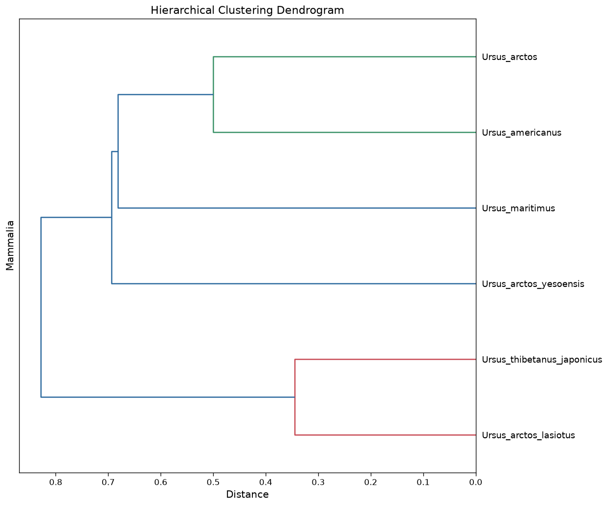

|   | Ursus_americanus | Ursus_arctos | Ursus_arctos_lasiotus | Ursus_arctos_yesoensis | Ursus_maritimus | Ursus_thibetanus_japonicus |
|----|----|----|----|----|----|----|
| Ursus_americanus | 0.000000 | 0.500000 | 0.867470 | 0.854167 | 0.681818 | 0.828571 |
| Ursus_arctos | 0.500000 | 0.000000 | 0.866667 | 0.850000 | 0.721311 | 0.882353 |
| Ursus_arctos_lasiotus | 0.867470 | 0.866667 | 0.000000 | 0.940299 | 0.829545 | 0.345238 |
| Ursus_arctos_yesoensis | 0.854167 | 0.850000 | 0.940299 | 0.000000 | 0.693878 | 0.958333 |
| Ursus_maritimus | 0.681818 | 0.721311 | 0.829545 | 0.693878 | 0.000000 | 0.852174 |
| Ursus_thibetanus_japonicus | 0.828571 | 0.882353 | 0.345238 | 0.958333 | 0.852174 | 0.000000 |

# Example 5: Differential glycomics analyses

Let’s say you have collected glycomics data from healthy and diseased samples and now you want to find out what’s really different between the two. There are many ways that you can go about this, depending on your exact question but the most likely answer to your question can be found in the `glycowork.motif.analysis.get_differential_expression` function. This function allows you to test whether any sequences (or motifs) are exhibiting significantly different abundances between your conditions.

But first, we need some data! Now, maybe you have your own data here but you can also easily access the glycomics data stored within `glycowork` via the `glycowork.glycan_data.loader.glycomics_data_loader`. Using `dir(glycomics_data_loader)` will tell you which datasets are currently available (hint: there are also analogous dataloaders for glycoproteomics and lectin microarray data). This example will work with a skin cancer *O*-glycomics dataset but feel free to use your own data if you have it.

``` python
df = glycomics_data_loader.human_skin_O_PMC5871710
```

|   | glycan | control_1 | tumor_1 | control_2 | tumor_2 | control_3 | tumor_3 | control_4 | tumor_4 | control_5 | tumor_5 | control_6 | tumor_6 | control_7 | tumor_7 | control_8 | tumor_8 | control_9 | tumor_9 |
|----|----|----|----|----|----|----|----|----|----|----|----|----|----|----|----|----|----|----|----|
| 0 | Gal3/6S(b1-3)\[Neu5Ac(a2-6)\]GalNAc | 2.755913 | 0.620301 | 3.019806 | 4.148615 | 2.413021 | 0.424605 | 1.764977 | 0.744528 | 4.518547 | 0.849240 | 3.174455 | 1.543922 | 3.752813 | 1.287601 | 1.574444 | 0.627539 | 4.415230 | 0.425039 |
| 1 | Gal(b1-3)\[Neu5Ac(a2-6)\]GalNAc | 0.775234 | 0.178490 | 0.778083 | 0.832907 | 0.824018 | 0.410873 | 0.617573 | 2.133773 | 0.603573 | 0.544599 | 1.317444 | 1.256997 | 0.860332 | 0.340373 | 0.927956 | 0.494144 | 1.045950 | 0.590404 |
| 2 | Neu5Ac(a2-3)Gal(b1-3)GalNAc | 9.219494 | 8.436141 | 16.190721 | 11.032313 | 16.061363 | 8.133529 | 12.291188 | 10.143781 | 10.865172 | 14.353894 | 12.313024 | 11.601938 | 13.246380 | 8.352032 | 12.352587 | 9.731834 | 16.170263 | 12.693331 |
| 3 | Gal(b1-4)GlcNAc(b1-6)\[Gal(b1-3)\]GalNAc | 2.770825 | 0.944913 | 1.531698 | 2.427562 | 1.570204 | 2.066165 | 2.832475 | 2.508954 | 2.228299 | 1.757840 | 4.811796 | 3.641077 | 1.437487 | 1.470697 | 2.324956 | 2.192553 | 0.805130 | 1.100490 |
| 4 | Neu5Ac(a2-3)Gal(b1-3)\[Neu5Ac(a2-6)\]GalNAc | 35.912676 | 30.058418 | 48.420833 | 43.738436 | 46.692847 | 26.728713 | 39.971128 | 32.290024 | 51.472292 | 40.669153 | 41.927351 | 37.755641 | 43.701528 | 32.565498 | 47.145757 | 38.565763 | 44.683562 | 33.532942 |
| 5 | Neu5Ac(a2-3)Gal(b1-3)\[Neu5Ac(a2-8)Neu5Ac(a2-6)\]GalNAc | 0.664610 | 0.495280 | 1.451470 | 1.289237 | 1.331164 | 0.441114 | 0.657772 | 0.330536 | 0.654086 | 0.219399 | 1.433102 | 0.791533 | 0.722264 | 0.589715 | 1.337691 | 0.779090 | 1.734299 | 0.605036 |
| 6 | Fuc(a1-2)Gal(b1-4)GlcNAc(b1-6)\[Gal(b1-3)\]GalNAc | 1.069934 | 1.735744 | 1.468105 | 1.509499 | 1.128653 | 1.812381 | 0.816789 | 6.345353 | 2.179460 | 1.261105 | 1.438459 | 4.410718 | 0.669910 | 1.310332 | 1.838577 | 0.989791 | 1.329698 | 1.392818 |
| 7 | Neu5Ac(a2-3)Gal(b1-3)\[Gal(b1-4)GlcNAc6S(b1-6)\]GalNAc | 0.599954 | 1.213936 | 0.450138 | 0.469515 | 0.528332 | 2.891749 | 0.770085 | 0.853955 | 0.853148 | 4.776427 | 0.669361 | 1.323619 | 0.914651 | 1.027152 | 1.633415 | 4.333793 | 0.365928 | 3.162330 |
| 8 | Neu5Ac(a2-3)Gal(b1-4)GlcNAc6S(b1-6)\[Gal(b1-3)\]GalNAc | 6.005921 | 6.365952 | 5.623333 | 5.965819 | 5.299405 | 7.027606 | 10.523154 | 12.570391 | 4.753029 | 6.895145 | 12.325022 | 10.338465 | 5.401390 | 5.785955 | 7.054084 | 5.775716 | 11.549820 | 4.633692 |
| 9 | Neu5Ac(a2-3)Gal(b1-3)\[Gal(b1-4)GlcNAc(b1-6)\]GalNAc | 3.557548 | 2.179078 | 2.341708 | 2.594836 | 2.408925 | 1.838783 | 3.403741 | 1.561446 | 1.909720 | 0.838742 | 1.389057 | 1.590800 | 2.557034 | 3.846191 | 0.765387 | 0.660688 | 1.428603 | 0.845144 |
| 10 | Neu5Ac(a2-3)Gal(b1-4)GlcNAc(b1-6)\[Gal(b1-3)\]GalNAc | 8.448576 | 14.890684 | 4.765329 | 7.229355 | 5.669282 | 18.752163 | 7.503251 | 7.395700 | 6.107556 | 8.367088 | 7.748875 | 8.248336 | 9.086158 | 13.802771 | 6.255983 | 9.265805 | 4.196432 | 11.075915 |
| 11 | Neu5Ac(a2-3)Gal(b1-4)GlcNAc(b1-6)\[Neu5Ac(a2-3)Gal(b1-3)\]GalNAc | 25.222604 | 26.314089 | 12.026590 | 16.037174 | 13.649831 | 21.493736 | 16.473606 | 19.289899 | 10.427178 | 12.014370 | 9.666302 | 14.461389 | 15.276941 | 25.481534 | 12.897587 | 16.978625 | 10.428889 | 18.751042 |
| 12 | Neu5Ac(a2-3)Gal(b1-4)GlcNAc6S(b1-6)\[Neu5Ac(a2-3)Gal(b1-3)\]GalNAc | 2.996712 | 6.566972 | 1.932188 | 2.724731 | 2.422956 | 7.978585 | 2.374260 | 3.831659 | 3.427941 | 7.452997 | 1.785750 | 3.035567 | 2.373113 | 4.140150 | 3.891578 | 9.604660 | 1.846197 | 11.191816 |

We can see that the dataset is structured as having the glycans in the very first column and then every sample being another column. This is the standard set-up that most functions in `glycowork.motif.analysis` expect to get. Note that, while glycans here are written in IUPAC-condensed, you can use pretty much any common glycan nomenclature (WURCS, GlycoCT, IUPAC-extended, etc.) and our internal conversions will make it work.

Now `glycowork.motif.analysis.get_differential_expression` basically only needs to know two things: (i) your dataset and (ii) which columns belong to which condition. There are many more options and settings that you *can* choose, but that’s the minimum. Our example dataset tell us in the column headings which sample comes from a tumor and which from a healthy setting. Our function now wants to know either the position of the column or the column names of both the control samples and the disease samples. We will further use one optional setting, “paired = True”, to indicate that these samples are matched (control_1 and tumor_1 come from the same patient). Analyzing paired samples in a paired manner is not only more sensitive but also more appropriate, statistically speaking.

So, let’s see which glycans are differentially abundant in skin cancers!

``` python
get_differential_expression(df)
```

|  | Glycan | Mean abundance | Log2FC | p-val | corr p-val | significant | corr Levene p-val | Effect size | Equivalence p-val |
|----|----|----|----|----|----|----|----|----|----|
| 12 | Neu5Ac(a2-3)Gal(b1-4)GlcNAc6S(b1-6)\[Neu5Ac(a2-... | 4.361908 | 1.191371 | 0.000169 | 0.000631 | True | 0.334477 | 1.668369 | 1.000000 |
| 3 | Gal3/6S(b1-3)\[Neu5Ac(a2-6)\]GalNAc | 2.118118 | -1.629791 | 0.000210 | 0.000631 | True | 0.796428 | -1.495267 | 1.000000 |
| 8 | Neu5Ac(a2-3)Gal(b1-3)\[Neu5Ac(a2-8)Neu5Ac(a2-6)... | 0.855547 | -0.774705 | 0.000560 | 0.001119 | True | 0.854606 | -1.725754 | 1.000000 |
| 6 | Neu5Ac(a2-3)Gal(b1-3)\[Gal(b1-4)GlcNAc6S(b1-6)\]... | 1.478294 | 1.350737 | 0.001512 | 0.002268 | True | 0.334477 | 1.161091 | 1.000000 |
| 9 | Neu5Ac(a2-3)Gal(b1-4)GlcNAc(b1-6)\[Gal(b1-3)\]Ga... | 8.683615 | 0.653972 | 0.006455 | 0.007746 | True | 0.854606 | 1.083785 | 1.000000 |
| 10 | Neu5Ac(a2-3)Gal(b1-4)GlcNAc(b1-6)\[Neu5Ac(a2-3)... | 16.574095 | 0.428917 | 0.015762 | 0.015762 | True | 0.854606 | 1.165862 | 1.000000 |
| 7 | Neu5Ac(a2-3)Gal(b1-3)\[Neu5Ac(a2-6)\]GalNAc | 39.974312 | -0.338316 | 0.025138 | 0.025138 | True | 0.854606 | -1.461205 | 1.000000 |
| 0 | Fuc(a1-2)Gal(b1-4)GlcNAc(b1-6)\[Gal(b1-3)\]GalNAc | 1.731629 | 0.578361 | 0.063939 | 0.063939 | False | 0.854606 | 0.599029 | 0.956049 |
| 4 | Neu5Ac(a2-3)Gal(b1-3)GalNAc | 11.907405 | -0.301955 | 0.074372 | 0.074372 | False | 0.854606 | -0.801246 | 0.956049 |
| 5 | Neu5Ac(a2-3)Gal(b1-3)\[Gal(b1-4)GlcNAc(b1-6)\]Ga... | 1.982424 | -0.385582 | 0.083481 | 0.083481 | False | 0.854606 | -0.616242 | 0.956049 |
| 1 | Gal(b1-3)\[Neu5Ac(a2-6)\]GalNAc | 0.775084 | -0.437895 | 0.094276 | 0.094276 | False | 0.334477 | -0.556086 | 0.956049 |
| 2 | Gal(b1-4)GlcNAc(b1-6)\[Gal(b1-3)\]GalNAc | 2.088084 | -0.070387 | 0.715357 | 0.715357 | False | 0.854606 | -0.127870 | 0.956049 |
| 11 | Neu5Ac(a2-3)Gal(b1-4)GlcNAc6S(b1-6)\[Gal(b1-3)\]... | 7.469484 | -0.003783 | 0.984235 | 0.984235 | False | 0.854606 | -0.006934 | 0.956049 |

Okay, seems like there are quite a few glycan that are either higher or lower in the cancer samples (see the “Log2FC” or “Effect size” columns for the direction of the effect)! A really important column here is the “corr p-val” column, which indicates the p-values of the comparisons after a two-stage Benjamini-Hochberg correction for multiple testing. By comparing this with a significance threshold, we can tell whether the observed difference is statistically significant. Usually, this threshold is p \< 0.05 but this is a bad convention, since the meaning of p-values changes with sample size (a p-value of 0.049 at a sample size of 1,000 should not be considered significant but it should at a sample size of 10). `glycowork` adjusts this for you.

If you want to know what’s happening under the hood, this function is transforming your data via a CLR-transformation with a scale uncertainty model to counteract (i) the compositional nature of glycomics data and (ii) potential absolute differences between your conditions. In any case, let’s now have a look at motifs/substructures! While you can further specify which motifs you want to look at via the “feature_set” option, simply switching on “motifs = True” can be sufficient to now analyze at the motif level.

``` python
df_res = get_differential_expression(df, motifs = True)
df_res
```

    Chosen grouping: by_motif_family

|  | Glycan | Mean abundance | Log2FC | p-val | corr p-val | significant | corr Levene p-val | Effect size | Equivalence p-val | Explained by | Redistribution p-val | Residual p-val | Residual effect size |
|----|----|----|----|----|----|----|----|----|----|----|----|----|----|
| 1 | Internal_LacNAc_type2 | 3.181490 | 0.623914 | 0.000183 | 0.000730 | True | 0.973152 | 2.031779 | 1.000000 | H_antigen_type2 (+0.08) | 0.999388 | 0.002732 | 1.815136 |
| 14 | Neu5Ac(a2-8)Neu5Ac | 0.101874 | -0.786713 | 0.000269 | 0.001347 | True | 0.966300 | -1.701406 | 1.000000 |  | NaN | NaN | NaN |
| 7 | Gal3/6S(b1-3)GalNAc | 0.253167 | -1.538591 | 0.000539 | 0.003235 | True | 0.717715 | -1.492278 | 1.000000 |  | NaN | NaN | NaN |
| 11 | Gal(b1-3)GalNAc | 11.590007 | 0.181353 | 0.001788 | 0.003746 | True | 0.717715 | 1.913002 | 1.000000 | Oglycan_core1 (-0.32), Oglycan_core2 (+0.29) | 0.002481 | 1.000000 | 0.000000 |
| 5 | Oglycan_core2 | 3.663874 | 0.474670 | 0.001873 | 0.003746 | True | 0.889380 | 1.257691 | 1.000000 |  | NaN | NaN | NaN |
| 13 | Neu5Ac(a2-6)GalNAc | 5.191807 | -0.263247 | 0.001618 | 0.004046 | True | 0.717715 | -1.474973 | 1.000000 | Disialyl_T_antigen (+0.02) | 0.010802 | 0.004998 | -1.399822 |
| 3 | Disialyl_T_antigen | 4.846368 | -0.247367 | 0.004553 | 0.007588 | True | 0.717715 | -1.233701 | 1.000000 |  | NaN | NaN | NaN |
| 6 | Gal | 16.827021 | 0.261506 | 0.004396 | 0.008792 | True | 0.717715 | 1.245106 | 1.000000 | Terminal_LacNAc_type2 (-0.43), Internal_LacNAc... | 0.004638 | 1.000000 | 0.000000 |
| 9 | GlcNAc6S(b1-6)GalNAc | 1.573141 | 0.503116 | 0.010337 | 0.015506 | True | 0.717715 | 0.974911 | 1.000000 |  | NaN | NaN | NaN |
| 0 | H_antigen_type2 | 0.205325 | 0.704798 | 0.040932 | 0.054576 | True | 0.814021 | 0.715006 | 1.000000 |  | NaN | NaN | NaN |
| 4 | Oglycan_core1 | 7.926133 | -0.143565 | 0.085429 | 0.102515 | True | 0.717715 | -0.594946 | 0.880232 | Disialyl_T_antigen (-0.10) | 0.004372 | 0.245211 | 0.470052 |
| 2 | Terminal_LacNAc_type2 | 0.482384 | -0.163598 | 0.245667 | 0.245667 | False | 0.814021 | -0.386140 | 0.880232 |  | NaN | NaN | NaN |
| 8 | GalNAc | 11.843174 | 0.088708 | 0.303224 | 0.303224 | False | 0.769358 | 0.384407 | 0.880232 | Gal3/6S(b1-3)GalNAc (-1.63), GlcNAc6S(b1-6)Gal... | 0.009985 | 1.000000 | 0.000000 |
| 12 | Neu5Ac(a2-3)Gal | 13.510278 | 0.107799 | 0.266595 | 0.333244 | False | 0.717715 | 0.376281 | 0.880232 | Disialyl_T_antigen (-0.36) | 0.000185 | 0.002732 | 1.656784 |
| 10 | Neu5Ac | 18.803959 | 0.026365 | 0.761181 | 0.761181 | False | 0.717715 | 0.107014 | 0.880232 | Neu5Ac(a2-8)Neu5Ac (-0.81), Neu5Ac(a2-6)GalNAc... | 0.001908 | 1.000000 | 0.000000 |

So here we see now that extended core 2 structures, especially sulfated ones, are significantly increasing in cancer, whereas core 1 structures do not change significantly. What’s interesting here is that most forms of sialylation are in fact decreasing in cancer, despite the typical finding that sialylation increases in tumor and despite the fact that there are individual sialylated structures that significantly increase. On the one hand, this of course depends on the tumor / type of cancer. But it’s very important to keep that this is precisely why it’s key to analyze glycomics data at the motif level to get an overall picture, as the intuition can often be led astray by looking at individual structures.

Okay, last but not least, let’s make a volcano plot with the results we got from the motif-level analysis! For this, we can use the `glycowork.motif.analysis.get_volcano` function, which takes the output from `glycowork.motif.analysis.get_differential_expression` and can also be further styled with `GlycoDraw` as is discussed below.

``` python
get_volcano(df_res, annotate_volcano=True)
```

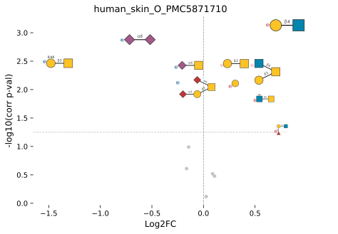

# Deep Learning Code Snippets

For those of you that are blessed with GPU-access, we wrote up a minimal example for training a glycan-focused deep learning model. Even if you usually do not have access to a GPU, you can always go to Google Colab (click on the badge at the top of this site to open this notebook on Google Colab) and change the runtime type to GPU. Then you can paste the following code in a cell, execute, and see our model train!

First, we need `torch` and `torch_geometric` for deep learning. The simplest route installs both along with glycowork:

    pip install glycowork[ml]

If you install them yourself instead, note that our trained model weights were serialized with `torch` 2.5+; much older `torch` versions may fail to load them.

*SweetNet-type model*

Then, we import the relevant `glycowork` modules:

    from glycowork.glycan_data.loader import df_species
    from glycowork.ml.train_test_split import hierarchy_filter
    from glycowork.ml.processing import split_data_to_train
    from glycowork.ml import models
    from glycowork.ml import model_training

Finally, we can prepare the data and train a model to classify from which taxonomic kingdom a glycan came from, using our graph convolutional neural network, `SweetNet`.

    train_x, val_x, train_y, val_y, id_val, class_list, class_converter = hierarchy_filter(df_species,
                                                                                           rank = 'Kingdom')

    dataloaders = split_data_to_train(train_x, val_x, train_y, val_y)
    model = models.prep_model('SweetNet', len(class_list))
    optimizer_ft, scheduler, criterion = model_training.training_setup(model, 0.0005, num_classes = len(class_list))
    model_ft = model_training.train_model(model, dataloaders, criterion, optimizer_ft, scheduler,
                       num_epochs = 100)

And that’s it! You’ve just trained a state-of-the-art deep learning model with effectively five lines of code (excluding package imports of course).

*LectinOracle-type model*

For `LectinOracle`, you need a protein sequence and glycan sequences. Further, you will need to retrieve the ESMC-representation for your protein sequence, as that is used as the actual input for LectinOracle. If you don’t want to do that, check below for the `LectinOracle_flex` model. Here the minimal process is shown for the arbitrary protein sequence “QWERTFVCF”. The trained model is yet again retrieved via `prep_model`.

    !pip install esm
    from esm.models.esmc import ESMC
    from glycowork.ml.inference import get_esmc_representations, get_lectin_preds
    from glycowork.ml.models import prep_model

    model = ESMC.from_pretrained("esmc_300m")
    rep = get_esmc_representations(["QWERTFVCF"], model)
    leor = prep_model("LectinOracle", 1, trained = True)
    get_lectin_preds("QWERTFVCF", ['Neu5Ac(a2-6)GalNAc', 'Gal(b1-4)Glc'], leor, rep)

The output here (same as for `LectinOracle_flex` below) is a table/dataframe, where each row shows the tested glycan and its associated binding prediction. The higher the binding prediction, the more likely an interaction (negative values in general likely mean “no interaction”), with a moderate correlation with binding affinity (based on our findings so far).

*LectinOracle_flex-type model*

While it has a slightly lower performance than `LectinOracle`, `LectinOracle_flex` can directly use protein sequences as input (no ESMC-conversion necessary). This is made possible by knowledge distillation, in which we train a sub-module to mimic the conversion of the much larger ESMC model. Just get the correct model via `prep_model` and declare `flex = True` and you’re good to go!

    from glycowork.ml.inference import get_lectin_preds
    from glycowork.ml.models import prep_model
    leor = prep_model("LectinOracle_flex", 1, trained = True)
    get_lectin_preds("QWERTFVCF", ['Neu5Ac(a2-6)GalNAc', 'Gal(b1-4)Glc'], leor, flex = True)

# GlycoDraw Code Snippets

``` python
GlycoDraw('Man(a1-2)Man(a1-2)Man(a1-3)[Man(a1-2)Man(a1-3)[Man(a1-2)Man(a1-6)]Man(a1-6)]Man(b1-4)GlcNAc(b1-4)GlcNAc')
```

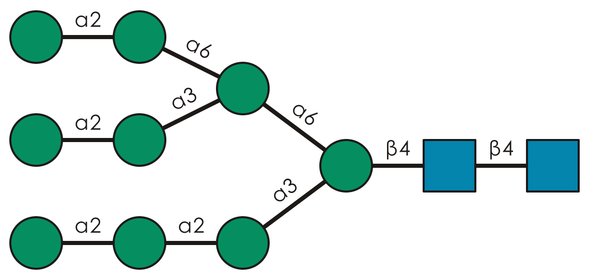

Okay, that’s all nice and well. But what if you don’t have lots of space in your figure?

Enter `compact = True`

``` python
GlycoDraw('Man(a1-2)Man(a1-2)Man(a1-3)[Man(a1-2)Man(a1-3)[Man(a1-2)Man(a1-6)]Man(a1-6)]Man(b1-4)GlcNAc(b1-4)GlcNAc',
         compact = True)
```

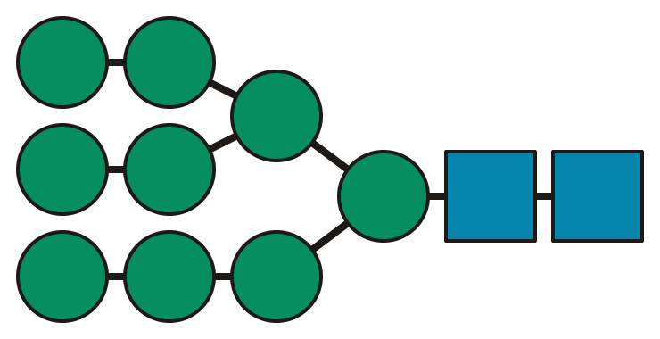

You can also go beyond mere drawing and add some more information, such as motif highlighting! In the below example, we highlight all Lewis antigen motifs in that structure.

``` python
GlycoDraw('Neu5Ac(a2-3)Gal(b1-4)[Fuc(a1-3)]GlcNAc(b1-2)Man(a1-3)[Gal(b1-3)[Fuc(a1-4)]GlcNAc(b1-2)Man(a1-6)]Man(b1-4)GlcNAc(b1-4)[Fuc(a1-6)]GlcNAc',
         highlight_motif = 'Fuc(a1-?)[Gal(b1-?)]GlcNAc')
```

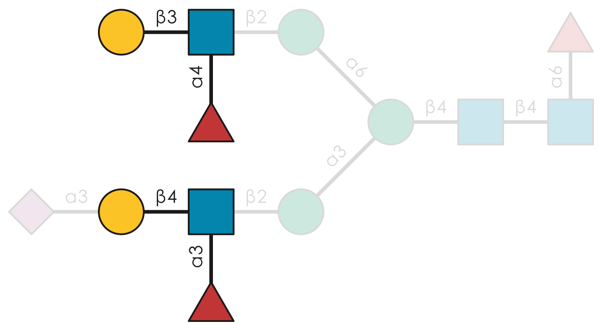

Or you could draw repeat structures, such as in glycosaminoglycans (GAGs). Here’s one example:

``` python
GlycoDraw('GalNAc4S(b1-4)GlcA(b1-3)', repeat = '2-3')
```

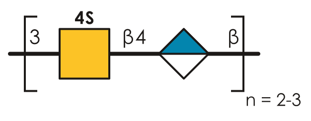

Or how about visualizing flexibility, attention, or any kind of attribution on a per-monosaccharide basis?

``` python
GlycoDraw("Fuc(a1-2)[Neu5Ac(a2-3)]Gal(b1-3)[Neu5Ac(a2-8)Neu5Ac(a2-6)]GalNAc", per_residue = [0.9, 0.7, 0.3, 0.2, 0.5, 0.1])
```

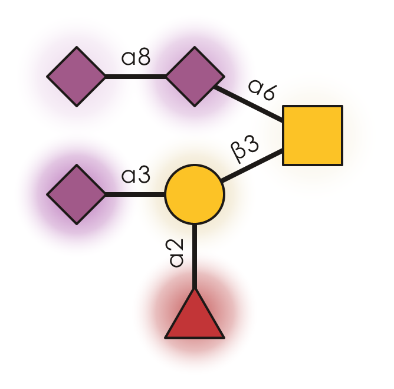

And that’s only a brief glimpse at the offered functionality! Why not replace the text labels from `glycowork.motif.analysis.get_heatmap` or `glycowork.motif.analysis.get_volcano` with glycan images via `glycowork.motif.draw.annotate_figure`?

Be sure to check out Lundstrøm et al., *Glycobiology*, 2023 for more details and inspirations!
