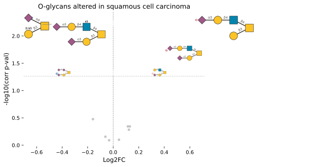
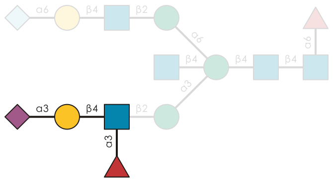

# glycowork


<!-- WARNING: THIS FILE WAS AUTOGENERATED! DO NOT EDIT! -->


[](https://pypi.org/project/glycowork/)[](https://pypi.org/project/glycowork/)
[](https://pypi.org/project/glycowork/)[](https://github.com/BojarLab/glycowork/issues)[](https://zenodo.org/doi/10.5281/zenodo.10039202)[](https://codecov.io/gh/BojarLab/glycowork)


`glycowork` is the Python package for glycan data science. Glycans are
branched, non-linear sequences with a dozen competing text
representations and no shared tooling, which is why most glycomics
analysis stalls before it starts. `glycowork` removes that step and
gives you the rest of the stack on top of it.

- **Reads everything.** IUPAC-condensed is native to `glycowork`.
  IUPAC-extended, GlycoCT, GlycoCT-XML, WURCS, LinearCode, Oxford,
  GLYCAM, CSDB-linear, GlycoWorkBench, GlyTouCan IDs, KCF, SMILES,
  pGlyco, StrucGP, GlySeeker, and LINUCS are canonicalized on the way
  in, and exports of glycomics and glycoproteomics software (Skyline,
  LaCyTools, GlycoWorkbench, FragPipe, pGlyco3, Byonic, and more) go
  straight into the analysis functions. IUPAC-extended, GlycoCT, Oxford,
  GLYCAM, and SMILES also go back out. You never need a parser again.
- **Graph-native.** Every glycan is a directed graph, so motif search is
  subgraph isomorphism with wildcards (`Hex`, `b1-3/4`, `?`),
  terminal/internal constraints, and negation. There is also a full
  regular-expression engine for glycans.
- **Statistics that comparative glycomics actually needs.**
  Compositional transforms, MNAR-aware imputation, two-stage FDR across
  motif families, effect sizes, ANOVA, time series, and biodiversity,
  each in one call.
- **Data included.** 50,461 curated glycan sequences with
  species/tissue/disease annotations, \>790,000 protein-glycan binding
  measurements, 82 analysis-ready glycomics, glycoproteomics, and
  lectin-array datasets, and five pretrained deep learning models.
- **Publication-ready figures.** SNFG drawings from a sequence, dropped
  straight into your volcano plots, heatmaps, and Excel sheets.

**Documentation:** <https://bojarlab.github.io/glycowork/> ·
**Contribute:**
[Guidelines](https://github.com/BojarLab/glycowork/blob/master/CONTRIBUTING.md)
· **Cite:** [Thomes et al.,
2021](https://academic.oup.com/glycob/advance-article/doi/10.1093/glycob/cwab067/6311240)

## Install

<u>Not familiar with Python?</u> Try our no-code, graphical user
interface (`glycoworkGUI.exe`, can be downloaded at the bottom of the
latest [Release](https://github.com/BojarLab/glycowork/releases) page)
for accessing some of the most useful `glycowork` functions

Or try our [web interface](https://canonicalize.streamlit.app/) for
sequence format conversion/cleaning and drawing glycan SNFG structures!

<u>via pip:</u> <br> `pip install glycowork` <br> `import glycowork`

<u>alternative:</u> <br>
`pip install git+https://github.com/BojarLab/glycowork.git` <br>
`import glycowork`

<u>Note that we have optional extra installs for specialized use (even
further instructions can be found in the `Examples` tab; on Mac you
might need to use `"glycowork[ml]"`), such as:</u> <br> *deep learning*
<br> `pip install glycowork[ml]` <br> *analyzing atomic/chemical
properties of glycans* <br> `pip install glycowork[chem]` <br>
*everything* <br> `pip install glycowork[all]` <br>

## Whole workflows in one call

An entire differential glycomics analysis, on real data that ships with
the package.

``` python
#matched tumor and healthy skin from 10 squamous cell carcinoma patients; one of 82 bundled datasets
from glycowork.glycan_data.loader import glycomics_data_loader
from glycowork.motif.analysis import get_differential_expression
df = glycomics_data_loader.human_skin_O_PMC5871710_SCC
print(df.groups)
#groups, pairing, and the alpha level are read off the dataset itself
res = get_differential_expression(df)
print(res.sort_values('corr p-val')[['Glycan', 'Log2FC', 'corr p-val', 'Effect size']].head())

#the same result object, drawn: every dot past the thresholds gets its SNFG structure instead of a text label
from glycowork.motif.analysis import get_volcano
get_volcano(res, annotate_volcano = True, title = 'O-glycans altered in squamous cell carcinoma')
```

    healthy (n=10) | cancer (n=10)
                                                   Glycan    Log2FC  corr p-val  \
    3                   Gal3/6S(b1-3)[Neu5Ac(a2-6)]GalNAc -0.636998    0.004645   
    9   Neu5Ac(a2-3)Gal(b1-4)GlcNAc(b1-6)[Gal(b1-3)]Ga...  0.652277    0.005088   
    12  Neu5Ac(a2-3)Gal(b1-4)GlcNAc6S(b1-6)[Neu5Ac(a2-... -0.554030    0.006128   
    10  Neu5Ac(a2-3)Gal(b1-4)GlcNAc(b1-6)[Neu5Ac(a2-3)...  0.418637    0.018367   
    5   Neu5Ac(a2-3)Gal(b1-3)[Gal(b1-4)GlcNAc(b1-6)]Ga...  0.311395    0.049055   

        Effect size  
    3     -1.359690  
    9      1.130820  
    12    -1.138142  
    10     1.045617  
    5      0.911243  



## Data & Models

`Glycowork` currently contains the following main datasets that are
freely available to everyone:

- **`df_glycan`**
  - contains ~50,500 unique glycan sequences, including labels such as
    ~39,500 species associations, ~20,000 tissue associations, and
    ~1,000 disease associations
- **`glycan_binding`**
  - contains \>790,000 protein-glycan binding interactions, from \>2,000
    unique glycan-binding proteins
- **`glycomics_data_loader`**, **`lectin_array_data_loader`**,
  **`glycoproteomics_data_loader`**
  - 82 curated, analysis-ready datasets from the literature, each
    shipping with its own sample groups, pairing, and provenance, so
    every analysis function below runs on them with no arguments

These are not flat tables; they query themselves:

``` python
#which glycans of odd-toed ungulates carry a3-sialylated LacNAc, and where were they described?
from glycowork.glycan_data.loader import df_glycan, glycomics_data_loader
hits = df_glycan.meta_filter(Order = 'Perissodactyla').glyco_filter('Sia(a2-3)Gal')
print(len(hits), hits.glycans[:3])

#which bundled O-glycomics datasets came from primary tissue or body fluid?
print(glycomics_data_loader.filter(glycan_class = 'O', source_type = ['primary tissue', 'body fluid']))
```

    84 ['Neu5Ac(a2-3)Gal(b1-4)Glc1Cer', 'Neu5Ac(a2-3)Gal(b1-3)GalNAc(b1-4)[Neu5Ac(a2-3)]Gal(b1-4)Glc1Cer', 'Neu5Ac(a2-8)Neu5Ac(a2-3)Gal(b1-4)Glc1Cer']
    ['fish_gill_infection_O_PMID41435595', 'fish_intestine_infection_O_10_2139ssrn_7005880', 'human_colorectal_O_PMC9254241', 'human_colorectal_O_PMID19152289', 'human_gastric_O_PMC5762837', 'human_gastric_O_PMID28461410', 'human_liver_O_PMC5383776', 'human_liver_O_PMC9254241', 'human_ovarian_O_PMC4468167', 'human_prostate_O_PMC8010466', 'human_skin_O_PMC5871710', 'human_skin_O_PMC5871710_BCC', 'human_skin_O_PMC5871710_SCC', 'mouse_brain_O_PMID38343116', 'mouse_brain_tango2ko_O_10_1002pgr2_70042', 'mouse_gastric_O_PMID40667878']

Additionally, we store these trained deep learning models for easy
usage, which can be retrieved with the `prep_model` function:

- **`LectinOracle`**
  - can be used to predict glycan-binding specificity of a protein,
    given its ESMC representation; from [Lundstrom et al.,
    2021](https://onlinelibrary.wiley.com/doi/10.1002/advs.202103807)
- **`LectinOracle_flex`**
  - operates the same as LectinOracle but can directly use the raw
    protein sequence as input (no ESMC representation required)
- **`SweetNet`**
  - a graph convolutional neural network trained to predict species from
    glycan, can be used to generate learned glycan representations; from
    [Burkholz et al., 2021](https://pubmed.ncbi.nlm.nih.gov/34133929/)
- **`GIFFLAR`**
  - a heterogeneous graph neural network over atoms, bonds, and
    monosaccharides, trained on the same species task as SweetNet; also
    yields learned glycan representations; from [Joeres and Bojar,
    2024](https://arxiv.org/abs/2409.13467v3)
- **`NSequonPred`**
  - given the ESM-1b representation of an N-sequon (+/- 20 AA), this
    model can predict whether the sequon will be glycosylated

## How to use

Four modules:
[`glycan_data`](https://bojarlab.github.io/glycowork/glycan_data.html)
for datasets and loaders,
[`motif`](https://bojarlab.github.io/glycowork/motif.html) for
processing, drawing, and analyzing sequences,
[`network`](https://bojarlab.github.io/glycowork/network.html) for
biosynthetic and evolutionary networks, and
[`ml`](https://bojarlab.github.io/glycowork/ml.html) for representations
and models.

A few of the things people use them for, with the full set in the
[examples](https://bojarlab.github.io/glycowork/examples.html):

- [differential expression, ANOVA, time series, and
  biodiversity](https://bojarlab.github.io/glycowork/motif.html#analysis)
  on glycomics, glycoproteomics, and lectin-array data
- [motif
  enrichment](https://bojarlab.github.io/glycowork/motif.html#analysis)
  and [motif
  annotation](https://bojarlab.github.io/glycowork/motif.html#annotate),
  including custom motifs
- [publication-quality SNFG
  figures](https://bojarlab.github.io/glycowork/motif.html#draw), and
  annotating existing figures or Excel sheets with drawn structures
- [*m/z* to composition to structure to
  motif](https://bojarlab.github.io/glycowork/motif.html#tokenization)
  mapping, and mass calculation
- [biosynthetic
  networks](https://bojarlab.github.io/glycowork/network.html#biosynthesis),
  with flow analysis and differential biosynthesis between conditions
- [pretrained
  models](https://bojarlab.github.io/glycowork/ml.html#inference) for
  prediction, and [training your
  own](https://bojarlab.github.io/glycowork/ml.html#model_training) on
  learned glycan representations

``` python
#drawing publication-quality glycan figures
from glycowork import GlycoDraw
drawing = GlycoDraw("Neu5Ac(a2-3)Gal(b1-4)[Fuc(a1-3)]GlcNAc(b1-2)Man(a1-3)[Neu5Gc(a2-6)Gal(b1-4)GlcNAc(b1-2)Man(a1-6)][GlcNAc(b1-4)]Man(b1-4)GlcNAc(b1-4)[Fuc(a1-6)]GlcNAc", highlight_motif = "Neu5Ac(a2-3)Gal(b1-4)[Fuc(a1-3)]GlcNAc", suppress=True)
```



``` python
#six different sequence formats in the same list; no conversion step, no bookkeeping
glycans = ["Neu5Ac(a2-3)Gal(b1-4)[Fuc(a1-3)]GlcNAc(b1-2)Man(a1-3)[Gal(b1-3)[Fuc(a1-4)]GlcNAc(b1-2)Man(a1-6)]Man(b1-4)GlcNAc(b1-4)[Fuc(a1-6)]GlcNAc",
           "Ma3(Ma6)Mb4GNb4GN;N",
           "α-D-Manp-(1→3)[α-D-Manp-(1→6)]-β-D-Manp-(1→4)-β-D-GlcpNAc-(1→4)-β-D-GlcpNAc-(1→",
           "F(3)XA2",
           "WURCS=2.0/5,11,10/[a2122h-1b_1-5_2*NCC/3=O][a1122h-1b_1-5][a1122h-1a_1-5][a2112h-1b_1-5][a1221m-1a_1-5]/1-1-2-3-1-4-3-1-4-5-5/a4-b1_a6-k1_b4-c1_c3-d1_c6-g1_d2-e1_e4-f1_g2-h1_h4-i1_i2-j1",
           """RES
1b:b-dglc-HEX-1:5
2s:n-acetyl
3b:b-dglc-HEX-1:5
4s:n-acetyl
5b:b-dman-HEX-1:5
6b:a-dman-HEX-1:5
7b:b-dglc-HEX-1:5
8s:n-acetyl
9b:b-dgal-HEX-1:5
10s:sulfate
11s:n-acetyl
12b:a-dman-HEX-1:5
13b:b-dglc-HEX-1:5
14s:n-acetyl
15b:b-dgal-HEX-1:5
16s:n-acetyl
LIN
1:1d(2+1)2n
2:1o(4+1)3d
3:3d(2+1)4n
4:3o(4+1)5d
5:5o(3+1)6d
6:6o(2+1)7d
7:7d(2+1)8n
8:7o(4+1)9d
9:9o(-1+1)10n
10:9d(2+1)11n
11:5o(6+1)12d
12:12o(2+1)13d
13:13d(2+1)14n
14:13o(4+1)15d
15:15d(2+1)16n"""]
from glycowork.motif.annotate import annotate_dataset
#feature_set also takes 'terminal', 'exhaustive', 'chemical', 'graph', 'size_branch', and your own motifs via 'custom'
out = annotate_dataset(glycans, feature_set = ['known'], condense = True)
```

| motif_name | Internal_LewisX | SialylLewisX | Terminal_LewisA | H_antigen_type2 | Chitobiose | Trimannosylcore | Terminal_LacNAc_type1 | Internal_LacNAc_type2 | Terminal_LacNAc_type2 | Terminal_LacdiNAc_type2 | core_fucose | core_fucose(a1-3) | Nglycan_complex | M3FX |
|----|----|----|----|----|----|----|----|----|----|----|----|----|----|----|
| Neu5Ac(a2-3)Gal(b1-4)\[Fuc(a1-3)\]GlcNAc(b1-2)Man(a1-3)\[Gal(b1-3)\[Fuc(a1-4)\]GlcNAc(b1-2)Man(a1-6)\]Man(b1-4)GlcNAc(b1-4)\[Fuc(a1-6)\]GlcNAc | 1 | 1 | 1 | 0 | 1 | 1 | 1 | 1 | 0 | 0 | 1 | 0 | 1 | 0 |
| Man(a1-3)\[Man(a1-6)\]Man(b1-4)GlcNAc(b1-4)GlcNAc | 0 | 0 | 0 | 0 | 1 | 1 | 0 | 0 | 0 | 0 | 0 | 0 | 0 | 0 |
| Man(a1-3)\[Man(a1-6)\]Man(b1-4)GlcNAc(b1-4)GlcNAc | 0 | 0 | 0 | 0 | 1 | 1 | 0 | 0 | 0 | 0 | 0 | 0 | 0 | 0 |
| GlcNAc(b1-2)Man(a1-3)\[GlcNAc(b1-2)Man(a1-6)\]\[Xyl(b1-2)\]Man(b1-4)GlcNAc(b1-4)\[Fuc(a1-3)\]GlcNAc | 0 | 0 | 0 | 0 | 1 | 1 | 0 | 0 | 0 | 0 | 0 | 1 | 1 | 1 |
| Fuc(a1-2)Gal(b1-4)GlcNAc(b1-2)Man(a1-6)\[Gal(b1-4)GlcNAc(b1-2)Man(a1-3)\]Man(b1-4)GlcNAc(b1-4)\[Fuc(a1-6)\]GlcNAc | 0 | 0 | 0 | 1 | 1 | 1 | 0 | 1 | 1 | 0 | 1 | 0 | 1 | 0 |
| GalNAcOS(b1-4)GlcNAc(b1-2)Man(a1-3)\[GalNAc(b1-4)GlcNAc(b1-2)Man(a1-6)\]Man(b1-4)GlcNAc(b1-4)GlcNAc | 0 | 0 | 0 | 0 | 1 | 1 | 0 | 0 | 0 | 1 | 0 | 0 | 1 | 0 |

``` python
#using graphs, you can easily check whether a glycan contains a specific motif; how about internal Lewis A/X motifs?
from glycowork.motif.graph import subgraph_isomorphism
print(subgraph_isomorphism('Neu5Ac(a2-3)Gal(b1-4)[Fuc(a1-3)]GlcNAc(b1-6)[Gal(b1-3)]GalNAc',
                     'Fuc(a1-?)[Gal(b1-?)]GlcNAc', termini_list = ['terminal', 'internal', 'flexible']))
print(subgraph_isomorphism('Neu5Ac(a2-3)Gal(b1-3)[Fuc(a1-4)]GlcNAc(b1-6)[Gal(b1-3)]GalNAc',
                     'Fuc(a1-3/4)[Gal(b1-3/4)]GlcNAc', termini_list = ['t', 'i', 'f']))
print(subgraph_isomorphism('Gal(b1-3)[Fuc(a1-4)]GlcNAc(b1-6)[Gal(b1-3)]GalNAc',
                     'dHex(a1-?)[Hex(b1-?)]GlcNAc', termini_list = ['t', 'i', 'f']))

#or you could find the terminal epitopes of a glycan
from glycowork.motif.annotate import get_terminal_structures
print("\nTerminal structures:")
print(get_terminal_structures('Man(a1-3)[Man(a1-6)]Man(b1-4)GlcNAc(b1-4)[Fuc(a1-6)]GlcNAc'))
```

    True
    True
    False

    Terminal structures:
    ['Man(a1-3)', 'Man(a1-6)', 'Fuc(a1-6)']

``` python
#glycans have a regular expression engine, with quantifiers, alternation, negation, and anchors
from glycowork.motif.regex import get_match, motif_to_regex
glycan = "GalNAc(b1-4)GlcNAc(b1-2)Man(a1-3)[Neu5Gc(a2-6)GalNAc(b1-4)[Fuc(a1-3)]GlcNAc(b1-2)Man(a1-6)]Man(b1-4)GlcNAc(b1-4)[Fuc(a1-6)]GlcNAc"
print(get_match(".-.-([Hex|Fuc])+-.", glycan))

#anchors and negated character classes work too
print(get_match(".-HexNAc$", glycan))
print(get_match("Fuc-([^Gal])+-GlcNAc", "Fuc(a1-3)[GlcNAc(b1-4)]GlcNAc"))

#and any motif can be turned into its expression automatically
print(motif_to_regex("Fuc(a1-3)[Gal(b1-4)]GlcNAc(b1-?)"))
```

    ['Neu5Gc(a2-6)GalNAc(b1-4)[Fuc(a1-3)]GlcNAc', 'Man(b1-4)GlcNAc(b1-4)[Fuc(a1-6)]GlcNAc', 'GlcNAc(b1-2)Man(a1-3)[Man(a1-6)]Man', 'GlcNAc(b1-2)Man(a1-6)[Man(a1-3)]Man']
    ['GlcNAc(b1-4)GlcNAc', 'Fuc(a1-6)GlcNAc']
    ['Fuc(a1-3)[GlcNAc(b1-4)]GlcNAc']
    Fuca3-([Galb4]){1}-GlcNAcb?

``` python
#glycans are not an unordered list; they are the output of a biosynthetic pathway, which glycowork reconstructs
from glycowork.network.biosynthesis import construct_network, plot_network
glycans = ["Gal(b1-4)Glc-ol", "GlcNAc(b1-3)Gal(b1-4)Glc-ol", "GlcNAc6S(b1-3)Gal(b1-4)Glc-ol",
           "Gal(b1-4)GlcNAc(b1-3)Gal(b1-4)Glc-ol", "Fuc(a1-2)Gal(b1-4)Glc-ol",
           "Neu5Ac(a2-3)Gal(b1-4)GlcNAc(b1-3)[Gal(b1-3)GlcNAc(b1-6)]Gal(b1-4)Glc-ol"]
network = construct_network(glycans)
#the intermediates you did not measure are inferred, and every edge is labeled with the enzymatic reaction
print(len(glycans), "measured glycans ->", len(network.nodes()), "nodes and", len(network.edges()), "reactions")
plot_network(network, draw_glycans = True)
```

    6 measured glycans -> 14 nodes and 19 reactions

<div id="gwnetd4aea1da3728" style="position:relative;display:inline-block;font-family:sans-serif;color:#222"><svg style="max-width:100%;height:auto;background:#fff" xmlns:xlink="http://www.w3.org/1999/xlink" width="787.01875pt" height="613.152pt" viewBox="0 0 787.01875 613.152" xmlns="http://www.w3.org/2000/svg" version="1.1">
 <metadata>
  <rdf:RDF xmlns:dc="http://purl.org/dc/elements/1.1/" xmlns:cc="http://creativecommons.org/ns#" xmlns:rdf="http://www.w3.org/1999/02/22-rdf-syntax-ns#">
   <cc:Work>
    <dc:type rdf:resource="http://purl.org/dc/dcmitype/StillImage"/>
    <dc:date>2026-10-16T08:57:36.852319</dc:date>
    <dc:format>image/svg+xml</dc:format>
    <dc:creator>
     <cc:Agent>
      <dc:title>Matplotlib v3.11.2, https://matplotlib.org/</dc:title>
     </cc:Agent>
    </dc:creator>
   </cc:Work>
  </rdf:RDF>
 </metadata>
 <defs>
  <style type="text/css">*{stroke-linejoin: round; stroke-linecap: butt}</style>
 </defs>
 <g id="gwnetd4aea1da3728figure_1">
  <g id="gwnetd4aea1da3728patch_1">
   <path d="M 0 613.152 
L 787.01875 613.152 
L 787.01875 0 
L 0 0 
z
" style="fill: #ffffff"/>
  </g>
  <g id="gwnetd4aea1da3728axes_1">
   <g id="gwnetd4aea1da3728gwnode0"><title>Node: Neu5Ac(a2-3)Gal(b1-4)GlcNAc(b1-3)[Gal(b1-3)GlcNAc(b1-6)]Gal(b1-4)Glc-ol</title>
    <defs>
     <path id="gwnetd4aea1da3728m91eb779e00" d="M 0 12.5 
C 3.315039 12.5 6.494748 11.182921 8.838835 8.838835 
C 11.182921 6.494748 12.5 3.315039 12.5 0 
C 12.5 -3.315039 11.182921 -6.494748 8.838835 -8.838835 
C 6.494748 -11.182921 3.315039 -12.5 0 -12.5 
C -3.315039 -12.5 -6.494748 -11.182921 -8.838835 -8.838835 
C -11.182921 -6.494748 -12.5 -3.315039 -12.5 0 
C -12.5 3.315039 -11.182921 6.494748 -8.838835 8.838835 
C -6.494748 11.182921 -3.315039 12.5 0 12.5 
z
" style="stroke: #888888"/>
    </defs>
    <g clip-path="url(#gwnetd4aea1da3728p81dba6f524)">
     <use xlink:href="#gwnetd4aea1da3728m91eb779e00" x="342" y="548.008258" style="fill: #6495ed; stroke: #888888"/>
    </g>
   </g>
   <g id="gwnetd4aea1da3728gwnode1"><title>Node: Gal(b1-4)GlcNAc(b1-3)Gal(b1-4)Glc-ol</title>
    <g clip-path="url(#gwnetd4aea1da3728p81dba6f524)">
     <use xlink:href="#gwnetd4aea1da3728m91eb779e00" x="72" y="258.289548" style="fill: #6495ed; stroke: #888888"/>
    </g>
   </g>
   <g id="gwnetd4aea1da3728gwnode2"><title>Node: GlcNAc6S(b1-3)Gal(b1-4)Glc-ol</title>
    <g clip-path="url(#gwnetd4aea1da3728p81dba6f524)">
     <use xlink:href="#gwnetd4aea1da3728m91eb779e00" x="432" y="258.289548" style="fill: #6495ed; stroke: #888888"/>
    </g>
   </g>
   <g id="gwnetd4aea1da3728gwnode3"><title>Node: GlcNAc(b1-3)Gal(b1-4)Glc-ol</title>
    <g clip-path="url(#gwnetd4aea1da3728p81dba6f524)">
     <use xlink:href="#gwnetd4aea1da3728m91eb779e00" x="162" y="161.716645" style="fill: #6495ed; stroke: #888888"/>
    </g>
   </g>
   <g id="gwnetd4aea1da3728gwnode4"><title>Node: Fuc(a1-2)Gal(b1-4)Glc-ol</title>
    <g clip-path="url(#gwnetd4aea1da3728p81dba6f524)">
     <use xlink:href="#gwnetd4aea1da3728m91eb779e00" x="342" y="161.716645" style="fill: #6495ed; stroke: #888888"/>
    </g>
   </g>
   <g id="gwnetd4aea1da3728gwnode5"><title>Node: Gal(b1-4)Glc-ol</title>
    <g clip-path="url(#gwnetd4aea1da3728p81dba6f524)">
     <use xlink:href="#gwnetd4aea1da3728m91eb779e00" x="342" y="65.143742" style="fill: #6495ed; stroke: #888888"/>
    </g>
   </g>
   <g id="gwnetd4aea1da3728gwnode6"><title>Node: Gal(b1-4)GlcNAc(b1-3)[Gal(b1-3)GlcNAc(b1-6)]Gal(b1-4)Glc-ol</title>
    <defs>
     <path id="gwnetd4aea1da3728me427cfb4d6" d="M 0 12.5 
C 3.315039 12.5 6.494748 11.182921 8.838835 8.838835 
C 11.182921 6.494748 12.5 3.315039 12.5 0 
C 12.5 -3.315039 11.182921 -6.494748 8.838835 -8.838835 
C 6.494748 -11.182921 3.315039 -12.5 0 -12.5 
C -3.315039 -12.5 -6.494748 -11.182921 -8.838835 -8.838835 
C -11.182921 -6.494748 -12.5 -3.315039 -12.5 0 
C -12.5 3.315039 -11.182921 6.494748 -8.838835 8.838835 
C -6.494748 11.182921 -3.315039 12.5 0 12.5 
z
" style="stroke: #888888; stroke-opacity: 0.2"/>
    </defs>
    <g clip-path="url(#gwnetd4aea1da3728p81dba6f524)">
     <use xlink:href="#gwnetd4aea1da3728me427cfb4d6" x="432" y="451.435355" style="fill: #ff8c00; fill-opacity: 0.2; stroke: #888888; stroke-opacity: 0.2"/>
    </g>
   </g>
   <g id="gwnetd4aea1da3728gwnode7"><title>Node: Neu5Ac(a2-3)Gal(b1-4)GlcNAc(b1-3)[GlcNAc(b1-6)]Gal(b1-4)Glc-ol</title>
    <g clip-path="url(#gwnetd4aea1da3728p81dba6f524)">
     <use xlink:href="#gwnetd4aea1da3728me427cfb4d6" x="252" y="451.435355" style="fill: #ff8c00; fill-opacity: 0.2; stroke: #888888; stroke-opacity: 0.2"/>
    </g>
   </g>
   <g id="gwnetd4aea1da3728gwnode8"><title>Node: Gal(b1-4)GlcNAc(b1-3)[GlcNAc(b1-6)]Gal(b1-4)Glc-ol</title>
    <g clip-path="url(#gwnetd4aea1da3728p81dba6f524)">
     <use xlink:href="#gwnetd4aea1da3728me427cfb4d6" x="342" y="354.862452" style="fill: #ff8c00; fill-opacity: 0.2; stroke: #888888; stroke-opacity: 0.2"/>
    </g>
   </g>
   <g id="gwnetd4aea1da3728gwnode9"><title>Node: Neu5Ac(a2-3)Gal(b1-4)GlcNAc(b1-3)Gal(b1-4)Glc-ol</title>
    <g clip-path="url(#gwnetd4aea1da3728p81dba6f524)">
     <use xlink:href="#gwnetd4aea1da3728me427cfb4d6" x="162" y="354.862452" style="fill: #ff8c00; fill-opacity: 0.2; stroke: #888888; stroke-opacity: 0.2"/>
    </g>
   </g>
   <g id="gwnetd4aea1da3728gwnode10"><title>Node: GlcNAc(b1-3)[GlcNAc(b1-6)]Gal(b1-4)Glc-ol</title>
    <g clip-path="url(#gwnetd4aea1da3728p81dba6f524)">
     <use xlink:href="#gwnetd4aea1da3728me427cfb4d6" x="252" y="258.289548" style="fill: #ff8c00; fill-opacity: 0.2; stroke: #888888; stroke-opacity: 0.2"/>
    </g>
   </g>
   <g id="gwnetd4aea1da3728gwnode11"><title>Node: GlcNAc(b1-6)Gal(b1-4)Glc-ol</title>
    <g clip-path="url(#gwnetd4aea1da3728p81dba6f524)">
     <use xlink:href="#gwnetd4aea1da3728me427cfb4d6" x="522" y="161.716645" style="fill: #ff8c00; fill-opacity: 0.2; stroke: #888888; stroke-opacity: 0.2"/>
    </g>
   </g>
   <g id="gwnetd4aea1da3728gwnode12"><title>Node: Gal(b1-3)GlcNAc(b1-6)[GlcNAc(b1-3)]Gal(b1-4)Glc-ol</title>
    <g clip-path="url(#gwnetd4aea1da3728p81dba6f524)">
     <use xlink:href="#gwnetd4aea1da3728me427cfb4d6" x="522" y="354.862452" style="fill: #ff8c00; fill-opacity: 0.2; stroke: #888888; stroke-opacity: 0.2"/>
    </g>
   </g>
   <g id="gwnetd4aea1da3728gwnode13"><title>Node: Gal(b1-3)GlcNAc(b1-6)Gal(b1-4)Glc-ol</title>
    <g clip-path="url(#gwnetd4aea1da3728p81dba6f524)">
     <use xlink:href="#gwnetd4aea1da3728me427cfb4d6" x="612" y="258.289548" style="fill: #ff8c00; fill-opacity: 0.2; stroke: #888888; stroke-opacity: 0.2"/>
    </g>
   </g>
   <g id="gwnetd4aea1da3728gwedge0"><title>Reaction: Neu5Ac(a2-3)</title><path d="M 85.5 272.775484 
Q 117 306.576 147.737755 339.558603 
" style="fill:none;stroke:transparent;stroke-width:9;pointer-events:stroke"/><path d="M 85.5 272.775484 
Q 117 306.576 147.737755 339.558603 
" style="fill: none; stroke: #6495ed; stroke-linecap: round"/>
    <path d="M 146.347396 334.839821 
L 147.737755 339.558603 
L 143.128514 337.839621 
z
" style="fill: #6495ed; stroke: #6495ed; stroke-linecap: round"/>
   </g>
   <g id="gwnetd4aea1da3728gwedge1"><title>Reaction: GlcNAc(b1-6)</title><path d="M 112.5 272.775484 
Q 207 306.576 300.447279 339.999982 
" style="fill:none;stroke:transparent;stroke-width:9;pointer-events:stroke"/><path d="M 112.5 272.775484 
Q 207 306.576 300.447279 339.999982 
" style="fill: none; stroke: #6495ed; stroke-linecap: round"/>
    <path d="M 297.045238 336.446656 
L 300.447279 339.999982 
L 295.563394 340.589619 
z
" style="fill: #6495ed; stroke: #6495ed; stroke-linecap: round"/>
   </g>
   <g id="gwnetd4aea1da3728gwedge2"><title>Reaction: Gal(b1-4)</title><path d="M 148.5 176.202581 
Q 117 210.003097 86.262245 242.985699 
" style="fill:none;stroke:transparent;stroke-width:9;pointer-events:stroke"/><path d="M 148.5 176.202581 
Q 117 210.003097 86.262245 242.985699 
" style="fill: none; stroke: #6495ed; stroke-linecap: round"/>
    <path d="M 90.871486 241.266717 
L 86.262245 242.985699 
L 87.652604 238.266918 
z
" style="fill: #6495ed; stroke: #6495ed; stroke-linecap: round"/>
   </g>
   <g id="gwnetd4aea1da3728gwedge3"><title>Reaction: GlcNAc(b1-6)</title><path d="M 175.5 176.202581 
Q 207 210.003097 237.737755 242.985699 
" style="fill:none;stroke:transparent;stroke-width:9;pointer-events:stroke"/><path d="M 175.5 176.202581 
Q 207 210.003097 237.737755 242.985699 
" style="fill: none; stroke: #6495ed; stroke-linecap: round"/>
    <path d="M 236.347396 238.266918 
L 237.737755 242.985699 
L 233.128514 241.266717 
z
" style="fill: #6495ed; stroke: #6495ed; stroke-linecap: round"/>
   </g>
   <g id="gwnetd4aea1da3728gwedge4"><title>Reaction: 6S</title><path d="M 202.5 176.202581 
Q 297 210.003097 390.447279 243.427078 
" style="fill:none;stroke:transparent;stroke-width:9;pointer-events:stroke"/><path d="M 202.5 176.202581 
Q 297 210.003097 390.447279 243.427078 
" style="fill: none; stroke: #6495ed; stroke-linecap: round"/>
    <path d="M 387.045238 239.873753 
L 390.447279 243.427078 
L 385.563394 244.016715 
z
" style="fill: #6495ed; stroke: #6495ed; stroke-linecap: round"/>
   </g>
   <g id="gwnetd4aea1da3728gwedge5"><title>Reaction: GlcNAc(b1-3)</title><path d="M 315 79.629677 
Q 252 113.430194 189.985196 146.702136 
" style="fill:none;stroke:transparent;stroke-width:9;pointer-events:stroke"/><path d="M 315 79.629677 
Q 252 113.430194 189.985196 146.702136 
" style="fill: none; stroke: #6495ed; stroke-linecap: round"/>
    <path d="M 194.902507 146.560555 
L 189.985196 146.702136 
L 192.822318 142.683338 
z
" style="fill: #6495ed; stroke: #6495ed; stroke-linecap: round"/>
   </g>
   <g id="gwnetd4aea1da3728gwedge6"><title>Reaction: Fuc(a1-2)</title><path d="M 342 79.629677 
Q 342 113.430194 342 146.112676 
" style="fill:none;stroke:transparent;stroke-width:9;pointer-events:stroke"/><path d="M 342 79.629677 
Q 342 113.430194 342 146.112676 
" style="fill: none; stroke: #6495ed; stroke-linecap: round"/>
    <path d="M 344.2 141.712676 
L 342 146.112676 
L 339.8 141.712676 
z
" style="fill: #6495ed; stroke: #6495ed; stroke-linecap: round"/>
   </g>
   <g id="gwnetd4aea1da3728gwedge7"><title>Reaction: GlcNAc(b1-6)</title><path d="M 369 79.629677 
Q 432 113.430194 494.014804 146.702136 
" style="fill:none;stroke:transparent;stroke-width:9;pointer-events:stroke"/><path d="M 369 79.629677 
Q 432 113.430194 494.014804 146.702136 
" style="fill: none; stroke: #6495ed; stroke-linecap: round"/>
    <path d="M 491.177682 142.683338 
L 494.014804 146.702136 
L 489.097493 146.560555 
z
" style="fill: #6495ed; stroke: #6495ed; stroke-linecap: round"/>
   </g>
   <g id="gwnetd4aea1da3728gwedge8"><title>Reaction: Neu5Ac(a2-3)</title><path d="M 418.5 465.92129 
Q 387 499.721806 356.262245 532.704409 
" style="fill:none;stroke:transparent;stroke-width:9;pointer-events:stroke"/><path d="M 418.5 465.92129 
Q 387 499.721806 356.262245 532.704409 
" style="fill: none; stroke: #6495ed; stroke-linecap: round"/>
    <path d="M 360.871486 530.985427 
L 356.262245 532.704409 
L 357.652604 527.985627 
z
" style="fill: #6495ed; stroke: #6495ed; stroke-linecap: round"/>
   </g>
   <g id="gwnetd4aea1da3728gwedge9"><title>Reaction: Gal(b1-3)</title><path d="M 265.5 465.92129 
Q 297 499.721806 327.737755 532.704409 
" style="fill:none;stroke:transparent;stroke-width:9;pointer-events:stroke"/><path d="M 265.5 465.92129 
Q 297 499.721806 327.737755 532.704409 
" style="fill: none; stroke: #6495ed; stroke-linecap: round"/>
    <path d="M 326.347396 527.985627 
L 327.737755 532.704409 
L 323.128514 530.985427 
z
" style="fill: #6495ed; stroke: #6495ed; stroke-linecap: round"/>
   </g>
   <g id="gwnetd4aea1da3728gwedge10"><title>Reaction: Gal(b1-3)</title><path d="M 355.5 369.348387 
Q 387 403.148903 417.737755 436.131506 
" style="fill:none;stroke:transparent;stroke-width:9;pointer-events:stroke"/><path d="M 355.5 369.348387 
Q 387 403.148903 417.737755 436.131506 
" style="fill: none; stroke: #6495ed; stroke-linecap: round"/>
    <path d="M 416.347396 431.412724 
L 417.737755 436.131506 
L 413.128514 434.412524 
z
" style="fill: #6495ed; stroke: #6495ed; stroke-linecap: round"/>
   </g>
   <g id="gwnetd4aea1da3728gwedge11"><title>Reaction: Neu5Ac(a2-3)</title><path d="M 328.5 369.348387 
Q 297 403.148903 266.262245 436.131506 
" style="fill:none;stroke:transparent;stroke-width:9;pointer-events:stroke"/><path d="M 328.5 369.348387 
Q 297 403.148903 266.262245 436.131506 
" style="fill: none; stroke: #6495ed; stroke-linecap: round"/>
    <path d="M 270.871486 434.412524 
L 266.262245 436.131506 
L 267.652604 431.412724 
z
" style="fill: #6495ed; stroke: #6495ed; stroke-linecap: round"/>
   </g>
   <g id="gwnetd4aea1da3728gwedge12"><title>Reaction: GlcNAc(b1-6)</title><path d="M 175.5 369.348387 
Q 207 403.148903 237.737755 436.131506 
" style="fill:none;stroke:transparent;stroke-width:9;pointer-events:stroke"/><path d="M 175.5 369.348387 
Q 207 403.148903 237.737755 436.131506 
" style="fill: none; stroke: #6495ed; stroke-linecap: round"/>
    <path d="M 236.347396 431.412724 
L 237.737755 436.131506 
L 233.128514 434.412524 
z
" style="fill: #6495ed; stroke: #6495ed; stroke-linecap: round"/>
   </g>
   <g id="gwnetd4aea1da3728gwedge13"><title>Reaction: Gal(b1-4)</title><path d="M 265.5 272.775484 
Q 297 306.576 327.737755 339.558603 
" style="fill:none;stroke:transparent;stroke-width:9;pointer-events:stroke"/><path d="M 265.5 272.775484 
Q 297 306.576 327.737755 339.558603 
" style="fill: none; stroke: #6495ed; stroke-linecap: round"/>
    <path d="M 326.347396 334.839821 
L 327.737755 339.558603 
L 323.128514 337.839621 
z
" style="fill: #6495ed; stroke: #6495ed; stroke-linecap: round"/>
   </g>
   <g id="gwnetd4aea1da3728gwedge14"><title>Reaction: Gal(b1-3)</title><path d="M 292.5 272.775484 
Q 387 306.576 480.447279 339.999982 
" style="fill:none;stroke:transparent;stroke-width:9;pointer-events:stroke"/><path d="M 292.5 272.775484 
Q 387 306.576 480.447279 339.999982 
" style="fill: none; stroke: #6495ed; stroke-linecap: round"/>
    <path d="M 477.045238 336.446656 
L 480.447279 339.999982 
L 475.563394 340.589619 
z
" style="fill: #6495ed; stroke: #6495ed; stroke-linecap: round"/>
   </g>
   <g id="gwnetd4aea1da3728gwedge15"><title>Reaction: GlcNAc(b1-3)</title><path d="M 481.5 176.202581 
Q 387 210.003097 293.552721 243.427078 
" style="fill:none;stroke:transparent;stroke-width:9;pointer-events:stroke"/><path d="M 481.5 176.202581 
Q 387 210.003097 293.552721 243.427078 
" style="fill: none; stroke: #6495ed; stroke-linecap: round"/>
    <path d="M 298.436606 244.016715 
L 293.552721 243.427078 
L 296.954762 239.873753 
z
" style="fill: #6495ed; stroke: #6495ed; stroke-linecap: round"/>
   </g>
   <g id="gwnetd4aea1da3728gwedge16"><title>Reaction: Gal(b1-3)</title><path d="M 535.5 176.202581 
Q 567 210.003097 597.737755 242.985699 
" style="fill:none;stroke:transparent;stroke-width:9;pointer-events:stroke"/><path d="M 535.5 176.202581 
Q 567 210.003097 597.737755 242.985699 
" style="fill: none; stroke: #6495ed; stroke-linecap: round"/>
    <path d="M 596.347396 238.266918 
L 597.737755 242.985699 
L 593.128514 241.266717 
z
" style="fill: #6495ed; stroke: #6495ed; stroke-linecap: round"/>
   </g>
   <g id="gwnetd4aea1da3728gwedge17"><title>Reaction: Gal(b1-4)</title><path d="M 508.5 369.348387 
Q 477 403.148903 446.262245 436.131506 
" style="fill:none;stroke:transparent;stroke-width:9;pointer-events:stroke"/><path d="M 508.5 369.348387 
Q 477 403.148903 446.262245 436.131506 
" style="fill: none; stroke: #6495ed; stroke-linecap: round"/>
    <path d="M 450.871486 434.412524 
L 446.262245 436.131506 
L 447.652604 431.412724 
z
" style="fill: #6495ed; stroke: #6495ed; stroke-linecap: round"/>
   </g>
   <g id="gwnetd4aea1da3728gwedge18"><title>Reaction: GlcNAc(b1-3)</title><path d="M 598.5 272.775484 
Q 567 306.576 536.262245 339.558603 
" style="fill:none;stroke:transparent;stroke-width:9;pointer-events:stroke"/><path d="M 598.5 272.775484 
Q 567 306.576 536.262245 339.558603 
" style="fill: none; stroke: #6495ed; stroke-linecap: round"/>
    <path d="M 540.871486 337.839621 
L 536.262245 339.558603 
L 537.652604 334.839821 
z
" style="fill: #6495ed; stroke: #6495ed; stroke-linecap: round"/>
   </g>
   <g id="gwnetd4aea1da3728text_1">
    <defs>
      <path id="gwnetd4aea1da3728DejaVuSans-31" d="M 628 4666 
L 1478 4666 
L 3547 763 
L 3547 4666 
L 4159 4666 
L 4159 0 
L 3309 0 
L 1241 3903 
L 1241 0 
L 628 0 
L 628 4666 
z
" transform="scale(0.015625)"/>
      <path id="gwnetd4aea1da3728DejaVuSans-48" d="M 3597 1894 
L 3597 1613 
L 953 1613 
Q 991 1019 1311 708 
Q 1631 397 2203 397 
Q 2534 397 2845 478 
Q 3156 559 3463 722 
L 3463 178 
Q 3153 47 2828 -22 
Q 2503 -91 2169 -91 
Q 1331 -91 842 396 
Q 353 884 353 1716 
Q 353 2575 817 3079 
Q 1281 3584 2069 3584 
Q 2775 3584 3186 3129 
Q 3597 2675 3597 1894 
z
M 3022 2063 
Q 3016 2534 2758 2815 
Q 2500 3097 2075 3097 
Q 1594 3097 1305 2825 
Q 1016 2553 972 2059 
L 3022 2063 
z
" transform="scale(0.015625)"/>
      <path id="gwnetd4aea1da3728DejaVuSans-58" d="M 544 1381 
L 544 3500 
L 1119 3500 
L 1119 1403 
Q 1119 906 1312 657 
Q 1506 409 1894 409 
Q 2359 409 2629 706 
Q 2900 1003 2900 1516 
L 2900 3500 
L 3475 3500 
L 3475 0 
L 2900 0 
L 2900 538 
Q 2691 219 2414 64 
Q 2138 -91 1772 -91 
Q 1169 -91 856 284 
Q 544 659 544 1381 
z
M 1991 3584 
L 1991 3584 
z
" transform="scale(0.015625)"/>
      <path id="gwnetd4aea1da3728DejaVuSans-18" d="M 691 4666 
L 3169 4666 
L 3169 4134 
L 1269 4134 
L 1269 2991 
Q 1406 3038 1543 3061 
Q 1681 3084 1819 3084 
Q 2600 3084 3056 2656 
Q 3513 2228 3513 1497 
Q 3513 744 3044 326 
Q 2575 -91 1722 -91 
Q 1428 -91 1123 -41 
Q 819 9 494 109 
L 494 744 
Q 775 591 1075 516 
Q 1375 441 1709 441 
Q 2250 441 2565 725 
Q 2881 1009 2881 1497 
Q 2881 1984 2565 2268 
Q 2250 2553 1709 2553 
Q 1456 2553 1204 2497 
Q 953 2441 691 2322 
L 691 4666 
z
" transform="scale(0.015625)"/>
      <path id="gwnetd4aea1da3728DejaVuSans-24" d="M 2188 4044 
L 1331 1722 
L 3047 1722 
L 2188 4044 
z
M 1831 4666 
L 2547 4666 
L 4325 0 
L 3669 0 
L 3244 1197 
L 1141 1197 
L 716 0 
L 50 0 
L 1831 4666 
z
" transform="scale(0.015625)"/>
      <path id="gwnetd4aea1da3728DejaVuSans-46" d="M 3122 3366 
L 3122 2828 
Q 2878 2963 2633 3030 
Q 2388 3097 2138 3097 
Q 1578 3097 1268 2742 
Q 959 2388 959 1747 
Q 959 1106 1268 751 
Q 1578 397 2138 397 
Q 2388 397 2633 464 
Q 2878 531 3122 666 
L 3122 134 
Q 2881 22 2623 -34 
Q 2366 -91 2075 -91 
Q 1284 -91 818 406 
Q 353 903 353 1747 
Q 353 2603 823 3093 
Q 1294 3584 2113 3584 
Q 2378 3584 2631 3529 
Q 2884 3475 3122 3366 
z
" transform="scale(0.015625)"/>
      <path id="gwnetd4aea1da3728DejaVuSans-b" d="M 1984 4856 
Q 1566 4138 1362 3434 
Q 1159 2731 1159 2009 
Q 1159 1288 1364 580 
Q 1569 -128 1984 -844 
L 1484 -844 
Q 1016 -109 783 600 
Q 550 1309 550 2009 
Q 550 2706 781 3412 
Q 1013 4119 1484 4856 
L 1984 4856 
z
" transform="scale(0.015625)"/>
      <path id="gwnetd4aea1da3728DejaVuSans-44" d="M 2194 1759 
Q 1497 1759 1228 1600 
Q 959 1441 959 1056 
Q 959 750 1161 570 
Q 1363 391 1709 391 
Q 2188 391 2477 730 
Q 2766 1069 2766 1631 
L 2766 1759 
L 2194 1759 
z
M 3341 1997 
L 3341 0 
L 2766 0 
L 2766 531 
Q 2569 213 2275 61 
Q 1981 -91 1556 -91 
Q 1019 -91 701 211 
Q 384 513 384 1019 
Q 384 1609 779 1909 
Q 1175 2209 1959 2209 
L 2766 2209 
L 2766 2266 
Q 2766 2663 2505 2880 
Q 2244 3097 1772 3097 
Q 1472 3097 1187 3025 
Q 903 2953 641 2809 
L 641 3341 
Q 956 3463 1253 3523 
Q 1550 3584 1831 3584 
Q 2591 3584 2966 3190 
Q 3341 2797 3341 1997 
z
" transform="scale(0.015625)"/>
      <path id="gwnetd4aea1da3728DejaVuSans-15" d="M 1228 531 
L 3431 531 
L 3431 0 
L 469 0 
L 469 531 
Q 828 903 1448 1529 
Q 2069 2156 2228 2338 
Q 2531 2678 2651 2914 
Q 2772 3150 2772 3378 
Q 2772 3750 2511 3984 
Q 2250 4219 1831 4219 
Q 1534 4219 1204 4116 
Q 875 4013 500 3803 
L 500 4441 
Q 881 4594 1212 4672 
Q 1544 4750 1819 4750 
Q 2544 4750 2975 4387 
Q 3406 4025 3406 3419 
Q 3406 3131 3298 2873 
Q 3191 2616 2906 2266 
Q 2828 2175 2409 1742 
Q 1991 1309 1228 531 
z
" transform="scale(0.015625)"/>
      <path id="gwnetd4aea1da3728DejaVuSans-10" d="M 313 2009 
L 1997 2009 
L 1997 1497 
L 313 1497 
L 313 2009 
z
" transform="scale(0.015625)"/>
      <path id="gwnetd4aea1da3728DejaVuSans-16" d="M 2597 2516 
Q 3050 2419 3304 2112 
Q 3559 1806 3559 1356 
Q 3559 666 3084 287 
Q 2609 -91 1734 -91 
Q 1441 -91 1130 -33 
Q 819 25 488 141 
L 488 750 
Q 750 597 1062 519 
Q 1375 441 1716 441 
Q 2309 441 2620 675 
Q 2931 909 2931 1356 
Q 2931 1769 2642 2001 
Q 2353 2234 1838 2234 
L 1294 2234 
L 1294 2753 
L 1863 2753 
Q 2328 2753 2575 2939 
Q 2822 3125 2822 3475 
Q 2822 3834 2567 4026 
Q 2313 4219 1838 4219 
Q 1578 4219 1281 4162 
Q 984 4106 628 3988 
L 628 4550 
Q 988 4650 1302 4700 
Q 1616 4750 1894 4750 
Q 2613 4750 3031 4423 
Q 3450 4097 3450 3541 
Q 3450 3153 3228 2886 
Q 3006 2619 2597 2516 
z
" transform="scale(0.015625)"/>
      <path id="gwnetd4aea1da3728DejaVuSans-c" d="M 513 4856 
L 1013 4856 
Q 1481 4119 1714 3412 
Q 1947 2706 1947 2009 
Q 1947 1309 1714 600 
Q 1481 -109 1013 -844 
L 513 -844 
Q 928 -128 1133 580 
Q 1338 1288 1338 2009 
Q 1338 2731 1133 3434 
Q 928 4138 513 4856 
z
" transform="scale(0.015625)"/>
      <path id="gwnetd4aea1da3728DejaVuSans-2a" d="M 3809 666 
L 3809 1919 
L 2778 1919 
L 2778 2438 
L 4434 2438 
L 4434 434 
Q 4069 175 3628 42 
Q 3188 -91 2688 -91 
Q 1594 -91 976 548 
Q 359 1188 359 2328 
Q 359 3472 976 4111 
Q 1594 4750 2688 4750 
Q 3144 4750 3555 4637 
Q 3966 4525 4313 4306 
L 4313 3634 
Q 3963 3931 3569 4081 
Q 3175 4231 2741 4231 
Q 1884 4231 1454 3753 
Q 1025 3275 1025 2328 
Q 1025 1384 1454 906 
Q 1884 428 2741 428 
Q 3075 428 3337 486 
Q 3600 544 3809 666 
z
" transform="scale(0.015625)"/>
      <path id="gwnetd4aea1da3728DejaVuSans-4f" d="M 603 4863 
L 1178 4863 
L 1178 0 
L 603 0 
L 603 4863 
z
" transform="scale(0.015625)"/>
      <path id="gwnetd4aea1da3728DejaVuSans-45" d="M 3116 1747 
Q 3116 2381 2855 2742 
Q 2594 3103 2138 3103 
Q 1681 3103 1420 2742 
Q 1159 2381 1159 1747 
Q 1159 1113 1420 752 
Q 1681 391 2138 391 
Q 2594 391 2855 752 
Q 3116 1113 3116 1747 
z
M 1159 2969 
Q 1341 3281 1617 3432 
Q 1894 3584 2278 3584 
Q 2916 3584 3314 3078 
Q 3713 2572 3713 1747 
Q 3713 922 3314 415 
Q 2916 -91 2278 -91 
Q 1894 -91 1617 61 
Q 1341 213 1159 525 
L 1159 0 
L 581 0 
L 581 4863 
L 1159 4863 
L 1159 2969 
z
" transform="scale(0.015625)"/>
      <path id="gwnetd4aea1da3728DejaVuSans-14" d="M 794 531 
L 1825 531 
L 1825 4091 
L 703 3866 
L 703 4441 
L 1819 4666 
L 2450 4666 
L 2450 531 
L 3481 531 
L 3481 0 
L 794 0 
L 794 531 
z
" transform="scale(0.015625)"/>
      <path id="gwnetd4aea1da3728DejaVuSans-17" d="M 2419 4116 
L 825 1625 
L 2419 1625 
L 2419 4116 
z
M 2253 4666 
L 3047 4666 
L 3047 1625 
L 3713 1625 
L 3713 1100 
L 3047 1100 
L 3047 0 
L 2419 0 
L 2419 1100 
L 313 1100 
L 313 1709 
L 2253 4666 
z
" transform="scale(0.015625)"/>
      <path id="gwnetd4aea1da3728DejaVuSans-3e" d="M 550 4863 
L 1875 4863 
L 1875 4416 
L 1125 4416 
L 1125 -397 
L 1875 -397 
L 1875 -844 
L 550 -844 
L 550 4863 
z
" transform="scale(0.015625)"/>
      <path id="gwnetd4aea1da3728DejaVuSans-19" d="M 2113 2584 
Q 1688 2584 1439 2293 
Q 1191 2003 1191 1497 
Q 1191 994 1439 701 
Q 1688 409 2113 409 
Q 2538 409 2786 701 
Q 3034 994 3034 1497 
Q 3034 2003 2786 2293 
Q 2538 2584 2113 2584 
z
M 3366 4563 
L 3366 3988 
Q 3128 4100 2886 4159 
Q 2644 4219 2406 4219 
Q 1781 4219 1451 3797 
Q 1122 3375 1075 2522 
Q 1259 2794 1537 2939 
Q 1816 3084 2150 3084 
Q 2853 3084 3261 2657 
Q 3669 2231 3669 1497 
Q 3669 778 3244 343 
Q 2819 -91 2113 -91 
Q 1303 -91 875 529 
Q 447 1150 447 2328 
Q 447 3434 972 4092 
Q 1497 4750 2381 4750 
Q 2619 4750 2861 4703 
Q 3103 4656 3366 4563 
z
" transform="scale(0.015625)"/>
      <path id="gwnetd4aea1da3728DejaVuSans-40" d="M 1947 4863 
L 1947 -844 
L 622 -844 
L 622 -397 
L 1369 -397 
L 1369 4416 
L 622 4416 
L 622 4863 
L 1947 4863 
z
" transform="scale(0.015625)"/>
      <path id="gwnetd4aea1da3728DejaVuSans-52" d="M 1959 3097 
Q 1497 3097 1228 2736 
Q 959 2375 959 1747 
Q 959 1119 1226 758 
Q 1494 397 1959 397 
Q 2419 397 2687 759 
Q 2956 1122 2956 1747 
Q 2956 2369 2687 2733 
Q 2419 3097 1959 3097 
z
M 1959 3584 
Q 2709 3584 3137 3096 
Q 3566 2609 3566 1747 
Q 3566 888 3137 398 
Q 2709 -91 1959 -91 
Q 1206 -91 779 398 
Q 353 888 353 1747 
Q 353 2609 779 3096 
Q 1206 3584 1959 3584 
z
" transform="scale(0.015625)"/>
     </defs>
   </g>
   <g id="gwnetd4aea1da3728text_2">
    &#10;   </g>
   <g id="gwnetd4aea1da3728text_3">
    <defs>
      <path id="gwnetd4aea1da3728DejaVuSans-36" d="M 3425 4513 
L 3425 3897 
Q 3066 4069 2747 4153 
Q 2428 4238 2131 4238 
Q 1616 4238 1336 4038 
Q 1056 3838 1056 3469 
Q 1056 3159 1242 3001 
Q 1428 2844 1947 2747 
L 2328 2669 
Q 3034 2534 3370 2195 
Q 3706 1856 3706 1288 
Q 3706 609 3251 259 
Q 2797 -91 1919 -91 
Q 1588 -91 1214 -16 
Q 841 59 441 206 
L 441 856 
Q 825 641 1194 531 
Q 1563 422 1919 422 
Q 2459 422 2753 634 
Q 3047 847 3047 1241 
Q 3047 1584 2836 1778 
Q 2625 1972 2144 2069 
L 1759 2144 
Q 1053 2284 737 2584 
Q 422 2884 422 3419 
Q 422 4038 858 4394 
Q 1294 4750 2059 4750 
Q 2388 4750 2728 4690 
Q 3069 4631 3425 4513 
z
" transform="scale(0.015625)"/>
     </defs>
   </g>
   <g id="gwnetd4aea1da3728text_4">
    &#10;   </g>
   <g id="gwnetd4aea1da3728text_5">
    <defs>
      <path id="gwnetd4aea1da3728DejaVuSans-29" d="M 628 4666 
L 3309 4666 
L 3309 4134 
L 1259 4134 
L 1259 2759 
L 3109 2759 
L 3109 2228 
L 1259 2228 
L 1259 0 
L 628 0 
L 628 4666 
z
" transform="scale(0.015625)"/>
     </defs>
   </g>
   <g id="gwnetd4aea1da3728text_6">
    &#10;   </g>
   <g id="gwnetd4aea1da3728text_7">
    &#10;   </g>
   <g id="gwnetd4aea1da3728text_8">
    &#10;   </g>
   <g id="gwnetd4aea1da3728text_9">
    &#10;   </g>
   <g id="gwnetd4aea1da3728text_10">
    &#10;   </g>
   <g id="gwnetd4aea1da3728text_11">
    &#10;   </g>
   <g id="gwnetd4aea1da3728text_12">
    &#10;   </g>
   <g id="gwnetd4aea1da3728text_13">
    &#10;   </g>
   <g id="gwnetd4aea1da3728text_14">
    &#10;   </g>
   <g id="gwnetd4aea1da3728text_15">
    &#10;   </g>
   <g id="gwnetd4aea1da3728text_16">
    &#10;   </g>
   <g id="gwnetd4aea1da3728text_17">
    &#10;   </g>
   <g id="gwnetd4aea1da3728text_18">
    &#10;   </g>
   <g id="gwnetd4aea1da3728text_19">
    <!-- 6S -->
    <g transform="translate(291.915625 212.081222) scale(0.08 -0.08)">
     <use xlink:href="#gwnetd4aea1da3728DejaVuSans-19"/>
     <use xlink:href="#gwnetd4aea1da3728DejaVuSans-36" transform="translate(63.625 0)"/>
    </g>
   </g>
   <g id="gwnetd4aea1da3728text_20">
    &#10;   </g>
   <g id="gwnetd4aea1da3728text_21">
    &#10;   </g>
   <g id="gwnetd4aea1da3728text_22">
    &#10;   </g>
   <g id="gwnetd4aea1da3728text_23">
    &#10;   </g>
   <g id="gwnetd4aea1da3728text_24">
    &#10;   </g>
   <g id="gwnetd4aea1da3728text_25">
    &#10;   </g>
   <g id="gwnetd4aea1da3728text_26">
    &#10;   </g>
   <g id="gwnetd4aea1da3728text_27">
    &#10;   </g>
   <g id="gwnetd4aea1da3728text_28">
    &#10;   </g>
   <g id="gwnetd4aea1da3728text_29">
    &#10;   </g>
   <g id="gwnetd4aea1da3728text_30">
    &#10;   </g>
   <g id="gwnetd4aea1da3728text_31">
    &#10;   </g>
   <g id="gwnetd4aea1da3728text_32">
    &#10;   </g>
   <g id="gwnetd4aea1da3728text_33">
    &#10;   </g>
  </g>
 </g>
 <defs>
  <clipPath id="gwnetd4aea1da3728p81dba6f524">
   <rect x="7.2" y="7.2" width="669.6" height="598.752"/>
  </clipPath>
 </defs>
&#10;
&#10;<g transform="translate(358.50 542.69) scale(0.1 0.1)">
&#10;<svg xmlns="http://www.w3.org/2000/svg" width="470" height="171" viewBox="0 0 470 171">
<g transform="matrix(1 0 0 -1 0 171)">
<path d="M -100 0 L 0 0 L -100 0 Z" transform="matrix(1 0 0 -1 435 85)" fill="none" stroke="#1C1917" stroke-width="4" stroke-linecap="round" stroke-linejoin="round" />
<path d="M -200 50 L -100 0 L -200 50 Z" transform="matrix(1 0 0 -1 435 85)" fill="none" stroke="#1C1917" stroke-width="4" stroke-linecap="round" stroke-linejoin="round" />
<path d="M -300 50 L -200 50 L -300 50 Z" transform="matrix(1 0 0 -1 435 85)" fill="none" stroke="#1C1917" stroke-width="4" stroke-linecap="round" stroke-linejoin="round" />
<path d="M -400 50 L -300 50 L -400 50 Z" transform="matrix(1 0 0 -1 435 85)" fill="none" stroke="#1C1917" stroke-width="4" stroke-linecap="round" stroke-linejoin="round" />
<path d="M -300 -50 L -200 -50 L -300 -50 Z" transform="matrix(1 0 0 -1 435 85)" fill="none" stroke="#1C1917" stroke-width="4" stroke-linecap="round" stroke-linejoin="round" />
<path d="M -200 -50 L -100 0 L -200 -50 Z" transform="matrix(1 0 0 -1 435 85)" fill="none" stroke="#1C1917" stroke-width="4" stroke-linecap="round" stroke-linejoin="round" />
<path d="M -25 0 C -25 13.8071 -13.8071 25 0 25 C 13.8071 25 25 13.8071 25 0 C 25 -13.8071 13.8071 -25 0 -25 C -13.8071 -25 -25 -13.8071 -25 0 Z" transform="matrix(1 0 0 -1 435 85)" fill="#0385AE" stroke="#1C1917" stroke-width="2" />
<path d="M -125 0 C -125 13.8071 -113.8071 25 -100 25 C -86.1929 25 -75 13.8071 -75 0 C -75 -13.8071 -86.1929 -25 -100 -25 C -113.8071 -25 -125 -13.8071 -125 0 Z" transform="matrix(1 0 0 -1 435 85)" fill="#FCC326" stroke="#1C1917" stroke-width="2" />
<path d="M -325 50 C -325 63.8071 -313.8071 75 -300 75 C -286.1929 75 -275 63.8071 -275 50 C -275 36.1929 -286.1929 25 -300 25 C -313.8071 25 -325 36.1929 -325 50 Z" transform="matrix(1 0 0 -1 435 85)" fill="#FCC326" stroke="#1C1917" stroke-width="2" />
<path d="M -325 -50 C -325 -36.1929 -313.8071 -25 -300 -25 C -286.1929 -25 -275 -36.1929 -275 -50 C -275 -63.8071 -286.1929 -75 -300 -75 C -313.8071 -75 -325 -63.8071 -325 -50 Z" transform="matrix(1 0 0 -1 435 85)" fill="#FCC326" stroke="#1C1917" stroke-width="2" />
<path d="M -225 25 L -175 25 L -175 75 L -225 75 Z" transform="matrix(1 0 0 -1 435 85)" fill="#0385AE" stroke="#1C1917" stroke-width="2" stroke-linejoin="round" />
<path d="M -225 -75 L -175 -75 L -175 -25 L -225 -25 Z" transform="matrix(1 0 0 -1 435 85)" fill="#0385AE" stroke="#1C1917" stroke-width="2" stroke-linejoin="round" />
<path d="M -400 75 L -375 50 L -400 25 L -425 50 Z" transform="matrix(1 0 0 -1 435 85)" fill="#A15989" stroke="#1C1917" stroke-width="2" stroke-linejoin="round" />
<path d="M 2.9004 1.6016 L 2.9004 -3.8867 L 1.5234 -3.8867 L 1.5234 10.8105 Q 1.5234 13.0566 2.6855 14.0283 Q 3.8477 15 5.4297 15 Q 7.0508 15 8.0029 14.1357 Q 8.9551 13.2715 8.9551 11.8262 Q 8.9551 9.5703 6.8164 8.7891 Q 8.6914 8.6035 9.8047 7.4512 Q 10.918 6.2988 10.918 4.5117 Q 10.918 2.4707 9.5605 1.0986 Q 8.2031 -0.2734 6.2012 -0.2734 Q 4.1113 -0.2734 2.9004 1.6016 Z M 4.248 7.8613 L 4.248 9.0039 Q 7.5586 9.0918 7.5586 11.6895 Q 7.5586 12.5879 7.0068 13.1494 Q 6.4551 13.7109 5.5371 13.7109 Q 4.2578 13.7109 3.5791 13.0078 Q 2.9004 12.3047 2.9004 10.4883 L 2.9102 4.502 Q 2.9102 2.9199 3.8672 1.9727 Q 4.8242 1.0254 6.1816 1.0254 Q 7.5977 1.0254 8.5596 2.0068 Q 9.5215 2.9883 9.5215 4.4238 Q 9.5215 5.8398 8.5498 6.8506 Q 7.5781 7.8613 4.9316 7.8613 L 4.248 7.8613 Z M 21.4395 14.7266 L 21.7324 14.7266 L 21.7324 4.7168 L 23.4707 4.7168 L 23.4707 3.3398 L 21.7324 3.3398 L 21.7324 0 L 20.2969 0 L 20.2969 3.3398 L 13.4316 3.3398 L 21.4395 14.7266 Z M 20.2969 4.7168 L 20.2969 10.7031 L 16.0684 4.7168 L 20.2969 4.7168 Z" transform="matrix(1 0 0 1 372.9961 95)" fill="#1C1917" />
<path d="M 2.9004 1.6016 L 2.9004 -3.8867 L 1.5234 -3.8867 L 1.5234 10.8105 Q 1.5234 13.0566 2.6855 14.0283 Q 3.8477 15 5.4297 15 Q 7.0508 15 8.0029 14.1357 Q 8.9551 13.2715 8.9551 11.8262 Q 8.9551 9.5703 6.8164 8.7891 Q 8.6914 8.6035 9.8047 7.4512 Q 10.918 6.2988 10.918 4.5117 Q 10.918 2.4707 9.5605 1.0986 Q 8.2031 -0.2734 6.2012 -0.2734 Q 4.1113 -0.2734 2.9004 1.6016 Z M 4.248 7.8613 L 4.248 9.0039 Q 7.5586 9.0918 7.5586 11.6895 Q 7.5586 12.5879 7.0068 13.1494 Q 6.4551 13.7109 5.5371 13.7109 Q 4.2578 13.7109 3.5791 13.0078 Q 2.9004 12.3047 2.9004 10.4883 L 2.9102 4.502 Q 2.9102 2.9199 3.8672 1.9727 Q 4.8242 1.0254 6.1816 1.0254 Q 7.5977 1.0254 8.5596 2.0068 Q 9.5215 2.9883 9.5215 4.4238 Q 9.5215 5.8398 8.5498 6.8506 Q 7.5781 7.8613 4.9316 7.8613 L 4.248 7.8613 Z M 15.5703 11.0352 L 14.1055 11.0352 Q 14.5059 12.8125 15.6387 13.7695 Q 16.7715 14.7266 18.3145 14.7266 Q 19.4375 14.7266 20.4092 14.2139 Q 21.3809 13.7012 21.9131 12.832 Q 22.4453 11.9629 22.4453 11.0156 Q 22.4453 9.1602 20.5996 8.0762 Q 21.6348 7.6562 22.2988 6.8457 Q 23.2363 5.7031 23.2363 4.2871 Q 23.2363 3.0664 22.5918 1.958 Q 21.9473 0.8496 20.834 0.2441 Q 19.7207 -0.3613 18.3438 -0.3613 Q 16.4883 -0.3613 15.248 0.708 Q 14.0078 1.7773 13.627 3.8477 L 15.0332 3.8477 Q 15.4043 2.4512 16.0977 1.8262 Q 16.9863 1.0352 18.3633 1.0352 Q 19.9258 1.0352 20.873 1.9727 Q 21.8203 2.9102 21.8203 4.1699 Q 21.8203 5.0098 21.3467 5.7422 Q 20.873 6.4746 20.0771 6.8457 Q 19.2812 7.2168 17.6113 7.3047 L 17.6113 8.623 Q 18.5977 8.623 19.4082 8.9697 Q 20.2188 9.3164 20.585 9.8535 Q 20.9512 10.3906 20.9512 11.0254 Q 20.9512 11.9629 20.2041 12.6465 Q 19.457 13.3301 18.3145 13.3301 Q 17.3867 13.3301 16.7129 12.8076 Q 16.0391 12.2852 15.5703 11.0352 Z" transform="matrix(0.8944 0.4472 -0.4472 0.8944 269.7912 63.576)" fill="#1C1917" />
<path d="M 2.9004 1.6016 L 2.9004 -3.8867 L 1.5234 -3.8867 L 1.5234 10.8105 Q 1.5234 13.0566 2.6855 14.0283 Q 3.8477 15 5.4297 15 Q 7.0508 15 8.0029 14.1357 Q 8.9551 13.2715 8.9551 11.8262 Q 8.9551 9.5703 6.8164 8.7891 Q 8.6914 8.6035 9.8047 7.4512 Q 10.918 6.2988 10.918 4.5117 Q 10.918 2.4707 9.5605 1.0986 Q 8.2031 -0.2734 6.2012 -0.2734 Q 4.1113 -0.2734 2.9004 1.6016 Z M 4.248 7.8613 L 4.248 9.0039 Q 7.5586 9.0918 7.5586 11.6895 Q 7.5586 12.5879 7.0068 13.1494 Q 6.4551 13.7109 5.5371 13.7109 Q 4.2578 13.7109 3.5791 13.0078 Q 2.9004 12.3047 2.9004 10.4883 L 2.9102 4.502 Q 2.9102 2.9199 3.8672 1.9727 Q 4.8242 1.0254 6.1816 1.0254 Q 7.5977 1.0254 8.5596 2.0068 Q 9.5215 2.9883 9.5215 4.4238 Q 9.5215 5.8398 8.5498 6.8506 Q 7.5781 7.8613 4.9316 7.8613 L 4.248 7.8613 Z M 21.4395 14.7266 L 21.7324 14.7266 L 21.7324 4.7168 L 23.4707 4.7168 L 23.4707 3.3398 L 21.7324 3.3398 L 21.7324 0 L 20.2969 0 L 20.2969 3.3398 L 13.4316 3.3398 L 21.4395 14.7266 Z M 20.2969 4.7168 L 20.2969 10.7031 L 16.0684 4.7168 L 20.2969 4.7168 Z" transform="matrix(1 0 0 1 172.9961 45)" fill="#1C1917" />
<path d="M 12.1094 10.625 L 12.1094 0 L 10.7617 0 L 10.7617 1.8262 Q 9.9023 0.7812 8.833 0.2539 Q 7.7637 -0.2734 6.4941 -0.2734 Q 4.2383 -0.2734 2.6416 1.3623 Q 1.0449 2.998 1.0449 5.3418 Q 1.0449 7.6367 2.6562 9.2676 Q 4.2676 10.8984 6.5332 10.8984 Q 7.8418 10.8984 8.9014 10.3418 Q 9.9609 9.7852 10.7617 8.6719 L 10.7617 10.625 L 12.1094 10.625 Z M 6.6406 9.5801 Q 5.498 9.5801 4.5312 9.0186 Q 3.5645 8.457 2.9932 7.4414 Q 2.4219 6.4258 2.4219 5.293 Q 2.4219 4.1699 2.998 3.1445 Q 3.5742 2.1191 4.5459 1.5479 Q 5.5176 0.9766 6.6309 0.9766 Q 7.7539 0.9766 8.7598 1.543 Q 9.7656 2.1094 10.3076 3.0762 Q 10.8496 4.043 10.8496 5.2539 Q 10.8496 7.0996 9.6338 8.3398 Q 8.418 9.5801 6.6406 9.5801 Z M 17.3086 11.0352 L 15.8438 11.0352 Q 16.2441 12.8125 17.377 13.7695 Q 18.5098 14.7266 20.0527 14.7266 Q 21.1758 14.7266 22.1475 14.2139 Q 23.1191 13.7012 23.6514 12.832 Q 24.1836 11.9629 24.1836 11.0156 Q 24.1836 9.1602 22.3379 8.0762 Q 23.373 7.6562 24.0371 6.8457 Q 24.9746 5.7031 24.9746 4.2871 Q 24.9746 3.0664 24.3301 1.958 Q 23.6855 0.8496 22.5723 0.2441 Q 21.459 -0.3613 20.082 -0.3613 Q 18.2266 -0.3613 16.9863 0.708 Q 15.7461 1.7773 15.3652 3.8477 L 16.7715 3.8477 Q 17.1426 2.4512 17.8359 1.8262 Q 18.7246 1.0352 20.1016 1.0352 Q 21.6641 1.0352 22.6113 1.9727 Q 23.5586 2.9102 23.5586 4.1699 Q 23.5586 5.0098 23.085 5.7422 Q 22.6113 6.4746 21.8154 6.8457 Q 21.0195 7.2168 19.3496 7.3047 L 19.3496 8.623 Q 20.3359 8.623 21.1465 8.9697 Q 21.957 9.3164 22.3232 9.8535 Q 22.6895 10.3906 22.6895 11.0254 Q 22.6895 11.9629 21.9424 12.6465 Q 21.1953 13.3301 20.0527 13.3301 Q 19.125 13.3301 18.4512 12.8076 Q 17.7773 12.2852 17.3086 11.0352 Z" transform="matrix(1 0 0 1 72.127 45)" fill="#1C1917" />
<path d="M 2.9004 1.6016 L 2.9004 -3.8867 L 1.5234 -3.8867 L 1.5234 10.8105 Q 1.5234 13.0566 2.6855 14.0283 Q 3.8477 15 5.4297 15 Q 7.0508 15 8.0029 14.1357 Q 8.9551 13.2715 8.9551 11.8262 Q 8.9551 9.5703 6.8164 8.7891 Q 8.6914 8.6035 9.8047 7.4512 Q 10.918 6.2988 10.918 4.5117 Q 10.918 2.4707 9.5605 1.0986 Q 8.2031 -0.2734 6.2012 -0.2734 Q 4.1113 -0.2734 2.9004 1.6016 Z M 4.248 7.8613 L 4.248 9.0039 Q 7.5586 9.0918 7.5586 11.6895 Q 7.5586 12.5879 7.0068 13.1494 Q 6.4551 13.7109 5.5371 13.7109 Q 4.2578 13.7109 3.5791 13.0078 Q 2.9004 12.3047 2.9004 10.4883 L 2.9102 4.502 Q 2.9102 2.9199 3.8672 1.9727 Q 4.8242 1.0254 6.1816 1.0254 Q 7.5977 1.0254 8.5596 2.0068 Q 9.5215 2.9883 9.5215 4.4238 Q 9.5215 5.8398 8.5498 6.8506 Q 7.5781 7.8613 4.9316 7.8613 L 4.248 7.8613 Z M 15.5703 11.0352 L 14.1055 11.0352 Q 14.5059 12.8125 15.6387 13.7695 Q 16.7715 14.7266 18.3145 14.7266 Q 19.4375 14.7266 20.4092 14.2139 Q 21.3809 13.7012 21.9131 12.832 Q 22.4453 11.9629 22.4453 11.0156 Q 22.4453 9.1602 20.5996 8.0762 Q 21.6348 7.6562 22.2988 6.8457 Q 23.2363 5.7031 23.2363 4.2871 Q 23.2363 3.0664 22.5918 1.958 Q 21.9473 0.8496 20.834 0.2441 Q 19.7207 -0.3613 18.3438 -0.3613 Q 16.4883 -0.3613 15.248 0.708 Q 14.0078 1.7773 13.627 3.8477 L 15.0332 3.8477 Q 15.4043 2.4512 16.0977 1.8262 Q 16.9863 1.0352 18.3633 1.0352 Q 19.9258 1.0352 20.873 1.9727 Q 21.8203 2.9102 21.8203 4.1699 Q 21.8203 5.0098 21.3467 5.7422 Q 20.873 6.4746 20.0771 6.8457 Q 19.2812 7.2168 17.6113 7.3047 L 17.6113 8.623 Q 18.5977 8.623 19.4082 8.9697 Q 20.2188 9.3164 20.585 9.8535 Q 20.9512 10.3906 20.9512 11.0254 Q 20.9512 11.9629 20.2041 12.6465 Q 19.457 13.3301 18.3145 13.3301 Q 17.3867 13.3301 16.7129 12.8076 Q 16.0391 12.2852 15.5703 11.0352 Z" transform="matrix(1 0 0 1 172.9961 145)" fill="#1C1917" />
<path d="M 2.9004 1.6016 L 2.9004 -3.8867 L 1.5234 -3.8867 L 1.5234 10.8105 Q 1.5234 13.0566 2.6855 14.0283 Q 3.8477 15 5.4297 15 Q 7.0508 15 8.0029 14.1357 Q 8.9551 13.2715 8.9551 11.8262 Q 8.9551 9.5703 6.8164 8.7891 Q 8.6914 8.6035 9.8047 7.4512 Q 10.918 6.2988 10.918 4.5117 Q 10.918 2.4707 9.5605 1.0986 Q 8.2031 -0.2734 6.2012 -0.2734 Q 4.1113 -0.2734 2.9004 1.6016 Z M 4.248 7.8613 L 4.248 9.0039 Q 7.5586 9.0918 7.5586 11.6895 Q 7.5586 12.5879 7.0068 13.1494 Q 6.4551 13.7109 5.5371 13.7109 Q 4.2578 13.7109 3.5791 13.0078 Q 2.9004 12.3047 2.9004 10.4883 L 2.9102 4.502 Q 2.9102 2.9199 3.8672 1.9727 Q 4.8242 1.0254 6.1816 1.0254 Q 7.5977 1.0254 8.5596 2.0068 Q 9.5215 2.9883 9.5215 4.4238 Q 9.5215 5.8398 8.5498 6.8506 Q 7.5781 7.8613 4.9316 7.8613 L 4.248 7.8613 Z M 20.2578 14.7266 L 21.4395 13.9551 L 17.5625 8.0762 Q 18.3438 8.3398 19.0273 8.3398 Q 20.7363 8.3398 21.9277 7.1045 Q 23.1191 5.8691 23.1191 4.0625 Q 23.1191 2.8223 22.543 1.8213 Q 21.9668 0.8203 20.9072 0.2295 Q 19.8477 -0.3613 18.627 -0.3613 Q 17.4453 -0.3613 16.4346 0.21 Q 15.4238 0.7812 14.8477 1.8164 Q 14.2715 2.8516 14.2715 4.0332 Q 14.2715 4.9121 14.6279 5.8838 Q 14.9844 6.8555 15.9023 8.2227 L 20.2578 14.7266 Z M 18.6855 7.0801 Q 17.4355 7.0801 16.5518 6.1963 Q 15.668 5.3125 15.668 4.0527 Q 15.668 2.8027 16.5518 1.9189 Q 17.4355 1.0352 18.6855 1.0352 Q 19.9355 1.0352 20.8193 1.9189 Q 21.7031 2.8027 21.7031 4.0527 Q 21.7031 5.3125 20.8193 6.1963 Q 19.9355 7.0801 18.6855 7.0801 Z" transform="matrix(0.8944 -0.4472 0.4472 0.8944 278.7355 124.3126)" fill="#1C1917" />
</g>
</svg>
&#10;</g>
&#10;<g transform="translate(88.50 252.97) scale(0.1 0.1)">
&#10;<svg xmlns="http://www.w3.org/2000/svg" width="370" height="71" viewBox="0 0 370 71">
<g transform="matrix(1 0 0 -1 0 71)">
<path d="M -100 0 L 0 0 L -100 0 Z" transform="matrix(1 0 0 -1 335 35)" fill="none" stroke="#1C1917" stroke-width="4" stroke-linecap="round" stroke-linejoin="round" />
<path d="M -200 0 L -100 0 L -200 0 Z" transform="matrix(1 0 0 -1 335 35)" fill="none" stroke="#1C1917" stroke-width="4" stroke-linecap="round" stroke-linejoin="round" />
<path d="M -300 0 L -200 0 L -300 0 Z" transform="matrix(1 0 0 -1 335 35)" fill="none" stroke="#1C1917" stroke-width="4" stroke-linecap="round" stroke-linejoin="round" />
<path d="M -25 0 C -25 13.8071 -13.8071 25 0 25 C 13.8071 25 25 13.8071 25 0 C 25 -13.8071 13.8071 -25 0 -25 C -13.8071 -25 -25 -13.8071 -25 0 Z" transform="matrix(1 0 0 -1 335 35)" fill="#0385AE" stroke="#1C1917" stroke-width="2" />
<path d="M -125 0 C -125 13.8071 -113.8071 25 -100 25 C -86.1929 25 -75 13.8071 -75 0 C -75 -13.8071 -86.1929 -25 -100 -25 C -113.8071 -25 -125 -13.8071 -125 0 Z" transform="matrix(1 0 0 -1 335 35)" fill="#FCC326" stroke="#1C1917" stroke-width="2" />
<path d="M -325 0 C -325 13.8071 -313.8071 25 -300 25 C -286.1929 25 -275 13.8071 -275 0 C -275 -13.8071 -286.1929 -25 -300 -25 C -313.8071 -25 -325 -13.8071 -325 0 Z" transform="matrix(1 0 0 -1 335 35)" fill="#FCC326" stroke="#1C1917" stroke-width="2" />
<path d="M -225 -25 L -175 -25 L -175 25 L -225 25 Z" transform="matrix(1 0 0 -1 335 35)" fill="#0385AE" stroke="#1C1917" stroke-width="2" stroke-linejoin="round" />
<path d="M 2.9004 1.6016 L 2.9004 -3.8867 L 1.5234 -3.8867 L 1.5234 10.8105 Q 1.5234 13.0566 2.6855 14.0283 Q 3.8477 15 5.4297 15 Q 7.0508 15 8.0029 14.1357 Q 8.9551 13.2715 8.9551 11.8262 Q 8.9551 9.5703 6.8164 8.7891 Q 8.6914 8.6035 9.8047 7.4512 Q 10.918 6.2988 10.918 4.5117 Q 10.918 2.4707 9.5605 1.0986 Q 8.2031 -0.2734 6.2012 -0.2734 Q 4.1113 -0.2734 2.9004 1.6016 Z M 4.248 7.8613 L 4.248 9.0039 Q 7.5586 9.0918 7.5586 11.6895 Q 7.5586 12.5879 7.0068 13.1494 Q 6.4551 13.7109 5.5371 13.7109 Q 4.2578 13.7109 3.5791 13.0078 Q 2.9004 12.3047 2.9004 10.4883 L 2.9102 4.502 Q 2.9102 2.9199 3.8672 1.9727 Q 4.8242 1.0254 6.1816 1.0254 Q 7.5977 1.0254 8.5596 2.0068 Q 9.5215 2.9883 9.5215 4.4238 Q 9.5215 5.8398 8.5498 6.8506 Q 7.5781 7.8613 4.9316 7.8613 L 4.248 7.8613 Z M 21.4395 14.7266 L 21.7324 14.7266 L 21.7324 4.7168 L 23.4707 4.7168 L 23.4707 3.3398 L 21.7324 3.3398 L 21.7324 0 L 20.2969 0 L 20.2969 3.3398 L 13.4316 3.3398 L 21.4395 14.7266 Z M 20.2969 4.7168 L 20.2969 10.7031 L 16.0684 4.7168 L 20.2969 4.7168 Z" transform="matrix(1 0 0 1 272.9961 45)" fill="#1C1917" />
<path d="M 2.9004 1.6016 L 2.9004 -3.8867 L 1.5234 -3.8867 L 1.5234 10.8105 Q 1.5234 13.0566 2.6855 14.0283 Q 3.8477 15 5.4297 15 Q 7.0508 15 8.0029 14.1357 Q 8.9551 13.2715 8.9551 11.8262 Q 8.9551 9.5703 6.8164 8.7891 Q 8.6914 8.6035 9.8047 7.4512 Q 10.918 6.2988 10.918 4.5117 Q 10.918 2.4707 9.5605 1.0986 Q 8.2031 -0.2734 6.2012 -0.2734 Q 4.1113 -0.2734 2.9004 1.6016 Z M 4.248 7.8613 L 4.248 9.0039 Q 7.5586 9.0918 7.5586 11.6895 Q 7.5586 12.5879 7.0068 13.1494 Q 6.4551 13.7109 5.5371 13.7109 Q 4.2578 13.7109 3.5791 13.0078 Q 2.9004 12.3047 2.9004 10.4883 L 2.9102 4.502 Q 2.9102 2.9199 3.8672 1.9727 Q 4.8242 1.0254 6.1816 1.0254 Q 7.5977 1.0254 8.5596 2.0068 Q 9.5215 2.9883 9.5215 4.4238 Q 9.5215 5.8398 8.5498 6.8506 Q 7.5781 7.8613 4.9316 7.8613 L 4.248 7.8613 Z M 15.5703 11.0352 L 14.1055 11.0352 Q 14.5059 12.8125 15.6387 13.7695 Q 16.7715 14.7266 18.3145 14.7266 Q 19.4375 14.7266 20.4092 14.2139 Q 21.3809 13.7012 21.9131 12.832 Q 22.4453 11.9629 22.4453 11.0156 Q 22.4453 9.1602 20.5996 8.0762 Q 21.6348 7.6562 22.2988 6.8457 Q 23.2363 5.7031 23.2363 4.2871 Q 23.2363 3.0664 22.5918 1.958 Q 21.9473 0.8496 20.834 0.2441 Q 19.7207 -0.3613 18.3438 -0.3613 Q 16.4883 -0.3613 15.248 0.708 Q 14.0078 1.7773 13.627 3.8477 L 15.0332 3.8477 Q 15.4043 2.4512 16.0977 1.8262 Q 16.9863 1.0352 18.3633 1.0352 Q 19.9258 1.0352 20.873 1.9727 Q 21.8203 2.9102 21.8203 4.1699 Q 21.8203 5.0098 21.3467 5.7422 Q 20.873 6.4746 20.0771 6.8457 Q 19.2812 7.2168 17.6113 7.3047 L 17.6113 8.623 Q 18.5977 8.623 19.4082 8.9697 Q 20.2188 9.3164 20.585 9.8535 Q 20.9512 10.3906 20.9512 11.0254 Q 20.9512 11.9629 20.2041 12.6465 Q 19.457 13.3301 18.3145 13.3301 Q 17.3867 13.3301 16.7129 12.8076 Q 16.0391 12.2852 15.5703 11.0352 Z" transform="matrix(1 0 0 1 172.9961 45)" fill="#1C1917" />
<path d="M 2.9004 1.6016 L 2.9004 -3.8867 L 1.5234 -3.8867 L 1.5234 10.8105 Q 1.5234 13.0566 2.6855 14.0283 Q 3.8477 15 5.4297 15 Q 7.0508 15 8.0029 14.1357 Q 8.9551 13.2715 8.9551 11.8262 Q 8.9551 9.5703 6.8164 8.7891 Q 8.6914 8.6035 9.8047 7.4512 Q 10.918 6.2988 10.918 4.5117 Q 10.918 2.4707 9.5605 1.0986 Q 8.2031 -0.2734 6.2012 -0.2734 Q 4.1113 -0.2734 2.9004 1.6016 Z M 4.248 7.8613 L 4.248 9.0039 Q 7.5586 9.0918 7.5586 11.6895 Q 7.5586 12.5879 7.0068 13.1494 Q 6.4551 13.7109 5.5371 13.7109 Q 4.2578 13.7109 3.5791 13.0078 Q 2.9004 12.3047 2.9004 10.4883 L 2.9102 4.502 Q 2.9102 2.9199 3.8672 1.9727 Q 4.8242 1.0254 6.1816 1.0254 Q 7.5977 1.0254 8.5596 2.0068 Q 9.5215 2.9883 9.5215 4.4238 Q 9.5215 5.8398 8.5498 6.8506 Q 7.5781 7.8613 4.9316 7.8613 L 4.248 7.8613 Z M 21.4395 14.7266 L 21.7324 14.7266 L 21.7324 4.7168 L 23.4707 4.7168 L 23.4707 3.3398 L 21.7324 3.3398 L 21.7324 0 L 20.2969 0 L 20.2969 3.3398 L 13.4316 3.3398 L 21.4395 14.7266 Z M 20.2969 4.7168 L 20.2969 10.7031 L 16.0684 4.7168 L 20.2969 4.7168 Z" transform="matrix(1 0 0 1 72.9961 45)" fill="#1C1917" />
</g>
</svg>
&#10;</g>
&#10;<g transform="translate(448.50 252.97) scale(0.1 0.1)">
&#10;<svg xmlns="http://www.w3.org/2000/svg" width="270" height="89.125" viewBox="0 0 270 89.125">
<g transform="matrix(1 0 0 -1 0 89.125)">
<path d="M -100 0 L 0 0 L -100 0 Z" transform="matrix(1 0 0 -1 235 35)" fill="none" stroke="#1C1917" stroke-width="4" stroke-linecap="round" stroke-linejoin="round" />
<path d="M -200 0 L -100 0 L -200 0 Z" transform="matrix(1 0 0 -1 235 35)" fill="none" stroke="#1C1917" stroke-width="4" stroke-linecap="round" stroke-linejoin="round" />
<path d="M -25 0 C -25 13.8071 -13.8071 25 0 25 C 13.8071 25 25 13.8071 25 0 C 25 -13.8071 13.8071 -25 0 -25 C -13.8071 -25 -25 -13.8071 -25 0 Z" transform="matrix(1 0 0 -1 235 35)" fill="#0385AE" stroke="#1C1917" stroke-width="2" />
<path d="M -125 0 C -125 13.8071 -113.8071 25 -100 25 C -86.1929 25 -75 13.8071 -75 0 C -75 -13.8071 -86.1929 -25 -100 -25 C -113.8071 -25 -125 -13.8071 -125 0 Z" transform="matrix(1 0 0 -1 235 35)" fill="#FCC326" stroke="#1C1917" stroke-width="2" />
<path d="M -225 -25 L -175 -25 L -175 25 L -225 25 Z" transform="matrix(1 0 0 -1 235 35)" fill="#0385AE" stroke="#1C1917" stroke-width="2" stroke-linejoin="round" />
<path d="M 2.9004 1.6016 L 2.9004 -3.8867 L 1.5234 -3.8867 L 1.5234 10.8105 Q 1.5234 13.0566 2.6855 14.0283 Q 3.8477 15 5.4297 15 Q 7.0508 15 8.0029 14.1357 Q 8.9551 13.2715 8.9551 11.8262 Q 8.9551 9.5703 6.8164 8.7891 Q 8.6914 8.6035 9.8047 7.4512 Q 10.918 6.2988 10.918 4.5117 Q 10.918 2.4707 9.5605 1.0986 Q 8.2031 -0.2734 6.2012 -0.2734 Q 4.1113 -0.2734 2.9004 1.6016 Z M 4.248 7.8613 L 4.248 9.0039 Q 7.5586 9.0918 7.5586 11.6895 Q 7.5586 12.5879 7.0068 13.1494 Q 6.4551 13.7109 5.5371 13.7109 Q 4.2578 13.7109 3.5791 13.0078 Q 2.9004 12.3047 2.9004 10.4883 L 2.9102 4.502 Q 2.9102 2.9199 3.8672 1.9727 Q 4.8242 1.0254 6.1816 1.0254 Q 7.5977 1.0254 8.5596 2.0068 Q 9.5215 2.9883 9.5215 4.4238 Q 9.5215 5.8398 8.5498 6.8506 Q 7.5781 7.8613 4.9316 7.8613 L 4.248 7.8613 Z M 21.4395 14.7266 L 21.7324 14.7266 L 21.7324 4.7168 L 23.4707 4.7168 L 23.4707 3.3398 L 21.7324 3.3398 L 21.7324 0 L 20.2969 0 L 20.2969 3.3398 L 13.4316 3.3398 L 21.4395 14.7266 Z M 20.2969 4.7168 L 20.2969 10.7031 L 16.0684 4.7168 L 20.2969 4.7168 Z" transform="matrix(1 0 0 1 172.9961 45)" fill="#1C1917" />
<path d="M 2.9004 1.6016 L 2.9004 -3.8867 L 1.5234 -3.8867 L 1.5234 10.8105 Q 1.5234 13.0566 2.6855 14.0283 Q 3.8477 15 5.4297 15 Q 7.0508 15 8.0029 14.1357 Q 8.9551 13.2715 8.9551 11.8262 Q 8.9551 9.5703 6.8164 8.7891 Q 8.6914 8.6035 9.8047 7.4512 Q 10.918 6.2988 10.918 4.5117 Q 10.918 2.4707 9.5605 1.0986 Q 8.2031 -0.2734 6.2012 -0.2734 Q 4.1113 -0.2734 2.9004 1.6016 Z M 4.248 7.8613 L 4.248 9.0039 Q 7.5586 9.0918 7.5586 11.6895 Q 7.5586 12.5879 7.0068 13.1494 Q 6.4551 13.7109 5.5371 13.7109 Q 4.2578 13.7109 3.5791 13.0078 Q 2.9004 12.3047 2.9004 10.4883 L 2.9102 4.502 Q 2.9102 2.9199 3.8672 1.9727 Q 4.8242 1.0254 6.1816 1.0254 Q 7.5977 1.0254 8.5596 2.0068 Q 9.5215 2.9883 9.5215 4.4238 Q 9.5215 5.8398 8.5498 6.8506 Q 7.5781 7.8613 4.9316 7.8613 L 4.248 7.8613 Z M 15.5703 11.0352 L 14.1055 11.0352 Q 14.5059 12.8125 15.6387 13.7695 Q 16.7715 14.7266 18.3145 14.7266 Q 19.4375 14.7266 20.4092 14.2139 Q 21.3809 13.7012 21.9131 12.832 Q 22.4453 11.9629 22.4453 11.0156 Q 22.4453 9.1602 20.5996 8.0762 Q 21.6348 7.6562 22.2988 6.8457 Q 23.2363 5.7031 23.2363 4.2871 Q 23.2363 3.0664 22.5918 1.958 Q 21.9473 0.8496 20.834 0.2441 Q 19.7207 -0.3613 18.3438 -0.3613 Q 16.4883 -0.3613 15.248 0.708 Q 14.0078 1.7773 13.627 3.8477 L 15.0332 3.8477 Q 15.4043 2.4512 16.0977 1.8262 Q 16.9863 1.0352 18.3633 1.0352 Q 19.9258 1.0352 20.873 1.9727 Q 21.8203 2.9102 21.8203 4.1699 Q 21.8203 5.0098 21.3467 5.7422 Q 20.873 6.4746 20.0771 6.8457 Q 19.2812 7.2168 17.6113 7.3047 L 17.6113 8.623 Q 18.5977 8.623 19.4082 8.9697 Q 20.2188 9.3164 20.585 9.8535 Q 20.9512 10.3906 20.9512 11.0254 Q 20.9512 11.9629 20.2041 12.6465 Q 19.457 13.3301 18.3145 13.3301 Q 17.3867 13.3301 16.7129 12.8076 Q 16.0391 12.2852 15.5703 11.0352 Z" transform="matrix(1 0 0 1 72.9961 45)" fill="#1C1917" />
<path d="M 5.0757 12.8857 L 7.1094 11.8689 L 4.9133 7.5964 Q 6.5112 7.5964 7.6306 6.4514 Q 8.75 5.3064 8.75 3.606 Q 8.75 1.9653 7.6007 0.8246 Q 6.4514 -0.3162 4.8279 -0.3162 Q 3.1274 -0.3162 1.9952 0.8673 Q 0.863 2.0508 0.863 3.5803 Q 0.863 4.1614 1.0382 4.751 Q 1.2134 5.3406 1.8457 6.5625 L 5.0757 12.8857 Z M 4.7766 5.332 Q 4.1101 5.332 3.6572 4.8492 Q 3.2043 4.3665 3.2043 3.6401 Q 3.2043 2.9138 3.6786 2.4182 Q 4.1528 1.9226 4.7852 1.9226 Q 5.4517 1.9226 5.9302 2.4097 Q 6.4087 2.8967 6.4087 3.6401 Q 6.4087 4.3665 5.943 4.8492 Q 5.4773 5.332 4.7766 5.332 Z M 18.6997 10.8606 L 16.9309 9.2969 Q 15.9995 10.5957 15.0339 10.5957 Q 14.564 10.5957 14.2649 10.3436 Q 13.9658 10.0916 13.9658 9.7754 Q 13.9658 9.4592 14.1794 9.1772 Q 14.47 8.8013 15.9312 7.5623 Q 17.2983 6.4172 17.5889 6.1182 Q 18.3152 5.3833 18.6185 4.7125 Q 18.9219 4.0417 18.9219 3.2471 Q 18.9219 1.7004 17.8538 0.6921 Q 16.7856 -0.3162 15.0681 -0.3162 Q 13.7266 -0.3162 12.7311 0.3418 Q 11.7356 0.9998 11.0264 2.4097 L 13.0344 3.623 Q 13.9402 1.9568 15.1194 1.9568 Q 15.7346 1.9568 16.1533 2.3157 Q 16.572 2.6746 16.572 3.1445 Q 16.572 3.5718 16.2559 3.999 Q 15.9397 4.4263 14.863 5.3064 Q 12.8123 6.9812 12.2141 7.8912 Q 11.616 8.8013 11.616 9.707 Q 11.616 11.0144 12.6115 11.9501 Q 13.6069 12.8857 15.0681 12.8857 Q 16.0081 12.8857 16.8583 12.45 Q 17.7085 12.0142 18.6997 10.8606 Z" transform="matrix(1 0 0 1 25.1118 65.125)" fill="#1C1917" />
</g>
</svg>
&#10;</g>
&#10;<g transform="translate(178.50 156.40) scale(0.1 0.1)">
&#10;<svg xmlns="http://www.w3.org/2000/svg" width="270" height="71" viewBox="0 0 270 71">
<g transform="matrix(1 0 0 -1 0 71)">
<path d="M -100 0 L 0 0 L -100 0 Z" transform="matrix(1 0 0 -1 235 35)" fill="none" stroke="#1C1917" stroke-width="4" stroke-linecap="round" stroke-linejoin="round" />
<path d="M -200 0 L -100 0 L -200 0 Z" transform="matrix(1 0 0 -1 235 35)" fill="none" stroke="#1C1917" stroke-width="4" stroke-linecap="round" stroke-linejoin="round" />
<path d="M -25 0 C -25 13.8071 -13.8071 25 0 25 C 13.8071 25 25 13.8071 25 0 C 25 -13.8071 13.8071 -25 0 -25 C -13.8071 -25 -25 -13.8071 -25 0 Z" transform="matrix(1 0 0 -1 235 35)" fill="#0385AE" stroke="#1C1917" stroke-width="2" />
<path d="M -125 0 C -125 13.8071 -113.8071 25 -100 25 C -86.1929 25 -75 13.8071 -75 0 C -75 -13.8071 -86.1929 -25 -100 -25 C -113.8071 -25 -125 -13.8071 -125 0 Z" transform="matrix(1 0 0 -1 235 35)" fill="#FCC326" stroke="#1C1917" stroke-width="2" />
<path d="M -225 -25 L -175 -25 L -175 25 L -225 25 Z" transform="matrix(1 0 0 -1 235 35)" fill="#0385AE" stroke="#1C1917" stroke-width="2" stroke-linejoin="round" />
<path d="M 2.9004 1.6016 L 2.9004 -3.8867 L 1.5234 -3.8867 L 1.5234 10.8105 Q 1.5234 13.0566 2.6855 14.0283 Q 3.8477 15 5.4297 15 Q 7.0508 15 8.0029 14.1357 Q 8.9551 13.2715 8.9551 11.8262 Q 8.9551 9.5703 6.8164 8.7891 Q 8.6914 8.6035 9.8047 7.4512 Q 10.918 6.2988 10.918 4.5117 Q 10.918 2.4707 9.5605 1.0986 Q 8.2031 -0.2734 6.2012 -0.2734 Q 4.1113 -0.2734 2.9004 1.6016 Z M 4.248 7.8613 L 4.248 9.0039 Q 7.5586 9.0918 7.5586 11.6895 Q 7.5586 12.5879 7.0068 13.1494 Q 6.4551 13.7109 5.5371 13.7109 Q 4.2578 13.7109 3.5791 13.0078 Q 2.9004 12.3047 2.9004 10.4883 L 2.9102 4.502 Q 2.9102 2.9199 3.8672 1.9727 Q 4.8242 1.0254 6.1816 1.0254 Q 7.5977 1.0254 8.5596 2.0068 Q 9.5215 2.9883 9.5215 4.4238 Q 9.5215 5.8398 8.5498 6.8506 Q 7.5781 7.8613 4.9316 7.8613 L 4.248 7.8613 Z M 21.4395 14.7266 L 21.7324 14.7266 L 21.7324 4.7168 L 23.4707 4.7168 L 23.4707 3.3398 L 21.7324 3.3398 L 21.7324 0 L 20.2969 0 L 20.2969 3.3398 L 13.4316 3.3398 L 21.4395 14.7266 Z M 20.2969 4.7168 L 20.2969 10.7031 L 16.0684 4.7168 L 20.2969 4.7168 Z" transform="matrix(1 0 0 1 172.9961 45)" fill="#1C1917" />
<path d="M 2.9004 1.6016 L 2.9004 -3.8867 L 1.5234 -3.8867 L 1.5234 10.8105 Q 1.5234 13.0566 2.6855 14.0283 Q 3.8477 15 5.4297 15 Q 7.0508 15 8.0029 14.1357 Q 8.9551 13.2715 8.9551 11.8262 Q 8.9551 9.5703 6.8164 8.7891 Q 8.6914 8.6035 9.8047 7.4512 Q 10.918 6.2988 10.918 4.5117 Q 10.918 2.4707 9.5605 1.0986 Q 8.2031 -0.2734 6.2012 -0.2734 Q 4.1113 -0.2734 2.9004 1.6016 Z M 4.248 7.8613 L 4.248 9.0039 Q 7.5586 9.0918 7.5586 11.6895 Q 7.5586 12.5879 7.0068 13.1494 Q 6.4551 13.7109 5.5371 13.7109 Q 4.2578 13.7109 3.5791 13.0078 Q 2.9004 12.3047 2.9004 10.4883 L 2.9102 4.502 Q 2.9102 2.9199 3.8672 1.9727 Q 4.8242 1.0254 6.1816 1.0254 Q 7.5977 1.0254 8.5596 2.0068 Q 9.5215 2.9883 9.5215 4.4238 Q 9.5215 5.8398 8.5498 6.8506 Q 7.5781 7.8613 4.9316 7.8613 L 4.248 7.8613 Z M 15.5703 11.0352 L 14.1055 11.0352 Q 14.5059 12.8125 15.6387 13.7695 Q 16.7715 14.7266 18.3145 14.7266 Q 19.4375 14.7266 20.4092 14.2139 Q 21.3809 13.7012 21.9131 12.832 Q 22.4453 11.9629 22.4453 11.0156 Q 22.4453 9.1602 20.5996 8.0762 Q 21.6348 7.6562 22.2988 6.8457 Q 23.2363 5.7031 23.2363 4.2871 Q 23.2363 3.0664 22.5918 1.958 Q 21.9473 0.8496 20.834 0.2441 Q 19.7207 -0.3613 18.3438 -0.3613 Q 16.4883 -0.3613 15.248 0.708 Q 14.0078 1.7773 13.627 3.8477 L 15.0332 3.8477 Q 15.4043 2.4512 16.0977 1.8262 Q 16.9863 1.0352 18.3633 1.0352 Q 19.9258 1.0352 20.873 1.9727 Q 21.8203 2.9102 21.8203 4.1699 Q 21.8203 5.0098 21.3467 5.7422 Q 20.873 6.4746 20.0771 6.8457 Q 19.2812 7.2168 17.6113 7.3047 L 17.6113 8.623 Q 18.5977 8.623 19.4082 8.9697 Q 20.2188 9.3164 20.585 9.8535 Q 20.9512 10.3906 20.9512 11.0254 Q 20.9512 11.9629 20.2041 12.6465 Q 19.457 13.3301 18.3145 13.3301 Q 17.3867 13.3301 16.7129 12.8076 Q 16.0391 12.2852 15.5703 11.0352 Z" transform="matrix(1 0 0 1 72.9961 45)" fill="#1C1917" />
</g>
</svg>
&#10;</g>
&#10;<g transform="translate(358.50 156.40) scale(0.1 0.1)">
&#10;<svg xmlns="http://www.w3.org/2000/svg" width="170" height="167.6506" viewBox="0 0 170 167.6506">
<g transform="matrix(1 0 0 -1 0 167.6506)">
<path d="M -100 0 L 0 0 L -100 0 Z" transform="matrix(1 0 0 -1 135 131.6506)" fill="none" stroke="#1C1917" stroke-width="4" stroke-linecap="round" stroke-linejoin="round" />
<path d="M -100 100 L -100 0 L -100 100 Z" transform="matrix(1 0 0 -1 135 131.6506)" fill="none" stroke="#1C1917" stroke-width="4" />
<path d="M -25 0 C -25 13.8071 -13.8071 25 0 25 C 13.8071 25 25 13.8071 25 0 C 25 -13.8071 13.8071 -25 0 -25 C -13.8071 -25 -25 -13.8071 -25 0 Z" transform="matrix(1 0 0 -1 135 131.6506)" fill="#0385AE" stroke="#1C1917" stroke-width="2" />
<path d="M -125 0 C -125 13.8071 -113.8071 25 -100 25 C -86.1929 25 -75 13.8071 -75 0 C -75 -13.8071 -86.1929 -25 -100 -25 C -113.8071 -25 -125 -13.8071 -125 0 Z" transform="matrix(1 0 0 -1 135 131.6506)" fill="#FCC326" stroke="#1C1917" stroke-width="2" />
<path d="M -125 121.6506 L -100 78.3494 L -75 121.6506 L -125 121.6506 Z" transform="matrix(1 0 0 -1 135 131.6506)" fill="#C23537" stroke="#1C1917" stroke-width="2" stroke-linejoin="round" />
<path d="M 2.9004 1.6016 L 2.9004 -3.8867 L 1.5234 -3.8867 L 1.5234 10.8105 Q 1.5234 13.0566 2.6855 14.0283 Q 3.8477 15 5.4297 15 Q 7.0508 15 8.0029 14.1357 Q 8.9551 13.2715 8.9551 11.8262 Q 8.9551 9.5703 6.8164 8.7891 Q 8.6914 8.6035 9.8047 7.4512 Q 10.918 6.2988 10.918 4.5117 Q 10.918 2.4707 9.5605 1.0986 Q 8.2031 -0.2734 6.2012 -0.2734 Q 4.1113 -0.2734 2.9004 1.6016 Z M 4.248 7.8613 L 4.248 9.0039 Q 7.5586 9.0918 7.5586 11.6895 Q 7.5586 12.5879 7.0068 13.1494 Q 6.4551 13.7109 5.5371 13.7109 Q 4.2578 13.7109 3.5791 13.0078 Q 2.9004 12.3047 2.9004 10.4883 L 2.9102 4.502 Q 2.9102 2.9199 3.8672 1.9727 Q 4.8242 1.0254 6.1816 1.0254 Q 7.5977 1.0254 8.5596 2.0068 Q 9.5215 2.9883 9.5215 4.4238 Q 9.5215 5.8398 8.5498 6.8506 Q 7.5781 7.8613 4.9316 7.8613 L 4.248 7.8613 Z M 21.4395 14.7266 L 21.7324 14.7266 L 21.7324 4.7168 L 23.4707 4.7168 L 23.4707 3.3398 L 21.7324 3.3398 L 21.7324 0 L 20.2969 0 L 20.2969 3.3398 L 13.4316 3.3398 L 21.4395 14.7266 Z M 20.2969 4.7168 L 20.2969 10.7031 L 16.0684 4.7168 L 20.2969 4.7168 Z" transform="matrix(1 0 0 1 72.9961 141.6506)" fill="#1C1917" />
<path d="M 12.1094 10.625 L 12.1094 0 L 10.7617 0 L 10.7617 1.8262 Q 9.9023 0.7812 8.833 0.2539 Q 7.7637 -0.2734 6.4941 -0.2734 Q 4.2383 -0.2734 2.6416 1.3623 Q 1.0449 2.998 1.0449 5.3418 Q 1.0449 7.6367 2.6562 9.2676 Q 4.2676 10.8984 6.5332 10.8984 Q 7.8418 10.8984 8.9014 10.3418 Q 9.9609 9.7852 10.7617 8.6719 L 10.7617 10.625 L 12.1094 10.625 Z M 6.6406 9.5801 Q 5.498 9.5801 4.5312 9.0186 Q 3.5645 8.457 2.9932 7.4414 Q 2.4219 6.4258 2.4219 5.293 Q 2.4219 4.1699 2.998 3.1445 Q 3.5742 2.1191 4.5459 1.5479 Q 5.5176 0.9766 6.6309 0.9766 Q 7.7539 0.9766 8.7598 1.543 Q 9.7656 2.1094 10.3076 3.0762 Q 10.8496 4.043 10.8496 5.2539 Q 10.8496 7.0996 9.6338 8.3398 Q 8.418 9.5801 6.6406 9.5801 Z M 16.9766 9.8633 L 15.5996 9.8633 Q 15.6582 11.9922 17.0205 13.3594 Q 18.3828 14.7266 20.3848 14.7266 Q 22.3672 14.7266 23.5928 13.4473 Q 24.8184 12.168 24.8184 10.4297 Q 24.8184 9.209 24.2324 8.1396 Q 23.6465 7.0703 21.957 5.2441 L 18.3828 1.3867 L 25.0137 1.3867 L 25.0137 0 L 15.2578 0 L 20.7461 5.9277 Q 22.416 7.7148 22.9189 8.5791 Q 23.4219 9.4434 23.4219 10.4004 Q 23.4219 11.6113 22.5186 12.4854 Q 21.6152 13.3594 20.3066 13.3594 Q 18.9297 13.3594 18.0166 12.4414 Q 17.1035 11.5234 16.9766 9.8633 Z" transform="matrix(0 1 -1 0 25 68.7776)" fill="#1C1917" />
</g>
</svg>
&#10;</g>
&#10;<g transform="translate(358.50 59.82) scale(0.1 0.1)">
&#10;<svg xmlns="http://www.w3.org/2000/svg" width="170" height="71" viewBox="0 0 170 71">
<g transform="matrix(1 0 0 -1 0 71)">
<path d="M -100 0 L 0 0 L -100 0 Z" transform="matrix(1 0 0 -1 135 35)" fill="none" stroke="#1C1917" stroke-width="4" stroke-linecap="round" stroke-linejoin="round" />
<path d="M -25 0 C -25 13.8071 -13.8071 25 0 25 C 13.8071 25 25 13.8071 25 0 C 25 -13.8071 13.8071 -25 0 -25 C -13.8071 -25 -25 -13.8071 -25 0 Z" transform="matrix(1 0 0 -1 135 35)" fill="#0385AE" stroke="#1C1917" stroke-width="2" />
<path d="M -125 0 C -125 13.8071 -113.8071 25 -100 25 C -86.1929 25 -75 13.8071 -75 0 C -75 -13.8071 -86.1929 -25 -100 -25 C -113.8071 -25 -125 -13.8071 -125 0 Z" transform="matrix(1 0 0 -1 135 35)" fill="#FCC326" stroke="#1C1917" stroke-width="2" />
<path d="M 2.9004 1.6016 L 2.9004 -3.8867 L 1.5234 -3.8867 L 1.5234 10.8105 Q 1.5234 13.0566 2.6855 14.0283 Q 3.8477 15 5.4297 15 Q 7.0508 15 8.0029 14.1357 Q 8.9551 13.2715 8.9551 11.8262 Q 8.9551 9.5703 6.8164 8.7891 Q 8.6914 8.6035 9.8047 7.4512 Q 10.918 6.2988 10.918 4.5117 Q 10.918 2.4707 9.5605 1.0986 Q 8.2031 -0.2734 6.2012 -0.2734 Q 4.1113 -0.2734 2.9004 1.6016 Z M 4.248 7.8613 L 4.248 9.0039 Q 7.5586 9.0918 7.5586 11.6895 Q 7.5586 12.5879 7.0068 13.1494 Q 6.4551 13.7109 5.5371 13.7109 Q 4.2578 13.7109 3.5791 13.0078 Q 2.9004 12.3047 2.9004 10.4883 L 2.9102 4.502 Q 2.9102 2.9199 3.8672 1.9727 Q 4.8242 1.0254 6.1816 1.0254 Q 7.5977 1.0254 8.5596 2.0068 Q 9.5215 2.9883 9.5215 4.4238 Q 9.5215 5.8398 8.5498 6.8506 Q 7.5781 7.8613 4.9316 7.8613 L 4.248 7.8613 Z M 21.4395 14.7266 L 21.7324 14.7266 L 21.7324 4.7168 L 23.4707 4.7168 L 23.4707 3.3398 L 21.7324 3.3398 L 21.7324 0 L 20.2969 0 L 20.2969 3.3398 L 13.4316 3.3398 L 21.4395 14.7266 Z M 20.2969 4.7168 L 20.2969 10.7031 L 16.0684 4.7168 L 20.2969 4.7168 Z" transform="matrix(1 0 0 1 72.9961 45)" fill="#1C1917" />
</g>
</svg>
&#10;</g>
&#10;<g transform="translate(448.50 446.11) scale(0.1 0.1)">
&#10;<svg xmlns="http://www.w3.org/2000/svg" width="370" height="171" viewBox="0 0 370 171">
<g transform="matrix(1 0 0 -1 0 171)">
<path d="M -100 0 L 0 0 L -100 0 Z" transform="matrix(1 0 0 -1 335 85)" fill="none" stroke="#1C1917" stroke-width="4" stroke-linecap="round" stroke-linejoin="round" />
<path d="M -200 50 L -100 0 L -200 50 Z" transform="matrix(1 0 0 -1 335 85)" fill="none" stroke="#1C1917" stroke-width="4" stroke-linecap="round" stroke-linejoin="round" />
<path d="M -300 50 L -200 50 L -300 50 Z" transform="matrix(1 0 0 -1 335 85)" fill="none" stroke="#1C1917" stroke-width="4" stroke-linecap="round" stroke-linejoin="round" />
<path d="M -300 -50 L -200 -50 L -300 -50 Z" transform="matrix(1 0 0 -1 335 85)" fill="none" stroke="#1C1917" stroke-width="4" stroke-linecap="round" stroke-linejoin="round" />
<path d="M -200 -50 L -100 0 L -200 -50 Z" transform="matrix(1 0 0 -1 335 85)" fill="none" stroke="#1C1917" stroke-width="4" stroke-linecap="round" stroke-linejoin="round" />
<path d="M -25 0 C -25 13.8071 -13.8071 25 0 25 C 13.8071 25 25 13.8071 25 0 C 25 -13.8071 13.8071 -25 0 -25 C -13.8071 -25 -25 -13.8071 -25 0 Z" transform="matrix(1 0 0 -1 335 85)" fill="#0385AE" stroke="#1C1917" stroke-width="2" />
<path d="M -125 0 C -125 13.8071 -113.8071 25 -100 25 C -86.1929 25 -75 13.8071 -75 0 C -75 -13.8071 -86.1929 -25 -100 -25 C -113.8071 -25 -125 -13.8071 -125 0 Z" transform="matrix(1 0 0 -1 335 85)" fill="#FCC326" stroke="#1C1917" stroke-width="2" />
<path d="M -325 50 C -325 63.8071 -313.8071 75 -300 75 C -286.1929 75 -275 63.8071 -275 50 C -275 36.1929 -286.1929 25 -300 25 C -313.8071 25 -325 36.1929 -325 50 Z" transform="matrix(1 0 0 -1 335 85)" fill="#FCC326" stroke="#1C1917" stroke-width="2" />
<path d="M -325 -50 C -325 -36.1929 -313.8071 -25 -300 -25 C -286.1929 -25 -275 -36.1929 -275 -50 C -275 -63.8071 -286.1929 -75 -300 -75 C -313.8071 -75 -325 -63.8071 -325 -50 Z" transform="matrix(1 0 0 -1 335 85)" fill="#FCC326" stroke="#1C1917" stroke-width="2" />
<path d="M -225 25 L -175 25 L -175 75 L -225 75 Z" transform="matrix(1 0 0 -1 335 85)" fill="#0385AE" stroke="#1C1917" stroke-width="2" stroke-linejoin="round" />
<path d="M -225 -75 L -175 -75 L -175 -25 L -225 -25 Z" transform="matrix(1 0 0 -1 335 85)" fill="#0385AE" stroke="#1C1917" stroke-width="2" stroke-linejoin="round" />
<path d="M 2.9004 1.6016 L 2.9004 -3.8867 L 1.5234 -3.8867 L 1.5234 10.8105 Q 1.5234 13.0566 2.6855 14.0283 Q 3.8477 15 5.4297 15 Q 7.0508 15 8.0029 14.1357 Q 8.9551 13.2715 8.9551 11.8262 Q 8.9551 9.5703 6.8164 8.7891 Q 8.6914 8.6035 9.8047 7.4512 Q 10.918 6.2988 10.918 4.5117 Q 10.918 2.4707 9.5605 1.0986 Q 8.2031 -0.2734 6.2012 -0.2734 Q 4.1113 -0.2734 2.9004 1.6016 Z M 4.248 7.8613 L 4.248 9.0039 Q 7.5586 9.0918 7.5586 11.6895 Q 7.5586 12.5879 7.0068 13.1494 Q 6.4551 13.7109 5.5371 13.7109 Q 4.2578 13.7109 3.5791 13.0078 Q 2.9004 12.3047 2.9004 10.4883 L 2.9102 4.502 Q 2.9102 2.9199 3.8672 1.9727 Q 4.8242 1.0254 6.1816 1.0254 Q 7.5977 1.0254 8.5596 2.0068 Q 9.5215 2.9883 9.5215 4.4238 Q 9.5215 5.8398 8.5498 6.8506 Q 7.5781 7.8613 4.9316 7.8613 L 4.248 7.8613 Z M 21.4395 14.7266 L 21.7324 14.7266 L 21.7324 4.7168 L 23.4707 4.7168 L 23.4707 3.3398 L 21.7324 3.3398 L 21.7324 0 L 20.2969 0 L 20.2969 3.3398 L 13.4316 3.3398 L 21.4395 14.7266 Z M 20.2969 4.7168 L 20.2969 10.7031 L 16.0684 4.7168 L 20.2969 4.7168 Z" transform="matrix(1 0 0 1 272.9961 95)" fill="#1C1917" />
<path d="M 2.9004 1.6016 L 2.9004 -3.8867 L 1.5234 -3.8867 L 1.5234 10.8105 Q 1.5234 13.0566 2.6855 14.0283 Q 3.8477 15 5.4297 15 Q 7.0508 15 8.0029 14.1357 Q 8.9551 13.2715 8.9551 11.8262 Q 8.9551 9.5703 6.8164 8.7891 Q 8.6914 8.6035 9.8047 7.4512 Q 10.918 6.2988 10.918 4.5117 Q 10.918 2.4707 9.5605 1.0986 Q 8.2031 -0.2734 6.2012 -0.2734 Q 4.1113 -0.2734 2.9004 1.6016 Z M 4.248 7.8613 L 4.248 9.0039 Q 7.5586 9.0918 7.5586 11.6895 Q 7.5586 12.5879 7.0068 13.1494 Q 6.4551 13.7109 5.5371 13.7109 Q 4.2578 13.7109 3.5791 13.0078 Q 2.9004 12.3047 2.9004 10.4883 L 2.9102 4.502 Q 2.9102 2.9199 3.8672 1.9727 Q 4.8242 1.0254 6.1816 1.0254 Q 7.5977 1.0254 8.5596 2.0068 Q 9.5215 2.9883 9.5215 4.4238 Q 9.5215 5.8398 8.5498 6.8506 Q 7.5781 7.8613 4.9316 7.8613 L 4.248 7.8613 Z M 15.5703 11.0352 L 14.1055 11.0352 Q 14.5059 12.8125 15.6387 13.7695 Q 16.7715 14.7266 18.3145 14.7266 Q 19.4375 14.7266 20.4092 14.2139 Q 21.3809 13.7012 21.9131 12.832 Q 22.4453 11.9629 22.4453 11.0156 Q 22.4453 9.1602 20.5996 8.0762 Q 21.6348 7.6562 22.2988 6.8457 Q 23.2363 5.7031 23.2363 4.2871 Q 23.2363 3.0664 22.5918 1.958 Q 21.9473 0.8496 20.834 0.2441 Q 19.7207 -0.3613 18.3438 -0.3613 Q 16.4883 -0.3613 15.248 0.708 Q 14.0078 1.7773 13.627 3.8477 L 15.0332 3.8477 Q 15.4043 2.4512 16.0977 1.8262 Q 16.9863 1.0352 18.3633 1.0352 Q 19.9258 1.0352 20.873 1.9727 Q 21.8203 2.9102 21.8203 4.1699 Q 21.8203 5.0098 21.3467 5.7422 Q 20.873 6.4746 20.0771 6.8457 Q 19.2812 7.2168 17.6113 7.3047 L 17.6113 8.623 Q 18.5977 8.623 19.4082 8.9697 Q 20.2188 9.3164 20.585 9.8535 Q 20.9512 10.3906 20.9512 11.0254 Q 20.9512 11.9629 20.2041 12.6465 Q 19.457 13.3301 18.3145 13.3301 Q 17.3867 13.3301 16.7129 12.8076 Q 16.0391 12.2852 15.5703 11.0352 Z" transform="matrix(0.8944 0.4472 -0.4472 0.8944 169.7912 63.576)" fill="#1C1917" />
<path d="M 2.9004 1.6016 L 2.9004 -3.8867 L 1.5234 -3.8867 L 1.5234 10.8105 Q 1.5234 13.0566 2.6855 14.0283 Q 3.8477 15 5.4297 15 Q 7.0508 15 8.0029 14.1357 Q 8.9551 13.2715 8.9551 11.8262 Q 8.9551 9.5703 6.8164 8.7891 Q 8.6914 8.6035 9.8047 7.4512 Q 10.918 6.2988 10.918 4.5117 Q 10.918 2.4707 9.5605 1.0986 Q 8.2031 -0.2734 6.2012 -0.2734 Q 4.1113 -0.2734 2.9004 1.6016 Z M 4.248 7.8613 L 4.248 9.0039 Q 7.5586 9.0918 7.5586 11.6895 Q 7.5586 12.5879 7.0068 13.1494 Q 6.4551 13.7109 5.5371 13.7109 Q 4.2578 13.7109 3.5791 13.0078 Q 2.9004 12.3047 2.9004 10.4883 L 2.9102 4.502 Q 2.9102 2.9199 3.8672 1.9727 Q 4.8242 1.0254 6.1816 1.0254 Q 7.5977 1.0254 8.5596 2.0068 Q 9.5215 2.9883 9.5215 4.4238 Q 9.5215 5.8398 8.5498 6.8506 Q 7.5781 7.8613 4.9316 7.8613 L 4.248 7.8613 Z M 21.4395 14.7266 L 21.7324 14.7266 L 21.7324 4.7168 L 23.4707 4.7168 L 23.4707 3.3398 L 21.7324 3.3398 L 21.7324 0 L 20.2969 0 L 20.2969 3.3398 L 13.4316 3.3398 L 21.4395 14.7266 Z M 20.2969 4.7168 L 20.2969 10.7031 L 16.0684 4.7168 L 20.2969 4.7168 Z" transform="matrix(1 0 0 1 72.9961 45)" fill="#1C1917" />
<path d="M 2.9004 1.6016 L 2.9004 -3.8867 L 1.5234 -3.8867 L 1.5234 10.8105 Q 1.5234 13.0566 2.6855 14.0283 Q 3.8477 15 5.4297 15 Q 7.0508 15 8.0029 14.1357 Q 8.9551 13.2715 8.9551 11.8262 Q 8.9551 9.5703 6.8164 8.7891 Q 8.6914 8.6035 9.8047 7.4512 Q 10.918 6.2988 10.918 4.5117 Q 10.918 2.4707 9.5605 1.0986 Q 8.2031 -0.2734 6.2012 -0.2734 Q 4.1113 -0.2734 2.9004 1.6016 Z M 4.248 7.8613 L 4.248 9.0039 Q 7.5586 9.0918 7.5586 11.6895 Q 7.5586 12.5879 7.0068 13.1494 Q 6.4551 13.7109 5.5371 13.7109 Q 4.2578 13.7109 3.5791 13.0078 Q 2.9004 12.3047 2.9004 10.4883 L 2.9102 4.502 Q 2.9102 2.9199 3.8672 1.9727 Q 4.8242 1.0254 6.1816 1.0254 Q 7.5977 1.0254 8.5596 2.0068 Q 9.5215 2.9883 9.5215 4.4238 Q 9.5215 5.8398 8.5498 6.8506 Q 7.5781 7.8613 4.9316 7.8613 L 4.248 7.8613 Z M 15.5703 11.0352 L 14.1055 11.0352 Q 14.5059 12.8125 15.6387 13.7695 Q 16.7715 14.7266 18.3145 14.7266 Q 19.4375 14.7266 20.4092 14.2139 Q 21.3809 13.7012 21.9131 12.832 Q 22.4453 11.9629 22.4453 11.0156 Q 22.4453 9.1602 20.5996 8.0762 Q 21.6348 7.6562 22.2988 6.8457 Q 23.2363 5.7031 23.2363 4.2871 Q 23.2363 3.0664 22.5918 1.958 Q 21.9473 0.8496 20.834 0.2441 Q 19.7207 -0.3613 18.3438 -0.3613 Q 16.4883 -0.3613 15.248 0.708 Q 14.0078 1.7773 13.627 3.8477 L 15.0332 3.8477 Q 15.4043 2.4512 16.0977 1.8262 Q 16.9863 1.0352 18.3633 1.0352 Q 19.9258 1.0352 20.873 1.9727 Q 21.8203 2.9102 21.8203 4.1699 Q 21.8203 5.0098 21.3467 5.7422 Q 20.873 6.4746 20.0771 6.8457 Q 19.2812 7.2168 17.6113 7.3047 L 17.6113 8.623 Q 18.5977 8.623 19.4082 8.9697 Q 20.2188 9.3164 20.585 9.8535 Q 20.9512 10.3906 20.9512 11.0254 Q 20.9512 11.9629 20.2041 12.6465 Q 19.457 13.3301 18.3145 13.3301 Q 17.3867 13.3301 16.7129 12.8076 Q 16.0391 12.2852 15.5703 11.0352 Z" transform="matrix(1 0 0 1 72.9961 145)" fill="#1C1917" />
<path d="M 2.9004 1.6016 L 2.9004 -3.8867 L 1.5234 -3.8867 L 1.5234 10.8105 Q 1.5234 13.0566 2.6855 14.0283 Q 3.8477 15 5.4297 15 Q 7.0508 15 8.0029 14.1357 Q 8.9551 13.2715 8.9551 11.8262 Q 8.9551 9.5703 6.8164 8.7891 Q 8.6914 8.6035 9.8047 7.4512 Q 10.918 6.2988 10.918 4.5117 Q 10.918 2.4707 9.5605 1.0986 Q 8.2031 -0.2734 6.2012 -0.2734 Q 4.1113 -0.2734 2.9004 1.6016 Z M 4.248 7.8613 L 4.248 9.0039 Q 7.5586 9.0918 7.5586 11.6895 Q 7.5586 12.5879 7.0068 13.1494 Q 6.4551 13.7109 5.5371 13.7109 Q 4.2578 13.7109 3.5791 13.0078 Q 2.9004 12.3047 2.9004 10.4883 L 2.9102 4.502 Q 2.9102 2.9199 3.8672 1.9727 Q 4.8242 1.0254 6.1816 1.0254 Q 7.5977 1.0254 8.5596 2.0068 Q 9.5215 2.9883 9.5215 4.4238 Q 9.5215 5.8398 8.5498 6.8506 Q 7.5781 7.8613 4.9316 7.8613 L 4.248 7.8613 Z M 20.2578 14.7266 L 21.4395 13.9551 L 17.5625 8.0762 Q 18.3438 8.3398 19.0273 8.3398 Q 20.7363 8.3398 21.9277 7.1045 Q 23.1191 5.8691 23.1191 4.0625 Q 23.1191 2.8223 22.543 1.8213 Q 21.9668 0.8203 20.9072 0.2295 Q 19.8477 -0.3613 18.627 -0.3613 Q 17.4453 -0.3613 16.4346 0.21 Q 15.4238 0.7812 14.8477 1.8164 Q 14.2715 2.8516 14.2715 4.0332 Q 14.2715 4.9121 14.6279 5.8838 Q 14.9844 6.8555 15.9023 8.2227 L 20.2578 14.7266 Z M 18.6855 7.0801 Q 17.4355 7.0801 16.5518 6.1963 Q 15.668 5.3125 15.668 4.0527 Q 15.668 2.8027 16.5518 1.9189 Q 17.4355 1.0352 18.6855 1.0352 Q 19.9355 1.0352 20.8193 1.9189 Q 21.7031 2.8027 21.7031 4.0527 Q 21.7031 5.3125 20.8193 6.1963 Q 19.9355 7.0801 18.6855 7.0801 Z" transform="matrix(0.8944 -0.4472 0.4472 0.8944 178.7355 124.3126)" fill="#1C1917" />
</g>
</svg>
&#10;</g>
&#10;<g transform="translate(268.50 446.11) scale(0.1 0.1)">
&#10;<svg xmlns="http://www.w3.org/2000/svg" width="470" height="170" viewBox="0 0 470 170">
<g transform="matrix(1 0 0 -1 0 170)">
<path d="M -100 0 L 0 0 L -100 0 Z" transform="matrix(1 0 0 -1 435 85)" fill="none" stroke="#1C1917" stroke-width="4" stroke-linecap="round" stroke-linejoin="round" />
<path d="M -200 50 L -100 0 L -200 50 Z" transform="matrix(1 0 0 -1 435 85)" fill="none" stroke="#1C1917" stroke-width="4" stroke-linecap="round" stroke-linejoin="round" />
<path d="M -300 50 L -200 50 L -300 50 Z" transform="matrix(1 0 0 -1 435 85)" fill="none" stroke="#1C1917" stroke-width="4" stroke-linecap="round" stroke-linejoin="round" />
<path d="M -400 50 L -300 50 L -400 50 Z" transform="matrix(1 0 0 -1 435 85)" fill="none" stroke="#1C1917" stroke-width="4" stroke-linecap="round" stroke-linejoin="round" />
<path d="M -200 -50 L -100 0 L -200 -50 Z" transform="matrix(1 0 0 -1 435 85)" fill="none" stroke="#1C1917" stroke-width="4" stroke-linecap="round" stroke-linejoin="round" />
<path d="M -25 0 C -25 13.8071 -13.8071 25 0 25 C 13.8071 25 25 13.8071 25 0 C 25 -13.8071 13.8071 -25 0 -25 C -13.8071 -25 -25 -13.8071 -25 0 Z" transform="matrix(1 0 0 -1 435 85)" fill="#0385AE" stroke="#1C1917" stroke-width="2" />
<path d="M -125 0 C -125 13.8071 -113.8071 25 -100 25 C -86.1929 25 -75 13.8071 -75 0 C -75 -13.8071 -86.1929 -25 -100 -25 C -113.8071 -25 -125 -13.8071 -125 0 Z" transform="matrix(1 0 0 -1 435 85)" fill="#FCC326" stroke="#1C1917" stroke-width="2" />
<path d="M -325 50 C -325 63.8071 -313.8071 75 -300 75 C -286.1929 75 -275 63.8071 -275 50 C -275 36.1929 -286.1929 25 -300 25 C -313.8071 25 -325 36.1929 -325 50 Z" transform="matrix(1 0 0 -1 435 85)" fill="#FCC326" stroke="#1C1917" stroke-width="2" />
<path d="M -225 25 L -175 25 L -175 75 L -225 75 Z" transform="matrix(1 0 0 -1 435 85)" fill="#0385AE" stroke="#1C1917" stroke-width="2" stroke-linejoin="round" />
<path d="M -225 -75 L -175 -75 L -175 -25 L -225 -25 Z" transform="matrix(1 0 0 -1 435 85)" fill="#0385AE" stroke="#1C1917" stroke-width="2" stroke-linejoin="round" />
<path d="M -400 75 L -375 50 L -400 25 L -425 50 Z" transform="matrix(1 0 0 -1 435 85)" fill="#A15989" stroke="#1C1917" stroke-width="2" stroke-linejoin="round" />
<path d="M 2.9004 1.6016 L 2.9004 -3.8867 L 1.5234 -3.8867 L 1.5234 10.8105 Q 1.5234 13.0566 2.6855 14.0283 Q 3.8477 15 5.4297 15 Q 7.0508 15 8.0029 14.1357 Q 8.9551 13.2715 8.9551 11.8262 Q 8.9551 9.5703 6.8164 8.7891 Q 8.6914 8.6035 9.8047 7.4512 Q 10.918 6.2988 10.918 4.5117 Q 10.918 2.4707 9.5605 1.0986 Q 8.2031 -0.2734 6.2012 -0.2734 Q 4.1113 -0.2734 2.9004 1.6016 Z M 4.248 7.8613 L 4.248 9.0039 Q 7.5586 9.0918 7.5586 11.6895 Q 7.5586 12.5879 7.0068 13.1494 Q 6.4551 13.7109 5.5371 13.7109 Q 4.2578 13.7109 3.5791 13.0078 Q 2.9004 12.3047 2.9004 10.4883 L 2.9102 4.502 Q 2.9102 2.9199 3.8672 1.9727 Q 4.8242 1.0254 6.1816 1.0254 Q 7.5977 1.0254 8.5596 2.0068 Q 9.5215 2.9883 9.5215 4.4238 Q 9.5215 5.8398 8.5498 6.8506 Q 7.5781 7.8613 4.9316 7.8613 L 4.248 7.8613 Z M 21.4395 14.7266 L 21.7324 14.7266 L 21.7324 4.7168 L 23.4707 4.7168 L 23.4707 3.3398 L 21.7324 3.3398 L 21.7324 0 L 20.2969 0 L 20.2969 3.3398 L 13.4316 3.3398 L 21.4395 14.7266 Z M 20.2969 4.7168 L 20.2969 10.7031 L 16.0684 4.7168 L 20.2969 4.7168 Z" transform="matrix(1 0 0 1 372.9961 95)" fill="#1C1917" />
<path d="M 2.9004 1.6016 L 2.9004 -3.8867 L 1.5234 -3.8867 L 1.5234 10.8105 Q 1.5234 13.0566 2.6855 14.0283 Q 3.8477 15 5.4297 15 Q 7.0508 15 8.0029 14.1357 Q 8.9551 13.2715 8.9551 11.8262 Q 8.9551 9.5703 6.8164 8.7891 Q 8.6914 8.6035 9.8047 7.4512 Q 10.918 6.2988 10.918 4.5117 Q 10.918 2.4707 9.5605 1.0986 Q 8.2031 -0.2734 6.2012 -0.2734 Q 4.1113 -0.2734 2.9004 1.6016 Z M 4.248 7.8613 L 4.248 9.0039 Q 7.5586 9.0918 7.5586 11.6895 Q 7.5586 12.5879 7.0068 13.1494 Q 6.4551 13.7109 5.5371 13.7109 Q 4.2578 13.7109 3.5791 13.0078 Q 2.9004 12.3047 2.9004 10.4883 L 2.9102 4.502 Q 2.9102 2.9199 3.8672 1.9727 Q 4.8242 1.0254 6.1816 1.0254 Q 7.5977 1.0254 8.5596 2.0068 Q 9.5215 2.9883 9.5215 4.4238 Q 9.5215 5.8398 8.5498 6.8506 Q 7.5781 7.8613 4.9316 7.8613 L 4.248 7.8613 Z M 15.5703 11.0352 L 14.1055 11.0352 Q 14.5059 12.8125 15.6387 13.7695 Q 16.7715 14.7266 18.3145 14.7266 Q 19.4375 14.7266 20.4092 14.2139 Q 21.3809 13.7012 21.9131 12.832 Q 22.4453 11.9629 22.4453 11.0156 Q 22.4453 9.1602 20.5996 8.0762 Q 21.6348 7.6562 22.2988 6.8457 Q 23.2363 5.7031 23.2363 4.2871 Q 23.2363 3.0664 22.5918 1.958 Q 21.9473 0.8496 20.834 0.2441 Q 19.7207 -0.3613 18.3438 -0.3613 Q 16.4883 -0.3613 15.248 0.708 Q 14.0078 1.7773 13.627 3.8477 L 15.0332 3.8477 Q 15.4043 2.4512 16.0977 1.8262 Q 16.9863 1.0352 18.3633 1.0352 Q 19.9258 1.0352 20.873 1.9727 Q 21.8203 2.9102 21.8203 4.1699 Q 21.8203 5.0098 21.3467 5.7422 Q 20.873 6.4746 20.0771 6.8457 Q 19.2812 7.2168 17.6113 7.3047 L 17.6113 8.623 Q 18.5977 8.623 19.4082 8.9697 Q 20.2188 9.3164 20.585 9.8535 Q 20.9512 10.3906 20.9512 11.0254 Q 20.9512 11.9629 20.2041 12.6465 Q 19.457 13.3301 18.3145 13.3301 Q 17.3867 13.3301 16.7129 12.8076 Q 16.0391 12.2852 15.5703 11.0352 Z" transform="matrix(0.8944 0.4472 -0.4472 0.8944 269.7912 63.576)" fill="#1C1917" />
<path d="M 2.9004 1.6016 L 2.9004 -3.8867 L 1.5234 -3.8867 L 1.5234 10.8105 Q 1.5234 13.0566 2.6855 14.0283 Q 3.8477 15 5.4297 15 Q 7.0508 15 8.0029 14.1357 Q 8.9551 13.2715 8.9551 11.8262 Q 8.9551 9.5703 6.8164 8.7891 Q 8.6914 8.6035 9.8047 7.4512 Q 10.918 6.2988 10.918 4.5117 Q 10.918 2.4707 9.5605 1.0986 Q 8.2031 -0.2734 6.2012 -0.2734 Q 4.1113 -0.2734 2.9004 1.6016 Z M 4.248 7.8613 L 4.248 9.0039 Q 7.5586 9.0918 7.5586 11.6895 Q 7.5586 12.5879 7.0068 13.1494 Q 6.4551 13.7109 5.5371 13.7109 Q 4.2578 13.7109 3.5791 13.0078 Q 2.9004 12.3047 2.9004 10.4883 L 2.9102 4.502 Q 2.9102 2.9199 3.8672 1.9727 Q 4.8242 1.0254 6.1816 1.0254 Q 7.5977 1.0254 8.5596 2.0068 Q 9.5215 2.9883 9.5215 4.4238 Q 9.5215 5.8398 8.5498 6.8506 Q 7.5781 7.8613 4.9316 7.8613 L 4.248 7.8613 Z M 21.4395 14.7266 L 21.7324 14.7266 L 21.7324 4.7168 L 23.4707 4.7168 L 23.4707 3.3398 L 21.7324 3.3398 L 21.7324 0 L 20.2969 0 L 20.2969 3.3398 L 13.4316 3.3398 L 21.4395 14.7266 Z M 20.2969 4.7168 L 20.2969 10.7031 L 16.0684 4.7168 L 20.2969 4.7168 Z" transform="matrix(1 0 0 1 172.9961 45)" fill="#1C1917" />
<path d="M 12.1094 10.625 L 12.1094 0 L 10.7617 0 L 10.7617 1.8262 Q 9.9023 0.7812 8.833 0.2539 Q 7.7637 -0.2734 6.4941 -0.2734 Q 4.2383 -0.2734 2.6416 1.3623 Q 1.0449 2.998 1.0449 5.3418 Q 1.0449 7.6367 2.6562 9.2676 Q 4.2676 10.8984 6.5332 10.8984 Q 7.8418 10.8984 8.9014 10.3418 Q 9.9609 9.7852 10.7617 8.6719 L 10.7617 10.625 L 12.1094 10.625 Z M 6.6406 9.5801 Q 5.498 9.5801 4.5312 9.0186 Q 3.5645 8.457 2.9932 7.4414 Q 2.4219 6.4258 2.4219 5.293 Q 2.4219 4.1699 2.998 3.1445 Q 3.5742 2.1191 4.5459 1.5479 Q 5.5176 0.9766 6.6309 0.9766 Q 7.7539 0.9766 8.7598 1.543 Q 9.7656 2.1094 10.3076 3.0762 Q 10.8496 4.043 10.8496 5.2539 Q 10.8496 7.0996 9.6338 8.3398 Q 8.418 9.5801 6.6406 9.5801 Z M 17.3086 11.0352 L 15.8438 11.0352 Q 16.2441 12.8125 17.377 13.7695 Q 18.5098 14.7266 20.0527 14.7266 Q 21.1758 14.7266 22.1475 14.2139 Q 23.1191 13.7012 23.6514 12.832 Q 24.1836 11.9629 24.1836 11.0156 Q 24.1836 9.1602 22.3379 8.0762 Q 23.373 7.6562 24.0371 6.8457 Q 24.9746 5.7031 24.9746 4.2871 Q 24.9746 3.0664 24.3301 1.958 Q 23.6855 0.8496 22.5723 0.2441 Q 21.459 -0.3613 20.082 -0.3613 Q 18.2266 -0.3613 16.9863 0.708 Q 15.7461 1.7773 15.3652 3.8477 L 16.7715 3.8477 Q 17.1426 2.4512 17.8359 1.8262 Q 18.7246 1.0352 20.1016 1.0352 Q 21.6641 1.0352 22.6113 1.9727 Q 23.5586 2.9102 23.5586 4.1699 Q 23.5586 5.0098 23.085 5.7422 Q 22.6113 6.4746 21.8154 6.8457 Q 21.0195 7.2168 19.3496 7.3047 L 19.3496 8.623 Q 20.3359 8.623 21.1465 8.9697 Q 21.957 9.3164 22.3232 9.8535 Q 22.6895 10.3906 22.6895 11.0254 Q 22.6895 11.9629 21.9424 12.6465 Q 21.1953 13.3301 20.0527 13.3301 Q 19.125 13.3301 18.4512 12.8076 Q 17.7773 12.2852 17.3086 11.0352 Z" transform="matrix(1 0 0 1 72.127 45)" fill="#1C1917" />
<path d="M 2.9004 1.6016 L 2.9004 -3.8867 L 1.5234 -3.8867 L 1.5234 10.8105 Q 1.5234 13.0566 2.6855 14.0283 Q 3.8477 15 5.4297 15 Q 7.0508 15 8.0029 14.1357 Q 8.9551 13.2715 8.9551 11.8262 Q 8.9551 9.5703 6.8164 8.7891 Q 8.6914 8.6035 9.8047 7.4512 Q 10.918 6.2988 10.918 4.5117 Q 10.918 2.4707 9.5605 1.0986 Q 8.2031 -0.2734 6.2012 -0.2734 Q 4.1113 -0.2734 2.9004 1.6016 Z M 4.248 7.8613 L 4.248 9.0039 Q 7.5586 9.0918 7.5586 11.6895 Q 7.5586 12.5879 7.0068 13.1494 Q 6.4551 13.7109 5.5371 13.7109 Q 4.2578 13.7109 3.5791 13.0078 Q 2.9004 12.3047 2.9004 10.4883 L 2.9102 4.502 Q 2.9102 2.9199 3.8672 1.9727 Q 4.8242 1.0254 6.1816 1.0254 Q 7.5977 1.0254 8.5596 2.0068 Q 9.5215 2.9883 9.5215 4.4238 Q 9.5215 5.8398 8.5498 6.8506 Q 7.5781 7.8613 4.9316 7.8613 L 4.248 7.8613 Z M 20.2578 14.7266 L 21.4395 13.9551 L 17.5625 8.0762 Q 18.3438 8.3398 19.0273 8.3398 Q 20.7363 8.3398 21.9277 7.1045 Q 23.1191 5.8691 23.1191 4.0625 Q 23.1191 2.8223 22.543 1.8213 Q 21.9668 0.8203 20.9072 0.2295 Q 19.8477 -0.3613 18.627 -0.3613 Q 17.4453 -0.3613 16.4346 0.21 Q 15.4238 0.7812 14.8477 1.8164 Q 14.2715 2.8516 14.2715 4.0332 Q 14.2715 4.9121 14.6279 5.8838 Q 14.9844 6.8555 15.9023 8.2227 L 20.2578 14.7266 Z M 18.6855 7.0801 Q 17.4355 7.0801 16.5518 6.1963 Q 15.668 5.3125 15.668 4.0527 Q 15.668 2.8027 16.5518 1.9189 Q 17.4355 1.0352 18.6855 1.0352 Q 19.9355 1.0352 20.8193 1.9189 Q 21.7031 2.8027 21.7031 4.0527 Q 21.7031 5.3125 20.8193 6.1963 Q 19.9355 7.0801 18.6855 7.0801 Z" transform="matrix(0.8944 -0.4472 0.4472 0.8944 278.7355 124.3126)" fill="#1C1917" />
</g>
</svg>
&#10;</g>
&#10;<g transform="translate(358.50 349.54) scale(0.1 0.1)">
&#10;<svg xmlns="http://www.w3.org/2000/svg" width="370" height="170" viewBox="0 0 370 170">
<g transform="matrix(1 0 0 -1 0 170)">
<path d="M -100 0 L 0 0 L -100 0 Z" transform="matrix(1 0 0 -1 335 85)" fill="none" stroke="#1C1917" stroke-width="4" stroke-linecap="round" stroke-linejoin="round" />
<path d="M -200 50 L -100 0 L -200 50 Z" transform="matrix(1 0 0 -1 335 85)" fill="none" stroke="#1C1917" stroke-width="4" stroke-linecap="round" stroke-linejoin="round" />
<path d="M -300 50 L -200 50 L -300 50 Z" transform="matrix(1 0 0 -1 335 85)" fill="none" stroke="#1C1917" stroke-width="4" stroke-linecap="round" stroke-linejoin="round" />
<path d="M -200 -50 L -100 0 L -200 -50 Z" transform="matrix(1 0 0 -1 335 85)" fill="none" stroke="#1C1917" stroke-width="4" stroke-linecap="round" stroke-linejoin="round" />
<path d="M -25 0 C -25 13.8071 -13.8071 25 0 25 C 13.8071 25 25 13.8071 25 0 C 25 -13.8071 13.8071 -25 0 -25 C -13.8071 -25 -25 -13.8071 -25 0 Z" transform="matrix(1 0 0 -1 335 85)" fill="#0385AE" stroke="#1C1917" stroke-width="2" />
<path d="M -125 0 C -125 13.8071 -113.8071 25 -100 25 C -86.1929 25 -75 13.8071 -75 0 C -75 -13.8071 -86.1929 -25 -100 -25 C -113.8071 -25 -125 -13.8071 -125 0 Z" transform="matrix(1 0 0 -1 335 85)" fill="#FCC326" stroke="#1C1917" stroke-width="2" />
<path d="M -325 50 C -325 63.8071 -313.8071 75 -300 75 C -286.1929 75 -275 63.8071 -275 50 C -275 36.1929 -286.1929 25 -300 25 C -313.8071 25 -325 36.1929 -325 50 Z" transform="matrix(1 0 0 -1 335 85)" fill="#FCC326" stroke="#1C1917" stroke-width="2" />
<path d="M -225 25 L -175 25 L -175 75 L -225 75 Z" transform="matrix(1 0 0 -1 335 85)" fill="#0385AE" stroke="#1C1917" stroke-width="2" stroke-linejoin="round" />
<path d="M -225 -75 L -175 -75 L -175 -25 L -225 -25 Z" transform="matrix(1 0 0 -1 335 85)" fill="#0385AE" stroke="#1C1917" stroke-width="2" stroke-linejoin="round" />
<path d="M 2.9004 1.6016 L 2.9004 -3.8867 L 1.5234 -3.8867 L 1.5234 10.8105 Q 1.5234 13.0566 2.6855 14.0283 Q 3.8477 15 5.4297 15 Q 7.0508 15 8.0029 14.1357 Q 8.9551 13.2715 8.9551 11.8262 Q 8.9551 9.5703 6.8164 8.7891 Q 8.6914 8.6035 9.8047 7.4512 Q 10.918 6.2988 10.918 4.5117 Q 10.918 2.4707 9.5605 1.0986 Q 8.2031 -0.2734 6.2012 -0.2734 Q 4.1113 -0.2734 2.9004 1.6016 Z M 4.248 7.8613 L 4.248 9.0039 Q 7.5586 9.0918 7.5586 11.6895 Q 7.5586 12.5879 7.0068 13.1494 Q 6.4551 13.7109 5.5371 13.7109 Q 4.2578 13.7109 3.5791 13.0078 Q 2.9004 12.3047 2.9004 10.4883 L 2.9102 4.502 Q 2.9102 2.9199 3.8672 1.9727 Q 4.8242 1.0254 6.1816 1.0254 Q 7.5977 1.0254 8.5596 2.0068 Q 9.5215 2.9883 9.5215 4.4238 Q 9.5215 5.8398 8.5498 6.8506 Q 7.5781 7.8613 4.9316 7.8613 L 4.248 7.8613 Z M 21.4395 14.7266 L 21.7324 14.7266 L 21.7324 4.7168 L 23.4707 4.7168 L 23.4707 3.3398 L 21.7324 3.3398 L 21.7324 0 L 20.2969 0 L 20.2969 3.3398 L 13.4316 3.3398 L 21.4395 14.7266 Z M 20.2969 4.7168 L 20.2969 10.7031 L 16.0684 4.7168 L 20.2969 4.7168 Z" transform="matrix(1 0 0 1 272.9961 95)" fill="#1C1917" />
<path d="M 2.9004 1.6016 L 2.9004 -3.8867 L 1.5234 -3.8867 L 1.5234 10.8105 Q 1.5234 13.0566 2.6855 14.0283 Q 3.8477 15 5.4297 15 Q 7.0508 15 8.0029 14.1357 Q 8.9551 13.2715 8.9551 11.8262 Q 8.9551 9.5703 6.8164 8.7891 Q 8.6914 8.6035 9.8047 7.4512 Q 10.918 6.2988 10.918 4.5117 Q 10.918 2.4707 9.5605 1.0986 Q 8.2031 -0.2734 6.2012 -0.2734 Q 4.1113 -0.2734 2.9004 1.6016 Z M 4.248 7.8613 L 4.248 9.0039 Q 7.5586 9.0918 7.5586 11.6895 Q 7.5586 12.5879 7.0068 13.1494 Q 6.4551 13.7109 5.5371 13.7109 Q 4.2578 13.7109 3.5791 13.0078 Q 2.9004 12.3047 2.9004 10.4883 L 2.9102 4.502 Q 2.9102 2.9199 3.8672 1.9727 Q 4.8242 1.0254 6.1816 1.0254 Q 7.5977 1.0254 8.5596 2.0068 Q 9.5215 2.9883 9.5215 4.4238 Q 9.5215 5.8398 8.5498 6.8506 Q 7.5781 7.8613 4.9316 7.8613 L 4.248 7.8613 Z M 15.5703 11.0352 L 14.1055 11.0352 Q 14.5059 12.8125 15.6387 13.7695 Q 16.7715 14.7266 18.3145 14.7266 Q 19.4375 14.7266 20.4092 14.2139 Q 21.3809 13.7012 21.9131 12.832 Q 22.4453 11.9629 22.4453 11.0156 Q 22.4453 9.1602 20.5996 8.0762 Q 21.6348 7.6562 22.2988 6.8457 Q 23.2363 5.7031 23.2363 4.2871 Q 23.2363 3.0664 22.5918 1.958 Q 21.9473 0.8496 20.834 0.2441 Q 19.7207 -0.3613 18.3438 -0.3613 Q 16.4883 -0.3613 15.248 0.708 Q 14.0078 1.7773 13.627 3.8477 L 15.0332 3.8477 Q 15.4043 2.4512 16.0977 1.8262 Q 16.9863 1.0352 18.3633 1.0352 Q 19.9258 1.0352 20.873 1.9727 Q 21.8203 2.9102 21.8203 4.1699 Q 21.8203 5.0098 21.3467 5.7422 Q 20.873 6.4746 20.0771 6.8457 Q 19.2812 7.2168 17.6113 7.3047 L 17.6113 8.623 Q 18.5977 8.623 19.4082 8.9697 Q 20.2188 9.3164 20.585 9.8535 Q 20.9512 10.3906 20.9512 11.0254 Q 20.9512 11.9629 20.2041 12.6465 Q 19.457 13.3301 18.3145 13.3301 Q 17.3867 13.3301 16.7129 12.8076 Q 16.0391 12.2852 15.5703 11.0352 Z" transform="matrix(0.8944 0.4472 -0.4472 0.8944 169.7912 63.576)" fill="#1C1917" />
<path d="M 2.9004 1.6016 L 2.9004 -3.8867 L 1.5234 -3.8867 L 1.5234 10.8105 Q 1.5234 13.0566 2.6855 14.0283 Q 3.8477 15 5.4297 15 Q 7.0508 15 8.0029 14.1357 Q 8.9551 13.2715 8.9551 11.8262 Q 8.9551 9.5703 6.8164 8.7891 Q 8.6914 8.6035 9.8047 7.4512 Q 10.918 6.2988 10.918 4.5117 Q 10.918 2.4707 9.5605 1.0986 Q 8.2031 -0.2734 6.2012 -0.2734 Q 4.1113 -0.2734 2.9004 1.6016 Z M 4.248 7.8613 L 4.248 9.0039 Q 7.5586 9.0918 7.5586 11.6895 Q 7.5586 12.5879 7.0068 13.1494 Q 6.4551 13.7109 5.5371 13.7109 Q 4.2578 13.7109 3.5791 13.0078 Q 2.9004 12.3047 2.9004 10.4883 L 2.9102 4.502 Q 2.9102 2.9199 3.8672 1.9727 Q 4.8242 1.0254 6.1816 1.0254 Q 7.5977 1.0254 8.5596 2.0068 Q 9.5215 2.9883 9.5215 4.4238 Q 9.5215 5.8398 8.5498 6.8506 Q 7.5781 7.8613 4.9316 7.8613 L 4.248 7.8613 Z M 21.4395 14.7266 L 21.7324 14.7266 L 21.7324 4.7168 L 23.4707 4.7168 L 23.4707 3.3398 L 21.7324 3.3398 L 21.7324 0 L 20.2969 0 L 20.2969 3.3398 L 13.4316 3.3398 L 21.4395 14.7266 Z M 20.2969 4.7168 L 20.2969 10.7031 L 16.0684 4.7168 L 20.2969 4.7168 Z" transform="matrix(1 0 0 1 72.9961 45)" fill="#1C1917" />
<path d="M 2.9004 1.6016 L 2.9004 -3.8867 L 1.5234 -3.8867 L 1.5234 10.8105 Q 1.5234 13.0566 2.6855 14.0283 Q 3.8477 15 5.4297 15 Q 7.0508 15 8.0029 14.1357 Q 8.9551 13.2715 8.9551 11.8262 Q 8.9551 9.5703 6.8164 8.7891 Q 8.6914 8.6035 9.8047 7.4512 Q 10.918 6.2988 10.918 4.5117 Q 10.918 2.4707 9.5605 1.0986 Q 8.2031 -0.2734 6.2012 -0.2734 Q 4.1113 -0.2734 2.9004 1.6016 Z M 4.248 7.8613 L 4.248 9.0039 Q 7.5586 9.0918 7.5586 11.6895 Q 7.5586 12.5879 7.0068 13.1494 Q 6.4551 13.7109 5.5371 13.7109 Q 4.2578 13.7109 3.5791 13.0078 Q 2.9004 12.3047 2.9004 10.4883 L 2.9102 4.502 Q 2.9102 2.9199 3.8672 1.9727 Q 4.8242 1.0254 6.1816 1.0254 Q 7.5977 1.0254 8.5596 2.0068 Q 9.5215 2.9883 9.5215 4.4238 Q 9.5215 5.8398 8.5498 6.8506 Q 7.5781 7.8613 4.9316 7.8613 L 4.248 7.8613 Z M 20.2578 14.7266 L 21.4395 13.9551 L 17.5625 8.0762 Q 18.3438 8.3398 19.0273 8.3398 Q 20.7363 8.3398 21.9277 7.1045 Q 23.1191 5.8691 23.1191 4.0625 Q 23.1191 2.8223 22.543 1.8213 Q 21.9668 0.8203 20.9072 0.2295 Q 19.8477 -0.3613 18.627 -0.3613 Q 17.4453 -0.3613 16.4346 0.21 Q 15.4238 0.7812 14.8477 1.8164 Q 14.2715 2.8516 14.2715 4.0332 Q 14.2715 4.9121 14.6279 5.8838 Q 14.9844 6.8555 15.9023 8.2227 L 20.2578 14.7266 Z M 18.6855 7.0801 Q 17.4355 7.0801 16.5518 6.1963 Q 15.668 5.3125 15.668 4.0527 Q 15.668 2.8027 16.5518 1.9189 Q 17.4355 1.0352 18.6855 1.0352 Q 19.9355 1.0352 20.8193 1.9189 Q 21.7031 2.8027 21.7031 4.0527 Q 21.7031 5.3125 20.8193 6.1963 Q 19.9355 7.0801 18.6855 7.0801 Z" transform="matrix(0.8944 -0.4472 0.4472 0.8944 178.7355 124.3126)" fill="#1C1917" />
</g>
</svg>
&#10;</g>
&#10;<g transform="translate(178.50 349.54) scale(0.1 0.1)">
&#10;<svg xmlns="http://www.w3.org/2000/svg" width="470" height="71" viewBox="0 0 470 71">
<g transform="matrix(1 0 0 -1 0 71)">
<path d="M -100 0 L 0 0 L -100 0 Z" transform="matrix(1 0 0 -1 435 35)" fill="none" stroke="#1C1917" stroke-width="4" stroke-linecap="round" stroke-linejoin="round" />
<path d="M -200 0 L -100 0 L -200 0 Z" transform="matrix(1 0 0 -1 435 35)" fill="none" stroke="#1C1917" stroke-width="4" stroke-linecap="round" stroke-linejoin="round" />
<path d="M -300 0 L -200 0 L -300 0 Z" transform="matrix(1 0 0 -1 435 35)" fill="none" stroke="#1C1917" stroke-width="4" stroke-linecap="round" stroke-linejoin="round" />
<path d="M -400 0 L -300 0 L -400 0 Z" transform="matrix(1 0 0 -1 435 35)" fill="none" stroke="#1C1917" stroke-width="4" stroke-linecap="round" stroke-linejoin="round" />
<path d="M -25 0 C -25 13.8071 -13.8071 25 0 25 C 13.8071 25 25 13.8071 25 0 C 25 -13.8071 13.8071 -25 0 -25 C -13.8071 -25 -25 -13.8071 -25 0 Z" transform="matrix(1 0 0 -1 435 35)" fill="#0385AE" stroke="#1C1917" stroke-width="2" />
<path d="M -125 0 C -125 13.8071 -113.8071 25 -100 25 C -86.1929 25 -75 13.8071 -75 0 C -75 -13.8071 -86.1929 -25 -100 -25 C -113.8071 -25 -125 -13.8071 -125 0 Z" transform="matrix(1 0 0 -1 435 35)" fill="#FCC326" stroke="#1C1917" stroke-width="2" />
<path d="M -325 0 C -325 13.8071 -313.8071 25 -300 25 C -286.1929 25 -275 13.8071 -275 0 C -275 -13.8071 -286.1929 -25 -300 -25 C -313.8071 -25 -325 -13.8071 -325 0 Z" transform="matrix(1 0 0 -1 435 35)" fill="#FCC326" stroke="#1C1917" stroke-width="2" />
<path d="M -225 -25 L -175 -25 L -175 25 L -225 25 Z" transform="matrix(1 0 0 -1 435 35)" fill="#0385AE" stroke="#1C1917" stroke-width="2" stroke-linejoin="round" />
<path d="M -400 25 L -375 0 L -400 -25 L -425 0 Z" transform="matrix(1 0 0 -1 435 35)" fill="#A15989" stroke="#1C1917" stroke-width="2" stroke-linejoin="round" />
<path d="M 2.9004 1.6016 L 2.9004 -3.8867 L 1.5234 -3.8867 L 1.5234 10.8105 Q 1.5234 13.0566 2.6855 14.0283 Q 3.8477 15 5.4297 15 Q 7.0508 15 8.0029 14.1357 Q 8.9551 13.2715 8.9551 11.8262 Q 8.9551 9.5703 6.8164 8.7891 Q 8.6914 8.6035 9.8047 7.4512 Q 10.918 6.2988 10.918 4.5117 Q 10.918 2.4707 9.5605 1.0986 Q 8.2031 -0.2734 6.2012 -0.2734 Q 4.1113 -0.2734 2.9004 1.6016 Z M 4.248 7.8613 L 4.248 9.0039 Q 7.5586 9.0918 7.5586 11.6895 Q 7.5586 12.5879 7.0068 13.1494 Q 6.4551 13.7109 5.5371 13.7109 Q 4.2578 13.7109 3.5791 13.0078 Q 2.9004 12.3047 2.9004 10.4883 L 2.9102 4.502 Q 2.9102 2.9199 3.8672 1.9727 Q 4.8242 1.0254 6.1816 1.0254 Q 7.5977 1.0254 8.5596 2.0068 Q 9.5215 2.9883 9.5215 4.4238 Q 9.5215 5.8398 8.5498 6.8506 Q 7.5781 7.8613 4.9316 7.8613 L 4.248 7.8613 Z M 21.4395 14.7266 L 21.7324 14.7266 L 21.7324 4.7168 L 23.4707 4.7168 L 23.4707 3.3398 L 21.7324 3.3398 L 21.7324 0 L 20.2969 0 L 20.2969 3.3398 L 13.4316 3.3398 L 21.4395 14.7266 Z M 20.2969 4.7168 L 20.2969 10.7031 L 16.0684 4.7168 L 20.2969 4.7168 Z" transform="matrix(1 0 0 1 372.9961 45)" fill="#1C1917" />
<path d="M 2.9004 1.6016 L 2.9004 -3.8867 L 1.5234 -3.8867 L 1.5234 10.8105 Q 1.5234 13.0566 2.6855 14.0283 Q 3.8477 15 5.4297 15 Q 7.0508 15 8.0029 14.1357 Q 8.9551 13.2715 8.9551 11.8262 Q 8.9551 9.5703 6.8164 8.7891 Q 8.6914 8.6035 9.8047 7.4512 Q 10.918 6.2988 10.918 4.5117 Q 10.918 2.4707 9.5605 1.0986 Q 8.2031 -0.2734 6.2012 -0.2734 Q 4.1113 -0.2734 2.9004 1.6016 Z M 4.248 7.8613 L 4.248 9.0039 Q 7.5586 9.0918 7.5586 11.6895 Q 7.5586 12.5879 7.0068 13.1494 Q 6.4551 13.7109 5.5371 13.7109 Q 4.2578 13.7109 3.5791 13.0078 Q 2.9004 12.3047 2.9004 10.4883 L 2.9102 4.502 Q 2.9102 2.9199 3.8672 1.9727 Q 4.8242 1.0254 6.1816 1.0254 Q 7.5977 1.0254 8.5596 2.0068 Q 9.5215 2.9883 9.5215 4.4238 Q 9.5215 5.8398 8.5498 6.8506 Q 7.5781 7.8613 4.9316 7.8613 L 4.248 7.8613 Z M 15.5703 11.0352 L 14.1055 11.0352 Q 14.5059 12.8125 15.6387 13.7695 Q 16.7715 14.7266 18.3145 14.7266 Q 19.4375 14.7266 20.4092 14.2139 Q 21.3809 13.7012 21.9131 12.832 Q 22.4453 11.9629 22.4453 11.0156 Q 22.4453 9.1602 20.5996 8.0762 Q 21.6348 7.6562 22.2988 6.8457 Q 23.2363 5.7031 23.2363 4.2871 Q 23.2363 3.0664 22.5918 1.958 Q 21.9473 0.8496 20.834 0.2441 Q 19.7207 -0.3613 18.3438 -0.3613 Q 16.4883 -0.3613 15.248 0.708 Q 14.0078 1.7773 13.627 3.8477 L 15.0332 3.8477 Q 15.4043 2.4512 16.0977 1.8262 Q 16.9863 1.0352 18.3633 1.0352 Q 19.9258 1.0352 20.873 1.9727 Q 21.8203 2.9102 21.8203 4.1699 Q 21.8203 5.0098 21.3467 5.7422 Q 20.873 6.4746 20.0771 6.8457 Q 19.2812 7.2168 17.6113 7.3047 L 17.6113 8.623 Q 18.5977 8.623 19.4082 8.9697 Q 20.2188 9.3164 20.585 9.8535 Q 20.9512 10.3906 20.9512 11.0254 Q 20.9512 11.9629 20.2041 12.6465 Q 19.457 13.3301 18.3145 13.3301 Q 17.3867 13.3301 16.7129 12.8076 Q 16.0391 12.2852 15.5703 11.0352 Z" transform="matrix(1 0 0 1 272.9961 45)" fill="#1C1917" />
<path d="M 2.9004 1.6016 L 2.9004 -3.8867 L 1.5234 -3.8867 L 1.5234 10.8105 Q 1.5234 13.0566 2.6855 14.0283 Q 3.8477 15 5.4297 15 Q 7.0508 15 8.0029 14.1357 Q 8.9551 13.2715 8.9551 11.8262 Q 8.9551 9.5703 6.8164 8.7891 Q 8.6914 8.6035 9.8047 7.4512 Q 10.918 6.2988 10.918 4.5117 Q 10.918 2.4707 9.5605 1.0986 Q 8.2031 -0.2734 6.2012 -0.2734 Q 4.1113 -0.2734 2.9004 1.6016 Z M 4.248 7.8613 L 4.248 9.0039 Q 7.5586 9.0918 7.5586 11.6895 Q 7.5586 12.5879 7.0068 13.1494 Q 6.4551 13.7109 5.5371 13.7109 Q 4.2578 13.7109 3.5791 13.0078 Q 2.9004 12.3047 2.9004 10.4883 L 2.9102 4.502 Q 2.9102 2.9199 3.8672 1.9727 Q 4.8242 1.0254 6.1816 1.0254 Q 7.5977 1.0254 8.5596 2.0068 Q 9.5215 2.9883 9.5215 4.4238 Q 9.5215 5.8398 8.5498 6.8506 Q 7.5781 7.8613 4.9316 7.8613 L 4.248 7.8613 Z M 21.4395 14.7266 L 21.7324 14.7266 L 21.7324 4.7168 L 23.4707 4.7168 L 23.4707 3.3398 L 21.7324 3.3398 L 21.7324 0 L 20.2969 0 L 20.2969 3.3398 L 13.4316 3.3398 L 21.4395 14.7266 Z M 20.2969 4.7168 L 20.2969 10.7031 L 16.0684 4.7168 L 20.2969 4.7168 Z" transform="matrix(1 0 0 1 172.9961 45)" fill="#1C1917" />
<path d="M 12.1094 10.625 L 12.1094 0 L 10.7617 0 L 10.7617 1.8262 Q 9.9023 0.7812 8.833 0.2539 Q 7.7637 -0.2734 6.4941 -0.2734 Q 4.2383 -0.2734 2.6416 1.3623 Q 1.0449 2.998 1.0449 5.3418 Q 1.0449 7.6367 2.6562 9.2676 Q 4.2676 10.8984 6.5332 10.8984 Q 7.8418 10.8984 8.9014 10.3418 Q 9.9609 9.7852 10.7617 8.6719 L 10.7617 10.625 L 12.1094 10.625 Z M 6.6406 9.5801 Q 5.498 9.5801 4.5312 9.0186 Q 3.5645 8.457 2.9932 7.4414 Q 2.4219 6.4258 2.4219 5.293 Q 2.4219 4.1699 2.998 3.1445 Q 3.5742 2.1191 4.5459 1.5479 Q 5.5176 0.9766 6.6309 0.9766 Q 7.7539 0.9766 8.7598 1.543 Q 9.7656 2.1094 10.3076 3.0762 Q 10.8496 4.043 10.8496 5.2539 Q 10.8496 7.0996 9.6338 8.3398 Q 8.418 9.5801 6.6406 9.5801 Z M 17.3086 11.0352 L 15.8438 11.0352 Q 16.2441 12.8125 17.377 13.7695 Q 18.5098 14.7266 20.0527 14.7266 Q 21.1758 14.7266 22.1475 14.2139 Q 23.1191 13.7012 23.6514 12.832 Q 24.1836 11.9629 24.1836 11.0156 Q 24.1836 9.1602 22.3379 8.0762 Q 23.373 7.6562 24.0371 6.8457 Q 24.9746 5.7031 24.9746 4.2871 Q 24.9746 3.0664 24.3301 1.958 Q 23.6855 0.8496 22.5723 0.2441 Q 21.459 -0.3613 20.082 -0.3613 Q 18.2266 -0.3613 16.9863 0.708 Q 15.7461 1.7773 15.3652 3.8477 L 16.7715 3.8477 Q 17.1426 2.4512 17.8359 1.8262 Q 18.7246 1.0352 20.1016 1.0352 Q 21.6641 1.0352 22.6113 1.9727 Q 23.5586 2.9102 23.5586 4.1699 Q 23.5586 5.0098 23.085 5.7422 Q 22.6113 6.4746 21.8154 6.8457 Q 21.0195 7.2168 19.3496 7.3047 L 19.3496 8.623 Q 20.3359 8.623 21.1465 8.9697 Q 21.957 9.3164 22.3232 9.8535 Q 22.6895 10.3906 22.6895 11.0254 Q 22.6895 11.9629 21.9424 12.6465 Q 21.1953 13.3301 20.0527 13.3301 Q 19.125 13.3301 18.4512 12.8076 Q 17.7773 12.2852 17.3086 11.0352 Z" transform="matrix(1 0 0 1 72.127 45)" fill="#1C1917" />
</g>
</svg>
&#10;</g>
&#10;<g transform="translate(268.50 252.97) scale(0.1 0.1)">
&#10;<svg xmlns="http://www.w3.org/2000/svg" width="270" height="170" viewBox="0 0 270 170">
<g transform="matrix(1 0 0 -1 0 170)">
<path d="M -100 0 L 0 0 L -100 0 Z" transform="matrix(1 0 0 -1 235 85)" fill="none" stroke="#1C1917" stroke-width="4" stroke-linecap="round" stroke-linejoin="round" />
<path d="M -200 50 L -100 0 L -200 50 Z" transform="matrix(1 0 0 -1 235 85)" fill="none" stroke="#1C1917" stroke-width="4" stroke-linecap="round" stroke-linejoin="round" />
<path d="M -200 -50 L -100 0 L -200 -50 Z" transform="matrix(1 0 0 -1 235 85)" fill="none" stroke="#1C1917" stroke-width="4" stroke-linecap="round" stroke-linejoin="round" />
<path d="M -25 0 C -25 13.8071 -13.8071 25 0 25 C 13.8071 25 25 13.8071 25 0 C 25 -13.8071 13.8071 -25 0 -25 C -13.8071 -25 -25 -13.8071 -25 0 Z" transform="matrix(1 0 0 -1 235 85)" fill="#0385AE" stroke="#1C1917" stroke-width="2" />
<path d="M -125 0 C -125 13.8071 -113.8071 25 -100 25 C -86.1929 25 -75 13.8071 -75 0 C -75 -13.8071 -86.1929 -25 -100 -25 C -113.8071 -25 -125 -13.8071 -125 0 Z" transform="matrix(1 0 0 -1 235 85)" fill="#FCC326" stroke="#1C1917" stroke-width="2" />
<path d="M -225 25 L -175 25 L -175 75 L -225 75 Z" transform="matrix(1 0 0 -1 235 85)" fill="#0385AE" stroke="#1C1917" stroke-width="2" stroke-linejoin="round" />
<path d="M -225 -75 L -175 -75 L -175 -25 L -225 -25 Z" transform="matrix(1 0 0 -1 235 85)" fill="#0385AE" stroke="#1C1917" stroke-width="2" stroke-linejoin="round" />
<path d="M 2.9004 1.6016 L 2.9004 -3.8867 L 1.5234 -3.8867 L 1.5234 10.8105 Q 1.5234 13.0566 2.6855 14.0283 Q 3.8477 15 5.4297 15 Q 7.0508 15 8.0029 14.1357 Q 8.9551 13.2715 8.9551 11.8262 Q 8.9551 9.5703 6.8164 8.7891 Q 8.6914 8.6035 9.8047 7.4512 Q 10.918 6.2988 10.918 4.5117 Q 10.918 2.4707 9.5605 1.0986 Q 8.2031 -0.2734 6.2012 -0.2734 Q 4.1113 -0.2734 2.9004 1.6016 Z M 4.248 7.8613 L 4.248 9.0039 Q 7.5586 9.0918 7.5586 11.6895 Q 7.5586 12.5879 7.0068 13.1494 Q 6.4551 13.7109 5.5371 13.7109 Q 4.2578 13.7109 3.5791 13.0078 Q 2.9004 12.3047 2.9004 10.4883 L 2.9102 4.502 Q 2.9102 2.9199 3.8672 1.9727 Q 4.8242 1.0254 6.1816 1.0254 Q 7.5977 1.0254 8.5596 2.0068 Q 9.5215 2.9883 9.5215 4.4238 Q 9.5215 5.8398 8.5498 6.8506 Q 7.5781 7.8613 4.9316 7.8613 L 4.248 7.8613 Z M 21.4395 14.7266 L 21.7324 14.7266 L 21.7324 4.7168 L 23.4707 4.7168 L 23.4707 3.3398 L 21.7324 3.3398 L 21.7324 0 L 20.2969 0 L 20.2969 3.3398 L 13.4316 3.3398 L 21.4395 14.7266 Z M 20.2969 4.7168 L 20.2969 10.7031 L 16.0684 4.7168 L 20.2969 4.7168 Z" transform="matrix(1 0 0 1 172.9961 95)" fill="#1C1917" />
<path d="M 2.9004 1.6016 L 2.9004 -3.8867 L 1.5234 -3.8867 L 1.5234 10.8105 Q 1.5234 13.0566 2.6855 14.0283 Q 3.8477 15 5.4297 15 Q 7.0508 15 8.0029 14.1357 Q 8.9551 13.2715 8.9551 11.8262 Q 8.9551 9.5703 6.8164 8.7891 Q 8.6914 8.6035 9.8047 7.4512 Q 10.918 6.2988 10.918 4.5117 Q 10.918 2.4707 9.5605 1.0986 Q 8.2031 -0.2734 6.2012 -0.2734 Q 4.1113 -0.2734 2.9004 1.6016 Z M 4.248 7.8613 L 4.248 9.0039 Q 7.5586 9.0918 7.5586 11.6895 Q 7.5586 12.5879 7.0068 13.1494 Q 6.4551 13.7109 5.5371 13.7109 Q 4.2578 13.7109 3.5791 13.0078 Q 2.9004 12.3047 2.9004 10.4883 L 2.9102 4.502 Q 2.9102 2.9199 3.8672 1.9727 Q 4.8242 1.0254 6.1816 1.0254 Q 7.5977 1.0254 8.5596 2.0068 Q 9.5215 2.9883 9.5215 4.4238 Q 9.5215 5.8398 8.5498 6.8506 Q 7.5781 7.8613 4.9316 7.8613 L 4.248 7.8613 Z M 15.5703 11.0352 L 14.1055 11.0352 Q 14.5059 12.8125 15.6387 13.7695 Q 16.7715 14.7266 18.3145 14.7266 Q 19.4375 14.7266 20.4092 14.2139 Q 21.3809 13.7012 21.9131 12.832 Q 22.4453 11.9629 22.4453 11.0156 Q 22.4453 9.1602 20.5996 8.0762 Q 21.6348 7.6562 22.2988 6.8457 Q 23.2363 5.7031 23.2363 4.2871 Q 23.2363 3.0664 22.5918 1.958 Q 21.9473 0.8496 20.834 0.2441 Q 19.7207 -0.3613 18.3438 -0.3613 Q 16.4883 -0.3613 15.248 0.708 Q 14.0078 1.7773 13.627 3.8477 L 15.0332 3.8477 Q 15.4043 2.4512 16.0977 1.8262 Q 16.9863 1.0352 18.3633 1.0352 Q 19.9258 1.0352 20.873 1.9727 Q 21.8203 2.9102 21.8203 4.1699 Q 21.8203 5.0098 21.3467 5.7422 Q 20.873 6.4746 20.0771 6.8457 Q 19.2812 7.2168 17.6113 7.3047 L 17.6113 8.623 Q 18.5977 8.623 19.4082 8.9697 Q 20.2188 9.3164 20.585 9.8535 Q 20.9512 10.3906 20.9512 11.0254 Q 20.9512 11.9629 20.2041 12.6465 Q 19.457 13.3301 18.3145 13.3301 Q 17.3867 13.3301 16.7129 12.8076 Q 16.0391 12.2852 15.5703 11.0352 Z" transform="matrix(0.8944 0.4472 -0.4472 0.8944 69.7912 63.576)" fill="#1C1917" />
<path d="M 2.9004 1.6016 L 2.9004 -3.8867 L 1.5234 -3.8867 L 1.5234 10.8105 Q 1.5234 13.0566 2.6855 14.0283 Q 3.8477 15 5.4297 15 Q 7.0508 15 8.0029 14.1357 Q 8.9551 13.2715 8.9551 11.8262 Q 8.9551 9.5703 6.8164 8.7891 Q 8.6914 8.6035 9.8047 7.4512 Q 10.918 6.2988 10.918 4.5117 Q 10.918 2.4707 9.5605 1.0986 Q 8.2031 -0.2734 6.2012 -0.2734 Q 4.1113 -0.2734 2.9004 1.6016 Z M 4.248 7.8613 L 4.248 9.0039 Q 7.5586 9.0918 7.5586 11.6895 Q 7.5586 12.5879 7.0068 13.1494 Q 6.4551 13.7109 5.5371 13.7109 Q 4.2578 13.7109 3.5791 13.0078 Q 2.9004 12.3047 2.9004 10.4883 L 2.9102 4.502 Q 2.9102 2.9199 3.8672 1.9727 Q 4.8242 1.0254 6.1816 1.0254 Q 7.5977 1.0254 8.5596 2.0068 Q 9.5215 2.9883 9.5215 4.4238 Q 9.5215 5.8398 8.5498 6.8506 Q 7.5781 7.8613 4.9316 7.8613 L 4.248 7.8613 Z M 20.2578 14.7266 L 21.4395 13.9551 L 17.5625 8.0762 Q 18.3438 8.3398 19.0273 8.3398 Q 20.7363 8.3398 21.9277 7.1045 Q 23.1191 5.8691 23.1191 4.0625 Q 23.1191 2.8223 22.543 1.8213 Q 21.9668 0.8203 20.9072 0.2295 Q 19.8477 -0.3613 18.627 -0.3613 Q 17.4453 -0.3613 16.4346 0.21 Q 15.4238 0.7812 14.8477 1.8164 Q 14.2715 2.8516 14.2715 4.0332 Q 14.2715 4.9121 14.6279 5.8838 Q 14.9844 6.8555 15.9023 8.2227 L 20.2578 14.7266 Z M 18.6855 7.0801 Q 17.4355 7.0801 16.5518 6.1963 Q 15.668 5.3125 15.668 4.0527 Q 15.668 2.8027 16.5518 1.9189 Q 17.4355 1.0352 18.6855 1.0352 Q 19.9355 1.0352 20.8193 1.9189 Q 21.7031 2.8027 21.7031 4.0527 Q 21.7031 5.3125 20.8193 6.1963 Q 19.9355 7.0801 18.6855 7.0801 Z" transform="matrix(0.8944 -0.4472 0.4472 0.8944 78.7355 124.3126)" fill="#1C1917" />
</g>
</svg>
&#10;</g>
&#10;<g transform="translate(538.50 156.40) scale(0.1 0.1)">
&#10;<svg xmlns="http://www.w3.org/2000/svg" width="270" height="71" viewBox="0 0 270 71">
<g transform="matrix(1 0 0 -1 0 71)">
<path d="M -100 0 L 0 0 L -100 0 Z" transform="matrix(1 0 0 -1 235 35)" fill="none" stroke="#1C1917" stroke-width="4" stroke-linecap="round" stroke-linejoin="round" />
<path d="M -200 0 L -100 0 L -200 0 Z" transform="matrix(1 0 0 -1 235 35)" fill="none" stroke="#1C1917" stroke-width="4" stroke-linecap="round" stroke-linejoin="round" />
<path d="M -25 0 C -25 13.8071 -13.8071 25 0 25 C 13.8071 25 25 13.8071 25 0 C 25 -13.8071 13.8071 -25 0 -25 C -13.8071 -25 -25 -13.8071 -25 0 Z" transform="matrix(1 0 0 -1 235 35)" fill="#0385AE" stroke="#1C1917" stroke-width="2" />
<path d="M -125 0 C -125 13.8071 -113.8071 25 -100 25 C -86.1929 25 -75 13.8071 -75 0 C -75 -13.8071 -86.1929 -25 -100 -25 C -113.8071 -25 -125 -13.8071 -125 0 Z" transform="matrix(1 0 0 -1 235 35)" fill="#FCC326" stroke="#1C1917" stroke-width="2" />
<path d="M -225 -25 L -175 -25 L -175 25 L -225 25 Z" transform="matrix(1 0 0 -1 235 35)" fill="#0385AE" stroke="#1C1917" stroke-width="2" stroke-linejoin="round" />
<path d="M 2.9004 1.6016 L 2.9004 -3.8867 L 1.5234 -3.8867 L 1.5234 10.8105 Q 1.5234 13.0566 2.6855 14.0283 Q 3.8477 15 5.4297 15 Q 7.0508 15 8.0029 14.1357 Q 8.9551 13.2715 8.9551 11.8262 Q 8.9551 9.5703 6.8164 8.7891 Q 8.6914 8.6035 9.8047 7.4512 Q 10.918 6.2988 10.918 4.5117 Q 10.918 2.4707 9.5605 1.0986 Q 8.2031 -0.2734 6.2012 -0.2734 Q 4.1113 -0.2734 2.9004 1.6016 Z M 4.248 7.8613 L 4.248 9.0039 Q 7.5586 9.0918 7.5586 11.6895 Q 7.5586 12.5879 7.0068 13.1494 Q 6.4551 13.7109 5.5371 13.7109 Q 4.2578 13.7109 3.5791 13.0078 Q 2.9004 12.3047 2.9004 10.4883 L 2.9102 4.502 Q 2.9102 2.9199 3.8672 1.9727 Q 4.8242 1.0254 6.1816 1.0254 Q 7.5977 1.0254 8.5596 2.0068 Q 9.5215 2.9883 9.5215 4.4238 Q 9.5215 5.8398 8.5498 6.8506 Q 7.5781 7.8613 4.9316 7.8613 L 4.248 7.8613 Z M 21.4395 14.7266 L 21.7324 14.7266 L 21.7324 4.7168 L 23.4707 4.7168 L 23.4707 3.3398 L 21.7324 3.3398 L 21.7324 0 L 20.2969 0 L 20.2969 3.3398 L 13.4316 3.3398 L 21.4395 14.7266 Z M 20.2969 4.7168 L 20.2969 10.7031 L 16.0684 4.7168 L 20.2969 4.7168 Z" transform="matrix(1 0 0 1 172.9961 45)" fill="#1C1917" />
<path d="M 2.9004 1.6016 L 2.9004 -3.8867 L 1.5234 -3.8867 L 1.5234 10.8105 Q 1.5234 13.0566 2.6855 14.0283 Q 3.8477 15 5.4297 15 Q 7.0508 15 8.0029 14.1357 Q 8.9551 13.2715 8.9551 11.8262 Q 8.9551 9.5703 6.8164 8.7891 Q 8.6914 8.6035 9.8047 7.4512 Q 10.918 6.2988 10.918 4.5117 Q 10.918 2.4707 9.5605 1.0986 Q 8.2031 -0.2734 6.2012 -0.2734 Q 4.1113 -0.2734 2.9004 1.6016 Z M 4.248 7.8613 L 4.248 9.0039 Q 7.5586 9.0918 7.5586 11.6895 Q 7.5586 12.5879 7.0068 13.1494 Q 6.4551 13.7109 5.5371 13.7109 Q 4.2578 13.7109 3.5791 13.0078 Q 2.9004 12.3047 2.9004 10.4883 L 2.9102 4.502 Q 2.9102 2.9199 3.8672 1.9727 Q 4.8242 1.0254 6.1816 1.0254 Q 7.5977 1.0254 8.5596 2.0068 Q 9.5215 2.9883 9.5215 4.4238 Q 9.5215 5.8398 8.5498 6.8506 Q 7.5781 7.8613 4.9316 7.8613 L 4.248 7.8613 Z M 20.2578 14.7266 L 21.4395 13.9551 L 17.5625 8.0762 Q 18.3438 8.3398 19.0273 8.3398 Q 20.7363 8.3398 21.9277 7.1045 Q 23.1191 5.8691 23.1191 4.0625 Q 23.1191 2.8223 22.543 1.8213 Q 21.9668 0.8203 20.9072 0.2295 Q 19.8477 -0.3613 18.627 -0.3613 Q 17.4453 -0.3613 16.4346 0.21 Q 15.4238 0.7812 14.8477 1.8164 Q 14.2715 2.8516 14.2715 4.0332 Q 14.2715 4.9121 14.6279 5.8838 Q 14.9844 6.8555 15.9023 8.2227 L 20.2578 14.7266 Z M 18.6855 7.0801 Q 17.4355 7.0801 16.5518 6.1963 Q 15.668 5.3125 15.668 4.0527 Q 15.668 2.8027 16.5518 1.9189 Q 17.4355 1.0352 18.6855 1.0352 Q 19.9355 1.0352 20.8193 1.9189 Q 21.7031 2.8027 21.7031 4.0527 Q 21.7031 5.3125 20.8193 6.1963 Q 19.9355 7.0801 18.6855 7.0801 Z" transform="matrix(1 0 0 1 72.9961 45)" fill="#1C1917" />
</g>
</svg>
&#10;</g>
&#10;<g transform="translate(538.50 349.54) scale(0.1 0.1)">
&#10;<svg xmlns="http://www.w3.org/2000/svg" width="370" height="171" viewBox="0 0 370 171">
<g transform="matrix(1 0 0 -1 0 171)">
<path d="M -100 0 L 0 0 L -100 0 Z" transform="matrix(1 0 0 -1 335 85)" fill="none" stroke="#1C1917" stroke-width="4" stroke-linecap="round" stroke-linejoin="round" />
<path d="M -200 50 L -100 0 L -200 50 Z" transform="matrix(1 0 0 -1 335 85)" fill="none" stroke="#1C1917" stroke-width="4" stroke-linecap="round" stroke-linejoin="round" />
<path d="M -300 -50 L -200 -50 L -300 -50 Z" transform="matrix(1 0 0 -1 335 85)" fill="none" stroke="#1C1917" stroke-width="4" stroke-linecap="round" stroke-linejoin="round" />
<path d="M -200 -50 L -100 0 L -200 -50 Z" transform="matrix(1 0 0 -1 335 85)" fill="none" stroke="#1C1917" stroke-width="4" stroke-linecap="round" stroke-linejoin="round" />
<path d="M -25 0 C -25 13.8071 -13.8071 25 0 25 C 13.8071 25 25 13.8071 25 0 C 25 -13.8071 13.8071 -25 0 -25 C -13.8071 -25 -25 -13.8071 -25 0 Z" transform="matrix(1 0 0 -1 335 85)" fill="#0385AE" stroke="#1C1917" stroke-width="2" />
<path d="M -125 0 C -125 13.8071 -113.8071 25 -100 25 C -86.1929 25 -75 13.8071 -75 0 C -75 -13.8071 -86.1929 -25 -100 -25 C -113.8071 -25 -125 -13.8071 -125 0 Z" transform="matrix(1 0 0 -1 335 85)" fill="#FCC326" stroke="#1C1917" stroke-width="2" />
<path d="M -325 -50 C -325 -36.1929 -313.8071 -25 -300 -25 C -286.1929 -25 -275 -36.1929 -275 -50 C -275 -63.8071 -286.1929 -75 -300 -75 C -313.8071 -75 -325 -63.8071 -325 -50 Z" transform="matrix(1 0 0 -1 335 85)" fill="#FCC326" stroke="#1C1917" stroke-width="2" />
<path d="M -225 25 L -175 25 L -175 75 L -225 75 Z" transform="matrix(1 0 0 -1 335 85)" fill="#0385AE" stroke="#1C1917" stroke-width="2" stroke-linejoin="round" />
<path d="M -225 -75 L -175 -75 L -175 -25 L -225 -25 Z" transform="matrix(1 0 0 -1 335 85)" fill="#0385AE" stroke="#1C1917" stroke-width="2" stroke-linejoin="round" />
<path d="M 2.9004 1.6016 L 2.9004 -3.8867 L 1.5234 -3.8867 L 1.5234 10.8105 Q 1.5234 13.0566 2.6855 14.0283 Q 3.8477 15 5.4297 15 Q 7.0508 15 8.0029 14.1357 Q 8.9551 13.2715 8.9551 11.8262 Q 8.9551 9.5703 6.8164 8.7891 Q 8.6914 8.6035 9.8047 7.4512 Q 10.918 6.2988 10.918 4.5117 Q 10.918 2.4707 9.5605 1.0986 Q 8.2031 -0.2734 6.2012 -0.2734 Q 4.1113 -0.2734 2.9004 1.6016 Z M 4.248 7.8613 L 4.248 9.0039 Q 7.5586 9.0918 7.5586 11.6895 Q 7.5586 12.5879 7.0068 13.1494 Q 6.4551 13.7109 5.5371 13.7109 Q 4.2578 13.7109 3.5791 13.0078 Q 2.9004 12.3047 2.9004 10.4883 L 2.9102 4.502 Q 2.9102 2.9199 3.8672 1.9727 Q 4.8242 1.0254 6.1816 1.0254 Q 7.5977 1.0254 8.5596 2.0068 Q 9.5215 2.9883 9.5215 4.4238 Q 9.5215 5.8398 8.5498 6.8506 Q 7.5781 7.8613 4.9316 7.8613 L 4.248 7.8613 Z M 21.4395 14.7266 L 21.7324 14.7266 L 21.7324 4.7168 L 23.4707 4.7168 L 23.4707 3.3398 L 21.7324 3.3398 L 21.7324 0 L 20.2969 0 L 20.2969 3.3398 L 13.4316 3.3398 L 21.4395 14.7266 Z M 20.2969 4.7168 L 20.2969 10.7031 L 16.0684 4.7168 L 20.2969 4.7168 Z" transform="matrix(1 0 0 1 272.9961 95)" fill="#1C1917" />
<path d="M 2.9004 1.6016 L 2.9004 -3.8867 L 1.5234 -3.8867 L 1.5234 10.8105 Q 1.5234 13.0566 2.6855 14.0283 Q 3.8477 15 5.4297 15 Q 7.0508 15 8.0029 14.1357 Q 8.9551 13.2715 8.9551 11.8262 Q 8.9551 9.5703 6.8164 8.7891 Q 8.6914 8.6035 9.8047 7.4512 Q 10.918 6.2988 10.918 4.5117 Q 10.918 2.4707 9.5605 1.0986 Q 8.2031 -0.2734 6.2012 -0.2734 Q 4.1113 -0.2734 2.9004 1.6016 Z M 4.248 7.8613 L 4.248 9.0039 Q 7.5586 9.0918 7.5586 11.6895 Q 7.5586 12.5879 7.0068 13.1494 Q 6.4551 13.7109 5.5371 13.7109 Q 4.2578 13.7109 3.5791 13.0078 Q 2.9004 12.3047 2.9004 10.4883 L 2.9102 4.502 Q 2.9102 2.9199 3.8672 1.9727 Q 4.8242 1.0254 6.1816 1.0254 Q 7.5977 1.0254 8.5596 2.0068 Q 9.5215 2.9883 9.5215 4.4238 Q 9.5215 5.8398 8.5498 6.8506 Q 7.5781 7.8613 4.9316 7.8613 L 4.248 7.8613 Z M 15.5703 11.0352 L 14.1055 11.0352 Q 14.5059 12.8125 15.6387 13.7695 Q 16.7715 14.7266 18.3145 14.7266 Q 19.4375 14.7266 20.4092 14.2139 Q 21.3809 13.7012 21.9131 12.832 Q 22.4453 11.9629 22.4453 11.0156 Q 22.4453 9.1602 20.5996 8.0762 Q 21.6348 7.6562 22.2988 6.8457 Q 23.2363 5.7031 23.2363 4.2871 Q 23.2363 3.0664 22.5918 1.958 Q 21.9473 0.8496 20.834 0.2441 Q 19.7207 -0.3613 18.3438 -0.3613 Q 16.4883 -0.3613 15.248 0.708 Q 14.0078 1.7773 13.627 3.8477 L 15.0332 3.8477 Q 15.4043 2.4512 16.0977 1.8262 Q 16.9863 1.0352 18.3633 1.0352 Q 19.9258 1.0352 20.873 1.9727 Q 21.8203 2.9102 21.8203 4.1699 Q 21.8203 5.0098 21.3467 5.7422 Q 20.873 6.4746 20.0771 6.8457 Q 19.2812 7.2168 17.6113 7.3047 L 17.6113 8.623 Q 18.5977 8.623 19.4082 8.9697 Q 20.2188 9.3164 20.585 9.8535 Q 20.9512 10.3906 20.9512 11.0254 Q 20.9512 11.9629 20.2041 12.6465 Q 19.457 13.3301 18.3145 13.3301 Q 17.3867 13.3301 16.7129 12.8076 Q 16.0391 12.2852 15.5703 11.0352 Z" transform="matrix(0.8944 0.4472 -0.4472 0.8944 169.7912 63.576)" fill="#1C1917" />
<path d="M 2.9004 1.6016 L 2.9004 -3.8867 L 1.5234 -3.8867 L 1.5234 10.8105 Q 1.5234 13.0566 2.6855 14.0283 Q 3.8477 15 5.4297 15 Q 7.0508 15 8.0029 14.1357 Q 8.9551 13.2715 8.9551 11.8262 Q 8.9551 9.5703 6.8164 8.7891 Q 8.6914 8.6035 9.8047 7.4512 Q 10.918 6.2988 10.918 4.5117 Q 10.918 2.4707 9.5605 1.0986 Q 8.2031 -0.2734 6.2012 -0.2734 Q 4.1113 -0.2734 2.9004 1.6016 Z M 4.248 7.8613 L 4.248 9.0039 Q 7.5586 9.0918 7.5586 11.6895 Q 7.5586 12.5879 7.0068 13.1494 Q 6.4551 13.7109 5.5371 13.7109 Q 4.2578 13.7109 3.5791 13.0078 Q 2.9004 12.3047 2.9004 10.4883 L 2.9102 4.502 Q 2.9102 2.9199 3.8672 1.9727 Q 4.8242 1.0254 6.1816 1.0254 Q 7.5977 1.0254 8.5596 2.0068 Q 9.5215 2.9883 9.5215 4.4238 Q 9.5215 5.8398 8.5498 6.8506 Q 7.5781 7.8613 4.9316 7.8613 L 4.248 7.8613 Z M 15.5703 11.0352 L 14.1055 11.0352 Q 14.5059 12.8125 15.6387 13.7695 Q 16.7715 14.7266 18.3145 14.7266 Q 19.4375 14.7266 20.4092 14.2139 Q 21.3809 13.7012 21.9131 12.832 Q 22.4453 11.9629 22.4453 11.0156 Q 22.4453 9.1602 20.5996 8.0762 Q 21.6348 7.6562 22.2988 6.8457 Q 23.2363 5.7031 23.2363 4.2871 Q 23.2363 3.0664 22.5918 1.958 Q 21.9473 0.8496 20.834 0.2441 Q 19.7207 -0.3613 18.3438 -0.3613 Q 16.4883 -0.3613 15.248 0.708 Q 14.0078 1.7773 13.627 3.8477 L 15.0332 3.8477 Q 15.4043 2.4512 16.0977 1.8262 Q 16.9863 1.0352 18.3633 1.0352 Q 19.9258 1.0352 20.873 1.9727 Q 21.8203 2.9102 21.8203 4.1699 Q 21.8203 5.0098 21.3467 5.7422 Q 20.873 6.4746 20.0771 6.8457 Q 19.2812 7.2168 17.6113 7.3047 L 17.6113 8.623 Q 18.5977 8.623 19.4082 8.9697 Q 20.2188 9.3164 20.585 9.8535 Q 20.9512 10.3906 20.9512 11.0254 Q 20.9512 11.9629 20.2041 12.6465 Q 19.457 13.3301 18.3145 13.3301 Q 17.3867 13.3301 16.7129 12.8076 Q 16.0391 12.2852 15.5703 11.0352 Z" transform="matrix(1 0 0 1 72.9961 145)" fill="#1C1917" />
<path d="M 2.9004 1.6016 L 2.9004 -3.8867 L 1.5234 -3.8867 L 1.5234 10.8105 Q 1.5234 13.0566 2.6855 14.0283 Q 3.8477 15 5.4297 15 Q 7.0508 15 8.0029 14.1357 Q 8.9551 13.2715 8.9551 11.8262 Q 8.9551 9.5703 6.8164 8.7891 Q 8.6914 8.6035 9.8047 7.4512 Q 10.918 6.2988 10.918 4.5117 Q 10.918 2.4707 9.5605 1.0986 Q 8.2031 -0.2734 6.2012 -0.2734 Q 4.1113 -0.2734 2.9004 1.6016 Z M 4.248 7.8613 L 4.248 9.0039 Q 7.5586 9.0918 7.5586 11.6895 Q 7.5586 12.5879 7.0068 13.1494 Q 6.4551 13.7109 5.5371 13.7109 Q 4.2578 13.7109 3.5791 13.0078 Q 2.9004 12.3047 2.9004 10.4883 L 2.9102 4.502 Q 2.9102 2.9199 3.8672 1.9727 Q 4.8242 1.0254 6.1816 1.0254 Q 7.5977 1.0254 8.5596 2.0068 Q 9.5215 2.9883 9.5215 4.4238 Q 9.5215 5.8398 8.5498 6.8506 Q 7.5781 7.8613 4.9316 7.8613 L 4.248 7.8613 Z M 20.2578 14.7266 L 21.4395 13.9551 L 17.5625 8.0762 Q 18.3438 8.3398 19.0273 8.3398 Q 20.7363 8.3398 21.9277 7.1045 Q 23.1191 5.8691 23.1191 4.0625 Q 23.1191 2.8223 22.543 1.8213 Q 21.9668 0.8203 20.9072 0.2295 Q 19.8477 -0.3613 18.627 -0.3613 Q 17.4453 -0.3613 16.4346 0.21 Q 15.4238 0.7812 14.8477 1.8164 Q 14.2715 2.8516 14.2715 4.0332 Q 14.2715 4.9121 14.6279 5.8838 Q 14.9844 6.8555 15.9023 8.2227 L 20.2578 14.7266 Z M 18.6855 7.0801 Q 17.4355 7.0801 16.5518 6.1963 Q 15.668 5.3125 15.668 4.0527 Q 15.668 2.8027 16.5518 1.9189 Q 17.4355 1.0352 18.6855 1.0352 Q 19.9355 1.0352 20.8193 1.9189 Q 21.7031 2.8027 21.7031 4.0527 Q 21.7031 5.3125 20.8193 6.1963 Q 19.9355 7.0801 18.6855 7.0801 Z" transform="matrix(0.8944 -0.4472 0.4472 0.8944 178.7355 124.3126)" fill="#1C1917" />
</g>
</svg>
&#10;</g>
&#10;<g transform="translate(628.50 252.97) scale(0.1 0.1)">
&#10;<svg xmlns="http://www.w3.org/2000/svg" width="370" height="71" viewBox="0 0 370 71">
<g transform="matrix(1 0 0 -1 0 71)">
<path d="M -100 0 L 0 0 L -100 0 Z" transform="matrix(1 0 0 -1 335 35)" fill="none" stroke="#1C1917" stroke-width="4" stroke-linecap="round" stroke-linejoin="round" />
<path d="M -200 0 L -100 0 L -200 0 Z" transform="matrix(1 0 0 -1 335 35)" fill="none" stroke="#1C1917" stroke-width="4" stroke-linecap="round" stroke-linejoin="round" />
<path d="M -300 0 L -200 0 L -300 0 Z" transform="matrix(1 0 0 -1 335 35)" fill="none" stroke="#1C1917" stroke-width="4" stroke-linecap="round" stroke-linejoin="round" />
<path d="M -25 0 C -25 13.8071 -13.8071 25 0 25 C 13.8071 25 25 13.8071 25 0 C 25 -13.8071 13.8071 -25 0 -25 C -13.8071 -25 -25 -13.8071 -25 0 Z" transform="matrix(1 0 0 -1 335 35)" fill="#0385AE" stroke="#1C1917" stroke-width="2" />
<path d="M -125 0 C -125 13.8071 -113.8071 25 -100 25 C -86.1929 25 -75 13.8071 -75 0 C -75 -13.8071 -86.1929 -25 -100 -25 C -113.8071 -25 -125 -13.8071 -125 0 Z" transform="matrix(1 0 0 -1 335 35)" fill="#FCC326" stroke="#1C1917" stroke-width="2" />
<path d="M -325 0 C -325 13.8071 -313.8071 25 -300 25 C -286.1929 25 -275 13.8071 -275 0 C -275 -13.8071 -286.1929 -25 -300 -25 C -313.8071 -25 -325 -13.8071 -325 0 Z" transform="matrix(1 0 0 -1 335 35)" fill="#FCC326" stroke="#1C1917" stroke-width="2" />
<path d="M -225 -25 L -175 -25 L -175 25 L -225 25 Z" transform="matrix(1 0 0 -1 335 35)" fill="#0385AE" stroke="#1C1917" stroke-width="2" stroke-linejoin="round" />
<path d="M 2.9004 1.6016 L 2.9004 -3.8867 L 1.5234 -3.8867 L 1.5234 10.8105 Q 1.5234 13.0566 2.6855 14.0283 Q 3.8477 15 5.4297 15 Q 7.0508 15 8.0029 14.1357 Q 8.9551 13.2715 8.9551 11.8262 Q 8.9551 9.5703 6.8164 8.7891 Q 8.6914 8.6035 9.8047 7.4512 Q 10.918 6.2988 10.918 4.5117 Q 10.918 2.4707 9.5605 1.0986 Q 8.2031 -0.2734 6.2012 -0.2734 Q 4.1113 -0.2734 2.9004 1.6016 Z M 4.248 7.8613 L 4.248 9.0039 Q 7.5586 9.0918 7.5586 11.6895 Q 7.5586 12.5879 7.0068 13.1494 Q 6.4551 13.7109 5.5371 13.7109 Q 4.2578 13.7109 3.5791 13.0078 Q 2.9004 12.3047 2.9004 10.4883 L 2.9102 4.502 Q 2.9102 2.9199 3.8672 1.9727 Q 4.8242 1.0254 6.1816 1.0254 Q 7.5977 1.0254 8.5596 2.0068 Q 9.5215 2.9883 9.5215 4.4238 Q 9.5215 5.8398 8.5498 6.8506 Q 7.5781 7.8613 4.9316 7.8613 L 4.248 7.8613 Z M 21.4395 14.7266 L 21.7324 14.7266 L 21.7324 4.7168 L 23.4707 4.7168 L 23.4707 3.3398 L 21.7324 3.3398 L 21.7324 0 L 20.2969 0 L 20.2969 3.3398 L 13.4316 3.3398 L 21.4395 14.7266 Z M 20.2969 4.7168 L 20.2969 10.7031 L 16.0684 4.7168 L 20.2969 4.7168 Z" transform="matrix(1 0 0 1 272.9961 45)" fill="#1C1917" />
<path d="M 2.9004 1.6016 L 2.9004 -3.8867 L 1.5234 -3.8867 L 1.5234 10.8105 Q 1.5234 13.0566 2.6855 14.0283 Q 3.8477 15 5.4297 15 Q 7.0508 15 8.0029 14.1357 Q 8.9551 13.2715 8.9551 11.8262 Q 8.9551 9.5703 6.8164 8.7891 Q 8.6914 8.6035 9.8047 7.4512 Q 10.918 6.2988 10.918 4.5117 Q 10.918 2.4707 9.5605 1.0986 Q 8.2031 -0.2734 6.2012 -0.2734 Q 4.1113 -0.2734 2.9004 1.6016 Z M 4.248 7.8613 L 4.248 9.0039 Q 7.5586 9.0918 7.5586 11.6895 Q 7.5586 12.5879 7.0068 13.1494 Q 6.4551 13.7109 5.5371 13.7109 Q 4.2578 13.7109 3.5791 13.0078 Q 2.9004 12.3047 2.9004 10.4883 L 2.9102 4.502 Q 2.9102 2.9199 3.8672 1.9727 Q 4.8242 1.0254 6.1816 1.0254 Q 7.5977 1.0254 8.5596 2.0068 Q 9.5215 2.9883 9.5215 4.4238 Q 9.5215 5.8398 8.5498 6.8506 Q 7.5781 7.8613 4.9316 7.8613 L 4.248 7.8613 Z M 20.2578 14.7266 L 21.4395 13.9551 L 17.5625 8.0762 Q 18.3438 8.3398 19.0273 8.3398 Q 20.7363 8.3398 21.9277 7.1045 Q 23.1191 5.8691 23.1191 4.0625 Q 23.1191 2.8223 22.543 1.8213 Q 21.9668 0.8203 20.9072 0.2295 Q 19.8477 -0.3613 18.627 -0.3613 Q 17.4453 -0.3613 16.4346 0.21 Q 15.4238 0.7812 14.8477 1.8164 Q 14.2715 2.8516 14.2715 4.0332 Q 14.2715 4.9121 14.6279 5.8838 Q 14.9844 6.8555 15.9023 8.2227 L 20.2578 14.7266 Z M 18.6855 7.0801 Q 17.4355 7.0801 16.5518 6.1963 Q 15.668 5.3125 15.668 4.0527 Q 15.668 2.8027 16.5518 1.9189 Q 17.4355 1.0352 18.6855 1.0352 Q 19.9355 1.0352 20.8193 1.9189 Q 21.7031 2.8027 21.7031 4.0527 Q 21.7031 5.3125 20.8193 6.1963 Q 19.9355 7.0801 18.6855 7.0801 Z" transform="matrix(1 0 0 1 172.9961 45)" fill="#1C1917" />
<path d="M 2.9004 1.6016 L 2.9004 -3.8867 L 1.5234 -3.8867 L 1.5234 10.8105 Q 1.5234 13.0566 2.6855 14.0283 Q 3.8477 15 5.4297 15 Q 7.0508 15 8.0029 14.1357 Q 8.9551 13.2715 8.9551 11.8262 Q 8.9551 9.5703 6.8164 8.7891 Q 8.6914 8.6035 9.8047 7.4512 Q 10.918 6.2988 10.918 4.5117 Q 10.918 2.4707 9.5605 1.0986 Q 8.2031 -0.2734 6.2012 -0.2734 Q 4.1113 -0.2734 2.9004 1.6016 Z M 4.248 7.8613 L 4.248 9.0039 Q 7.5586 9.0918 7.5586 11.6895 Q 7.5586 12.5879 7.0068 13.1494 Q 6.4551 13.7109 5.5371 13.7109 Q 4.2578 13.7109 3.5791 13.0078 Q 2.9004 12.3047 2.9004 10.4883 L 2.9102 4.502 Q 2.9102 2.9199 3.8672 1.9727 Q 4.8242 1.0254 6.1816 1.0254 Q 7.5977 1.0254 8.5596 2.0068 Q 9.5215 2.9883 9.5215 4.4238 Q 9.5215 5.8398 8.5498 6.8506 Q 7.5781 7.8613 4.9316 7.8613 L 4.248 7.8613 Z M 15.5703 11.0352 L 14.1055 11.0352 Q 14.5059 12.8125 15.6387 13.7695 Q 16.7715 14.7266 18.3145 14.7266 Q 19.4375 14.7266 20.4092 14.2139 Q 21.3809 13.7012 21.9131 12.832 Q 22.4453 11.9629 22.4453 11.0156 Q 22.4453 9.1602 20.5996 8.0762 Q 21.6348 7.6562 22.2988 6.8457 Q 23.2363 5.7031 23.2363 4.2871 Q 23.2363 3.0664 22.5918 1.958 Q 21.9473 0.8496 20.834 0.2441 Q 19.7207 -0.3613 18.3438 -0.3613 Q 16.4883 -0.3613 15.248 0.708 Q 14.0078 1.7773 13.627 3.8477 L 15.0332 3.8477 Q 15.4043 2.4512 16.0977 1.8262 Q 16.9863 1.0352 18.3633 1.0352 Q 19.9258 1.0352 20.873 1.9727 Q 21.8203 2.9102 21.8203 4.1699 Q 21.8203 5.0098 21.3467 5.7422 Q 20.873 6.4746 20.0771 6.8457 Q 19.2812 7.2168 17.6113 7.3047 L 17.6113 8.623 Q 18.5977 8.623 19.4082 8.9697 Q 20.2188 9.3164 20.585 9.8535 Q 20.9512 10.3906 20.9512 11.0254 Q 20.9512 11.9629 20.2041 12.6465 Q 19.457 13.3301 18.3145 13.3301 Q 17.3867 13.3301 16.7129 12.8076 Q 16.0391 12.2852 15.5703 11.0352 Z" transform="matrix(1 0 0 1 72.9961 45)" fill="#1C1917" />
</g>
</svg>
&#10;</g>
&#10;<g transform="translate(89.50 301.25) scale(0.1 0.1)">
&#10;<svg xmlns="http://www.w3.org/2000/svg" width="120" height="71" viewBox="0 0 120 71">
<g transform="matrix(1 0 0 -1 0 71)">
<path d="M -100 0 L -25 0 L -100 0 Z" transform="matrix(1 0 0 -1 135 35)" fill="none" stroke="#1C1917" stroke-width="4" stroke-linecap="round" stroke-linejoin="round" />
<path d="M -100 25 L -75 0 L -100 -25 L -125 0 Z" transform="matrix(1 0 0 -1 135 35)" fill="#A15989" stroke="#1C1917" stroke-width="2" stroke-linejoin="round" />
<path d="M 12.1094 10.625 L 12.1094 0 L 10.7617 0 L 10.7617 1.8262 Q 9.9023 0.7812 8.833 0.2539 Q 7.7637 -0.2734 6.4941 -0.2734 Q 4.2383 -0.2734 2.6416 1.3623 Q 1.0449 2.998 1.0449 5.3418 Q 1.0449 7.6367 2.6562 9.2676 Q 4.2676 10.8984 6.5332 10.8984 Q 7.8418 10.8984 8.9014 10.3418 Q 9.9609 9.7852 10.7617 8.6719 L 10.7617 10.625 L 12.1094 10.625 Z M 6.6406 9.5801 Q 5.498 9.5801 4.5312 9.0186 Q 3.5645 8.457 2.9932 7.4414 Q 2.4219 6.4258 2.4219 5.293 Q 2.4219 4.1699 2.998 3.1445 Q 3.5742 2.1191 4.5459 1.5479 Q 5.5176 0.9766 6.6309 0.9766 Q 7.7539 0.9766 8.7598 1.543 Q 9.7656 2.1094 10.3076 3.0762 Q 10.8496 4.043 10.8496 5.2539 Q 10.8496 7.0996 9.6338 8.3398 Q 8.418 9.5801 6.6406 9.5801 Z M 17.3086 11.0352 L 15.8438 11.0352 Q 16.2441 12.8125 17.377 13.7695 Q 18.5098 14.7266 20.0527 14.7266 Q 21.1758 14.7266 22.1475 14.2139 Q 23.1191 13.7012 23.6514 12.832 Q 24.1836 11.9629 24.1836 11.0156 Q 24.1836 9.1602 22.3379 8.0762 Q 23.373 7.6562 24.0371 6.8457 Q 24.9746 5.7031 24.9746 4.2871 Q 24.9746 3.0664 24.3301 1.958 Q 23.6855 0.8496 22.5723 0.2441 Q 21.459 -0.3613 20.082 -0.3613 Q 18.2266 -0.3613 16.9863 0.708 Q 15.7461 1.7773 15.3652 3.8477 L 16.7715 3.8477 Q 17.1426 2.4512 17.8359 1.8262 Q 18.7246 1.0352 20.1016 1.0352 Q 21.6641 1.0352 22.6113 1.9727 Q 23.5586 2.9102 23.5586 4.1699 Q 23.5586 5.0098 23.085 5.7422 Q 22.6113 6.4746 21.8154 6.8457 Q 21.0195 7.2168 19.3496 7.3047 L 19.3496 8.623 Q 20.3359 8.623 21.1465 8.9697 Q 21.957 9.3164 22.3232 9.8535 Q 22.6895 10.3906 22.6895 11.0254 Q 22.6895 11.9629 21.9424 12.6465 Q 21.1953 13.3301 20.0527 13.3301 Q 19.125 13.3301 18.4512 12.8076 Q 17.7773 12.2852 17.3086 11.0352 Z" transform="matrix(1 0 0 1 72.127 45)" fill="#1C1917" />
</g>
</svg>
&#10;</g>
&#10;<g transform="translate(180.54 301.25) scale(0.1 0.1)">
&#10;<svg xmlns="http://www.w3.org/2000/svg" width="120" height="71" viewBox="0 0 120 71">
<g transform="matrix(1 0 0 -1 0 71)">
<path d="M -100 0 L -25 0 L -100 0 Z" transform="matrix(1 0 0 -1 135 35)" fill="none" stroke="#1C1917" stroke-width="4" stroke-linecap="round" stroke-linejoin="round" />
<path d="M -125 -25 L -75 -25 L -75 25 L -125 25 Z" transform="matrix(1 0 0 -1 135 35)" fill="#0385AE" stroke="#1C1917" stroke-width="2" stroke-linejoin="round" />
<path d="M 2.9004 1.6016 L 2.9004 -3.8867 L 1.5234 -3.8867 L 1.5234 10.8105 Q 1.5234 13.0566 2.6855 14.0283 Q 3.8477 15 5.4297 15 Q 7.0508 15 8.0029 14.1357 Q 8.9551 13.2715 8.9551 11.8262 Q 8.9551 9.5703 6.8164 8.7891 Q 8.6914 8.6035 9.8047 7.4512 Q 10.918 6.2988 10.918 4.5117 Q 10.918 2.4707 9.5605 1.0986 Q 8.2031 -0.2734 6.2012 -0.2734 Q 4.1113 -0.2734 2.9004 1.6016 Z M 4.248 7.8613 L 4.248 9.0039 Q 7.5586 9.0918 7.5586 11.6895 Q 7.5586 12.5879 7.0068 13.1494 Q 6.4551 13.7109 5.5371 13.7109 Q 4.2578 13.7109 3.5791 13.0078 Q 2.9004 12.3047 2.9004 10.4883 L 2.9102 4.502 Q 2.9102 2.9199 3.8672 1.9727 Q 4.8242 1.0254 6.1816 1.0254 Q 7.5977 1.0254 8.5596 2.0068 Q 9.5215 2.9883 9.5215 4.4238 Q 9.5215 5.8398 8.5498 6.8506 Q 7.5781 7.8613 4.9316 7.8613 L 4.248 7.8613 Z M 20.2578 14.7266 L 21.4395 13.9551 L 17.5625 8.0762 Q 18.3438 8.3398 19.0273 8.3398 Q 20.7363 8.3398 21.9277 7.1045 Q 23.1191 5.8691 23.1191 4.0625 Q 23.1191 2.8223 22.543 1.8213 Q 21.9668 0.8203 20.9072 0.2295 Q 19.8477 -0.3613 18.627 -0.3613 Q 17.4453 -0.3613 16.4346 0.21 Q 15.4238 0.7812 14.8477 1.8164 Q 14.2715 2.8516 14.2715 4.0332 Q 14.2715 4.9121 14.6279 5.8838 Q 14.9844 6.8555 15.9023 8.2227 L 20.2578 14.7266 Z M 18.6855 7.0801 Q 17.4355 7.0801 16.5518 6.1963 Q 15.668 5.3125 15.668 4.0527 Q 15.668 2.8027 16.5518 1.9189 Q 17.4355 1.0352 18.6855 1.0352 Q 19.9355 1.0352 20.8193 1.9189 Q 21.7031 2.8027 21.7031 4.0527 Q 21.7031 5.3125 20.8193 6.1963 Q 19.9355 7.0801 18.6855 7.0801 Z" transform="matrix(1 0 0 1 72.9961 45)" fill="#1C1917" />
</g>
</svg>
&#10;</g>
&#10;<g transform="translate(98.14 204.68) scale(0.1 0.1)">
&#10;<svg xmlns="http://www.w3.org/2000/svg" width="120" height="71" viewBox="0 0 120 71">
<g transform="matrix(1 0 0 -1 0 71)">
<path d="M -100 0 L -25 0 L -100 0 Z" transform="matrix(1 0 0 -1 135 35)" fill="none" stroke="#1C1917" stroke-width="4" stroke-linecap="round" stroke-linejoin="round" />
<path d="M -125 0 C -125 13.8071 -113.8071 25 -100 25 C -86.1929 25 -75 13.8071 -75 0 C -75 -13.8071 -86.1929 -25 -100 -25 C -113.8071 -25 -125 -13.8071 -125 0 Z" transform="matrix(1 0 0 -1 135 35)" fill="#FCC326" stroke="#1C1917" stroke-width="2" />
<path d="M 2.9004 1.6016 L 2.9004 -3.8867 L 1.5234 -3.8867 L 1.5234 10.8105 Q 1.5234 13.0566 2.6855 14.0283 Q 3.8477 15 5.4297 15 Q 7.0508 15 8.0029 14.1357 Q 8.9551 13.2715 8.9551 11.8262 Q 8.9551 9.5703 6.8164 8.7891 Q 8.6914 8.6035 9.8047 7.4512 Q 10.918 6.2988 10.918 4.5117 Q 10.918 2.4707 9.5605 1.0986 Q 8.2031 -0.2734 6.2012 -0.2734 Q 4.1113 -0.2734 2.9004 1.6016 Z M 4.248 7.8613 L 4.248 9.0039 Q 7.5586 9.0918 7.5586 11.6895 Q 7.5586 12.5879 7.0068 13.1494 Q 6.4551 13.7109 5.5371 13.7109 Q 4.2578 13.7109 3.5791 13.0078 Q 2.9004 12.3047 2.9004 10.4883 L 2.9102 4.502 Q 2.9102 2.9199 3.8672 1.9727 Q 4.8242 1.0254 6.1816 1.0254 Q 7.5977 1.0254 8.5596 2.0068 Q 9.5215 2.9883 9.5215 4.4238 Q 9.5215 5.8398 8.5498 6.8506 Q 7.5781 7.8613 4.9316 7.8613 L 4.248 7.8613 Z M 21.4395 14.7266 L 21.7324 14.7266 L 21.7324 4.7168 L 23.4707 4.7168 L 23.4707 3.3398 L 21.7324 3.3398 L 21.7324 0 L 20.2969 0 L 20.2969 3.3398 L 13.4316 3.3398 L 21.4395 14.7266 Z M 20.2969 4.7168 L 20.2969 10.7031 L 16.0684 4.7168 L 20.2969 4.7168 Z" transform="matrix(1 0 0 1 72.9961 45)" fill="#1C1917" />
</g>
</svg>
&#10;</g>
&#10;<g transform="translate(180.54 204.68) scale(0.1 0.1)">
&#10;<svg xmlns="http://www.w3.org/2000/svg" width="120" height="71" viewBox="0 0 120 71">
<g transform="matrix(1 0 0 -1 0 71)">
<path d="M -100 0 L -25 0 L -100 0 Z" transform="matrix(1 0 0 -1 135 35)" fill="none" stroke="#1C1917" stroke-width="4" stroke-linecap="round" stroke-linejoin="round" />
<path d="M -125 -25 L -75 -25 L -75 25 L -125 25 Z" transform="matrix(1 0 0 -1 135 35)" fill="#0385AE" stroke="#1C1917" stroke-width="2" stroke-linejoin="round" />
<path d="M 2.9004 1.6016 L 2.9004 -3.8867 L 1.5234 -3.8867 L 1.5234 10.8105 Q 1.5234 13.0566 2.6855 14.0283 Q 3.8477 15 5.4297 15 Q 7.0508 15 8.0029 14.1357 Q 8.9551 13.2715 8.9551 11.8262 Q 8.9551 9.5703 6.8164 8.7891 Q 8.6914 8.6035 9.8047 7.4512 Q 10.918 6.2988 10.918 4.5117 Q 10.918 2.4707 9.5605 1.0986 Q 8.2031 -0.2734 6.2012 -0.2734 Q 4.1113 -0.2734 2.9004 1.6016 Z M 4.248 7.8613 L 4.248 9.0039 Q 7.5586 9.0918 7.5586 11.6895 Q 7.5586 12.5879 7.0068 13.1494 Q 6.4551 13.7109 5.5371 13.7109 Q 4.2578 13.7109 3.5791 13.0078 Q 2.9004 12.3047 2.9004 10.4883 L 2.9102 4.502 Q 2.9102 2.9199 3.8672 1.9727 Q 4.8242 1.0254 6.1816 1.0254 Q 7.5977 1.0254 8.5596 2.0068 Q 9.5215 2.9883 9.5215 4.4238 Q 9.5215 5.8398 8.5498 6.8506 Q 7.5781 7.8613 4.9316 7.8613 L 4.248 7.8613 Z M 20.2578 14.7266 L 21.4395 13.9551 L 17.5625 8.0762 Q 18.3438 8.3398 19.0273 8.3398 Q 20.7363 8.3398 21.9277 7.1045 Q 23.1191 5.8691 23.1191 4.0625 Q 23.1191 2.8223 22.543 1.8213 Q 21.9668 0.8203 20.9072 0.2295 Q 19.8477 -0.3613 18.627 -0.3613 Q 17.4453 -0.3613 16.4346 0.21 Q 15.4238 0.7812 14.8477 1.8164 Q 14.2715 2.8516 14.2715 4.0332 Q 14.2715 4.9121 14.6279 5.8838 Q 14.9844 6.8555 15.9023 8.2227 L 20.2578 14.7266 Z M 18.6855 7.0801 Q 17.4355 7.0801 16.5518 6.1963 Q 15.668 5.3125 15.668 4.0527 Q 15.668 2.8027 16.5518 1.9189 Q 17.4355 1.0352 18.6855 1.0352 Q 19.9355 1.0352 20.8193 1.9189 Q 21.7031 2.8027 21.7031 4.0527 Q 21.7031 5.3125 20.8193 6.1963 Q 19.9355 7.0801 18.6855 7.0801 Z" transform="matrix(1 0 0 1 72.9961 45)" fill="#1C1917" />
</g>
</svg>
&#10;</g>
&#10;<g transform="translate(225.54 108.11) scale(0.1 0.1)">
&#10;<svg xmlns="http://www.w3.org/2000/svg" width="120" height="71" viewBox="0 0 120 71">
<g transform="matrix(1 0 0 -1 0 71)">
<path d="M -100 0 L -25 0 L -100 0 Z" transform="matrix(1 0 0 -1 135 35)" fill="none" stroke="#1C1917" stroke-width="4" stroke-linecap="round" stroke-linejoin="round" />
<path d="M -125 -25 L -75 -25 L -75 25 L -125 25 Z" transform="matrix(1 0 0 -1 135 35)" fill="#0385AE" stroke="#1C1917" stroke-width="2" stroke-linejoin="round" />
<path d="M 2.9004 1.6016 L 2.9004 -3.8867 L 1.5234 -3.8867 L 1.5234 10.8105 Q 1.5234 13.0566 2.6855 14.0283 Q 3.8477 15 5.4297 15 Q 7.0508 15 8.0029 14.1357 Q 8.9551 13.2715 8.9551 11.8262 Q 8.9551 9.5703 6.8164 8.7891 Q 8.6914 8.6035 9.8047 7.4512 Q 10.918 6.2988 10.918 4.5117 Q 10.918 2.4707 9.5605 1.0986 Q 8.2031 -0.2734 6.2012 -0.2734 Q 4.1113 -0.2734 2.9004 1.6016 Z M 4.248 7.8613 L 4.248 9.0039 Q 7.5586 9.0918 7.5586 11.6895 Q 7.5586 12.5879 7.0068 13.1494 Q 6.4551 13.7109 5.5371 13.7109 Q 4.2578 13.7109 3.5791 13.0078 Q 2.9004 12.3047 2.9004 10.4883 L 2.9102 4.502 Q 2.9102 2.9199 3.8672 1.9727 Q 4.8242 1.0254 6.1816 1.0254 Q 7.5977 1.0254 8.5596 2.0068 Q 9.5215 2.9883 9.5215 4.4238 Q 9.5215 5.8398 8.5498 6.8506 Q 7.5781 7.8613 4.9316 7.8613 L 4.248 7.8613 Z M 15.5703 11.0352 L 14.1055 11.0352 Q 14.5059 12.8125 15.6387 13.7695 Q 16.7715 14.7266 18.3145 14.7266 Q 19.4375 14.7266 20.4092 14.2139 Q 21.3809 13.7012 21.9131 12.832 Q 22.4453 11.9629 22.4453 11.0156 Q 22.4453 9.1602 20.5996 8.0762 Q 21.6348 7.6562 22.2988 6.8457 Q 23.2363 5.7031 23.2363 4.2871 Q 23.2363 3.0664 22.5918 1.958 Q 21.9473 0.8496 20.834 0.2441 Q 19.7207 -0.3613 18.3438 -0.3613 Q 16.4883 -0.3613 15.248 0.708 Q 14.0078 1.7773 13.627 3.8477 L 15.0332 3.8477 Q 15.4043 2.4512 16.0977 1.8262 Q 16.9863 1.0352 18.3633 1.0352 Q 19.9258 1.0352 20.873 1.9727 Q 21.8203 2.9102 21.8203 4.1699 Q 21.8203 5.0098 21.3467 5.7422 Q 20.873 6.4746 20.0771 6.8457 Q 19.2812 7.2168 17.6113 7.3047 L 17.6113 8.623 Q 18.5977 8.623 19.4082 8.9697 Q 20.2188 9.3164 20.585 9.8535 Q 20.9512 10.3906 20.9512 11.0254 Q 20.9512 11.9629 20.2041 12.6465 Q 19.457 13.3301 18.3145 13.3301 Q 17.3867 13.3301 16.7129 12.8076 Q 16.0391 12.2852 15.5703 11.0352 Z" transform="matrix(1 0 0 1 72.9961 45)" fill="#1C1917" />
</g>
</svg>
&#10;</g>
&#10;<g transform="translate(323.08 108.11) scale(0.1 0.1)">
&#10;<svg xmlns="http://www.w3.org/2000/svg" width="120" height="67.6506" viewBox="0 0 120 67.6506">
<g transform="matrix(1 0 0 -1 0 67.6506)">
<path d="M -100 0 L -25 0 L -100 0 Z" transform="matrix(1 0 0 -1 135 31.6506)" fill="none" stroke="#1C1917" stroke-width="4" stroke-linecap="round" stroke-linejoin="round" />
<path d="M -125 21.6506 L -100 -21.6506 L -75 21.6506 L -125 21.6506 Z" transform="matrix(1 0 0 -1 135 31.6506)" fill="#C23537" stroke="#1C1917" stroke-width="2" stroke-linejoin="round" />
<path d="M 12.1094 10.625 L 12.1094 0 L 10.7617 0 L 10.7617 1.8262 Q 9.9023 0.7812 8.833 0.2539 Q 7.7637 -0.2734 6.4941 -0.2734 Q 4.2383 -0.2734 2.6416 1.3623 Q 1.0449 2.998 1.0449 5.3418 Q 1.0449 7.6367 2.6562 9.2676 Q 4.2676 10.8984 6.5332 10.8984 Q 7.8418 10.8984 8.9014 10.3418 Q 9.9609 9.7852 10.7617 8.6719 L 10.7617 10.625 L 12.1094 10.625 Z M 6.6406 9.5801 Q 5.498 9.5801 4.5312 9.0186 Q 3.5645 8.457 2.9932 7.4414 Q 2.4219 6.4258 2.4219 5.293 Q 2.4219 4.1699 2.998 3.1445 Q 3.5742 2.1191 4.5459 1.5479 Q 5.5176 0.9766 6.6309 0.9766 Q 7.7539 0.9766 8.7598 1.543 Q 9.7656 2.1094 10.3076 3.0762 Q 10.8496 4.043 10.8496 5.2539 Q 10.8496 7.0996 9.6338 8.3398 Q 8.418 9.5801 6.6406 9.5801 Z M 16.9766 9.8633 L 15.5996 9.8633 Q 15.6582 11.9922 17.0205 13.3594 Q 18.3828 14.7266 20.3848 14.7266 Q 22.3672 14.7266 23.5928 13.4473 Q 24.8184 12.168 24.8184 10.4297 Q 24.8184 9.209 24.2324 8.1396 Q 23.6465 7.0703 21.957 5.2441 L 18.3828 1.3867 L 25.0137 1.3867 L 25.0137 0 L 15.2578 0 L 20.7461 5.9277 Q 22.416 7.7148 22.9189 8.5791 Q 23.4219 9.4434 23.4219 10.4004 Q 23.4219 11.6113 22.5186 12.4854 Q 21.6152 13.3594 20.3066 13.3594 Q 18.9297 13.3594 18.0166 12.4414 Q 17.1035 11.5234 16.9766 9.8633 Z" transform="matrix(1 0 0 1 72.127 41.6506)" fill="#1C1917" />
</g>
</svg>
&#10;</g>
&#10;<g transform="translate(405.54 108.11) scale(0.1 0.1)">
&#10;<svg xmlns="http://www.w3.org/2000/svg" width="120" height="71" viewBox="0 0 120 71">
<g transform="matrix(1 0 0 -1 0 71)">
<path d="M -100 0 L -25 0 L -100 0 Z" transform="matrix(1 0 0 -1 135 35)" fill="none" stroke="#1C1917" stroke-width="4" stroke-linecap="round" stroke-linejoin="round" />
<path d="M -125 -25 L -75 -25 L -75 25 L -125 25 Z" transform="matrix(1 0 0 -1 135 35)" fill="#0385AE" stroke="#1C1917" stroke-width="2" stroke-linejoin="round" />
<path d="M 2.9004 1.6016 L 2.9004 -3.8867 L 1.5234 -3.8867 L 1.5234 10.8105 Q 1.5234 13.0566 2.6855 14.0283 Q 3.8477 15 5.4297 15 Q 7.0508 15 8.0029 14.1357 Q 8.9551 13.2715 8.9551 11.8262 Q 8.9551 9.5703 6.8164 8.7891 Q 8.6914 8.6035 9.8047 7.4512 Q 10.918 6.2988 10.918 4.5117 Q 10.918 2.4707 9.5605 1.0986 Q 8.2031 -0.2734 6.2012 -0.2734 Q 4.1113 -0.2734 2.9004 1.6016 Z M 4.248 7.8613 L 4.248 9.0039 Q 7.5586 9.0918 7.5586 11.6895 Q 7.5586 12.5879 7.0068 13.1494 Q 6.4551 13.7109 5.5371 13.7109 Q 4.2578 13.7109 3.5791 13.0078 Q 2.9004 12.3047 2.9004 10.4883 L 2.9102 4.502 Q 2.9102 2.9199 3.8672 1.9727 Q 4.8242 1.0254 6.1816 1.0254 Q 7.5977 1.0254 8.5596 2.0068 Q 9.5215 2.9883 9.5215 4.4238 Q 9.5215 5.8398 8.5498 6.8506 Q 7.5781 7.8613 4.9316 7.8613 L 4.248 7.8613 Z M 20.2578 14.7266 L 21.4395 13.9551 L 17.5625 8.0762 Q 18.3438 8.3398 19.0273 8.3398 Q 20.7363 8.3398 21.9277 7.1045 Q 23.1191 5.8691 23.1191 4.0625 Q 23.1191 2.8223 22.543 1.8213 Q 21.9668 0.8203 20.9072 0.2295 Q 19.8477 -0.3613 18.627 -0.3613 Q 17.4453 -0.3613 16.4346 0.21 Q 15.4238 0.7812 14.8477 1.8164 Q 14.2715 2.8516 14.2715 4.0332 Q 14.2715 4.9121 14.6279 5.8838 Q 14.9844 6.8555 15.9023 8.2227 L 20.2578 14.7266 Z M 18.6855 7.0801 Q 17.4355 7.0801 16.5518 6.1963 Q 15.668 5.3125 15.668 4.0527 Q 15.668 2.8027 16.5518 1.9189 Q 17.4355 1.0352 18.6855 1.0352 Q 19.9355 1.0352 20.8193 1.9189 Q 21.7031 2.8027 21.7031 4.0527 Q 21.7031 5.3125 20.8193 6.1963 Q 19.9355 7.0801 18.6855 7.0801 Z" transform="matrix(1 0 0 1 72.9961 45)" fill="#1C1917" />
</g>
</svg>
&#10;</g>
&#10;<g transform="translate(359.50 494.40) scale(0.1 0.1)">
&#10;<svg xmlns="http://www.w3.org/2000/svg" width="120" height="71" viewBox="0 0 120 71">
<g transform="matrix(1 0 0 -1 0 71)">
<path d="M -100 0 L -25 0 L -100 0 Z" transform="matrix(1 0 0 -1 135 35)" fill="none" stroke="#1C1917" stroke-width="4" stroke-linecap="round" stroke-linejoin="round" />
<path d="M -100 25 L -75 0 L -100 -25 L -125 0 Z" transform="matrix(1 0 0 -1 135 35)" fill="#A15989" stroke="#1C1917" stroke-width="2" stroke-linejoin="round" />
<path d="M 12.1094 10.625 L 12.1094 0 L 10.7617 0 L 10.7617 1.8262 Q 9.9023 0.7812 8.833 0.2539 Q 7.7637 -0.2734 6.4941 -0.2734 Q 4.2383 -0.2734 2.6416 1.3623 Q 1.0449 2.998 1.0449 5.3418 Q 1.0449 7.6367 2.6562 9.2676 Q 4.2676 10.8984 6.5332 10.8984 Q 7.8418 10.8984 8.9014 10.3418 Q 9.9609 9.7852 10.7617 8.6719 L 10.7617 10.625 L 12.1094 10.625 Z M 6.6406 9.5801 Q 5.498 9.5801 4.5312 9.0186 Q 3.5645 8.457 2.9932 7.4414 Q 2.4219 6.4258 2.4219 5.293 Q 2.4219 4.1699 2.998 3.1445 Q 3.5742 2.1191 4.5459 1.5479 Q 5.5176 0.9766 6.6309 0.9766 Q 7.7539 0.9766 8.7598 1.543 Q 9.7656 2.1094 10.3076 3.0762 Q 10.8496 4.043 10.8496 5.2539 Q 10.8496 7.0996 9.6338 8.3398 Q 8.418 9.5801 6.6406 9.5801 Z M 17.3086 11.0352 L 15.8438 11.0352 Q 16.2441 12.8125 17.377 13.7695 Q 18.5098 14.7266 20.0527 14.7266 Q 21.1758 14.7266 22.1475 14.2139 Q 23.1191 13.7012 23.6514 12.832 Q 24.1836 11.9629 24.1836 11.0156 Q 24.1836 9.1602 22.3379 8.0762 Q 23.373 7.6562 24.0371 6.8457 Q 24.9746 5.7031 24.9746 4.2871 Q 24.9746 3.0664 24.3301 1.958 Q 23.6855 0.8496 22.5723 0.2441 Q 21.459 -0.3613 20.082 -0.3613 Q 18.2266 -0.3613 16.9863 0.708 Q 15.7461 1.7773 15.3652 3.8477 L 16.7715 3.8477 Q 17.1426 2.4512 17.8359 1.8262 Q 18.7246 1.0352 20.1016 1.0352 Q 21.6641 1.0352 22.6113 1.9727 Q 23.5586 2.9102 23.5586 4.1699 Q 23.5586 5.0098 23.085 5.7422 Q 22.6113 6.4746 21.8154 6.8457 Q 21.0195 7.2168 19.3496 7.3047 L 19.3496 8.623 Q 20.3359 8.623 21.1465 8.9697 Q 21.957 9.3164 22.3232 9.8535 Q 22.6895 10.3906 22.6895 11.0254 Q 22.6895 11.9629 21.9424 12.6465 Q 21.1953 13.3301 20.0527 13.3301 Q 19.125 13.3301 18.4512 12.8076 Q 17.7773 12.2852 17.3086 11.0352 Z" transform="matrix(1 0 0 1 72.127 45)" fill="#1C1917" />
</g>
</svg>
&#10;</g>
&#10;<g transform="translate(278.14 494.40) scale(0.1 0.1)">
&#10;<svg xmlns="http://www.w3.org/2000/svg" width="120" height="71" viewBox="0 0 120 71">
<g transform="matrix(1 0 0 -1 0 71)">
<path d="M -100 0 L -25 0 L -100 0 Z" transform="matrix(1 0 0 -1 135 35)" fill="none" stroke="#1C1917" stroke-width="4" stroke-linecap="round" stroke-linejoin="round" />
<path d="M -125 0 C -125 13.8071 -113.8071 25 -100 25 C -86.1929 25 -75 13.8071 -75 0 C -75 -13.8071 -86.1929 -25 -100 -25 C -113.8071 -25 -125 -13.8071 -125 0 Z" transform="matrix(1 0 0 -1 135 35)" fill="#FCC326" stroke="#1C1917" stroke-width="2" />
<path d="M 2.9004 1.6016 L 2.9004 -3.8867 L 1.5234 -3.8867 L 1.5234 10.8105 Q 1.5234 13.0566 2.6855 14.0283 Q 3.8477 15 5.4297 15 Q 7.0508 15 8.0029 14.1357 Q 8.9551 13.2715 8.9551 11.8262 Q 8.9551 9.5703 6.8164 8.7891 Q 8.6914 8.6035 9.8047 7.4512 Q 10.918 6.2988 10.918 4.5117 Q 10.918 2.4707 9.5605 1.0986 Q 8.2031 -0.2734 6.2012 -0.2734 Q 4.1113 -0.2734 2.9004 1.6016 Z M 4.248 7.8613 L 4.248 9.0039 Q 7.5586 9.0918 7.5586 11.6895 Q 7.5586 12.5879 7.0068 13.1494 Q 6.4551 13.7109 5.5371 13.7109 Q 4.2578 13.7109 3.5791 13.0078 Q 2.9004 12.3047 2.9004 10.4883 L 2.9102 4.502 Q 2.9102 2.9199 3.8672 1.9727 Q 4.8242 1.0254 6.1816 1.0254 Q 7.5977 1.0254 8.5596 2.0068 Q 9.5215 2.9883 9.5215 4.4238 Q 9.5215 5.8398 8.5498 6.8506 Q 7.5781 7.8613 4.9316 7.8613 L 4.248 7.8613 Z M 15.5703 11.0352 L 14.1055 11.0352 Q 14.5059 12.8125 15.6387 13.7695 Q 16.7715 14.7266 18.3145 14.7266 Q 19.4375 14.7266 20.4092 14.2139 Q 21.3809 13.7012 21.9131 12.832 Q 22.4453 11.9629 22.4453 11.0156 Q 22.4453 9.1602 20.5996 8.0762 Q 21.6348 7.6562 22.2988 6.8457 Q 23.2363 5.7031 23.2363 4.2871 Q 23.2363 3.0664 22.5918 1.958 Q 21.9473 0.8496 20.834 0.2441 Q 19.7207 -0.3613 18.3438 -0.3613 Q 16.4883 -0.3613 15.248 0.708 Q 14.0078 1.7773 13.627 3.8477 L 15.0332 3.8477 Q 15.4043 2.4512 16.0977 1.8262 Q 16.9863 1.0352 18.3633 1.0352 Q 19.9258 1.0352 20.873 1.9727 Q 21.8203 2.9102 21.8203 4.1699 Q 21.8203 5.0098 21.3467 5.7422 Q 20.873 6.4746 20.0771 6.8457 Q 19.2812 7.2168 17.6113 7.3047 L 17.6113 8.623 Q 18.5977 8.623 19.4082 8.9697 Q 20.2188 9.3164 20.585 9.8535 Q 20.9512 10.3906 20.9512 11.0254 Q 20.9512 11.9629 20.2041 12.6465 Q 19.457 13.3301 18.3145 13.3301 Q 17.3867 13.3301 16.7129 12.8076 Q 16.0391 12.2852 15.5703 11.0352 Z" transform="matrix(1 0 0 1 72.9961 45)" fill="#1C1917" />
</g>
</svg>
&#10;</g>
&#10;<g transform="translate(368.14 397.83) scale(0.1 0.1)">
&#10;<svg xmlns="http://www.w3.org/2000/svg" width="120" height="71" viewBox="0 0 120 71">
<g transform="matrix(1 0 0 -1 0 71)">
<path d="M -100 0 L -25 0 L -100 0 Z" transform="matrix(1 0 0 -1 135 35)" fill="none" stroke="#1C1917" stroke-width="4" stroke-linecap="round" stroke-linejoin="round" />
<path d="M -125 0 C -125 13.8071 -113.8071 25 -100 25 C -86.1929 25 -75 13.8071 -75 0 C -75 -13.8071 -86.1929 -25 -100 -25 C -113.8071 -25 -125 -13.8071 -125 0 Z" transform="matrix(1 0 0 -1 135 35)" fill="#FCC326" stroke="#1C1917" stroke-width="2" />
<path d="M 2.9004 1.6016 L 2.9004 -3.8867 L 1.5234 -3.8867 L 1.5234 10.8105 Q 1.5234 13.0566 2.6855 14.0283 Q 3.8477 15 5.4297 15 Q 7.0508 15 8.0029 14.1357 Q 8.9551 13.2715 8.9551 11.8262 Q 8.9551 9.5703 6.8164 8.7891 Q 8.6914 8.6035 9.8047 7.4512 Q 10.918 6.2988 10.918 4.5117 Q 10.918 2.4707 9.5605 1.0986 Q 8.2031 -0.2734 6.2012 -0.2734 Q 4.1113 -0.2734 2.9004 1.6016 Z M 4.248 7.8613 L 4.248 9.0039 Q 7.5586 9.0918 7.5586 11.6895 Q 7.5586 12.5879 7.0068 13.1494 Q 6.4551 13.7109 5.5371 13.7109 Q 4.2578 13.7109 3.5791 13.0078 Q 2.9004 12.3047 2.9004 10.4883 L 2.9102 4.502 Q 2.9102 2.9199 3.8672 1.9727 Q 4.8242 1.0254 6.1816 1.0254 Q 7.5977 1.0254 8.5596 2.0068 Q 9.5215 2.9883 9.5215 4.4238 Q 9.5215 5.8398 8.5498 6.8506 Q 7.5781 7.8613 4.9316 7.8613 L 4.248 7.8613 Z M 15.5703 11.0352 L 14.1055 11.0352 Q 14.5059 12.8125 15.6387 13.7695 Q 16.7715 14.7266 18.3145 14.7266 Q 19.4375 14.7266 20.4092 14.2139 Q 21.3809 13.7012 21.9131 12.832 Q 22.4453 11.9629 22.4453 11.0156 Q 22.4453 9.1602 20.5996 8.0762 Q 21.6348 7.6562 22.2988 6.8457 Q 23.2363 5.7031 23.2363 4.2871 Q 23.2363 3.0664 22.5918 1.958 Q 21.9473 0.8496 20.834 0.2441 Q 19.7207 -0.3613 18.3438 -0.3613 Q 16.4883 -0.3613 15.248 0.708 Q 14.0078 1.7773 13.627 3.8477 L 15.0332 3.8477 Q 15.4043 2.4512 16.0977 1.8262 Q 16.9863 1.0352 18.3633 1.0352 Q 19.9258 1.0352 20.873 1.9727 Q 21.8203 2.9102 21.8203 4.1699 Q 21.8203 5.0098 21.3467 5.7422 Q 20.873 6.4746 20.0771 6.8457 Q 19.2812 7.2168 17.6113 7.3047 L 17.6113 8.623 Q 18.5977 8.623 19.4082 8.9697 Q 20.2188 9.3164 20.585 9.8535 Q 20.9512 10.3906 20.9512 11.0254 Q 20.9512 11.9629 20.2041 12.6465 Q 19.457 13.3301 18.3145 13.3301 Q 17.3867 13.3301 16.7129 12.8076 Q 16.0391 12.2852 15.5703 11.0352 Z" transform="matrix(1 0 0 1 72.9961 45)" fill="#1C1917" />
</g>
</svg>
&#10;</g>
&#10;<g transform="translate(269.50 397.83) scale(0.1 0.1)">
&#10;<svg xmlns="http://www.w3.org/2000/svg" width="120" height="71" viewBox="0 0 120 71">
<g transform="matrix(1 0 0 -1 0 71)">
<path d="M -100 0 L -25 0 L -100 0 Z" transform="matrix(1 0 0 -1 135 35)" fill="none" stroke="#1C1917" stroke-width="4" stroke-linecap="round" stroke-linejoin="round" />
<path d="M -100 25 L -75 0 L -100 -25 L -125 0 Z" transform="matrix(1 0 0 -1 135 35)" fill="#A15989" stroke="#1C1917" stroke-width="2" stroke-linejoin="round" />
<path d="M 12.1094 10.625 L 12.1094 0 L 10.7617 0 L 10.7617 1.8262 Q 9.9023 0.7812 8.833 0.2539 Q 7.7637 -0.2734 6.4941 -0.2734 Q 4.2383 -0.2734 2.6416 1.3623 Q 1.0449 2.998 1.0449 5.3418 Q 1.0449 7.6367 2.6562 9.2676 Q 4.2676 10.8984 6.5332 10.8984 Q 7.8418 10.8984 8.9014 10.3418 Q 9.9609 9.7852 10.7617 8.6719 L 10.7617 10.625 L 12.1094 10.625 Z M 6.6406 9.5801 Q 5.498 9.5801 4.5312 9.0186 Q 3.5645 8.457 2.9932 7.4414 Q 2.4219 6.4258 2.4219 5.293 Q 2.4219 4.1699 2.998 3.1445 Q 3.5742 2.1191 4.5459 1.5479 Q 5.5176 0.9766 6.6309 0.9766 Q 7.7539 0.9766 8.7598 1.543 Q 9.7656 2.1094 10.3076 3.0762 Q 10.8496 4.043 10.8496 5.2539 Q 10.8496 7.0996 9.6338 8.3398 Q 8.418 9.5801 6.6406 9.5801 Z M 17.3086 11.0352 L 15.8438 11.0352 Q 16.2441 12.8125 17.377 13.7695 Q 18.5098 14.7266 20.0527 14.7266 Q 21.1758 14.7266 22.1475 14.2139 Q 23.1191 13.7012 23.6514 12.832 Q 24.1836 11.9629 24.1836 11.0156 Q 24.1836 9.1602 22.3379 8.0762 Q 23.373 7.6562 24.0371 6.8457 Q 24.9746 5.7031 24.9746 4.2871 Q 24.9746 3.0664 24.3301 1.958 Q 23.6855 0.8496 22.5723 0.2441 Q 21.459 -0.3613 20.082 -0.3613 Q 18.2266 -0.3613 16.9863 0.708 Q 15.7461 1.7773 15.3652 3.8477 L 16.7715 3.8477 Q 17.1426 2.4512 17.8359 1.8262 Q 18.7246 1.0352 20.1016 1.0352 Q 21.6641 1.0352 22.6113 1.9727 Q 23.5586 2.9102 23.5586 4.1699 Q 23.5586 5.0098 23.085 5.7422 Q 22.6113 6.4746 21.8154 6.8457 Q 21.0195 7.2168 19.3496 7.3047 L 19.3496 8.623 Q 20.3359 8.623 21.1465 8.9697 Q 21.957 9.3164 22.3232 9.8535 Q 22.6895 10.3906 22.6895 11.0254 Q 22.6895 11.9629 21.9424 12.6465 Q 21.1953 13.3301 20.0527 13.3301 Q 19.125 13.3301 18.4512 12.8076 Q 17.7773 12.2852 17.3086 11.0352 Z" transform="matrix(1 0 0 1 72.127 45)" fill="#1C1917" />
</g>
</svg>
&#10;</g>
&#10;<g transform="translate(180.54 397.83) scale(0.1 0.1)">
&#10;<svg xmlns="http://www.w3.org/2000/svg" width="120" height="71" viewBox="0 0 120 71">
<g transform="matrix(1 0 0 -1 0 71)">
<path d="M -100 0 L -25 0 L -100 0 Z" transform="matrix(1 0 0 -1 135 35)" fill="none" stroke="#1C1917" stroke-width="4" stroke-linecap="round" stroke-linejoin="round" />
<path d="M -125 -25 L -75 -25 L -75 25 L -125 25 Z" transform="matrix(1 0 0 -1 135 35)" fill="#0385AE" stroke="#1C1917" stroke-width="2" stroke-linejoin="round" />
<path d="M 2.9004 1.6016 L 2.9004 -3.8867 L 1.5234 -3.8867 L 1.5234 10.8105 Q 1.5234 13.0566 2.6855 14.0283 Q 3.8477 15 5.4297 15 Q 7.0508 15 8.0029 14.1357 Q 8.9551 13.2715 8.9551 11.8262 Q 8.9551 9.5703 6.8164 8.7891 Q 8.6914 8.6035 9.8047 7.4512 Q 10.918 6.2988 10.918 4.5117 Q 10.918 2.4707 9.5605 1.0986 Q 8.2031 -0.2734 6.2012 -0.2734 Q 4.1113 -0.2734 2.9004 1.6016 Z M 4.248 7.8613 L 4.248 9.0039 Q 7.5586 9.0918 7.5586 11.6895 Q 7.5586 12.5879 7.0068 13.1494 Q 6.4551 13.7109 5.5371 13.7109 Q 4.2578 13.7109 3.5791 13.0078 Q 2.9004 12.3047 2.9004 10.4883 L 2.9102 4.502 Q 2.9102 2.9199 3.8672 1.9727 Q 4.8242 1.0254 6.1816 1.0254 Q 7.5977 1.0254 8.5596 2.0068 Q 9.5215 2.9883 9.5215 4.4238 Q 9.5215 5.8398 8.5498 6.8506 Q 7.5781 7.8613 4.9316 7.8613 L 4.248 7.8613 Z M 20.2578 14.7266 L 21.4395 13.9551 L 17.5625 8.0762 Q 18.3438 8.3398 19.0273 8.3398 Q 20.7363 8.3398 21.9277 7.1045 Q 23.1191 5.8691 23.1191 4.0625 Q 23.1191 2.8223 22.543 1.8213 Q 21.9668 0.8203 20.9072 0.2295 Q 19.8477 -0.3613 18.627 -0.3613 Q 17.4453 -0.3613 16.4346 0.21 Q 15.4238 0.7812 14.8477 1.8164 Q 14.2715 2.8516 14.2715 4.0332 Q 14.2715 4.9121 14.6279 5.8838 Q 14.9844 6.8555 15.9023 8.2227 L 20.2578 14.7266 Z M 18.6855 7.0801 Q 17.4355 7.0801 16.5518 6.1963 Q 15.668 5.3125 15.668 4.0527 Q 15.668 2.8027 16.5518 1.9189 Q 17.4355 1.0352 18.6855 1.0352 Q 19.9355 1.0352 20.8193 1.9189 Q 21.7031 2.8027 21.7031 4.0527 Q 21.7031 5.3125 20.8193 6.1963 Q 19.9355 7.0801 18.6855 7.0801 Z" transform="matrix(1 0 0 1 72.9961 45)" fill="#1C1917" />
</g>
</svg>
&#10;</g>
&#10;<g transform="translate(278.14 301.25) scale(0.1 0.1)">
&#10;<svg xmlns="http://www.w3.org/2000/svg" width="120" height="71" viewBox="0 0 120 71">
<g transform="matrix(1 0 0 -1 0 71)">
<path d="M -100 0 L -25 0 L -100 0 Z" transform="matrix(1 0 0 -1 135 35)" fill="none" stroke="#1C1917" stroke-width="4" stroke-linecap="round" stroke-linejoin="round" />
<path d="M -125 0 C -125 13.8071 -113.8071 25 -100 25 C -86.1929 25 -75 13.8071 -75 0 C -75 -13.8071 -86.1929 -25 -100 -25 C -113.8071 -25 -125 -13.8071 -125 0 Z" transform="matrix(1 0 0 -1 135 35)" fill="#FCC326" stroke="#1C1917" stroke-width="2" />
<path d="M 2.9004 1.6016 L 2.9004 -3.8867 L 1.5234 -3.8867 L 1.5234 10.8105 Q 1.5234 13.0566 2.6855 14.0283 Q 3.8477 15 5.4297 15 Q 7.0508 15 8.0029 14.1357 Q 8.9551 13.2715 8.9551 11.8262 Q 8.9551 9.5703 6.8164 8.7891 Q 8.6914 8.6035 9.8047 7.4512 Q 10.918 6.2988 10.918 4.5117 Q 10.918 2.4707 9.5605 1.0986 Q 8.2031 -0.2734 6.2012 -0.2734 Q 4.1113 -0.2734 2.9004 1.6016 Z M 4.248 7.8613 L 4.248 9.0039 Q 7.5586 9.0918 7.5586 11.6895 Q 7.5586 12.5879 7.0068 13.1494 Q 6.4551 13.7109 5.5371 13.7109 Q 4.2578 13.7109 3.5791 13.0078 Q 2.9004 12.3047 2.9004 10.4883 L 2.9102 4.502 Q 2.9102 2.9199 3.8672 1.9727 Q 4.8242 1.0254 6.1816 1.0254 Q 7.5977 1.0254 8.5596 2.0068 Q 9.5215 2.9883 9.5215 4.4238 Q 9.5215 5.8398 8.5498 6.8506 Q 7.5781 7.8613 4.9316 7.8613 L 4.248 7.8613 Z M 21.4395 14.7266 L 21.7324 14.7266 L 21.7324 4.7168 L 23.4707 4.7168 L 23.4707 3.3398 L 21.7324 3.3398 L 21.7324 0 L 20.2969 0 L 20.2969 3.3398 L 13.4316 3.3398 L 21.4395 14.7266 Z M 20.2969 4.7168 L 20.2969 10.7031 L 16.0684 4.7168 L 20.2969 4.7168 Z" transform="matrix(1 0 0 1 72.9961 45)" fill="#1C1917" />
</g>
</svg>
&#10;</g>
&#10;<g transform="translate(368.14 301.25) scale(0.1 0.1)">
&#10;<svg xmlns="http://www.w3.org/2000/svg" width="120" height="71" viewBox="0 0 120 71">
<g transform="matrix(1 0 0 -1 0 71)">
<path d="M -100 0 L -25 0 L -100 0 Z" transform="matrix(1 0 0 -1 135 35)" fill="none" stroke="#1C1917" stroke-width="4" stroke-linecap="round" stroke-linejoin="round" />
<path d="M -125 0 C -125 13.8071 -113.8071 25 -100 25 C -86.1929 25 -75 13.8071 -75 0 C -75 -13.8071 -86.1929 -25 -100 -25 C -113.8071 -25 -125 -13.8071 -125 0 Z" transform="matrix(1 0 0 -1 135 35)" fill="#FCC326" stroke="#1C1917" stroke-width="2" />
<path d="M 2.9004 1.6016 L 2.9004 -3.8867 L 1.5234 -3.8867 L 1.5234 10.8105 Q 1.5234 13.0566 2.6855 14.0283 Q 3.8477 15 5.4297 15 Q 7.0508 15 8.0029 14.1357 Q 8.9551 13.2715 8.9551 11.8262 Q 8.9551 9.5703 6.8164 8.7891 Q 8.6914 8.6035 9.8047 7.4512 Q 10.918 6.2988 10.918 4.5117 Q 10.918 2.4707 9.5605 1.0986 Q 8.2031 -0.2734 6.2012 -0.2734 Q 4.1113 -0.2734 2.9004 1.6016 Z M 4.248 7.8613 L 4.248 9.0039 Q 7.5586 9.0918 7.5586 11.6895 Q 7.5586 12.5879 7.0068 13.1494 Q 6.4551 13.7109 5.5371 13.7109 Q 4.2578 13.7109 3.5791 13.0078 Q 2.9004 12.3047 2.9004 10.4883 L 2.9102 4.502 Q 2.9102 2.9199 3.8672 1.9727 Q 4.8242 1.0254 6.1816 1.0254 Q 7.5977 1.0254 8.5596 2.0068 Q 9.5215 2.9883 9.5215 4.4238 Q 9.5215 5.8398 8.5498 6.8506 Q 7.5781 7.8613 4.9316 7.8613 L 4.248 7.8613 Z M 15.5703 11.0352 L 14.1055 11.0352 Q 14.5059 12.8125 15.6387 13.7695 Q 16.7715 14.7266 18.3145 14.7266 Q 19.4375 14.7266 20.4092 14.2139 Q 21.3809 13.7012 21.9131 12.832 Q 22.4453 11.9629 22.4453 11.0156 Q 22.4453 9.1602 20.5996 8.0762 Q 21.6348 7.6562 22.2988 6.8457 Q 23.2363 5.7031 23.2363 4.2871 Q 23.2363 3.0664 22.5918 1.958 Q 21.9473 0.8496 20.834 0.2441 Q 19.7207 -0.3613 18.3438 -0.3613 Q 16.4883 -0.3613 15.248 0.708 Q 14.0078 1.7773 13.627 3.8477 L 15.0332 3.8477 Q 15.4043 2.4512 16.0977 1.8262 Q 16.9863 1.0352 18.3633 1.0352 Q 19.9258 1.0352 20.873 1.9727 Q 21.8203 2.9102 21.8203 4.1699 Q 21.8203 5.0098 21.3467 5.7422 Q 20.873 6.4746 20.0771 6.8457 Q 19.2812 7.2168 17.6113 7.3047 L 17.6113 8.623 Q 18.5977 8.623 19.4082 8.9697 Q 20.2188 9.3164 20.585 9.8535 Q 20.9512 10.3906 20.9512 11.0254 Q 20.9512 11.9629 20.2041 12.6465 Q 19.457 13.3301 18.3145 13.3301 Q 17.3867 13.3301 16.7129 12.8076 Q 16.0391 12.2852 15.5703 11.0352 Z" transform="matrix(1 0 0 1 72.9961 45)" fill="#1C1917" />
</g>
</svg>
&#10;</g>
&#10;<g transform="translate(360.54 204.68) scale(0.1 0.1)">
&#10;<svg xmlns="http://www.w3.org/2000/svg" width="120" height="71" viewBox="0 0 120 71">
<g transform="matrix(1 0 0 -1 0 71)">
<path d="M -100 0 L -25 0 L -100 0 Z" transform="matrix(1 0 0 -1 135 35)" fill="none" stroke="#1C1917" stroke-width="4" stroke-linecap="round" stroke-linejoin="round" />
<path d="M -125 -25 L -75 -25 L -75 25 L -125 25 Z" transform="matrix(1 0 0 -1 135 35)" fill="#0385AE" stroke="#1C1917" stroke-width="2" stroke-linejoin="round" />
<path d="M 2.9004 1.6016 L 2.9004 -3.8867 L 1.5234 -3.8867 L 1.5234 10.8105 Q 1.5234 13.0566 2.6855 14.0283 Q 3.8477 15 5.4297 15 Q 7.0508 15 8.0029 14.1357 Q 8.9551 13.2715 8.9551 11.8262 Q 8.9551 9.5703 6.8164 8.7891 Q 8.6914 8.6035 9.8047 7.4512 Q 10.918 6.2988 10.918 4.5117 Q 10.918 2.4707 9.5605 1.0986 Q 8.2031 -0.2734 6.2012 -0.2734 Q 4.1113 -0.2734 2.9004 1.6016 Z M 4.248 7.8613 L 4.248 9.0039 Q 7.5586 9.0918 7.5586 11.6895 Q 7.5586 12.5879 7.0068 13.1494 Q 6.4551 13.7109 5.5371 13.7109 Q 4.2578 13.7109 3.5791 13.0078 Q 2.9004 12.3047 2.9004 10.4883 L 2.9102 4.502 Q 2.9102 2.9199 3.8672 1.9727 Q 4.8242 1.0254 6.1816 1.0254 Q 7.5977 1.0254 8.5596 2.0068 Q 9.5215 2.9883 9.5215 4.4238 Q 9.5215 5.8398 8.5498 6.8506 Q 7.5781 7.8613 4.9316 7.8613 L 4.248 7.8613 Z M 15.5703 11.0352 L 14.1055 11.0352 Q 14.5059 12.8125 15.6387 13.7695 Q 16.7715 14.7266 18.3145 14.7266 Q 19.4375 14.7266 20.4092 14.2139 Q 21.3809 13.7012 21.9131 12.832 Q 22.4453 11.9629 22.4453 11.0156 Q 22.4453 9.1602 20.5996 8.0762 Q 21.6348 7.6562 22.2988 6.8457 Q 23.2363 5.7031 23.2363 4.2871 Q 23.2363 3.0664 22.5918 1.958 Q 21.9473 0.8496 20.834 0.2441 Q 19.7207 -0.3613 18.3438 -0.3613 Q 16.4883 -0.3613 15.248 0.708 Q 14.0078 1.7773 13.627 3.8477 L 15.0332 3.8477 Q 15.4043 2.4512 16.0977 1.8262 Q 16.9863 1.0352 18.3633 1.0352 Q 19.9258 1.0352 20.873 1.9727 Q 21.8203 2.9102 21.8203 4.1699 Q 21.8203 5.0098 21.3467 5.7422 Q 20.873 6.4746 20.0771 6.8457 Q 19.2812 7.2168 17.6113 7.3047 L 17.6113 8.623 Q 18.5977 8.623 19.4082 8.9697 Q 20.2188 9.3164 20.585 9.8535 Q 20.9512 10.3906 20.9512 11.0254 Q 20.9512 11.9629 20.2041 12.6465 Q 19.457 13.3301 18.3145 13.3301 Q 17.3867 13.3301 16.7129 12.8076 Q 16.0391 12.2852 15.5703 11.0352 Z" transform="matrix(1 0 0 1 72.9961 45)" fill="#1C1917" />
</g>
</svg>
&#10;</g>
&#10;<g transform="translate(548.14 204.68) scale(0.1 0.1)">
&#10;<svg xmlns="http://www.w3.org/2000/svg" width="120" height="71" viewBox="0 0 120 71">
<g transform="matrix(1 0 0 -1 0 71)">
<path d="M -100 0 L -25 0 L -100 0 Z" transform="matrix(1 0 0 -1 135 35)" fill="none" stroke="#1C1917" stroke-width="4" stroke-linecap="round" stroke-linejoin="round" />
<path d="M -125 0 C -125 13.8071 -113.8071 25 -100 25 C -86.1929 25 -75 13.8071 -75 0 C -75 -13.8071 -86.1929 -25 -100 -25 C -113.8071 -25 -125 -13.8071 -125 0 Z" transform="matrix(1 0 0 -1 135 35)" fill="#FCC326" stroke="#1C1917" stroke-width="2" />
<path d="M 2.9004 1.6016 L 2.9004 -3.8867 L 1.5234 -3.8867 L 1.5234 10.8105 Q 1.5234 13.0566 2.6855 14.0283 Q 3.8477 15 5.4297 15 Q 7.0508 15 8.0029 14.1357 Q 8.9551 13.2715 8.9551 11.8262 Q 8.9551 9.5703 6.8164 8.7891 Q 8.6914 8.6035 9.8047 7.4512 Q 10.918 6.2988 10.918 4.5117 Q 10.918 2.4707 9.5605 1.0986 Q 8.2031 -0.2734 6.2012 -0.2734 Q 4.1113 -0.2734 2.9004 1.6016 Z M 4.248 7.8613 L 4.248 9.0039 Q 7.5586 9.0918 7.5586 11.6895 Q 7.5586 12.5879 7.0068 13.1494 Q 6.4551 13.7109 5.5371 13.7109 Q 4.2578 13.7109 3.5791 13.0078 Q 2.9004 12.3047 2.9004 10.4883 L 2.9102 4.502 Q 2.9102 2.9199 3.8672 1.9727 Q 4.8242 1.0254 6.1816 1.0254 Q 7.5977 1.0254 8.5596 2.0068 Q 9.5215 2.9883 9.5215 4.4238 Q 9.5215 5.8398 8.5498 6.8506 Q 7.5781 7.8613 4.9316 7.8613 L 4.248 7.8613 Z M 15.5703 11.0352 L 14.1055 11.0352 Q 14.5059 12.8125 15.6387 13.7695 Q 16.7715 14.7266 18.3145 14.7266 Q 19.4375 14.7266 20.4092 14.2139 Q 21.3809 13.7012 21.9131 12.832 Q 22.4453 11.9629 22.4453 11.0156 Q 22.4453 9.1602 20.5996 8.0762 Q 21.6348 7.6562 22.2988 6.8457 Q 23.2363 5.7031 23.2363 4.2871 Q 23.2363 3.0664 22.5918 1.958 Q 21.9473 0.8496 20.834 0.2441 Q 19.7207 -0.3613 18.3438 -0.3613 Q 16.4883 -0.3613 15.248 0.708 Q 14.0078 1.7773 13.627 3.8477 L 15.0332 3.8477 Q 15.4043 2.4512 16.0977 1.8262 Q 16.9863 1.0352 18.3633 1.0352 Q 19.9258 1.0352 20.873 1.9727 Q 21.8203 2.9102 21.8203 4.1699 Q 21.8203 5.0098 21.3467 5.7422 Q 20.873 6.4746 20.0771 6.8457 Q 19.2812 7.2168 17.6113 7.3047 L 17.6113 8.623 Q 18.5977 8.623 19.4082 8.9697 Q 20.2188 9.3164 20.585 9.8535 Q 20.9512 10.3906 20.9512 11.0254 Q 20.9512 11.9629 20.2041 12.6465 Q 19.457 13.3301 18.3145 13.3301 Q 17.3867 13.3301 16.7129 12.8076 Q 16.0391 12.2852 15.5703 11.0352 Z" transform="matrix(1 0 0 1 72.9961 45)" fill="#1C1917" />
</g>
</svg>
&#10;</g>
&#10;<g transform="translate(458.14 397.83) scale(0.1 0.1)">
&#10;<svg xmlns="http://www.w3.org/2000/svg" width="120" height="71" viewBox="0 0 120 71">
<g transform="matrix(1 0 0 -1 0 71)">
<path d="M -100 0 L -25 0 L -100 0 Z" transform="matrix(1 0 0 -1 135 35)" fill="none" stroke="#1C1917" stroke-width="4" stroke-linecap="round" stroke-linejoin="round" />
<path d="M -125 0 C -125 13.8071 -113.8071 25 -100 25 C -86.1929 25 -75 13.8071 -75 0 C -75 -13.8071 -86.1929 -25 -100 -25 C -113.8071 -25 -125 -13.8071 -125 0 Z" transform="matrix(1 0 0 -1 135 35)" fill="#FCC326" stroke="#1C1917" stroke-width="2" />
<path d="M 2.9004 1.6016 L 2.9004 -3.8867 L 1.5234 -3.8867 L 1.5234 10.8105 Q 1.5234 13.0566 2.6855 14.0283 Q 3.8477 15 5.4297 15 Q 7.0508 15 8.0029 14.1357 Q 8.9551 13.2715 8.9551 11.8262 Q 8.9551 9.5703 6.8164 8.7891 Q 8.6914 8.6035 9.8047 7.4512 Q 10.918 6.2988 10.918 4.5117 Q 10.918 2.4707 9.5605 1.0986 Q 8.2031 -0.2734 6.2012 -0.2734 Q 4.1113 -0.2734 2.9004 1.6016 Z M 4.248 7.8613 L 4.248 9.0039 Q 7.5586 9.0918 7.5586 11.6895 Q 7.5586 12.5879 7.0068 13.1494 Q 6.4551 13.7109 5.5371 13.7109 Q 4.2578 13.7109 3.5791 13.0078 Q 2.9004 12.3047 2.9004 10.4883 L 2.9102 4.502 Q 2.9102 2.9199 3.8672 1.9727 Q 4.8242 1.0254 6.1816 1.0254 Q 7.5977 1.0254 8.5596 2.0068 Q 9.5215 2.9883 9.5215 4.4238 Q 9.5215 5.8398 8.5498 6.8506 Q 7.5781 7.8613 4.9316 7.8613 L 4.248 7.8613 Z M 21.4395 14.7266 L 21.7324 14.7266 L 21.7324 4.7168 L 23.4707 4.7168 L 23.4707 3.3398 L 21.7324 3.3398 L 21.7324 0 L 20.2969 0 L 20.2969 3.3398 L 13.4316 3.3398 L 21.4395 14.7266 Z M 20.2969 4.7168 L 20.2969 10.7031 L 16.0684 4.7168 L 20.2969 4.7168 Z" transform="matrix(1 0 0 1 72.9961 45)" fill="#1C1917" />
</g>
</svg>
&#10;</g>
&#10;<g transform="translate(540.54 301.25) scale(0.1 0.1)">
&#10;<svg xmlns="http://www.w3.org/2000/svg" width="120" height="71" viewBox="0 0 120 71">
<g transform="matrix(1 0 0 -1 0 71)">
<path d="M -100 0 L -25 0 L -100 0 Z" transform="matrix(1 0 0 -1 135 35)" fill="none" stroke="#1C1917" stroke-width="4" stroke-linecap="round" stroke-linejoin="round" />
<path d="M -125 -25 L -75 -25 L -75 25 L -125 25 Z" transform="matrix(1 0 0 -1 135 35)" fill="#0385AE" stroke="#1C1917" stroke-width="2" stroke-linejoin="round" />
<path d="M 2.9004 1.6016 L 2.9004 -3.8867 L 1.5234 -3.8867 L 1.5234 10.8105 Q 1.5234 13.0566 2.6855 14.0283 Q 3.8477 15 5.4297 15 Q 7.0508 15 8.0029 14.1357 Q 8.9551 13.2715 8.9551 11.8262 Q 8.9551 9.5703 6.8164 8.7891 Q 8.6914 8.6035 9.8047 7.4512 Q 10.918 6.2988 10.918 4.5117 Q 10.918 2.4707 9.5605 1.0986 Q 8.2031 -0.2734 6.2012 -0.2734 Q 4.1113 -0.2734 2.9004 1.6016 Z M 4.248 7.8613 L 4.248 9.0039 Q 7.5586 9.0918 7.5586 11.6895 Q 7.5586 12.5879 7.0068 13.1494 Q 6.4551 13.7109 5.5371 13.7109 Q 4.2578 13.7109 3.5791 13.0078 Q 2.9004 12.3047 2.9004 10.4883 L 2.9102 4.502 Q 2.9102 2.9199 3.8672 1.9727 Q 4.8242 1.0254 6.1816 1.0254 Q 7.5977 1.0254 8.5596 2.0068 Q 9.5215 2.9883 9.5215 4.4238 Q 9.5215 5.8398 8.5498 6.8506 Q 7.5781 7.8613 4.9316 7.8613 L 4.248 7.8613 Z M 15.5703 11.0352 L 14.1055 11.0352 Q 14.5059 12.8125 15.6387 13.7695 Q 16.7715 14.7266 18.3145 14.7266 Q 19.4375 14.7266 20.4092 14.2139 Q 21.3809 13.7012 21.9131 12.832 Q 22.4453 11.9629 22.4453 11.0156 Q 22.4453 9.1602 20.5996 8.0762 Q 21.6348 7.6562 22.2988 6.8457 Q 23.2363 5.7031 23.2363 4.2871 Q 23.2363 3.0664 22.5918 1.958 Q 21.9473 0.8496 20.834 0.2441 Q 19.7207 -0.3613 18.3438 -0.3613 Q 16.4883 -0.3613 15.248 0.708 Q 14.0078 1.7773 13.627 3.8477 L 15.0332 3.8477 Q 15.4043 2.4512 16.0977 1.8262 Q 16.9863 1.0352 18.3633 1.0352 Q 19.9258 1.0352 20.873 1.9727 Q 21.8203 2.9102 21.8203 4.1699 Q 21.8203 5.0098 21.3467 5.7422 Q 20.873 6.4746 20.0771 6.8457 Q 19.2812 7.2168 17.6113 7.3047 L 17.6113 8.623 Q 18.5977 8.623 19.4082 8.9697 Q 20.2188 9.3164 20.585 9.8535 Q 20.9512 10.3906 20.9512 11.0254 Q 20.9512 11.9629 20.2041 12.6465 Q 19.457 13.3301 18.3145 13.3301 Q 17.3867 13.3301 16.7129 12.8076 Q 16.0391 12.2852 15.5703 11.0352 Z" transform="matrix(1 0 0 1 72.9961 45)" fill="#1C1917" />
</g>
</svg>
&#10;</g></svg><div style="font-size:11px;color:#888">Hover for details</div><div data-tooltip style="position:absolute;display:none;pointer-events:none;background:#fff;border:1px solid #ccc;border-radius:4px;padding:4px 8px;font-size:12px;white-space:nowrap;box-shadow:0 2px 6px rgba(0,0,0,.15)"></div><script>(()=>{const r=document.currentScript?.parentNode||document.getElementById('gwnetd4aea1da3728'),s=r.querySelector('svg'),t=r.querySelector('div[data-tooltip]'),A={circle:['cx','cy'],line:['x1','y1','x2','y2'],text:['x','y']};s.querySelectorAll('title').forEach(e=>{e.parentNode.dataset.tip=e.textContent;e.remove()});const els=[...s.querySelectorAll('circle,line,text')].map(e=>[e,A[e.tagName].map(a=>+e.getAttribute(a))]);let k=1,tx=0,ty=0,drag=null;const draw=()=>els.forEach(([e,b])=>A[e.tagName].forEach((a,i)=>e.setAttribute(a,b[i]*k+(i%2?ty:tx))));const u=ev=>{const q=s.getBoundingClientRect(),f=900/q.width;return[(ev.clientX-q.left)*f,(ev.clientY-q.top)*f]};s.addEventListener('pointerleave',()=>{t.style.display='none'});s.addEventListener('pointermove',ev=>{if(drag){const[x,y]=u(ev);tx+=x-drag[0];ty+=y-drag[1];drag=[x,y];return draw()}const e=ev.target.closest('[data-tip]'),q=r.getBoundingClientRect();if(!e)return t.style.display='none';t.textContent=e.dataset.tip;t.style.display='block';t.style.left=ev.clientX-q.left+14+'px';t.style.top=ev.clientY-q.top+14+'px'})})()</script></div>

``` python
#straight off the instrument: m/z to composition to candidate structures, constrained by glycan class and taxonomy
from glycowork.motif.tokenization import mz_to_composition, compositions_to_structures
#max_charge is signed: the sign picks the ion mode, the magnitude the highest charge state considered
print(mz_to_composition(1315.48, max_charge = -2, glycan_class = 'N'))
print(compositions_to_structures([{'Hex':3, 'HexNAc':4}], glycan_class = 'N')['glycan'].head())

#or we could calculate the mass of this composition
from glycowork.motif.tokenization import composition_to_mass
print("\nMass of the composition Hex3HexNAc4")
print(composition_to_mass({'Hex':3, 'HexNAc':4}))
print(composition_to_mass("H3N4"))
print(composition_to_mass("Hex3HexNAc4"))
```

    [{'Hex': 3, 'HexNAc': 4}]
    0    GlcNAc(b1-2)Man(a1-3)[GlcNAc(b1-2)Man(a1-6)]Ma...
    1    GlcNAc(b1-2)Man(a1-3)[GlcNAc(b1-4)][Man(a1-6)]...
    2    GlcNAc(b1-2)[GlcNAc(b1-4)]Man(a1-3)[Man(a1-6)]...
    3    GalNAc(b1-4)GlcNAc(b1-2)Man(a1-3)[Man(a1-6)]Ma...
    4    GlcNAc(b1-2)Man(a1-6)[Man(a1-3)][GlcNAc(b1-4)]...
    Name: glycan, dtype: object

    Mass of the composition Hex3HexNAc4
    1316.4865360000001
    1316.4865360000001
    1316.4865360000001

``` python
#glycans to chemistry and back, with no cheminformatics toolkit required
from glycowork.motif.smiles import glycan_to_smiles, smiles_to_iupac
smiles = glycan_to_smiles("Gal(b1-4)[Fuc(a1-3)]GlcNAc")
print(smiles)
print(smiles_to_iupac(smiles))

#the molecular graph also keeps track of which monosaccharide every atom came from
from glycowork.motif.smiles import glycan_to_molecule
mol = glycan_to_molecule("Neu5Ac(a2-3)Gal(b1-4)Glc")
print(len(mol.atoms), "atoms,", len(mol.rings), "rings,", len(set(mol.atom_monos)), "residues")
```

    OC1O[C@H](CO)[C@@H](O[C@@H]2O[C@H](CO)[C@H](O)[C@H](O)[C@H]2O)[C@H](O[C@@H]2O[C@@H](C)[C@@H](O)[C@@H](O)[C@@H]2O)[C@H]1NC(C)=O
    Fuc(a1-3)[Gal(b1-4)]GlcNAc
    43 atoms, 3 rings, 3 residues
