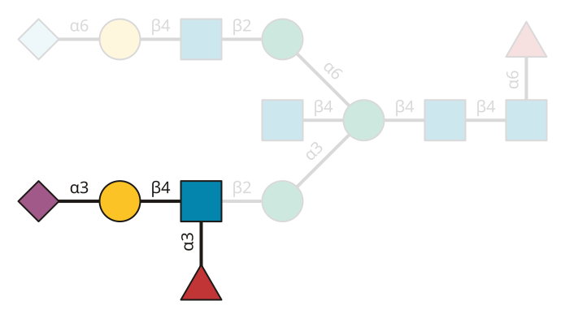

# glycowork


<!-- WARNING: THIS FILE WAS AUTOGENERATED! DO NOT EDIT! -->

<p align="center"></p>

<p align="center"><b>The Python package for glycan data science</b></p>
<div align="center">

[](https://github.com/BojarLab/glycowork/actions/workflows/test.yaml)
[](https://pypi.org/project/glycowork/)
[](https://pypi.org/project/glycowork/)
[](https://pypi.org/project/glycowork/)
[](https://zenodo.org/doi/10.5281/zenodo.10039202)
[](https://codecov.io/gh/BojarLab/glycowork)

**[Documentation](https://bojarlab.github.io/glycowork/)** ·
**[Examples](https://bojarlab.github.io/glycowork/examples.html)** ·
**[Install](#install)** · **[Cite](#cite)** ·
**[Contribute](https://github.com/BojarLab/glycowork/blob/master/CONTRIBUTING.md)**

</div>

`glycowork` is the Python package for glycan data science. Glycans are
branched, non-linear sequences with a dozen competing text
representations and no shared tooling, which is why most glycomics
analysis stalls before it starts. `glycowork` removes that step and
gives you the rest of the stack on top of it.

- **Reads everything.** IUPAC-condensed is native to `glycowork`.
  IUPAC-extended, GlycoCT, GlycoCT-XML, WURCS, LinearCode, Oxford,
  GLYCAM, CSDB-linear, GlycoWorkBench, GlyTouCan IDs, KCF, SMILES,
  pGlyco, StrucGP, GlySeeker, and LINUCS are canonicalized on the way
  in, and exports of glycomics and glycoproteomics software (Skyline,
  LaCyTools, GlycoWorkbench, FragPipe, pGlyco3, Byonic, and more) go
  straight into the analysis functions. IUPAC-extended, GlycoCT, Oxford,
  GLYCAM, and SMILES also go back out. You never need a parser again.
- **Graph-native.** Every glycan is a directed graph, so motif search is
  subgraph isomorphism with wildcards (`Hex`, `b1-3/4`, `?`),
  terminal/internal constraints, and negation. There is also a full
  regular-expression engine for glycans.
- **Statistics that comparative glycomics actually needs.**
  Compositional transforms, MNAR-aware imputation, variance moderation
  along the motif containment order, effect sizes, ANOVA, time series,
  and biodiversity, each in one call.
- **Data included.** 50,461 curated glycan sequences with
  species/tissue/disease annotations, \>790,000 protein-glycan binding
  measurements, 82 analysis-ready glycomics, glycoproteomics, and
  lectin-array datasets, and five pretrained deep learning models.
- **Publication-ready figures.** SNFG drawings from a sequence, as the
  labels of your volcano plots, heatmaps, and networks, and in your
  Excel sheets. Interactive figures answer the mouse, light up the same
  glycan or sample in every figure on the page, and follow your light or
  dark theme.

## Whole workflows in one call

An entire differential glycomics analysis, on real data that ships with
the package.

``` python
#matched tumor and healthy skin from 10 squamous cell carcinoma patients; one of 82 bundled datasets
from glycowork.glycan_data.loader import glycomics_data_loader
from glycowork.motif.analysis import get_differential_expression
df = glycomics_data_loader.human_skin_O_PMC5871710_SCC
print(df.groups)
#groups, pairing, and the alpha level are read off the dataset itself
res = get_differential_expression(df)
print(res.sort_values('corr p-val')[['Glycan', 'Log2FC', 'corr p-val', 'Effect size']].head())

#the same result object, drawn: every dot past the thresholds gets its SNFG structure instead of a text label
from glycowork.motif.analysis import get_volcano
get_volcano(res, annotate_volcano = True, title = 'O-glycans altered in squamous cell carcinoma', interactive = True)
```

    healthy (n=10) | cancer (n=10)
                                                   Glycan    Log2FC  corr p-val  \
    3                   Gal3/6S(b1-3)[Neu5Ac(a2-6)]GalNAc -0.697526    0.002760   
    10  Neu5Ac(a2-3)Gal(b1-4)GlcNAc(b1-6)[Neu5Ac(a2-3)...  0.503647    0.002760   
    9   Neu5Ac(a2-3)Gal(b1-4)GlcNAc(b1-6)[Gal(b1-3)]Ga...  0.614980    0.014032   
    12  Neu5Ac(a2-3)Gal(b1-4)GlcNAc6S(b1-6)[Neu5Ac(a2-... -0.560806    0.015181   
    5   Neu5Ac(a2-3)Gal(b1-3)[Gal(b1-4)GlcNAc(b1-6)]Ga...  0.338655    0.020927   

        Effect size  
    3     -1.571616  
    10     1.717175  
    9      1.118587  
    12    -1.053906  
    5      1.042273  



With `interactive = True`, figures answer the mouse in a notebook or on
the [docs site](https://bojarlab.github.io/glycowork/), and they answer
each other: hover over a glycan in the volcano plot above, and its row
in the heatmap below lights up, with its values. Both follow your light
or dark theme.

``` python
#the abundances behind it, clustered, with every glycan drawn as its SNFG structure
from glycowork.motif.analysis import get_heatmap
get_heatmap(df, interactive = True)
```



## Install

``` bash
pip install glycowork
```

Optional extras add specialized functions (more in the
[examples](https://bojarlab.github.io/glycowork/examples.html)):

| Extra | Adds | Install |
|----|----|----|
| `ml` | deep learning: SweetNet, GIFFLAR, LectinOracle, and training your own models | `pip install "glycowork[ml]"` |
| `chem` | atomic and chemical properties of glycans, and 3D structures | `pip install "glycowork[chem]"` |
| `all` | everything | `pip install "glycowork[all]"` |

The development version installs with
`pip install git+https://github.com/BojarLab/glycowork.git`.

**Not using Python?** The no-code desktop app (`glycoworkGUI.exe`, under
Assets on the latest
[Release](https://github.com/BojarLab/glycowork/releases)) runs the
most-used `glycowork` functions, and the [web
app](https://canonicalize.streamlit.app/) converts, cleans, and draws
glycan sequences in SNFG.

## Data & Models

`glycowork` contains the following main datasets, freely available to
everyone:

| Dataset | Contents |
|----|----|
| `df_glycan` | ~50,500 unique glycan sequences, with ~39,500 species, ~20,000 tissue, and ~1,000 disease associations |
| `glycan_binding` | \>790,000 protein-glycan binding interactions, from \>2,000 unique glycan-binding proteins |
| `glycomics_data_loader`, `lectin_array_data_loader`, `glycoproteomics_data_loader` | 82 curated, analysis-ready datasets from the literature, each shipping with its own sample groups, pairing, and provenance, so every analysis function below runs on them with no arguments |

These are not flat tables; they query themselves:

``` python
#which glycans of odd-toed ungulates carry a3-sialylated LacNAc, and where were they described?
from glycowork.glycan_data.loader import df_glycan, glycomics_data_loader
hits = df_glycan.meta_filter(Order = 'Perissodactyla').glyco_filter('Sia(a2-3)Gal')
print(len(hits), hits.glycans[:3])

#which bundled O-glycomics datasets came from primary tissue or body fluid?
print(glycomics_data_loader.filter(glycan_class = 'O', source_type = ['primary tissue', 'body fluid']))
```

    84 ['Neu5Ac(a2-3)Gal(b1-4)Glc1Cer', 'Neu5Ac(a2-3)Gal(b1-3)GalNAc(b1-4)[Neu5Ac(a2-3)]Gal(b1-4)Glc1Cer', 'Neu5Ac(a2-8)Neu5Ac(a2-3)Gal(b1-4)Glc1Cer']
    ['fish_gill_infection_O_PMID41435595', 'fish_intestine_infection_O_10_2139ssrn_7005880', 'human_colorectal_O_PMC9254241', 'human_colorectal_O_PMID19152289', 'human_gastric_O_PMC5762837', 'human_gastric_O_PMID28461410', 'human_headandneck_O_GPST000316', 'human_liver_O_PMC5383776', 'human_liver_O_PMC9254241', 'human_ovarian_O_PMC4468167', 'human_prostate_O_PMC8010466', 'human_skin_O_PMC5871710', 'human_skin_O_PMC5871710_BCC', 'human_skin_O_PMC5871710_SCC', 'mouse_brain_O_PMID38343116', 'mouse_brain_tango2ko_O_10_1002pgr2_70042', 'mouse_gastric_O_PMID40667878']

Five trained deep learning models are one `prep_model` call away:

| Model | What it does | From |
|----|----|----|
| `LectinOracle` | predicts the glycan-binding specificity of a protein from its ESMC representation | [Lundstrom et al., 2021](https://onlinelibrary.wiley.com/doi/10.1002/advs.202103807) |
| `LectinOracle_flex` | the same, straight from the raw protein sequence |  |
| `SweetNet` | graph convolutional neural network that predicts species from glycans and yields learned glycan representations | [Burkholz et al., 2021](https://pubmed.ncbi.nlm.nih.gov/34133929/) |
| `GIFFLAR` | heterogeneous graph neural network over atoms, bonds, and monosaccharides, trained on the same species task; also yields learned glycan representations | [Joeres and Bojar, 2024](https://arxiv.org/abs/2409.13467v3) |
| `NSequonPred` | predicts whether an N-sequon is glycosylated, from the ESM-1b representation of the sequon and 20 amino acids on either side |  |

## How to use

Four modules:
[`glycan_data`](https://bojarlab.github.io/glycowork/glycan_data.html)
for datasets and loaders,
[`motif`](https://bojarlab.github.io/glycowork/motif.html) for
processing, drawing, and analyzing sequences,
[`network`](https://bojarlab.github.io/glycowork/network.html) for
biosynthetic and evolutionary networks, and
[`ml`](https://bojarlab.github.io/glycowork/ml.html) for representations
and models.

A few of the things people use them for, with the full set in the
[examples](https://bojarlab.github.io/glycowork/examples.html):

- [differential expression, ANOVA, time series, and
  biodiversity](https://bojarlab.github.io/glycowork/motif.html#analysis)
  on glycomics, glycoproteomics, and lectin-array data
- [motif
  enrichment](https://bojarlab.github.io/glycowork/motif.html#analysis)
  and [motif
  annotation](https://bojarlab.github.io/glycowork/motif.html#annotate),
  including custom motifs
- [publication-quality SNFG
  figures](https://bojarlab.github.io/glycowork/motif.html#draw), and
  annotating existing figures or Excel sheets with drawn structures
- [*m/z* to composition to structure to
  motif](https://bojarlab.github.io/glycowork/motif.html#tokenization)
  mapping, and mass calculation
- [biosynthetic
  networks](https://bojarlab.github.io/glycowork/network.html#biosynthesis),
  with flow analysis and differential biosynthesis between conditions
- [pretrained
  models](https://bojarlab.github.io/glycowork/ml.html#inference) for
  prediction, and [training your
  own](https://bojarlab.github.io/glycowork/ml.html#model_training) on
  learned glycan representations

``` python
#drawing publication-quality glycan figures
from glycowork import GlycoDraw
drawing = GlycoDraw("Neu5Ac(a2-3)Gal(b1-4)[Fuc(a1-3)]GlcNAc(b1-2)Man(a1-3)[Neu5Gc(a2-6)Gal(b1-4)GlcNAc(b1-2)Man(a1-6)][GlcNAc(b1-4)]Man(b1-4)GlcNAc(b1-4)[Fuc(a1-6)]GlcNAc", highlight_motif = "Neu5Ac(a2-3)Gal(b1-4)[Fuc(a1-3)]GlcNAc", suppress=True)
```



``` python
#six different sequence formats in the same list; no conversion step, no bookkeeping
glycans = ["Neu5Ac(a2-3)Gal(b1-4)[Fuc(a1-3)]GlcNAc(b1-2)Man(a1-3)[Gal(b1-3)[Fuc(a1-4)]GlcNAc(b1-2)Man(a1-6)]Man(b1-4)GlcNAc(b1-4)[Fuc(a1-6)]GlcNAc",
           "Ma3(Ma6)Mb4GNb4GN;N",
           "α-D-Manp-(1→3)[α-D-Manp-(1→6)]-β-D-Manp-(1→4)-β-D-GlcpNAc-(1→4)-β-D-GlcpNAc-(1→",
           "F(3)XA2",
           "WURCS=2.0/5,11,10/[a2122h-1b_1-5_2*NCC/3=O][a1122h-1b_1-5][a1122h-1a_1-5][a2112h-1b_1-5][a1221m-1a_1-5]/1-1-2-3-1-4-3-1-4-5-5/a4-b1_a6-k1_b4-c1_c3-d1_c6-g1_d2-e1_e4-f1_g2-h1_h4-i1_i2-j1",
           """RES
1b:b-dglc-HEX-1:5
2s:n-acetyl
3b:b-dglc-HEX-1:5
4s:n-acetyl
5b:b-dman-HEX-1:5
6b:a-dman-HEX-1:5
7b:b-dglc-HEX-1:5
8s:n-acetyl
9b:b-dgal-HEX-1:5
10s:sulfate
11s:n-acetyl
12b:a-dman-HEX-1:5
13b:b-dglc-HEX-1:5
14s:n-acetyl
15b:b-dgal-HEX-1:5
16s:n-acetyl
LIN
1:1d(2+1)2n
2:1o(4+1)3d
3:3d(2+1)4n
4:3o(4+1)5d
5:5o(3+1)6d
6:6o(2+1)7d
7:7d(2+1)8n
8:7o(4+1)9d
9:9o(-1+1)10n
10:9d(2+1)11n
11:5o(6+1)12d
12:12o(2+1)13d
13:13d(2+1)14n
14:13o(4+1)15d
15:15d(2+1)16n"""]
from glycowork.motif.annotate import annotate_dataset
#feature_set also takes 'terminal', 'exhaustive', 'chemical', 'graph', 'size_branch', and your own motifs via 'custom'
out = annotate_dataset(glycans, feature_set = ['known'], condense = True)
```



``` python
#using graphs, you can easily check whether a glycan contains a specific motif; how about internal Lewis A/X motifs?
from glycowork.motif.graph import subgraph_isomorphism
print(subgraph_isomorphism('Neu5Ac(a2-3)Gal(b1-4)[Fuc(a1-3)]GlcNAc(b1-6)[Gal(b1-3)]GalNAc',
                     'Fuc(a1-?)[Gal(b1-?)]GlcNAc', termini_list = ['terminal', 'internal', 'flexible']))
print(subgraph_isomorphism('Neu5Ac(a2-3)Gal(b1-3)[Fuc(a1-4)]GlcNAc(b1-6)[Gal(b1-3)]GalNAc',
                     'Fuc(a1-3/4)[Gal(b1-3/4)]GlcNAc', termini_list = ['t', 'i', 'f']))
print(subgraph_isomorphism('Gal(b1-3)[Fuc(a1-4)]GlcNAc(b1-6)[Gal(b1-3)]GalNAc',
                     'dHex(a1-?)[Hex(b1-?)]GlcNAc', termini_list = ['t', 'i', 'f']))

#or you could find the terminal epitopes of a glycan
from glycowork.motif.annotate import get_terminal_structures
print("\nTerminal structures:")
print(get_terminal_structures('Man(a1-3)[Man(a1-6)]Man(b1-4)GlcNAc(b1-4)[Fuc(a1-6)]GlcNAc'))
```

    True
    True
    False

    Terminal structures:
    ['Man(a1-3)', 'Man(a1-6)', 'Fuc(a1-6)']

``` python
#glycans have a regular expression engine, with quantifiers, alternation, negation, and anchors
from glycowork.motif.regex import get_match, motif_to_regex
glycan = "GalNAc(b1-4)GlcNAc(b1-2)Man(a1-3)[Neu5Gc(a2-6)GalNAc(b1-4)[Fuc(a1-3)]GlcNAc(b1-2)Man(a1-6)]Man(b1-4)GlcNAc(b1-4)[Fuc(a1-6)]GlcNAc"
print(get_match(".-.-([Hex|Fuc])+-.", glycan))

#anchors and negated character classes work too
print(get_match(".-HexNAc$", glycan))
print(get_match("Fuc-([^Gal])+-GlcNAc", "Fuc(a1-3)[GlcNAc(b1-4)]GlcNAc"))

#and any motif can be turned into its expression automatically
print(motif_to_regex("Fuc(a1-3)[Gal(b1-4)]GlcNAc(b1-?)"))
```

    ['Neu5Gc(a2-6)GalNAc(b1-4)[Fuc(a1-3)]GlcNAc', 'Man(b1-4)GlcNAc(b1-4)[Fuc(a1-6)]GlcNAc', 'GlcNAc(b1-2)Man(a1-3)[Man(a1-6)]Man', 'GlcNAc(b1-2)Man(a1-6)[Man(a1-3)]Man']
    ['GlcNAc(b1-4)GlcNAc', 'Fuc(a1-6)GlcNAc']
    ['Fuc(a1-3)[GlcNAc(b1-4)]GlcNAc']
    Fuca3-([Galb4]){1}-GlcNAcb?

``` python
#glycans are not an unordered list; they are the output of a biosynthetic pathway, which glycowork reconstructs
from glycowork.network.biosynthesis import construct_network, plot_network
glycans = ["Gal(b1-4)Glc-ol", "GlcNAc(b1-3)Gal(b1-4)Glc-ol", "GlcNAc6S(b1-3)Gal(b1-4)Glc-ol",
           "Gal(b1-4)GlcNAc(b1-3)Gal(b1-4)Glc-ol", "Fuc(a1-2)Gal(b1-4)Glc-ol",
           "Neu5Ac(a2-3)Gal(b1-4)GlcNAc(b1-3)[Gal(b1-3)GlcNAc(b1-6)]Gal(b1-4)Glc-ol"]
network = construct_network(glycans)
#the intermediates you did not measure are inferred, and every edge is labeled with the enzymatic reaction
print(len(glycans), "measured glycans ->", len(network.nodes()), "nodes and", len(network.edges()), "reactions")
plot_network(network, draw_glycans = True)
```

    6 measured glycans -> 14 nodes and 19 reactions



``` python
#straight off the instrument: m/z to composition to candidate structures, constrained by glycan class and taxonomy
from glycowork.motif.tokenization import mz_to_composition, compositions_to_structures
#max_charge is signed: the sign picks the ion mode, the magnitude the highest charge state considered
print(mz_to_composition(1315.48, max_charge = -2, glycan_class = 'N'))
print(compositions_to_structures([{'Hex':3, 'HexNAc':4}], glycan_class = 'N')['glycan'].head())

#or we could calculate the mass of this composition
from glycowork.motif.tokenization import composition_to_mass
print("\nMass of the composition Hex3HexNAc4")
print(composition_to_mass({'Hex':3, 'HexNAc':4}))
print(composition_to_mass("H3N4"))
print(composition_to_mass("Hex3HexNAc4"))
```

    [{'Hex': 3, 'HexNAc': 4}]
    0    GlcNAc(b1-2)Man(a1-3)[GlcNAc(b1-2)Man(a1-6)]Ma...
    1    GlcNAc(b1-2)Man(a1-3)[GlcNAc(b1-4)][Man(a1-6)]...
    2    GlcNAc(b1-2)[GlcNAc(b1-4)]Man(a1-3)[Man(a1-6)]...
    3    GalNAc(b1-4)GlcNAc(b1-2)Man(a1-3)[Man(a1-6)]Ma...
    4    GlcNAc(b1-2)Man(a1-6)[Man(a1-3)][GlcNAc(b1-4)]...
    Name: glycan, dtype: object

    Mass of the composition Hex3HexNAc4
    1316.4865360000001
    1316.4865360000001
    1316.4865360000001

``` python
#glycans to chemistry and back, with no cheminformatics toolkit required
from glycowork.motif.smiles import glycan_to_smiles, smiles_to_iupac
smiles = glycan_to_smiles("Gal(b1-4)[Fuc(a1-3)]GlcNAc")
print(smiles)
print(smiles_to_iupac(smiles))

#the molecular graph also keeps track of which monosaccharide every atom came from
from glycowork.motif.smiles import glycan_to_molecule
mol = glycan_to_molecule("Neu5Ac(a2-3)Gal(b1-4)Glc")
print(len(mol.atoms), "atoms,", len(mol.rings), "rings,", len(set(mol.atom_monos)), "residues")
```

    OC1O[C@H](CO)[C@@H](O[C@@H]2O[C@H](CO)[C@H](O)[C@H](O)[C@H]2O)[C@H](O[C@@H]2O[C@@H](C)[C@@H](O)[C@@H](O)[C@@H]2O)[C@H]1NC(C)=O
    Fuc(a1-3)[Gal(b1-4)]GlcNAc
    43 atoms, 3 rings, 3 residues

## Cite

If `glycowork` helps your research, please cite [Thomès et al.,
2021](https://doi.org/10.1093/glycob/cwab067):

``` bibtex
@article{thomes2021glycowork,
  title={Glycowork: A Python package for glycan data science and machine learning},
  author={Thom{\`e}s, Luc and Burkholz, Rebekka and Bojar, Daniel},
  journal={Glycobiology},
  volume={31},
  number={10},
  pages={1240--1244},
  year={2021},
  doi={10.1093/glycob/cwab067}
}
```
