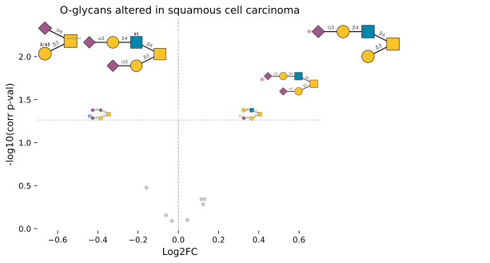

# glycowork

 [](https://pypi.org/project/glycowork/)[](https://pypi.org/project/glycowork/) [](https://pypi.org/project/glycowork/)[](https://github.com/BojarLab/glycowork/issues)[](https://zenodo.org/doi/10.5281/zenodo.10039202)[](https://codecov.io/gh/BojarLab/glycowork)


`glycowork` is the Python package for glycan data science. Glycans are branched, non-linear sequences with a dozen competing text representations and no shared tooling, which is why most glycomics analysis stalls before it starts. `glycowork` removes that step and gives you the rest of the stack on top of it.

- **Reads everything.** IUPAC-condensed is native to `glycowork`. IUPAC-extended, GlycoCT, GlycoCT-XML, WURCS, LinearCode, Oxford, GLYCAM, CSDB-linear, GlycoWorkBench, GlyTouCan IDs, KCF, SMILES, pGlyco, StrucGP, GlySeeker, and LINUCS are canonicalized on the way in, and exports of glycomics and glycoproteomics software (Skyline, LaCyTools, GlycoWorkbench, FragPipe, pGlyco3, Byonic, and more) go straight into the analysis functions. IUPAC-extended, GlycoCT, Oxford, GLYCAM, and SMILES also go back out. You never need a parser again.
- **Graph-native.** Every glycan is a directed graph, so motif search is subgraph isomorphism with wildcards (`Hex`, `b1-3/4`, `?`), terminal/internal constraints, and negation. There is also a full regular-expression engine for glycans.
- **Statistics that comparative glycomics actually needs.** Compositional transforms, MNAR-aware imputation, two-stage FDR across motif families, effect sizes, ANOVA, time series, and biodiversity, each in one call.
- **Data included.** 50,461 curated glycan sequences with species/tissue/disease annotations, \>790,000 protein-glycan binding measurements, 82 analysis-ready glycomics, glycoproteomics, and lectin-array datasets, and five pretrained deep learning models.
- **Publication-ready figures.** SNFG drawings from a sequence, dropped straight into your volcano plots, heatmaps, and Excel sheets.

**Documentation:** <https://bojarlab.github.io/glycowork/> · **Contribute:** [Guidelines](https://github.com/BojarLab/glycowork/blob/master/CONTRIBUTING.md) · **Cite:** [Thomes et al., 2021](https://academic.oup.com/glycob/advance-article/doi/10.1093/glycob/cwab067/6311240)

## Install

*Not familiar with Python?* Try our no-code, graphical user interface (`glycoworkGUI.exe`, can be downloaded at the bottom of the latest [Release](https://github.com/BojarLab/glycowork/releases) page) for accessing some of the most useful `glycowork` functions

Or try our [web interface](https://canonicalize.streamlit.app/) for sequence format conversion/cleaning and drawing glycan SNFG structures!

*via pip:*\
`pip install glycowork`\
`import glycowork`

*alternative:*\
`pip install git+https://github.com/BojarLab/glycowork.git`\
`import glycowork`

*Note that we have optional extra installs for specialized use (even further instructions can be found in the `Examples` tab; on Mac you might need to use `"glycowork[ml]"`), such as:*\
*deep learning*\
`pip install glycowork[ml]`\
*analyzing atomic/chemical properties of glycans*\
`pip install glycowork[chem]`\
*everything*\
`pip install glycowork[all]`\

## Whole workflows in one call

An entire differential glycomics analysis, on real data that ships with the package.

``` python
#matched tumor and healthy skin from 10 squamous cell carcinoma patients; one of 82 bundled datasets
from glycowork.glycan_data.loader import glycomics_data_loader
from glycowork.motif.analysis import get_differential_expression
df = glycomics_data_loader.human_skin_O_PMC5871710_SCC
print(df.groups)
#groups, pairing, and the alpha level are read off the dataset itself
res = get_differential_expression(df)
print(res.sort_values('corr p-val')[['Glycan', 'Log2FC', 'corr p-val', 'Effect size']].head())

#the same result object, drawn: every dot past the thresholds gets its SNFG structure instead of a text label
from glycowork.motif.analysis import get_volcano
get_volcano(res, annotate_volcano = True, title = 'O-glycans altered in squamous cell carcinoma')
```

    healthy (n=10) | cancer (n=10)
                                                   Glycan    Log2FC  corr p-val  \
    3                   Gal3/6S(b1-3)[Neu5Ac(a2-6)]GalNAc -0.636998    0.004645   
    9   Neu5Ac(a2-3)Gal(b1-4)GlcNAc(b1-6)[Gal(b1-3)]Ga...  0.652277    0.005088   
    12  Neu5Ac(a2-3)Gal(b1-4)GlcNAc6S(b1-6)[Neu5Ac(a2-... -0.554030    0.006128   
    10  Neu5Ac(a2-3)Gal(b1-4)GlcNAc(b1-6)[Neu5Ac(a2-3)...  0.418637    0.018367   
    5   Neu5Ac(a2-3)Gal(b1-3)[Gal(b1-4)GlcNAc(b1-6)]Ga...  0.311395    0.049055   

        Effect size  
    3     -1.359690  
    9      1.130820  
    12    -1.138142  
    10     1.045617  
    5      0.911243  



## Data & Models

`Glycowork` currently contains the following main datasets that are freely available to everyone:

- **`df_glycan`**
  - contains ~50,500 unique glycan sequences, including labels such as ~39,500 species associations, ~20,000 tissue associations, and ~1,000 disease associations
- **`glycan_binding`**
  - contains \>790,000 protein-glycan binding interactions, from \>2,000 unique glycan-binding proteins
- **`glycomics_data_loader`**, **`lectin_array_data_loader`**, **`glycoproteomics_data_loader`**
  - 82 curated, analysis-ready datasets from the literature, each shipping with its own sample groups, pairing, and provenance, so every analysis function below runs on them with no arguments

These are not flat tables; they query themselves:

``` python
#which glycans of odd-toed ungulates carry a3-sialylated LacNAc, and where were they described?
from glycowork.glycan_data.loader import df_glycan, glycomics_data_loader
hits = df_glycan.meta_filter(Order = 'Perissodactyla').glyco_filter('Sia(a2-3)Gal')
print(len(hits), hits.glycans[:3])

#which bundled O-glycomics datasets came from primary tissue or body fluid?
print(glycomics_data_loader.filter(glycan_class = 'O', source_type = ['primary tissue', 'body fluid']))
```

    84 ['Neu5Ac(a2-3)Gal(b1-4)Glc1Cer', 'Neu5Ac(a2-3)Gal(b1-3)GalNAc(b1-4)[Neu5Ac(a2-3)]Gal(b1-4)Glc1Cer', 'Neu5Ac(a2-8)Neu5Ac(a2-3)Gal(b1-4)Glc1Cer']
    ['fish_gill_infection_O_PMID41435595', 'fish_intestine_infection_O_10_2139ssrn_7005880', 'human_colorectal_O_PMC9254241', 'human_colorectal_O_PMID19152289', 'human_gastric_O_PMC5762837', 'human_gastric_O_PMID28461410', 'human_liver_O_PMC5383776', 'human_liver_O_PMC9254241', 'human_ovarian_O_PMC4468167', 'human_prostate_O_PMC8010466', 'human_skin_O_PMC5871710', 'human_skin_O_PMC5871710_BCC', 'human_skin_O_PMC5871710_SCC', 'mouse_brain_O_PMID38343116', 'mouse_brain_tango2ko_O_10_1002pgr2_70042', 'mouse_gastric_O_PMID40667878']

Additionally, we store these trained deep learning models for easy usage, which can be retrieved with the `prep_model` function:

- **`LectinOracle`**
  - can be used to predict glycan-binding specificity of a protein, given its ESMC representation; from [Lundstrom et al., 2021](https://onlinelibrary.wiley.com/doi/10.1002/advs.202103807)
- **`LectinOracle_flex`**
  - operates the same as LectinOracle but can directly use the raw protein sequence as input (no ESMC representation required)
- **`SweetNet`**
  - a graph convolutional neural network trained to predict species from glycan, can be used to generate learned glycan representations; from [Burkholz et al., 2021](https://pubmed.ncbi.nlm.nih.gov/34133929/)
- **`GIFFLAR`**
  - a heterogeneous graph neural network over atoms, bonds, and monosaccharides, trained on the same species task as SweetNet; also yields learned glycan representations; from [Joeres and Bojar, 2024](https://arxiv.org/abs/2409.13467v3)
- **`NSequonPred`**
  - given the ESM-1b representation of an N-sequon (+/- 20 AA), this model can predict whether the sequon will be glycosylated

## How to use

Four modules: [`glycan_data`](https://bojarlab.github.io/glycowork/glycan_data.html) for datasets and loaders, [`motif`](https://bojarlab.github.io/glycowork/motif.html) for processing, drawing, and analyzing sequences, [`network`](https://bojarlab.github.io/glycowork/network.html) for biosynthetic and evolutionary networks, and [`ml`](https://bojarlab.github.io/glycowork/ml.html) for representations and models.

A few of the things people use them for, with the full set in the [examples](https://bojarlab.github.io/glycowork/examples.html):

- [differential expression, ANOVA, time series, and biodiversity](https://bojarlab.github.io/glycowork/motif.html#analysis) on glycomics, glycoproteomics, and lectin-array data
- [motif enrichment](https://bojarlab.github.io/glycowork/motif.html#analysis) and [motif annotation](https://bojarlab.github.io/glycowork/motif.html#annotate), including custom motifs
- [publication-quality SNFG figures](https://bojarlab.github.io/glycowork/motif.html#draw), and annotating existing figures or Excel sheets with drawn structures
- [*m/z* to composition to structure to motif](https://bojarlab.github.io/glycowork/motif.html#tokenization) mapping, and mass calculation
- [biosynthetic networks](https://bojarlab.github.io/glycowork/network.html#biosynthesis), with flow analysis and differential biosynthesis between conditions
- [pretrained models](https://bojarlab.github.io/glycowork/ml.html#inference) for prediction, and [training your own](https://bojarlab.github.io/glycowork/ml.html#model_training) on learned glycan representations

``` python
#drawing publication-quality glycan figures
from glycowork import GlycoDraw
drawing = GlycoDraw("Neu5Ac(a2-3)Gal(b1-4)[Fuc(a1-3)]GlcNAc(b1-2)Man(a1-3)[Neu5Gc(a2-6)Gal(b1-4)GlcNAc(b1-2)Man(a1-6)][GlcNAc(b1-4)]Man(b1-4)GlcNAc(b1-4)[Fuc(a1-6)]GlcNAc", highlight_motif = "Neu5Ac(a2-3)Gal(b1-4)[Fuc(a1-3)]GlcNAc", suppress=True)
```


``` python
#six different sequence formats in the same list; no conversion step, no bookkeeping
glycans = ["Neu5Ac(a2-3)Gal(b1-4)[Fuc(a1-3)]GlcNAc(b1-2)Man(a1-3)[Gal(b1-3)[Fuc(a1-4)]GlcNAc(b1-2)Man(a1-6)]Man(b1-4)GlcNAc(b1-4)[Fuc(a1-6)]GlcNAc",
           "Ma3(Ma6)Mb4GNb4GN;N",
           "α-D-Manp-(1→3)[α-D-Manp-(1→6)]-β-D-Manp-(1→4)-β-D-GlcpNAc-(1→4)-β-D-GlcpNAc-(1→",
           "F(3)XA2",
           "WURCS=2.0/5,11,10/[a2122h-1b_1-5_2*NCC/3=O][a1122h-1b_1-5][a1122h-1a_1-5][a2112h-1b_1-5][a1221m-1a_1-5]/1-1-2-3-1-4-3-1-4-5-5/a4-b1_a6-k1_b4-c1_c3-d1_c6-g1_d2-e1_e4-f1_g2-h1_h4-i1_i2-j1",
           """RES
1b:b-dglc-HEX-1:5
2s:n-acetyl
3b:b-dglc-HEX-1:5
4s:n-acetyl
5b:b-dman-HEX-1:5
6b:a-dman-HEX-1:5
7b:b-dglc-HEX-1:5
8s:n-acetyl
9b:b-dgal-HEX-1:5
10s:sulfate
11s:n-acetyl
12b:a-dman-HEX-1:5
13b:b-dglc-HEX-1:5
14s:n-acetyl
15b:b-dgal-HEX-1:5
16s:n-acetyl
LIN
1:1d(2+1)2n
2:1o(4+1)3d
3:3d(2+1)4n
4:3o(4+1)5d
5:5o(3+1)6d
6:6o(2+1)7d
7:7d(2+1)8n
8:7o(4+1)9d
9:9o(-1+1)10n
10:9d(2+1)11n
11:5o(6+1)12d
12:12o(2+1)13d
13:13d(2+1)14n
14:13o(4+1)15d
15:15d(2+1)16n"""]
from glycowork.motif.annotate import annotate_dataset
#feature_set also takes 'terminal', 'exhaustive', 'chemical', 'graph', 'size_branch', and your own motifs via 'custom'
out = annotate_dataset(glycans, feature_set = ['known'], condense = True)
```

| motif_name | Internal_LewisX | SialylLewisX | Terminal_LewisA | H_antigen_type2 | Chitobiose | Trimannosylcore | Terminal_LacNAc_type1 | Internal_LacNAc_type2 | Terminal_LacNAc_type2 | Terminal_LacdiNAc_type2 | core_fucose | core_fucose(a1-3) | Nglycan_complex | M3FX |
|----|----|----|----|----|----|----|----|----|----|----|----|----|----|----|
| Neu5Ac(a2-3)Gal(b1-4)\[Fuc(a1-3)\]GlcNAc(b1-2)Man(a1-3)\[Gal(b1-3)\[Fuc(a1-4)\]GlcNAc(b1-2)Man(a1-6)\]Man(b1-4)GlcNAc(b1-4)\[Fuc(a1-6)\]GlcNAc | 1 | 1 | 1 | 0 | 1 | 1 | 1 | 1 | 0 | 0 | 1 | 0 | 1 | 0 |
| Man(a1-3)\[Man(a1-6)\]Man(b1-4)GlcNAc(b1-4)GlcNAc | 0 | 0 | 0 | 0 | 1 | 1 | 0 | 0 | 0 | 0 | 0 | 0 | 0 | 0 |
| Man(a1-3)\[Man(a1-6)\]Man(b1-4)GlcNAc(b1-4)GlcNAc | 0 | 0 | 0 | 0 | 1 | 1 | 0 | 0 | 0 | 0 | 0 | 0 | 0 | 0 |
| GlcNAc(b1-2)Man(a1-3)\[GlcNAc(b1-2)Man(a1-6)\]\[Xyl(b1-2)\]Man(b1-4)GlcNAc(b1-4)\[Fuc(a1-3)\]GlcNAc | 0 | 0 | 0 | 0 | 1 | 1 | 0 | 0 | 0 | 0 | 0 | 1 | 1 | 1 |
| Fuc(a1-2)Gal(b1-4)GlcNAc(b1-2)Man(a1-6)\[Gal(b1-4)GlcNAc(b1-2)Man(a1-3)\]Man(b1-4)GlcNAc(b1-4)\[Fuc(a1-6)\]GlcNAc | 0 | 0 | 0 | 1 | 1 | 1 | 0 | 1 | 1 | 0 | 1 | 0 | 1 | 0 |
| GalNAcOS(b1-4)GlcNAc(b1-2)Man(a1-3)\[GalNAc(b1-4)GlcNAc(b1-2)Man(a1-6)\]Man(b1-4)GlcNAc(b1-4)GlcNAc | 0 | 0 | 0 | 0 | 1 | 1 | 0 | 0 | 0 | 1 | 0 | 0 | 1 | 0 |

``` python
#using graphs, you can easily check whether a glycan contains a specific motif; how about internal Lewis A/X motifs?
from glycowork.motif.graph import subgraph_isomorphism
print(subgraph_isomorphism('Neu5Ac(a2-3)Gal(b1-4)[Fuc(a1-3)]GlcNAc(b1-6)[Gal(b1-3)]GalNAc',
                     'Fuc(a1-?)[Gal(b1-?)]GlcNAc', termini_list = ['terminal', 'internal', 'flexible']))
print(subgraph_isomorphism('Neu5Ac(a2-3)Gal(b1-3)[Fuc(a1-4)]GlcNAc(b1-6)[Gal(b1-3)]GalNAc',
                     'Fuc(a1-3/4)[Gal(b1-3/4)]GlcNAc', termini_list = ['t', 'i', 'f']))
print(subgraph_isomorphism('Gal(b1-3)[Fuc(a1-4)]GlcNAc(b1-6)[Gal(b1-3)]GalNAc',
                     'dHex(a1-?)[Hex(b1-?)]GlcNAc', termini_list = ['t', 'i', 'f']))

#or you could find the terminal epitopes of a glycan
from glycowork.motif.annotate import get_terminal_structures
print("\nTerminal structures:")
print(get_terminal_structures('Man(a1-3)[Man(a1-6)]Man(b1-4)GlcNAc(b1-4)[Fuc(a1-6)]GlcNAc'))
```

    True
    True
    False

    Terminal structures:
    ['Man(a1-3)', 'Man(a1-6)', 'Fuc(a1-6)']

``` python
#glycans have a regular expression engine, with quantifiers, alternation, negation, and anchors
from glycowork.motif.regex import get_match, motif_to_regex
glycan = "GalNAc(b1-4)GlcNAc(b1-2)Man(a1-3)[Neu5Gc(a2-6)GalNAc(b1-4)[Fuc(a1-3)]GlcNAc(b1-2)Man(a1-6)]Man(b1-4)GlcNAc(b1-4)[Fuc(a1-6)]GlcNAc"
print(get_match(".-.-([Hex|Fuc])+-.", glycan))

#anchors and negated character classes work too
print(get_match(".-HexNAc$", glycan))
print(get_match("Fuc-([^Gal])+-GlcNAc", "Fuc(a1-3)[GlcNAc(b1-4)]GlcNAc"))

#and any motif can be turned into its expression automatically
print(motif_to_regex("Fuc(a1-3)[Gal(b1-4)]GlcNAc(b1-?)"))
```

    ['Neu5Gc(a2-6)GalNAc(b1-4)[Fuc(a1-3)]GlcNAc', 'Man(b1-4)GlcNAc(b1-4)[Fuc(a1-6)]GlcNAc', 'GlcNAc(b1-2)Man(a1-3)[Man(a1-6)]Man', 'GlcNAc(b1-2)Man(a1-6)[Man(a1-3)]Man']
    ['GlcNAc(b1-4)GlcNAc', 'Fuc(a1-6)GlcNAc']
    ['Fuc(a1-3)[GlcNAc(b1-4)]GlcNAc']
    Fuca3-([Galb4]){1}-GlcNAcb?

``` python
#glycans are not an unordered list; they are the output of a biosynthetic pathway, which glycowork reconstructs
from glycowork.network.biosynthesis import construct_network, plot_network
glycans = ["Gal(b1-4)Glc-ol", "GlcNAc(b1-3)Gal(b1-4)Glc-ol", "GlcNAc6S(b1-3)Gal(b1-4)Glc-ol",
           "Gal(b1-4)GlcNAc(b1-3)Gal(b1-4)Glc-ol", "Fuc(a1-2)Gal(b1-4)Glc-ol",
           "Neu5Ac(a2-3)Gal(b1-4)GlcNAc(b1-3)[Gal(b1-3)GlcNAc(b1-6)]Gal(b1-4)Glc-ol"]
network = construct_network(glycans)
#the intermediates you did not measure are inferred, and every edge is labeled with the enzymatic reaction
print(len(glycans), "measured glycans ->", len(network.nodes()), "nodes and", len(network.edges()), "reactions")
plot_network(network, draw_glycans = True)
```

    6 measured glycans -> 14 nodes and 19 reactions

![]() ![](data:image/svg+xml;base64,PHN2ZyB4bWxucz0iaHR0cDovL3d3dy53My5vcmcvMjAwMC9zdmciIHdpZHRoPSIzNzAiIGhlaWdodD0iNzEiIHZpZXdib3g9IjAgMCAzNzAgNzEiPgo8ZyB0cmFuc2Zvcm09Im1hdHJpeCgxIDAgMCAtMSAwIDcxKSI+CjxwYXRoIGQ9Ik0gLTEwMCAwIEwgMCAwIEwgLTEwMCAwIFoiIHRyYW5zZm9ybT0ibWF0cml4KDEgMCAwIC0xIDMzNSAzNSkiIGZpbGw9Im5vbmUiIHN0cm9rZT0iIzFDMTkxNyIgc3Ryb2tlLXdpZHRoPSI0IiBzdHJva2UtbGluZWNhcD0icm91bmQiIHN0cm9rZS1saW5lam9pbj0icm91bmQiIC8+CjxwYXRoIGQ9Ik0gLTIwMCAwIEwgLTEwMCAwIEwgLTIwMCAwIFoiIHRyYW5zZm9ybT0ibWF0cml4KDEgMCAwIC0xIDMzNSAzNSkiIGZpbGw9Im5vbmUiIHN0cm9rZT0iIzFDMTkxNyIgc3Ryb2tlLXdpZHRoPSI0IiBzdHJva2UtbGluZWNhcD0icm91bmQiIHN0cm9rZS1saW5lam9pbj0icm91bmQiIC8+CjxwYXRoIGQ9Ik0gLTMwMCAwIEwgLTIwMCAwIEwgLTMwMCAwIFoiIHRyYW5zZm9ybT0ibWF0cml4KDEgMCAwIC0xIDMzNSAzNSkiIGZpbGw9Im5vbmUiIHN0cm9rZT0iIzFDMTkxNyIgc3Ryb2tlLXdpZHRoPSI0IiBzdHJva2UtbGluZWNhcD0icm91bmQiIHN0cm9rZS1saW5lam9pbj0icm91bmQiIC8+CjxwYXRoIGQ9Ik0gLTI1IDAgQyAtMjUgMTMuODA3MSAtMTMuODA3MSAyNSAwIDI1IEMgMTMuODA3MSAyNSAyNSAxMy44MDcxIDI1IDAgQyAyNSAtMTMuODA3MSAxMy44MDcxIC0yNSAwIC0yNSBDIC0xMy44MDcxIC0yNSAtMjUgLTEzLjgwNzEgLTI1IDAgWiIgdHJhbnNmb3JtPSJtYXRyaXgoMSAwIDAgLTEgMzM1IDM1KSIgZmlsbD0iIzAzODVBRSIgc3Ryb2tlPSIjMUMxOTE3IiBzdHJva2Utd2lkdGg9IjIiIC8+CjxwYXRoIGQ9Ik0gLTEyNSAwIEMgLTEyNSAxMy44MDcxIC0xMTMuODA3MSAyNSAtMTAwIDI1IEMgLTg2LjE5MjkgMjUgLTc1IDEzLjgwNzEgLTc1IDAgQyAtNzUgLTEzLjgwNzEgLTg2LjE5MjkgLTI1IC0xMDAgLTI1IEMgLTExMy44MDcxIC0yNSAtMTI1IC0xMy44MDcxIC0xMjUgMCBaIiB0cmFuc2Zvcm09Im1hdHJpeCgxIDAgMCAtMSAzMzUgMzUpIiBmaWxsPSIjRkNDMzI2IiBzdHJva2U9IiMxQzE5MTciIHN0cm9rZS13aWR0aD0iMiIgLz4KPHBhdGggZD0iTSAtMzI1IDAgQyAtMzI1IDEzLjgwNzEgLTMxMy44MDcxIDI1IC0zMDAgMjUgQyAtMjg2LjE5MjkgMjUgLTI3NSAxMy44MDcxIC0yNzUgMCBDIC0yNzUgLTEzLjgwNzEgLTI4Ni4xOTI5IC0yNSAtMzAwIC0yNSBDIC0zMTMuODA3MSAtMjUgLTMyNSAtMTMuODA3MSAtMzI1IDAgWiIgdHJhbnNmb3JtPSJtYXRyaXgoMSAwIDAgLTEgMzM1IDM1KSIgZmlsbD0iI0ZDQzMyNiIgc3Ryb2tlPSIjMUMxOTE3IiBzdHJva2Utd2lkdGg9IjIiIC8+CjxwYXRoIGQ9Ik0gLTIyNSAtMjUgTCAtMTc1IC0yNSBMIC0xNzUgMjUgTCAtMjI1IDI1IFoiIHRyYW5zZm9ybT0ibWF0cml4KDEgMCAwIC0xIDMzNSAzNSkiIGZpbGw9IiMwMzg1QUUiIHN0cm9rZT0iIzFDMTkxNyIgc3Ryb2tlLXdpZHRoPSIyIiBzdHJva2UtbGluZWpvaW49InJvdW5kIiAvPgo8cGF0aCBkPSJNIDIuOTAwNCAxLjYwMTYgTCAyLjkwMDQgLTMuODg2NyBMIDEuNTIzNCAtMy44ODY3IEwgMS41MjM0IDEwLjgxMDUgUSAxLjUyMzQgMTMuMDU2NiAyLjY4NTUgMTQuMDI4MyBRIDMuODQ3NyAxNSA1LjQyOTcgMTUgUSA3LjA1MDggMTUgOC4wMDI5IDE0LjEzNTcgUSA4Ljk1NTEgMTMuMjcxNSA4Ljk1NTEgMTEuODI2MiBRIDguOTU1MSA5LjU3MDMgNi44MTY0IDguNzg5MSBRIDguNjkxNCA4LjYwMzUgOS44MDQ3IDcuNDUxMiBRIDEwLjkxOCA2LjI5ODggMTAuOTE4IDQuNTExNyBRIDEwLjkxOCAyLjQ3MDcgOS41NjA1IDEuMDk4NiBRIDguMjAzMSAtMC4yNzM0IDYuMjAxMiAtMC4yNzM0IFEgNC4xMTEzIC0wLjI3MzQgMi45MDA0IDEuNjAxNiBaIE0gNC4yNDggNy44NjEzIEwgNC4yNDggOS4wMDM5IFEgNy41NTg2IDkuMDkxOCA3LjU1ODYgMTEuNjg5NSBRIDcuNTU4NiAxMi41ODc5IDcuMDA2OCAxMy4xNDk0IFEgNi40NTUxIDEzLjcxMDkgNS41MzcxIDEzLjcxMDkgUSA0LjI1NzggMTMuNzEwOSAzLjU3OTEgMTMuMDA3OCBRIDIuOTAwNCAxMi4zMDQ3IDIuOTAwNCAxMC40ODgzIEwgMi45MTAyIDQuNTAyIFEgMi45MTAyIDIuOTE5OSAzLjg2NzIgMS45NzI3IFEgNC44MjQyIDEuMDI1NCA2LjE4MTYgMS4wMjU0IFEgNy41OTc3IDEuMDI1NCA4LjU1OTYgMi4wMDY4IFEgOS41MjE1IDIuOTg4MyA5LjUyMTUgNC40MjM4IFEgOS41MjE1IDUuODM5OCA4LjU0OTggNi44NTA2IFEgNy41NzgxIDcuODYxMyA0LjkzMTYgNy44NjEzIEwgNC4yNDggNy44NjEzIFogTSAyMS40Mzk1IDE0LjcyNjYgTCAyMS43MzI0IDE0LjcyNjYgTCAyMS43MzI0IDQuNzE2OCBMIDIzLjQ3MDcgNC43MTY4IEwgMjMuNDcwNyAzLjMzOTggTCAyMS43MzI0IDMuMzM5OCBMIDIxLjczMjQgMCBMIDIwLjI5NjkgMCBMIDIwLjI5NjkgMy4zMzk4IEwgMTMuNDMxNiAzLjMzOTggTCAyMS40Mzk1IDE0LjcyNjYgWiBNIDIwLjI5NjkgNC43MTY4IEwgMjAuMjk2OSAxMC43MDMxIEwgMTYuMDY4NCA0LjcxNjggTCAyMC4yOTY5IDQuNzE2OCBaIiB0cmFuc2Zvcm09Im1hdHJpeCgxIDAgMCAxIDI3Mi45OTYxIDQ1KSIgZmlsbD0iIzFDMTkxNyIgLz4KPHBhdGggZD0iTSAyLjkwMDQgMS42MDE2IEwgMi45MDA0IC0zLjg4NjcgTCAxLjUyMzQgLTMuODg2NyBMIDEuNTIzNCAxMC44MTA1IFEgMS41MjM0IDEzLjA1NjYgMi42ODU1IDE0LjAyODMgUSAzLjg0NzcgMTUgNS40Mjk3IDE1IFEgNy4wNTA4IDE1IDguMDAyOSAxNC4xMzU3IFEgOC45NTUxIDEzLjI3MTUgOC45NTUxIDExLjgyNjIgUSA4Ljk1NTEgOS41NzAzIDYuODE2NCA4Ljc4OTEgUSA4LjY5MTQgOC42MDM1IDkuODA0NyA3LjQ1MTIgUSAxMC45MTggNi4yOTg4IDEwLjkxOCA0LjUxMTcgUSAxMC45MTggMi40NzA3IDkuNTYwNSAxLjA5ODYgUSA4LjIwMzEgLTAuMjczNCA2LjIwMTIgLTAuMjczNCBRIDQuMTExMyAtMC4yNzM0IDIuOTAwNCAxLjYwMTYgWiBNIDQuMjQ4IDcuODYxMyBMIDQuMjQ4IDkuMDAzOSBRIDcuNTU4NiA5LjA5MTggNy41NTg2IDExLjY4OTUgUSA3LjU1ODYgMTIuNTg3OSA3LjAwNjggMTMuMTQ5NCBRIDYuNDU1MSAxMy43MTA5IDUuNTM3MSAxMy43MTA5IFEgNC4yNTc4IDEzLjcxMDkgMy41NzkxIDEzLjAwNzggUSAyLjkwMDQgMTIuMzA0NyAyLjkwMDQgMTAuNDg4MyBMIDIuOTEwMiA0LjUwMiBRIDIuOTEwMiAyLjkxOTkgMy44NjcyIDEuOTcyNyBRIDQuODI0MiAxLjAyNTQgNi4xODE2IDEuMDI1NCBRIDcuNTk3NyAxLjAyNTQgOC41NTk2IDIuMDA2OCBRIDkuNTIxNSAyLjk4ODMgOS41MjE1IDQuNDIzOCBRIDkuNTIxNSA1LjgzOTggOC41NDk4IDYuODUwNiBRIDcuNTc4MSA3Ljg2MTMgNC45MzE2IDcuODYxMyBMIDQuMjQ4IDcuODYxMyBaIE0gMTUuNTcwMyAxMS4wMzUyIEwgMTQuMTA1NSAxMS4wMzUyIFEgMTQuNTA1OSAxMi44MTI1IDE1LjYzODcgMTMuNzY5NSBRIDE2Ljc3MTUgMTQuNzI2NiAxOC4zMTQ1IDE0LjcyNjYgUSAxOS40Mzc1IDE0LjcyNjYgMjAuNDA5MiAxNC4yMTM5IFEgMjEuMzgwOSAxMy43MDEyIDIxLjkxMzEgMTIuODMyIFEgMjIuNDQ1MyAxMS45NjI5IDIyLjQ0NTMgMTEuMDE1NiBRIDIyLjQ0NTMgOS4xNjAyIDIwLjU5OTYgOC4wNzYyIFEgMjEuNjM0OCA3LjY1NjIgMjIuMjk4OCA2Ljg0NTcgUSAyMy4yMzYzIDUuNzAzMSAyMy4yMzYzIDQuMjg3MSBRIDIzLjIzNjMgMy4wNjY0IDIyLjU5MTggMS45NTggUSAyMS45NDczIDAuODQ5NiAyMC44MzQgMC4yNDQxIFEgMTkuNzIwNyAtMC4zNjEzIDE4LjM0MzggLTAuMzYxMyBRIDE2LjQ4ODMgLTAuMzYxMyAxNS4yNDggMC43MDggUSAxNC4wMDc4IDEuNzc3MyAxMy42MjcgMy44NDc3IEwgMTUuMDMzMiAzLjg0NzcgUSAxNS40MDQzIDIuNDUxMiAxNi4wOTc3IDEuODI2MiBRIDE2Ljk4NjMgMS4wMzUyIDE4LjM2MzMgMS4wMzUyIFEgMTkuOTI1OCAxLjAzNTIgMjAuODczIDEuOTcyNyBRIDIxLjgyMDMgMi45MTAyIDIxLjgyMDMgNC4xNjk5IFEgMjEuODIwMyA1LjAwOTggMjEuMzQ2NyA1Ljc0MjIgUSAyMC44NzMgNi40NzQ2IDIwLjA3NzEgNi44NDU3IFEgMTkuMjgxMiA3LjIxNjggMTcuNjExMyA3LjMwNDcgTCAxNy42MTEzIDguNjIzIFEgMTguNTk3NyA4LjYyMyAxOS40MDgyIDguOTY5NyBRIDIwLjIxODggOS4zMTY0IDIwLjU4NSA5Ljg1MzUgUSAyMC45NTEyIDEwLjM5MDYgMjAuOTUxMiAxMS4wMjU0IFEgMjAuOTUxMiAxMS45NjI5IDIwLjIwNDEgMTIuNjQ2NSBRIDE5LjQ1NyAxMy4zMzAxIDE4LjMxNDUgMTMuMzMwMSBRIDE3LjM4NjcgMTMuMzMwMSAxNi43MTI5IDEyLjgwNzYgUSAxNi4wMzkxIDEyLjI4NTIgMTUuNTcwMyAxMS4wMzUyIFoiIHRyYW5zZm9ybT0ibWF0cml4KDEgMCAwIDEgMTcyLjk5NjEgNDUpIiBmaWxsPSIjMUMxOTE3IiAvPgo8cGF0aCBkPSJNIDIuOTAwNCAxLjYwMTYgTCAyLjkwMDQgLTMuODg2NyBMIDEuNTIzNCAtMy44ODY3IEwgMS41MjM0IDEwLjgxMDUgUSAxLjUyMzQgMTMuMDU2NiAyLjY4NTUgMTQuMDI4MyBRIDMuODQ3NyAxNSA1LjQyOTcgMTUgUSA3LjA1MDggMTUgOC4wMDI5IDE0LjEzNTcgUSA4Ljk1NTEgMTMuMjcxNSA4Ljk1NTEgMTEuODI2MiBRIDguOTU1MSA5LjU3MDMgNi44MTY0IDguNzg5MSBRIDguNjkxNCA4LjYwMzUgOS44MDQ3IDcuNDUxMiBRIDEwLjkxOCA2LjI5ODggMTAuOTE4IDQuNTExNyBRIDEwLjkxOCAyLjQ3MDcgOS41NjA1IDEuMDk4NiBRIDguMjAzMSAtMC4yNzM0IDYuMjAxMiAtMC4yNzM0IFEgNC4xMTEzIC0wLjI3MzQgMi45MDA0IDEuNjAxNiBaIE0gNC4yNDggNy44NjEzIEwgNC4yNDggOS4wMDM5IFEgNy41NTg2IDkuMDkxOCA3LjU1ODYgMTEuNjg5NSBRIDcuNTU4NiAxMi41ODc5IDcuMDA2OCAxMy4xNDk0IFEgNi40NTUxIDEzLjcxMDkgNS41MzcxIDEzLjcxMDkgUSA0LjI1NzggMTMuNzEwOSAzLjU3OTEgMTMuMDA3OCBRIDIuOTAwNCAxMi4zMDQ3IDIuOTAwNCAxMC40ODgzIEwgMi45MTAyIDQuNTAyIFEgMi45MTAyIDIuOTE5OSAzLjg2NzIgMS45NzI3IFEgNC44MjQyIDEuMDI1NCA2LjE4MTYgMS4wMjU0IFEgNy41OTc3IDEuMDI1NCA4LjU1OTYgMi4wMDY4IFEgOS41MjE1IDIuOTg4MyA5LjUyMTUgNC40MjM4IFEgOS41MjE1IDUuODM5OCA4LjU0OTggNi44NTA2IFEgNy41NzgxIDcuODYxMyA0LjkzMTYgNy44NjEzIEwgNC4yNDggNy44NjEzIFogTSAyMS40Mzk1IDE0LjcyNjYgTCAyMS43MzI0IDE0LjcyNjYgTCAyMS43MzI0IDQuNzE2OCBMIDIzLjQ3MDcgNC43MTY4IEwgMjMuNDcwNyAzLjMzOTggTCAyMS43MzI0IDMuMzM5OCBMIDIxLjczMjQgMCBMIDIwLjI5NjkgMCBMIDIwLjI5NjkgMy4zMzk4IEwgMTMuNDMxNiAzLjMzOTggTCAyMS40Mzk1IDE0LjcyNjYgWiBNIDIwLjI5NjkgNC43MTY4IEwgMjAuMjk2OSAxMC43MDMxIEwgMTYuMDY4NCA0LjcxNjggTCAyMC4yOTY5IDQuNzE2OCBaIiB0cmFuc2Zvcm09Im1hdHJpeCgxIDAgMCAxIDcyLjk5NjEgNDUpIiBmaWxsPSIjMUMxOTE3IiAvPgo8L2c+Cjwvc3ZnPg==) ![](data:image/svg+xml;base64,PHN2ZyB4bWxucz0iaHR0cDovL3d3dy53My5vcmcvMjAwMC9zdmciIHdpZHRoPSIyNzAiIGhlaWdodD0iODkuMTI1IiB2aWV3Ym94PSIwIDAgMjcwIDg5LjEyNSI+CjxnIHRyYW5zZm9ybT0ibWF0cml4KDEgMCAwIC0xIDAgODkuMTI1KSI+CjxwYXRoIGQ9Ik0gLTEwMCAwIEwgMCAwIEwgLTEwMCAwIFoiIHRyYW5zZm9ybT0ibWF0cml4KDEgMCAwIC0xIDIzNSAzNSkiIGZpbGw9Im5vbmUiIHN0cm9rZT0iIzFDMTkxNyIgc3Ryb2tlLXdpZHRoPSI0IiBzdHJva2UtbGluZWNhcD0icm91bmQiIHN0cm9rZS1saW5lam9pbj0icm91bmQiIC8+CjxwYXRoIGQ9Ik0gLTIwMCAwIEwgLTEwMCAwIEwgLTIwMCAwIFoiIHRyYW5zZm9ybT0ibWF0cml4KDEgMCAwIC0xIDIzNSAzNSkiIGZpbGw9Im5vbmUiIHN0cm9rZT0iIzFDMTkxNyIgc3Ryb2tlLXdpZHRoPSI0IiBzdHJva2UtbGluZWNhcD0icm91bmQiIHN0cm9rZS1saW5lam9pbj0icm91bmQiIC8+CjxwYXRoIGQ9Ik0gLTI1IDAgQyAtMjUgMTMuODA3MSAtMTMuODA3MSAyNSAwIDI1IEMgMTMuODA3MSAyNSAyNSAxMy44MDcxIDI1IDAgQyAyNSAtMTMuODA3MSAxMy44MDcxIC0yNSAwIC0yNSBDIC0xMy44MDcxIC0yNSAtMjUgLTEzLjgwNzEgLTI1IDAgWiIgdHJhbnNmb3JtPSJtYXRyaXgoMSAwIDAgLTEgMjM1IDM1KSIgZmlsbD0iIzAzODVBRSIgc3Ryb2tlPSIjMUMxOTE3IiBzdHJva2Utd2lkdGg9IjIiIC8+CjxwYXRoIGQ9Ik0gLTEyNSAwIEMgLTEyNSAxMy44MDcxIC0xMTMuODA3MSAyNSAtMTAwIDI1IEMgLTg2LjE5MjkgMjUgLTc1IDEzLjgwNzEgLTc1IDAgQyAtNzUgLTEzLjgwNzEgLTg2LjE5MjkgLTI1IC0xMDAgLTI1IEMgLTExMy44MDcxIC0yNSAtMTI1IC0xMy44MDcxIC0xMjUgMCBaIiB0cmFuc2Zvcm09Im1hdHJpeCgxIDAgMCAtMSAyMzUgMzUpIiBmaWxsPSIjRkNDMzI2IiBzdHJva2U9IiMxQzE5MTciIHN0cm9rZS13aWR0aD0iMiIgLz4KPHBhdGggZD0iTSAtMjI1IC0yNSBMIC0xNzUgLTI1IEwgLTE3NSAyNSBMIC0yMjUgMjUgWiIgdHJhbnNmb3JtPSJtYXRyaXgoMSAwIDAgLTEgMjM1IDM1KSIgZmlsbD0iIzAzODVBRSIgc3Ryb2tlPSIjMUMxOTE3IiBzdHJva2Utd2lkdGg9IjIiIHN0cm9rZS1saW5lam9pbj0icm91bmQiIC8+CjxwYXRoIGQ9Ik0gMi45MDA0IDEuNjAxNiBMIDIuOTAwNCAtMy44ODY3IEwgMS41MjM0IC0zLjg4NjcgTCAxLjUyMzQgMTAuODEwNSBRIDEuNTIzNCAxMy4wNTY2IDIuNjg1NSAxNC4wMjgzIFEgMy44NDc3IDE1IDUuNDI5NyAxNSBRIDcuMDUwOCAxNSA4LjAwMjkgMTQuMTM1NyBRIDguOTU1MSAxMy4yNzE1IDguOTU1MSAxMS44MjYyIFEgOC45NTUxIDkuNTcwMyA2LjgxNjQgOC43ODkxIFEgOC42OTE0IDguNjAzNSA5LjgwNDcgNy40NTEyIFEgMTAuOTE4IDYuMjk4OCAxMC45MTggNC41MTE3IFEgMTAuOTE4IDIuNDcwNyA5LjU2MDUgMS4wOTg2IFEgOC4yMDMxIC0wLjI3MzQgNi4yMDEyIC0wLjI3MzQgUSA0LjExMTMgLTAuMjczNCAyLjkwMDQgMS42MDE2IFogTSA0LjI0OCA3Ljg2MTMgTCA0LjI0OCA5LjAwMzkgUSA3LjU1ODYgOS4wOTE4IDcuNTU4NiAxMS42ODk1IFEgNy41NTg2IDEyLjU4NzkgNy4wMDY4IDEzLjE0OTQgUSA2LjQ1NTEgMTMuNzEwOSA1LjUzNzEgMTMuNzEwOSBRIDQuMjU3OCAxMy43MTA5IDMuNTc5MSAxMy4wMDc4IFEgMi45MDA0IDEyLjMwNDcgMi45MDA0IDEwLjQ4ODMgTCAyLjkxMDIgNC41MDIgUSAyLjkxMDIgMi45MTk5IDMuODY3MiAxLjk3MjcgUSA0LjgyNDIgMS4wMjU0IDYuMTgxNiAxLjAyNTQgUSA3LjU5NzcgMS4wMjU0IDguNTU5NiAyLjAwNjggUSA5LjUyMTUgMi45ODgzIDkuNTIxNSA0LjQyMzggUSA5LjUyMTUgNS44Mzk4IDguNTQ5OCA2Ljg1MDYgUSA3LjU3ODEgNy44NjEzIDQuOTMxNiA3Ljg2MTMgTCA0LjI0OCA3Ljg2MTMgWiBNIDIxLjQzOTUgMTQuNzI2NiBMIDIxLjczMjQgMTQuNzI2NiBMIDIxLjczMjQgNC43MTY4IEwgMjMuNDcwNyA0LjcxNjggTCAyMy40NzA3IDMuMzM5OCBMIDIxLjczMjQgMy4zMzk4IEwgMjEuNzMyNCAwIEwgMjAuMjk2OSAwIEwgMjAuMjk2OSAzLjMzOTggTCAxMy40MzE2IDMuMzM5OCBMIDIxLjQzOTUgMTQuNzI2NiBaIE0gMjAuMjk2OSA0LjcxNjggTCAyMC4yOTY5IDEwLjcwMzEgTCAxNi4wNjg0IDQuNzE2OCBMIDIwLjI5NjkgNC43MTY4IFoiIHRyYW5zZm9ybT0ibWF0cml4KDEgMCAwIDEgMTcyLjk5NjEgNDUpIiBmaWxsPSIjMUMxOTE3IiAvPgo8cGF0aCBkPSJNIDIuOTAwNCAxLjYwMTYgTCAyLjkwMDQgLTMuODg2NyBMIDEuNTIzNCAtMy44ODY3IEwgMS41MjM0IDEwLjgxMDUgUSAxLjUyMzQgMTMuMDU2NiAyLjY4NTUgMTQuMDI4MyBRIDMuODQ3NyAxNSA1LjQyOTcgMTUgUSA3LjA1MDggMTUgOC4wMDI5IDE0LjEzNTcgUSA4Ljk1NTEgMTMuMjcxNSA4Ljk1NTEgMTEuODI2MiBRIDguOTU1MSA5LjU3MDMgNi44MTY0IDguNzg5MSBRIDguNjkxNCA4LjYwMzUgOS44MDQ3IDcuNDUxMiBRIDEwLjkxOCA2LjI5ODggMTAuOTE4IDQuNTExNyBRIDEwLjkxOCAyLjQ3MDcgOS41NjA1IDEuMDk4NiBRIDguMjAzMSAtMC4yNzM0IDYuMjAxMiAtMC4yNzM0IFEgNC4xMTEzIC0wLjI3MzQgMi45MDA0IDEuNjAxNiBaIE0gNC4yNDggNy44NjEzIEwgNC4yNDggOS4wMDM5IFEgNy41NTg2IDkuMDkxOCA3LjU1ODYgMTEuNjg5NSBRIDcuNTU4NiAxMi41ODc5IDcuMDA2OCAxMy4xNDk0IFEgNi40NTUxIDEzLjcxMDkgNS41MzcxIDEzLjcxMDkgUSA0LjI1NzggMTMuNzEwOSAzLjU3OTEgMTMuMDA3OCBRIDIuOTAwNCAxMi4zMDQ3IDIuOTAwNCAxMC40ODgzIEwgMi45MTAyIDQuNTAyIFEgMi45MTAyIDIuOTE5OSAzLjg2NzIgMS45NzI3IFEgNC44MjQyIDEuMDI1NCA2LjE4MTYgMS4wMjU0IFEgNy41OTc3IDEuMDI1NCA4LjU1OTYgMi4wMDY4IFEgOS41MjE1IDIuOTg4MyA5LjUyMTUgNC40MjM4IFEgOS41MjE1IDUuODM5OCA4LjU0OTggNi44NTA2IFEgNy41NzgxIDcuODYxMyA0LjkzMTYgNy44NjEzIEwgNC4yNDggNy44NjEzIFogTSAxNS41NzAzIDExLjAzNTIgTCAxNC4xMDU1IDExLjAzNTIgUSAxNC41MDU5IDEyLjgxMjUgMTUuNjM4NyAxMy43Njk1IFEgMTYuNzcxNSAxNC43MjY2IDE4LjMxNDUgMTQuNzI2NiBRIDE5LjQzNzUgMTQuNzI2NiAyMC40MDkyIDE0LjIxMzkgUSAyMS4zODA5IDEzLjcwMTIgMjEuOTEzMSAxMi44MzIgUSAyMi40NDUzIDExLjk2MjkgMjIuNDQ1MyAxMS4wMTU2IFEgMjIuNDQ1MyA5LjE2MDIgMjAuNTk5NiA4LjA3NjIgUSAyMS42MzQ4IDcuNjU2MiAyMi4yOTg4IDYuODQ1NyBRIDIzLjIzNjMgNS43MDMxIDIzLjIzNjMgNC4yODcxIFEgMjMuMjM2MyAzLjA2NjQgMjIuNTkxOCAxLjk1OCBRIDIxLjk0NzMgMC44NDk2IDIwLjgzNCAwLjI0NDEgUSAxOS43MjA3IC0wLjM2MTMgMTguMzQzOCAtMC4zNjEzIFEgMTYuNDg4MyAtMC4zNjEzIDE1LjI0OCAwLjcwOCBRIDE0LjAwNzggMS43NzczIDEzLjYyNyAzLjg0NzcgTCAxNS4wMzMyIDMuODQ3NyBRIDE1LjQwNDMgMi40NTEyIDE2LjA5NzcgMS44MjYyIFEgMTYuOTg2MyAxLjAzNTIgMTguMzYzMyAxLjAzNTIgUSAxOS45MjU4IDEuMDM1MiAyMC44NzMgMS45NzI3IFEgMjEuODIwMyAyLjkxMDIgMjEuODIwMyA0LjE2OTkgUSAyMS44MjAzIDUuMDA5OCAyMS4zNDY3IDUuNzQyMiBRIDIwLjg3MyA2LjQ3NDYgMjAuMDc3MSA2Ljg0NTcgUSAxOS4yODEyIDcuMjE2OCAxNy42MTEzIDcuMzA0NyBMIDE3LjYxMTMgOC42MjMgUSAxOC41OTc3IDguNjIzIDE5LjQwODIgOC45Njk3IFEgMjAuMjE4OCA5LjMxNjQgMjAuNTg1IDkuODUzNSBRIDIwLjk1MTIgMTAuMzkwNiAyMC45NTEyIDExLjAyNTQgUSAyMC45NTEyIDExLjk2MjkgMjAuMjA0MSAxMi42NDY1IFEgMTkuNDU3IDEzLjMzMDEgMTguMzE0NSAxMy4zMzAxIFEgMTcuMzg2NyAxMy4zMzAxIDE2LjcxMjkgMTIuODA3NiBRIDE2LjAzOTEgMTIuMjg1MiAxNS41NzAzIDExLjAzNTIgWiIgdHJhbnNmb3JtPSJtYXRyaXgoMSAwIDAgMSA3Mi45OTYxIDQ1KSIgZmlsbD0iIzFDMTkxNyIgLz4KPHBhdGggZD0iTSA1LjA3NTcgMTIuODg1NyBMIDcuMTA5NCAxMS44Njg5IEwgNC45MTMzIDcuNTk2NCBRIDYuNTExMiA3LjU5NjQgNy42MzA2IDYuNDUxNCBRIDguNzUgNS4zMDY0IDguNzUgMy42MDYgUSA4Ljc1IDEuOTY1MyA3LjYwMDcgMC44MjQ2IFEgNi40NTE0IC0wLjMxNjIgNC44Mjc5IC0wLjMxNjIgUSAzLjEyNzQgLTAuMzE2MiAxLjk5NTIgMC44NjczIFEgMC44NjMgMi4wNTA4IDAuODYzIDMuNTgwMyBRIDAuODYzIDQuMTYxNCAxLjAzODIgNC43NTEgUSAxLjIxMzQgNS4zNDA2IDEuODQ1NyA2LjU2MjUgTCA1LjA3NTcgMTIuODg1NyBaIE0gNC43NzY2IDUuMzMyIFEgNC4xMTAxIDUuMzMyIDMuNjU3MiA0Ljg0OTIgUSAzLjIwNDMgNC4zNjY1IDMuMjA0MyAzLjY0MDEgUSAzLjIwNDMgMi45MTM4IDMuNjc4NiAyLjQxODIgUSA0LjE1MjggMS45MjI2IDQuNzg1MiAxLjkyMjYgUSA1LjQ1MTcgMS45MjI2IDUuOTMwMiAyLjQwOTcgUSA2LjQwODcgMi44OTY3IDYuNDA4NyAzLjY0MDEgUSA2LjQwODcgNC4zNjY1IDUuOTQzIDQuODQ5MiBRIDUuNDc3MyA1LjMzMiA0Ljc3NjYgNS4zMzIgWiBNIDE4LjY5OTcgMTAuODYwNiBMIDE2LjkzMDkgOS4yOTY5IFEgMTUuOTk5NSAxMC41OTU3IDE1LjAzMzkgMTAuNTk1NyBRIDE0LjU2NCAxMC41OTU3IDE0LjI2NDkgMTAuMzQzNiBRIDEzLjk2NTggMTAuMDkxNiAxMy45NjU4IDkuNzc1NCBRIDEzLjk2NTggOS40NTkyIDE0LjE3OTQgOS4xNzcyIFEgMTQuNDcgOC44MDEzIDE1LjkzMTIgNy41NjIzIFEgMTcuMjk4MyA2LjQxNzIgMTcuNTg4OSA2LjExODIgUSAxOC4zMTUyIDUuMzgzMyAxOC42MTg1IDQuNzEyNSBRIDE4LjkyMTkgNC4wNDE3IDE4LjkyMTkgMy4yNDcxIFEgMTguOTIxOSAxLjcwMDQgMTcuODUzOCAwLjY5MjEgUSAxNi43ODU2IC0wLjMxNjIgMTUuMDY4MSAtMC4zMTYyIFEgMTMuNzI2NiAtMC4zMTYyIDEyLjczMTEgMC4zNDE4IFEgMTEuNzM1NiAwLjk5OTggMTEuMDI2NCAyLjQwOTcgTCAxMy4wMzQ0IDMuNjIzIFEgMTMuOTQwMiAxLjk1NjggMTUuMTE5NCAxLjk1NjggUSAxNS43MzQ2IDEuOTU2OCAxNi4xNTMzIDIuMzE1NyBRIDE2LjU3MiAyLjY3NDYgMTYuNTcyIDMuMTQ0NSBRIDE2LjU3MiAzLjU3MTggMTYuMjU1OSAzLjk5OSBRIDE1LjkzOTcgNC40MjYzIDE0Ljg2MyA1LjMwNjQgUSAxMi44MTIzIDYuOTgxMiAxMi4yMTQxIDcuODkxMiBRIDExLjYxNiA4LjgwMTMgMTEuNjE2IDkuNzA3IFEgMTEuNjE2IDExLjAxNDQgMTIuNjExNSAxMS45NTAxIFEgMTMuNjA2OSAxMi44ODU3IDE1LjA2ODEgMTIuODg1NyBRIDE2LjAwODEgMTIuODg1NyAxNi44NTgzIDEyLjQ1IFEgMTcuNzA4NSAxMi4wMTQyIDE4LjY5OTcgMTAuODYwNiBaIiB0cmFuc2Zvcm09Im1hdHJpeCgxIDAgMCAxIDI1LjExMTggNjUuMTI1KSIgZmlsbD0iIzFDMTkxNyIgLz4KPC9nPgo8L3N2Zz4=) ![](data:image/svg+xml;base64,PHN2ZyB4bWxucz0iaHR0cDovL3d3dy53My5vcmcvMjAwMC9zdmciIHdpZHRoPSIyNzAiIGhlaWdodD0iNzEiIHZpZXdib3g9IjAgMCAyNzAgNzEiPgo8ZyB0cmFuc2Zvcm09Im1hdHJpeCgxIDAgMCAtMSAwIDcxKSI+CjxwYXRoIGQ9Ik0gLTEwMCAwIEwgMCAwIEwgLTEwMCAwIFoiIHRyYW5zZm9ybT0ibWF0cml4KDEgMCAwIC0xIDIzNSAzNSkiIGZpbGw9Im5vbmUiIHN0cm9rZT0iIzFDMTkxNyIgc3Ryb2tlLXdpZHRoPSI0IiBzdHJva2UtbGluZWNhcD0icm91bmQiIHN0cm9rZS1saW5lam9pbj0icm91bmQiIC8+CjxwYXRoIGQ9Ik0gLTIwMCAwIEwgLTEwMCAwIEwgLTIwMCAwIFoiIHRyYW5zZm9ybT0ibWF0cml4KDEgMCAwIC0xIDIzNSAzNSkiIGZpbGw9Im5vbmUiIHN0cm9rZT0iIzFDMTkxNyIgc3Ryb2tlLXdpZHRoPSI0IiBzdHJva2UtbGluZWNhcD0icm91bmQiIHN0cm9rZS1saW5lam9pbj0icm91bmQiIC8+CjxwYXRoIGQ9Ik0gLTI1IDAgQyAtMjUgMTMuODA3MSAtMTMuODA3MSAyNSAwIDI1IEMgMTMuODA3MSAyNSAyNSAxMy44MDcxIDI1IDAgQyAyNSAtMTMuODA3MSAxMy44MDcxIC0yNSAwIC0yNSBDIC0xMy44MDcxIC0yNSAtMjUgLTEzLjgwNzEgLTI1IDAgWiIgdHJhbnNmb3JtPSJtYXRyaXgoMSAwIDAgLTEgMjM1IDM1KSIgZmlsbD0iIzAzODVBRSIgc3Ryb2tlPSIjMUMxOTE3IiBzdHJva2Utd2lkdGg9IjIiIC8+CjxwYXRoIGQ9Ik0gLTEyNSAwIEMgLTEyNSAxMy44MDcxIC0xMTMuODA3MSAyNSAtMTAwIDI1IEMgLTg2LjE5MjkgMjUgLTc1IDEzLjgwNzEgLTc1IDAgQyAtNzUgLTEzLjgwNzEgLTg2LjE5MjkgLTI1IC0xMDAgLTI1IEMgLTExMy44MDcxIC0yNSAtMTI1IC0xMy44MDcxIC0xMjUgMCBaIiB0cmFuc2Zvcm09Im1hdHJpeCgxIDAgMCAtMSAyMzUgMzUpIiBmaWxsPSIjRkNDMzI2IiBzdHJva2U9IiMxQzE5MTciIHN0cm9rZS13aWR0aD0iMiIgLz4KPHBhdGggZD0iTSAtMjI1IC0yNSBMIC0xNzUgLTI1IEwgLTE3NSAyNSBMIC0yMjUgMjUgWiIgdHJhbnNmb3JtPSJtYXRyaXgoMSAwIDAgLTEgMjM1IDM1KSIgZmlsbD0iIzAzODVBRSIgc3Ryb2tlPSIjMUMxOTE3IiBzdHJva2Utd2lkdGg9IjIiIHN0cm9rZS1saW5lam9pbj0icm91bmQiIC8+CjxwYXRoIGQ9Ik0gMi45MDA0IDEuNjAxNiBMIDIuOTAwNCAtMy44ODY3IEwgMS41MjM0IC0zLjg4NjcgTCAxLjUyMzQgMTAuODEwNSBRIDEuNTIzNCAxMy4wNTY2IDIuNjg1NSAxNC4wMjgzIFEgMy44NDc3IDE1IDUuNDI5NyAxNSBRIDcuMDUwOCAxNSA4LjAwMjkgMTQuMTM1NyBRIDguOTU1MSAxMy4yNzE1IDguOTU1MSAxMS44MjYyIFEgOC45NTUxIDkuNTcwMyA2LjgxNjQgOC43ODkxIFEgOC42OTE0IDguNjAzNSA5LjgwNDcgNy40NTEyIFEgMTAuOTE4IDYuMjk4OCAxMC45MTggNC41MTE3IFEgMTAuOTE4IDIuNDcwNyA5LjU2MDUgMS4wOTg2IFEgOC4yMDMxIC0wLjI3MzQgNi4yMDEyIC0wLjI3MzQgUSA0LjExMTMgLTAuMjczNCAyLjkwMDQgMS42MDE2IFogTSA0LjI0OCA3Ljg2MTMgTCA0LjI0OCA5LjAwMzkgUSA3LjU1ODYgOS4wOTE4IDcuNTU4NiAxMS42ODk1IFEgNy41NTg2IDEyLjU4NzkgNy4wMDY4IDEzLjE0OTQgUSA2LjQ1NTEgMTMuNzEwOSA1LjUzNzEgMTMuNzEwOSBRIDQuMjU3OCAxMy43MTA5IDMuNTc5MSAxMy4wMDc4IFEgMi45MDA0IDEyLjMwNDcgMi45MDA0IDEwLjQ4ODMgTCAyLjkxMDIgNC41MDIgUSAyLjkxMDIgMi45MTk5IDMuODY3MiAxLjk3MjcgUSA0LjgyNDIgMS4wMjU0IDYuMTgxNiAxLjAyNTQgUSA3LjU5NzcgMS4wMjU0IDguNTU5NiAyLjAwNjggUSA5LjUyMTUgMi45ODgzIDkuNTIxNSA0LjQyMzggUSA5LjUyMTUgNS44Mzk4IDguNTQ5OCA2Ljg1MDYgUSA3LjU3ODEgNy44NjEzIDQuOTMxNiA3Ljg2MTMgTCA0LjI0OCA3Ljg2MTMgWiBNIDIxLjQzOTUgMTQuNzI2NiBMIDIxLjczMjQgMTQuNzI2NiBMIDIxLjczMjQgNC43MTY4IEwgMjMuNDcwNyA0LjcxNjggTCAyMy40NzA3IDMuMzM5OCBMIDIxLjczMjQgMy4zMzk4IEwgMjEuNzMyNCAwIEwgMjAuMjk2OSAwIEwgMjAuMjk2OSAzLjMzOTggTCAxMy40MzE2IDMuMzM5OCBMIDIxLjQzOTUgMTQuNzI2NiBaIE0gMjAuMjk2OSA0LjcxNjggTCAyMC4yOTY5IDEwLjcwMzEgTCAxNi4wNjg0IDQuNzE2OCBMIDIwLjI5NjkgNC43MTY4IFoiIHRyYW5zZm9ybT0ibWF0cml4KDEgMCAwIDEgMTcyLjk5NjEgNDUpIiBmaWxsPSIjMUMxOTE3IiAvPgo8cGF0aCBkPSJNIDIuOTAwNCAxLjYwMTYgTCAyLjkwMDQgLTMuODg2NyBMIDEuNTIzNCAtMy44ODY3IEwgMS41MjM0IDEwLjgxMDUgUSAxLjUyMzQgMTMuMDU2NiAyLjY4NTUgMTQuMDI4MyBRIDMuODQ3NyAxNSA1LjQyOTcgMTUgUSA3LjA1MDggMTUgOC4wMDI5IDE0LjEzNTcgUSA4Ljk1NTEgMTMuMjcxNSA4Ljk1NTEgMTEuODI2MiBRIDguOTU1MSA5LjU3MDMgNi44MTY0IDguNzg5MSBRIDguNjkxNCA4LjYwMzUgOS44MDQ3IDcuNDUxMiBRIDEwLjkxOCA2LjI5ODggMTAuOTE4IDQuNTExNyBRIDEwLjkxOCAyLjQ3MDcgOS41NjA1IDEuMDk4NiBRIDguMjAzMSAtMC4yNzM0IDYuMjAxMiAtMC4yNzM0IFEgNC4xMTEzIC0wLjI3MzQgMi45MDA0IDEuNjAxNiBaIE0gNC4yNDggNy44NjEzIEwgNC4yNDggOS4wMDM5IFEgNy41NTg2IDkuMDkxOCA3LjU1ODYgMTEuNjg5NSBRIDcuNTU4NiAxMi41ODc5IDcuMDA2OCAxMy4xNDk0IFEgNi40NTUxIDEzLjcxMDkgNS41MzcxIDEzLjcxMDkgUSA0LjI1NzggMTMuNzEwOSAzLjU3OTEgMTMuMDA3OCBRIDIuOTAwNCAxMi4zMDQ3IDIuOTAwNCAxMC40ODgzIEwgMi45MTAyIDQuNTAyIFEgMi45MTAyIDIuOTE5OSAzLjg2NzIgMS45NzI3IFEgNC44MjQyIDEuMDI1NCA2LjE4MTYgMS4wMjU0IFEgNy41OTc3IDEuMDI1NCA4LjU1OTYgMi4wMDY4IFEgOS41MjE1IDIuOTg4MyA5LjUyMTUgNC40MjM4IFEgOS41MjE1IDUuODM5OCA4LjU0OTggNi44NTA2IFEgNy41NzgxIDcuODYxMyA0LjkzMTYgNy44NjEzIEwgNC4yNDggNy44NjEzIFogTSAxNS41NzAzIDExLjAzNTIgTCAxNC4xMDU1IDExLjAzNTIgUSAxNC41MDU5IDEyLjgxMjUgMTUuNjM4NyAxMy43Njk1IFEgMTYuNzcxNSAxNC43MjY2IDE4LjMxNDUgMTQuNzI2NiBRIDE5LjQzNzUgMTQuNzI2NiAyMC40MDkyIDE0LjIxMzkgUSAyMS4zODA5IDEzLjcwMTIgMjEuOTEzMSAxMi44MzIgUSAyMi40NDUzIDExLjk2MjkgMjIuNDQ1MyAxMS4wMTU2IFEgMjIuNDQ1MyA5LjE2MDIgMjAuNTk5NiA4LjA3NjIgUSAyMS42MzQ4IDcuNjU2MiAyMi4yOTg4IDYuODQ1NyBRIDIzLjIzNjMgNS43MDMxIDIzLjIzNjMgNC4yODcxIFEgMjMuMjM2MyAzLjA2NjQgMjIuNTkxOCAxLjk1OCBRIDIxLjk0NzMgMC44NDk2IDIwLjgzNCAwLjI0NDEgUSAxOS43MjA3IC0wLjM2MTMgMTguMzQzOCAtMC4zNjEzIFEgMTYuNDg4MyAtMC4zNjEzIDE1LjI0OCAwLjcwOCBRIDE0LjAwNzggMS43NzczIDEzLjYyNyAzLjg0NzcgTCAxNS4wMzMyIDMuODQ3NyBRIDE1LjQwNDMgMi40NTEyIDE2LjA5NzcgMS44MjYyIFEgMTYuOTg2MyAxLjAzNTIgMTguMzYzMyAxLjAzNTIgUSAxOS45MjU4IDEuMDM1MiAyMC44NzMgMS45NzI3IFEgMjEuODIwMyAyLjkxMDIgMjEuODIwMyA0LjE2OTkgUSAyMS44MjAzIDUuMDA5OCAyMS4zNDY3IDUuNzQyMiBRIDIwLjg3MyA2LjQ3NDYgMjAuMDc3MSA2Ljg0NTcgUSAxOS4yODEyIDcuMjE2OCAxNy42MTEzIDcuMzA0NyBMIDE3LjYxMTMgOC42MjMgUSAxOC41OTc3IDguNjIzIDE5LjQwODIgOC45Njk3IFEgMjAuMjE4OCA5LjMxNjQgMjAuNTg1IDkuODUzNSBRIDIwLjk1MTIgMTAuMzkwNiAyMC45NTEyIDExLjAyNTQgUSAyMC45NTEyIDExLjk2MjkgMjAuMjA0MSAxMi42NDY1IFEgMTkuNDU3IDEzLjMzMDEgMTguMzE0NSAxMy4zMzAxIFEgMTcuMzg2NyAxMy4zMzAxIDE2LjcxMjkgMTIuODA3NiBRIDE2LjAzOTEgMTIuMjg1MiAxNS41NzAzIDExLjAzNTIgWiIgdHJhbnNmb3JtPSJtYXRyaXgoMSAwIDAgMSA3Mi45OTYxIDQ1KSIgZmlsbD0iIzFDMTkxNyIgLz4KPC9nPgo8L3N2Zz4=) ![](data:image/svg+xml;base64,PHN2ZyB4bWxucz0iaHR0cDovL3d3dy53My5vcmcvMjAwMC9zdmciIHdpZHRoPSIxNzAiIGhlaWdodD0iMTY3LjY1MDYiIHZpZXdib3g9IjAgMCAxNzAgMTY3LjY1MDYiPgo8ZyB0cmFuc2Zvcm09Im1hdHJpeCgxIDAgMCAtMSAwIDE2Ny42NTA2KSI+CjxwYXRoIGQ9Ik0gLTEwMCAwIEwgMCAwIEwgLTEwMCAwIFoiIHRyYW5zZm9ybT0ibWF0cml4KDEgMCAwIC0xIDEzNSAxMzEuNjUwNikiIGZpbGw9Im5vbmUiIHN0cm9rZT0iIzFDMTkxNyIgc3Ryb2tlLXdpZHRoPSI0IiBzdHJva2UtbGluZWNhcD0icm91bmQiIHN0cm9rZS1saW5lam9pbj0icm91bmQiIC8+CjxwYXRoIGQ9Ik0gLTEwMCAxMDAgTCAtMTAwIDAgTCAtMTAwIDEwMCBaIiB0cmFuc2Zvcm09Im1hdHJpeCgxIDAgMCAtMSAxMzUgMTMxLjY1MDYpIiBmaWxsPSJub25lIiBzdHJva2U9IiMxQzE5MTciIHN0cm9rZS13aWR0aD0iNCIgLz4KPHBhdGggZD0iTSAtMjUgMCBDIC0yNSAxMy44MDcxIC0xMy44MDcxIDI1IDAgMjUgQyAxMy44MDcxIDI1IDI1IDEzLjgwNzEgMjUgMCBDIDI1IC0xMy44MDcxIDEzLjgwNzEgLTI1IDAgLTI1IEMgLTEzLjgwNzEgLTI1IC0yNSAtMTMuODA3MSAtMjUgMCBaIiB0cmFuc2Zvcm09Im1hdHJpeCgxIDAgMCAtMSAxMzUgMTMxLjY1MDYpIiBmaWxsPSIjMDM4NUFFIiBzdHJva2U9IiMxQzE5MTciIHN0cm9rZS13aWR0aD0iMiIgLz4KPHBhdGggZD0iTSAtMTI1IDAgQyAtMTI1IDEzLjgwNzEgLTExMy44MDcxIDI1IC0xMDAgMjUgQyAtODYuMTkyOSAyNSAtNzUgMTMuODA3MSAtNzUgMCBDIC03NSAtMTMuODA3MSAtODYuMTkyOSAtMjUgLTEwMCAtMjUgQyAtMTEzLjgwNzEgLTI1IC0xMjUgLTEzLjgwNzEgLTEyNSAwIFoiIHRyYW5zZm9ybT0ibWF0cml4KDEgMCAwIC0xIDEzNSAxMzEuNjUwNikiIGZpbGw9IiNGQ0MzMjYiIHN0cm9rZT0iIzFDMTkxNyIgc3Ryb2tlLXdpZHRoPSIyIiAvPgo8cGF0aCBkPSJNIC0xMjUgMTIxLjY1MDYgTCAtMTAwIDc4LjM0OTQgTCAtNzUgMTIxLjY1MDYgTCAtMTI1IDEyMS42NTA2IFoiIHRyYW5zZm9ybT0ibWF0cml4KDEgMCAwIC0xIDEzNSAxMzEuNjUwNikiIGZpbGw9IiNDMjM1MzciIHN0cm9rZT0iIzFDMTkxNyIgc3Ryb2tlLXdpZHRoPSIyIiBzdHJva2UtbGluZWpvaW49InJvdW5kIiAvPgo8cGF0aCBkPSJNIDIuOTAwNCAxLjYwMTYgTCAyLjkwMDQgLTMuODg2NyBMIDEuNTIzNCAtMy44ODY3IEwgMS41MjM0IDEwLjgxMDUgUSAxLjUyMzQgMTMuMDU2NiAyLjY4NTUgMTQuMDI4MyBRIDMuODQ3NyAxNSA1LjQyOTcgMTUgUSA3LjA1MDggMTUgOC4wMDI5IDE0LjEzNTcgUSA4Ljk1NTEgMTMuMjcxNSA4Ljk1NTEgMTEuODI2MiBRIDguOTU1MSA5LjU3MDMgNi44MTY0IDguNzg5MSBRIDguNjkxNCA4LjYwMzUgOS44MDQ3IDcuNDUxMiBRIDEwLjkxOCA2LjI5ODggMTAuOTE4IDQuNTExNyBRIDEwLjkxOCAyLjQ3MDcgOS41NjA1IDEuMDk4NiBRIDguMjAzMSAtMC4yNzM0IDYuMjAxMiAtMC4yNzM0IFEgNC4xMTEzIC0wLjI3MzQgMi45MDA0IDEuNjAxNiBaIE0gNC4yNDggNy44NjEzIEwgNC4yNDggOS4wMDM5IFEgNy41NTg2IDkuMDkxOCA3LjU1ODYgMTEuNjg5NSBRIDcuNTU4NiAxMi41ODc5IDcuMDA2OCAxMy4xNDk0IFEgNi40NTUxIDEzLjcxMDkgNS41MzcxIDEzLjcxMDkgUSA0LjI1NzggMTMuNzEwOSAzLjU3OTEgMTMuMDA3OCBRIDIuOTAwNCAxMi4zMDQ3IDIuOTAwNCAxMC40ODgzIEwgMi45MTAyIDQuNTAyIFEgMi45MTAyIDIuOTE5OSAzLjg2NzIgMS45NzI3IFEgNC44MjQyIDEuMDI1NCA2LjE4MTYgMS4wMjU0IFEgNy41OTc3IDEuMDI1NCA4LjU1OTYgMi4wMDY4IFEgOS41MjE1IDIuOTg4MyA5LjUyMTUgNC40MjM4IFEgOS41MjE1IDUuODM5OCA4LjU0OTggNi44NTA2IFEgNy41NzgxIDcuODYxMyA0LjkzMTYgNy44NjEzIEwgNC4yNDggNy44NjEzIFogTSAyMS40Mzk1IDE0LjcyNjYgTCAyMS43MzI0IDE0LjcyNjYgTCAyMS43MzI0IDQuNzE2OCBMIDIzLjQ3MDcgNC43MTY4IEwgMjMuNDcwNyAzLjMzOTggTCAyMS43MzI0IDMuMzM5OCBMIDIxLjczMjQgMCBMIDIwLjI5NjkgMCBMIDIwLjI5NjkgMy4zMzk4IEwgMTMuNDMxNiAzLjMzOTggTCAyMS40Mzk1IDE0LjcyNjYgWiBNIDIwLjI5NjkgNC43MTY4IEwgMjAuMjk2OSAxMC43MDMxIEwgMTYuMDY4NCA0LjcxNjggTCAyMC4yOTY5IDQuNzE2OCBaIiB0cmFuc2Zvcm09Im1hdHJpeCgxIDAgMCAxIDcyLjk5NjEgMTQxLjY1MDYpIiBmaWxsPSIjMUMxOTE3IiAvPgo8cGF0aCBkPSJNIDEyLjEwOTQgMTAuNjI1IEwgMTIuMTA5NCAwIEwgMTAuNzYxNyAwIEwgMTAuNzYxNyAxLjgyNjIgUSA5LjkwMjMgMC43ODEyIDguODMzIDAuMjUzOSBRIDcuNzYzNyAtMC4yNzM0IDYuNDk0MSAtMC4yNzM0IFEgNC4yMzgzIC0wLjI3MzQgMi42NDE2IDEuMzYyMyBRIDEuMDQ0OSAyLjk5OCAxLjA0NDkgNS4zNDE4IFEgMS4wNDQ5IDcuNjM2NyAyLjY1NjIgOS4yNjc2IFEgNC4yNjc2IDEwLjg5ODQgNi41MzMyIDEwLjg5ODQgUSA3Ljg0MTggMTAuODk4NCA4LjkwMTQgMTAuMzQxOCBRIDkuOTYwOSA5Ljc4NTIgMTAuNzYxNyA4LjY3MTkgTCAxMC43NjE3IDEwLjYyNSBMIDEyLjEwOTQgMTAuNjI1IFogTSA2LjY0MDYgOS41ODAxIFEgNS40OTggOS41ODAxIDQuNTMxMiA5LjAxODYgUSAzLjU2NDUgOC40NTcgMi45OTMyIDcuNDQxNCBRIDIuNDIxOSA2LjQyNTggMi40MjE5IDUuMjkzIFEgMi40MjE5IDQuMTY5OSAyLjk5OCAzLjE0NDUgUSAzLjU3NDIgMi4xMTkxIDQuNTQ1OSAxLjU0NzkgUSA1LjUxNzYgMC45NzY2IDYuNjMwOSAwLjk3NjYgUSA3Ljc1MzkgMC45NzY2IDguNzU5OCAxLjU0MyBRIDkuNzY1NiAyLjEwOTQgMTAuMzA3NiAzLjA3NjIgUSAxMC44NDk2IDQuMDQzIDEwLjg0OTYgNS4yNTM5IFEgMTAuODQ5NiA3LjA5OTYgOS42MzM4IDguMzM5OCBRIDguNDE4IDkuNTgwMSA2LjY0MDYgOS41ODAxIFogTSAxNi45NzY2IDkuODYzMyBMIDE1LjU5OTYgOS44NjMzIFEgMTUuNjU4MiAxMS45OTIyIDE3LjAyMDUgMTMuMzU5NCBRIDE4LjM4MjggMTQuNzI2NiAyMC4zODQ4IDE0LjcyNjYgUSAyMi4zNjcyIDE0LjcyNjYgMjMuNTkyOCAxMy40NDczIFEgMjQuODE4NCAxMi4xNjggMjQuODE4NCAxMC40Mjk3IFEgMjQuODE4NCA5LjIwOSAyNC4yMzI0IDguMTM5NiBRIDIzLjY0NjUgNy4wNzAzIDIxLjk1NyA1LjI0NDEgTCAxOC4zODI4IDEuMzg2NyBMIDI1LjAxMzcgMS4zODY3IEwgMjUuMDEzNyAwIEwgMTUuMjU3OCAwIEwgMjAuNzQ2MSA1LjkyNzcgUSAyMi40MTYgNy43MTQ4IDIyLjkxODkgOC41NzkxIFEgMjMuNDIxOSA5LjQ0MzQgMjMuNDIxOSAxMC40MDA0IFEgMjMuNDIxOSAxMS42MTEzIDIyLjUxODYgMTIuNDg1NCBRIDIxLjYxNTIgMTMuMzU5NCAyMC4zMDY2IDEzLjM1OTQgUSAxOC45Mjk3IDEzLjM1OTQgMTguMDE2NiAxMi40NDE0IFEgMTcuMTAzNSAxMS41MjM0IDE2Ljk3NjYgOS44NjMzIFoiIHRyYW5zZm9ybT0ibWF0cml4KDAgMSAtMSAwIDI1IDY4Ljc3NzYpIiBmaWxsPSIjMUMxOTE3IiAvPgo8L2c+Cjwvc3ZnPg==) ![](data:image/svg+xml;base64,PHN2ZyB4bWxucz0iaHR0cDovL3d3dy53My5vcmcvMjAwMC9zdmciIHdpZHRoPSIxNzAiIGhlaWdodD0iNzEiIHZpZXdib3g9IjAgMCAxNzAgNzEiPgo8ZyB0cmFuc2Zvcm09Im1hdHJpeCgxIDAgMCAtMSAwIDcxKSI+CjxwYXRoIGQ9Ik0gLTEwMCAwIEwgMCAwIEwgLTEwMCAwIFoiIHRyYW5zZm9ybT0ibWF0cml4KDEgMCAwIC0xIDEzNSAzNSkiIGZpbGw9Im5vbmUiIHN0cm9rZT0iIzFDMTkxNyIgc3Ryb2tlLXdpZHRoPSI0IiBzdHJva2UtbGluZWNhcD0icm91bmQiIHN0cm9rZS1saW5lam9pbj0icm91bmQiIC8+CjxwYXRoIGQ9Ik0gLTI1IDAgQyAtMjUgMTMuODA3MSAtMTMuODA3MSAyNSAwIDI1IEMgMTMuODA3MSAyNSAyNSAxMy44MDcxIDI1IDAgQyAyNSAtMTMuODA3MSAxMy44MDcxIC0yNSAwIC0yNSBDIC0xMy44MDcxIC0yNSAtMjUgLTEzLjgwNzEgLTI1IDAgWiIgdHJhbnNmb3JtPSJtYXRyaXgoMSAwIDAgLTEgMTM1IDM1KSIgZmlsbD0iIzAzODVBRSIgc3Ryb2tlPSIjMUMxOTE3IiBzdHJva2Utd2lkdGg9IjIiIC8+CjxwYXRoIGQ9Ik0gLTEyNSAwIEMgLTEyNSAxMy44MDcxIC0xMTMuODA3MSAyNSAtMTAwIDI1IEMgLTg2LjE5MjkgMjUgLTc1IDEzLjgwNzEgLTc1IDAgQyAtNzUgLTEzLjgwNzEgLTg2LjE5MjkgLTI1IC0xMDAgLTI1IEMgLTExMy44MDcxIC0yNSAtMTI1IC0xMy44MDcxIC0xMjUgMCBaIiB0cmFuc2Zvcm09Im1hdHJpeCgxIDAgMCAtMSAxMzUgMzUpIiBmaWxsPSIjRkNDMzI2IiBzdHJva2U9IiMxQzE5MTciIHN0cm9rZS13aWR0aD0iMiIgLz4KPHBhdGggZD0iTSAyLjkwMDQgMS42MDE2IEwgMi45MDA0IC0zLjg4NjcgTCAxLjUyMzQgLTMuODg2NyBMIDEuNTIzNCAxMC44MTA1IFEgMS41MjM0IDEzLjA1NjYgMi42ODU1IDE0LjAyODMgUSAzLjg0NzcgMTUgNS40Mjk3IDE1IFEgNy4wNTA4IDE1IDguMDAyOSAxNC4xMzU3IFEgOC45NTUxIDEzLjI3MTUgOC45NTUxIDExLjgyNjIgUSA4Ljk1NTEgOS41NzAzIDYuODE2NCA4Ljc4OTEgUSA4LjY5MTQgOC42MDM1IDkuODA0NyA3LjQ1MTIgUSAxMC45MTggNi4yOTg4IDEwLjkxOCA0LjUxMTcgUSAxMC45MTggMi40NzA3IDkuNTYwNSAxLjA5ODYgUSA4LjIwMzEgLTAuMjczNCA2LjIwMTIgLTAuMjczNCBRIDQuMTExMyAtMC4yNzM0IDIuOTAwNCAxLjYwMTYgWiBNIDQuMjQ4IDcuODYxMyBMIDQuMjQ4IDkuMDAzOSBRIDcuNTU4NiA5LjA5MTggNy41NTg2IDExLjY4OTUgUSA3LjU1ODYgMTIuNTg3OSA3LjAwNjggMTMuMTQ5NCBRIDYuNDU1MSAxMy43MTA5IDUuNTM3MSAxMy43MTA5IFEgNC4yNTc4IDEzLjcxMDkgMy41NzkxIDEzLjAwNzggUSAyLjkwMDQgMTIuMzA0NyAyLjkwMDQgMTAuNDg4MyBMIDIuOTEwMiA0LjUwMiBRIDIuOTEwMiAyLjkxOTkgMy44NjcyIDEuOTcyNyBRIDQuODI0MiAxLjAyNTQgNi4xODE2IDEuMDI1NCBRIDcuNTk3NyAxLjAyNTQgOC41NTk2IDIuMDA2OCBRIDkuNTIxNSAyLjk4ODMgOS41MjE1IDQuNDIzOCBRIDkuNTIxNSA1LjgzOTggOC41NDk4IDYuODUwNiBRIDcuNTc4MSA3Ljg2MTMgNC45MzE2IDcuODYxMyBMIDQuMjQ4IDcuODYxMyBaIE0gMjEuNDM5NSAxNC43MjY2IEwgMjEuNzMyNCAxNC43MjY2IEwgMjEuNzMyNCA0LjcxNjggTCAyMy40NzA3IDQuNzE2OCBMIDIzLjQ3MDcgMy4zMzk4IEwgMjEuNzMyNCAzLjMzOTggTCAyMS43MzI0IDAgTCAyMC4yOTY5IDAgTCAyMC4yOTY5IDMuMzM5OCBMIDEzLjQzMTYgMy4zMzk4IEwgMjEuNDM5NSAxNC43MjY2IFogTSAyMC4yOTY5IDQuNzE2OCBMIDIwLjI5NjkgMTAuNzAzMSBMIDE2LjA2ODQgNC43MTY4IEwgMjAuMjk2OSA0LjcxNjggWiIgdHJhbnNmb3JtPSJtYXRyaXgoMSAwIDAgMSA3Mi45OTYxIDQ1KSIgZmlsbD0iIzFDMTkxNyIgLz4KPC9nPgo8L3N2Zz4=) ![](data:image/svg+xml;base64,PHN2ZyB4bWxucz0iaHR0cDovL3d3dy53My5vcmcvMjAwMC9zdmciIHdpZHRoPSIzNzAiIGhlaWdodD0iMTcxIiB2aWV3Ym94PSIwIDAgMzcwIDE3MSI+CjxnIHRyYW5zZm9ybT0ibWF0cml4KDEgMCAwIC0xIDAgMTcxKSI+CjxwYXRoIGQ9Ik0gLTEwMCAwIEwgMCAwIEwgLTEwMCAwIFoiIHRyYW5zZm9ybT0ibWF0cml4KDEgMCAwIC0xIDMzNSA4NSkiIGZpbGw9Im5vbmUiIHN0cm9rZT0iIzFDMTkxNyIgc3Ryb2tlLXdpZHRoPSI0IiBzdHJva2UtbGluZWNhcD0icm91bmQiIHN0cm9rZS1saW5lam9pbj0icm91bmQiIC8+CjxwYXRoIGQ9Ik0gLTIwMCA1MCBMIC0xMDAgMCBMIC0yMDAgNTAgWiIgdHJhbnNmb3JtPSJtYXRyaXgoMSAwIDAgLTEgMzM1IDg1KSIgZmlsbD0ibm9uZSIgc3Ryb2tlPSIjMUMxOTE3IiBzdHJva2Utd2lkdGg9IjQiIHN0cm9rZS1saW5lY2FwPSJyb3VuZCIgc3Ryb2tlLWxpbmVqb2luPSJyb3VuZCIgLz4KPHBhdGggZD0iTSAtMzAwIDUwIEwgLTIwMCA1MCBMIC0zMDAgNTAgWiIgdHJhbnNmb3JtPSJtYXRyaXgoMSAwIDAgLTEgMzM1IDg1KSIgZmlsbD0ibm9uZSIgc3Ryb2tlPSIjMUMxOTE3IiBzdHJva2Utd2lkdGg9IjQiIHN0cm9rZS1saW5lY2FwPSJyb3VuZCIgc3Ryb2tlLWxpbmVqb2luPSJyb3VuZCIgLz4KPHBhdGggZD0iTSAtMzAwIC01MCBMIC0yMDAgLTUwIEwgLTMwMCAtNTAgWiIgdHJhbnNmb3JtPSJtYXRyaXgoMSAwIDAgLTEgMzM1IDg1KSIgZmlsbD0ibm9uZSIgc3Ryb2tlPSIjMUMxOTE3IiBzdHJva2Utd2lkdGg9IjQiIHN0cm9rZS1saW5lY2FwPSJyb3VuZCIgc3Ryb2tlLWxpbmVqb2luPSJyb3VuZCIgLz4KPHBhdGggZD0iTSAtMjAwIC01MCBMIC0xMDAgMCBMIC0yMDAgLTUwIFoiIHRyYW5zZm9ybT0ibWF0cml4KDEgMCAwIC0xIDMzNSA4NSkiIGZpbGw9Im5vbmUiIHN0cm9rZT0iIzFDMTkxNyIgc3Ryb2tlLXdpZHRoPSI0IiBzdHJva2UtbGluZWNhcD0icm91bmQiIHN0cm9rZS1saW5lam9pbj0icm91bmQiIC8+CjxwYXRoIGQ9Ik0gLTI1IDAgQyAtMjUgMTMuODA3MSAtMTMuODA3MSAyNSAwIDI1IEMgMTMuODA3MSAyNSAyNSAxMy44MDcxIDI1IDAgQyAyNSAtMTMuODA3MSAxMy44MDcxIC0yNSAwIC0yNSBDIC0xMy44MDcxIC0yNSAtMjUgLTEzLjgwNzEgLTI1IDAgWiIgdHJhbnNmb3JtPSJtYXRyaXgoMSAwIDAgLTEgMzM1IDg1KSIgZmlsbD0iIzAzODVBRSIgc3Ryb2tlPSIjMUMxOTE3IiBzdHJva2Utd2lkdGg9IjIiIC8+CjxwYXRoIGQ9Ik0gLTEyNSAwIEMgLTEyNSAxMy44MDcxIC0xMTMuODA3MSAyNSAtMTAwIDI1IEMgLTg2LjE5MjkgMjUgLTc1IDEzLjgwNzEgLTc1IDAgQyAtNzUgLTEzLjgwNzEgLTg2LjE5MjkgLTI1IC0xMDAgLTI1IEMgLTExMy44MDcxIC0yNSAtMTI1IC0xMy44MDcxIC0xMjUgMCBaIiB0cmFuc2Zvcm09Im1hdHJpeCgxIDAgMCAtMSAzMzUgODUpIiBmaWxsPSIjRkNDMzI2IiBzdHJva2U9IiMxQzE5MTciIHN0cm9rZS13aWR0aD0iMiIgLz4KPHBhdGggZD0iTSAtMzI1IDUwIEMgLTMyNSA2My44MDcxIC0zMTMuODA3MSA3NSAtMzAwIDc1IEMgLTI4Ni4xOTI5IDc1IC0yNzUgNjMuODA3MSAtMjc1IDUwIEMgLTI3NSAzNi4xOTI5IC0yODYuMTkyOSAyNSAtMzAwIDI1IEMgLTMxMy44MDcxIDI1IC0zMjUgMzYuMTkyOSAtMzI1IDUwIFoiIHRyYW5zZm9ybT0ibWF0cml4KDEgMCAwIC0xIDMzNSA4NSkiIGZpbGw9IiNGQ0MzMjYiIHN0cm9rZT0iIzFDMTkxNyIgc3Ryb2tlLXdpZHRoPSIyIiAvPgo8cGF0aCBkPSJNIC0zMjUgLTUwIEMgLTMyNSAtMzYuMTkyOSAtMzEzLjgwNzEgLTI1IC0zMDAgLTI1IEMgLTI4Ni4xOTI5IC0yNSAtMjc1IC0zNi4xOTI5IC0yNzUgLTUwIEMgLTI3NSAtNjMuODA3MSAtMjg2LjE5MjkgLTc1IC0zMDAgLTc1IEMgLTMxMy44MDcxIC03NSAtMzI1IC02My44MDcxIC0zMjUgLTUwIFoiIHRyYW5zZm9ybT0ibWF0cml4KDEgMCAwIC0xIDMzNSA4NSkiIGZpbGw9IiNGQ0MzMjYiIHN0cm9rZT0iIzFDMTkxNyIgc3Ryb2tlLXdpZHRoPSIyIiAvPgo8cGF0aCBkPSJNIC0yMjUgMjUgTCAtMTc1IDI1IEwgLTE3NSA3NSBMIC0yMjUgNzUgWiIgdHJhbnNmb3JtPSJtYXRyaXgoMSAwIDAgLTEgMzM1IDg1KSIgZmlsbD0iIzAzODVBRSIgc3Ryb2tlPSIjMUMxOTE3IiBzdHJva2Utd2lkdGg9IjIiIHN0cm9rZS1saW5lam9pbj0icm91bmQiIC8+CjxwYXRoIGQ9Ik0gLTIyNSAtNzUgTCAtMTc1IC03NSBMIC0xNzUgLTI1IEwgLTIyNSAtMjUgWiIgdHJhbnNmb3JtPSJtYXRyaXgoMSAwIDAgLTEgMzM1IDg1KSIgZmlsbD0iIzAzODVBRSIgc3Ryb2tlPSIjMUMxOTE3IiBzdHJva2Utd2lkdGg9IjIiIHN0cm9rZS1saW5lam9pbj0icm91bmQiIC8+CjxwYXRoIGQ9Ik0gMi45MDA0IDEuNjAxNiBMIDIuOTAwNCAtMy44ODY3IEwgMS41MjM0IC0zLjg4NjcgTCAxLjUyMzQgMTAuODEwNSBRIDEuNTIzNCAxMy4wNTY2IDIuNjg1NSAxNC4wMjgzIFEgMy44NDc3IDE1IDUuNDI5NyAxNSBRIDcuMDUwOCAxNSA4LjAwMjkgMTQuMTM1NyBRIDguOTU1MSAxMy4yNzE1IDguOTU1MSAxMS44MjYyIFEgOC45NTUxIDkuNTcwMyA2LjgxNjQgOC43ODkxIFEgOC42OTE0IDguNjAzNSA5LjgwNDcgNy40NTEyIFEgMTAuOTE4IDYuMjk4OCAxMC45MTggNC41MTE3IFEgMTAuOTE4IDIuNDcwNyA5LjU2MDUgMS4wOTg2IFEgOC4yMDMxIC0wLjI3MzQgNi4yMDEyIC0wLjI3MzQgUSA0LjExMTMgLTAuMjczNCAyLjkwMDQgMS42MDE2IFogTSA0LjI0OCA3Ljg2MTMgTCA0LjI0OCA5LjAwMzkgUSA3LjU1ODYgOS4wOTE4IDcuNTU4NiAxMS42ODk1IFEgNy41NTg2IDEyLjU4NzkgNy4wMDY4IDEzLjE0OTQgUSA2LjQ1NTEgMTMuNzEwOSA1LjUzNzEgMTMuNzEwOSBRIDQuMjU3OCAxMy43MTA5IDMuNTc5MSAxMy4wMDc4IFEgMi45MDA0IDEyLjMwNDcgMi45MDA0IDEwLjQ4ODMgTCAyLjkxMDIgNC41MDIgUSAyLjkxMDIgMi45MTk5IDMuODY3MiAxLjk3MjcgUSA0LjgyNDIgMS4wMjU0IDYuMTgxNiAxLjAyNTQgUSA3LjU5NzcgMS4wMjU0IDguNTU5NiAyLjAwNjggUSA5LjUyMTUgMi45ODgzIDkuNTIxNSA0LjQyMzggUSA5LjUyMTUgNS44Mzk4IDguNTQ5OCA2Ljg1MDYgUSA3LjU3ODEgNy44NjEzIDQuOTMxNiA3Ljg2MTMgTCA0LjI0OCA3Ljg2MTMgWiBNIDIxLjQzOTUgMTQuNzI2NiBMIDIxLjczMjQgMTQuNzI2NiBMIDIxLjczMjQgNC43MTY4IEwgMjMuNDcwNyA0LjcxNjggTCAyMy40NzA3IDMuMzM5OCBMIDIxLjczMjQgMy4zMzk4IEwgMjEuNzMyNCAwIEwgMjAuMjk2OSAwIEwgMjAuMjk2OSAzLjMzOTggTCAxMy40MzE2IDMuMzM5OCBMIDIxLjQzOTUgMTQuNzI2NiBaIE0gMjAuMjk2OSA0LjcxNjggTCAyMC4yOTY5IDEwLjcwMzEgTCAxNi4wNjg0IDQuNzE2OCBMIDIwLjI5NjkgNC43MTY4IFoiIHRyYW5zZm9ybT0ibWF0cml4KDEgMCAwIDEgMjcyLjk5NjEgOTUpIiBmaWxsPSIjMUMxOTE3IiAvPgo8cGF0aCBkPSJNIDIuOTAwNCAxLjYwMTYgTCAyLjkwMDQgLTMuODg2NyBMIDEuNTIzNCAtMy44ODY3IEwgMS41MjM0IDEwLjgxMDUgUSAxLjUyMzQgMTMuMDU2NiAyLjY4NTUgMTQuMDI4MyBRIDMuODQ3NyAxNSA1LjQyOTcgMTUgUSA3LjA1MDggMTUgOC4wMDI5IDE0LjEzNTcgUSA4Ljk1NTEgMTMuMjcxNSA4Ljk1NTEgMTEuODI2MiBRIDguOTU1MSA5LjU3MDMgNi44MTY0IDguNzg5MSBRIDguNjkxNCA4LjYwMzUgOS44MDQ3IDcuNDUxMiBRIDEwLjkxOCA2LjI5ODggMTAuOTE4IDQuNTExNyBRIDEwLjkxOCAyLjQ3MDcgOS41NjA1IDEuMDk4NiBRIDguMjAzMSAtMC4yNzM0IDYuMjAxMiAtMC4yNzM0IFEgNC4xMTEzIC0wLjI3MzQgMi45MDA0IDEuNjAxNiBaIE0gNC4yNDggNy44NjEzIEwgNC4yNDggOS4wMDM5IFEgNy41NTg2IDkuMDkxOCA3LjU1ODYgMTEuNjg5NSBRIDcuNTU4NiAxMi41ODc5IDcuMDA2OCAxMy4xNDk0IFEgNi40NTUxIDEzLjcxMDkgNS41MzcxIDEzLjcxMDkgUSA0LjI1NzggMTMuNzEwOSAzLjU3OTEgMTMuMDA3OCBRIDIuOTAwNCAxMi4zMDQ3IDIuOTAwNCAxMC40ODgzIEwgMi45MTAyIDQuNTAyIFEgMi45MTAyIDIuOTE5OSAzLjg2NzIgMS45NzI3IFEgNC44MjQyIDEuMDI1NCA2LjE4MTYgMS4wMjU0IFEgNy41OTc3IDEuMDI1NCA4LjU1OTYgMi4wMDY4IFEgOS41MjE1IDIuOTg4MyA5LjUyMTUgNC40MjM4IFEgOS41MjE1IDUuODM5OCA4LjU0OTggNi44NTA2IFEgNy41NzgxIDcuODYxMyA0LjkzMTYgNy44NjEzIEwgNC4yNDggNy44NjEzIFogTSAxNS41NzAzIDExLjAzNTIgTCAxNC4xMDU1IDExLjAzNTIgUSAxNC41MDU5IDEyLjgxMjUgMTUuNjM4NyAxMy43Njk1IFEgMTYuNzcxNSAxNC43MjY2IDE4LjMxNDUgMTQuNzI2NiBRIDE5LjQzNzUgMTQuNzI2NiAyMC40MDkyIDE0LjIxMzkgUSAyMS4zODA5IDEzLjcwMTIgMjEuOTEzMSAxMi44MzIgUSAyMi40NDUzIDExLjk2MjkgMjIuNDQ1MyAxMS4wMTU2IFEgMjIuNDQ1MyA5LjE2MDIgMjAuNTk5NiA4LjA3NjIgUSAyMS42MzQ4IDcuNjU2MiAyMi4yOTg4IDYuODQ1NyBRIDIzLjIzNjMgNS43MDMxIDIzLjIzNjMgNC4yODcxIFEgMjMuMjM2MyAzLjA2NjQgMjIuNTkxOCAxLjk1OCBRIDIxLjk0NzMgMC44NDk2IDIwLjgzNCAwLjI0NDEgUSAxOS43MjA3IC0wLjM2MTMgMTguMzQzOCAtMC4zNjEzIFEgMTYuNDg4MyAtMC4zNjEzIDE1LjI0OCAwLjcwOCBRIDE0LjAwNzggMS43NzczIDEzLjYyNyAzLjg0NzcgTCAxNS4wMzMyIDMuODQ3NyBRIDE1LjQwNDMgMi40NTEyIDE2LjA5NzcgMS44MjYyIFEgMTYuOTg2MyAxLjAzNTIgMTguMzYzMyAxLjAzNTIgUSAxOS45MjU4IDEuMDM1MiAyMC44NzMgMS45NzI3IFEgMjEuODIwMyAyLjkxMDIgMjEuODIwMyA0LjE2OTkgUSAyMS44MjAzIDUuMDA5OCAyMS4zNDY3IDUuNzQyMiBRIDIwLjg3MyA2LjQ3NDYgMjAuMDc3MSA2Ljg0NTcgUSAxOS4yODEyIDcuMjE2OCAxNy42MTEzIDcuMzA0NyBMIDE3LjYxMTMgOC42MjMgUSAxOC41OTc3IDguNjIzIDE5LjQwODIgOC45Njk3IFEgMjAuMjE4OCA5LjMxNjQgMjAuNTg1IDkuODUzNSBRIDIwLjk1MTIgMTAuMzkwNiAyMC45NTEyIDExLjAyNTQgUSAyMC45NTEyIDExLjk2MjkgMjAuMjA0MSAxMi42NDY1IFEgMTkuNDU3IDEzLjMzMDEgMTguMzE0NSAxMy4zMzAxIFEgMTcuMzg2NyAxMy4zMzAxIDE2LjcxMjkgMTIuODA3NiBRIDE2LjAzOTEgMTIuMjg1MiAxNS41NzAzIDExLjAzNTIgWiIgdHJhbnNmb3JtPSJtYXRyaXgoMC44OTQ0IDAuNDQ3MiAtMC40NDcyIDAuODk0NCAxNjkuNzkxMiA2My41NzYpIiBmaWxsPSIjMUMxOTE3IiAvPgo8cGF0aCBkPSJNIDIuOTAwNCAxLjYwMTYgTCAyLjkwMDQgLTMuODg2NyBMIDEuNTIzNCAtMy44ODY3IEwgMS41MjM0IDEwLjgxMDUgUSAxLjUyMzQgMTMuMDU2NiAyLjY4NTUgMTQuMDI4MyBRIDMuODQ3NyAxNSA1LjQyOTcgMTUgUSA3LjA1MDggMTUgOC4wMDI5IDE0LjEzNTcgUSA4Ljk1NTEgMTMuMjcxNSA4Ljk1NTEgMTEuODI2MiBRIDguOTU1MSA5LjU3MDMgNi44MTY0IDguNzg5MSBRIDguNjkxNCA4LjYwMzUgOS44MDQ3IDcuNDUxMiBRIDEwLjkxOCA2LjI5ODggMTAuOTE4IDQuNTExNyBRIDEwLjkxOCAyLjQ3MDcgOS41NjA1IDEuMDk4NiBRIDguMjAzMSAtMC4yNzM0IDYuMjAxMiAtMC4yNzM0IFEgNC4xMTEzIC0wLjI3MzQgMi45MDA0IDEuNjAxNiBaIE0gNC4yNDggNy44NjEzIEwgNC4yNDggOS4wMDM5IFEgNy41NTg2IDkuMDkxOCA3LjU1ODYgMTEuNjg5NSBRIDcuNTU4NiAxMi41ODc5IDcuMDA2OCAxMy4xNDk0IFEgNi40NTUxIDEzLjcxMDkgNS41MzcxIDEzLjcxMDkgUSA0LjI1NzggMTMuNzEwOSAzLjU3OTEgMTMuMDA3OCBRIDIuOTAwNCAxMi4zMDQ3IDIuOTAwNCAxMC40ODgzIEwgMi45MTAyIDQuNTAyIFEgMi45MTAyIDIuOTE5OSAzLjg2NzIgMS45NzI3IFEgNC44MjQyIDEuMDI1NCA2LjE4MTYgMS4wMjU0IFEgNy41OTc3IDEuMDI1NCA4LjU1OTYgMi4wMDY4IFEgOS41MjE1IDIuOTg4MyA5LjUyMTUgNC40MjM4IFEgOS41MjE1IDUuODM5OCA4LjU0OTggNi44NTA2IFEgNy41NzgxIDcuODYxMyA0LjkzMTYgNy44NjEzIEwgNC4yNDggNy44NjEzIFogTSAyMS40Mzk1IDE0LjcyNjYgTCAyMS43MzI0IDE0LjcyNjYgTCAyMS43MzI0IDQuNzE2OCBMIDIzLjQ3MDcgNC43MTY4IEwgMjMuNDcwNyAzLjMzOTggTCAyMS43MzI0IDMuMzM5OCBMIDIxLjczMjQgMCBMIDIwLjI5NjkgMCBMIDIwLjI5NjkgMy4zMzk4IEwgMTMuNDMxNiAzLjMzOTggTCAyMS40Mzk1IDE0LjcyNjYgWiBNIDIwLjI5NjkgNC43MTY4IEwgMjAuMjk2OSAxMC43MDMxIEwgMTYuMDY4NCA0LjcxNjggTCAyMC4yOTY5IDQuNzE2OCBaIiB0cmFuc2Zvcm09Im1hdHJpeCgxIDAgMCAxIDcyLjk5NjEgNDUpIiBmaWxsPSIjMUMxOTE3IiAvPgo8cGF0aCBkPSJNIDIuOTAwNCAxLjYwMTYgTCAyLjkwMDQgLTMuODg2NyBMIDEuNTIzNCAtMy44ODY3IEwgMS41MjM0IDEwLjgxMDUgUSAxLjUyMzQgMTMuMDU2NiAyLjY4NTUgMTQuMDI4MyBRIDMuODQ3NyAxNSA1LjQyOTcgMTUgUSA3LjA1MDggMTUgOC4wMDI5IDE0LjEzNTcgUSA4Ljk1NTEgMTMuMjcxNSA4Ljk1NTEgMTEuODI2MiBRIDguOTU1MSA5LjU3MDMgNi44MTY0IDguNzg5MSBRIDguNjkxNCA4LjYwMzUgOS44MDQ3IDcuNDUxMiBRIDEwLjkxOCA2LjI5ODggMTAuOTE4IDQuNTExNyBRIDEwLjkxOCAyLjQ3MDcgOS41NjA1IDEuMDk4NiBRIDguMjAzMSAtMC4yNzM0IDYuMjAxMiAtMC4yNzM0IFEgNC4xMTEzIC0wLjI3MzQgMi45MDA0IDEuNjAxNiBaIE0gNC4yNDggNy44NjEzIEwgNC4yNDggOS4wMDM5IFEgNy41NTg2IDkuMDkxOCA3LjU1ODYgMTEuNjg5NSBRIDcuNTU4NiAxMi41ODc5IDcuMDA2OCAxMy4xNDk0IFEgNi40NTUxIDEzLjcxMDkgNS41MzcxIDEzLjcxMDkgUSA0LjI1NzggMTMuNzEwOSAzLjU3OTEgMTMuMDA3OCBRIDIuOTAwNCAxMi4zMDQ3IDIuOTAwNCAxMC40ODgzIEwgMi45MTAyIDQuNTAyIFEgMi45MTAyIDIuOTE5OSAzLjg2NzIgMS45NzI3IFEgNC44MjQyIDEuMDI1NCA2LjE4MTYgMS4wMjU0IFEgNy41OTc3IDEuMDI1NCA4LjU1OTYgMi4wMDY4IFEgOS41MjE1IDIuOTg4MyA5LjUyMTUgNC40MjM4IFEgOS41MjE1IDUuODM5OCA4LjU0OTggNi44NTA2IFEgNy41NzgxIDcuODYxMyA0LjkzMTYgNy44NjEzIEwgNC4yNDggNy44NjEzIFogTSAxNS41NzAzIDExLjAzNTIgTCAxNC4xMDU1IDExLjAzNTIgUSAxNC41MDU5IDEyLjgxMjUgMTUuNjM4NyAxMy43Njk1IFEgMTYuNzcxNSAxNC43MjY2IDE4LjMxNDUgMTQuNzI2NiBRIDE5LjQzNzUgMTQuNzI2NiAyMC40MDkyIDE0LjIxMzkgUSAyMS4zODA5IDEzLjcwMTIgMjEuOTEzMSAxMi44MzIgUSAyMi40NDUzIDExLjk2MjkgMjIuNDQ1MyAxMS4wMTU2IFEgMjIuNDQ1MyA5LjE2MDIgMjAuNTk5NiA4LjA3NjIgUSAyMS42MzQ4IDcuNjU2MiAyMi4yOTg4IDYuODQ1NyBRIDIzLjIzNjMgNS43MDMxIDIzLjIzNjMgNC4yODcxIFEgMjMuMjM2MyAzLjA2NjQgMjIuNTkxOCAxLjk1OCBRIDIxLjk0NzMgMC44NDk2IDIwLjgzNCAwLjI0NDEgUSAxOS43MjA3IC0wLjM2MTMgMTguMzQzOCAtMC4zNjEzIFEgMTYuNDg4MyAtMC4zNjEzIDE1LjI0OCAwLjcwOCBRIDE0LjAwNzggMS43NzczIDEzLjYyNyAzLjg0NzcgTCAxNS4wMzMyIDMuODQ3NyBRIDE1LjQwNDMgMi40NTEyIDE2LjA5NzcgMS44MjYyIFEgMTYuOTg2MyAxLjAzNTIgMTguMzYzMyAxLjAzNTIgUSAxOS45MjU4IDEuMDM1MiAyMC44NzMgMS45NzI3IFEgMjEuODIwMyAyLjkxMDIgMjEuODIwMyA0LjE2OTkgUSAyMS44MjAzIDUuMDA5OCAyMS4zNDY3IDUuNzQyMiBRIDIwLjg3MyA2LjQ3NDYgMjAuMDc3MSA2Ljg0NTcgUSAxOS4yODEyIDcuMjE2OCAxNy42MTEzIDcuMzA0NyBMIDE3LjYxMTMgOC42MjMgUSAxOC41OTc3IDguNjIzIDE5LjQwODIgOC45Njk3IFEgMjAuMjE4OCA5LjMxNjQgMjAuNTg1IDkuODUzNSBRIDIwLjk1MTIgMTAuMzkwNiAyMC45NTEyIDExLjAyNTQgUSAyMC45NTEyIDExLjk2MjkgMjAuMjA0MSAxMi42NDY1IFEgMTkuNDU3IDEzLjMzMDEgMTguMzE0NSAxMy4zMzAxIFEgMTcuMzg2NyAxMy4zMzAxIDE2LjcxMjkgMTIuODA3NiBRIDE2LjAzOTEgMTIuMjg1MiAxNS41NzAzIDExLjAzNTIgWiIgdHJhbnNmb3JtPSJtYXRyaXgoMSAwIDAgMSA3Mi45OTYxIDE0NSkiIGZpbGw9IiMxQzE5MTciIC8+CjxwYXRoIGQ9Ik0gMi45MDA0IDEuNjAxNiBMIDIuOTAwNCAtMy44ODY3IEwgMS41MjM0IC0zLjg4NjcgTCAxLjUyMzQgMTAuODEwNSBRIDEuNTIzNCAxMy4wNTY2IDIuNjg1NSAxNC4wMjgzIFEgMy44NDc3IDE1IDUuNDI5NyAxNSBRIDcuMDUwOCAxNSA4LjAwMjkgMTQuMTM1NyBRIDguOTU1MSAxMy4yNzE1IDguOTU1MSAxMS44MjYyIFEgOC45NTUxIDkuNTcwMyA2LjgxNjQgOC43ODkxIFEgOC42OTE0IDguNjAzNSA5LjgwNDcgNy40NTEyIFEgMTAuOTE4IDYuMjk4OCAxMC45MTggNC41MTE3IFEgMTAuOTE4IDIuNDcwNyA5LjU2MDUgMS4wOTg2IFEgOC4yMDMxIC0wLjI3MzQgNi4yMDEyIC0wLjI3MzQgUSA0LjExMTMgLTAuMjczNCAyLjkwMDQgMS42MDE2IFogTSA0LjI0OCA3Ljg2MTMgTCA0LjI0OCA5LjAwMzkgUSA3LjU1ODYgOS4wOTE4IDcuNTU4NiAxMS42ODk1IFEgNy41NTg2IDEyLjU4NzkgNy4wMDY4IDEzLjE0OTQgUSA2LjQ1NTEgMTMuNzEwOSA1LjUzNzEgMTMuNzEwOSBRIDQuMjU3OCAxMy43MTA5IDMuNTc5MSAxMy4wMDc4IFEgMi45MDA0IDEyLjMwNDcgMi45MDA0IDEwLjQ4ODMgTCAyLjkxMDIgNC41MDIgUSAyLjkxMDIgMi45MTk5IDMuODY3MiAxLjk3MjcgUSA0LjgyNDIgMS4wMjU0IDYuMTgxNiAxLjAyNTQgUSA3LjU5NzcgMS4wMjU0IDguNTU5NiAyLjAwNjggUSA5LjUyMTUgMi45ODgzIDkuNTIxNSA0LjQyMzggUSA5LjUyMTUgNS44Mzk4IDguNTQ5OCA2Ljg1MDYgUSA3LjU3ODEgNy44NjEzIDQuOTMxNiA3Ljg2MTMgTCA0LjI0OCA3Ljg2MTMgWiBNIDIwLjI1NzggMTQuNzI2NiBMIDIxLjQzOTUgMTMuOTU1MSBMIDE3LjU2MjUgOC4wNzYyIFEgMTguMzQzOCA4LjMzOTggMTkuMDI3MyA4LjMzOTggUSAyMC43MzYzIDguMzM5OCAyMS45Mjc3IDcuMTA0NSBRIDIzLjExOTEgNS44NjkxIDIzLjExOTEgNC4wNjI1IFEgMjMuMTE5MSAyLjgyMjMgMjIuNTQzIDEuODIxMyBRIDIxLjk2NjggMC44MjAzIDIwLjkwNzIgMC4yMjk1IFEgMTkuODQ3NyAtMC4zNjEzIDE4LjYyNyAtMC4zNjEzIFEgMTcuNDQ1MyAtMC4zNjEzIDE2LjQzNDYgMC4yMSBRIDE1LjQyMzggMC43ODEyIDE0Ljg0NzcgMS44MTY0IFEgMTQuMjcxNSAyLjg1MTYgMTQuMjcxNSA0LjAzMzIgUSAxNC4yNzE1IDQuOTEyMSAxNC42Mjc5IDUuODgzOCBRIDE0Ljk4NDQgNi44NTU1IDE1LjkwMjMgOC4yMjI3IEwgMjAuMjU3OCAxNC43MjY2IFogTSAxOC42ODU1IDcuMDgwMSBRIDE3LjQzNTUgNy4wODAxIDE2LjU1MTggNi4xOTYzIFEgMTUuNjY4IDUuMzEyNSAxNS42NjggNC4wNTI3IFEgMTUuNjY4IDIuODAyNyAxNi41NTE4IDEuOTE4OSBRIDE3LjQzNTUgMS4wMzUyIDE4LjY4NTUgMS4wMzUyIFEgMTkuOTM1NSAxLjAzNTIgMjAuODE5MyAxLjkxODkgUSAyMS43MDMxIDIuODAyNyAyMS43MDMxIDQuMDUyNyBRIDIxLjcwMzEgNS4zMTI1IDIwLjgxOTMgNi4xOTYzIFEgMTkuOTM1NSA3LjA4MDEgMTguNjg1NSA3LjA4MDEgWiIgdHJhbnNmb3JtPSJtYXRyaXgoMC44OTQ0IC0wLjQ0NzIgMC40NDcyIDAuODk0NCAxNzguNzM1NSAxMjQuMzEyNikiIGZpbGw9IiMxQzE5MTciIC8+CjwvZz4KPC9zdmc+) ![](data:image/svg+xml;base64,PHN2ZyB4bWxucz0iaHR0cDovL3d3dy53My5vcmcvMjAwMC9zdmciIHdpZHRoPSI0NzAiIGhlaWdodD0iMTcwIiB2aWV3Ym94PSIwIDAgNDcwIDE3MCI+CjxnIHRyYW5zZm9ybT0ibWF0cml4KDEgMCAwIC0xIDAgMTcwKSI+CjxwYXRoIGQ9Ik0gLTEwMCAwIEwgMCAwIEwgLTEwMCAwIFoiIHRyYW5zZm9ybT0ibWF0cml4KDEgMCAwIC0xIDQzNSA4NSkiIGZpbGw9Im5vbmUiIHN0cm9rZT0iIzFDMTkxNyIgc3Ryb2tlLXdpZHRoPSI0IiBzdHJva2UtbGluZWNhcD0icm91bmQiIHN0cm9rZS1saW5lam9pbj0icm91bmQiIC8+CjxwYXRoIGQ9Ik0gLTIwMCA1MCBMIC0xMDAgMCBMIC0yMDAgNTAgWiIgdHJhbnNmb3JtPSJtYXRyaXgoMSAwIDAgLTEgNDM1IDg1KSIgZmlsbD0ibm9uZSIgc3Ryb2tlPSIjMUMxOTE3IiBzdHJva2Utd2lkdGg9IjQiIHN0cm9rZS1saW5lY2FwPSJyb3VuZCIgc3Ryb2tlLWxpbmVqb2luPSJyb3VuZCIgLz4KPHBhdGggZD0iTSAtMzAwIDUwIEwgLTIwMCA1MCBMIC0zMDAgNTAgWiIgdHJhbnNmb3JtPSJtYXRyaXgoMSAwIDAgLTEgNDM1IDg1KSIgZmlsbD0ibm9uZSIgc3Ryb2tlPSIjMUMxOTE3IiBzdHJva2Utd2lkdGg9IjQiIHN0cm9rZS1saW5lY2FwPSJyb3VuZCIgc3Ryb2tlLWxpbmVqb2luPSJyb3VuZCIgLz4KPHBhdGggZD0iTSAtNDAwIDUwIEwgLTMwMCA1MCBMIC00MDAgNTAgWiIgdHJhbnNmb3JtPSJtYXRyaXgoMSAwIDAgLTEgNDM1IDg1KSIgZmlsbD0ibm9uZSIgc3Ryb2tlPSIjMUMxOTE3IiBzdHJva2Utd2lkdGg9IjQiIHN0cm9rZS1saW5lY2FwPSJyb3VuZCIgc3Ryb2tlLWxpbmVqb2luPSJyb3VuZCIgLz4KPHBhdGggZD0iTSAtMjAwIC01MCBMIC0xMDAgMCBMIC0yMDAgLTUwIFoiIHRyYW5zZm9ybT0ibWF0cml4KDEgMCAwIC0xIDQzNSA4NSkiIGZpbGw9Im5vbmUiIHN0cm9rZT0iIzFDMTkxNyIgc3Ryb2tlLXdpZHRoPSI0IiBzdHJva2UtbGluZWNhcD0icm91bmQiIHN0cm9rZS1saW5lam9pbj0icm91bmQiIC8+CjxwYXRoIGQ9Ik0gLTI1IDAgQyAtMjUgMTMuODA3MSAtMTMuODA3MSAyNSAwIDI1IEMgMTMuODA3MSAyNSAyNSAxMy44MDcxIDI1IDAgQyAyNSAtMTMuODA3MSAxMy44MDcxIC0yNSAwIC0yNSBDIC0xMy44MDcxIC0yNSAtMjUgLTEzLjgwNzEgLTI1IDAgWiIgdHJhbnNmb3JtPSJtYXRyaXgoMSAwIDAgLTEgNDM1IDg1KSIgZmlsbD0iIzAzODVBRSIgc3Ryb2tlPSIjMUMxOTE3IiBzdHJva2Utd2lkdGg9IjIiIC8+CjxwYXRoIGQ9Ik0gLTEyNSAwIEMgLTEyNSAxMy44MDcxIC0xMTMuODA3MSAyNSAtMTAwIDI1IEMgLTg2LjE5MjkgMjUgLTc1IDEzLjgwNzEgLTc1IDAgQyAtNzUgLTEzLjgwNzEgLTg2LjE5MjkgLTI1IC0xMDAgLTI1IEMgLTExMy44MDcxIC0yNSAtMTI1IC0xMy44MDcxIC0xMjUgMCBaIiB0cmFuc2Zvcm09Im1hdHJpeCgxIDAgMCAtMSA0MzUgODUpIiBmaWxsPSIjRkNDMzI2IiBzdHJva2U9IiMxQzE5MTciIHN0cm9rZS13aWR0aD0iMiIgLz4KPHBhdGggZD0iTSAtMzI1IDUwIEMgLTMyNSA2My44MDcxIC0zMTMuODA3MSA3NSAtMzAwIDc1IEMgLTI4Ni4xOTI5IDc1IC0yNzUgNjMuODA3MSAtMjc1IDUwIEMgLTI3NSAzNi4xOTI5IC0yODYuMTkyOSAyNSAtMzAwIDI1IEMgLTMxMy44MDcxIDI1IC0zMjUgMzYuMTkyOSAtMzI1IDUwIFoiIHRyYW5zZm9ybT0ibWF0cml4KDEgMCAwIC0xIDQzNSA4NSkiIGZpbGw9IiNGQ0MzMjYiIHN0cm9rZT0iIzFDMTkxNyIgc3Ryb2tlLXdpZHRoPSIyIiAvPgo8cGF0aCBkPSJNIC0yMjUgMjUgTCAtMTc1IDI1IEwgLTE3NSA3NSBMIC0yMjUgNzUgWiIgdHJhbnNmb3JtPSJtYXRyaXgoMSAwIDAgLTEgNDM1IDg1KSIgZmlsbD0iIzAzODVBRSIgc3Ryb2tlPSIjMUMxOTE3IiBzdHJva2Utd2lkdGg9IjIiIHN0cm9rZS1saW5lam9pbj0icm91bmQiIC8+CjxwYXRoIGQ9Ik0gLTIyNSAtNzUgTCAtMTc1IC03NSBMIC0xNzUgLTI1IEwgLTIyNSAtMjUgWiIgdHJhbnNmb3JtPSJtYXRyaXgoMSAwIDAgLTEgNDM1IDg1KSIgZmlsbD0iIzAzODVBRSIgc3Ryb2tlPSIjMUMxOTE3IiBzdHJva2Utd2lkdGg9IjIiIHN0cm9rZS1saW5lam9pbj0icm91bmQiIC8+CjxwYXRoIGQ9Ik0gLTQwMCA3NSBMIC0zNzUgNTAgTCAtNDAwIDI1IEwgLTQyNSA1MCBaIiB0cmFuc2Zvcm09Im1hdHJpeCgxIDAgMCAtMSA0MzUgODUpIiBmaWxsPSIjQTE1OTg5IiBzdHJva2U9IiMxQzE5MTciIHN0cm9rZS13aWR0aD0iMiIgc3Ryb2tlLWxpbmVqb2luPSJyb3VuZCIgLz4KPHBhdGggZD0iTSAyLjkwMDQgMS42MDE2IEwgMi45MDA0IC0zLjg4NjcgTCAxLjUyMzQgLTMuODg2NyBMIDEuNTIzNCAxMC44MTA1IFEgMS41MjM0IDEzLjA1NjYgMi42ODU1IDE0LjAyODMgUSAzLjg0NzcgMTUgNS40Mjk3IDE1IFEgNy4wNTA4IDE1IDguMDAyOSAxNC4xMzU3IFEgOC45NTUxIDEzLjI3MTUgOC45NTUxIDExLjgyNjIgUSA4Ljk1NTEgOS41NzAzIDYuODE2NCA4Ljc4OTEgUSA4LjY5MTQgOC42MDM1IDkuODA0NyA3LjQ1MTIgUSAxMC45MTggNi4yOTg4IDEwLjkxOCA0LjUxMTcgUSAxMC45MTggMi40NzA3IDkuNTYwNSAxLjA5ODYgUSA4LjIwMzEgLTAuMjczNCA2LjIwMTIgLTAuMjczNCBRIDQuMTExMyAtMC4yNzM0IDIuOTAwNCAxLjYwMTYgWiBNIDQuMjQ4IDcuODYxMyBMIDQuMjQ4IDkuMDAzOSBRIDcuNTU4NiA5LjA5MTggNy41NTg2IDExLjY4OTUgUSA3LjU1ODYgMTIuNTg3OSA3LjAwNjggMTMuMTQ5NCBRIDYuNDU1MSAxMy43MTA5IDUuNTM3MSAxMy43MTA5IFEgNC4yNTc4IDEzLjcxMDkgMy41NzkxIDEzLjAwNzggUSAyLjkwMDQgMTIuMzA0NyAyLjkwMDQgMTAuNDg4MyBMIDIuOTEwMiA0LjUwMiBRIDIuOTEwMiAyLjkxOTkgMy44NjcyIDEuOTcyNyBRIDQuODI0MiAxLjAyNTQgNi4xODE2IDEuMDI1NCBRIDcuNTk3NyAxLjAyNTQgOC41NTk2IDIuMDA2OCBRIDkuNTIxNSAyLjk4ODMgOS41MjE1IDQuNDIzOCBRIDkuNTIxNSA1LjgzOTggOC41NDk4IDYuODUwNiBRIDcuNTc4MSA3Ljg2MTMgNC45MzE2IDcuODYxMyBMIDQuMjQ4IDcuODYxMyBaIE0gMjEuNDM5NSAxNC43MjY2IEwgMjEuNzMyNCAxNC43MjY2IEwgMjEuNzMyNCA0LjcxNjggTCAyMy40NzA3IDQuNzE2OCBMIDIzLjQ3MDcgMy4zMzk4IEwgMjEuNzMyNCAzLjMzOTggTCAyMS43MzI0IDAgTCAyMC4yOTY5IDAgTCAyMC4yOTY5IDMuMzM5OCBMIDEzLjQzMTYgMy4zMzk4IEwgMjEuNDM5NSAxNC43MjY2IFogTSAyMC4yOTY5IDQuNzE2OCBMIDIwLjI5NjkgMTAuNzAzMSBMIDE2LjA2ODQgNC43MTY4IEwgMjAuMjk2OSA0LjcxNjggWiIgdHJhbnNmb3JtPSJtYXRyaXgoMSAwIDAgMSAzNzIuOTk2MSA5NSkiIGZpbGw9IiMxQzE5MTciIC8+CjxwYXRoIGQ9Ik0gMi45MDA0IDEuNjAxNiBMIDIuOTAwNCAtMy44ODY3IEwgMS41MjM0IC0zLjg4NjcgTCAxLjUyMzQgMTAuODEwNSBRIDEuNTIzNCAxMy4wNTY2IDIuNjg1NSAxNC4wMjgzIFEgMy44NDc3IDE1IDUuNDI5NyAxNSBRIDcuMDUwOCAxNSA4LjAwMjkgMTQuMTM1NyBRIDguOTU1MSAxMy4yNzE1IDguOTU1MSAxMS44MjYyIFEgOC45NTUxIDkuNTcwMyA2LjgxNjQgOC43ODkxIFEgOC42OTE0IDguNjAzNSA5LjgwNDcgNy40NTEyIFEgMTAuOTE4IDYuMjk4OCAxMC45MTggNC41MTE3IFEgMTAuOTE4IDIuNDcwNyA5LjU2MDUgMS4wOTg2IFEgOC4yMDMxIC0wLjI3MzQgNi4yMDEyIC0wLjI3MzQgUSA0LjExMTMgLTAuMjczNCAyLjkwMDQgMS42MDE2IFogTSA0LjI0OCA3Ljg2MTMgTCA0LjI0OCA5LjAwMzkgUSA3LjU1ODYgOS4wOTE4IDcuNTU4NiAxMS42ODk1IFEgNy41NTg2IDEyLjU4NzkgNy4wMDY4IDEzLjE0OTQgUSA2LjQ1NTEgMTMuNzEwOSA1LjUzNzEgMTMuNzEwOSBRIDQuMjU3OCAxMy43MTA5IDMuNTc5MSAxMy4wMDc4IFEgMi45MDA0IDEyLjMwNDcgMi45MDA0IDEwLjQ4ODMgTCAyLjkxMDIgNC41MDIgUSAyLjkxMDIgMi45MTk5IDMuODY3MiAxLjk3MjcgUSA0LjgyNDIgMS4wMjU0IDYuMTgxNiAxLjAyNTQgUSA3LjU5NzcgMS4wMjU0IDguNTU5NiAyLjAwNjggUSA5LjUyMTUgMi45ODgzIDkuNTIxNSA0LjQyMzggUSA5LjUyMTUgNS44Mzk4IDguNTQ5OCA2Ljg1MDYgUSA3LjU3ODEgNy44NjEzIDQuOTMxNiA3Ljg2MTMgTCA0LjI0OCA3Ljg2MTMgWiBNIDE1LjU3MDMgMTEuMDM1MiBMIDE0LjEwNTUgMTEuMDM1MiBRIDE0LjUwNTkgMTIuODEyNSAxNS42Mzg3IDEzLjc2OTUgUSAxNi43NzE1IDE0LjcyNjYgMTguMzE0NSAxNC43MjY2IFEgMTkuNDM3NSAxNC43MjY2IDIwLjQwOTIgMTQuMjEzOSBRIDIxLjM4MDkgMTMuNzAxMiAyMS45MTMxIDEyLjgzMiBRIDIyLjQ0NTMgMTEuOTYyOSAyMi40NDUzIDExLjAxNTYgUSAyMi40NDUzIDkuMTYwMiAyMC41OTk2IDguMDc2MiBRIDIxLjYzNDggNy42NTYyIDIyLjI5ODggNi44NDU3IFEgMjMuMjM2MyA1LjcwMzEgMjMuMjM2MyA0LjI4NzEgUSAyMy4yMzYzIDMuMDY2NCAyMi41OTE4IDEuOTU4IFEgMjEuOTQ3MyAwLjg0OTYgMjAuODM0IDAuMjQ0MSBRIDE5LjcyMDcgLTAuMzYxMyAxOC4zNDM4IC0wLjM2MTMgUSAxNi40ODgzIC0wLjM2MTMgMTUuMjQ4IDAuNzA4IFEgMTQuMDA3OCAxLjc3NzMgMTMuNjI3IDMuODQ3NyBMIDE1LjAzMzIgMy44NDc3IFEgMTUuNDA0MyAyLjQ1MTIgMTYuMDk3NyAxLjgyNjIgUSAxNi45ODYzIDEuMDM1MiAxOC4zNjMzIDEuMDM1MiBRIDE5LjkyNTggMS4wMzUyIDIwLjg3MyAxLjk3MjcgUSAyMS44MjAzIDIuOTEwMiAyMS44MjAzIDQuMTY5OSBRIDIxLjgyMDMgNS4wMDk4IDIxLjM0NjcgNS43NDIyIFEgMjAuODczIDYuNDc0NiAyMC4wNzcxIDYuODQ1NyBRIDE5LjI4MTIgNy4yMTY4IDE3LjYxMTMgNy4zMDQ3IEwgMTcuNjExMyA4LjYyMyBRIDE4LjU5NzcgOC42MjMgMTkuNDA4MiA4Ljk2OTcgUSAyMC4yMTg4IDkuMzE2NCAyMC41ODUgOS44NTM1IFEgMjAuOTUxMiAxMC4zOTA2IDIwLjk1MTIgMTEuMDI1NCBRIDIwLjk1MTIgMTEuOTYyOSAyMC4yMDQxIDEyLjY0NjUgUSAxOS40NTcgMTMuMzMwMSAxOC4zMTQ1IDEzLjMzMDEgUSAxNy4zODY3IDEzLjMzMDEgMTYuNzEyOSAxMi44MDc2IFEgMTYuMDM5MSAxMi4yODUyIDE1LjU3MDMgMTEuMDM1MiBaIiB0cmFuc2Zvcm09Im1hdHJpeCgwLjg5NDQgMC40NDcyIC0wLjQ0NzIgMC44OTQ0IDI2OS43OTEyIDYzLjU3NikiIGZpbGw9IiMxQzE5MTciIC8+CjxwYXRoIGQ9Ik0gMi45MDA0IDEuNjAxNiBMIDIuOTAwNCAtMy44ODY3IEwgMS41MjM0IC0zLjg4NjcgTCAxLjUyMzQgMTAuODEwNSBRIDEuNTIzNCAxMy4wNTY2IDIuNjg1NSAxNC4wMjgzIFEgMy44NDc3IDE1IDUuNDI5NyAxNSBRIDcuMDUwOCAxNSA4LjAwMjkgMTQuMTM1NyBRIDguOTU1MSAxMy4yNzE1IDguOTU1MSAxMS44MjYyIFEgOC45NTUxIDkuNTcwMyA2LjgxNjQgOC43ODkxIFEgOC42OTE0IDguNjAzNSA5LjgwNDcgNy40NTEyIFEgMTAuOTE4IDYuMjk4OCAxMC45MTggNC41MTE3IFEgMTAuOTE4IDIuNDcwNyA5LjU2MDUgMS4wOTg2IFEgOC4yMDMxIC0wLjI3MzQgNi4yMDEyIC0wLjI3MzQgUSA0LjExMTMgLTAuMjczNCAyLjkwMDQgMS42MDE2IFogTSA0LjI0OCA3Ljg2MTMgTCA0LjI0OCA5LjAwMzkgUSA3LjU1ODYgOS4wOTE4IDcuNTU4NiAxMS42ODk1IFEgNy41NTg2IDEyLjU4NzkgNy4wMDY4IDEzLjE0OTQgUSA2LjQ1NTEgMTMuNzEwOSA1LjUzNzEgMTMuNzEwOSBRIDQuMjU3OCAxMy43MTA5IDMuNTc5MSAxMy4wMDc4IFEgMi45MDA0IDEyLjMwNDcgMi45MDA0IDEwLjQ4ODMgTCAyLjkxMDIgNC41MDIgUSAyLjkxMDIgMi45MTk5IDMuODY3MiAxLjk3MjcgUSA0LjgyNDIgMS4wMjU0IDYuMTgxNiAxLjAyNTQgUSA3LjU5NzcgMS4wMjU0IDguNTU5NiAyLjAwNjggUSA5LjUyMTUgMi45ODgzIDkuNTIxNSA0LjQyMzggUSA5LjUyMTUgNS44Mzk4IDguNTQ5OCA2Ljg1MDYgUSA3LjU3ODEgNy44NjEzIDQuOTMxNiA3Ljg2MTMgTCA0LjI0OCA3Ljg2MTMgWiBNIDIxLjQzOTUgMTQuNzI2NiBMIDIxLjczMjQgMTQuNzI2NiBMIDIxLjczMjQgNC43MTY4IEwgMjMuNDcwNyA0LjcxNjggTCAyMy40NzA3IDMuMzM5OCBMIDIxLjczMjQgMy4zMzk4IEwgMjEuNzMyNCAwIEwgMjAuMjk2OSAwIEwgMjAuMjk2OSAzLjMzOTggTCAxMy40MzE2IDMuMzM5OCBMIDIxLjQzOTUgMTQuNzI2NiBaIE0gMjAuMjk2OSA0LjcxNjggTCAyMC4yOTY5IDEwLjcwMzEgTCAxNi4wNjg0IDQuNzE2OCBMIDIwLjI5NjkgNC43MTY4IFoiIHRyYW5zZm9ybT0ibWF0cml4KDEgMCAwIDEgMTcyLjk5NjEgNDUpIiBmaWxsPSIjMUMxOTE3IiAvPgo8cGF0aCBkPSJNIDEyLjEwOTQgMTAuNjI1IEwgMTIuMTA5NCAwIEwgMTAuNzYxNyAwIEwgMTAuNzYxNyAxLjgyNjIgUSA5LjkwMjMgMC43ODEyIDguODMzIDAuMjUzOSBRIDcuNzYzNyAtMC4yNzM0IDYuNDk0MSAtMC4yNzM0IFEgNC4yMzgzIC0wLjI3MzQgMi42NDE2IDEuMzYyMyBRIDEuMDQ0OSAyLjk5OCAxLjA0NDkgNS4zNDE4IFEgMS4wNDQ5IDcuNjM2NyAyLjY1NjIgOS4yNjc2IFEgNC4yNjc2IDEwLjg5ODQgNi41MzMyIDEwLjg5ODQgUSA3Ljg0MTggMTAuODk4NCA4LjkwMTQgMTAuMzQxOCBRIDkuOTYwOSA5Ljc4NTIgMTAuNzYxNyA4LjY3MTkgTCAxMC43NjE3IDEwLjYyNSBMIDEyLjEwOTQgMTAuNjI1IFogTSA2LjY0MDYgOS41ODAxIFEgNS40OTggOS41ODAxIDQuNTMxMiA5LjAxODYgUSAzLjU2NDUgOC40NTcgMi45OTMyIDcuNDQxNCBRIDIuNDIxOSA2LjQyNTggMi40MjE5IDUuMjkzIFEgMi40MjE5IDQuMTY5OSAyLjk5OCAzLjE0NDUgUSAzLjU3NDIgMi4xMTkxIDQuNTQ1OSAxLjU0NzkgUSA1LjUxNzYgMC45NzY2IDYuNjMwOSAwLjk3NjYgUSA3Ljc1MzkgMC45NzY2IDguNzU5OCAxLjU0MyBRIDkuNzY1NiAyLjEwOTQgMTAuMzA3NiAzLjA3NjIgUSAxMC44NDk2IDQuMDQzIDEwLjg0OTYgNS4yNTM5IFEgMTAuODQ5NiA3LjA5OTYgOS42MzM4IDguMzM5OCBRIDguNDE4IDkuNTgwMSA2LjY0MDYgOS41ODAxIFogTSAxNy4zMDg2IDExLjAzNTIgTCAxNS44NDM4IDExLjAzNTIgUSAxNi4yNDQxIDEyLjgxMjUgMTcuMzc3IDEzLjc2OTUgUSAxOC41MDk4IDE0LjcyNjYgMjAuMDUyNyAxNC43MjY2IFEgMjEuMTc1OCAxNC43MjY2IDIyLjE0NzUgMTQuMjEzOSBRIDIzLjExOTEgMTMuNzAxMiAyMy42NTE0IDEyLjgzMiBRIDI0LjE4MzYgMTEuOTYyOSAyNC4xODM2IDExLjAxNTYgUSAyNC4xODM2IDkuMTYwMiAyMi4zMzc5IDguMDc2MiBRIDIzLjM3MyA3LjY1NjIgMjQuMDM3MSA2Ljg0NTcgUSAyNC45NzQ2IDUuNzAzMSAyNC45NzQ2IDQuMjg3MSBRIDI0Ljk3NDYgMy4wNjY0IDI0LjMzMDEgMS45NTggUSAyMy42ODU1IDAuODQ5NiAyMi41NzIzIDAuMjQ0MSBRIDIxLjQ1OSAtMC4zNjEzIDIwLjA4MiAtMC4zNjEzIFEgMTguMjI2NiAtMC4zNjEzIDE2Ljk4NjMgMC43MDggUSAxNS43NDYxIDEuNzc3MyAxNS4zNjUyIDMuODQ3NyBMIDE2Ljc3MTUgMy44NDc3IFEgMTcuMTQyNiAyLjQ1MTIgMTcuODM1OSAxLjgyNjIgUSAxOC43MjQ2IDEuMDM1MiAyMC4xMDE2IDEuMDM1MiBRIDIxLjY2NDEgMS4wMzUyIDIyLjYxMTMgMS45NzI3IFEgMjMuNTU4NiAyLjkxMDIgMjMuNTU4NiA0LjE2OTkgUSAyMy41NTg2IDUuMDA5OCAyMy4wODUgNS43NDIyIFEgMjIuNjExMyA2LjQ3NDYgMjEuODE1NCA2Ljg0NTcgUSAyMS4wMTk1IDcuMjE2OCAxOS4zNDk2IDcuMzA0NyBMIDE5LjM0OTYgOC42MjMgUSAyMC4zMzU5IDguNjIzIDIxLjE0NjUgOC45Njk3IFEgMjEuOTU3IDkuMzE2NCAyMi4zMjMyIDkuODUzNSBRIDIyLjY4OTUgMTAuMzkwNiAyMi42ODk1IDExLjAyNTQgUSAyMi42ODk1IDExLjk2MjkgMjEuOTQyNCAxMi42NDY1IFEgMjEuMTk1MyAxMy4zMzAxIDIwLjA1MjcgMTMuMzMwMSBRIDE5LjEyNSAxMy4zMzAxIDE4LjQ1MTIgMTIuODA3NiBRIDE3Ljc3NzMgMTIuMjg1MiAxNy4zMDg2IDExLjAzNTIgWiIgdHJhbnNmb3JtPSJtYXRyaXgoMSAwIDAgMSA3Mi4xMjcgNDUpIiBmaWxsPSIjMUMxOTE3IiAvPgo8cGF0aCBkPSJNIDIuOTAwNCAxLjYwMTYgTCAyLjkwMDQgLTMuODg2NyBMIDEuNTIzNCAtMy44ODY3IEwgMS41MjM0IDEwLjgxMDUgUSAxLjUyMzQgMTMuMDU2NiAyLjY4NTUgMTQuMDI4MyBRIDMuODQ3NyAxNSA1LjQyOTcgMTUgUSA3LjA1MDggMTUgOC4wMDI5IDE0LjEzNTcgUSA4Ljk1NTEgMTMuMjcxNSA4Ljk1NTEgMTEuODI2MiBRIDguOTU1MSA5LjU3MDMgNi44MTY0IDguNzg5MSBRIDguNjkxNCA4LjYwMzUgOS44MDQ3IDcuNDUxMiBRIDEwLjkxOCA2LjI5ODggMTAuOTE4IDQuNTExNyBRIDEwLjkxOCAyLjQ3MDcgOS41NjA1IDEuMDk4NiBRIDguMjAzMSAtMC4yNzM0IDYuMjAxMiAtMC4yNzM0IFEgNC4xMTEzIC0wLjI3MzQgMi45MDA0IDEuNjAxNiBaIE0gNC4yNDggNy44NjEzIEwgNC4yNDggOS4wMDM5IFEgNy41NTg2IDkuMDkxOCA3LjU1ODYgMTEuNjg5NSBRIDcuNTU4NiAxMi41ODc5IDcuMDA2OCAxMy4xNDk0IFEgNi40NTUxIDEzLjcxMDkgNS41MzcxIDEzLjcxMDkgUSA0LjI1NzggMTMuNzEwOSAzLjU3OTEgMTMuMDA3OCBRIDIuOTAwNCAxMi4zMDQ3IDIuOTAwNCAxMC40ODgzIEwgMi45MTAyIDQuNTAyIFEgMi45MTAyIDIuOTE5OSAzLjg2NzIgMS45NzI3IFEgNC44MjQyIDEuMDI1NCA2LjE4MTYgMS4wMjU0IFEgNy41OTc3IDEuMDI1NCA4LjU1OTYgMi4wMDY4IFEgOS41MjE1IDIuOTg4MyA5LjUyMTUgNC40MjM4IFEgOS41MjE1IDUuODM5OCA4LjU0OTggNi44NTA2IFEgNy41NzgxIDcuODYxMyA0LjkzMTYgNy44NjEzIEwgNC4yNDggNy44NjEzIFogTSAyMC4yNTc4IDE0LjcyNjYgTCAyMS40Mzk1IDEzLjk1NTEgTCAxNy41NjI1IDguMDc2MiBRIDE4LjM0MzggOC4zMzk4IDE5LjAyNzMgOC4zMzk4IFEgMjAuNzM2MyA4LjMzOTggMjEuOTI3NyA3LjEwNDUgUSAyMy4xMTkxIDUuODY5MSAyMy4xMTkxIDQuMDYyNSBRIDIzLjExOTEgMi44MjIzIDIyLjU0MyAxLjgyMTMgUSAyMS45NjY4IDAuODIwMyAyMC45MDcyIDAuMjI5NSBRIDE5Ljg0NzcgLTAuMzYxMyAxOC42MjcgLTAuMzYxMyBRIDE3LjQ0NTMgLTAuMzYxMyAxNi40MzQ2IDAuMjEgUSAxNS40MjM4IDAuNzgxMiAxNC44NDc3IDEuODE2NCBRIDE0LjI3MTUgMi44NTE2IDE0LjI3MTUgNC4wMzMyIFEgMTQuMjcxNSA0LjkxMjEgMTQuNjI3OSA1Ljg4MzggUSAxNC45ODQ0IDYuODU1NSAxNS45MDIzIDguMjIyNyBMIDIwLjI1NzggMTQuNzI2NiBaIE0gMTguNjg1NSA3LjA4MDEgUSAxNy40MzU1IDcuMDgwMSAxNi41NTE4IDYuMTk2MyBRIDE1LjY2OCA1LjMxMjUgMTUuNjY4IDQuMDUyNyBRIDE1LjY2OCAyLjgwMjcgMTYuNTUxOCAxLjkxODkgUSAxNy40MzU1IDEuMDM1MiAxOC42ODU1IDEuMDM1MiBRIDE5LjkzNTUgMS4wMzUyIDIwLjgxOTMgMS45MTg5IFEgMjEuNzAzMSAyLjgwMjcgMjEuNzAzMSA0LjA1MjcgUSAyMS43MDMxIDUuMzEyNSAyMC44MTkzIDYuMTk2MyBRIDE5LjkzNTUgNy4wODAxIDE4LjY4NTUgNy4wODAxIFoiIHRyYW5zZm9ybT0ibWF0cml4KDAuODk0NCAtMC40NDcyIDAuNDQ3MiAwLjg5NDQgMjc4LjczNTUgMTI0LjMxMjYpIiBmaWxsPSIjMUMxOTE3IiAvPgo8L2c+Cjwvc3ZnPg==) ![](data:image/svg+xml;base64,PHN2ZyB4bWxucz0iaHR0cDovL3d3dy53My5vcmcvMjAwMC9zdmciIHdpZHRoPSIzNzAiIGhlaWdodD0iMTcwIiB2aWV3Ym94PSIwIDAgMzcwIDE3MCI+CjxnIHRyYW5zZm9ybT0ibWF0cml4KDEgMCAwIC0xIDAgMTcwKSI+CjxwYXRoIGQ9Ik0gLTEwMCAwIEwgMCAwIEwgLTEwMCAwIFoiIHRyYW5zZm9ybT0ibWF0cml4KDEgMCAwIC0xIDMzNSA4NSkiIGZpbGw9Im5vbmUiIHN0cm9rZT0iIzFDMTkxNyIgc3Ryb2tlLXdpZHRoPSI0IiBzdHJva2UtbGluZWNhcD0icm91bmQiIHN0cm9rZS1saW5lam9pbj0icm91bmQiIC8+CjxwYXRoIGQ9Ik0gLTIwMCA1MCBMIC0xMDAgMCBMIC0yMDAgNTAgWiIgdHJhbnNmb3JtPSJtYXRyaXgoMSAwIDAgLTEgMzM1IDg1KSIgZmlsbD0ibm9uZSIgc3Ryb2tlPSIjMUMxOTE3IiBzdHJva2Utd2lkdGg9IjQiIHN0cm9rZS1saW5lY2FwPSJyb3VuZCIgc3Ryb2tlLWxpbmVqb2luPSJyb3VuZCIgLz4KPHBhdGggZD0iTSAtMzAwIDUwIEwgLTIwMCA1MCBMIC0zMDAgNTAgWiIgdHJhbnNmb3JtPSJtYXRyaXgoMSAwIDAgLTEgMzM1IDg1KSIgZmlsbD0ibm9uZSIgc3Ryb2tlPSIjMUMxOTE3IiBzdHJva2Utd2lkdGg9IjQiIHN0cm9rZS1saW5lY2FwPSJyb3VuZCIgc3Ryb2tlLWxpbmVqb2luPSJyb3VuZCIgLz4KPHBhdGggZD0iTSAtMjAwIC01MCBMIC0xMDAgMCBMIC0yMDAgLTUwIFoiIHRyYW5zZm9ybT0ibWF0cml4KDEgMCAwIC0xIDMzNSA4NSkiIGZpbGw9Im5vbmUiIHN0cm9rZT0iIzFDMTkxNyIgc3Ryb2tlLXdpZHRoPSI0IiBzdHJva2UtbGluZWNhcD0icm91bmQiIHN0cm9rZS1saW5lam9pbj0icm91bmQiIC8+CjxwYXRoIGQ9Ik0gLTI1IDAgQyAtMjUgMTMuODA3MSAtMTMuODA3MSAyNSAwIDI1IEMgMTMuODA3MSAyNSAyNSAxMy44MDcxIDI1IDAgQyAyNSAtMTMuODA3MSAxMy44MDcxIC0yNSAwIC0yNSBDIC0xMy44MDcxIC0yNSAtMjUgLTEzLjgwNzEgLTI1IDAgWiIgdHJhbnNmb3JtPSJtYXRyaXgoMSAwIDAgLTEgMzM1IDg1KSIgZmlsbD0iIzAzODVBRSIgc3Ryb2tlPSIjMUMxOTE3IiBzdHJva2Utd2lkdGg9IjIiIC8+CjxwYXRoIGQ9Ik0gLTEyNSAwIEMgLTEyNSAxMy44MDcxIC0xMTMuODA3MSAyNSAtMTAwIDI1IEMgLTg2LjE5MjkgMjUgLTc1IDEzLjgwNzEgLTc1IDAgQyAtNzUgLTEzLjgwNzEgLTg2LjE5MjkgLTI1IC0xMDAgLTI1IEMgLTExMy44MDcxIC0yNSAtMTI1IC0xMy44MDcxIC0xMjUgMCBaIiB0cmFuc2Zvcm09Im1hdHJpeCgxIDAgMCAtMSAzMzUgODUpIiBmaWxsPSIjRkNDMzI2IiBzdHJva2U9IiMxQzE5MTciIHN0cm9rZS13aWR0aD0iMiIgLz4KPHBhdGggZD0iTSAtMzI1IDUwIEMgLTMyNSA2My44MDcxIC0zMTMuODA3MSA3NSAtMzAwIDc1IEMgLTI4Ni4xOTI5IDc1IC0yNzUgNjMuODA3MSAtMjc1IDUwIEMgLTI3NSAzNi4xOTI5IC0yODYuMTkyOSAyNSAtMzAwIDI1IEMgLTMxMy44MDcxIDI1IC0zMjUgMzYuMTkyOSAtMzI1IDUwIFoiIHRyYW5zZm9ybT0ibWF0cml4KDEgMCAwIC0xIDMzNSA4NSkiIGZpbGw9IiNGQ0MzMjYiIHN0cm9rZT0iIzFDMTkxNyIgc3Ryb2tlLXdpZHRoPSIyIiAvPgo8cGF0aCBkPSJNIC0yMjUgMjUgTCAtMTc1IDI1IEwgLTE3NSA3NSBMIC0yMjUgNzUgWiIgdHJhbnNmb3JtPSJtYXRyaXgoMSAwIDAgLTEgMzM1IDg1KSIgZmlsbD0iIzAzODVBRSIgc3Ryb2tlPSIjMUMxOTE3IiBzdHJva2Utd2lkdGg9IjIiIHN0cm9rZS1saW5lam9pbj0icm91bmQiIC8+CjxwYXRoIGQ9Ik0gLTIyNSAtNzUgTCAtMTc1IC03NSBMIC0xNzUgLTI1IEwgLTIyNSAtMjUgWiIgdHJhbnNmb3JtPSJtYXRyaXgoMSAwIDAgLTEgMzM1IDg1KSIgZmlsbD0iIzAzODVBRSIgc3Ryb2tlPSIjMUMxOTE3IiBzdHJva2Utd2lkdGg9IjIiIHN0cm9rZS1saW5lam9pbj0icm91bmQiIC8+CjxwYXRoIGQ9Ik0gMi45MDA0IDEuNjAxNiBMIDIuOTAwNCAtMy44ODY3IEwgMS41MjM0IC0zLjg4NjcgTCAxLjUyMzQgMTAuODEwNSBRIDEuNTIzNCAxMy4wNTY2IDIuNjg1NSAxNC4wMjgzIFEgMy44NDc3IDE1IDUuNDI5NyAxNSBRIDcuMDUwOCAxNSA4LjAwMjkgMTQuMTM1NyBRIDguOTU1MSAxMy4yNzE1IDguOTU1MSAxMS44MjYyIFEgOC45NTUxIDkuNTcwMyA2LjgxNjQgOC43ODkxIFEgOC42OTE0IDguNjAzNSA5LjgwNDcgNy40NTEyIFEgMTAuOTE4IDYuMjk4OCAxMC45MTggNC41MTE3IFEgMTAuOTE4IDIuNDcwNyA5LjU2MDUgMS4wOTg2IFEgOC4yMDMxIC0wLjI3MzQgNi4yMDEyIC0wLjI3MzQgUSA0LjExMTMgLTAuMjczNCAyLjkwMDQgMS42MDE2IFogTSA0LjI0OCA3Ljg2MTMgTCA0LjI0OCA5LjAwMzkgUSA3LjU1ODYgOS4wOTE4IDcuNTU4NiAxMS42ODk1IFEgNy41NTg2IDEyLjU4NzkgNy4wMDY4IDEzLjE0OTQgUSA2LjQ1NTEgMTMuNzEwOSA1LjUzNzEgMTMuNzEwOSBRIDQuMjU3OCAxMy43MTA5IDMuNTc5MSAxMy4wMDc4IFEgMi45MDA0IDEyLjMwNDcgMi45MDA0IDEwLjQ4ODMgTCAyLjkxMDIgNC41MDIgUSAyLjkxMDIgMi45MTk5IDMuODY3MiAxLjk3MjcgUSA0LjgyNDIgMS4wMjU0IDYuMTgxNiAxLjAyNTQgUSA3LjU5NzcgMS4wMjU0IDguNTU5NiAyLjAwNjggUSA5LjUyMTUgMi45ODgzIDkuNTIxNSA0LjQyMzggUSA5LjUyMTUgNS44Mzk4IDguNTQ5OCA2Ljg1MDYgUSA3LjU3ODEgNy44NjEzIDQuOTMxNiA3Ljg2MTMgTCA0LjI0OCA3Ljg2MTMgWiBNIDIxLjQzOTUgMTQuNzI2NiBMIDIxLjczMjQgMTQuNzI2NiBMIDIxLjczMjQgNC43MTY4IEwgMjMuNDcwNyA0LjcxNjggTCAyMy40NzA3IDMuMzM5OCBMIDIxLjczMjQgMy4zMzk4IEwgMjEuNzMyNCAwIEwgMjAuMjk2OSAwIEwgMjAuMjk2OSAzLjMzOTggTCAxMy40MzE2IDMuMzM5OCBMIDIxLjQzOTUgMTQuNzI2NiBaIE0gMjAuMjk2OSA0LjcxNjggTCAyMC4yOTY5IDEwLjcwMzEgTCAxNi4wNjg0IDQuNzE2OCBMIDIwLjI5NjkgNC43MTY4IFoiIHRyYW5zZm9ybT0ibWF0cml4KDEgMCAwIDEgMjcyLjk5NjEgOTUpIiBmaWxsPSIjMUMxOTE3IiAvPgo8cGF0aCBkPSJNIDIuOTAwNCAxLjYwMTYgTCAyLjkwMDQgLTMuODg2NyBMIDEuNTIzNCAtMy44ODY3IEwgMS41MjM0IDEwLjgxMDUgUSAxLjUyMzQgMTMuMDU2NiAyLjY4NTUgMTQuMDI4MyBRIDMuODQ3NyAxNSA1LjQyOTcgMTUgUSA3LjA1MDggMTUgOC4wMDI5IDE0LjEzNTcgUSA4Ljk1NTEgMTMuMjcxNSA4Ljk1NTEgMTEuODI2MiBRIDguOTU1MSA5LjU3MDMgNi44MTY0IDguNzg5MSBRIDguNjkxNCA4LjYwMzUgOS44MDQ3IDcuNDUxMiBRIDEwLjkxOCA2LjI5ODggMTAuOTE4IDQuNTExNyBRIDEwLjkxOCAyLjQ3MDcgOS41NjA1IDEuMDk4NiBRIDguMjAzMSAtMC4yNzM0IDYuMjAxMiAtMC4yNzM0IFEgNC4xMTEzIC0wLjI3MzQgMi45MDA0IDEuNjAxNiBaIE0gNC4yNDggNy44NjEzIEwgNC4yNDggOS4wMDM5IFEgNy41NTg2IDkuMDkxOCA3LjU1ODYgMTEuNjg5NSBRIDcuNTU4NiAxMi41ODc5IDcuMDA2OCAxMy4xNDk0IFEgNi40NTUxIDEzLjcxMDkgNS41MzcxIDEzLjcxMDkgUSA0LjI1NzggMTMuNzEwOSAzLjU3OTEgMTMuMDA3OCBRIDIuOTAwNCAxMi4zMDQ3IDIuOTAwNCAxMC40ODgzIEwgMi45MTAyIDQuNTAyIFEgMi45MTAyIDIuOTE5OSAzLjg2NzIgMS45NzI3IFEgNC44MjQyIDEuMDI1NCA2LjE4MTYgMS4wMjU0IFEgNy41OTc3IDEuMDI1NCA4LjU1OTYgMi4wMDY4IFEgOS41MjE1IDIuOTg4MyA5LjUyMTUgNC40MjM4IFEgOS41MjE1IDUuODM5OCA4LjU0OTggNi44NTA2IFEgNy41NzgxIDcuODYxMyA0LjkzMTYgNy44NjEzIEwgNC4yNDggNy44NjEzIFogTSAxNS41NzAzIDExLjAzNTIgTCAxNC4xMDU1IDExLjAzNTIgUSAxNC41MDU5IDEyLjgxMjUgMTUuNjM4NyAxMy43Njk1IFEgMTYuNzcxNSAxNC43MjY2IDE4LjMxNDUgMTQuNzI2NiBRIDE5LjQzNzUgMTQuNzI2NiAyMC40MDkyIDE0LjIxMzkgUSAyMS4zODA5IDEzLjcwMTIgMjEuOTEzMSAxMi44MzIgUSAyMi40NDUzIDExLjk2MjkgMjIuNDQ1MyAxMS4wMTU2IFEgMjIuNDQ1MyA5LjE2MDIgMjAuNTk5NiA4LjA3NjIgUSAyMS42MzQ4IDcuNjU2MiAyMi4yOTg4IDYuODQ1NyBRIDIzLjIzNjMgNS43MDMxIDIzLjIzNjMgNC4yODcxIFEgMjMuMjM2MyAzLjA2NjQgMjIuNTkxOCAxLjk1OCBRIDIxLjk0NzMgMC44NDk2IDIwLjgzNCAwLjI0NDEgUSAxOS43MjA3IC0wLjM2MTMgMTguMzQzOCAtMC4zNjEzIFEgMTYuNDg4MyAtMC4zNjEzIDE1LjI0OCAwLjcwOCBRIDE0LjAwNzggMS43NzczIDEzLjYyNyAzLjg0NzcgTCAxNS4wMzMyIDMuODQ3NyBRIDE1LjQwNDMgMi40NTEyIDE2LjA5NzcgMS44MjYyIFEgMTYuOTg2MyAxLjAzNTIgMTguMzYzMyAxLjAzNTIgUSAxOS45MjU4IDEuMDM1MiAyMC44NzMgMS45NzI3IFEgMjEuODIwMyAyLjkxMDIgMjEuODIwMyA0LjE2OTkgUSAyMS44MjAzIDUuMDA5OCAyMS4zNDY3IDUuNzQyMiBRIDIwLjg3MyA2LjQ3NDYgMjAuMDc3MSA2Ljg0NTcgUSAxOS4yODEyIDcuMjE2OCAxNy42MTEzIDcuMzA0NyBMIDE3LjYxMTMgOC42MjMgUSAxOC41OTc3IDguNjIzIDE5LjQwODIgOC45Njk3IFEgMjAuMjE4OCA5LjMxNjQgMjAuNTg1IDkuODUzNSBRIDIwLjk1MTIgMTAuMzkwNiAyMC45NTEyIDExLjAyNTQgUSAyMC45NTEyIDExLjk2MjkgMjAuMjA0MSAxMi42NDY1IFEgMTkuNDU3IDEzLjMzMDEgMTguMzE0NSAxMy4zMzAxIFEgMTcuMzg2NyAxMy4zMzAxIDE2LjcxMjkgMTIuODA3NiBRIDE2LjAzOTEgMTIuMjg1MiAxNS41NzAzIDExLjAzNTIgWiIgdHJhbnNmb3JtPSJtYXRyaXgoMC44OTQ0IDAuNDQ3MiAtMC40NDcyIDAuODk0NCAxNjkuNzkxMiA2My41NzYpIiBmaWxsPSIjMUMxOTE3IiAvPgo8cGF0aCBkPSJNIDIuOTAwNCAxLjYwMTYgTCAyLjkwMDQgLTMuODg2NyBMIDEuNTIzNCAtMy44ODY3IEwgMS41MjM0IDEwLjgxMDUgUSAxLjUyMzQgMTMuMDU2NiAyLjY4NTUgMTQuMDI4MyBRIDMuODQ3NyAxNSA1LjQyOTcgMTUgUSA3LjA1MDggMTUgOC4wMDI5IDE0LjEzNTcgUSA4Ljk1NTEgMTMuMjcxNSA4Ljk1NTEgMTEuODI2MiBRIDguOTU1MSA5LjU3MDMgNi44MTY0IDguNzg5MSBRIDguNjkxNCA4LjYwMzUgOS44MDQ3IDcuNDUxMiBRIDEwLjkxOCA2LjI5ODggMTAuOTE4IDQuNTExNyBRIDEwLjkxOCAyLjQ3MDcgOS41NjA1IDEuMDk4NiBRIDguMjAzMSAtMC4yNzM0IDYuMjAxMiAtMC4yNzM0IFEgNC4xMTEzIC0wLjI3MzQgMi45MDA0IDEuNjAxNiBaIE0gNC4yNDggNy44NjEzIEwgNC4yNDggOS4wMDM5IFEgNy41NTg2IDkuMDkxOCA3LjU1ODYgMTEuNjg5NSBRIDcuNTU4NiAxMi41ODc5IDcuMDA2OCAxMy4xNDk0IFEgNi40NTUxIDEzLjcxMDkgNS41MzcxIDEzLjcxMDkgUSA0LjI1NzggMTMuNzEwOSAzLjU3OTEgMTMuMDA3OCBRIDIuOTAwNCAxMi4zMDQ3IDIuOTAwNCAxMC40ODgzIEwgMi45MTAyIDQuNTAyIFEgMi45MTAyIDIuOTE5OSAzLjg2NzIgMS45NzI3IFEgNC44MjQyIDEuMDI1NCA2LjE4MTYgMS4wMjU0IFEgNy41OTc3IDEuMDI1NCA4LjU1OTYgMi4wMDY4IFEgOS41MjE1IDIuOTg4MyA5LjUyMTUgNC40MjM4IFEgOS41MjE1IDUuODM5OCA4LjU0OTggNi44NTA2IFEgNy41NzgxIDcuODYxMyA0LjkzMTYgNy44NjEzIEwgNC4yNDggNy44NjEzIFogTSAyMS40Mzk1IDE0LjcyNjYgTCAyMS43MzI0IDE0LjcyNjYgTCAyMS43MzI0IDQuNzE2OCBMIDIzLjQ3MDcgNC43MTY4IEwgMjMuNDcwNyAzLjMzOTggTCAyMS43MzI0IDMuMzM5OCBMIDIxLjczMjQgMCBMIDIwLjI5NjkgMCBMIDIwLjI5NjkgMy4zMzk4IEwgMTMuNDMxNiAzLjMzOTggTCAyMS40Mzk1IDE0LjcyNjYgWiBNIDIwLjI5NjkgNC43MTY4IEwgMjAuMjk2OSAxMC43MDMxIEwgMTYuMDY4NCA0LjcxNjggTCAyMC4yOTY5IDQuNzE2OCBaIiB0cmFuc2Zvcm09Im1hdHJpeCgxIDAgMCAxIDcyLjk5NjEgNDUpIiBmaWxsPSIjMUMxOTE3IiAvPgo8cGF0aCBkPSJNIDIuOTAwNCAxLjYwMTYgTCAyLjkwMDQgLTMuODg2NyBMIDEuNTIzNCAtMy44ODY3IEwgMS41MjM0IDEwLjgxMDUgUSAxLjUyMzQgMTMuMDU2NiAyLjY4NTUgMTQuMDI4MyBRIDMuODQ3NyAxNSA1LjQyOTcgMTUgUSA3LjA1MDggMTUgOC4wMDI5IDE0LjEzNTcgUSA4Ljk1NTEgMTMuMjcxNSA4Ljk1NTEgMTEuODI2MiBRIDguOTU1MSA5LjU3MDMgNi44MTY0IDguNzg5MSBRIDguNjkxNCA4LjYwMzUgOS44MDQ3IDcuNDUxMiBRIDEwLjkxOCA2LjI5ODggMTAuOTE4IDQuNTExNyBRIDEwLjkxOCAyLjQ3MDcgOS41NjA1IDEuMDk4NiBRIDguMjAzMSAtMC4yNzM0IDYuMjAxMiAtMC4yNzM0IFEgNC4xMTEzIC0wLjI3MzQgMi45MDA0IDEuNjAxNiBaIE0gNC4yNDggNy44NjEzIEwgNC4yNDggOS4wMDM5IFEgNy41NTg2IDkuMDkxOCA3LjU1ODYgMTEuNjg5NSBRIDcuNTU4NiAxMi41ODc5IDcuMDA2OCAxMy4xNDk0IFEgNi40NTUxIDEzLjcxMDkgNS41MzcxIDEzLjcxMDkgUSA0LjI1NzggMTMuNzEwOSAzLjU3OTEgMTMuMDA3OCBRIDIuOTAwNCAxMi4zMDQ3IDIuOTAwNCAxMC40ODgzIEwgMi45MTAyIDQuNTAyIFEgMi45MTAyIDIuOTE5OSAzLjg2NzIgMS45NzI3IFEgNC44MjQyIDEuMDI1NCA2LjE4MTYgMS4wMjU0IFEgNy41OTc3IDEuMDI1NCA4LjU1OTYgMi4wMDY4IFEgOS41MjE1IDIuOTg4MyA5LjUyMTUgNC40MjM4IFEgOS41MjE1IDUuODM5OCA4LjU0OTggNi44NTA2IFEgNy41NzgxIDcuODYxMyA0LjkzMTYgNy44NjEzIEwgNC4yNDggNy44NjEzIFogTSAyMC4yNTc4IDE0LjcyNjYgTCAyMS40Mzk1IDEzLjk1NTEgTCAxNy41NjI1IDguMDc2MiBRIDE4LjM0MzggOC4zMzk4IDE5LjAyNzMgOC4zMzk4IFEgMjAuNzM2MyA4LjMzOTggMjEuOTI3NyA3LjEwNDUgUSAyMy4xMTkxIDUuODY5MSAyMy4xMTkxIDQuMDYyNSBRIDIzLjExOTEgMi44MjIzIDIyLjU0MyAxLjgyMTMgUSAyMS45NjY4IDAuODIwMyAyMC45MDcyIDAuMjI5NSBRIDE5Ljg0NzcgLTAuMzYxMyAxOC42MjcgLTAuMzYxMyBRIDE3LjQ0NTMgLTAuMzYxMyAxNi40MzQ2IDAuMjEgUSAxNS40MjM4IDAuNzgxMiAxNC44NDc3IDEuODE2NCBRIDE0LjI3MTUgMi44NTE2IDE0LjI3MTUgNC4wMzMyIFEgMTQuMjcxNSA0LjkxMjEgMTQuNjI3OSA1Ljg4MzggUSAxNC45ODQ0IDYuODU1NSAxNS45MDIzIDguMjIyNyBMIDIwLjI1NzggMTQuNzI2NiBaIE0gMTguNjg1NSA3LjA4MDEgUSAxNy40MzU1IDcuMDgwMSAxNi41NTE4IDYuMTk2MyBRIDE1LjY2OCA1LjMxMjUgMTUuNjY4IDQuMDUyNyBRIDE1LjY2OCAyLjgwMjcgMTYuNTUxOCAxLjkxODkgUSAxNy40MzU1IDEuMDM1MiAxOC42ODU1IDEuMDM1MiBRIDE5LjkzNTUgMS4wMzUyIDIwLjgxOTMgMS45MTg5IFEgMjEuNzAzMSAyLjgwMjcgMjEuNzAzMSA0LjA1MjcgUSAyMS43MDMxIDUuMzEyNSAyMC44MTkzIDYuMTk2MyBRIDE5LjkzNTUgNy4wODAxIDE4LjY4NTUgNy4wODAxIFoiIHRyYW5zZm9ybT0ibWF0cml4KDAuODk0NCAtMC40NDcyIDAuNDQ3MiAwLjg5NDQgMTc4LjczNTUgMTI0LjMxMjYpIiBmaWxsPSIjMUMxOTE3IiAvPgo8L2c+Cjwvc3ZnPg==) ![](data:image/svg+xml;base64,PHN2ZyB4bWxucz0iaHR0cDovL3d3dy53My5vcmcvMjAwMC9zdmciIHdpZHRoPSI0NzAiIGhlaWdodD0iNzEiIHZpZXdib3g9IjAgMCA0NzAgNzEiPgo8ZyB0cmFuc2Zvcm09Im1hdHJpeCgxIDAgMCAtMSAwIDcxKSI+CjxwYXRoIGQ9Ik0gLTEwMCAwIEwgMCAwIEwgLTEwMCAwIFoiIHRyYW5zZm9ybT0ibWF0cml4KDEgMCAwIC0xIDQzNSAzNSkiIGZpbGw9Im5vbmUiIHN0cm9rZT0iIzFDMTkxNyIgc3Ryb2tlLXdpZHRoPSI0IiBzdHJva2UtbGluZWNhcD0icm91bmQiIHN0cm9rZS1saW5lam9pbj0icm91bmQiIC8+CjxwYXRoIGQ9Ik0gLTIwMCAwIEwgLTEwMCAwIEwgLTIwMCAwIFoiIHRyYW5zZm9ybT0ibWF0cml4KDEgMCAwIC0xIDQzNSAzNSkiIGZpbGw9Im5vbmUiIHN0cm9rZT0iIzFDMTkxNyIgc3Ryb2tlLXdpZHRoPSI0IiBzdHJva2UtbGluZWNhcD0icm91bmQiIHN0cm9rZS1saW5lam9pbj0icm91bmQiIC8+CjxwYXRoIGQ9Ik0gLTMwMCAwIEwgLTIwMCAwIEwgLTMwMCAwIFoiIHRyYW5zZm9ybT0ibWF0cml4KDEgMCAwIC0xIDQzNSAzNSkiIGZpbGw9Im5vbmUiIHN0cm9rZT0iIzFDMTkxNyIgc3Ryb2tlLXdpZHRoPSI0IiBzdHJva2UtbGluZWNhcD0icm91bmQiIHN0cm9rZS1saW5lam9pbj0icm91bmQiIC8+CjxwYXRoIGQ9Ik0gLTQwMCAwIEwgLTMwMCAwIEwgLTQwMCAwIFoiIHRyYW5zZm9ybT0ibWF0cml4KDEgMCAwIC0xIDQzNSAzNSkiIGZpbGw9Im5vbmUiIHN0cm9rZT0iIzFDMTkxNyIgc3Ryb2tlLXdpZHRoPSI0IiBzdHJva2UtbGluZWNhcD0icm91bmQiIHN0cm9rZS1saW5lam9pbj0icm91bmQiIC8+CjxwYXRoIGQ9Ik0gLTI1IDAgQyAtMjUgMTMuODA3MSAtMTMuODA3MSAyNSAwIDI1IEMgMTMuODA3MSAyNSAyNSAxMy44MDcxIDI1IDAgQyAyNSAtMTMuODA3MSAxMy44MDcxIC0yNSAwIC0yNSBDIC0xMy44MDcxIC0yNSAtMjUgLTEzLjgwNzEgLTI1IDAgWiIgdHJhbnNmb3JtPSJtYXRyaXgoMSAwIDAgLTEgNDM1IDM1KSIgZmlsbD0iIzAzODVBRSIgc3Ryb2tlPSIjMUMxOTE3IiBzdHJva2Utd2lkdGg9IjIiIC8+CjxwYXRoIGQ9Ik0gLTEyNSAwIEMgLTEyNSAxMy44MDcxIC0xMTMuODA3MSAyNSAtMTAwIDI1IEMgLTg2LjE5MjkgMjUgLTc1IDEzLjgwNzEgLTc1IDAgQyAtNzUgLTEzLjgwNzEgLTg2LjE5MjkgLTI1IC0xMDAgLTI1IEMgLTExMy44MDcxIC0yNSAtMTI1IC0xMy44MDcxIC0xMjUgMCBaIiB0cmFuc2Zvcm09Im1hdHJpeCgxIDAgMCAtMSA0MzUgMzUpIiBmaWxsPSIjRkNDMzI2IiBzdHJva2U9IiMxQzE5MTciIHN0cm9rZS13aWR0aD0iMiIgLz4KPHBhdGggZD0iTSAtMzI1IDAgQyAtMzI1IDEzLjgwNzEgLTMxMy44MDcxIDI1IC0zMDAgMjUgQyAtMjg2LjE5MjkgMjUgLTI3NSAxMy44MDcxIC0yNzUgMCBDIC0yNzUgLTEzLjgwNzEgLTI4Ni4xOTI5IC0yNSAtMzAwIC0yNSBDIC0zMTMuODA3MSAtMjUgLTMyNSAtMTMuODA3MSAtMzI1IDAgWiIgdHJhbnNmb3JtPSJtYXRyaXgoMSAwIDAgLTEgNDM1IDM1KSIgZmlsbD0iI0ZDQzMyNiIgc3Ryb2tlPSIjMUMxOTE3IiBzdHJva2Utd2lkdGg9IjIiIC8+CjxwYXRoIGQ9Ik0gLTIyNSAtMjUgTCAtMTc1IC0yNSBMIC0xNzUgMjUgTCAtMjI1IDI1IFoiIHRyYW5zZm9ybT0ibWF0cml4KDEgMCAwIC0xIDQzNSAzNSkiIGZpbGw9IiMwMzg1QUUiIHN0cm9rZT0iIzFDMTkxNyIgc3Ryb2tlLXdpZHRoPSIyIiBzdHJva2UtbGluZWpvaW49InJvdW5kIiAvPgo8cGF0aCBkPSJNIC00MDAgMjUgTCAtMzc1IDAgTCAtNDAwIC0yNSBMIC00MjUgMCBaIiB0cmFuc2Zvcm09Im1hdHJpeCgxIDAgMCAtMSA0MzUgMzUpIiBmaWxsPSIjQTE1OTg5IiBzdHJva2U9IiMxQzE5MTciIHN0cm9rZS13aWR0aD0iMiIgc3Ryb2tlLWxpbmVqb2luPSJyb3VuZCIgLz4KPHBhdGggZD0iTSAyLjkwMDQgMS42MDE2IEwgMi45MDA0IC0zLjg4NjcgTCAxLjUyMzQgLTMuODg2NyBMIDEuNTIzNCAxMC44MTA1IFEgMS41MjM0IDEzLjA1NjYgMi42ODU1IDE0LjAyODMgUSAzLjg0NzcgMTUgNS40Mjk3IDE1IFEgNy4wNTA4IDE1IDguMDAyOSAxNC4xMzU3IFEgOC45NTUxIDEzLjI3MTUgOC45NTUxIDExLjgyNjIgUSA4Ljk1NTEgOS41NzAzIDYuODE2NCA4Ljc4OTEgUSA4LjY5MTQgOC42MDM1IDkuODA0NyA3LjQ1MTIgUSAxMC45MTggNi4yOTg4IDEwLjkxOCA0LjUxMTcgUSAxMC45MTggMi40NzA3IDkuNTYwNSAxLjA5ODYgUSA4LjIwMzEgLTAuMjczNCA2LjIwMTIgLTAuMjczNCBRIDQuMTExMyAtMC4yNzM0IDIuOTAwNCAxLjYwMTYgWiBNIDQuMjQ4IDcuODYxMyBMIDQuMjQ4IDkuMDAzOSBRIDcuNTU4NiA5LjA5MTggNy41NTg2IDExLjY4OTUgUSA3LjU1ODYgMTIuNTg3OSA3LjAwNjggMTMuMTQ5NCBRIDYuNDU1MSAxMy43MTA5IDUuNTM3MSAxMy43MTA5IFEgNC4yNTc4IDEzLjcxMDkgMy41NzkxIDEzLjAwNzggUSAyLjkwMDQgMTIuMzA0NyAyLjkwMDQgMTAuNDg4MyBMIDIuOTEwMiA0LjUwMiBRIDIuOTEwMiAyLjkxOTkgMy44NjcyIDEuOTcyNyBRIDQuODI0MiAxLjAyNTQgNi4xODE2IDEuMDI1NCBRIDcuNTk3NyAxLjAyNTQgOC41NTk2IDIuMDA2OCBRIDkuNTIxNSAyLjk4ODMgOS41MjE1IDQuNDIzOCBRIDkuNTIxNSA1LjgzOTggOC41NDk4IDYuODUwNiBRIDcuNTc4MSA3Ljg2MTMgNC45MzE2IDcuODYxMyBMIDQuMjQ4IDcuODYxMyBaIE0gMjEuNDM5NSAxNC43MjY2IEwgMjEuNzMyNCAxNC43MjY2IEwgMjEuNzMyNCA0LjcxNjggTCAyMy40NzA3IDQuNzE2OCBMIDIzLjQ3MDcgMy4zMzk4IEwgMjEuNzMyNCAzLjMzOTggTCAyMS43MzI0IDAgTCAyMC4yOTY5IDAgTCAyMC4yOTY5IDMuMzM5OCBMIDEzLjQzMTYgMy4zMzk4IEwgMjEuNDM5NSAxNC43MjY2IFogTSAyMC4yOTY5IDQuNzE2OCBMIDIwLjI5NjkgMTAuNzAzMSBMIDE2LjA2ODQgNC43MTY4IEwgMjAuMjk2OSA0LjcxNjggWiIgdHJhbnNmb3JtPSJtYXRyaXgoMSAwIDAgMSAzNzIuOTk2MSA0NSkiIGZpbGw9IiMxQzE5MTciIC8+CjxwYXRoIGQ9Ik0gMi45MDA0IDEuNjAxNiBMIDIuOTAwNCAtMy44ODY3IEwgMS41MjM0IC0zLjg4NjcgTCAxLjUyMzQgMTAuODEwNSBRIDEuNTIzNCAxMy4wNTY2IDIuNjg1NSAxNC4wMjgzIFEgMy44NDc3IDE1IDUuNDI5NyAxNSBRIDcuMDUwOCAxNSA4LjAwMjkgMTQuMTM1NyBRIDguOTU1MSAxMy4yNzE1IDguOTU1MSAxMS44MjYyIFEgOC45NTUxIDkuNTcwMyA2LjgxNjQgOC43ODkxIFEgOC42OTE0IDguNjAzNSA5LjgwNDcgNy40NTEyIFEgMTAuOTE4IDYuMjk4OCAxMC45MTggNC41MTE3IFEgMTAuOTE4IDIuNDcwNyA5LjU2MDUgMS4wOTg2IFEgOC4yMDMxIC0wLjI3MzQgNi4yMDEyIC0wLjI3MzQgUSA0LjExMTMgLTAuMjczNCAyLjkwMDQgMS42MDE2IFogTSA0LjI0OCA3Ljg2MTMgTCA0LjI0OCA5LjAwMzkgUSA3LjU1ODYgOS4wOTE4IDcuNTU4NiAxMS42ODk1IFEgNy41NTg2IDEyLjU4NzkgNy4wMDY4IDEzLjE0OTQgUSA2LjQ1NTEgMTMuNzEwOSA1LjUzNzEgMTMuNzEwOSBRIDQuMjU3OCAxMy43MTA5IDMuNTc5MSAxMy4wMDc4IFEgMi45MDA0IDEyLjMwNDcgMi45MDA0IDEwLjQ4ODMgTCAyLjkxMDIgNC41MDIgUSAyLjkxMDIgMi45MTk5IDMuODY3MiAxLjk3MjcgUSA0LjgyNDIgMS4wMjU0IDYuMTgxNiAxLjAyNTQgUSA3LjU5NzcgMS4wMjU0IDguNTU5NiAyLjAwNjggUSA5LjUyMTUgMi45ODgzIDkuNTIxNSA0LjQyMzggUSA5LjUyMTUgNS44Mzk4IDguNTQ5OCA2Ljg1MDYgUSA3LjU3ODEgNy44NjEzIDQuOTMxNiA3Ljg2MTMgTCA0LjI0OCA3Ljg2MTMgWiBNIDE1LjU3MDMgMTEuMDM1MiBMIDE0LjEwNTUgMTEuMDM1MiBRIDE0LjUwNTkgMTIuODEyNSAxNS42Mzg3IDEzLjc2OTUgUSAxNi43NzE1IDE0LjcyNjYgMTguMzE0NSAxNC43MjY2IFEgMTkuNDM3NSAxNC43MjY2IDIwLjQwOTIgMTQuMjEzOSBRIDIxLjM4MDkgMTMuNzAxMiAyMS45MTMxIDEyLjgzMiBRIDIyLjQ0NTMgMTEuOTYyOSAyMi40NDUzIDExLjAxNTYgUSAyMi40NDUzIDkuMTYwMiAyMC41OTk2IDguMDc2MiBRIDIxLjYzNDggNy42NTYyIDIyLjI5ODggNi44NDU3IFEgMjMuMjM2MyA1LjcwMzEgMjMuMjM2MyA0LjI4NzEgUSAyMy4yMzYzIDMuMDY2NCAyMi41OTE4IDEuOTU4IFEgMjEuOTQ3MyAwLjg0OTYgMjAuODM0IDAuMjQ0MSBRIDE5LjcyMDcgLTAuMzYxMyAxOC4zNDM4IC0wLjM2MTMgUSAxNi40ODgzIC0wLjM2MTMgMTUuMjQ4IDAuNzA4IFEgMTQuMDA3OCAxLjc3NzMgMTMuNjI3IDMuODQ3NyBMIDE1LjAzMzIgMy44NDc3IFEgMTUuNDA0MyAyLjQ1MTIgMTYuMDk3NyAxLjgyNjIgUSAxNi45ODYzIDEuMDM1MiAxOC4zNjMzIDEuMDM1MiBRIDE5LjkyNTggMS4wMzUyIDIwLjg3MyAxLjk3MjcgUSAyMS44MjAzIDIuOTEwMiAyMS44MjAzIDQuMTY5OSBRIDIxLjgyMDMgNS4wMDk4IDIxLjM0NjcgNS43NDIyIFEgMjAuODczIDYuNDc0NiAyMC4wNzcxIDYuODQ1NyBRIDE5LjI4MTIgNy4yMTY4IDE3LjYxMTMgNy4zMDQ3IEwgMTcuNjExMyA4LjYyMyBRIDE4LjU5NzcgOC42MjMgMTkuNDA4MiA4Ljk2OTcgUSAyMC4yMTg4IDkuMzE2NCAyMC41ODUgOS44NTM1IFEgMjAuOTUxMiAxMC4zOTA2IDIwLjk1MTIgMTEuMDI1NCBRIDIwLjk1MTIgMTEuOTYyOSAyMC4yMDQxIDEyLjY0NjUgUSAxOS40NTcgMTMuMzMwMSAxOC4zMTQ1IDEzLjMzMDEgUSAxNy4zODY3IDEzLjMzMDEgMTYuNzEyOSAxMi44MDc2IFEgMTYuMDM5MSAxMi4yODUyIDE1LjU3MDMgMTEuMDM1MiBaIiB0cmFuc2Zvcm09Im1hdHJpeCgxIDAgMCAxIDI3Mi45OTYxIDQ1KSIgZmlsbD0iIzFDMTkxNyIgLz4KPHBhdGggZD0iTSAyLjkwMDQgMS42MDE2IEwgMi45MDA0IC0zLjg4NjcgTCAxLjUyMzQgLTMuODg2NyBMIDEuNTIzNCAxMC44MTA1IFEgMS41MjM0IDEzLjA1NjYgMi42ODU1IDE0LjAyODMgUSAzLjg0NzcgMTUgNS40Mjk3IDE1IFEgNy4wNTA4IDE1IDguMDAyOSAxNC4xMzU3IFEgOC45NTUxIDEzLjI3MTUgOC45NTUxIDExLjgyNjIgUSA4Ljk1NTEgOS41NzAzIDYuODE2NCA4Ljc4OTEgUSA4LjY5MTQgOC42MDM1IDkuODA0NyA3LjQ1MTIgUSAxMC45MTggNi4yOTg4IDEwLjkxOCA0LjUxMTcgUSAxMC45MTggMi40NzA3IDkuNTYwNSAxLjA5ODYgUSA4LjIwMzEgLTAuMjczNCA2LjIwMTIgLTAuMjczNCBRIDQuMTExMyAtMC4yNzM0IDIuOTAwNCAxLjYwMTYgWiBNIDQuMjQ4IDcuODYxMyBMIDQuMjQ4IDkuMDAzOSBRIDcuNTU4NiA5LjA5MTggNy41NTg2IDExLjY4OTUgUSA3LjU1ODYgMTIuNTg3OSA3LjAwNjggMTMuMTQ5NCBRIDYuNDU1MSAxMy43MTA5IDUuNTM3MSAxMy43MTA5IFEgNC4yNTc4IDEzLjcxMDkgMy41NzkxIDEzLjAwNzggUSAyLjkwMDQgMTIuMzA0NyAyLjkwMDQgMTAuNDg4MyBMIDIuOTEwMiA0LjUwMiBRIDIuOTEwMiAyLjkxOTkgMy44NjcyIDEuOTcyNyBRIDQuODI0MiAxLjAyNTQgNi4xODE2IDEuMDI1NCBRIDcuNTk3NyAxLjAyNTQgOC41NTk2IDIuMDA2OCBRIDkuNTIxNSAyLjk4ODMgOS41MjE1IDQuNDIzOCBRIDkuNTIxNSA1LjgzOTggOC41NDk4IDYuODUwNiBRIDcuNTc4MSA3Ljg2MTMgNC45MzE2IDcuODYxMyBMIDQuMjQ4IDcuODYxMyBaIE0gMjEuNDM5NSAxNC43MjY2IEwgMjEuNzMyNCAxNC43MjY2IEwgMjEuNzMyNCA0LjcxNjggTCAyMy40NzA3IDQuNzE2OCBMIDIzLjQ3MDcgMy4zMzk4IEwgMjEuNzMyNCAzLjMzOTggTCAyMS43MzI0IDAgTCAyMC4yOTY5IDAgTCAyMC4yOTY5IDMuMzM5OCBMIDEzLjQzMTYgMy4zMzk4IEwgMjEuNDM5NSAxNC43MjY2IFogTSAyMC4yOTY5IDQuNzE2OCBMIDIwLjI5NjkgMTAuNzAzMSBMIDE2LjA2ODQgNC43MTY4IEwgMjAuMjk2OSA0LjcxNjggWiIgdHJhbnNmb3JtPSJtYXRyaXgoMSAwIDAgMSAxNzIuOTk2MSA0NSkiIGZpbGw9IiMxQzE5MTciIC8+CjxwYXRoIGQ9Ik0gMTIuMTA5NCAxMC42MjUgTCAxMi4xMDk0IDAgTCAxMC43NjE3IDAgTCAxMC43NjE3IDEuODI2MiBRIDkuOTAyMyAwLjc4MTIgOC44MzMgMC4yNTM5IFEgNy43NjM3IC0wLjI3MzQgNi40OTQxIC0wLjI3MzQgUSA0LjIzODMgLTAuMjczNCAyLjY0MTYgMS4zNjIzIFEgMS4wNDQ5IDIuOTk4IDEuMDQ0OSA1LjM0MTggUSAxLjA0NDkgNy42MzY3IDIuNjU2MiA5LjI2NzYgUSA0LjI2NzYgMTAuODk4NCA2LjUzMzIgMTAuODk4NCBRIDcuODQxOCAxMC44OTg0IDguOTAxNCAxMC4zNDE4IFEgOS45NjA5IDkuNzg1MiAxMC43NjE3IDguNjcxOSBMIDEwLjc2MTcgMTAuNjI1IEwgMTIuMTA5NCAxMC42MjUgWiBNIDYuNjQwNiA5LjU4MDEgUSA1LjQ5OCA5LjU4MDEgNC41MzEyIDkuMDE4NiBRIDMuNTY0NSA4LjQ1NyAyLjk5MzIgNy40NDE0IFEgMi40MjE5IDYuNDI1OCAyLjQyMTkgNS4yOTMgUSAyLjQyMTkgNC4xNjk5IDIuOTk4IDMuMTQ0NSBRIDMuNTc0MiAyLjExOTEgNC41NDU5IDEuNTQ3OSBRIDUuNTE3NiAwLjk3NjYgNi42MzA5IDAuOTc2NiBRIDcuNzUzOSAwLjk3NjYgOC43NTk4IDEuNTQzIFEgOS43NjU2IDIuMTA5NCAxMC4zMDc2IDMuMDc2MiBRIDEwLjg0OTYgNC4wNDMgMTAuODQ5NiA1LjI1MzkgUSAxMC44NDk2IDcuMDk5NiA5LjYzMzggOC4zMzk4IFEgOC40MTggOS41ODAxIDYuNjQwNiA5LjU4MDEgWiBNIDE3LjMwODYgMTEuMDM1MiBMIDE1Ljg0MzggMTEuMDM1MiBRIDE2LjI0NDEgMTIuODEyNSAxNy4zNzcgMTMuNzY5NSBRIDE4LjUwOTggMTQuNzI2NiAyMC4wNTI3IDE0LjcyNjYgUSAyMS4xNzU4IDE0LjcyNjYgMjIuMTQ3NSAxNC4yMTM5IFEgMjMuMTE5MSAxMy43MDEyIDIzLjY1MTQgMTIuODMyIFEgMjQuMTgzNiAxMS45NjI5IDI0LjE4MzYgMTEuMDE1NiBRIDI0LjE4MzYgOS4xNjAyIDIyLjMzNzkgOC4wNzYyIFEgMjMuMzczIDcuNjU2MiAyNC4wMzcxIDYuODQ1NyBRIDI0Ljk3NDYgNS43MDMxIDI0Ljk3NDYgNC4yODcxIFEgMjQuOTc0NiAzLjA2NjQgMjQuMzMwMSAxLjk1OCBRIDIzLjY4NTUgMC44NDk2IDIyLjU3MjMgMC4yNDQxIFEgMjEuNDU5IC0wLjM2MTMgMjAuMDgyIC0wLjM2MTMgUSAxOC4yMjY2IC0wLjM2MTMgMTYuOTg2MyAwLjcwOCBRIDE1Ljc0NjEgMS43NzczIDE1LjM2NTIgMy44NDc3IEwgMTYuNzcxNSAzLjg0NzcgUSAxNy4xNDI2IDIuNDUxMiAxNy44MzU5IDEuODI2MiBRIDE4LjcyNDYgMS4wMzUyIDIwLjEwMTYgMS4wMzUyIFEgMjEuNjY0MSAxLjAzNTIgMjIuNjExMyAxLjk3MjcgUSAyMy41NTg2IDIuOTEwMiAyMy41NTg2IDQuMTY5OSBRIDIzLjU1ODYgNS4wMDk4IDIzLjA4NSA1Ljc0MjIgUSAyMi42MTEzIDYuNDc0NiAyMS44MTU0IDYuODQ1NyBRIDIxLjAxOTUgNy4yMTY4IDE5LjM0OTYgNy4zMDQ3IEwgMTkuMzQ5NiA4LjYyMyBRIDIwLjMzNTkgOC42MjMgMjEuMTQ2NSA4Ljk2OTcgUSAyMS45NTcgOS4zMTY0IDIyLjMyMzIgOS44NTM1IFEgMjIuNjg5NSAxMC4zOTA2IDIyLjY4OTUgMTEuMDI1NCBRIDIyLjY4OTUgMTEuOTYyOSAyMS45NDI0IDEyLjY0NjUgUSAyMS4xOTUzIDEzLjMzMDEgMjAuMDUyNyAxMy4zMzAxIFEgMTkuMTI1IDEzLjMzMDEgMTguNDUxMiAxMi44MDc2IFEgMTcuNzc3MyAxMi4yODUyIDE3LjMwODYgMTEuMDM1MiBaIiB0cmFuc2Zvcm09Im1hdHJpeCgxIDAgMCAxIDcyLjEyNyA0NSkiIGZpbGw9IiMxQzE5MTciIC8+CjwvZz4KPC9zdmc+) ![](data:image/svg+xml;base64,PHN2ZyB4bWxucz0iaHR0cDovL3d3dy53My5vcmcvMjAwMC9zdmciIHdpZHRoPSIyNzAiIGhlaWdodD0iMTcwIiB2aWV3Ym94PSIwIDAgMjcwIDE3MCI+CjxnIHRyYW5zZm9ybT0ibWF0cml4KDEgMCAwIC0xIDAgMTcwKSI+CjxwYXRoIGQ9Ik0gLTEwMCAwIEwgMCAwIEwgLTEwMCAwIFoiIHRyYW5zZm9ybT0ibWF0cml4KDEgMCAwIC0xIDIzNSA4NSkiIGZpbGw9Im5vbmUiIHN0cm9rZT0iIzFDMTkxNyIgc3Ryb2tlLXdpZHRoPSI0IiBzdHJva2UtbGluZWNhcD0icm91bmQiIHN0cm9rZS1saW5lam9pbj0icm91bmQiIC8+CjxwYXRoIGQ9Ik0gLTIwMCA1MCBMIC0xMDAgMCBMIC0yMDAgNTAgWiIgdHJhbnNmb3JtPSJtYXRyaXgoMSAwIDAgLTEgMjM1IDg1KSIgZmlsbD0ibm9uZSIgc3Ryb2tlPSIjMUMxOTE3IiBzdHJva2Utd2lkdGg9IjQiIHN0cm9rZS1saW5lY2FwPSJyb3VuZCIgc3Ryb2tlLWxpbmVqb2luPSJyb3VuZCIgLz4KPHBhdGggZD0iTSAtMjAwIC01MCBMIC0xMDAgMCBMIC0yMDAgLTUwIFoiIHRyYW5zZm9ybT0ibWF0cml4KDEgMCAwIC0xIDIzNSA4NSkiIGZpbGw9Im5vbmUiIHN0cm9rZT0iIzFDMTkxNyIgc3Ryb2tlLXdpZHRoPSI0IiBzdHJva2UtbGluZWNhcD0icm91bmQiIHN0cm9rZS1saW5lam9pbj0icm91bmQiIC8+CjxwYXRoIGQ9Ik0gLTI1IDAgQyAtMjUgMTMuODA3MSAtMTMuODA3MSAyNSAwIDI1IEMgMTMuODA3MSAyNSAyNSAxMy44MDcxIDI1IDAgQyAyNSAtMTMuODA3MSAxMy44MDcxIC0yNSAwIC0yNSBDIC0xMy44MDcxIC0yNSAtMjUgLTEzLjgwNzEgLTI1IDAgWiIgdHJhbnNmb3JtPSJtYXRyaXgoMSAwIDAgLTEgMjM1IDg1KSIgZmlsbD0iIzAzODVBRSIgc3Ryb2tlPSIjMUMxOTE3IiBzdHJva2Utd2lkdGg9IjIiIC8+CjxwYXRoIGQ9Ik0gLTEyNSAwIEMgLTEyNSAxMy44MDcxIC0xMTMuODA3MSAyNSAtMTAwIDI1IEMgLTg2LjE5MjkgMjUgLTc1IDEzLjgwNzEgLTc1IDAgQyAtNzUgLTEzLjgwNzEgLTg2LjE5MjkgLTI1IC0xMDAgLTI1IEMgLTExMy44MDcxIC0yNSAtMTI1IC0xMy44MDcxIC0xMjUgMCBaIiB0cmFuc2Zvcm09Im1hdHJpeCgxIDAgMCAtMSAyMzUgODUpIiBmaWxsPSIjRkNDMzI2IiBzdHJva2U9IiMxQzE5MTciIHN0cm9rZS13aWR0aD0iMiIgLz4KPHBhdGggZD0iTSAtMjI1IDI1IEwgLTE3NSAyNSBMIC0xNzUgNzUgTCAtMjI1IDc1IFoiIHRyYW5zZm9ybT0ibWF0cml4KDEgMCAwIC0xIDIzNSA4NSkiIGZpbGw9IiMwMzg1QUUiIHN0cm9rZT0iIzFDMTkxNyIgc3Ryb2tlLXdpZHRoPSIyIiBzdHJva2UtbGluZWpvaW49InJvdW5kIiAvPgo8cGF0aCBkPSJNIC0yMjUgLTc1IEwgLTE3NSAtNzUgTCAtMTc1IC0yNSBMIC0yMjUgLTI1IFoiIHRyYW5zZm9ybT0ibWF0cml4KDEgMCAwIC0xIDIzNSA4NSkiIGZpbGw9IiMwMzg1QUUiIHN0cm9rZT0iIzFDMTkxNyIgc3Ryb2tlLXdpZHRoPSIyIiBzdHJva2UtbGluZWpvaW49InJvdW5kIiAvPgo8cGF0aCBkPSJNIDIuOTAwNCAxLjYwMTYgTCAyLjkwMDQgLTMuODg2NyBMIDEuNTIzNCAtMy44ODY3IEwgMS41MjM0IDEwLjgxMDUgUSAxLjUyMzQgMTMuMDU2NiAyLjY4NTUgMTQuMDI4MyBRIDMuODQ3NyAxNSA1LjQyOTcgMTUgUSA3LjA1MDggMTUgOC4wMDI5IDE0LjEzNTcgUSA4Ljk1NTEgMTMuMjcxNSA4Ljk1NTEgMTEuODI2MiBRIDguOTU1MSA5LjU3MDMgNi44MTY0IDguNzg5MSBRIDguNjkxNCA4LjYwMzUgOS44MDQ3IDcuNDUxMiBRIDEwLjkxOCA2LjI5ODggMTAuOTE4IDQuNTExNyBRIDEwLjkxOCAyLjQ3MDcgOS41NjA1IDEuMDk4NiBRIDguMjAzMSAtMC4yNzM0IDYuMjAxMiAtMC4yNzM0IFEgNC4xMTEzIC0wLjI3MzQgMi45MDA0IDEuNjAxNiBaIE0gNC4yNDggNy44NjEzIEwgNC4yNDggOS4wMDM5IFEgNy41NTg2IDkuMDkxOCA3LjU1ODYgMTEuNjg5NSBRIDcuNTU4NiAxMi41ODc5IDcuMDA2OCAxMy4xNDk0IFEgNi40NTUxIDEzLjcxMDkgNS41MzcxIDEzLjcxMDkgUSA0LjI1NzggMTMuNzEwOSAzLjU3OTEgMTMuMDA3OCBRIDIuOTAwNCAxMi4zMDQ3IDIuOTAwNCAxMC40ODgzIEwgMi45MTAyIDQuNTAyIFEgMi45MTAyIDIuOTE5OSAzLjg2NzIgMS45NzI3IFEgNC44MjQyIDEuMDI1NCA2LjE4MTYgMS4wMjU0IFEgNy41OTc3IDEuMDI1NCA4LjU1OTYgMi4wMDY4IFEgOS41MjE1IDIuOTg4MyA5LjUyMTUgNC40MjM4IFEgOS41MjE1IDUuODM5OCA4LjU0OTggNi44NTA2IFEgNy41NzgxIDcuODYxMyA0LjkzMTYgNy44NjEzIEwgNC4yNDggNy44NjEzIFogTSAyMS40Mzk1IDE0LjcyNjYgTCAyMS43MzI0IDE0LjcyNjYgTCAyMS43MzI0IDQuNzE2OCBMIDIzLjQ3MDcgNC43MTY4IEwgMjMuNDcwNyAzLjMzOTggTCAyMS43MzI0IDMuMzM5OCBMIDIxLjczMjQgMCBMIDIwLjI5NjkgMCBMIDIwLjI5NjkgMy4zMzk4IEwgMTMuNDMxNiAzLjMzOTggTCAyMS40Mzk1IDE0LjcyNjYgWiBNIDIwLjI5NjkgNC43MTY4IEwgMjAuMjk2OSAxMC43MDMxIEwgMTYuMDY4NCA0LjcxNjggTCAyMC4yOTY5IDQuNzE2OCBaIiB0cmFuc2Zvcm09Im1hdHJpeCgxIDAgMCAxIDE3Mi45OTYxIDk1KSIgZmlsbD0iIzFDMTkxNyIgLz4KPHBhdGggZD0iTSAyLjkwMDQgMS42MDE2IEwgMi45MDA0IC0zLjg4NjcgTCAxLjUyMzQgLTMuODg2NyBMIDEuNTIzNCAxMC44MTA1IFEgMS41MjM0IDEzLjA1NjYgMi42ODU1IDE0LjAyODMgUSAzLjg0NzcgMTUgNS40Mjk3IDE1IFEgNy4wNTA4IDE1IDguMDAyOSAxNC4xMzU3IFEgOC45NTUxIDEzLjI3MTUgOC45NTUxIDExLjgyNjIgUSA4Ljk1NTEgOS41NzAzIDYuODE2NCA4Ljc4OTEgUSA4LjY5MTQgOC42MDM1IDkuODA0NyA3LjQ1MTIgUSAxMC45MTggNi4yOTg4IDEwLjkxOCA0LjUxMTcgUSAxMC45MTggMi40NzA3IDkuNTYwNSAxLjA5ODYgUSA4LjIwMzEgLTAuMjczNCA2LjIwMTIgLTAuMjczNCBRIDQuMTExMyAtMC4yNzM0IDIuOTAwNCAxLjYwMTYgWiBNIDQuMjQ4IDcuODYxMyBMIDQuMjQ4IDkuMDAzOSBRIDcuNTU4NiA5LjA5MTggNy41NTg2IDExLjY4OTUgUSA3LjU1ODYgMTIuNTg3OSA3LjAwNjggMTMuMTQ5NCBRIDYuNDU1MSAxMy43MTA5IDUuNTM3MSAxMy43MTA5IFEgNC4yNTc4IDEzLjcxMDkgMy41NzkxIDEzLjAwNzggUSAyLjkwMDQgMTIuMzA0NyAyLjkwMDQgMTAuNDg4MyBMIDIuOTEwMiA0LjUwMiBRIDIuOTEwMiAyLjkxOTkgMy44NjcyIDEuOTcyNyBRIDQuODI0MiAxLjAyNTQgNi4xODE2IDEuMDI1NCBRIDcuNTk3NyAxLjAyNTQgOC41NTk2IDIuMDA2OCBRIDkuNTIxNSAyLjk4ODMgOS41MjE1IDQuNDIzOCBRIDkuNTIxNSA1LjgzOTggOC41NDk4IDYuODUwNiBRIDcuNTc4MSA3Ljg2MTMgNC45MzE2IDcuODYxMyBMIDQuMjQ4IDcuODYxMyBaIE0gMTUuNTcwMyAxMS4wMzUyIEwgMTQuMTA1NSAxMS4wMzUyIFEgMTQuNTA1OSAxMi44MTI1IDE1LjYzODcgMTMuNzY5NSBRIDE2Ljc3MTUgMTQuNzI2NiAxOC4zMTQ1IDE0LjcyNjYgUSAxOS40Mzc1IDE0LjcyNjYgMjAuNDA5MiAxNC4yMTM5IFEgMjEuMzgwOSAxMy43MDEyIDIxLjkxMzEgMTIuODMyIFEgMjIuNDQ1MyAxMS45NjI5IDIyLjQ0NTMgMTEuMDE1NiBRIDIyLjQ0NTMgOS4xNjAyIDIwLjU5OTYgOC4wNzYyIFEgMjEuNjM0OCA3LjY1NjIgMjIuMjk4OCA2Ljg0NTcgUSAyMy4yMzYzIDUuNzAzMSAyMy4yMzYzIDQuMjg3MSBRIDIzLjIzNjMgMy4wNjY0IDIyLjU5MTggMS45NTggUSAyMS45NDczIDAuODQ5NiAyMC44MzQgMC4yNDQxIFEgMTkuNzIwNyAtMC4zNjEzIDE4LjM0MzggLTAuMzYxMyBRIDE2LjQ4ODMgLTAuMzYxMyAxNS4yNDggMC43MDggUSAxNC4wMDc4IDEuNzc3MyAxMy42MjcgMy44NDc3IEwgMTUuMDMzMiAzLjg0NzcgUSAxNS40MDQzIDIuNDUxMiAxNi4wOTc3IDEuODI2MiBRIDE2Ljk4NjMgMS4wMzUyIDE4LjM2MzMgMS4wMzUyIFEgMTkuOTI1OCAxLjAzNTIgMjAuODczIDEuOTcyNyBRIDIxLjgyMDMgMi45MTAyIDIxLjgyMDMgNC4xNjk5IFEgMjEuODIwMyA1LjAwOTggMjEuMzQ2NyA1Ljc0MjIgUSAyMC44NzMgNi40NzQ2IDIwLjA3NzEgNi44NDU3IFEgMTkuMjgxMiA3LjIxNjggMTcuNjExMyA3LjMwNDcgTCAxNy42MTEzIDguNjIzIFEgMTguNTk3NyA4LjYyMyAxOS40MDgyIDguOTY5NyBRIDIwLjIxODggOS4zMTY0IDIwLjU4NSA5Ljg1MzUgUSAyMC45NTEyIDEwLjM5MDYgMjAuOTUxMiAxMS4wMjU0IFEgMjAuOTUxMiAxMS45NjI5IDIwLjIwNDEgMTIuNjQ2NSBRIDE5LjQ1NyAxMy4zMzAxIDE4LjMxNDUgMTMuMzMwMSBRIDE3LjM4NjcgMTMuMzMwMSAxNi43MTI5IDEyLjgwNzYgUSAxNi4wMzkxIDEyLjI4NTIgMTUuNTcwMyAxMS4wMzUyIFoiIHRyYW5zZm9ybT0ibWF0cml4KDAuODk0NCAwLjQ0NzIgLTAuNDQ3MiAwLjg5NDQgNjkuNzkxMiA2My41NzYpIiBmaWxsPSIjMUMxOTE3IiAvPgo8cGF0aCBkPSJNIDIuOTAwNCAxLjYwMTYgTCAyLjkwMDQgLTMuODg2NyBMIDEuNTIzNCAtMy44ODY3IEwgMS41MjM0IDEwLjgxMDUgUSAxLjUyMzQgMTMuMDU2NiAyLjY4NTUgMTQuMDI4MyBRIDMuODQ3NyAxNSA1LjQyOTcgMTUgUSA3LjA1MDggMTUgOC4wMDI5IDE0LjEzNTcgUSA4Ljk1NTEgMTMuMjcxNSA4Ljk1NTEgMTEuODI2MiBRIDguOTU1MSA5LjU3MDMgNi44MTY0IDguNzg5MSBRIDguNjkxNCA4LjYwMzUgOS44MDQ3IDcuNDUxMiBRIDEwLjkxOCA2LjI5ODggMTAuOTE4IDQuNTExNyBRIDEwLjkxOCAyLjQ3MDcgOS41NjA1IDEuMDk4NiBRIDguMjAzMSAtMC4yNzM0IDYuMjAxMiAtMC4yNzM0IFEgNC4xMTEzIC0wLjI3MzQgMi45MDA0IDEuNjAxNiBaIE0gNC4yNDggNy44NjEzIEwgNC4yNDggOS4wMDM5IFEgNy41NTg2IDkuMDkxOCA3LjU1ODYgMTEuNjg5NSBRIDcuNTU4NiAxMi41ODc5IDcuMDA2OCAxMy4xNDk0IFEgNi40NTUxIDEzLjcxMDkgNS41MzcxIDEzLjcxMDkgUSA0LjI1NzggMTMuNzEwOSAzLjU3OTEgMTMuMDA3OCBRIDIuOTAwNCAxMi4zMDQ3IDIuOTAwNCAxMC40ODgzIEwgMi45MTAyIDQuNTAyIFEgMi45MTAyIDIuOTE5OSAzLjg2NzIgMS45NzI3IFEgNC44MjQyIDEuMDI1NCA2LjE4MTYgMS4wMjU0IFEgNy41OTc3IDEuMDI1NCA4LjU1OTYgMi4wMDY4IFEgOS41MjE1IDIuOTg4MyA5LjUyMTUgNC40MjM4IFEgOS41MjE1IDUuODM5OCA4LjU0OTggNi44NTA2IFEgNy41NzgxIDcuODYxMyA0LjkzMTYgNy44NjEzIEwgNC4yNDggNy44NjEzIFogTSAyMC4yNTc4IDE0LjcyNjYgTCAyMS40Mzk1IDEzLjk1NTEgTCAxNy41NjI1IDguMDc2MiBRIDE4LjM0MzggOC4zMzk4IDE5LjAyNzMgOC4zMzk4IFEgMjAuNzM2MyA4LjMzOTggMjEuOTI3NyA3LjEwNDUgUSAyMy4xMTkxIDUuODY5MSAyMy4xMTkxIDQuMDYyNSBRIDIzLjExOTEgMi44MjIzIDIyLjU0MyAxLjgyMTMgUSAyMS45NjY4IDAuODIwMyAyMC45MDcyIDAuMjI5NSBRIDE5Ljg0NzcgLTAuMzYxMyAxOC42MjcgLTAuMzYxMyBRIDE3LjQ0NTMgLTAuMzYxMyAxNi40MzQ2IDAuMjEgUSAxNS40MjM4IDAuNzgxMiAxNC44NDc3IDEuODE2NCBRIDE0LjI3MTUgMi44NTE2IDE0LjI3MTUgNC4wMzMyIFEgMTQuMjcxNSA0LjkxMjEgMTQuNjI3OSA1Ljg4MzggUSAxNC45ODQ0IDYuODU1NSAxNS45MDIzIDguMjIyNyBMIDIwLjI1NzggMTQuNzI2NiBaIE0gMTguNjg1NSA3LjA4MDEgUSAxNy40MzU1IDcuMDgwMSAxNi41NTE4IDYuMTk2MyBRIDE1LjY2OCA1LjMxMjUgMTUuNjY4IDQuMDUyNyBRIDE1LjY2OCAyLjgwMjcgMTYuNTUxOCAxLjkxODkgUSAxNy40MzU1IDEuMDM1MiAxOC42ODU1IDEuMDM1MiBRIDE5LjkzNTUgMS4wMzUyIDIwLjgxOTMgMS45MTg5IFEgMjEuNzAzMSAyLjgwMjcgMjEuNzAzMSA0LjA1MjcgUSAyMS43MDMxIDUuMzEyNSAyMC44MTkzIDYuMTk2MyBRIDE5LjkzNTUgNy4wODAxIDE4LjY4NTUgNy4wODAxIFoiIHRyYW5zZm9ybT0ibWF0cml4KDAuODk0NCAtMC40NDcyIDAuNDQ3MiAwLjg5NDQgNzguNzM1NSAxMjQuMzEyNikiIGZpbGw9IiMxQzE5MTciIC8+CjwvZz4KPC9zdmc+) ![](data:image/svg+xml;base64,PHN2ZyB4bWxucz0iaHR0cDovL3d3dy53My5vcmcvMjAwMC9zdmciIHdpZHRoPSIyNzAiIGhlaWdodD0iNzEiIHZpZXdib3g9IjAgMCAyNzAgNzEiPgo8ZyB0cmFuc2Zvcm09Im1hdHJpeCgxIDAgMCAtMSAwIDcxKSI+CjxwYXRoIGQ9Ik0gLTEwMCAwIEwgMCAwIEwgLTEwMCAwIFoiIHRyYW5zZm9ybT0ibWF0cml4KDEgMCAwIC0xIDIzNSAzNSkiIGZpbGw9Im5vbmUiIHN0cm9rZT0iIzFDMTkxNyIgc3Ryb2tlLXdpZHRoPSI0IiBzdHJva2UtbGluZWNhcD0icm91bmQiIHN0cm9rZS1saW5lam9pbj0icm91bmQiIC8+CjxwYXRoIGQ9Ik0gLTIwMCAwIEwgLTEwMCAwIEwgLTIwMCAwIFoiIHRyYW5zZm9ybT0ibWF0cml4KDEgMCAwIC0xIDIzNSAzNSkiIGZpbGw9Im5vbmUiIHN0cm9rZT0iIzFDMTkxNyIgc3Ryb2tlLXdpZHRoPSI0IiBzdHJva2UtbGluZWNhcD0icm91bmQiIHN0cm9rZS1saW5lam9pbj0icm91bmQiIC8+CjxwYXRoIGQ9Ik0gLTI1IDAgQyAtMjUgMTMuODA3MSAtMTMuODA3MSAyNSAwIDI1IEMgMTMuODA3MSAyNSAyNSAxMy44MDcxIDI1IDAgQyAyNSAtMTMuODA3MSAxMy44MDcxIC0yNSAwIC0yNSBDIC0xMy44MDcxIC0yNSAtMjUgLTEzLjgwNzEgLTI1IDAgWiIgdHJhbnNmb3JtPSJtYXRyaXgoMSAwIDAgLTEgMjM1IDM1KSIgZmlsbD0iIzAzODVBRSIgc3Ryb2tlPSIjMUMxOTE3IiBzdHJva2Utd2lkdGg9IjIiIC8+CjxwYXRoIGQ9Ik0gLTEyNSAwIEMgLTEyNSAxMy44MDcxIC0xMTMuODA3MSAyNSAtMTAwIDI1IEMgLTg2LjE5MjkgMjUgLTc1IDEzLjgwNzEgLTc1IDAgQyAtNzUgLTEzLjgwNzEgLTg2LjE5MjkgLTI1IC0xMDAgLTI1IEMgLTExMy44MDcxIC0yNSAtMTI1IC0xMy44MDcxIC0xMjUgMCBaIiB0cmFuc2Zvcm09Im1hdHJpeCgxIDAgMCAtMSAyMzUgMzUpIiBmaWxsPSIjRkNDMzI2IiBzdHJva2U9IiMxQzE5MTciIHN0cm9rZS13aWR0aD0iMiIgLz4KPHBhdGggZD0iTSAtMjI1IC0yNSBMIC0xNzUgLTI1IEwgLTE3NSAyNSBMIC0yMjUgMjUgWiIgdHJhbnNmb3JtPSJtYXRyaXgoMSAwIDAgLTEgMjM1IDM1KSIgZmlsbD0iIzAzODVBRSIgc3Ryb2tlPSIjMUMxOTE3IiBzdHJva2Utd2lkdGg9IjIiIHN0cm9rZS1saW5lam9pbj0icm91bmQiIC8+CjxwYXRoIGQ9Ik0gMi45MDA0IDEuNjAxNiBMIDIuOTAwNCAtMy44ODY3IEwgMS41MjM0IC0zLjg4NjcgTCAxLjUyMzQgMTAuODEwNSBRIDEuNTIzNCAxMy4wNTY2IDIuNjg1NSAxNC4wMjgzIFEgMy44NDc3IDE1IDUuNDI5NyAxNSBRIDcuMDUwOCAxNSA4LjAwMjkgMTQuMTM1NyBRIDguOTU1MSAxMy4yNzE1IDguOTU1MSAxMS44MjYyIFEgOC45NTUxIDkuNTcwMyA2LjgxNjQgOC43ODkxIFEgOC42OTE0IDguNjAzNSA5LjgwNDcgNy40NTEyIFEgMTAuOTE4IDYuMjk4OCAxMC45MTggNC41MTE3IFEgMTAuOTE4IDIuNDcwNyA5LjU2MDUgMS4wOTg2IFEgOC4yMDMxIC0wLjI3MzQgNi4yMDEyIC0wLjI3MzQgUSA0LjExMTMgLTAuMjczNCAyLjkwMDQgMS42MDE2IFogTSA0LjI0OCA3Ljg2MTMgTCA0LjI0OCA5LjAwMzkgUSA3LjU1ODYgOS4wOTE4IDcuNTU4NiAxMS42ODk1IFEgNy41NTg2IDEyLjU4NzkgNy4wMDY4IDEzLjE0OTQgUSA2LjQ1NTEgMTMuNzEwOSA1LjUzNzEgMTMuNzEwOSBRIDQuMjU3OCAxMy43MTA5IDMuNTc5MSAxMy4wMDc4IFEgMi45MDA0IDEyLjMwNDcgMi45MDA0IDEwLjQ4ODMgTCAyLjkxMDIgNC41MDIgUSAyLjkxMDIgMi45MTk5IDMuODY3MiAxLjk3MjcgUSA0LjgyNDIgMS4wMjU0IDYuMTgxNiAxLjAyNTQgUSA3LjU5NzcgMS4wMjU0IDguNTU5NiAyLjAwNjggUSA5LjUyMTUgMi45ODgzIDkuNTIxNSA0LjQyMzggUSA5LjUyMTUgNS44Mzk4IDguNTQ5OCA2Ljg1MDYgUSA3LjU3ODEgNy44NjEzIDQuOTMxNiA3Ljg2MTMgTCA0LjI0OCA3Ljg2MTMgWiBNIDIxLjQzOTUgMTQuNzI2NiBMIDIxLjczMjQgMTQuNzI2NiBMIDIxLjczMjQgNC43MTY4IEwgMjMuNDcwNyA0LjcxNjggTCAyMy40NzA3IDMuMzM5OCBMIDIxLjczMjQgMy4zMzk4IEwgMjEuNzMyNCAwIEwgMjAuMjk2OSAwIEwgMjAuMjk2OSAzLjMzOTggTCAxMy40MzE2IDMuMzM5OCBMIDIxLjQzOTUgMTQuNzI2NiBaIE0gMjAuMjk2OSA0LjcxNjggTCAyMC4yOTY5IDEwLjcwMzEgTCAxNi4wNjg0IDQuNzE2OCBMIDIwLjI5NjkgNC43MTY4IFoiIHRyYW5zZm9ybT0ibWF0cml4KDEgMCAwIDEgMTcyLjk5NjEgNDUpIiBmaWxsPSIjMUMxOTE3IiAvPgo8cGF0aCBkPSJNIDIuOTAwNCAxLjYwMTYgTCAyLjkwMDQgLTMuODg2NyBMIDEuNTIzNCAtMy44ODY3IEwgMS41MjM0IDEwLjgxMDUgUSAxLjUyMzQgMTMuMDU2NiAyLjY4NTUgMTQuMDI4MyBRIDMuODQ3NyAxNSA1LjQyOTcgMTUgUSA3LjA1MDggMTUgOC4wMDI5IDE0LjEzNTcgUSA4Ljk1NTEgMTMuMjcxNSA4Ljk1NTEgMTEuODI2MiBRIDguOTU1MSA5LjU3MDMgNi44MTY0IDguNzg5MSBRIDguNjkxNCA4LjYwMzUgOS44MDQ3IDcuNDUxMiBRIDEwLjkxOCA2LjI5ODggMTAuOTE4IDQuNTExNyBRIDEwLjkxOCAyLjQ3MDcgOS41NjA1IDEuMDk4NiBRIDguMjAzMSAtMC4yNzM0IDYuMjAxMiAtMC4yNzM0IFEgNC4xMTEzIC0wLjI3MzQgMi45MDA0IDEuNjAxNiBaIE0gNC4yNDggNy44NjEzIEwgNC4yNDggOS4wMDM5IFEgNy41NTg2IDkuMDkxOCA3LjU1ODYgMTEuNjg5NSBRIDcuNTU4NiAxMi41ODc5IDcuMDA2OCAxMy4xNDk0IFEgNi40NTUxIDEzLjcxMDkgNS41MzcxIDEzLjcxMDkgUSA0LjI1NzggMTMuNzEwOSAzLjU3OTEgMTMuMDA3OCBRIDIuOTAwNCAxMi4zMDQ3IDIuOTAwNCAxMC40ODgzIEwgMi45MTAyIDQuNTAyIFEgMi45MTAyIDIuOTE5OSAzLjg2NzIgMS45NzI3IFEgNC44MjQyIDEuMDI1NCA2LjE4MTYgMS4wMjU0IFEgNy41OTc3IDEuMDI1NCA4LjU1OTYgMi4wMDY4IFEgOS41MjE1IDIuOTg4MyA5LjUyMTUgNC40MjM4IFEgOS41MjE1IDUuODM5OCA4LjU0OTggNi44NTA2IFEgNy41NzgxIDcuODYxMyA0LjkzMTYgNy44NjEzIEwgNC4yNDggNy44NjEzIFogTSAyMC4yNTc4IDE0LjcyNjYgTCAyMS40Mzk1IDEzLjk1NTEgTCAxNy41NjI1IDguMDc2MiBRIDE4LjM0MzggOC4zMzk4IDE5LjAyNzMgOC4zMzk4IFEgMjAuNzM2MyA4LjMzOTggMjEuOTI3NyA3LjEwNDUgUSAyMy4xMTkxIDUuODY5MSAyMy4xMTkxIDQuMDYyNSBRIDIzLjExOTEgMi44MjIzIDIyLjU0MyAxLjgyMTMgUSAyMS45NjY4IDAuODIwMyAyMC45MDcyIDAuMjI5NSBRIDE5Ljg0NzcgLTAuMzYxMyAxOC42MjcgLTAuMzYxMyBRIDE3LjQ0NTMgLTAuMzYxMyAxNi40MzQ2IDAuMjEgUSAxNS40MjM4IDAuNzgxMiAxNC44NDc3IDEuODE2NCBRIDE0LjI3MTUgMi44NTE2IDE0LjI3MTUgNC4wMzMyIFEgMTQuMjcxNSA0LjkxMjEgMTQuNjI3OSA1Ljg4MzggUSAxNC45ODQ0IDYuODU1NSAxNS45MDIzIDguMjIyNyBMIDIwLjI1NzggMTQuNzI2NiBaIE0gMTguNjg1NSA3LjA4MDEgUSAxNy40MzU1IDcuMDgwMSAxNi41NTE4IDYuMTk2MyBRIDE1LjY2OCA1LjMxMjUgMTUuNjY4IDQuMDUyNyBRIDE1LjY2OCAyLjgwMjcgMTYuNTUxOCAxLjkxODkgUSAxNy40MzU1IDEuMDM1MiAxOC42ODU1IDEuMDM1MiBRIDE5LjkzNTUgMS4wMzUyIDIwLjgxOTMgMS45MTg5IFEgMjEuNzAzMSAyLjgwMjcgMjEuNzAzMSA0LjA1MjcgUSAyMS43MDMxIDUuMzEyNSAyMC44MTkzIDYuMTk2MyBRIDE5LjkzNTUgNy4wODAxIDE4LjY4NTUgNy4wODAxIFoiIHRyYW5zZm9ybT0ibWF0cml4KDEgMCAwIDEgNzIuOTk2MSA0NSkiIGZpbGw9IiMxQzE5MTciIC8+CjwvZz4KPC9zdmc+) ![](data:image/svg+xml;base64,PHN2ZyB4bWxucz0iaHR0cDovL3d3dy53My5vcmcvMjAwMC9zdmciIHdpZHRoPSIzNzAiIGhlaWdodD0iMTcxIiB2aWV3Ym94PSIwIDAgMzcwIDE3MSI+CjxnIHRyYW5zZm9ybT0ibWF0cml4KDEgMCAwIC0xIDAgMTcxKSI+CjxwYXRoIGQ9Ik0gLTEwMCAwIEwgMCAwIEwgLTEwMCAwIFoiIHRyYW5zZm9ybT0ibWF0cml4KDEgMCAwIC0xIDMzNSA4NSkiIGZpbGw9Im5vbmUiIHN0cm9rZT0iIzFDMTkxNyIgc3Ryb2tlLXdpZHRoPSI0IiBzdHJva2UtbGluZWNhcD0icm91bmQiIHN0cm9rZS1saW5lam9pbj0icm91bmQiIC8+CjxwYXRoIGQ9Ik0gLTIwMCA1MCBMIC0xMDAgMCBMIC0yMDAgNTAgWiIgdHJhbnNmb3JtPSJtYXRyaXgoMSAwIDAgLTEgMzM1IDg1KSIgZmlsbD0ibm9uZSIgc3Ryb2tlPSIjMUMxOTE3IiBzdHJva2Utd2lkdGg9IjQiIHN0cm9rZS1saW5lY2FwPSJyb3VuZCIgc3Ryb2tlLWxpbmVqb2luPSJyb3VuZCIgLz4KPHBhdGggZD0iTSAtMzAwIC01MCBMIC0yMDAgLTUwIEwgLTMwMCAtNTAgWiIgdHJhbnNmb3JtPSJtYXRyaXgoMSAwIDAgLTEgMzM1IDg1KSIgZmlsbD0ibm9uZSIgc3Ryb2tlPSIjMUMxOTE3IiBzdHJva2Utd2lkdGg9IjQiIHN0cm9rZS1saW5lY2FwPSJyb3VuZCIgc3Ryb2tlLWxpbmVqb2luPSJyb3VuZCIgLz4KPHBhdGggZD0iTSAtMjAwIC01MCBMIC0xMDAgMCBMIC0yMDAgLTUwIFoiIHRyYW5zZm9ybT0ibWF0cml4KDEgMCAwIC0xIDMzNSA4NSkiIGZpbGw9Im5vbmUiIHN0cm9rZT0iIzFDMTkxNyIgc3Ryb2tlLXdpZHRoPSI0IiBzdHJva2UtbGluZWNhcD0icm91bmQiIHN0cm9rZS1saW5lam9pbj0icm91bmQiIC8+CjxwYXRoIGQ9Ik0gLTI1IDAgQyAtMjUgMTMuODA3MSAtMTMuODA3MSAyNSAwIDI1IEMgMTMuODA3MSAyNSAyNSAxMy44MDcxIDI1IDAgQyAyNSAtMTMuODA3MSAxMy44MDcxIC0yNSAwIC0yNSBDIC0xMy44MDcxIC0yNSAtMjUgLTEzLjgwNzEgLTI1IDAgWiIgdHJhbnNmb3JtPSJtYXRyaXgoMSAwIDAgLTEgMzM1IDg1KSIgZmlsbD0iIzAzODVBRSIgc3Ryb2tlPSIjMUMxOTE3IiBzdHJva2Utd2lkdGg9IjIiIC8+CjxwYXRoIGQ9Ik0gLTEyNSAwIEMgLTEyNSAxMy44MDcxIC0xMTMuODA3MSAyNSAtMTAwIDI1IEMgLTg2LjE5MjkgMjUgLTc1IDEzLjgwNzEgLTc1IDAgQyAtNzUgLTEzLjgwNzEgLTg2LjE5MjkgLTI1IC0xMDAgLTI1IEMgLTExMy44MDcxIC0yNSAtMTI1IC0xMy44MDcxIC0xMjUgMCBaIiB0cmFuc2Zvcm09Im1hdHJpeCgxIDAgMCAtMSAzMzUgODUpIiBmaWxsPSIjRkNDMzI2IiBzdHJva2U9IiMxQzE5MTciIHN0cm9rZS13aWR0aD0iMiIgLz4KPHBhdGggZD0iTSAtMzI1IC01MCBDIC0zMjUgLTM2LjE5MjkgLTMxMy44MDcxIC0yNSAtMzAwIC0yNSBDIC0yODYuMTkyOSAtMjUgLTI3NSAtMzYuMTkyOSAtMjc1IC01MCBDIC0yNzUgLTYzLjgwNzEgLTI4Ni4xOTI5IC03NSAtMzAwIC03NSBDIC0zMTMuODA3MSAtNzUgLTMyNSAtNjMuODA3MSAtMzI1IC01MCBaIiB0cmFuc2Zvcm09Im1hdHJpeCgxIDAgMCAtMSAzMzUgODUpIiBmaWxsPSIjRkNDMzI2IiBzdHJva2U9IiMxQzE5MTciIHN0cm9rZS13aWR0aD0iMiIgLz4KPHBhdGggZD0iTSAtMjI1IDI1IEwgLTE3NSAyNSBMIC0xNzUgNzUgTCAtMjI1IDc1IFoiIHRyYW5zZm9ybT0ibWF0cml4KDEgMCAwIC0xIDMzNSA4NSkiIGZpbGw9IiMwMzg1QUUiIHN0cm9rZT0iIzFDMTkxNyIgc3Ryb2tlLXdpZHRoPSIyIiBzdHJva2UtbGluZWpvaW49InJvdW5kIiAvPgo8cGF0aCBkPSJNIC0yMjUgLTc1IEwgLTE3NSAtNzUgTCAtMTc1IC0yNSBMIC0yMjUgLTI1IFoiIHRyYW5zZm9ybT0ibWF0cml4KDEgMCAwIC0xIDMzNSA4NSkiIGZpbGw9IiMwMzg1QUUiIHN0cm9rZT0iIzFDMTkxNyIgc3Ryb2tlLXdpZHRoPSIyIiBzdHJva2UtbGluZWpvaW49InJvdW5kIiAvPgo8cGF0aCBkPSJNIDIuOTAwNCAxLjYwMTYgTCAyLjkwMDQgLTMuODg2NyBMIDEuNTIzNCAtMy44ODY3IEwgMS41MjM0IDEwLjgxMDUgUSAxLjUyMzQgMTMuMDU2NiAyLjY4NTUgMTQuMDI4MyBRIDMuODQ3NyAxNSA1LjQyOTcgMTUgUSA3LjA1MDggMTUgOC4wMDI5IDE0LjEzNTcgUSA4Ljk1NTEgMTMuMjcxNSA4Ljk1NTEgMTEuODI2MiBRIDguOTU1MSA5LjU3MDMgNi44MTY0IDguNzg5MSBRIDguNjkxNCA4LjYwMzUgOS44MDQ3IDcuNDUxMiBRIDEwLjkxOCA2LjI5ODggMTAuOTE4IDQuNTExNyBRIDEwLjkxOCAyLjQ3MDcgOS41NjA1IDEuMDk4NiBRIDguMjAzMSAtMC4yNzM0IDYuMjAxMiAtMC4yNzM0IFEgNC4xMTEzIC0wLjI3MzQgMi45MDA0IDEuNjAxNiBaIE0gNC4yNDggNy44NjEzIEwgNC4yNDggOS4wMDM5IFEgNy41NTg2IDkuMDkxOCA3LjU1ODYgMTEuNjg5NSBRIDcuNTU4NiAxMi41ODc5IDcuMDA2OCAxMy4xNDk0IFEgNi40NTUxIDEzLjcxMDkgNS41MzcxIDEzLjcxMDkgUSA0LjI1NzggMTMuNzEwOSAzLjU3OTEgMTMuMDA3OCBRIDIuOTAwNCAxMi4zMDQ3IDIuOTAwNCAxMC40ODgzIEwgMi45MTAyIDQuNTAyIFEgMi45MTAyIDIuOTE5OSAzLjg2NzIgMS45NzI3IFEgNC44MjQyIDEuMDI1NCA2LjE4MTYgMS4wMjU0IFEgNy41OTc3IDEuMDI1NCA4LjU1OTYgMi4wMDY4IFEgOS41MjE1IDIuOTg4MyA5LjUyMTUgNC40MjM4IFEgOS41MjE1IDUuODM5OCA4LjU0OTggNi44NTA2IFEgNy41NzgxIDcuODYxMyA0LjkzMTYgNy44NjEzIEwgNC4yNDggNy44NjEzIFogTSAyMS40Mzk1IDE0LjcyNjYgTCAyMS43MzI0IDE0LjcyNjYgTCAyMS43MzI0IDQuNzE2OCBMIDIzLjQ3MDcgNC43MTY4IEwgMjMuNDcwNyAzLjMzOTggTCAyMS43MzI0IDMuMzM5OCBMIDIxLjczMjQgMCBMIDIwLjI5NjkgMCBMIDIwLjI5NjkgMy4zMzk4IEwgMTMuNDMxNiAzLjMzOTggTCAyMS40Mzk1IDE0LjcyNjYgWiBNIDIwLjI5NjkgNC43MTY4IEwgMjAuMjk2OSAxMC43MDMxIEwgMTYuMDY4NCA0LjcxNjggTCAyMC4yOTY5IDQuNzE2OCBaIiB0cmFuc2Zvcm09Im1hdHJpeCgxIDAgMCAxIDI3Mi45OTYxIDk1KSIgZmlsbD0iIzFDMTkxNyIgLz4KPHBhdGggZD0iTSAyLjkwMDQgMS42MDE2IEwgMi45MDA0IC0zLjg4NjcgTCAxLjUyMzQgLTMuODg2NyBMIDEuNTIzNCAxMC44MTA1IFEgMS41MjM0IDEzLjA1NjYgMi42ODU1IDE0LjAyODMgUSAzLjg0NzcgMTUgNS40Mjk3IDE1IFEgNy4wNTA4IDE1IDguMDAyOSAxNC4xMzU3IFEgOC45NTUxIDEzLjI3MTUgOC45NTUxIDExLjgyNjIgUSA4Ljk1NTEgOS41NzAzIDYuODE2NCA4Ljc4OTEgUSA4LjY5MTQgOC42MDM1IDkuODA0NyA3LjQ1MTIgUSAxMC45MTggNi4yOTg4IDEwLjkxOCA0LjUxMTcgUSAxMC45MTggMi40NzA3IDkuNTYwNSAxLjA5ODYgUSA4LjIwMzEgLTAuMjczNCA2LjIwMTIgLTAuMjczNCBRIDQuMTExMyAtMC4yNzM0IDIuOTAwNCAxLjYwMTYgWiBNIDQuMjQ4IDcuODYxMyBMIDQuMjQ4IDkuMDAzOSBRIDcuNTU4NiA5LjA5MTggNy41NTg2IDExLjY4OTUgUSA3LjU1ODYgMTIuNTg3OSA3LjAwNjggMTMuMTQ5NCBRIDYuNDU1MSAxMy43MTA5IDUuNTM3MSAxMy43MTA5IFEgNC4yNTc4IDEzLjcxMDkgMy41NzkxIDEzLjAwNzggUSAyLjkwMDQgMTIuMzA0NyAyLjkwMDQgMTAuNDg4MyBMIDIuOTEwMiA0LjUwMiBRIDIuOTEwMiAyLjkxOTkgMy44NjcyIDEuOTcyNyBRIDQuODI0MiAxLjAyNTQgNi4xODE2IDEuMDI1NCBRIDcuNTk3NyAxLjAyNTQgOC41NTk2IDIuMDA2OCBRIDkuNTIxNSAyLjk4ODMgOS41MjE1IDQuNDIzOCBRIDkuNTIxNSA1LjgzOTggOC41NDk4IDYuODUwNiBRIDcuNTc4MSA3Ljg2MTMgNC45MzE2IDcuODYxMyBMIDQuMjQ4IDcuODYxMyBaIE0gMTUuNTcwMyAxMS4wMzUyIEwgMTQuMTA1NSAxMS4wMzUyIFEgMTQuNTA1OSAxMi44MTI1IDE1LjYzODcgMTMuNzY5NSBRIDE2Ljc3MTUgMTQuNzI2NiAxOC4zMTQ1IDE0LjcyNjYgUSAxOS40Mzc1IDE0LjcyNjYgMjAuNDA5MiAxNC4yMTM5IFEgMjEuMzgwOSAxMy43MDEyIDIxLjkxMzEgMTIuODMyIFEgMjIuNDQ1MyAxMS45NjI5IDIyLjQ0NTMgMTEuMDE1NiBRIDIyLjQ0NTMgOS4xNjAyIDIwLjU5OTYgOC4wNzYyIFEgMjEuNjM0OCA3LjY1NjIgMjIuMjk4OCA2Ljg0NTcgUSAyMy4yMzYzIDUuNzAzMSAyMy4yMzYzIDQuMjg3MSBRIDIzLjIzNjMgMy4wNjY0IDIyLjU5MTggMS45NTggUSAyMS45NDczIDAuODQ5NiAyMC44MzQgMC4yNDQxIFEgMTkuNzIwNyAtMC4zNjEzIDE4LjM0MzggLTAuMzYxMyBRIDE2LjQ4ODMgLTAuMzYxMyAxNS4yNDggMC43MDggUSAxNC4wMDc4IDEuNzc3MyAxMy42MjcgMy44NDc3IEwgMTUuMDMzMiAzLjg0NzcgUSAxNS40MDQzIDIuNDUxMiAxNi4wOTc3IDEuODI2MiBRIDE2Ljk4NjMgMS4wMzUyIDE4LjM2MzMgMS4wMzUyIFEgMTkuOTI1OCAxLjAzNTIgMjAuODczIDEuOTcyNyBRIDIxLjgyMDMgMi45MTAyIDIxLjgyMDMgNC4xNjk5IFEgMjEuODIwMyA1LjAwOTggMjEuMzQ2NyA1Ljc0MjIgUSAyMC44NzMgNi40NzQ2IDIwLjA3NzEgNi44NDU3IFEgMTkuMjgxMiA3LjIxNjggMTcuNjExMyA3LjMwNDcgTCAxNy42MTEzIDguNjIzIFEgMTguNTk3NyA4LjYyMyAxOS40MDgyIDguOTY5NyBRIDIwLjIxODggOS4zMTY0IDIwLjU4NSA5Ljg1MzUgUSAyMC45NTEyIDEwLjM5MDYgMjAuOTUxMiAxMS4wMjU0IFEgMjAuOTUxMiAxMS45NjI5IDIwLjIwNDEgMTIuNjQ2NSBRIDE5LjQ1NyAxMy4zMzAxIDE4LjMxNDUgMTMuMzMwMSBRIDE3LjM4NjcgMTMuMzMwMSAxNi43MTI5IDEyLjgwNzYgUSAxNi4wMzkxIDEyLjI4NTIgMTUuNTcwMyAxMS4wMzUyIFoiIHRyYW5zZm9ybT0ibWF0cml4KDAuODk0NCAwLjQ0NzIgLTAuNDQ3MiAwLjg5NDQgMTY5Ljc5MTIgNjMuNTc2KSIgZmlsbD0iIzFDMTkxNyIgLz4KPHBhdGggZD0iTSAyLjkwMDQgMS42MDE2IEwgMi45MDA0IC0zLjg4NjcgTCAxLjUyMzQgLTMuODg2NyBMIDEuNTIzNCAxMC44MTA1IFEgMS41MjM0IDEzLjA1NjYgMi42ODU1IDE0LjAyODMgUSAzLjg0NzcgMTUgNS40Mjk3IDE1IFEgNy4wNTA4IDE1IDguMDAyOSAxNC4xMzU3IFEgOC45NTUxIDEzLjI3MTUgOC45NTUxIDExLjgyNjIgUSA4Ljk1NTEgOS41NzAzIDYuODE2NCA4Ljc4OTEgUSA4LjY5MTQgOC42MDM1IDkuODA0NyA3LjQ1MTIgUSAxMC45MTggNi4yOTg4IDEwLjkxOCA0LjUxMTcgUSAxMC45MTggMi40NzA3IDkuNTYwNSAxLjA5ODYgUSA4LjIwMzEgLTAuMjczNCA2LjIwMTIgLTAuMjczNCBRIDQuMTExMyAtMC4yNzM0IDIuOTAwNCAxLjYwMTYgWiBNIDQuMjQ4IDcuODYxMyBMIDQuMjQ4IDkuMDAzOSBRIDcuNTU4NiA5LjA5MTggNy41NTg2IDExLjY4OTUgUSA3LjU1ODYgMTIuNTg3OSA3LjAwNjggMTMuMTQ5NCBRIDYuNDU1MSAxMy43MTA5IDUuNTM3MSAxMy43MTA5IFEgNC4yNTc4IDEzLjcxMDkgMy41NzkxIDEzLjAwNzggUSAyLjkwMDQgMTIuMzA0NyAyLjkwMDQgMTAuNDg4MyBMIDIuOTEwMiA0LjUwMiBRIDIuOTEwMiAyLjkxOTkgMy44NjcyIDEuOTcyNyBRIDQuODI0MiAxLjAyNTQgNi4xODE2IDEuMDI1NCBRIDcuNTk3NyAxLjAyNTQgOC41NTk2IDIuMDA2OCBRIDkuNTIxNSAyLjk4ODMgOS41MjE1IDQuNDIzOCBRIDkuNTIxNSA1LjgzOTggOC41NDk4IDYuODUwNiBRIDcuNTc4MSA3Ljg2MTMgNC45MzE2IDcuODYxMyBMIDQuMjQ4IDcuODYxMyBaIE0gMTUuNTcwMyAxMS4wMzUyIEwgMTQuMTA1NSAxMS4wMzUyIFEgMTQuNTA1OSAxMi44MTI1IDE1LjYzODcgMTMuNzY5NSBRIDE2Ljc3MTUgMTQuNzI2NiAxOC4zMTQ1IDE0LjcyNjYgUSAxOS40Mzc1IDE0LjcyNjYgMjAuNDA5MiAxNC4yMTM5IFEgMjEuMzgwOSAxMy43MDEyIDIxLjkxMzEgMTIuODMyIFEgMjIuNDQ1MyAxMS45NjI5IDIyLjQ0NTMgMTEuMDE1NiBRIDIyLjQ0NTMgOS4xNjAyIDIwLjU5OTYgOC4wNzYyIFEgMjEuNjM0OCA3LjY1NjIgMjIuMjk4OCA2Ljg0NTcgUSAyMy4yMzYzIDUuNzAzMSAyMy4yMzYzIDQuMjg3MSBRIDIzLjIzNjMgMy4wNjY0IDIyLjU5MTggMS45NTggUSAyMS45NDczIDAuODQ5NiAyMC44MzQgMC4yNDQxIFEgMTkuNzIwNyAtMC4zNjEzIDE4LjM0MzggLTAuMzYxMyBRIDE2LjQ4ODMgLTAuMzYxMyAxNS4yNDggMC43MDggUSAxNC4wMDc4IDEuNzc3MyAxMy42MjcgMy44NDc3IEwgMTUuMDMzMiAzLjg0NzcgUSAxNS40MDQzIDIuNDUxMiAxNi4wOTc3IDEuODI2MiBRIDE2Ljk4NjMgMS4wMzUyIDE4LjM2MzMgMS4wMzUyIFEgMTkuOTI1OCAxLjAzNTIgMjAuODczIDEuOTcyNyBRIDIxLjgyMDMgMi45MTAyIDIxLjgyMDMgNC4xNjk5IFEgMjEuODIwMyA1LjAwOTggMjEuMzQ2NyA1Ljc0MjIgUSAyMC44NzMgNi40NzQ2IDIwLjA3NzEgNi44NDU3IFEgMTkuMjgxMiA3LjIxNjggMTcuNjExMyA3LjMwNDcgTCAxNy42MTEzIDguNjIzIFEgMTguNTk3NyA4LjYyMyAxOS40MDgyIDguOTY5NyBRIDIwLjIxODggOS4zMTY0IDIwLjU4NSA5Ljg1MzUgUSAyMC45NTEyIDEwLjM5MDYgMjAuOTUxMiAxMS4wMjU0IFEgMjAuOTUxMiAxMS45NjI5IDIwLjIwNDEgMTIuNjQ2NSBRIDE5LjQ1NyAxMy4zMzAxIDE4LjMxNDUgMTMuMzMwMSBRIDE3LjM4NjcgMTMuMzMwMSAxNi43MTI5IDEyLjgwNzYgUSAxNi4wMzkxIDEyLjI4NTIgMTUuNTcwMyAxMS4wMzUyIFoiIHRyYW5zZm9ybT0ibWF0cml4KDEgMCAwIDEgNzIuOTk2MSAxNDUpIiBmaWxsPSIjMUMxOTE3IiAvPgo8cGF0aCBkPSJNIDIuOTAwNCAxLjYwMTYgTCAyLjkwMDQgLTMuODg2NyBMIDEuNTIzNCAtMy44ODY3IEwgMS41MjM0IDEwLjgxMDUgUSAxLjUyMzQgMTMuMDU2NiAyLjY4NTUgMTQuMDI4MyBRIDMuODQ3NyAxNSA1LjQyOTcgMTUgUSA3LjA1MDggMTUgOC4wMDI5IDE0LjEzNTcgUSA4Ljk1NTEgMTMuMjcxNSA4Ljk1NTEgMTEuODI2MiBRIDguOTU1MSA5LjU3MDMgNi44MTY0IDguNzg5MSBRIDguNjkxNCA4LjYwMzUgOS44MDQ3IDcuNDUxMiBRIDEwLjkxOCA2LjI5ODggMTAuOTE4IDQuNTExNyBRIDEwLjkxOCAyLjQ3MDcgOS41NjA1IDEuMDk4NiBRIDguMjAzMSAtMC4yNzM0IDYuMjAxMiAtMC4yNzM0IFEgNC4xMTEzIC0wLjI3MzQgMi45MDA0IDEuNjAxNiBaIE0gNC4yNDggNy44NjEzIEwgNC4yNDggOS4wMDM5IFEgNy41NTg2IDkuMDkxOCA3LjU1ODYgMTEuNjg5NSBRIDcuNTU4NiAxMi41ODc5IDcuMDA2OCAxMy4xNDk0IFEgNi40NTUxIDEzLjcxMDkgNS41MzcxIDEzLjcxMDkgUSA0LjI1NzggMTMuNzEwOSAzLjU3OTEgMTMuMDA3OCBRIDIuOTAwNCAxMi4zMDQ3IDIuOTAwNCAxMC40ODgzIEwgMi45MTAyIDQuNTAyIFEgMi45MTAyIDIuOTE5OSAzLjg2NzIgMS45NzI3IFEgNC44MjQyIDEuMDI1NCA2LjE4MTYgMS4wMjU0IFEgNy41OTc3IDEuMDI1NCA4LjU1OTYgMi4wMDY4IFEgOS41MjE1IDIuOTg4MyA5LjUyMTUgNC40MjM4IFEgOS41MjE1IDUuODM5OCA4LjU0OTggNi44NTA2IFEgNy41NzgxIDcuODYxMyA0LjkzMTYgNy44NjEzIEwgNC4yNDggNy44NjEzIFogTSAyMC4yNTc4IDE0LjcyNjYgTCAyMS40Mzk1IDEzLjk1NTEgTCAxNy41NjI1IDguMDc2MiBRIDE4LjM0MzggOC4zMzk4IDE5LjAyNzMgOC4zMzk4IFEgMjAuNzM2MyA4LjMzOTggMjEuOTI3NyA3LjEwNDUgUSAyMy4xMTkxIDUuODY5MSAyMy4xMTkxIDQuMDYyNSBRIDIzLjExOTEgMi44MjIzIDIyLjU0MyAxLjgyMTMgUSAyMS45NjY4IDAuODIwMyAyMC45MDcyIDAuMjI5NSBRIDE5Ljg0NzcgLTAuMzYxMyAxOC42MjcgLTAuMzYxMyBRIDE3LjQ0NTMgLTAuMzYxMyAxNi40MzQ2IDAuMjEgUSAxNS40MjM4IDAuNzgxMiAxNC44NDc3IDEuODE2NCBRIDE0LjI3MTUgMi44NTE2IDE0LjI3MTUgNC4wMzMyIFEgMTQuMjcxNSA0LjkxMjEgMTQuNjI3OSA1Ljg4MzggUSAxNC45ODQ0IDYuODU1NSAxNS45MDIzIDguMjIyNyBMIDIwLjI1NzggMTQuNzI2NiBaIE0gMTguNjg1NSA3LjA4MDEgUSAxNy40MzU1IDcuMDgwMSAxNi41NTE4IDYuMTk2MyBRIDE1LjY2OCA1LjMxMjUgMTUuNjY4IDQuMDUyNyBRIDE1LjY2OCAyLjgwMjcgMTYuNTUxOCAxLjkxODkgUSAxNy40MzU1IDEuMDM1MiAxOC42ODU1IDEuMDM1MiBRIDE5LjkzNTUgMS4wMzUyIDIwLjgxOTMgMS45MTg5IFEgMjEuNzAzMSAyLjgwMjcgMjEuNzAzMSA0LjA1MjcgUSAyMS43MDMxIDUuMzEyNSAyMC44MTkzIDYuMTk2MyBRIDE5LjkzNTUgNy4wODAxIDE4LjY4NTUgNy4wODAxIFoiIHRyYW5zZm9ybT0ibWF0cml4KDAuODk0NCAtMC40NDcyIDAuNDQ3MiAwLjg5NDQgMTc4LjczNTUgMTI0LjMxMjYpIiBmaWxsPSIjMUMxOTE3IiAvPgo8L2c+Cjwvc3ZnPg==) ![](data:image/svg+xml;base64,PHN2ZyB4bWxucz0iaHR0cDovL3d3dy53My5vcmcvMjAwMC9zdmciIHdpZHRoPSIzNzAiIGhlaWdodD0iNzEiIHZpZXdib3g9IjAgMCAzNzAgNzEiPgo8ZyB0cmFuc2Zvcm09Im1hdHJpeCgxIDAgMCAtMSAwIDcxKSI+CjxwYXRoIGQ9Ik0gLTEwMCAwIEwgMCAwIEwgLTEwMCAwIFoiIHRyYW5zZm9ybT0ibWF0cml4KDEgMCAwIC0xIDMzNSAzNSkiIGZpbGw9Im5vbmUiIHN0cm9rZT0iIzFDMTkxNyIgc3Ryb2tlLXdpZHRoPSI0IiBzdHJva2UtbGluZWNhcD0icm91bmQiIHN0cm9rZS1saW5lam9pbj0icm91bmQiIC8+CjxwYXRoIGQ9Ik0gLTIwMCAwIEwgLTEwMCAwIEwgLTIwMCAwIFoiIHRyYW5zZm9ybT0ibWF0cml4KDEgMCAwIC0xIDMzNSAzNSkiIGZpbGw9Im5vbmUiIHN0cm9rZT0iIzFDMTkxNyIgc3Ryb2tlLXdpZHRoPSI0IiBzdHJva2UtbGluZWNhcD0icm91bmQiIHN0cm9rZS1saW5lam9pbj0icm91bmQiIC8+CjxwYXRoIGQ9Ik0gLTMwMCAwIEwgLTIwMCAwIEwgLTMwMCAwIFoiIHRyYW5zZm9ybT0ibWF0cml4KDEgMCAwIC0xIDMzNSAzNSkiIGZpbGw9Im5vbmUiIHN0cm9rZT0iIzFDMTkxNyIgc3Ryb2tlLXdpZHRoPSI0IiBzdHJva2UtbGluZWNhcD0icm91bmQiIHN0cm9rZS1saW5lam9pbj0icm91bmQiIC8+CjxwYXRoIGQ9Ik0gLTI1IDAgQyAtMjUgMTMuODA3MSAtMTMuODA3MSAyNSAwIDI1IEMgMTMuODA3MSAyNSAyNSAxMy44MDcxIDI1IDAgQyAyNSAtMTMuODA3MSAxMy44MDcxIC0yNSAwIC0yNSBDIC0xMy44MDcxIC0yNSAtMjUgLTEzLjgwNzEgLTI1IDAgWiIgdHJhbnNmb3JtPSJtYXRyaXgoMSAwIDAgLTEgMzM1IDM1KSIgZmlsbD0iIzAzODVBRSIgc3Ryb2tlPSIjMUMxOTE3IiBzdHJva2Utd2lkdGg9IjIiIC8+CjxwYXRoIGQ9Ik0gLTEyNSAwIEMgLTEyNSAxMy44MDcxIC0xMTMuODA3MSAyNSAtMTAwIDI1IEMgLTg2LjE5MjkgMjUgLTc1IDEzLjgwNzEgLTc1IDAgQyAtNzUgLTEzLjgwNzEgLTg2LjE5MjkgLTI1IC0xMDAgLTI1IEMgLTExMy44MDcxIC0yNSAtMTI1IC0xMy44MDcxIC0xMjUgMCBaIiB0cmFuc2Zvcm09Im1hdHJpeCgxIDAgMCAtMSAzMzUgMzUpIiBmaWxsPSIjRkNDMzI2IiBzdHJva2U9IiMxQzE5MTciIHN0cm9rZS13aWR0aD0iMiIgLz4KPHBhdGggZD0iTSAtMzI1IDAgQyAtMzI1IDEzLjgwNzEgLTMxMy44MDcxIDI1IC0zMDAgMjUgQyAtMjg2LjE5MjkgMjUgLTI3NSAxMy44MDcxIC0yNzUgMCBDIC0yNzUgLTEzLjgwNzEgLTI4Ni4xOTI5IC0yNSAtMzAwIC0yNSBDIC0zMTMuODA3MSAtMjUgLTMyNSAtMTMuODA3MSAtMzI1IDAgWiIgdHJhbnNmb3JtPSJtYXRyaXgoMSAwIDAgLTEgMzM1IDM1KSIgZmlsbD0iI0ZDQzMyNiIgc3Ryb2tlPSIjMUMxOTE3IiBzdHJva2Utd2lkdGg9IjIiIC8+CjxwYXRoIGQ9Ik0gLTIyNSAtMjUgTCAtMTc1IC0yNSBMIC0xNzUgMjUgTCAtMjI1IDI1IFoiIHRyYW5zZm9ybT0ibWF0cml4KDEgMCAwIC0xIDMzNSAzNSkiIGZpbGw9IiMwMzg1QUUiIHN0cm9rZT0iIzFDMTkxNyIgc3Ryb2tlLXdpZHRoPSIyIiBzdHJva2UtbGluZWpvaW49InJvdW5kIiAvPgo8cGF0aCBkPSJNIDIuOTAwNCAxLjYwMTYgTCAyLjkwMDQgLTMuODg2NyBMIDEuNTIzNCAtMy44ODY3IEwgMS41MjM0IDEwLjgxMDUgUSAxLjUyMzQgMTMuMDU2NiAyLjY4NTUgMTQuMDI4MyBRIDMuODQ3NyAxNSA1LjQyOTcgMTUgUSA3LjA1MDggMTUgOC4wMDI5IDE0LjEzNTcgUSA4Ljk1NTEgMTMuMjcxNSA4Ljk1NTEgMTEuODI2MiBRIDguOTU1MSA5LjU3MDMgNi44MTY0IDguNzg5MSBRIDguNjkxNCA4LjYwMzUgOS44MDQ3IDcuNDUxMiBRIDEwLjkxOCA2LjI5ODggMTAuOTE4IDQuNTExNyBRIDEwLjkxOCAyLjQ3MDcgOS41NjA1IDEuMDk4NiBRIDguMjAzMSAtMC4yNzM0IDYuMjAxMiAtMC4yNzM0IFEgNC4xMTEzIC0wLjI3MzQgMi45MDA0IDEuNjAxNiBaIE0gNC4yNDggNy44NjEzIEwgNC4yNDggOS4wMDM5IFEgNy41NTg2IDkuMDkxOCA3LjU1ODYgMTEuNjg5NSBRIDcuNTU4NiAxMi41ODc5IDcuMDA2OCAxMy4xNDk0IFEgNi40NTUxIDEzLjcxMDkgNS41MzcxIDEzLjcxMDkgUSA0LjI1NzggMTMuNzEwOSAzLjU3OTEgMTMuMDA3OCBRIDIuOTAwNCAxMi4zMDQ3IDIuOTAwNCAxMC40ODgzIEwgMi45MTAyIDQuNTAyIFEgMi45MTAyIDIuOTE5OSAzLjg2NzIgMS45NzI3IFEgNC44MjQyIDEuMDI1NCA2LjE4MTYgMS4wMjU0IFEgNy41OTc3IDEuMDI1NCA4LjU1OTYgMi4wMDY4IFEgOS41MjE1IDIuOTg4MyA5LjUyMTUgNC40MjM4IFEgOS41MjE1IDUuODM5OCA4LjU0OTggNi44NTA2IFEgNy41NzgxIDcuODYxMyA0LjkzMTYgNy44NjEzIEwgNC4yNDggNy44NjEzIFogTSAyMS40Mzk1IDE0LjcyNjYgTCAyMS43MzI0IDE0LjcyNjYgTCAyMS43MzI0IDQuNzE2OCBMIDIzLjQ3MDcgNC43MTY4IEwgMjMuNDcwNyAzLjMzOTggTCAyMS43MzI0IDMuMzM5OCBMIDIxLjczMjQgMCBMIDIwLjI5NjkgMCBMIDIwLjI5NjkgMy4zMzk4IEwgMTMuNDMxNiAzLjMzOTggTCAyMS40Mzk1IDE0LjcyNjYgWiBNIDIwLjI5NjkgNC43MTY4IEwgMjAuMjk2OSAxMC43MDMxIEwgMTYuMDY4NCA0LjcxNjggTCAyMC4yOTY5IDQuNzE2OCBaIiB0cmFuc2Zvcm09Im1hdHJpeCgxIDAgMCAxIDI3Mi45OTYxIDQ1KSIgZmlsbD0iIzFDMTkxNyIgLz4KPHBhdGggZD0iTSAyLjkwMDQgMS42MDE2IEwgMi45MDA0IC0zLjg4NjcgTCAxLjUyMzQgLTMuODg2NyBMIDEuNTIzNCAxMC44MTA1IFEgMS41MjM0IDEzLjA1NjYgMi42ODU1IDE0LjAyODMgUSAzLjg0NzcgMTUgNS40Mjk3IDE1IFEgNy4wNTA4IDE1IDguMDAyOSAxNC4xMzU3IFEgOC45NTUxIDEzLjI3MTUgOC45NTUxIDExLjgyNjIgUSA4Ljk1NTEgOS41NzAzIDYuODE2NCA4Ljc4OTEgUSA4LjY5MTQgOC42MDM1IDkuODA0NyA3LjQ1MTIgUSAxMC45MTggNi4yOTg4IDEwLjkxOCA0LjUxMTcgUSAxMC45MTggMi40NzA3IDkuNTYwNSAxLjA5ODYgUSA4LjIwMzEgLTAuMjczNCA2LjIwMTIgLTAuMjczNCBRIDQuMTExMyAtMC4yNzM0IDIuOTAwNCAxLjYwMTYgWiBNIDQuMjQ4IDcuODYxMyBMIDQuMjQ4IDkuMDAzOSBRIDcuNTU4NiA5LjA5MTggNy41NTg2IDExLjY4OTUgUSA3LjU1ODYgMTIuNTg3OSA3LjAwNjggMTMuMTQ5NCBRIDYuNDU1MSAxMy43MTA5IDUuNTM3MSAxMy43MTA5IFEgNC4yNTc4IDEzLjcxMDkgMy41NzkxIDEzLjAwNzggUSAyLjkwMDQgMTIuMzA0NyAyLjkwMDQgMTAuNDg4MyBMIDIuOTEwMiA0LjUwMiBRIDIuOTEwMiAyLjkxOTkgMy44NjcyIDEuOTcyNyBRIDQuODI0MiAxLjAyNTQgNi4xODE2IDEuMDI1NCBRIDcuNTk3NyAxLjAyNTQgOC41NTk2IDIuMDA2OCBRIDkuNTIxNSAyLjk4ODMgOS41MjE1IDQuNDIzOCBRIDkuNTIxNSA1LjgzOTggOC41NDk4IDYuODUwNiBRIDcuNTc4MSA3Ljg2MTMgNC45MzE2IDcuODYxMyBMIDQuMjQ4IDcuODYxMyBaIE0gMjAuMjU3OCAxNC43MjY2IEwgMjEuNDM5NSAxMy45NTUxIEwgMTcuNTYyNSA4LjA3NjIgUSAxOC4zNDM4IDguMzM5OCAxOS4wMjczIDguMzM5OCBRIDIwLjczNjMgOC4zMzk4IDIxLjkyNzcgNy4xMDQ1IFEgMjMuMTE5MSA1Ljg2OTEgMjMuMTE5MSA0LjA2MjUgUSAyMy4xMTkxIDIuODIyMyAyMi41NDMgMS44MjEzIFEgMjEuOTY2OCAwLjgyMDMgMjAuOTA3MiAwLjIyOTUgUSAxOS44NDc3IC0wLjM2MTMgMTguNjI3IC0wLjM2MTMgUSAxNy40NDUzIC0wLjM2MTMgMTYuNDM0NiAwLjIxIFEgMTUuNDIzOCAwLjc4MTIgMTQuODQ3NyAxLjgxNjQgUSAxNC4yNzE1IDIuODUxNiAxNC4yNzE1IDQuMDMzMiBRIDE0LjI3MTUgNC45MTIxIDE0LjYyNzkgNS44ODM4IFEgMTQuOTg0NCA2Ljg1NTUgMTUuOTAyMyA4LjIyMjcgTCAyMC4yNTc4IDE0LjcyNjYgWiBNIDE4LjY4NTUgNy4wODAxIFEgMTcuNDM1NSA3LjA4MDEgMTYuNTUxOCA2LjE5NjMgUSAxNS42NjggNS4zMTI1IDE1LjY2OCA0LjA1MjcgUSAxNS42NjggMi44MDI3IDE2LjU1MTggMS45MTg5IFEgMTcuNDM1NSAxLjAzNTIgMTguNjg1NSAxLjAzNTIgUSAxOS45MzU1IDEuMDM1MiAyMC44MTkzIDEuOTE4OSBRIDIxLjcwMzEgMi44MDI3IDIxLjcwMzEgNC4wNTI3IFEgMjEuNzAzMSA1LjMxMjUgMjAuODE5MyA2LjE5NjMgUSAxOS45MzU1IDcuMDgwMSAxOC42ODU1IDcuMDgwMSBaIiB0cmFuc2Zvcm09Im1hdHJpeCgxIDAgMCAxIDE3Mi45OTYxIDQ1KSIgZmlsbD0iIzFDMTkxNyIgLz4KPHBhdGggZD0iTSAyLjkwMDQgMS42MDE2IEwgMi45MDA0IC0zLjg4NjcgTCAxLjUyMzQgLTMuODg2NyBMIDEuNTIzNCAxMC44MTA1IFEgMS41MjM0IDEzLjA1NjYgMi42ODU1IDE0LjAyODMgUSAzLjg0NzcgMTUgNS40Mjk3IDE1IFEgNy4wNTA4IDE1IDguMDAyOSAxNC4xMzU3IFEgOC45NTUxIDEzLjI3MTUgOC45NTUxIDExLjgyNjIgUSA4Ljk1NTEgOS41NzAzIDYuODE2NCA4Ljc4OTEgUSA4LjY5MTQgOC42MDM1IDkuODA0NyA3LjQ1MTIgUSAxMC45MTggNi4yOTg4IDEwLjkxOCA0LjUxMTcgUSAxMC45MTggMi40NzA3IDkuNTYwNSAxLjA5ODYgUSA4LjIwMzEgLTAuMjczNCA2LjIwMTIgLTAuMjczNCBRIDQuMTExMyAtMC4yNzM0IDIuOTAwNCAxLjYwMTYgWiBNIDQuMjQ4IDcuODYxMyBMIDQuMjQ4IDkuMDAzOSBRIDcuNTU4NiA5LjA5MTggNy41NTg2IDExLjY4OTUgUSA3LjU1ODYgMTIuNTg3OSA3LjAwNjggMTMuMTQ5NCBRIDYuNDU1MSAxMy43MTA5IDUuNTM3MSAxMy43MTA5IFEgNC4yNTc4IDEzLjcxMDkgMy41NzkxIDEzLjAwNzggUSAyLjkwMDQgMTIuMzA0NyAyLjkwMDQgMTAuNDg4MyBMIDIuOTEwMiA0LjUwMiBRIDIuOTEwMiAyLjkxOTkgMy44NjcyIDEuOTcyNyBRIDQuODI0MiAxLjAyNTQgNi4xODE2IDEuMDI1NCBRIDcuNTk3NyAxLjAyNTQgOC41NTk2IDIuMDA2OCBRIDkuNTIxNSAyLjk4ODMgOS41MjE1IDQuNDIzOCBRIDkuNTIxNSA1LjgzOTggOC41NDk4IDYuODUwNiBRIDcuNTc4MSA3Ljg2MTMgNC45MzE2IDcuODYxMyBMIDQuMjQ4IDcuODYxMyBaIE0gMTUuNTcwMyAxMS4wMzUyIEwgMTQuMTA1NSAxMS4wMzUyIFEgMTQuNTA1OSAxMi44MTI1IDE1LjYzODcgMTMuNzY5NSBRIDE2Ljc3MTUgMTQuNzI2NiAxOC4zMTQ1IDE0LjcyNjYgUSAxOS40Mzc1IDE0LjcyNjYgMjAuNDA5MiAxNC4yMTM5IFEgMjEuMzgwOSAxMy43MDEyIDIxLjkxMzEgMTIuODMyIFEgMjIuNDQ1MyAxMS45NjI5IDIyLjQ0NTMgMTEuMDE1NiBRIDIyLjQ0NTMgOS4xNjAyIDIwLjU5OTYgOC4wNzYyIFEgMjEuNjM0OCA3LjY1NjIgMjIuMjk4OCA2Ljg0NTcgUSAyMy4yMzYzIDUuNzAzMSAyMy4yMzYzIDQuMjg3MSBRIDIzLjIzNjMgMy4wNjY0IDIyLjU5MTggMS45NTggUSAyMS45NDczIDAuODQ5NiAyMC44MzQgMC4yNDQxIFEgMTkuNzIwNyAtMC4zNjEzIDE4LjM0MzggLTAuMzYxMyBRIDE2LjQ4ODMgLTAuMzYxMyAxNS4yNDggMC43MDggUSAxNC4wMDc4IDEuNzc3MyAxMy42MjcgMy44NDc3IEwgMTUuMDMzMiAzLjg0NzcgUSAxNS40MDQzIDIuNDUxMiAxNi4wOTc3IDEuODI2MiBRIDE2Ljk4NjMgMS4wMzUyIDE4LjM2MzMgMS4wMzUyIFEgMTkuOTI1OCAxLjAzNTIgMjAuODczIDEuOTcyNyBRIDIxLjgyMDMgMi45MTAyIDIxLjgyMDMgNC4xNjk5IFEgMjEuODIwMyA1LjAwOTggMjEuMzQ2NyA1Ljc0MjIgUSAyMC44NzMgNi40NzQ2IDIwLjA3NzEgNi44NDU3IFEgMTkuMjgxMiA3LjIxNjggMTcuNjExMyA3LjMwNDcgTCAxNy42MTEzIDguNjIzIFEgMTguNTk3NyA4LjYyMyAxOS40MDgyIDguOTY5NyBRIDIwLjIxODggOS4zMTY0IDIwLjU4NSA5Ljg1MzUgUSAyMC45NTEyIDEwLjM5MDYgMjAuOTUxMiAxMS4wMjU0IFEgMjAuOTUxMiAxMS45NjI5IDIwLjIwNDEgMTIuNjQ2NSBRIDE5LjQ1NyAxMy4zMzAxIDE4LjMxNDUgMTMuMzMwMSBRIDE3LjM4NjcgMTMuMzMwMSAxNi43MTI5IDEyLjgwNzYgUSAxNi4wMzkxIDEyLjI4NTIgMTUuNTcwMyAxMS4wMzUyIFoiIHRyYW5zZm9ybT0ibWF0cml4KDEgMCAwIDEgNzIuOTk2MSA0NSkiIGZpbGw9IiMxQzE5MTciIC8+CjwvZz4KPC9zdmc+) ![](data:image/svg+xml;base64,PHN2ZyB4bWxucz0iaHR0cDovL3d3dy53My5vcmcvMjAwMC9zdmciIHdpZHRoPSIxMjAiIGhlaWdodD0iNzEiIHZpZXdib3g9IjAgMCAxMjAgNzEiPgo8ZyB0cmFuc2Zvcm09Im1hdHJpeCgxIDAgMCAtMSAwIDcxKSI+CjxwYXRoIGQ9Ik0gLTEwMCAwIEwgLTI1IDAgTCAtMTAwIDAgWiIgdHJhbnNmb3JtPSJtYXRyaXgoMSAwIDAgLTEgMTM1IDM1KSIgZmlsbD0ibm9uZSIgc3Ryb2tlPSIjMUMxOTE3IiBzdHJva2Utd2lkdGg9IjQiIHN0cm9rZS1saW5lY2FwPSJyb3VuZCIgc3Ryb2tlLWxpbmVqb2luPSJyb3VuZCIgLz4KPHBhdGggZD0iTSAtMTAwIDI1IEwgLTc1IDAgTCAtMTAwIC0yNSBMIC0xMjUgMCBaIiB0cmFuc2Zvcm09Im1hdHJpeCgxIDAgMCAtMSAxMzUgMzUpIiBmaWxsPSIjQTE1OTg5IiBzdHJva2U9IiMxQzE5MTciIHN0cm9rZS13aWR0aD0iMiIgc3Ryb2tlLWxpbmVqb2luPSJyb3VuZCIgLz4KPHBhdGggZD0iTSAxMi4xMDk0IDEwLjYyNSBMIDEyLjEwOTQgMCBMIDEwLjc2MTcgMCBMIDEwLjc2MTcgMS44MjYyIFEgOS45MDIzIDAuNzgxMiA4LjgzMyAwLjI1MzkgUSA3Ljc2MzcgLTAuMjczNCA2LjQ5NDEgLTAuMjczNCBRIDQuMjM4MyAtMC4yNzM0IDIuNjQxNiAxLjM2MjMgUSAxLjA0NDkgMi45OTggMS4wNDQ5IDUuMzQxOCBRIDEuMDQ0OSA3LjYzNjcgMi42NTYyIDkuMjY3NiBRIDQuMjY3NiAxMC44OTg0IDYuNTMzMiAxMC44OTg0IFEgNy44NDE4IDEwLjg5ODQgOC45MDE0IDEwLjM0MTggUSA5Ljk2MDkgOS43ODUyIDEwLjc2MTcgOC42NzE5IEwgMTAuNzYxNyAxMC42MjUgTCAxMi4xMDk0IDEwLjYyNSBaIE0gNi42NDA2IDkuNTgwMSBRIDUuNDk4IDkuNTgwMSA0LjUzMTIgOS4wMTg2IFEgMy41NjQ1IDguNDU3IDIuOTkzMiA3LjQ0MTQgUSAyLjQyMTkgNi40MjU4IDIuNDIxOSA1LjI5MyBRIDIuNDIxOSA0LjE2OTkgMi45OTggMy4xNDQ1IFEgMy41NzQyIDIuMTE5MSA0LjU0NTkgMS41NDc5IFEgNS41MTc2IDAuOTc2NiA2LjYzMDkgMC45NzY2IFEgNy43NTM5IDAuOTc2NiA4Ljc1OTggMS41NDMgUSA5Ljc2NTYgMi4xMDk0IDEwLjMwNzYgMy4wNzYyIFEgMTAuODQ5NiA0LjA0MyAxMC44NDk2IDUuMjUzOSBRIDEwLjg0OTYgNy4wOTk2IDkuNjMzOCA4LjMzOTggUSA4LjQxOCA5LjU4MDEgNi42NDA2IDkuNTgwMSBaIE0gMTcuMzA4NiAxMS4wMzUyIEwgMTUuODQzOCAxMS4wMzUyIFEgMTYuMjQ0MSAxMi44MTI1IDE3LjM3NyAxMy43Njk1IFEgMTguNTA5OCAxNC43MjY2IDIwLjA1MjcgMTQuNzI2NiBRIDIxLjE3NTggMTQuNzI2NiAyMi4xNDc1IDE0LjIxMzkgUSAyMy4xMTkxIDEzLjcwMTIgMjMuNjUxNCAxMi44MzIgUSAyNC4xODM2IDExLjk2MjkgMjQuMTgzNiAxMS4wMTU2IFEgMjQuMTgzNiA5LjE2MDIgMjIuMzM3OSA4LjA3NjIgUSAyMy4zNzMgNy42NTYyIDI0LjAzNzEgNi44NDU3IFEgMjQuOTc0NiA1LjcwMzEgMjQuOTc0NiA0LjI4NzEgUSAyNC45NzQ2IDMuMDY2NCAyNC4zMzAxIDEuOTU4IFEgMjMuNjg1NSAwLjg0OTYgMjIuNTcyMyAwLjI0NDEgUSAyMS40NTkgLTAuMzYxMyAyMC4wODIgLTAuMzYxMyBRIDE4LjIyNjYgLTAuMzYxMyAxNi45ODYzIDAuNzA4IFEgMTUuNzQ2MSAxLjc3NzMgMTUuMzY1MiAzLjg0NzcgTCAxNi43NzE1IDMuODQ3NyBRIDE3LjE0MjYgMi40NTEyIDE3LjgzNTkgMS44MjYyIFEgMTguNzI0NiAxLjAzNTIgMjAuMTAxNiAxLjAzNTIgUSAyMS42NjQxIDEuMDM1MiAyMi42MTEzIDEuOTcyNyBRIDIzLjU1ODYgMi45MTAyIDIzLjU1ODYgNC4xNjk5IFEgMjMuNTU4NiA1LjAwOTggMjMuMDg1IDUuNzQyMiBRIDIyLjYxMTMgNi40NzQ2IDIxLjgxNTQgNi44NDU3IFEgMjEuMDE5NSA3LjIxNjggMTkuMzQ5NiA3LjMwNDcgTCAxOS4zNDk2IDguNjIzIFEgMjAuMzM1OSA4LjYyMyAyMS4xNDY1IDguOTY5NyBRIDIxLjk1NyA5LjMxNjQgMjIuMzIzMiA5Ljg1MzUgUSAyMi42ODk1IDEwLjM5MDYgMjIuNjg5NSAxMS4wMjU0IFEgMjIuNjg5NSAxMS45NjI5IDIxLjk0MjQgMTIuNjQ2NSBRIDIxLjE5NTMgMTMuMzMwMSAyMC4wNTI3IDEzLjMzMDEgUSAxOS4xMjUgMTMuMzMwMSAxOC40NTEyIDEyLjgwNzYgUSAxNy43NzczIDEyLjI4NTIgMTcuMzA4NiAxMS4wMzUyIFoiIHRyYW5zZm9ybT0ibWF0cml4KDEgMCAwIDEgNzIuMTI3IDQ1KSIgZmlsbD0iIzFDMTkxNyIgLz4KPC9nPgo8L3N2Zz4=) ![](data:image/svg+xml;base64,PHN2ZyB4bWxucz0iaHR0cDovL3d3dy53My5vcmcvMjAwMC9zdmciIHdpZHRoPSIxMjAiIGhlaWdodD0iNzEiIHZpZXdib3g9IjAgMCAxMjAgNzEiPgo8ZyB0cmFuc2Zvcm09Im1hdHJpeCgxIDAgMCAtMSAwIDcxKSI+CjxwYXRoIGQ9Ik0gLTEwMCAwIEwgLTI1IDAgTCAtMTAwIDAgWiIgdHJhbnNmb3JtPSJtYXRyaXgoMSAwIDAgLTEgMTM1IDM1KSIgZmlsbD0ibm9uZSIgc3Ryb2tlPSIjMUMxOTE3IiBzdHJva2Utd2lkdGg9IjQiIHN0cm9rZS1saW5lY2FwPSJyb3VuZCIgc3Ryb2tlLWxpbmVqb2luPSJyb3VuZCIgLz4KPHBhdGggZD0iTSAtMTI1IC0yNSBMIC03NSAtMjUgTCAtNzUgMjUgTCAtMTI1IDI1IFoiIHRyYW5zZm9ybT0ibWF0cml4KDEgMCAwIC0xIDEzNSAzNSkiIGZpbGw9IiMwMzg1QUUiIHN0cm9rZT0iIzFDMTkxNyIgc3Ryb2tlLXdpZHRoPSIyIiBzdHJva2UtbGluZWpvaW49InJvdW5kIiAvPgo8cGF0aCBkPSJNIDIuOTAwNCAxLjYwMTYgTCAyLjkwMDQgLTMuODg2NyBMIDEuNTIzNCAtMy44ODY3IEwgMS41MjM0IDEwLjgxMDUgUSAxLjUyMzQgMTMuMDU2NiAyLjY4NTUgMTQuMDI4MyBRIDMuODQ3NyAxNSA1LjQyOTcgMTUgUSA3LjA1MDggMTUgOC4wMDI5IDE0LjEzNTcgUSA4Ljk1NTEgMTMuMjcxNSA4Ljk1NTEgMTEuODI2MiBRIDguOTU1MSA5LjU3MDMgNi44MTY0IDguNzg5MSBRIDguNjkxNCA4LjYwMzUgOS44MDQ3IDcuNDUxMiBRIDEwLjkxOCA2LjI5ODggMTAuOTE4IDQuNTExNyBRIDEwLjkxOCAyLjQ3MDcgOS41NjA1IDEuMDk4NiBRIDguMjAzMSAtMC4yNzM0IDYuMjAxMiAtMC4yNzM0IFEgNC4xMTEzIC0wLjI3MzQgMi45MDA0IDEuNjAxNiBaIE0gNC4yNDggNy44NjEzIEwgNC4yNDggOS4wMDM5IFEgNy41NTg2IDkuMDkxOCA3LjU1ODYgMTEuNjg5NSBRIDcuNTU4NiAxMi41ODc5IDcuMDA2OCAxMy4xNDk0IFEgNi40NTUxIDEzLjcxMDkgNS41MzcxIDEzLjcxMDkgUSA0LjI1NzggMTMuNzEwOSAzLjU3OTEgMTMuMDA3OCBRIDIuOTAwNCAxMi4zMDQ3IDIuOTAwNCAxMC40ODgzIEwgMi45MTAyIDQuNTAyIFEgMi45MTAyIDIuOTE5OSAzLjg2NzIgMS45NzI3IFEgNC44MjQyIDEuMDI1NCA2LjE4MTYgMS4wMjU0IFEgNy41OTc3IDEuMDI1NCA4LjU1OTYgMi4wMDY4IFEgOS41MjE1IDIuOTg4MyA5LjUyMTUgNC40MjM4IFEgOS41MjE1IDUuODM5OCA4LjU0OTggNi44NTA2IFEgNy41NzgxIDcuODYxMyA0LjkzMTYgNy44NjEzIEwgNC4yNDggNy44NjEzIFogTSAyMC4yNTc4IDE0LjcyNjYgTCAyMS40Mzk1IDEzLjk1NTEgTCAxNy41NjI1IDguMDc2MiBRIDE4LjM0MzggOC4zMzk4IDE5LjAyNzMgOC4zMzk4IFEgMjAuNzM2MyA4LjMzOTggMjEuOTI3NyA3LjEwNDUgUSAyMy4xMTkxIDUuODY5MSAyMy4xMTkxIDQuMDYyNSBRIDIzLjExOTEgMi44MjIzIDIyLjU0MyAxLjgyMTMgUSAyMS45NjY4IDAuODIwMyAyMC45MDcyIDAuMjI5NSBRIDE5Ljg0NzcgLTAuMzYxMyAxOC42MjcgLTAuMzYxMyBRIDE3LjQ0NTMgLTAuMzYxMyAxNi40MzQ2IDAuMjEgUSAxNS40MjM4IDAuNzgxMiAxNC44NDc3IDEuODE2NCBRIDE0LjI3MTUgMi44NTE2IDE0LjI3MTUgNC4wMzMyIFEgMTQuMjcxNSA0LjkxMjEgMTQuNjI3OSA1Ljg4MzggUSAxNC45ODQ0IDYuODU1NSAxNS45MDIzIDguMjIyNyBMIDIwLjI1NzggMTQuNzI2NiBaIE0gMTguNjg1NSA3LjA4MDEgUSAxNy40MzU1IDcuMDgwMSAxNi41NTE4IDYuMTk2MyBRIDE1LjY2OCA1LjMxMjUgMTUuNjY4IDQuMDUyNyBRIDE1LjY2OCAyLjgwMjcgMTYuNTUxOCAxLjkxODkgUSAxNy40MzU1IDEuMDM1MiAxOC42ODU1IDEuMDM1MiBRIDE5LjkzNTUgMS4wMzUyIDIwLjgxOTMgMS45MTg5IFEgMjEuNzAzMSAyLjgwMjcgMjEuNzAzMSA0LjA1MjcgUSAyMS43MDMxIDUuMzEyNSAyMC44MTkzIDYuMTk2MyBRIDE5LjkzNTUgNy4wODAxIDE4LjY4NTUgNy4wODAxIFoiIHRyYW5zZm9ybT0ibWF0cml4KDEgMCAwIDEgNzIuOTk2MSA0NSkiIGZpbGw9IiMxQzE5MTciIC8+CjwvZz4KPC9zdmc+) ![](data:image/svg+xml;base64,PHN2ZyB4bWxucz0iaHR0cDovL3d3dy53My5vcmcvMjAwMC9zdmciIHdpZHRoPSIxMjAiIGhlaWdodD0iNzEiIHZpZXdib3g9IjAgMCAxMjAgNzEiPgo8ZyB0cmFuc2Zvcm09Im1hdHJpeCgxIDAgMCAtMSAwIDcxKSI+CjxwYXRoIGQ9Ik0gLTEwMCAwIEwgLTI1IDAgTCAtMTAwIDAgWiIgdHJhbnNmb3JtPSJtYXRyaXgoMSAwIDAgLTEgMTM1IDM1KSIgZmlsbD0ibm9uZSIgc3Ryb2tlPSIjMUMxOTE3IiBzdHJva2Utd2lkdGg9IjQiIHN0cm9rZS1saW5lY2FwPSJyb3VuZCIgc3Ryb2tlLWxpbmVqb2luPSJyb3VuZCIgLz4KPHBhdGggZD0iTSAtMTI1IDAgQyAtMTI1IDEzLjgwNzEgLTExMy44MDcxIDI1IC0xMDAgMjUgQyAtODYuMTkyOSAyNSAtNzUgMTMuODA3MSAtNzUgMCBDIC03NSAtMTMuODA3MSAtODYuMTkyOSAtMjUgLTEwMCAtMjUgQyAtMTEzLjgwNzEgLTI1IC0xMjUgLTEzLjgwNzEgLTEyNSAwIFoiIHRyYW5zZm9ybT0ibWF0cml4KDEgMCAwIC0xIDEzNSAzNSkiIGZpbGw9IiNGQ0MzMjYiIHN0cm9rZT0iIzFDMTkxNyIgc3Ryb2tlLXdpZHRoPSIyIiAvPgo8cGF0aCBkPSJNIDIuOTAwNCAxLjYwMTYgTCAyLjkwMDQgLTMuODg2NyBMIDEuNTIzNCAtMy44ODY3IEwgMS41MjM0IDEwLjgxMDUgUSAxLjUyMzQgMTMuMDU2NiAyLjY4NTUgMTQuMDI4MyBRIDMuODQ3NyAxNSA1LjQyOTcgMTUgUSA3LjA1MDggMTUgOC4wMDI5IDE0LjEzNTcgUSA4Ljk1NTEgMTMuMjcxNSA4Ljk1NTEgMTEuODI2MiBRIDguOTU1MSA5LjU3MDMgNi44MTY0IDguNzg5MSBRIDguNjkxNCA4LjYwMzUgOS44MDQ3IDcuNDUxMiBRIDEwLjkxOCA2LjI5ODggMTAuOTE4IDQuNTExNyBRIDEwLjkxOCAyLjQ3MDcgOS41NjA1IDEuMDk4NiBRIDguMjAzMSAtMC4yNzM0IDYuMjAxMiAtMC4yNzM0IFEgNC4xMTEzIC0wLjI3MzQgMi45MDA0IDEuNjAxNiBaIE0gNC4yNDggNy44NjEzIEwgNC4yNDggOS4wMDM5IFEgNy41NTg2IDkuMDkxOCA3LjU1ODYgMTEuNjg5NSBRIDcuNTU4NiAxMi41ODc5IDcuMDA2OCAxMy4xNDk0IFEgNi40NTUxIDEzLjcxMDkgNS41MzcxIDEzLjcxMDkgUSA0LjI1NzggMTMuNzEwOSAzLjU3OTEgMTMuMDA3OCBRIDIuOTAwNCAxMi4zMDQ3IDIuOTAwNCAxMC40ODgzIEwgMi45MTAyIDQuNTAyIFEgMi45MTAyIDIuOTE5OSAzLjg2NzIgMS45NzI3IFEgNC44MjQyIDEuMDI1NCA2LjE4MTYgMS4wMjU0IFEgNy41OTc3IDEuMDI1NCA4LjU1OTYgMi4wMDY4IFEgOS41MjE1IDIuOTg4MyA5LjUyMTUgNC40MjM4IFEgOS41MjE1IDUuODM5OCA4LjU0OTggNi44NTA2IFEgNy41NzgxIDcuODYxMyA0LjkzMTYgNy44NjEzIEwgNC4yNDggNy44NjEzIFogTSAyMS40Mzk1IDE0LjcyNjYgTCAyMS43MzI0IDE0LjcyNjYgTCAyMS43MzI0IDQuNzE2OCBMIDIzLjQ3MDcgNC43MTY4IEwgMjMuNDcwNyAzLjMzOTggTCAyMS43MzI0IDMuMzM5OCBMIDIxLjczMjQgMCBMIDIwLjI5NjkgMCBMIDIwLjI5NjkgMy4zMzk4IEwgMTMuNDMxNiAzLjMzOTggTCAyMS40Mzk1IDE0LjcyNjYgWiBNIDIwLjI5NjkgNC43MTY4IEwgMjAuMjk2OSAxMC43MDMxIEwgMTYuMDY4NCA0LjcxNjggTCAyMC4yOTY5IDQuNzE2OCBaIiB0cmFuc2Zvcm09Im1hdHJpeCgxIDAgMCAxIDcyLjk5NjEgNDUpIiBmaWxsPSIjMUMxOTE3IiAvPgo8L2c+Cjwvc3ZnPg==) ![](data:image/svg+xml;base64,PHN2ZyB4bWxucz0iaHR0cDovL3d3dy53My5vcmcvMjAwMC9zdmciIHdpZHRoPSIxMjAiIGhlaWdodD0iNzEiIHZpZXdib3g9IjAgMCAxMjAgNzEiPgo8ZyB0cmFuc2Zvcm09Im1hdHJpeCgxIDAgMCAtMSAwIDcxKSI+CjxwYXRoIGQ9Ik0gLTEwMCAwIEwgLTI1IDAgTCAtMTAwIDAgWiIgdHJhbnNmb3JtPSJtYXRyaXgoMSAwIDAgLTEgMTM1IDM1KSIgZmlsbD0ibm9uZSIgc3Ryb2tlPSIjMUMxOTE3IiBzdHJva2Utd2lkdGg9IjQiIHN0cm9rZS1saW5lY2FwPSJyb3VuZCIgc3Ryb2tlLWxpbmVqb2luPSJyb3VuZCIgLz4KPHBhdGggZD0iTSAtMTI1IC0yNSBMIC03NSAtMjUgTCAtNzUgMjUgTCAtMTI1IDI1IFoiIHRyYW5zZm9ybT0ibWF0cml4KDEgMCAwIC0xIDEzNSAzNSkiIGZpbGw9IiMwMzg1QUUiIHN0cm9rZT0iIzFDMTkxNyIgc3Ryb2tlLXdpZHRoPSIyIiBzdHJva2UtbGluZWpvaW49InJvdW5kIiAvPgo8cGF0aCBkPSJNIDIuOTAwNCAxLjYwMTYgTCAyLjkwMDQgLTMuODg2NyBMIDEuNTIzNCAtMy44ODY3IEwgMS41MjM0IDEwLjgxMDUgUSAxLjUyMzQgMTMuMDU2NiAyLjY4NTUgMTQuMDI4MyBRIDMuODQ3NyAxNSA1LjQyOTcgMTUgUSA3LjA1MDggMTUgOC4wMDI5IDE0LjEzNTcgUSA4Ljk1NTEgMTMuMjcxNSA4Ljk1NTEgMTEuODI2MiBRIDguOTU1MSA5LjU3MDMgNi44MTY0IDguNzg5MSBRIDguNjkxNCA4LjYwMzUgOS44MDQ3IDcuNDUxMiBRIDEwLjkxOCA2LjI5ODggMTAuOTE4IDQuNTExNyBRIDEwLjkxOCAyLjQ3MDcgOS41NjA1IDEuMDk4NiBRIDguMjAzMSAtMC4yNzM0IDYuMjAxMiAtMC4yNzM0IFEgNC4xMTEzIC0wLjI3MzQgMi45MDA0IDEuNjAxNiBaIE0gNC4yNDggNy44NjEzIEwgNC4yNDggOS4wMDM5IFEgNy41NTg2IDkuMDkxOCA3LjU1ODYgMTEuNjg5NSBRIDcuNTU4NiAxMi41ODc5IDcuMDA2OCAxMy4xNDk0IFEgNi40NTUxIDEzLjcxMDkgNS41MzcxIDEzLjcxMDkgUSA0LjI1NzggMTMuNzEwOSAzLjU3OTEgMTMuMDA3OCBRIDIuOTAwNCAxMi4zMDQ3IDIuOTAwNCAxMC40ODgzIEwgMi45MTAyIDQuNTAyIFEgMi45MTAyIDIuOTE5OSAzLjg2NzIgMS45NzI3IFEgNC44MjQyIDEuMDI1NCA2LjE4MTYgMS4wMjU0IFEgNy41OTc3IDEuMDI1NCA4LjU1OTYgMi4wMDY4IFEgOS41MjE1IDIuOTg4MyA5LjUyMTUgNC40MjM4IFEgOS41MjE1IDUuODM5OCA4LjU0OTggNi44NTA2IFEgNy41NzgxIDcuODYxMyA0LjkzMTYgNy44NjEzIEwgNC4yNDggNy44NjEzIFogTSAyMC4yNTc4IDE0LjcyNjYgTCAyMS40Mzk1IDEzLjk1NTEgTCAxNy41NjI1IDguMDc2MiBRIDE4LjM0MzggOC4zMzk4IDE5LjAyNzMgOC4zMzk4IFEgMjAuNzM2MyA4LjMzOTggMjEuOTI3NyA3LjEwNDUgUSAyMy4xMTkxIDUuODY5MSAyMy4xMTkxIDQuMDYyNSBRIDIzLjExOTEgMi44MjIzIDIyLjU0MyAxLjgyMTMgUSAyMS45NjY4IDAuODIwMyAyMC45MDcyIDAuMjI5NSBRIDE5Ljg0NzcgLTAuMzYxMyAxOC42MjcgLTAuMzYxMyBRIDE3LjQ0NTMgLTAuMzYxMyAxNi40MzQ2IDAuMjEgUSAxNS40MjM4IDAuNzgxMiAxNC44NDc3IDEuODE2NCBRIDE0LjI3MTUgMi44NTE2IDE0LjI3MTUgNC4wMzMyIFEgMTQuMjcxNSA0LjkxMjEgMTQuNjI3OSA1Ljg4MzggUSAxNC45ODQ0IDYuODU1NSAxNS45MDIzIDguMjIyNyBMIDIwLjI1NzggMTQuNzI2NiBaIE0gMTguNjg1NSA3LjA4MDEgUSAxNy40MzU1IDcuMDgwMSAxNi41NTE4IDYuMTk2MyBRIDE1LjY2OCA1LjMxMjUgMTUuNjY4IDQuMDUyNyBRIDE1LjY2OCAyLjgwMjcgMTYuNTUxOCAxLjkxODkgUSAxNy40MzU1IDEuMDM1MiAxOC42ODU1IDEuMDM1MiBRIDE5LjkzNTUgMS4wMzUyIDIwLjgxOTMgMS45MTg5IFEgMjEuNzAzMSAyLjgwMjcgMjEuNzAzMSA0LjA1MjcgUSAyMS43MDMxIDUuMzEyNSAyMC44MTkzIDYuMTk2MyBRIDE5LjkzNTUgNy4wODAxIDE4LjY4NTUgNy4wODAxIFoiIHRyYW5zZm9ybT0ibWF0cml4KDEgMCAwIDEgNzIuOTk2MSA0NSkiIGZpbGw9IiMxQzE5MTciIC8+CjwvZz4KPC9zdmc+) ![](data:image/svg+xml;base64,PHN2ZyB4bWxucz0iaHR0cDovL3d3dy53My5vcmcvMjAwMC9zdmciIHdpZHRoPSIxMjAiIGhlaWdodD0iNzEiIHZpZXdib3g9IjAgMCAxMjAgNzEiPgo8ZyB0cmFuc2Zvcm09Im1hdHJpeCgxIDAgMCAtMSAwIDcxKSI+CjxwYXRoIGQ9Ik0gLTEwMCAwIEwgLTI1IDAgTCAtMTAwIDAgWiIgdHJhbnNmb3JtPSJtYXRyaXgoMSAwIDAgLTEgMTM1IDM1KSIgZmlsbD0ibm9uZSIgc3Ryb2tlPSIjMUMxOTE3IiBzdHJva2Utd2lkdGg9IjQiIHN0cm9rZS1saW5lY2FwPSJyb3VuZCIgc3Ryb2tlLWxpbmVqb2luPSJyb3VuZCIgLz4KPHBhdGggZD0iTSAtMTI1IC0yNSBMIC03NSAtMjUgTCAtNzUgMjUgTCAtMTI1IDI1IFoiIHRyYW5zZm9ybT0ibWF0cml4KDEgMCAwIC0xIDEzNSAzNSkiIGZpbGw9IiMwMzg1QUUiIHN0cm9rZT0iIzFDMTkxNyIgc3Ryb2tlLXdpZHRoPSIyIiBzdHJva2UtbGluZWpvaW49InJvdW5kIiAvPgo8cGF0aCBkPSJNIDIuOTAwNCAxLjYwMTYgTCAyLjkwMDQgLTMuODg2NyBMIDEuNTIzNCAtMy44ODY3IEwgMS41MjM0IDEwLjgxMDUgUSAxLjUyMzQgMTMuMDU2NiAyLjY4NTUgMTQuMDI4MyBRIDMuODQ3NyAxNSA1LjQyOTcgMTUgUSA3LjA1MDggMTUgOC4wMDI5IDE0LjEzNTcgUSA4Ljk1NTEgMTMuMjcxNSA4Ljk1NTEgMTEuODI2MiBRIDguOTU1MSA5LjU3MDMgNi44MTY0IDguNzg5MSBRIDguNjkxNCA4LjYwMzUgOS44MDQ3IDcuNDUxMiBRIDEwLjkxOCA2LjI5ODggMTAuOTE4IDQuNTExNyBRIDEwLjkxOCAyLjQ3MDcgOS41NjA1IDEuMDk4NiBRIDguMjAzMSAtMC4yNzM0IDYuMjAxMiAtMC4yNzM0IFEgNC4xMTEzIC0wLjI3MzQgMi45MDA0IDEuNjAxNiBaIE0gNC4yNDggNy44NjEzIEwgNC4yNDggOS4wMDM5IFEgNy41NTg2IDkuMDkxOCA3LjU1ODYgMTEuNjg5NSBRIDcuNTU4NiAxMi41ODc5IDcuMDA2OCAxMy4xNDk0IFEgNi40NTUxIDEzLjcxMDkgNS41MzcxIDEzLjcxMDkgUSA0LjI1NzggMTMuNzEwOSAzLjU3OTEgMTMuMDA3OCBRIDIuOTAwNCAxMi4zMDQ3IDIuOTAwNCAxMC40ODgzIEwgMi45MTAyIDQuNTAyIFEgMi45MTAyIDIuOTE5OSAzLjg2NzIgMS45NzI3IFEgNC44MjQyIDEuMDI1NCA2LjE4MTYgMS4wMjU0IFEgNy41OTc3IDEuMDI1NCA4LjU1OTYgMi4wMDY4IFEgOS41MjE1IDIuOTg4MyA5LjUyMTUgNC40MjM4IFEgOS41MjE1IDUuODM5OCA4LjU0OTggNi44NTA2IFEgNy41NzgxIDcuODYxMyA0LjkzMTYgNy44NjEzIEwgNC4yNDggNy44NjEzIFogTSAxNS41NzAzIDExLjAzNTIgTCAxNC4xMDU1IDExLjAzNTIgUSAxNC41MDU5IDEyLjgxMjUgMTUuNjM4NyAxMy43Njk1IFEgMTYuNzcxNSAxNC43MjY2IDE4LjMxNDUgMTQuNzI2NiBRIDE5LjQzNzUgMTQuNzI2NiAyMC40MDkyIDE0LjIxMzkgUSAyMS4zODA5IDEzLjcwMTIgMjEuOTEzMSAxMi44MzIgUSAyMi40NDUzIDExLjk2MjkgMjIuNDQ1MyAxMS4wMTU2IFEgMjIuNDQ1MyA5LjE2MDIgMjAuNTk5NiA4LjA3NjIgUSAyMS42MzQ4IDcuNjU2MiAyMi4yOTg4IDYuODQ1NyBRIDIzLjIzNjMgNS43MDMxIDIzLjIzNjMgNC4yODcxIFEgMjMuMjM2MyAzLjA2NjQgMjIuNTkxOCAxLjk1OCBRIDIxLjk0NzMgMC44NDk2IDIwLjgzNCAwLjI0NDEgUSAxOS43MjA3IC0wLjM2MTMgMTguMzQzOCAtMC4zNjEzIFEgMTYuNDg4MyAtMC4zNjEzIDE1LjI0OCAwLjcwOCBRIDE0LjAwNzggMS43NzczIDEzLjYyNyAzLjg0NzcgTCAxNS4wMzMyIDMuODQ3NyBRIDE1LjQwNDMgMi40NTEyIDE2LjA5NzcgMS44MjYyIFEgMTYuOTg2MyAxLjAzNTIgMTguMzYzMyAxLjAzNTIgUSAxOS45MjU4IDEuMDM1MiAyMC44NzMgMS45NzI3IFEgMjEuODIwMyAyLjkxMDIgMjEuODIwMyA0LjE2OTkgUSAyMS44MjAzIDUuMDA5OCAyMS4zNDY3IDUuNzQyMiBRIDIwLjg3MyA2LjQ3NDYgMjAuMDc3MSA2Ljg0NTcgUSAxOS4yODEyIDcuMjE2OCAxNy42MTEzIDcuMzA0NyBMIDE3LjYxMTMgOC42MjMgUSAxOC41OTc3IDguNjIzIDE5LjQwODIgOC45Njk3IFEgMjAuMjE4OCA5LjMxNjQgMjAuNTg1IDkuODUzNSBRIDIwLjk1MTIgMTAuMzkwNiAyMC45NTEyIDExLjAyNTQgUSAyMC45NTEyIDExLjk2MjkgMjAuMjA0MSAxMi42NDY1IFEgMTkuNDU3IDEzLjMzMDEgMTguMzE0NSAxMy4zMzAxIFEgMTcuMzg2NyAxMy4zMzAxIDE2LjcxMjkgMTIuODA3NiBRIDE2LjAzOTEgMTIuMjg1MiAxNS41NzAzIDExLjAzNTIgWiIgdHJhbnNmb3JtPSJtYXRyaXgoMSAwIDAgMSA3Mi45OTYxIDQ1KSIgZmlsbD0iIzFDMTkxNyIgLz4KPC9nPgo8L3N2Zz4=) ![](data:image/svg+xml;base64,PHN2ZyB4bWxucz0iaHR0cDovL3d3dy53My5vcmcvMjAwMC9zdmciIHdpZHRoPSIxMjAiIGhlaWdodD0iNjcuNjUwNiIgdmlld2JveD0iMCAwIDEyMCA2Ny42NTA2Ij4KPGcgdHJhbnNmb3JtPSJtYXRyaXgoMSAwIDAgLTEgMCA2Ny42NTA2KSI+CjxwYXRoIGQ9Ik0gLTEwMCAwIEwgLTI1IDAgTCAtMTAwIDAgWiIgdHJhbnNmb3JtPSJtYXRyaXgoMSAwIDAgLTEgMTM1IDMxLjY1MDYpIiBmaWxsPSJub25lIiBzdHJva2U9IiMxQzE5MTciIHN0cm9rZS13aWR0aD0iNCIgc3Ryb2tlLWxpbmVjYXA9InJvdW5kIiBzdHJva2UtbGluZWpvaW49InJvdW5kIiAvPgo8cGF0aCBkPSJNIC0xMjUgMjEuNjUwNiBMIC0xMDAgLTIxLjY1MDYgTCAtNzUgMjEuNjUwNiBMIC0xMjUgMjEuNjUwNiBaIiB0cmFuc2Zvcm09Im1hdHJpeCgxIDAgMCAtMSAxMzUgMzEuNjUwNikiIGZpbGw9IiNDMjM1MzciIHN0cm9rZT0iIzFDMTkxNyIgc3Ryb2tlLXdpZHRoPSIyIiBzdHJva2UtbGluZWpvaW49InJvdW5kIiAvPgo8cGF0aCBkPSJNIDEyLjEwOTQgMTAuNjI1IEwgMTIuMTA5NCAwIEwgMTAuNzYxNyAwIEwgMTAuNzYxNyAxLjgyNjIgUSA5LjkwMjMgMC43ODEyIDguODMzIDAuMjUzOSBRIDcuNzYzNyAtMC4yNzM0IDYuNDk0MSAtMC4yNzM0IFEgNC4yMzgzIC0wLjI3MzQgMi42NDE2IDEuMzYyMyBRIDEuMDQ0OSAyLjk5OCAxLjA0NDkgNS4zNDE4IFEgMS4wNDQ5IDcuNjM2NyAyLjY1NjIgOS4yNjc2IFEgNC4yNjc2IDEwLjg5ODQgNi41MzMyIDEwLjg5ODQgUSA3Ljg0MTggMTAuODk4NCA4LjkwMTQgMTAuMzQxOCBRIDkuOTYwOSA5Ljc4NTIgMTAuNzYxNyA4LjY3MTkgTCAxMC43NjE3IDEwLjYyNSBMIDEyLjEwOTQgMTAuNjI1IFogTSA2LjY0MDYgOS41ODAxIFEgNS40OTggOS41ODAxIDQuNTMxMiA5LjAxODYgUSAzLjU2NDUgOC40NTcgMi45OTMyIDcuNDQxNCBRIDIuNDIxOSA2LjQyNTggMi40MjE5IDUuMjkzIFEgMi40MjE5IDQuMTY5OSAyLjk5OCAzLjE0NDUgUSAzLjU3NDIgMi4xMTkxIDQuNTQ1OSAxLjU0NzkgUSA1LjUxNzYgMC45NzY2IDYuNjMwOSAwLjk3NjYgUSA3Ljc1MzkgMC45NzY2IDguNzU5OCAxLjU0MyBRIDkuNzY1NiAyLjEwOTQgMTAuMzA3NiAzLjA3NjIgUSAxMC44NDk2IDQuMDQzIDEwLjg0OTYgNS4yNTM5IFEgMTAuODQ5NiA3LjA5OTYgOS42MzM4IDguMzM5OCBRIDguNDE4IDkuNTgwMSA2LjY0MDYgOS41ODAxIFogTSAxNi45NzY2IDkuODYzMyBMIDE1LjU5OTYgOS44NjMzIFEgMTUuNjU4MiAxMS45OTIyIDE3LjAyMDUgMTMuMzU5NCBRIDE4LjM4MjggMTQuNzI2NiAyMC4zODQ4IDE0LjcyNjYgUSAyMi4zNjcyIDE0LjcyNjYgMjMuNTkyOCAxMy40NDczIFEgMjQuODE4NCAxMi4xNjggMjQuODE4NCAxMC40Mjk3IFEgMjQuODE4NCA5LjIwOSAyNC4yMzI0IDguMTM5NiBRIDIzLjY0NjUgNy4wNzAzIDIxLjk1NyA1LjI0NDEgTCAxOC4zODI4IDEuMzg2NyBMIDI1LjAxMzcgMS4zODY3IEwgMjUuMDEzNyAwIEwgMTUuMjU3OCAwIEwgMjAuNzQ2MSA1LjkyNzcgUSAyMi40MTYgNy43MTQ4IDIyLjkxODkgOC41NzkxIFEgMjMuNDIxOSA5LjQ0MzQgMjMuNDIxOSAxMC40MDA0IFEgMjMuNDIxOSAxMS42MTEzIDIyLjUxODYgMTIuNDg1NCBRIDIxLjYxNTIgMTMuMzU5NCAyMC4zMDY2IDEzLjM1OTQgUSAxOC45Mjk3IDEzLjM1OTQgMTguMDE2NiAxMi40NDE0IFEgMTcuMTAzNSAxMS41MjM0IDE2Ljk3NjYgOS44NjMzIFoiIHRyYW5zZm9ybT0ibWF0cml4KDEgMCAwIDEgNzIuMTI3IDQxLjY1MDYpIiBmaWxsPSIjMUMxOTE3IiAvPgo8L2c+Cjwvc3ZnPg==) ![](data:image/svg+xml;base64,PHN2ZyB4bWxucz0iaHR0cDovL3d3dy53My5vcmcvMjAwMC9zdmciIHdpZHRoPSIxMjAiIGhlaWdodD0iNzEiIHZpZXdib3g9IjAgMCAxMjAgNzEiPgo8ZyB0cmFuc2Zvcm09Im1hdHJpeCgxIDAgMCAtMSAwIDcxKSI+CjxwYXRoIGQ9Ik0gLTEwMCAwIEwgLTI1IDAgTCAtMTAwIDAgWiIgdHJhbnNmb3JtPSJtYXRyaXgoMSAwIDAgLTEgMTM1IDM1KSIgZmlsbD0ibm9uZSIgc3Ryb2tlPSIjMUMxOTE3IiBzdHJva2Utd2lkdGg9IjQiIHN0cm9rZS1saW5lY2FwPSJyb3VuZCIgc3Ryb2tlLWxpbmVqb2luPSJyb3VuZCIgLz4KPHBhdGggZD0iTSAtMTI1IC0yNSBMIC03NSAtMjUgTCAtNzUgMjUgTCAtMTI1IDI1IFoiIHRyYW5zZm9ybT0ibWF0cml4KDEgMCAwIC0xIDEzNSAzNSkiIGZpbGw9IiMwMzg1QUUiIHN0cm9rZT0iIzFDMTkxNyIgc3Ryb2tlLXdpZHRoPSIyIiBzdHJva2UtbGluZWpvaW49InJvdW5kIiAvPgo8cGF0aCBkPSJNIDIuOTAwNCAxLjYwMTYgTCAyLjkwMDQgLTMuODg2NyBMIDEuNTIzNCAtMy44ODY3IEwgMS41MjM0IDEwLjgxMDUgUSAxLjUyMzQgMTMuMDU2NiAyLjY4NTUgMTQuMDI4MyBRIDMuODQ3NyAxNSA1LjQyOTcgMTUgUSA3LjA1MDggMTUgOC4wMDI5IDE0LjEzNTcgUSA4Ljk1NTEgMTMuMjcxNSA4Ljk1NTEgMTEuODI2MiBRIDguOTU1MSA5LjU3MDMgNi44MTY0IDguNzg5MSBRIDguNjkxNCA4LjYwMzUgOS44MDQ3IDcuNDUxMiBRIDEwLjkxOCA2LjI5ODggMTAuOTE4IDQuNTExNyBRIDEwLjkxOCAyLjQ3MDcgOS41NjA1IDEuMDk4NiBRIDguMjAzMSAtMC4yNzM0IDYuMjAxMiAtMC4yNzM0IFEgNC4xMTEzIC0wLjI3MzQgMi45MDA0IDEuNjAxNiBaIE0gNC4yNDggNy44NjEzIEwgNC4yNDggOS4wMDM5IFEgNy41NTg2IDkuMDkxOCA3LjU1ODYgMTEuNjg5NSBRIDcuNTU4NiAxMi41ODc5IDcuMDA2OCAxMy4xNDk0IFEgNi40NTUxIDEzLjcxMDkgNS41MzcxIDEzLjcxMDkgUSA0LjI1NzggMTMuNzEwOSAzLjU3OTEgMTMuMDA3OCBRIDIuOTAwNCAxMi4zMDQ3IDIuOTAwNCAxMC40ODgzIEwgMi45MTAyIDQuNTAyIFEgMi45MTAyIDIuOTE5OSAzLjg2NzIgMS45NzI3IFEgNC44MjQyIDEuMDI1NCA2LjE4MTYgMS4wMjU0IFEgNy41OTc3IDEuMDI1NCA4LjU1OTYgMi4wMDY4IFEgOS41MjE1IDIuOTg4MyA5LjUyMTUgNC40MjM4IFEgOS41MjE1IDUuODM5OCA4LjU0OTggNi44NTA2IFEgNy41NzgxIDcuODYxMyA0LjkzMTYgNy44NjEzIEwgNC4yNDggNy44NjEzIFogTSAyMC4yNTc4IDE0LjcyNjYgTCAyMS40Mzk1IDEzLjk1NTEgTCAxNy41NjI1IDguMDc2MiBRIDE4LjM0MzggOC4zMzk4IDE5LjAyNzMgOC4zMzk4IFEgMjAuNzM2MyA4LjMzOTggMjEuOTI3NyA3LjEwNDUgUSAyMy4xMTkxIDUuODY5MSAyMy4xMTkxIDQuMDYyNSBRIDIzLjExOTEgMi44MjIzIDIyLjU0MyAxLjgyMTMgUSAyMS45NjY4IDAuODIwMyAyMC45MDcyIDAuMjI5NSBRIDE5Ljg0NzcgLTAuMzYxMyAxOC42MjcgLTAuMzYxMyBRIDE3LjQ0NTMgLTAuMzYxMyAxNi40MzQ2IDAuMjEgUSAxNS40MjM4IDAuNzgxMiAxNC44NDc3IDEuODE2NCBRIDE0LjI3MTUgMi44NTE2IDE0LjI3MTUgNC4wMzMyIFEgMTQuMjcxNSA0LjkxMjEgMTQuNjI3OSA1Ljg4MzggUSAxNC45ODQ0IDYuODU1NSAxNS45MDIzIDguMjIyNyBMIDIwLjI1NzggMTQuNzI2NiBaIE0gMTguNjg1NSA3LjA4MDEgUSAxNy40MzU1IDcuMDgwMSAxNi41NTE4IDYuMTk2MyBRIDE1LjY2OCA1LjMxMjUgMTUuNjY4IDQuMDUyNyBRIDE1LjY2OCAyLjgwMjcgMTYuNTUxOCAxLjkxODkgUSAxNy40MzU1IDEuMDM1MiAxOC42ODU1IDEuMDM1MiBRIDE5LjkzNTUgMS4wMzUyIDIwLjgxOTMgMS45MTg5IFEgMjEuNzAzMSAyLjgwMjcgMjEuNzAzMSA0LjA1MjcgUSAyMS43MDMxIDUuMzEyNSAyMC44MTkzIDYuMTk2MyBRIDE5LjkzNTUgNy4wODAxIDE4LjY4NTUgNy4wODAxIFoiIHRyYW5zZm9ybT0ibWF0cml4KDEgMCAwIDEgNzIuOTk2MSA0NSkiIGZpbGw9IiMxQzE5MTciIC8+CjwvZz4KPC9zdmc+) ![](data:image/svg+xml;base64,PHN2ZyB4bWxucz0iaHR0cDovL3d3dy53My5vcmcvMjAwMC9zdmciIHdpZHRoPSIxMjAiIGhlaWdodD0iNzEiIHZpZXdib3g9IjAgMCAxMjAgNzEiPgo8ZyB0cmFuc2Zvcm09Im1hdHJpeCgxIDAgMCAtMSAwIDcxKSI+CjxwYXRoIGQ9Ik0gLTEwMCAwIEwgLTI1IDAgTCAtMTAwIDAgWiIgdHJhbnNmb3JtPSJtYXRyaXgoMSAwIDAgLTEgMTM1IDM1KSIgZmlsbD0ibm9uZSIgc3Ryb2tlPSIjMUMxOTE3IiBzdHJva2Utd2lkdGg9IjQiIHN0cm9rZS1saW5lY2FwPSJyb3VuZCIgc3Ryb2tlLWxpbmVqb2luPSJyb3VuZCIgLz4KPHBhdGggZD0iTSAtMTAwIDI1IEwgLTc1IDAgTCAtMTAwIC0yNSBMIC0xMjUgMCBaIiB0cmFuc2Zvcm09Im1hdHJpeCgxIDAgMCAtMSAxMzUgMzUpIiBmaWxsPSIjQTE1OTg5IiBzdHJva2U9IiMxQzE5MTciIHN0cm9rZS13aWR0aD0iMiIgc3Ryb2tlLWxpbmVqb2luPSJyb3VuZCIgLz4KPHBhdGggZD0iTSAxMi4xMDk0IDEwLjYyNSBMIDEyLjEwOTQgMCBMIDEwLjc2MTcgMCBMIDEwLjc2MTcgMS44MjYyIFEgOS45MDIzIDAuNzgxMiA4LjgzMyAwLjI1MzkgUSA3Ljc2MzcgLTAuMjczNCA2LjQ5NDEgLTAuMjczNCBRIDQuMjM4MyAtMC4yNzM0IDIuNjQxNiAxLjM2MjMgUSAxLjA0NDkgMi45OTggMS4wNDQ5IDUuMzQxOCBRIDEuMDQ0OSA3LjYzNjcgMi42NTYyIDkuMjY3NiBRIDQuMjY3NiAxMC44OTg0IDYuNTMzMiAxMC44OTg0IFEgNy44NDE4IDEwLjg5ODQgOC45MDE0IDEwLjM0MTggUSA5Ljk2MDkgOS43ODUyIDEwLjc2MTcgOC42NzE5IEwgMTAuNzYxNyAxMC42MjUgTCAxMi4xMDk0IDEwLjYyNSBaIE0gNi42NDA2IDkuNTgwMSBRIDUuNDk4IDkuNTgwMSA0LjUzMTIgOS4wMTg2IFEgMy41NjQ1IDguNDU3IDIuOTkzMiA3LjQ0MTQgUSAyLjQyMTkgNi40MjU4IDIuNDIxOSA1LjI5MyBRIDIuNDIxOSA0LjE2OTkgMi45OTggMy4xNDQ1IFEgMy41NzQyIDIuMTE5MSA0LjU0NTkgMS41NDc5IFEgNS41MTc2IDAuOTc2NiA2LjYzMDkgMC45NzY2IFEgNy43NTM5IDAuOTc2NiA4Ljc1OTggMS41NDMgUSA5Ljc2NTYgMi4xMDk0IDEwLjMwNzYgMy4wNzYyIFEgMTAuODQ5NiA0LjA0MyAxMC44NDk2IDUuMjUzOSBRIDEwLjg0OTYgNy4wOTk2IDkuNjMzOCA4LjMzOTggUSA4LjQxOCA5LjU4MDEgNi42NDA2IDkuNTgwMSBaIE0gMTcuMzA4NiAxMS4wMzUyIEwgMTUuODQzOCAxMS4wMzUyIFEgMTYuMjQ0MSAxMi44MTI1IDE3LjM3NyAxMy43Njk1IFEgMTguNTA5OCAxNC43MjY2IDIwLjA1MjcgMTQuNzI2NiBRIDIxLjE3NTggMTQuNzI2NiAyMi4xNDc1IDE0LjIxMzkgUSAyMy4xMTkxIDEzLjcwMTIgMjMuNjUxNCAxMi44MzIgUSAyNC4xODM2IDExLjk2MjkgMjQuMTgzNiAxMS4wMTU2IFEgMjQuMTgzNiA5LjE2MDIgMjIuMzM3OSA4LjA3NjIgUSAyMy4zNzMgNy42NTYyIDI0LjAzNzEgNi44NDU3IFEgMjQuOTc0NiA1LjcwMzEgMjQuOTc0NiA0LjI4NzEgUSAyNC45NzQ2IDMuMDY2NCAyNC4zMzAxIDEuOTU4IFEgMjMuNjg1NSAwLjg0OTYgMjIuNTcyMyAwLjI0NDEgUSAyMS40NTkgLTAuMzYxMyAyMC4wODIgLTAuMzYxMyBRIDE4LjIyNjYgLTAuMzYxMyAxNi45ODYzIDAuNzA4IFEgMTUuNzQ2MSAxLjc3NzMgMTUuMzY1MiAzLjg0NzcgTCAxNi43NzE1IDMuODQ3NyBRIDE3LjE0MjYgMi40NTEyIDE3LjgzNTkgMS44MjYyIFEgMTguNzI0NiAxLjAzNTIgMjAuMTAxNiAxLjAzNTIgUSAyMS42NjQxIDEuMDM1MiAyMi42MTEzIDEuOTcyNyBRIDIzLjU1ODYgMi45MTAyIDIzLjU1ODYgNC4xNjk5IFEgMjMuNTU4NiA1LjAwOTggMjMuMDg1IDUuNzQyMiBRIDIyLjYxMTMgNi40NzQ2IDIxLjgxNTQgNi44NDU3IFEgMjEuMDE5NSA3LjIxNjggMTkuMzQ5NiA3LjMwNDcgTCAxOS4zNDk2IDguNjIzIFEgMjAuMzM1OSA4LjYyMyAyMS4xNDY1IDguOTY5NyBRIDIxLjk1NyA5LjMxNjQgMjIuMzIzMiA5Ljg1MzUgUSAyMi42ODk1IDEwLjM5MDYgMjIuNjg5NSAxMS4wMjU0IFEgMjIuNjg5NSAxMS45NjI5IDIxLjk0MjQgMTIuNjQ2NSBRIDIxLjE5NTMgMTMuMzMwMSAyMC4wNTI3IDEzLjMzMDEgUSAxOS4xMjUgMTMuMzMwMSAxOC40NTEyIDEyLjgwNzYgUSAxNy43NzczIDEyLjI4NTIgMTcuMzA4NiAxMS4wMzUyIFoiIHRyYW5zZm9ybT0ibWF0cml4KDEgMCAwIDEgNzIuMTI3IDQ1KSIgZmlsbD0iIzFDMTkxNyIgLz4KPC9nPgo8L3N2Zz4=) ![](data:image/svg+xml;base64,PHN2ZyB4bWxucz0iaHR0cDovL3d3dy53My5vcmcvMjAwMC9zdmciIHdpZHRoPSIxMjAiIGhlaWdodD0iNzEiIHZpZXdib3g9IjAgMCAxMjAgNzEiPgo8ZyB0cmFuc2Zvcm09Im1hdHJpeCgxIDAgMCAtMSAwIDcxKSI+CjxwYXRoIGQ9Ik0gLTEwMCAwIEwgLTI1IDAgTCAtMTAwIDAgWiIgdHJhbnNmb3JtPSJtYXRyaXgoMSAwIDAgLTEgMTM1IDM1KSIgZmlsbD0ibm9uZSIgc3Ryb2tlPSIjMUMxOTE3IiBzdHJva2Utd2lkdGg9IjQiIHN0cm9rZS1saW5lY2FwPSJyb3VuZCIgc3Ryb2tlLWxpbmVqb2luPSJyb3VuZCIgLz4KPHBhdGggZD0iTSAtMTI1IDAgQyAtMTI1IDEzLjgwNzEgLTExMy44MDcxIDI1IC0xMDAgMjUgQyAtODYuMTkyOSAyNSAtNzUgMTMuODA3MSAtNzUgMCBDIC03NSAtMTMuODA3MSAtODYuMTkyOSAtMjUgLTEwMCAtMjUgQyAtMTEzLjgwNzEgLTI1IC0xMjUgLTEzLjgwNzEgLTEyNSAwIFoiIHRyYW5zZm9ybT0ibWF0cml4KDEgMCAwIC0xIDEzNSAzNSkiIGZpbGw9IiNGQ0MzMjYiIHN0cm9rZT0iIzFDMTkxNyIgc3Ryb2tlLXdpZHRoPSIyIiAvPgo8cGF0aCBkPSJNIDIuOTAwNCAxLjYwMTYgTCAyLjkwMDQgLTMuODg2NyBMIDEuNTIzNCAtMy44ODY3IEwgMS41MjM0IDEwLjgxMDUgUSAxLjUyMzQgMTMuMDU2NiAyLjY4NTUgMTQuMDI4MyBRIDMuODQ3NyAxNSA1LjQyOTcgMTUgUSA3LjA1MDggMTUgOC4wMDI5IDE0LjEzNTcgUSA4Ljk1NTEgMTMuMjcxNSA4Ljk1NTEgMTEuODI2MiBRIDguOTU1MSA5LjU3MDMgNi44MTY0IDguNzg5MSBRIDguNjkxNCA4LjYwMzUgOS44MDQ3IDcuNDUxMiBRIDEwLjkxOCA2LjI5ODggMTAuOTE4IDQuNTExNyBRIDEwLjkxOCAyLjQ3MDcgOS41NjA1IDEuMDk4NiBRIDguMjAzMSAtMC4yNzM0IDYuMjAxMiAtMC4yNzM0IFEgNC4xMTEzIC0wLjI3MzQgMi45MDA0IDEuNjAxNiBaIE0gNC4yNDggNy44NjEzIEwgNC4yNDggOS4wMDM5IFEgNy41NTg2IDkuMDkxOCA3LjU1ODYgMTEuNjg5NSBRIDcuNTU4NiAxMi41ODc5IDcuMDA2OCAxMy4xNDk0IFEgNi40NTUxIDEzLjcxMDkgNS41MzcxIDEzLjcxMDkgUSA0LjI1NzggMTMuNzEwOSAzLjU3OTEgMTMuMDA3OCBRIDIuOTAwNCAxMi4zMDQ3IDIuOTAwNCAxMC40ODgzIEwgMi45MTAyIDQuNTAyIFEgMi45MTAyIDIuOTE5OSAzLjg2NzIgMS45NzI3IFEgNC44MjQyIDEuMDI1NCA2LjE4MTYgMS4wMjU0IFEgNy41OTc3IDEuMDI1NCA4LjU1OTYgMi4wMDY4IFEgOS41MjE1IDIuOTg4MyA5LjUyMTUgNC40MjM4IFEgOS41MjE1IDUuODM5OCA4LjU0OTggNi44NTA2IFEgNy41NzgxIDcuODYxMyA0LjkzMTYgNy44NjEzIEwgNC4yNDggNy44NjEzIFogTSAxNS41NzAzIDExLjAzNTIgTCAxNC4xMDU1IDExLjAzNTIgUSAxNC41MDU5IDEyLjgxMjUgMTUuNjM4NyAxMy43Njk1IFEgMTYuNzcxNSAxNC43MjY2IDE4LjMxNDUgMTQuNzI2NiBRIDE5LjQzNzUgMTQuNzI2NiAyMC40MDkyIDE0LjIxMzkgUSAyMS4zODA5IDEzLjcwMTIgMjEuOTEzMSAxMi44MzIgUSAyMi40NDUzIDExLjk2MjkgMjIuNDQ1MyAxMS4wMTU2IFEgMjIuNDQ1MyA5LjE2MDIgMjAuNTk5NiA4LjA3NjIgUSAyMS42MzQ4IDcuNjU2MiAyMi4yOTg4IDYuODQ1NyBRIDIzLjIzNjMgNS43MDMxIDIzLjIzNjMgNC4yODcxIFEgMjMuMjM2MyAzLjA2NjQgMjIuNTkxOCAxLjk1OCBRIDIxLjk0NzMgMC44NDk2IDIwLjgzNCAwLjI0NDEgUSAxOS43MjA3IC0wLjM2MTMgMTguMzQzOCAtMC4zNjEzIFEgMTYuNDg4MyAtMC4zNjEzIDE1LjI0OCAwLjcwOCBRIDE0LjAwNzggMS43NzczIDEzLjYyNyAzLjg0NzcgTCAxNS4wMzMyIDMuODQ3NyBRIDE1LjQwNDMgMi40NTEyIDE2LjA5NzcgMS44MjYyIFEgMTYuOTg2MyAxLjAzNTIgMTguMzYzMyAxLjAzNTIgUSAxOS45MjU4IDEuMDM1MiAyMC44NzMgMS45NzI3IFEgMjEuODIwMyAyLjkxMDIgMjEuODIwMyA0LjE2OTkgUSAyMS44MjAzIDUuMDA5OCAyMS4zNDY3IDUuNzQyMiBRIDIwLjg3MyA2LjQ3NDYgMjAuMDc3MSA2Ljg0NTcgUSAxOS4yODEyIDcuMjE2OCAxNy42MTEzIDcuMzA0NyBMIDE3LjYxMTMgOC42MjMgUSAxOC41OTc3IDguNjIzIDE5LjQwODIgOC45Njk3IFEgMjAuMjE4OCA5LjMxNjQgMjAuNTg1IDkuODUzNSBRIDIwLjk1MTIgMTAuMzkwNiAyMC45NTEyIDExLjAyNTQgUSAyMC45NTEyIDExLjk2MjkgMjAuMjA0MSAxMi42NDY1IFEgMTkuNDU3IDEzLjMzMDEgMTguMzE0NSAxMy4zMzAxIFEgMTcuMzg2NyAxMy4zMzAxIDE2LjcxMjkgMTIuODA3NiBRIDE2LjAzOTEgMTIuMjg1MiAxNS41NzAzIDExLjAzNTIgWiIgdHJhbnNmb3JtPSJtYXRyaXgoMSAwIDAgMSA3Mi45OTYxIDQ1KSIgZmlsbD0iIzFDMTkxNyIgLz4KPC9nPgo8L3N2Zz4=) ![](data:image/svg+xml;base64,PHN2ZyB4bWxucz0iaHR0cDovL3d3dy53My5vcmcvMjAwMC9zdmciIHdpZHRoPSIxMjAiIGhlaWdodD0iNzEiIHZpZXdib3g9IjAgMCAxMjAgNzEiPgo8ZyB0cmFuc2Zvcm09Im1hdHJpeCgxIDAgMCAtMSAwIDcxKSI+CjxwYXRoIGQ9Ik0gLTEwMCAwIEwgLTI1IDAgTCAtMTAwIDAgWiIgdHJhbnNmb3JtPSJtYXRyaXgoMSAwIDAgLTEgMTM1IDM1KSIgZmlsbD0ibm9uZSIgc3Ryb2tlPSIjMUMxOTE3IiBzdHJva2Utd2lkdGg9IjQiIHN0cm9rZS1saW5lY2FwPSJyb3VuZCIgc3Ryb2tlLWxpbmVqb2luPSJyb3VuZCIgLz4KPHBhdGggZD0iTSAtMTI1IDAgQyAtMTI1IDEzLjgwNzEgLTExMy44MDcxIDI1IC0xMDAgMjUgQyAtODYuMTkyOSAyNSAtNzUgMTMuODA3MSAtNzUgMCBDIC03NSAtMTMuODA3MSAtODYuMTkyOSAtMjUgLTEwMCAtMjUgQyAtMTEzLjgwNzEgLTI1IC0xMjUgLTEzLjgwNzEgLTEyNSAwIFoiIHRyYW5zZm9ybT0ibWF0cml4KDEgMCAwIC0xIDEzNSAzNSkiIGZpbGw9IiNGQ0MzMjYiIHN0cm9rZT0iIzFDMTkxNyIgc3Ryb2tlLXdpZHRoPSIyIiAvPgo8cGF0aCBkPSJNIDIuOTAwNCAxLjYwMTYgTCAyLjkwMDQgLTMuODg2NyBMIDEuNTIzNCAtMy44ODY3IEwgMS41MjM0IDEwLjgxMDUgUSAxLjUyMzQgMTMuMDU2NiAyLjY4NTUgMTQuMDI4MyBRIDMuODQ3NyAxNSA1LjQyOTcgMTUgUSA3LjA1MDggMTUgOC4wMDI5IDE0LjEzNTcgUSA4Ljk1NTEgMTMuMjcxNSA4Ljk1NTEgMTEuODI2MiBRIDguOTU1MSA5LjU3MDMgNi44MTY0IDguNzg5MSBRIDguNjkxNCA4LjYwMzUgOS44MDQ3IDcuNDUxMiBRIDEwLjkxOCA2LjI5ODggMTAuOTE4IDQuNTExNyBRIDEwLjkxOCAyLjQ3MDcgOS41NjA1IDEuMDk4NiBRIDguMjAzMSAtMC4yNzM0IDYuMjAxMiAtMC4yNzM0IFEgNC4xMTEzIC0wLjI3MzQgMi45MDA0IDEuNjAxNiBaIE0gNC4yNDggNy44NjEzIEwgNC4yNDggOS4wMDM5IFEgNy41NTg2IDkuMDkxOCA3LjU1ODYgMTEuNjg5NSBRIDcuNTU4NiAxMi41ODc5IDcuMDA2OCAxMy4xNDk0IFEgNi40NTUxIDEzLjcxMDkgNS41MzcxIDEzLjcxMDkgUSA0LjI1NzggMTMuNzEwOSAzLjU3OTEgMTMuMDA3OCBRIDIuOTAwNCAxMi4zMDQ3IDIuOTAwNCAxMC40ODgzIEwgMi45MTAyIDQuNTAyIFEgMi45MTAyIDIuOTE5OSAzLjg2NzIgMS45NzI3IFEgNC44MjQyIDEuMDI1NCA2LjE4MTYgMS4wMjU0IFEgNy41OTc3IDEuMDI1NCA4LjU1OTYgMi4wMDY4IFEgOS41MjE1IDIuOTg4MyA5LjUyMTUgNC40MjM4IFEgOS41MjE1IDUuODM5OCA4LjU0OTggNi44NTA2IFEgNy41NzgxIDcuODYxMyA0LjkzMTYgNy44NjEzIEwgNC4yNDggNy44NjEzIFogTSAxNS41NzAzIDExLjAzNTIgTCAxNC4xMDU1IDExLjAzNTIgUSAxNC41MDU5IDEyLjgxMjUgMTUuNjM4NyAxMy43Njk1IFEgMTYuNzcxNSAxNC43MjY2IDE4LjMxNDUgMTQuNzI2NiBRIDE5LjQzNzUgMTQuNzI2NiAyMC40MDkyIDE0LjIxMzkgUSAyMS4zODA5IDEzLjcwMTIgMjEuOTEzMSAxMi44MzIgUSAyMi40NDUzIDExLjk2MjkgMjIuNDQ1MyAxMS4wMTU2IFEgMjIuNDQ1MyA5LjE2MDIgMjAuNTk5NiA4LjA3NjIgUSAyMS42MzQ4IDcuNjU2MiAyMi4yOTg4IDYuODQ1NyBRIDIzLjIzNjMgNS43MDMxIDIzLjIzNjMgNC4yODcxIFEgMjMuMjM2MyAzLjA2NjQgMjIuNTkxOCAxLjk1OCBRIDIxLjk0NzMgMC44NDk2IDIwLjgzNCAwLjI0NDEgUSAxOS43MjA3IC0wLjM2MTMgMTguMzQzOCAtMC4zNjEzIFEgMTYuNDg4MyAtMC4zNjEzIDE1LjI0OCAwLjcwOCBRIDE0LjAwNzggMS43NzczIDEzLjYyNyAzLjg0NzcgTCAxNS4wMzMyIDMuODQ3NyBRIDE1LjQwNDMgMi40NTEyIDE2LjA5NzcgMS44MjYyIFEgMTYuOTg2MyAxLjAzNTIgMTguMzYzMyAxLjAzNTIgUSAxOS45MjU4IDEuMDM1MiAyMC44NzMgMS45NzI3IFEgMjEuODIwMyAyLjkxMDIgMjEuODIwMyA0LjE2OTkgUSAyMS44MjAzIDUuMDA5OCAyMS4zNDY3IDUuNzQyMiBRIDIwLjg3MyA2LjQ3NDYgMjAuMDc3MSA2Ljg0NTcgUSAxOS4yODEyIDcuMjE2OCAxNy42MTEzIDcuMzA0NyBMIDE3LjYxMTMgOC42MjMgUSAxOC41OTc3IDguNjIzIDE5LjQwODIgOC45Njk3IFEgMjAuMjE4OCA5LjMxNjQgMjAuNTg1IDkuODUzNSBRIDIwLjk1MTIgMTAuMzkwNiAyMC45NTEyIDExLjAyNTQgUSAyMC45NTEyIDExLjk2MjkgMjAuMjA0MSAxMi42NDY1IFEgMTkuNDU3IDEzLjMzMDEgMTguMzE0NSAxMy4zMzAxIFEgMTcuMzg2NyAxMy4zMzAxIDE2LjcxMjkgMTIuODA3NiBRIDE2LjAzOTEgMTIuMjg1MiAxNS41NzAzIDExLjAzNTIgWiIgdHJhbnNmb3JtPSJtYXRyaXgoMSAwIDAgMSA3Mi45OTYxIDQ1KSIgZmlsbD0iIzFDMTkxNyIgLz4KPC9nPgo8L3N2Zz4=) ![](data:image/svg+xml;base64,PHN2ZyB4bWxucz0iaHR0cDovL3d3dy53My5vcmcvMjAwMC9zdmciIHdpZHRoPSIxMjAiIGhlaWdodD0iNzEiIHZpZXdib3g9IjAgMCAxMjAgNzEiPgo8ZyB0cmFuc2Zvcm09Im1hdHJpeCgxIDAgMCAtMSAwIDcxKSI+CjxwYXRoIGQ9Ik0gLTEwMCAwIEwgLTI1IDAgTCAtMTAwIDAgWiIgdHJhbnNmb3JtPSJtYXRyaXgoMSAwIDAgLTEgMTM1IDM1KSIgZmlsbD0ibm9uZSIgc3Ryb2tlPSIjMUMxOTE3IiBzdHJva2Utd2lkdGg9IjQiIHN0cm9rZS1saW5lY2FwPSJyb3VuZCIgc3Ryb2tlLWxpbmVqb2luPSJyb3VuZCIgLz4KPHBhdGggZD0iTSAtMTAwIDI1IEwgLTc1IDAgTCAtMTAwIC0yNSBMIC0xMjUgMCBaIiB0cmFuc2Zvcm09Im1hdHJpeCgxIDAgMCAtMSAxMzUgMzUpIiBmaWxsPSIjQTE1OTg5IiBzdHJva2U9IiMxQzE5MTciIHN0cm9rZS13aWR0aD0iMiIgc3Ryb2tlLWxpbmVqb2luPSJyb3VuZCIgLz4KPHBhdGggZD0iTSAxMi4xMDk0IDEwLjYyNSBMIDEyLjEwOTQgMCBMIDEwLjc2MTcgMCBMIDEwLjc2MTcgMS44MjYyIFEgOS45MDIzIDAuNzgxMiA4LjgzMyAwLjI1MzkgUSA3Ljc2MzcgLTAuMjczNCA2LjQ5NDEgLTAuMjczNCBRIDQuMjM4MyAtMC4yNzM0IDIuNjQxNiAxLjM2MjMgUSAxLjA0NDkgMi45OTggMS4wNDQ5IDUuMzQxOCBRIDEuMDQ0OSA3LjYzNjcgMi42NTYyIDkuMjY3NiBRIDQuMjY3NiAxMC44OTg0IDYuNTMzMiAxMC44OTg0IFEgNy44NDE4IDEwLjg5ODQgOC45MDE0IDEwLjM0MTggUSA5Ljk2MDkgOS43ODUyIDEwLjc2MTcgOC42NzE5IEwgMTAuNzYxNyAxMC42MjUgTCAxMi4xMDk0IDEwLjYyNSBaIE0gNi42NDA2IDkuNTgwMSBRIDUuNDk4IDkuNTgwMSA0LjUzMTIgOS4wMTg2IFEgMy41NjQ1IDguNDU3IDIuOTkzMiA3LjQ0MTQgUSAyLjQyMTkgNi40MjU4IDIuNDIxOSA1LjI5MyBRIDIuNDIxOSA0LjE2OTkgMi45OTggMy4xNDQ1IFEgMy41NzQyIDIuMTE5MSA0LjU0NTkgMS41NDc5IFEgNS41MTc2IDAuOTc2NiA2LjYzMDkgMC45NzY2IFEgNy43NTM5IDAuOTc2NiA4Ljc1OTggMS41NDMgUSA5Ljc2NTYgMi4xMDk0IDEwLjMwNzYgMy4wNzYyIFEgMTAuODQ5NiA0LjA0MyAxMC44NDk2IDUuMjUzOSBRIDEwLjg0OTYgNy4wOTk2IDkuNjMzOCA4LjMzOTggUSA4LjQxOCA5LjU4MDEgNi42NDA2IDkuNTgwMSBaIE0gMTcuMzA4NiAxMS4wMzUyIEwgMTUuODQzOCAxMS4wMzUyIFEgMTYuMjQ0MSAxMi44MTI1IDE3LjM3NyAxMy43Njk1IFEgMTguNTA5OCAxNC43MjY2IDIwLjA1MjcgMTQuNzI2NiBRIDIxLjE3NTggMTQuNzI2NiAyMi4xNDc1IDE0LjIxMzkgUSAyMy4xMTkxIDEzLjcwMTIgMjMuNjUxNCAxMi44MzIgUSAyNC4xODM2IDExLjk2MjkgMjQuMTgzNiAxMS4wMTU2IFEgMjQuMTgzNiA5LjE2MDIgMjIuMzM3OSA4LjA3NjIgUSAyMy4zNzMgNy42NTYyIDI0LjAzNzEgNi44NDU3IFEgMjQuOTc0NiA1LjcwMzEgMjQuOTc0NiA0LjI4NzEgUSAyNC45NzQ2IDMuMDY2NCAyNC4zMzAxIDEuOTU4IFEgMjMuNjg1NSAwLjg0OTYgMjIuNTcyMyAwLjI0NDEgUSAyMS40NTkgLTAuMzYxMyAyMC4wODIgLTAuMzYxMyBRIDE4LjIyNjYgLTAuMzYxMyAxNi45ODYzIDAuNzA4IFEgMTUuNzQ2MSAxLjc3NzMgMTUuMzY1MiAzLjg0NzcgTCAxNi43NzE1IDMuODQ3NyBRIDE3LjE0MjYgMi40NTEyIDE3LjgzNTkgMS44MjYyIFEgMTguNzI0NiAxLjAzNTIgMjAuMTAxNiAxLjAzNTIgUSAyMS42NjQxIDEuMDM1MiAyMi42MTEzIDEuOTcyNyBRIDIzLjU1ODYgMi45MTAyIDIzLjU1ODYgNC4xNjk5IFEgMjMuNTU4NiA1LjAwOTggMjMuMDg1IDUuNzQyMiBRIDIyLjYxMTMgNi40NzQ2IDIxLjgxNTQgNi44NDU3IFEgMjEuMDE5NSA3LjIxNjggMTkuMzQ5NiA3LjMwNDcgTCAxOS4zNDk2IDguNjIzIFEgMjAuMzM1OSA4LjYyMyAyMS4xNDY1IDguOTY5NyBRIDIxLjk1NyA5LjMxNjQgMjIuMzIzMiA5Ljg1MzUgUSAyMi42ODk1IDEwLjM5MDYgMjIuNjg5NSAxMS4wMjU0IFEgMjIuNjg5NSAxMS45NjI5IDIxLjk0MjQgMTIuNjQ2NSBRIDIxLjE5NTMgMTMuMzMwMSAyMC4wNTI3IDEzLjMzMDEgUSAxOS4xMjUgMTMuMzMwMSAxOC40NTEyIDEyLjgwNzYgUSAxNy43NzczIDEyLjI4NTIgMTcuMzA4NiAxMS4wMzUyIFoiIHRyYW5zZm9ybT0ibWF0cml4KDEgMCAwIDEgNzIuMTI3IDQ1KSIgZmlsbD0iIzFDMTkxNyIgLz4KPC9nPgo8L3N2Zz4=) ![](data:image/svg+xml;base64,PHN2ZyB4bWxucz0iaHR0cDovL3d3dy53My5vcmcvMjAwMC9zdmciIHdpZHRoPSIxMjAiIGhlaWdodD0iNzEiIHZpZXdib3g9IjAgMCAxMjAgNzEiPgo8ZyB0cmFuc2Zvcm09Im1hdHJpeCgxIDAgMCAtMSAwIDcxKSI+CjxwYXRoIGQ9Ik0gLTEwMCAwIEwgLTI1IDAgTCAtMTAwIDAgWiIgdHJhbnNmb3JtPSJtYXRyaXgoMSAwIDAgLTEgMTM1IDM1KSIgZmlsbD0ibm9uZSIgc3Ryb2tlPSIjMUMxOTE3IiBzdHJva2Utd2lkdGg9IjQiIHN0cm9rZS1saW5lY2FwPSJyb3VuZCIgc3Ryb2tlLWxpbmVqb2luPSJyb3VuZCIgLz4KPHBhdGggZD0iTSAtMTI1IC0yNSBMIC03NSAtMjUgTCAtNzUgMjUgTCAtMTI1IDI1IFoiIHRyYW5zZm9ybT0ibWF0cml4KDEgMCAwIC0xIDEzNSAzNSkiIGZpbGw9IiMwMzg1QUUiIHN0cm9rZT0iIzFDMTkxNyIgc3Ryb2tlLXdpZHRoPSIyIiBzdHJva2UtbGluZWpvaW49InJvdW5kIiAvPgo8cGF0aCBkPSJNIDIuOTAwNCAxLjYwMTYgTCAyLjkwMDQgLTMuODg2NyBMIDEuNTIzNCAtMy44ODY3IEwgMS41MjM0IDEwLjgxMDUgUSAxLjUyMzQgMTMuMDU2NiAyLjY4NTUgMTQuMDI4MyBRIDMuODQ3NyAxNSA1LjQyOTcgMTUgUSA3LjA1MDggMTUgOC4wMDI5IDE0LjEzNTcgUSA4Ljk1NTEgMTMuMjcxNSA4Ljk1NTEgMTEuODI2MiBRIDguOTU1MSA5LjU3MDMgNi44MTY0IDguNzg5MSBRIDguNjkxNCA4LjYwMzUgOS44MDQ3IDcuNDUxMiBRIDEwLjkxOCA2LjI5ODggMTAuOTE4IDQuNTExNyBRIDEwLjkxOCAyLjQ3MDcgOS41NjA1IDEuMDk4NiBRIDguMjAzMSAtMC4yNzM0IDYuMjAxMiAtMC4yNzM0IFEgNC4xMTEzIC0wLjI3MzQgMi45MDA0IDEuNjAxNiBaIE0gNC4yNDggNy44NjEzIEwgNC4yNDggOS4wMDM5IFEgNy41NTg2IDkuMDkxOCA3LjU1ODYgMTEuNjg5NSBRIDcuNTU4NiAxMi41ODc5IDcuMDA2OCAxMy4xNDk0IFEgNi40NTUxIDEzLjcxMDkgNS41MzcxIDEzLjcxMDkgUSA0LjI1NzggMTMuNzEwOSAzLjU3OTEgMTMuMDA3OCBRIDIuOTAwNCAxMi4zMDQ3IDIuOTAwNCAxMC40ODgzIEwgMi45MTAyIDQuNTAyIFEgMi45MTAyIDIuOTE5OSAzLjg2NzIgMS45NzI3IFEgNC44MjQyIDEuMDI1NCA2LjE4MTYgMS4wMjU0IFEgNy41OTc3IDEuMDI1NCA4LjU1OTYgMi4wMDY4IFEgOS41MjE1IDIuOTg4MyA5LjUyMTUgNC40MjM4IFEgOS41MjE1IDUuODM5OCA4LjU0OTggNi44NTA2IFEgNy41NzgxIDcuODYxMyA0LjkzMTYgNy44NjEzIEwgNC4yNDggNy44NjEzIFogTSAyMC4yNTc4IDE0LjcyNjYgTCAyMS40Mzk1IDEzLjk1NTEgTCAxNy41NjI1IDguMDc2MiBRIDE4LjM0MzggOC4zMzk4IDE5LjAyNzMgOC4zMzk4IFEgMjAuNzM2MyA4LjMzOTggMjEuOTI3NyA3LjEwNDUgUSAyMy4xMTkxIDUuODY5MSAyMy4xMTkxIDQuMDYyNSBRIDIzLjExOTEgMi44MjIzIDIyLjU0MyAxLjgyMTMgUSAyMS45NjY4IDAuODIwMyAyMC45MDcyIDAuMjI5NSBRIDE5Ljg0NzcgLTAuMzYxMyAxOC42MjcgLTAuMzYxMyBRIDE3LjQ0NTMgLTAuMzYxMyAxNi40MzQ2IDAuMjEgUSAxNS40MjM4IDAuNzgxMiAxNC44NDc3IDEuODE2NCBRIDE0LjI3MTUgMi44NTE2IDE0LjI3MTUgNC4wMzMyIFEgMTQuMjcxNSA0LjkxMjEgMTQuNjI3OSA1Ljg4MzggUSAxNC45ODQ0IDYuODU1NSAxNS45MDIzIDguMjIyNyBMIDIwLjI1NzggMTQuNzI2NiBaIE0gMTguNjg1NSA3LjA4MDEgUSAxNy40MzU1IDcuMDgwMSAxNi41NTE4IDYuMTk2MyBRIDE1LjY2OCA1LjMxMjUgMTUuNjY4IDQuMDUyNyBRIDE1LjY2OCAyLjgwMjcgMTYuNTUxOCAxLjkxODkgUSAxNy40MzU1IDEuMDM1MiAxOC42ODU1IDEuMDM1MiBRIDE5LjkzNTUgMS4wMzUyIDIwLjgxOTMgMS45MTg5IFEgMjEuNzAzMSAyLjgwMjcgMjEuNzAzMSA0LjA1MjcgUSAyMS43MDMxIDUuMzEyNSAyMC44MTkzIDYuMTk2MyBRIDE5LjkzNTUgNy4wODAxIDE4LjY4NTUgNy4wODAxIFoiIHRyYW5zZm9ybT0ibWF0cml4KDEgMCAwIDEgNzIuOTk2MSA0NSkiIGZpbGw9IiMxQzE5MTciIC8+CjwvZz4KPC9zdmc+) ![](data:image/svg+xml;base64,PHN2ZyB4bWxucz0iaHR0cDovL3d3dy53My5vcmcvMjAwMC9zdmciIHdpZHRoPSIxMjAiIGhlaWdodD0iNzEiIHZpZXdib3g9IjAgMCAxMjAgNzEiPgo8ZyB0cmFuc2Zvcm09Im1hdHJpeCgxIDAgMCAtMSAwIDcxKSI+CjxwYXRoIGQ9Ik0gLTEwMCAwIEwgLTI1IDAgTCAtMTAwIDAgWiIgdHJhbnNmb3JtPSJtYXRyaXgoMSAwIDAgLTEgMTM1IDM1KSIgZmlsbD0ibm9uZSIgc3Ryb2tlPSIjMUMxOTE3IiBzdHJva2Utd2lkdGg9IjQiIHN0cm9rZS1saW5lY2FwPSJyb3VuZCIgc3Ryb2tlLWxpbmVqb2luPSJyb3VuZCIgLz4KPHBhdGggZD0iTSAtMTI1IDAgQyAtMTI1IDEzLjgwNzEgLTExMy44MDcxIDI1IC0xMDAgMjUgQyAtODYuMTkyOSAyNSAtNzUgMTMuODA3MSAtNzUgMCBDIC03NSAtMTMuODA3MSAtODYuMTkyOSAtMjUgLTEwMCAtMjUgQyAtMTEzLjgwNzEgLTI1IC0xMjUgLTEzLjgwNzEgLTEyNSAwIFoiIHRyYW5zZm9ybT0ibWF0cml4KDEgMCAwIC0xIDEzNSAzNSkiIGZpbGw9IiNGQ0MzMjYiIHN0cm9rZT0iIzFDMTkxNyIgc3Ryb2tlLXdpZHRoPSIyIiAvPgo8cGF0aCBkPSJNIDIuOTAwNCAxLjYwMTYgTCAyLjkwMDQgLTMuODg2NyBMIDEuNTIzNCAtMy44ODY3IEwgMS41MjM0IDEwLjgxMDUgUSAxLjUyMzQgMTMuMDU2NiAyLjY4NTUgMTQuMDI4MyBRIDMuODQ3NyAxNSA1LjQyOTcgMTUgUSA3LjA1MDggMTUgOC4wMDI5IDE0LjEzNTcgUSA4Ljk1NTEgMTMuMjcxNSA4Ljk1NTEgMTEuODI2MiBRIDguOTU1MSA5LjU3MDMgNi44MTY0IDguNzg5MSBRIDguNjkxNCA4LjYwMzUgOS44MDQ3IDcuNDUxMiBRIDEwLjkxOCA2LjI5ODggMTAuOTE4IDQuNTExNyBRIDEwLjkxOCAyLjQ3MDcgOS41NjA1IDEuMDk4NiBRIDguMjAzMSAtMC4yNzM0IDYuMjAxMiAtMC4yNzM0IFEgNC4xMTEzIC0wLjI3MzQgMi45MDA0IDEuNjAxNiBaIE0gNC4yNDggNy44NjEzIEwgNC4yNDggOS4wMDM5IFEgNy41NTg2IDkuMDkxOCA3LjU1ODYgMTEuNjg5NSBRIDcuNTU4NiAxMi41ODc5IDcuMDA2OCAxMy4xNDk0IFEgNi40NTUxIDEzLjcxMDkgNS41MzcxIDEzLjcxMDkgUSA0LjI1NzggMTMuNzEwOSAzLjU3OTEgMTMuMDA3OCBRIDIuOTAwNCAxMi4zMDQ3IDIuOTAwNCAxMC40ODgzIEwgMi45MTAyIDQuNTAyIFEgMi45MTAyIDIuOTE5OSAzLjg2NzIgMS45NzI3IFEgNC44MjQyIDEuMDI1NCA2LjE4MTYgMS4wMjU0IFEgNy41OTc3IDEuMDI1NCA4LjU1OTYgMi4wMDY4IFEgOS41MjE1IDIuOTg4MyA5LjUyMTUgNC40MjM4IFEgOS41MjE1IDUuODM5OCA4LjU0OTggNi44NTA2IFEgNy41NzgxIDcuODYxMyA0LjkzMTYgNy44NjEzIEwgNC4yNDggNy44NjEzIFogTSAyMS40Mzk1IDE0LjcyNjYgTCAyMS43MzI0IDE0LjcyNjYgTCAyMS43MzI0IDQuNzE2OCBMIDIzLjQ3MDcgNC43MTY4IEwgMjMuNDcwNyAzLjMzOTggTCAyMS43MzI0IDMuMzM5OCBMIDIxLjczMjQgMCBMIDIwLjI5NjkgMCBMIDIwLjI5NjkgMy4zMzk4IEwgMTMuNDMxNiAzLjMzOTggTCAyMS40Mzk1IDE0LjcyNjYgWiBNIDIwLjI5NjkgNC43MTY4IEwgMjAuMjk2OSAxMC43MDMxIEwgMTYuMDY4NCA0LjcxNjggTCAyMC4yOTY5IDQuNzE2OCBaIiB0cmFuc2Zvcm09Im1hdHJpeCgxIDAgMCAxIDcyLjk5NjEgNDUpIiBmaWxsPSIjMUMxOTE3IiAvPgo8L2c+Cjwvc3ZnPg==) ![](data:image/svg+xml;base64,PHN2ZyB4bWxucz0iaHR0cDovL3d3dy53My5vcmcvMjAwMC9zdmciIHdpZHRoPSIxMjAiIGhlaWdodD0iNzEiIHZpZXdib3g9IjAgMCAxMjAgNzEiPgo8ZyB0cmFuc2Zvcm09Im1hdHJpeCgxIDAgMCAtMSAwIDcxKSI+CjxwYXRoIGQ9Ik0gLTEwMCAwIEwgLTI1IDAgTCAtMTAwIDAgWiIgdHJhbnNmb3JtPSJtYXRyaXgoMSAwIDAgLTEgMTM1IDM1KSIgZmlsbD0ibm9uZSIgc3Ryb2tlPSIjMUMxOTE3IiBzdHJva2Utd2lkdGg9IjQiIHN0cm9rZS1saW5lY2FwPSJyb3VuZCIgc3Ryb2tlLWxpbmVqb2luPSJyb3VuZCIgLz4KPHBhdGggZD0iTSAtMTI1IDAgQyAtMTI1IDEzLjgwNzEgLTExMy44MDcxIDI1IC0xMDAgMjUgQyAtODYuMTkyOSAyNSAtNzUgMTMuODA3MSAtNzUgMCBDIC03NSAtMTMuODA3MSAtODYuMTkyOSAtMjUgLTEwMCAtMjUgQyAtMTEzLjgwNzEgLTI1IC0xMjUgLTEzLjgwNzEgLTEyNSAwIFoiIHRyYW5zZm9ybT0ibWF0cml4KDEgMCAwIC0xIDEzNSAzNSkiIGZpbGw9IiNGQ0MzMjYiIHN0cm9rZT0iIzFDMTkxNyIgc3Ryb2tlLXdpZHRoPSIyIiAvPgo8cGF0aCBkPSJNIDIuOTAwNCAxLjYwMTYgTCAyLjkwMDQgLTMuODg2NyBMIDEuNTIzNCAtMy44ODY3IEwgMS41MjM0IDEwLjgxMDUgUSAxLjUyMzQgMTMuMDU2NiAyLjY4NTUgMTQuMDI4MyBRIDMuODQ3NyAxNSA1LjQyOTcgMTUgUSA3LjA1MDggMTUgOC4wMDI5IDE0LjEzNTcgUSA4Ljk1NTEgMTMuMjcxNSA4Ljk1NTEgMTEuODI2MiBRIDguOTU1MSA5LjU3MDMgNi44MTY0IDguNzg5MSBRIDguNjkxNCA4LjYwMzUgOS44MDQ3IDcuNDUxMiBRIDEwLjkxOCA2LjI5ODggMTAuOTE4IDQuNTExNyBRIDEwLjkxOCAyLjQ3MDcgOS41NjA1IDEuMDk4NiBRIDguMjAzMSAtMC4yNzM0IDYuMjAxMiAtMC4yNzM0IFEgNC4xMTEzIC0wLjI3MzQgMi45MDA0IDEuNjAxNiBaIE0gNC4yNDggNy44NjEzIEwgNC4yNDggOS4wMDM5IFEgNy41NTg2IDkuMDkxOCA3LjU1ODYgMTEuNjg5NSBRIDcuNTU4NiAxMi41ODc5IDcuMDA2OCAxMy4xNDk0IFEgNi40NTUxIDEzLjcxMDkgNS41MzcxIDEzLjcxMDkgUSA0LjI1NzggMTMuNzEwOSAzLjU3OTEgMTMuMDA3OCBRIDIuOTAwNCAxMi4zMDQ3IDIuOTAwNCAxMC40ODgzIEwgMi45MTAyIDQuNTAyIFEgMi45MTAyIDIuOTE5OSAzLjg2NzIgMS45NzI3IFEgNC44MjQyIDEuMDI1NCA2LjE4MTYgMS4wMjU0IFEgNy41OTc3IDEuMDI1NCA4LjU1OTYgMi4wMDY4IFEgOS41MjE1IDIuOTg4MyA5LjUyMTUgNC40MjM4IFEgOS41MjE1IDUuODM5OCA4LjU0OTggNi44NTA2IFEgNy41NzgxIDcuODYxMyA0LjkzMTYgNy44NjEzIEwgNC4yNDggNy44NjEzIFogTSAxNS41NzAzIDExLjAzNTIgTCAxNC4xMDU1IDExLjAzNTIgUSAxNC41MDU5IDEyLjgxMjUgMTUuNjM4NyAxMy43Njk1IFEgMTYuNzcxNSAxNC43MjY2IDE4LjMxNDUgMTQuNzI2NiBRIDE5LjQzNzUgMTQuNzI2NiAyMC40MDkyIDE0LjIxMzkgUSAyMS4zODA5IDEzLjcwMTIgMjEuOTEzMSAxMi44MzIgUSAyMi40NDUzIDExLjk2MjkgMjIuNDQ1MyAxMS4wMTU2IFEgMjIuNDQ1MyA5LjE2MDIgMjAuNTk5NiA4LjA3NjIgUSAyMS42MzQ4IDcuNjU2MiAyMi4yOTg4IDYuODQ1NyBRIDIzLjIzNjMgNS43MDMxIDIzLjIzNjMgNC4yODcxIFEgMjMuMjM2MyAzLjA2NjQgMjIuNTkxOCAxLjk1OCBRIDIxLjk0NzMgMC44NDk2IDIwLjgzNCAwLjI0NDEgUSAxOS43MjA3IC0wLjM2MTMgMTguMzQzOCAtMC4zNjEzIFEgMTYuNDg4MyAtMC4zNjEzIDE1LjI0OCAwLjcwOCBRIDE0LjAwNzggMS43NzczIDEzLjYyNyAzLjg0NzcgTCAxNS4wMzMyIDMuODQ3NyBRIDE1LjQwNDMgMi40NTEyIDE2LjA5NzcgMS44MjYyIFEgMTYuOTg2MyAxLjAzNTIgMTguMzYzMyAxLjAzNTIgUSAxOS45MjU4IDEuMDM1MiAyMC44NzMgMS45NzI3IFEgMjEuODIwMyAyLjkxMDIgMjEuODIwMyA0LjE2OTkgUSAyMS44MjAzIDUuMDA5OCAyMS4zNDY3IDUuNzQyMiBRIDIwLjg3MyA2LjQ3NDYgMjAuMDc3MSA2Ljg0NTcgUSAxOS4yODEyIDcuMjE2OCAxNy42MTEzIDcuMzA0NyBMIDE3LjYxMTMgOC42MjMgUSAxOC41OTc3IDguNjIzIDE5LjQwODIgOC45Njk3IFEgMjAuMjE4OCA5LjMxNjQgMjAuNTg1IDkuODUzNSBRIDIwLjk1MTIgMTAuMzkwNiAyMC45NTEyIDExLjAyNTQgUSAyMC45NTEyIDExLjk2MjkgMjAuMjA0MSAxMi42NDY1IFEgMTkuNDU3IDEzLjMzMDEgMTguMzE0NSAxMy4zMzAxIFEgMTcuMzg2NyAxMy4zMzAxIDE2LjcxMjkgMTIuODA3NiBRIDE2LjAzOTEgMTIuMjg1MiAxNS41NzAzIDExLjAzNTIgWiIgdHJhbnNmb3JtPSJtYXRyaXgoMSAwIDAgMSA3Mi45OTYxIDQ1KSIgZmlsbD0iIzFDMTkxNyIgLz4KPC9nPgo8L3N2Zz4=) ![](data:image/svg+xml;base64,PHN2ZyB4bWxucz0iaHR0cDovL3d3dy53My5vcmcvMjAwMC9zdmciIHdpZHRoPSIxMjAiIGhlaWdodD0iNzEiIHZpZXdib3g9IjAgMCAxMjAgNzEiPgo8ZyB0cmFuc2Zvcm09Im1hdHJpeCgxIDAgMCAtMSAwIDcxKSI+CjxwYXRoIGQ9Ik0gLTEwMCAwIEwgLTI1IDAgTCAtMTAwIDAgWiIgdHJhbnNmb3JtPSJtYXRyaXgoMSAwIDAgLTEgMTM1IDM1KSIgZmlsbD0ibm9uZSIgc3Ryb2tlPSIjMUMxOTE3IiBzdHJva2Utd2lkdGg9IjQiIHN0cm9rZS1saW5lY2FwPSJyb3VuZCIgc3Ryb2tlLWxpbmVqb2luPSJyb3VuZCIgLz4KPHBhdGggZD0iTSAtMTI1IC0yNSBMIC03NSAtMjUgTCAtNzUgMjUgTCAtMTI1IDI1IFoiIHRyYW5zZm9ybT0ibWF0cml4KDEgMCAwIC0xIDEzNSAzNSkiIGZpbGw9IiMwMzg1QUUiIHN0cm9rZT0iIzFDMTkxNyIgc3Ryb2tlLXdpZHRoPSIyIiBzdHJva2UtbGluZWpvaW49InJvdW5kIiAvPgo8cGF0aCBkPSJNIDIuOTAwNCAxLjYwMTYgTCAyLjkwMDQgLTMuODg2NyBMIDEuNTIzNCAtMy44ODY3IEwgMS41MjM0IDEwLjgxMDUgUSAxLjUyMzQgMTMuMDU2NiAyLjY4NTUgMTQuMDI4MyBRIDMuODQ3NyAxNSA1LjQyOTcgMTUgUSA3LjA1MDggMTUgOC4wMDI5IDE0LjEzNTcgUSA4Ljk1NTEgMTMuMjcxNSA4Ljk1NTEgMTEuODI2MiBRIDguOTU1MSA5LjU3MDMgNi44MTY0IDguNzg5MSBRIDguNjkxNCA4LjYwMzUgOS44MDQ3IDcuNDUxMiBRIDEwLjkxOCA2LjI5ODggMTAuOTE4IDQuNTExNyBRIDEwLjkxOCAyLjQ3MDcgOS41NjA1IDEuMDk4NiBRIDguMjAzMSAtMC4yNzM0IDYuMjAxMiAtMC4yNzM0IFEgNC4xMTEzIC0wLjI3MzQgMi45MDA0IDEuNjAxNiBaIE0gNC4yNDggNy44NjEzIEwgNC4yNDggOS4wMDM5IFEgNy41NTg2IDkuMDkxOCA3LjU1ODYgMTEuNjg5NSBRIDcuNTU4NiAxMi41ODc5IDcuMDA2OCAxMy4xNDk0IFEgNi40NTUxIDEzLjcxMDkgNS41MzcxIDEzLjcxMDkgUSA0LjI1NzggMTMuNzEwOSAzLjU3OTEgMTMuMDA3OCBRIDIuOTAwNCAxMi4zMDQ3IDIuOTAwNCAxMC40ODgzIEwgMi45MTAyIDQuNTAyIFEgMi45MTAyIDIuOTE5OSAzLjg2NzIgMS45NzI3IFEgNC44MjQyIDEuMDI1NCA2LjE4MTYgMS4wMjU0IFEgNy41OTc3IDEuMDI1NCA4LjU1OTYgMi4wMDY4IFEgOS41MjE1IDIuOTg4MyA5LjUyMTUgNC40MjM4IFEgOS41MjE1IDUuODM5OCA4LjU0OTggNi44NTA2IFEgNy41NzgxIDcuODYxMyA0LjkzMTYgNy44NjEzIEwgNC4yNDggNy44NjEzIFogTSAxNS41NzAzIDExLjAzNTIgTCAxNC4xMDU1IDExLjAzNTIgUSAxNC41MDU5IDEyLjgxMjUgMTUuNjM4NyAxMy43Njk1IFEgMTYuNzcxNSAxNC43MjY2IDE4LjMxNDUgMTQuNzI2NiBRIDE5LjQzNzUgMTQuNzI2NiAyMC40MDkyIDE0LjIxMzkgUSAyMS4zODA5IDEzLjcwMTIgMjEuOTEzMSAxMi44MzIgUSAyMi40NDUzIDExLjk2MjkgMjIuNDQ1MyAxMS4wMTU2IFEgMjIuNDQ1MyA5LjE2MDIgMjAuNTk5NiA4LjA3NjIgUSAyMS42MzQ4IDcuNjU2MiAyMi4yOTg4IDYuODQ1NyBRIDIzLjIzNjMgNS43MDMxIDIzLjIzNjMgNC4yODcxIFEgMjMuMjM2MyAzLjA2NjQgMjIuNTkxOCAxLjk1OCBRIDIxLjk0NzMgMC44NDk2IDIwLjgzNCAwLjI0NDEgUSAxOS43MjA3IC0wLjM2MTMgMTguMzQzOCAtMC4zNjEzIFEgMTYuNDg4MyAtMC4zNjEzIDE1LjI0OCAwLjcwOCBRIDE0LjAwNzggMS43NzczIDEzLjYyNyAzLjg0NzcgTCAxNS4wMzMyIDMuODQ3NyBRIDE1LjQwNDMgMi40NTEyIDE2LjA5NzcgMS44MjYyIFEgMTYuOTg2MyAxLjAzNTIgMTguMzYzMyAxLjAzNTIgUSAxOS45MjU4IDEuMDM1MiAyMC44NzMgMS45NzI3IFEgMjEuODIwMyAyLjkxMDIgMjEuODIwMyA0LjE2OTkgUSAyMS44MjAzIDUuMDA5OCAyMS4zNDY3IDUuNzQyMiBRIDIwLjg3MyA2LjQ3NDYgMjAuMDc3MSA2Ljg0NTcgUSAxOS4yODEyIDcuMjE2OCAxNy42MTEzIDcuMzA0NyBMIDE3LjYxMTMgOC42MjMgUSAxOC41OTc3IDguNjIzIDE5LjQwODIgOC45Njk3IFEgMjAuMjE4OCA5LjMxNjQgMjAuNTg1IDkuODUzNSBRIDIwLjk1MTIgMTAuMzkwNiAyMC45NTEyIDExLjAyNTQgUSAyMC45NTEyIDExLjk2MjkgMjAuMjA0MSAxMi42NDY1IFEgMTkuNDU3IDEzLjMzMDEgMTguMzE0NSAxMy4zMzAxIFEgMTcuMzg2NyAxMy4zMzAxIDE2LjcxMjkgMTIuODA3NiBRIDE2LjAzOTEgMTIuMjg1MiAxNS41NzAzIDExLjAzNTIgWiIgdHJhbnNmb3JtPSJtYXRyaXgoMSAwIDAgMSA3Mi45OTYxIDQ1KSIgZmlsbD0iIzFDMTkxNyIgLz4KPC9nPgo8L3N2Zz4=) ![](data:image/svg+xml;base64,PHN2ZyB4bWxucz0iaHR0cDovL3d3dy53My5vcmcvMjAwMC9zdmciIHdpZHRoPSIxMjAiIGhlaWdodD0iNzEiIHZpZXdib3g9IjAgMCAxMjAgNzEiPgo8ZyB0cmFuc2Zvcm09Im1hdHJpeCgxIDAgMCAtMSAwIDcxKSI+CjxwYXRoIGQ9Ik0gLTEwMCAwIEwgLTI1IDAgTCAtMTAwIDAgWiIgdHJhbnNmb3JtPSJtYXRyaXgoMSAwIDAgLTEgMTM1IDM1KSIgZmlsbD0ibm9uZSIgc3Ryb2tlPSIjMUMxOTE3IiBzdHJva2Utd2lkdGg9IjQiIHN0cm9rZS1saW5lY2FwPSJyb3VuZCIgc3Ryb2tlLWxpbmVqb2luPSJyb3VuZCIgLz4KPHBhdGggZD0iTSAtMTI1IDAgQyAtMTI1IDEzLjgwNzEgLTExMy44MDcxIDI1IC0xMDAgMjUgQyAtODYuMTkyOSAyNSAtNzUgMTMuODA3MSAtNzUgMCBDIC03NSAtMTMuODA3MSAtODYuMTkyOSAtMjUgLTEwMCAtMjUgQyAtMTEzLjgwNzEgLTI1IC0xMjUgLTEzLjgwNzEgLTEyNSAwIFoiIHRyYW5zZm9ybT0ibWF0cml4KDEgMCAwIC0xIDEzNSAzNSkiIGZpbGw9IiNGQ0MzMjYiIHN0cm9rZT0iIzFDMTkxNyIgc3Ryb2tlLXdpZHRoPSIyIiAvPgo8cGF0aCBkPSJNIDIuOTAwNCAxLjYwMTYgTCAyLjkwMDQgLTMuODg2NyBMIDEuNTIzNCAtMy44ODY3IEwgMS41MjM0IDEwLjgxMDUgUSAxLjUyMzQgMTMuMDU2NiAyLjY4NTUgMTQuMDI4MyBRIDMuODQ3NyAxNSA1LjQyOTcgMTUgUSA3LjA1MDggMTUgOC4wMDI5IDE0LjEzNTcgUSA4Ljk1NTEgMTMuMjcxNSA4Ljk1NTEgMTEuODI2MiBRIDguOTU1MSA5LjU3MDMgNi44MTY0IDguNzg5MSBRIDguNjkxNCA4LjYwMzUgOS44MDQ3IDcuNDUxMiBRIDEwLjkxOCA2LjI5ODggMTAuOTE4IDQuNTExNyBRIDEwLjkxOCAyLjQ3MDcgOS41NjA1IDEuMDk4NiBRIDguMjAzMSAtMC4yNzM0IDYuMjAxMiAtMC4yNzM0IFEgNC4xMTEzIC0wLjI3MzQgMi45MDA0IDEuNjAxNiBaIE0gNC4yNDggNy44NjEzIEwgNC4yNDggOS4wMDM5IFEgNy41NTg2IDkuMDkxOCA3LjU1ODYgMTEuNjg5NSBRIDcuNTU4NiAxMi41ODc5IDcuMDA2OCAxMy4xNDk0IFEgNi40NTUxIDEzLjcxMDkgNS41MzcxIDEzLjcxMDkgUSA0LjI1NzggMTMuNzEwOSAzLjU3OTEgMTMuMDA3OCBRIDIuOTAwNCAxMi4zMDQ3IDIuOTAwNCAxMC40ODgzIEwgMi45MTAyIDQuNTAyIFEgMi45MTAyIDIuOTE5OSAzLjg2NzIgMS45NzI3IFEgNC44MjQyIDEuMDI1NCA2LjE4MTYgMS4wMjU0IFEgNy41OTc3IDEuMDI1NCA4LjU1OTYgMi4wMDY4IFEgOS41MjE1IDIuOTg4MyA5LjUyMTUgNC40MjM4IFEgOS41MjE1IDUuODM5OCA4LjU0OTggNi44NTA2IFEgNy41NzgxIDcuODYxMyA0LjkzMTYgNy44NjEzIEwgNC4yNDggNy44NjEzIFogTSAxNS41NzAzIDExLjAzNTIgTCAxNC4xMDU1IDExLjAzNTIgUSAxNC41MDU5IDEyLjgxMjUgMTUuNjM4NyAxMy43Njk1IFEgMTYuNzcxNSAxNC43MjY2IDE4LjMxNDUgMTQuNzI2NiBRIDE5LjQzNzUgMTQuNzI2NiAyMC40MDkyIDE0LjIxMzkgUSAyMS4zODA5IDEzLjcwMTIgMjEuOTEzMSAxMi44MzIgUSAyMi40NDUzIDExLjk2MjkgMjIuNDQ1MyAxMS4wMTU2IFEgMjIuNDQ1MyA5LjE2MDIgMjAuNTk5NiA4LjA3NjIgUSAyMS42MzQ4IDcuNjU2MiAyMi4yOTg4IDYuODQ1NyBRIDIzLjIzNjMgNS43MDMxIDIzLjIzNjMgNC4yODcxIFEgMjMuMjM2MyAzLjA2NjQgMjIuNTkxOCAxLjk1OCBRIDIxLjk0NzMgMC44NDk2IDIwLjgzNCAwLjI0NDEgUSAxOS43MjA3IC0wLjM2MTMgMTguMzQzOCAtMC4zNjEzIFEgMTYuNDg4MyAtMC4zNjEzIDE1LjI0OCAwLjcwOCBRIDE0LjAwNzggMS43NzczIDEzLjYyNyAzLjg0NzcgTCAxNS4wMzMyIDMuODQ3NyBRIDE1LjQwNDMgMi40NTEyIDE2LjA5NzcgMS44MjYyIFEgMTYuOTg2MyAxLjAzNTIgMTguMzYzMyAxLjAzNTIgUSAxOS45MjU4IDEuMDM1MiAyMC44NzMgMS45NzI3IFEgMjEuODIwMyAyLjkxMDIgMjEuODIwMyA0LjE2OTkgUSAyMS44MjAzIDUuMDA5OCAyMS4zNDY3IDUuNzQyMiBRIDIwLjg3MyA2LjQ3NDYgMjAuMDc3MSA2Ljg0NTcgUSAxOS4yODEyIDcuMjE2OCAxNy42MTEzIDcuMzA0NyBMIDE3LjYxMTMgOC42MjMgUSAxOC41OTc3IDguNjIzIDE5LjQwODIgOC45Njk3IFEgMjAuMjE4OCA5LjMxNjQgMjAuNTg1IDkuODUzNSBRIDIwLjk1MTIgMTAuMzkwNiAyMC45NTEyIDExLjAyNTQgUSAyMC45NTEyIDExLjk2MjkgMjAuMjA0MSAxMi42NDY1IFEgMTkuNDU3IDEzLjMzMDEgMTguMzE0NSAxMy4zMzAxIFEgMTcuMzg2NyAxMy4zMzAxIDE2LjcxMjkgMTIuODA3NiBRIDE2LjAzOTEgMTIuMjg1MiAxNS41NzAzIDExLjAzNTIgWiIgdHJhbnNmb3JtPSJtYXRyaXgoMSAwIDAgMSA3Mi45OTYxIDQ1KSIgZmlsbD0iIzFDMTkxNyIgLz4KPC9nPgo8L3N2Zz4=) ![](data:image/svg+xml;base64,PHN2ZyB4bWxucz0iaHR0cDovL3d3dy53My5vcmcvMjAwMC9zdmciIHdpZHRoPSIxMjAiIGhlaWdodD0iNzEiIHZpZXdib3g9IjAgMCAxMjAgNzEiPgo8ZyB0cmFuc2Zvcm09Im1hdHJpeCgxIDAgMCAtMSAwIDcxKSI+CjxwYXRoIGQ9Ik0gLTEwMCAwIEwgLTI1IDAgTCAtMTAwIDAgWiIgdHJhbnNmb3JtPSJtYXRyaXgoMSAwIDAgLTEgMTM1IDM1KSIgZmlsbD0ibm9uZSIgc3Ryb2tlPSIjMUMxOTE3IiBzdHJva2Utd2lkdGg9IjQiIHN0cm9rZS1saW5lY2FwPSJyb3VuZCIgc3Ryb2tlLWxpbmVqb2luPSJyb3VuZCIgLz4KPHBhdGggZD0iTSAtMTI1IDAgQyAtMTI1IDEzLjgwNzEgLTExMy44MDcxIDI1IC0xMDAgMjUgQyAtODYuMTkyOSAyNSAtNzUgMTMuODA3MSAtNzUgMCBDIC03NSAtMTMuODA3MSAtODYuMTkyOSAtMjUgLTEwMCAtMjUgQyAtMTEzLjgwNzEgLTI1IC0xMjUgLTEzLjgwNzEgLTEyNSAwIFoiIHRyYW5zZm9ybT0ibWF0cml4KDEgMCAwIC0xIDEzNSAzNSkiIGZpbGw9IiNGQ0MzMjYiIHN0cm9rZT0iIzFDMTkxNyIgc3Ryb2tlLXdpZHRoPSIyIiAvPgo8cGF0aCBkPSJNIDIuOTAwNCAxLjYwMTYgTCAyLjkwMDQgLTMuODg2NyBMIDEuNTIzNCAtMy44ODY3IEwgMS41MjM0IDEwLjgxMDUgUSAxLjUyMzQgMTMuMDU2NiAyLjY4NTUgMTQuMDI4MyBRIDMuODQ3NyAxNSA1LjQyOTcgMTUgUSA3LjA1MDggMTUgOC4wMDI5IDE0LjEzNTcgUSA4Ljk1NTEgMTMuMjcxNSA4Ljk1NTEgMTEuODI2MiBRIDguOTU1MSA5LjU3MDMgNi44MTY0IDguNzg5MSBRIDguNjkxNCA4LjYwMzUgOS44MDQ3IDcuNDUxMiBRIDEwLjkxOCA2LjI5ODggMTAuOTE4IDQuNTExNyBRIDEwLjkxOCAyLjQ3MDcgOS41NjA1IDEuMDk4NiBRIDguMjAzMSAtMC4yNzM0IDYuMjAxMiAtMC4yNzM0IFEgNC4xMTEzIC0wLjI3MzQgMi45MDA0IDEuNjAxNiBaIE0gNC4yNDggNy44NjEzIEwgNC4yNDggOS4wMDM5IFEgNy41NTg2IDkuMDkxOCA3LjU1ODYgMTEuNjg5NSBRIDcuNTU4NiAxMi41ODc5IDcuMDA2OCAxMy4xNDk0IFEgNi40NTUxIDEzLjcxMDkgNS41MzcxIDEzLjcxMDkgUSA0LjI1NzggMTMuNzEwOSAzLjU3OTEgMTMuMDA3OCBRIDIuOTAwNCAxMi4zMDQ3IDIuOTAwNCAxMC40ODgzIEwgMi45MTAyIDQuNTAyIFEgMi45MTAyIDIuOTE5OSAzLjg2NzIgMS45NzI3IFEgNC44MjQyIDEuMDI1NCA2LjE4MTYgMS4wMjU0IFEgNy41OTc3IDEuMDI1NCA4LjU1OTYgMi4wMDY4IFEgOS41MjE1IDIuOTg4MyA5LjUyMTUgNC40MjM4IFEgOS41MjE1IDUuODM5OCA4LjU0OTggNi44NTA2IFEgNy41NzgxIDcuODYxMyA0LjkzMTYgNy44NjEzIEwgNC4yNDggNy44NjEzIFogTSAyMS40Mzk1IDE0LjcyNjYgTCAyMS43MzI0IDE0LjcyNjYgTCAyMS43MzI0IDQuNzE2OCBMIDIzLjQ3MDcgNC43MTY4IEwgMjMuNDcwNyAzLjMzOTggTCAyMS43MzI0IDMuMzM5OCBMIDIxLjczMjQgMCBMIDIwLjI5NjkgMCBMIDIwLjI5NjkgMy4zMzk4IEwgMTMuNDMxNiAzLjMzOTggTCAyMS40Mzk1IDE0LjcyNjYgWiBNIDIwLjI5NjkgNC43MTY4IEwgMjAuMjk2OSAxMC43MDMxIEwgMTYuMDY4NCA0LjcxNjggTCAyMC4yOTY5IDQuNzE2OCBaIiB0cmFuc2Zvcm09Im1hdHJpeCgxIDAgMCAxIDcyLjk5NjEgNDUpIiBmaWxsPSIjMUMxOTE3IiAvPgo8L2c+Cjwvc3ZnPg==) ![](data:image/svg+xml;base64,PHN2ZyB4bWxucz0iaHR0cDovL3d3dy53My5vcmcvMjAwMC9zdmciIHdpZHRoPSIxMjAiIGhlaWdodD0iNzEiIHZpZXdib3g9IjAgMCAxMjAgNzEiPgo8ZyB0cmFuc2Zvcm09Im1hdHJpeCgxIDAgMCAtMSAwIDcxKSI+CjxwYXRoIGQ9Ik0gLTEwMCAwIEwgLTI1IDAgTCAtMTAwIDAgWiIgdHJhbnNmb3JtPSJtYXRyaXgoMSAwIDAgLTEgMTM1IDM1KSIgZmlsbD0ibm9uZSIgc3Ryb2tlPSIjMUMxOTE3IiBzdHJva2Utd2lkdGg9IjQiIHN0cm9rZS1saW5lY2FwPSJyb3VuZCIgc3Ryb2tlLWxpbmVqb2luPSJyb3VuZCIgLz4KPHBhdGggZD0iTSAtMTI1IC0yNSBMIC03NSAtMjUgTCAtNzUgMjUgTCAtMTI1IDI1IFoiIHRyYW5zZm9ybT0ibWF0cml4KDEgMCAwIC0xIDEzNSAzNSkiIGZpbGw9IiMwMzg1QUUiIHN0cm9rZT0iIzFDMTkxNyIgc3Ryb2tlLXdpZHRoPSIyIiBzdHJva2UtbGluZWpvaW49InJvdW5kIiAvPgo8cGF0aCBkPSJNIDIuOTAwNCAxLjYwMTYgTCAyLjkwMDQgLTMuODg2NyBMIDEuNTIzNCAtMy44ODY3IEwgMS41MjM0IDEwLjgxMDUgUSAxLjUyMzQgMTMuMDU2NiAyLjY4NTUgMTQuMDI4MyBRIDMuODQ3NyAxNSA1LjQyOTcgMTUgUSA3LjA1MDggMTUgOC4wMDI5IDE0LjEzNTcgUSA4Ljk1NTEgMTMuMjcxNSA4Ljk1NTEgMTEuODI2MiBRIDguOTU1MSA5LjU3MDMgNi44MTY0IDguNzg5MSBRIDguNjkxNCA4LjYwMzUgOS44MDQ3IDcuNDUxMiBRIDEwLjkxOCA2LjI5ODggMTAuOTE4IDQuNTExNyBRIDEwLjkxOCAyLjQ3MDcgOS41NjA1IDEuMDk4NiBRIDguMjAzMSAtMC4yNzM0IDYuMjAxMiAtMC4yNzM0IFEgNC4xMTEzIC0wLjI3MzQgMi45MDA0IDEuNjAxNiBaIE0gNC4yNDggNy44NjEzIEwgNC4yNDggOS4wMDM5IFEgNy41NTg2IDkuMDkxOCA3LjU1ODYgMTEuNjg5NSBRIDcuNTU4NiAxMi41ODc5IDcuMDA2OCAxMy4xNDk0IFEgNi40NTUxIDEzLjcxMDkgNS41MzcxIDEzLjcxMDkgUSA0LjI1NzggMTMuNzEwOSAzLjU3OTEgMTMuMDA3OCBRIDIuOTAwNCAxMi4zMDQ3IDIuOTAwNCAxMC40ODgzIEwgMi45MTAyIDQuNTAyIFEgMi45MTAyIDIuOTE5OSAzLjg2NzIgMS45NzI3IFEgNC44MjQyIDEuMDI1NCA2LjE4MTYgMS4wMjU0IFEgNy41OTc3IDEuMDI1NCA4LjU1OTYgMi4wMDY4IFEgOS41MjE1IDIuOTg4MyA5LjUyMTUgNC40MjM4IFEgOS41MjE1IDUuODM5OCA4LjU0OTggNi44NTA2IFEgNy41NzgxIDcuODYxMyA0LjkzMTYgNy44NjEzIEwgNC4yNDggNy44NjEzIFogTSAxNS41NzAzIDExLjAzNTIgTCAxNC4xMDU1IDExLjAzNTIgUSAxNC41MDU5IDEyLjgxMjUgMTUuNjM4NyAxMy43Njk1IFEgMTYuNzcxNSAxNC43MjY2IDE4LjMxNDUgMTQuNzI2NiBRIDE5LjQzNzUgMTQuNzI2NiAyMC40MDkyIDE0LjIxMzkgUSAyMS4zODA5IDEzLjcwMTIgMjEuOTEzMSAxMi44MzIgUSAyMi40NDUzIDExLjk2MjkgMjIuNDQ1MyAxMS4wMTU2IFEgMjIuNDQ1MyA5LjE2MDIgMjAuNTk5NiA4LjA3NjIgUSAyMS42MzQ4IDcuNjU2MiAyMi4yOTg4IDYuODQ1NyBRIDIzLjIzNjMgNS43MDMxIDIzLjIzNjMgNC4yODcxIFEgMjMuMjM2MyAzLjA2NjQgMjIuNTkxOCAxLjk1OCBRIDIxLjk0NzMgMC44NDk2IDIwLjgzNCAwLjI0NDEgUSAxOS43MjA3IC0wLjM2MTMgMTguMzQzOCAtMC4zNjEzIFEgMTYuNDg4MyAtMC4zNjEzIDE1LjI0OCAwLjcwOCBRIDE0LjAwNzggMS43NzczIDEzLjYyNyAzLjg0NzcgTCAxNS4wMzMyIDMuODQ3NyBRIDE1LjQwNDMgMi40NTEyIDE2LjA5NzcgMS44MjYyIFEgMTYuOTg2MyAxLjAzNTIgMTguMzYzMyAxLjAzNTIgUSAxOS45MjU4IDEuMDM1MiAyMC44NzMgMS45NzI3IFEgMjEuODIwMyAyLjkxMDIgMjEuODIwMyA0LjE2OTkgUSAyMS44MjAzIDUuMDA5OCAyMS4zNDY3IDUuNzQyMiBRIDIwLjg3MyA2LjQ3NDYgMjAuMDc3MSA2Ljg0NTcgUSAxOS4yODEyIDcuMjE2OCAxNy42MTEzIDcuMzA0NyBMIDE3LjYxMTMgOC42MjMgUSAxOC41OTc3IDguNjIzIDE5LjQwODIgOC45Njk3IFEgMjAuMjE4OCA5LjMxNjQgMjAuNTg1IDkuODUzNSBRIDIwLjk1MTIgMTAuMzkwNiAyMC45NTEyIDExLjAyNTQgUSAyMC45NTEyIDExLjk2MjkgMjAuMjA0MSAxMi42NDY1IFEgMTkuNDU3IDEzLjMzMDEgMTguMzE0NSAxMy4zMzAxIFEgMTcuMzg2NyAxMy4zMzAxIDE2LjcxMjkgMTIuODA3NiBRIDE2LjAzOTEgMTIuMjg1MiAxNS41NzAzIDExLjAzNTIgWiIgdHJhbnNmb3JtPSJtYXRyaXgoMSAwIDAgMSA3Mi45OTYxIDQ1KSIgZmlsbD0iIzFDMTkxNyIgLz4KPC9nPgo8L3N2Zz4=)

Hover for details

``` python
#straight off the instrument: m/z to composition to candidate structures, constrained by glycan class and taxonomy
from glycowork.motif.tokenization import mz_to_composition, compositions_to_structures
#max_charge is signed: the sign picks the ion mode, the magnitude the highest charge state considered
print(mz_to_composition(1315.48, max_charge = -2, glycan_class = 'N'))
print(compositions_to_structures([{'Hex':3, 'HexNAc':4}], glycan_class = 'N')['glycan'].head())

#or we could calculate the mass of this composition
from glycowork.motif.tokenization import composition_to_mass
print("\nMass of the composition Hex3HexNAc4")
print(composition_to_mass({'Hex':3, 'HexNAc':4}))
print(composition_to_mass("H3N4"))
print(composition_to_mass("Hex3HexNAc4"))
```

    [{'Hex': 3, 'HexNAc': 4}]
    0    GlcNAc(b1-2)Man(a1-3)[GlcNAc(b1-2)Man(a1-6)]Ma...
    1    GlcNAc(b1-2)Man(a1-3)[GlcNAc(b1-4)][Man(a1-6)]...
    2    GlcNAc(b1-2)[GlcNAc(b1-4)]Man(a1-3)[Man(a1-6)]...
    3    GalNAc(b1-4)GlcNAc(b1-2)Man(a1-3)[Man(a1-6)]Ma...
    4    GlcNAc(b1-2)Man(a1-6)[Man(a1-3)][GlcNAc(b1-4)]...
    Name: glycan, dtype: object

    Mass of the composition Hex3HexNAc4
    1316.4865360000001
    1316.4865360000001
    1316.4865360000001

``` python
#glycans to chemistry and back, with no cheminformatics toolkit required
from glycowork.motif.smiles import glycan_to_smiles, smiles_to_iupac
smiles = glycan_to_smiles("Gal(b1-4)[Fuc(a1-3)]GlcNAc")
print(smiles)
print(smiles_to_iupac(smiles))

#the molecular graph also keeps track of which monosaccharide every atom came from
from glycowork.motif.smiles import glycan_to_molecule
mol = glycan_to_molecule("Neu5Ac(a2-3)Gal(b1-4)Glc")
print(len(mol.atoms), "atoms,", len(mol.rings), "rings,", len(set(mol.atom_monos)), "residues")
```

    OC1O[C@H](CO)[C@@H](O[C@@H]2O[C@H](CO)[C@H](O)[C@H](O)[C@H]2O)[C@H](O[C@@H]2O[C@@H](C)[C@@H](O)[C@@H](O)[C@@H]2O)[C@H]1NC(C)=O
    Fuc(a1-3)[Gal(b1-4)]GlcNAc
    43 atoms, 3 rings, 3 residues
